# 01 - Market Landscape and Competitive Analysis

> Rootline enters a large, fragmented, seasonal and labor-constrained industry whose software has split into three camps that do not talk to each other: horizontal home-service apps (Jobber, Housecall Pro) that are easy but shallow, landscape ERPs and estimating suites (Aspire, LMN, SingleOps, Real Green, Service Autopilot) that are deep but dated, consolidating and payment-locked, and design tools (PRO Landscape+, DynaSCAPE, Vectorworks, consumer AI apps) that draw well but never price, schedule, bill or account for the work. Every one of them outsources the books to QuickBooks and nearly every one monetizes payments through an account the landscaper does not control. This document is the definitive market analysis for the Rootline proposal. It sizes and segments the market, defines the five business archetypes Rootline serves, maps 17 competitors against 53 capabilities, benchmarks pricing, ranks the top 15 user pain points with evidence, identifies the white space, maps the dated regulatory forces (turf-water deadlines, small-engine rules, pesticide rules, overtime reporting) that turn compliance into a buying trigger, explains why the window is open now, collects 45 ideas worth stealing (and how Rootline improves each), war-games the incumbents' likely responses, and closes with the positioning statement and messaging pillars the rest of the doc set uses. It also specifies the small "market intelligence" capability inside the Platform Admin console that keeps this analysis current after launch.

**At a glance**

- **What it is:** the market analysis every other doc builds on: market size and segments, the five business archetypes (A-E), a 17-competitor x 53-capability matrix, a pricing and total-cost benchmark, the top 15 pain points, white space, dated regulatory buying triggers, 45 steal-worthy ideas, an incumbent war-game, and the master positioning. It also specifies a small market-intelligence capability in the operator console ([section 12](#12-market-intelligence-capability-spec)).
- **Decision 1, beachhead:** archetype C, the 10-40 person residential design-build-maintain firm (segment S2 in [22](22-business-model-pricing-gtm.md)), launching in one region, the Great Lakes (six Wave 1 Regions from Columbus to Milwaukee; Ontario and four more Regions in Wave 2 at V1; a second US cluster in Wave 3 at V2, chosen later on traction; [22](22-business-model-pricing-gtm.md) section 6.2). Archetypes A, B, D and E are served by the same product through packaging and modules, not separate builds ([section 3](#3-the-landscape-business-archetypes-rootline-serves)).
- **Decision 2, category and positioning:** "the landscape business operating system", which runs the job from first photo to to-scale design to signed proposal to crew schedule to paid invoice to closed books, with a regional horticulturist's plant knowledge built in, on a payments account the Company owns ([section 11](#11-positioning-statement-and-messaging-pillars)).
- **Decision 3, compete on the seams:** win where tools meet (design to estimate, plant intelligence in sales, a built-in ledger, Company-owned payments), not on feature parity with Jobber or Aspire. Three matrix rows have no competitor coverage at all ([section 4.5](#45-reading-the-matrix)).
- **Decision 4, evidence discipline:** every number carries an evidence tag ([S], [S3P], [B] or [E]), every price is "as of Nov 2026, verify", and Appendix E lists what must be confirmed before any external use ([section 0](#0-how-to-read-this-document-evidence-levels-and-research-limits)).
- **Key numbers (labeled):** US landscaping services revenue of roughly $150-$200B a year [B]; a bottom-up subscription pool of about $460M theoretical and $340M reachable at Rootline's prices [E]; a 12-person design-build firm spends about $1,000-$1,500 a month on its tool stack before payments margin [E].
- **Prices benchmarked ([22](22-business-model-pricing-gtm.md) owns them):** Starter $69, Grow $249 and Pro $529 per month on annual billing ($79 / $289 / $599 monthly), Enterprise from $1,500 a month; AI credits included at 300 / 2,000 / 6,000 a month. Clients pay through each Company's own Stripe account with no Rootline markup by default.
- **MVP vs later (capability targets; [24](24-roadmap-feature-catalog.md) is binding on tags):** MVP covers leads to proposals with production-rate estimating, Design Studio 2D, AI photo mockups and the website visualizer widget, the Plant KB, the offline crew app, the built-in ledger, Company-owned Stripe payments, the white-label portal and Snow Lite (storm visit logs, per-push invoices and proof-of-service PDFs, included in every tier from MVP). V1 adds online booking with instant quotes, the website builder, the AI receptionist, dimension-aware AI layouts, multi-crew route optimization, the full snow and ice module, retainage, QuickBooks Desktop and Enterprise. Tree care and full cross-tenant benchmarks (a first opt-in version ships at V1) are V2. In this doc's market-intelligence capability, the registry, claims ledger, switch-source capture, win/loss and Jobber/LMN switch kits are MVP; battlecards, price monitoring and public comparison pages are V1.
- **Differentiators and moats:** one shared geometry from parcel to plow plan, a curated cultivar-level Plant KB with Region Profiles, a ledger that is the system of record, curated jurisdiction rule packs, and a zero-markup payments stance incumbents cannot copy without cutting their own revenue ([section 10.3](#103-moats-ranked-by-how-long-they-take-to-copy)).
- **Key cross-links:** pricing, battlecards and GTM in [22](22-business-model-pricing-gtm.md); personas and role keys in [02](02-personas-roles-permissions.md); payments in [08](08-payments-stripe.md); ledger in [09](09-accounting-ledger-integrations.md); the raw evidence in [R1](research/R1-field-service-platforms.md)-[R4](research/R4-industry-payments-accounting.md).

| Field | Value |
|---|---|
| Document | 01 - Market Landscape and Competitive Analysis |
| Date | 2026-11-07 |
| Owner | `platform_owner` (founder), with GTM staff |
| Status | Proposal. Evidence-tagged; see section 0 before quoting any number externally |
| Inputs | [R1 Field-service platforms](research/R1-field-service-platforms.md), [R2 Landscape-specific platforms](research/R2-landscape-specific-platforms.md), [R3 Design, AI and plant data](research/R3-design-ai-plant-data.md), [R4 Industry, payments and accounting](research/R4-industry-payments-accounting.md) (appendices A-D) |
| Main consumers | [22 Business model, pricing and GTM](22-business-model-pricing-gtm.md), [24 Product scope and feature catalog](24-roadmap-feature-catalog.md), every module spec (02-21), investors |

## Table of contents

- [0. How to read this document](#0-how-to-read-this-document-evidence-levels-and-research-limits)
- [Executive summary](#executive-summary)
- [1. Goals and non-goals](#1-goals-and-non-goals)
- [2. Market sizing and segmentation](#2-market-sizing-and-segmentation)
- [3. The landscape business archetypes Rootline serves](#3-the-landscape-business-archetypes-rootline-serves)
- [4. Competitive landscape](#4-competitive-landscape)
- [5. Pricing benchmark](#5-pricing-benchmark)
- [6. Voice of the customer: the top 15 pain points](#6-voice-of-the-customer-the-top-15-pain-points)
- [7. White-space opportunities](#7-white-space-opportunities)
- [8. Why now](#8-why-now)
- [9. Steal-worthy ideas](#9-steal-worthy-ideas-45-ideas-with-attribution-and-the-rootline-upgrade)
- [10. Competitive threats and how incumbents may respond](#10-competitive-threats-and-how-incumbents-may-respond)
- [11. Positioning statement and messaging pillars](#11-positioning-statement-and-messaging-pillars)
- [12. Market intelligence capability (spec)](#12-market-intelligence-capability-spec)
- [13. Metrics and KPIs](#13-metrics-and-kpis)
- [14. Edge cases, compliance and risks](#14-edge-cases-compliance-and-risks)
- [15. Beyond the brief](#15-beyond-the-brief-extra-ideas)
- [16. Open questions](#16-open-questions)
- [Appendices A-E](#appendices)
- [Sources](#sources)

---

## 0. How to read this document: evidence levels and research limits

This document follows the evidence convention of the research reports so a reader can tell a sourced fact from an informed guess.

| Tag | Meaning | How to use it |
|---|---|---|
| **[S]** | Sourced from a primary or credible source (vendor help center or press release, trade press, government page, review-site page), linked inline | Safe to quote with the link. Prices still carry "as of Nov 2026, verify" |
| **[S3P]** | Sourced only from third-party pricing aggregators, affiliate comparisons or competitor-written pages, which often disagree | Directional only. Quote ranges and say "verify" |
| **[B]** | Analyst background knowledge of public materials up to mid-2026, not re-verified against a primary source | A hypothesis. Verify before investor or sales use (Appendix E) |
| **[E]** | Analyst estimate, inference or worked illustration, with the reasoning shown | Labeled as an estimate. Never present as a measured statistic |

**Evidence limits (read before quoting).** This analysis **synthesizes the roughly 400 source citations collected in the four research reports and the sibling module docs**, re-citing their exact links, and fills gaps with clearly tagged [B] and [E] material. Primary statistical sources (IBISWorld, BLS, Census) were not consulted directly. Three consequences:

1. **Market-size headline numbers are ranges, not point estimates.** US landscaping-services revenue, establishment counts and Canadian counts are [B]. Section 2 builds a transparent bottom-up model that `platform_finance` must re-run against the Census County Business Patterns (NAICS 561730) and Statistics Canada counts before any external deck (Appendix E, item E1).
2. **Competitor cells marked "?" are honest unknowns,** not absences. The many unknowns are themselves a finding: these vendors do not compete loudly enough on those dimensions for an analyst to be sure.
3. **Reddit and LawnSite owner-forum quotes are mostly not captured.** Complaint evidence comes from vendor communities (Jobber Community), help centers, Capterra, G2, GetApp, Software Advice, a few LawnSite threads, and trade press. Forum themes not backed by a link are tagged [B] and listed for verification.

Verification note: items marked "verify", [B] or [S3P] are from secondary sources or general knowledge and need first-hand confirmation (Appendix E, starting with the Census County Business Patterns pull in E1) before build decisions or external use.

Prices and plan names change several times a year in this category. Every price below is "as of Nov 2026, verify".

---

## Executive summary

1. **The market is big, fragmented and under-digitized in the middle.** US landscaping services generate roughly $150-$200 billion a year across several hundred thousand businesses, most of them nonemployers, with on the order of 100,000-130,000 employer establishments [B, verify]. Rootline's bottom-up model (section 2.3) puts the theoretical subscription pool for US and Canadian employer firms at Rootline's own prices at about **$460M per year**, and the reachable pool at about **$340M** [E]. The payments flowing through the same firms are a far larger pool: card and ACH fees paid by the 5-49 employee band alone are plausibly in the **high hundreds of millions of dollars a year** [E], which explains why every incumbent fights to own them.
2. **The 10-40 person residential design-build-maintain firm is the most under-served buyer.** It is too complex for horizontal apps and too small for Aspire's 90-day implementations (a 2020 case study in [Landscape Management](https://editions.mydigitalpublication.com/article/Aspire+Software/3753265/671715/article.html); current timelines unverified) [S, dated]. It runs a field-service app plus QuickBooks plus a design tool plus a measurement or estimating tool plus review and website tools, plausibly $1,000-$1,500 a month of software before payments margin [E, from R2]. This is the beachhead (archetype C, segment S2 in [22](22-business-model-pricing-gtm.md)).
3. **Software ownership has consolidated into four camps since 2021,** each pushing a captive payments product: ServiceTitan (Aspire, Go iLawn, LandOne, FieldRoutes) ([TechCrunch](https://techcrunch.com/2021/06/30/servicetitan-acquires-aspire-to-move-into-landscaping-raises-200m-at-a-9-5b-valuation)) [S]; Granum (LMN plus SingleOps, merged Nov 2024; LMN Pay relaunched on Stripe in Mar 2026) ([Landscape Management](https://www.landscapemanagement.net/lmn-by-granum-launches-new-financial-infrastructure-platform-in-partnership-with-stripe/)) [S]; Xplor (Service Autopilot) [S via reviewers]; WorkWave/IFS (Real Green) [B]. Reviewers report forced processors, rate increases and slower support after these deals ([GetApp](https://www.getapp.com/operations-management-software/a/service-autopilot/reviews/)) [S]. **Consolidation opens switching windows.**
4. **The core differentiators are unoccupied in our 17-competitor x 53-capability matrix** (section 4.5). Nobody offers dimension-aware AI layouts constrained to region-valid plants, a built-in double-entry general ledger, or designs and plant cards in the client portal. A region-rated plant knowledge base exists only as PRO Landscape+'s generic library, and design wired to the estimate exists only as measurement-to-estimate links (Aspire, LMN) or inside a design tool that runs nothing after the signature (PRO Landscape+). A payment account the Company owns and can take with it is unverified for most vendors and contradicted for two (LMN Pay per a third-party consultant, Service Autopilot per users) [S].
5. **Users' loudest complaints are about the seams between tools,** not missing buttons: estimates re-keyed from design tools, books that drift out of sync with QuickBooks, processors they cannot leave, measurement sold as a second subscription, crew apps that crash or need signal, and pricing that punishes seasonal crews (section 6, top 15 ranked with evidence).
6. **AI in this category sits at the edges of the funnel** (phone receptionists, dashboard copilots), not in the middle where landscape work is won: measuring, designing, choosing plants, visualizing, estimating. Aspire's own survey found 43% of commercial landscape leaders believe in AI but only 15% use it daily ([Finviz/Aspire](https://finviz.com/news/401821/aspire-report-finds-commercial-landscapers-prioritizing-growth-as-businesses-navigate-operational-complexity)) [S, vendor-run survey].
7. **The window is open now** because image models became cheap instruction-following editors (about $0.04 per image) ([BenchLM](https://benchlm.ai/media-pricing/nano-banana)) [S3P], Stripe Connect made "bring your own account" a first-class configuration with no Connect fees on direct charges ([Stripe docs](https://docs.stripe.com/connect/direct-charges-fee-payer-behavior)) [S], the consolidators are busy integrating and re-platforming, Intuit keeps raising QuickBooks prices and retiring Desktop editions [B, verify], and labor scarcity (H-2B cap of 66,000 a year; [USCIS](https://www.uscis.gov/working-in-the-united-states/temporary-workers/h-2b-non-agricultural-workers/cap-count-for-h-2b-nonimmigrants)) [S] makes revenue per man-hour the only growth lever (section 8). Regulation adds a second push: pesticide notification and restricted-active rules, nonfunctional-turf water limits from 2027 in California and Southern Nevada, California's zero-emission small-engine rules and new federal overtime reporting all turn compliance into a buying trigger that favors a platform with operator-curated, Region-aware rule packs (section 2.5).
8. **Positioning:** Rootline is the landscape business operating system that runs the whole job from first photo to to-scale design to signed proposal to crew schedule to paid invoice to closed books, with a regional horticulturist's plant knowledge built in, on a payments account the Company owns (section 11).
9. **The biggest threat is not a feature race but a bundle race.** ServiceTitan or Granum could bolt a design partner and an AI image model onto their stacks within 12-24 months. They cannot quickly copy a curated cultivar-level Plant KB with Region Profiles, one shared geometry from parcel to plow plan, or a ledger that is the system of record, and they will not give up their payments spread. Rootline's moat is the coupled data model plus curation plus the trust that comes with owning nothing of the Company's money (section 10).

---

## 1. Goals and non-goals

### 1.1 Goals of this analysis

| # | Goal | Success test |
|---|---|---|
| G1 | Give the founder and investors one defensible view of market size, segments and the beachhead | Section 2 model is reproducible from stated inputs; every number tagged |
| G2 | Define the five archetypes the product is designed for, with real seasonal workloads | Module docs (02-21) and [24](24-roadmap-feature-catalog.md) can reference archetypes A-E by letter |
| G3 | Map competitors at feature level so product priorities follow evidence, not opinion | 17 competitors x 53 capabilities, sourced or marked unknown |
| G4 | Rank user pain points by evidence and money at stake | Top 15 list with links, each mapped to a Rootline answer and owner doc |
| G5 | Turn competitor strengths into a backlog | 45 steal-worthy ideas, each with attribution, improvement, priority and owner doc |
| G6 | Anticipate incumbent responses and keep a living intelligence base | Threat war-game with early-warning signals; market-intel spec in section 12 |
| G7 | Fix the positioning and messaging the whole doc set uses | Section 11 is referenced by [22](22-business-model-pricing-gtm.md) and the marketing site |

### 1.2 Non-goals

- **Not a pricing spec.** Tiers, seats and add-ons live in [22](22-business-model-pricing-gtm.md). This doc benchmarks competitors and tests that Rootline's proposed prices beat the stack they replace.
- **Not a sales playbook.** Battlecard detail and objection scripts live in [22](22-business-model-pricing-gtm.md) section 6.4. Section 11 here sets the positioning those battlecards inherit.
- **Not a substitute for primary research.** Twenty customer interviews per archetype in the Wave 1 Regions of the Great Lakes launch region are a pre-MVP requirement (section 16, Q1). This document tells those interviews what to test.
- **No disparagement.** Every competitor claim that reaches the public must be sourced, dated and fair (section 14).

---

## 2. Market sizing and segmentation

### 2.1 Headline figures

| Metric | Figure | Evidence | Use and caveats |
|---|---|---|---|
| US landscaping services revenue | Roughly $150-$200B per year (2024-2025 public summaries) | [B] IBISWorld public summaries (primary report not consulted) | Includes lawn care, tree care and installation; definitions differ from Census. Quote only as a range |
| US businesses, all (including nonemployers) | Several hundred thousand | [B] Census Nonemployer Statistics and IBISWorld | Most are owner-operators with no payroll |
| US employer establishments, NAICS 561730 | On the order of 100,000-130,000 | [B] Census County Business Patterns ([CBP program page](https://www.census.gov/programs-surveys/cbp.html); pull before use) | The official base for the TAM model; pull by employee band before external use |
| Canada, NAICS 56173 Landscaping Services | Tens of thousands of establishments, overwhelmingly micro firms | [E]; financial benchmarks exist at [ISED](https://ised-isde.canada.ca/app/ixb/cis/performance/56173) [S] | Replace with Statistics Canada Canadian Business Counts |
| Landscaping and groundskeeping workers (SOC 37-3011) | Roughly 0.9 million US wage-and-salary jobs; median wage in the high teens of dollars per hour | [B] BLS OEWS (primary tables not consulted) | Excludes owners and much seasonal or informal labor |
| Share of landscaping and groundskeeping workers who are Hispanic | About 44.5% (2024) | [S] [Data USA](https://datausa.io/profile/soc/landscaping-and-groundskeeping-workers) | Drives Spanish-first crew tools ([05](05-field-crew-mobile-app.md), [21](21-ux-design-system-sitemaps.md)) |
| H-2B statutory cap | 66,000 visas per fiscal year, split into two halves | [S] [USCIS](https://www.uscis.gov/working-in-the-united-states/temporary-workers/h-2b-non-agricultural-workers/cap-count-for-h-2b-nonimmigrants) | Landscaping is commonly reported as the largest H-2B occupation [B]; see [15](15-team-hr-payroll.md) |
| Gross margin, $3M-$54M firms | About 53% of net revenue | [S] [Wilson 360 2024 via Lawn & Landscape](https://www.lawnandlandscape.com/article/wilson-360-2024-landscape-industry-benchmark) | Larger, better-run firms; definitions vary ([18](18-reporting-analytics.md) KPI Dictionary) |
| Burdened direct labor, same population | About 43% of net revenue | [S] same | Labor is the largest controllable cost |
| Net margin, typical firm | High single digits to low teens | [B] consultant and trade-press rule of thumb | A one-point gain in labor efficiency or price realization is worth more than the software bill |

> **Analyst note.** The top-line number matters less than the shape. Rootline's revenue depends on the count of employer firms with 5-49 peak-season employees in the US and Canada and on how much they already spend on software and payments. Both can be measured directly (CBP by employee band; stack audits in customer interviews).

### 2.2 Segmentation

Rootline segments the market on four axes, because each changes what the product must do:

| Axis | Values | Why it matters |
|---|---|---|
| **Peak headcount** | Nonemployer; 1-4; 5-9; 10-19; 20-49; 50-99; 100+ | Drives office roles, seat economics, implementation tolerance, need for job costing and branches |
| **Client mix** | Residential-heavy; mixed; commercial-heavy (HOA, property managers, retail, office parks, municipalities) | Commercial needs multi-property portals, approvals, POs, net terms, retainage, proof of service |
| **Service mix** | Maintenance; enhancements; design-build/install; lawn and plant health care; irrigation and lighting; tree care; snow and ice | Each line has its own pricing model, billing mode, compliance records and seasonality ([14](14-service-line-modules.md)) |
| **Climate and season shape** | Northern with snow; northern without snow; southern year-round; arid West | Revenue curve, cash trough, snow module, xeric plant palettes, water budgets ([12](12-plant-knowledge-base.md)) |

**Service-line mix by business model (estimate).** No verified survey mix is cited here; Lawn & Landscape's State of the Industry and NALP publish annual figures that should replace this table [B].

| Business model | Maintenance | Enhancements | Design-build | Lawn and PHC | Irrigation and lighting | Snow and ice |
|---|---|---|---|---|---|---|
| Residential mow-and-maintain | 60-80% | 10-20% | 0-10% | 0-15% | 0-5% | 0-10% (north) |
| Residential design-build-maintain | 25-40% | 10-15% | 40-60% | 0-10% | 5-10% | 0-10% (north) |
| Lawn treatment specialist | 0-10% | 0-5% | 0% | 75-95% | 0-10% | 0-5% |
| Commercial maintenance | 50-65% | 15-25% | 0-15% | 5-10% | 5-10% | 10-30% (north) |
| Snow-heavy northern commercial | 30-40% | 10-15% | 0-10% | 0-5% | 0-5% | 30-50% |

Source: [R4](research/R4-industry-payments-accounting.md) section 3.1 [E].

**Seasonal revenue curve (northern design-build-maintain Company with snow, illustrative).** April-October typically carries 60-75% of annual card and ACH volume [E]. Spring is a cash trough: rehiring, H-2B arrival costs, mulch and nursery stock purchases and equipment down payments land in March-April while receivables lag 30-45 days [E]. Prepaid lawn programs and seasonal snow contracts create deferred revenue that today's tools leave for the bookkeeper to reconstruct ([R4](research/R4-industry-payments-accounting.md) section 3) [E].

```text
% of annual revenue by month (illustrative, northern Company with snow) [E]
Jan  ████ 4%    snow, winter pruning, design season
Feb  ████ 4%    snow, installs signed, deposits arrive
Mar  ██████ 6%  cleanups start, irrigation start-ups
Apr  ██████████ 10%  first mows, mulch season, installs begin
May  ████████████ 12%
Jun  ███████████ 11%
Jul  ██████████ 10%
Aug  ██████████ 10%
Sep  █████████ 10%   aeration and overseeding, fall installs
Oct  █████████ 9%    fall cleanups, winterizations, bulbs
Nov  ███████ 7%      leaf cleanups, holiday lighting, snow staking
Dec  █████ 5%        holiday lighting, snow
```

### 2.3 Bottom-up market model (estimate)

**Method.** Count employer establishments by employee band, multiply by Rootline's modeled average revenue per account (ARPA) for the plan each band would buy, then apply a reachability factor for firms that buy business software at all. ARPA values are the steady-state assumptions in [22](22-business-model-pricing-gtm.md) section 7.2 ($95 Starter, $340 Grow, $860 Pro, $3,200 Enterprise per month), so this model and the unit economics in [22](22-business-model-pricing-gtm.md) section 7 use the same numbers.

**Inputs [E]:** about 115,000 US employer establishments (midpoint of the [B] range) plus about 20,000 Canadian (low end of "tens of thousands"), total 135,000. Band shares from the illustrative CBP-shaped pyramid in [R4](research/R4-industry-payments-accounting.md) section 2.2.

| Employee band | Share [E] | Establishments [E] | Plan mix assumed | ARPA per month [E] | Theoretical pool per year [E] | Reachability [E] | Reachable pool per year [E] |
|---|---|---|---|---|---|---|---|
| 1-4 | 60% | 81,000 | Starter | $95 | $92.3M | 40% | $36.9M |
| 5-9 | 17.5% | 23,625 | Grow | $340 | $96.4M | 70% | $67.5M |
| 10-19 | 11% | 14,850 | 60% Grow, 40% Pro | $548 | $97.7M | 85% | $83.0M |
| 20-49 | 6.5% | 8,775 | Pro | $860 | $90.6M | 85% | $77.0M |
| 50-99 | 1.5% | 2,025 | Half Pro, half Enterprise | $2,030 | $49.3M | 90% | $44.4M |
| 100+ | 0.7% | 945 | Enterprise | $3,200 | $36.3M | 90% | $32.7M |
| **Total** | 97.2% (rest unclassified) | **131,220** | | | **about $463M** | | **about $341M** |

Arithmetic check: 81,000 x $95 x 12 = $92.34M; 23,625 x $340 x 12 = $96.39M; 14,850 x $548 x 12 = $97.65M; 8,775 x $860 x 12 = $90.56M; 2,025 x $2,030 x 12 = $49.33M; 945 x $3,200 x 12 = $36.29M.

**Reading the model.**

- The **beachhead pool** (5-49 employees, archetypes B and C plus the small end of D and E) is about **$227M a year** reachable ($67.5M + $83.0M + $77.0M) [E].
- **The size of a share point.** Each 1% of the reachable pool is about **$3.4M a year** of subscription and usage revenue, or roughly 675 paying Companies at the steady-state blended ARPA in [22](22-business-model-pricing-gtm.md) section 7.2 (about $420 a month). Double-digit share would be ambitious for a new entrant against Jobber's brand and the consolidators' sales teams, so any logo target should be checked against this pool and treated as a stretch until beachhead win rates are measured (section 16, Q3) [E].
- **Establishments are not firms.** A three-branch firm counts three times, so the 50+ bands overstate firm counts but understate ARPA per firm. The CBP pull should use firm-level Statistics of US Businesses (SUSB) where possible.
- **Nonemployers are excluded.** Several hundred thousand owner-operators are a self-serve funnel (Starter, homeowner app), not a sales target.

**The wallet the incumbents fight over (illustrative) [E].** Using rough average revenue per establishment of $0.7M (5-9 band), $1.6M (10-19) and $4.0M (20-49), the 5-49 band carries roughly $75B of annual revenue. If half is collected electronically at a blended 2.0% processing cost, those firms pay roughly **$750M a year in processing fees**. A vendor spread of 0.3-1.0 points on that volume ([R4](research/R4-industry-payments-accounting.md) section 8) is a profit pool worth hundreds of millions of dollars a year, which is why every incumbent runs captive payments, and why Rootline's zero-markup bring-your-own-Stripe stance is a credible wedge rather than a footnote.

**Today's software wallet (illustrative) [E].** A 12-person design-build firm plausibly spends $1,000-$1,500 a month on an estimating or field-service tool, a measurement or takeoff subscription, a design tool, QuickBooks Online, a review tool and a website ([R2](research/R2-landscape-specific-platforms.md) section 14). Across the roughly 47,000 establishments in the 5-49 band, $500-$1,500 a month implies $280M-$850M a year of existing software spend that Rootline can consolidate.

### 2.4 Market structure and consolidation

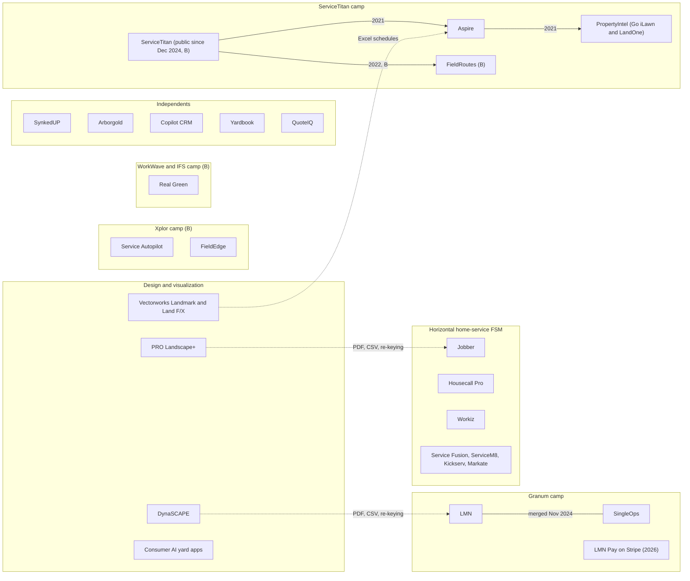

| Date | Event | Evidence |
|---|---|---|
| Jun 30, 2021 | ServiceTitan agrees to acquire Aspire alongside a $200M Series G at a $9.5B valuation; closed Aug 2021 | [S] [TechCrunch](https://techcrunch.com/2021/06/30/servicetitan-acquires-aspire-to-move-into-landscaping-raises-200m-at-a-9-5b-valuation), [Aspire blog](https://www.youraspire.com/blog/aspire-to-be-acquired-by-servicetitan) |
| Oct 2021 | Aspire agrees to acquire Go iLawn and LandOne, later combined into PropertyIntel | [S] [PrivSource](https://www.privsource.com/acquisitions/deal/x7SXDx), [Landscape Management](https://www.landscapemanagement.net/aspire-software-launches-new-propertyintel-measuring-and-estimating-tool/) |
| 2021-2022 | Xplor acquires Service Autopilot; reviewers later report processor lock-in | [B] for date; [S] [GetApp reviews](https://www.getapp.com/operations-management-software/a/service-autopilot/reviews/) |
| 2022 | ServiceTitan acquires FieldRoutes (pest and lawn) | [B] |
| Nov 2024 | LMN and SingleOps merge; group operates as Granum | [S] [Attentive.ai](https://attentive.ai/blog/lmn-and-attentive-ai-announce-strategic-partnership), [Green Industry Pros](https://www.greenindustrypros.com/business-management/software/product/22963124/granum-granum-launches-lmn-pay-experience) |
| Dec 2024 | ServiceTitan lists on Nasdaq | [B] |
| Feb 2025 | LMN and Attentive.ai partner for AI mapping and takeoffs | [S] [Landscape Management](https://www.landscapemanagement.net/lmn-and-attentive-partner-to-integrate-products/) |
| 2025 | ServiceTitan launches Atlas agent at Pantheon | [S] [ServiceTitan press](https://www.servicetitan.com/press/servicetitan-introducing-the-next-evolution-of-ai-at-pantheon-2025-keynote) |
| 2025 | PRO Landscape+ launches an AI designer suite | [S] [Green Industry Pros](https://www.greenindustrypros.com/business-management/software/product/22961404/pro-landscape-pro-landscape-launches-aibased-designer-suite) |
| Feb 2026 | LMN ships Beam AI takeoff integration and an AI crew-notes beta | [S] [LMN release note](https://support.golmn.com/hc/en-us/articles/46786137574683) |
| Feb 2026 | Jobber price change logged by a tracker; Jobber runs an invitation-only "ACH on us" promotion | [S3P] [Costbench](https://costbench.com/changelog/jobber-price-increase-2026-02-3/); [S] [Jobber](https://www.getjobber.com/ach-on-us/) |
| Mar 2026 | Granum relaunches LMN Pay "powered by Stripe" | [S] [Landscape Management](https://www.landscapemanagement.net/lmn-by-granum-launches-new-financial-infrastructure-platform-in-partnership-with-stripe/) |

**Contractor-side consolidation.** Private-equity-backed commercial roll-ups and the public BrightView buy regional maintenance firms and standardize them on an ERP, usually Aspire or an in-house system [B]. Two implications: a firm that gets acquired is a churn risk for whatever tool it used (including Rootline in S4), and the independents competing against roll-ups need enterprise-grade estimating, job costing and multi-property service at SMB prices. That is Rootline's lane [E].

**Adoption is bimodal [E].** Owner-operators adopt cheap horizontal apps for quoting, scheduling and getting paid. Firms above about $3M adopt landscape ERPs for estimating discipline and job costing. The middle (10-40 employees, $1M-$6M) is the most under-served: too complex for horizontal apps, too small for Aspire's implementation, and still running design, books and payroll in separate tools ([R4](research/R4-industry-payments-accounting.md) section 7).

### 2.5 Regulatory and structural forces that reshape demand

Software is rarely bought for its own sake in this industry; it is bought when something forces a change. The forces below are already in motion across Rootline's US and Canadian markets and each one creates a dated buying trigger; several are national, while the turf-water deadlines in R2 and the small-engine rules in R1 bite hardest outside the Great Lakes launch region (Q11). Evidence links are re-cited from the sibling module docs; dates and scope must be re-verified before external use (Appendix E, items E17-E21). Nothing here is legal advice.

| # | Force | What is changing | Evidence | Archetypes hit hardest | What it means for Rootline | Owner doc and priority |
|---|---|---|---|---|---|---|
| R1 | **Small-engine electrification and local equipment ordinances** | California requires most newly manufactured small off-road engines (mowers, blowers, trimmers) sold in the state to be zero-emission from model year 2024, generators later; existing gas equipment can still be used and repaired. Many municipalities restrict gas leaf blowers or power-equipment hours | [S] [CARB SORE program](https://ww2.arb.ca.gov/our-work/programs/small-off-road-engines-sore) (verify scope); [B] local ordinances | All in California and in cities with blower restrictions; A and B feel it first (replacement cycles are short) | Battery run-time and charging capacity become routing constraints; ordinance warnings appear on the visit ("gas blowers banned in this city"); an equipment-electrification ROI view uses real hours from the fleet register | [13](13-operations-inventory-equipment.md) [V1], [05](05-field-crew-mobile-app.md) warnings [V1], [23](23-innovation-moonshots.md) electrification planner [V2] |
| R2 | **Nonfunctional-turf water limits and turf-conversion deadlines** | California AB 1572 phases out potable-water irrigation of nonfunctional turf on commercial, industrial, institutional and HOA common-area properties starting in 2027; Nevada AB 356 (2021) bars Colorado River water for nonfunctional turf in the Las Vegas valley from 2027 | [S] [California AB 1572](https://leginfo.legislature.ca.gov/faces/billNavClient.xhtml?bill_id=202320240AB1572); [B] Nevada dates (verify per property class) | D (HOAs and commercial sites with a hard deadline), C (residential conversions with utility rebates) | A deadline-driven conversion wave: every affected HOA and commercial site needs a measured turf inventory, a xeric planting plan from Region-rated plants, a priced phased proposal and the rebate paperwork. This is exactly the design-to-estimate loop incumbents do not have | [10](10-design-studio.md) rebate packet, [11](11-ai-design-mockups.md) compliance strip, [12](12-plant-knowledge-base.md) jurisdiction packs [V1] |
| R3 | **Pesticide notification, posting and restricted actives** | About 21-23 states plus DC have lawn-pesticide notification laws; New York's Birds and Bees Protection Act phases out many neonicotinoid uses on turf and ornamentals; several Canadian provinces restrict cosmetic pesticide use, so Canadian lawn programs run on permitted products | [S] [Beyond Pesticides](https://beyondpesticides.org/assets/media/documents/lawn/factsheets/STATE%20NOTFICATION%20LAWS%20-%20LAWN.pdf); [B] New York and provincial dates (verify) | B and the lawn divisions of C, D and E | Records pre-filled from the visit, neighbor-notification registries, restricted actives blocked by effective date with a priced substitution; Canadian rule packs at launch, not as an afterthought | [14](14-service-line-modules.md) Application Compliance Engine [MVP] |
| R4 | **Federal overtime reporting and 1099 thresholds** | The One Big Beautiful Bill Act (Public Law 119-21, July 2025) created temporary deductions for tax years 2025-2028 covering the premium portion of qualified overtime, which employers report separately; the 1099-NEC and 1099-MISC threshold rises from $600 to $2,000 for payments made after December 31, 2025 | [S] [Congress.gov H.R. 1](https://www.congress.gov/bill/119th-congress/house-bill/1), [IRS Form 1099-NEC](https://www.irs.gov/forms-pubs/about-form-1099-nec) (verify current instructions) | B-E: peak-season crews commonly work well over 40 hours a week from April to November [B], so the overtime premium is material | Time tracked per Visit must split the FLSA premium so the payroll export can report it; subcontractor 1099 thresholds are dated parameters, not constants. Generic FSM time sheets that export only total hours create year-end work | [15](15-team-hr-payroll.md) RULE-09 [MVP], [09](09-accounting-ledger-integrations.md), [13](13-operations-inventory-equipment.md) [MVP] |
| R5 | **Seasonal labor supply** | The H-2B cap stays at 66,000 a year with supplemental releases that vary by fiscal year; stepped-up worksite immigration enforcement in 2025-2026 was widely reported to tighten seasonal labor; Canada tightened the low-wage stream of its Temporary Foreign Worker Program in 2024 | [S] [USCIS cap count](https://www.uscis.gov/working-in-the-united-states/temporary-workers/h-2b-non-agricultural-workers/cap-count-for-h-2b-nonimmigrants); [B] enforcement and TFWP changes (verify with trade press and IRCC) | All with crews; E most (two seasons to staff) | Productivity features become the growth plan (section 8, force 7); H-2B and work-authorization status tracking from the payroll provider; Spanish-first training so new hires are productive in week one | [15](15-team-hr-payroll.md) H-2B workspace [V1], [05](05-field-crew-mobile-app.md) [MVP] |
| R6 | **Business texting registration** | US carriers require A2P 10DLC brand and campaign registration for application-to-person texting; unregistered traffic is filtered or blocked | [S] [Twilio ISV 10DLC onboarding](https://www.twilio.com/docs/messaging/compliance/a2p-10dlc/onboarding-isv-api.md) | A and B (they text from personal phones today) | Rootline registers each Company's brand and campaigns as an ISV during onboarding, so "on my way" and rain-day texts are delivered; a reason to consolidate texting into the platform | [16](16-marketing-growth-communications.md) [MVP] |
| R7 | **Card surcharging rules** | Visa caps US surcharges at the lesser of cost of acceptance or 3%; debit cannot be surcharged; Connecticut, Massachusetts and Maine ban surcharges; Canada caps at 2.4%; several states changed rules in 2025-2026 | [S] [AFS Law on Visa's cap](https://www.afslaw.com/perspectives/alerts/visa-reduces-its-merchant-surcharge-cap-3-effective-april-15-2023-merchants), [LawPay state list](https://www.lawpay.com/about/blog/credit-card-surcharge-rules/), [R4](research/R4-industry-payments-accounting.md) section 15 | All; owners already ask how to add card fees ([Jobber Community](https://community.getjobber.com/discussions/invoicing-getting-paid/advice-adding-the-credit-card-service-fee-to-invoices/1228/replies/8669)) | A jurisdiction-aware surcharge or bank-payment-discount setting on the Company's own Stripe account, with ACH steering as the safer default | [08](08-payments-stripe.md) [V1] |
| R8 | **French-language requirements in Quebec** | The Charter of the French Language, as amended by Bill 96, raises French requirements for commercial documents and software offered in Quebec | [S] statute: [LégisQuébec, Charter of the French Language](https://www.legisquebec.gouv.qc.ca/en/document/cs/C-11); [B] interpretation for software and documents, legal review required | Any Company with Quebec Properties | Canadian launch Regions should be English-Canada (Ontario, BC, Alberta) until French portal and documents ship; Quebec is a gated V1-V2 market, not a launch market | [21](21-ux-design-system-sitemaps.md) Quebec rule [V1] |

**So what [E].** Each force is a dated, local rule. Incumbents handle them, if at all, with custom fields and owner memory. Rootline already has the machinery to turn them into product: Regions curated by `platform_curator`, jurisdiction rule packs with citations and effective dates ([12](12-plant-knowledge-base.md), [14](14-service-line-modules.md)), and a change monitor (section 12, MI-05). The same packs power three buying triggers: a compliance deadline (R2, R3), a payroll year-end (R4) and an equipment replacement cycle (R1).

> **Competitive edge (regulation).** Real Green and GorillaDesk keep chemical records for lawn programs, and Aspire tracks snow service, but no competitor in the section 4.4 matrix ties a dated jurisdiction rule to the design, the estimate, the visit and the payroll export at once. When an HOA in Henderson, Nevada (illustrative) must replace 40,000 sq ft of irrigated ornamental turf before the 2027 deadline, Rootline's estimator measures it from the aerial, swaps in Region-rated xeric plants, prices a three-phase conversion with the rebate packet attached, and the board approves it in the commercial portal. Every competitor in the matrix needs at least three tools for that job today [E].

---

## 3. The landscape business archetypes Rootline serves

Five archetypes anchor the whole proposal; module docs should design for them by letter (A-E). Names below are **illustrative composites**, not real companies; figures are estimates [E] built from the research reports and the reference Companies in [02](02-personas-roles-permissions.md) (Reyes Outdoor Living, Charlotte NC; Summit Grounds Group, Columbus OH). Segment codes map to [22](22-business-model-pricing-gtm.md) section 6.1.

### 3.1 Archetype summary

| | **A. Solo mow-and-blow** | **B. Residential maintenance** | **C. Design-build** (beachhead) | **D. Commercial maintenance** | **E. Multi-service with snow** |
|---|---|---|---|---|---|
| Illustrative name | "Cutting Edge Mowing" | "Bluegrass Lawn and Garden" | Reyes Outdoor Living | "Lakeshore Grounds" | "Ridgeline Landscape and Snow"; Summit Grounds Group at the top end |
| Peak / winter headcount | 1-4 / 0-1 | 5-15 / 2-5 | 10-40 / 4-15 | 20-100 / 8-40 | 25-150 / 15-60 (snow crews plus subs) |
| Revenue band [E] | $80k-$350k | $500k-$1.5M | $1M-$6M | $2M-$12M | $2M-$20M |
| Segment ([22](22-business-model-pricing-gtm.md)) | S1 | S3 | **S2 (beachhead)** | S4 | S4/S5 |
| Client mix | Residential | 90%+ residential | 80%+ residential | 70%+ commercial (HOA, property managers, retail, office) | Mixed; commercial lots carry snow |
| Signature work | Weekly mows Apr-Nov at $40-$60 a cut, spring and fall cleanups, mulch by the yard | Mowing routes, 5-step fertilizer and weed-control programs, aeration and overseeding, cleanups, shrub pruning | Paver patios ($15k-$60k), walls, plantings, lighting, irrigation, plus maintenance for install clients | Season contracts ($20k-$250k per site per year), enhancements, irrigation, seasonal color | All of the above plus per-push plowing at 2-inch triggers, salting per application, seasonal snow contracts with caps |
| Today's stack [B/E] | Paper, Yardbook, Jobber Core, QuickBooks Self-Employed | Jobber Connect/Grow, Service Autopilot, Real Green, Copilot CRM + QBO + review tool | LMN, Jobber Grow, SynkedUP or SingleOps + PRO Landscape+ or SketchUp + QBO or QBD + Gusto + spreadsheets | Aspire, LMN Professional, Service Autopilot + QBD/QBO/Sage + SiteRecon or SiteDNA + Motive | Aspire or LMN + Yeti or spreadsheets for snow + QBO + Motive |
| Software spend today [E] | $0-$80/mo | $200-$600/mo | $700-$1,500/mo | $1,500-$5,000/mo plus implementation | $1,500-$6,000/mo |
| Rootline plan ([22](22-business-model-pricing-gtm.md)) | Starter | Grow | Grow / Pro | Pro / Enterprise | Pro + Snow and Ice module |
| Rootline priority | Secondary, self-serve [MVP] | Primary follow-on [MVP] | **Primary [MVP]** | Expansion [V1] | Expansion [V1] (snow) |
| Fit with differentiators | Low-medium: portal, autopay, routing | Medium-high: routing, programs, chemical records, portal, BYO Stripe | **Highest: all eight differentiators matter** | High: job costing, ledger, commercial portal, audits, purchasing | High: one system for twelve months, proof of service, deferred revenue |

### 3.2 Archetype A: solo mow-and-blow

**Profile.** One owner-operator and a seasonal helper, a 60-inch zero-turn on a 16-foot trailer, 60-90 weekly residential mows from April to November, spring cleanups in March-April, mulch installs at 10-20 cubic yards a week in spring, leaf cleanups in November, and in the north a handful of residential driveways plowed in winter. Revenue $80k-$350k [E].

**A year in the life.** January: chase unpaid November invoices, send renewal letters by text. March: re-book last year's mow list, buy mulch on credit. April-November: 14-hour Mondays catching up after weekend rain, invoices written at night. December: snow or seasonal work elsewhere.

| Jobs to be done | Pains today | What would make them switch | What they will not tolerate |
|---|---|---|---|
| Route 15-18 mows a day; collect automatically; quote a cleanup from the truck; get Google reviews | Free tools lack autopay and routing; Jobber add-ons stack up for a one-person shop ([Jobber Community](https://community.getjobber.com/discussions/marketing-tools/google-reviews-only-for-marketing-suite/3726)) [S]; marketplaces like GreenPal own the client [B] | Autopay that just works, a branded "book in 60 seconds" link, card-on-file with ACH, a mobile app that works with no signal | Setup longer than an evening; a per-user price; any feature they have to learn before they get paid |

**Rootline stance.** Serve with Starter and the self-serve funnel; do not build for them first. They matter because they become archetype B. The product must never punish them with complexity: a "Simple mode" with quotes, schedule, invoices and portal only ([21](21-ux-design-system-sitemaps.md)).

### 3.3 Archetype B: residential maintenance (5-15 staff)

**Profile.** Two or three mowing crews of 2-3 people, 300-450 weekly mow clients on fixed day-of-week routes, a lawn-care applicator running a 5-step fertilizer and weed-control program for 150-250 clients, aeration and overseeding in September, spring and fall cleanups, shrub pruning twice a year, light enhancements (mulch, seasonal color). Revenue $500k-$1.5M [E]. Many clients on level billing ($300/month for 12 months covering a $3,600 season, [LawnPro](https://lawnprosoftware.com/features/level-billing)) [S] or prepaid programs with a discount ([Weed Man](https://weedman.com/blog/prepay-and-referral-discounts)) [S].

| Jobs to be done | Pains today | What would make them switch |
|---|---|---|
| Keep 30-40 stops a day per crew on time; slide a rain day across 120 visits without 120 phone calls; keep compliant pesticide records; collect $40k-$80k a month on autopay; renew programs every winter | Routing on straight-line distance ([Jobber Community](https://community.getjobber.com/discussions/job-details-scheduling/how-does-jobber-calculate-routes-and-can-it-use-real-driving-directions-instead-/8663/replies/9863)) [S]; rain-day rescheduling by hand [B]; chemical records on paper or in a separate lawn tool [B]; forced processor after an acquisition ([GetApp](https://www.getapp.com/operations-management-software/a/service-autopilot/reviews/)) [S]; per-user pricing at peak | Road-network routing with a "rain day: slide everything right" button; application records pre-filled from the visit; level billing and prepay that post to the books correctly; their own Stripe account; Spanish crew app |

**Rootline stance.** Primary follow-on at [MVP] (S3). Must reach parity with Real Green and Service Autopilot on programs, rounds, prepay and state-compliant records, then win on routing, portal, ledger and payments ownership ([14](14-service-line-modules.md), [04](04-scheduling-dispatch-routing.md)).

### 3.4 Archetype C: residential design-build-maintain (10-40 staff), the beachhead

**Profile.** Reyes Outdoor Living ([02](02-personas-roles-permissions.md)): about 22 people at peak (April-November), 9 in winter; roughly 55% installs, 35% maintenance, 10% enhancements; one location; owner-led sales. Typical sold work: a 400 sq ft paver patio with 6-inch compacted base, edge restraint and polymeric sand; a 1,200 sq ft foundation planting with 14 'Limelight' hydrangeas, 3 river birch and 40 yards of double-shredded hardwood mulch; low-voltage lighting; drip and spray irrigation with spring start-ups and fall winterizations; a one-year plant warranty conditional on irrigation.

**The broken workflow today [E, from R2 and R3].**

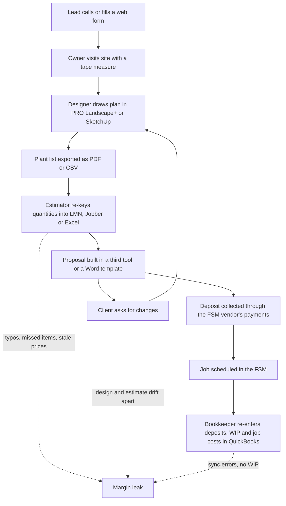

| Jobs to be done | Pains today | What would make them switch |
|---|---|---|
| Turn a site visit into a priced, visual proposal in one sitting; close $25k+ jobs against two other bidders; pick plants that survive the Region so warranty replacements stop eating margin; know whether last month's installs made money; keep the CPA happy | Re-keying design quantities ([JackMacBiz](https://jackmacbiz.github.io/blog/2026-06-13-why-your-current-landscape-design-app-is-wasting-8-hours-per/)) [S, anecdotal]; Jobber users ask the community for separate design software ([Jobber Community](https://community.getjobber.com/discussions/operations-forum/looking-for-landscape-design-software--training/8084)) [S]; plant libraries ignore region ([Capterra UK](https://www.capterra.co.uk/software/126135/pro-landscape)) [S]; job costing that never ties to the P&L [E] | Draw once, price once: Design Studio takeoff feeds the estimate; AI mockup of the client's own yard in the proposal; Region-rated plants; deposits and WIP posted to a real ledger; switching help from LMN or Jobber |

**Rootline stance.** Beachhead [MVP], launching in the six Wave 1 Regions of the Great Lakes ([22](22-business-model-pricing-gtm.md) section 6.2). Every one of the eight differentiators in the brief matters to this buyer, and the buyer has an office manager and a bookkeeper or outside CPA who feel the integration pain daily.

> **Competitive edge (archetype C).** Today this firm pays for an estimating or field-service tool, a design tool (PRO Landscape+ is about $900 a year ([Capterra](https://www.capterra.com/p/126135/PRO-Landscape/)) [S]) and QuickBooks, and still re-keys every plant. In Rootline, dropping 14 'Limelight' hydrangeas on the plan updates the takeoff, the estimate, the mockup, the proposal total and the draft purchase order at once. No competitor in the section 4.4 matrix does this from one record: PRO Landscape+ updates its own proposal but not the business system's estimate, purchase order or schedule, and the operations tools have no plan to drop plants on.

### 3.5 Archetype D: commercial maintenance (20-100 staff)

**Profile.** "Lakeshore Grounds" (illustrative): 55 people at peak, 20 in winter; 80 commercial sites (HOAs with 6 communities, a property manager with 22 retail centers, office parks); season contracts billed monthly over 12 months; enhancements (seasonal color rotations at 2,400 flats a year, mulch refreshes, irrigation repairs) carry the profit; contract renewals every fall; net-30 to net-45 terms; certificates of insurance and W-9s for every client's AP department.

| Jobs to be done | Pains today | What would make them switch |
|---|---|---|
| Bid renewals at the right margin; capture enhancement opportunities on every visit; prove service to a property manager who was not on site; route approvals through board members and regional managers; cost every site and division | Aspire's cost, learning curve and admin bottleneck ([Capterra](https://www.capterra.com/p/161544/Aspire/), [GetApp UK](https://www.getapp.co.uk/reviews/9108/aspire)) [S]; 90-day implementations [S]; measurement and audits as bolt-ons ([SiteDNA](https://sitedna-marketing-site.pages.dev/), [Aspire PropertyIntel](https://www.youraspire.com/go/landscape-estimating-property-measurement)) [S]; AP automation and benchmarking bought separately ([Vergo](https://www.getvergo.com/learn/best-ap-automation-software-for-landscape-companies-using-aspire), [Wilson360](https://marketplace.youraspire.com/partners/wilson360.md)) [S] | Aspire-level contracts, divisions, purchasing and job costing at SMB price with a migration measured in days; a commercial portal with multi-property approvals and spend limits; enhancement radar from crew photos; ledger with branch and division dimensions |

**Rootline stance.** Expansion at [V1]. Do not chase until the commercial parity list in [R2](research/R2-landscape-specific-platforms.md) section 16 (branches, divisions, renewals, enhancements, purchasing at actual cost, equipment cost recovery, snow events, multi-property approvals) is shipped.

### 3.6 Archetype E: multi-service with snow

**Profile.** "Ridgeline Landscape and Snow" (illustrative): 35 people at peak, 18 in winter plus 6 plow subcontractors; maintenance, installs and a lawn division in the green season; 45 commercial lots and 150 residential driveways in winter. Snow contracts mix per-push at a 2-inch trigger, per-event tiers (2-4, 4-8, 8-12 inches), seasonal fixed with a 12-event cap, and per-application salting. At the top end, Summit Grounds Group ([02](02-personas-roles-permissions.md)) runs this model across three branches with about 140 people at peak.

| Jobs to be done | Pains today | What would make them switch |
|---|---|---|
| Detect the storm, dispatch 20 routes at 2 a.m., log pushes and salt per site, invoice 200 service records by event the next morning, defend a slip-and-fall claim two years later; recognize seasonal snow revenue correctly | Two systems for green and white seasons; generic tools fall back to "manual job creation during snow events and spreadsheets for per-inch pricing" ([Agiled](https://agiled.app/blog/best-client-management-software-for-snow-removal)) [S, competitor-written]; GPS alone is disputable, photos plus timestamps are needed ([Aspire blog](https://www.youraspire.com/blog/prove-service-delivery-data-ends-disputes)) [S]; SIMA calls in-season documentation "a legal shield" ([SIMA](https://resources.sima.org/snow-and-ice-resource-center/effective-in-season-documentation)) [S] | One data model for twelve months; storm events from weather data; proof-of-service packets attached to invoices and stored in a claims vault; subcontractor portal; deferred revenue on seasonal contracts posted automatically |

**Rootline stance.** Snow Lite at [MVP] in every tier (crew-app storm visit logging with timestamped GPS photos, a snow site list with priority order, per-push and per-application invoices from those logs, and a per-site PDF proof of service), because the Great Lakes launch region runs snow and owners there evaluate and switch software during the snow season; the full Snow and Ice module (storm events, triggers, sealed proof packets, subcontractor plowers) at [V1]; green-season features at [MVP]. Snow is the strongest retention hook for northern firms because it keeps the system busy in January.

### 3.7 Adjacent archetypes (served through modules, not targeted first)

| Archetype | Incumbent they love | What Rootline must match | Priority |
|---|---|---|---|
| Lawn treatment specialist (75-95% programs) | Real Green, GorillaDesk, FieldRoutes | Programs and rounds priced by turf area, chemical records by state, prepay and renewals, direct mail | [V1] as a target (module ships [MVP]) |
| Tree care and arborist | SingleOps, Arborgold | Tree inventory with GPS, species and DBH, ANSI A300 work specs, crane and climb job types | [V2] module ([22](22-business-model-pricing-gtm.md) Tree Care add-on) |
| Irrigation and lighting specialist | Jobber, ServiceTitan-style service tools | Start-up and winterization routes, controller and zone records, service agreements, as-builts | [V1] |
| Independent landscape designer (no crews) | PRO Landscape+, Vectorworks, SketchUp, Canva | Design Studio, proposals, Plant KB, design fees credited to install | [V1] Design Solo plan |
| Franchise systems | Real Green, custom | Franchisor console, standardized price books, royalty reporting | [V2] |

### 3.8 How archetypes grow, and why that matters

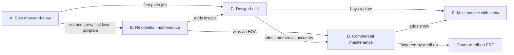

Growth transitions are the moments companies switch software: the second crew breaks the free tool, the first design-build job breaks the field-service app, the first HOA breaks the residential portal, the first plow breaks the green-only system. **Rootline's packaging must let a Company move along these arrows without migrating** (Starter to Grow to Pro, modules switched on), which is itself a competitive edge against single-segment tools.

### 3.9 Jobs-to-be-done by persona, across archetypes

| Persona (role key) | Core job | Tool they use today | Switching trigger Rootline exploits |
|---|---|---|---|
| Business Owner (`owner`) | "Grow profitably without working 80-hour weeks in May" | FSM dashboard, QuickBooks reports, gut feel | Real-time P&L by service line and job; "margin found" from ACH steering and price realization |
| Office / Admin Manager (`office_manager`) | "Get every visit scheduled, billed and collected without re-typing" | FSM + QuickBooks + spreadsheets | No re-keying; rain-day bulk reschedule; autopay; one inbox |
| Sales Rep / Estimator (`estimator`) | "Price the job right and fast, and win it" | LMN or Excel + Google Maps measuring ([Jobber help](https://help.getjobber.com/es/articles/how-to-measure-property-distance-and-size/)) [S] | Takeoff from a traced property; LMN-identical overhead math; visual proposals |
| Landscape Designer (`designer`) | "Design something beautiful that will actually grow here" | PRO Landscape+, SketchUp, Vectorworks, plant references | Region-rated plants inside the canvas; AI mockups of the client's yard; no export step |
| Operations / Account Manager (`ops_manager`) | "Keep crews productive and clients renewing" | Dispatch board, whiteboard, phone | Multi-crew routing; enhancement radar; commercial portal |
| Crew Lead / Foreman (`crew_lead`) | "Know where to go, what to do, and get it signed off" | FSM mobile app, paper work orders, texts | Offline-first, Spanish, big buttons, materials and chemical logs pre-filled |
| Field Technician (`technician`) | "Clock in, do the work, see my hours and pay" | Paper timesheet or a limited seat ([LMN permissions](https://intercom.help/lmn/en/articles/17699017-lmn-user-permissions)) [S] | Own hours, training and pay explanation in Spanish or English |
| Bookkeeper / CPA (`bookkeeper`) | "Clean books, easy close, correct job costing" | QuickBooks Online or Desktop, sync error logs | Ledger as system of record, or a sync that quarantines one record instead of blocking a client |
| Subcontractor (`subcontractor`) | "Get the work order, prove I did it, get paid" | Texts and photos | Sub portal with proof-of-service capture (snow especially) |
| Residential client (`client_residential`) | "See it before I buy it, pay in two taps, know when they're coming" | Email PDFs, vendor-branded portals | Mockup of their own yard; branded portal; autopay; visit photos |
| Commercial client (`client_commercial`) | "Approve, track and audit work across 22 sites" | Email, spreadsheets, AP portals | Portfolio dashboard, approval chains, POs, consolidated statements, proof of service |

---

## 4. Competitive landscape

### 4.1 The four competitive categories

| Category | Who | What they optimize for | What they never do | Rootline's angle |
|---|---|---|---|---|
| **Horizontal home-service FSM** | Jobber, Housecall Pro, Workiz, ServiceM8, Service Fusion, Kickserv, Markate, FieldPulse; ServiceTitan at the enterprise end | Fast request-to-quote-to-cash, mobile polish, marketing and AI add-ons, embedded payments | Production-rate estimating, design, plants, chemical records, snow events, books | Match their spine and polish at [MVP]; win on landscape depth, books and payments ownership |
| **Landscape ERPs and specialists** | Aspire, LMN, SingleOps, SynkedUP, Arborgold, Real Green, Service Autopilot, Copilot CRM, Yardbook, QuoteIQ, GorillaDesk and FieldRoutes (lawn and pest), BOSS LM, CLIP | Estimating discipline, contracts, programs, job costing, route density | Design, region-aware plants, AI in the middle of the funnel, books, portable payments, modern UX | Exact parity on the landscape math; leapfrog on design, AI, ledger, UX and migration speed |
| **Design and visualization** | PRO Landscape+, DynaSCAPE, Realtime Landscaping, Vectorworks Landmark, Land F/X, SketchUp plus plugins, Structure Studios, iScape; consumer AI apps (Neighborbrite, ReimagineHome and others); design services (Yardzen, Home Outside) | Drawing, imaging, presentation | Pricing with production rates, scheduling, invoicing, books; regional plant ratings | The plan is the same record as the estimate, proposal, purchase order and job cost |
| **Point tools and bolt-ons** | Measurement (PropertyIntel, SiteRecon, Attentive.ai and Beam AI, Deep Lawn), audits (SiteDNA), snow (Yeti), AP automation (Vergo), benchmarking (Wilson360), telematics (Motive), pesticide loggers (ChemLog), QuickBooks and Xero, review and website tools | One job each, done well | Share geometry, data or money with anything else | Absorb the bolt-ons into one data model; each removes a vendor bill |

### 4.2 Competitor profiles (compact)

Full profiles with evidence are in the research appendices; this table is the executive view. "Threat" is the analyst's view of how hard each competitor makes Rootline's job in the beachhead (archetype C) and in Rootline's expansion segments [E].

| Competitor | Owner | Core buyer | Signature strength | Most-cited weakness | Payments model | Books | AI (Nov 2026) | Threat | Detail |
|---|---|---|---|---|---|---|---|---|---|
| **Jobber** | Independent (Edmonton) | 1-30 person home-service firms, many lawn and landscape | Polished request-quote-job-invoice spine; Client Hub "Approve & Pay Deposit"; online booking; big ecosystem ([Jobber help](https://help.getjobber.com/en/articles/what-do-your-clients-see-in-client-hub/)) [S] | Straight-line routing; add-on stacking; tier gating; one-way QBO sync ([Jobber QBO FAQ](https://help.getjobber.com/es/articles/quickbooks-integration-faqs/)) [S] | Jobber Payments on Stripe; 1% instant payouts ([Stripe case study](https://www.casestudies.com/company/stripe/case-study/jobber-and-stripe-help-200k-home-service-professionals-save-on-payment-fees), [Jobber help](https://help.getjobber.com/en/articles/instant-payouts/)) [S] | QBO (one-way), Xero | Copilot, AI Receptionist, Jobber Voice, Campaign Generator [S] | **High** (brand, distribution) | [R1](research/R1-field-service-platforms.md) s3 |
| **Housecall Pro** | Independent | Residential home services | Marketing, good-better-best with financing, community | Per-user overages; support variance [S3P/B] | HCP Payments, 1% Instapay, Wisetack ([HCP](https://www.housecallpro.com/features/payment-processing/)) [S] | QBO sync | AI agent features [B] | Medium | [R1](research/R1-field-service-platforms.md) s4 |
| **ServiceTitan** | Public (Nasdaq, B) | Mid-market and enterprise trades | Call-center booking, pricebook, memberships, Atlas agent ([ServiceTitan](https://www.servicetitan.com/press/servicetitan-introducing-the-next-evolution-of-ai-at-pantheon-2025-keynote)) [S] | Cost, contracts, implementations [B] | ServiceTitan Payments and financing [B] | QuickBooks and mid-market ERPs | Atlas, Titan Intelligence [S] | Medium (via Aspire) | [R1](research/R1-field-service-platforms.md) s5 |
| **Aspire** | ServiceTitan | Commercial maintenance and design-build, multi-branch | The landscape ERP: contracts, renewals, kits, purchasing at actual cost, equipment, snow ([Aspire](https://www.youraspire.com/features/purchasing)) [S] | "High cost and added fees", learning curve, admin bottleneck, 90-day implementations ([Capterra](https://www.capterra.com/p/161544/Aspire/)) [S] | Historically CardConnect; current unconfirmed [S/B] | External GL; reads vendors from it [S] | PropertyIntel AI measuring; survey messaging [S] | **High in S4**, low in S2 | [R2](research/R2-landscape-specific-platforms.md) s4.1 |
| **LMN** | Granum | Owner-led design-build and maintenance | Budget-first estimating with MORS/FLH/SORS; education ([LMN help](https://intercom.help/lmn/en/articles/15939065-how-lmn-calculates-overhead-labor-burden-and-profit-in-estimates)) [S] | "Too difficult to use"; slow measuring on big sites; crew-app reliability ([Capterra](https://www.capterra.com/p/142064/LMN/reviews/), [G2](https://www.g2.com/products/lmn)) [S] | LMN Pay on Stripe since Mar 2026; non-portable per a consultant ([Merchant Cost Consulting](https://merchantcostconsulting.com/lower-credit-card-processing-fees/lmn-pay-stripe-migration/)) [S] | QBO/QBD sync [B] | Partner AI (Attentive, Beam AI), crew-notes beta [S] | **High** (estimating mindshare) | [R2](research/R2-landscape-specific-platforms.md) s5.1 |
| **SingleOps** | Granum | Tree care, landscape, lawn | Visual proposals, client portal, tree inventory ([case study](https://www.casestudies.com/company/singleops/case-study/chop-nashvilles-proposals-are-incredible)) [S] | Steep learning curve; POs and inventory Premier-only ([SingleOps docs](https://docs.singleops.com/hc/articles/43339572958491)) [S] | Integrated [B] | QBO/QBD [B] | None documented [S] | Medium | [R2](research/R2-landscape-specific-platforms.md) s6.1 |
| **SynkedUP** | Independent | Small design-build | "Priced for profit" estimating plus coaching ([SynkedUP](https://synkedup.com/features/)) [S] | High per-user list price [S3P] | Not verified | QBO [B] | None documented [B] | Medium | [R2](research/R2-landscape-specific-platforms.md) s5.2 |
| **Arborgold** | Independent | Tree, landscape, lawn | Item-level portal approval, per-crew permissions, tree inventory ([Arborgold](https://arborgold.com/customer-portal/)) [S] | Portal and pay-from-portal on higher tiers ([pricing](https://arborgold.com/?p=17837)) [S3P] | Integrated [B] | QuickBooks [B] | None documented [B] | Low-medium | [R2](research/R2-landscape-specific-platforms.md) s6.2 |
| **Real Green** | WorkWave (IFS) [B] | Lawn treatment and PHC | Programs and rounds, Measurement Assistant, prepay and level billing ([RealGreen](https://realgreen.com/features/landscape-billing-invoice-software)) [S] | Support, cloud migration, accounting "basically unusable" ([Capterra](https://www.capterra.com/p/78106/Service-Assistant/reviews/?page=5)) [S] | WorkWave payments [B] | Weak native; QuickBooks [S/B] | None documented [S] | Medium in S3 | [R2](research/R2-landscape-specific-platforms.md) s7.1 |
| **Service Autopilot** | Xplor | Recurring residential lawn and landscape | Automation, drips, routing ([Software Advice](https://www.softwareadvice.com/landscaping/service-autopilot-profile/)) [S] | Forced processor, ease of use 3.8, "once configured" ([GetApp](https://www.getapp.com/operations-management-software/a/service-autopilot/reviews/), [Capterra](https://www.capterra.com/p/122075/Service-Autopilot/reviews/)) [S] | Xplor processing, mandatory per users [S] | QuickBooks [B] | None documented [S] | Medium (switch pool) | [R2](research/R2-landscape-specific-platforms.md) s7.2 |
| **Copilot CRM** | Independent | Small residential lawn and landscape | All-in-one at low cost; state SEO pages ([Copilot](https://www.copilotcrm.com/lawn-care/ohio)) [S] | Little public evidence [S negative] | Integrated [B] | QBO [B] | None documented [B] | Low-medium | [R2](research/R2-landscape-specific-platforms.md) s7.3 |
| **Yardbook** | Independent | Solo and micro operators | Free core product ([Toolradar](https://toolradar.com/tools/yardbook/pricing)) [S3P] | Basic reports; booking unverified [S3P] | Processing monetized [B] | QBO export [B] | None | Low (floor-setter) | [R2](research/R2-landscape-specific-platforms.md) s7.4 |
| **QuoteIQ** | Independent | Small lawn and landscape | AI-forward marketing; AI Smart Import from any CRM ([QuoteIQ](https://intercom.help/quoteiq/en/articles/14442924-ai-smart-import-migrate-your-data-from-any-crm-in-minutes)) [S] | Thin public evidence of depth [E] | Not verified | Not verified | AI estimating claims (competitor-written) [S] | Medium (AI-native low end) | [R2](research/R2-landscape-specific-platforms.md) s7.5 |
| **GorillaDesk / FieldRoutes** | Independent / ServiceTitan | Pest and lawn treatment routes | Route density, chemical usage tracking [B] | Narrow scope [B] | Integrated [B] | QBO [B] | Not verified | Low-medium in S3 | [R1](research/R1-field-service-platforms.md) s11 |
| **Workiz** | Independent | Phone-driven on-demand trades | Phone system plus Jessica AI answering ([ServiceAgent](https://serviceagent.ai/blogs/workiz-pricing/)) [S3P] | Hidden prices, add-on stacking, fixed AI persona ([Carly](https://www.usecarly.com/blog/workiz-ai/)) [S3P] | In-house [B] | QBO [B] | Jessica (about $200/mo) [S3P] | Low | [R1](research/R1-field-service-platforms.md) s6 |
| **PRO Landscape+** | Drafix | Design-build contractors | Photo imaging plus CAD plus proposal; 2025 AI suite ([Green Industry Pros](https://www.greenindustrypros.com/business-management/software/product/22961404/pro-landscape-pro-landscape-launches-aibased-designer-suite)) [S] | Plant library ignores region; not for beginners ([Capterra UK](https://www.capterra.co.uk/software/126135/pro-landscape)) [S] | None | None | AI designer, paver, eraser tools [S] | Medium (design mindshare) | [R3](research/R3-design-ai-plant-data.md) s2.2.1 |
| **Vectorworks Landmark / Land F/X** | Nemetschek / Land F/X | Landscape architects | CAD/BIM depth, plant and irrigation schedules ([Land F/X](https://www.landfx.com/docs/planting/schedules.html)) [S] | Steep learning curve; no business link [B] | None | None | AI visualizer [B] | Low (different buyer) | [R3](research/R3-design-ai-plant-data.md) s2.2.3-4 |
| **Yeti** | Independent | Commercial snow | GPS-verified history, timestamped photos, subcontractor portal ([Yeti](https://yetisoftware.com/)) [S] | Snow only: second system for green season [E] | Not verified | Not verified | Not verified | Low-medium in E | [R2](research/R2-landscape-specific-platforms.md) s9 |
| **Consumer AI yard apps and design services** | Various; Yardzen | Homeowners | Instant restyles; remote design packages ([Axios](https://www.axios.com/local/washington-dc/2026/05/08/landscape-design-ai)) [S] | Invented or wrong-zone plants, not to scale, no installer ([Penn State Extension](https://extension.psu.edu/ai-garden-design-intelligent-choices)) [S] | n/a | n/a | Core product | Medium (could own the homeowner) | [R3](research/R3-design-ai-plant-data.md) s3.1 |
| **QuickBooks Online / Desktop, Xero** | Intuit / Xero | Every SMB | The default ledger CPAs know | Price increases, Desktop retirement for new US subscribers, metered API reads [B, verify] | QuickBooks Payments | Native | Intuit Assist [B] | Medium (CPA gravity) | [R4](research/R4-industry-payments-accounting.md) s20-23 |

### 4.3 Positioning map

Axes: **client focus** (residential to commercial) and **lifecycle coverage** (ops only, meaning schedule-and-invoice, up to design-to-books, meaning measure, design, estimate, operate, collect and keep the ledger). Placement is the analyst's judgment from the matrix in 4.4 [E], under one explicit rule so the chart can be re-drawn when the matrix changes:

- **Below 0.5 (ops half):** a product that lacks either a native to-scale design capability (matrix row 10) or a native estimate-to-cash spine (rows 4, 16, 33). Within the ops half, height reflects depth of landscape estimating, job costing and purchasing.
- **0.5-0.8 (lifecycle half):** native design and native estimate-to-cash in one product, sharing one record (row 15 at ●).
- **Above 0.8:** the above plus a native double-entry ledger (row 36). Rootline sits here by plan; no competitor reaches 0.5 today.

Horizontal position reflects client mix and commercial features (rows 43 and 49) [E].

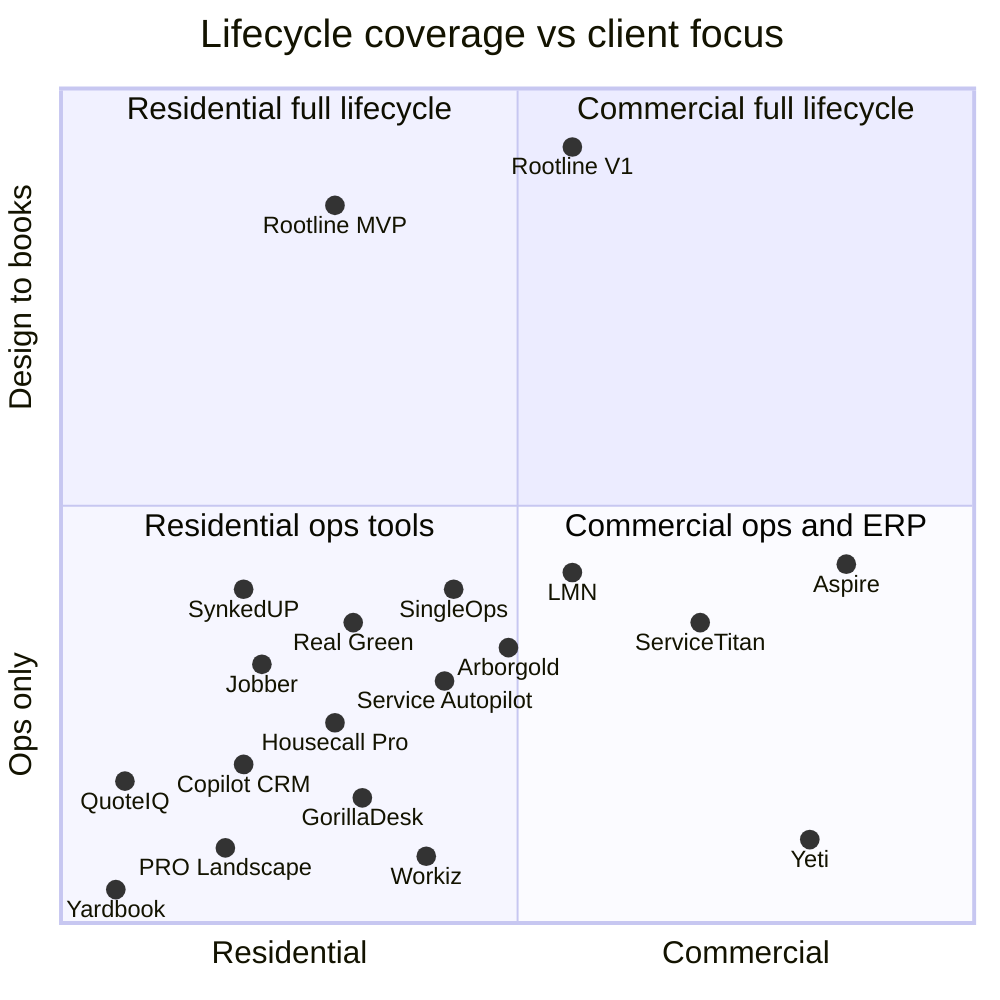

| Position | Products | Reading |
|---|---|---|
| Residential ops tools (bottom left) | Yardbook, Copilot CRM, QuoteIQ, Workiz, Housecall Pro, Jobber, GorillaDesk, Service Autopilot; PRO Landscape+ sits here because it designs and proposes but runs nothing after the signature | Crowded, price-competitive, AI arriving as receptionists |
| Center of the ops half | Real Green, Arborgold, SingleOps, SynkedUP, LMN | Deeper landscape math, programs and job costing push them higher in the ops half; still no design, plants or books, so none crosses 0.5 |
| Commercial ops and ERP (bottom right) | ServiceTitan, Aspire, Yeti | Enterprise pricing and implementations; Aspire is the highest point in the ops half (0.43) because of estimating, purchasing and job-cost depth, but it has no design studio, stops at QuickBooks and sells measurement separately |
| **Residential full lifecycle (top left)** | **Empty until Rootline** | The beachhead: design-to-books for residential design-build-maintain firms, launching in the Great Lakes |
| Commercial full lifecycle (top right) | Empty; Aspire is closest | Rootline's V1-V2 expansion once commercial parity ships |

> **Competitive edge (positioning).** Under the placement rule above, nobody occupies the top half of the map: PRO Landscape+ has the design but not the business system, and Aspire has the business system but not the design or the books. Getting there requires five assets at once (shared geometry, a design engine, a curated plant KB, a production-rate estimating engine and a ledger) and a willingness to give up payments margin. Incumbents have at most two of the five, and the consolidators' business models depend on the payments margin Rootline declines.

### 4.4 MEGA feature matrix: 17 competitors x 53 capabilities

**Legend.** ● full (native, documented, in at least one tier) · ◐ partial (add-on, higher tier only, partner integration, separate acquired product, workaround, or materially limited) · ○ not offered or no evidence found · ? not verified · a trailing * marks an analyst judgment that the research reports flagged as likely but unconfirmed. The Rootline column shows the target and first priority; module docs own the detail and [24](24-roadmap-feature-catalog.md) is the authority if tags differ.

| Code | Competitor | Evidence depth for this column |
|---|---|---|
| JB | Jobber | High: help center, community, press [S]; prices [S3P] |
| HCP | Housecall Pro | Medium: prices and payments [S/S3P]; features mostly [B] |
| ST | ServiceTitan (core trades product, not Aspire) | Medium: deal and AI [S]; product [B] |
| WZ | Workiz | Low-medium: prices and AI [S3P]; features [B] |
| GD | GorillaDesk | Low: [B] |
| ASP | Aspire (ServiceTitan) | High: help guides, product pages, Capterra [S] |
| LMN | LMN (Granum) | High: help center, release notes, reviews [S] |
| SO | SingleOps (Granum) | Medium-high: docs and reviews [S] |
| SYN | SynkedUP | Medium-low: product pages, Capterra [S/S3P] |
| AG | Arborgold | Medium-high: help center [S] |
| RG | Real Green (WorkWave) | Medium: product pages, Capterra [S]; chemical depth [B] |
| SA | Service Autopilot (Xplor) | Medium: PDFs, reviews [S] |
| CP | Copilot CRM | Low-medium: help center, marketing pages [S] |
| YB | Yardbook | Low: aggregators [S3P] |
| QIQ | QuoteIQ | Low: help center and competitor-written pages [S]; most cells unknown |
| PRO | PRO Landscape+ | Medium: Capterra, trade press [S] |
| YETI | Yeti (snow) | Low-medium: vendor site [S] |

**A. Sales, estimating and proposals**

| Capability | JB | HCP | ST | WZ | GD | ASP | LMN | SO | SYN | AG | RG | SA | CP | YB | QIQ | PRO | YETI | Rootline |
|---|---|---|---|---|---|---|---|---|---|---|---|---|---|---|---|---|---|---|
| 1. Lead and opportunity pipeline | ● | ● | ● | ◐ | ? | ● | ● | ● | ● | ● | ● | ● | ● | ◐ | ●* | ○ | ○ | ● [MVP] [03](03-crm-sales-estimating-proposals.md) |
| 2. Online self-booking with live availability | ● | ● | ◐ | ● | ? | ? | ? | ◐ | ? | ◐ | ◐ | ? | ◐ | ? | ? | ○ | ○ | ● [V1] [16](16-marketing-growth-communications.md) |
| 3. Instant online quote from satellite-measured area | ○ | ○ | ○ | ○ | ? | ○ | ○ | ○ | ? | ○ | ● | ? | ? | ○ | ? | ○ | ○ | ● [V1] (turf auto-measure for internal estimating at [MVP]) [16](16-marketing-growth-communications.md) |
| 4. Production-rate estimating with budget-based overhead recovery (MORS/FLH/SORS) | ○ | ○ | ○ | ○ | ○ | ● | ● | ◐ | ● | ◐ | ○ | ○ | ○ | ○ | ? | ○ | ○ | ● [MVP] [03](03-crm-sales-estimating-proposals.md) |
| 5. Options, tiers and optional line items on proposals | ◐ | ● | ● | ? | ? | ◐ | ● | ● | ? | ● | ◐ | ◐ | ◐ | ◐ | ◐* | ◐ | ○ | ● [MVP] [03](03-crm-sales-estimating-proposals.md) |
| 6. E-signature with deposit collected at approval | ● | ● | ● | ◐ | ? | ? | ◐ | ◐ | ? | ● | ? | ? | ◐ | ? | ? | ? | ○ | ● [MVP] [03](03-crm-sales-estimating-proposals.md) |
| 7. Consumer financing inside proposals | ● | ● | ● | ? | ? | ? | ? | ? | ? | ? | ? | ? | ? | ○ | ? | ○ | ○ | ● [V1] [08](08-payments-stripe.md) |

**B. Measurement, design and plants**

| Capability | JB | HCP | ST | WZ | GD | ASP | LMN | SO | SYN | AG | RG | SA | CP | YB | QIQ | PRO | YETI | Rootline |
|---|---|---|---|---|---|---|---|---|---|---|---|---|---|---|---|---|---|---|
| 8. Native aerial or parcel measurement | ◐ | ○ | ○ | ○ | ○ | ◐ | ◐ | ◐ | ? | ● | ● | ? | ? | ○ | ◐* | ? | ◐ | ● [MVP] [10](10-design-studio.md) |
| 9. AI takeoff from aerial imagery or construction plan sets | ○ | ○ | ○ | ○ | ○ | ◐ | ◐ | ○ | ○* | ○ | ○* | ○ | ○ | ○ | ? | ○ | ○ | ● [MVP] turf auto-measure, [V1] other classes and plan sets [03](03-crm-sales-estimating-proposals.md), [10](10-design-studio.md), [17](17-ai-copilot-automation.md) |
| 10. To-scale 2D landscape design studio | ○ | ○ | ○ | ○ | ○ | ○ | ○ | ○ | ? | ○ | ○ | ○ | ○ | ○ | ○* | ● | ○ | ● [MVP] [10](10-design-studio.md) |
| 11. 3D design and walkthrough | ○ | ○ | ○ | ○ | ○ | ○ | ○ | ○ | ? | ○ | ○ | ○ | ○ | ○ | ○ | ● | ○ | ● [V1] [10](10-design-studio.md) |
| 12. AI photo mockups (restyle the client's own photo) | ○ | ○ | ○ | ○ | ○ | ○ | ○ | ○ | ○ | ○ | ○ | ○ | ○ | ○ | ? | ● | ○ | ● [MVP] [11](11-ai-design-mockups.md) |
| 13. Dimension-aware AI layout constrained to region-valid plants | ○ | ○ | ○ | ○ | ○ | ○ | ○ | ○ | ○ | ○ | ○ | ○ | ○ | ○ | ? | ○ | ○ | ● [V1] [11](11-ai-design-mockups.md) |
| 14. Region-aware plant knowledge base with curated ratings | ○ | ○ | ○ | ○ | ○ | ○ | ○ | ○ | ○ | ○ | ○ | ○ | ○ | ○ | ○ | ◐ | ○ | ● [MVP] [12](12-plant-knowledge-base.md) |
| 15. Design or takeoff live-linked to estimate, proposal and PO | ○ | ○ | ○ | ○ | ○ | ◐ | ◐ | ○ | ? | ◐ | ◐ | ○ | ○ | ○ | ? | ◐ | ○ | ● [MVP] [10](10-design-studio.md) |

**C. Scheduling, field and operations**

| Capability | JB | HCP | ST | WZ | GD | ASP | LMN | SO | SYN | AG | RG | SA | CP | YB | QIQ | PRO | YETI | Rootline |
|---|---|---|---|---|---|---|---|---|---|---|---|---|---|---|---|---|---|---|
| 16. Recurring visits and maintenance schedules | ● | ● | ● | ● | ● | ● | ● | ● | ● | ● | ● | ● | ● | ● | ●* | ○ | ◐ | ● [MVP] [04](04-scheduling-dispatch-routing.md) |
| 17. Route optimization on road network (one crew, one day) | ◐ | ? | ◐ | ? | ● | ? | ? | ? | ? | ? | ● | ● | ? | ? | ? | ○ | ? | ● [MVP] [04](04-scheduling-dispatch-routing.md) |
| 18. Multi-crew VRP (capacity, skills, equipment, time windows) | ○ | ○ | ◐ | ○ | ◐ | ? | ? | ? | ? | ? | ? | ? | ? | ○ | ? | ○ | ? | ● [V1] [04](04-scheduling-dispatch-routing.md) |
| 19. Weather-driven bulk reschedule | ○ | ○ | ◐ | ○ | ? | ◐ | ? | ? | ? | ? | ? | ? | ? | ○ | ? | ○ | ? | ● [MVP] manual bulk moves, [V1] playbooks [04](04-scheduling-dispatch-routing.md) |
| 20. Crew app with time, photos and checklists | ● | ● | ● | ● | ● | ● | ● | ● | ● | ● | ● | ● | ● | ◐ | ◐* | ○ | ● | ● [MVP] [05](05-field-crew-mobile-app.md) |
| 21. Documented offline-first crew app | ◐ | ? | ? | ? | ? | ● | ? | ? | ? | ? | ? | ? | ? | ○ | ? | ○ | ? | ● [MVP] [05](05-field-crew-mobile-app.md) |
| 22. Spanish crew interface | ? | ? | ? | ? | ? | ? | ? | ? | ? | ? | ? | ? | ? | ? | ? | ○ | ? | ● [MVP] [21](21-ux-design-system-sitemaps.md) |
| 23. Live GPS crew tracking and geofenced clock-in | ● | ● | ◐ | ● | ● | ● | ? | ? | ? | ? | ? | ? | ? | ? | ? | ○ | ● | ● [MVP] [05](05-field-crew-mobile-app.md) |
| 24. Purchasing and POs generated from estimates | ○ | ? | ● | ? | ? | ● | ● | ◐ | ? | ? | ? | ? | ○ | ○ | ? | ○ | ? | ● [MVP] [13](13-operations-inventory-equipment.md) |
| 25. Inventory with field material usage | ○ | ? | ● | ? | ◐* | ● | ◐ | ◐ | ○* | ? | ◐ | ◐* | ○ | ○ | ? | ○ | ? | ● [MVP] Off and Light modes, [V1] Standard and Advanced [13](13-operations-inventory-equipment.md) |
| 26. Equipment and fleet maintenance with cost recovery | ○ | ? | ◐* | ? | ? | ● | ◐ | ○* | ? | ○* | ◐ | ○* | ○ | ○ | ? | ○ | ? | ● [MVP] registry, meters and cost per hour; [V1] PM, work orders and actuals-based rates [13](13-operations-inventory-equipment.md) |

**D. Landscape service-line depth**

| Capability | JB | HCP | ST | WZ | GD | ASP | LMN | SO | SYN | AG | RG | SA | CP | YB | QIQ | PRO | YETI | Rootline |
|---|---|---|---|---|---|---|---|---|---|---|---|---|---|---|---|---|---|---|
| 27. Lawn programs and rounds with prepay | ○ | ○ | ◐ | ○ | ● | ◐ | ○ | ◐ | ○ | ◐ | ● | ● | ●* | ◐ | ? | ○ | ○ | ● [MVP] [14](14-service-line-modules.md) |
| 28. Pesticide application records (product, EPA reg. no., rate, weather, applicator) | ◐ | ◐ | ◐ | ○ | ● | ? | ○* | ◐* | ○ | ◐* | ● | ◐* | ◐* | ○ | ? | ○ | ○ | ● [MVP] [14](14-service-line-modules.md), [05](05-field-crew-mobile-app.md) |
| 29. Snow event engine with per-push and per-event billing | ○ | ○ | ○ | ○ | ○ | ● | ◐* | ○ | ○ | ○ | ○* | ◐* | ◐* | ○ | ? | ○ | ● | ● [MVP] Snow Lite per-push invoices from storm logs, [V1] full event engine [14](14-service-line-modules.md) |
| 30. Snow proof-of-service packets (GPS, photos, verified weather) | ○ | ○ | ○ | ○ | ○ | ◐ | ○ | ○ | ○ | ○ | ○ | ○ | ○ | ○ | ? | ○ | ● | ● [MVP] Snow Lite per-site PDF (GPS photos, no sealing), [V1] verified packets [14](14-service-line-modules.md) |
| 31. Tree inventory (GPS, species, DBH, QR tags) | ○ | ○ | ○ | ○ | ○ | ○ | ○ | ● | ○ | ● | ○ | ○ | ○ | ○ | ? | ○ | ○ | ● [V2] [14](14-service-line-modules.md) |
| 32. Site audits that become enhancement proposals | ○ | ○ | ○ | ○ | ○ | ◐ | ◐ | ○ | ○ | ○ | ○ | ○ | ○ | ○ | ? | ○ | ○ | ● [V1] [14](14-service-line-modules.md) |

**E. Billing, payments and accounting**

| Capability | JB | HCP | ST | WZ | GD | ASP | LMN | SO | SYN | AG | RG | SA | CP | YB | QIQ | PRO | YETI | Rootline |
|---|---|---|---|---|---|---|---|---|---|---|---|---|---|---|---|---|---|---|
| 33. Season contracts billed in equal installments | ◐ | ◐ | ● | ? | ● | ● | ● | ●* | ? | ●* | ● | ● | ●* | ◐ | ? | ○ | ? | ● [MVP] [07](07-invoicing-billing-contracts.md) |
| 34. Progress billing and retainage | ? | ? | ◐* | ? | ○ | ◐ | ? | ? | ? | ? | ○* | ? | ? | ○ | ? | ○ | ○ | ● [V1] [07](07-invoicing-billing-contracts.md) |
| 35. Job costing, estimate vs actual | ◐ | ◐ | ● | ◐ | ○ | ● | ● | ● | ● | ◐ | ◐ | ◐ | ◐ | ○ | ? | ○ | ? | ● [MVP] [09](09-accounting-ledger-integrations.md) |
| 36. Built-in double-entry general ledger | ○ | ○ | ○ | ○ | ○ | ○ | ○ | ○ | ○ | ○ | ○ | ○ | ○ | ○ | ○ | ○ | ○ | ● [MVP] [09](09-accounting-ledger-integrations.md) |
| 37. QuickBooks Online sync | ◐ | ● | ● | ● | ● | ● | ● | ●* | ●* | ●* | ●* | ●* | ●* | ●* | ? | ○ | ? | ● [MVP] [09](09-accounting-ledger-integrations.md) |
| 38. QuickBooks Desktop sync | ○ | ? | ● | ? | ? | ? | ●* | ●* | ? | ? | ? | ? | ? | ? | ? | ○ | ? | ● [V1] [09](09-accounting-ledger-integrations.md) |
| 39. Vendor-run payments at vendor-set rates | ● | ● | ● | ● | ● | ●* | ● | ●* | ? | ●* | ●* | ● | ●* | ●* | ●* | ○ | ? | ○ by design [08](08-payments-stripe.md) |
| 40. Company-owned, portable processor account | ◐ | ? | ? | ? | ? | ? | ○ | ? | ? | ? | ? | ○ | ? | ? | ? | ○ | ? | ● [MVP] [08](08-payments-stripe.md) |

**F. Client experience and growth**

| Capability | JB | HCP | ST | WZ | GD | ASP | LMN | SO | SYN | AG | RG | SA | CP | YB | QIQ | PRO | YETI | Rootline |
|---|---|---|---|---|---|---|---|---|---|---|---|---|---|---|---|---|---|---|
| 41. Customer portal: approve, pay, request work | ● | ● | ● | ● | ● | ● | ● | ● | ? | ● | ● | ● | ● | ◐ | ●* | ○ | ? | ● [MVP] [06](06-customer-portal.md) |
| 42. Designs, mockups and plant cards in the portal | ○ | ○ | ○ | ○ | ○ | ○ | ○ | ○ | ? | ○ | ○ | ○ | ○ | ○ | ? | ○ | ○ | ● [MVP] [06](06-customer-portal.md) |
| 43. Commercial multi-property approvals and spend limits | ◐ | ◐ | ● | ◐ | ◐ | ◐ | ○ | ○ | ○ | ○ | ◐ | ○ | ○ | ○ | ? | ○ | ? | ● [V1] [06](06-customer-portal.md) |
| 44. White-label portal on the Company's own domain | ○ | ? | ? | ? | ? | ? | ? | ? | ? | ? | ? | ? | ? | ? | ? | ○ | ? | ● [MVP] (Grow and up) [06](06-customer-portal.md) |
| 45. Review requests and marketing campaigns | ◐ | ● | ◐ | ? | ? | ◐ | ◐ | ◐ | ○ | ◐ | ● | ● | ◐ | ○ | ? | ○ | ○ | ● [MVP] reviews and email/SMS campaigns, [V1] journey builder [16](16-marketing-growth-communications.md) |
| 46. Website builder | ◐ | ? | ○ | ? | ? | ○ | ○ | ○ | ○ | ○ | ● | ○* | ? | ○ | ? | ○ | ○ | ● [V1] (add-on on Starter and Grow) [16](16-marketing-growth-communications.md) |
| 47. AI receptionist for calls and texts | ◐ | ◐ | ◐ | ◐ | ? | ○ | ○ | ○ | ○ | ○ | ○ | ○ | ○ | ○ | ? | ○ | ○ | ● [V1] (call tracking and missed-call text-back at [MVP]) [16](16-marketing-growth-communications.md) |

**G. Platform, AI and commercial model**

| Capability | JB | HCP | ST | WZ | GD | ASP | LMN | SO | SYN | AG | RG | SA | CP | YB | QIQ | PRO | YETI | Rootline |
|---|---|---|---|---|---|---|---|---|---|---|---|---|---|---|---|---|---|---|
| 48. Generative AI copilot over company data | ● | ? | ● | ? | ? | ○ | ◐ | ○ | ○ | ○ | ○ | ○ | ○ | ○ | ◐ | ◐ | ? | ● [MVP] [17](17-ai-copilot-automation.md) |
| 49. Branches and divisions as P&L centers | ○ | ? | ● | ? | ? | ● | ◐* | ○* | ○ | ○* | ◐* | ○* | ○ | ○ | ? | ○ | ? | ● [V1] [09](09-accounting-ledger-integrations.md) |
| 50. Granular, composable custom roles | ◐ | ? | ● | ? | ? | ● | ◐ | ◐ | ◐ | ◐ | ? | ● | ? | ? | ? | ○ | ? | ● [MVP] [02](02-personas-roles-permissions.md) |
| 51. Public API and webhooks | ● | ◐ | ● | ● | ? | ? | ○ | ? | ? | ? | ? | ? | ? | ? | ? | ○ | ? | ● [MVP] core objects, [V1] full surface [20](20-architecture-security.md) |
| 52. Seasonal-friendly seats (unlimited or active-only field users) | ○ | ○ | ○ | ○ | ◐ | ● | ◐ | ○ | ○ | ○ | ◐ | ◐ | ? | ? | ? | ○ | ? | ● [MVP] [22](22-business-model-pricing-gtm.md) |
| 53. Productized, AI-assisted migration from competitors | ? | ? | ○ | ? | ? | ○ | ○ | ? | ? | ? | ○ | ? | ? | ? | ● | ○ | ? | ● [MVP] [19](19-platform-admin-portal.md) |

**Coverage scores (analyst arithmetic over the matrix above) [E].** A crude but useful summary: ● counts 1 and ◐ counts 0.5. Unknowns count 0, so low-evidence columns are understated; read the "unknown" column before drawing conclusions.

| Competitor | Coverage score (● = 1, ◐ = 0.5) out of 53 | Unknown cells (?) |
|---|---|---|
| ServiceTitan (core) | 24.5 | 4 |
| Aspire | 23.5 | 11 |
| LMN | 18.5 | 10 |
| Real Green | 18.5 | 13 |
| Jobber | 18.0 | 3 |
| SingleOps | 16.0 | 12 |
| Housecall Pro | 15.0 | 15 |
| Arborgold | 15.0 | 15 |
| Service Autopilot | 14.0 | 16 |
| GorillaDesk | 12.0 | 22 |
| Copilot CRM | 11.5 | 18 |
| Workiz | 10.5 | 19 |
| QuoteIQ | 7.0 | 40 |
| SynkedUP | 6.5 | 27 |
| Yardbook | 6.0 | 12 |
| PRO Landscape+ | 5.0 | 2 |
| Yeti | 5.0 | 23 |
| **Rootline (target, all phases)** | 52.0 plus 1 deliberate ○ (no vendor-run payments) | 0 |

### 4.5 Reading the matrix

1. **Three rows have no ● or ◐ anywhere across the 17 competitors:** dimension-aware AI layout constrained to region-valid plants (row 13), a built-in double-entry ledger (row 36), and designs, mockups and plant cards in the client portal (row 42). A fourth, a region-rated plant knowledge base (row 14), is empty except for PRO Landscape+'s generic, partially regional library. Design live-linked to the estimate (row 15) exists only as measurement-to-estimate links (Aspire, LMN, Arborgold, Real Green) or inside a design tool that runs nothing afterwards (PRO Landscape+). These are Rootline's structural differentiators.
2. **Four rows are owned by exactly one specialist:** instant satellite quotes (Real Green), tree inventory (SingleOps, Arborgold), snow proof of service (Yeti, partly Aspire) and design plus AI photo mockups (PRO Landscape+). Each is a **parity requirement** for winning that specialist's customers and a reason those customers run two systems today.
3. **Rows where nearly everyone shows ● are table stakes:** recurring schedules, crew app with time and photos, customer portal, QuickBooks Online sync, vendor-run payments. Rootline must match the first four on day one and deliberately invert the fifth.
4. **The "?" density is a finding.** Spanish crew interfaces, offline-first crew apps, white-label portals on custom domains and portable payment accounts are unverified for almost every vendor. If customer interviews confirm they are absent, they become marketing headlines; until then, Rootline claims only what it does, never what others lack.
5. **The most complete incumbents (ServiceTitan core, Aspire) are enterprise-priced** and Aspire scores high only with add-ons (PropertyIntel) and partners. Coverage alone is not the competition; coverage **at SMB price with days-not-months onboarding** is.

> **Competitive edge (matrix).** The most complete landscape product in the matrix, Aspire, covers about 23 of 53 capabilities, several through add-ons, at custom enterprise pricing with 90-day implementations. Jobber covers about 18 at SMB prices but none of the design, plant, ledger or landscape-estimating rows. Rootline's plan covers 52, with the 53rd (vendor-run payments) declined on purpose. The honest comparison is the MVP: Rootline's first sellable release covers **30 of the 53 rows in full and 6 more in part** (rows whose Rootline cell starts with [MVP]; tags follow [24](24-roadmap-feature-catalog.md)), about 33 on the same ● = 1, ◐ = 0.5 scale. That already exceeds the best incumbent score (ServiceTitan core at 24.5) and includes four of the five structural differentiators; dimension-aware AI layouts follow at [V1]. The remaining 15 rows (online booking and instant quotes, AI layouts, 3D, multi-crew VRP, financing, snow, retainage, commercial audits and approvals, the website builder, the AI receptionist, QuickBooks Desktop, branches and others) arrive at [V1], and tree inventory at [V2]. Sales must quote the MVP number until V1 ships.

### 4.6 Payments, accounting and AI: how competitors differ

**Payments.** Every vendor whose payments product could be verified runs a vendor-branded arrangement where the vendor, not the landscaper, controls the processor relationship [S, [R4](research/R4-industry-payments-accounting.md) section 17].

| Vendor | Payments product | Who controls the account | How the vendor earns | Evidence |
|---|---|---|---|---|
| Jobber | Jobber Payments, built on Stripe | Vendor platform | Spread over processor cost (reported 2.9% + $0.30 online, 2.5% + $0.10 in person); 1% instant payouts at Jobber's discretion; financing | [S] [Stripe case study](https://www.casestudies.com/company/stripe/case-study/jobber-and-stripe-help-200k-home-service-professionals-save-on-payment-fees), [Jobber help](https://help.getjobber.com/en/articles/instant-payouts/); [S3P] [PaymentProviders.io](https://paymentproviders.io/compare/stripe-vs-jobber-payments?focus=fees) |
| Housecall Pro | HCP Payments, Instapay, Wisetack, Klarna | Vendor | Spread; 1% Instapay; financing referral | [S] [HCP](https://www.housecallpro.com/features/payment-processing/), [HCP Feb 2026 updates](https://www.housecallpro.com/resources/february-2026-product-updates/) |
| LMN (Granum) | LMN Pay, "powered by Stripe" since Mar 2026 | Vendor; "NOT Stripe accounts you control" per a consultant | Spread (not verified) | [S] [Landscape Management](https://www.landscapemanagement.net/lmn-by-granum-launches-new-financial-infrastructure-platform-in-partnership-with-stripe/), [Merchant Cost Consulting](https://merchantcostconsulting.com/lower-credit-card-processing-fees/lmn-pay-stripe-migration/) (single third-party opinion) |
| Service Autopilot (Xplor) | Xplor processing | Vendor; mandatory per users | Spread; reviewers report rate increases | [S] [GetApp](https://www.getapp.com/operations-management-software/a/service-autopilot/reviews/), [Capterra comparison](https://www.capterra.com/compare/105508-122075/LawnPro-vs-Service-Autopilot) |
| Aspire | CardConnect historically | Processor partner | Not verified | [S] [Aspire blog 2019](https://www.youraspire.com/blog/your-customers-can-pay-online-with-aspire-in-version-5.0-0) |
| **Rootline** | **The Company's own Stripe account via Connect (Standard-equivalent, OAuth or Account Links), direct charges** | **The Company** | **Subscription; optional, disclosed application fee only on an opt-in plan** | [S] [Stripe direct charges](https://docs.stripe.com/connect/direct-charges-fee-payer-behavior), [application fees](https://docs.stripe.com/connect/application-fees), [OAuth](https://docs.stripe.com/connect/oauth); spec in [08](08-payments-stripe.md) |

**Accounting.** No horizontal or landscape vendor in this analysis keeps a double-entry general ledger. All sync to QuickBooks or another GL, and several depend on it for master data (Aspire reads its vendor list from accounting ([Aspire](https://www.youraspire.com/features/purchasing)) [S]). Jobber's documented sync limits are the clearest evidence of the pain: one-way, paid status not synced back, invoices only to the parent customer, no QuickBooks Desktop, and one client sync error blocks every invoice and payment for that client ([Jobber QBO FAQ](https://help.getjobber.com/es/articles/quickbooks-integration-faqs/), [sync errors](https://help.getjobber.com/hc/en-us/articles/10466688449431-Common-QuickBooks-Sync-Errors-and-How-to-Fix-Them)) [S]. Rootline's answer is in [09](09-accounting-ledger-integrations.md).

> **Competitive edge (payments).** On vendor-run payments the landscaper rents its own customer relationships: the card vault, the payout schedule, the dispute record and the rate all belong to the platform, so leaving the software means re-collecting every saved card (400 autopay clients for a typical archetype B firm). On Rootline the charge is a direct charge on the Company's own Stripe account, so saved payment methods, payouts, disputes and the processing contract stay in the Company's Stripe Dashboard if it ever leaves Rootline, and a Company that outgrows list pricing negotiates with Stripe directly instead of through a reseller's spread. That is the one claim in this document no consolidator can match without giving up its profit pool (section 2.3).

**AI.** Through 2026 the category's AI clusters at the two ends of the funnel:

| Where AI sits | Who | Examples |
|---|---|---|
| Front office: phones and texts | Jobber, Workiz, Housecall Pro, ServiceTitan | AI Receptionist ([destinationCRM](https://www.destinationcrm.com/Articles/CRM-News/CRM-Across-the-Wire/Jobber-Launches-Receptionist-171139.aspx)) [S]; Jessica at about $200/mo [S3P] |
| Back office: dashboards and assistants | Jobber, ServiceTitan | Jobber Copilot ([PR Newswire](https://prnewswire.com/news-releases/jobber-launches-copilot-the-first-of-several-ai-powered-products-aimed-at-making-home-service-business-ownership-simpler-than-ever-before-302264047.html)) [S]; ServiceTitan Atlas, with docs warning responses may be inaccurate ([Atlas docs](https://help.servicetitan.com/docs/atlas)) [S] |
| Measurement, via partners or acquisitions | Aspire, LMN | PropertyIntel; Attentive.ai and Beam AI [S] |
| Photo restyling | PRO Landscape+, consumer apps | AI Outdoor Living Designer [S]; Neighborbrite and peers [S] |
| **The middle of the funnel: measured design, region-valid plants, mockups tied to price, estimate drafting, plan-set reading, pesticide-record pre-fill, storm batching** | **Nobody** | Rootline's AI thesis ([11](11-ai-design-mockups.md), [17](17-ai-copilot-automation.md)) |

TechRadar's 2026 review says Jobber's receptionist "won't replace a real office manager when a job goes sideways" ([TechRadar](https://www.techradar.com/pro/software-services/jobber-crm-review)) [S]. Aspire's own survey found 43% of commercial landscape leaders believe in AI but only 15% use it daily ([Finviz/Aspire](https://finviz.com/news/401821/aspire-report-finds-commercial-landscapers-prioritizing-growth-as-businesses-navigate-operational-complexity)) [S, vendor-run]. The gap between belief and use is the opportunity: AI that does a landscaper's daily work rather than chatting about it.

---

## 5. Pricing benchmark

### 5.1 List prices (as of Nov 2026, verify every number)

Third-party trackers routinely disagree; ranges are shown where they do. Evidence tags apply to each row.

| Product | Pricing model | Entry | Mid | Top | Extra users or seats | Notable add-ons and one-time fees | Evidence |
|---|---|---|---|---|---|---|---|
| Yardbook | Free core, paid extras | Free | about $15-$60/mo | - | n/a | Payments | [S3P] [Toolradar](https://toolradar.com/tools/yardbook/pricing) |
| Jobber | Tiers with included users (1/5/10/15) | Core about $49 | Connect about $139-$149; Grow about $199-$299 | Plus about $499-$699 | about $29/user | Marketing Suite $79; AI Receptionist $29-$99 (conflicting); Feb 2026 price change logged | [S3P] [OneCrew](https://www.getonecrew.com/post/jobber-pricing), [Fieldproxy](https://www.fieldproxy.ai/fsm-software-pricing/jobber), [Costbench](https://costbench.com/changelog/jobber-price-increase-2026-02-3/); [S] [Jobber Marketing Suite](https://productupdates.getjobber.com/71315-meet-the-easier-way-to-grow-your-business-with-marketing-suite) |
| Housecall Pro | Tiers with included users (1/5/8) | Basic about $79 ($59 annual) | Essentials about $189 ($149 annual) | MAX about $329 ($299 annual) | $35-$100/user (disputed) | AI and marketing vary by tier | [S3P] [Fieldproxy](https://www.fieldproxy.ai/fsm-software-pricing/housecall-pro), [ContractorToolStack](https://contractortoolstack.com/software/housecall-pro/pricing/) |
| Workiz | Tiers (Standard, Pro, Ultimate) | about $65+ | about $169-$275 | Custom | about $55-$65 beyond 5 (one source) | Phone about $100/mo; Jessica AI about $200/mo | [S3P] [ServiceAgent](https://serviceagent.ai/blogs/workiz-pricing/) |
| ServiceTitan | Per technician, quoted, contracts | n/a | n/a | n/a | Per tech | Many "Pro" add-ons; implementation fees | [B] |
| GorillaDesk | Per route per month | about $49/route | - | about $99/route | n/a | - | [B] |
| Service Fusion | Flat tiers, unlimited users | low $200s | $300s | $500s | None | GPS add-on | [B] |
| ServiceM8 | Job volume per month, unlimited users | Free low-volume tier | tens to low hundreds | mid hundreds | None | Add-on marketplace | [B] |
| Service Autopilot | Tiers | Startup $49 | Pro $199 | Pro Plus $499; Elite custom (alternative source: $279-$849 flat) | Tiered | Setup, implementation, portal integration costs | [S3P] [CostBench](https://costbench.com/software/lawn-care-software/service-autopilot/) |
| Copilot CRM | Not verified | - | - | - | - | - | [S negative] |
| Real Green | Custom; scales with active customers | "from $199/mo" | - | Custom | - | Implementation about $995 (unverified); Sales Center and marketing add-ons | [S3P] [Softwarefinder](https://softwarefinder.com/fleet-management-software/realgreen-by-workwave), [IntegrateIQ](https://integrateiq.com/comparisons/realgreen-vs-fieldroutes/) |
| LMN | Bundles (1 office + 5 crew; 3 office + 15 crew) or per user (sources conflict) | Starter about $297 | Professional about $598-$697 | Enterprise custom | Bundled | Implementation about $797-$1,497; SMS about $75 one-time + $30/mo | [S3P] [Capterra](https://www.capterra.com/p/142064/LMN/pricing/), [CostBench](https://costbench.com/software/lawn-care-software/lmn-landscape/) |
| SingleOps | Tiers (per user vs per account conflicts) | Essential about $200-$220 | Plus about $350-$385 | Premier about $500-$550 | $55-$150/user by tier | POs and inventory Premier-only | [S3P] [ITQlick](https://www.itqlick.com/singleops/pricing); [S] [SingleOps docs](https://docs.singleops.com/hc/articles/43339572958491) |
| SynkedUP | Per user (as listed) | $297-$399/user/mo | - | - | Per user | Coaching-led; 10% annual discount | [S3P] [Capterra](https://www.capterra.com/p/228695/SynkedUP/pricing/) |
| Arborgold | Per user | from about $150/user | - | - | Per user | Portal and pay-from-portal on higher tiers | [S3P] [Arborgold pricing](https://arborgold.com/?p=17837) |
| Aspire | Custom; one monthly license, no user limit (per third parties) | Custom | - | - | Not per user | Implementation; ServiceTitan-class rollouts $5k-$50k+ (unverified); PropertyIntel separate | [S3P] [FieldServiceSoftware.io](https://fieldservicesoftware.io/software/aspire/), [CostBench](https://costbench.com/software/lawn-care-software/aspire-landscape/) |
| PRO Landscape+ | Subscription | about $90/mo or $900/yr | - | - | Per license | - | [S] [Capterra](https://www.capterra.com/p/126135/PRO-Landscape/) |
| Vectorworks Landmark | Annual per seat | about $3,000/seat/yr | - | - | Per seat | - | [B] |
| SketchUp | Annual tiers | about $120/yr | - | about $750/yr | Per seat | Plugins and renderers extra | [B] |
| iScape | Consumer and pro app | Free | Pro about $29.99/mo | - | - | - | [S3P] [AI Tools Bakery](https://aitoolsbakery.com/blog/iscape-review/) |
| QuickBooks Online | Tiers | Simple Start about $38 | Essentials about $75; Plus about $115 | Advanced about $275 | Per plan user caps | Payroll and Payments priced separately; Desktop editions withdrawn for new US subscribers after Sep 2024 | [B, verify] ([R4](research/R4-industry-payments-accounting.md) section 23) |
| **Rootline (proposed)** | **Tiers on office seats; field seats billed only when active; metered AI** | **Starter $79 ($69 annual)** | **Grow $289 ($249 annual)** | **Pro $599 ($529 annual); Enterprise from $1,500** | **Office $35-$39; active field $8-$12; designer $59-$79** | **No implementation fee on standard tiers; free migration concierge on annual Grow and Pro** | [22](22-business-model-pricing-gtm.md) section 4.2 |

**Price bands [E].** Free to about $60 a month (Yardbook, solo tools); about $50-$500 a month SMB tiers (Jobber, Housecall Pro, Service Autopilot); about $200-$700 a month landscape specialists or per-user pricing that reaches that level at 3-5 users (LMN, SingleOps, SynkedUP, Arborgold); custom enterprise (Aspire, Real Green, ServiceTitan). Design tools add $75-$250 a month on top. Implementation fees ($797-$1,497 LMN, about $995 Real Green, five figures for enterprise rollouts) are common switching barriers [S3P].

### 5.2 Total cost of ownership: the stack Rootline replaces

[22](22-business-model-pricing-gtm.md) section 2.5 works a 15-person design-build example in detail: an FSM-led stack costs about $670-$880 a month and an estimating-led stack about $860-$990 a month, versus about $393 a month for Rootline Grow with the equivalent add-ons [E]. This section adds the two cost lines that comparison leaves out, because they are where the bigger money is.

**Seasonality (archetype B, illustrative) [E].** 2 office staff, 12 field staff in July, 3 field staff in January.

| Plan | July bill | January bill | Why |
|---|---|---|---|
| Jobber Grow (10 users included, about $29 each extra; monthly list) | $315-$415 | $199-$299 if users are removed; peak price all year on annual billing per [R1](research/R1-field-service-platforms.md) | Seat caps count every user |
| Rootline Grow (3 office, 10 active field included; $10 per extra active field seat) | $289 + 2 x $10 = $309 | $289 | Field seats billed only in months they are active |

**Payments (archetype C, $2M revenue, illustrative) [E].** [R4](research/R4-industry-payments-accounting.md) section 13.4 models card and ACH costs for a $2M Company: about $37,200 a year in processing with a typical card-heavy mix, falling to about $23,500 when autopay and large invoices are steered to ACH (Stripe ACH Direct Debit is reported at 0.8% capped at $5 versus 2.9% + $0.30 for online cards ([Dodo Payments](https://dodopayments.com/blogs/stripe-ach-fees/)) [S3P]). On a single $4,800 prepaid maintenance season that is $5 instead of about $139.50. **The roughly $13,700 a year of avoidable processing cost is about four times the Rootline Grow subscription.** On vendor-run payments the Company cannot negotiate its own rate as it grows and pays the vendor's instant-payout fees (1% at Jobber and Housecall Pro) [S].

> **Competitive edge (cost).** Competitors quote one product. Rootline quotes the whole stack, the winter bill next to the July bill, and the processing line the Company can cut by steering big invoices to ACH on its own Stripe account. That is a fair comparison because the prospect enters the competitor prices ([22](22-business-model-pricing-gtm.md) calculator).

---

## 6. Voice of the customer: the top 15 pain points

### 6.1 Ranking method

Each pain point is scored 1-3 on four factors and ranked by the total (maximum 12). Ties are broken in a fixed order: money at stake, then evidence strength, then breadth, then frequency, then analyst judgment (used only for ranks 1-2, 8-9 and 11-12, where every factor is equal). An archetype counts toward breadth when the pain affects its core work or a recurring secondary line (for example enhancement work in archetype D).

| Factor | 3 | 2 | 1 |
|---|---|---|---|
| **Evidence strength** | Multiple [S] sources (vendor docs, review sites, vendor community) | One [S] or several [S3P] | [B] only |
| **Breadth** | Hurts 4-5 archetypes | 2-3 archetypes | 1 archetype |
| **Money at stake** | Points of net margin or a five-figure annual cost | Thousands of dollars or several office hours a week | Annoyance, low direct cost |
| **Frequency in sources** | Recurs across 3+ products or sources | 2 | 1 |

### 6.2 The ranked list

| Rank | Pain point | Score (E+B+M+F) | Evidence | Who it hurts | Money at stake [E] | Rootline answer | Owner doc |
|---|---|---|---|---|---|---|---|
| 1 | **Tool sprawl and re-keying** between design, measurement, estimating, operations and books | 12 (3+3+3+3) | Re-keying errors in paver counts, wall heights, head spacing ([JackMacBiz](https://jackmacbiz.github.io/blog/2026-06-13-why-your-current-landscape-design-app-is-wasting-8-hours-per/), anecdotal); Jobber's measuring workaround is tracing in Google Maps ([Jobber help](https://help.getjobber.com/es/articles/how-to-measure-property-distance-and-size/)); Jobber users ask for separate design software ([Jobber Community](https://community.getjobber.com/discussions/operations-forum/looking-for-landscape-design-software--training/8084)); Aspire firms buy SiteDNA, Vergo, Wilson360 and Motive as bolt-ons ([SiteDNA](https://sitedna-marketing-site.pages.dev/), [Vergo](https://www.getvergo.com/learn/best-ap-automation-software-for-landscape-companies-using-aspire)) [S] | B, C, D, E | $1,000-$1,500/mo of software plus 2-8 office hours a week | One record from parcel polygon to design to estimate to job to invoice to ledger | [10](10-design-studio.md), [03](03-crm-sales-estimating-proposals.md) [MVP] |
| 2 | **Books live outside the system and the sync breaks** | 12 (3+3+3+3) | Jobber QBO sync is one-way, no paid status back, parent-customer only, no Desktop, one client error blocks all that client's invoices ([Jobber QBO FAQ](https://help.getjobber.com/es/articles/quickbooks-integration-faqs/), [sync errors](https://help.getjobber.com/hc/en-us/articles/10466688449431-Common-QuickBooks-Sync-Errors-and-How-to-Fix-Them)); Real Green accounting "basically unusable" ([Capterra](https://www.capterra.com/p/78106/Service-Assistant/reviews/?page=5)); Aspire depends on the GL for vendors ([Aspire](https://www.youraspire.com/features/purchasing)) [S] | All with a bookkeeper (B-E) | Bookkeeper hours; wrong AR; QBO subscription $38-$275/mo [B] | Built-in double-entry ledger; or a sync with per-record quarantine, sub-customers per Property, Desktop support | [09](09-accounting-ledger-integrations.md) [MVP] |
| 3 | **Locked-in payment processors and rate creep** | 11 (3+3+3+2) | "The company was bought by a credit card processor so you no longer have a choice of processor" ([GetApp](https://www.getapp.com/operations-management-software/a/service-autopilot/reviews/)); LMN Pay accounts "NOT Stripe accounts you control" ([Merchant Cost Consulting](https://merchantcostconsulting.com/lower-credit-card-processing-fees/lmn-pay-stripe-migration/), single opinion); 1% instant payouts ([Jobber help](https://help.getjobber.com/en/articles/instant-payouts/)) [S] | B, C, D, E | 0.3-1.0 points of processing; re-collecting 400 stored cards on exit | Bring-your-own Stripe, zero markup by default, ACH steering | [08](08-payments-stripe.md) [MVP] |
| 4 | **Pricing for profit is hard; estimating lives outside the field tool** | 11 (3+2+3+3) | A 37% overhead ratio appears as a 204% markup on a labor-only base ([LMN help](https://intercom.help/lmn/en/articles/15939065-how-lmn-calculates-overhead-labor-burden-and-profit-in-estimates)); "If you don't recoup overhead costs, there's not even $1 of profit in a job" ([Total Landscape Care](https://www.totallandscapecare.com/business/article/15034644/how-to-properly-cost-a-job)); Jobber quotes are line items with no production-rate engine ([R1](research/R1-field-service-platforms.md) s3.3) [S/E] | C, D, E | 2-5 points of net margin on mispriced installs | LMN-identical budget math, Aspire-style kits, takeoff-driven estimates, overhead recovery tracked against actuals | [03](03-crm-sales-estimating-proposals.md) [MVP] |
| 5 | **Hard to learn, slow and costly to implement** | 11 (3+3+2+3) | Aspire: "learning curve, and some common tasks require too many steps", "intensive ramp up period" ([GetApp UK](https://www.getapp.co.uk/reviews/9108/aspire)); LMN "too difficult to use" ([Capterra](https://www.capterra.com/p/142064/LMN/reviews/)); Service Autopilot ease of use 3.8 ([Capterra](https://www.capterra.com/p/122075/Service-Autopilot/reviews/)); implementation fees $797-$1,497 (LMN) and about $995 (Real Green) [S/S3P] | B-E | Implementation fees; a lost spring if go-live slips | Opinionated defaults, regional starter price books and budgets, productized migration in days | [19](19-platform-admin-portal.md), [21](21-ux-design-system-sitemaps.md) [MVP] |
| 6 | **Crew apps crash, need signal, or exclude crew members** | 10 (3+3+2+2) | LMN crashes and clunky navigation ([GetApp](https://www.getapp.com/industries-software/a/lmn/)); legacy Aspire Crew Mobile averaged 2.28 stars ([AppGoblin](https://appgoblin.info/apps/1392810365)); LMN Crew Member seats historically could not punch in or upload photos ([LMN permissions](https://intercom.help/lmn/en/articles/17699017-lmn-user-permissions)) [S] | A-E | Lost time records, re-entry, unbilled extras | Offline-first app on local SQLite, Spanish, every crew member included | [05](05-field-crew-mobile-app.md) [MVP] |
| 7 | **Measuring is slow or a second subscription** | 10 (3+2+2+3) | Measuring large commercial sites "would take literal days" ([G2](https://www.g2.com/products/lmn)); PropertyIntel sold as an add-on ([Aspire](https://www.youraspire.com/go/landscape-estimating-property-measurement)); Jobber's Google Maps workaround ([Jobber help](https://help.getjobber.com/es/articles/how-to-measure-property-distance-and-size/)) [S] | B, C, D | Estimator days per commercial bid; a takeoff subscription | Parcel and aerial auto-trace in the Design Studio; geometry reused everywhere | [10](10-design-studio.md) [MVP] |
| 8 | **Routing that wastes drive time** | 9 (3+2+3+1) | Optimizer uses "as the crow flies" distance; 30-40 stops a day; raised since week one ([Jobber Community](https://community.getjobber.com/discussions/job-details-scheduling/how-does-jobber-calculate-routes-and-can-it-use-real-driving-directions-instead-/8663/replies/9863)) [S] | A, B, E | Drive time is unbilled labor at about 43% labor share of revenue ([Wilson 360](https://www.lawnandlandscape.com/article/wilson-360-2024-landscape-industry-benchmark)) | Road-network routing, multi-crew VRP with skills, equipment and time windows | [04](04-scheduling-dispatch-routing.md) [MVP]/[V1] |
| 9 | **Proposals that don't let clients see the result** | 9 (3+2+3+1) | Aspire users want "adding more photos to proposals" ([Capterra](https://www.capterra.com/p/161544/Aspire/reviews/?page=3)); contractors pay about $900/yr for PRO Landscape+ imaging ([Capterra](https://www.capterra.com/p/126135/PRO-Landscape/)); homeowners now use AI to visualize ([Axios](https://www.axios.com/local/washington-dc/2026/05/08/landscape-design-ai)) [S] | C (and enhancements in D) | Close rate on $10k+ installs | AI mockups of the client's own yard, plan views and plant cards in every proposal | [11](11-ai-design-mockups.md) [MVP] |
| 10 | **Reports collect data but don't drive decisions** | 9 (3+3+2+1) | Jobber "tracks the data but does nothing with it" ([LawnSite](https://www.lawnsite.com/threads/jobber-business-management-software-review.392517/)); Aspire pivot tables hard to read ([Capterra](https://www.capterra.com/p/161544/Aspire/reviews/?page=4)) [S] | B-E | Mispriced services that persist for seasons | KPI Dictionary, natural-language questions, "margin found" dashboard | [18](18-reporting-analytics.md) [MVP] |
| 11 | **Add-on stacking, tier gates and unpredictable prices** | 9 (3+2+2+2) | Users who only want Google reviews resent buying the Marketing Suite ([Jobber Community](https://community.getjobber.com/discussions/marketing-tools/google-reviews-only-for-marketing-suite/3726)); add-ons "add up fast" ([FieldCamp](https://fieldcamp.ai/reviews/jobber-reviews/)); trackers disagree by $100+/mo ([Costbench](https://costbench.com/changelog/jobber-price-increase-2026-02-3/)) [S/S3P] | A, B, C | 30-100% above list price [E, R1] | Every differentiator in Grow; published prices; Price Lock Promise | [22](22-business-model-pricing-gtm.md) [MVP] |
| 12 | **Plant choices ignore the Region; AI tools invent plants** | 9 (3+2+2+2) | PRO Landscape+ reviewers want "more native plants suited to their climate zone" ([Capterra UK](https://www.capterra.co.uk/software/126135/pro-landscape)); Neighborbrite could not recognize most plants in a test ([Penn State Extension](https://extension.psu.edu/ai-garden-design-intelligent-choices)); AI tools suggest plants that won't survive the zone ([Cognitive Future](https://cognitivefuture.ai/best-ai-tools-for-landscape-design/)) [S/S3P] | C (and enhancement and seasonal-color work in B and D) | Plant warranty replacements; credibility | Operator-curated Plant KB with Region Profiles; closed-world AI rendering | [12](12-plant-knowledge-base.md) [MVP] |
| 13 | **Per-seat pricing punishes seasonal crews** | 9 (2+3+2+2) | Seat caps (Jobber 1/5/10/15, HCP 1/5/8) and per-user overages [S3P]; separate LMN seat types ([LMN permissions](https://intercom.help/lmn/en/articles/17699017-lmn-user-permissions)) [S]; winter headcount a third to two-fifths of peak ([02](02-personas-roles-permissions.md)) [E] | A-E | Paying peak seats all year | Active-only field seats; Winter Mode | [22](22-business-model-pricing-gtm.md) [MVP] |
| 14 | **Snow and pesticide compliance need a second system or paper** | 8 (2+2+3+1) | "Manual job creation during snow events and spreadsheets for per-inch pricing" ([Agiled](https://agiled.app/blog/best-client-management-software-for-snow-removal), competitor-written); in-season documentation as "a legal shield" ([SIMA](https://resources.sima.org/snow-and-ice-resource-center/effective-in-season-documentation)); about 21-23 states plus DC have lawn-pesticide notification laws ([Beyond Pesticides](https://beyondpesticides.org/assets/media/documents/lawn/factsheets/STATE%20NOTFICATION%20LAWS%20-%20LAWN.pdf)) [S] | B, E | Slip-and-fall claims; fines; unbilled pushes | Snow event engine with proof-of-service packets; Application Compliance Engine with state rule packs | [14](14-service-line-modules.md) [MVP] lawn, [V1] snow |
| 15 | **Support got worse after acquisitions** | 8 (3+2+1+2) | Slower support after the Xplor deal ([GetApp](https://www.getapp.com/operations-management-software/a/service-autopilot/reviews/)); strong support complaints for Real Green ([Software Advice](https://www.softwareadvice.com.au/software/361337/service-assistant)) [S] | B, D | Downtime in peak season | In-app support grounded in docs and tenant data; SLAs on paid tiers; Copilot for how-to | [19](19-platform-admin-portal.md), [17](17-ai-copilot-automation.md) [MVP] |

**Honorable mentions (score 6-7).** Automation that only works "once configured" (Service Autopilot) ([Capterra](https://www.capterra.com/p/122075/Service-Autopilot/reviews/?page=3)) [S]; AI receptionists without context ([TechRadar](https://www.techradar.com/pro/software-services/jobber-crm-review)) [S]; portals that are not mobile-friendly or are paywalled ([G2](https://g2.com/products/service-autopilot/reviews?page=3), [Arborgold pricing](https://arborgold.com/?p=17837)) [S]; no public API, hard to leave ([Supergood](https://supergood.ai/api-report-card/lmn)) [S3P]; commercial clients with 20 sites and no portfolio view [E]; contractors asking how to add card fees without compliance guidance ([Jobber Community](https://community.getjobber.com/discussions/invoicing-getting-paid/advice-adding-the-credit-card-service-fee-to-invoices/1228/replies/8669)) [S].

**Owner-forum themes to verify [B].** Owners running three to five tools glued together with spreadsheets; software built for HVAC that does not understand seasons, programs or production rates; dread of a tool change in spring; a strong preference for tools a non-technical office manager can learn in a week. These recur in r/landscaping, r/lawncare and LawnSite discussions but were not retrieved as quotations in this run.

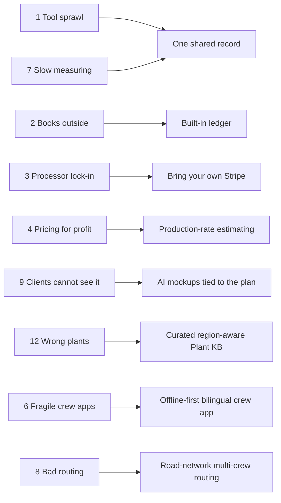

> **Competitive edge (pain points).** Most of the top ten pain points are seams between products rather than missing buttons inside one. Each incumbent closes at most one seam: LMN closes estimate-to-job, Aspire closes estimate-to-job-cost, PRO Landscape+ closes design-to-proposal, Real Green closes measurement-to-program-price. Rootline closes all of them by owning one record, which is why the answers in the table above point to a handful of shared assets rather than 15 separate features.

---

## 7. White-space opportunities

Ranked by size of prize and how hard each is for incumbents to copy [E].

| Rank | White space | Closest today | Why nobody occupies it | Size of prize [E] | Copy difficulty for incumbents (1-5) | Rootline asset | Priority |
|---|---|---|---|---|---|---|---|
| 1 | **Design-to-install-to-books on one data model** | PRO Landscape+ (design to proposal); Aspire (estimate to job cost) | Design tools and ops tools come from different eras, companies and data models | Every design-build sale and every enhancement | 5 (requires a rebuild) | Design Studio + estimating + scheduling + ledger ([10](10-design-studio.md), [03](03-crm-sales-estimating-proposals.md), [09](09-accounting-ledger-integrations.md)) | [MVP] |
| 2 | **Region-aware plant intelligence inside sales and design** | Calscape-style regional lists outside any business tool | Requires horticultural curation and licensing, not just software ([R3](research/R3-design-ai-plant-data.md)) | Every planting job; warranty cost reduction | 5 (years of curation) | Operator-curated Plant KB with Region Profiles ([12](12-plant-knowledge-base.md)) | [MVP] |
| 3 | **AI mockups constrained by real dimensions and real plants** | PRO Landscape+ AI; consumer apps | Generic image models ignore scale and Region; image generation is cheap, the constraints are the moat ([R3](research/R3-design-ai-plant-data.md)) | Close rate on residential design-build | 4 | Dimension-aware layouts and closed-world rendering ([11](11-ai-design-mockups.md)) | [MVP] mockups, [V1] layouts |
| 4 | **A vertical ERP with a real ledger at SMB price** | Aspire (stops at QuickBooks) | Accounting is hard and incumbents partner with Intuit | Bookkeeper hours, WIP accuracy, lender-ready financials, QBO subscription removed | 4 | Built-in GL ([09](09-accounting-ledger-integrations.md)) | [MVP] |
| 5 | **Company-owned payments in vertical software** | None verified | Payments margin funds the incumbents | Trust, switching ease, 0.3-1.0 points of processing | 3 technically, 5 economically (they would give up their profit pool) | Bring-your-own Stripe ([08](08-payments-stripe.md)) | [MVP] |
| 6 | **Twelve-month operations (green plus white) for mid-size firms** | Aspire snow module; Yeti | Snow tools and green tools are separate products; ERP modules priced for enterprise | Snow-belt firms, $1M-$20M revenue | 3 | Snow Lite in every tier for the Great Lakes launch, then the full snow module on the shared model ([14](14-service-line-modules.md)) | [MVP] Snow Lite, [V1] full module |
| 7 | **Mixed-service compliance** (chemicals plus design-build plus maintenance) | Real Green (lawn only) | Lawn tools do records; others do not | Every lawn division inside a full-service firm | 3 | Application Compliance Engine ([14](14-service-line-modules.md)) | [MVP] |
| 8 | **Commercial client experience** (multi-property approvals, spend limits, audit-to-enhancement) | Aspire portal; Real Green address toggle | Portals are residential-first and transactional | Commercial retention and enhancement revenue | 3 | Commercial portal, site audits ([06](06-customer-portal.md)) | [V1] |
| 9 | **Instant, satellite-priced booking under the Company's brand** | LawnStarter (marketplace owns the client); Real Green | Marketplaces want the client; SMB tools lack measurement | Residential maintenance acquisition | 3 | Branded instant quotes ([16](16-marketing-growth-communications.md)) | [V1] |
| 10 | **Plan-set reading for commercial bids** | LMN with Beam AI (partner) | Requires document AI plus plant data plus estimating | Bids per estimator per week | 3 | Document understanding to takeoff to estimate ([17](17-ai-copilot-automation.md)) | [V1] |
| 11 | **Offline-first, Spanish-first crew experience** | Unverified across vendors | Thin mobile clients over web-first backends | Labor productivity, retention of a 44.5% Hispanic workforce ([Data USA](https://datausa.io/profile/soc/landscaping-and-groundskeeping-workers)) | 2 | Crew app ([05](05-field-crew-mobile-app.md)) | [MVP] |
| 12 | **Cross-tenant benchmarks with exact KPI definitions** | Wilson360 partner surveys | Benchmarks are surveys with inconsistent definitions | Owner engagement, pricing confidence | 4 (needs ledger-grade data at scale) | Opt-in anonymized benchmarks ([18](18-reporting-analytics.md)) | [V2] |
| 13 | **Homeowner demand engine that feeds local Companies** | Yardzen (design plus referral); consumer AI apps | Consumer apps have no installer; marketplaces own the client | Design-ready leads | 4 | Rootline Home and Match ([22](22-business-model-pricing-gtm.md), [23](23-innovation-moonshots.md)) | [V1]-[V2] |
| 14 | **Compliance-driven design-build** (turf conversions before 2027 water deadlines, equipment electrification) | Landscape architects with manual takeoffs; utility rebate portals | Needs measured turf, Region-rated xeric palettes, phased pricing and rebate paperwork in one flow; ops tools have no design and design tools have no rules | HOA and commercial conversions in California and Southern Nevada; residential rebate jobs ([section 2.5](#25-regulatory-and-structural-forces-that-reshape-demand)) | 4 | Design Studio, jurisdiction rule packs, commercial portal ([10](10-design-studio.md), [12](12-plant-knowledge-base.md), [06](06-customer-portal.md)) | [V1] |

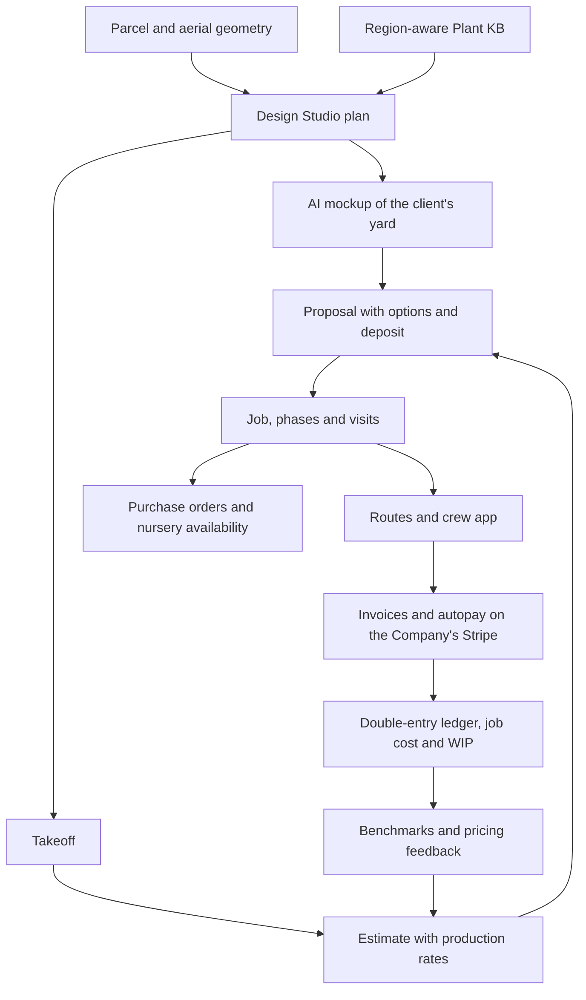

The diagram is the moat in one picture: every arrow is a re-keying step or a sync job in today's stack.

> **Competitive edge (white space).** The two highest-ranked white spaces, one data model from design to books and region-aware plant intelligence, score 5 on copy difficulty because they need a rebuilt data model and years of horticultural curation. A competitor can license an image model in a quarter; it cannot license a curated cultivar layer with Region Profiles or retrofit a ledger under a decade-old operations schema.

---

## 8. Why now

Eight forces converged in 2024-2026, reinforced by the dated regulatory shifts in section 2.5 (shown as F9 in the diagram below). Any one would help; together they open a window that will narrow as incumbents finish integrating their acquisitions and bolt AI onto their stacks (section 10).

| # | Force | What changed | Evidence | What it enables for Rootline | How long the window stays open [E] |
|---|---|---|---|---|---|
| 1 | **Image models became cheap, controllable editors** | Instruction-following image editing with identity preservation reached about $0.04 per image through APIs (Gemini 2.5 Flash Image about $0.039; FLUX.1 Kontext pro/max about $0.04/$0.08); permissively licensed segmentation (SAM, SAM 2) and conditioning (ControlNet, IP-Adapter) matured | [S3P] [BenchLM](https://benchlm.ai/media-pricing/nano-banana), [BFL help](https://help.bfl.ai/articles/7424166364-wip-welcome-to-the-forest); [B] licenses ([R3](research/R3-design-ai-plant-data.md) s3.3) | A homeowner lead with 12 previews and 2 HD finals costs roughly $0.75-$1.50 in model fees [E], cheaper than a paid click; mockups become a standard proposal component, not a premium service | 12-24 months before PRO Landscape+, Jobber or Granum ship comparable photo AI in their proposals; the regional plant constraint stays defensible longer |
| 2 | **Homeowners started designing with AI, and the tools disappoint** | Consumers use AI as a landscape designer; tools invent plants, ignore scale and have no installer | [S] [Axios, May 2026](https://www.axios.com/local/washington-dc/2026/05/08/landscape-design-ai), [Penn State Extension](https://extension.psu.edu/ai-garden-design-intelligent-choices); [S3P] [Fast.io](https://www.fast.io/resources/best-ai-for-landscape-design-2026.md) "conceptual only" | An honest, measured, region-valid AI design tied to a local Company that can price and install it | Until a consumer app partners with a contractor network at scale |
| 3 | **Frontier LLMs can read documents and use tools reliably** | Agentic models handle plan sets, price books, sync errors and natural-language reporting; incumbents ship receptionists and dashboards, not workflow agents | [S] Jobber Copilot and Receptionist, ServiceTitan Atlas; 43% believe vs 15% daily use ([Finviz/Aspire](https://finviz.com/news/401821/aspire-report-finds-commercial-landscapers-prioritizing-growth-as-businesses-navigate-operational-complexity)) | AI that drafts estimates from takeoffs, reads GC plan sets, pre-fills pesticide records, batches storm invoices ([17](17-ai-copilot-automation.md)) | 18-36 months; agents need the coupled data model incumbents lack |
| 4 | **Stripe Connect made "bring your own account" first-class** | Controller properties and Accounts v2 replace account types; existing accounts connect by OAuth; direct charges on full-dashboard accounts carry no Connect fees for either side; optional application fees sit on top | [S] [controller properties](https://docs.stripe.com/connect/migrate-to-controller-properties), [Accounts v2](https://docs.stripe.com/connect/accounts-v2), [direct charges fee behavior](https://docs.stripe.com/connect/direct-charges-fee-payer-behavior), [OAuth](https://docs.stripe.com/connect/oauth) | A startup can give each Company a portable Stripe account with no payments-licensing burden and no vendor spread, and still earn an optional disclosed fee | Long: incumbents can technically copy it but would give up their profit pool |
| 5 | **Consolidation created switching windows and left SMBs underserved** | ServiceTitan bought Aspire (2021) and moved up-market; LMN and SingleOps merged under Granum (Nov 2024) and LMN Pay re-platformed to Stripe (Mar 2026); Xplor and WorkWave mandated their processors; reviewers report rate increases and slower support | [S] [TechCrunch](https://techcrunch.com/2021/06/30/servicetitan-acquires-aspire-to-move-into-landscaping-raises-200m-at-a-9-5b-valuation), [Landscape Management](https://www.landscapemanagement.net/lmn-by-granum-launches-new-financial-infrastructure-platform-in-partnership-with-stripe/), [GetApp](https://www.getapp.com/operations-management-software/a/service-autopilot/reviews/), [Capterra](https://www.capterra.com/p/78106/Service-Assistant/reviews/?page=5) | Every forced migration (payments re-onboarding, product convergence, cloud move) is a moment when a Company re-evaluates its whole stack | 2-3 years of convergence projects at Granum; recurring at each consolidator |
| 6 | **QuickBooks got more expensive and less certain** | Repeated QBO list price increases; Desktop Pro Plus, Premier Plus and Mac Plus withdrawn for new US subscribers after Sep 30, 2024; a 2025 App Partner Program meters some API reads | [B, verify] ([R4](research/R4-industry-payments-accounting.md) s23) | A built-in ledger removes a $115-$275/mo line and hedges against Intuit's platform changes; Desktop users facing forced migration are a channel | Ongoing; each Intuit price notice is a marketing moment |
| 7 | **Labor is the binding constraint** | H-2B capped at 66,000 a year; landscaping commonly the largest H-2B occupation; about 44.5% of landscaping workers Hispanic; burdened labor about 43% of net revenue | [S] [USCIS](https://www.uscis.gov/working-in-the-united-states/temporary-workers/h-2b-non-agricultural-workers/cap-count-for-h-2b-nonimmigrants), [Data USA](https://datausa.io/profile/soc/landscaping-and-groundskeeping-workers), [Wilson 360](https://www.lawnandlandscape.com/article/wilson-360-2024-landscape-industry-benchmark); [B] H-2B share | When a Company cannot hire a fifth crew, revenue per man-hour is the only growth lever: tighter routes, faster estimates, fewer return trips, no re-typing, Spanish-first crew tools | Structural; persists |
| 8 | **Open geodata and climate data matured** | USGS 3DEP 1 m elevation, public-domain NAIP imagery, the 2023 USDA Plant Hardiness Zone Map, EPA ecoregions, parcel APIs | [B] ([R3](research/R3-design-ai-plant-data.md) s3.3.6, s4.2) | Measurement as a by-product of onboarding a Property, at near-zero marginal cost; Region definitions the operator can curate | Long; the data is public, the curation is not |

**Three supporting shifts.** First, regulation turned compliance into a dated buying trigger: nonfunctional-turf limits from 2027, California's zero-emission small-engine rules, pesticide notification and restricted actives, and federal overtime reporting from tax year 2025 (section 2.5). Second and third, homeowners were trained by marketplaces to expect firm prices from an address (LawnStarter reports under 0.2% of mowing jobs needed repricing ([LawnStarter](https://www.lawnstarter.com/blog/lawnstarter/how-does-lawnstarter-instant-quote-work/)) [S, company-reported]), and by Jobber's Client Hub to approve and pay in one click ([Jobber help](https://help.getjobber.com/en/articles/what-do-your-clients-see-in-client-hub/)) [S]. The table stakes are known; differentiation has moved up the funnel to design, plants and trust.

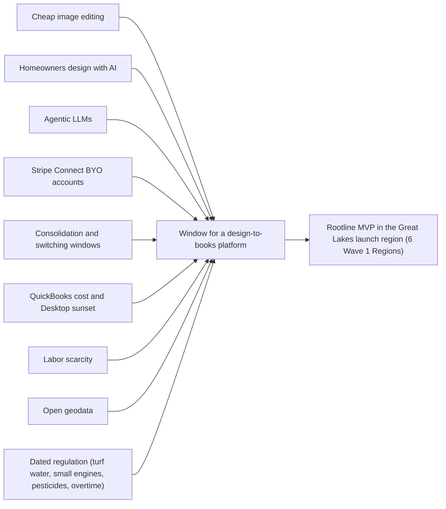

---

## 9. Steal-worthy ideas: 45 ideas with attribution and the Rootline upgrade

Good ideas are everywhere in this market; they are just scattered across 20 products. Each row names the source, what Rootline does better, the priority and the owning module doc.

| # | Idea | Who does it (evidence) | How Rootline improves it | Priority | Owner |
|---|---|---|---|---|---|
| 1 | One-click "Approve & Pay Deposit" with optional "request changes" | Jobber Client Hub ([help](https://help.getjobber.com/en/articles/what-do-your-clients-see-in-client-hub/)) [S] | The client approves a specific design option; deposits above a threshold default to ACH; non-refundable plant-order deposits carry the contract clause automatically | [MVP] | [03](03-crm-sales-estimating-proposals.md), [06](06-customer-portal.md) |
| 2 | Optional line items the client can tick | Jobber Grow tier [S3P] | In every tier; ticking "add landscape lighting" re-renders the mockup at night and updates the deposit | [MVP] | [03](03-crm-sales-estimating-proposals.md) |
| 3 | Online booking with price, duration and service radius | Jobber ([help](https://help.getjobber.com/en/articles/online-booking/)) [S] | Price computed from the Property's measured turf polygon, not a flat menu; booking checks crew capacity on the route day | [V1] | [16](16-marketing-growth-communications.md) |
| 4 | Booking directly from Google Local Services Ads | Jobber ([LSA integration](https://getjobber.com/integrations/google-local-services-ads/)) [S] | Lead cost posted to the ledger so CAC by source is real, not estimated | [V1] | [16](16-marketing-growth-communications.md), [18](18-reporting-analytics.md) |
| 5 | Voice interface in the mobile app | Jobber Voice ([Lawn & Landscape](https://www.lawnandlandscape.com/news/jobber-adds-new-ai-powered-features)) [S] | Bilingual voice that writes data: "Terminé, usé tres yardas de mulch" logs materials and closes the visit, offline-queued | [V1] | [05](05-field-crew-mobile-app.md) |
| 6 | AI-drafted marketing campaigns | Jobber Campaign Generator [S] | Grounded in Property data: "aeration offer to lawns over 5,000 sq ft not aerated in 2 years, in zip codes on Tuesday routes" | [V1] | [16](16-marketing-growth-communications.md) |
| 7 | Reviews sold without the full marketing bundle | Jobber Reviews standalone ([Jobber Community](https://community.getjobber.com/discussions/marketing-tools/google-reviews-only-for-marketing-suite/3726)) [S] | Review requests included in Grow, triggered by visit completion and photo-confirmed quality | [MVP] | [16](16-marketing-growth-communications.md) |
| 8 | AI receptionist for calls and texts | Jobber, Workiz Jessica ([Carly](https://www.usecarly.com/blog/workiz-ai/)) [S3P] | Knows the caller's Property, agreement, open proposal and design; renameable voice and persona (a Workiz complaint); warm handoff with a summary | [V1] | [16](16-marketing-growth-communications.md), [17](17-ai-copilot-automation.md) |
| 9 | Unlimited users or per-job pricing | Service Fusion, ServiceM8 [B] | Field seats billed only in months they are active; no visit-based pricing that punishes weekly mowing | [MVP] | [22](22-business-model-pricing-gtm.md) |
| 10 | Pesticide usage tied to treatment routes | GorillaDesk, FieldRoutes, Real Green [B] | Record pre-filled from the visit: product, EPA registration number, rate, area from the polygon, live weather, applicator license check; state rule packs | [MVP] | [14](14-service-line-modules.md), [05](05-field-crew-mobile-app.md) |
| 11 | Accounting fidelity as a reason to buy | FieldEdge two-way QuickBooks [B] | Ledger as system of record; for QuickBooks loyalists, Desktop via Web Connector, sub-customer per Property, per-record quarantine | [MVP] ledger, [V1] Desktop | [09](09-accounting-ledger-integrations.md) |
| 12 | Good-better-best options with financing | Housecall Pro, ServiceTitan [B]; HCP Wisetack terms to 84 and 120 months ([HCP](https://www.housecallpro.com/resources/february-2026-product-updates/)) [S] | Each tier is a Design Option with its own mockup; financing shown only above a ticket threshold; a Canadian partner too (Wisetack via HCP is not available in Canada ([HCP help](https://help.housecallpro.com/en/articles/3836042-wisetack-consumer-financing-overview)) [S]) | [MVP] options, [V1] financing | [03](03-crm-sales-estimating-proposals.md), [08](08-payments-stripe.md) |
| 13 | Unified inbox across SMS, email, social and web chat | Thryv [B] | Every thread attached to the Client and Property, with AI-drafted replies citing the visit history | [MVP] SMS, email, web chat, calls and portal; [V1] social and marketplace threads | [16](16-marketing-growth-communications.md) |
| 14 | Configurable workflows | Zuper [B] | Opinionated templates plus the automation builder; no raw schema editing that breaks upgrades | [MVP] templates, [V1] builder | [17](17-ai-copilot-automation.md) |
| 15 | Branches and divisions as P&L centers, with branch-to-branch subcontract work | Aspire ([guide](https://guide.youraspire.com/docs/workflow-for-managing-branch-to-branch-subcontract-work)) [S] | Ledger dimensions with automatic inter-branch entries, so branch P&Ls tie to the books | [V1] | [09](09-accounting-ledger-integrations.md), [13](13-operations-inventory-equipment.md) |
| 16 | Production kits so everyone bids at the same rates | Aspire ([Capterra review](https://www.capterra.com/p/161544/Aspire/reviews/7184990/)) [S] | Kits populated from the design takeoff, with variance alerts when an estimator overrides a rate | [MVP] | [03](03-crm-sales-estimating-proposals.md) |
| 17 | Purchasing Assistant that re-costs the job at the price paid | Aspire ([purchasing](https://www.youraspire.com/features/purchasing)) [S] | POs generated from the takeoff, matched to nursery availability lists, receipts re-cost the job and post to the ledger | [V1] | [13](13-operations-inventory-equipment.md) |
| 18 | Invoicing assistant flagging ready, overdue and incomplete | Aspire ([invoicing](https://www.youraspire.com/industries/landscape-business-software/invoicing)) [S] | A Copilot "ready to bill" queue with reasons and one-click batch send | [MVP] | [07](07-invoicing-billing-contracts.md) |
| 19 | Equipment hour and mileage triggers, depreciation, disposition | Aspire ([equipment](https://www.youraspire.com/features/equipment)) [S] | Telematics ingestion, fixed-asset register in the ledger, equipment rates flowing into estimates | [V1] | [13](13-operations-inventory-equipment.md) |
| 20 | Budget-first estimating with MORS, FLH or SORS | LMN ([help](https://intercom.help/lmn/en/articles/15939065-how-lmn-calculates-overhead-labor-burden-and-profit-in-estimates)) [S] | Cent-for-cent parity plus in-season tracking of actual overhead recovery from the ledger: "you are $18,400 under-recovered as of July" | [MVP] | [03](03-crm-sales-estimating-proposals.md), [09](09-accounting-ledger-integrations.md) |
| 21 | Free budgeting tools and training as acquisition | LMN Academy [B] | A free public Landscape Budget and Pricing Calculator and a public KPI dictionary | [V1] | [16](16-marketing-growth-communications.md), [18](18-reporting-analytics.md) |
| 22 | In-app ordering from a distributor | LMN with SiteOne ([Turf](https://turfmagazine.com/lmn-integrates-siteone-landscape-supply-in-2021-software/)) [S] | Any vendor: an availability-list parser maps weekly PDFs and spreadsheets to Plant KB cultivars and sizes | [V1] | [13](13-operations-inventory-equipment.md), [12](12-plant-knowledge-base.md) |
| 23 | Crew app for every crew member, with own hours and training | LMN Crew 2.0 ([LMN blog](https://golmn.com/blog/introducing-lmn-crew-2-0-crew-for-all)) [S] | Plus Spanish, offline-first, pay explanations and safety briefings | [MVP] | [05](05-field-crew-mobile-app.md), [15](15-team-hr-payroll.md) |
| 24 | AI takeoffs from construction plan sets | LMN with Beam AI ([release note](https://support.golmn.com/hc/en-us/articles/46786137574683)) [S] | Native: plant schedule mapped to KB records with regional performance flags and alternates | [V1] | [11](11-ai-design-mockups.md), [17](17-ai-copilot-automation.md) |
| 25 | Item-level approval, prepay and appointment confirmation in the portal | Arborgold ([portal](https://arborgold.com/customer-portal/)) [S] | Plus commercial approval chains with spend limits per approver | [MVP] item-level, [V1] chains | [06](06-customer-portal.md) |
| 26 | Crew-app permissions per crew | Arborgold ([crew permissions](https://help.arborgold.com/en/articles/permissions-in-arborgold-crew)) [S] | Crew-level overrides layered on granular RBAC, without conflating employees and users | [V1] | [02](02-personas-roles-permissions.md) |
| 27 | GPS tree inventory with QR tags and photos | Arborgold, SingleOps ([tree inventory](https://singleops.com/features/tree-inventory)) [S] | Every installed plant is a KB-linked instance on the Property map; "plant passport" QR tags feed warranty and performance data | [V2] | [12](12-plant-knowledge-base.md), [14](14-service-line-modules.md) |
| 28 | Visual proposals clients rave about | SingleOps ([case study](https://www.casestudies.com/company/singleops/case-study/chop-nashvilles-proposals-are-incredible)) [S] | Before/after mockup slider, to-scale plan, tap-a-plant cards with Region rating and care | [MVP] | [03](03-crm-sales-estimating-proposals.md), [11](11-ai-design-mockups.md) |
| 29 | Level billing that re-spreads automatically when services change | Real Green ([billing](https://realgreen.com/features/landscape-billing-invoice-software)), LawnPro ([level billing](https://lawnprosoftware.com/features/level-billing)) [S] | Contract asset and deferred revenue posted correctly in the ledger, with true-ups at cancellation | [MVP] | [07](07-invoicing-billing-contracts.md), [09](09-accounting-ledger-integrations.md) |
| 30 | Instant quotes from satellite measurement | Real Green Measurement Assistant ([Real Green](https://www.realgreen.com/measurement_assistant.html)), LawnStarter [S] | Under the Company's own brand, using the same polygon later used by the crew and the design | [V1] | [16](16-marketing-growth-communications.md) |
| 31 | Portal address switcher for property managers | Real Green ([portal](https://realgreen.com/features/lawn-care-customer-portal)) [S] | A full portfolio dashboard: spend by site, open approvals, proof of service, consolidated statements | [V1] | [06](06-customer-portal.md) |
| 32 | Drip, win-back and seasonal upsell sequences | Service Autopilot [S] | On by default with plain-language explanations; Copilot proposes new rules from outcomes | [MVP] prebuilt journeys, [V1] win-back engine | [16](16-marketing-growth-communications.md), [17](17-ai-copilot-automation.md) |
| 33 | Users holding several roles; "Allow invoicing" tied to price visibility | SynkedUP ([roles](https://help.synkedup.com/en/articles/14756763-how-user-roles-work-in-synkedup)) [S] | Composable granular permissions with field-level price masking | [MVP] | [02](02-personas-roles-permissions.md) |
| 34 | Software paired with business coaching | SynkedUP [S] | Coach partner program with a consented multi-tenant KPI view | [V1] | [22](22-business-model-pricing-gtm.md) |
| 35 | State-level SEO landing pages | Copilot CRM ([Ohio page](https://www.copilotcrm.com/lawn-care/ohio)) [S] | Tenant region pages generated from real service area and Plant KB content ("Best deer-resistant shrubs for Columbus") | [V1] | [16](16-marketing-growth-communications.md) |
| 36 | AI data import from any CRM | QuoteIQ AI Smart Import ([help](https://intercom.help/quoteiq/en/articles/14442924-ai-smart-import-migrate-your-data-from-any-crm-in-minutes)) [S] | AI field mapping plus dry run, diff review and rollback, plus ledger opening balances and prepay liabilities | [MVP] | [19](19-platform-admin-portal.md) |
| 37 | Snow proof of service: GPS history, timestamped photos, subcontractor portal | Yeti ([Yeti](https://yetisoftware.com/)), Aspire ([SIMA](https://resources.sima.org/snow-and-ice-resource-center/unlock-profitability-and-efficiency-with-aspire)) [S] | Packets with verified weather, hashed into a claims vault, attached to invoices and reusable as dispute evidence | [V1] | [14](14-service-line-modules.md) |
| 38 | Done-for-you takeoff by address | Aspire PropertyIntel Complete ([listing](https://slashdot.org/software/p/PropertyIntel/)) [S] | Optional human-in-the-loop design and takeoff service marketplace for overloaded estimators | [V2] | [10](10-design-studio.md), [19](19-platform-admin-portal.md) |
| 39 | Walk-the-site audits that become enhancement sales | SiteDNA ([SiteDNA](https://sitedna-marketing-site.pages.dev/)), SiteRecon [S] | Enhancement radar: one photo per zone on maintenance visits; vision flags thin turf, declining shrubs, mulch depth; draft proposals ranked by value | [V1] | [14](14-service-line-modules.md), [17](17-ai-copilot-automation.md) |
| 40 | Photo imaging plus plan plus proposal in one tool | PRO Landscape+ [S] | The loop continues to purchase order, schedule, invoice and job cost | [MVP] | [10](10-design-studio.md), [11](11-ai-design-mockups.md) |
| 41 | Hand-drawn presentation style | DynaSCAPE [B] | A renderer theme on the same plan, not a separate product | [MVP] | [10](10-design-studio.md) |
| 42 | Growth slider and season toggle | Realtime Landscaping, Laubwerk [B] | Applied to both the plan and the AI mockup, sized from KB mature dimensions per Region | [V1] | [10](10-design-studio.md), [11](11-ai-design-mockups.md) |
| 43 | Landscape areas filled with a species mix at a density, plus auto schedules | Vectorworks Landmark ([help](https://app-help.vectorworks.net/2015/NNA/eng/VW2015_Guide/Worksheets/Creating_Schedules_Automatically.htm)) [S] | Priced fills: the mix drives quantities, cost and the purchase order | [V1] | [10](10-design-studio.md) |
| 44 | Non-invasive substitutes for invasive plants ("Grow Me Instead") | Ontario and BC invasive species councils [B] | Automatic substitution engine with three regionally rated, priced alternatives | [V1] | [12](12-plant-knowledge-base.md) |
| 45 | Prepay discounts as working capital | Weed Man ([prepay](https://weedman.com/blog/prepay-and-referral-discounts)) [S] | Prepay program designer that models cash, margin and cancellation risk and posts deferred revenue | [V1] | [07](07-invoicing-billing-contracts.md), [09](09-accounting-ledger-integrations.md) |

**Also noted, not yet scheduled:** cinematic flyovers for pool and outdoor-living jobs (Structure Studios) [V2]-[V3]; irrigation hydraulics and watering schedules at Land F/X rigor ([Land F/X](https://www.landfx.com/irrigationfeatures)) [V1]; keystone-plant and wildlife-host scoring (NWF, Tallamy research, licensed) [V1]; free AI yard previews as a white-label lead magnet, validated by consumer demand [MVP] ([16](16-marketing-growth-communications.md)); the "ACH on us" promotion (Jobber) reframed as a permanent ACH incentive with a savings meter [V1] ([08](08-payments-stripe.md)).

---

## 10. Competitive threats and how incumbents may respond

### 10.1 Threat register

Likelihood and impact are analyst judgments over roughly the next two years of incumbent moves [E]. "Signals" are what the market-intelligence capability (section 12) watches for.

| # | Threat | Likelihood | Impact | Timeline | Early-warning signals | Rootline response |
|---|---|---|---|---|---|---|
| T1 | **Jobber goes deeper into landscaping**: measurement partner, AI photo mockups in quotes, a landscaping edition | High | High | 6-18 months | Jobber product updates mentioning design, measurement or plants; acquisitions of a design or measurement startup; landscaping-specific pricing | Compete on depth that Jobber's many-vertical model (it markets to dozens of home-service industries [B]) cannot justify: production-rate estimating, Region-rated plants, ledger, snow, chemicals. Lead every comparison with the integrated record, not with AI images |
| T2 | **ServiceTitan bundles Aspire with Atlas AI, PropertyIntel and payments, and moves down-market** with a lighter edition | Medium | High in S4, medium in S2 | 12-24 months | "Aspire Essentials" style packaging; self-serve trials; price cuts for small firms | Win on time-to-value (days, not 90 days), design-led residential selling, published prices and payments ownership. Keep commercial parity on the [V1] roadmap so the S4 door stays open |
| T3 | **Granum converges LMN and SingleOps into one platform and adds design** through Attentive.ai, Beam AI or an acquisition | Medium-high | High | 12-24 months | Unified Granum product announcement; design-tool acquisition; LMN Pay portability changes | A convergence switch offer during the merger period (migration concierge plus the switching credit in [22](22-business-model-pricing-gtm.md) section 6.4, triggered by section 15 idea 6); LMN-budget importer at [MVP]; "the same budget math you trust, fewer steps, and a proposal that looks like the finished yard" (the step count is quoted only after design-partner pilots measure it, section 15 idea 15) |
| T4 | **A design-tool vendor partners with an ops platform** (for example PRO Landscape+ with Jobber or LMN) | Medium | Medium | 6-18 months | Integration announcements at January trade shows (the Great Lakes launch-region shows Mid-Am and CENTS, plus Landscape Ontario Congress and MANTS) | A partner integration still leaves two price lists and two client records; Rootline demos the one-record loop and the Region-rated plant KB |
| T5 | **AI-native low-end challengers** (QuoteIQ and new entrants) undercut on price with AI features | High | Medium | Now | Comparison pages against Rootline; free tiers; AI import tools | Do not race to the bottom; Starter ($69 a month on annual billing, $79 monthly) is a floor, not a weapon. Differentiate on depth that cheap tools cannot fund: curation, ledger, compliance |
| T6 | **Incumbents copy the payments message**: portable Stripe accounts or "bring your own processor" options | Low-medium | Medium | 12-36 months | Changes to LMN Pay terms; Jobber allowing third-party processors as a first-class option | Welcome it publicly; it validates the stance. Rootline's moat is the coupled data model, not payments alone. Keep the Zero-Markup Pledge in the terms of service |
| T7 | **Price war and switching subsidies**: discounts, free migrations, "ACH on us" style fee holidays | Medium | Medium | Any spring | Promotional pricing pages; switching credits aimed at Rootline | Respond with total-cost math and the seasonal bill, not matching discounts; migration concierge already free on annual plans |
| T8 | **Intuit pushes QuickBooks into field service and project management**, or restricts third-party API access | Low-medium | Medium | 12-36 months | QuickBooks field-service features; App Partner Program metering changes [B] | The built-in ledger makes Rootline the hedge; keep QBO sync optional, budget API calls, offer CPAs free seats and standard exports |
| T9 | **A consumer AI design brand or Yardzen builds a contractor marketplace** and owns the homeowner | Medium | Medium | 12-24 months | Contractor-network launches; financing partnerships | Rootline Home routes homeowners to subscribing Companies with the design attached; the Company keeps the client ([22](22-business-model-pricing-gtm.md) section 5.3) |
| T10 | **Stripe changes Connect economics or policies** for full-dashboard accounts | Low | High | Unknown | Stripe pricing and Connect docs changes | Provider abstraction in payments; restricted-key advanced path; Stripe partner relationship ([08](08-payments-stripe.md)) |
| T11 | **Contractor roll-ups acquire Rootline customers** and move them to the parent's ERP | Medium | Medium in S4 | Ongoing | M&A announcements in the Wave 1 Great Lakes Regions | Multi-entity ledger and branch dimensions so roll-ups can standardize on Rootline; target independents competing with roll-ups |
| T12 | **Housing or construction downturn** cuts design-build demand | Medium | Medium | Cyclical | Housing starts, remodeling indices, deposit volumes in Rootline | Recurring maintenance, programs and snow keep tenants busy; Winter Mode and active-seat billing reduce churn pressure |
| T13 | **General-purpose AI agents glue the old stack together**: owners connect Jobber, QuickBooks and a design tool to an AI assistant through APIs and connectors, so "one system" matters less | Medium-high | Medium | 12-24 months | Incumbents shipping MCP servers or agent connectors; owners describing agent-built workflows in forums; marketplace apps that sync design exports into FSM quotes | Agents can move records between tools; they cannot create shared geometry, a Region-rated plant record or a ledger that ties job cost to the books. Make Rootline the best system for agents to act on: public API and MCP server with full permission parity ([17](17-ai-copilot-automation.md) G9, [V1]), so the owner's own agent strengthens the Rootline record instead of replacing it |

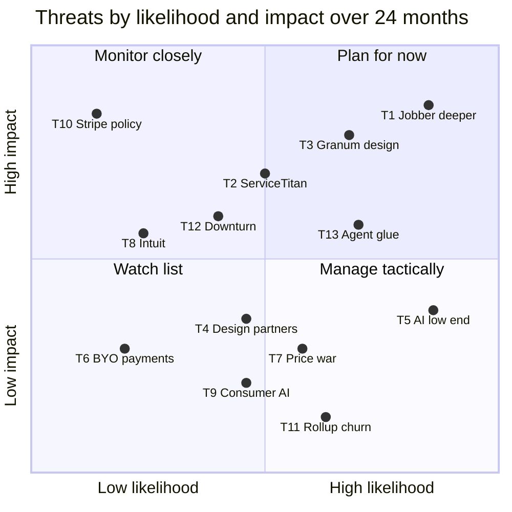

### 10.2 How each incumbent is likely to respond to Rootline specifically

| Incumbent | Likely first response | Likely second response | What they cannot easily do | Our counter |
|---|---|---|---|---|
| Jobber | Comparison page and switching credit aimed at Rootline; emphasize ecosystem and simplicity | Ship AI photo features in quotes; deepen landscaping templates | Build a curated plant KB, a ledger and production-rate estimating without complicating a product sold to dozens of home-service verticals [B] | Keep the spine as simple as Jobber's (Quick Quote mode); sell depth to the firms that have outgrown it |
| Aspire / ServiceTitan | Ignore Rootline in S2; defend S4 accounts with bundle discounts | Lighter edition; Atlas features for landscapers | Cut a 90-day implementation to days without re-architecting; give up captive payments | Days-not-months migration with work-ticket history preserved; commercial parity at [V1] |
| Granum (LMN, SingleOps) | Emphasize estimating heritage and education; lock in during LMN Pay re-onboarding | Add design via partners; unify products | Make LMN Pay accounts portable without losing payments revenue; build region-aware plant data | Free LMN import with budget and production-rate mapping; "your cards leave with you" message |
| Service Autopilot / Real Green | Retention discounts; automation and program depth messaging | Cloud and UX refresh | Remove processor mandates (Xplor's model is payments-led) | Card re-collection campaign kit; program, round and chemical-history import |
| PRO Landscape+ | Emphasize imaging quality and price | Partner with an ops platform | Become an ops platform with books | Show the loop from mockup to invoice; import their plant lists |

### 10.3 Moats, ranked by how long they take to copy

| Moat | Why it compounds | Time for a funded incumbent to copy [E] |
|---|---|---|
| **Curated cultivar-level Plant KB with Region Profiles** | Curators plus partner data plus tenant field-truth (warranty claims, replacements, survival) improve ratings every season; licensing and clean-room curation take years ([R3](research/R3-design-ai-plant-data.md) s5) | 3-5 years |
| **One shared geometry and record from parcel to plow plan to ledger** | Every new module reuses it; incumbents would need to rebuild their data model | 2-4 years |
| **Ledger as system of record** | Years of books history are the stickiest data a Company owns; CPAs build processes around it | 2-3 years to build; trust takes longer |
| **Trust from owning nothing of the Company's money** | Competitors cannot copy without giving up their profit pool | Economically blocked |
| **Curated jurisdiction rule packs per Region** (pesticide notification and restricted actives, turf-water limits, equipment ordinances, wage rules) | Each pack carries citations, effective dates and a watcher; every new tenant in a Region benefits from packs already verified, and packs feed design, estimating, visits and payroll at once (section 2.5) | 2-3 years per country, because the work is curation, not code |
| **Cross-tenant benchmarks and plant performance network** | Needs ledger-grade data at scale with exact KPI definitions | 3+ years after scale |
| **AI pipelines and model routing** | Commodity models; the conditioning data is the moat, not the generator | 6-18 months (least durable on its own) |

> **Competitive edge (durability).** Rootline's AI features are the easiest thing to copy and the least important part of the moat. The durable advantages are the curated Plant KB, the shared geometry and ledger, and a payments stance incumbents cannot match without cutting their own revenue. Marketing should lead with outcomes those assets produce, and treat AI as the visible surface of them.

---

## 11. Positioning statement and messaging pillars

[22](22-business-model-pricing-gtm.md) section 6.3 uses the beachhead version of this positioning for sales and pricing. This section is the master version for the whole doc set.

### 11.1 Category

**The landscape business operating system**, described in one line as "design-to-books software for landscape companies". Rootline does not position as a field-service app with landscaping features, nor as design software with a CRM. The category claim is that the whole job, from first photo to closed books, belongs in one system built for landscapes.

### 11.2 Master positioning statement

> **For** owner-led landscape companies with 5-100 people that design, install and maintain landscapes, **who** today juggle a field-service app, an estimating tool, a design tool, QuickBooks and a payments account they don't control, **Rootline is** the landscape business operating system **that** takes every job from first photo to to-scale design to signed proposal to crew schedule to paid invoice to closed books, with a regional horticulturist's plant knowledge built in. **Unlike** generalist home-service apps (Jobber, Housecall Pro), estimating-first landscape tools (LMN, SynkedUP, SingleOps), enterprise platforms (Aspire, Real Green) or design tools (PRO Landscape+), **Rootline** designs, sells, runs and accounts for the work in one system, at a published price, on a Stripe account the Company owns, with zero payment markup by default.

**Short version (25 words).** Rootline runs a landscape company from first photo to closed books: designs clients can see, plants that thrive, crews that stay on schedule, books that close themselves.

**Archetype variants.**

| Archetype | One-line positioning |
|---|---|
| A. Solo | "Get paid on autopilot and look like a big company: branded booking, autopay and routes, for less than a tank of gas a month." |
| B. Residential maintenance | "Routes that respect real roads, rain days in one click, compliant lawn-program records, and your own Stripe account." |
| C. Design-build (beachhead) | "Draw it once, price it once, show the client their own yard, and know what the job really made." |
| D. Commercial maintenance | "Aspire-grade contracts, job costing and commercial portals, live in days instead of a quarter." |
| E. Multi-service with snow | "One system for twelve months: the same clients, crews and books for mowing in July and plowing in January." |

### 11.3 Messaging pillars

These match the five pillars in [22](22-business-model-pricing-gtm.md) section 6.3, with the proof points this analysis supports.

| Pillar | Promise | Proof points (each traceable to a module spec) | Competitor contrast (sourced) | Primary personas |
|---|---|---|---|---|
| **1. Sell bigger jobs with designs clients can see** | Win the $25k patio and the $8k planting against two other bids | AI mockups of the client's own yard; dimension-aware layouts; plants rated for the Region; takeoffs that feed the estimate ([10](10-design-studio.md), [11](11-ai-design-mockups.md), [12](12-plant-knowledge-base.md)) | Aspire users ask for more photos in proposals ([Capterra](https://www.capterra.com/p/161544/Aspire/reviews/?page=3)); AI apps invent plants ([Penn State](https://extension.psu.edu/ai-garden-design-intelligent-choices)) | `owner`, `designer`, `estimator` |
| **2. Run the whole business in one place** | Stop re-typing between five tools | CRM to estimating to scheduling to crew app to invoicing to ledger; one login, one bill | Jobber users trace areas in Google Maps and ask for separate design software ([Jobber help](https://help.getjobber.com/es/articles/how-to-measure-property-distance-and-size/), [Community](https://community.getjobber.com/discussions/operations-forum/looking-for-landscape-design-software--training/8084)) | `owner`, `office_manager` |
| **3. Know your numbers** | Real job costing and books that close themselves | Built-in double-entry ledger, job costing, WIP, deferred revenue for prepaid programs, overhead recovery tracking, opt-in benchmarks ([09](09-accounting-ledger-integrations.md), [18](18-reporting-analytics.md)) | Jobber's QBO sync is one-way with no Desktop and client-wide error blocks ([Jobber](https://help.getjobber.com/es/articles/quickbooks-integration-faqs/)) | `owner`, `bookkeeper` |
| **4. Fair and transparent** | No surprises in price, seats or fees | Published prices; active-only field seats; zero payment markup; your Stripe account; Price Lock Promise; free migration ([22](22-business-model-pricing-gtm.md), [08](08-payments-stripe.md)) | "No longer have a choice of processor" ([GetApp](https://www.getapp.com/operations-management-software/a/service-autopilot/reviews/)); add-ons "add up fast" ([FieldCamp](https://fieldcamp.ai/reviews/jobber-reviews/)) | All |
| **5. Crews love it** | Crews use it because it makes their day easier | Offline-first, Spanish and English, big buttons, routes, photos, own hours and pay ([05](05-field-crew-mobile-app.md)) | LMN crew-app crashes ([GetApp](https://www.getapp.com/industries-software/a/lmn/)); legacy Aspire app at 2.28 stars ([AppGoblin](https://appgoblin.info/apps/1392810365)) | `crew_lead`, `technician`, `ops_manager` |

**Reasons to believe (the three demos every prospect sees).** The times and counts below are demo design targets for the product team; they become public claims only after pilot measurement (section 11.4).

1. **The 6-minute patio.** Trace a 400 sq ft patio on the aerial, pick pavers, watch base, edge restraint and polymeric sand quantities flow into a priced estimate with the Company's production rates, and show the client an AI mockup of their own backyard before leaving the driveway.
2. **The rain day.** Tuesday is washed out: one click slides 140 visits across four crews, re-optimizes routes on real roads, and texts every client in English or Spanish.
3. **The month-end that isn't.** Payouts from the Company's own Stripe account match bank lines automatically; deferred revenue on prepaid lawn programs releases per application; the P&L by service line is ready on the 1st.

### 11.4 Messaging rules

| Do | Don't |
|---|---|
| Quote Rootline performance claims ("6-minute patio", "one-click rain day", step counts) only from measured design-partner pilots, with the date and sample size | Publish speed or savings numbers for Rootline that have not been measured on real Companies |
| Lead with outcomes and real landscaping examples (mulch by the cubic yard, 2-inch push triggers, 5-step programs) | Lead with "AI" as the headline; it is a means, not the promise |
| Say "your designer's power tool" | Claim AI replaces designers or estimators |
| Cite sourced, dated facts on comparison pages ("as of Nov 2026") | Disparage competitors by name in ads or claim absences we have not verified |
| Show the July bill and the January bill | Quote a single monthly price without seats and usage |
| Label every AI image an artist rendering with plant age | Show AI renders as completed work |
| Say "your Stripe account, your customers, your cards" | Imply Rootline holds or moves client money |

**Competitor one-liners for sales (sourced claims only).**

| Versus | One-liner |
|---|---|
| Jobber | "Everything you like about Jobber's simplicity, plus the design, estimating, plants and books a landscape company needs, on your own Stripe account." |
| LMN | "The budget math you trust, a proposal that looks like the finished yard, and payments you can take with you." (Add a measured step-count or time saving only once pilots prove it.) |
| Aspire | "Commercial-grade contracts and job costing, live in days with published pricing." |
| Service Autopilot / Real Green | "Your automations and programs, a modern app, and your choice of processor: your own." |
| PRO Landscape+ | "Keep the beautiful pictures; now the plants are rated for your Region and the design becomes the estimate, the order and the invoice." |
| QuickBooks | "Keep your CPA happy with real double-entry books, without syncing two systems." |
| A roll-up's ERP (for independents competing with PE-backed consolidators) | "Enterprise-grade estimating, job costing and proof of service at an independent's price, without a 90-day implementation." |
| Consumer AI yard apps (when a homeowner brings one to the sales call) | "Nice picture. Here is the same idea drawn to scale, with plants rated for your Region and a price we will stand behind." |

---

## 12. Market intelligence capability (spec)

A market analysis is stale the week it is published; Jobber's 2026 prices already differ by $100+ a month across trackers ([Costbench](https://costbench.com/changelog/jobber-price-increase-2026-02-3/)) [S3P]. Rootline therefore treats competitive intelligence as a small, internal product inside the [Platform Admin console](19-platform-admin-portal.md), plus three tenant- and prospect-facing tools that turn it into acquisition. This section is written so an engineer can estimate it.

### 12.1 Personas and jobs

| Persona | Role key | Job in this capability |
|---|---|---|
| Founder / Platform Operator | `platform_owner` | Own the positioning; approve anything published externally; read win/loss and switch sources monthly |
| GTM and support staff | `platform_support` with the `market_intel.*` permission set | Log claims and price observations; triage change alerts; maintain battlecards; run win/loss interviews |
| Finance | `platform_finance` | Maintain the market sizing workbook and pricing observations used in the TCO calculator |
| Engineering | `platform_engineer` | Maintain switch kits (importer templates per competitor export format); run the change monitor |
| Curator | `platform_curator` | Supply plant and regional facts used in competitive claims (for example "no competitor rates plants per Region") |
| Business Owner (prospect or tenant) | `owner` | Use the TCO calculator and Fee X-ray; declare previous tools at signup; receive a switch plan |

### 12.2 Feature specification

**MI-01 Competitor registry [MVP].** One record per competitor organization and product (for example Granum -> LMN, SingleOps, LMN Pay). Fields: name, aliases (used to recognize export files and signup answers), owner group, category (horizontal FSM, landscape ERP, design, point tool, accounting), segments served, status (`active`, `acquired`, `merged`, `sunset`), website, evidence depth (high, medium, low). Rules: merging two products keeps both ids as aliases; a `sunset` status triggers the rescue-program playbook (section 15, idea 9).

**MI-02 Evidence ledger and claims [MVP].** Every competitive statement Rootline relies on is a `claim` with: text (max 280 characters), subject product, capability key (optional), evidence tag (`S`, `S3P`, `B`, `E`), one or more sources (URL, publisher, retrieved_at, short excerpt of 25 words or fewer, page-archive hash), author, verifier, `verify_by` date. Rules:
- Default `verify_by`: 90 days for prices and plan names, 180 days for features, 365 days for corporate facts (ownership, deal dates).
- A claim tagged `B` or `E` can never be published externally; only `S` claims (and `S3P` price ranges with a "verify" label) can reach public pages.
- When `verify_by` passes, the claim moves to `stale`; stale claims are automatically removed from public comparison pages and flagged on battlecards within 24 hours.
- Claims about absences ("Competitor X has no Y") require two independent sources or a dated product-documentation search log, and still render publicly as "we could not find documentation of Y as of <date>".
- Edits are append-only with an audit trail (who, when, before, after).

**MI-03 Capability matrix as data [MVP].** A catalog of capability keys (for example `cap.design.to_scale_2d`, `cap.money.native_gl`, `cap.payments.portable_account`), each with a definition and grouping. An `assessment` links product x capability to a rating (`full`, `partial`, `none`, `unknown`), a confidence flag (the `*` in section 4.4) and one or more claims. The matrix tables in this document are generated from this data; snapshots are versioned quarterly so changes over time are visible. Validation: a `full` or `partial` rating needs at least one non-stale claim; `none` needs an absence claim per MI-02.

**MI-04 Pricing observations [V1].** Per product and plan: list price (monthly and annual), currency, included users, extra-user price, add-ons, one-time fees, source, observed_at. Rules: a change of more than 5% or a new plan name creates a `market.price.changed` event and a battlecard review task; observations older than 90 days display as "last seen <date>" in the TCO calculator.

**MI-05 Change monitor [V1].** Watches a configured list of public URLs per product (pricing pages, release notes, help-center changelogs, press rooms, app-store listings). On change, stores the diff and an AI summary (via the AI Gateway, [17](17-ai-copilot-automation.md)) in a triage queue. Rules: public pages only; respects robots.txt and site terms; no login-gated pages, no accounts created under false pretenses, rate-limited to one fetch per URL per day. Summaries are drafts until an analyst converts them into claims.

**MI-06 Battlecards [V1].** One per competitor, assembled from verified claims, pain points, steal-worthy ideas and win/loss reasons: where they win, where we win, trap-setting questions, switching offer, objection handling. Every bullet links to its claim. Rules: a battlecard with any stale claim shows a banner; publication requires `platform_owner` or a delegate; versions retained.

**MI-07 Switch-source capture [MVP].** During signup and onboarding, the Company selects the tools it uses today from the registry, by category (field service, estimating, design, measurement, accounting, payments processor, snow, reviews, website), with "other" free text. Stored on the tenant. Drives: which importer and switch kit the onboarding wizard offers, the card re-collection campaign (when the previous processor is vendor-run), and reporting on win sources. Optional for the Company; never inferred from email or bank data.

**MI-08 Win/loss records [MVP].** For every closed prospect opportunity in Rootline's own GTM CRM: outcome (`won`, `lost`, `no_decision`), competitor(s) involved, archetype, segment, reason codes (multi-select: price, missing feature named, ease of use, migration risk, payments, design, accounting, support, timing), free-text notes and, with consent, an interview summary. Quarterly review updates the pain-point ranking (section 6) and the roadmap ([24](24-roadmap-feature-catalog.md)).

**MI-09 Public comparison pages [V1].** Generated only from publishable claims, each with an "as of" date and citation, a visible "report an inaccuracy" link that creates a review task with a 5-business-day SLA, and a legal-review gate before first publication. Pages never use competitor logos; product names appear in plain text for identification only.

**MI-10 Total Cost of Tools calculator [V1].** Public page and in-app tool. The prospect picks current tools; the calculator pre-fills price ranges from MI-04 (marked "last seen <date>, edit if different"), asks for office and field headcount in July and January, card and ACH volume, and outputs monthly and annual totals today versus Rootline (using [22](22-business-model-pricing-gtm.md) prices), the July and January bills, and an estimated processing saving from ACH steering. Rules: always shows ranges, never a single "you will save" promise; the prospect can overwrite every competitor price; lead capture is optional and happens after results are shown.

**MI-11 Processor Fee X-ray [V1].** The prospect uploads a monthly processing statement (PDF or CSV). Document AI extracts volume, transaction count, fees and effective rate, then compares with Stripe list pricing and an ACH-steered mix. Rules: explicit consent before upload; merchant ids, account numbers and cardholder data are redacted at extraction; source files deleted after 30 days unless the prospect becomes a tenant and opts to keep them; the result states that Stripe pricing is list pricing "as of <date>" and that the Company contracts with Stripe directly.

**MI-12 Switch kits [MVP for Jobber and LMN; V1 for SingleOps, Service Autopilot, Real Green, Aspire, Yardbook, Copilot CRM].** Per competitor product: known export formats and field mappings, AI-assisted mapping for unknown columns, objects covered (clients, properties, contacts, price book, recurring schedules, open quotes, invoices, budgets and production rates, programs and rounds, chemical history, prepay balances), and post-import tasks (ledger opening balances, deferred revenue for prepaid programs, card re-collection campaign). Importers use the Company's own export files, or an API only where the competitor's terms allow customer-authorized access ([19](19-platform-admin-portal.md) open question). Dry run, diff review by `office_manager`, commit and rollback are mandatory steps.

**MI-13 Market sizing workbook [MVP, pre-launch].** Pulls Census County Business Patterns and Statistics of US Businesses (NAICS 561730) and Statistics Canada counts (NAICS 56173) by employee band and geography; stores versioned assumptions (ARPA per band, reachability); recomputes the section 2.3 model and the Region scorecard ([22](22-business-model-pricing-gtm.md) section 6.2) that sizes the Wave 1 and Wave 2 Regions and scores the Wave 3 candidates.

**MI-14 Voice-of-customer repository [MVP].** Interview and call notes with consent flags, tagged to pain points, archetypes and personas; short quotes can be promoted into claims (with consent and anonymization). Feeds the quarterly re-ranking of section 6.

### 12.3 Key flows

**Flow 1: a competitor changes its pricing or product.**

1. The change monitor detects a diff on a watched pricing page and stores it with an AI summary.
2. GTM staff (`platform_support`) triage: dismiss, or convert to claims and price observations.
3. A second person verifies the claim against the live page; status becomes `verified`.
4. Affected matrix cells, battlecards, comparison pages and TCO defaults are flagged for review; `platform_owner` approves external changes.
5. Sales receives a digest; if the change is a forced migration (for example a processor change), the switch-window playbook starts.

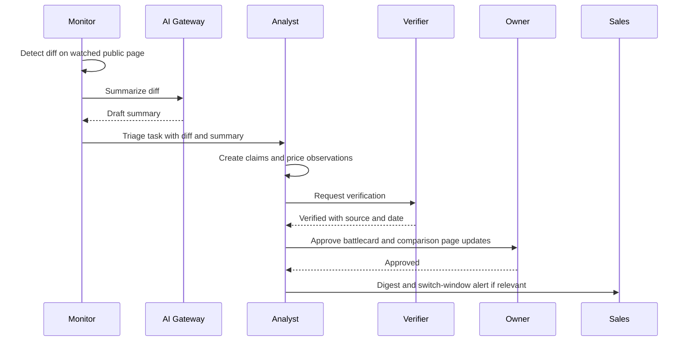

**Flow 2: claim lifecycle.**

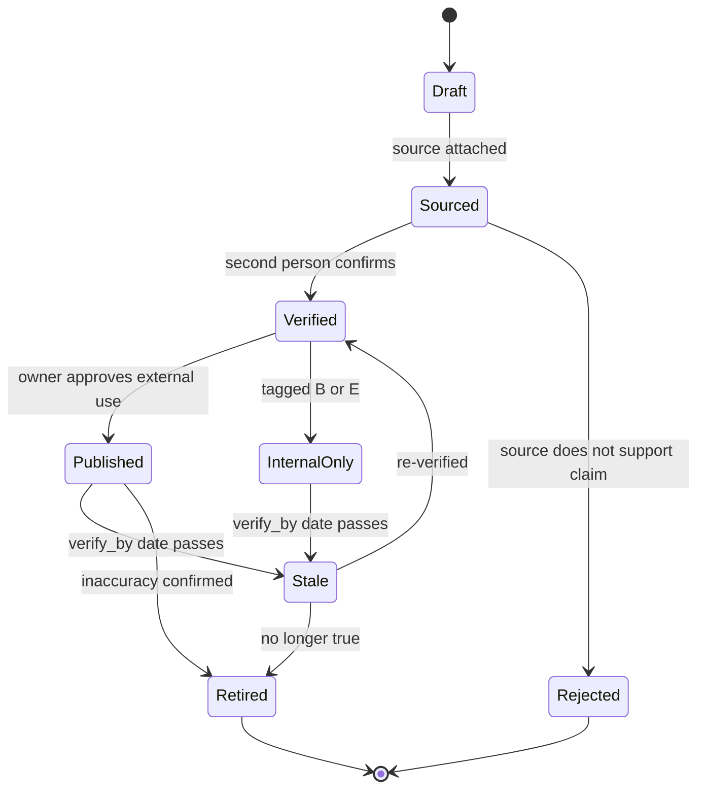

**Flow 3: a prospect switches from a vendor-run payments platform.**

1. The owner runs the TCO calculator and the Fee X-ray, sees the July and January bills and the ACH saving, and starts a trial.
2. At signup the owner declares previous tools (MI-07): Service Autopilot plus QuickBooks Online plus Xplor processing.
3. Onboarding offers the Service Autopilot switch kit and connects or creates the Company's Stripe account ([08](08-payments-stripe.md)).
4. The import runs as a dry run; the `office_manager` reviews the diff; the import commits; ledger opening balances and prepay liabilities post ([09](09-accounting-ledger-integrations.md)).
5. The card re-collection campaign goes out through the white-label portal with an ACH incentive; the autopay re-enrollment tracker shows progress by client.

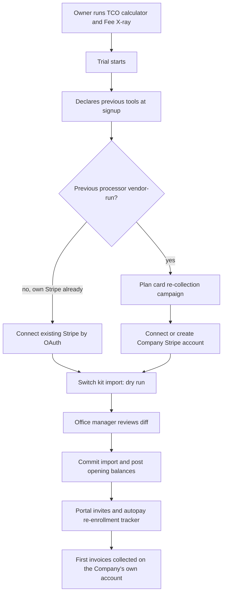

### 12.4 Screens and wireframes

| Screen | Surface | Users | Priority |
|---|---|---|---|
| Market Intel > Capability Matrix | Platform Admin | `platform_owner`, `platform_support` | [MVP] |
| Market Intel > Claim detail and evidence | Platform Admin | Same | [MVP] |
| Market Intel > Change triage queue | Platform Admin | `platform_support` | [V1] |
| Market Intel > Battlecards | Platform Admin and sales view | Same | [V1] |
| Market Intel > Win/loss and switch sources dashboard | Platform Admin | `platform_owner`, `platform_finance` | [MVP] |
| Total Cost of Tools calculator | Public marketing site and tenant app | Prospects, `owner` | [V1] |
| Processor Fee X-ray | Public marketing site | Prospects | [V1] |
| "Where are you coming from?" switch step | Tenant onboarding | `owner`, `office_manager` | [MVP] |

**Wireframe 1: Platform Admin, capability matrix.**

```text
+--------------------------------------------------------------------------------------------+
| Rootline Admin > Market Intel > Capability Matrix          Snapshot: 2026-Q4  [Compare v]  |
+--------------------------------------------------------------------------------------------+
| Filter: Group [All v]  Segment [S2 design-build v]  Show: [x] stale  [x] unknown           |
+--------------------------------------------------------------------------------------------+
| Capability                         | JB | LMN | ASP | SO | RG | SA | PRO | ... | Rootline  |
|------------------------------------+----+-----+-----+----+----+----+-----+-----+-----------|
| Production-rate estimating (MORS)  | o  |  *  |  *  | ~  | o  | o  |  o  |     | * MVP     |
| To-scale 2D design studio          | o  |  o  |  o  | o  | o  | o  |  *  |     | * MVP     |
| Region-aware plant KB              | o  |  o  |  o  | o  | o  | o  |  ~  |     | * MVP     |
| Company-owned processor account    | ~  |  o! |  ?  | ?  | ?  | o  |  -  |     | * MVP     |
| QuickBooks Desktop sync            | o  |  *? |  ?  | *? | ?  | ?  |  -  |     | * V1      |
+--------------------------------------------------------------------------------------------+
| Legend: * full  ~ partial  o none  ? unknown  ! stale claim (verify_by passed)             |
| Cell click -> claim panel:                                                                 |
|  "LMN Pay accounts are not Stripe accounts the contractor controls" [S, single opinion]    |
|  Source: merchantcostconsulting.com (retrieved 2026-11-07)  verify_by 2027-02-05           |
|  [Verify now] [Mark stale] [Open source] [History]                                         |
+--------------------------------------------------------------------------------------------+
```

**Wireframe 2: public Total Cost of Tools calculator.**

```text
+---------------------------------------------------------------------------------+
| What does your software really cost?                                            |
+---------------------------------------------------------------------------------+
| 1. Your tools today                          | Your results (ranges, estimates) |
|  Field service  [Jobber Grow     v] $199-299 |  Today      $ 668 - $ 768 / mo   |
|  Extra users    [ 5 ] x $29                  |  Rootline   $ 298 - $ 308 / mo   |
|  Design tool    [PRO Landscape+  v] $90      |  (Grow annual + website add-on)  |
|  Accounting     [QuickBooks Plus v] $115     |  July  today $668-768  RL $308   |
|  Reviews/market [Marketing Suite v] $79      |  Jan   today $668-768  RL $298   |
|  Website        [ other         v] $40       |                                  |
| 2. Your crew    July: office [3] field [11]  |  Processing on your own Stripe   |
|                 Jan:  office [3] field [ 4]  |  with ACH steering: save about   |
| 3. Payments     Card volume/yr [$1,200,000]  |  $6,000 - $11,000 / yr           |
|                 ACH volume/yr  [$  300,000]  |                                  |
|  Prices last seen 2026-10; edit any number   |  [See the details] [Start trial] |
+---------------------------------------------------------------------------------+
| Competitor prices are third-party list prices as of the date shown. Verify.     |
+---------------------------------------------------------------------------------+
```

**Wireframe 3: tenant onboarding switch step.**

```text
+----------------------------------------------------------------------------+
| Welcome to Rootline. Where are you coming from?               Step 2 of 6  |
+----------------------------------------------------------------------------+
| Field service / scheduling: (o) Jobber  ( ) LMN  ( ) Service Autopilot     |
|                             ( ) Real Green  ( ) Aspire  ( ) Other ____     |
| Accounting:                 (o) QuickBooks Online  ( ) Desktop  ( ) Xero   |
| Design:                     (o) PRO Landscape+  ( ) SketchUp  ( ) None     |
| Card payments today:        (o) Jobber Payments  ( ) My own Stripe         |
+----------------------------------------------------------------------------+
| Your switch plan                                                           |
|  1. Export clients, properties, recurring visits from Jobber (guide)       |
|  2. Connect or create your Stripe account (about 10 minutes)               |
|  3. Re-collect saved cards: 214 autopay clients -> portal campaign         |
|     with optional ACH incentive                                            |
|  4. Keep QuickBooks in sync, or switch to Rootline Ledger later            |
| [Start import dry run]                            [Skip, I'll do it later] |
+----------------------------------------------------------------------------+
```

### 12.5 Data model

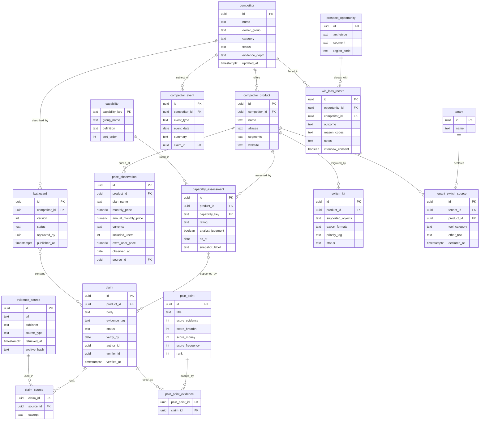

**Notes.** All market-intel tables are platform-scoped (no `tenant_id` row-level security), except `tenant_switch_source`, which carries `tenant_id` and is readable by that tenant's `owner` and by platform roles under the access rules in [20](20-architecture-security.md). Claims and sources are append-only; corrections create new versions.

### 12.6 Integrations, APIs and events

| Direction | Item | Purpose | Priority |
|---|---|---|---|
| External | Census Bureau CBP and SUSB data (public API and files), Statistics Canada tables | Market sizing workbook (MI-13) | [MVP] |
| External | AI Gateway ([20](20-architecture-security.md)) | Diff summaries, claim drafting, statement extraction, importer field mapping | [V1] |
| External | Rootline's own Stripe Billing data | Switch-source cohorts versus retention and ARPA | [MVP] |
| Emitted | `market.claim.verified`, `market.claim.stale`, `market.claim.published`, `market.claim.retired` | Re-render matrix, battlecards and public pages | [MVP] |
| Emitted | `market.price.changed`, `market.competitor_event.recorded` | Sales digests; TCO defaults; switch-window playbooks | [V1] |
| Emitted | `tenant.switch_source.recorded` | Onboarding picks the switch kit; analytics | [MVP] |
| Emitted | `sales.win_loss.recorded` | Pain-point re-ranking; roadmap input | [MVP] |
| Consumed | `tenant.created`, `tenant.import.completed`, `tenant.import.failed` | Importer success rate by source system | [MVP] |
| Consumed | `subscription.canceled` with reason codes | Competitive churn by destination competitor | [MVP] |

### 12.7 Permissions

| Capability | `platform_owner` | `platform_support` (with market-intel set) | `platform_finance` | `platform_engineer` | `platform_curator` | Tenant `owner` |
|---|---|---|---|---|---|---|
| View capability matrix, claims, battlecards | Yes | Yes | Yes | Yes | Yes | No |
| Create and edit claims, assessments | Yes | Yes | Prices only | No | Plant and Region claims only | No |
| Verify a claim (second person) | Yes | Yes (not own claims) | Prices only (not own) | No | Plant claims only (not own) | No |
| Publish to public comparison pages | Yes | No | No | No | No | No |
| Edit price observations and TCO defaults | Yes | Yes | Yes | No | No | No |
| Edit market sizing workbook | Yes | No | Yes | No | No | No |
| Manage switch kits | Yes | Read | No | Yes | No | No |
| View win/loss records | Yes | Yes | Aggregates only | No | No | No |
| View switch-source analytics | Yes | Aggregates only | Aggregates only | Aggregates only | No | Own Company only |
| Export market-intel data | Yes | No | No | No | No | No |

### 12.8 AI opportunities in this capability

| Opportunity | How it works | Guardrail | Priority |
|---|---|---|---|
| Change summarization | LLM summarizes page diffs into candidate claims | Drafts only; human verification required | [V1] |
| Review mining for pain points | Cluster licensed or exported review text into themes, mapped to the pain-point catalog | Only data Rootline is licensed or permitted to process; no scraping against terms | [V2] |
| Win/loss interview synthesis | Summarize consented interview transcripts into reason codes and quotes | Consent flag; anonymize before promotion to claims | [V1] |
| Battlecard drafting | Assemble a draft from verified claims and win/loss reasons | Only verified claims; owner approval | [V1] |
| Statement extraction (Fee X-ray) | Document understanding on processing statements | Redaction at extraction; 30-day deletion | [V1] |
| Importer field mapping | Map unknown export columns to Rootline fields with confidence scores | Dry run and diff review mandatory | [MVP] |

---

## 13. Metrics and KPIs

Market-level metrics tell the founder whether the positioning is working; program metrics tell whether the intelligence base is trustworthy. Targets are proposals [E].

| Metric | Definition | Target | Why it matters |
|---|---|---|---|
| Win rate by competitor | Won / (won + lost) for opportunities where the competitor was named, per quarter | ≥ 35% vs Jobber, ≥ 30% vs LMN in the Wave 1 Great Lakes Regions | Tests the battlecards and pillars against real deals |
| Switch-source mix | Share of new paying Companies by previous primary tool (MI-07) | Jobber and LMN together ≥ 50% of logos in the Wave 1 Regions | Confirms the switching windows in section 8 |
| Beachhead share | Paying Companies in the Wave 1 Great Lakes Regions / ICP firms in those Regions (from MI-13) | ≥ 3% before broad expansion (Wave 3) | Tests the beachhead thesis before broad expansion |
| Archetype mix | Share of paying Companies by archetype A-E | C ≥ 40% of Grow and Pro logos in the Wave 1 Regions | Ensures the product is not pulled toward the easiest buyers |
| Time to first invoice for switchers | Days from trial start to first invoice paid on the Company's own Stripe account | Median ≤ 10 days | Answers the "it took forever to get running" pain (rank 5) |
| Card re-collection rate | Autopay clients re-enrolled within 30 days of a switch / autopay clients at the previous vendor | ≥ 70% | The scariest step of a payments migration |
| TCO calculator conversion | Trials started / calculator completions | ≥ 12% | Validates the total-cost message |
| Net saving shown | Share of ICP calculator runs that show a net monthly saving | ≥ 70% (mirrors [22](22-business-model-pricing-gtm.md) goal G1) | If below, pricing or packaging is wrong |
| Competitive churn | Logos lost to a named competitor / all logos, trailing 12 months | ≤ 4% per year | Early warning for threats T1-T3 |
| Pain-point coverage | Share of the top 15 pain points with a shipped Rootline answer | 10 of 15 at MVP, 15 of 15 by V1 | Keeps the roadmap honest to the evidence |
| Claim freshness | Published claims within `verify_by` / all published claims | 100% (stale claims auto-hidden) | Legal safety and credibility |
| Matrix unknown rate | "?" cells / all competitor cells in the matrix | Fall from about 30% today to ≤ 10% before named comparison pages publish (Q4) | Better evidence for product and sales decisions |
| Win/loss coverage | Closed opportunities with a reason code / all closed | ≥ 90% | Without reasons, win rates explain nothing |
| Proof-bank backing | Public Rootline performance claims (speed, savings, close rate) backed by a dated proof-bank measurement / all such claims | 100% | Keeps marketing inside the messaging rules (section 11.4, section 15 idea 15) |
| Regulatory trigger wins | New Companies whose first stated reason is a dated rule in section 2.5 (turf deadline, chemical rules, overtime reporting, equipment rules) | Tracked from launch; no target until a baseline exists | Tests whether compliance is a buying trigger, as section 2.5 claims |

---

## 14. Edge cases, compliance and risks

### 14.1 Comparative claims and competitor content

| Risk | Rule | Owner |
|---|---|---|
| False or misleading comparative advertising (US Lanham Act section 43(a), FTC comparative-advertising policy; Canada's Competition Act misleading-representation provisions) [B, counsel to confirm] | Only verified `S` claims reach public pages; each carries a date and citation; absences are phrased as "we could not find documentation as of <date>"; legal review before first publication; 5-business-day correction SLA | `platform_owner` |
| Trademark misuse | Competitor names in plain text for identification only; no logos, no implied endorsement, no competitor names in paid-search ad copy without counsel sign-off | `platform_owner` |
| Review-site content | Short quotes with links, consistent with each site's terms; no bulk scraping of G2, Capterra, Reddit or LawnSite; licensed data where available | `platform_support` |
| Website scraping and access | Public pages only, robots.txt respected, no login-gated content, no fake accounts, no trials opened under false identity to extract product details | `platform_engineer` |
| Competitor confidential information | Never solicit or use confidential materials from former competitor employees or customers (contracts, internal docs, rate cards marked confidential) | All staff |
| Using competitor APIs for migration | Only customer-authorized access permitted by the competitor's developer terms; default to the customer's own export files ([19](19-platform-admin-portal.md) open question) | `platform_engineer` |
| Antitrust | Price observations come from public sources only; never exchange pricing intentions with competitors; cross-tenant benchmarks are opt-in, ratio-based and k-anonymous ([18](18-reporting-analytics.md)) | `platform_owner` |
| Defamation | No statements about competitors' financial health, security or legal compliance unless from public filings or official sources | `platform_owner` |

### 14.2 Data handling in the prospect tools

- **Fee X-ray uploads** contain merchant identifiers and possibly partial card data. Redact at extraction, store only derived numbers, delete source files after 30 days, never use for model training without explicit consent ([20](20-architecture-security.md)).
- **TCO calculator inputs** are anonymous until the prospect chooses to share contact details; no third-party ad pixels on the results step.
- **Switch-source declarations** are optional and never inferred from email, bank feeds or browsing behavior.

### 14.3 Market and strategy risks

| Risk | Likelihood | Mitigation |
|---|---|---|
| **The market model overstates reachable firms** (establishments vs firms, low software adoption at 1-9 employees) | Medium | Replace with CBP/SUSB/StatCan pulls (MI-13) before external decks; size the beachhead bottom-up from association and license lists |
| **The beachhead is too narrow** (residential design-build in one launch region, the Great Lakes) | Medium | Six Wave 1 Regions across five states rather than one metro; archetype B as primary follow-on at MVP; Snow Lite keeps snow-running firms in scope; Wave 2 (Ontario plus four Regions) at V1; Region scorecard in [22](22-business-model-pricing-gtm.md) section 6.2 for the Wave 3 cluster |
| **Seasonal buying**: firms will not switch between March and October | High | Sell and migrate November-February; Spring-Ready Guarantee (section 15, idea 3, terms in [22](22-business-model-pricing-gtm.md)); trade-show calendar (January) |
| **Payments lock-in at the previous vendor slows switching** | High | Card re-collection kit, ACH incentive, re-enrollment tracker |
| **Scope risk**: building eight differentiators at once delays MVP | High | [24](24-roadmap-feature-catalog.md) phasing; parity features shipped before delight features in each module |
| **Curation cost** of the Plant KB exceeds plan | Medium | Launch with about 1,500 curated species and cultivars in the six Wave 1 Great Lakes Regions, which share one macro-region profile ([R3](research/R3-design-ai-plant-data.md) s6.1); coverage badges elsewhere |
| **AI cost or quality disappoints** | Medium | Model routing behind the AI Gateway, golden-set benchmarks, metered credits ([11](11-ai-design-mockups.md), [17](17-ai-copilot-automation.md)) |
| **Evidence base partly unverified** (this document's [B] items) | Certain today | Appendix E verification pass before any investor or public use |

---

## 15. Beyond the brief: extra ideas

1. **"State of Landscape Software" annual report [V1].** Publish the sourced capability matrix, price ranges and anonymized switch-source data once a year. It becomes the reference trade press cites, and Rootline defines the comparison criteria.
2. **Landscape Data Portability Pledge [MVP].** A short public commitment: full data export in documented formats at any time, the Company owns its Stripe account and card vault, no exit fees. Invite other vendors to sign. Incumbents that depend on lock-in cannot sign without changing their model, which makes the pledge a positioning weapon at near-zero cost.
3. **Spring-Ready Guarantee [V1], as defined in [22](22-business-model-pricing-gtm.md) section 4.6.** Companies that sign an annual Grow or Pro plan by February 15 and complete the onboarding checklist are guaranteed live (imported, crews on the app, first invoices sent) by March 31, or the first three months are free. This analysis adds one rule: the guarantee is marketed hardest to Companies whose current vendor is mid-convergence or mid-processor-migration (section 8, force 5), because those owners face a forced change anyway. It turns the seasonal buying risk into a deadline that pulls deals into winter.
4. **Live redesign booth at trade shows [MVP, GTM].** At the Great Lakes launch-region shows (Mid-Am, CENTS, the Great Lakes Trade Expo and iLandscape), then Landscape Ontario Congress with the Ontario wave and the anchor show of the Wave 3 cluster (for example MANTS or ProGreen EXPO), owners bring a phone photo of a client's yard; in 6 minutes they leave with a to-scale plan, a Region-valid plant list, an AI mockup and a priced estimate. The demo is the differentiator.
5. **Processor Fee X-ray as a standalone lead magnet [V1].** Already specified as MI-11; worth promoting on its own because payments pain is the most specific complaint after acquisitions.
6. **Convergence watch for sales [V1].** When Granum, ServiceTitan, Xplor or WorkWave announce a forced migration or product convergence, sales gets a playbook and a list of tenants' competitors in that pool (from public signals only).
7. **Open estimating interchange format [V2].** Publish an open JSON schema for production rates, kits and budgets with importers for LMN-style and Aspire-style data ([R2](research/R2-landscape-specific-platforms.md) s18). If Rootline defines the format, every future switch gets easier.
8. **CPA channel program [V1].** Many landscape firms use the same handful of regional CPAs. Give CPAs free seats, a multi-client hub and a "books health score" ([R4](research/R4-industry-payments-accounting.md) s29); one CPA can influence a dozen switches.
9. **Sunset rescue program [V1].** When a legacy product is retired or forced to the cloud (CLIP, BOSS LM or a desktop edition, status to verify), offer the migration concierge free, a pre-built switch kit (MI-12) and the maximum switching credit allowed by the discount guardrails in [22](22-business-model-pricing-gtm.md) section 4.8; any longer price match needs `platform_owner` approval as an exception.
10. **Regional Plant Performance Report [V2].** Opt-in, anonymized install outcomes by cultivar and Region become an annual public report and a PR asset that no software-only competitor can produce ([R3](research/R3-design-ai-plant-data.md) s6.3).
11. **"Price check" for owners [V2].** With opt-in benchmarks, an owner sees where their mulch-per-yard, weekly-mow and patio-per-square-foot prices sit against their Region and size band, which turns benchmarking into a weekly habit.
12. **Association data partnerships [V1].** State landscape associations and pesticide-applicator license lists help size each Region and reach firms; offer associations member discounts and co-branded education in return.
13. **"Back up your current tool" vault [V1].** A free, standalone archive where a prospect uploads the exports its current software already lets it produce (client lists, recurring schedules, invoices, price book CSVs) on a monthly reminder. Rules: own exports only, never credentials or scraping; encrypted per prospect; deleted after 12 months without a login; no marketing use of the contents beyond the prospect's own reminders. The vault answers the owner's real fear ("if my vendor changes terms in May, I lose my history") and, when the prospect does switch, the switch kit (MI-12) starts from the archived files, so the dry run is ready on day one. It is a lead source that sells the Data Portability Pledge (idea 2) by demonstration.
14. **Competitor price-change response program [V1].** When MI-04 records a price or packaging change of more than 5% for a product that trial users or prospects declared (MI-07), each affected contact receives, within 10 business days, a dated, sourced note: what changed, what their declared stack now costs, and the TCO calculator pre-filled with the new number. Rules: only verified `S` claims; no disparaging language; one message per change; prospects who opted out of marketing are excluded. Price changes are the most common switching trigger in section 6 (ranks 3, 11 and 13), and today nobody tells the owner what the change means for them.
15. **Proof bank from design-partner pilots [MVP, GTM].** Before any public performance claim, instrument the 20 design-partner Companies ([22](22-business-model-pricing-gtm.md) section 6.10) and measure, with consent, five numbers against their own pre-switch baseline: minutes from site visit to sent proposal, proposal close rate on jobs over $10k, drive minutes per mowing stop, office hours per week spent re-keying, and days to close a month. Publish only medians with sample size and date ("median 41 minutes to proposal, 14 Companies, spring 2027"). The proof bank replaces every untested promise in section 11 and gives the threat responses in section 10 numbers instead of adjectives.
16. **Deadline-driven conversion campaigns [V1].** The regulatory forces in section 2.5 have dates. For each affected Region, `platform_curator` publishes the rule pack and GTM builds a campaign kit for tenants: for California and Southern Nevada HOAs and commercial sites, a "turf conversion before 2027" proposal template with measured turf area, xeric Region-rated palettes and phased pricing; for California fleets, an equipment-electrification comparison built from the Company's own equipment hours. The tenant sells; Rootline supplies the facts, templates and Plant KB content. A rule change becomes a revenue event for the Company, which is the best retention argument a platform can make.
17. **Region-timed selling seasons [V1].** Switching windows follow climate: a Minnesota Company buys software in December, a Texas Company can switch in July but not during spring aeration. Use the Plant KB's climate layers (frost dates, hardiness zone, snow-belt flag per Region, [12](12-plant-knowledge-base.md)) to schedule trials, webinars, inside-sales capacity and the Spring-Ready Guarantee cutoff per Region instead of one national calendar. The same data that keeps plants alive keeps the sales team busy in the right place each month.

---

## 16. Open questions

| # | Question | Why it matters | Owner | Needed by |
|---|---|---|---|---|
| Q1 | Can we complete 20 interviews per archetype (A-E) in the Wave 1 Great Lakes Regions before MVP scope freeze? | Validates the top 15 pain points and the willingness to switch | `platform_owner` | Before MVP scope freeze |
| Q2 | ~~Which Regions does the founder's plant knowledge cover best?~~ **Resolved (founder decision):** the launch region is the Great Lakes, with six Wave 1 Regions at "Excellent" coverage ([22](22-business-model-pricing-gtm.md) 6.2). Still open: which Wave 3 candidate the curation team can reach "Excellent" in fastest | Beachhead choice depends on Plant KB quality ([22](22-business-model-pricing-gtm.md) 6.2) | `platform_owner`, `platform_curator` | Resolved for launch; Wave 3 part before the second US cluster is scored |
| Q3 | What share of the reachable pool (section 2.3) is a realistic logo target, and should every target be anchored to measured beachhead win rates rather than modeled ones? | Investor credibility | `platform_finance` | Once design-partner and Wave 1 win rates are measured |
| Q4 | Publish named comparison pages at launch, or wait until claims are verified in a follow-up verification round? | Legal and reputational exposure vs search traffic | `platform_owner` | Before marketing site launch |
| Q5 | After Jobber and LMN, which switch kit comes next: Service Autopilot (payments pain), SingleOps (Granum convergence) or Real Green (lawn programs)? | Importer roadmap | `platform_engineer`, `platform_support` (GTM) | Once the Jobber and LMN kits are in use |
| Q6 | Partner with a measurement vendor until native AI takeoff ships, or build only? | Time to parity on measurement | `platform_owner` | Before V1 planning |
| Q7 | ~~Is snow a [V1] commitment for snow-belt beachheads or a [V2] module?~~ **Resolved:** with the Great Lakes launch region, Snow Lite ships at [MVP] in every tier and the full Snow and Ice module stays [V1] ([22](22-business-model-pricing-gtm.md) section 4.5, [14](14-service-line-modules.md)) | Archetype E timing | `platform_owner` | Resolved |
| Q8 | Should Rootline offer a free Solo tier against Yardbook, or keep Starter as the floor? | Top-of-funnel economics vs support cost | `platform_owner`, `platform_finance` | Before pricing page |
| Q9 | Should Rootline license review-site data for pain-point mining, or rely on its own interviews and win/loss? | Evidence quality vs cost | `platform_support` (GTM), `platform_owner` | V1 |
| Q10 | Fund a verification research effort (primary-source checks of vendor sites, Census and BLS) to clear Appendix E? | Many matrix cells and prices are [B] or [S3P] | `platform_owner` | Before any investor deck |
| Q11 | Resolved for launch: the launch region is the Great Lakes, not the arid West. Still open: should an arid-West cluster (California or Southern Nevada) be scored as a Wave 3 candidate to ride the 2027 nonfunctional-turf deadlines (section 2.5, R2), even if the founder's plant knowledge is deeper elsewhere? | A dated demand wave versus Plant KB quality, the top beachhead criterion in [22](22-business-model-pricing-gtm.md) section 6.2 | `platform_owner`, `platform_curator` | Before the Wave 3 cluster is scored |
| Q12 | Partly answered: the Southern Ontario Golden Horseshoe comes first, in Wave 2 with the Canada launch, inheriting Great Lakes profiles ([22](22-business-model-pricing-gtm.md) 6.2). Still open: which Canadian Region follows, given Quebec's French-language gate (section 2.5, R8) and provincial cosmetic-pesticide rules (R3)? | Canadian rule packs and translations must be ready at launch | `platform_owner`, `platform_curator` | Before V1 planning |

---

## Appendices

### Appendix A: R1, general field-service platforms

[R1-field-service-platforms.md](research/R1-field-service-platforms.md). Jobber in depth (pricing tiers and add-ons, Client Hub, online booking, Jobber Payments on Stripe, the QuickBooks Online sync model and its limits, routing complaints, AI products), plus Housecall Pro, ServiceTitan, Workiz, FieldEdge, ServiceM8, FieldPulse, Kickserv, GorillaDesk, Service Fusion, Markate, Zuper and Thryv. A 14-competitor feature matrix, pricing benchmark, payments and accounting comparisons, 15 pain points and 15 lessons.

### Appendix B: R2, landscape-specific platforms

[R2-landscape-specific-platforms.md](research/R2-landscape-specific-platforms.md). Aspire, BOSS LM, LMN, SynkedUP, SingleOps, Arborgold, Real Green, Service Autopilot, Copilot CRM, Yardbook, CLIP, LawnPro, QuoteIQ; measurement tools (PropertyIntel, SiteRecon, Attentive.ai, Beam AI); snow software and SIMA/ASCA standards; consumer marketplaces; design services. Consolidation timeline, switching windows, migration notes per competitor, 16 synthesized pain points and the white-space table this document builds on.

### Appendix C: R3, design tools, AI mockup technology and plant data

[R3-design-ai-plant-data.md](research/R3-design-ai-plant-data.md). PRO Landscape+, DynaSCAPE, Vectorworks Landmark, Land F/X, SketchUp, Realtime Landscaping, Structure Studios and consumer apps; how designs fail to connect to estimating; image, segmentation and depth models with license traps and costs per image; more than 40 plant data sources with commercial-reuse verdicts; a 20-item build, license and partner plan.

### Appendix D: R4, industry economics, payments and accounting

[R4-industry-payments-accounting.md](research/R4-industry-payments-accounting.md). Market size and shape (labeled ranges), seasonality and cash flow, margins and labor (Wilson 360, H-2B), field pricing models, Stripe Connect controller properties and Accounts v2, charge types and application fees, ACH and surcharging rules, how competitors monetize payments, QuickBooks Online, Desktop and Xero integration realities, Intuit pricing changes, ledger architecture and landscaping-specific accounting.

### Appendix E: verification checklist for this document

Every item below must be confirmed before external use. Items consolidate the checklists in R1 section 19, R2 section 20, R3 section 7 and R4 section 30.

| # | Item | Where to verify |
|---|---|---|
| E1 | US employer establishments and firms by employee band (NAICS 561730); nonemployer counts; industry revenue | Census CBP, SUSB, Nonemployer Statistics, Economic Census; IBISWorld summary |
| E2 | Canadian establishment counts by band (NAICS 56173) | Statistics Canada Canadian Business Counts |
| E3 | BLS employment and wages for SOC 37-3011; H-2B landscaping share and FY2026 supplemental visas | BLS OEWS; DOL OFLC disclosure data; USCIS |
| E4 | Service-line revenue mix and net margins by firm size | Lawn & Landscape State of the Industry; NALP; Wilson 360 |
| E5 | Jobber 2026 list prices, included users, AI Receptionist price, route-optimization tier, offline and Spanish support | getjobber.com pricing and help center |
| E6 | Housecall Pro, Workiz, ServiceTitan pricing and AI packaging | Vendor sites, ServiceTitan filings |
| E7 | LMN and SingleOps pricing after the Granum merger; LMN Pay portability and partial refunds | golmn.com, singleops.com, Granum statements |
| E8 | Aspire current processor, accounting integrations, retainage, pricing | youraspire.com, guide.youraspire.com |
| E9 | Service Autopilot acquisition date and tiers; Real Green ownership timeline and chemical-record depth | Xplor and WorkWave press; vendor sites |
| E10 | Copilot CRM, Yardbook, QuoteIQ, GorillaDesk, Yeti feature sets and prices | Vendor sites |
| E11 | Spanish crew UI and documented offline behavior at each vendor | App stores, help centers |
| E12 | QuickBooks Online list prices, Desktop retirement dates, App Partner Program metering | quickbooks.intuit.com, developer.intuit.com |
| E13 | Stripe US and Canada pricing (cards, ACH, PAD, instant payouts) | stripe.com/pricing |
| E14 | Image-model prices and licenses (Gemini image, GPT Image, FLUX Kontext, SDXL, Qwen-Image) | Vendor pricing pages and model cards |
| E15 | Direct Reddit (r/landscaping, r/lawncare) and LawnSite quotes for each pain point in section 6 | reddit.com, lawnsite.com |
| E16 | Comparative-advertising and trademark rules for comparison pages in the US and Canada | Counsel |
| E17 | California SORE scope and dates; local gas-blower ordinances in the Wave 1 Great Lakes Regions | ww2.arb.ca.gov; municipal codes |
| E18 | California AB 1572 phase-in dates by property class; Nevada AB 356 effective date and covered properties; utility turf-replacement rebate terms in target Regions | leginfo.legislature.ca.gov; Nevada Legislature; Southern Nevada Water Authority; local water districts |
| E19 | New York neonicotinoid restrictions on turf and ornamentals; Canadian provincial cosmetic-pesticide rules | NY DEC; provincial ministries |
| E20 | IRS reporting codes for qualified overtime; 1099-NEC/MISC threshold and indexing | irs.gov forms and instructions; payroll-provider guidance |
| E21 | Immigration-enforcement effects on landscape labor in 2025-2026; FY2026 supplemental H-2B release; 2024 TFWP low-wage changes | Trade press (Lawn & Landscape, NALP), DHS and DOL rules, IRCC and ESDC notices |
| E22 | Current Aspire implementation timelines (the 90-day figure comes from a 2020 case study) | Aspire customers in interviews; Aspire sales materials |
| E23 | Positioning-map placements (section 4.3) after the matrix unknowns are resolved | Re-apply the placement rule in section 4.3 to the updated matrix |

---

## Sources

All links below were collected in November 2026 by the research reports and sibling module docs and are cited inline above. Prices and plan names are time-sensitive: as of Nov 2026, verify. Items marked "primary reference" are named for verification only.

**Industry, labor and market**
- Lawn & Landscape, Wilson 360 2024 benchmark: https://www.lawnandlandscape.com/article/wilson-360-2024-landscape-industry-benchmark
- Total Landscape Care, how to properly cost a job: https://www.totallandscapecare.com/business/article/15034644/how-to-properly-cost-a-job
- Data USA, landscaping and groundskeeping workers: https://datausa.io/profile/soc/landscaping-and-groundskeeping-workers
- USCIS, H-2B cap count: https://www.uscis.gov/working-in-the-united-states/temporary-workers/h-2b-non-agricultural-workers/cap-count-for-h-2b-nonimmigrants
- DOL WHD, H-2B program: https://www.dol.gov/agencies/whd/immigration/h2b
- ISED, financial performance data for NAICS 56173: https://ised-isde.canada.ca/app/ixb/cis/performance/56173
- Census County Business Patterns program page (primary reference): https://www.census.gov/programs-surveys/cbp.html
- Finviz, Aspire report on commercial landscapers and AI: https://finviz.com/news/401821/aspire-report-finds-commercial-landscapers-prioritizing-growth-as-businesses-navigate-operational-complexity
- Weed Man, prepay and referral discounts: https://weedman.com/blog/prepay-and-referral-discounts
- LawnPro, level billing: https://lawnprosoftware.com/features/level-billing
- Beyond Pesticides, state lawn-pesticide notification laws: https://beyondpesticides.org/assets/media/documents/lawn/factsheets/STATE%20NOTFICATION%20LAWS%20-%20LAWN.pdf
- SIMA, effective in-season documentation: https://resources.sima.org/snow-and-ice-resource-center/effective-in-season-documentation
- SIMA, Aspire for snow: https://resources.sima.org/snow-and-ice-resource-center/unlock-profitability-and-efficiency-with-aspire
- Axios, homeowners using AI for landscape design (May 2026): https://www.axios.com/local/washington-dc/2026/05/08/landscape-design-ai
- LawnStarter, how the instant quote works: https://www.lawnstarter.com/blog/lawnstarter/how-does-lawnstarter-instant-quote-work/

**Ownership and deals**
- TechCrunch, ServiceTitan acquires Aspire: https://techcrunch.com/2021/06/30/servicetitan-acquires-aspire-to-move-into-landscaping-raises-200m-at-a-9-5b-valuation
- Aspire blog, acquisition closed: https://www.youraspire.com/blog/aspire-to-be-acquired-by-servicetitan
- PrivSource, Aspire acquires Go iLawn and LandOne: https://www.privsource.com/acquisitions/deal/x7SXDx
- Landscape Management, Aspire launches PropertyIntel: https://www.landscapemanagement.net/aspire-software-launches-new-propertyintel-measuring-and-estimating-tool/
- Attentive.ai, LMN partnership: https://attentive.ai/blog/lmn-and-attentive-ai-announce-strategic-partnership
- Landscape Management, LMN and Attentive partner: https://www.landscapemanagement.net/lmn-and-attentive-partner-to-integrate-products/
- Green Industry Pros, Granum launches LMN Pay experience: https://www.greenindustrypros.com/business-management/software/product/22963124/granum-granum-launches-lmn-pay-experience
- Landscape Management, LMN by Granum with Stripe: https://www.landscapemanagement.net/lmn-by-granum-launches-new-financial-infrastructure-platform-in-partnership-with-stripe/
- ServiceTitan press, Pantheon 2025 AI: https://www.servicetitan.com/press/servicetitan-introducing-the-next-evolution-of-ai-at-pantheon-2025-keynote
- ServiceTitan docs, Atlas: https://help.servicetitan.com/docs/atlas

**Jobber**
- Jobber Help, what clients see in Client Hub: https://help.getjobber.com/en/articles/what-do-your-clients-see-in-client-hub/
- Jobber Help, online booking: https://help.getjobber.com/en/articles/online-booking/
- Jobber, Google Local Services Ads integration: https://getjobber.com/integrations/google-local-services-ads/
- Jobber Help, QuickBooks integration FAQs: https://help.getjobber.com/es/articles/quickbooks-integration-faqs/
- Jobber Help, common QuickBooks sync errors: https://help.getjobber.com/hc/en-us/articles/10466688449431-Common-QuickBooks-Sync-Errors-and-How-to-Fix-Them
- Jobber Help, measuring property distance and size: https://help.getjobber.com/es/articles/how-to-measure-property-distance-and-size/
- Jobber Help, instant payouts: https://help.getjobber.com/en/articles/instant-payouts/
- Jobber, ACH on us: https://www.getjobber.com/ach-on-us/
- Jobber Community, routing with real driving directions: https://community.getjobber.com/discussions/job-details-scheduling/how-does-jobber-calculate-routes-and-can-it-use-real-driving-directions-instead-/8663/replies/9863
- Jobber Community, Google reviews only vs Marketing Suite: https://community.getjobber.com/discussions/marketing-tools/google-reviews-only-for-marketing-suite/3726
- Jobber Community, looking for landscape design software: https://community.getjobber.com/discussions/operations-forum/looking-for-landscape-design-software--training/8084
- Jobber Community, adding credit card fees to invoices: https://community.getjobber.com/discussions/invoicing-getting-paid/advice-adding-the-credit-card-service-fee-to-invoices/1228/replies/8669
- Jobber Product Updates, Marketing Suite: https://productupdates.getjobber.com/71315-meet-the-easier-way-to-grow-your-business-with-marketing-suite
- PR Newswire, Jobber launches Copilot: https://prnewswire.com/news-releases/jobber-launches-copilot-the-first-of-several-ai-powered-products-aimed-at-making-home-service-business-ownership-simpler-than-ever-before-302264047.html
- destinationCRM, Jobber launches Receptionist: https://www.destinationcrm.com/Articles/CRM-News/CRM-Across-the-Wire/Jobber-Launches-Receptionist-171139.aspx
- Lawn & Landscape, Jobber adds new AI-powered features: https://www.lawnandlandscape.com/news/jobber-adds-new-ai-powered-features
- TechRadar, Jobber CRM review: https://www.techradar.com/pro/software-services/jobber-crm-review
- Stripe case study, Jobber and 200k home service professionals: https://www.casestudies.com/company/stripe/case-study/jobber-and-stripe-help-200k-home-service-professionals-save-on-payment-fees
- OneCrew, Jobber pricing 2026 (S3P): https://www.getonecrew.com/post/jobber-pricing
- Fieldproxy, Jobber pricing 2026 (S3P): https://www.fieldproxy.ai/fsm-software-pricing/jobber
- Costbench, Jobber price change Feb 2026 (S3P): https://costbench.com/changelog/jobber-price-increase-2026-02-3/
- FieldCamp, Jobber reviews (S3P): https://fieldcamp.ai/reviews/jobber-reviews/
- PaymentProviders.io, Stripe vs Jobber Payments fees (S3P): https://paymentproviders.io/compare/stripe-vs-jobber-payments?focus=fees

**Housecall Pro, Workiz**
- Housecall Pro, payment processing: https://www.housecallpro.com/features/payment-processing/
- Housecall Pro, February 2026 product updates: https://www.housecallpro.com/resources/february-2026-product-updates/
- Housecall Pro Help, Wisetack consumer financing: https://help.housecallpro.com/en/articles/3836042-wisetack-consumer-financing-overview
- Fieldproxy, Housecall Pro pricing (S3P): https://www.fieldproxy.ai/fsm-software-pricing/housecall-pro
- ContractorToolStack, Housecall Pro pricing (S3P): https://contractortoolstack.com/software/housecall-pro/pricing/
- ServiceAgent, Workiz pricing 2026 (S3P): https://serviceagent.ai/blogs/workiz-pricing/
- Carly, Workiz AI (S3P): https://www.usecarly.com/blog/workiz-ai/

**Aspire**
- Aspire, estimating: https://www.youraspire.com/features/estimating
- Aspire, purchasing: https://www.youraspire.com/features/purchasing
- Aspire, invoicing: https://www.youraspire.com/industries/landscape-business-software/invoicing
- Aspire, equipment: https://www.youraspire.com/features/equipment
- Aspire, property measurement: https://www.youraspire.com/go/landscape-estimating-property-measurement
- Aspire guide, branch-to-branch subcontract work: https://guide.youraspire.com/docs/workflow-for-managing-branch-to-branch-subcontract-work
- Aspire blog, proving service delivery: https://www.youraspire.com/blog/prove-service-delivery-data-ends-disputes
- Aspire blog (2019), online payments with CardConnect: https://www.youraspire.com/blog/your-customers-can-pay-online-with-aspire-in-version-5.0-0
- Aspire marketplace, Wilson360: https://marketplace.youraspire.com/partners/wilson360.md
- Landscape Management (Sept 2020), Aspire implementation case: https://editions.mydigitalpublication.com/article/Aspire+Software/3753265/671715/article.html
- Capterra, Aspire: https://www.capterra.com/p/161544/Aspire/
- Capterra, Aspire reviews page 3: https://www.capterra.com/p/161544/Aspire/reviews/?page=3
- Capterra, Aspire reviews page 4: https://www.capterra.com/p/161544/Aspire/reviews/?page=4
- Capterra, Aspire review 7184990: https://www.capterra.com/p/161544/Aspire/reviews/7184990/
- GetApp UK, Aspire reviews: https://www.getapp.co.uk/reviews/9108/aspire
- AppGoblin, legacy Aspire Crew Mobile listing: https://appgoblin.info/apps/1392810365
- Slashdot, PropertyIntel listing: https://slashdot.org/software/p/PropertyIntel/
- FieldServiceSoftware.io, Aspire (S3P): https://fieldservicesoftware.io/software/aspire/
- CostBench, Aspire (S3P): https://costbench.com/software/lawn-care-software/aspire-landscape/
- Vergo, AP automation for Aspire users: https://www.getvergo.com/learn/best-ap-automation-software-for-landscape-companies-using-aspire
- SiteDNA: https://sitedna-marketing-site.pages.dev/

**LMN, SingleOps, SynkedUP, Arborgold**
- LMN Help, overhead, labor burden and profit: https://intercom.help/lmn/en/articles/15939065-how-lmn-calculates-overhead-labor-burden-and-profit-in-estimates
- LMN Help, user permissions: https://intercom.help/lmn/en/articles/17699017-lmn-user-permissions
- LMN blog, Crew 2.0: https://golmn.com/blog/introducing-lmn-crew-2-0-crew-for-all
- LMN release note, Feb 2026: https://support.golmn.com/hc/en-us/articles/46786137574683
- Turf Magazine, LMN integrates SiteOne: https://turfmagazine.com/lmn-integrates-siteone-landscape-supply-in-2021-software/
- Capterra, LMN reviews: https://www.capterra.com/p/142064/LMN/reviews/
- Capterra, LMN pricing (S3P): https://www.capterra.com/p/142064/LMN/pricing/
- G2, LMN: https://www.g2.com/products/lmn
- GetApp, LMN: https://www.getapp.com/industries-software/a/lmn/
- CostBench, LMN (S3P): https://costbench.com/software/lawn-care-software/lmn-landscape/
- Merchant Cost Consulting, LMN Pay Stripe migration (single third-party opinion): https://merchantcostconsulting.com/lower-credit-card-processing-fees/lmn-pay-stripe-migration/
- Supergood, LMN API report card (S3P): https://supergood.ai/api-report-card/lmn
- SingleOps docs, purchase orders: https://docs.singleops.com/hc/articles/43339572958491
- SingleOps, tree inventory: https://singleops.com/features/tree-inventory
- Casestudies.com, SingleOps CHOP Nashville: https://www.casestudies.com/company/singleops/case-study/chop-nashvilles-proposals-are-incredible
- ITQlick, SingleOps pricing (S3P): https://www.itqlick.com/singleops/pricing
- SynkedUP, features: https://synkedup.com/features/
- SynkedUP Help, user roles: https://help.synkedup.com/en/articles/14756763-how-user-roles-work-in-synkedup
- Capterra, SynkedUP pricing (S3P): https://www.capterra.com/p/228695/SynkedUP/pricing/
- Arborgold, customer portal: https://arborgold.com/customer-portal/
- Arborgold Help, crew permissions: https://help.arborgold.com/en/articles/permissions-in-arborgold-crew
- Arborgold, pricing page (S3P): https://arborgold.com/?p=17837

**Real Green, Service Autopilot, Copilot CRM, Yardbook, QuoteIQ, LawnSite**
- RealGreen, billing and invoicing: https://realgreen.com/features/landscape-billing-invoice-software
- RealGreen, customer portal: https://realgreen.com/features/lawn-care-customer-portal
- RealGreen, Measurement Assistant: https://www.realgreen.com/measurement_assistant.html
- Capterra, RealGreen reviews page 5: https://www.capterra.com/p/78106/Service-Assistant/reviews/?page=5
- Software Advice AU, RealGreen Service Assistant: https://www.softwareadvice.com.au/software/361337/service-assistant
- Softwarefinder, RealGreen (S3P): https://softwarefinder.com/fleet-management-software/realgreen-by-workwave
- IntegrateIQ, RealGreen vs FieldRoutes (S3P): https://integrateiq.com/comparisons/realgreen-vs-fieldroutes/
- GetApp, Service Autopilot reviews: https://www.getapp.com/operations-management-software/a/service-autopilot/reviews/
- Capterra, Service Autopilot reviews: https://www.capterra.com/p/122075/Service-Autopilot/reviews/
- Capterra, Service Autopilot reviews page 3: https://www.capterra.com/p/122075/Service-Autopilot/reviews/?page=3
- G2, Service Autopilot reviews page 3: https://g2.com/products/service-autopilot/reviews?page=3
- Capterra, LawnPro vs Service Autopilot: https://www.capterra.com/compare/105508-122075/LawnPro-vs-Service-Autopilot
- Software Advice, Service Autopilot profile: https://www.softwareadvice.com/landscaping/service-autopilot-profile/
- CostBench, Service Autopilot (S3P): https://costbench.com/software/lawn-care-software/service-autopilot/
- Copilot CRM, Ohio lawn care page: https://www.copilotcrm.com/lawn-care/ohio
- Toolradar, Yardbook pricing (S3P): https://toolradar.com/tools/yardbook/pricing
- QuoteIQ Help, AI Smart Import: https://intercom.help/quoteiq/en/articles/14442924-ai-smart-import-migrate-your-data-from-any-crm-in-minutes
- LawnSite, Jobber business management software review: https://www.lawnsite.com/threads/jobber-business-management-software-review.392517/
- Agiled, snow removal software (competitor-written): https://agiled.app/blog/best-client-management-software-for-snow-removal
- Yeti Software: https://yetisoftware.com/

**Design tools, AI and plants**
- Capterra, PRO Landscape: https://www.capterra.com/p/126135/PRO-Landscape/
- Capterra UK, PRO Landscape: https://www.capterra.co.uk/software/126135/pro-landscape
- Green Industry Pros, PRO Landscape+ AI designer suite: https://www.greenindustrypros.com/business-management/software/product/22961404/pro-landscape-pro-landscape-launches-aibased-designer-suite
- Land F/X, planting schedules: https://www.landfx.com/docs/planting/schedules.html
- Land F/X, irrigation features: https://www.landfx.com/irrigationfeatures
- Vectorworks help, creating schedules automatically: https://app-help.vectorworks.net/2015/NNA/eng/VW2015_Guide/Worksheets/Creating_Schedules_Automatically.htm
- JackMacBiz, design app re-keying costs (anecdotal): https://jackmacbiz.github.io/blog/2026-06-13-why-your-current-landscape-design-app-is-wasting-8-hours-per/
- Penn State Extension, AI garden design: https://extension.psu.edu/ai-garden-design-intelligent-choices
- Cognitive Future, AI landscape design tools (S3P): https://cognitivefuture.ai/best-ai-tools-for-landscape-design/
- Fast.io, best AI for landscape design 2026 (S3P): https://www.fast.io/resources/best-ai-for-landscape-design-2026.md
- AI Tools Bakery, iScape review (S3P): https://aitoolsbakery.com/blog/iscape-review/
- BenchLM, Gemini image pricing (S3P): https://benchlm.ai/media-pricing/nano-banana
- BFL help, FLUX pricing (S3P): https://help.bfl.ai/articles/7424166364-wip-welcome-to-the-forest

**Payments and Stripe**
- Stripe docs, migrate to controller properties: https://docs.stripe.com/connect/migrate-to-controller-properties
- Stripe docs, Accounts v2: https://docs.stripe.com/connect/accounts-v2
- Stripe docs, direct charges fee payer behavior: https://docs.stripe.com/connect/direct-charges-fee-payer-behavior
- Stripe docs, application fees: https://docs.stripe.com/connect/application-fees
- Stripe docs, OAuth: https://docs.stripe.com/connect/oauth
- Dodo Payments, Stripe ACH fees (S3P): https://dodopayments.com/blogs/stripe-ach-fees/
- AFS Law, Visa reduces its merchant surcharge cap to 3%: https://www.afslaw.com/perspectives/alerts/visa-reduces-its-merchant-surcharge-cap-3-effective-april-15-2023-merchants
- LawPay, credit card surcharge rules by state: https://www.lawpay.com/about/blog/credit-card-surcharge-rules/

**Regulation (section 2.5; links re-cited from sibling module docs)**
- California Air Resources Board, Small Off-Road Engines (SORE): https://ww2.arb.ca.gov/our-work/programs/small-off-road-engines-sore
- California Legislative Information, AB 1572 (nonfunctional turf): https://leginfo.legislature.ca.gov/faces/billNavClient.xhtml?bill_id=202320240AB1572
- Congress.gov, H.R. 1, 119th Congress (One Big Beautiful Bill Act, Public Law 119-21): https://www.congress.gov/bill/119th-congress/house-bill/1
- IRS, About Form 1099-NEC: https://www.irs.gov/forms-pubs/about-form-1099-nec
- Twilio, A2P 10DLC ISV onboarding: https://www.twilio.com/docs/messaging/compliance/a2p-10dlc/onboarding-isv-api.md
- LégisQuébec, Charter of the French Language: https://www.legisquebec.gouv.qc.ca/en/document/cs/C-11
