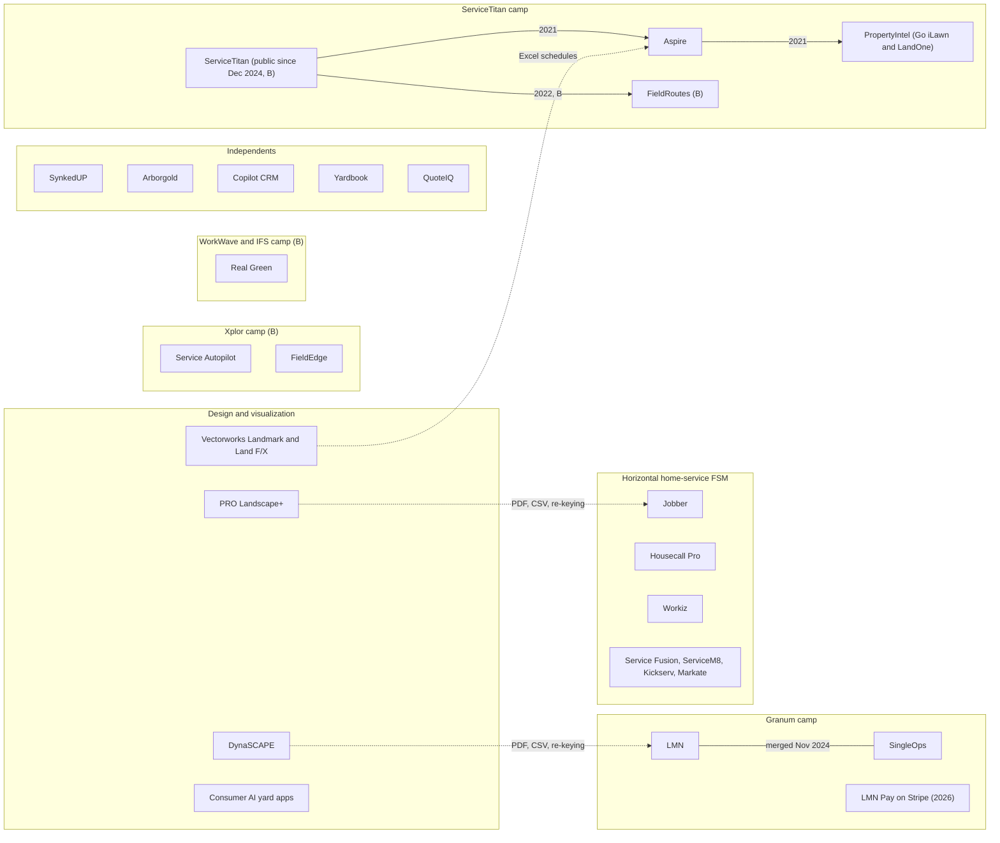
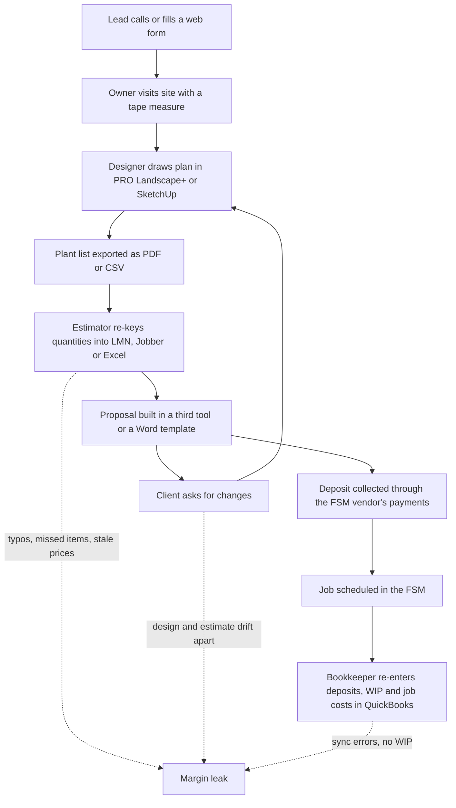
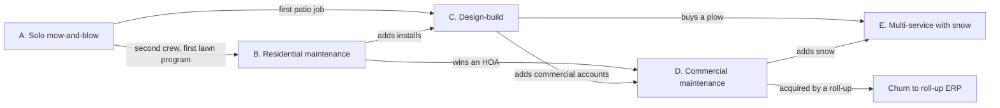
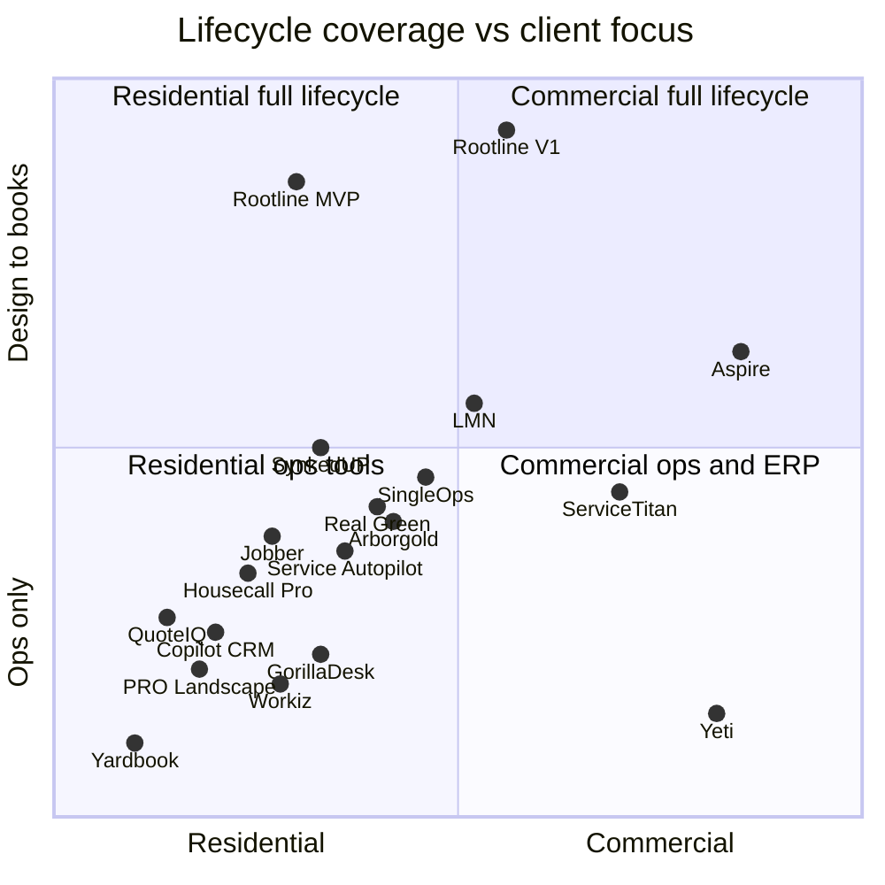

# 01 - Market Landscape and Competitive Analysis

> Rootline enters a large, fragmented, seasonal and labor-constrained industry whose software has split into three camps that do not talk to each other: horizontal home-service apps (Jobber, Housecall Pro) that are easy but shallow, landscape ERPs and estimating suites (Aspire, LMN, SingleOps, Real Green, Service Autopilot) that are deep but dated, consolidating and payment-locked, and design tools (PRO Landscape+, DynaSCAPE, Vectorworks, consumer AI apps) that draw well but never price, schedule, bill or account for the work. Every one of them outsources the books to QuickBooks and nearly every one monetizes payments through an account the landscaper does not control. This document is the definitive market analysis for the Rootline proposal. It sizes and segments the market, defines the five business archetypes Rootline serves, maps 17 competitors against 48 capabilities, benchmarks pricing, ranks the top 15 user pain points with evidence, identifies the white space, explains why the window is open now, collects 45 ideas worth stealing (and how Rootline improves each), war-games the incumbents' likely responses, and closes with the positioning statement and messaging pillars the rest of the doc set uses. It also specifies the small "market intelligence" capability inside the Platform Admin console that keeps this analysis current after launch.

| Field | Value |
|---|---|
| Document | 01 - Market Landscape and Competitive Analysis |
| Date | 2026-11-07 |
| Owner | `platform_owner` (founder), with GTM staff |
| Status | Proposal. Evidence-tagged; see section 0 before quoting any number externally |
| Inputs | [R1 Field-service platforms](research/R1-field-service-platforms.md), [R2 Landscape-specific platforms](research/R2-landscape-specific-platforms.md), [R3 Design, AI and plant data](research/R3-design-ai-plant-data.md), [R4 Industry, payments and accounting](research/R4-industry-payments-accounting.md) (appendices A-D) |
| Main consumers | [22 Business model, pricing and GTM](22-business-model-pricing-gtm.md), [24 Roadmap and feature catalog](24-roadmap-feature-catalog.md), every module spec (02-21), investors |

## Table of contents

- [0. How to read this document](#0-how-to-read-this-document-evidence-levels-and-research-limits)
- [Executive summary](#executive-summary)
- [1. Goals and non-goals](#1-goals-and-non-goals)
- [2. Market sizing and segmentation](#2-market-sizing-and-segmentation)
- [3. The landscape business archetypes Rootline serves](#3-the-landscape-business-archetypes-rootline-serves)
- [4. Competitive landscape](#4-competitive-landscape)
- [5. Pricing benchmark](#5-pricing-benchmark)
- [6. Voice of the customer: the top 15 pain points](#6-voice-of-the-customer-the-top-15-pain-points)
- [7. White-space opportunities](#7-white-space-opportunities)
- [8. Why now](#8-why-now)
- [9. Steal-worthy ideas](#9-steal-worthy-ideas-45-ideas-with-attribution-and-the-rootline-upgrade)
- [10. Competitive threats and how incumbents may respond](#10-competitive-threats-and-how-incumbents-may-respond)
- [11. Positioning statement and messaging pillars](#11-positioning-statement-and-messaging-pillars)
- [12. Market intelligence capability (spec)](#12-market-intelligence-capability-spec)
- [13. Metrics and KPIs](#13-metrics-and-kpis)
- [14. Edge cases, compliance and risks](#14-edge-cases-compliance-and-risks)
- [15. Beyond the brief](#15-beyond-the-brief-extra-ideas)
- [16. Open questions](#16-open-questions)
- [Appendices A-E](#appendices)
- [Sources](#sources)

---

## 0. How to read this document: evidence levels and research limits

This document follows the evidence convention of the research reports so a reader can tell a sourced fact from an informed guess.

| Tag | Meaning | How to use it |
|---|---|---|
| **[S]** | Sourced from a primary or credible source (vendor help center or press release, trade press, government page, review-site page), linked inline | Safe to quote with the link. Prices still carry "as of Nov 2026, verify" |
| **[S3P]** | Sourced only from third-party pricing aggregators, affiliate comparisons or competitor-written pages, which often disagree | Directional only. Quote ranges and say "verify" |
| **[B]** | Analyst background knowledge of public materials up to mid-2026, not re-verified in this research run | A hypothesis. Verify before investor or sales use (Appendix E) |
| **[E]** | Analyst estimate, inference or worked illustration, with the reasoning shown | Labeled as an estimate. Never present as a measured statistic |

**Research limits (read before quoting).** This document was written at the end of a large parallel research run. The run-wide web-search budget was exhausted before this document's own searches could execute, and direct fetches to `www.ibisworld.com` and `www.bls.gov` failed under the session's network allowlist. This analysis therefore **synthesizes the roughly 400 sources retrieved by the four research reports and sibling module docs during the same run**, re-citing their exact links, and fills gaps with clearly tagged [B] and [E] material. Three consequences:

1. **Market-size headline numbers are ranges, not point estimates.** US landscaping-services revenue, establishment counts and Canadian counts are [B]. Section 2 builds a transparent bottom-up model that `platform_finance` must re-run against the Census County Business Patterns (NAICS 561730) and Statistics Canada counts before any external deck (Appendix E, item E1).
2. **Competitor cells marked "?" are honest unknowns,** not absences. The many unknowns are themselves a finding: these vendors do not compete loudly enough on those dimensions for an analyst to be sure.
3. **Reddit and LawnSite owner-forum quotes were mostly unreachable.** Complaint evidence comes from vendor communities (Jobber Community), help centers, Capterra, G2, GetApp, Software Advice, a few LawnSite threads, and trade press. Forum themes not backed by a link are tagged [B] and listed for verification.

Prices and plan names change several times a year in this category. Every price below is "as of Nov 2026, verify".

---

## Executive summary

1. **The market is big, fragmented and under-digitized in the middle.** US landscaping services generate roughly $150-$200 billion a year across several hundred thousand businesses, most of them nonemployers, with on the order of 100,000-130,000 employer establishments [B, verify]. Rootline's bottom-up model (section 2.3) puts the theoretical subscription pool for US and Canadian employer firms at Rootline's own prices at about **$460M per year**, and the reachable pool at about **$340M** [E]. The payments flowing through the same firms are a far larger pool: card and ACH fees paid by the 5-49 employee band alone are plausibly in the **high hundreds of millions of dollars a year** [E], which explains why every incumbent fights to own them.
2. **The 10-40 person residential design-build-maintain firm is the most under-served buyer.** It is too complex for horizontal apps and too small for Aspire's 90-day implementations ([Landscape Management](https://editions.mydigitalpublication.com/article/Aspire+Software/3753265/671715/article.html)) [S]. It runs a field-service app plus QuickBooks plus a design tool plus a measurement or estimating tool plus review and website tools, plausibly $1,000-$1,500 a month of software before payments margin [E, from R2]. This is the beachhead (archetype C, segment S2 in [22](22-business-model-pricing-gtm.md)).
3. **Software ownership has consolidated into four camps since 2021,** each pushing a captive payments product: ServiceTitan (Aspire, Go iLawn, LandOne, FieldRoutes) ([TechCrunch](https://techcrunch.com/2021/06/30/servicetitan-acquires-aspire-to-move-into-landscaping-raises-200m-at-a-9-5b-valuation)) [S]; Granum (LMN plus SingleOps, merged Nov 2024; LMN Pay relaunched on Stripe in Mar 2026) ([Landscape Management](https://www.landscapemanagement.net/lmn-by-granum-launches-new-financial-infrastructure-platform-in-partnership-with-stripe/)) [S]; Xplor (Service Autopilot) [S via reviewers]; WorkWave/IFS (Real Green) [B]. Reviewers report forced processors, rate increases and slower support after these deals ([GetApp](https://www.getapp.com/operations-management-software/a/service-autopilot/reviews/)) [S]. **Consolidation opens switching windows.**
4. **Four capabilities are offered by nobody in our 17-competitor matrix:** a to-scale design studio wired to estimating, dimension-aware AI layouts constrained to region-valid plants, an operator-curated region-aware plant knowledge base, and a built-in double-entry general ledger (section 4.5). A fifth, a payment account the Company owns and can take with it, is unverified for most vendors and contradicted for two (LMN Pay per a third-party consultant, Service Autopilot per users) [S].
5. **Users' loudest complaints are about the seams between tools,** not missing buttons: estimates re-keyed from design tools, books that drift out of sync with QuickBooks, processors they cannot leave, measurement sold as a second subscription, crew apps that crash or need signal, and pricing that punishes seasonal crews (section 6, top 15 ranked with evidence).
6. **AI in this category sits at the edges of the funnel** (phone receptionists, dashboard copilots), not in the middle where landscape work is won: measuring, designing, choosing plants, visualizing, estimating. Aspire's own survey found 43% of commercial landscape leaders believe in AI but only 15% use it daily ([Finviz/Aspire](https://finviz.com/news/401821/aspire-report-finds-commercial-landscapers-prioritizing-growth-as-businesses-navigate-operational-complexity)) [S, vendor-run survey].
7. **The window is open now** because image models became cheap instruction-following editors (about $0.04 per image) ([BenchLM](https://benchlm.ai/media-pricing/nano-banana)) [S3P], Stripe Connect made "bring your own account" a first-class configuration with no Connect fees on direct charges ([Stripe docs](https://docs.stripe.com/connect/direct-charges-fee-payer-behavior)) [S], the consolidators are busy integrating and re-platforming, Intuit keeps raising QuickBooks prices and retiring Desktop editions [B, verify], and labor scarcity (H-2B cap of 66,000 a year; [USCIS](https://www.uscis.gov/working-in-the-united-states/temporary-workers/h-2b-non-agricultural-workers/cap-count-for-h-2b-nonimmigrants)) [S] makes revenue per man-hour the only growth lever (section 8).
8. **Positioning:** Rootline is the landscape business operating system that runs the whole job from first photo to to-scale design to signed proposal to crew schedule to paid invoice to closed books, with a regional horticulturist's plant knowledge built in, on a payments account the Company owns (section 11).
9. **The biggest threat is not a feature race but a bundle race.** ServiceTitan or Granum could bolt a design partner and an AI image model onto their stacks within 12-24 months. They cannot quickly copy a curated cultivar-level Plant KB with Region Profiles, one shared geometry from parcel to plow plan, or a ledger that is the system of record, and they will not give up their payments spread. Rootline's moat is the coupled data model plus curation plus the trust that comes with owning nothing of the Company's money (section 10).

---

## 1. Goals and non-goals

### 1.1 Goals of this analysis

| # | Goal | Success test |
|---|---|---|
| G1 | Give the founder and investors one defensible view of market size, segments and the beachhead | Section 2 model is reproducible from stated inputs; every number tagged |
| G2 | Define the five archetypes every module doc designs for, with real seasonal workloads | Module docs (02-21) reference archetypes A-E consistently |
| G3 | Map competitors at feature level so product priorities follow evidence, not opinion | 17 competitors x 48 capabilities, sourced or marked unknown |
| G4 | Rank user pain points by evidence and money at stake | Top 15 list with links, each mapped to a Rootline answer and owner doc |
| G5 | Turn competitor strengths into a backlog | 45 steal-worthy ideas, each with attribution, improvement, priority and owner doc |
| G6 | Anticipate incumbent responses and keep a living intelligence base | Threat war-game with early-warning signals; market-intel spec in section 12 |
| G7 | Fix the positioning and messaging the whole doc set uses | Section 11 is referenced by [22](22-business-model-pricing-gtm.md) and the marketing site |

### 1.2 Non-goals

- **Not a pricing spec.** Tiers, seats and add-ons live in [22](22-business-model-pricing-gtm.md). This doc benchmarks competitors and tests that Rootline's proposed prices beat the stack they replace.
- **Not a sales playbook.** Battlecard detail and objection scripts live in [22](22-business-model-pricing-gtm.md) section 6.4. Section 11 here sets the positioning those battlecards inherit.
- **Not a substitute for primary research.** Twenty customer interviews per archetype in the two beachhead Regions are a pre-MVP requirement (section 16, Q1). This document tells those interviews what to test.
- **No disparagement.** Every competitor claim that reaches the public must be sourced, dated and fair (section 14).

---

## 2. Market sizing and segmentation

### 2.1 Headline figures

| Metric | Figure | Evidence | Use and caveats |
|---|---|---|---|
| US landscaping services revenue | Roughly $150-$200B per year (2024-2025 public summaries) | [B] IBISWorld public summaries (fetch blocked this run) | Includes lawn care, tree care and installation; definitions differ from Census. Quote only as a range |
| US businesses, all (including nonemployers) | Several hundred thousand | [B] Census Nonemployer Statistics and IBISWorld | Most are owner-operators with no payroll |
| US employer establishments, NAICS 561730 | On the order of 100,000-130,000 | [B] Census County Business Patterns ([CBP program page](https://www.census.gov/programs-surveys/cbp.html), not opened this run) | The official base for the TAM model; pull by employee band before external use |
| Canada, NAICS 56173 Landscaping Services | Tens of thousands of establishments, overwhelmingly micro firms | [E]; financial benchmarks exist at [ISED](https://ised-isde.canada.ca/app/ixb/cis/performance/56173) [S] | Replace with Statistics Canada Canadian Business Counts |
| Landscaping and groundskeeping workers (SOC 37-3011) | Roughly 0.9 million US wage-and-salary jobs; median wage in the high teens of dollars per hour | [B] BLS OEWS (fetch blocked this run) | Excludes owners and much seasonal or informal labor |
| Share of landscaping and groundskeeping workers who are Hispanic | About 44.5% (2024) | [S] [Data USA](https://datausa.io/profile/soc/landscaping-and-groundskeeping-workers) | Drives Spanish-first crew tools ([05](05-field-crew-mobile-app.md), [21](21-ux-design-system-sitemaps.md)) |
| H-2B statutory cap | 66,000 visas per fiscal year, split into two halves | [S] [USCIS](https://www.uscis.gov/working-in-the-united-states/temporary-workers/h-2b-non-agricultural-workers/cap-count-for-h-2b-nonimmigrants) | Landscaping is commonly reported as the largest H-2B occupation [B]; see [15](15-team-hr-payroll.md) |
| Gross margin, $3M-$54M firms | About 53% of net revenue | [S] [Wilson 360 2024 via Lawn & Landscape](https://www.lawnandlandscape.com/article/wilson-360-2024-landscape-industry-benchmark) | Larger, better-run firms; definitions vary ([18](18-reporting-analytics.md) KPI Dictionary) |
| Burdened direct labor, same population | About 43% of net revenue | [S] same | Labor is the largest controllable cost |
| Net margin, typical firm | High single digits to low teens | [B] consultant and trade-press rule of thumb | A one-point gain in labor efficiency or price realization is worth more than the software bill |

> **Analyst note.** The top-line number matters less than the shape. Rootline's revenue depends on the count of employer firms with 5-49 peak-season employees in the US and Canada and on how much they already spend on software and payments. Both can be measured directly (CBP by employee band; stack audits in customer interviews).

### 2.2 Segmentation

Rootline segments the market on four axes, because each changes what the product must do:

| Axis | Values | Why it matters |
|---|---|---|
| **Peak headcount** | Nonemployer; 1-4; 5-9; 10-19; 20-49; 50-99; 100+ | Drives office roles, seat economics, implementation tolerance, need for job costing and branches |
| **Client mix** | Residential-heavy; mixed; commercial-heavy (HOA, property managers, retail, office parks, municipalities) | Commercial needs multi-property portals, approvals, POs, net terms, retainage, proof of service |
| **Service mix** | Maintenance; enhancements; design-build/install; lawn and plant health care; irrigation and lighting; tree care; snow and ice | Each line has its own pricing model, billing mode, compliance records and seasonality ([14](14-service-line-modules.md)) |
| **Climate and season shape** | Northern with snow; northern without snow; southern year-round; arid West | Revenue curve, cash trough, snow module, xeric plant palettes, water budgets ([12](12-plant-knowledge-base.md)) |

**Service-line mix by business model (estimate).** No verified survey mix was retrievable this run; Lawn & Landscape's State of the Industry and NALP publish annual figures that should replace this table [B].

| Business model | Maintenance | Enhancements | Design-build | Lawn and PHC | Irrigation and lighting | Snow and ice |
|---|---|---|---|---|---|---|
| Residential mow-and-maintain | 60-80% | 10-20% | 0-10% | 0-15% | 0-5% | 0-10% (north) |
| Residential design-build-maintain | 25-40% | 10-15% | 40-60% | 0-10% | 5-10% | 0-10% (north) |
| Lawn treatment specialist | 0-10% | 0-5% | 0% | 75-95% | 0-10% | 0-5% |
| Commercial maintenance | 50-65% | 15-25% | 0-15% | 5-10% | 5-10% | 10-30% (north) |
| Snow-heavy northern commercial | 30-40% | 10-15% | 0-10% | 0-5% | 0-5% | 30-50% |

Source: [R4](research/R4-industry-payments-accounting.md) section 3.1 [E].

**Seasonal revenue curve (northern design-build-maintain Company with snow, illustrative).** April-October typically carries 60-75% of annual card and ACH volume [E]. Spring is a cash trough: rehiring, H-2B arrival costs, mulch and nursery stock purchases and equipment down payments land in March-April while receivables lag 30-45 days [E]. Prepaid lawn programs and seasonal snow contracts create deferred revenue that today's tools leave for the bookkeeper to reconstruct ([R4](research/R4-industry-payments-accounting.md) section 3) [E].

```text
% of annual revenue by month (illustrative, northern Company with snow) [E]
Jan  ████ 4%    snow, winter pruning, design season
Feb  ████ 4%    snow, installs signed, deposits arrive
Mar  ██████ 6%  cleanups start, irrigation start-ups
Apr  ██████████ 10%  first mows, mulch season, installs begin
May  ████████████ 12%
Jun  ███████████ 11%
Jul  ██████████ 10%
Aug  ██████████ 10%
Sep  █████████ 10%   aeration and overseeding, fall installs
Oct  █████████ 9%    fall cleanups, winterizations, bulbs
Nov  ███████ 7%      leaf cleanups, holiday lighting, snow staking
Dec  █████ 5%        holiday lighting, snow
```

### 2.3 Bottom-up market model (estimate)

**Method.** Count employer establishments by employee band, multiply by Rootline's modeled average revenue per account (ARPA) for the plan each band would buy, then apply a reachability factor for firms that buy business software at all. ARPA values are the steady-state assumptions in [22](22-business-model-pricing-gtm.md) section 7.2 ($95 Starter, $340 Grow, $860 Pro, $3,200 Enterprise per month), so this model and the revenue plan use the same numbers.

**Inputs [E]:** about 115,000 US employer establishments (midpoint of the [B] range) plus about 20,000 Canadian (low end of "tens of thousands"), total 135,000. Band shares from the illustrative CBP-shaped pyramid in [R4](research/R4-industry-payments-accounting.md) section 2.2.

| Employee band | Share [E] | Establishments [E] | Plan mix assumed | ARPA per month [E] | Theoretical pool per year [E] | Reachability [E] | Reachable pool per year [E] |
|---|---|---|---|---|---|---|---|
| 1-4 | 60% | 81,000 | Starter | $95 | $92.3M | 40% | $36.9M |
| 5-9 | 17.5% | 23,625 | Grow | $340 | $96.4M | 70% | $67.5M |
| 10-19 | 11% | 14,850 | 60% Grow, 40% Pro | $548 | $97.7M | 85% | $83.0M |
| 20-49 | 6.5% | 8,775 | Pro | $860 | $90.6M | 85% | $77.0M |
| 50-99 | 1.5% | 2,025 | Half Pro, half Enterprise | $2,030 | $49.3M | 90% | $44.4M |
| 100+ | 0.7% | 945 | Enterprise | $3,200 | $36.3M | 90% | $32.7M |
| **Total** | 97.2% (rest unclassified) | **131,220** | | | **about $463M** | | **about $341M** |

Arithmetic check: 81,000 x $95 x 12 = $92.34M; 23,625 x $340 x 12 = $96.39M; 14,850 x $548 x 12 = $97.65M; 8,775 x $860 x 12 = $90.56M; 2,025 x $2,030 x 12 = $49.33M; 945 x $3,200 x 12 = $36.29M.

**Reading the model.**

- The **beachhead pool** (5-49 employees, archetypes B and C plus the small end of D and E) is about **$227M a year** reachable ($67.5M + $83.0M + $77.0M) [E].
- [22](22-business-model-pricing-gtm.md)'s base case reaches $54.7M of subscription ARR from 9,500 Companies in Year 5. That is about **12% of the theoretical pool and 16% of the reachable pool**, which is ambitious for a five-year-old entrant against Jobber's brand and the consolidators' sales teams. Treat it as a stretch case until beachhead win rates are measured (section 16, Q3) [E].
- **Establishments are not firms.** A three-branch firm counts three times, so the 50+ bands overstate firm counts but understate ARPA per firm. The CBP pull should use firm-level Statistics of US Businesses (SUSB) where possible.
- **Nonemployers are excluded.** Several hundred thousand owner-operators are a self-serve funnel (Starter, homeowner app), not a sales target.

**The wallet the incumbents fight over (illustrative) [E].** Using rough average revenue per establishment of $0.7M (5-9 band), $1.6M (10-19) and $4.0M (20-49), the 5-49 band carries roughly $75B of annual revenue. If half is collected electronically at a blended 2.0% processing cost, those firms pay roughly **$750M a year in processing fees**. A vendor spread of 0.3-1.0 points on that volume ([R4](research/R4-industry-payments-accounting.md) section 8) is a profit pool worth hundreds of millions of dollars a year, which is why every incumbent runs captive payments, and why Rootline's zero-markup bring-your-own-Stripe stance is a credible wedge rather than a footnote.

**Today's software wallet (illustrative) [E].** A 12-person design-build firm plausibly spends $1,000-$1,500 a month on an estimating or field-service tool, a measurement or takeoff subscription, a design tool, QuickBooks Online, a review tool and a website ([R2](research/R2-landscape-specific-platforms.md) section 14). Across the roughly 47,000 establishments in the 5-49 band, $500-$1,500 a month implies $280M-$850M a year of existing software spend that Rootline can consolidate.

### 2.4 Market structure and consolidation



| Date | Event | Evidence |
|---|---|---|
| Jun 30, 2021 | ServiceTitan agrees to acquire Aspire alongside a $200M Series G at a $9.5B valuation; closed Aug 2021 | [S] [TechCrunch](https://techcrunch.com/2021/06/30/servicetitan-acquires-aspire-to-move-into-landscaping-raises-200m-at-a-9-5b-valuation), [Aspire blog](https://www.youraspire.com/blog/aspire-to-be-acquired-by-servicetitan) |
| Oct 2021 | Aspire agrees to acquire Go iLawn and LandOne, later combined into PropertyIntel | [S] [PrivSource](https://www.privsource.com/acquisitions/deal/x7SXDx), [Landscape Management](https://www.landscapemanagement.net/aspire-software-launches-new-propertyintel-measuring-and-estimating-tool/) |
| 2021-2022 | Xplor acquires Service Autopilot; reviewers later report processor lock-in | [B] for date; [S] [GetApp reviews](https://www.getapp.com/operations-management-software/a/service-autopilot/reviews/) |
| 2022 | ServiceTitan acquires FieldRoutes (pest and lawn) | [B] |
| Nov 2024 | LMN and SingleOps merge; group operates as Granum | [S] [Attentive.ai](https://attentive.ai/blog/lmn-and-attentive-ai-announce-strategic-partnership), [Green Industry Pros](https://www.greenindustrypros.com/business-management/software/product/22963124/granum-granum-launches-lmn-pay-experience) |
| Dec 2024 | ServiceTitan lists on Nasdaq | [B] |
| Feb 2025 | LMN and Attentive.ai partner for AI mapping and takeoffs | [S] [Landscape Management](https://www.landscapemanagement.net/lmn-and-attentive-partner-to-integrate-products/) |
| 2025 | ServiceTitan launches Atlas agent at Pantheon | [S] [ServiceTitan press](https://www.servicetitan.com/press/servicetitan-introducing-the-next-evolution-of-ai-at-pantheon-2025-keynote) |
| 2025 | PRO Landscape+ launches an AI designer suite | [S] [Green Industry Pros](https://www.greenindustrypros.com/business-management/software/product/22961404/pro-landscape-pro-landscape-launches-aibased-designer-suite) |
| Feb 2026 | LMN ships Beam AI takeoff integration and an AI crew-notes beta | [S] [LMN release note](https://support.golmn.com/hc/en-us/articles/46786137574683) |
| Feb 2026 | Jobber price change logged by a tracker; Jobber runs an invitation-only "ACH on us" promotion | [S3P] [Costbench](https://costbench.com/changelog/jobber-price-increase-2026-02-3/); [S] [Jobber](https://www.getjobber.com/ach-on-us/) |
| Mar 2026 | Granum relaunches LMN Pay "powered by Stripe" | [S] [Landscape Management](https://www.landscapemanagement.net/lmn-by-granum-launches-new-financial-infrastructure-platform-in-partnership-with-stripe/) |

**Contractor-side consolidation.** Private-equity-backed commercial roll-ups and the public BrightView buy regional maintenance firms and standardize them on an ERP, usually Aspire or an in-house system [B]. Two implications: a firm that gets acquired is a churn risk for whatever tool it used (including Rootline in S4), and the independents competing against roll-ups need enterprise-grade estimating, job costing and multi-property service at SMB prices. That is Rootline's lane [E].

**Adoption is bimodal [E].** Owner-operators adopt cheap horizontal apps for quoting, scheduling and getting paid. Firms above about $3M adopt landscape ERPs for estimating discipline and job costing. The middle (10-40 employees, $1M-$6M) is the most under-served: too complex for horizontal apps, too small for Aspire's implementation, and still running design, books and payroll in separate tools ([R4](research/R4-industry-payments-accounting.md) section 7).

---

## 3. The landscape business archetypes Rootline serves

Five archetypes recur in every module doc. Names below are **illustrative composites**, not real companies; figures are estimates [E] built from the research reports and the reference Companies in [02](02-personas-roles-permissions.md) (Reyes Outdoor Living, Charlotte NC; Summit Grounds Group, Columbus OH). Segment codes map to [22](22-business-model-pricing-gtm.md) section 6.1.

### 3.1 Archetype summary

| | **A. Solo mow-and-blow** | **B. Residential maintenance** | **C. Design-build** (beachhead) | **D. Commercial maintenance** | **E. Multi-service with snow** |
|---|---|---|---|---|---|
| Illustrative name | "Cutting Edge Mowing" | "Bluegrass Lawn and Garden" | Reyes Outdoor Living | "Lakeshore Grounds" | "Ridgeline Landscape and Snow"; Summit Grounds Group at the top end |
| Peak / winter headcount | 1-4 / 0-1 | 5-15 / 2-5 | 10-40 / 4-15 | 20-100 / 8-40 | 25-150 / 15-60 (snow crews plus subs) |
| Revenue band [E] | $80k-$350k | $500k-$1.5M | $1M-$6M | $2M-$12M | $2M-$20M |
| Segment ([22](22-business-model-pricing-gtm.md)) | S1 | S3 | **S2 (beachhead)** | S4 | S4/S5 |
| Client mix | Residential | 90%+ residential | 80%+ residential | 70%+ commercial (HOA, property managers, retail, office) | Mixed; commercial lots carry snow |
| Signature work | Weekly mows Apr-Nov at $40-$60 a cut, spring and fall cleanups, mulch by the yard | Mowing routes, 5-step fertilizer and weed-control programs, aeration and overseeding, cleanups, shrub pruning | Paver patios ($15k-$60k), walls, plantings, lighting, irrigation, plus maintenance for install clients | Season contracts ($20k-$250k per site per year), enhancements, irrigation, seasonal color | All of the above plus per-push plowing at 2-inch triggers, salting per application, seasonal snow contracts with caps |
| Today's stack [B/E] | Paper, Yardbook, Jobber Core, QuickBooks Self-Employed | Jobber Connect/Grow, Service Autopilot, Real Green, Copilot CRM + QBO + review tool | LMN, Jobber Grow, SynkedUP or SingleOps + PRO Landscape+ or SketchUp + QBO or QBD + Gusto + spreadsheets | Aspire, LMN Professional, Service Autopilot + QBD/QBO/Sage + SiteRecon or SiteDNA + Motive | Aspire or LMN + Yeti or spreadsheets for snow + QBO + Motive |
| Software spend today [E] | $0-$80/mo | $200-$600/mo | $700-$1,500/mo | $1,500-$5,000/mo plus implementation | $1,500-$6,000/mo |
| Rootline plan ([22](22-business-model-pricing-gtm.md)) | Starter | Grow | Grow / Pro | Pro / Enterprise | Pro + Snow and Ice module |
| Rootline priority | Secondary, self-serve [MVP] | Primary follow-on [MVP] | **Primary [MVP]** | Expansion [V1] | Expansion [V1] (snow) |
| Fit with differentiators | Low-medium: portal, autopay, routing | Medium-high: routing, programs, chemical records, portal, BYO Stripe | **Highest: all eight differentiators matter** | High: job costing, ledger, commercial portal, audits, purchasing | High: one system for twelve months, proof of service, deferred revenue |

### 3.2 Archetype A: solo mow-and-blow

**Profile.** One owner-operator and a seasonal helper, a 60-inch zero-turn on a 16-foot trailer, 60-90 weekly residential mows from April to November, spring cleanups in March-April, mulch installs at 10-20 cubic yards a week in spring, leaf cleanups in November, and in the north a handful of residential driveways plowed in winter. Revenue $80k-$350k [E].

**A year in the life.** January: chase unpaid November invoices, send renewal letters by text. March: re-book last year's mow list, buy mulch on credit. April-November: 14-hour Mondays catching up after weekend rain, invoices written at night. December: snow or seasonal work elsewhere.

| Jobs to be done | Pains today | What would make them switch | What they will not tolerate |
|---|---|---|---|
| Route 15-18 mows a day; collect automatically; quote a cleanup from the truck; get Google reviews | Free tools lack autopay and routing; Jobber add-ons stack up for a one-person shop ([Jobber Community](https://community.getjobber.com/discussions/marketing-tools/google-reviews-only-for-marketing-suite/3726)) [S]; marketplaces like GreenPal own the client [B] | Autopay that just works, a branded "book in 60 seconds" link, card-on-file with ACH, a mobile app that works with no signal | Setup longer than an evening; a per-user price; any feature they have to learn before they get paid |

**Rootline stance.** Serve with Starter and the self-serve funnel; do not build for them first. They matter because they become archetype B. The product must never punish them with complexity: a "Simple mode" with quotes, schedule, invoices and portal only ([21](21-ux-design-system-sitemaps.md)).

### 3.3 Archetype B: residential maintenance (5-15 staff)

**Profile.** Two or three mowing crews of 2-3 people, 300-450 weekly mow clients on fixed day-of-week routes, a lawn-care applicator running a 5-step fertilizer and weed-control program for 150-250 clients, aeration and overseeding in September, spring and fall cleanups, shrub pruning twice a year, light enhancements (mulch, seasonal color). Revenue $500k-$1.5M [E]. Many clients on level billing ($300/month for 12 months covering a $3,600 season, [LawnPro](https://lawnprosoftware.com/features/level-billing)) [S] or prepaid programs with a discount ([Weed Man](https://weedman.com/blog/prepay-and-referral-discounts)) [S].

| Jobs to be done | Pains today | What would make them switch |
|---|---|---|
| Keep 30-40 stops a day per crew on time; slide a rain day across 120 visits without 120 phone calls; keep compliant pesticide records; collect $40k-$80k a month on autopay; renew programs every winter | Routing on straight-line distance ([Jobber Community](https://community.getjobber.com/discussions/job-details-scheduling/how-does-jobber-calculate-routes-and-can-it-use-real-driving-directions-instead-/8663/replies/9863)) [S]; rain-day rescheduling by hand [B]; chemical records on paper or in a separate lawn tool [B]; forced processor after an acquisition ([GetApp](https://www.getapp.com/operations-management-software/a/service-autopilot/reviews/)) [S]; per-user pricing at peak | Road-network routing with a "rain day: slide everything right" button; application records pre-filled from the visit; level billing and prepay that post to the books correctly; their own Stripe account; Spanish crew app |

**Rootline stance.** Primary follow-on at [MVP] (S3). Must reach parity with Real Green and Service Autopilot on programs, rounds, prepay and state-compliant records, then win on routing, portal, ledger and payments ownership ([14](14-service-line-modules.md), [04](04-scheduling-dispatch-routing.md)).

### 3.4 Archetype C: residential design-build-maintain (10-40 staff), the beachhead

**Profile.** Reyes Outdoor Living ([02](02-personas-roles-permissions.md)): about 22 people at peak (April-November), 9 in winter; roughly 55% installs, 35% maintenance, 10% enhancements; one location; owner-led sales. Typical sold work: a 400 sq ft paver patio with 6-inch compacted base, edge restraint and polymeric sand; a 1,200 sq ft foundation planting with 14 'Limelight' hydrangeas, 3 river birch and 40 yards of double-shredded hardwood mulch; low-voltage lighting; drip and spray irrigation with spring start-ups and fall winterizations; a one-year plant warranty conditional on irrigation.

**The broken workflow today [E, from R2 and R3].**



| Jobs to be done | Pains today | What would make them switch |
|---|---|---|
| Turn a site visit into a priced, visual proposal in one sitting; close $25k+ jobs against two other bidders; pick plants that survive the Region so warranty replacements stop eating margin; know whether last month's installs made money; keep the CPA happy | Re-keying design quantities ([JackMacBiz](https://jackmacbiz.github.io/blog/2026-06-13-why-your-current-landscape-design-app-is-wasting-8-hours-per/)) [S, anecdotal]; Jobber users ask the community for separate design software ([Jobber Community](https://community.getjobber.com/discussions/operations-forum/looking-for-landscape-design-software--training/8084)) [S]; plant libraries ignore region ([Capterra UK](https://www.capterra.co.uk/software/126135/pro-landscape)) [S]; job costing that never ties to the P&L [E] | Draw once, price once: Design Studio takeoff feeds the estimate; AI mockup of the client's own yard in the proposal; Region-rated plants; deposits and WIP posted to a real ledger; switching help from LMN or Jobber |

**Rootline stance.** Beachhead [MVP]. Every one of the eight differentiators in the brief matters to this buyer, and the buyer has an office manager and a bookkeeper or outside CPA who feel the integration pain daily.

> **Competitive edge (archetype C).** Today this firm pays for an estimating or field-service tool, a design tool (PRO Landscape+ is about $900 a year ([Capterra](https://www.capterra.com/p/126135/PRO-Landscape/)) [S]) and QuickBooks, and still re-keys every plant. In Rootline, dropping 14 'Limelight' hydrangeas on the plan updates the takeoff, the estimate, the mockup, the proposal total and the draft purchase order at once. No competitor in section 4.5 does any two of those from one record.

### 3.5 Archetype D: commercial maintenance (20-100 staff)

**Profile.** "Lakeshore Grounds" (illustrative): 55 people at peak, 20 in winter; 80 commercial sites (HOAs with 6 communities, a property manager with 22 retail centers, office parks); season contracts billed monthly over 12 months; enhancements (seasonal color rotations at 2,400 flats a year, mulch refreshes, irrigation repairs) carry the profit; contract renewals every fall; net-30 to net-45 terms; certificates of insurance and W-9s for every client's AP department.

| Jobs to be done | Pains today | What would make them switch |
|---|---|---|
| Bid renewals at the right margin; capture enhancement opportunities on every visit; prove service to a property manager who was not on site; route approvals through board members and regional managers; cost every site and division | Aspire's cost, learning curve and admin bottleneck ([Capterra](https://www.capterra.com/p/161544/Aspire/), [GetApp UK](https://www.getapp.co.uk/reviews/9108/aspire)) [S]; 90-day implementations [S]; measurement and audits as bolt-ons ([SiteDNA](https://sitedna-marketing-site.pages.dev/), [Aspire PropertyIntel](https://www.youraspire.com/go/landscape-estimating-property-measurement)) [S]; AP automation and benchmarking bought separately ([Vergo](https://www.getvergo.com/learn/best-ap-automation-software-for-landscape-companies-using-aspire), [Wilson360](https://marketplace.youraspire.com/partners/wilson360.md)) [S] | Aspire-level contracts, divisions, purchasing and job costing at SMB price with a migration measured in days; a commercial portal with multi-property approvals and spend limits; enhancement radar from crew photos; ledger with branch and division dimensions |

**Rootline stance.** Expansion at [V1]. Do not chase until the commercial parity list in [R2](research/R2-landscape-specific-platforms.md) section 16 (branches, divisions, renewals, enhancements, purchasing at actual cost, equipment cost recovery, snow events, multi-property approvals) is shipped.

### 3.6 Archetype E: multi-service with snow

**Profile.** "Ridgeline Landscape and Snow" (illustrative): 35 people at peak, 18 in winter plus 6 plow subcontractors; maintenance, installs and a lawn division in the green season; 45 commercial lots and 150 residential driveways in winter. Snow contracts mix per-push at a 2-inch trigger, per-event tiers (2-4, 4-8, 8-12 inches), seasonal fixed with a 12-event cap, and per-application salting. At the top end, Summit Grounds Group ([02](02-personas-roles-permissions.md)) runs this model across three branches with about 140 people at peak.

| Jobs to be done | Pains today | What would make them switch |
|---|---|---|
| Detect the storm, dispatch 20 routes at 2 a.m., log pushes and salt per site, invoice 200 service records by event the next morning, defend a slip-and-fall claim two years later; recognize seasonal snow revenue correctly | Two systems for green and white seasons; generic tools fall back to "manual job creation during snow events and spreadsheets for per-inch pricing" ([Agiled](https://agiled.app/blog/best-client-management-software-for-snow-removal)) [S, competitor-written]; GPS alone is disputable, photos plus timestamps are needed ([Aspire blog](https://www.youraspire.com/blog/prove-service-delivery-data-ends-disputes)) [S]; SIMA calls in-season documentation "a legal shield" ([SIMA](https://resources.sima.org/snow-and-ice-resource-center/effective-in-season-documentation)) [S] | One data model for twelve months; storm events from weather data; proof-of-service packets attached to invoices and stored in a claims vault; subcontractor portal; deferred revenue on seasonal contracts posted automatically |

**Rootline stance.** Snow module at [V1], green-season features at [MVP]. Snow is the strongest retention hook for northern firms because it keeps the system busy in January.

### 3.7 Adjacent archetypes (served through modules, not targeted first)

| Archetype | Incumbent they love | What Rootline must match | Priority |
|---|---|---|---|
| Lawn treatment specialist (75-95% programs) | Real Green, GorillaDesk, FieldRoutes | Programs and rounds priced by turf area, chemical records by state, prepay and renewals, direct mail | [V1] as a target (module ships [MVP]) |
| Tree care and arborist | SingleOps, Arborgold | Tree inventory with GPS, species and DBH, ANSI A300 work specs, crane and climb job types | [V2] module ([22](22-business-model-pricing-gtm.md) Tree Care add-on) |
| Irrigation and lighting specialist | Jobber, ServiceTitan-style service tools | Start-up and winterization routes, controller and zone records, service agreements, as-builts | [V1] |
| Independent landscape designer (no crews) | PRO Landscape+, Vectorworks, SketchUp, Canva | Design Studio, proposals, Plant KB, design fees credited to install | [V1] Design Solo plan |
| Franchise systems | Real Green, custom | Franchisor console, standardized price books, royalty reporting | [V2] |

### 3.8 How archetypes grow, and why that matters



Growth transitions are the moments companies switch software: the second crew breaks the free tool, the first design-build job breaks the field-service app, the first HOA breaks the residential portal, the first plow breaks the green-only system. **Rootline's packaging must let a Company move along these arrows without migrating** (Starter to Grow to Pro, modules switched on), which is itself a competitive edge against single-segment tools.

### 3.9 Jobs-to-be-done by persona, across archetypes

| Persona (role key) | Core job | Tool they use today | Switching trigger Rootline exploits |
|---|---|---|---|
| Business Owner (`owner`) | "Grow profitably without working 80-hour weeks in May" | FSM dashboard, QuickBooks reports, gut feel | Real-time P&L by service line and job; "margin found" from ACH steering and price realization |
| Office / Admin Manager (`office_manager`) | "Get every visit scheduled, billed and collected without re-typing" | FSM + QuickBooks + spreadsheets | No re-keying; rain-day bulk reschedule; autopay; one inbox |
| Sales Rep / Estimator (`estimator`) | "Price the job right and fast, and win it" | LMN or Excel + Google Maps measuring ([Jobber help](https://help.getjobber.com/es/articles/how-to-measure-property-distance-and-size/)) [S] | Takeoff from a traced property; LMN-identical overhead math; visual proposals |
| Landscape Designer (`designer`) | "Design something beautiful that will actually grow here" | PRO Landscape+, SketchUp, Vectorworks, plant references | Region-rated plants inside the canvas; AI mockups of the client's yard; no export step |
| Operations / Account Manager (`ops_manager`) | "Keep crews productive and clients renewing" | Dispatch board, whiteboard, phone | Multi-crew routing; enhancement radar; commercial portal |
| Crew Lead / Foreman (`crew_lead`) | "Know where to go, what to do, and get it signed off" | FSM mobile app, paper work orders, texts | Offline-first, Spanish, big buttons, materials and chemical logs pre-filled |
| Field Technician (`technician`) | "Clock in, do the work, see my hours and pay" | Paper timesheet or a limited seat ([LMN permissions](https://intercom.help/lmn/en/articles/17699017-lmn-user-permissions)) [S] | Own hours, training and pay explanation in Spanish or English |
| Bookkeeper / CPA (`bookkeeper`) | "Clean books, easy close, correct job costing" | QuickBooks Online or Desktop, sync error logs | Ledger as system of record, or a sync that quarantines one record instead of blocking a client |
| Subcontractor (`subcontractor`) | "Get the work order, prove I did it, get paid" | Texts and photos | Sub portal with proof-of-service capture (snow especially) |
| Residential client (`client_residential`) | "See it before I buy it, pay in two taps, know when they're coming" | Email PDFs, vendor-branded portals | Mockup of their own yard; branded portal; autopay; visit photos |
| Commercial client (`client_commercial`) | "Approve, track and audit work across 22 sites" | Email, spreadsheets, AP portals | Portfolio dashboard, approval chains, POs, consolidated statements, proof of service |

---

## 4. Competitive landscape

### 4.1 The four competitive categories

| Category | Who | What they optimize for | What they never do | Rootline's angle |
|---|---|---|---|---|
| **Horizontal home-service FSM** | Jobber, Housecall Pro, Workiz, ServiceM8, Service Fusion, Kickserv, Markate, FieldPulse; ServiceTitan at the enterprise end | Fast request-to-quote-to-cash, mobile polish, marketing and AI add-ons, embedded payments | Production-rate estimating, design, plants, chemical records, snow events, books | Match their spine and polish at [MVP]; win on landscape depth, books and payments ownership |
| **Landscape ERPs and specialists** | Aspire, LMN, SingleOps, SynkedUP, Arborgold, Real Green, Service Autopilot, Copilot CRM, Yardbook, QuoteIQ, GorillaDesk and FieldRoutes (lawn and pest), BOSS LM, CLIP | Estimating discipline, contracts, programs, job costing, route density | Design, region-aware plants, AI in the middle of the funnel, books, portable payments, modern UX | Exact parity on the landscape math; leapfrog on design, AI, ledger, UX and migration speed |
| **Design and visualization** | PRO Landscape+, DynaSCAPE, Realtime Landscaping, Vectorworks Landmark, Land F/X, SketchUp plus plugins, Structure Studios, iScape; consumer AI apps (Neighborbrite, ReimagineHome and others); design services (Yardzen, Home Outside) | Drawing, imaging, presentation | Pricing with production rates, scheduling, invoicing, books; regional plant ratings | The plan is the same record as the estimate, proposal, purchase order and job cost |
| **Point tools and bolt-ons** | Measurement (PropertyIntel, SiteRecon, Attentive.ai and Beam AI, Deep Lawn), audits (SiteDNA), snow (Yeti), AP automation (Vergo), benchmarking (Wilson360), telematics (Motive), pesticide loggers (ChemLog), QuickBooks and Xero, review and website tools | One job each, done well | Share geometry, data or money with anything else | Absorb the bolt-ons into one data model; each removes a vendor bill |

### 4.2 Competitor profiles (compact)

Full profiles with evidence are in the research appendices; this table is the executive view. "Threat" is the analyst's view of how hard each competitor makes Rootline's job in the beachhead (archetype C) and in Rootline's expansion segments [E].

| Competitor | Owner | Core buyer | Signature strength | Most-cited weakness | Payments model | Books | AI (Nov 2026) | Threat | Detail |
|---|---|---|---|---|---|---|---|---|---|
| **Jobber** | Independent (Edmonton) | 1-30 person home-service firms, many lawn and landscape | Polished request-quote-job-invoice spine; Client Hub "Approve & Pay Deposit"; online booking; big ecosystem ([Jobber help](https://help.getjobber.com/en/articles/what-do-your-clients-see-in-client-hub/)) [S] | Straight-line routing; add-on stacking; tier gating; one-way QBO sync ([Jobber QBO FAQ](https://help.getjobber.com/es/articles/quickbooks-integration-faqs/)) [S] | Jobber Payments on Stripe; 1% instant payouts ([Stripe case study](https://www.casestudies.com/company/stripe/case-study/jobber-and-stripe-help-200k-home-service-professionals-save-on-payment-fees), [Jobber help](https://help.getjobber.com/en/articles/instant-payouts/)) [S] | QBO (one-way), Xero | Copilot, AI Receptionist, Jobber Voice, Campaign Generator [S] | **High** (brand, distribution) | [R1](research/R1-field-service-platforms.md) s3 |
| **Housecall Pro** | Independent | Residential home services | Marketing, good-better-best with financing, community | Per-user overages; support variance [S3P/B] | HCP Payments, 1% Instapay, Wisetack ([HCP](https://www.housecallpro.com/features/payment-processing/)) [S] | QBO sync | AI agent features [B] | Medium | [R1](research/R1-field-service-platforms.md) s4 |
| **ServiceTitan** | Public (Nasdaq, B) | Mid-market and enterprise trades | Call-center booking, pricebook, memberships, Atlas agent ([ServiceTitan](https://www.servicetitan.com/press/servicetitan-introducing-the-next-evolution-of-ai-at-pantheon-2025-keynote)) [S] | Cost, contracts, implementations [B] | ServiceTitan Payments and financing [B] | QuickBooks and mid-market ERPs | Atlas, Titan Intelligence [S] | Medium (via Aspire) | [R1](research/R1-field-service-platforms.md) s5 |
| **Aspire** | ServiceTitan | Commercial maintenance and design-build, multi-branch | The landscape ERP: contracts, renewals, kits, purchasing at actual cost, equipment, snow ([Aspire](https://www.youraspire.com/features/purchasing)) [S] | "High cost and added fees", learning curve, admin bottleneck, 90-day implementations ([Capterra](https://www.capterra.com/p/161544/Aspire/)) [S] | Historically CardConnect; current unconfirmed [S/B] | External GL; reads vendors from it [S] | PropertyIntel AI measuring; survey messaging [S] | **High in S4**, low in S2 | [R2](research/R2-landscape-specific-platforms.md) s4.1 |
| **LMN** | Granum | Owner-led design-build and maintenance | Budget-first estimating with MORS/FLH/SORS; education ([LMN help](https://intercom.help/lmn/en/articles/15939065-how-lmn-calculates-overhead-labor-burden-and-profit-in-estimates)) [S] | "Too difficult to use"; slow measuring on big sites; crew-app reliability ([Capterra](https://www.capterra.com/p/142064/LMN/reviews/), [G2](https://www.g2.com/products/lmn)) [S] | LMN Pay on Stripe since Mar 2026; non-portable per a consultant ([Merchant Cost Consulting](https://merchantcostconsulting.com/lower-credit-card-processing-fees/lmn-pay-stripe-migration/)) [S] | QBO/QBD sync [B] | Partner AI (Attentive, Beam AI), crew-notes beta [S] | **High** (estimating mindshare) | [R2](research/R2-landscape-specific-platforms.md) s5.1 |
| **SingleOps** | Granum | Tree care, landscape, lawn | Visual proposals, client portal, tree inventory ([case study](https://www.casestudies.com/company/singleops/case-study/chop-nashvilles-proposals-are-incredible)) [S] | Steep learning curve; POs and inventory Premier-only ([SingleOps docs](https://docs.singleops.com/hc/articles/43339572958491)) [S] | Integrated [B] | QBO/QBD [B] | None documented [S] | Medium | [R2](research/R2-landscape-specific-platforms.md) s6.1 |
| **SynkedUP** | Independent | Small design-build | "Priced for profit" estimating plus coaching ([SynkedUP](https://synkedup.com/features/)) [S] | High per-user list price [S3P] | Not verified | QBO [B] | None documented [B] | Medium | [R2](research/R2-landscape-specific-platforms.md) s5.2 |
| **Arborgold** | Independent | Tree, landscape, lawn | Item-level portal approval, per-crew permissions, tree inventory ([Arborgold](https://arborgold.com/customer-portal/)) [S] | Portal and pay-from-portal on higher tiers ([pricing](https://arborgold.com/?p=17837)) [S3P] | Integrated [B] | QuickBooks [B] | None documented [B] | Low-medium | [R2](research/R2-landscape-specific-platforms.md) s6.2 |
| **Real Green** | WorkWave (IFS) [B] | Lawn treatment and PHC | Programs and rounds, Measurement Assistant, prepay and level billing ([RealGreen](https://realgreen.com/features/landscape-billing-invoice-software)) [S] | Support, cloud migration, accounting "basically unusable" ([Capterra](https://www.capterra.com/p/78106/Service-Assistant/reviews/?page=5)) [S] | WorkWave payments [B] | Weak native; QuickBooks [S/B] | None documented [S] | Medium in S3 | [R2](research/R2-landscape-specific-platforms.md) s7.1 |
| **Service Autopilot** | Xplor | Recurring residential lawn and landscape | Automation, drips, routing ([Software Advice](https://www.softwareadvice.com/landscaping/service-autopilot-profile/)) [S] | Forced processor, ease of use 3.8, "once configured" ([GetApp](https://www.getapp.com/operations-management-software/a/service-autopilot/reviews/), [Capterra](https://www.capterra.com/p/122075/Service-Autopilot/reviews/)) [S] | Xplor processing, mandatory per users [S] | QuickBooks [B] | None documented [S] | Medium (switch pool) | [R2](research/R2-landscape-specific-platforms.md) s7.2 |
| **Copilot CRM** | Independent | Small residential lawn and landscape | All-in-one at low cost; state SEO pages ([Copilot](https://www.copilotcrm.com/lawn-care/ohio)) [S] | Little public evidence [S negative] | Integrated [B] | QBO [B] | None documented [B] | Low-medium | [R2](research/R2-landscape-specific-platforms.md) s7.3 |
| **Yardbook** | Independent | Solo and micro operators | Free core product ([Toolradar](https://toolradar.com/tools/yardbook/pricing)) [S3P] | Basic reports; booking unverified [S3P] | Processing monetized [B] | QBO export [B] | None | Low (floor-setter) | [R2](research/R2-landscape-specific-platforms.md) s7.4 |
| **QuoteIQ** | Independent | Small lawn and landscape | AI-forward marketing; AI Smart Import from any CRM ([QuoteIQ](https://intercom.help/quoteiq/en/articles/14442924-ai-smart-import-migrate-your-data-from-any-crm-in-minutes)) [S] | Thin public evidence of depth [E] | Not verified | Not verified | AI estimating claims (competitor-written) [S] | Medium (AI-native low end) | [R2](research/R2-landscape-specific-platforms.md) s7.5 |
| **GorillaDesk / FieldRoutes** | Independent / ServiceTitan | Pest and lawn treatment routes | Route density, chemical usage tracking [B] | Narrow scope [B] | Integrated [B] | QBO [B] | Not verified | Low-medium in S3 | [R1](research/R1-field-service-platforms.md) s11 |
| **Workiz** | Independent | Phone-driven on-demand trades | Phone system plus Jessica AI answering ([ServiceAgent](https://serviceagent.ai/blogs/workiz-pricing/)) [S3P] | Hidden prices, add-on stacking, fixed AI persona ([Carly](https://www.usecarly.com/blog/workiz-ai/)) [S3P] | In-house [B] | QBO [B] | Jessica (about $200/mo) [S3P] | Low | [R1](research/R1-field-service-platforms.md) s6 |
| **PRO Landscape+** | Drafix | Design-build contractors | Photo imaging plus CAD plus proposal; 2025 AI suite ([Green Industry Pros](https://www.greenindustrypros.com/business-management/software/product/22961404/pro-landscape-pro-landscape-launches-aibased-designer-suite)) [S] | Plant library ignores region; not for beginners ([Capterra UK](https://www.capterra.co.uk/software/126135/pro-landscape)) [S] | None | None | AI designer, paver, eraser tools [S] | Medium (design mindshare) | [R3](research/R3-design-ai-plant-data.md) s2.2.1 |
| **Vectorworks Landmark / Land F/X** | Nemetschek / Land F/X | Landscape architects | CAD/BIM depth, plant and irrigation schedules ([Land F/X](https://www.landfx.com/docs/planting/schedules.html)) [S] | Steep learning curve; no business link [B] | None | None | AI visualizer [B] | Low (different buyer) | [R3](research/R3-design-ai-plant-data.md) s2.2.3-4 |
| **Yeti** | Independent | Commercial snow | GPS-verified history, timestamped photos, subcontractor portal ([Yeti](https://yetisoftware.com/)) [S] | Snow only: second system for green season [E] | Not verified | Not verified | Not verified | Low-medium in E | [R2](research/R2-landscape-specific-platforms.md) s9 |
| **Consumer AI yard apps and design services** | Various; Yardzen | Homeowners | Instant restyles; remote design packages ([Axios](https://www.axios.com/local/washington-dc/2026/05/08/landscape-design-ai)) [S] | Invented or wrong-zone plants, not to scale, no installer ([Penn State Extension](https://extension.psu.edu/ai-garden-design-intelligent-choices)) [S] | n/a | n/a | Core product | Medium (could own the homeowner) | [R3](research/R3-design-ai-plant-data.md) s3.1 |
| **QuickBooks Online / Desktop, Xero** | Intuit / Xero | Every SMB | The default ledger CPAs know | Price increases, Desktop retirement for new US subscribers, metered API reads [B, verify] | QuickBooks Payments | Native | Intuit Assist [B] | Medium (CPA gravity) | [R4](research/R4-industry-payments-accounting.md) s20-23 |

### 4.3 Positioning map

Axes: **client focus** (residential to commercial) and **lifecycle coverage** (ops only, meaning schedule-and-invoice, up to design-to-books, meaning measure, design, estimate, operate, collect and keep the ledger). Placement is the analyst's judgment from the matrix in 4.5 [E].



| Position | Products | Reading |
|---|---|---|
| Residential ops tools (bottom left) | Yardbook, Copilot CRM, QuoteIQ, Workiz, Housecall Pro, Jobber, GorillaDesk, Service Autopilot; PRO Landscape+ sits here because it designs and proposes but runs nothing after the signature | Crowded, price-competitive, AI arriving as receptionists |
| Middle | Real Green, Arborgold, SingleOps, SynkedUP, LMN | Deeper landscape math and programs; still no design, plants or books |
| Commercial ops and ERP (bottom right to center right) | ServiceTitan, Aspire, Yeti | Enterprise pricing and implementations; Aspire is the most complete but stops at QuickBooks and sells measurement separately |
| **Residential full lifecycle (top left)** | **Empty until Rootline** | The beachhead: design-to-books for residential design-build-maintain firms |
| Commercial full lifecycle (top right) | Empty; Aspire is closest | Rootline's V1-V2 expansion once commercial parity ships |

> **Competitive edge (positioning).** Nobody occupies the top half of the map. Getting there requires five assets at once (shared geometry, a design engine, a curated plant KB, a production-rate estimating engine and a ledger) and a willingness to give up payments margin. Incumbents have at most two of the five, and the consolidators' business models depend on the payments margin Rootline declines.

### 4.4 MEGA feature matrix: 17 competitors x 53 capabilities

**Legend.** ● full (native, documented, in at least one tier) · ◐ partial (add-on, higher tier only, partner integration, separate acquired product, workaround, or materially limited) · ○ not offered or no evidence found · ? not verified in this research run · a trailing * marks an analyst judgment that the research reports flagged as likely but unconfirmed. The Rootline column shows the target and first priority; module docs own the detail and [24](24-roadmap-feature-catalog.md) is the authority if tags differ.

| Code | Competitor | Evidence depth for this column |
|---|---|---|
| JB | Jobber | High: help center, community, press [S]; prices [S3P] |
| HCP | Housecall Pro | Medium: prices and payments [S/S3P]; features mostly [B] |
| ST | ServiceTitan (core trades product, not Aspire) | Medium: deal and AI [S]; product [B] |
| WZ | Workiz | Low-medium: prices and AI [S3P]; features [B] |
| GD | GorillaDesk | Low: [B] |
| ASP | Aspire (ServiceTitan) | High: help guides, product pages, Capterra [S] |
| LMN | LMN (Granum) | High: help center, release notes, reviews [S] |
| SO | SingleOps (Granum) | Medium-high: docs and reviews [S] |
| SYN | SynkedUP | Medium-low: product pages, Capterra [S/S3P] |
| AG | Arborgold | Medium-high: help center [S] |
| RG | Real Green (WorkWave) | Medium: product pages, Capterra [S]; chemical depth [B] |
| SA | Service Autopilot (Xplor) | Medium: PDFs, reviews [S] |
| CP | Copilot CRM | Low-medium: help center, marketing pages [S] |
| YB | Yardbook | Low: aggregators [S3P] |
| QIQ | QuoteIQ | Low: help center and competitor-written pages [S]; most cells unknown |
| PRO | PRO Landscape+ | Medium: Capterra, trade press [S] |
| YETI | Yeti (snow) | Low-medium: vendor site [S] |

**A. Sales, estimating and proposals**

| Capability | JB | HCP | ST | WZ | GD | ASP | LMN | SO | SYN | AG | RG | SA | CP | YB | QIQ | PRO | YETI | Rootline |
|---|---|---|---|---|---|---|---|---|---|---|---|---|---|---|---|---|---|---|
| 1. Lead and opportunity pipeline | ● | ● | ● | ◐ | ? | ● | ● | ● | ● | ● | ● | ● | ● | ◐ | ●* | ○ | ○ | ● [MVP] [03](03-crm-sales-estimating-proposals.md) |
| 2. Online self-booking with live availability | ● | ● | ◐ | ● | ? | ? | ? | ◐ | ? | ◐ | ◐ | ? | ◐ | ? | ? | ○ | ○ | ● [MVP] [16](16-marketing-growth-communications.md) |
| 3. Instant online quote from satellite-measured area | ○ | ○ | ○ | ○ | ? | ○ | ○ | ○ | ? | ○ | ● | ? | ? | ○ | ? | ○ | ○ | ● [V1] [16](16-marketing-growth-communications.md) |
| 4. Production-rate estimating with budget-based overhead recovery (MORS/FLH/SORS) | ○ | ○ | ○ | ○ | ○ | ● | ● | ◐ | ● | ◐ | ○ | ○ | ○ | ○ | ? | ○ | ○ | ● [MVP] [03](03-crm-sales-estimating-proposals.md) |
| 5. Options, tiers and optional line items on proposals | ◐ | ● | ● | ? | ? | ◐ | ● | ● | ? | ● | ◐ | ◐ | ◐ | ◐ | ◐* | ◐ | ○ | ● [MVP] [03](03-crm-sales-estimating-proposals.md) |
| 6. E-signature with deposit collected at approval | ● | ● | ● | ◐ | ? | ? | ◐ | ◐ | ? | ● | ? | ? | ◐ | ? | ? | ? | ○ | ● [MVP] [03](03-crm-sales-estimating-proposals.md) |
| 7. Consumer financing inside proposals | ● | ● | ● | ? | ? | ? | ? | ? | ? | ? | ? | ? | ? | ○ | ? | ○ | ○ | ● [V1] [08](08-payments-stripe.md) |

**B. Measurement, design and plants**

| Capability | JB | HCP | ST | WZ | GD | ASP | LMN | SO | SYN | AG | RG | SA | CP | YB | QIQ | PRO | YETI | Rootline |
|---|---|---|---|---|---|---|---|---|---|---|---|---|---|---|---|---|---|---|
| 8. Native aerial or parcel measurement | ◐ | ○ | ○ | ○ | ○ | ◐ | ◐ | ◐ | ? | ● | ● | ? | ? | ○ | ◐* | ? | ◐ | ● [MVP] [10](10-design-studio.md) |
| 9. AI takeoff from aerial imagery or construction plan sets | ○ | ○ | ○ | ○ | ○ | ◐ | ◐ | ○ | ○* | ○ | ○* | ○ | ○ | ○ | ? | ○ | ○ | ● [V1] [10](10-design-studio.md), [17](17-ai-copilot-automation.md) |
| 10. To-scale 2D landscape design studio | ○ | ○ | ○ | ○ | ○ | ○ | ○ | ○ | ? | ○ | ○ | ○ | ○ | ○ | ○* | ● | ○ | ● [MVP] [10](10-design-studio.md) |
| 11. 3D design and walkthrough | ○ | ○ | ○ | ○ | ○ | ○ | ○ | ○ | ? | ○ | ○ | ○ | ○ | ○ | ○ | ● | ○ | ● [V1] [10](10-design-studio.md) |
| 12. AI photo mockups (restyle the client's own photo) | ○ | ○ | ○ | ○ | ○ | ○ | ○ | ○ | ○ | ○ | ○ | ○ | ○ | ○ | ? | ● | ○ | ● [MVP] [11](11-ai-design-mockups.md) |
| 13. Dimension-aware AI layout constrained to region-valid plants | ○ | ○ | ○ | ○ | ○ | ○ | ○ | ○ | ○ | ○ | ○ | ○ | ○ | ○ | ? | ○ | ○ | ● [MVP] [11](11-ai-design-mockups.md) |
| 14. Region-aware plant knowledge base with curated ratings | ○ | ○ | ○ | ○ | ○ | ○ | ○ | ○ | ○ | ○ | ○ | ○ | ○ | ○ | ○ | ◐ | ○ | ● [MVP] [12](12-plant-knowledge-base.md) |
| 15. Design or takeoff live-linked to estimate, proposal and PO | ○ | ○ | ○ | ○ | ○ | ◐ | ◐ | ○ | ? | ◐ | ◐ | ○ | ○ | ○ | ? | ◐ | ○ | ● [MVP] [10](10-design-studio.md) |

**C. Scheduling, field and operations**

| Capability | JB | HCP | ST | WZ | GD | ASP | LMN | SO | SYN | AG | RG | SA | CP | YB | QIQ | PRO | YETI | Rootline |
|---|---|---|---|---|---|---|---|---|---|---|---|---|---|---|---|---|---|---|
| 16. Recurring visits and maintenance schedules | ● | ● | ● | ● | ● | ● | ● | ● | ● | ● | ● | ● | ● | ● | ●* | ○ | ◐ | ● [MVP] [04](04-scheduling-dispatch-routing.md) |
| 17. Route optimization on road network (one crew, one day) | ◐ | ? | ◐ | ? | ● | ? | ? | ? | ? | ? | ● | ● | ? | ? | ? | ○ | ? | ● [MVP] [04](04-scheduling-dispatch-routing.md) |
| 18. Multi-crew VRP (capacity, skills, equipment, time windows) | ○ | ○ | ◐ | ○ | ◐ | ? | ? | ? | ? | ? | ? | ? | ? | ○ | ? | ○ | ? | ● [V1] [04](04-scheduling-dispatch-routing.md) |
| 19. Weather-driven bulk reschedule | ○ | ○ | ◐ | ○ | ? | ◐ | ? | ? | ? | ? | ? | ? | ? | ○ | ? | ○ | ? | ● [V1] [04](04-scheduling-dispatch-routing.md) |
| 20. Crew app with time, photos and checklists | ● | ● | ● | ● | ● | ● | ● | ● | ● | ● | ● | ● | ● | ◐ | ◐* | ○ | ● | ● [MVP] [05](05-field-crew-mobile-app.md) |
| 21. Documented offline-first crew app | ◐ | ? | ? | ? | ? | ● | ? | ? | ? | ? | ? | ? | ? | ○ | ? | ○ | ? | ● [MVP] [05](05-field-crew-mobile-app.md) |
| 22. Spanish crew interface | ? | ? | ? | ? | ? | ? | ? | ? | ? | ? | ? | ? | ? | ? | ? | ○ | ? | ● [MVP] [21](21-ux-design-system-sitemaps.md) |
| 23. Live GPS crew tracking and geofenced clock-in | ● | ● | ◐ | ● | ● | ● | ? | ? | ? | ? | ? | ? | ? | ? | ? | ○ | ● | ● [MVP] [05](05-field-crew-mobile-app.md) |
| 24. Purchasing and POs generated from estimates | ○ | ? | ● | ? | ? | ● | ● | ◐ | ? | ? | ? | ? | ○ | ○ | ? | ○ | ? | ● [V1] [13](13-operations-inventory-equipment.md) |
| 25. Inventory with field material usage | ○ | ? | ● | ? | ◐* | ● | ◐ | ◐ | ○* | ? | ◐ | ◐* | ○ | ○ | ? | ○ | ? | ● [V1] [13](13-operations-inventory-equipment.md) |
| 26. Equipment and fleet maintenance with cost recovery | ○ | ? | ◐* | ? | ? | ● | ◐ | ○* | ? | ○* | ◐ | ○* | ○ | ○ | ? | ○ | ? | ● [V1] [13](13-operations-inventory-equipment.md) |

**D. Landscape service-line depth**

| Capability | JB | HCP | ST | WZ | GD | ASP | LMN | SO | SYN | AG | RG | SA | CP | YB | QIQ | PRO | YETI | Rootline |
|---|---|---|---|---|---|---|---|---|---|---|---|---|---|---|---|---|---|---|
| 27. Lawn programs and rounds with prepay | ○ | ○ | ◐ | ○ | ● | ◐ | ○ | ◐ | ○ | ◐ | ● | ● | ●* | ◐ | ? | ○ | ○ | ● [MVP] [14](14-service-line-modules.md) |
| 28. Pesticide application records (product, EPA reg. no., rate, weather, applicator) | ◐ | ◐ | ◐ | ○ | ● | ? | ○* | ◐* | ○ | ◐* | ● | ◐* | ◐* | ○ | ? | ○ | ○ | ● [MVP] [14](14-service-line-modules.md), [05](05-field-crew-mobile-app.md) |
| 29. Snow event engine with per-push and per-event billing | ○ | ○ | ○ | ○ | ○ | ● | ◐* | ○ | ○ | ○ | ○* | ◐* | ◐* | ○ | ? | ○ | ● | ● [V1] [14](14-service-line-modules.md) |
| 30. Snow proof-of-service packets (GPS, photos, verified weather) | ○ | ○ | ○ | ○ | ○ | ◐ | ○ | ○ | ○ | ○ | ○ | ○ | ○ | ○ | ? | ○ | ● | ● [V1] [14](14-service-line-modules.md) |
| 31. Tree inventory (GPS, species, DBH, QR tags) | ○ | ○ | ○ | ○ | ○ | ○ | ○ | ● | ○ | ● | ○ | ○ | ○ | ○ | ? | ○ | ○ | ● [V1] [14](14-service-line-modules.md) |
| 32. Site audits that become enhancement proposals | ○ | ○ | ○ | ○ | ○ | ◐ | ◐ | ○ | ○ | ○ | ○ | ○ | ○ | ○ | ? | ○ | ○ | ● [V1] [14](14-service-line-modules.md) |

**E. Billing, payments and accounting**

| Capability | JB | HCP | ST | WZ | GD | ASP | LMN | SO | SYN | AG | RG | SA | CP | YB | QIQ | PRO | YETI | Rootline |
|---|---|---|---|---|---|---|---|---|---|---|---|---|---|---|---|---|---|---|
| 33. Season contracts billed in equal installments | ◐ | ◐ | ● | ? | ● | ● | ● | ●* | ? | ●* | ● | ● | ●* | ◐ | ? | ○ | ? | ● [MVP] [07](07-invoicing-billing-contracts.md) |
| 34. Progress billing and retainage | ? | ? | ◐* | ? | ○ | ◐ | ? | ? | ? | ? | ○* | ? | ? | ○ | ? | ○ | ○ | ● [V1] [07](07-invoicing-billing-contracts.md) |
| 35. Job costing, estimate vs actual | ◐ | ◐ | ● | ◐ | ○ | ● | ● | ● | ● | ◐ | ◐ | ◐ | ◐ | ○ | ? | ○ | ? | ● [MVP] [09](09-accounting-ledger-integrations.md) |
| 36. Built-in double-entry general ledger | ○ | ○ | ○ | ○ | ○ | ○ | ○ | ○ | ○ | ○ | ○ | ○ | ○ | ○ | ○ | ○ | ○ | ● [MVP] [09](09-accounting-ledger-integrations.md) |
| 37. QuickBooks Online sync | ◐ | ● | ● | ● | ● | ● | ● | ●* | ●* | ●* | ●* | ●* | ●* | ●* | ? | ○ | ? | ● [MVP] [09](09-accounting-ledger-integrations.md) |
| 38. QuickBooks Desktop sync | ○ | ? | ● | ? | ? | ? | ●* | ●* | ? | ? | ? | ? | ? | ? | ? | ○ | ? | ● [V1] [09](09-accounting-ledger-integrations.md) |
| 39. Vendor-run payments at vendor-set rates | ● | ● | ● | ● | ● | ●* | ● | ●* | ? | ●* | ●* | ● | ●* | ●* | ●* | ○ | ? | ○ by design [08](08-payments-stripe.md) |
| 40. Company-owned, portable processor account | ◐ | ? | ? | ? | ? | ? | ○ | ? | ? | ? | ? | ○ | ? | ? | ? | ○ | ? | ● [MVP] [08](08-payments-stripe.md) |

**F. Client experience and growth**

| Capability | JB | HCP | ST | WZ | GD | ASP | LMN | SO | SYN | AG | RG | SA | CP | YB | QIQ | PRO | YETI | Rootline |
|---|---|---|---|---|---|---|---|---|---|---|---|---|---|---|---|---|---|---|
| 41. Customer portal: approve, pay, request work | ● | ● | ● | ● | ● | ● | ● | ● | ? | ● | ● | ● | ● | ◐ | ●* | ○ | ? | ● [MVP] [06](06-customer-portal.md) |
| 42. Designs, mockups and plant cards in the portal | ○ | ○ | ○ | ○ | ○ | ○ | ○ | ○ | ? | ○ | ○ | ○ | ○ | ○ | ? | ○ | ○ | ● [MVP] [06](06-customer-portal.md) |
| 43. Commercial multi-property approvals and spend limits | ◐ | ◐ | ● | ◐ | ◐ | ◐ | ○ | ○ | ○ | ○ | ◐ | ○ | ○ | ○ | ? | ○ | ? | ● [V1] [06](06-customer-portal.md) |
| 44. White-label portal on the Company's own domain | ○ | ? | ? | ? | ? | ? | ? | ? | ? | ? | ? | ? | ? | ? | ? | ○ | ? | ● [V1] [06](06-customer-portal.md) |
| 45. Review requests and marketing campaigns | ◐ | ● | ◐ | ? | ? | ◐ | ◐ | ◐ | ○ | ◐ | ● | ● | ◐ | ○ | ? | ○ | ○ | ● [MVP] reviews, [V1] campaigns [16](16-marketing-growth-communications.md) |
| 46. Website builder | ◐ | ? | ○ | ? | ? | ○ | ○ | ○ | ○ | ○ | ● | ○* | ? | ○ | ? | ○ | ○ | ● [V1] [16](16-marketing-growth-communications.md) |
| 47. AI receptionist for calls and texts | ◐ | ◐ | ◐ | ◐ | ? | ○ | ○ | ○ | ○ | ○ | ○ | ○ | ○ | ○ | ? | ○ | ○ | ● [V1] [16](16-marketing-growth-communications.md) |

**G. Platform, AI and commercial model**

| Capability | JB | HCP | ST | WZ | GD | ASP | LMN | SO | SYN | AG | RG | SA | CP | YB | QIQ | PRO | YETI | Rootline |
|---|---|---|---|---|---|---|---|---|---|---|---|---|---|---|---|---|---|---|
| 48. Generative AI copilot over company data | ● | ? | ● | ? | ? | ○ | ◐ | ○ | ○ | ○ | ○ | ○ | ○ | ○ | ◐ | ◐ | ? | ● [MVP] [17](17-ai-copilot-automation.md) |
| 49. Branches and divisions as P&L centers | ○ | ? | ● | ? | ? | ● | ◐* | ○* | ○ | ○* | ◐* | ○* | ○ | ○ | ? | ○ | ? | ● [V1] [09](09-accounting-ledger-integrations.md) |
| 50. Granular, composable custom roles | ◐ | ? | ● | ? | ? | ● | ◐ | ◐ | ◐ | ◐ | ? | ● | ? | ? | ? | ○ | ? | ● [MVP] [02](02-personas-roles-permissions.md) |
| 51. Public API and webhooks | ● | ◐ | ● | ● | ? | ? | ○ | ? | ? | ? | ? | ? | ? | ? | ? | ○ | ? | ● [V1] [20](20-architecture-security.md) |
| 52. Seasonal-friendly seats (unlimited or active-only field users) | ○ | ○ | ○ | ○ | ◐ | ● | ◐ | ○ | ○ | ○ | ◐ | ◐ | ? | ? | ? | ○ | ? | ● [MVP] [22](22-business-model-pricing-gtm.md) |
| 53. Productized, AI-assisted migration from competitors | ? | ? | ○ | ? | ? | ○ | ○ | ? | ? | ? | ○ | ? | ? | ? | ● | ○ | ? | ● [MVP] [19](19-platform-admin-portal.md) |
**Coverage scores (analyst arithmetic over the matrix above) [E].** A crude but useful summary: ● counts 1 and ◐ counts 0.5. Unknowns count 0, so low-evidence columns are understated; read the "unknown" column before drawing conclusions.

| Competitor | Coverage score (● = 1, ◐ = 0.5) out of 53 | Unknown cells (?) |
|---|---|---|
| ServiceTitan (core) | 24.5 | 4 |
| Aspire | 23.5 | 11 |
| LMN | 18.5 | 10 |
| Real Green | 18.5 | 13 |
| Jobber | 18.0 | 3 |
| SingleOps | 16.0 | 12 |
| Housecall Pro | 15.0 | 15 |
| Arborgold | 15.0 | 15 |
| Service Autopilot | 14.0 | 16 |
| GorillaDesk | 12.0 | 22 |
| Copilot CRM | 11.5 | 18 |
| Workiz | 10.5 | 19 |
| QuoteIQ | 7.0 | 40 |
| SynkedUP | 6.5 | 27 |
| Yardbook | 6.0 | 12 |
| PRO Landscape+ | 5.0 | 2 |
| Yeti | 5.0 | 23 |
| **Rootline (target, all phases)** | 52.0 plus 1 deliberate ○ (no vendor-run payments) | 0 |

### 4.5 Reading the matrix

1. **Three rows have no ● or ◐ anywhere across the 17 competitors:** dimension-aware AI layout constrained to region-valid plants (row 13), a built-in double-entry ledger (row 36), and designs, mockups and plant cards in the client portal (row 42). A fourth, a region-rated plant knowledge base (row 14), is empty except for PRO Landscape+'s generic, partially regional library. Design live-linked to the estimate (row 15) exists only as measurement-to-estimate links (Aspire, LMN, Arborgold, Real Green) or inside a design tool that runs nothing afterwards (PRO Landscape+). These are Rootline's structural differentiators.
2. **Four rows are owned by exactly one specialist:** instant satellite quotes (Real Green), tree inventory (SingleOps, Arborgold), snow proof of service (Yeti, partly Aspire) and design plus AI photo mockups (PRO Landscape+). Each is a **parity requirement** for winning that specialist's customers and a reason those customers run two systems today.
3. **Rows where nearly everyone shows ● are table stakes:** recurring schedules, crew app with time and photos, customer portal, QuickBooks Online sync, vendor-run payments. Rootline must match the first four on day one and deliberately invert the fifth.
4. **The "?" density is a finding.** Spanish crew interfaces, offline-first crew apps, white-label portals on custom domains and portable payment accounts are unverified for almost every vendor. If customer interviews confirm they are absent, they become marketing headlines; until then, Rootline claims only what it does, never what others lack.
5. **The most complete incumbents (ServiceTitan core, Aspire) are enterprise-priced** and Aspire scores high only with add-ons (PropertyIntel) and partners. Coverage alone is not the competition; coverage **at SMB price with days-not-months onboarding** is.

> **Competitive edge (matrix).** The most complete landscape product in the matrix, Aspire, covers about 23 of 53 capabilities, several through add-ons, at custom enterprise pricing with 90-day implementations. Jobber covers about 18 at SMB prices but none of the design, plant, ledger or landscape-estimating rows. Rootline's plan covers 52, with the 53rd (vendor-run payments) declined on purpose.

### 4.6 Payments, accounting and AI: how competitors differ

**Payments.** Every vendor whose payments product could be verified runs a vendor-branded arrangement where the vendor, not the landscaper, controls the processor relationship [S, [R4](research/R4-industry-payments-accounting.md) section 17].

| Vendor | Payments product | Who controls the account | How the vendor earns | Evidence |
|---|---|---|---|---|
| Jobber | Jobber Payments, built on Stripe | Vendor platform | Spread over processor cost (reported 2.9% + $0.30 online, 2.5% + $0.10 in person); 1% instant payouts at Jobber's discretion; financing | [S] [Stripe case study](https://www.casestudies.com/company/stripe/case-study/jobber-and-stripe-help-200k-home-service-professionals-save-on-payment-fees), [Jobber help](https://help.getjobber.com/en/articles/instant-payouts/); [S3P] [PaymentProviders.io](https://paymentproviders.io/compare/stripe-vs-jobber-payments?focus=fees) |
| Housecall Pro | HCP Payments, Instapay, Wisetack, Klarna | Vendor | Spread; 1% Instapay; financing referral | [S] [HCP](https://www.housecallpro.com/features/payment-processing/), [HCP Feb 2026 updates](https://www.housecallpro.com/resources/february-2026-product-updates/) |
| LMN (Granum) | LMN Pay, "powered by Stripe" since Mar 2026 | Vendor; "NOT Stripe accounts you control" per a consultant | Spread (not verified) | [S] [Landscape Management](https://www.landscapemanagement.net/lmn-by-granum-launches-new-financial-infrastructure-platform-in-partnership-with-stripe/), [Merchant Cost Consulting](https://merchantcostconsulting.com/lower-credit-card-processing-fees/lmn-pay-stripe-migration/) (single third-party opinion) |
| Service Autopilot (Xplor) | Xplor processing | Vendor; mandatory per users | Spread; reviewers report rate increases | [S] [GetApp](https://www.getapp.com/operations-management-software/a/service-autopilot/reviews/), [Capterra comparison](https://www.capterra.com/compare/105508-122075/LawnPro-vs-Service-Autopilot) |
| Aspire | CardConnect historically | Processor partner | Not verified | [S] [Aspire blog 2019](https://www.youraspire.com/blog/your-customers-can-pay-online-with-aspire-in-version-5.0-0) |
| **Rootline** | **The Company's own Stripe account via Connect (Standard-equivalent, OAuth or Account Links), direct charges** | **The Company** | **Subscription; optional, disclosed application fee only on an opt-in plan** | [S] [Stripe direct charges](https://docs.stripe.com/connect/direct-charges-fee-payer-behavior), [application fees](https://docs.stripe.com/connect/application-fees), [OAuth](https://docs.stripe.com/connect/oauth); spec in [08](08-payments-stripe.md) |

**Accounting.** No horizontal or landscape vendor in this analysis keeps a double-entry general ledger. All sync to QuickBooks or another GL, and several depend on it for master data (Aspire reads its vendor list from accounting ([Aspire](https://www.youraspire.com/features/purchasing)) [S]). Jobber's documented sync limits are the clearest evidence of the pain: one-way, paid status not synced back, invoices only to the parent customer, no QuickBooks Desktop, and one client sync error blocks every invoice and payment for that client ([Jobber QBO FAQ](https://help.getjobber.com/es/articles/quickbooks-integration-faqs/), [sync errors](https://help.getjobber.com/hc/en-us/articles/10466688449431-Common-QuickBooks-Sync-Errors-and-How-to-Fix-Them)) [S]. Rootline's answer is in [09](09-accounting-ledger-integrations.md).

**AI.** Through 2026 the category's AI clusters at the two ends of the funnel:

| Where AI sits | Who | Examples |
|---|---|---|
| Front office: phones and texts | Jobber, Workiz, Housecall Pro, ServiceTitan | AI Receptionist ([destinationCRM](https://www.destinationcrm.com/Articles/CRM-News/CRM-Across-the-Wire/Jobber-Launches-Receptionist-171139.aspx)) [S]; Jessica at about $200/mo [S3P] |
| Back office: dashboards and assistants | Jobber, ServiceTitan | Jobber Copilot ([PR Newswire](https://prnewswire.com/news-releases/jobber-launches-copilot-the-first-of-several-ai-powered-products-aimed-at-making-home-service-business-ownership-simpler-than-ever-before-302264047.html)) [S]; ServiceTitan Atlas, with docs warning responses may be inaccurate ([Atlas docs](https://help.servicetitan.com/docs/atlas)) [S] |
| Measurement, via partners or acquisitions | Aspire, LMN | PropertyIntel; Attentive.ai and Beam AI [S] |
| Photo restyling | PRO Landscape+, consumer apps | AI Outdoor Living Designer [S]; Neighborbrite and peers [S] |
| **The middle of the funnel: measured design, region-valid plants, mockups tied to price, estimate drafting, plan-set reading, pesticide-record pre-fill, storm batching** | **Nobody** | Rootline's AI thesis ([11](11-ai-design-mockups.md), [17](17-ai-copilot-automation.md)) |

TechRadar's 2026 review says Jobber's receptionist "won't replace a real office manager when a job goes sideways" ([TechRadar](https://www.techradar.com/pro/software-services/jobber-crm-review)) [S]. Aspire's own survey found 43% of commercial landscape leaders believe in AI but only 15% use it daily ([Finviz/Aspire](https://finviz.com/news/401821/aspire-report-finds-commercial-landscapers-prioritizing-growth-as-businesses-navigate-operational-complexity)) [S, vendor-run]. The gap between belief and use is the opportunity: AI that does a landscaper's daily work rather than chatting about it.

---
