# 02 - Personas, Journeys, Roles and Permissions

> Rootline is used by people with very different jobs and needs. A horticulturist curates plants for the whole platform. An owner checks margin at 10 pm. A Spanish-speaking H-2B crew member clocks in on a shared tablet at 6:45 am, a CPA closes the books for fourteen landscape companies, an HOA treasurer votes on a $12,400 entrance-bed renovation, and a homeowner pays a deposit from a text message. This document defines those people (personas), how each one moves through the business (end-to-end journeys), and the identity and access model that lets all of them share one system safely. The access model covers a `resource.action` permission taxonomy with `own / crew / branch / all` scopes, field-level masking of costs, margins and pay rates, role templates and custom roles, branches and multi-entity companies, delegated CPA access, client-contact permissions, platform staff permissions, consented support impersonation, authentication per persona, session and device policies, audit logging, and the seasonal hire/hibernate/rehire cycle that defines landscape labor. Getting this right is a product feature, not plumbing. In this market, "my crew can see what I charge" and "my bookkeeper needs a paid seat" are common reasons owners outgrow their tools.

**Related docs:** [Market landscape](01-market-landscape.md) · [CRM, Sales and Proposals](03-crm-sales-estimating-proposals.md) · [Scheduling and Dispatch](04-scheduling-dispatch-routing.md) · [Field Crew App](05-field-crew-mobile-app.md) · [Customer Portal](06-customer-portal.md) · [Invoicing](07-invoicing-billing-contracts.md) · [Payments / Stripe](08-payments-stripe.md) · [Accounting and Ledger](09-accounting-ledger-integrations.md) · [Team, HR and Payroll](15-team-hr-payroll.md) · [AI Copilot](17-ai-copilot-automation.md) · [Platform Admin](19-platform-admin-portal.md) · [Architecture and Security](20-architecture-security.md) · [UX and Sitemaps](21-ux-design-system-sitemaps.md) · [Pricing and GTM](22-business-model-pricing-gtm.md)

---

## 1. Goals and non-goals

### 1.1 Goals

1. **One identity model for four audiences.** These are platform staff, tenant staff (office and field), external collaborators (CPAs, subcontractors) and Clients (homeowners, property managers, HOA boards). Each gets the right login method, the right defaults and the right blast radius.
2. **Least privilege by default, zero friction in the field.** A technician should never see a margin, a pay rate or a Client they are not serving today. Clocking in should still take under 5 seconds with gloves on.
3. **Permissions an owner can understand in one screen.** Use role templates that match how landscape companies actually staff. Custom roles are clone-and-tweak, and a "View as" simulator shows exactly what a role sees.
4. **Scale from a 3-person mowing outfit to a 300-person multi-branch commercial firm** without changing the model. Add branches, divisions, legal entities and franchise rollups on top; never bolt them on sideways.
5. **Enforce server-side everywhere data flows.** That means API responses, offline sync payloads, search indexes, exports, reports, webhooks, AI Copilot retrieval and notifications. Hiding a column in the UI is not enforcement.
6. **Make the seasonal workforce cheap and painless.** Bulk-onboard 40 seasonal workers in March, hibernate them in November with zero seat cost, and rehire them next spring with history intact.
7. **Earn enterprise and compliance trust.** That means SSO/SAML, MFA, passkeys, immutable audit logs, consented support access, access reviews and evidence for SOC 2 Type II.
8. **Let Clients self-organize.** A homeowner adds a spouse. A property manager adds an accounts-payable contact who sees invoices and nothing else. An HOA configures "2 of 5 board members must approve anything over $5,000".

### 1.2 Non-goals

- **Not a general-purpose HRIS.** Employee records exist for scheduling, timekeeping, certifications and payroll export ([Team, HR and Payroll](15-team-hr-payroll.md)). Rootline does not replace a payroll provider's I-9/W-4/TD1 vault in MVP.
- **Not a general IAM product.** Rootline consumes enterprise identity providers (Okta, Microsoft Entra ID, Google Workspace) and does not try to be one.
- **No per-record ACL editing UI for normal users.** Access derives from roles, scopes, assignments and relationships. Ad-hoc per-record sharing is limited to explicit cases: sharing a Design with a subcontractor, or a Proposal link with a Client.
- **No platform staff access to tenant data without a trail.** There is no "god mode" that bypasses consent and audit, including for the founder (break-glass exists, but it is loud; see 5.13).
- **No storage of card data.** Payment permissions govern who can initiate charges and refunds through the Company's own Stripe account ([Payments](08-payments-stripe.md)). PCI scope stays SAQ-A.

---

## 2. Market research: what competitors do, what users complain about, the gap we exploit

> Research note: competitor facts below come from vendor help centers, community forums and review sites found during research for this document (November 2026). Several help-center pages could only be read as search-result excerpts, so plan names, seat rules and permission lists should be treated as **"as of November 2026, verify"**.

### 2.1 How the field-service and landscape tools model users and access

| Product | Access model | Field / crew access | Notable strengths | Notable gaps |
|---|---|---|---|---|
| **Jobber** | Four preset permission levels, each customizable via a "Custom" option. Toggles cover scheduling, timesheets, reports, expenses, chemical tracking and team management. Access requires an assigned seat. Core is a single-user plan, higher tiers cap users, and extra users cost about $29/user/month per third-party pricing pages (as of November 2026, verify; see [Pricing](22-business-model-pricing-gtm.md) and [R1](research/R1-field-service-platforms.md)) ([Jobber - user permissions](https://help.getjobber.com/hc/en-us/articles/115009568687), [Jobber - Manage Team](https://help.getjobber.com/en/articles/manage-teamhow-to-add-manage-and-deactivate-team-members/)) | Limited field accounts can see own schedule, mark work complete, add notes/photos and run timers, but cannot see others' schedules, pricing or costs (per help-center excerpts surfaced in research) | Simple presets; passwordless Client Hub; multiple contacts per client with per-contact communication routing ([Jobber product update](https://productupdates.getjobber.com/91774-add-multiple-client-contacts-and-send-the-right-info-to-the-right-people)) | Per-user, not per-role, customization. Community users say the permissions section "needs to be more robust" and want non-admins able to do tasks like adding parts ([Jobber community thread](https://community.getjobber.com/discussions/team-management/how-can-teams-manage-user-permissions-and-admin-access-in-jobber/7631)). No branch scope. Anyone holding a Client Hub link sees what the client sees ([Jobber - what clients see in Client Hub](https://help.getjobber.com/en/articles/what-do-your-clients-see-in-client-hub/)) |
| **LMN** (Granum; merged with SingleOps in November 2024, per [R2](research/R2-landscape-specific-platforms.md)) | Two user types: "Office Staff / Crew Lead" (web access per permissions) and "Crew Member" (no web access, optional read-only crew app). A "Security Admin" permission controls user management; LMN advises limiting Security Admin and Accounting permissions. Each user type consumes a different seat ([LMN - user permissions](https://intercom.help/lmn/en/articles/17699017-lmn-user-permissions), [LMN - managing users and staff](https://intercom.help/lmn/en/articles/15938864-managing-users-staff-a-guide)) | Crew 2.0 "Crew for All" broadened crew-app access ([LMN Crew 2.0](https://golmn.com/blog/introducing-lmn-crew-2-0-crew-for-all)) | Clear separation of crew vs office seats | Per the help-article excerpt, the Crew Member type is read-only and cannot punch in/out or upload photos, which pushes companies to buy more expensive seats for field staff (Crew 2.0 may have relaxed this; verify) |
| **Aspire** (part of ServiceTitan since 2021, per [R1](research/R1-field-service-platforms.md)) | Role-based security. Default roles are editable; permissions from multiple roles stack additively; role hierarchy values 1-999 express authority; property and opportunity access can be restricted per role ([Aspire - role-based security](https://guide.youraspire.com/docs/role-based-security), [Aspire default roles matrix](https://care.youraspire.com/en/articles/4761290-aspire-default-roles-matrix), [Aspire - restricting property access](https://guide.youraspire.com/docs/restricting-property-and-opportunity-access-with-user-role-permissions)) | Separate crew mobile experience | Real branches and divisions: divisions are P&L profit centers (maintenance, enhancements, snow, irrigation), branches are operating units with branch-level management reporting and branch-to-branch subcontract workflows ([Aspire - building your organization](https://guide.youraspire.com/docs/building-your-organization-in-aspire), [Aspire - branch vs division](https://guide.youraspire.com/docs/deciding-branch-or-division-for-company-set-up), [Aspire - branch-to-branch work](https://guide.youraspire.com/docs/workflow-for-managing-branch-to-branch-subcontract-work)) | Reviewers cite limited user permissions, functions that require System Admin, and role-permission complexity ([Capterra - Aspire](https://www.capterra.com/p/161544/Aspire/)). Powerful but needs an "Aspire admin" (companies hire for it, e.g. [an "Aspire Platform Manager" job listing](https://wellfound.com/jobs/4740181-aspire-platform-manager)). A reviewer notes a PIN at each client-portal login, which is friction for a property manager who checks in weekly ([Capterra review, via R2](https://www.capterra.com/p/161544/Aspire/reviews/7184520/)) |
| **ServiceTitan** | Roles define default permissions. In Enterprise Hub, permissions are granted only through roles and users can hold multiple roles. Business units drive reporting, pricebook visibility and dispatch. Permission changes are not retroactive to existing sessions (users must re-login). A role/permission audit log report exists ([ServiceTitan - roles in Enterprise Hub](https://help.servicetitan.com/docs/create-and-edit-user-roles-in-enterprise-hub), [ServiceTitan - employee and technician roles](https://help.servicetitan.com/docs/understanding-employee-and-technician-permission-roles)) | Technicians use mobile only and see only assigned jobs and customers. A "View Item Prices" permission controls pricebook price visibility | Most granular in field service; business units; pricebook permissions ([ServiceTitan - pricebook permissions](https://help.servicetitan.com/commercial/docs/set-pricebook-permissions)) | Office staff and techs can see cost details unless permissions are changed ([ServiceTitan - hiding material costs](https://help.servicetitan.com/docs/what-is-the-process-for-hiding-material-costs-from-customer-facing-invoices)). Session staleness after permission changes is a real security gap. Enterprise complexity and price |
| **Housecall Pro** | Role presets plus toggles: "Take payments & see prices", "See job costing margins". Pay details can be limited for office staff, while Admin/Owner always see pay ([Housecall Pro - field tech permissions](https://help.housecallpro.com/employees/what-do-the-field-tech-employee-permissions-mean), [Housecall Pro - limiting pay details](https://help.housecallpro.com/en/articles/6686726-limiting-access-to-pay-details), [Housecall Pro - price book mobile permissions](https://help.housecallpro.com/en/articles/6467975-price-book-mobile-permissions)) | Field techs are mobile-only | Explicit margin and pay-visibility toggles | Coupling "take payments" with "see prices" in one toggle is a blunt instrument: a tech who collects a $45 card payment for a mow can also see the price book |
| **Service Autopilot** (Xplor) | Every user needs a role, and the role carries the "rights". Standard roles provided ([SA User Roles and Rights Guide 2025, PDF](https://www.serviceautopilot.com/wp-content/uploads/2025/06/User-Roles-and-Rights-Guide-2025.pdf)) | Legacy app licensing split "Full" (web + app) vs "Mobile Only" users, set up by an admin ([SA Legacy App Setup Guide, PDF](https://www.serviceautopilot.com/wp-content/uploads/2020/09/Legacy-App-Setup-Guide-V3_R2_3Sept2020.pdf)) | Mature automation for lawn care | Dated mobile licensing model |
| **SingleOps** (Granum) | Fixed roles (Admin, Operator, Crew). Permission toggles apply to the whole role, not individual users. No dedicated read-only role; some settings need SingleOps support ([SingleOps - role permissions](https://docs.singleops.com/hc/articles/43339904495387), [SingleOps - add or edit a user](https://docs.singleops.com/hc/articles/43339654887835)) | Crew role restricted to assigned work and limited reports | Simple | No custom roles, no read-only role (an obvious gap for external CPAs and investors) |
| **Arborgold** | Role chosen at creation (Cloud & Estimator, Cloud & Crew, Estimator, Crew, Phone); "System Administrator" permission manages users ([Arborgold - creating users](https://help.arborgold.com/en/articles/4281236-quick-start-1-creating-users), [Arborgold - user permissions](https://help.arborgold.com/en/articles/understanding-user-permissions)) | Crew-app permissions set **per crew**: tagging rights, which notes crew can edit, measuring tool access ([Arborgold - crew permissions](https://help.arborgold.com/en/articles/permissions-in-arborgold-crew), [Arborgold 8.1 release](https://help.arborgold.com/en/articles/new-arborgold-crew-app)) | Per-crew permissions are a good idea for tree companies | Office staff accidentally added to crews appear in crew pick-lists, a data-model smell where employee and user identity are conflated |
| **SynkedUP** | Six user roles; a user can hold several (e.g. a foreman who also estimates); separate "Allow Invoicing" toggle tied to pricing visibility ([SynkedUP - how user roles work](https://help.synkedup.com/en/articles/14756763-how-user-roles-work-in-synkedup)) | Foreman-centric | Multi-role users | Small role set |
| **LawnPro** | Per-employee privilege levels; one level lets staff "complete and invoice" without seeing prices ([LawnPro - employee privileges](https://help.lawnprosoftware.com/knowledge-base/set-edit-employee-privileges/)) | | Shows real demand for "invoice without seeing prices" | Per-employee, not role-based |
| **Copilot CRM** | All-in-one lawn/landscape platform with a separate "Field Force" crew app ([Copilot CRM - overview](https://help.copilotcrm.com/en/articles/12141481-what-is-copilot-crm), [Field Force app listing](https://apps.apple.com/ly/app/field-force-by-copilot-crm/id6745098752)) | Field Force app | Lawn-care focus | Permission details not publicly documented (research could not find them) |
| **Real Green (WorkWave)** | Not publicly documented in sources found; reviews focus on other areas ([Capterra - RealGreen reviews](https://www.capterra.com/p/78106/Service-Assistant/reviews/?page=2)) | | Lawn/PHC depth | Unknown, so treat it as a discovery item for sales calls |
| **Yardbook** | Free/low-cost tool aimed at small operators; permission granularity is minimal (based on product positioning; not verified in this research pass) | | Free | Not built for teams |

### 2.2 What users complain about (patterns)

1. **"My guys can see what I charge."** Price, cost and margin visibility is a common setting in every tool (Jobber, Housecall Pro, ServiceTitan, LawnPro all expose toggles), which shows how often owners ask for it. But it is usually one coarse toggle. Housecall Pro couples payment collection with price visibility. LawnPro needs a special privilege level just to "invoice without seeing prices".
2. **"Permissions aren't robust enough"** and too many tasks need an admin ([Jobber community](https://community.getjobber.com/discussions/team-management/how-can-teams-manage-user-permissions-and-admin-access-in-jobber/7631), [Capterra - Aspire](https://www.capterra.com/p/161544/Aspire/)). Owners end up making everyone an admin, the opposite of least privilege.
3. **Seats punish seasonal labor.** Jobber gates access by assigned seats and plan ([Jobber - Manage Team](https://help.getjobber.com/en/articles/manage-teamhow-to-add-manage-and-deactivate-team-members/)). LMN uses different seats per user type. Vendor marketing in the category now pitches "unlimited users" because per-user pricing becomes expensive past about 5 team members ([Fieldproxy - unlimited users](https://www.fieldproxy.ai/blog/11-reasons-landscaping-companies-choose-software-with-unlimited-users-d1-41); vendor claim). A landscaper with 6 office staff and 35 seasonal field workers needs a model that does not charge for 35 dormant logins in January.
4. **Role rigidity.** SingleOps applies changes to everyone on a role and has no read-only role. Arborgold picks the role at creation. Real companies have hybrids: the owner-operator who mows on Mondays, the foreman who estimates, the office manager who does payroll.
5. **Stale sessions after permission changes** (ServiceTitan requires re-login for permission changes to take effect). When you fire someone at 7 am, access must die at 7 am.
6. **Client portal links act as bearer tokens.** Jobber warns that anyone with the Client Hub link sees what the client sees. That is fine for a single homeowner, but dangerous for a commercial portfolio where a forwarded email exposes 14 properties' invoices.
7. **QuickBooks sync pain dominates accounting complaints** in category comparisons, including duplicate entries and broken connections ([Hackceleration 2026 comparison](https://hackceleration.com/labs/best/landscaping-business-software)). Part of the root cause is the external accountant working in QuickBooks while the business works in the FSM, which is a delegated-access problem as much as an integration one ([Accounting](09-accounting-ledger-integrations.md)).
8. **Consolidation forces re-platforming, and access setups do not migrate.** ServiceTitan bought Aspire in 2021, LMN and SingleOps merged under Granum in 2024, and Xplor owns Service Autopilot ([R1](research/R1-field-service-platforms.md), [R2](research/R2-landscape-specific-platforms.md)). Each forced migration means an owner rebuilds users, roles and crew logins by hand in the new tool, in a busy season, usually by making everyone an admin "for now".

### 2.3 The gap Rootline exploits

| Gap in market | Rootline answer | Priority |
|---|---|---|
| Coarse "see prices" toggles | **Field classes** (`cost`, `margin`, `price`, `pay_rate`, `employee_pii`, `client_contact`, `access_secret`...) masked server-side across API, sync, search, export and AI | [MVP] |
| Admin-or-nothing | `resource.action` permissions with `own / crew / branch / all` scopes, and approval limits (credits up to $250, discounts up to 10%) | [MVP] |
| Seats punish seasonality | **Hibernate** status at $0, billed by active field users per month (pricing in [22](22-business-model-pricing-gtm.md)) | [MVP] |
| No branches or rigid business units | Org units (branches + divisions), multi-entity Ledgers, franchise rollups | [V1]/[V2] |
| External CPA needs a paid seat or a QuickBooks copy | **Accountant Hub:** free delegated access for CPA firms across all their Rootline clients | [MVP] basic / [V1] hub |
| Portal links are bearer tokens | Scoped document links plus step-up verification for money and contacts; contact-level roles; HOA quorum approvals | [MVP]/[V1] |
| Support access is invisible | Consent-based, time-boxed, scoped impersonation with a tenant-visible access log | [MVP] |
| Sessions outlive permission changes | Permission version stamps on every token, so revocation takes effect on the next request (under 1 second online) | [MVP] |
| Migrations rebuild access by hand | **Access importer**: maps Jobber permission levels, LMN user types, Aspire roles and SingleOps roles to Rootline templates, imports crews and phone numbers, and sends invites in each worker's language (part of the migration concierge in [Platform Admin](19-platform-admin-portal.md)) | [V1] |

> **Competitive edge - field-level masking that survives offline.** Jobber, Housecall Pro and ServiceTitan hide prices in the UI for field roles. Rootline goes further. A technician's offline SQLite database ([Field Crew App](05-field-crew-mobile-app.md)) is built from a server-side projection that **never contains** cost, margin, price or pay-rate columns for that user. A rooted phone, a lost tablet or a curious teenager with a SQLite browser finds nothing. The same projection feeds Copilot, so "what's our margin on the Henderson patio?" gets a polite refusal for a tech and a real answer for the owner.

> **Competitive edge - the CPA is a first-class citizen.** Most landscape FSMs treat the accountant as an afterthought who works in QuickBooks. Rootline's built-in Ledger ([Accounting](09-accounting-ledger-integrations.md)) plus a free, multi-company Accountant Hub turns the CPA from a "we use QuickBooks because my CPA does" objection into a referral channel ([GTM](22-business-model-pricing-gtm.md)).

### 2.4 What this research could not confirm (sales-call discovery list)

The facts below shape positioning but were not confirmed in public documentation during this pass. Sales and the founder should collect them on demos and competitive-loss calls, then update this section.

| Question | Why it matters | Where we would win if the answer is "no" |
|---|---|---|
| Does Jobber, LMN or Aspire offer SAML SSO, SCIM or enforced MFA for all staff, and on which plans? | Mid-market commercial firms (Summit-size) and PE-backed buyers ask for SSO and access evidence | SSO and SCIM [V1] on the Enterprise plan ([Pricing](22-business-model-pricing-gtm.md)), MFA on by default for every office role at MVP |
| Can a tenant see when vendor support accessed their account? | Trust and SOC 2 evidence for commercial clients | Support access log and consent (5.13) |
| Is there a customer-visible audit log of permission changes and exports? | Owners want to know who exported the Client list before a sales rep quit | Hash-chained audit log with saved alerts (5.17) |
| How do Real Green, Copilot CRM and Yardbook model crew permissions? | Lawn-care switchers are a large segment | Field classes and crew windows (5.3, 5.4) |
| Does any landscape tool support multi-approver HOA votes in the portal? | HOA and commercial approvals are a sales wedge | Approval policies (5.11) |

---

## 3. Personas and jobs-to-be-done

Personas are composites built from research patterns and industry norms. Names, companies and quotes are **illustrative**, not real people or survey data. Two reference Companies recur throughout this document and the rest of the doc set:

- **Reyes Outdoor Living** (Charlotte, NC). Residential design-build plus maintenance. About 22 people at peak (April-November), 9 in winter. Revenue mix is roughly 55% installs, 35% maintenance, 10% enhancements (illustrative). One location. Owner-led sales.
- **Summit Grounds Group** (Columbus, OH). Commercial maintenance, snow and ice, and irrigation. Three branches (Columbus, Dayton, Cincinnati), about 140 people at peak including H-2B seasonal crews, 45 in winter (snow crews plus subs). Clients are property management firms, HOAs, retail centers and office parks.

### 3.1 Persona map

| Persona | Role key | Primary surface | Primary device | Tech comfort (1-5) | Language | Typical count per Company | Login method (default) |
|---|---|---|---|---|---|---|---|
| Platform Operator / Super Admin (the founder) | `platform_owner` | Platform Admin console | Laptop + phone | 5 | EN | 1 (plus 1 backup) | Platform SSO + hardware key |
| Platform Support | `platform_support` | Platform Admin console | Laptop | 4 | EN/ES | n/a | Platform SSO + passkey |
| Platform Curator (horticulturist) | `platform_curator` | Plant KB workbench | Laptop + tablet in field | 3-4 | EN | n/a | Platform SSO + passkey |
| Platform Finance | `platform_finance` | Platform Admin console | Laptop | 4 | EN | n/a | Platform SSO + passkey |
| Platform Engineer | `platform_engineer` | Admin console + infra tooling | Laptop | 5 | EN | n/a | Platform SSO + hardware key |
| Business Owner | `owner` | Company web app + mobile | Phone first, laptop at night | 2-4 | EN (ES common) | 1-3 | Passkey, or password + MFA (MFA always required) |
| Office / Admin Manager | `office_manager` | Company web app | Desktop, 2 monitors | 3-4 | EN/ES | 1-6 | Passkey or password + MFA (required) |
| Sales Rep / Estimator | `estimator` | Web + tablet in the field | iPad + phone | 3-4 | EN | 1-8 | Passkey or password + MFA |
| Landscape Designer | `designer` | Design Studio (web) | Desktop + pen tablet, iPad | 4-5 | EN | 0-4 | Passkey or password + MFA |
| Operations / Account Manager | `ops_manager` | Dispatch board (web) + mobile | Laptop in truck + phone | 3-4 | EN/ES | 1-10 | Passkey or password + MFA |
| Crew Lead / Foreman | `crew_lead` | Crew app | Company phone or truck tablet | 2-3 | ES/EN | 3-25 | Phone OTP + app PIN / biometrics |
| Field Technician / Crew Member | `technician` | Crew app (often shared device) | Personal Android or shared tablet | 1-3 | ES (often ES-only) | 5-120 | Kiosk PIN or phone OTP |
| Bookkeeper / Accountant | `bookkeeper` | Ledger + reports (web) | Desktop, 2 monitors | 4-5 | EN | 1 internal and/or 1 external firm | Accountant identity + MFA (required) |
| Subcontractor | `subcontractor` | Sub portal (web/PWA) | Phone | 2-3 | EN/ES | 0-30 vendor orgs | Single-order links for field work; passkey or password + MFA for the full sub portal (bills, banking) |
| Residential Homeowner | `client_residential` | Customer Portal (PWA) | Phone | 1-5 | EN/ES/FR-CA later | Hundreds to thousands | Magic link (passkey optional) |
| Commercial PM / HOA / Facilities | `client_commercial` | Customer Portal (desktop-heavy) | Laptop + phone | 3-4 | EN | Tens to hundreds | Magic link + passkey; SSO for large PM firms [V2] |
| Additional Client Contacts | contact roles on `client_*` | Customer Portal (scoped) | Phone | 1-5 | Any | 1-6 per Client | Magic link |

### 3.2 Platform-side personas

#### 3.2.1 The Founder - Platform Operator / Super Admin (`platform_owner`)

| Attribute | Detail |
|---|---|
| Who | The founder of Rootline. They come from the landscape industry or the software side and are obsessive about plants and about craft. Final authority on tenants, pricing, Plant KB policy, AI spend and security exceptions |
| Goals | Grow MRR and keep churn low. Keep the Plant KB best-in-class by Region. Keep AI gross margin positive. Never have a data-leak headline. Hear customer pain without drowning in tickets |
| Frustrations (anticipated) | Context-switching between Stripe, the support tool, the data warehouse, the AI provider consoles and the KB. Not knowing which tenants are about to churn. Being the only person who can approve risky actions |
| Devices | MacBook, iPhone; Platform Admin console on mobile for approvals (break-glass, refunds, tenant suspensions) |
| Tech comfort | 5 |
| Peak season day (April) | 6:30 am: phone glance at the overnight health digest (signups, failed tenant Stripe webhooks, AI credit burn, P1 tickets). 8:00 standup. 9:00-12:00 sales demos with 30-person companies. 1:00 reviews curator queue: 312 Plant Region Profile changes for the Southeast Piedmont Region, bulk-approves 290 and sends 22 back. 3:00 approves a break-glass request from engineering for a tenant data repair (consent attached). 5:00 reviews AI mockup cost per generation by model. 9:00 pm reads NPS verbatims |
| Winter day (January) | Roadmap and pricing work; trade shows (e.g. regional green-industry expos); curates the spring Plant Palettes; runs the annual access review for platform staff; renews SOC 2 evidence |
| Success looks like | One console answers "how is the business, who needs help, what is risky". Every privileged action is two clicks plus a reason, and none is invisible |
| Quote (illustrative) | "I want to see everything, but I never want to touch a customer's data without them knowing." |

**Jobs-to-be-done:** manage tenants and plans; approve exceptions; supervise staff access; curate and publish KB releases; govern AI models and prompts; respond to incidents. Details in [Platform Admin](19-platform-admin-portal.md).

#### 3.2.2 Platform Support (`platform_support`) - "Maya"

| Attribute | Detail |
|---|---|
| Who | Customer success specialist, bilingual EN/ES, ex-office-manager at a landscape company |
| Goals | Resolve "my crew can't see today's route" in under 10 minutes. Onboard new Companies (import Clients, set up the Price Book, connect Stripe) |
| Frustrations | Asking customers for screenshots; not being able to see what the user sees; fear of accidentally changing customer data |
| Devices | Laptop, headset |
| Tech comfort / language | 4; EN and ES (takes Spanish crew-lead calls directly) |
| Peak day | 60% of tickets are crew-app logins and route questions between 6 and 9 am Eastern. Uses "View as user" (read-only, consented) to reproduce issues; escalates data fixes to engineering |
| Winter day | Onboarding sprints: 15-20 new Companies a week migrating from other tools before spring |
| Success | Consent granted in one tap by the customer. Read-only view reproduces the bug. No access to pay rates or SSNs is needed, and none is given |
| Quote (illustrative) | "Let me see what Miguel sees, not what the owner sees." |

#### 3.2.3 Platform Curator - horticulturist (`platform_curator`) - "Dr. Priya"

| Attribute | Detail |
|---|---|
| Who | Horticulturist / plant scientist (plus a few contract curators per Region, e.g. a retired extension agent in Zone 6a Ohio) |
| Goals | Make every Plant Region Profile defensible: hardiness, heat tolerance, deer resistance, invasiveness status by state, nursery availability. Ship Region palettes before spring |
| Frustrations | Conflicting sources; invasive-species lists that change by state; tenant designers requesting obscure cultivars |
| Devices | Laptop; tablet at nurseries and trial gardens for photos |
| Tech comfort / language | 3-4 (power user of the KB workbench, not of SQL); EN, fluent in botanical Latin |
| Peak day | Reviews AI-drafted plant records (see [Plant KB](12-plant-knowledge-base.md)), merges duplicates, approves tenant-suggested additions |
| Winter day | Builds next season's Plant Palettes; updates invasive lists after state legislative sessions |
| Access needs | Full write to the Plant KB and Regions. **Zero** tenant business data (they never need to see a Client or invoice). May see aggregated, anonymized "plant usage by Region" analytics |
| Success | Each Region release ships with zero unresolved source conflicts; designers stop asking "will this survive here?"; plant warranty callbacks attributable to bad KB data trend toward zero |
| Quote (illustrative) | "If we say a Leyland cypress does fine in Charlotte, someone's going to come back to me with a dead hedge and Seiridium canker photos." |

#### 3.2.4 Platform Finance (`platform_finance`) - "Tom"

| Attribute | Detail |
|---|---|
| Who | RevOps / finance lead |
| Devices | Laptop; Rootline's own Stripe dashboard and the Platform Admin console |
| Tech comfort / language | 4; EN (handles Canadian GST/HST and QST questions in English) |
| Goals | Accurate Rootline SaaS billing on Rootline's **own** Stripe account. Handle dunning, credits, seasonal plan changes, sales tax on SaaS, revenue recognition and AI credit pricing |
| Access needs | Rootline subscription data for all tenants, SaaS invoices, coupons and credits. **No access** to tenants' Client payments, which live in each Company's own Stripe account and Ledger by design ([Payments](08-payments-stripe.md)). Optional application-fee revenue reports in aggregate |
| Peak / winter | Spring: plan upgrades as crews grow. November: hibernation wave and seat reductions. December: annual prepay promotions |
| Success | Seasonal seat swings bill correctly without manual credits; month-end SaaS close in 2 days; zero access to tenant client funds by design |
| Quote (illustrative) | "I need to know a tenant's plan and payment status, not their customers' credit cards." |

#### 3.2.5 Platform Engineer (`platform_engineer`) - "Sam"

| Attribute | Detail |
|---|---|
| Who | Backend/SRE engineer on call |
| Goals | Keep sync, routing, AI and payment webhooks healthy; fix data issues safely |
| Devices | Laptop with hardware security key; phone for on-call paging |
| Tech comfort / language | 5; EN |
| Peak / winter | Spring and summer are peak load: crew-app sync storms at 6-7 am local time across four US/Canadian time zones, route optimization batches the night before, payment webhooks at month-end. Winter is when risky migrations, load tests and disaster-recovery drills happen, plus snow-night on-call for storm dispatch spikes |
| Access needs | Infrastructure, feature flags, logs with PII redaction, job queues (Temporal). Production data access only via **just-in-time, approved, time-boxed break-glass** with tenant notification |
| Success | Incidents fixed without ever needing standing data access; every break-glass session closed with a written reason the tenant could read |
| Quote (illustrative) | "I don't want standing access to customer data. Give me a 30-minute window with a reason and an approver." |

### 3.3 Tenant-side personas (Company staff)

#### 3.3.1 Business Owner (`owner`) - "Dana Reyes" (Reyes Outdoor Living) and "Marcus Bell" (Summit Grounds Group)

| Attribute | Dana (small, residential) | Marcus (mid-market, commercial) |
|---|---|---|
| Who | Started mowing at 19; now 22 people at peak; still sells every design-build job over $15k | MBA, bought the business from its founder; 3 branches; does not touch day-to-day ops |
| Goals | Sell the right jobs at 45%+ gross margin on installs (illustrative target), stop doing invoices at 11 pm, get paid faster, take a real vacation in February | Branch-level P&L, labor efficiency (budgeted vs actual hours), renewal rate on commercial contracts, safe snow operations, readiness for sale or private-equity recapitalization |
| Frustrations today | Five tools that don't talk to each other. Crews see prices on work orders. Bookkeeper re-keys everything into QuickBooks. Doesn't trust job costing | Each branch runs differently. Spreadsheets for snow. No consolidated view. Wants SSO and audit trails for the board and auditors |
| Devices | iPhone all day, laptop at night | Laptop, iPad, phone |
| Tech comfort | 3 | 4 |
| Language | EN, conversational ES | EN |
| Peak day | 6:15 checks weather and the day's Routes on her phone. 7:00-12:00 site visits and sales appointments. Approves a change order from the truck. 1:00 design review with the designer. 4:00 approves proposals over $10k (approval rule). 9:00 pm reviews the cash dashboard and pending deposits | 7:30 branch dashboards. 9:00 weekly ops meeting per branch. Reviews labor efficiency (Dayton at 112% of budgeted hours, so it needs attention). Approves a $40k enhancement proposal for a retail center. Signs off on H-2B petition timeline with HR |
| Winter day | Sales season for spring installs; designs with the designer; trade shows; equipment buying; financing conversations | Snow ops nights (2-inch trigger), budget season, contract renewals for April 1 start dates, pricing increases |
| Success looks like | "I can see on my phone, in 10 seconds, whether this week made money." Crews never see her margin. Her CPA logs in herself | Consolidated, branch-comparable KPIs; SSO; clean audit trail; access revoked the minute a branch manager leaves |
| Quote (illustrative) | "I don't want the guys knowing we charged $18,000 for the patio when their cost was $9,000. They don't see the overhead." | "If I can't compare Dayton to Columbus on the same definitions, I'm managing by anecdote." |

**Jobs-to-be-done (owner):** price and approve work; watch cash and margin; hire and fire; set who can see what; connect Stripe and the bank; grant the CPA access; delegate without losing control (approval rules).

#### 3.3.2 Office / Admin Manager (`office_manager`) - "Linda Kowalski"

| Attribute | Detail |
|---|---|
| Who | 15 years in the role, runs the front office: phones, scheduling of one-offs, invoicing, collections, payroll prep, onboarding paperwork |
| Goals | Inbox zero across phone, text, email and portal. Invoices out the same day work is completed. Clean timesheets by Monday 10 am for payroll. No chasing crew leads for photos |
| Frustrations | Duplicate data entry between FSM and QuickBooks. Crew members locked out at 6:45 am calling her cell. Clients who call to ask "when are you coming?" |
| Devices | Desktop with two monitors, desk phone, mobile for after-hours |
| Tech comfort | 3-4 |
| Language | EN (Summit's Dayton office manager is bilingual) |
| Peak day | 7:00 unlock two crew members (PIN reset), reassign a visit when a truck breaks down. 9:00 process 60 completed visits into invoices (batch). 11:00 collections calls. 2:00 onboarding two new seasonal hires (Spanish paperwork). 4:00 approve timesheet edits from crew leads |
| Winter day | Renewals mail-merge for maintenance agreements, year-end 1099s for subs (via accounting), cleaning the Client list, planning spring rehire |
| Success | Can do everything except see the Ledger P&L and change bank accounts (owner's choice); approval limits let her issue credits up to $250 without asking Dana |
| Quote (illustrative) | "Just let me reset Luis's PIN myself. Don't make me call the owner on a Saturday." |

#### 3.3.3 Sales Rep / Estimator (`estimator`) - "Jake Turner"

| Attribute | Detail |
|---|---|
| Who | Former crew lead turned salesperson; measures properties, builds Estimates, presents Proposals, owns renewals for his accounts |
| Goals | Close more of what he quotes. Quote fast in the driveway. Get commission right |
| Frustrations | Can't see if the Client owes money before quoting more work. Margin rules he can't see until the owner rejects a proposal. Leads stolen by other reps |
| Devices | iPad Pro in the truck, iPhone |
| Peak day | 5 site visits; measures with satellite plus laser; builds 3 Estimates; sends 2 Proposals with Good/Better/Best options; gets an e-sign notification at dinner |
| Winter day | Snow quotes (Summit) or design-build pipeline (Reyes); renewal price increases of 4-6% on maintenance agreements (illustrative) |
| Access needs | Own leads and opportunities, plus the unassigned lead pool for his branch. Sees cost and margin **on his own Estimates** (needs them to price) but not company P&L. Sees Client AR status flag (good standing / past due) without full Ledger access. Discount authority up to 10%; deeper discounts require approval |
| Success | Driveway-to-Proposal in under 30 minutes for a standard job; knows the margin floor before sending; commissions visible and correct for his own deals only |
| Quote (illustrative) | "Show me if they're 90 days late before I drive out there." |

#### 3.3.4 Landscape Designer (`designer`) - "Sofia Martinez"

| Attribute | Detail |
|---|---|
| Who | Landscape design degree; uses CAD-like tools today plus Photoshop for renderings |
| Goals | Produce to-scale designs fast, show beautiful Mockups, choose plants that thrive in the Region ([Plant KB](12-plant-knowledge-base.md)), hand off clean takeoffs to the Estimator |
| Frustrations | Re-drawing in three tools; plant lists that ignore deer pressure or local hardiness; pricing surprises after the client falls in love with the design |
| Devices | Desktop with pen tablet; iPad for client presentations |
| Tech comfort / language | 4-5; EN |
| Winter day (February, her peak) | 8:00 opens the design queue: 11 spring installs waiting. Pulls the parcel and aerial base for the Thompson lot, traces the house footprint and existing oak drip line. 10:00 builds a foundation bed from the Piedmont "deer-pressure, part shade" Plant Palette, swaps a Knock Out rose for a native Virginia sweetspire after the KB flags deer browse. 11:30 generates 6 AI Mockups from Jennifer's yard photos (uses 18 AI credits of her 400 monthly budget). 1:00 hands the takeoff to Jake (42 plants, 6 cubic yards of mulch, 280 sq ft of pavers). 3:00 client presentation on iPad with "client-facing mode" on, so no cost or markup shows. 5:00 revisions from two other clients |
| Summer day (June) | Fewer new designs. Walks two installs with Miguel's crew to resolve plant substitutions (the nursery is out of 3-gallon 'Little Lime' hydrangeas). Updates the as-built Design from crew photos. Drafts fall planting proposals |
| Access needs | Designs, Mockups, Plant KB, Price Book items (prices yes, cost optional per Company setting), AI credits within a monthly budget, Client contact info for her assigned projects only |
| Success | One tool from base plan to Mockup to takeoff; the Proposal price lands inside the Client's budget band on the first try |
| Quote (illustrative) | "I need to know the budget band, not the markup." |

#### 3.3.5 Operations / Account Manager (`ops_manager`) - "Andre Williams"

| Attribute | Detail |
|---|---|
| Who | Branch operations manager at Summit Columbus (or the "production manager" at Reyes). Owns crews, schedules, quality and commercial account relationships |
| Goals | Hit budgeted hours, keep Routes tight, rain-delay recovery, happy property managers, safe crews |
| Frustrations | Rain days scrambling 14 crews by hand. Not seeing actual vs budget hours until month end. Crew leads editing time without explanation |
| Devices | Laptop in truck, phone, sometimes the dispatch wall display |
| Peak day | 5:45 weather check; reshuffles 3 Routes for rain; approves 12 timesheet exceptions; walks two commercial sites with property managers; creates enhancement opportunities from site walks |
| Winter day | Snow command: monitors storm, triggers pushes at 2-inch accumulation, dispatches plow and salt Routes, verifies sub completions with photos and GPS |
| Access needs | All operational data for **his branch**: Jobs, Visits, Crews, equipment, timesheets (approve), job costing (cost yes; margin per Company setting). Pay rates hidden by default |
| Success | Rain-day reshuffle in 10 minutes instead of 90; labor efficiency within plus or minus 5% of budget; timesheet exceptions cleared by 9 am |
| Quote (illustrative) | "Give me budget-versus-actual by crew by day, and let me move work without calling the office." |

#### 3.3.6 Crew Lead / Foreman (`crew_lead`) - "Miguel Hernández"

| Attribute | Detail |
|---|---|
| Who | 9 seasons with the company, bilingual (Spanish-first), leads a 4-person maintenance crew or a 3-person install crew. Holds a state pesticide applicator license |
| Goals | Finish the Route on time, get his guys home, avoid callbacks, keep the truck and equipment running |
| Frustrations | Apps that are English-only. Paper job sheets that get wet. Being blamed for overruns when the estimate was wrong. Shared phones dying at 2 pm |
| Devices | Company Android phone, or a rugged tablet mounted in the truck shared by the crew |
| Tech comfort | 2-3 |
| Language | ES preferred, EN reading OK |
| Peak day | See journey 4.4. Clocks the crew in on the truck tablet, follows the Route, logs a granular fertilizer application (product, EPA reg. no., rate, area, wind speed), takes before/after photos, flags an upsell ("dead boxwoods at front"), submits crew time |
| Winter day | Snow plow driver on overnight shifts, or laid off/hibernated. Some do equipment maintenance in the shop |
| Access needs | His Crew's Visits for a rolling window (default 7 days back through 14 days ahead), property access info during visit windows, budgeted hours (not dollars), checklists, materials to load (quantities, not costs), the crew roster, time edits for his crew (with reason) |
| Success | Everything in Spanish; one device for the whole crew; Route, hours budget and gate codes where he needs them; no calls from the office asking for photos |
| Quote (illustrative) | "Dime cuántas horas tengo para el trabajo, no cuánto cobra el jefe." ("Tell me how many hours I have for the job, not what the boss charges.") |

#### 3.3.7 Field Technician / Crew Member (`technician`) - "Luis Ramírez" and "Tyler"

| Attribute | Luis | Tyler |
|---|---|---|
| Who | H-2B seasonal worker from Hidalgo, Mexico, in his 4th season with Summit; Spanish only; strong mower operator | 19-year-old summer hire at Reyes, first landscaping job |
| Goals | Hours recorded correctly (paid hourly plus overtime), know where to be, return next season | Get paid, not get yelled at, maybe move up to crew lead |
| Frustrations | English-only apps, logins he forgets, data limits on his phone plan | Too many steps; doesn't read instructions |
| Devices | Personal Android (older, limited data) or the shared truck tablet | iPhone |
| Tech comfort | 1-2 | 4 |
| Peak day | Kiosk clock-in with PIN at the yard, rides to sites, the app shows only his tasks and the crew's checklist, takes photos, clocks out for lunch with a 30-minute auto-deduct prompt | Same, on his own phone via phone OTP |
| Winter | Returns home (hibernated account, history retained) | Back to school (hibernated) |
| Success | 3-tap clock-in in Spanish; sees his own hours and pay stubs link; next March his account "just works" again | Simple checklist and photos; sees his own hours |
| Access needs | His own time, his Crew's Visits from yesterday through the next 6 days (address, map, task list, notes, photos), his own pay rate (optional company setting), **no** client phone numbers by default, **no** prices | Same as Luis |
| Quote (illustrative) | "Sólo quiero marcar mi entrada y saber a dónde vamos." ("I just want to clock in and know where we're going.") | "Why do I need a password for this?" |

#### 3.3.8 Bookkeeper / Accountant (`bookkeeper`) - "Karen Liu, CPA" (external) and "Beth" (internal, part-time)

| Attribute | Detail |
|---|---|
| Who | Karen runs a 6-person CPA firm with 14 landscape and trades clients. Beth is a part-time in-house bookkeeper at Reyes (2 days per week) |
| Goals | Close each client's books by business day 10. Reconcile bank and Stripe payouts. Accurate WIP and job costing for installs. Clean sales tax filings. Year-end 1099s and T4As |
| Frustrations | Separate logins per client. Clients' FSM and QuickBooks disagree. Clients who change closed periods. Paying for a seat in each client's FSM. Not being able to see the operational source of a number |
| Devices | Desktop, two monitors |
| Tech comfort | 4-5 |
| Peak day (month-end) | See journey 4.7 |
| Winter day | Year-end close, 1099/T4A, budgets, tax planning, owner compensation |
| Access needs | Full Ledger, AR/AP, bank rec, reports, tax settings, period locks, payroll export. Read-only operational drill-down (Job, Invoice, time) **without** Client contact details beyond billing and without field ops controls. Employee PII only for payroll and only with step-up auth |
| Success | Month-end close for a 20-person landscaper in under 4 hours; no re-keying; locked periods stay locked; no seat fees |
| Quote (illustrative) | "Give me one login, all my clients, and lock the period so nobody can post to March after I close it." |

#### 3.3.9 Subcontractor (`subcontractor`) - "Ray Dobbs, Dobbs Irrigation" and "Big Blue Hardscapes"

| Attribute | Detail |
|---|---|
| Who | 3-person irrigation sub, or snow subs with their own trucks, or a hardscape installer subbing paver patios |
| Goals | Clear work orders with site info, get paid fast, minimal admin |
| Frustrations | Texts with photos of paper plans; payment delays; not knowing the gate code |
| Devices | Phone |
| Tech comfort / language | 2-3; EN or ES |
| Peak / winter | Irrigation subs: spring start-ups (April-May), summer repairs, fall winterizations (October-November), then quiet. Snow subs: idle until the first 2-inch trigger, then 20-hour storm shifts on standing orders. Hardscape subs: paver patios and walls April-November |
| Peak day (Ray, late April) | 6:30 opens a text with 9 start-up orders from Summit Dayton, accepts all in one tap. On site, the order link shows the zone map, controller location and backflow test due date; the gate code appears when he checks in. Uploads a photo of a cracked backflow preventer and a $340 repair request, which Summit's ops manager approves from his phone. 5:00 submits one bill for 9 start-ups against the PO |
| Winter day (Ray, January) | No field work. Renews his certificate of insurance and uploads it once; it is shared (with his consent) with the three Rootline Companies he subs for [V2]. Checks that all fall winterization bills were paid |
| Success | Accepts an order in one tap, finds the gate code on site, submits photos and a bill from the truck, gets paid in the agreed terms without calling anyone |
| Access needs | **Only** work orders assigned to their vendor org; property address, map, site contact (masked phone by default), access info during the work window, scope and shared Design sheets, their PO amount (never the Company's sell price), upload photos and completion, submit their bill/invoice to the Company, see payment status of their bills. Visibility ends 7 days after completion (configurable) |
| Quote (illustrative) | "Send me the address, the zone map and the gate code. I'll send you photos and my invoice." |

### 3.4 Client personas (end customers)

#### 3.4.1 Residential Homeowner (`client_residential`) - "Jennifer Thompson" (plus spouse "Mark")

| Attribute | Detail |
|---|---|
| Who | Dual-income household in a 1990s subdivision; 0.4-acre lot; wants a backyard paver patio with a fire pit and new foundation plantings; already on weekly mowing with Reyes |
| Goals | See what it will look like before spending $28,000; know when crews are coming; pay easily; not have to call |
| Frustrations | Contractors who never call back. Proposals as blurry PDFs. Surprise charges. Not knowing if the crew came while she was at work |
| Devices | iPhone; opens everything from texts |
| Tech comfort | 1-5 (wide spread; design for 2) |
| Season | Spring: design consult, Proposal, deposit. Summer: install plus weekly mowing. Fall: cleanup, aeration and overseeding upsell. Winter: nothing, except the holiday lighting upsell |
| Success | Opens a text link, sees her yard Mockup and three options, signs and pays the deposit in under 4 minutes; gets "on the way" texts; adds Mark so he can see the schedule too |
| Access model | Primary contact with full rights on her Client account. Mark is a "co-owner" contact who can view and approve but not change payment methods (her choice). Magic-link login, optional passkey |
| Quote (illustrative) | "Don't make me create another password. Just text me." |

#### 3.4.2 Commercial Property Manager (`client_commercial`) - "Patricia Gomez, Crossroads Property Management"

| Attribute | Detail |
|---|---|
| Who | Portfolio manager for 14 retail centers in central Ohio; Summit holds the maintenance and snow contracts for 9 of them |
| Goals | Properties look sharp for tenants; snow cleared before stores open with proof (timestamps, photos); predictable monthly billing against a budget; enhancement approvals that follow her firm's PO process |
| Frustrations | Vendors emailing invoices without PO numbers; no proof of service for slip-and-fall claims; chasing 9 different site reports |
| Devices | Laptop, phone in the car |
| Season | Spring: renewal negotiations and kickoff site walks. Summer: enhancement approvals and monthly service reports. Fall: budget season for next year. Winter: snow events, plow logs and slip-and-fall documentation |
| Success | One portal for 9 properties, invoices that always carry her PO, proof of service retrievable in seconds, approvals that follow her firm's policy automatically |
| Access model | Sees all 9 properties in one portal; adds a site contact per property (on-site facilities tech) and an AP contact (invoices only); approval thresholds (she approves up to $5,000; above that, her regional VP must also approve) |
| Quote (illustrative) | "When a tenant's lawyer calls about a fall on January 14 at 6:10 am, I need the plow log and photos in 30 seconds." |

#### 3.4.3 HOA Board Member (`client_commercial`) - "Bob Patterson, Treasurer, Willow Creek HOA (412 homes)"

| Attribute | Detail |
|---|---|
| Who | Retired engineer, volunteer treasurer; board of 5; the HOA uses a management company whose community manager is the day-to-day contact |
| Goals | Spend reserve funds responsibly; transparent approvals; documentation for the annual meeting |
| Frustrations | Proposals approved by one board member without the others; email chains; no record of who approved what |
| Devices / comfort | iPad and desktop; tech comfort 3; reads every line of a Proposal |
| Season | Fall: budget adoption and reserve study review. Spring: enhancement approvals (entrance beds, tree replacements). Annual meeting: needs the year's approvals and spend summarized |
| Success | Votes from his iPad with the Mockup and budget line side by side; a PDF ballot record for the minutes |
| Access model | "Approver" role with a quorum rule: 2 of 5 board approvals for enhancements over $5,000; all approvals logged with timestamp and identity. Board terms end, so approver rights expire automatically on the term-end date |
| Quote (illustrative) | "If it's over five grand, I want two signatures, and I want to see who signed." |

#### 3.4.4 Additional client contacts

| Contact type | Example | Default rights |
|---|---|---|
| Co-owner / spouse | Mark Thompson | View everything on the account, approve Proposals, pay invoices; cannot remove the primary contact |
| Billing contact | Crossroads AP clerk | Invoices, Statements, payments, tax-exempt certificate upload; **no** schedules, photos or Proposals |
| Property / site contact | On-site facilities tech at a retail center; renter at a residential rental | Schedule, visit notifications, service requests and photos for **their Property only**; no prices, invoices or other Properties |
| Approver | HOA board member, regional VP | Review and vote on Proposals and change orders within a rule; view related Designs and Mockups |
| Tenant (resident) | Family renting a home owned by an investor Client | Gate and pet notes, visit schedule, service requests for their Property; never invoices or the owner's other Properties |
| Viewer | Landscape architect or consultant hired by the Client | Read-only on shared Designs and Proposals |

Three of these contacts appear often enough to deserve their own short profiles.

| Attribute | "Denise Okafor", AP specialist, Crossroads PM (`billing`) | "Jorge Medina", facilities tech, Westgate Plaza (`property_contact`) | "The Alvarez family", renters of an investor-owned home (`property_contact`, resident) |
|---|---|---|---|
| Goals | Match every invoice to a PO and a property cost center; pay 14 invoices in one ACH run; never chase a W-9 | Report problems fast (a broken sprinkler head flooding the sidewalk), know when the crew comes, keep tenants happy | Know when the mowing crew comes so the dog is inside; ask for a fix without bothering the landlord |
| Frustrations | Invoices emailed to the wrong person, without PO numbers, as image PDFs she must re-key; vendor portals that each need a password | Calling the PM to call the vendor; no proof the crew fixed it | Strangers in the yard without notice; not knowing who to ask |
| Devices / comfort | Desktop, AP system open all day; tech comfort 4 | Phone; tech comfort 2-3 | Phones; comfort varies |
| Language | EN | ES/EN | ES |
| Peak vs winter | Peak: month-end batches of maintenance invoices for 9 properties. Winter: snow invoices per event, which arrive in bursts after storms | Peak: weekly irrigation and planter issues. Winter: confirms lots were plowed before 6 am store opening | Peak: weekly visit texts. Winter: nothing |
| Success | Invoices arrive by email and portal with PO, property and GL code; one ACH payment allocates across invoices ([Invoicing](07-invoicing-billing-contracts.md)); never sees proposals or photos she does not need | Submits a request with a photo and map pin in 30 seconds; sees "Completed" with an after photo the same day | Gets "crew arriving Thursday 9-11 am" texts in Spanish; can request service for the Property; never sees the owner's invoices |
| Quote (illustrative) | "No PO, no payment. Put the PO on the invoice and I'll pay it on the 15th." | "Mándeme una foto cuando quede arreglado." ("Send me a photo when it's fixed.") | "We just want to know when they're coming." |

---

## 4. End-to-end journeys

Each journey lists the personas involved, the permissions exercised (keys from section 5) and the moments of truth where Rootline must win. Module-level detail lives in the linked docs.

### 4.1 Residential design-build: lead to cash (Reyes Outdoor Living, Thompson backyard)

```mermaid
flowchart LR
    subgraph CL["Client - Jennifer Thompson"]
        A1["Submits website form with yard photos"]
        A9["Opens Proposal link and views Mockups"]
        A10["E-signs Better option and pays 30 pct deposit"]
        A16["Approves change order for extra seat wall"]
        A19["Pays final invoice and leaves 5-star review"]
    end
    subgraph ES["Estimator - Jake"]
        A2["Lead becomes Opportunity"]
        A3["Site assessment with measurements and photos"]
        A7["Estimate built from Design takeoff"]
        A8["Proposal with Good Better Best options"]
    end
    subgraph DS["Designer - Sofia"]
        A4["To-scale Design on parcel and aerial base"]
        A5["Plants chosen from Region palette"]
        A6["AI Mockups from yard photos"]
    end
    subgraph OW["Owner - Dana"]
        A7b["Approves Proposal below margin floor"]
    end
    subgraph OPS["Ops Manager and Crew"]
        A11["Job scheduled into phases"]
        A12["Materials ordered from takeoff"]
        A13["Crew installs with plan sheets"]
        A14["Field change order drafted by crew lead"]
        A17["Final walkthrough and photos"]
    end
    subgraph OF["Office and Bookkeeper"]
        A15["Progress invoice at 50 pct milestone"]
        A18["Final invoice and plant warranty starts"]
        A20["Payout reconciled to Ledger"]
    end
    A1 --> A2 --> A3 --> A4 --> A5 --> A6 --> A7 --> A8
    A8 -->|"margin below 35 pct floor"| A7b --> A9
    A8 -->|"margin OK"| A9
    A9 --> A10 --> A11 --> A12 --> A13 --> A14 --> A16 --> A15 --> A17 --> A18 --> A19 --> A20
```

| Step | Persona | Touchpoint | Key permissions exercised | Moment of truth / Rootline edge |
|---|---|---|---|---|
| Lead capture | Client, office_manager | Website form or AI receptionist ([Marketing](16-marketing-growth-communications.md)) | `lead.create` (public form, anonymous), `lead.assign:all` | Response in under 5 minutes with a booking link |
| Site assessment | estimator | iPad, offline capable | `opportunity.update:own`, `site_assessment.create:own`, `property.update:branch` | Measurements land in the Design base automatically |
| Design and Mockups | designer | Design Studio | `design.create:own`, `mockup.generate` (credit budget), `plant_kb.read` | Client sees their actual yard in under 24 hours ([AI Mockups](11-ai-design-mockups.md)) |
| Estimate | estimator | Estimate builder | `estimate.update:own`, field classes `cost` + `margin` read on own Estimates | Takeoff-to-estimate in one click ([Design Studio](10-design-studio.md)) |
| Approval rule | owner | Push notification | `proposal.approve_internal:all` | Dana approves from her phone in 30 seconds |
| E-sign and deposit | Client (primary or co-owner) | Portal via magic link | contact capabilities `can_approve`, `can_pay` (5.11) | Pays the deposit through the Company's own Stripe ([Payments](08-payments-stripe.md)) |
| Install | ops_manager, crew_lead, technician | Crew app | `visit.complete:crew`, `change_order.create:crew` (draft only, no pricing) | Crew lead drafts a change order; the estimator prices it remotely |
| Invoicing | office_manager, bookkeeper | Web | `invoice.send:all`, `payment.record:all` | Progress billing by milestone ([Invoicing](07-invoicing-billing-contracts.md)) |
| Close-out | bookkeeper | Ledger | `bank_reconciliation.reconcile:all` | Stripe payout matched to deposits automatically ([Accounting](09-accounting-ledger-integrations.md)) |

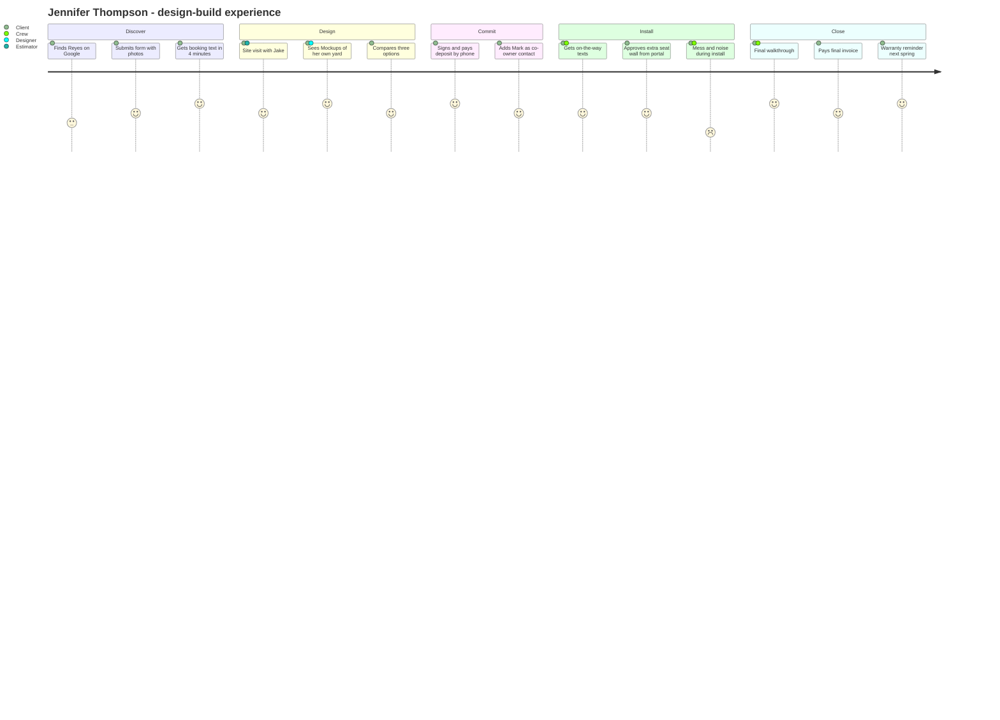

### 4.2 Residential weekly maintenance season (April to November)

The Thompsons are on a weekly mowing agreement: 32 visits from April 1 to mid-November, billed monthly in 8 equal installments, plus a 5-step fertilizer program and a fall cleanup.

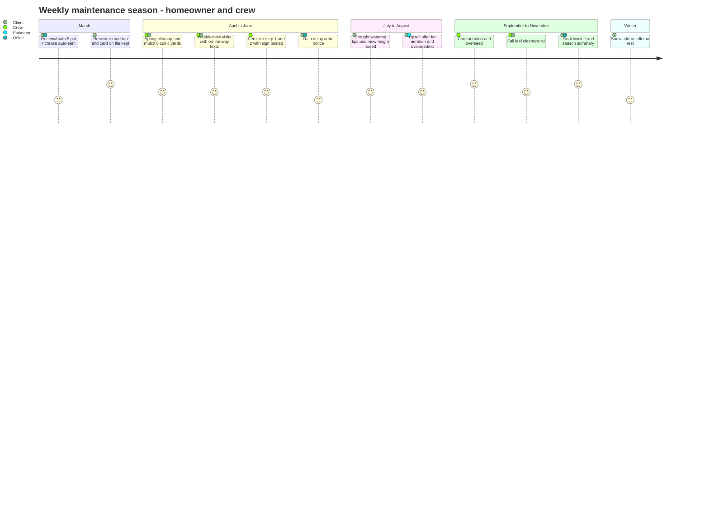

Permission-relevant points:
1. The **renewal** is generated by Automation under the office_manager's authority (`service_agreement.renew:all`). The Client sees the new price; crew leads never do.
2. **Fertilizer applications** require the applicator to hold a valid license (checked against `certification` records). An unlicensed technician can log "application under supervision" only where state rules allow it, and only if the crew lead on the Visit is licensed ([Service Lines](14-service-line-modules.md)).
3. **On-the-way texts** use a masked number. The technician never sees the Client's real phone unless the Company grants `field.client_contact.read` to the crew role.
4. **Gate codes and pet notes** (`access_secret` field class) are visible to the assigned Crew only from 60 minutes before to 60 minutes after the scheduled Visit window.

### 4.3 Commercial maintenance contract lifecycle with enhancements (Summit Grounds and Crossroads PM)

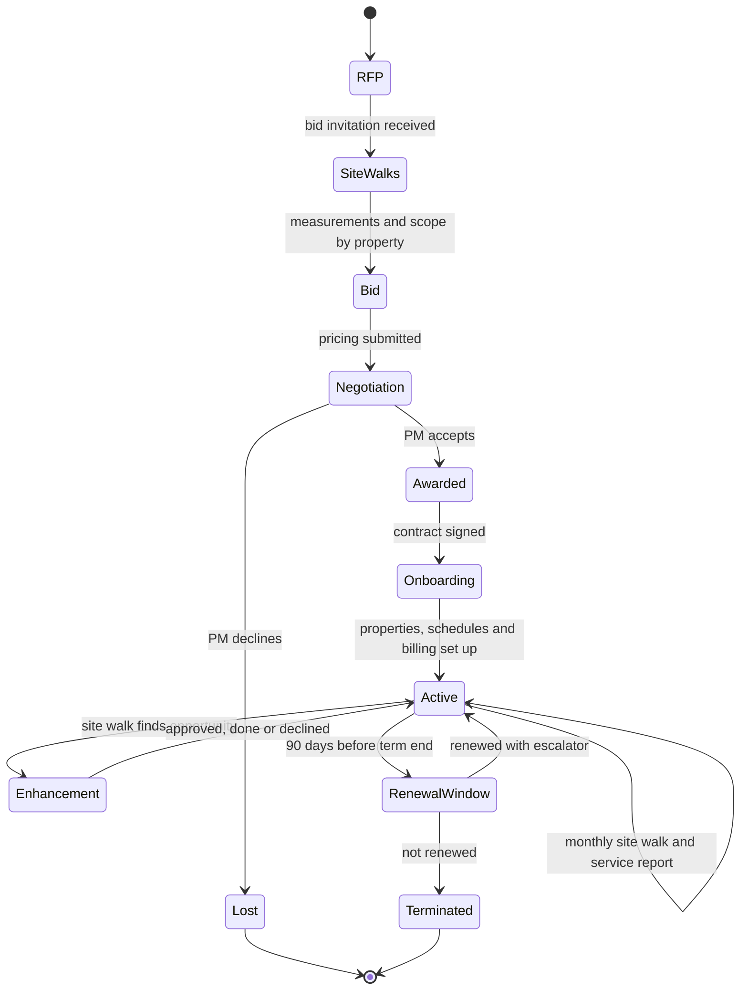

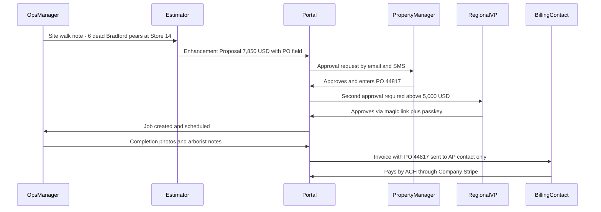

| Lifecycle stage | Who | Access rules that matter |
|---|---|---|
| Bid | estimator, ops_manager | Bid workspace visible to Summit staff in the Columbus branch only (`opportunity.read:branch`) |
| Onboarding | office_manager | Creates 9 Properties under Client "Crossroads PM"; adds Patricia (approver up to $5,000), the VP (approver over $5,000), the AP clerk (billing contact), and 9 site contacts (one per Property) |
| Monthly service | crew_lead, technician | Crews see Property, service checklist and site map only. They never see contract value or the PM's portfolio |
| Site walk report | ops_manager | Report published to the PM and the site contact for that Property only |
| Enhancements | estimator, Client approvers | Quorum and threshold rules (see 5.11). PO number required before work can be scheduled when the Client setting `po_required = true` |
| Snow | ops_manager, subcontractor | Snow subs see only assigned lots during storm events. Plow logs (time in, time out, GPS, photos) are shared with the PM automatically ([Service Lines](14-service-line-modules.md)) |
| Renewal | owner, estimator | Escalator (e.g. CPI or a fixed 4%) proposed 90 days out. The owner approves contract price changes above 8% (approval rule) |

> **Competitive edge - commercial approvals that match how property managers actually buy.** Field-service tools built for residential trades (Jobber, Housecall Pro) assume one decision-maker per client. Aspire supports commercial workflows but approvals happen offline by email. Rootline puts PO capture, thresholds, multi-approver quorum and AP-only invoice routing into the portal. Summit's estimators stop chasing signatures, and Crossroads gets an audit trail its own auditors accept.

### 4.4 A crew member's day (Luis, Summit Columbus, mid-May)

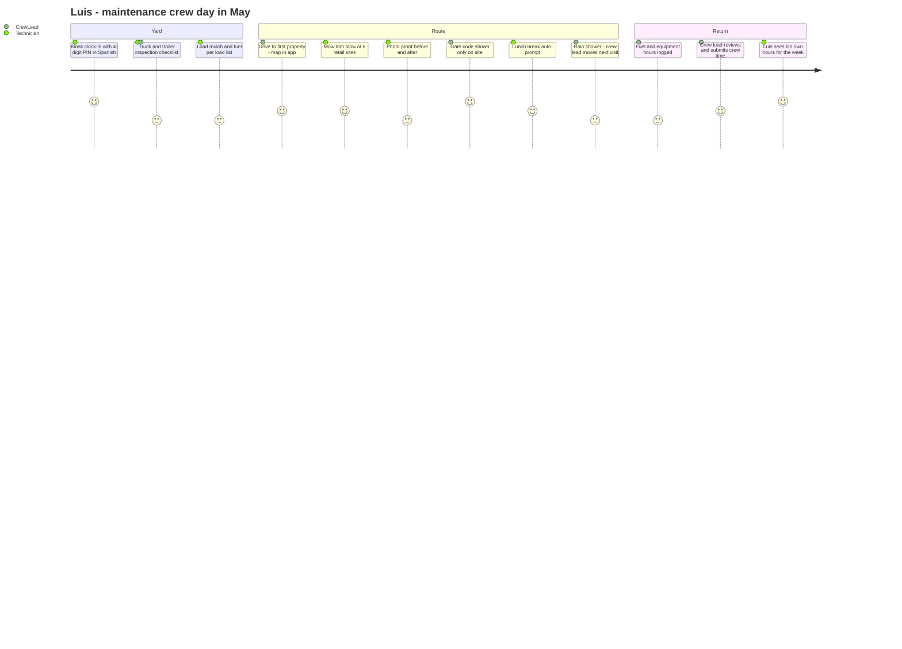

| Time | Action | Surface / auth | Data visible to Luis | Data hidden |
|---|---|---|---|---|
| 6:45 | Clock in at the yard kiosk tablet (PIN 4-6 digits, optional photo; see 5.15) | Kiosk mode, device trusted to the Columbus branch | His name, crew assignment, today's start location | Everyone else's hours, pay rates |
| 7:05 | Vehicle inspection (pre-trip) | Crew app on truck tablet, crew session under Miguel | Checklist, truck and trailer IDs | Equipment purchase costs |
| 7:30-15:30 | 6 Visits | Crew app | Address, map, site notes, task list, budgeted hours (Company setting), photos | Contract value, invoice totals, Client phone numbers |
| 11:45 | Lunch (30-minute unpaid, auto-prompt; state meal-break rules differ, see [Team](15-team-hr-payroll.md)) | Crew app | His time entries | n/a |
| 15:50 | Clock out, attest "no injuries today" (safety attestation) | Kiosk | His day total | Overtime calculations for others |
| 16:00 | Miguel reviews crew time, fixes a missed punch with reason "olvidó marcar salida" ("forgot to clock out") | Crew app | Crew time (Miguel only) | Pay rates |

Release note: the yard wall kiosk is [V1] ([Field Crew App](05-field-crew-mobile-app.md), device modes). At MVP Luis makes the same 6:45 punch on the truck's **crew device** with the same PIN pad, and the rest of the day is identical.

### 4.5 Homeowner's portal journey

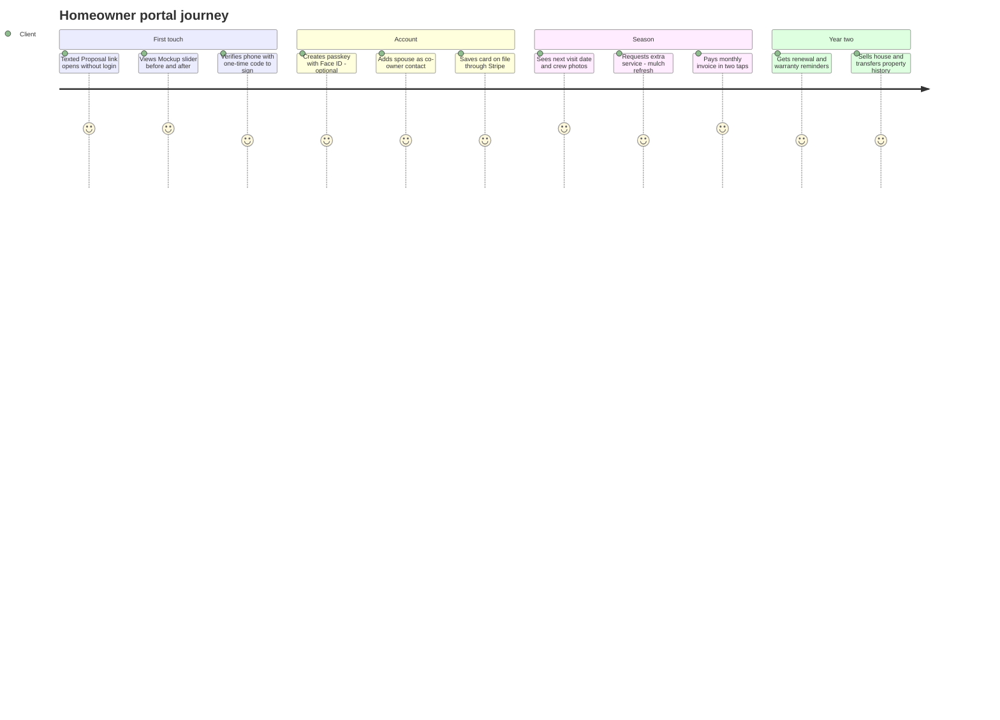

Rules:
1. **Document links** (Proposal, Invoice) open a **single-document view** without a full login: a signed, expiring token scoped to that one document. Signing, paying or viewing anything else requires a verified session (magic-link plus OTP, or passkey). See 5.14.
2. **Step-up verification** is required to add or remove contacts, change notification destinations, or save a payment method.
3. The **home sale transfer** (see section 14, Beyond the brief, item 1) lets the seller hand the Property's service history, plant list and irrigation map to the buyer as a new Client, with consent from both sides. [V2]

### 4.6 HOA board approval flow (Willow Creek HOA)

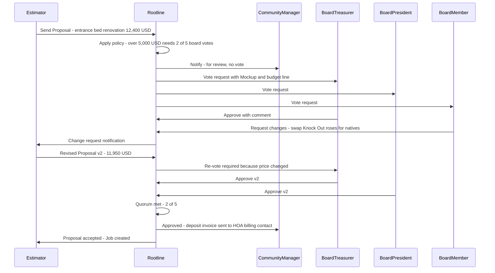

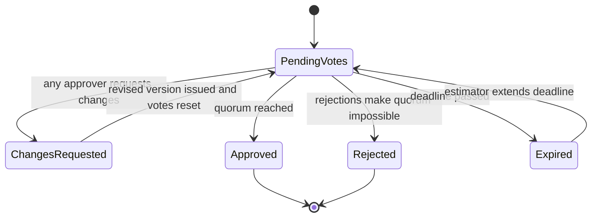

Rules: votes are bound to a specific Proposal version hash, so any price or scope change resets votes. Abstention is allowed. A board member who is also the community manager's spouse can be flagged "conflicted" and excluded from quorum [V2]. The full ballot record (who, when, IP, version) exports to PDF for meeting minutes. Rootline records votes under the rule the Client configured; it does not decide whether a vote is valid under the HOA's bylaws or state HOA statutes, and the policy editor says so. Willow Creek uses "2 of 5"; other boards use "majority of 5 with a quorum of 3", which the same engine supports ([Customer Portal](06-customer-portal.md) owns the full rule editor).

### 4.7 Bookkeeper month-end close (Karen Liu, CPA, for Reyes Outdoor Living)

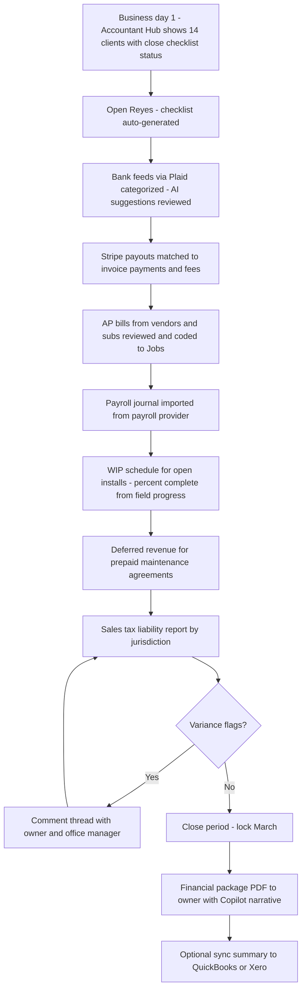

Access points: Karen's firm has **delegated access** (5.10) with the `bookkeeper` template. She can post journal entries, reconcile, and lock and unlock periods. She can read operational records (Jobs, Invoices, time entries) to trace numbers. She **cannot** dispatch crews, message Clients or change Stripe settings. Changes after a period lock require `period.unlock`, which the Company grants only to `owner` and `bookkeeper`. Every unlock is audited and announced to the owner.

**Close calendar for Reyes in April (target: books closed by business day 10):**

| Business day | Who | Work | Access exercised |
|---|---|---|---|
| BD1 | Rootline (automation) | Generates the close checklist; flags 23 unmatched bank lines and 2 Stripe payouts with fee mismatches | Service principal, no human access |
| BD2 | Beth (internal) | Codes receipts and vendor bills (nursery, quarry, fuel cards) to Jobs | `bill.update:all`, `expense.update:all` |
| BD3 | Linda (`office_manager`) | Answers Karen's comment thread: "Is the $2,140 Lowe's charge the Thompson seat wall?" | Close-checklist comment that carries only the line in question (amount, vendor, date); no Ledger access |
| BD4-5 | Karen (firm) | Bank and Stripe reconciliation; payroll journal from the payroll provider; accrues the April mulch delivery received but not billed | `bank_reconciliation.reconcile:all`, `ledger.journal_entry.post:all` |
| BD6 | Karen | WIP review: the Thompson patio is 60% complete by field progress but 50% billed, so she books underbillings; deferred revenue for prepaid maintenance | `financial_report.read:all`, operational read-only drill-down |
| BD7 | Dana (`owner`) | Reviews the variance list in 10 minutes on her phone; approves one reclass in the close thread | Owner grants; the reclass is posted by Karen |
| BD8 | Karen | Locks April; sends the financial package with a Copilot narrative | `ledger.period.lock:all` |
| BD10 | Karen | Sales tax return filed outside Rootline using the jurisdiction report | `report.export:all` |

### 4.8 The Platform Operator's day (founder)

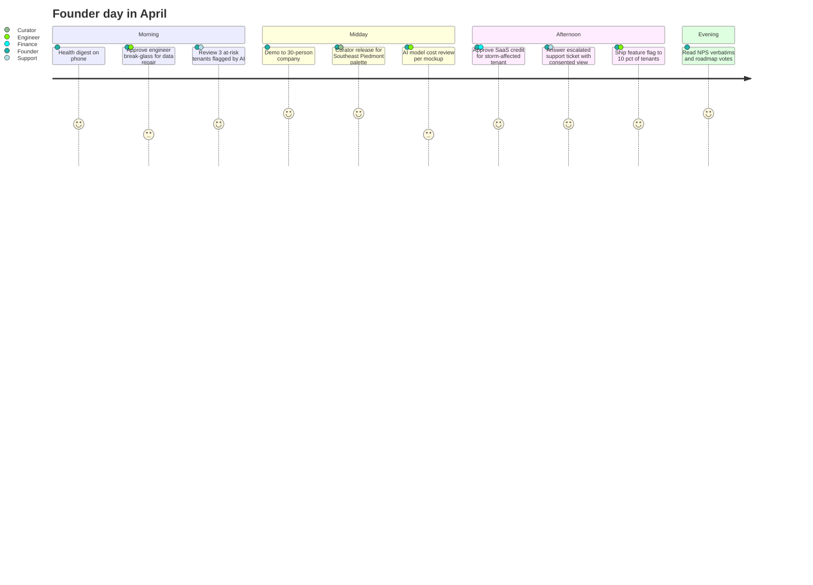

All of the above happen in the Platform Admin console ([Platform Admin](19-platform-admin-portal.md)). Each privileged action carries a reason code and is visible in the platform audit log. Tenant-touching actions also appear in the tenant's own access log.

### 4.9 A seasonal worker's year (Luis, Summit Columbus)

The brief's seasonal onboarding and offboarding requirement is easiest to judge across a whole year. Feature detail is in 5.18.

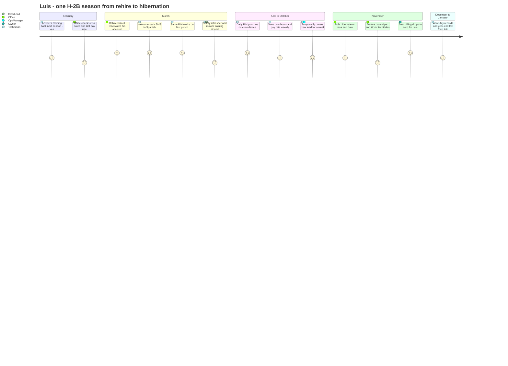

| Moment | Rule that makes it work | Section |
|---|---|---|
| February "coming back?" | Hibernated workers keep a minimal "My records" login; the response feeds spring headcount planning | 5.18.2 |
| March rehire | Matched by previous employee ID, phone and date of birth; certifications and driver's license re-checked; a new phone number needs office confirmation | 5.18.3 |
| Covering for Miguel | Time-bound `crew_lead` assignment with `valid_until`; expires automatically | 5.8 |
| November hibernation | Visa end date triggers hibernation; PIN hashes leave every kiosk on the next sync; no field-seat charge | 5.18.2, [Pricing](22-business-model-pricing-gtm.md) |
| Records retention | Time and pay records kept at least as long as federal and state wage-and-hour rules require | 5.18.4 |

---

## 5. Feature specification: identity, access and RBAC

### 5.1 Identity model: one person, many memberships [MVP]

- **Identity** is a global, platform-level record: a human with verified email and/or phone and credentials. One identity can hold many **memberships**:
  - a **Company membership** (tenant staff: owner through subcontractor user),
  - an **Accountant Firm membership** (5.10),
  - a **Client contact link** (portal access to one or more Clients across one or more Companies),
  - a **Platform staff membership** (separate realm, see 5.13).
- **Employee is not User.** An `employee` record (HR, payroll, crew roster) may exist without a login (e.g. a laborer clocked in by the crew lead). A user may exist without an employee record (external CPA, subcontractor). This prevents Arborgold's "office staff appear in crew pick-lists" problem. Rules:
  - A membership with a field role (`crew_lead`, `technician`) **must** link to an `employee`.
  - An `employee` may have zero or one linked user per Company.
- **Tenant switcher:** an identity with memberships in several Companies (e.g. a sub working for 3 landscapers, or a CPA) sees a switcher. Every request carries exactly one active tenant context. Cross-tenant queries are impossible below the Accountant Hub aggregation layer (5.10), which uses per-tenant calls.
- **Client identities are portal-only.** A homeowner who is also an employee of a Company (common: an employee who buys services from their employer) has two distinct memberships. The portal and the staff app never merge views.
- **Validation rules:**
  - Email unique per identity (case-insensitive, Unicode-normalized). Phone stored in E.164 format and unique per identity when used as a login factor.
  - The same phone may be a non-login contact number on many records.
  - An identity may not be deleted while it holds an active `owner` membership in any Company without an ownership transfer (5.18.6).

### 5.2 Permission taxonomy: `resource.action` [MVP]

**Grammar:** `resource.action[:scope]`, where `resource` may be dotted for sub-resources (`estimate.line`, `client.contact`), `action` is from a controlled vocabulary, and the grant carries a scope. Field visibility uses a parallel grammar: `field.<class>.read` / `field.<class>.write`.

**Standard actions:** `read`, `create`, `update`, `delete` (soft delete/archive), `export`.

**Domain actions** (only where defined for a resource): `assign`, `send`, `approve`, `approve_internal`, `sign`, `void`, `refund`, `post`, `reconcile`, `lock`, `unlock`, `complete`, `dispatch`, `optimize`, `collect`, `generate` (AI), `impersonate`, `merge`, `renew`.

**Resource catalog** (abbreviated; the full list is generated from code and shown in the role editor):

| Module | Resources | Notable domain actions |
|---|---|---|
| Company admin | `company.settings`, `user`, `role`, `org_unit`, `legal_entity`, `integration`, `stripe_connection`, `api_key`, `automation`, `audit_log`, `data_export`, `rootline_subscription`, `security_policy`, `support_access` | `user.assign_role`, `stripe_connection.connect`, `support_access.grant`, `data_export.run` |
| CRM | `lead`, `opportunity`, `client`, `client.contact`, `property`, `site_assessment`, `inbox.conversation` | `lead.assign`, `client.merge`, `inbox.conversation.send` |
| Sales | `estimate`, `estimate.line`, `proposal`, `change_order`, `service_agreement`, `price_book`, `production_rate` | `proposal.send`, `proposal.approve_internal`, `proposal.record_offline_acceptance`, `change_order.approve_internal`, `service_agreement.renew` |
| Design | `design`, `mockup`, `tenant_palette`, `plant_kb` (read), `takeoff` | `mockup.generate`, `design.share` |
| Operations | `job`, `visit`, `route`, `crew`, `equipment`, `inventory`, `purchase_order`, `vendor`, `subcontract_order`, `checklist`, `chemical_application`, `incident` | `visit.dispatch`, `route.optimize`, `visit.complete`, `purchase_order.approve` |
| Time and people | `time_entry`, `timesheet`, `employee`, `certification`, `training`, `payroll_export`, `expense` | `timesheet.approve`, `payroll_export.run` |
| Billing | `invoice`, `payment`, `refund`, `credit_memo`, `statement`, `deposit`, `collections_case`, `dispute`, `payout` | `invoice.send`, `invoice.void`, `payment.collect`, `payment.refund`, `collections_case.write_off`, `dispute.respond` (evidence submitted to the Company's own Stripe account) |
| Ledger | `ledger.account`, `ledger.journal_entry`, `ledger.period`, `bank_account`, `bank_reconciliation`, `bill`, `bill_payment`, `financial_report`, `tax_setting`, `accounting_sync` | `journal_entry.post`, `period.lock`, `period.unlock`, `bill_payment.approve` |
| Marketing | `campaign`, `review`, `website`, `booking_page`, `referral` | `campaign.send`, `review.respond` |
| Reporting | `dashboard`, `report`, `report.schedule` | `report.export` |
| AI | `copilot`, `ai_agent`, `ai_budget` | `copilot.use`, `ai_agent.configure`, `ai_agent.approve_action` |

**Rules:**
1. **Dependencies are explicit and auto-granted in the editor with a notice:** `X.update` implies `X.read`; `invoice.send` requires `invoice.read` and `field.price.read`; `payment.refund` requires `payment.read`. The editor refuses to save inconsistent roles; the API validates again.
2. **Danger flags:** some permissions are marked `sensitive` and show a red badge plus a confirmation: `stripe_connection.*`, `bank_account.update`, `vendor.banking.update`, `data_export.run`, `user.assign_role`, `role.update`, `period.unlock`, `security_policy.update`, `support_access.grant`, `api_key.create`.
3. **Owner-only permissions** cannot be granted to any other role: `stripe_connection.connect` / `disconnect` (covers both the Connect OAuth path and pasting restricted API keys on the advanced path, per [Payments](08-payments-stripe.md)), `rootline_subscription.cancel`, `company.delete`, `ownership.transfer`, and `security_policy.update` when SSO is enforced. Multiple users can hold `owner` (partners); see 5.18.6 for partner-dispute protections.
4. **Permission keys are stable API.** Renames ship as aliases for 2 major versions; tenants' custom roles are migrated automatically, and a changelog entry appears in the role editor.
5. **This document is the canonical permission catalog.** Sibling docs sometimes use illustrative spellings. They map one-to-one, and the code generator registers them as aliases so nobody has to rename prose:

| Spelling used elsewhere | Canonical key here | Where it appears |
|---|---|---|
| `invoice:issue` | `invoice.send` | [Architecture](20-architecture-security.md) |
| `estimate:view_cost` | `field.cost.read` on `estimate` | [Architecture](20-architecture-security.md) |
| `client:view_contact` | `field.client_contact.read` | [Architecture](20-architecture-security.md) |
| `visit:complete` | `visit.complete` | [Architecture](20-architecture-security.md) |
| `ledger:post_manual` | `ledger.journal_entry.post` | [Architecture](20-architecture-security.md) |
| `period:reopen` | `ledger.period.unlock` | [Architecture](20-architecture-security.md) |
| `payment:refund`, `payments.refund.create` | `payment.refund` | [Architecture](20-architecture-security.md), [Payments](08-payments-stripe.md) |
| `payments.disputes.respond` | `dispute.respond` | [Payments](08-payments-stripe.md) |
| `payments.field.collect` | `payment.collect:crew` | [Payments](08-payments-stripe.md) |
| `api_key:create` | `api_key.create` | [Architecture](20-architecture-security.md) |
| scope `assigned` | scope `own` (assignment is one of the `own` resolvers in 5.3) | [Architecture](20-architecture-security.md) |

### 5.3 Scopes: `own`, `crew`, `branch`, `all` [MVP; `branch` V1]

| Scope | Meaning (generic) | Notes |
|---|---|---|
| `own` | Records where the user is the owner, creator, assignee, salesperson or account manager, as defined per resource by an **ownership resolver** | Always includes records the user created, unless the resource's resolver says otherwise (e.g. `time_entry:own` = entries for the user's linked employee) |
| `crew` | Records assigned to any Crew the user belongs to or leads, **within the visibility window** | For people-resources (`time_entry`, `employee`), means members of crews the user **leads** |
| `branch` | Records whose `branch_id` is in the user's branch memberships, optionally narrowed by division filters on the role assignment | Users always also see their `own` and `crew` records even if those sit in another branch (borrowed crews) |
| `all` | All records in the Company, limited to the legal entities on the membership (5.9) | Default for owner |

**Scope resolution:** `effective_scope(permission) = max over roles held` with ordering `none < own < crew < branch < all`. The record filter is the **union** of the filters for the granted scope and every lower scope, so a branch-scoped user never loses their own records.

**Ownership resolvers (excerpt):**

| Resource | `own` | `crew` | `branch` |
|---|---|---|---|
| `lead`, `opportunity` | `owner_user_id = me` OR I am on the sales team | (not applicable; treated as `own`) | `branch_id in my_branches` |
| `client`, `property` | I own an open Opportunity/Job/Agreement for it OR I am account manager | A Visit for this Property is assigned to my Crew within the window | `property.branch_id in my_branches` (Client visible if any Property matches) |
| `job`, `visit` | I am an assignee | `crew_id in my_crews` and within the window | `branch_id in my_branches` |
| `time_entry`, `timesheet` | `employee_id = my_employee` | Employee is a member of a Crew I lead on that date | Employee's home branch in my branches |
| `invoice`, `payment` | Invoice on a Job/Agreement where I am salesperson or account manager | Field invoice created by my Crew today (only with `payment.collect`) | `branch_id in my_branches` |
| `design`, `mockup` | Creator or assigned designer | Plan sheets attached to Jobs assigned to my Crew (read-only, price-free) | `branch_id in my_branches` |
| `subcontract_order` | (sub users) assigned to my vendor org | n/a | Company staff: `branch_id in my_branches` |
| `ledger.*` | n/a | n/a | n/a: Ledger resources use `all` limited by legal entity; branch is a reporting dimension, not a security boundary, unless the Company enables **branch-restricted financials** [V2] |

**Visibility windows (crew scope):** defaults are configurable per Company and role:
- `technician`: from yesterday through 6 days ahead.
- `crew_lead`: 7 days back through 14 days ahead.
- `subcontractor`: from assignment through 7 days after completion.

Outside the window, Clients, Properties and Visits disappear from the device on the next sync, and the local copy is purged.

### 5.4 Field-level restrictions (field classes) [MVP]

Every sensitive attribute in the schema is tagged with exactly one **field class**. Roles grant `field.<class>.read` and/or `.write`. Tagging is enforced by a lint rule in CI: an untagged money or PII column fails the build ([Architecture](20-architecture-security.md)).

| Field class | Example fields | Default readers (templates) | Masking behavior when not granted |
|---|---|---|---|
| `price` | Sell price, line totals, Proposal totals, contract value, invoice totals | owner, office_manager, estimator, designer, ops_manager, bookkeeper | Omitted; crew sees quantities and descriptions only |
| `cost` | Material unit cost, labor burden rate, equipment rate, sub PO cost, actual job cost | owner, office_manager, estimator (own Estimates), ops_manager, bookkeeper | Omitted; job-costing widgets show hours only |
| `margin` | Margin %, markup, overhead recovery, net profit, break-even | owner, bookkeeper, estimator (own Estimates only) | Omitted; can be replaced by a **status indicator** ("on target / at risk") when the Company enables `margin_indicator_for_ops` |
| `budget_hours` | Budgeted labor hours per Visit or phase | all staff roles incl. crew_lead, technician | Hidden entirely when the Company disables it (some owners prefer crews not to "pace to budget") |
| `pay_rate` | Hourly wage, salary, piece rate, bonus, commission rates, burden % | owner, bookkeeper, office_manager | Omitted. **Self-exception:** a user may read their own pay rate when `self_pay_rate_visible = true` (default true) |
| `employee_pii` | SSN/SIN, DOB, home address, bank account, immigration documents, driver's license number | owner, office_manager, bookkeeper (payroll only) - **step-up auth required on every read session** | Omitted; crew_lead sees only the emergency contact for their crew members (safety exception) |
| `client_contact` | Client phone numbers, emails, billing address | office roles, estimator (own), designer (own, read), ops_manager (branch), bookkeeper (billing contacts) | Replaced by **masked actions**: "Call client" and "Text client" go through a Twilio proxy number; the real number never reaches the device |
| `client_financial` | AR balance, aging, payment-method last 4, credit hold reason | owner, office_manager, bookkeeper | Replaced by a **status chip** (Good standing / Past due / On hold) when the user has `client.read` |
| `access_secret` | Gate codes, alarm codes, lockbox codes, key locations | office roles always; crew roles only within the **visit window** (scheduled start minus 60 minutes through end plus 60 minutes) | Shown as "Available 7:15 am on visit day"; field-level encrypted at rest, reveal is audited |
| `internal_note` | Office-only notes ("demanding client, always confirm price in writing") | office roles, estimator, ops_manager | Omitted; crew sees "crew notes" only |
| `commission` | Commission amounts, plans | owner, bookkeeper; estimator for own deals | Omitted |
| `vendor_banking` | Vendor and sub bank details | owner, bookkeeper | Omitted; changes need dual control (5.6) |

**Enforcement points** (all server-side, from one policy definition):
1. API serializers (REST/GraphQL) project fields per caller; masked fields are **absent**, not null, so clients cannot infer zero vs hidden. A separate `_redactions` array lists hidden field names so the UI can show "why can't I see this?".
2. Offline sync ([Field Crew App](05-field-crew-mobile-app.md)): sync buckets are computed per user. Masked columns are never serialized into the device database.
3. Search index: documents are indexed with per-field ACL tags; queries filter by the caller's field grants (no searching "invoices over $10,000" without `field.price.read`).
4. Exports and scheduled reports: the report engine resolves columns against the **recipient's** grants at send time, not the author's. Emailing a report to a user who lacks `margin` drops those columns and notes it in the footer.
5. Notifications and templates: merge fields are resolved under the recipient's permissions (a crew lead's daily digest cannot include `{{job.contract_value}}`).
6. Copilot and AI agents ([AI Copilot](17-ai-copilot-automation.md)): retrieval and tool calls run **as the user**. Tool results pass through the same projection before reaching the model. System prompts never contain data the user cannot read.
7. Webhooks and API keys: API keys carry a role (see 9.2). Webhook payloads are projected under the key's role.
8. Printing and PDFs: crew work orders render from a "crew-safe" template that has no price slots.
9. **Client-facing mode** [V1]: an estimator or designer presenting on an iPad in the driveway taps one toggle (or the app detects the Proposal presenter view) and the session temporarily drops `cost`, `margin`, `internal_note` and `client_financial` from every projection until they unlock with Face ID or PIN. This is a session-level reduction of grants, never an increase, so it reuses the same projection layer.

### 5.5 Record visibility rules ("hide other clients") [MVP]

1. **Field roles see Clients only through Visits.** A technician has no Client directory: the only path to a Client or Property is a Visit in their window. Search in the crew app searches only those.
2. **Minimum necessary fields.** Even within a Visit, a technician sees Property name, address, map pin, site notes, service checklist, crew notes, photos and access secrets (windowed). They do not see Client legal name (if it differs from the Property name), other Properties of the same Client, invoices or contract terms.
3. **Commercial portfolios are partitioned.** Site contacts of one Property never see another Property, even under the same Client. Billing contacts see invoices for the Properties assigned to them (default: all of the Client's Properties).
4. **Branch walls.** With branches enabled, branch-scoped users cannot see Clients that only have Properties in other branches. Search returns "no results", not "access denied", to avoid enumerating.
5. **Tenant walls.** Postgres row-level security on `tenant_id` underlies every query ([Architecture](20-architecture-security.md)). A cross-tenant request is a security incident page, not a 403.
6. **Photo privacy.** Visit photos are tagged by Property. A Client sees only their Properties' photos. Photos showing neighbors' houses can be flagged "internal only" by the crew lead [V1]. AI face-blur on Client-shared photos (crew faces and bystanders) is available as a Company setting [V1].

### 5.6 Approval limits, thresholds and dual control [MVP; dual control V1]

Roles carry **numeric limits** in addition to permissions. Exceeding a limit converts the action into an **approval request** routed to the users in scope whose limits cover it (or the owner).

| Limit key | owner | office_manager | estimator | ops_manager | crew_lead | technician | bookkeeper | Behavior when exceeded |
|---|---|---|---|---|---|---|---|---|
| `discount.max_pct` | unlimited | 15% | 10% | 10% | 0 | 0 | n/a | Proposal goes to "Pending internal approval" |
| `proposal.max_value_without_approval` | unlimited | $25,000 | $15,000 | $15,000 | n/a | n/a | n/a | Same |
| `estimate.margin_floor_pct` | none | 35% | 35% | 35% | n/a | n/a | n/a | Proposal below floor needs owner approval; the estimator sees the floor (not the owner's target) |
| `refund.max_amount` | unlimited | $500 per refund, $2,000 per day | 0 | 0 | 0 | 0 | $500 per refund | Refund request queued for the owner (push, one-tap approve), as in [Payments](08-payments-stripe.md) |
| `credit_memo.max_amount` | unlimited | $250 | 0 | $250 | 0 | 0 | unlimited | Credit memo request queued |
| `write_off.max_amount` | unlimited | $100 | 0 | 0 | 0 | 0 | $500 | Owner approval |
| `purchase_order.approve_max` | unlimited | $5,000 | 0 | $2,500 | $300 (field purchase) | 0 | 0 | PO pending |
| `bill_payment.approve_max` | unlimited | 0 | 0 | 0 | 0 | 0 | $10,000 per bill run | Owner approval; vendor banking changes in the last 10 days force owner approval regardless of amount |
| `timesheet.edit_max_hours` | unlimited | unlimited | n/a | 4 h | 1 h | 0 | n/a | Edit flagged for approval with reason |
| `payment.collect_max` | unlimited | unlimited | $10,000 (deposits on own Proposals) | $5,000 | $2,000 | $500 | n/a | Field collection blocked above limit; office must invoice |
| `change_order.max_value` | unlimited | $5,000 | $5,000 | $2,500 | draft only | none | n/a | Drafts without price |

Limit rules:
- Limits are per transaction unless a daily cap is stated. Daily caps reset at midnight in the Company's time zone.
- Splitting is detected: two refunds to the same Client within 24 hours that together exceed the limit route the second one to approval.
- Users can never approve their own requests, even if another role they hold would allow it (self-dealing guard, 12.1).
- Amounts are in the Company's currency (USD or CAD). A Company with both currencies sets limits per currency.

**Dual control (two-person rule) [V1]:**
- Applies to: changing a Ledger bank account or the funding account used for bill pay; changing vendor banking details (a fake "we changed banks" email from a vendor is a classic business-email-compromise scheme); disconnecting Stripe; exporting more than 1,000 Client records; deleting a legal entity; unlocking a period older than 90 days; granting `owner` to a new user.
- The second approver must be a different identity holding the same permission, and cannot be the initiator's impersonator.
- Single-owner Companies can name an "outside approver" (e.g. their CPA) or accept a 24-hour cooling-off delay with email and SMS notice instead.
- **Stripe payout accounts are out of Rootline's reach by design.** With bring-your-own-Stripe, the bank account that receives Client payouts lives in the Company's own Stripe dashboard ([Payments](08-payments-stripe.md)). Rootline cannot gate that change, so it watches instead: when Stripe reports an external-account change on the connected account (the `account.external_account.*` webhook family; verify behavior for Standard accounts), Rootline alerts every `owner` by push, email and SMS, records it in the audit log, and shows a banner until an owner confirms "this was me".

### 5.7 Role templates [MVP]

Rootline ships nine tenant role templates matching the personas. Templates are versioned by Rootline. Companies can use them as-is (and receive improvements) or clone them into custom roles (frozen until edited). The full matrix is in section 10.

| Template | Summary | Surfaces | Seat type (derived from permissions, per [Pricing](22-business-model-pricing-gtm.md) 4.3) | MFA default |
|---|---|---|---|---|
| `owner` | Everything, plus owner-only permissions | Web, mobile | Office | Required |
| `office_manager` | Front office: CRM, scheduling, invoicing, collections, team admin (no role editing), no Ledger P&L by default | Web, mobile | Office | Required |
| `estimator` | Own pipeline, Estimates and Proposals; cost and margin on own Estimates; branch lead pool | Web, tablet | Office | Required |
| `designer` | Design Studio, Mockups, Plant KB, prices (no cost or margin by default) | Web, tablet | Office + Designer entitlement | Required |
| `ops_manager` | Branch operations: Jobs, Visits, dispatch, Crews, equipment, timesheet approval, job cost (hours and cost; margin per setting) | Web, mobile | Office | Required |
| `crew_lead` | Crew app: crew Visits, crew time edits, checklists, chemical logs, field change-order drafts, optional field payments | Mobile, kiosk | Field (billed only when active) | App PIN or biometrics |
| `technician` | Crew app: own time, crew Visits (limited), photos, checklists | Mobile, kiosk | Field (billed only when active) | Kiosk PIN or app PIN |
| `bookkeeper` | Ledger, AR/AP, bank rec, reports, payroll export, read-only ops drill-down | Web | Free bookkeeper seat (1 per Company; more when linked to a verified Accountant Partner firm) | Required |
| `subcontractor` | Assigned subcontract orders only; bills to the Company | Sub portal (web/PWA) | Free, unlimited | Required for the full sub portal; single-order links need none (5.12) |

**Seat consequences are shown before save.** Because seat type follows permissions, the role editor and the invite screen show the seat effect of every change: "Giving Miguel `estimate.update:own` makes him an office seat ($39/month on Grow, as of the [Pricing](22-business-model-pricing-gtm.md) draft)." Field-only roles stay field seats however many crew-app permissions they hold.

Additional **starter custom roles** offered in the role gallery [V1]: Branch Manager (`ops_manager` + branch P&L), Sales Manager (estimator team scope + pipeline reports), Irrigation Technician (technician + irrigation controller access + `chemical_application` none), Snow Plow Operator (night-shift, snow Routes only), **Observer** (read-only investor, silent partner or family member: dashboards, `field.margin.read`, no PII, no Client-list exports; up to 3 free per Company per [Pricing](22-business-model-pricing-gtm.md)), Payroll Clerk, Mechanic (equipment and work orders only), Kiosk Supervisor (unlock PINs only).

### 5.8 Custom roles, multi-role users and anti-escalation [MVP clone-and-edit; V1 gallery and diff]

**Custom role builder:**
1. Start from a template, a gallery role or blank.
2. Toggle permissions in a grouped grid (module, then resource, then action), with a scope dropdown per row (`none / own / crew / branch / all`).
3. Toggle field classes (read/write) and set approval limits.
4. Choose allowed surfaces (web, mobile, kiosk, API) and the default language and landing page.
5. **Preview** with "View as this role" (5.21) on a sample user.
6. Save, which shows an impact diff ("12 users affected: +`invoice.send:branch`, -`field.margin.read`"). The diff is recorded in the audit log.

**Validation rules:**
- Name unique per Company (max 60 chars). A role key is generated (`custom_irrigation_manager`).
- **Anti-escalation:** a user can create, edit or assign a role only if every grant in it is less than or equal to their own effective grant (permission plus scope plus field classes plus limits). Only `owner` can create roles that include `user.assign_role` or `role.update`.
- **Guardrail policies** (Company-level caps) [V1]: e.g. "`field.margin.read` may only be granted to owner and bookkeeper roles". Guardrails override roles and are visible in the editor as locked toggles.
- Deleting a role with assigned users requires reassignment. Roles are archived, not hard-deleted, to keep audit history meaningful.

**Multi-role users:**
- Allowed: Jake is `estimator` + `crew_lead` on Saturdays; Dana is `owner` and also linked to an employee so she can clock in.
- Effective permissions = union. Scope = maximum. Field classes = union. Limits = maximum.
- **Role assignments can be time-bound** (`valid_from`, `valid_until`) and **org-unit-bound** (branch or division). Example: "`ops_manager` for Dayton branch while Andre covers vacation, July 1-14" [V1].

**Just-in-time elevation [V2]:** a user taps "Request access" on a denied action (e.g. a crew lead applying a 10% goodwill discount). The request carries context and an expiry. The approver gets a push notification and approves "for this record only" or "for 4 hours". The elevation is recorded and expires automatically.

### 5.9 Organization structure: branches, divisions, legal entities, multi-company and franchise

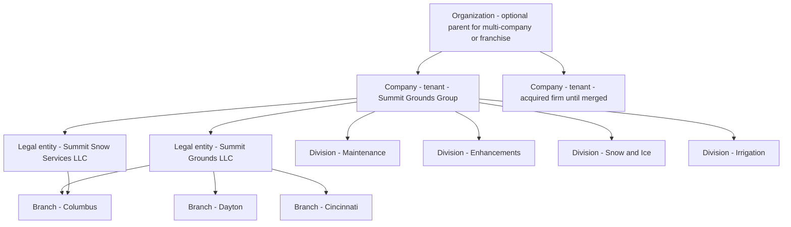

| Concept | Purpose | Security effect | Priority |
|---|---|---|---|
| **Branch** (org unit type `branch`) | Physical operating location with its own Crews, yard, equipment and often its own manager | Scope boundary for `branch` scope; kiosk devices and Routes belong to a branch | [V1] |
| **Division** (org unit type `division`) | Service line or profit center (Maintenance, Enhancements, Construction, Snow, Irrigation, Plant Health Care), similar to how Aspire separates divisions as P&L profit centers from branches as operating units | Optional filter on role assignments ("Irrigation manager sees the Irrigation division in all branches"); reporting dimension on Ledger lines | [V1] |
| **Legal entity** | Separate books: an LLC for snow, an S-corp for landscape; each has its own Chart of Accounts, Stripe account (optional, one per entity) and tax IDs ([Accounting](09-accounting-ledger-integrations.md)) | Memberships list allowed entities; `all` scope never crosses into entities not on the membership | [V1] |
| **Organization: multi-company** | One owner with several separate tenants (e.g. after an acquisition, before merging) | Single sign-on across Companies; owner-level consolidated dashboards; no cross-tenant record access | [V1] |
| **Organization: franchise** | Franchisor with franchisee tenants | Franchisor gets brand templates, royalty and KPI rollups, compliance checklists. Record-level access to a franchisee's data requires a **data-sharing agreement** per category (e.g. "franchisor may read Client names and invoices for royalty audit"), recorded and revocable by the franchisee within contract terms | [V2] |
| **Roll-up / platform acquisition** | Private-equity-backed platforms acquiring landscape firms | Tenant merge tool: migrate Company B into Company A as a new branch with ID mapping and audit preservation (platform-assisted) | [V2] |

**Cross-branch work rules [V1]:**
1. A Visit belongs to the **selling branch** (revenue) and records a **performing crew** (labor).
2. When a Columbus crew works a Dayton Visit, the crew sees it through `crew` scope, and both branch ops managers see it.
3. The Ledger posts an intercompany or interbranch labor allocation when configured ([Accounting](09-accounting-ledger-integrations.md)).

### 5.10 Delegated access for external accountants: the Accountant Hub [MVP basic; V1 Hub]

**MVP (basic delegated access):**
- An owner invites "my accountant" by email. The invitee gets (or reuses) their Rootline identity and a membership with the `bookkeeper` template (or a custom variant).
- Delegated access is **free**: one bookkeeper seat per Company at no charge, and more when the bookkeeper belongs to a verified Accountant Partner firm ([Pricing](22-business-model-pricing-gtm.md) 4.3). This mirrors how accounting products court accountants (e.g. QuickBooks Online lets owners invite accountant users; verify current limits).
- MFA is mandatory for delegated accountants.

**V1 (Accountant Hub):**
1. **Accountant Firm** entity with its own staff and roles (`firm_admin`, `firm_staff`). The firm admin assigns which staff work which client Companies.
2. **Client grants:** the Company owner grants the **firm** (not just a person) access with a role, optional entity restriction, and optional expiry (e.g. "through April 30 for tax season"). The firm maps its staff to that client.
3. **Hub dashboard:** all client Companies with close status (the close checklist from journey 4.7), unreconciled transaction counts, AR over 90 days, sales tax deadlines, and period lock state.
   - The aggregation layer queries each tenant **under the delegation**. No cross-tenant joins.
4. **Revocation:** the owner can revoke the firm at any time. Active sessions die immediately (5.16). The firm keeps nothing but its own work papers exported earlier.
5. **Accountant-specific powers:** `period.lock` and `period.unlock`, `journal_entry.post` (including adjusting entries flagged "accountant adjustment"), `reclassify` (bulk), and close checklist sign-off.
   - Cannot: dispatch, message Clients, change Stripe, manage users (unless granted).
6. **Firm-level audit:** every action records both the firm and the individual. Owners see "Liu & Partners CPAs - Karen Liu posted 4 adjusting entries."
7. **Referral loop:** firms can create a new client Company from the Hub (pre-connected to the firm), which feeds the partner program in [GTM](22-business-model-pricing-gtm.md).

> **Competitive edge - free, firm-level CPA access.** Landscape FSMs typically push the accountant into QuickBooks, which is one reason sync breakage features so heavily in complaints. Rootline's Ledger plus the Accountant Hub makes the CPA's life easier inside Rootline than in QuickBooks. It is also a distribution channel: one CPA firm with 14 landscape clients is 14 warm introductions.

### 5.11 Client-contact permissions and approval policies [MVP contact roles; V1 approval policies]

Client contacts are not staff. Their permissions are relationship-based: **contact X has role R on Client C, optionally limited to Properties P1..Pn.**

| Contact role | View schedule and photos | Request service | View Proposals and Designs | Approve / sign | View invoices and Statements | Pay | Manage payment methods | Manage contacts | Notes |
|---|---|---|---|---|---|---|---|---|---|
| `primary` | All Properties | Yes | Yes | Yes (unlimited unless policy) | Yes | Yes | Yes | Yes | One per Client; transfer requires both parties or Company action |
| `co_owner` | All | Yes | Yes | Yes | Yes | Yes | Configurable (default no) | No | Spouse, business partner |
| `billing` | No | No | No | No | Yes (assigned Properties) | Yes | Yes | No | AP clerk; receives invoices and Statements only |
| `property_contact` | Assigned Properties | Yes | View only (if Company shares) | No | No | No | No | No | Site or facilities contact, resident tenant |
| `approver` | Assigned Properties | Yes | Yes | Within approval policy | Optional | No | No | No | HOA board member, regional VP |
| `viewer` | Assigned Properties | No | Yes (shared items) | No | Optional | No | No | No | Consultant, landscape architect, family member |

**Approval policies** (per Client, optionally per Property or Property group) [V1]. A policy is an ordered list of rules evaluated first-match; the full rule editor, budget checks and portal screens are specified in [Customer Portal](06-customer-portal.md). This section defines the access semantics.
- Fields per rule:
  - `applies_to`: Proposals, change orders, or both.
  - Conditions: `min_amount` / `max_amount`, optional `category` (e.g. irrigation repair) and optional budget status (over or under the Client's enhancement budget).
  - `mode`: `any` (any one listed approver), `sequential` (e.g. PM then VP), or `vote` with `required_yes` and optional `quorum` ("all must approve" is `vote` with `required_yes` equal to the number of approvers).
  - `approver_contact_ids`.
  - `deadline_days`.
  - `po_required` (boolean), `po_format_regex`.
  - `term_end_date` per approver: board terms expire, and an expired approver loses voting rights automatically and the PM is notified.
- Example policy: Willow Creek HOA uses `vote` with `required_yes = 2` of 5 board members above $5,000, and `any` (community manager) below $5,000. Crossroads PM uses `sequential` (Patricia, then the regional VP) above $5,000.
- **Version binding:** votes attach to a Proposal version hash. A price, scope or option change resets votes.
- **Delegation:** an approver can delegate their vote to another approver for a date range (vacation).
- **Evidence:** each vote stores identity, authentication method (magic link, passkey, SSO), IP, user agent, timestamp, version hash and comment. The ballot exports to PDF.

**Contact management rules:**
- Primary contacts can invite contacts with roles up to their own (anti-escalation applies to clients too).
- Company staff with `client.contact.update` can manage contacts on the Client's behalf. The Client sees a timeline entry "Reyes Outdoor Living added Mark Thompson as co-owner".
- **Communication consent** (TCPA/CASL) is stored **per contact per channel** (SMS, email, voice) with source and timestamp ([Marketing](16-marketing-growth-communications.md)). Contact roles never override consent: a billing contact who opted out of SMS gets email only.
- **De-provisioning:** when a contact is removed, open sessions are revoked, and outstanding document links addressed to that contact are invalidated.
- **Management companies** [V1]: an HOA is usually the Client (it pays), while a community manager at a management company serves many HOAs. One contact identity can hold roles on several Clients; the portal shows a Client switcher plus a combined approvals inbox across all of them. When an HOA changes management company, the old firm's contacts lose access on the effective date and the HOA keeps its full history ([Customer Portal](06-customer-portal.md)).
- **New-contact approval** [V1]: a Company can require staff approval before a Client-invited contact becomes active (useful for commercial Clients with staff turnover).

### 5.12 Subcontractor access and data visibility [MVP basic; V1 sub portal]

- **Vendor org model:** a Subcontractor is a `vendor` with `is_subcontractor = true`. It can have multiple users (owner and workers) with `subcontractor` membership linked to the vendor. One identity can serve several Rootline Companies through separate memberships (tenant switcher).
- **What subs see:** only `subcontract_order` records assigned to their vendor, and through them:
  - the Property address and map;
  - the scope of work and attachments explicitly shared (Design sheets, irrigation zone maps);
  - site contact via masked number;
  - access secrets during the work window;
  - **their** PO amount and terms;
  - required insurance and certificates status.
- **What subs never see:** Client legal name and billing details (unless the Company opts in), sell prices, margins, other subs, other Properties, other Visits.
- **What subs can do:**
  - accept or decline orders;
  - update status;
  - upload photos, GPS check-in and check-out, and completion notes;
  - submit a bill (invoice to the Company) against the PO;
  - upload COI and W-9 / T4A info;
  - view their bill payment status.
- **Two ways in, matched to risk:**
  - **Single-order links** [MVP]: an SMS or email link scoped to one `subcontract_order`. It allows view, accept or decline, check-in and check-out, photos and completion notes. It needs no account, expires 7 days after completion, and is revocable. A forwarded link exposes one Property's address and scope, never billing, banking or other orders. Gate codes still need a GPS check-in within 150 m of the Property (or office override).
  - **Full sub portal** [V1]: all orders across Companies, bills, payment status, COI and W-9 / T4A uploads, and banking. Login is a passkey, or a password plus MFA; MFA is mandatory here, as in [Architecture](20-architecture-security.md). Idle timeout is 8 hours.
- **Window:** access starts at assignment and ends 7 days after completion (configurable 0-90). Snow subs get **season-long standing orders** for assigned lots, with storm-event activation.
- **Compliance gates:** the Company can block order acceptance if the sub's certificate of insurance is expired or their W-9 is missing ([Operations](13-operations-inventory-equipment.md)).
- **Communication:** sub to Client communication goes through the Company's inbox by default (`subcontract.client_contact_allowed = false`).

### 5.13 Platform staff permissions, support impersonation and break-glass [MVP]

**Separate realm.** Platform staff authenticate in a **separate identity realm**:
- a distinct admin domain and cookie scope;
- mandatory SSO through Rootline's corporate IdP;
- phishing-resistant MFA (FIDO2 security keys or device-bound passkeys);
- managed devices only [V1 device posture].

Platform staff have **no tenant memberships**. They reach tenant data only through the mechanisms below.

**Platform permissions** (prefix `platform.`) are matrixed in section 10.4. Key principles:
- `platform_curator` never sees tenant business data.
- `platform_finance` sees Rootline's SaaS billing, never tenant Client payments.
- `platform_engineer` has no standing production-data access.

**Support access (consented impersonation):**

| Mode | What it allows | Consent | Default duration | Priority |
|---|---|---|---|---|
| **Metadata view** | Tenant profile, plan, usage, feature flags, error logs (PII-redacted), sync health, integration status, user list (names, roles, last active) | None (covered by ToS; logged) | n/a | [MVP] |
| **View as user (read-only)** | See the app exactly as a specific user sees it (that user's permissions, never more). Writes are blocked at the API layer | Tenant grant by owner or office_manager (`support_access.grant`), per ticket or standing read-only consent (opt-in) | 72 h per grant; each session max 60 min | [MVP] |
| **Act as user (read-write)** | Perform actions as the user, e.g. fix a Route or re-run an import | Explicit per-ticket grant with `write` scope; owner approval required | 24 h; each session max 30 min | [MVP] |
| **Break-glass** | Engineer access to production data for incident response or data repair (SQL via audited bastion, scoped to one tenant) | Two-person rule: `platform_owner` approval (or a second designated approver if the founder is unavailable) with a legal or security reason code, as in [Platform Admin](19-platform-admin-portal.md); tenant notified within 24 h unless legally prohibited | 30-120 min, auto-revoked | [MVP] |

**Impersonation rules:**
1. Support can only impersonate users whose role is equal to or lower than the granting user's (an office_manager cannot grant access to "view as owner").
2. Even in "Act as", these remain blocked:
   - viewing or changing credentials, MFA, passkeys or SSO config;
   - reading `employee_pii` and `vendor_banking`;
   - connecting or disconnecting Stripe;
   - bulk exports;
   - sending messages to Clients (unless explicitly granted per ticket);
   - deleting records (soft-delete only, flagged).
3. Every request carries `actor_id` (staff), `subject_id` (impersonated user) and `ticket_id`. The UI shows an unmissable orange banner "Viewing as Miguel Hernández - Rootline Support (Maya) - Ticket 4821 - ends in 42 min".
4. **Tenant transparency:** Settings > Security > Support access log lists every session (who, when, duration, mode, ticket, pages and records touched). Owners get an email summary after each session.
5. Copilot is disabled inside impersonation sessions to avoid confusing attribution [MVP].
6. **Viewing the portal as a Client contact** [V1] is allowed only when the Company grants it for a named contact on a ticket (e.g. "Jennifer can't see her Mockups"). Payment-method, signature and contact-management screens render as placeholders. Rootline support never contacts a Company's Clients directly; the Company owns that relationship.
7. **Founder access follows the same rules.** `platform_owner` sessions in tenant data use the same grants, banners and logs. The founder's only extra power is approving break-glass, which is itself logged and reviewed by a second person within 5 business days ([Platform Admin](19-platform-admin-portal.md)).

### 5.14 Authentication per persona [MVP unless tagged]

| Persona / role | Primary method | Second factor / step-up | Options | Notes |
|---|---|---|---|---|
| `platform_*` | SSO through Rootline corporate IdP (OIDC) | FIDO2 hardware key or platform passkey, required | None | Separate realm; 8 h max session |
| `owner`, `office_manager`, `bookkeeper` | Passkey (WebAuthn), email + password, or Google / Microsoft / Apple sign-in | **MFA required:** passkey or TOTP; SMS OTP only as fallback with a risk banner | Enforced SSO for tenants on SSO plans | Step-up for sensitive actions (5.16) |
| `estimator`, `designer`, `ops_manager` | Same | MFA required by default (Company can relax to "recommended" only on the Starter plan, with a warning) | MFA can never be relaxed for anyone holding `payment.refund`, any `ledger.*` write, `api_key.create` or `stripe_connection.*`, per [Architecture](20-architecture-security.md) | |
| Enterprise tenants (all staff) | **SAML 2.0 / OIDC SSO** with Okta, Microsoft Entra ID, Google Workspace, JumpCloud [V1]; **SCIM 2.0** provisioning and deprovisioning [V1], both on the Enterprise plan ([Pricing](22-business-model-pricing-gtm.md)) | IdP-enforced MFA | JIT provisioning with default role mapping by IdP group | Break-glass local owner account retained (hardware key) for IdP outages |
| `crew_lead`, `technician` (own phone) | Phone number + SMS/WhatsApp OTP (Twilio Verify) on first login, then a device-bound refresh token (30-day rolling, per [Architecture](20-architecture-security.md)) unlocked by **app PIN or device biometrics** | Re-OTP when the device changes, after 90 days, or on risk signals | Email magic link optional | Spanish UI by default if phone locale is ES |
| `crew_lead`, `technician` (shared device) | **Personal PIN** (4-6 digits) on an enrolled crew device [MVP] or yard shop kiosk [V1] (5.15) | Optional photo capture at punch [V1]; NFC badge or QR badge [V1] | | PIN valid only on enrolled devices of the user's branch |
| `subcontractor` | Single-order link for field work (no account); passkey or password for the full sub portal | **MFA required** for the full sub portal, per [Architecture](20-architecture-security.md) | Passkey satisfies MFA | 8 h idle on the full portal |
| `client_residential` | **Magic link** (email or SMS) or one-time code | Step-up OTP for signing, paying, saving cards, managing contacts | Passkey [V1]; password optional [V1]; Sign in with Apple/Google [V1] | Document links (single-document scope) need no login to *view* |
| `client_commercial` | Magic link + passkey recommended | Step-up for approvals over policy threshold (configurable) | Client SSO for large property management firms [V2] | |

**Magic link specification:**
- Token: 256-bit random, stored hashed, single-use.
- TTL: 15 minutes for login links. Document links last 30 days, view-only, and are revocable.
- Bound to the requesting browser via a nonce cookie when requested from the portal. Cross-device links fall back to a 6-digit code confirmation.
- Rate limits: 5 requests per hour per identifier and 20 per IP.
- Enumeration-safe responses ("If an account exists, we sent a link").
- Email-scanner protection: links open a confirm page; GET requests never consume the token, only a POST from the page does. This stops corporate mail scanners (common with commercial PMs) from burning tokens.

**Passwords** (when used) follow NIST SP 800-63B guidance (revision 4 was finalized in 2025; verify against the final text):
- minimum 12 characters for staff, who always have MFA (matches [Architecture](20-architecture-security.md));
- minimum 15 characters when a password is the only factor, which in Rootline means only the optional Client portal password (revision 4 sets 15 for single-factor passwords; verify);
- maximum length at least 64 characters, all Unicode allowed;
- check against breached-password corpora;
- no forced periodic rotation;
- no composition rules;
- paste allowed;
- rate-limited attempts with progressive delays.

**Account recovery:**
- Staff: recovery via a verified second factor or an owner-initiated reset.
- Owners: recovery requires two factors or a support-verified identity process with a 48-hour delay and notifications to all owners.
- Clients: magic link is recovery.
- Platform staff: recovery only via the corporate IdP.

> **Competitive edge - no bearer links, no PIN at every login.** Jobber's own help center says anyone holding a Client Hub link sees what the client sees, and an Aspire reviewer describes a PIN at each portal login. Rootline splits the two needs. Viewing one document is instant from a scoped link, while money, signatures and contact changes need a 6-digit code or a passkey on the contact's own phone. A forwarded Crossroads email exposes one invoice, not 9 properties, and Jennifer never types a password.

### 5.15 Shared devices, kiosk mode and device trust [MVP crew device; V1 yard kiosk and MDM]

**Device registry:** every device that holds a Rootline session is recorded with:
- device ID, platform and model, app version, user(s), first seen and last seen, IP and approximate geo, and trust level (`unknown`, `user_device`, `company_enrolled`, `kiosk`);
- encryption state as reported by the OS.

**Shared-device modes** follow the device modes in [Field Crew App](05-field-crew-mobile-app.md): a **crew device** (truck tablet or phone shared by one crew) is [MVP]; a **yard shop kiosk** (wall tablet for the whole branch) is [V1]. Both use the same enrollment and PIN rules:
1. An `owner`, `office_manager` or `ops_manager` enrolls a device by scanning a one-time enrollment QR code from the web app. This binds the device to a Company and branch with a device certificate (key in iOS Keychain / Android Keystore).
2. The home screen shows the crew's members (crew device) or the branch's active employees (kiosk), as photo plus first name plus initial, or a search box. The user taps their name, enters a PIN and chooses Clock in, Clock out, Break or Switch job.
3. PIN rules:
   - 4-6 digits, unique per user within the Company; no 1234, 0000 or birth-year patterns;
   - 5 wrong attempts locks that user on that device for 5 minutes, doubling on each repeat lockout the same day, and notifies the crew lead (the base rule matches [Field Crew App](05-field-crew-mobile-app.md));
   - PIN reset by crew_lead (for their crew), ops_manager or office_manager.
4. Optional **photo at punch** [V1] (anti-buddy-punching) stores a photo for human review only. No face templates or biometric matching. A consented face-verification option is no earlier than [V2], off by default, and requires the written-consent workflow where biometric privacy laws apply (e.g. Illinois BIPA); see 12.2.
5. Optional **geofence** check: punches outside the yard or Property geofence are flagged, not blocked.
6. **Crew session on a truck tablet:** the crew lead signs in (PIN plus device trust), and the tablet becomes a crew device for the day. Technicians can add photos and checklist items under their own identity by tapping their avatar and entering their PIN (attribution without full logins).
7. Yard kiosks return to the home screen 30 seconds after each interaction. Crew devices lock back to the "Who are you?" picker after 2 minutes idle (configurable), and personal screens (my pay, my messages) always need the PIN. No Client data is visible on either home screen.

**Lost or stolen devices:**
- An admin can **revoke** the device: tokens are invalidated and the next contact triggers a **remote wipe** of Rootline's local database (SQLite, cached photos, encryption key).
- Offline devices cannot be reached, so local data is encrypted with a key that expires after the offline grace period (5.16).

**Risk signals** that trigger step-up: new device, impossible travel, TOR or anonymizer IP, or more than 3 failed MFA attempts [V1].

**Managed devices (MDM)** [V1]: Companies that buy truck tablets in bulk can deploy through Apple Business Manager or Android Enterprise with managed app configuration (`device_mode`, `enrollment_token`), which pre-enrolls the device without the QR step ([Field Crew App](05-field-crew-mobile-app.md)). BYOD phones never need MDM.

### 5.16 Session policies [MVP defaults; V1 tenant-configurable]

| Surface | Idle timeout (default) | Absolute lifetime | Offline grace | Step-up required for |
|---|---|---|---|---|
| Company web app | 12 h (configurable 15 min - 24 h), per [Architecture](20-architecture-security.md) | 14 days on a remembered device, else 24 h | n/a | Viewing `employee_pii`; changing bank, Stripe, roles, security policy; exports; period unlock; refunds over $500; deleting Clients; editing closed periods (re-auth if the last authentication is more than 10 min old, per [Architecture](20-architecture-security.md)) |
| Company mobile app (office roles) | App lock after 15 min background (biometric unlock) | 30 days refresh | 72 h of read-only cached data | Same as web |
| Crew app (own device) | App PIN or biometric after 30 min background | Device-bound refresh token, 30-day rolling; full re-OTP at least every 90 days | **7 days** of offline operation; after that, local data is locked until re-auth | n/a (no sensitive actions available) |
| Crew app (truck tablet, crew session) | Ends at crew lead clock-out or 14 h, whichever comes first | 14 h | 7 days (device stays enrolled) | n/a |
| Crew device (per person on the shared tablet) | Back to the PIN picker after 2 min idle | Device enrollment, renewable | Same as crew session | Personal screens need the PIN every time |
| Yard kiosk [V1] | 30 s per user interaction | Device certificate valid 1 year, renewable | 7 days of punches queued | PIN reset requires supervisor PIN |
| Sub portal (full) [V1] | 8 h | 14 days | n/a | Banking, tax info and bill submission (MFA) |
| Customer Portal | 30 days rolling on a trusted device; 7 days idle for commercial `billing` and `primary` contacts (Company can shorten to 1 day), per [Customer Portal](06-customer-portal.md) | 90 days | n/a | Signing, payment, contact changes (OTP if last verification more than 10 min ago) |
| Accountant Hub | 8 h | 14 days | n/a | Period unlock, journal entry delete, employee PII |
| Platform Admin | 30 min | 8 h | n/a | Every tenant-touching privileged action (hardware key tap) |

**Revocation semantics:**
- Every access token carries `perm_version` (per membership) and `session_version` (per identity).
- Role changes, deactivation or "Sign out everywhere" bump the version. The API rejects stale tokens on the **next request**, and Redis pub/sub pushes a revoke to live websocket sessions.
- Target: access ends within 1 second online. Offline devices fail on the next sync, and the offline grace clock limits damage.
- This fixes the "permission changes are not retroactive to existing sessions" class of problem seen in incumbents.

**Concurrent sessions:** unlimited by default; Companies can cap concurrent web sessions per user [V1]. IP allowlists for office roles [V2].

### 5.17 Audit logging [MVP capture and basic UI; V1 advanced search; V2 SIEM streaming]

**What is logged:**

| Category | Examples | Retention (default) |
|---|---|---|
| Authentication | Logins, failures, MFA enroll/remove, passkey add, magic link issued/consumed, password reset, SSO assertion | 1 year (tenant), 2 years (platform) |
| Access control | Role created/edited (with diff), role assignment, membership invite/activate/hibernate/deactivate, guardrail change, approval limit change | 7 years |
| Sensitive reads | `employee_pii` read, `access_secret` reveal, `pay_rate` view by others, bulk export, report with `margin` emailed | 3 years |
| Financial | Invoice void, refund, credit memo, write-off, journal entry post/reverse, period lock/unlock, bank account change, Stripe connect/disconnect | 7 years (or per jurisdiction retention requirements) |
| Support and platform | Support access grants, impersonation sessions (pages and records touched), break-glass sessions | 7 years |
| Client actions | Proposal views, signatures, approval votes, payments, contact changes, consent changes | 7 years (signatures and consents: life of the Client plus 7 years) |
| AI actions | Copilot tool calls that changed data, agent actions with the approving user ([AI Copilot](17-ai-copilot-automation.md)) | 3 years |

**Properties:**
- **Append-only.** Each event is hash-chained per tenant per day, and the daily root hash is anchored in a separate write-once (object-lock) bucket, so tampering is detectable.
- Event schema: `actor` (identity, membership, role at the time), `actor_type` (`user`, `api_client`, `automation`, `ai_agent`, `platform_staff`, matching [Architecture](20-architecture-security.md)), `on_behalf_of` (impersonation subject), `tenant_id`, `entity_id`, `action`, `resource_type`, `resource_id`, `before` and `after` (diff, with sensitive fields hashed rather than stored), `reason`, `ip`, `user_agent`, `device_id`, `auth_method`, `request_id`, `timestamp`.
- **Tenant UI:** filter by user, resource, action, date; "Show everything Miguel did on May 14"; export CSV [MVP].
- **Saved alerts** [V1]: e.g. "notify me when anyone exports Clients" or "when a refund over $1,000 is issued".
- **SIEM export** [V2]: streaming to Splunk, Datadog or a customer S3 bucket for enterprise tenants.

### 5.18 Seasonal workforce lifecycle: onboarding, hibernation, rehire, offboarding [MVP]

Landscape labor is seasonal. In the reference Companies, winter headcount is roughly a third to two-fifths of peak (illustrative), and crews ramp to full strength by April. Many companies rely on H-2B temporary non-agricultural workers, whose visas are tied to defined seasonal periods ([DOL - H-2B program](https://www.dol.gov/agencies/whd/immigration/h2b)). The membership lifecycle is designed around this.

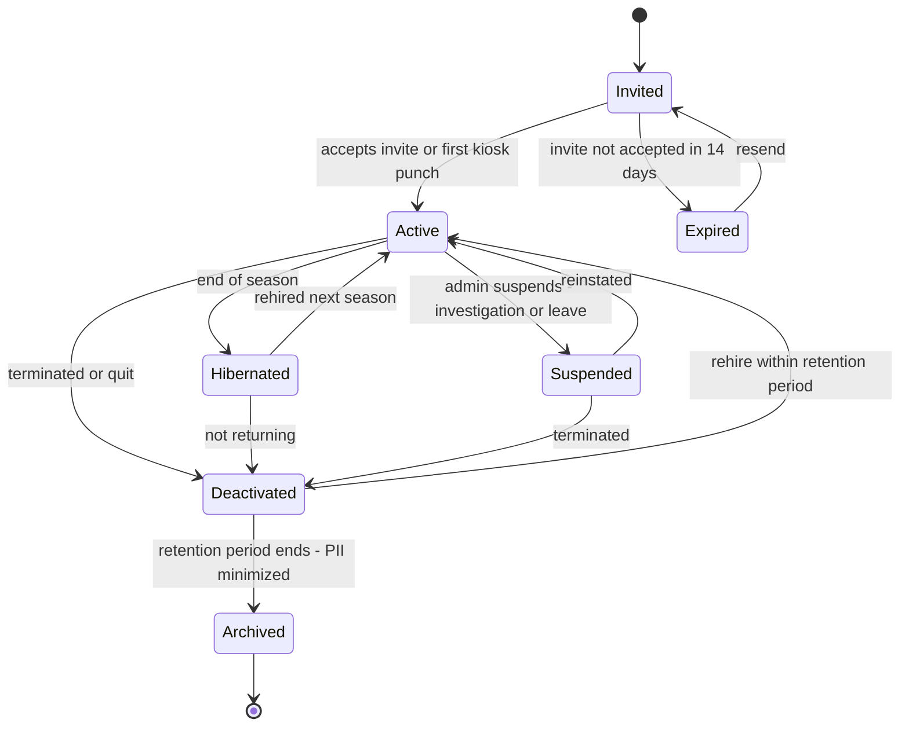

#### 5.18.1 Bulk seasonal onboarding [MVP]
1. Office manager uploads a CSV or pastes from the payroll provider, or copies last season's roster.
   - Fields: name, preferred name, phone, language, branch, Crew, role template, pay rate, start date, H-2B flag and visa end date, certifications.
2. Rootline validates the rows:
   - duplicate phones;
   - invalid E.164 numbers;
   - returning workers matched by phone or name + DOB, who are offered **rehire** instead of a new record;
   - missing branch.
3. Invites go out by **SMS in the worker's language** with a link to the crew app install and a 6-digit code, or the worker is set to **kiosk-only** (no personal device needed). A PIN is set at first kiosk use with supervisor confirmation.
4. **Onboarding checklist per hire** [V1]:
   - e-sign handbook and safety policy acknowledgment (ES/EN);
   - emergency contact;
   - uniform and PPE sizes;
   - equipment training modules (mower, trimmer, blower, skid steer);
   - pesticide license upload where applicable.
   - Payroll-provider onboarding (W-4/I-9 or TD1) is handed off by link ([Team, HR and Payroll](15-team-hr-payroll.md)).
5. **Start-date gating:** credentials work from the start date (kiosk shows "starts Monday").

#### 5.18.2 Hibernation (end of season) [MVP]
- Triggered by: bulk action ("Hibernate all technicians in Crews M1-M9 effective Nov 22"), an H-2B visa end date, or N days without a punch (default 30, configurable).
- Effects:
  - sessions revoked;
  - device data wiped on next contact;
  - kiosk tile hidden;
  - **no seat charge** while hibernated (pricing in [22](22-business-model-pricing-gtm.md));
  - pay rate, certifications, training records, time history, uniform sizes and PIN hash retained (the PIN must be re-confirmed at rehire).
- The worker can still log in to a minimal **"My records" view** [V1]: hours history, year-end tax form links from the payroll provider, and a "Coming back next season?" response. That response gives owners an early read on spring headcount.

#### 5.18.3 Rehire (spring) [MVP]
- "Rehire returning crew" wizard: list of hibernated workers with "Responded: returning" flags, last Crew, last pay rate and a suggested raise.
- One tap re-activates, sends a welcome-back SMS, and re-checks expired certifications (e.g. pesticide licenses up for renewal) and driver's license expiry for CDL/trailer drivers.

#### 5.18.4 Offboarding (termination or quit) [MVP]
1. Supervisor or office marks the employee terminated (reason code, effective date and time, eligible-for-rehire flag).
2. **Immediately:** sessions revoked; device tokens invalidated; kiosk PIN disabled; future Visit assignments removed and the ops manager alerted to gaps; approval requests reassigned.
3. **Checklists:**
   - equipment and keys return (from the equipment module: truck keys, fuel card, tablet, uniforms);
   - final timesheet approval;
   - final pay export flag (state final-pay timing rules differ, so Rootline surfaces a reminder, not legal advice);
   - **access-secret rotation prompt:** "Luis had access to 34 gate codes in the last 30 days; notify Properties to rotate?" [V1].
4. **Retention:** time and pay records are retained per legal requirements and configurable by jurisdiction. Federal FLSA rules require payroll records for at least 3 years and supplementary records such as time cards for at least 2 years ([29 CFR Part 516](https://www.ecfr.gov/current/title-29/subtitle-B/chapter-V/subchapter-B/part-516); verify), and H-2B employers carry their own recordkeeping duties ([20 CFR 655 Subpart A](https://www.ecfr.gov/current/title-20/chapter-V/part-655/subpart-A); verify). Rootline's default is 7 years, which covers both plus typical tax-audit windows. PII is minimized at archive (e.g. SSN purged once payroll obligations end), while hours and pay amounts stay.

#### 5.18.5 Office staff offboarding [MVP]
- Same as 5.18.4, plus ownership reassignment of Opportunities, Clients (account manager), saved reports, Automations owned by the user (Automations run as a **service principal**, not the creator, to avoid breaking when people leave), and API keys.

#### 5.18.6 Owner changes and business continuity [V1]
- **Ownership transfer:** the outgoing owner initiates, the incoming owner accepts, there is a 72-hour delay with notifications, and Rootline's billing owner and Stripe connection ownership are re-confirmed.
- **Successor designation:** an owner can designate a successor (spouse, partner, attorney). If the owner is unreachable (death or incapacity), the successor can request access through a platform-verified process with documentation and a waiting period.
- **Partner disputes:** with multiple owners, destructive actions (remove another owner, disconnect Stripe, delete Company, export all data) require dual control by default.

#### 5.18.7 Minor workers (under 18) [V1]

Summer crews often include 16- and 17-year-olds, and some Companies hire 14- and 15-year-olds for light work. Federal child-labor rules restrict what they may do: 14- and 15-year-olds may not operate power-driven lawn equipment such as mowers, trimmers and edgers and have daily and weekly hour limits, while Hazardous Occupations Orders bar 16- and 17-year-olds from tasks such as most driving on public roads and operating chainsaws and wood chippers. States add their own hour limits and work-permit rules ([DOL YouthRules](https://www.youthrules.gov/); verify the current rules with counsel and [Team, HR and Payroll](15-team-hr-payroll.md) before shipping). Rootline does not give legal advice; it makes the Company's own rules hard to break by accident.

- **Derived flag, not raw DOB.** The date of birth stays in `employee_pii`. A daily job derives `age_band` (`under_16`, `16_17`, `adult`) and the field roles see only a badge: "Minor - restricted equipment".
- **Equipment tagging.** Equipment and checklist items carry a `youth_restriction` category (`power_mower`, `string_trimmer`, `chainsaw`, `wood_chipper`, `skid_steer`, `public_road_driving`, `pesticide_application`). The Company reviews the default mapping at setup.
- **Assignment checks.** Assigning a minor to a Visit whose checklist needs a restricted category produces a **block** for `under_16` and a **block or warning** (per the category's mapping) for `16_17`. Overrides need `ops_manager` or above, a reason, and are audited.
- **Hour guardrails for `under_16`.** Scheduling warns when a Route would exceed the configured daily or weekly cap or fall outside the allowed time window. Punches are **never blocked** (blocking would create unrecorded work); a punch outside the window alerts the crew lead and ops manager instead.
- **Work permits.** Where a state requires one, a work-permit document with an expiry is a required onboarding item, and expiry follows the same rules as certifications.
- **Birthday rollover.** When a worker turns 16 or 18, restrictions lift automatically and the crew lead gets a note.

> **Competitive edge - seasonal labor as a first-class lifecycle.** Jobber gates access by assigned seats per plan, and LMN historically sold a cheaper crew seat that could not punch in or upload photos (section 2.1). Neither has a "hibernated" state between active and deleted. Rootline treats the season as the unit: bulk onboarding in the worker's language, hibernation that costs $0 and keeps history and certifications, a February "coming back?" signal, one-tap rehire with the same PIN, and automatic gate-code rotation prompts when someone leaves. For a Company like Summit, whose headcount moves between about 45 and 140 people each year, that turns two weeks of admin twice a year into an afternoon.

### 5.19 Access reviews and governance [V1]

- **Quarterly access review** (SOC 2-friendly) for tenants on Pro and above:
  - Rootline generates a review listing every active user, roles, last activity, sensitive permissions and dormant accounts (no login in 60 days).
  - The owner certifies or revokes in bulk, and the certification is stored as evidence.
- **Dormant account sweeps:** office users with no activity for 90 days are suspended automatically (configurable). Field users are hibernated after 30 days without punches.
- **Permission analytics:** "Who can see margin?", "Who can refund?" and "Who has accessed employee PII this quarter?" reports.

### 5.20 Enforcement architecture (summary; details in [Architecture](20-architecture-security.md)) [MVP]

1. **Tenant isolation:** Postgres RLS on `tenant_id` with the tenant set per transaction from the verified token. Large tenants on dedicated databases keep identical policies.
2. **Policy decision point (PDP):** the in-process policy engine defined in [Architecture](20-architecture-security.md) evaluates `can(principal, action, resource)`. That engine uses Cedar policies, with each tenant's roles compiled to policy templates and a typed TypeScript DSL as the documented fallback. The `access` domain module owns role definitions and compiles them for the engine. Key spellings in the Architecture doc map to this catalog through the alias table in 5.2 (rule 5).
   - Compiled grants are cached in Redis, keyed by `membership_id:perm_version`.
   - Relationship checks (Client contacts, delegations, subcontract assignments, crew membership on a date) use a relationship index (Zanzibar-style tuples in Postgres).
   - Policies are data, not code branches, so the role editor and the "View as" simulator use the same evaluator.
3. **Query-time filtering:** each repository method receives a `ScopeFilter` compiled to SQL predicates (e.g. `branch_id = ANY($branches) OR crew_id = ANY($crews) OR owner_user_id = $me`). This avoids N+1 checks and makes list endpoints safe by construction.
4. **Projection layer:** field classes are applied in one serializer layer shared by API, sync, search indexing, exports, notifications and the AI tool gateway.
5. **Defense in depth:** sync buckets are computed server-side; the mobile app does not decide what to download.
6. **Testing:** a permission test matrix (role x resource x action x scope) generated from the policy catalog runs in CI. Snapshot tests assert that crew sync payloads contain no `price`, `cost`, `margin` or `pay_rate` fields.

### 5.21 "View as" permission simulator [V1]

- Owners and office managers (with `role.read`) can preview the app **as a role** (synthetic user) or **as a specific user** within their own scope. Preview is always read-only and never shows data beyond the previewer's own rights: the intersection is used.
- "Why can't I see this?" explainer: hovering a redacted field or a denied action shows the missing permission and which roles grant it ("Requires `field.margin.read`, granted by Owner, Bookkeeper. Ask Dana.").
- **Request access** button sends a structured request to the owner (5.8 JIT elevation, V2).

### 5.22 Localization and accessibility of the access experience [MVP]

- All auth flows, invites, PIN screens, permission explanations and onboarding checklists ship in **English and Spanish** at MVP, with French-Canadian later ([UX](21-ux-design-system-sitemaps.md)).
- Language is chosen per identity (staff) and per contact (Clients), and SMS templates are localized.
- Kiosk and crew screens:
  - 56 px minimum touch targets (gloved hands);
  - high contrast for sunlight;
  - icons plus text;
  - number pad with haptic feedback.
- Screen-reader labels follow WCAG 2.2 AA for portal and web flows. Magic-link emails include a plain-text code alternative for users with link-scanning or accessibility tools.

---

## 6. Key access-control flows

### 6.1 Staff invite and activation [MVP]

1. Office manager opens Team > Invite and enters name, email and/or phone, role(s), branch, Crew, and language.
2. Rootline validates anti-escalation (5.8), seat availability, and duplicates (an existing identity is offered a "link existing account").
3. The invite is sent by email or SMS (localized). It is valid for 14 days and single-use.
4. The invitee verifies email or phone, sets credentials (passkey, password or OTP-only for field roles) and enrolls MFA if the role requires it.
5. The membership becomes `Active`. A `membership.activated` event fires, and the employee record links if the role is a field role.

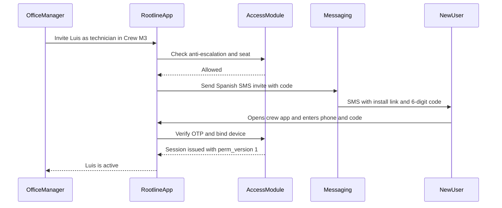

### 6.2 Authorization decision for every request [MVP]

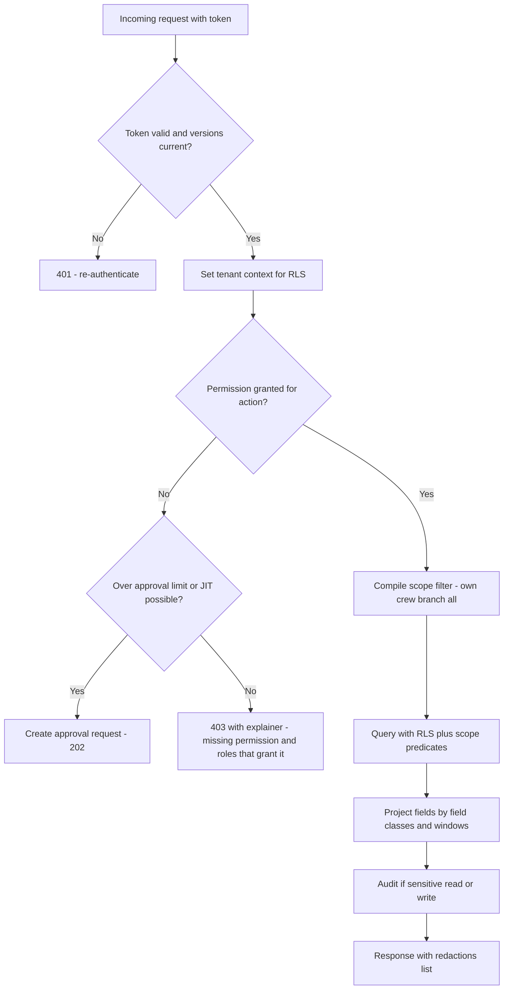

### 6.3 Support access with consent and impersonation [MVP]

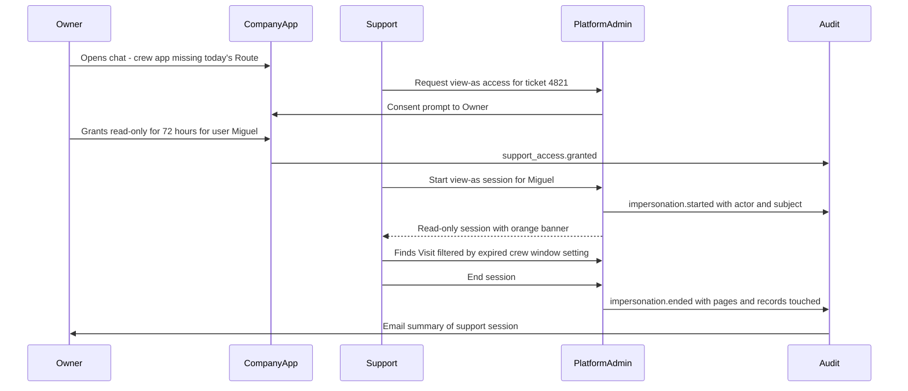

### 6.4 Kiosk clock-in on a shared tablet [MVP]

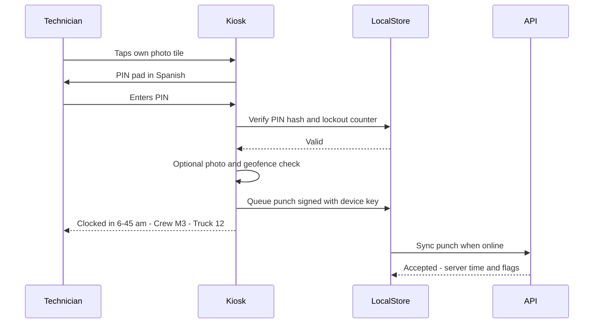

PIN verification works offline:
- PIN hashes (Argon2id with a per-device pepper) for the branch's active employees are synced to enrolled kiosks only.
- Hashes are removed within one sync when a worker is hibernated or deactivated.
- Punches are signed with the device key so the server can verify origin. Server time is authoritative, and device-time drift over 5 minutes is flagged ([Field Crew App](05-field-crew-mobile-app.md)).

### 6.5 Termination with immediate revocation [MVP]

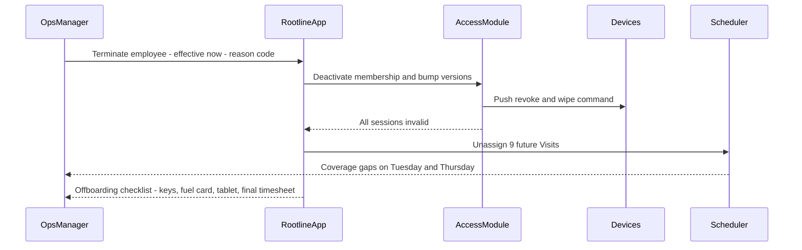

### 6.6 Client magic-link sign-in and step-up to sign a Proposal [MVP]

1. Jennifer taps the Proposal link in an SMS. It opens a **document-scoped view** (no account needed to look).
2. She taps "Approve Better option". Rootline requires a verified session, so it sends a 6-digit code to the phone number on her contact record (not to an arbitrary number).
3. With the code verified, she signs (typed or drawn signature, consent to electronic records, IP and timestamp captured) and is offered "Save a passkey for next time" [V1].
4. The deposit payment uses Stripe Elements on the Company's connected account ([Payments](08-payments-stripe.md)).
5. The portal session persists for 30 days on this device.

### 6.7 Granting a CPA firm access [V1]

1. Owner goes to Settings > Accountant access > Invite firm, and enters the firm email (or picks from the Rootline partner directory).
2. Owner chooses the role (`bookkeeper` default), entities, and optional expiry; MFA is enforced.
3. The firm admin accepts in the Accountant Hub and assigns staff (Karen as lead, plus one staff accountant).
4. The owner sees the firm and its staff under Team > External. Both can be revoked at any time.

---

## 7. Screens and wireframes

### 7.1 Screen inventory

| Screen | Surface | Primary personas | Priority |
|---|---|---|---|
| Team list (staff, field, external; status filters incl. Hibernated) | Company web | owner, office_manager, ops_manager | [MVP] |
| User detail: profile, roles, branches, Crews, devices, sessions, activity | Company web | owner, office_manager | [MVP] |
| Invite / bulk seasonal import | Company web | office_manager | [MVP] |
| Rehire returning crew wizard | Company web | office_manager, ops_manager | [MVP] |
| Role list and role editor (permission grid, scopes, field classes, limits) | Company web | owner | [MVP] |
| Role impact diff and "View as" simulator | Company web | owner, office_manager | [V1] |
| Security settings: MFA policy, SSO/SCIM, session policy, IP allowlist, support access, Lockdown | Company web | owner | [MVP] / [V1] / [V2] |
| Audit log viewer and saved alerts | Company web | owner, bookkeeper | [MVP] / [V1] |
| Access review campaign | Company web | owner | [V1] |
| Device management and kiosk enrollment | Company web + mobile | ops_manager, office_manager | [MVP] |
| Kiosk home and PIN pad | Tablet | technician, crew_lead | [MVP] |
| Crew app sign-in (phone OTP, app PIN) | Mobile | crew_lead, technician | [MVP] |
| Client > People and permissions (staff side) | Company web | office_manager, estimator | [MVP] |
| Client approval policy editor | Company web | office_manager | [V1] |
| Portal: Sign-in, People and access, Approvals inbox | Customer Portal | client_residential, client_commercial | [MVP] / [V1] |
| Accountant Hub: client list, close status, firm staff | Accountant web | bookkeeper (firm) | [V1] |
| Sub portal: orders, documents, bills | Sub portal | subcontractor | [MVP] basic / [V1] |
| Platform: staff and roles, support access console, impersonation banner, break-glass requests | Platform Admin | platform_* | [MVP] |

### 7.2 Wireframe: Role editor (Company web) [MVP]

```text
+--------------------------------------------------------------------------------------------+
| Settings > Roles > Crew Lead - Irrigation (custom, cloned from crew_lead v3)    [Save]      |
+--------------------------------------------------------------------------------------------+
| Users with this role: 6   Surfaces: [x] Mobile [x] Kiosk [ ] Web [ ] API   Language: [ES v] |
|--------------------------------------------------------------------------------------------|
| PERMISSIONS                           | Read    | Create | Update | Delete | Special        |
|---------------------------------------+---------+--------+--------+--------+----------------|
| Operations > Visits                   | [crew v]| [ - v] |[crew v]| [ - v] | Complete [crew]|
| Operations > Routes                   | [crew v]|        |[crew v]|        | Optimize [crew]|
| Operations > Change orders            | [crew v]|[crew v]| [own v]| [ - v] | Draft only (i) |
| Time > Time entries                   | [crew v]|[crew v]|[crew v]| [ - v] | Edit limit 1 h |
| Irrigation > Controllers              | [crew v]|        |[crew v]|        | Run zone [crew]|
| Billing > Payments                    | [ - v]  |        |        |        | Collect [ off] |
| Clients > Client directory            | via Visits only (field role rule)  (i)                     |
|--------------------------------------------------------------------------------------------|
| FIELD VISIBILITY                      | Read | Write |                                       |
| Price  (sell prices, totals)          | [ ]  | [ ]   |  LOCKED by guardrail: owner only      |
| Cost   (unit costs, burden)           | [ ]  | [ ]   |                                       |
| Margin                                | [ ]  | [ ]   |  LOCKED by guardrail                  |
| Budgeted hours                        | [x]  | [ ]   |                                       |
| Pay rates (others)                    | [ ]  | [ ]   |  Own pay rate visible: Company setting|
| Client contact (phone/email)          | [ ]  | [ ]   |  Masked calling/texting: ON           |
| Access secrets (gate codes)           | [x] window: 60 min before/after visit           |
|--------------------------------------------------------------------------------------------|
| LIMITS   Purchase on the fly: [$300]   Timesheet edit w/o approval: [1.0 h]               |
|--------------------------------------------------------------------------------------------|
| [ View as this role ]   [ Compare with crew_lead template ]   Impact: 6 users, +2, -1      |
+--------------------------------------------------------------------------------------------+
```

### 7.3 Wireframe: Team list with seasonal states (Company web) [MVP]

```text
+-------------------------------------------------------------------------------------------+
| Team                     [Invite] [Bulk import] [Rehire returning crew (23)]  Search [   ]|
| Status: (Active 61) (Invited 4) (Hibernated 38) (Suspended 1) (Deactivated)   Branch [All]|
+-------------------------------------------------------------------------------------------+
| Name              | Role(s)              | Branch   | Crew | Login        | MFA | Last seen|
|-------------------+----------------------+----------+------+--------------+-----+----------|
| Miguel Hernandez  | crew_lead            | Columbus | M3   | Phone + PIN  | n/a | 2 min    |
| Luis Ramirez      | technician           | Columbus | M3   | Kiosk PIN    | n/a | 6:45 am  |
| Andre Williams    | ops_manager          | Columbus | -    | Passkey      | Yes | 1 h      |
| Karen Liu (CPA)   | bookkeeper (firm)    | All      | -    | Password+TOTP| Yes | Mar 3    |
| Dobbs Irrigation  | subcontractor (2)    | Dayton   | -    | Magic link   | -   | Yesterday|
| Tyler Brooks      | technician  HIBERNATED| Columbus| M5   | -            | -   | Nov 21   |
+-------------------------------------------------------------------------------------------+
| Selected (12): [Hibernate effective date v] [Change Crew] [Reset PIN] [Sign out everywhere]|
| Seats: 12 office + 45 active field + 4 free (CPA, subs) = 61. Hibernated 38 = $0          |
+-------------------------------------------------------------------------------------------+
```

### 7.4 Wireframe: Kiosk PIN pad (shared truck or yard tablet) [MVP]

```text
+-----------------------------------------------+
|  Summit Grounds - Columbus Yard     6:44 AM    |
|  Hola, Luis R.            Cuadrilla M3         |
|                                                |
|            Ingresa tu PIN                      |
|              [ * ][ * ][ _ ][ _ ]              |
|                                                |
|          [ 1 ]   [ 2 ]   [ 3 ]                 |
|          [ 4 ]   [ 5 ]   [ 6 ]                 |
|          [ 7 ]   [ 8 ]   [ 9 ]                 |
|          [ <-]   [ 0 ]   [ OK ]                |
|                                                |
|  [ Not you? ]                 [ EN | ES ]      |
+-----------------------------------------------+
  After PIN:  [ ENTRADA ] [ DESCANSO ] [ CAMBIAR TRABAJO ] [ SALIDA ]
  ("Clock in", "Break", "Switch job", "Clock out")
```

### 7.5 Wireframe: Customer Portal > People and approvals (commercial) [V1]

```text
+------------------------------------------------------------------------------------------+
| Crossroads Property Management  -  9 properties with Summit Grounds         [Add person] |
+------------------------------------------------------------------------------------------+
| Person             | Role            | Properties          | Can approve up to | Status   |
|--------------------+-----------------+---------------------+-------------------+----------|
| Patricia Gomez     | Primary         | All 9               | $5,000            | Active   |
| Dan Whitfield (VP) | Approver        | All 9               | Unlimited (2nd)   | Active   |
| AP Team            | Billing         | All 9               | -                 | Active   |
| Jorge (Store 14)   | Property contact| Westgate Plaza      | -                 | Active   |
+------------------------------------------------------------------------------------------+
| Approval rule: Enhancements over $5,000 need Patricia THEN Dan (sequential). PO required. |
| [Edit rule]                                                                               |
+------------------------------------------------------------------------------------------+
| Pending approvals (2)                                                                     |
|  - Westgate Plaza: replace 6 Bradford pears   $7,850   Patricia: APPROVED   Dan: waiting  |
|  - Northpoint: irrigation backflow repair     $1,240   Patricia: waiting                  |
+------------------------------------------------------------------------------------------+
```

### 7.6 Wireframe: Support access consent and banner [MVP]

```text
+-------------------------------------------------------------+
|  Rootline Support is asking for access                       |
|  Ticket 4821: "Crew M3 can't see today's route"              |
|  Requested by: Maya S. (Rootline Support)                    |
|                                                              |
|  Access type:  (o) View only   ( ) View and make changes     |
|  As user:      [ Miguel Hernandez (crew_lead) v ]            |
|  Duration:     [ 72 hours v ]                                |
|  Support will NOT see: pay rates, SSNs, bank details,        |
|  card data, passwords.                                       |
|                                                              |
|           [ Deny ]                  [ Grant access ]         |
+-------------------------------------------------------------+

 Banner inside the impersonated session (staff side):
 #############################################################################
 # VIEWING AS Miguel Hernandez - Summit Grounds - READ ONLY - Ticket 4821    #
 # Session ends in 42:10                         [ End session ]             #
 #############################################################################
```

### 7.7 Wireframe: Rehire returning crew wizard (Company web) [MVP]

```text
+--------------------------------------------------------------------------------------------+
| Team > Rehire returning crew                      Season 2027   Branch [Columbus v]         |
| 38 hibernated field workers  |  23 said "returning"  |  6 said "not returning"  |  9 no reply |
+--------------------------------------------------------------------------------------------+
| [x] | Name           | Last crew | Last role  | Last rate | Suggested | Replied   | Checks     |
|-----+----------------+-----------+------------+-----------+-----------+-----------+------------|
| [x] | Luis Ramirez   | M3        | technician | $18.50    | $19.25    | Returning | OK         |
| [x] | Jose Ortega    | M3        | technician | $17.75    | $18.50    | Returning | Visa date? |
| [x] | Tyler Brooks   | M5        | technician | $16.00    | $16.75    | Returning | Minor: no  |
| [ ] | Carlos Vega    | I2        | crew_lead  | $24.00    | $25.00    | Returning | Pest. lic. |
|     |                |           |            |           |           |           | expired !  |
| [ ] | Ana Ruiz       | M1        | technician | $17.25    | -         | No reply  | Phone?     |
+--------------------------------------------------------------------------------------------+
| Start date [Mar 17 v]   Crew [keep last v]   Raise [suggested v]   Language [keep v]        |
| Pay rates are visible to you because you hold field.pay_rate.read                          |
|                                                                                            |
| [ Preview welcome-back SMS (ES / EN) ]       [ Rehire 3 selected ]  [ Send reminder to 9 ] |
+--------------------------------------------------------------------------------------------+
```

Rules: rows with a blocking check (expired pesticide license, visa end date before the start date, missing phone) cannot be selected until resolved. Suggested raises come from the Company's raise policy (flat or percentage) and are hidden from users without `field.pay_rate.read`, who see the wizard without the rate columns.

### 7.8 Wireframe: Accountant Hub client list (Accountant web) [V1]

```text
+--------------------------------------------------------------------------------------------+
| Liu & Partners CPAs - Accountant Hub        Karen Liu (firm_admin)     [Invite staff]       |
| Close period: April 2027   Filter: [All clients v] [Assigned to me]   Search [            ] |
+--------------------------------------------------------------------------------------------+
| Client company            | Close status | Unreconciled | AR > 90 d | Sales tax due | Lock  |
|---------------------------+--------------+--------------+-----------+---------------+-------|
| Reyes Outdoor Living      | 6 / 9 steps  | 23 lines     | $4,180    | NC May 20     | Mar   |
| Greenway Lawn Co.         | Done         | 0            | $0        | SC May 20     | Apr   |
| Piedmont Tree & Turf      | 2 / 9 steps  | 141 lines    | $12,920 ! | NC May 20     | Feb ! |
| Carolina Snow Pros        | Not started  | 8 lines      | $640      | -             | Mar   |
| ... 10 more                                                                                 |
+--------------------------------------------------------------------------------------------+
| Access: each row opens that Company under its own delegation grant. Expiring soon:          |
|   Carolina Snow Pros grant ends Apr 30 (tax-season grant)  [Ask owner to extend]            |
+--------------------------------------------------------------------------------------------+
```

Rules: every number in a row is computed by a per-tenant call made under that Company's delegation grant (5.10). There is no cross-tenant query. A Company that revokes the firm disappears from the list on the next refresh, and its cached tiles are purged.

### 7.9 Notes on screens

- The **Copilot side panel** is available on every staff screen and runs as the signed-in user (5.4, item 6).
- Platform Admin screens are specified in [Platform Admin](19-platform-admin-portal.md). Sitemaps for all surfaces are in [UX and Sitemaps](21-ux-design-system-sitemaps.md).

---

## 8. Data model

### 8.1 Identity, memberships and RBAC

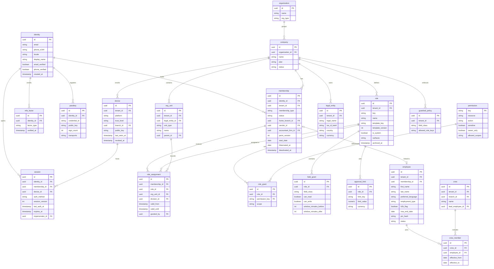

### 8.2 Clients, delegation, support and audit

```mermaid
erDiagram
    client ||--o{ property : owns
    client ||--o{ client_contact : has
    identity ||--o{ client_contact : "logs in as"
    client_contact ||--o{ contact_access : granted
    property ||--o{ contact_access : "scoped to"
    client ||--o{ approval_policy : defines
    approval_policy ||--o{ approval_policy_member : lists
    client_contact ||--o{ approval_policy_member : "serves as"
    approval_request ||--o{ approval_vote : collects
    client_contact ||--o{ approval_vote : casts
    accountant_firm ||--o{ firm_staff : employs
    accountant_firm ||--o{ delegation_grant : receives
    company ||--o{ delegation_grant : issues
    company ||--o{ support_access_grant : issues
    support_access_grant ||--o{ impersonation_session : authorizes
    company ||--o{ audit_event : records
    client_contact {
        uuid id PK
        uuid tenant_id FK
        uuid client_id FK
        uuid identity_id FK
        string contact_role
        string first_name
        string last_name
        string email
        string phone_e164
        string locale
        boolean sms_consent
        timestamp consent_at
    }
    contact_access {
        uuid id PK
        uuid client_contact_id FK
        uuid property_id FK
        boolean can_view_schedule
        boolean can_request_service
        boolean can_view_invoices
        boolean can_pay
        boolean can_approve
    }
    approval_policy {
        uuid id PK
        uuid client_id FK
        uuid property_id FK
        string applies_to
        numeric min_amount
        int rule_order
        string mode
        numeric max_amount
        string category
        int required_yes
        int quorum
        boolean po_required
        int deadline_days
    }
    approval_policy_member {
        uuid id PK
        uuid approval_policy_id FK
        uuid client_contact_id FK
        int sequence_order
        date term_end_date
    }
    approval_request {
        uuid id PK
        uuid tenant_id FK
        string subject_type
        uuid subject_id
        string version_hash
        string status
        timestamp deadline_at
    }
    approval_vote {
        uuid id PK
        uuid approval_request_id FK
        uuid client_contact_id FK
        string decision
        string comment
        string auth_method
        string ip
        timestamp voted_at
    }
    accountant_firm {
        uuid id PK
        string name
        string country
        boolean partner_program
    }
    firm_staff {
        uuid id PK
        uuid accountant_firm_id FK
        uuid identity_id FK
        string firm_role
    }
    delegation_grant {
        uuid id PK
        uuid tenant_id FK
        uuid accountant_firm_id FK
        uuid role_id FK
        string entity_ids
        timestamp expires_at
        timestamp revoked_at
        uuid granted_by FK
    }
    support_access_grant {
        uuid id PK
        uuid tenant_id FK
        string ticket_ref
        string access_mode
        uuid subject_membership_id FK
        uuid granted_by FK
        timestamp expires_at
        timestamp revoked_at
    }
    impersonation_session {
        uuid id PK
        uuid support_access_grant_id FK
        uuid staff_identity_id FK
        timestamp started_at
        timestamp ended_at
        int records_touched
    }
    audit_event {
        uuid id PK
        uuid tenant_id FK
        uuid actor_identity_id FK
        uuid actor_membership_id FK
        uuid on_behalf_of_id FK
        string action
        string resource_type
        uuid resource_id
        jsonb diff
        string reason
        string ip
        string prev_hash
        string hash
        timestamp occurred_at
    }
```

**Key constraints and indexes:**
- `membership (identity_id, tenant_id, membership_type)` unique. `status in (invited, active, suspended, hibernated, deactivated, archived)`.
- `role_grant (role_id, permission_key)` unique, and `scope in permission.allowed_scopes`.
- `crew_member` uses effective-dated ranges with an exclusion constraint preventing overlapping memberships in two Crews on the same day (borrowing uses Visit-level assignment, not crew membership).
- `audit_event` is partitioned by month and tenant hash. Its insert-only role has no `UPDATE` or `DELETE` grants at the database level.
- Platform staff tables (`platform_staff`, `platform_role`, `break_glass_request`) live in a **separate schema and database role** not reachable from tenant request paths ([Platform Admin](19-platform-admin-portal.md)).
- All tenant tables carry `tenant_id` and RLS policies. `identity`, `accountant_firm` and `organization` are global tables accessed only through the access module's service role.

---

## 9. Integrations, APIs and events

### 9.1 External services

| Service | Use | Notes | Priority |
|---|---|---|---|
| Twilio Verify (SMS, WhatsApp, voice OTP) | Crew and Client phone verification, step-up | 10DLC registration for the Company's sending numbers is handled in [Marketing](16-marketing-growth-communications.md). OTP traffic uses verification channels | [MVP] |
| Twilio masked numbers (number pool or proxy pattern) | Masked calling and texting between crew/subs and Clients | Real numbers never reach field devices. Verify the current Twilio product for proxying | [V1] |
| Postmark / SendGrid | Magic links, invites, security notices | Separate transactional stream for auth mail. Strict DMARC alignment on Company custom domains ([Customer Portal](06-customer-portal.md)) | [MVP] |
| WebAuthn / passkeys (FIDO2) | Passwordless staff and Client login, platform hardware keys | W3C WebAuthn standard. Discoverable credentials. Attestation not required except for platform staff (allowlist of security key models) | [V1] (platform staff: [MVP]) |
| Google, Microsoft and Apple sign-in (OIDC) | Social and business sign-in for staff and Clients | Link to an existing identity only by verified email | [MVP] staff / [V1] Clients |
| Enterprise SSO (SAML 2.0, OIDC) | Okta, Microsoft Entra ID, Google Workspace, JumpCloud | Build-vs-buy: use an SSO/SCIM broker or open-source SAML bridge to reach market faster; decision recorded in [Architecture](20-architecture-security.md) | [V1] |
| SCIM 2.0 (RFC 7644) | User and group provisioning and deprovisioning | Group-to-role mapping table per tenant; aligned with [Architecture](20-architecture-security.md) and [Pricing](22-business-model-pricing-gtm.md) | [V1] |
| Payroll providers (e.g. Gusto, ADP, Paychex, QuickBooks Payroll; Wagepoint and similar in Canada) | Onboarding handoff, employee sync, pay rates | Detail in [Team, HR and Payroll](15-team-hr-payroll.md) | [V1] |
| MDM (Apple Business Manager, Jamf, Microsoft Intune, Android Enterprise) | Kiosk lockdown, managed app config, wipe | Optional for larger tenants; same priority as [Field Crew App](05-field-crew-mobile-app.md) | [V1] |
| Stripe (Company-owned accounts) | Only `owner` can connect or disconnect. Payment roles map to charge, refund and payout visibility | Stripe dashboard access is the Company's own business. Rootline never creates Stripe dashboard users | [MVP] |
| Rootline corporate IdP (e.g. Google Workspace or Okta) | Platform staff SSO | Separate realm | [MVP] |

### 9.2 Public API surface (Company-scoped)

| Endpoint | Purpose | Priority |
|---|---|---|
| `GET/POST /v1/users`, `PATCH /v1/users/{id}` | List, invite and update members | [V1] |
| `POST /v1/users/{id}/hibernate`, `/reactivate`, `/deactivate` | Seasonal lifecycle | [V1] |
| `GET/POST/PATCH /v1/roles` | Custom roles as code (export and import JSON) | [V1] |
| `GET /v1/audit-events?since=` | Pull the audit log | [V1] |
| `/scim/v2/Users`, `/scim/v2/Groups` | SCIM provisioning | [V1] |
| `POST /v1/clients/{id}/contacts` with `contact_role` and `property_ids` | Manage Client contacts | [V1] |
| API keys | Each key is bound to a **role** (default: a "Read-only integration" role), optional IP allowlist, expiry (max 1 year), last-used tracking. Keys can be created only by `owner` | [V1] |
| OAuth apps (partner marketplace) | OAuth 2.0 authorization code + PKCE with scopes mapped to permissions. Consent screen lists data classes (e.g. "read Clients and Properties; never prices") | [V2] |

### 9.3 Domain events emitted (via transactional outbox)

| Event | Key payload | Typical consumers |
|---|---|---|
| `identity.created`, `identity.email_verified` | identity_id | Marketing (welcome), analytics |
| `membership.invited`, `.activated`, `.suspended`, `.hibernated`, `.reactivated`, `.deactivated` | membership_id, tenant_id, role keys, effective_at, reason | Scheduling (unassign Visits), Payroll export, SaaS billing (seat count), Equipment (asset return), Copilot (index refresh) |
| `role.created`, `role.updated` (with diff), `role.archived` | role_id, diff, affected_count | Cache invalidation, audit, notifications to owner |
| `role_assignment.changed` | membership_id, before, after | Session revocation, sync bucket recompute |
| `session.revoked`, `device.revoked`, `device.wipe_requested` | identity_id or device_id, reason | Realtime gateway, mobile sync |
| `support_access.granted`, `.revoked`, `impersonation.started`, `.ended` | grant_id, ticket, mode, staff_id | Tenant notifications, platform audit |
| `break_glass.requested`, `.approved`, `.expired` | request_id, tenant_id, approver | Security channel, tenant notification job |
| `delegation.granted`, `.revoked` | firm_id, tenant_id, role | Accountant Hub, partner program |
| `client_contact.added`, `.role_changed`, `.removed` | contact_id, client_id, role, property_ids | Customer Portal, Messaging (consent routing) |
| `approval_request.created`, `.vote_cast`, `.approved`, `.rejected`, `.expired` | request_id, subject, version_hash, votes | Proposals ([CRM](03-crm-sales-estimating-proposals.md)), Scheduling |
| `access.denied` (sampled) | principal, action, resource_type, reason | Product analytics (permission friction), anomaly detection |
| `sensitive_field.revealed` | field_class, resource, principal | Audit, anomaly detection |

**Consumed events:**
- `employee.terminated` and `employee.season_ended` from HR (15) trigger revocation and hibernation.
- `certification.expired` from HR suspends `chemical_application.create` for that person automatically.
- `visit.scheduled` and `visit.completed` from Scheduling (04) recompute crew visibility windows and access-secret reveal windows.
- `subscription.plan_changed` from SaaS billing (19) toggles SSO, SCIM and advanced audit entitlements.

**Tenant webhooks** [V1]: `user.*`, `role.*` and `security.*` events can be delivered to the Company's endpoints (signed with HMAC-SHA256, retries with exponential backoff), e.g. to sync with their HRIS.

---

## 10. Permissions

### 10.1 Master role template matrix (tenant)

**Legend:**
- Actions: `R` read; `W` create and update; `D` delete, void or archive; `X` the special action named in the row.
- Scope after the slash: `a` all, `b` branch, `c` crew (within the visibility window), `o` own/assigned.
- `-` no access. `cfg` = off by default, Company can enable. `<=lim` = subject to approval limits (5.6).

**Footnotes:**
1. Anti-escalation applies: users can assign only roles whose grants are less than or equal to their own; `ops_manager` can assign field roles in their branch.
2. Excludes security events concerning owners.
3. Requires a valid applicator certification on record for the state and category; otherwise blocked, or allowed as "under supervision" where state rules permit.

**Company administration**

| Capability | owner | office_manager | estimator | designer | ops_manager | crew_lead | technician | bookkeeper | subcontractor |
|---|---|---|---|---|---|---|---|---|---|
| `company.settings` | RWX/a | RW/a | - | - | R/a | - | - | R/a (fiscal, tax) | - |
| `user` (invite, edit, hibernate, deactivate) | RWDX/a | RWDX/a (1) | - | - | RWX/b field roles (1) | X/c PIN reset | - | - | - |
| `role` (custom roles) | RWD/a | R/a | - | - | R/a | - | - | - | - |
| `user.assign_role` | X/a | X/a (1) | - | - | X/b (1) | - | - | - | - |
| `org_unit`, `legal_entity` | RWD/a | R/a | R/a | R/a | R/a | - | - | R/a | - |
| `security_policy` (MFA, SSO, sessions) | RWX/a | R/a | - | - | - | - | - | - | - |
| `support_access.grant` | X/a | X/a view-only | - | - | - | - | - | - | - |
| `stripe_connection` | RWX/a owner-only | R/a | - | - | - | - | - | R/a | - |
| `integration` | RWX/a | RW/a | - | - | - | - | - | RW/a accounting | - |
| `api_key` | RWD/a | - | - | - | - | - | - | - | - |
| `automation` | RWDX/a | RWDX/a | R/o | - | RWX/b | - | - | RW/a finance | - |
| `audit_log` | R/a | R/a (2) | - | - | R/b (2) | - | - | R/a financial | - |
| `data_export.run` | X/a | X/a dual control over 1,000 Clients | - | - | - | - | - | X/a financial | - |
| `rootline_subscription` | RWX/a | R/a | - | - | - | - | - | R/a | - |
| `device` (enroll kiosk, revoke) | RWDX/a | RWDX/a | - | - | RWDX/b | R/c | - | - | - |

**CRM and sales**

| Capability | owner | office_manager | estimator | designer | ops_manager | crew_lead | technician | bookkeeper | subcontractor |
|---|---|---|---|---|---|---|---|---|---|
| `lead` | RWDX/a | RWDX/a | RWX/o + R/b pool | R/o | RW/b | W/o submit | W/o submit tip | - | - |
| `opportunity` | RWDX/a | RWDX/a | RWX/o | R/o | RW/b | - | - | R/a | - |
| `client`, `property` | RWD/a | RWD/a | RW/b | R/o | RW/b | R/c via Visits | R/c via Visits, limited | R/a billing fields | R/o via orders |
| `client.merge` | X/a | X/a | - | - | - | - | - | - | - |
| `client.contact` (contacts, consents) | RWD/a | RWD/a | RW/o | - | RW/b | - | - | RW/a billing contacts | - |
| `site_assessment` | RWD/a | RW/a | RWD/o | RW/o | RW/b | W/c | - | - | - |
| `inbox.conversation` | RWX/a | RWX/a | RWX/o | RWX/o | RWX/b | RWX/c masked | - | R/a billing | - |
| `estimate` | RWD/a | RW/a | RWD/o + R/b | R/o | RW/b | - | - | R/a | - |
| `proposal.send` | X/a | X/a | X/o | X/o cfg | X/b | - | - | - | - |
| `proposal.approve_internal` | X/a | X/a <=lim | - | - | X/b <=lim | - | - | - | - |
| `proposal.record_offline_acceptance` (paper or verbal, with upload and reason) | X/a | X/a | X/o | - | X/b | - | - | - | - |
| `change_order` | RWDX/a | RWX/a | RWX/o | R/o | RWX/b | W/c draft, no price | - | R/a | W/o request |
| `service_agreement` (incl. renew) | RWDX/a | RWDX/a | RWX/o | - | R/b | - | - | R/a | - |
| `price_book` | RWD/a | RW/a | R/a | R/a | R/a | R/a names only | R/a names only | R/a | - |
| `production_rate` | RW/a | R/a | R/a | - | RW/b | - | - | R/a | - |

**Design**

| Capability | owner | office_manager | estimator | designer | ops_manager | crew_lead | technician | bookkeeper | subcontractor |
|---|---|---|---|---|---|---|---|---|---|
| `design` | RWD/a | R/a | RW/o + R/b | RWD/o + R/a | R/b | R/c plan sheets | R/c plan sheets | - | R/o shared sheets |
| `mockup.generate` (spends AI credits) | X/a | X/a | X/o | X/o | - | - | - | - | - |
| `tenant_palette` | RWD/a | R/a | R/a | RWD/a | R/a | - | - | - | - |
| `ai_budget` (credit caps) | RWX/a | R/a | - | - | - | - | - | R/a | - |

**Operations**

| Capability | owner | office_manager | estimator | designer | ops_manager | crew_lead | technician | bookkeeper | subcontractor |
|---|---|---|---|---|---|---|---|---|---|
| `job` | RWD/a | RWD/a | R/o | R/o | RWD/b | R/c | R/c | R/a | - |
| `visit` | RWD/a | RWD/a | R/o | R/o | RWD/b | RW/c | R/c | R/a | - |
| `visit.dispatch` (assign, move) | X/a | X/a | - | - | X/b | X/c reorder same day | - | - | - |
| `route.optimize` | X/a | X/a | - | - | X/b | X/c | - | - | - |
| `visit.complete` | X/a | X/a | - | - | X/b | X/c | X/c | - | - |
| `checklist`, `photo` | RWD/a | RWD/a | RW/o | RW/o | RWD/b | RW/c | RW/c | R/a | RW/o |
| `chemical_application` | RWD/a | RW/a | - | - | RWD/b | RW/c (3) | RW/c (3) | R/a | RW/o (3) |
| `incident` (safety) | RWD/a | RW/a | W/o | W/o | RWX/b | RW/c | W/o | R/a | W/o |
| `crew` | RWD/a | RWD/a | R/b | - | RWD/b | R/c | R/c | - | - |
| `equipment` | RWD/a | RW/a | R/b | - | RWD/b | RW/c inspections, hours | W/c inspections | R/a | - |
| `inventory` | RWD/a | RW/a | R/b | R/b | RW/b | W/c load-out, usage | W/c usage | R/a | - |
| `purchase_order` | RWDX/a | RWX/a <=lim | R/o | - | RWX/b <=lim | W/c field purchase <=lim | - | RW/a | R/o own POs |
| `vendor` | RWD/a | RW/a | R/a | R/a | R/b | - | - | RW/a | R/o own org |
| `subcontract_order` | RWDX/a | RWX/a | R/o | - | RWX/b | R/c | - | R/a | RWX/o accept, complete |

**Time and people**

| Capability | owner | office_manager | estimator | designer | ops_manager | crew_lead | technician | bookkeeper | subcontractor |
|---|---|---|---|---|---|---|---|---|---|
| `time_entry` (own punches) | RW/o | RW/o | RW/o | RW/o | RW/o | RW/o | W/o + R/o | - | - |
| `time_entry` (others) | RWD/a | RWD/a | - | - | RWD/b | RW/c <=lim | - | R/a | - |
| `timesheet.approve` | X/a | X/a | - | - | X/b | X/c first level, cfg | - | - | - |
| `employee` | RWD/a | RWD/a | - | - | R/b | R/c roster, emergency contacts | R/o | R/a | - |
| `certification`, `training` | RWD/a | RWD/a | R/o | R/o | RW/b | R/c | RW/o upload own | R/a | RW/o COI, licenses |
| `payroll_export.run` | X/a | X/a | - | - | - | - | - | X/a | - |
| `expense` (receipts) | RWDX/a | RWX/a | W/o | W/o | RWX/b | W/c | W/o | RWX/a | - |

**Billing and payments**

| Capability | owner | office_manager | estimator | designer | ops_manager | crew_lead | technician | bookkeeper | subcontractor |
|---|---|---|---|---|---|---|---|---|---|
| `invoice` | RWDX/a | RWDX/a | R/o | - | RW/b draft | - (cfg field invoice) | - | RWDX/a | - |
| `invoice.send` | X/a | X/a | - | - | X/b cfg | - | - | X/a | - |
| `invoice.void` | X/a | X/a <=lim | - | - | - | - | - | X/a | - |
| `payment.collect` (field, through Company Stripe) | X/a | X/a | X/o | - | X/b | X/c cfg <=lim | X/c cfg <=lim | - | - |
| `payment.record` (manual check, cash) | X/a | X/a | - | - | - | X/c cfg | - | X/a | - |
| `payment.refund` | X/a | X/a <=lim | - | - | - | - | - | X/a <=lim | - |
| `credit_memo` | RWX/a | RWX/a <=lim | - | - | RW/b <=lim | - | - | RWX/a | - |
| `collections_case.write_off` | X/a | X/a <=lim | - | - | - | - | - | X/a <=lim | - |
| `statement` | RWX/a | RWX/a | R/o | - | R/b | - | - | RWX/a | - |
| `bill` (vendor and sub bills) | RWD/a | RW/a | - | - | RW/b code to Jobs | - | - | RWD/a | W/o submit own |
| `bill_payment.approve` | X/a | - | - | - | - | - | - | X/a <=lim | - |
| `dispute.respond` (evidence to the Company's own Stripe) | X/a | X/a | - | - | - | - | - | X/a cfg | - |
| `payout` (Stripe payouts and balance, read-only mirror) | R/a | R/a cfg | - | - | - | - | - | R/a | - |

**Ledger**

| Capability | owner | office_manager | estimator | designer | ops_manager | crew_lead | technician | bookkeeper | subcontractor |
|---|---|---|---|---|---|---|---|---|---|
| `ledger.account` (Chart of Accounts) | RWD/a | - | - | - | - | - | - | RWD/a | - |
| `ledger.journal_entry` | RWDX/a | - | - | - | - | - | - | RWDX/a | - |
| `ledger.period.lock` / `unlock` | X/a | - | - | - | - | - | - | X/a | - |
| `bank_account`, `bank_reconciliation` | RWX/a | - | - | - | - | - | - | RWX/a | - |
| `bank_account.update` (Ledger and bill-pay accounts; Stripe payout banks change only in the Company's Stripe dashboard) | X/a dual control | - | - | - | - | - | - | - | - |
| `financial_report` (P&L, balance sheet, cash flow) | R/a | - cfg | - | - | R/b cfg branch P&L | - | - | R/a | - |
| `job_cost_report` | R/a | R/a | R/o | - | R/b | hours-only scorecard | - | R/a | - |
| `tax_setting` | RW/a | R/a | - | - | - | - | - | RW/a | - |
| `accounting_sync` (QuickBooks, Xero) | RWX/a | R/a | - | - | - | - | - | RWX/a | - |

**Marketing, reporting and AI**

| Capability | owner | office_manager | estimator | designer | ops_manager | crew_lead | technician | bookkeeper | subcontractor |
|---|---|---|---|---|---|---|---|---|---|
| `campaign` | RWDX/a | RWDX/a | RW/o cfg | - | - | - | - | - | - |
| `review.respond` | X/a | X/a | - | - | X/b | - | - | - | - |
| `website`, `booking_page` | RWX/a | RWX/a | - | R/a portfolio | - | - | - | - | - |
| `dashboard` | RWD/a | RW/a | R/o | R/o | RW/b | R/c crew scorecard | R/o own scorecard | RW/a | - |
| `report.export` | X/a | X/a | X/o | - | X/b | - | - | X/a | - |
| `copilot.use` (answers limited to caller's grants) | X/a | X/a | X/o | X/o | X/b | X/c | X/c | X/a | - |
| `ai_agent.configure` | RWX/a | RW/a | - | - | RW/b | - | - | RW/a finance agents | - |

### 10.2 Field-class defaults by role template

| Field class | owner | office_manager | estimator | designer | ops_manager | crew_lead | technician | bookkeeper | subcontractor |
|---|---|---|---|---|---|---|---|---|---|
| `price` | RW | RW | RW (own) | R | R | - | - | R | own PO amount only |
| `cost` | RW | R | RW (own) | - cfg | R | - | - | R | - |
| `margin` | R | - cfg | R (own) | - | - cfg (indicator) | - | - | R | - |
| `budget_hours` | RW | RW | RW | R | RW | R | R | R | R own orders cfg |
| `pay_rate` | RW | RW (Company can remove) | self | self | - cfg | self | self | R | - |
| `employee_pii` | RW step-up | RW step-up | self | self | - | crew emergency contacts | self | R step-up (payroll) | - |
| `client_contact` | RW | RW | RW (own) | R (own) | RW (branch) | masked actions | masked actions | R billing | masked actions |
| `client_financial` | R | RW | status chip | - | status chip | - | - | RW | - |
| `access_secret` | RW | RW | R (own) | - | RW (branch) | R in window | R in window | - | R in window |
| `internal_note` | RW | RW | RW (own) | R (own) | RW (branch) | - | - | R | - |
| `commission` | RW | R cfg | self | - | - | - | - | R | - |
| `vendor_banking` | RW dual control | - | - | - | - | - | - | RW dual control | own org only |

### 10.3 Client contact permissions

See the matrix in 5.11. Additional rules:
- Company staff can **never** sign or approve on a Client's behalf in the portal. Recording a verbal or paper approval is a separate action, `proposal.record_offline_acceptance`, with an uploaded document and an audit reason.
- Contacts can be linked to multiple Clients (e.g. a property manager serving two HOAs under the same Company). The portal shows a Client switcher.

### 10.4 Platform staff matrix

| Capability | platform_owner | platform_support | platform_curator | platform_finance | platform_engineer |
|---|---|---|---|---|---|
| Tenant directory and metadata (plan, usage, health) | RW | R | - | R | R |
| Tenant lifecycle: create, suspend, reactivate | X | X suspend for abuse, with reason | - | X suspend for non-payment | - |
| Tenant deletion (after retention) | X dual control | - | - | - | X execution only |
| Tenant data: view as user (consented) | X | X | - | - | X with ticket |
| Tenant data: act as user (consented, write) | X | X owner-approved grant | - | - | X owner-approved grant |
| Break-glass production data access | approve | - | - | - | request |
| Tenants' Client payments and payouts | **impossible by design** (held in each Company's Stripe; metadata only: connection status) | metadata | - | metadata | metadata |
| Rootline SaaS billing: invoices, credits, refunds | RWX | R | - | RWX (refunds over $1,000 dual control) | - |
| Plan and price catalog | RWX | - | - | RW draft | - |
| Plant KB: plants, Plant Region Profiles, palettes | RWX | R | RW draft | - | R |
| Plant KB release publish | X | - | X senior curator | - | - |
| Region definitions | RWX | - | RW | - | - |
| Content: templates, gallery roles, help articles | RWX | RW | RW plant content | - | - |
| AI ops: model routing, prompts, safety settings | RWX | R | - | R cost | RW staging; X prod with approval |
| AI credit pricing | RWX | - | - | RW | - |
| Feature flags | RWX | R | - | - | RWX non-prod; X prod with approval |
| Infrastructure and deploys | R | - | - | - | RWX |
| Platform audit log | R | R own actions | R own actions | R billing events | R infra events |
| Platform staff and roles | RWDX | - | - | - | - |
| Compliance requests (DSAR, legal hold) | RWX | RW intake | - | - | X execution |
| Security incidents | RWX | R | - | - | RWX |
| Tenant announcements and in-app messages | RWX | RW | - | - | - |
| Anonymized aggregate analytics and benchmarks | R | R | R plant usage | R | R |

> **Competitive edge - support you can see.** We found no public documentation of a customer-visible support-access log at Jobber, LMN, Aspire or Housecall Pro (absence of evidence, so confirm on sales calls; see 2.4). Rootline makes support access an owner-granted, time-boxed, read-only-by-default grant with a visible log. That is a trust feature commercial clients and auditors care about, and it costs almost nothing to build if designed in from day one.

---

## 11. AI opportunities in this module

| Opportunity | Description | Guardrails | Priority |
|---|---|---|---|
| **Permission-aware Copilot** | Every Copilot answer and tool call runs as the user; field classes are applied before data reaches the model. "How did my crew do this week?" gives a technician their own scorecard and the owner a branch P&L | No cross-user caching of answers; retrieval index stores ACL tags; red-team test suite of "jailbreak to see margin" prompts in CI ([AI Copilot](17-ai-copilot-automation.md)) | [MVP] |
| **Natural-language role builder** | "Make a role for my irrigation manager who can see irrigation jobs in both branches, approve POs up to $2,500, but never see pay rates." Copilot drafts the role, shows the diff, and the owner saves | Draft only; anti-escalation still enforced; explanation of each grant | [V1] |
| **"Why can't I see this?" explainer** | Natural-language explanation of a denial plus the shortest path to access ("Ask Dana to add `invoice.read:branch`, or use the Office Manager role") | Never reveals the hidden value or its existence beyond the field name | [V1] |
| **Role suggestion at invite** | From job title ("foreman", "capataz", "AR clerk") and comparable Companies, suggest a template and limits | Suggestion only | [V1] |
| **Access anomaly detection** | Flag unusual patterns: bulk Client export at 2 am, a crew lead revealing 40 gate codes in a day, a CPA logging in from a new country, a refund spree. Notify owner, optionally auto-suspend pending review | Explainable signals; owner override; no automated termination | [V2] |
| **Access review assistant** | Pre-fills quarterly reviews: "These 7 users haven't logged in for 60 days; these 3 have margin access but never use it; revoke?" | Human certifies | [V1] |
| **Sensitive data detector in notes** | Detect gate codes, alarm codes, SSNs or card numbers typed into free-text notes; offer to move them into `access_secret` or redact | On-device for crew notes where possible; never sends card-like numbers to third-party models | [V1] |
| **Spanish-first onboarding coach** | Voice-capable assistant in the crew app that walks new hires through clock-in, photos and safety attestations in Spanish | Content limited to approved training material | [V2] |
| **Persona-adaptive home screens** | Learns which widgets each persona uses (Dana opens cash first, Andre opens labor efficiency) and reorders. Never adds data beyond grants | Purely presentational | [V2] |
| **AI agents as principals** | Background agents (e.g. collections agent, scheduling agent) run as **service principals with their own role**, not as the human who created them. Their actions are audited as `agent:<name>` with the approving human | Agents cannot hold owner-only or sensitive permissions without per-action human approval | [V1] |

---

## 12. Edge cases, compliance and risks

### 12.1 Edge cases

| Edge case | Rule |
|---|---|
| Owner-operator who also mows | Dana holds `owner` and is linked to an employee record. The crew app shows the crew view by default with a toggle to "owner view" (step-up required on shared devices) |
| Crew lead who is also an estimator on weekends | Multi-role union. On kiosk or shared devices, only field-role permissions are active (surface restriction), so his estimator permissions never appear on the truck tablet |
| Two owners in a partnership dispute | Dual control on destructive actions (5.18.6). Neither can remove the other unilaterally; a support-mediated process applies |
| Technician temporarily covering a crew lead role | Time-bound role assignment (`valid_until`). Expires automatically; the audit shows the window |
| Employee who is also a Client | Separate memberships; staff never see their own Client record through staff permissions unless their role allows it (prevents self-discounting). Self-dealing guard: users cannot approve their own Proposals, refunds or credits |
| Seasonal worker returns with a new phone number | Rehire wizard matches on name + DOB + previous employee ID; OTP to the new phone after office confirmation |
| Shared family phone for two crew members | Supported via kiosk-style "switch user" on a personal device with per-user app PINs [V1] |
| Client contact removed while holding pending approvals | Pending votes are voided. If quorum becomes impossible, the request moves to `Rejected` or the policy owner is asked to substitute an approver |
| HOA board turnover | `term_end_date` expires approvers automatically; the community manager is prompted to add new board members. Historic votes keep the voter's name and role at the time |
| Commercial client forwards a document link | Document links are view-only and scoped to one document; signing or paying requires OTP to the contact on record; the link can be revoked |
| Subcontractor also works directly for the Client | Sub sees only orders from the Company; their own relationship with the Client happens outside Rootline (or in their own Rootline tenant) and never merges |
| CPA firm loses a client mid-close | Revocation is immediate. The firm can request a time-boxed read-only extension from the owner to finish work papers |
| Lost truck tablet with 7 days of offline data | Device revoked; data encrypted under a device key; key expires after the offline grace period; gate codes outside the visit window were never on the device |
| Clock drift or tampered device time | Server time is authoritative; punches flagged when drift exceeds 5 minutes; edits require reason and are audited (wage-and-hour defensibility) |
| Company downgrades from a plan with SSO | SSO enforcement is lifted with a 14-day warning; users are prompted to create passkeys or passwords before cutover |
| Impersonated user is deactivated mid-session | Impersonation session terminates immediately (subject perm_version bumped) |
| Estimator shows the Proposal on his iPad in the driveway | Client-facing mode (5.4, item 9) drops cost, margin and internal notes from the session until he unlocks with Face ID; the homeowner never sees "materials cost $9,112" |
| Office manager's email is phished and the attacker logs in from a new device | MFA blocks the password alone. If a session is stolen, new-device step-up blocks exports, refunds over $500 and role changes. The owner can hit Lockdown (section 14, item 13) to freeze sensitive actions tenant-wide in one tap |
| Someone changes the payout bank inside the Company's Stripe dashboard | Rootline cannot block it (the Company owns the Stripe account) but alerts every owner by push, email and SMS and holds a banner until an owner confirms (5.6) |
| Payout bank change on Rootline's side is requested by a vendor email | Vendor banking changes need dual control and a call-back confirmation checklist; bill runs to that vendor within 10 days of a change need owner approval (5.6) |
| A 15-year-old summer hire is put on a mowing Route | Assignment blocked: `power_mower` is restricted for `under_16`; the ops manager sees why and picks a blower-and-cleanup task list instead (5.18.7) |
| HOA switches management companies mid-season | The old firm's contacts lose access on the effective date; pending votes they cast stay in the ballot record; the new community manager is invited as `primary` by the HOA or the Company (5.11) |
| A sub forwards a single-order link to a friend | The link shows one Property's address and scope only; gate codes still require an on-site GPS check-in; the Company can revoke the link (5.12) |
| CPA firm staff member leaves the firm | The firm admin removes them in the Hub; access to every client Company ends at once because grants belong to the firm, not the person (5.10) |

### 12.2 Compliance mapping

| Requirement | How this module supports it |
|---|---|
| **SOC 2 Type II** (security, availability, confidentiality) | Least-privilege role templates; MFA enforcement; quarterly access reviews with evidence; timely deprovisioning (target under 1 hour for terminations, measured); immutable audit logs; platform staff JIT access with approvals; separation of duties for platform finance and engineering |
| **PCI DSS (SAQ-A scope)** | No card data in Rootline; card entry only via Stripe Elements on the Company's account ([Payments](08-payments-stripe.md)); payment permissions govern actions, not card data |
| **GDPR / CCPA-CPRA / PIPEDA / Quebec Law 25** | Data subject access and deletion requests for Clients and employees, routed via the owning Company (controller) with Rootline as processor; contact-level consent records; PII minimization at archive; purpose-limited support access; Canadian data residency option [V2]. California's temporary CCPA exemptions for employee and business-contact data expired on January 1, 2023 (verify), so a California Company's crew records, applicant records and commercial-contact records carry access and deletion rights. The DSAR tool therefore covers `employee` and `client_contact` records, not only homeowners |
| **TCPA / 10DLC / CASL** | Consent stored per contact per channel; roles never override consent; OTP and security messages use verification channels ([Marketing](16-marketing-growth-communications.md)) |
| **Biometric privacy** (Illinois BIPA, Texas CUBI, Washington biometric law and similar) | Photo-at-punch stores images for human review only. Any face matching is off by default and requires written employee consent, a retention schedule and a destruction policy where these laws apply. Rootline provides consent templates (legal review required). Under BIPA, collecting biometric identifiers requires informed written consent and a published retention policy ([Illinois BIPA, 740 ILCS 14](https://www.ilga.gov/legislation/ilcs/ilcs3.asp?ActID=3004&ChapterID=57)). A 2024 amendment (SB 2979) treats repeated collection from the same person by the same method as a single violation and lets an electronic signature count as the written release (verify). That lowers exposure but does not remove it. Colorado added biometric obligations that reach employers, effective July 1, 2025 (HB24-1130; verify). Rootline's position stays the same: no face templates by default anywhere |
| **FLSA and state wage-and-hour recordkeeping** | Original punches retained; edits create new versions with editor, reason and timestamp; employees can view their own hours; retention defaults exceed the federal 3-year payroll and 2-year time-card minimums (5.18.4) |
| **Child labor (FLSA youth employment rules and state rules)** | Derived age bands, equipment restriction categories, assignment blocks, hour-window alerts and work-permit tracking for workers under 18 (5.18.7) |
| **NIST SP 800-63B (digital identity)** | Password rules, phishing-resistant factors (passkeys, FIDO2 keys for platform staff), SMS OTP only as a fallback, and no forced rotation (5.14) |
| **Pesticide applicator certification and recordkeeping** (EPA certification standards under 40 CFR Part 171, plus state rules) | `chemical_application.create` requires a valid license on record for the category; "under supervision" allowed only where state rules permit and the supervising licensed applicator is recorded ([EPA - certification standards](https://www.epa.gov/pesticide-worker-safety/certification-standards-pesticide-applicators)) |
| **E-signature (ESIGN Act, UETA; Canadian equivalents)** | Signature evidence: identity verification method, consent to electronic records, document hash, IP and timestamp, signer role and authority (approval policy) |
| **H-2B program obligations** | Hibernation and visa end dates stored for workforce planning; Rootline does not process immigration paperwork, but keeps hours and pay records that support program recordkeeping ([DOL - H-2B](https://www.dol.gov/agencies/whd/immigration/h2b), [20 CFR 655 Subpart A](https://www.ecfr.gov/current/title-20/chapter-V/part-655/subpart-A)). The hours-guarantee tracker in section 14 (item 15) is an optional aid, not a compliance determination |

### 12.3 Risks and mitigations

| Risk | Likelihood | Impact | Mitigation |
|---|---|---|---|
| Permission model too complex for small owners | High | High (churn, everyone becomes admin) | Templates that "just work"; plain-language toggles ("Crew can see prices"); simulator; Copilot explainer; most Companies never open the role editor |
| Leakage through a non-UI channel (export, notification, AI) | Medium | Severe | Single projection layer; CI tests asserting payload contents per role; red-team prompt suite; bug bounty [V1] |
| Magic-link phishing against Clients | Medium | Medium | Branded custom domains with DMARC; links never request passwords; OTP step-up for money; user education copy |
| Shared PIN abuse (buddy punching) | Medium | Medium (payroll cost) | Photo-at-punch option, geofence flags, PIN lockout, anomaly reports |
| Support impersonation misuse | Low | Severe (trust) | Consent, time-boxing, read-only default, banner, tenant log, quarterly review of all sessions by platform_owner |
| Owner lockout (lost phone and MFA) | Medium | High | Multiple factors encouraged at setup (passkey + TOTP), recovery codes, verified recovery with delay |
| Performance cost of fine-grained checks | Medium | Medium | Compiled grants, SQL-level scope predicates, cached relationship index; p95 under 5 ms authorization overhead target |
| Seat-pricing gaming (sharing logins to avoid seats) | Medium | Low-Medium | Field seats are cheap and billed only when active, so sharing has little upside. Shared devices themselves cost nothing, but every person who punches on one counts as an active field user ([Pricing](22-business-model-pricing-gtm.md) 4.3). Concurrency anomaly flags (one field login on more than 2 devices more than 15 km apart in a day) notify the office; no automatic billing |

---

## 13. Metrics and KPIs

| Metric | Definition | Target (initial, to be validated) |
|---|---|---|
| Time to first clock-in | Minutes from invite sent to first successful punch for field users | Median under 10 minutes |
| Kiosk punch time | Tap name to confirmation | p50 under 4 s, p95 under 8 s |
| Crew login support tickets | Tickets tagged login/PIN per 100 active field users per month | Under 1 |
| MFA coverage | Share of office-role users with MFA enrolled | 100% where required; at least 60% passkey adoption by V1+12 months |
| Deprovisioning latency | Time from termination action to last successful API call by that user | Under 1 s online; under 1 sync cycle offline |
| Permission friction | `access.denied` events per active user per week (sampled), split by "expected" vs "followed by access request" | Falling over time; under 2 per user per week |
| Custom role adoption | Share of Companies with at least one custom role | 20-40% (a sign the templates fit; too high means templates are wrong) |
| Role editor time | Median time to create a custom role | Under 3 minutes |
| Client portal activation | Share of Clients who complete a verified portal session within 30 days of first document | 50% residential, 70% commercial |
| Magic link success rate | Links that result in a successful session / links issued | At least 85% |
| Multi-approver cycle time | Hours from Proposal sent to quorum reached (commercial and HOA) | Median under 72 h |
| Seasonal rehire rate (product) | Share of hibernated field users reactivated next season via the rehire wizard | Tracks with industry retention; benchmark in [Reporting](18-reporting-analytics.md) |
| Accountant Hub reach | CPA firms with 2+ Rootline clients; clients sourced via firms | Growth KPI shared with [GTM](22-business-model-pricing-gtm.md) |
| Support access transparency | Share of impersonation sessions with a tenant-granted consent record | 100% (break-glass excluded and separately reported) |
| Access reviews completed | Share of eligible tenants completing quarterly review | At least 80% |
| Margin exposure | Share of non-owner, non-bookkeeper users holding `field.margin.read` | Under 10% of office users; a rising trend triggers a role-template review |
| Termination-to-revocation (field) | Time from termination action to PIN hash removal on every kiosk and crew device | p95 under 15 minutes for online devices |
| Seasonal admin time | Office minutes spent on the March rehire wave per 10 returning workers (measured from wizard open to last activation) | Under 15 minutes |
| Youth-rule overrides | Overrides of minor-worker assignment blocks per 100 minor-worker Visits | Tracked; any sustained rise is shown to the owner |

---

## 14. Beyond the brief: extra ideas

1. **Property passport on home sale** [V2]. When a homeowner sells, they can transfer the Property's service history, plant list, irrigation map, warranty status and Design files to the buyer (with both parties' consent). The Company gets a warm introduction to a new Client on day one. Nobody in the category does this, and it turns a churn event into an acquisition event.
2. **Crew trust levels** [V2]. Permissions that grow with tenure and quality. After 50 Visits with no callbacks, a technician unlocks "collect payment up to $500". After a certification, they unlock chemical logs. This is gamified, transparent and owner-approved, and it doubles as a retention and career-ladder tool in a labor-starved industry.
3. **Workforce passport** [V3]. An opt-in, portable, verified credential wallet for crew members: pesticide licenses, OSHA-10, equipment certifications, CPR, driver's records. Workers carry it from employer to employer; Companies verify instantly at hire. Privacy-first, owned by the worker.
4. **Gate code vault with neighbor-safe reveal** [V1]. Time-windowed, geofence-aware reveal (shown only within 150 m of the Property during the Visit window), automatic "rotate codes" prompts when a worker leaves, and Client-side self-service code updates that reach the crew instantly.
5. **"Vacation mode" for owners** [V1]. One switch delegates approvals to a named deputy with limits for a date range, mutes non-urgent notifications, and sends a daily 1-minute digest. This answers the owner's real goal: take a week off in February.
6. **Board-ready HOA packets** [V1]. Auto-generated PDF of every approval vote, Mockup, budget line and completion photo per fiscal year for the HOA's annual meeting.
7. **Family and household accounts** [V1]. Homeowners can add household members with presets ("Can see schedule, can't pay"), plus a "house sitter" contact with an expiry date who gets gate and pet info for two weeks.
8. **Owner "shadow mode" for training** [V2]. A new office manager works in a sandbox copy of the Company's last 30 days of data (anonymized Clients) to practice dispatch and invoicing before touching production.
9. **Permission "nutrition label" for integrations** [V2]. Every OAuth app in the marketplace shows a plain-language label ("Reads Clients and Properties; never sees prices, pay rates or bank info"), backed by enforced scopes.
10. **Cross-company subcontractor identity** [V2]. Subs who work for many Rootline Companies get one inbox for all orders, one COI and W-9 upload shared with consent, and faster onboarding for Companies. This is a small network effect that makes Rootline the default for the sub ecosystem.
11. **Lone-worker safety check-ins** [V2]. For irrigation techs and night snow operators working alone: timed check-ins with escalation to the crew lead, then the ops manager, then an emergency contact. Tied to the role and shift.
12. **Succession and sale readiness** [V2]. A "data room" role for business sale due diligence: time-boxed, watermarked, read-only access for a buyer's analyst to financials and anonymized Client lists, with full access logging. This is relevant as private equity continues to consolidate the landscape industry (see [Market landscape](01-market-landscape.md)).

The following ideas were added in review. Each closes a gap the founder did not ask about but owners will feel in their first season.

13. **Lockdown button for a suspected compromise** [V1]. One owner action (step-up required) freezes every sensitive capability tenant-wide: exports, refunds, role and user changes, vendor-banking changes, API key creation, new integrations and Automation edits. It also signs out every non-owner web session. Field work keeps running: crews still punch, complete Visits and take photos, because blocking the field would cost a day of revenue. Lockdown expires after 24 hours unless renewed, shows a red banner to all office users, and creates a security event that Rootline support can see (metadata only). It answers the most likely real incident for a small Company, a phished office manager, with something an owner can do from a truck in 10 seconds.
14. **Client-facing mode (shoulder-surf shield)** [V1]. Estimators and designers present on iPads in driveways and kitchens. One tap, or opening the Proposal presenter view, drops cost, margin, internal notes and the Client's AR status from the session until the user unlocks with Face ID or PIN (enforcement in 5.4, item 9). It costs little to build because it reuses the projection layer, and it fixes a real embarrassment: a homeowner reading "materials $9,112, margin 48%" over the rep's shoulder.
15. **H-2B hours-guarantee and records tracker** [V1]. H-2B employers must offer a minimum share of the hours promised in the job order over each measurement period (the "three-fourths guarantee" in the H-2B rules; verify the current text of [20 CFR 655 Subpart A](https://www.ecfr.gov/current/title-20/chapter-V/part-655/subpart-A) with counsel). Rootline already holds the punches, the scheduled Visits and the rain-outs. A dashboard visible only to `owner`, `office_manager` and `bookkeeper` shows hours offered versus the guarantee for each H-2B worker per period, warns three weeks before a shortfall, and exports the hours records an auditor would ask for. Rain-heavy springs are exactly when Companies fall short without noticing. Coordinate with [Team, HR and Payroll](15-team-hr-payroll.md); the tracker is an aid, not legal advice.
16. **Ephemeral access codes instead of permanent gate codes** [V3]. For Properties with smart locks, smart gate controllers or keypad garages that offer partner APIs, Rootline requests a code valid only for the Visit window and only for the assigned Crew, and revokes it at check-out. No static gate code ever sits on a device or in a departed worker's memory. Vendor API availability varies and some consumer brands restrict third-party access, so this starts with commercial gate systems and a short list of lock vendors (verify partner programs before committing).
17. **Access health score** [V1]. A single 0-100 score on the owner's Security page, built from checks such as: MFA coverage, more than one `owner` or a named successor, dormant accounts, users who can see margin, users who can export Clients, kiosk devices not seen in 30 days, and open support grants. Every failed check has a one-click fix ("Hibernate 7 field users with no punches since October"). Owners who never open a role editor still get least privilege, and the score doubles as SOC 2-style evidence for commercial Clients who send vendor security questionnaires.

---

## 15. Open questions

1. **Seat model:** should crew leads count as full seats or field seats? Should field seats be billed per active user per month (recommended), and is kiosk-only usage free? To be decided with [Pricing and GTM](22-business-model-pricing-gtm.md).
2. **Default for office_manager P&L access:** hidden by default (protects owners) or visible (common in small shops where the office manager is the bookkeeper)? Proposal: ask during onboarding with a one-question toggle.
3. **Standing read-only support consent:** opt-in (privacy-first, slower support) or opt-out for Starter plans (faster support)? Proposal: opt-in, with a one-tap grant inside the chat widget.
4. **Biometric options:** do we ever ship face matching for kiosks given BIPA exposure, or stop at photo capture? Proposal: photo capture only through V2; revisit with counsel.
5. **Franchise data sharing defaults:** what can a franchisor see without per-category consent (royalty-relevant revenue only)? Needs franchise attorney input.
6. **Client SSO for large property management firms:** is SAML for Clients worth it at V2, or are passkeys enough?
7. **Branch-restricted financials:** do multi-branch Companies need branch managers to see only their branch Ledger (true row-level security in the Ledger) or is reporting-level restriction enough? This affects the [Accounting](09-accounting-ledger-integrations.md) design.
8. **WhatsApp OTP:** many H-2B workers rely on WhatsApp more than SMS. Should WhatsApp be the default OTP channel for Spanish-locale field users? Check Twilio channel pricing and deliverability (verify).
9. **Data residency:** when do Canadian tenants (and Quebec Law 25) require in-country hosting, and is it a premium add-on?
10. **Minimum age:** some seasonal workers are 16-17. Do we need age-gated restrictions (e.g. hazardous equipment checklists or hour limits under child labor rules) surfaced in roles? Coordinate with [Team, HR and Payroll](15-team-hr-payroll.md).

---

## Sources

Research for this document was done in November 2026. Web page fetching was unavailable in this research environment, so findings come from search-result excerpts of vendor documentation, community forums and review sites. Vendor facts are **as of November 2026, verify**. The web-search budget ran out before a planned check of H-2B program statistics, so this document cites the official DOL program page and makes no numeric claims about visa counts. Standards and statutes are cited from their official publishers.

**Competitors and vendor documentation**
- Jobber - What are user permissions? https://help.getjobber.com/hc/en-us/articles/115009568687
- Jobber - Manage Team: add, manage and deactivate team members: https://help.getjobber.com/en/articles/manage-teamhow-to-add-manage-and-deactivate-team-members/
- Jobber Community - permissions and admin access discussion: https://community.getjobber.com/discussions/team-management/how-can-teams-manage-user-permissions-and-admin-access-in-jobber/7631
- Jobber - What do your clients see in Client Hub: https://help.getjobber.com/en/articles/what-do-your-clients-see-in-client-hub/
- Jobber - Client Hub login help: https://help.getjobber.com/hc/en-us/articles/115009450867
- Jobber product update - multiple client contacts: https://productupdates.getjobber.com/91774-add-multiple-client-contacts-and-send-the-right-info-to-the-right-people
- LMN - User permissions: https://intercom.help/lmn/en/articles/17699017-lmn-user-permissions
- LMN - Managing users and staff: https://intercom.help/lmn/en/articles/15938864-managing-users-staff-a-guide
- LMN - Introducing LMN Crew 2.0: https://golmn.com/blog/introducing-lmn-crew-2-0-crew-for-all
- Aspire - Role-based security: https://guide.youraspire.com/docs/role-based-security
- Aspire - Default roles matrix: https://care.youraspire.com/en/articles/4761290-aspire-default-roles-matrix
- Aspire - Understanding default user roles: https://guide.youraspire.com/docs/understanding-default-user-roles-and-adding-new-roles
- Aspire - Restricting property and opportunity access: https://guide.youraspire.com/docs/restricting-property-and-opportunity-access-with-user-role-permissions
- Aspire - Building your organization: https://guide.youraspire.com/docs/building-your-organization-in-aspire
- Aspire - Company organization: https://guide.youraspire.com/docs/company-organization
- Aspire - Deciding branch or division: https://guide.youraspire.com/docs/deciding-branch-or-division-for-company-set-up
- Aspire - Branch-to-branch subcontract work: https://guide.youraspire.com/docs/workflow-for-managing-branch-to-branch-subcontract-work
- Capterra - Aspire reviews: https://www.capterra.com/p/161544/Aspire/
- Wellfound - Aspire Platform Manager job listing: https://wellfound.com/jobs/4740181-aspire-platform-manager
- ServiceTitan - Understanding employee and technician permission roles: https://help.servicetitan.com/docs/understanding-employee-and-technician-permission-roles
- ServiceTitan - Create and edit user roles in Enterprise Hub: https://help.servicetitan.com/docs/create-and-edit-user-roles-in-enterprise-hub
- ServiceTitan - Hiding material costs: https://help.servicetitan.com/docs/what-is-the-process-for-hiding-material-costs-from-customer-facing-invoices
- ServiceTitan - Set pricebook permissions: https://help.servicetitan.com/commercial/docs/set-pricebook-permissions
- ServiceTitan Community - Hide pricebook items from technicians: https://community.servicetitan.com/t5/Pricebook/Hide-certain-items-in-the-Pricebook-from-Technicians/m-p/33967
- Housecall Pro - Field tech employee permissions: https://help.housecallpro.com/employees/what-do-the-field-tech-employee-permissions-mean
- Housecall Pro - Team member roles and permissions: https://help.housecallpro.com/en/articles/1073431-team-member-roles-permissions
- Housecall Pro - Limiting access to pay details: https://help.housecallpro.com/en/articles/6686726-limiting-access-to-pay-details
- Housecall Pro - Price book mobile permissions: https://help.housecallpro.com/en/articles/6467975-price-book-mobile-permissions
- Service Autopilot - User Roles and Rights Guide 2025 (PDF): https://www.serviceautopilot.com/wp-content/uploads/2025/06/User-Roles-and-Rights-Guide-2025.pdf
- Service Autopilot - Legacy App Setup Guide (PDF, 2020): https://www.serviceautopilot.com/wp-content/uploads/2020/09/Legacy-App-Setup-Guide-V3_R2_3Sept2020.pdf
- SingleOps - Role permissions: https://docs.singleops.com/hc/articles/43339904495387
- SingleOps - Add or edit a user: https://docs.singleops.com/hc/articles/43339654887835
- Arborgold - Quick start: creating users: https://help.arborgold.com/en/articles/4281236-quick-start-1-creating-users
- Arborgold - Understanding user permissions: https://help.arborgold.com/en/articles/understanding-user-permissions
- Arborgold - Crew set up and log in (permissions): https://help.arborgold.com/en/articles/permissions-in-arborgold-crew
- Arborgold - 8.1 release documentation: https://help.arborgold.com/en/articles/new-arborgold-crew-app
- SynkedUP - How user roles work: https://help.synkedup.com/en/articles/14756763-how-user-roles-work-in-synkedup
- LawnPro - Set and edit employee privileges: https://help.lawnprosoftware.com/knowledge-base/set-edit-employee-privileges/
- Copilot CRM - What is Copilot CRM: https://help.copilotcrm.com/en/articles/12141481-what-is-copilot-crm
- Field Force by Copilot CRM (App Store): https://apps.apple.com/ly/app/field-force-by-copilot-crm/id6745098752
- Capterra - RealGreen (Service Assistant) reviews: https://www.capterra.com/p/78106/Service-Assistant/reviews/?page=2

**Market commentary (vendor or third-party; treat as claims)**
- Fieldproxy - Why landscaping companies choose software with unlimited users: https://www.fieldproxy.ai/blog/11-reasons-landscaping-companies-choose-software-with-unlimited-users-d1-41
- Hackceleration - Best landscaping business software 2026: https://hackceleration.com/labs/best/landscaping-business-software

**Standards, statutes and programs**
- NIST SP 800-63B Digital Identity Guidelines (authentication): https://pages.nist.gov/800-63-3/sp800-63b.html (check for the latest revision)
- W3C Web Authentication (WebAuthn) Level 2: https://www.w3.org/TR/webauthn-2/
- IETF RFC 7644 - SCIM Protocol: https://datatracker.ietf.org/doc/html/rfc7644
- Illinois Biometric Information Privacy Act (740 ILCS 14): https://www.ilga.gov/legislation/ilcs/ilcs3.asp?ActID=3004&ChapterID=57
- U.S. EPA - Certification standards for pesticide applicators: https://www.epa.gov/pesticide-worker-safety/certification-standards-pesticide-applicators
- U.S. Department of Labor - H-2B program: https://www.dol.gov/agencies/whd/immigration/h2b
- Stripe Connect documentation: https://docs.stripe.com/connect
