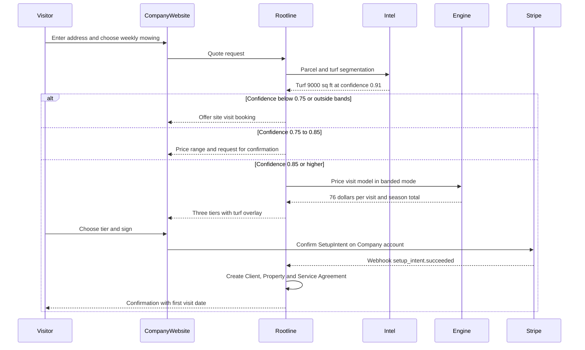
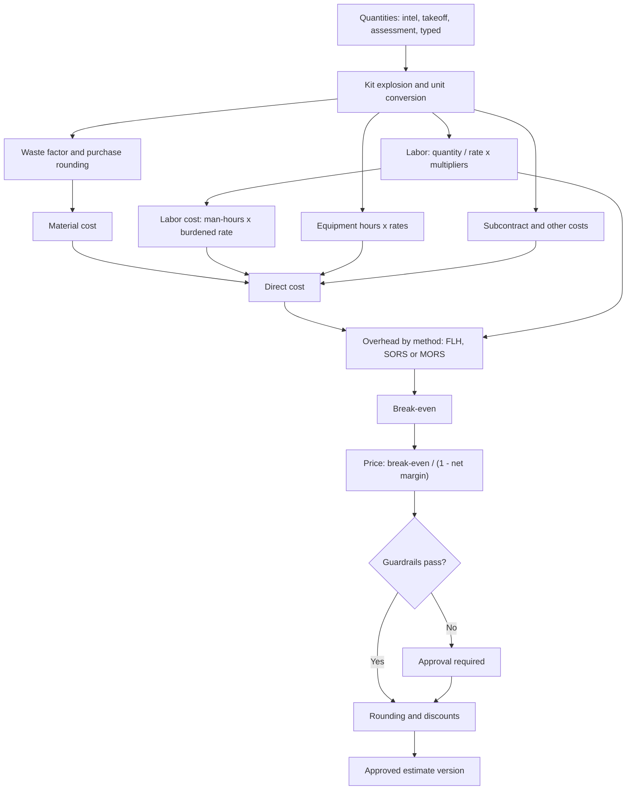
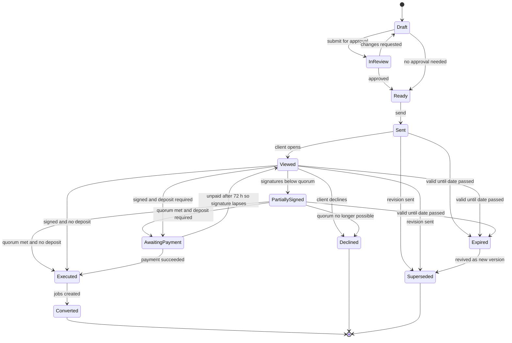
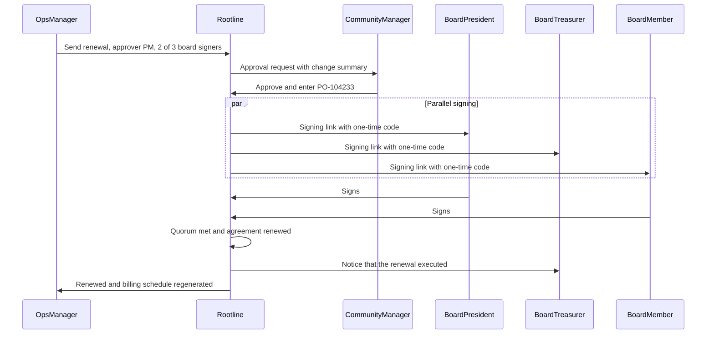
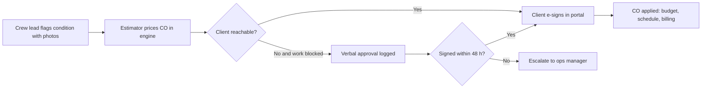
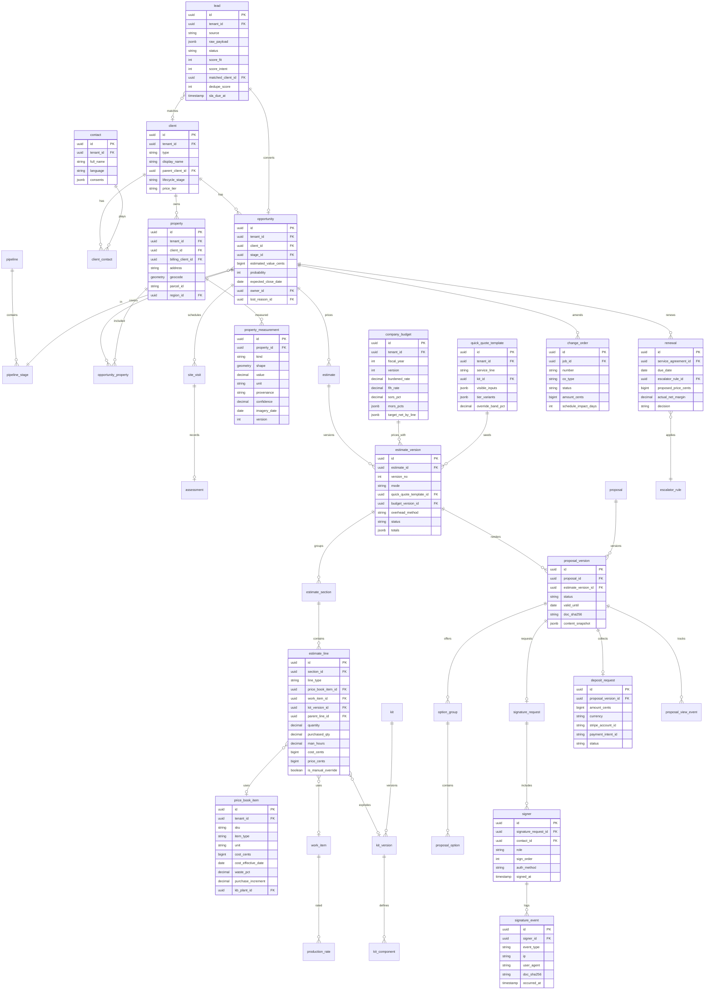
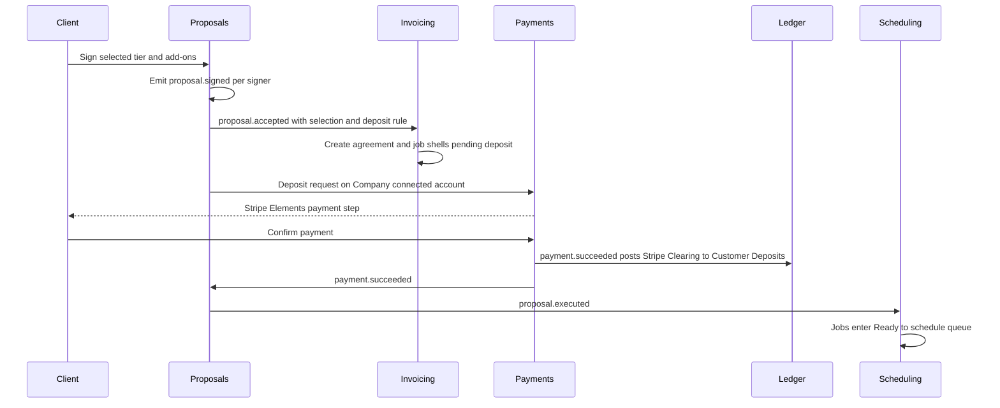

# 03 - CRM, Sales, Estimating and Proposals

> This module is the revenue engine of Rootline. It covers every step from the first "can you give me a price on mulch?" text message to a signed, deposit-paid proposal that becomes a scheduled Job, and then back around to next year's renewal. It has four layers. (1) **Lead capture and CRM**: every channel into one deduplicated inbox, Clients/Properties/Contacts, and a pipeline kanban. (2) **Site assessment and property intel**: mobile checklists, photos, and measurements filled in from parcel data and aerial imagery before anyone drives to the site. (3) **The Estimating Engine**: production-rate labor, labor burden, equipment rates, materials with waste and unit conversion, subcontractors, LMN-style overhead recovery from a company budget, and margin math that does not lie. (4) **Proposals**: visual, tiered, e-signed and deposit-collecting, with Design Studio plans, AI mockups and Plant Knowledge Base photos built in. A landscape company makes or loses its year in this module. Underpricing spring mulch by 20 percent across 300 maintenance clients can be the gap between a good year and a bad one, and estimators usually choose between a fast-but-dumb quote tool (Jobber-style) and an accurate-but-heavy estimating suite (LMN/Aspire-style). Rootline is built to be both fast and rigorous, and visually better than either.

**Related docs:** [Personas and permissions](02-personas-roles-permissions.md) | [Scheduling](04-scheduling-dispatch-routing.md) | [Crew app](05-field-crew-mobile-app.md) | [Customer Portal](06-customer-portal.md) | [Invoicing and contracts](07-invoicing-billing-contracts.md) | [Payments](08-payments-stripe.md) | [Ledger](09-accounting-ledger-integrations.md) | [Design Studio](10-design-studio.md) | [AI mockups](11-ai-design-mockups.md) | [Plant KB](12-plant-knowledge-base.md) | [Inventory and equipment](13-operations-inventory-equipment.md) | [Service lines](14-service-line-modules.md) | [Payroll](15-team-hr-payroll.md) | [Marketing](16-marketing-growth-communications.md) | [AI copilot](17-ai-copilot-automation.md) | [Reporting](18-reporting-analytics.md) | [Architecture](20-architecture-security.md) | [UX](21-ux-design-system-sitemaps.md) | [Roadmap](24-roadmap-feature-catalog.md)

**Feature ID convention:** `LEAD-nn` (capture), `CRM-nn` (records), `PIPE-nn` (pipeline), `ASSESS-nn` (site visits), `INTEL-nn` (property intel), `EST-nn` (estimating), `PB-nn` (price book), `PROP-nn` (proposals), `CO-nn` (change orders), `REN-nn` (renewals), `BID-nn` (commercial bids), `COMM-nn` (commissions), `SALES-nn` (sales productivity), `AI-n` (AI capabilities in [section 10](#10-ai-opportunities-in-this-module)). The master catalog in [24-roadmap-feature-catalog.md](24-roadmap-feature-catalog.md) uses these IDs.

---

## Table of contents

1. [Goals and non-goals](#1-goals-and-non-goals)
2. [Market research](#2-market-research)
3. [Personas and jobs-to-be-done](#3-personas-and-jobs-to-be-done)
4. [Feature specification](#4-feature-specification)
5. [Key user flows](#5-key-user-flows)
6. [Screens and wireframes](#6-screens-and-wireframes)
7. [Data model](#7-data-model)
8. [Integrations, APIs and events](#8-integrations-apis-and-events)
9. [Permissions](#9-permissions)
10. [AI opportunities in this module](#10-ai-opportunities-in-this-module)
11. [Edge cases, compliance and risks](#11-edge-cases-compliance-and-risks)
12. [Metrics and KPIs](#12-metrics-and-kpis)
13. [Beyond the brief: extra ideas](#13-beyond-the-brief-extra-ideas)
14. [Open questions](#14-open-questions)
15. [Sources](#sources)

---

## 1. Goals and non-goals

### 1.1 Goals

| # | Goal | Measurable target (product objective, not a market statistic) |
|---|------|----------------------------------------------------|
| G1 | **No lead lost.** Every inbound channel lands in one inbox, deduplicated against existing Clients and Properties, with a first response sent automatically. | Median speed-to-first-response under 5 minutes during business hours; 0 leads without an owner after 1 business hour. |
| G2 | **Measure before you drive.** Property intel (lot size, house footprint, turf/bed/hardscape areas, slope) is pre-filled from parcel and aerial data. | At least 70% of residential maintenance quotes produced without a site visit for Companies that enable it (target for tenants using intel). |
| G3 | **Estimates that make money.** Every price derives from the Company's own budget (burdened labor, overhead recovery, target net profit) and production rates, not from gut feel. | 100% of estimate lines carry a cost basis; estimated-vs-actual labor hours variance within +/-10% on 80% of jobs after 1 season of calibration. |
| G4 | **Fast for simple, deep for complex.** A weekly mowing quote takes under 2 minutes. A 600 sq ft paver patio with seat wall takes under 20 minutes from a Design takeoff. | Time-to-estimate tracked per job type (see [section 12](#12-metrics-and-kpis)). |
| G5 | **Proposals that sell.** Good/better/best tiers, add-ons, AI mockups, to-scale plans and plant photos, signed and deposit-paid from a phone. | Close-rate lift versus the tenant's pre-Rootline baseline; option attach rate tracked per proposal. |
| G6 | **Closed loop.** Signed proposals become Jobs, Projects and Service Agreements with budgets, so estimated hours feed job costing and job costing feeds back into production rates. | Every won proposal converts to Job(s) in 1 click; production-rate calibration suggestions after every 10 completed jobs of a type. |
| G7 | **Recurring revenue protected.** Maintenance agreement renewals go out automatically with price escalators and margin checks. | Renewal campaign launched 60-90 days before expiry for 100% of expiring agreements. |
| G8 | **Commercial-grade.** Multi-property bids, RFP intake, unit-price schedules, multi-signer HOA approvals, PO numbers. | Commercial bid packet generated from a portfolio of 25 sites in under 1 hour. |

### 1.2 Non-goals

- **Not a general-purpose CRM.** We do not try to be Salesforce or HubSpot. There is no arbitrary object builder; there are custom fields, tags and pipelines tuned for landscaping. Companies that insist on Salesforce get a sync connector ([V2]), not parity.
- **Not marketing automation.** Campaigns, the website builder, review requests, referral programs and the AI receptionist are specified in [16 - Marketing](16-marketing-growth-communications.md). This doc covers how their output becomes Leads and Opportunities.
- **Not the design tool.** Drawing beds, placing plants and rendering mockups belong to [10 - Design Studio](10-design-studio.md) and [11 - AI Design and Mockups](11-ai-design-mockups.md). This doc covers the takeoff contract (Design -> quantities -> Estimate) and how designs are embedded in proposals.
- **Not invoicing or payment rails.** Deposits are requested here; the charge, payout, refund and dispute mechanics are in [08 - Payments](08-payments-stripe.md). Billing schedules after conversion are in [07 - Invoicing](07-invoicing-billing-contracts.md).
- **Not construction bid management for general contractors.** We support landscape subcontract bids to GCs (bid packets, alternates, unit prices, retainage terms) but not plan-room aggregation or GC-side bid leveling.
- **No auto-sent AI prices in MVP.** AI can draft estimates; a human holding `proposal.send` (and, above their approval limits, an approver holding `proposal.approve_internal`, per [02](02-personas-roles-permissions.md)) always releases a price to a Client until a tenant explicitly enables bounded auto-quoting (see [section 10](#10-ai-opportunities-in-this-module)).

---

## 2. Market research

> **Research method note.** For this doc, research used targeted web searches on vendor help centers, review aggregators (Capterra, GetApp, Software Advice, TrustRadius, G2) and trade publications. In the writing session direct page fetching was blocked by the network sandbox and the shared search budget ran out after 9 queries. A later review pass (November 2026) could not search either, so it replaced several "(verify)" flags with facts that the sibling research reports had already sourced: [R1 - Field service platforms](research/R1-field-service-platforms.md), [R2 - Landscape-specific platforms](research/R2-landscape-specific-platforms.md) and the lead-ingest research in [16 - Marketing](16-marketing-growth-communications.md). Those rows cite the original URLs. Capabilities still flagged **"(verify)"** come from general product knowledge. Treat them as hypotheses to confirm in demos before quoting them externally. Prices and plan names are **as of November 2026, verify**.

### 2.1 What competitors do in this module

| Product | Positioning | CRM / pipeline | Estimating depth | Overhead recovery | Kits / assemblies | Measurement | Proposals | E-sign + deposit | Renewals |
|---|---|---|---|---|---|---|---|---|---|
| **Jobber** | Horizontal home-service SMB | Requests, clients, Sales Pipeline (bundled on Plus per third-party trackers, verify); AI Receptionist answers calls and texts and books appointments (launched 2025; [destinationCRM](https://www.destinationcrm.com/Articles/CRM-News/CRM-Across-the-Wire/Jobber-Launches-Receptionist-171139.aspx)) | Price-book line items with quantities; no production-rate engine, overhead solve or takeoff (analysis in [R1](research/R1-field-service-platforms.md)) | None built-in | Line-item templates | None native | Clean quotes, **optional line items** (Grow tier and above per trackers), packages pattern ([Jobber help](https://help.getjobber.com/es/articles/optional-line-items-on-quotes/)) | Yes; signature saved and status moves to Approved; % deposit recalculates when options added ([Jobber help](https://help.getjobber.com/es/articles/quote-approvals/)) | Basic; quote follow-ups on Grow plan only ([Jobber help](https://help.getjobber.com/en/articles/quoting-on-the-grow-plan/)) |
| **LMN** (Granum, merged with SingleOps Nov 2024) | Landscape-specific, budget-first | Leads/CRM (verify depth) | **Production-rate based** labor and materials ([LMN estimating FAQ](https://intercom.help/lmn/en/articles/15939077-estimating-faq)) | **Budget-driven**, three methods: MORS, FLH, SORS ([LMN help](https://intercom.help/lmn/en/articles/15939065-how-lmn-calculates-overhead-labor-burden-and-profit-in-estimates)) | Yes (verify) | **Through partners:** Attentive.ai AI mapping partnership (Feb 2025); Beam AI plan-set takeoffs mapped into LMN (Feb 2026) ([Attentive.ai](https://attentive.ai/blog/lmn-and-attentive-ai-announce-strategic-partnership), [LMN release note](https://support.golmn.com/hc/en-us/articles/46786137574683)) | Yes | Yes (verify) | Yes (verify) |
| **Aspire** ([ServiceTitan](https://www.servicetitan.com/industries/landscape-business-software)) | Mid-market and commercial landscape ERP | Opportunities, pipeline, renewals ([Aspire](https://www.youraspire.com/features/estimating)) | **Production-based templates and kits**, unlimited templates ([Aspire](https://www.youraspire.com/features/estimating)) | Yes, budget-based (verify) | Yes, core concept | **PropertyIntel add-on** synced into kits ([Aspire](https://www.youraspire.com/go/landscape-estimating-property-measurement), [PropertyIntel listing](https://platform.softwareone.com/product/propertyintel/PCP-0309-7216)) | Visual proposals (vendor claim); PropertyIntel add-on also offers them | Yes | **Renewals managed in pipeline** |
| **SingleOps** (Granum) | Tree care + landscape | CRM, estimates, proposals ([Capterra](https://www.capterra.com/p/176935/SingleOps/pricing/)) | Item libraries, templates | Not core (verify) | Item libraries | Satellite tree mapping, tree inventory | **Strong visual proposals are its selling point** ([case study](https://www.casestudies.com/company/singleops/case-study/chop-nashvilles-proposals-are-incredible)); portal approval and payment ([SingleOps](https://www.singleops.com)) | Yes | Partial (verify) |
| **Service Autopilot** | Lawn/maintenance route businesses | Leads, marketing automation (verify) | Measurement-driven quoting (verify) | No (verify) | Limited (verify) | Built-in measuring (verify) | Basic (verify) | Yes (verify) | Recurring-centric (verify) |
| **ServiceTitan** | Trades enterprise (HVAC/plumbing) | Strong CRM and call booking (verify) | **Pricebook** with good/better/best presentation (verify) | Not landscape-style (verify) | Pricebook kits (verify) | No | Tablet-first option presentation (verify) | Yes, plus financing (verify) | Memberships (verify) |
| **Housecall Pro** | Horizontal home-service SMB | Basic | Line-item, good/better/best options (verify) | No | Price book (verify) | No | Option-based estimates (verify) | Yes, plus financing (verify) | Service plans (verify) |
| **Real Green** (WorkWave) | Lawn care / PHC programs | Strong lead and telemarketing tooling (verify) | Program pricing by turf area (verify) | No | Programs | **Measurement Assistant**: measures from satellite imagery and sends instant quotes without a site visit ([Real Green](https://www.realgreen.com/measurement_assistant.html)) | Program sign-up | Yes (verify) | Program auto-renew (verify) |
| **Arborgold** | Tree care and landscape | CRM (verify) | Estimates with tree inventory (verify) | No (verify) | Kits (verify) | Landscape measuring tool that traces lawn, bed and sod areas ([Arborgold help](https://help.arborgold.com/en/articles/4423488-landscape-measuring-tool-basics)) | Yes | Yes | Partial |
| **Yardbook** | Free/low-cost solo operators | Basic | Simple estimates | No | No | Simple measuring (verify) | Basic | Partial | No |
| **Copilot CRM** | Lawn/landscape SMB | CRM, campaigns (verify) | Line-item, measurement (verify) | No | Limited | Built-in measuring (verify) | Basic | Yes | Partial |
| **SynkedUP** | Design-build focused landscape; "automatically priced for profit" quoting | Pipeline (verify) | Production rates and job costing ([SynkedUP estimating](https://synkedup.com/features/estimating/)) | Yes ([SynkedUP estimating](https://synkedup.com/features/estimating/)) | Yes (verify) | Third-party (verify) | Design-build oriented (verify) | Yes (verify) | Partial |
| **Measurement bolt-ons** (Aspire PropertyIntel, SiteRecon, Attentive.ai, LawnStarter-style instant quotes) | Separate subscriptions beside the FSM | n/a | Quantities only | n/a | Sync into kits (PropertyIntel into Aspire) | Core product; Aspire built PropertyIntel from its 2021 Go iLawn and LandOne acquisitions ([IGIN](https://igin.com/article-8937-Aspire-Software-announces-intent-to-acquire-Go-iLawn-and-LandOne.html)) | No | No | No |

**Patterns worth copying:**

- **LMN's budget-first discipline.** LMN builds a sell rate in a fixed order: average wage per person-hour from the budget, then labor burden to get loaded labor cost, then an overhead markup from the Overhead Recovery tab, then profit margin. It keeps labor burden separate from overhead and profit out of the overhead markup ([LMN help](https://intercom.help/lmn/en/articles/15939065-how-lmn-calculates-overhead-labor-burden-and-profit-in-estimates), [mirror](https://support.golmn.com/hc/en-us/articles/47875213217691)). LMN's help also shows why the method choice matters: a 37% overhead ratio appears as a **204% markup** when the overhead is spread over a labor-only base. The smaller the base, the larger the markup must be to recover the same overhead dollars. LMN recommends a budget but does not require one to create estimates ([LMN estimating FAQ](https://intercom.help/lmn/en/articles/15939077-estimating-faq)).
- **Aspire's kits.** Aspire's estimating is built on production-based templates and kits drawn from the company's own production factors. Reviewers credit it with getting the whole company "bidding at the same rates" ([Aspire](https://www.youraspire.com/features/estimating), [Capterra review](https://www.capterra.com/p/161544/Aspire/reviews/7184990/)).
- **Jobber's client-side simplicity.** Optional line items are a checkbox. A client can pick add-ons and approve in one step. A percentage deposit recalculates when add-ons are selected, and unselected options are dropped on conversion to a job. Editing the total, deposit or line items after approval clears the signature ([Jobber optional items](https://help.getjobber.com/es/articles/optional-line-items-on-quotes/), [Jobber approvals](https://help.getjobber.com/es/articles/quote-approvals/), [Jobber quote basics](https://help.getjobber.com/en/articles/quote-basics/)). This is the right UX bar for residential clients.

### 2.2 What users complain about

| Complaint | Evidence | Rootline response |
|---|---|---|
| Heavy tools are hard to learn and slow to roll out | Aspire: "learning curve, and some common tasks require too many steps", "intensive ramp up period" ([GetApp UK](https://www.getapp.co.uk/reviews/9108/aspire), [Capterra](https://www.capterra.com/p/161544/Aspire/reviews/?page=3)); SingleOps: steep learning curve ([Capterra](https://www.capterra.com/p/176935/SingleOps/pricing/)); LMN: "too difficult to use" (summarized in [Capterra LMN reviews](https://www.capterra.com/p/142064/LMN/reviews/)) | Progressive disclosure: a "Quick Quote" mode on the same engine; a budget wizard with sensible defaults; Copilot drafts the first estimate. |
| High cost and add-on fees | Aspire: "High cost and added fees" in the Capterra summary ([Capterra](https://www.capterra.com/p/161544/Aspire/)); described as much more expensive than LMN or Jobber ([Searchfunder thread](https://searchfunder.com/post/what-ops-software-for-landscaping)) | Measurement, visual proposals, e-sign and kits included in core tiers; AI metered transparently as credits ([22 - Pricing](22-business-model-pricing-gtm.md)). |
| Cannot reuse parts of past estimates | Aspire reviewer could not copy selected parts of a previous opportunity into an unrelated one ([Capterra](https://www.capterra.com/p/161544/Aspire/reviews/?page=3)) | `EST-15` "Copy anything": copy any section, line or kit from any past estimate via search, with costs refreshed. |
| Proposals are not visual enough | Aspire reviewer wants "adding more photos to proposals" ([Capterra](https://www.capterra.com/p/161544/Aspire/reviews/?page=3)) | Visual proposals are native: unlimited photos, before/after mockup sliders, interactive plans, KB plant cards. |
| Simple tools are too basic for landscape | A reviewer who moved to LMN said Jobber felt too basic and tried to serve every business type ([Capterra LMN reviews](https://www.capterra.com/p/142064/LMN/reviews/)) | Landscape-native units (yd3, flats, pallets, lf of edging), production rates, seasonality and agreements. |
| Mobile apps are buggy and slow | LMN app reviews: "buggy, slow, and deletes job cards" ([Connecteam review of LMN](https://connecteam.com/reviews/lmn/)) | Offline-first estimator mode in the React Native app with local SQLite and conflict-safe sync ([05](05-field-crew-mobile-app.md), [20](20-architecture-security.md)). |
| Key sales automation gated to higher plans | Jobber quote follow-ups are a Grow-plan feature, and CC'd recipients do not receive follow-ups ([Jobber help](https://help.getjobber.com/en/articles/quoting-on-the-grow-plan/)) | Basic follow-up cadence in every tier; every signer and approver gets the cadence. |
| Materials math on irregular properties is guesswork | A Reddit r/landscaping poster asked how experienced operators calculate mulch and material volume on irregular beds (reported second-hand by [Swivl](https://swivl.tech/blog/mulch-math-how-landscapers-estimate-materials)) | Aerial and on-site polygon measurement, depth-aware volume, and unit conversion (bags vs yd3 vs tons) built in. |
| Overhead is ignored in pricing | "If you don't recoup overhead costs, there's not even $1 of profit in a job" ([Total Landscape Care](https://www.totallandscapecare.com/business/article/15034644/how-to-properly-cost-a-job)) | Overhead recovery is mandatory in the engine (default FLH), with an explicit "break-even" line on every estimate. |
| Double entry between estimating tool and FSM | Jobber quotes are price-book line items, so estimators build the number in LMN, Excel or their head and retype it ([R1 analysis](research/R1-field-service-platforms.md), an inference from Jobber's feature set rather than a quoted complaint) | One engine from Quick Quote to commercial bid; the proposal, Job budget and invoice schedule all come from the same estimate version. |
| Measurement is slow on big sites | An LMN reviewer said measuring large properties "would take literal days" ([G2 LMN reviews](https://www.g2.com/products/lmn)) | AI auto-measure with tiling for sites over 5 acres (`INTEL-03`), and commercial bid builder that measures a portfolio in one batch (`BID-02`). |
| Lead marketplaces create duplicates and missing fields | Duplicate leads when both the Angi API and the email parser are enabled ([ClientTether](https://support.clienttether.com/home-advisor/)); the consumer phone number is reported missing from LSA leads in the Google Ads API ([Google Ads API forum](https://groups.google.com/g/adwords-api/c/PP7d0bCOGKg)) | One ingest path per source (email parser auto-disabled once the API path is verified) and identity resolution that tolerates partial records (`LEAD-03`). |
| Add-ons stack up | Reviewers note that Jobber's AI Receptionist and Marketing Suite add-ons "add up fast" ([FieldCamp review](https://fieldcamp.ai/reviews/jobber-reviews/), third-party) | Receptionist, measurement, e-sign and visual proposals ship in core tiers; AI usage metered as credits ([22](22-business-model-pricing-gtm.md)). |

### 2.3 The gap we exploit

1. **Rigor without the drag.** LMN and Aspire have the right math, and Jobber and Housecall Pro have the right client UX. Nobody combines a budget-driven estimating engine with a 2-minute quick-quote path and a consumer-grade proposal.
2. **Measurement is native, not an add-on.** Aspire users buy PropertyIntel separately to sync measurements into kits ([Aspire](https://www.youraspire.com/go/landscape-estimating-property-measurement)). LMN reaches AI measurement through Attentive.ai and Beam AI partnerships, and commercial firms add SiteRecon or SiteDNA for audits ([R2](research/R2-landscape-specific-platforms.md)). Rootline ships parcel, aerial and slope intel with the core product, and the same polygons become the Design Studio base layer.
3. **Design to estimate to proposal is one object graph.** A bed drawn in the [Design Studio](10-design-studio.md) is a takeoff source. Change the bed, and the estimate shows a diff. Nobody in the field-service set does this; design tools (e.g., standalone CAD) do not price.
4. **Proposals that look like a design firm made them.** AI photoreal mockups, an interactive plan and plant cards from a region-aware [Plant KB](12-plant-knowledge-base.md) ("performs well in EPA Level III ecoregion 55, Eastern Corn Belt Plains").
5. **Commercial and HOA reality.** Multi-signer quorum approvals, PO numbers, unit-price schedules and multi-site bids exist in Aspire at a high price point; small and mid-size companies get none of it.
6. **Renewals with margin truth.** Escalators driven by actual job-costing margin per agreement. "This HOA lost 6 points of margin last year; recommend +9%, not +4%."
7. **Money goes straight to the Company's own Stripe.** Deposits are direct charges on the Company's connected account ([08](08-payments-stripe.md)), and the deposit liability posts to the built-in [Ledger](09-accounting-ledger-integrations.md) automatically.

> **Competitive edge: estimating.** LMN and Aspire make the estimator learn a costing system before they can quote a mulch job. Rootline runs the same budget-based math (burden, overhead recovery, net profit) behind a Quick Quote screen (`EST-11`), with the full cost build-up one click away. An estimator who learned on Jobber can be productive on day 1. A CFO who learned on LMN can audit every number. We keep LMN's three overhead recovery methods (MORS, FLH, SORS), add an "overhead as % of revenue" view that owners already think in, and show them side by side on any estimate. LMN's own help center explains why the method choice matters, which tells us its users need that comparison.

---

## 3. Personas and jobs-to-be-done

Role keys follow [02 - Personas, roles and permissions](02-personas-roles-permissions.md).

| Persona (role key) | Jobs-to-be-done in this module | Pain today | What Rootline gives them |
|---|---|---|---|
| Business Owner (`owner`) | "Set prices so every crew-hour recovers overhead and profit." "Know what is in the pipeline for May." | Pricing lives in the owner's head or a spreadsheet; estimators discount to win. | Budget wizard, guardrails (min margin, discount approvals), weighted pipeline forecast, win/loss analytics. |
| Office / Admin Manager (`office_manager`) | "Get every call, form and Angi lead answered and booked for a site visit." "Send renewals on time." | Leads scattered across voicemail, email, Facebook, Angi app; duplicate client records. | Unified lead inbox, dedupe, auto-replies, renewal campaigns, proposal follow-up automations. |
| Sales Rep / Estimator (`estimator`) | "Walk a property, capture scope, price it right, and get a signature before a competitor shows up." | Re-measuring, retyping notes, rebuilding the same paver patio math every time, chasing signatures. | Mobile assessment, property intel, kits, templates, tiered visual proposals, kitchen-table signing with deposit. |
| Landscape Designer (`designer`) | "Turn a concept into a priced plan the client can say yes to." | Design tool and estimate disconnected; plant substitutions break pricing. | Takeoff from Design, live price as the design changes, KB-constrained plant palette, mockups in proposal. |
| Operations / Account Manager (`ops_manager`) | "Sell enhancements to my existing accounts; renew contracts profitably; price change orders fast." | Enhancement ideas lost in crew notes; renewals at blanket +3% regardless of margin. | Crew-flagged upsell leads, enhancement campaigns, margin-aware renewal grid, field change orders. |
| Crew Lead / Foreman (`crew_lead`) | "Flag that the client wants their front beds redone; document unforeseen conditions." | No easy way to pass upsells to sales; extra work done without paperwork. | One-tap "Upsell lead" and "Change order request" with photos from the crew app ([05](05-field-crew-mobile-app.md)). |
| Field Technician (`technician`) | "Snap a photo of the dead arborvitae so someone can quote replacement." | Same as above, lower authority. | Create upsell lead (no pricing visibility). |
| Bookkeeper (`bookkeeper`) | "Deposits recorded as liabilities, not revenue; commissions computed right." | Deposits miscoded in QuickBooks; commission spreadsheets. | Automatic deposit journal entries, commission events export ([09](09-accounting-ledger-integrations.md), [15](15-team-hr-payroll.md)). |
| Subcontractor (`subcontractor`) | "Submit my price for the irrigation portion of a bid." | Emailing PDFs back and forth. | Scoped sub-bid request link (V1): sees only their scope package, submits price and attachments. |
| Residential homeowner (`client_residential`) | "Understand what I am getting, see what it will look like, pick a package, pay the deposit." | PDF quotes with jargon, no visuals, opaque line items. | Mobile-first visual proposal, tiers, add-ons, mockups, plant cards, sign and pay in 60 seconds. |
| Commercial PM / HOA board (`client_commercial`) | "Compare bids across 12 sites, get board approval, issue a PO." | Bids arrive in inconsistent formats; board signatures via email chains. | Unit-price schedules, site-by-site breakdown, multi-signer quorum approvals, PO capture, exportable bid packet. |
| Platform Curator (`platform_curator`) | "Maintain the benchmark production-rate library and plant data that tenants start from." | N/A | Curator console for production-rate benchmark ranges and assembly templates ([19](19-platform-admin-portal.md)). |
| Platform Operator (`platform_owner`) | "Ship great default kits and templates; see adoption; keep AI costs sane." | N/A | Template marketplace, AI credit metering, adoption analytics ([19](19-platform-admin-portal.md)). |

### 3.1 Key journeys at a glance

1. **Residential maintenance, no visit:** web form -> intel auto-fill (turf 9,000 sq ft) -> Quick Quote from the mowing model -> 3-tier proposal (Mow only / Mow + 5-step fertilization / Full care) -> client signs on phone -> Service Agreement created -> first visit scheduled on the existing Tuesday route.
2. **Design-build install:** Google LSA call -> AI receptionist books consult -> designer visits with assessment checklist -> Design Studio plan + AI mockups -> takeoff -> estimate with kits -> good/better/best visual proposal with financing -> e-sign + 30% deposit -> Project with phases (demo, hardscape, irrigation, planting) -> change order for buried concrete -> completion -> maintenance agreement upsell.
3. **HOA renewal:** 90 days before contract end, renewal grid shows actual margin per site -> ops_manager applies CPI-based escalator with a 3% floor -> community manager approves and 3 board members receive the renewal -> 2-of-3 quorum signs -> agreement renewed, billing schedule regenerated.

---

## 4. Feature specification

Every feature carries a priority tag: **[MVP]** first sellable release, **[V1]** within about 12 months of MVP, **[V2]** 12-24 months, **[V3]** moonshot.

### 4.1 Lead capture and intake

#### LEAD-01 Unified Lead Inbox [MVP]

One queue for every new inquiry regardless of channel. Each Lead row shows: source icon, received time, SLA timer, name, service interest, address (with a service-area badge), dedupe status (New / Matches existing Client / Possible duplicate), score, and assignee.

Behaviors and rules:
- A Lead is a lightweight record that is not yet a Client. Fields: `source`, `source_detail` (campaign, form id, QR code id, LSA lead id), `raw_payload` (original JSON or transcript, immutable), `name`, `phones[]`, `emails[]`, `address`, `geocode`, `service_interest[]` (enum from the tenant's service catalog plus free text), `budget_range`, `timeline` (ASAP / this season / next season / just researching), `notes`, `consents` (SMS consent with timestamp and the exact consent language shown, email opt-in), `utm_*`, `assigned_to`, `status`.
- Lead statuses: `new` -> `contacted` -> `qualified` -> `converted` (to Client + Opportunity) or `disqualified` (with reason: out of area, not a service we offer, spam, duplicate, price shopper, no response).
- **SLA timer** [MVP]: configurable per source (default 15 minutes in business hours). It goes amber at 50% of the SLA and red at breach. On breach the assignee and `office_manager` get a push notification. Business hours come from Company settings; after-hours leads start the timer at next open unless "after-hours on-call" is enabled.
- **Instant auto-response** [MVP]: per-source template (SMS if consent captured, else email) sent within 60 seconds: "Thanks Maria, this is Evergreen Edge Landscaping. We got your request for spring cleanup at 14 Elm St. Pick a time for a quick site visit: {booking_link}". TCPA guardrails: SMS only with documented consent, quiet hours 9 pm-8 am recipient local time (configurable stricter), STOP handling via Twilio ([16](16-marketing-growth-communications.md)).
- **Consent provenance** [MVP]: every Lead records where its contact permission came from (`form_checkbox`, `inbound_call`, `inbound_sms`, `marketplace`, `staff_verbal`, `none`) plus the exact disclosure text version. An inbound text or call permits a reply about that inquiry; it is not marketing consent, so the Lead is not enrolled in nurture SMS until the client opts in. Marketplace leads (Angi, Thumbtack, LSA) reply in the marketplace thread or by email until the client gives SMS consent on a Rootline form. Opt-outs made by any reasonable means ("please stop texting me") are processed immediately; the FCC revocation rules in effect since April 11, 2025 require honoring them within 10 business days ([Nixon Peabody](https://www.nixonpeabody.com/insights/alerts/2025/04/11/fcc-partially-delays-new-tcpa-consent-revocation-rules); scope details in [16](16-marketing-growth-communications.md), verify).
- **Service-area check** [MVP]: the geocoded address is tested against the Company's service-area polygons (drawn on a map, or ZIP/postal list). Outside the area gives an "Out of area" badge and an optional polite decline template; inside a "premium zone" polygon applies a travel surcharge flag for estimating.
- **Bulk actions**: assign, merge, disqualify, convert, add to nurture campaign.

#### LEAD-02 Capture channels [MVP core channels, V1/V2 marketplaces]

| Channel | Mechanism | Priority | Notes |
|---|---|---|---|
| Website forms | Embeddable JS widget and hosted form; native in the Rootline website builder ([16](16-marketing-growth-communications.md)); reCAPTCHA/hCaptcha + honeypot + rate limit | [MVP] | Form builder with conditional questions ("What services?" -> if Mowing ask lot size range). Photo upload (up to 10 images, 15 MB each). |
| Online booking and instant quotes | Client picks a site-visit slot or books an instant-priced service (mowing, aeration, fertilization program, mulch, irrigation start-up) | [MVP] instant quote for standardized residential services; [V1] estimator self-booking (`ASSESS-01`) | The booking flow, confidence gating and capacity rules live in [16](16-marketing-growth-communications.md) 4.3. This module supplies the price: the pricing rule is generated from the maintenance cost model (`EST-12`) so a public price never undercuts the Company's budget. See flow 5.2. |
| AI receptionist (voice) | Inbound calls answered by the AI receptionist ([16](16-marketing-growth-communications.md)), which creates a Lead with transcript, summary, intent and requested callback/visit time | [MVP] after-hours lead capture; [V1] overflow and 24/7 modes (per [16](16-marketing-growth-communications.md) 4.18) | Call recording consent prompts per state (two-party consent states) handled in 16. |
| Phone / SMS (human) | Click-to-create Lead from the unified inbox conversation | [MVP] | Caller ID matched to existing Clients first. |
| Email-to-lead | Unique inbound address per Company (`leads@acme.rootline.app`); AI parses body and attachments | [V1] | Catches forwarded RFPs, HOA manager emails. |
| Google Local Services Ads | Read-only pull of LSA leads and lead conversations through the Google Ads API (`local_services_lead` and conversation resources) per connected Ads account ([Google Ads API LSA docs](https://developers.google.com/google-ads/api/docs/campaigns/local-service-campaigns)); map charge status and lead type | [V1] | Polling every 5 minutes. The consumer phone number may be missing from API data ([forum](https://groups.google.com/g/adwords-api/c/PP7d0bCOGKg)), so dedupe falls back to name + address + call-tracking number. Replies and disputes stay in Google (deep link). Full ingest spec in [16](16-marketing-growth-communications.md). |
| Angi | Real-time JSON push to a per-tenant webhook URL with an optional `x-api-key` header; endpoint must answer HTTP 200 with a JSON body ([Angi lead API](https://intercom.help/angi/en/articles/15304819-angi-lead-integration-api)) | [V1] | When the API path is verified, the Angi email parser is auto-disabled to prevent the known duplicate problem. |
| Thumbtack, Yelp, Nextdoor, Houzz | Partner APIs where access is granted (Thumbtack API access terms not verified); otherwise email-parse fallback | [V1] email parse, [V2] native APIs | Each source tagged for cost-per-lead and ROI in [18](18-reporting-analytics.md). |
| Referrals | Client referral link/code from the portal ([06](06-customer-portal.md)); crew-captured "neighbor asked" leads | [V1] | Referrer credited; reward automation in 16. |
| Door hangers / yard signs / truck wraps | Per-campaign QR codes with short links; optional per-route QR batch ("Elm St route, May 4") so a lead is tied to the street where the hanger went | [V1] | Print-ready PDF generation of hangers with unique QR codes per batch. |
| Crew upsell | `crew_lead`/`technician` taps "Upsell lead" in the crew app with photo + note, attached to existing Client/Property | [MVP] | Routed to the account's `ops_manager`. |
| CSV import | Mapping wizard, dedupe on import, dry-run preview | [MVP] | Migration from Jobber/LMN exports. |
| Public API + Zapier | `POST /v1/leads`; Zapier app | [MVP] API, [V1] Zapier | Idempotency key required. |
| Facebook/Instagram Lead Ads | Meta lead ads webhook | [V2] | |

#### LEAD-03 Deduplication and identity resolution [MVP rules, V1 ML assist]

Dedupe runs synchronously on Lead creation and asynchronously on bulk import.

Matching keys (normalized):
- Phone: E.164 via libphonenumber; ignore extensions.
- Email: lowercased; Gmail dot/plus normalization only for matching, never for sending.
- Address: geocoded to a rooftop point and parcel id (Regrid) when available; else a normalized USPS/Canada Post address string; unit numbers preserved.
- Name: case-folded, punctuation stripped, nickname table (Bob = Robert), Jaro-Winkler similarity.

Scoring and actions:

| Signal | Points |
|---|---|
| Exact phone match | 40 |
| Exact email match | 40 |
| Same parcel id or same rooftop point within 10 m | 35 |
| Name similarity >= 0.92 | 15 |
| Same last name at same address | 10 |

- Score >= 80: **auto-link** to the existing Client (no merge of records; the Lead is attached and the Client timeline shows it). Users can undo for 30 days.
- Score 50-79: **suggest** with a side-by-side diff; human chooses Link / Merge / Keep separate.
- Same property, different person (new homeowner after a sale, or a tenant): if the existing Client on that Property has had no activity in 18 months, or the Lead says "just moved in", suggest **"New owner at known Property"**. That creates a new Client and transfers the Property history read-only (service history stays useful; the old Client's billing does not move).
- Commercial: the same property manager email across multiple HOAs links the Contact to multiple Clients (Contact many-to-many with Client via role).
- Merge semantics: the surviving record keeps the older `created_at`; arrays union; scalar conflicts resolved by "most recently verified" with an audit entry; all foreign keys re-pointed in one transaction; a merge is reversible for 30 days from the audit snapshot.

#### LEAD-04 Lead scoring [V1 rules, V2 ML]

Two explainable sub-scores, 0-100 each, shown as chips with a "why" tooltip.
- **Fit score:** in service area (+30), service interest matches high-margin lines (+20, tenant-configurable per service), property size in the sweet spot (from intel, +15), commercial with multiple properties (+20), budget range at or above the tenant's minimum job (+15), repeat or referral source (+10).
- **Intent score:** timeline ASAP (+30), uploaded photos (+10), requested specific date (+15), opened booking link (+10), multiple touches in 7 days (+15), proposal viewed 3+ times (+20, for re-scoring open Opportunities).
- V2 ML model trained per tenant (with a platform prior for small tenants) on lead -> won outcomes; shows the top 3 contributing features. Never uses protected-class proxies. Neighborhood-level features are allowed only as route-density signals, never demographic data (see [11](#11-edge-cases-compliance-and-risks)).

#### LEAD-05 Lead routing and assignment [MVP round-robin and territory, V1 rules]

- Strategies: round-robin within a team, territory polygons -> estimator, service-line routing (irrigation leads -> irrigation manager), commercial -> commercial sales team, capacity-aware (skip estimators at their weekly visit cap).
- Reassignment when the assignee is out of office (synced calendar or manual OOO).
- Every routing decision is logged with the rule that fired.

### 4.2 CRM core records

#### CRM-01 Clients, Properties, Contacts [MVP]

- **Client**: `type` (residential / commercial / HOA / municipal / GC), display name, legal name, billing address, tax-exempt status + certificate file ([07](07-invoicing-billing-contracts.md)), default terms, price tier, tags, custom fields, lifecycle stage (lead, prospect, active, past, do-not-service), source, referral parent, account owner (`ops_manager`), sales owner (`estimator`), lifetime value (computed), open balance (read from AR).
- **Property**: address, geocode, parcel id, service area/zone, access notes (gate code stored encrypted, visible to assigned crew only), pets, irrigation controller info, measurements (`INTEL-01`), photos, Designs, hazards, HOA/ARC requirements, property-level contacts, `billing_client_id` (may differ from owning Client for property managers).
- **Contact**: name, phones, emails, preferred language (en/es/fr-CA), communication preferences and consents, roles per Client (`primary`, `billing`, `approver`, `board_member`, `onsite`, `tenant`, `spouse`), portal access scope ([06](06-customer-portal.md)).

#### CRM-02 Commercial hierarchy [V1]

Parent-child Clients up to 4 levels: Management company -> Association/Owner -> Property -> Sub-area (e.g., "Phase 2 common areas"). Rollups for revenue, open opportunities and AR. Bids can target any node (see `BID-02`).

#### CRM-03 Activity timeline [MVP]

A reverse-chronological stream per Client/Property/Opportunity: calls (with recordings/transcripts if enabled), SMS, emails, notes, site visits, estimates, proposal events (sent, viewed, signed), payments, jobs, visits, change orders, crew photos. Filter chips by type. Pinned notes. @mentions notify teammates.

#### CRM-04 Tasks and reminders [MVP]

Tasks with due date/time, assignee, linked record, type (call, email, visit, follow-up, internal). Recurring tasks. A "My Day" list for estimators that merges tasks, site visits and SLA-breaching leads. Overdue tasks escalate to the manager after 3 days (configurable).

#### CRM-05 Custom fields and tags [MVP]

Typed custom fields (text, number, date, single/multi-select, boolean, currency, file) on Client, Property, Contact, Lead, Opportunity, Estimate. Fields can be required at a pipeline stage (`PIPE-03`). Tags are free-form with color and can drive automations.

#### CRM-06 Client and property health [V1]

Composite indicator: payment behavior (days to pay), complaint count, service recovery events, margin on account (from job costing), renewal risk. Feeds renewal recommendations (`REN-03`).

### 4.3 Pipeline and Opportunities

#### PIPE-01 Opportunities [MVP]

An Opportunity is a potential sale tied to one Client and one or more Properties. Fields: `name` ("Smith - Backyard patio and plantings"), `pipeline_id`, `stage_id`, `service_lines[]`, `estimated_value`, `probability` (defaults from stage, overridable), `expected_close_date`, `owner_id`, `designer_id`, `source` (inherited from Lead), `competitors[]`, `lost_reason`, `won_at`, `lost_at`, linked Site Visits, Designs, Estimates and Proposals.

#### PIPE-02 Multiple pipelines with configurable stages [MVP]

Shipped default pipelines (editable):

| Pipeline | Default stages (probability) |
|---|---|
| Residential maintenance | New (10%) -> Contacted (20%) -> Quoted (50%) -> Follow-up (60%) -> Won / Lost |
| Design-build / install | New (5%) -> Consult scheduled (15%) -> Site assessed (25%) -> Design in progress (35%) -> Proposal sent (50%) -> Negotiation/revision (65%) -> Won / Lost |
| Enhancements (existing clients) | Identified (20%) -> Quoted (50%) -> Won / Lost |
| Commercial maintenance bid | Lead/RFP received (5%) -> Bid/no-bid (10%) -> Site walk (20%) -> Bid submitted (35%) -> Shortlisted (55%) -> Board review (70%) -> Won / Lost |
| Snow and ice | Prospect (10%) -> Site survey (25%) -> Proposal (50%) -> Won / Lost, with a hard deadline field (e.g., Oct 15) |
| Renewals | Due (80%) -> Renewal sent (85%) -> Negotiation (75%) -> Renewed / Churned |

Rules: Won and Lost are terminal system stages. Moving to Lost requires a lost reason (`PIPE-06`). Moving to Won requires a signed Proposal, or an override by `owner`/`office_manager` with a note (e.g., verbal PO from a municipality).

#### PIPE-03 Stage gates [V1]

Per-stage required fields and checklist items, e.g., "Proposal sent requires an approved Estimate with margin >= floor". Gate failures show inline and block the drag-and-drop move.

#### PIPE-04 Kanban, list and map views [MVP kanban + list, V1 map]

- Kanban columns by stage, cards show value, client, property thumbnail, age in stage, next task, last activity and tier chips once a proposal is out.
- **Rotting indicator**: a card turns amber when it has been in a stage longer than the stage's target days (configurable, e.g., Quoted target 7 days) and red at 2x.
- Swimlanes by owner or service line. Column totals show raw and weighted value.
- Map view [V1] clusters open Opportunities so an estimator can plan a day of visits.

#### PIPE-05 Forecast [V1]

Weighted pipeline by expected close month and service line, plus a **capacity overlay**: forecast install labor hours against crew capacity from [04 - Scheduling](04-scheduling-dispatch-routing.md). "May is 140% sold for hardscape crews; push new patio proposals to June start dates or raise prices."

#### PIPE-06 Won/lost tracking [MVP]

- Lost reasons taxonomy (tenant-editable, platform default): Price too high, Chose competitor, Timing/season, Scope changed, No response/ghosted, Not qualified, Did it themselves, Financing declined, HOA/ARC denied, Other.
- When "Chose competitor": competitor name (pick list + free text) and their price if known.
- Loss captured from the client side too: a "Decline" button on the proposal asks an optional reason.
- **Re-engagement**: lost Opportunities with reason Timing get an automatic nurture reminder (default 6 months, or "next season start" based on service line).

### 4.4 Site visits and assessments

#### ASSESS-01 Site-visit scheduling [MVP]

- Site visits are calendar events on the estimator's schedule (and visible on the dispatch board in [04](04-scheduling-dispatch-routing.md) as non-crew events).
- Travel-aware slot suggestions: the system proposes slots that minimize the estimator's drive time given their already-booked visits that day (Google Routes/Mapbox matrix), with a 15-minute buffer.
- Client self-booking link with estimator availability windows [V1] (per estimator, per service line, minimum notice 24 h, max 4 visits/day default).
- Confirmation + reminder (24 h and 2 h) via SMS/email; "on my way" message with ETA from the mobile app.

#### ASSESS-02 Mobile assessment checklists [MVP]

Template-driven forms in the estimator mode of the React Native app, fully offline (local SQLite; synced when online, per [05](05-field-crew-mobile-app.md)).

Shipped templates: Maintenance walk, Design consultation, Irrigation audit (zones, controller model, backflow type, head counts per zone, leaks), Tree/shrub assessment (species via KB lookup, DBH, condition, hazards), Snow site survey (lots, sidewalks lf, stacking areas, hazards, obstacles, plow-able vs shovel areas), Commercial bid walk, Drainage assessment.

Question types: yes/no, single/multi-select, number with unit, measurement (manual, walk wheel, Bluetooth laser [V2], AR measure [V2]), photo (required count), video (max 60 s), sketch over photo, KB plant picker, signature, GPS point, polygon on map.

Rules: conditional logic (if "Existing irrigation?" = yes show irrigation section); required questions block completion; every answer is timestamped and geotagged. Templates are versioned, and a completed assessment pins its template version.

#### ASSESS-03 Photo capture and annotation [MVP]

- Photos tagged to an area ("Front bed A", "Backyard slope"), auto-tagged with GPS, heading and timestamp; markup tools (arrow, circle, text, measure line with typed dimension).
- Photos flow into the Estimate as reference attachments and into proposals as "Current condition" images, and into [11 - AI mockups](11-ai-design-mockups.md) as source images.
- Storage on S3 with CDN; original + web-optimized derivatives; EXIF location stripped from client-facing copies.

#### ASSESS-04 Voice-to-scope [V1]

The estimator dictates while walking ("Front beds about 600 square feet, 3 inch mulch, remove the 3 dead boxwoods on the left, client wants something with color, full sun"). Speech-to-text (English/Spanish), then the Copilot structures it into scope items with quantities, linked to photos taken during the dictation window. Output is a **draft** scope list the estimator confirms (see [17](17-ai-copilot-automation.md)).

#### ASSESS-05 Assessment-to-estimate handoff [MVP]

A completed assessment can generate an estimate draft: each scope item maps to a price book item or kit (mapping rules on the template: "Mulch area sq ft + depth in" -> kit `MULCH-INSTALL`). Unmapped items land in an "Unpriced scope" tray at the top of the estimate.

### 4.5 Property intel auto-fill

#### INTEL-01 Property measurement profile [MVP manual + parcel + AI turf, V1 other AI classes]

Every Property has a measurement profile, a set of named, versioned measurements, each with value, unit, **provenance** and **confidence**:

| Measurement | Source(s) | Typical use |
|---|---|---|
| Lot size (sq ft / acres / m2) | Parcel data (Regrid) [MVP] | Sanity checks, lawn program pricing fallback |
| House footprint (sq ft) | Building footprints (parcel/footprint datasets, aerial segmentation) [MVP] | Gutter cleaning, foundation bed estimates |
| Turf area, mowable (sq ft) | Aerial segmentation [MVP, shared with the instant-quote pipeline in [16](16-marketing-growth-communications.md)]; manual polygon [MVP] | Mowing, fertilization, aeration pricing |
| Turf area, trim-heavy (sq ft) | Derived: turf within 3 ft of obstacles/edges [V1] | Trim time |
| Bed area (sq ft) | Aerial segmentation [V1]; manual polygon [MVP] | Mulch, weeding, bed maintenance |
| Bed edge length (lf) | Polygon perimeter minus hard edges [V1] | Edging, trim |
| Hardscape area (sq ft) by type (driveway, walk, patio) | Aerial segmentation [V1] | Snow, pressure washing, sealing |
| Curb / sidewalk length (lf) | Parcel frontage + segmentation [V1] | Snow, edging |
| Parking lot area (sq ft) | Segmentation [V1] | Commercial snow, sweeping |
| Tree count and canopy area | Segmentation + LiDAR canopy height [V2] | Leaf cleanup volume, tree care |
| Slope (percent, by area) | USGS 3DEP elevation (1 m where available) [V1] | Difficulty multipliers, mower selection, erosion notes |
| Sun exposure estimate | Canopy + building shadow simulation by month [V2] | Plant selection constraints in KB ([12](12-plant-knowledge-base.md)) |
| Region | Platform Region lookup (hardiness zone, ecoregion) [MVP] | Plant palette, seasonality defaults |

Rules:
- **Provenance enum:** `parcel`, `aerial_ai`, `aerial_manual`, `onsite_measured`, `design_takeoff`, `client_reported`. Estimating prefers the highest-trust source in this order: `onsite_measured` > `design_takeoff` > `aerial_manual` > `aerial_ai` > `client_reported` > `parcel`.
- **Confidence:** AI segmentation returns a per-polygon confidence. Inside the Company app, values under 0.75 show a "Verify" badge and block sending until an estimator verifies or redraws. On the public instant quote the stricter gate from [16](16-marketing-growth-communications.md) 4.3.4 applies: a firm price needs confidence of at least 0.85 and imagery under 36 months old; 0.75-0.85 shows a price range; under 0.75 routes to a site-visit booking.
- **Imagery date:** stored and shown ("Imagery: Apr 2025"). If older than 24 months or leaf-on canopy obscures beds, show a warning.
- **Edits:** an estimator can redraw polygons on the satellite map; each edit creates a new measurement version (old versions retained for audit and for "why did the price change").
- The polygons are the same geometry objects used as the base layer in [10 - Design Studio](10-design-studio.md) (PostGIS geometry in a projected CRS per region for accurate area).

#### INTEL-02 Aerial measurement tools [MVP]

Map-based draw tools (polygon, line, point counter) over Mapbox/Google satellite tiles with optional high-resolution aerials (Nearmap/EagleView where the tenant subscribes, [V1]). Snap to parcel boundary, subtract-shape (house, pool), auto-labels area/perimeter live in the tenant's unit system. Keyboard shortcuts for desktop estimators (T = turf, B = bed, H = hardscape, S = snow area).

#### INTEL-03 AI auto-measure [MVP turf, V1 beds, hardscape and commercial classes]

One click on "Auto-measure" runs segmentation (SAM-family model fine-tuned on landscape classes) on the best available imagery clipped to the parcel. Output: polygons by class with confidence. Typical latency target is under 20 seconds per residential parcel. AI credits are charged per run; re-runs on the same imagery are cached. Commercial sites over 5 acres are tiled.

> **Competitive edge: measurement.** Aspire's measurement and takeoff path runs through the PropertyIntel add-on, synced into kits ([Aspire](https://www.youraspire.com/go/landscape-estimating-property-measurement)). LMN reaches AI measurement through its Attentive.ai partnership and Beam AI takeoff integration ([Attentive.ai](https://attentive.ai/blog/lmn-and-attentive-ai-announce-strategic-partnership), [LMN release note](https://support.golmn.com/hc/en-us/articles/46786137574683)); Real Green's Measurement Assistant measures lawns for program quotes ([Real Green](https://www.realgreen.com/measurement_assistant.html)); commercial firms add SiteRecon for site maps (pricing of these vendors not verified). In Rootline the measurement is native and shares geometry with the Design Studio. The same turf polygon that prices the mowing contract later bounds the AI mockup and the irrigation layout, so there is no re-measuring, no CSV export and no second vendor bill.

#### INTEL-04 Property intel card [MVP]

On Lead and Opportunity screens, a compact card: satellite thumbnail with polygons, lot size, turf/bed/hardscape totals, slope class, region (e.g., "USDA zone 6a, EPA Level III ecoregion: Eastern Corn Belt Plains"), last imagery date, and the "Quick Quote" button.

### 4.6 The Estimating Engine

The estimating engine is the core of this module. It turns **quantities** (from measurements, takeoffs, assessments or typed numbers) into **costs** (labor, materials, equipment, subcontractors, other), then into **prices** using the Company's own budget. Every number shown to an estimator can be traced back to an input.

#### 4.6.1 Concepts and vocabulary

| Concept | Definition |
|---|---|
| **Estimate** | Internal costing document for one Opportunity (or change order, or renewal). Has versions. Never shown to clients directly; a Proposal renders from it. |
| **Estimate Section** | Grouping inside an Estimate: an area ("Front yard"), a phase ("Phase 1 Hardscape"), a service line, or an option ("Better tier"). Sections can be marked `option_group` members (see `PROP-03`). |
| **Line** | One priced unit of work: a Work Item (production-rate service), a Material, Equipment, Subcontract, Other cost, or a Kit instance. |
| **Work Item** | A service with a production rate, e.g., "Install hardwood mulch, hand-spread" at 0.75 yd3 per man-hour. |
| **Kit (Assembly)** | A parameterized recipe that explodes into Lines, e.g., "Paver patio per sq ft" -> excavation, base gravel, bedding sand, geotextile, pavers, edge restraint, polymeric sand, labor tasks, equipment. |
| **Cost type** | `labor`, `material`, `equipment`, `subcontract`, `other` (disposal, permits, delivery, bonds). Rentals are `equipment` with subtype `rental`. Each cost type has its own overhead and markup treatment. |
| **Company Budget** | Annual budget per Company (and optionally per division) that yields the burdened labor rate, overhead recovery rate(s), equipment rates and target net profit. |
| **Break-even** | Direct cost + allocated overhead. Pricing below break-even loses money even if the job "looks" profitable on gross margin. |
| **Price** | What the client pays (before tax). Derived from break-even and target net profit margin, or overridden manually within guardrails. |

#### EST-01 Company Budget wizard [MVP]

A guided, 6-step wizard (about 20 minutes with defaults) producing the numbers every estimate uses. LMN popularized budget-first estimating for landscapers; LMN recommends but does not require a budget ([LMN estimating FAQ](https://intercom.help/lmn/en/articles/15939077-estimating-faq)). Rootline **requires every estimate to reference a budget version**, so no price is ever computed without burden, overhead and profit. If the owner skips the wizard, the platform default budget for the Company's region and size band (curated by `platform_curator` and `platform_finance`, labeled as a starting point, not a benchmark) is applied and every estimate shows a "Default budget, review" banner. Whether a default budget may also block discounts or sending is open question 1 ([section 14](#14-open-questions)).

Steps and fields:
1. **Field labor:** headcount by role (laborer, crew lead, technician, operator), average hourly wage per role, budgeted billable field hours (season weeks x hours/week x headcount x utilization). Overtime assumption (% of hours at 1.5x).
2. **Labor burden components** (percent of gross wages, or per hour): employer FICA, FUTA, SUTA (state rate entered), workers' compensation (rate per $100 payroll by class code), health and benefits, PTO/holidays, training/uniforms/PPE, payroll-service fees. The wizard shows burden % = total burden $ / gross field wages.
3. **Equipment:** the equipment register from [13 - Equipment](13-operations-inventory-equipment.md) supplies each asset's hourly cost (ownership + operating). Assets not assigned to jobs (e.g., the owner's pickup) belong in overhead.
4. **Overhead (indirect costs):** office/admin salaries and their burden, rent/yard, insurance not in burden (GL, auto, umbrella), admin vehicles, software, phones, marketing, professional fees, utilities, bad debt allowance, depreciation of non-job assets. Can be imported from last year's actuals in the [Ledger](09-accounting-ledger-integrations.md) (account mapping tagged "overhead").
5. **Direct cost forecast:** materials, subcontractors, other direct costs (forecast or imported from last year's job-costing actuals).
6. **Profit and method:** target net profit margin (default 15% maintenance, 12% install, 18% enhancements; the Company-wide blended target is set separately; all editable per division and service line) and the default overhead recovery method (`EST-02`).

**Worked example: "Evergreen Edge Landscaping", 2026 budget (illustrative numbers, not benchmarks)**

| Item | Value |
|---|---|
| Field staff | 14, seasonal March-December |
| Budgeted billable field labor hours | 20,000 h |
| Average field wage | $22.00/h -> gross field wages $440,000 |
| Labor burden | FICA 7.65% + FUTA/SUTA 2.85% + workers' comp 9.00% + health/benefits 5.00% + PTO/holidays 2.50% + training/uniforms/PPE 1.00% = **28.00%** |
| **Burdened labor cost** | $22.00 x 1.28 = **$28.16/h** |
| Overhead budget | Office salaries $190,000 + rent/yard $48,000 + insurance $52,000 + admin vehicles $22,000 + software/phones $18,000 + marketing $40,000 + professional fees $15,000 + utilities/other $35,000 = **$420,000** |
| Forecast direct costs | Burdened labor $563,200 + materials $520,000 + equipment $160,000 + subcontractors $140,000 + other $30,000 = **$1,413,200** |
| Break-even revenue | $1,413,200 + $420,000 = $1,833,200 |
| Target net profit | 12% of revenue -> required revenue = $1,833,200 / (1 - 0.12) = **$2,083,182** |

Validations:
- Billable hours per field employee outside 1,000-2,600 h/year raises a warning ("14 staff x 1,429 h: plausible for a 40-week season").
- Burden under 15% or over 60% raises a warning; workers' comp missing is an error for US Companies.
- Overhead as % of required revenue outside 10-35% raises a warning (illustrative band; configurable by the platform).
- Budget is versioned per fiscal year; estimates pin the budget version used. Mid-year budget revisions do not reprice sent proposals.

#### EST-02 Overhead recovery methods [MVP: FLH + SORS + MORS; V1: revenue view, recovery tracker]

Overhead must be recovered in every price ([Total Landscape Care](https://www.totallandscapecare.com/business/article/15034644/how-to-properly-cost-a-job)). LMN offers three methods, MORS, FLH and SORS, and applies an overhead markup to a cost base that depends on the method ([LMN help](https://intercom.help/lmn/en/articles/15939065-how-lmn-calculates-overhead-labor-burden-and-profit-in-estimates)). Trade sources describe the same family ([Lawn & Landscape on MORS](https://www.lawnandlandscape.com/article/mors-estimating-method/), [Lawn Care Millionaire](https://www.lawncaremillionaire.com/multiple-overhead-recovery-explained/), [How to Hardscape](https://howtohardscape.com/overhead-recovery-rate-formula/)). Rootline implements all of them, lets the Company pick a default per division, and shows a side-by-side comparison on every estimate.

| Method | Formula from budget | Applied on estimate | Best for | Weakness |
|---|---|---|---|---|
| **FLH** (Field Labor Hour, overhead per hour) | `oh_per_hour = overhead / budgeted_billable_field_hours` = $420,000 / 20,000 = **$21.00/h** | `overhead = estimated_man_hours x oh_per_hour` | Labor-driven work: maintenance, cleanups, planting | Only works if projected hours are reasonably accurate; trade writing suggests within about 10% (see [Lawn & Landscape, By the Numbers](https://www.lawnandlandscape.com/article/by-the-numbers--pricing-the-job/) and [How to Hardscape](https://howtohardscape.com/overhead-recovery-rate-formula/); exact attribution to verify). Under-recovers on material-heavy jobs. |
| **SORS** (Single Overhead Recovery) | `sors_pct = overhead / forecast_direct_costs` = $420,000 / $1,413,200 = **29.72%** | `overhead = direct_cost x sors_pct` | Simple mixed businesses | Assumes every cost category deserves the same markup ([Building and Remodeling Wiki](https://thebuildingandremodelingwiki.com/multiple-overhead-recovery-system-mors/)). Over-recovers on material-heavy jobs, which can lose bids. |
| **MORS** (Multiple Overhead Recovery) | Category markups (labor, materials, equipment, subs, other) chosen so that the sum over the forecast equals overhead | `overhead = sum(category_cost x category_pct)` | Design-build, hardscape | Percentages are often "traditional" values with no analytical basis ([Lawn & Landscape](https://www.lawnandlandscape.com/article/mors-estimating-method/)). Rootline fixes this by solving for them (below). |
| **Revenue %** (view) | `oh_rev_pct = overhead / required_revenue` = $420,000 / $2,083,182 = **20.16%** | `price = direct_cost / (1 - oh_rev_pct - net_margin)` | Owners who think "overhead is 20% of sales" | Mathematically the same as SORS when the budget is internally consistent; shown so owners can see their numbers in their own terms. |

**MORS solver.** A commonly cited MORS example in trade writing uses materials 10%, equipment 25%, subcontractors 5% and burdened field labor 48%, each plus profit (see [Lawn Care Millionaire](https://www.lawncaremillionaire.com/multiple-overhead-recovery-explained/) and [Lawn & Landscape](https://www.lawnandlandscape.com/article/by-the-numbers--pricing-the-job/); exact attribution to verify). Rootline adds 10% on "other" direct costs (disposal, permits), our assumption rather than part of the cited example. Applied to Evergreen Edge's forecast (labor $270,336 + materials $52,000 + equipment $40,000 + subs $7,000 + other $3,000), those percentages recover only $372,336 of the $420,000 overhead (88.7%), a $47,664 hole. The wizard flags this and offers to **solve** for the labor percentage that balances the budget, keeping the other categories fixed:

```text
required from labor = 420,000 - (520,000 x 10% + 160,000 x 25% + 140,000 x 5% + 30,000 x 10%)
                    = 420,000 - 102,000 = 318,000
labor markup        = 318,000 / 563,200 = 56.5%
```

**Why method choice matters.** LMN's help center notes that a 37% overhead ratio shows as a 204% markup when the base is labor only, because a smaller base needs a larger percentage to recover the same dollars ([LMN help](https://intercom.help/lmn/en/articles/15939065-how-lmn-calculates-overhead-labor-burden-and-profit-in-estimates)). Rootline's estimate sidebar shows overhead under every method for the current estimate, so the estimator sees when a job is unusual:

| Job (Evergreen Edge budget) | FLH | SORS (29.72%) | MORS (labor 56.5%) |
|---|---|---|---|
| 40 man-hours of hand weeding, no materials | $840.00 | $334.77 | $636.42 |
| 30 man-hours planting with $6,000 of plants | $630.00 | $2,034.27 | $1,077.31 |

Under SORS the weeding job is underpriced and the planting job is overpriced (and likely lost). This table is generated live from the current estimate's cost mix.

**Overhead recovery tracker [V1].** A dashboard tile compares overhead recovered in **sold** work (from won estimates) and in **completed** work (from job costing actuals) against the budget run-rate: "Year to date: $236,400 recovered of $262,500 planned (90%). You are 1,240 field hours behind budget." Linked to [18 - Reporting](18-reporting-analytics.md).

#### EST-03 Production rates library [MVP]

A production rate expresses how much work one person completes per hour (or the inverse, man-hours per unit) for a Work Item under standard conditions.

Fields: `work_item_id`, `unit` (sq ft, lf, yd3, each, flat, ton, zone, visit, acre), `rate_value`, `rate_basis` (`units_per_man_hour` or `man_hours_per_unit`), `standard_conditions` (text: "open access, wheelbarrow <50 ft, loam soil, <10% slope"), `crew_size_min`/`crew_size_typical`, `equipment_required[]` (e.g., mini skid, sod cutter), `applicable_difficulty_factors[]`, `source` (`platform_seed`, `company_custom`, `calibrated`), `confidence`, `calibration_stats` (n jobs, mean variance, last calibrated).

**Platform seed library.** The `platform_curator` team maintains seed rates with ranges for common landscape tasks. They are labeled clearly as **starting points to calibrate**, not industry benchmarks. Composite production rates built from labor hours by task are long-standing trade practice ([1990 trade article, MSU archive](https://archive.lib.msu.edu/tic/wetrt/article/1990jan68.pdf)). Third-party planning figures exist for some tasks; for example, one vendor guide gives 1-2 hours per cubic yard for mulch installation ([Duranta guide](https://getduranta-git-main-duranta-8e88f121.vercel.app/blog/how-to-bid-landscaping-jobs)). Companies copy seeds into their own library and edit them.

**Illustrative seed values used in this document's examples** (not published benchmarks; every tenant calibrates):

| Work Item | Unit | Seed rate | Standard conditions |
|---|---|---|---|
| Mulch install, hand-spread from driveway pile | yd3 | 0.75 yd3/man-hour (1.33 mh/yd3) | 2-3 in depth, haul under 50 ft, beds edged |
| Turf removal and soil prep (sod cutter) | sq ft | 150 sq ft/mh | Includes cut, roll, load, rake, starter fertilizer |
| Sod install on prepared grade | sq ft | 200 sq ft/mh | Pallets within 50 ft |
| Shrub planting, #3 container | each | 4/mh | Loam, hand dig, includes backfill and watering-in |
| Steel edging install | lf | 25 lf/mh | Straight to gentle curves |
| Hand weeding, medium density bed | sq ft | 400 sq ft/mh | Weeds under 6 in |
| Core aeration, walk-behind | sq ft | 12,000 sq ft/h | Irrigated turf, flags placed |
| Mowing, 60 in ZTR, obstacle-heavy residential | sq ft | 40,000 sq ft/h (machine) | Weekly cut |
| String trimming | lf | 1,500 lf/h | Edges and obstacles |
| Blowing hardscape | sq ft | 10,000 sq ft/h | Clippings only |

#### EST-04 Difficulty multipliers [MVP]

Multipliers adjust standard rates for site conditions. They are attached per line or per section (inherit down). Factors compound multiplicatively. Defaults below are illustrative and tenant-editable.

| Factor | Levels and multipliers |
|---|---|
| Access | Drive-up 1.00; gate >= 4 ft (machine fits) 1.10; gate < 36 in (hand only) 1.25; stairs/terraces 1.40 |
| Haul distance from drop point | < 50 ft 1.00; 50-150 ft 1.10; 150-300 ft 1.20; > 300 ft 1.35 |
| Slope (auto-suggested from 3DEP slope, `INTEL-01`) | < 10% 1.00; 10-20% 1.15; 20-33% 1.35; > 33% 1.60 + safety flag |
| Soil | Loam 1.00; heavy clay 1.20; rocky or root-bound 1.35 |
| Obstacle density | Low 1.00; medium 1.10; high 1.25 |
| Pattern complexity (hardscape) | Running bond 1.00; herringbone 1.15; curves/circles 1.10 (stacking: herringbone + curves = 1.265) |
| Season | Standard 1.00; frozen ground or extreme heat 1.10 (optional, by month) |

Rules:
- Combined multiplier above 2.50 (configurable) triggers a warning and requires a note.
- Slope over 33% (steeper than 3:1) raises a safety flag that carries to the Job and the crew app ([05](05-field-crew-mobile-app.md), [15](15-team-hr-payroll.md)).
- Multipliers apply to labor only, unless the factor is flagged "affects equipment hours" (e.g., slope on mini skid time).

#### EST-05 Labor calculation [MVP]

For each labor-bearing line:

```text
man_hours        = (quantity / units_per_man_hour) x product(difficulty_multipliers)
                   (or quantity x man_hours_per_unit x product(multipliers))
labor_cost       = man_hours x burdened_rate(role or blended)
crew_hours       = man_hours / (crew_size x crew_efficiency[crew_size])
duration_days    = ceil(crew_hours / workday_hours)  (scheduling hint only)
```

- **Burdened rate** is blended by default ($28.16/h in the example). V1 adds per-role rates (crew lead $34.50 burdened, laborer $25.60 burdened) with a crew composition per section.
- **Crew efficiency curve** (optional, off by default): 1-2 people 1.00, 3 people 0.97, 4 people 0.94, 5 people 0.90, 6+ people 0.85 (illustrative). When on, the man-hours priced grow as crew size grows.
- **Mobilization** is a first-class line: `trips x crew_size x round_trip_hours`, plus load/unload time per trip. The engine suggests trips from `duration_days`. Drive time is billable labor; leaving it out is one of the most common underpricing errors.
- **Minimum charge** per service line (e.g., $150 minimum for enhancement visits) applied after pricing, with the gap shown as "minimum charge uplift".
- Overtime: if the estimate's scheduling hint lands in a month where the capacity forecast ([04](04-scheduling-dispatch-routing.md)) shows overtime likely, an optional OT premium can be applied (V1).

#### EST-06 Equipment costing [MVP]

- Owned equipment: hourly cost from [13](13-operations-inventory-equipment.md) = ownership (depreciation over life hours, interest, insurance, storage) + operating (fuel, maintenance, wear parts). Example: 60 in ZTR purchased $14,000, salvage $3,000, 2,500 life hours -> $4.40/h depreciation, + fuel about $3.50/h + maintenance $1.50/h + insurance/storage $0.60/h = **$10.00/h** (illustrative).
- Equipment hours default from linked Work Items (`equipment_required`), e.g., mini skid hours = excavation + base man-hours / crew members operating.
- Billing rate vs cost rate: equipment can be priced at cost (overhead/profit added by method) or at a separate billing rate (e.g., T&M change orders).
- Rentals are `equipment` costs (subtype `rental`) with delivery/pickup fees and a day/week rate selector that picks the cheapest combination (3 days at $95/day vs 1 week at $260: pick days).
- Trucks/trailers: either in overhead (simple) or as per-hour job equipment (accurate). The method is chosen in the budget and must match the budget's overhead to avoid double-counting; the wizard enforces this.

#### EST-07 Materials [MVP]

- Material lines reference Price Book items (`PB-01`) with vendor cost, unit, purchase unit, purchase increment, waste factor, markup/margin policy and tax category.
- **Unit conversions** (per item, with platform defaults to verify per supplier): bagged mulch 2 cu ft bags -> 13.5 bags per yd3; gravel density about 1.4 tons/yd3 (varies about 1.3-1.5 by material); sand about 1.35 tons/yd3; sod rolls or slabs per pallet (supplier-specific); plant container sizes (#1, #3, #5, #7, #15, B&B caliper).
- **Waste factor** per item (mulch 5%, sod 5%, pavers 5% running bond / 10% herringbone or curves, steel edging 10%), editable per line.
- **Purchase rounding:** quantities round up to the purchase increment (mulch in 0.5 yd3, steel edging in 10 ft sections, pavers in 10 sq ft, base gravel in whole tons). The difference shows as "overage", and the client price can be based on installed quantity or purchased quantity (tenant setting; default purchased).
- **Cost freshness:** each cost has `effective_date`. Costs older than 90 days show a "stale" badge. Vendor price-list imports (CSV in MVP, EDI/API in V2) update costs and trigger an **impact report**: "Pavers +6%: 14 open estimates affected, $3,240 of margin at risk" ([13](13-operations-inventory-equipment.md)).
- **Plants** are Price Book items linked to a KB Plant ([12](12-plant-knowledge-base.md)) plus size/container and nursery. Region suitability from the Plant Region Profile is shown inline ("Good in your region"; "Marginal: needs winter protection in zone 5b"). Using a plant rated "Not recommended" for the Property's Region requires an override note and is flagged on the warranty terms.
- **Plant availability and substitutions** [V1]: plant lines show a nursery availability badge (`in_stock`, `limited`, `special_order` with lead time in weeks, `unavailable`) from the vendor availability feeds in [12](12-plant-knowledge-base.md) and [13](13-operations-inventory-equipment.md). An `unavailable` or `special_order` plant whose lead time lands after the earliest start date shows up to 3 substitutes from the same Plant Palette with a Region rating at least as good, the same container size class and a mature size within 25%, ranked by price delta. Proposals can carry a standard substitution clause: a like-for-like swap within +/-10% of the line price after signing is a `no_cost` Change Order (documentation only, client notified); anything else needs client approval (`CO-01`).
- **Markup policy per item:** the default is `cost_plus_overhead_profit` (the material cost flows into direct cost and is priced by the estimate's overhead method and target margin). An item can instead carry a fixed `markup_pct` or `target_margin_pct` (e.g., plants at 2x cost). In that case the line's price is computed directly and the sidebar shows the implied overhead recovery and net margin for that line, so a markup that fails to cover overhead is visible.
- **Sales tax:** materials carry tax categories. Whether the Company charges tax on materials, labor or both, or pays use tax as the end consumer on real-property improvements, depends on jurisdiction and contract type. The estimate shows tax as computed by the tax engine described in [07 - Invoicing](07-invoicing-billing-contracts.md).

#### EST-08 Subcontractors and other costs [MVP]

- Subcontract lines: vendor (from [13](13-operations-inventory-equipment.md)), scope description, quoted cost, attachment (sub's quote PDF), markup method, retainage % (commercial), insurance certificate validity check (warn if COI expires before planned start).
- **Sub-bid requests** [V1]: send a scope package (relevant sections, drawings, photos) to one or more subs via a secure link; subs submit a price and attachments through a `subcontractor` scoped view; the estimator picks one, and the losing bids are kept.
- Other costs: disposal (per load or per ton, with dump site selection), permits, utility locates (811 tickets are free but cost time; see the pre-construction checklist in [4.8](#48-conversion-to-jobs-mvp)), delivery fees, bonds (commercial), traffic control, porta-john rental.

#### EST-09 Pricing math: margin, markup and the truth [MVP]

Rootline prices from **target net profit margin on top of break-even** by default. It always shows gross margin, net margin, markup and break-even so nobody confuses them.

```text
direct_cost   = labor + materials + equipment + subcontract + other
overhead      = per recovery method (EST-02)
break_even    = direct_cost + overhead
price         = break_even / (1 - target_net_margin)
gross_profit  = price - direct_cost        gross_margin = gross_profit / price
net_profit    = price - break_even         net_margin   = net_profit / price
markup_on_direct = gross_profit / direct_cost
```

Margin vs markup: margin is a share of **price**; markup is a share of **cost**. A 30% markup is a 23.1% margin. A 30% margin requires a 42.9% markup. Rootline never labels a markup as a margin.

**Worked example: "Front yard refresh" for the Smiths (Evergreen Edge budget: $28.16/h burdened, FLH $21.00/h, 12% target net)**

| # | Line | Quantity and rule | Man-hours | Cost |
|---|---|---|---|---|
| 1 | Hardwood mulch install, 3 in | 8 yd3; rate 0.75 yd3/mh; haul 150-300 ft x1.20 | 8 / 0.75 x 1.20 = **12.80** | Material: 8 yd3 + 5% waste = 8.4 -> rounds to 8.5 yd3 x $32.00 = **$272.00** |
| 2 | Turf removal and soil prep | 600 sq ft at 150 sq ft/mh | **4.00** | - |
| 3 | Kentucky bluegrass sod | 600 sq ft at 200 sq ft/mh; 5% waste -> 630 sq ft x $0.55 | **3.00** | **$346.50** |
| 4 | 'Green Velvet' boxwood, #3 | 12 at 4/mh; 12 x $24.00 | **3.00** | **$288.00** |
| 5 | Steel edging | 40 lf at 25 lf/mh; +10% waste = 44 lf -> 5 x 10 ft sections = 50 lf x $3.10 | **1.60** | **$155.00** |
| 6 | Mobilization | 1 day x 3 crew x 0.75 h round trip | **2.25** | - |
| 7 | Equipment | Sod cutter rental 1 day $95.00; owned mini skid 3 h x $45.00 = $135.00 | - | **$230.00** |
| 8 | Disposal | 1 load of sod and debris | - | **$85.00** |
| | **Totals** | | **26.65 mh** | |

Build-up:

| Step | Calculation | Amount |
|---|---|---|
| Labor cost | 26.65 mh x $28.16 | $750.46 |
| Materials | 272.00 + 346.50 + 288.00 + 155.00 | $1,061.50 |
| Equipment | | $230.00 |
| Other (disposal) | | $85.00 |
| **Direct cost** | | **$2,126.96** |
| Overhead (FLH) | 26.65 mh x $21.00 | $559.65 |
| **Break-even** | | **$2,686.61** |
| **Price at 12% net margin** | $2,686.61 / 0.88 | **$3,052.97** -> rounding rule "up to nearest $5" -> **$3,055.00** |
| Gross margin | ($3,052.97 - $2,126.96) / $3,052.97 | 30.3% |
| Markup on direct cost | $926.01 / $2,126.96 | 43.5% |
| Scheduling hint | 26.65 mh / 3 crew | 8.9 crew-hours -> 1 long day or 1.1 days |

The same estimate priced the ways estimators commonly get it wrong:

| Approach | Price | Net profit | Net margin | Verdict |
|---|---|---|---|---|
| Rootline: break-even / (1 - 12%) | $3,052.97 | $366.36 | 12.0% | Target met |
| "12% markup" on break-even | $3,009.00 | $322.39 | 10.7% | 1.3 points short. Markup is not margin. |
| "30% gross margin" on direct cost | $3,038.51 | $351.90 | 11.6% | Close only by luck of this cost mix |
| "30% markup" on direct cost (gut feel) | $2,765.05 | $78.44 | 2.8% | Overhead nearly ate the profit |

Overhead method comparison for this estimate (shown in the sidebar):

| Method | Overhead | Break-even | Price at 12% net |
|---|---|---|---|
| FLH ($21.00/h) | $559.65 | $2,686.61 | $3,052.97 |
| SORS (29.72%) | $632.13 | $2,759.09 | $3,135.33 |
| MORS (labor 56.5%, materials 10%, equipment 25%, other 10%) | $596.16 | $2,723.12 | $3,094.45 |
| Revenue % (20.16%) | $632.07 | $2,759.03 | $3,135.26 |

Pricing rules:
- **Target margin hierarchy:** line override > section > service line > division > Company default.
- **Guardrails** [MVP]: a margin floor per role (the `estimate.margin_floor_pct` limit in [02](02-personas-roles-permissions.md), template default 35% gross margin) plus optional per-service-line floors set by the owner. A floor has a `basis` of `gross` or `net`. Gross margin depends on the cost mix (the Smith job below hits its 12% net target at only 30.3% gross), so once a Company has a non-default budget, Rootline recommends net-margin floors over break-even and switches the template's basis with one click. Evergreen Edge uses net floors of 10% for design-build and maintenance and 5% for bulk material delivery. The stricter applicable floor wins. Below a floor, the estimate becomes an approval request routed to a user holding `proposal.approve_internal` whose limits cover it (default `owner`). Below break-even it is a hard block unless an `owner` overrides with a reason (e.g., "loss leader for HOA portfolio"). The estimator sees the floor, never the owner's target.
- **Discounts:** percent or amount at line, section or estimate level. Discount reasons are required (seasonal promo, multi-service bundle, referral, price match). Discounts reduce net profit visibly in the sidebar.
- **Rounding rules:** none / up to nearest $1, $5, $10, $25 / charm pricing (ends in 9) per service line. Rounding is applied at the section or total, never hidden in lines.
- **Locking:** an approved estimate version is immutable. Edits create a new version (`EST-14`).
- **Multi-currency and units:** price books per currency (USD/CAD). Imperial and metric are stored canonically in SI with display conversion. Production rates convert automatically (200 sq ft/mh = 18.58 m2/mh).

#### EST-10 Kits (assemblies) [MVP basic, V1 nested and conditional]

A Kit is a versioned recipe with **inputs**, **formulas** and **components**. It explodes into Lines on an estimate but can be presented to the client as one line ("Paver patio, 300 sq ft, herringbone").

Kit definition:
- Inputs: typed variables with defaults, units and validation, e.g., `area_sqft` (number > 0, required), `perimeter_lf`, `edge_against_structure_lf`, `base_depth_in` (default 6, min 4, max 12), `bedding_depth_in` (default 1), `paver_product` (Price Book item picker filtered to category Pavers), `pattern` (enum: running_bond, herringbone, basket_weave), `access` (difficulty enum).
- Formulas: a safe, sandboxed expression language (arithmetic, `ceil`, `floor`, `round_to(x, inc)`, `min`, `max`, `if`, lookups into item attributes such as `paver_product.thickness_in`). No loops, no I/O, evaluated server-side and on-device identically (shared TypeScript evaluator; see [20](20-architecture-security.md)).
- Components: Price Book items or Work Items with quantity formulas. They can be nested kits (V1) and conditional (V1: `if pattern == 'herringbone'`).
- Pinning: estimates pin the kit version; kit updates show "New kit version available" with a diff and one-click upgrade.
- Kits can be created from any estimate section ("Save section as kit") and shared to the platform template marketplace (V2, curated by `platform_curator`).

**Worked example: "Paver patio per sq ft" kit, 300 sq ft herringbone, 70 lf perimeter, 20 lf against house** (illustrative defaults; densities and coverage vary by product and supplier)

| Component | Formula | Result | Purchased | Cost |
|---|---|---|---|---|
| Base area (base extends 6 in past unrestrained edges) | area + (perimeter - house_edge) x 0.5 | 300 + 50 x 0.5 = 325 sq ft | - | - |
| Excavation volume | base_area x 6/12 + area x (1 + 2.375)/12 | 246.9 cu ft = 9.14 yd3 bank; x 1.25 swell = 11.43 yd3 loose | 3 dump-trailer loads (5 yd3) | Disposal 3 x $60 = **$180.00** |
| Base gravel (3/4 in minus) | base_area x 0.5 / 27 x 1.15 compaction x 1.4 t/yd3 | 9.69 t | 10 t x $28.00 | **$280.00** |
| Bedding sand, 1 in | area / 12 / 27 x 1.10 x 1.35 t/yd3 | 1.375 t | 1.5 t x $32.00 | **$48.00** |
| Geotextile fabric | base_area x 1.10 overlap | 357.5 sq ft | 360 sq ft x $0.18 | **$64.80** |
| Pavers, 60 mm | area x 1.10 (herringbone waste) | 330 sq ft | 330 sq ft x $4.25 | **$1,402.50** |
| Edge restraint | perimeter - house_edge = 50 lf, 8 ft pieces | 7 pieces | 7 x $16.00 | **$112.00** |
| Spikes, 10 in | 1 per ft of restraint | 50 | 1 box of 50 | **$35.00** |
| Polymeric sand | area / 50 sq ft per bag | 6 bags | 6 x $32.00 | **$192.00** |
| Labor: layout and excavation | 0.040 mh/sq ft x base_area | 13.00 mh | | |
| Labor: base install, compaction in lifts | 0.035 mh/sq ft x base_area | 11.38 mh | | |
| Labor: screed bedding | 0.010 mh/sq ft x area | 3.00 mh | | |
| Labor: lay pavers | 0.090 mh/sq ft x area x 1.15 (herringbone) | 31.05 mh | | |
| Labor: cuts and edge restraint | 0.10 mh/lf x perimeter | 7.00 mh | | |
| Labor: polymeric sand, final compaction, cleanup | 0.015 mh/sq ft x area | 4.50 mh | | |
| Mobilization | 3 days x 4 crew x 0.5 h | 6.00 mh | | |
| Equipment | Mini skid 10 h x $45; plate compactor 8 h x $8; wet saw 6 h x $6; dump trailer 3 loads x $25 | | | **$625.00** |

Roll-up: 75.93 man-hours -> labor $2,138.05; materials $2,134.30; equipment $625.00; disposal $180.00; **direct cost $5,077.35 ($16.92/sq ft)**; FLH overhead 75.93 x $21.00 = $1,594.43; break-even $6,671.78; price at 12% net = **$7,581.57 -> $7,585.00 ($25.28/sq ft)**; gross margin 33.0%. Scheduling hint: 4-person crew, about 2.4 days.

The client sees one line, "Herringbone paver patio, 300 sq ft, including excavation, compacted base, edge restraint and polymeric sand: $7,585", unless the template shows a breakdown.

#### EST-11 Quick Quote mode [MVP]

Quick Quote is the 2-minute front door to the same engine. It exists because most landscape quotes are small and repetitive (weekly mowing, mulch top-dress, cleanups, aeration), and an estimator standing in a driveway will not open a 3-pane cost builder for a $580 mulch job. It is a presentation mode, not a second pricing system: every Quick Quote is a normal `estimate_version` with `mode = quick`, priced by the same budget, production rates, kits, overhead method and margin rules.

Behaviors and rules:
- **Quick Quote Templates** bind one kit or visit model (`EST-10`, `EST-12`) to at most 5 visible inputs. Everything else (difficulty multipliers beyond the ones asked, crew size, mobilization, overhead method, target margin, rounding, tier variants) comes from template defaults set by the `owner` or `ops_manager`.
- **Prefill:** quantity inputs prefill from the Property measurement profile (`INTEL-01`) and show their provenance chip ("Aerial AI, Apr 2025, 0.88"). A value with confidence under 0.75 must be tapped "Verified on site" or redrawn before the quote can be sent. Repeat clients prefill from last season's sold quantities.
- **Condition taps:** up to 3 single-tap questions that map to difficulty multipliers (access: drive-up / gate / hand-only; haul: near / far; debris: light / medium / heavy).
- **Tiers:** the template can generate Good/Better/Best automatically (e.g., Mow only / Mow + 5-step fertilization / Full care), each tier a variant of the same inputs, so a 3-tier proposal costs the estimator no extra typing.
- **What the estimator sees:** price per visit or job, season total, and a margin chip (`On target`, `Below floor`, `Below break-even`). Cost lines and margin percentages appear only for users holding `field.margin.read` ([02](02-personas-roles-permissions.md)), behind an "Open full estimate" link.
- **Price nudges:** a typed price override is allowed within +/-10% of the engine price (configurable) with a reason chip (price match, neighbor, loyal client). Larger overrides, or any result below the floor, convert to an approval request (`EST-16`).
- **Expand without loss:** "Open full estimate" turns the Quick Quote into a standard estimate in place. Nothing is retyped, and the reverse is not allowed (a heavily edited estimate cannot collapse back to Quick mode).
- **Offline:** runs on-device with the cached Price Book and budget version. The server re-prices on sync and blocks sending until the re-price passes ([7.3](#73-data-rules)).
- **Send:** a compact one-page proposal template (S15 compact) by SMS or email, with e-sign plus a saved payment method (Stripe SetupIntent on the Company's connected account) for recurring work, or a deposit for one-off work.
- **Targets:** median under 2 minutes from "New Quick Quote" to "Sent" for weekly mowing; under 90 seconds for a repeat client re-quote ([section 12](#12-metrics-and-kpis)).

Shipped Quick Quote Templates (curated by `platform_curator`, copied into each tenant and editable):

| Service | Visible inputs (prefill source) | Engine binding | Default tiers |
|---|---|---|---|
| Weekly mowing | Turf sq ft (intel), trim lf (derived), gate (tap), frequency | Mowing visit model (`EST-12`) | Mow only / Mow + 5-step fertilization / Full care |
| Mulch top-dress | Bed sq ft (intel), depth in (default 2), product, access, haul | `MULCH-INSTALL` kit | Hardwood / Dyed black / Dyed + edge refresh |
| Spring cleanup | Bed sq ft, turf sq ft, tree count, debris level | Cleanup kit (debris volume -> disposal loads) | Basic / Standard / Premium (adds first mow and pre-emergent) |
| Core aeration and overseeding | Turf sq ft, seed product, slope class | Aeration kit | Aerate / Aerate + overseed / + starter fertilizer |
| Irrigation start-up or winterization | Zone count (Property irrigation profile), backflow type | Base + per-zone Price Book item | Single price |
| Shrub and hedge trimming | Count by size class or hedge lf, height band | Trimming kit | Single price, optional debris haul-away |

**Worked example: Quick Quote, mulch top-dress, 690 sq ft of beds at 2 in** (Evergreen Edge budget, enhancements at 18% target net, drive-up access): installed volume 690 x 2 / 324 = 4.26 yd3; purchased 4.26 x 1.05 waste = 4.47 -> 4.5 yd3 x $32.00 = $144.00; labor 4.26 / 0.75 + 1.00 mh mobilization (2 people x 0.5 h) = 6.68 mh x $28.16 = $188.08; direct cost $332.08; FLH overhead 6.68 x $21.00 = $140.26; break-even $472.34; price $472.34 / 0.82 = $576.02 -> **$580** (gross margin 42.3%). The estimator typed nothing but the depth; the bed area came from the Property's measurement profile (a polygon drawn on the aerial last season, or AI-measured from [V1]) and the product from last year's job.

> **Competitive edge: Quick Quote.** Jobber is fast because its quote is a line-item list the estimator prices from memory. LMN and Aspire are accurate because the estimator works the cost build-up. Quick Quote gives Jobber's speed with LMN's math: the $580 above carries burden, overhead and an 18% net target even though the estimator never saw a cost line. Real Green's Measurement Assistant also sends quotes from satellite measurements ([Real Green](https://www.realgreen.com/measurement_assistant.html)), inside a product built around lawn-care programs; Rootline's Quick Quote Templates cover mowing, mulch, cleanups, aeration and irrigation services from the same engine that prices a $40,000 patio.

#### PB-01 Price Book [MVP]

The Price Book is the Company's catalog of everything sellable or costable.

Item types: `service` (Work Item with production rate), `material`, `plant` (KB-linked), `equipment`, `labor_role`, `subcontract`, `fee` (permit, trip charge, disposal), `kit`, `program` (multi-visit programs, e.g., 5-step fertilization; see [14](14-service-line-modules.md)).

Fields: SKU, name (en/es/fr), client-facing description, category, unit, cost, cost effective date, vendor(s) with vendor SKU and cost per vendor, preferred vendor, purchase unit/increment, waste default, pricing strategy (`cost_plus_overhead_profit` default, `fixed_price`, `markup_pct`, `target_margin_pct`), price tiers (residential, commercial, HOA, municipal), tax category, GL accounts (revenue, COGS; mapped in [09](09-accounting-ledger-integrations.md)), image, KB link, active/inactive, tags.

Behaviors:
- **Fixed-price items** (e.g., "Irrigation start-up: $95 + $8/zone") still compute a cost and show margin, flagging when margin drops under the floor because costs rose.
- **Regional/branch price lists** [V1] for multi-branch Companies.
- **Bulk edit** grid with spreadsheet-style paste; "increase all mulch prices 4%" with preview.
- **Import** from CSV and from competitor exports (Jobber products/services CSV, LMN and Aspire catalog exports where obtainable) [MVP CSV].
- **Platform starter catalogs** curated by `platform_curator` per region (common materials, typical units, KB plants) [MVP].

#### EST-12 Recurring maintenance pricing [MVP]

Maintenance is priced from a **visit model**: the time to service one visit, priced per visit, then expanded to a season.

Mowing visit model inputs: turf sq ft (from intel), mower class and effective rate, trim lf (from bed edges, obstacles and fence lines, or estimated from turf geometry), hardscape sq ft to blow, crew size, setup minutes per person, route density (average drive minutes between stops on the target route from [04](04-scheduling-dispatch-routing.md)), equipment rates, and target net margin for maintenance.

**Worked example: weekly mowing, 9,000 sq ft turf, 2-person crew** (illustrative rates)

| Component | Calculation | Man-hours |
|---|---|---|
| Mowing (60 in ZTR, 40,000 sq ft/h effective) | 9,000 / 40,000 | 0.225 |
| Trimming | 350 lf / 1,500 lf/h | 0.233 |
| Blowing hardscape | 1,100 sq ft / 10,000 sq ft/h | 0.110 |
| Setup, gates, unload/load | 2 people x 4 min | 0.133 |
| **On-site** | 0.702 mh -> about 21 minutes for 2 people | 0.702 |
| Drive allocation | 9 min average between stops x 2 people | 0.300 |
| **Total** | | **1.002 mh** |

Labor $28.21 + ZTR 0.225 h x $10.00 = $2.25 + handhelds 0.343 h x $3.00 = $1.03 + truck/trailer $18.00/h x 0.501 h (on-site plus drive) = $9.02 + FLH overhead $21.04 = break-even **$61.55**; price at 15% net = $72.41 -> **$73.00 per visit**. Season of 30 planned visits (weekly April-June and September-November, every other week in July-August when dry) = **$2,190**, billed as 8 installments of $273.75 (April-November) or 12 of $182.50 ([07](07-invoicing-billing-contracts.md)).

Pricing modes:
- **Per-visit:** billed per completed visit. Skipped visits are not billed.
- **Seasonal flat (installments):** a fixed season price in equal installments. The contract states the planned visit count and the policy for weather skips (e.g., "up to 3 weather skips without credit; beyond that, credited at the per-visit rate").
- **Per-month flat** (common in commercial): monthly fee regardless of visit count, with a scope frequency table.
- **Per-service program:** lawn care/PHC programs priced per application by turf area band ([14](14-service-line-modules.md)).
- **Banded price tables** generated from the model for instant quotes and online booking. Each band is priced at its upper bound so the band never underprices:

| Turf area (sq ft) | Generated price per visit (illustrative) |
|---|---|
| up to 3,000 | $57 |
| 3,001-5,000 | $63 |
| 5,001-7,500 | $69 |
| 7,501-10,000 | $76 |
| 10,001-15,000 | $88 |
| 15,001-20,000 | $100 |
| over 20,000 | Custom quote (site visit) |

Note the trade-off: the 9,000 sq ft lawn prices at $73 in precise mode and $76 in banded mode. The tenant picks the mode per channel (e.g., banded for online booking, precise for estimator quotes).

- **Export to the online pricing rule** [MVP]: the public instant quote in [16](16-marketing-growth-communications.md) 4.3.3 uses a per-service pricing rule (base + rate per 1,000 sq ft, with modifiers). Rootline generates that rule from this cost model instead of asking the owner to guess it, fitting the line so that it never underprices the model by more than 2% anywhere in the auto-quote band (and preferring to overprice slightly rather than underprice). For the bands above, the line through the smallest and largest bands is about $49.41 + $2.53 per 1,000 sq ft, which comes within 1.7% of every band price (at 10,000 sq ft it gives $74.71 against $76). When the budget, production rates or equipment rates change, the rule is regenerated as a draft, and the owner approves before public prices move.

- **Route-density pricing** [V1]: the drive allocation uses the actual nearest route. A lawn on a street where the Company already services 6 properties gets a lower drive allocation, and the system can offer a "neighbor price". This is a real cost advantage the estimator can pass on or keep.
- **Mid-season start proration**, **minimum season commitment** and **cancellation terms** are agreement-level settings carried into the Service Agreement ([07](07-invoicing-billing-contracts.md)).

#### EST-13 Seasonal enhancement estimates and campaigns [MVP single, V1 bulk campaigns]

Templates for the recurring upsell calendar:

| Enhancement | Quantity source | Pricing notes |
|---|---|---|
| Spring cleanup | Bed sq ft, turf sq ft, tree count, leaf-litter factor | Debris volume -> disposal loads |
| Fall cleanup (1-3 visits) | Canopy area x leaf-volume factor by species mix (from KB tree records on the Property) | Visit count by leaf-drop timing in the Region |
| Mulch top-dress | Bed sq ft x depth (in) / 324 = yd3 | Color/product option group; delivered vs blown-in |
| Core aeration and overseeding | Turf sq ft; seed rate per 1,000 sq ft per seed product | Combo discount; scheduling window by Region (cool-season: late summer/early fall) |
| Annual flower rotations | Bed sq ft / spacing -> plants -> flats | 2-3 rotations/year; KB-filtered to Region and season |
| Irrigation start-up / winterization | Zone count from Property irrigation profile | Base + per-zone pricing; blow-out compressor equipment rate |
| Snow and ice | Lot sq ft, sidewalk lf, trigger depth (e.g., 2 in), events forecast | Per-push, per-event, seasonal and hybrid ([14](14-service-line-modules.md)) |
| Holiday lighting | Linear ft of rooflines and trees | Install, removal and storage fees |

**Bulk enhancement campaigns** [V1]: "Create spring mulch proposals for all 412 active maintenance Clients using last year's quantities (or current measurements), +4% price, product 'Double-shredded hardwood' default with 'Black dyed' option, expires April 15." The engine generates one estimate and proposal per Property, flags anomalies (bed area changed by more than 15% since last year, margin under floor), and queues them for review in a grid before sending. Acceptance tracking feeds the scheduling capacity forecast.

#### EST-14 Templates and versioning, with EST-15 Copy anything [MVP]

- **Estimate templates** per job type ("Spring cleanup - residential", "Backyard design-build starter", "HOA maintenance - full service") with sections, kits, default multipliers and proposal template.
- **Copy anything** (`EST-15`): search any past estimate by client, address, kit, item or text; copy a line, section or whole estimate into the current one, with costs refreshed to today's Price Book (diff shown).
- **Versioning:** estimates have versions (v1, v2, ...). Proposals reference a specific estimate version. Comparing versions shows line diffs and margin deltas.
- **Estimate health checks** [MVP]: no mobilization on a multi-day job; no disposal on a removal job; waste factor 0 on mulch/sod/pavers; stale costs older than 90 days; production rate overridden more than 30% from library; region-unsuitable plants; labor hours inconsistent with section size (outlier against similar past estimates, V1).

#### EST-16 Estimate review and approval [MVP]

Approval policies use the per-role numeric limits defined canonically in [02](02-personas-roles-permissions.md) section 5.6, so the same thresholds govern estimates, proposals and discounts: `proposal.max_value_without_approval` (template defaults: `estimator` and `ops_manager` $15,000, `office_manager` $25,000), `discount.max_pct` (`estimator` 10%, `office_manager` 15%) and `estimate.margin_floor_pct` (35% gross). The Company can add rules here: a new client type (e.g., first municipal bid), a combined difficulty multiplier above 2.50, or any health-check error left unresolved. Exceeding a limit turns "Submit" into an approval request routed to a user whose limits cover it. Approvers are notified with a one-screen summary (scope, price, margins, risks, health check results). Approve/reject with comments. Approved estimates unlock "Create proposal".

#### EST-17 Takeoff from Design Studio [MVP basic, V1 live sync]

The [Design Studio](10-design-studio.md) emits a **Takeoff**: a structured list of quantities by object, each with a mapping to a Price Book item or kit input:

| Design object | Takeoff quantity | Maps to |
|---|---|---|
| Bed polygon with `mulch_depth_in` | Area sq ft, perimeter lf, volume yd3 | Mulch kit; edging kit (if edge type set) |
| Turf polygon (new sod or seed) | Area sq ft | Sod or seed kit |
| Hardscape polygon with `material` and `pattern` | Area, perimeter, edges against structure | Paver patio / walkway / wall kits |
| Plant symbol | Count by KB Plant + size | Plant items (with region profile badge) |
| Wall polyline | Length lf, height ft, face sq ft | Retaining/seat wall kit |
| Irrigation zone | Heads by type, pipe lf, valve count | Irrigation kit |
| Lighting fixture | Count by type, wire run lf, transformer load | Lighting kit |
| Grading region | Cut/fill volume from 3DEP and design grades | Excavation/fill lines |

Rules:
- Each Estimate section can be **linked** to a Design Version. When the design changes, the estimate shows a "Takeoff changed" banner with an itemized diff ("Bed B +45 sq ft -> +0.42 yd3 mulch; 3x 'Little Lime' hydrangea replaced by 3x 'Bobo' hydrangea"), and the estimator accepts all, some or none.
- Manual overrides on linked lines are preserved, marked "manual", and not overwritten by sync.
- Design Options (e.g., "Option A natural stone", "Option B pavers") map to estimate option groups, which map to proposal tiers.

#### EST-18 AI estimating [V1 assisted drafts, V2 photo-first, V3 bounded auto-quote]

AI produces a **draft estimate** from one or more of: property intel measurements, site photos, assessment answers and voice notes, client-entered dimensions ("backyard is 40 x 60 ft, I want a 12 x 16 patio and a bed along the fence"), and Design takeoffs. The pipeline:

1. **Scope extraction:** the LLM (Claude via the AI Gateway, [17](17-ai-copilot-automation.md)) converts text, transcripts and photo descriptions into structured scope items with quantities and confidence.
2. **Measurement:** segmentation and depth models estimate areas from photos when a reference object or LiDAR (on capable phones) is present; otherwise aerial measurements are used, or the client's typed dimensions are validated against the parcel (a "40 x 60 ft backyard" on a 5,000 sq ft lot is flagged as implausible).
3. **Mapping:** scope items map to the Company's Price Book items and kits (embedding similarity via pgvector plus rules). The model never invents a price; prices come only from the engine.
4. **Explanation:** every AI-created line carries a "why" ("Mulch 6.5 yd3: beds 690 sq ft measured from aerial at 0.88 confidence, 3 in depth from your template").
5. **Review:** the estimator accepts or edits the draft. Acceptance and edit rates are logged to improve mapping per tenant.

Dimension-aware AI layouts (the client or designer gives dimensions and the AI lays out beds and plants within them) live in [11 - AI Design and Mockups](11-ai-design-mockups.md). Their output is a Design, which feeds `EST-17`.

> **Competitive edge: kits plus takeoff.** Aspire's kits are strong, and its measurement comes from an add-on ([Aspire](https://www.youraspire.com/features/estimating)). Jobber has line items but no production-rate kits. Rootline's kits read inputs straight from Design geometry and property intel, so one polygon edit reprices the patio, the base gravel tonnage, the dump loads and the crew days. The estimator still sees and controls every number.

### 4.7 Proposals

A Proposal is the client-facing rendering of one approved estimate version. It is delivered as a responsive web page in the white-label [Customer Portal](06-customer-portal.md) (custom domain, Company branding) with a pixel-perfect PDF twin. The web page is the system of record for viewing and signing; the PDF is for printing and archives.

#### PROP-01 Proposal builder and templates [MVP]

Block-based builder (drag to reorder, per-block visibility rules). Blocks:

| Block | Content | Priority |
|---|---|---|
| Cover | Hero image (property photo, mockup or plan render), title, client, property, proposal number, valid-until date, estimator photo and contact | [MVP] |
| Personal letter | Rich text with merge fields; AI-drafted option ([section 10](#10-ai-opportunities-in-this-module)) | [MVP] |
| About us / credentials | Licenses (number auto-inserted where the jurisdiction requires it), insurance, certifications (e.g., ICPI, ISA, state applicator), awards, review snippets ([16](16-marketing-growth-communications.md)) | [MVP] |
| Current conditions | Assessment photos with annotations | [MVP] |
| Design plan | Interactive to-scale plan from [Design Studio](10-design-studio.md): pan/zoom, layer toggles (hardscape, planting, irrigation, lighting), measurement labels | [V1] (static image in MVP) |
| Mockups | AI photoreal before/after slider ([11](11-ai-design-mockups.md)); multiple viewpoints; per-tier mockups | [MVP] static, [V1] slider per tier |
| 3D walkthrough | Orbit view or a rendered fly-through video of the design | [V2] |
| Scope of work | Sections with client-facing descriptions; quantities shown or hidden per template | [MVP] |
| Options (tiers, add-ons) | See `PROP-03` | [MVP] |
| Plant list | KB plant cards: photo, common/botanical name, mature size, bloom season, sun/water needs, deer resistance, native status, "Performs well in your area" badge from the Plant Region Profile ([12](12-plant-knowledge-base.md)) | [MVP] |
| Timeline | Phases with estimated start windows from capacity ([04](04-scheduling-dispatch-routing.md)), e.g., "Earliest start: week of May 11" | [V1] |
| Investment summary | Totals, tax, deposit, payment schedule, financing teaser | [MVP] |
| Warranty | Plant warranty terms (e.g., 1-year replacement on trees and shrubs, conditional on the client following the watering plan, or only with a maintenance agreement), workmanship warranty on hardscape | [MVP] |
| Terms and conditions | Clause library with jurisdiction packs (`PROP-08`) | [MVP] |
| Signature and payment | E-sign (`PROP-05`), deposit (`PROP-07`) | [MVP] |
| FAQ | Prep, access, pets, irrigation shut-off, utility locates | [V1] |
| Video message | Estimator-recorded 60-second video | [V1] |

Templates are per job type and per brand (multi-brand Companies in V2). The platform ships a starter gallery designed by the Rootline design team ([21](21-ux-design-system-sitemaps.md)). Language per Contact preference (English/Spanish at launch, French-Canadian later). Static content is translated by the tenant or machine-translated with a "review" flag; prices and legal clauses are never machine-translated without review.

#### PROP-02 Pricing display modes [MVP]

Per proposal and per section: lump sum; section totals; line items with quantities and unit prices (common for commercial); unit-price schedule only (commercial bids). Internal costs, margins, production rates and vendor names are **never** exposed in any client view, API scope or PDF. This is enforced at the serializer level, with a test suite that checks client payloads for cost fields.

#### PROP-03 Good/better/best tiers and add-ons [MVP]

Structure:
- **Option groups** of type `choose_one` (tiers) or `choose_any` (add-ons). Each group has a min/max selection (e.g., add-ons max 5) and an optional default selection.
- **Tiers** map to estimate option sections. Each tier can show its own mockup, plan version and plant list.
- **Recommended badge** on one tier. The default selected tier is configurable (do not preselect the most expensive by default; the template chooses).
- **Comparison table** auto-built from tier scope lines: rows = scope features, columns = tiers, check marks or quantities ("Mulch: 3 in / 3 in / 3 in + edging", "Plant warranty: none / 1 year / 2 years").
- **Add-on dependencies:** "Landscape lighting package" requires "Better" or "Best"; "Irrigation drip conversion" is excluded with "Good". Rules are validated client-side and server-side.
- **Client-adjustable quantities** [V1] within bounds set by the estimator (e.g., extra yards of mulch, 0-10 extra yards, at $115/yd3 installed). The engine prices the marginal unit, not a typed number: 1 extra yd3 adds 1.33 mh of labor ($37.55), 1.05 yd3 of material ($33.60) and FLH overhead ($28.00), so break-even is $99.15 and the 12% net price is $112.67, rounded up to $115. Mobilization is not repeated because the crew is already on site.
- Totals, tax and deposit recompute live as the client toggles options. Like Jobber, a percentage deposit recalculates with selections ([Jobber](https://help.getjobber.com/es/articles/quote-approvals/)). Unlike Jobber, tier-specific deposit rules are allowed (e.g., Best tier requires 40% because of special-order stone).

Example residential tiers for the Smith front yard:

| | Good: "Refresh" | Better: "Curb Appeal" (recommended) | Best: "Showcase" |
|---|---|---|---|
| Mulch, 3 in | 8 yd3 hardwood | 8 yd3 hardwood | 8 yd3 dyed black |
| Sod | 600 sq ft | 600 sq ft | 600 sq ft |
| Shrubs | 12 boxwood | 12 boxwood + 5 'Little Lime' hydrangea | Full replant: 32 shrubs and perennials from the zone 6a palette |
| Edging | Spade-cut | Steel | Steel + natural stone border |
| Lighting | - | - | 6 path lights, 2 uplights |
| Plant warranty | 90 days | 1 year | 2 years with maintenance agreement |
| Price | $2,640 | $3,595 | $7,980 |
| Add-ons | Seasonal color rotation $380/yr; drip irrigation for beds $1,450; weekly maintenance from $73/visit | | |

The Better tier is the `EST-09` worked example ($3,055) plus 5 hydrangeas and a 1-year warranty reserve. All tier prices are computed by the engine from their option sections, never typed by hand.

#### PROP-04 Visual proposals [MVP static, V1 interactive]

- Mockups and plans are attached from the Opportunity's Designs. Each tier can bind a Design Option, so selecting "Best" swaps the mockup and plan in place.
- Plant cards pull live from the KB at send time and are **snapshotted** into the proposal version. Later KB edits do not change a sent proposal.
- Images are served through the CDN with responsive sizes. A proposal with 20 images must reach Largest Contentful Paint under 2.5 s on a mid-range phone on 4G (performance budget in [21](21-ux-design-system-sitemaps.md)).
- Mockup disclaimer automatically added: "Rendering is an artistic representation. Plant sizes shown at approximately 3 years of growth" (the maturity year is configurable per mockup; see [11](11-ai-design-mockups.md)).

> **Competitive edge: proposals.** Jobber's quotes set the bar for client simplicity (checkbox add-ons, one-step approval, deposit recalculation), but they are text and line items. Aspire users ask for more photos in proposals ([Capterra](https://www.capterra.com/p/161544/Aspire/reviews/?page=3)). SingleOps wins customers on proposal looks ([case study](https://www.casestudies.com/company/singleops/case-study/chop-nashvilles-proposals-are-incredible)), which proves the demand, but its proposals are not bound to a to-scale design, a priced takeoff or a region-rated plant list. Rootline proposals are built from the same object graph as the design: each tier swaps its own photoreal mockup, to-scale plan and region-rated plant cards, then signs, collects the deposit on the Company's own Stripe and routes HOA approvals by quorum. A homeowner sees what their yard will look like at each price point. We expect that to lift the tier mix and add-on attach rate, and we will measure it ([section 12](#12-metrics-and-kpis)).

#### PROP-05 E-signature (ESIGN / UETA) [MVP]

Rootline ships native e-signature. No DocuSign dependency (an optional DocuSign/Adobe Sign connector for enterprise clients that mandate it is [V2]).

Legal basis: the US federal ESIGN Act (15 U.S.C. 7001 et seq.) and state UETA adoptions (New York uses its own ESRA) give electronic signatures and records legal effect. For consumer transactions where a law requires written information, ESIGN requires affirmative consumer consent after specific disclosures. Canada relies on PIPEDA Part 2 and provincial electronic commerce statutes (Quebec has its own IT framework law). (Statute references from general legal knowledge; counsel to verify before launch.)

Required behaviors:
1. **Consent to electronic records** (consumer clients): before the first signature, show the disclosure: right to receive paper copies (and any fee), right to withdraw consent and how, scope of consent (this transaction or all records), hardware/software requirements, how to update contact info. Capture an affirmative click ("I agree to use electronic records and signatures") and demonstrate access (the client is viewing the document on the same system). Consent is stored per Contact with version and timestamp.
2. **Intent to sign:** an explicit action ("Adopt and sign"). Signature methods: typed name with a script font, drawn, or click-to-sign with a typed name. Initials for specific clauses (e.g., warranty conditions) can be required.
3. **Signer authentication:** a unique, expiring link token (default 30 days; single proposal) sent to the signer's email/phone; optional SMS one-time code for proposals over a threshold (default $10,000) or commercial clients; in-person kiosk mode (estimator's tablet) with the signer's own email/SMS receipt.
4. **Audit trail:** for each event (sent, delivered, viewed, consent, option changes, signed, declined), record timestamp (UTC, server clock), IP, user agent, geolocation if granted, signer identity, auth method, and the SHA-256 hash of the rendered document version.
5. **Tamper evidence:** the final PDF is rendered from the exact signed version and carries a certificate page (signers, events, hashes). It is digitally sealed with a Rootline document-signing certificate (PAdES-style signature) so any change invalidates it.
6. **Delivery:** fully executed PDF emailed to all parties and stored in the Client's documents. Retention follows the tenant policy (default 7 years) with legal hold.
7. **Material changes void signatures:** any change to price, scope, deposit or terms after signing creates a new version and requires re-signing. This mirrors Jobber's behavior of clearing the signature when the total, deposit or line items change ([Jobber](https://help.getjobber.com/es/articles/quote-approvals/)).
8. **Paper fallback:** upload a wet-signed scan, marked "signed offline" with the uploader and date.

#### PROP-06 Multi-signer approvals for HOAs and commercial clients [V1]

- **Roles per proposal:** `signer` (legally binds), `approver` (internal approval on the client side, e.g., a property manager before the board), `viewer` (read-only, e.g., the community association manager's assistant), `payer` (pays the deposit).
- **Routing:** sequential (manager approves -> board signs) or parallel.
- **Quorum rules:** "any 1", "all", or "N of M" (e.g., 3 of 5 board members). The proposal executes when quorum is met. Remaining signers are notified that it has executed.
- **Board meeting mode:** the manager can mark "Approved at board meeting on 2027-02-12, minutes attached" and upload minutes, with a single authorized signer (e.g., board president) signing for the board.
- **Comments and redlines:** client-side reviewers can comment on blocks and request changes. Redlines are suggestions; the Company accepts them by creating a revision.
- **PO capture:** required PO number field for configured clients; validation regex per client (e.g., `^PO-\d{6}$`); the PO carries to Job and invoices ([07](07-invoicing-billing-contracts.md)).
- **Declines:** any signer can decline with a reason. Under "N of M" a decline does not void until quorum becomes mathematically impossible.

#### PROP-07 Deposits and payment schedules via the Company's Stripe [MVP]

Money flows to the Company's own Stripe account. The architecture is specified in [08 - Payments](08-payments-stripe.md): Stripe Connect with Standard-style connected accounts, direct charges on the connected account, optional application fee, and an advanced restricted-key path.

Deposit rules (per template, overridable per proposal):
- Types: percent of total, fixed amount, first installment of a payment schedule, per-tier rule, or "no deposit".
- Timing: **required to sign** (signature and payment in one step; the proposal is not executed until payment succeeds or an ACH debit is initiated) or **after sign** (executed on signature; deposit invoice issued with due date).
- Payment methods offered are the Company's enabled Stripe methods (cards and wallets, US ACH via `us_bank_account`, Canadian pre-authorized debit). Large deposits default to bank payment to reduce fees, with the fee comparison shown to the client if the Company allows surcharging (where legal; [08](08-payments-stripe.md)).
- **Jurisdiction caps:** some jurisdictions cap home-improvement down payments. For example, California limits the down payment on home improvement contracts to $1,000 or 10% of the contract price, whichever is less (verify current statute). Rootline's jurisdiction pack enforces caps and offers a compliant payment schedule (e.g., progress payments tied to phase completion).
- **Stripe mechanics** (detail in [08](08-payments-stripe.md)): the deposit is a PaymentIntent created as a **direct charge on the Company's connected account** (platform key plus the connected-account context), confirmed client-side with Stripe Elements so card data never touches Rootline (PCI SAQ-A). Idempotency key = `deposit_request.id` + attempt number, so a double tap cannot double-charge. Metadata carries `proposal_version_id`, `deposit_request_id` and `tenant_id` for reconciliation. `application_fee_amount` is set only if the Company opted into a Rootline plan that takes a fee ([22](22-business-model-pricing-gtm.md)). On the advanced restricted-key path the same PaymentIntent is created with the Company's own key. Rootline's own Stripe account is never involved.
- **Accounting:** a deposit posts as a customer deposit liability, not revenue: Dr 1050 Stripe Clearing / Cr 2150 Customer Deposits at payment, then Dr 2150 / Cr 1200 AR when it is applied to the first invoice (posting rules `billing.P2` and `billing.P3` in [09](09-accounting-ledger-integrations.md)). Companies that sync to QuickBooks or Xero instead get the same treatment through the account mapping.
- **Refunds** on cancellation (within a cooling-off period or by agreement) are initiated from the proposal and executed as refunds on the connected account.
- **Payment schedule** for projects: e.g., 30% deposit, 40% at hardscape completion, 30% at final walkthrough. The schedule carries to the Project's billing plan ([07](07-invoicing-billing-contracts.md)).

#### PROP-08 Terms, clauses and jurisdiction packs [MVP base, V1 jurisdiction packs]

- A clause library with versions: payment terms, warranty, plant care responsibilities, change orders, unforeseen conditions (rock, buried debris, utilities), access/pets, cancellation, dispute resolution, photo release, lien notices, utility locate responsibility.
- **Jurisdiction packs** (maintained by the platform with legal review, per state/province): required notices such as the federal 3-day cancellation notice for in-home sales, state home-improvement contract disclosures, contractor license display, lien notices and language requirements. Packs attach automatically based on Property location, client type and sale context (e.g., "signed at the client's home").
- Clauses are snapshotted into each proposal version.

#### PROP-09 Financing offers [V1]

- Integration with a consumer home-improvement financing partner offering prequalification without a hard credit pull, and an "as low as {monthly_amount}/month" display (partner-supplied) on proposals above a threshold (e.g., $2,500). Wisetack is the partner horizontal competitors use (Jobber, Housecall Pro, ServiceTitan per [R1](research/R1-field-service-platforms.md)), but Housecall Pro's help center says Wisetack is not available through HCP in Canada ([HCP Help](https://help.housecallpro.com/en/articles/3836042-wisetack-consumer-financing-overview)), so Canadian Companies likely need a second partner (open question 7). The partner adapter is pluggable per country.
- **Placement rules:** the financing teaser appears only on the investment summary and signing step, never in the tier comparison (so it does not distort tier choice), and only when the Company's partner account is active and the proposal total is inside the partner's min/max loan amount.
- **Advertising compliance:** in the US, advertised payment amounts such as "$129/month" are Regulation Z (Truth in Lending) trigger terms that require additional disclosures (APR, repayment terms). Rootline only renders partner-supplied, compliant copy and never computes its own monthly-payment marketing figures.
- The financed amount is funded by the partner to the Company. The Ledger records a receivable from the financing partner, and the partner fee posts as a financing expense ([09](09-accounting-ledger-integrations.md)).

#### PROP-10 Proposal analytics [MVP basic, V1 detailed]

Events captured from the portal (first-party, disclosed in the Company's privacy notice):
- Sent, delivered (email/SMS provider status), opened (portal page view), view count, unique viewers (new device or forwarded link triggers "New viewer" alert), total time on proposal, time per block (visible-in-viewport tracking), tier toggles, add-on toggles, mockup slider interactions, PDF downloads, comments.
- **Hot proposal alerts:** "Maria viewed the proposal 4 times today and toggled Best tier twice" -> push notification to the estimator with a suggested call script.
- Email opens are shown as low-confidence because mail privacy features pre-fetch images; portal views are the reliable signal.
- Aggregates feed win/loss analysis: tier mix, add-on attach rate, time-to-sign, view-to-sign conversion ([18](18-reporting-analytics.md)).

#### PROP-11 Expiration, revisions and versioning [MVP]

- `valid_until` date (default 30 days; 14 days for material-volatile jobs). At expiry the status becomes `expired` and the portal shows "This proposal has expired. Request an update." The client can request a refresh in one tap.
- **Revive:** the estimator re-validates costs (cost changes since send are listed) and re-issues as a new version with a new expiry.
- **Revisions:** every sent version is immutable. Revisions create v2, v3, and so on. The client sees only the latest active version, with a "What changed" summary. Previous versions are marked `superseded`.
- Proposal numbering: `{prefix}-{year}-{sequence}-v{n}`, e.g., `EE-2027-0142-v2`.

#### PROP-12 Follow-up automations [MVP cadence, V1 smart sequences]

- Default cadence (editable per pipeline): Day 2 SMS "Any questions about your proposal?", Day 5 email with a mockup thumbnail, Day 9 task for the estimator to call, Day 14 "Your proposal expires in {days_left} days" reminder, Day 30 move to Lost/No response (with confirmation).
- Stop conditions: signed, declined, client replied, estimator paused, proposal revised (restart cadence).
- All signers, approvers and payers are included (contrast: Jobber's follow-ups go only to the main recipient, not CC'd recipients; [Jobber](https://help.getjobber.com/en/articles/quoting-on-the-grow-plan/)).
- Compliance: SMS only with consent, quiet hours, STOP keywords, 10DLC-registered numbers ([16](16-marketing-growth-communications.md)).
- **Smart timing** [V1]: send when this client has historically opened messages; AI-personalized nudge text referencing the client's toggled options ("Happy to walk you through the lighting add-on you looked at").
- Automation builder hooks: any proposal event can trigger custom automations ([17](17-ai-copilot-automation.md)).

#### PROP-13 Client interactions on proposals [MVP basic, V1 full]

Ask a question (threaded into the unified inbox), request changes (structured: change scope / change timing / price concern), schedule a call, decline with reason, share with a spouse or partner (adds a `viewer` Contact with consent), download PDF, and view the Company's reviews.

### 4.8 Conversion to Jobs [MVP]

`PROP-14` **Convert to Job** runs automatically on execution (signature + required deposit) or manually by the estimator/office.

Conversion is two-phase so that the billing and payments modules can do their work before the deposit lands:
- On **`proposal.accepted`** (all required signatures or the quorum are in and the selection is frozen), [07 - Invoicing](07-invoicing-billing-contracts.md) creates the Service Agreement, Work Order and Project shells in status `pending_deposit` with their billing schedules, and [08 - Payments](08-payments-stripe.md) starts the deposit flow. Nothing is schedulable yet, and no purchase orders are released.
- On **`proposal.executed`** (deposit condition met, or immediately when no deposit is required), the shells become active, enter the dispatch "Ready to schedule" queue, and purchasing tasks fire. If the proposal lapses unpaid (see the state rules in [5.4](#54-proposal-lifecycle)), the shells are voided with an audit entry.
- Proposals that require no deposit emit both events in the same transaction.

Mapping rules:
1. Selected tier and add-ons determine the included estimate sections. Unselected options are dropped from the work but kept on the proposal record.
2. Each included section maps to one of:
   - **Work Order** (one-off): single-visit or few-visit work (e.g., spring cleanup).
   - **Project** with **phases**: sections tagged as phases ("Demo and grading", "Hardscape", "Irrigation", "Planting", "Lighting") become Project phases with tasks. Phase sequencing defaults from the template.
   - **Service Agreement**: recurring lines (weekly mowing, 5-step fertilization program, snow seasonal) become an agreement with visit recurrence rules and a billing schedule ([04](04-scheduling-dispatch-routing.md), [07](07-invoicing-billing-contracts.md)).
   - Mixed proposals split into several records linked to the same Opportunity.
3. **Job budget:** estimated man-hours by task, materials, equipment hours and sub costs become the job-costing budget ([09](09-accounting-ledger-integrations.md)). Crews see budgeted hours per task in the crew app ([05](05-field-crew-mobile-app.md)).
4. **Materials:** a pick/purchase list is generated by vendor and requested delivery date ([13](13-operations-inventory-equipment.md)). Special-order items (natural stone, specimen trees) raise a purchasing task immediately on execution; non-refundable special orders are never placed on a signature alone.
5. **Pre-construction checklist** for digging work: utility locate request (811 in the US, Click Before You Dig in Canada) with ticket number field, HOA/ARC approval status, permit status, irrigation mark-out. A Project cannot move to "Scheduled" until required checklist items are complete (override by `ops_manager` with reason).
6. **Deposit** is linked as a prepayment against the first invoice(s).
7. **Scheduling handoff:** the job appears in the dispatch "Ready to schedule" queue with the scheduling hint (crew size, days, equipment, earliest start).
8. Commission events fire (`COMM-02`).

### 4.9 Change orders [MVP basic, V1 full]

`CO-01` A Change Order (CO) modifies the scope and price of a sold Job or Project.

- **Origins:** client request (portal "Request a change"), field discovery (crew lead taps "Change order request" with photos: "Hit buried concrete footing at 4 in, approx 20 sq ft"), designer revision, or Company-initiated value engineering.
- **Types:** `add`, `deduct`, `unforeseen_condition`, `time_and_materials_nte` (not-to-exceed), `no_cost` (documentation only).
- **Pricing:** built in the same estimating engine. It can reuse kits with difficulty multipliers (e.g., excavation in rock x1.35), or T&M at billing rates for labor and equipment with an NTE cap.
- **States:** `draft` -> `pending_client` -> `approved` / `rejected` / `withdrawn`; `approved` -> `applied`.
- **Approval:** client e-sign in portal or on-site signature on the crew lead's device. For commercial clients the approval follows the client's approver rules and may require a new PO or PO amendment.
- **Emergency work rule:** if `unforeseen_condition` blocks progress, the crew lead can record verbal approval (name, time, phone call log). The CO then must be signed within 48 h (configurable). Unsigned verbal COs escalate to the `ops_manager`.
- **Effects when applied:** Job budget updated (hours, materials), schedule impact (adds days -> scheduler notified), billing (added to the next progress invoice or invoiced separately; deductions issue credit against remaining billing), commission adjustment, numbering `CO-001` per Job.
- **Change-order log** on the Project shows original contract value, approved COs, pending COs and revised contract value.

### 4.10 Agreement renewals and price escalators [MVP basic, V1 full]

`REN-01` **Renewal engine.** For every Service Agreement with an end date, a renewal Opportunity is created a configurable number of days before expiry (default 90 for commercial, 60 for residential) in the Renewals pipeline.

`REN-02` **Escalator types** (per agreement or per line):

| Type | Rule | Example |
|---|---|---|
| Fixed % | `new = old x (1 + p)` | +4% |
| CPI-linked | `new = old x (1 + clamp(cpi_change, floor, cap))`, using CPI-U (US, BLS) or CPI (Canada, Statistics Canada) for a specified 12-month window | CPI 2.9%, floor 3%, cap 6% -> +3% |
| Cost-plus re-price | Re-run the estimate with the new year's budget (burdened rate, overhead rate) and current costs | Labor burden rose to 29.5% -> +5.1% |
| Margin-target | Price to restore the target net margin given last season's **actual** job-costing results: `new = old x (1 - actual_net) / (1 - target_net)`, optionally times expected cost inflation | Actual net 3.8% vs 15% target -> 0.962 / 0.85 = +13.2% (capped by policy) |
| Scope-change | Re-measure (intel/Design) and re-price changed quantities | Client added 2,000 sq ft of turf |
| Manual | Typed | |

Rules: rounding per price book rules; increases above 8% need `owner` approval (the default approval rule for contract price changes in [02](02-personas-roles-permissions.md), configurable); the escalator never lowers a price unless the user picks that outcome explicitly (a margin-target result below the current price shows as "hold price"); contract language must permit the escalator (the agreement's terms clause is checked, and if it does not, the renewal is a new proposal requiring signature). Escalator definitions are stored on the Service Agreement as `price_escalator` records owned by [07](07-invoicing-billing-contracts.md); this module proposes and approves the renewal price, and 07 applies it to the billing schedule.

`REN-03` **Renewal review grid** [V1]: one row per expiring agreement, with current price, proposed price by each escalator type, last season's actual hours vs budget, actual net margin, AR days-to-pay, complaint count, health score, and a recommended action (renew at a stated increase, re-scope, or let go). Bulk apply and bulk send.

> **Competitive edge: renewals on actual margin.** Aspire manages renewals in its pipeline ([Aspire](https://www.youraspire.com/features/estimating)), and most SMB tools offer at best a "renew at +3%" bulk action. Rootline joins renewals to job-costing actuals from crew time, so the owner sees that the Maple Ridge HOA ran 21.6% over budgeted hours last season and needs about +13% to restore its target margin (or a scope cut), while the Elm Street homeowner is profitable at +3%. Blanket increases hide unprofitable contracts; per-agreement margin truth fixes that.

`REN-04` **Renewal delivery modes** (mapped to the `renewal_mode` values in [07](07-invoicing-billing-contracts.md)): (a) `auto_renew` with notice (evergreen terms): send the price notice 30-60 days before renewal (or the jurisdiction's required window, if different) with opt-out; (b) `renewal_proposal`: a renewal proposal requiring signature (default for commercial); (c) multi-year with built-in escalators (no renewal event until term end); (d) `manual`. Auto-renewal laws vary by state and province (disclosure, affirmative consent, cancellation method, pre-renewal notices), and some reach commercial contracts too. Two examples that matter for landscape maintenance agreements:
- New York General Obligations Law 5-903 makes an auto-renewal clause in a contract for service, maintenance or repair to real property unenforceable unless the provider sends written notice 15-30 days before the client's deadline to give notice of non-renewal ([NY GOB 5-903](https://www.nysenate.gov/legislation/laws/GOB/5-903); verify). Because it is not limited to consumers, an HOA or retail-center agreement in New York needs the notice too.
- California's Automatic Renewal Law (Bus. and Prof. Code 17600 et seq.) was amended effective July 1, 2025 (AB 2863) toward express consent to the renewal term, reminders and online cancellation ([California law](https://leginfo.legislature.ca.gov/faces/codes_displayText.xhtml?lawCode=BPC&division=7.&title=&part=3.&chapter=1.&article=9.); verify details with counsel).

The renewal-notice rule table is shared with [07](07-invoicing-billing-contracts.md) and [06](06-customer-portal.md). If a required notice was not delivered on time, the engine refuses to auto-renew and converts the renewal to `renewal_proposal`. A price increase delivered by auto-renew notice always states old price, new price and the escalator used.

`REN-05` **Upsell on renewal:** the renewal proposal includes recommended add-ons based on Property data and history (e.g., aeration last done 3 years ago, irrigation audit due, mulch depth below 2 in per crew notes).

### 4.11 Commercial bids and RFPs [V1]

- `BID-01` **RFP intake:** upload RFP PDFs/spec books; AI extraction ([17](17-ai-copilot-automation.md)) produces a structured bid summary: due date/time and submission method, pre-bid walk date, sites and maps, scope by service with frequencies (e.g., "mow 28 times Apr-Oct, detail beds 2x/month"), insurance and bonding requirements, required forms, evaluation criteria. Each extracted item links to the source page with a confidence indicator. Humans confirm.
- `BID-02` **Multi-site bid builder:** one bid across N Properties (a portfolio of 12 retail sites), with per-site estimates generated from intel measurements plus a common scope template. Site-by-site and rolled-up pricing. A **unit-price schedule** (per mow, per application, per push, per hour) is generated from the estimates and checked for consistency (unit price x frequency = site total).
- `BID-03` **Alternates and allowances:** add/deduct alternates priced separately; allowance lines (e.g., "$2,500 annual color allowance").
- `BID-04` **Bid/no-bid scorecard:** fit (distance from yard, service mix), capacity, margin potential, relationship, incumbent, payment history of the management company. Weighted score with an owner-configurable threshold.
- `BID-05` **Compliance docs:** certificate of insurance generation request to the agent, W-9, licenses, bid bond tracking, references, safety program documents (from [15](15-team-hr-payroll.md)).
- `BID-06` **Bid packet:** assemble cover letter, pricing forms (client-provided forms filled from Rootline data where fields map), site maps with measured areas, scope narrative, insurance, references into one PDF with bookmarks.
- `BID-07` **Bid results:** record award, losing price deltas when public (public-sector bid tabulations), and the incumbent. Win rate by client type and price-per-acre benchmarks feed [18](18-reporting-analytics.md).
- `BID-08` **Q&A and addenda log:** track RFP questions submitted and addenda received; addenda changes trigger re-estimation tasks.
- `BID-09` **Plan-set takeoff** [V2]: commercial install bids to general contractors usually arrive as PDF plan sets (L-series sheets: planting plan, plant schedule, hardscape plan, irrigation plan). Document understanding ([17](17-ai-copilot-automation.md)) extracts the plant schedule (symbol, botanical name, size, quantity), hardscape areas from scaled sheets and irrigation counts into a Takeoff with sheet and page citations. Rules: scale is read from the title block and confirmed by the estimator on one known dimension per sheet; plant names are matched to KB Plants with a confidence score, and unmatched names land in the "Unpriced scope" tray; schedule totals are cross-checked against symbol counts on the plan, and mismatches over 2% are flagged (plan sets often disagree with their own schedules). LMN's February 2026 integration of Beam AI plan takeoffs ([LMN release note](https://support.golmn.com/hc/en-us/articles/46786137574683)) shows estimators want this; Rootline does it natively and maps straight to kits.

### 4.12 Sales commissions hooks [V1]

- `COMM-01` **Commission plans:** percent of revenue, percent of gross profit or net profit (from the estimate, then trued-up to actuals), flat per unit (e.g., $25 per new maintenance agreement), tiered (accelerators above quota), split credit between estimator and designer (e.g., 70/30), renewal vs new business rates.
- `COMM-02` **Commission events:** `earned_on_sign`, `earned_on_deposit`, `earned_on_invoice`, `earned_on_payment` (tenant chooses). Clawbacks on cancellation or write-off within a configurable window (default 90 days). Change orders adjust commissions.
- `COMM-03` **Statements and export:** per-period commission statements visible to the earner (own only); export to payroll ([15](15-team-hr-payroll.md)) as a supplemental earnings code; journal entry for commissions payable in the [Ledger](09-accounting-ledger-integrations.md).

### 4.13 Sales productivity [MVP core, V1 extras]

- `SALES-01` **Estimator mode in the mobile app** [MVP]: My Day (visits, tasks, hot proposals), offline assessments, intel card, Quick Quote, kits, proposal preview, kitchen-table signing, tap-to-pay deposit (Stripe Terminal Tap to Pay on supported phones, [08](08-payments-stripe.md)).
- `SALES-02` **Calendar and email sync** [V1]: Google Workspace and Microsoft 365. Two-way calendar for site visits; email logging to the timeline via BCC address or OAuth mailbox sync (opt-in per user).
- `SALES-03` **Message templates and snippets** [MVP] with merge fields, in English and Spanish.
- `SALES-04` **Sales dashboard** [MVP]: pipeline by stage, weighted forecast, close rate, average ticket, speed-to-lead, speed-to-quote, proposals expiring this week, hot proposals ([18](18-reporting-analytics.md)).
- `SALES-05` **Quotas and leaderboards** [V2]: per estimator and service line, opt-in gamification.

---

## 5. Key user flows

### 5.1 Lead to signed proposal (design-build, residential)

1. A homeowner calls from a Google Local Services ad on a Saturday. The AI receptionist answers, qualifies ("backyard patio and plantings, budget $15-25k, wants it before July 4th") and books a Tuesday 10:00 design consult on the designer's calendar ([16](16-marketing-growth-communications.md)).
2. A Lead is created with transcript and summary. Dedupe finds no match. Intel auto-fills the lot (0.31 acre), house footprint, a 1,850 sq ft backyard turf area, an 8% average slope and Region (zone 6b).
3. Monday: the designer reviews the intel card and pre-loads a "Backyard design-build" assessment template.
4. Tuesday: the designer walks the site with the mobile app, takes 24 photos, measures the existing deck with a walk wheel, and dictates notes. Voice-to-scope drafts 9 scope items.
5. The designer builds the plan in the [Design Studio](10-design-studio.md) on top of the property base layer, with 3 Design Options (pavers / natural flagstone / pavers + seat wall), plants filtered to the zone 6b palette from the [Plant KB](12-plant-knowledge-base.md), and AI mockups for each option from the client's backyard photo ([11](11-ai-design-mockups.md)).
6. The takeoff populates estimate sections per option through kits (patio, seat wall, beds, plantings, drip irrigation, lighting). Health checks flag "no disposal on removal" and the designer adds it.
7. The Best option's net margin is 9% (floor 10%) because of a special-order stone. The estimate routes to the owner, who approves with the note "Premium stone, accept 9%".
8. The proposal is generated from the "Design-build premium" template: cover mockup, interactive plan, 3 tiers, add-ons (lighting, maintenance agreement), KB plant cards, timeline ("Earliest start: week of May 18"), financing teaser, warranty, terms with the state jurisdiction pack.
9. The client opens it 6 times in 2 days, toggles Best and the lighting add-on, and shares it with their spouse (new viewer alert). The estimator gets a hot-proposal push and calls.
10. The client signs Better + lighting, consents to e-records, and pays a 30% deposit by ACH through the Company's Stripe. The proposal executes. A Project with 5 phases is created; a materials list and an 811 locate task are generated; commissions are earned on deposit.

```mermaid
flowchart LR
  A["Lead captured (call, form, LSA, QR)"] --> B{"Dedupe score"}
  B -->|"80 or more"| C["Link to existing Client"]
  B -->|"50 to 79"| D["Human review"]
  B -->|"Below 50"| E["New Client on conversion"]
  C --> F["Opportunity"]
  D --> F
  E --> F
  F --> G["Property intel auto-fill"]
  G --> H{"Site visit needed?"}
  H -->|"No"| I["Quick Quote"]
  H -->|"Yes"| J["Mobile site assessment"]
  J --> K["Design Studio and AI mockups"]
  K --> L["Takeoff"]
  L --> M["Estimate: kits, rates, overhead"]
  I --> M
  M --> N{"Above margin floor?"}
  N -->|"No"| O["Owner approval"]
  O --> P["Proposal: tiers and visuals"]
  N -->|"Yes"| P
  P --> Q["Client picks tier and signs"]
  Q --> R["Deposit to Company Stripe"]
  R --> S["Convert to Job, Project, Agreement"]
```



### 5.2 Instant online maintenance quote

1. A visitor on the Company's Rootline-built website enters an address and picks "Weekly mowing".
2. Rootline geocodes the address, checks the service area and runs intel (parcel + cached or fresh aerial segmentation).
3. If turf confidence is at least 0.85, imagery is under 36 months old and the area is within the auto-quote band, the engine shows a firm price from the generated pricing rule and three tiers (Mow only; Mow + 5-step fertilization; Full care with spring/fall cleanups). Between 0.75 and 0.85 it shows a range (`instant_range`); under 0.75 it offers a site-visit booking (gating rules owned by [16](16-marketing-growth-communications.md) 4.3.4).
4. The client sees an overlay of the measured turf on the satellite image with "Does this look right?" They can adjust ("my back yard is fenced off, don't mow"), which re-prices; an edit that changes the area by more than 25% downgrades the quote to a range and flags it for staff review.
5. The client signs and saves a payment method (SetupIntent on the Company's connected account; nothing is charged until the first visit is invoiced).
6. A Client, Property and Service Agreement are created; the first visit lands on the route with the lowest added drive time ([04](04-scheduling-dispatch-routing.md)).



### 5.3 Estimate pricing pipeline



### 5.4 Proposal lifecycle



Rules: `Executed` and `Converted` are terminal for edits; any change after execution is a Change Order. `AwaitingPayment` for ACH means the debit has been initiated (`processing`); if the debit later fails, the Job is flagged "Deposit failed" and the office is alerted, but the signed contract stands ([08](08-payments-stripe.md)).

- **Card or wallet failure in "required to sign" mode:** the signature record is kept but marked `conditional`, and the proposal is not binding. The client can retry payment on the same document hash for 72 hours (configurable 24-168 h) without re-signing; the estimator gets a push and the deposit-chaser cadence runs. After the window the signature lapses (audit entry plus the `proposal.signature_lapsed` event), the proposal returns to `Viewed`, and the `pending_deposit` shells from [4.8](#48-conversion-to-jobs-mvp) are voided.
- **Event emission:** `proposal.signed` fires once per signer; `proposal.accepted` fires on entering `AwaitingPayment` or `Executed`, whichever comes first; `proposal.executed` fires on entering `Executed`. See [8.2](#82-domain-events-emitted) for aliases used by other docs.
- **Multi-signer proposals** can expire or be declined while `PartiallySigned`. A decline under "N of M" only ends the proposal when quorum becomes mathematically impossible (`PROP-06`).

### 5.5 HOA renewal with multi-signer quorum

1. 90 days before the Maple Ridge HOA agreement ends, a renewal Opportunity appears in the Renewals pipeline.
2. The `ops_manager` opens the renewal grid: last season ran 2,140 h vs 1,760 budgeted (+21.6%), net margin 3.8%. The margin-target escalator recommends +13.2%; any increase above 8% needs owner approval. The owner approves +10% with a scope reduction (bed detailing from 2x to 1.5x per month), which closes most of the remaining gap by cutting budgeted hours instead of raising price further.
3. The renewal proposal goes to the community manager (approver) and 3 board members (signers, 2-of-3 quorum).



### 5.6 Field change order

1. The crew lead hits a buried concrete footing while excavating a patio and taps "Change order request" in the crew app, attaching 3 photos and "approx 20 sq ft, 6 in thick".
2. The estimator gets a push, prices it using the "Concrete removal" kit (rock/debris multiplier 1.35, 1 extra dump load), and sends it for approval in under 10 minutes.
3. The client approves on their phone. If they cannot be reached and work is blocked, the crew lead logs verbal approval, and a signature is required within 48 h.
4. The Job budget, schedule (+0.5 day) and next progress invoice update.



### 5.7 Spring enhancement campaign (bulk)

1. In February the `ops_manager` opens "New campaign", picks "Spring mulch" and filters to active residential maintenance Clients (412).
2. Quantities come from last year's mulch lines or current bed measurements (choose per campaign); price uses the current Price Book with +4% on last year's sold price as a floor.
3. The engine generates 412 estimates and proposals and flags 37 anomalies (bed area change over 15%, margin under floor, unpaid balance over 60 days).
4. After review, proposals send in batches of 50 per hour to spread replies. Follow-ups run on the default cadence.
5. Accepted proposals become Work Orders with an April 1-May 15 scheduling window, and the capacity forecast updates daily ([04](04-scheduling-dispatch-routing.md)).

---

## 6. Screens and wireframes

### 6.1 Screen inventory

| # | Screen | Surface | Primary roles | Priority |
|---|---|---|---|---|
| S1 | Lead Inbox | Web, mobile | office_manager, estimator | [MVP] |
| S2 | Lead detail and dedupe review | Web | office_manager | [MVP] |
| S3 | Client / Property 360 | Web, mobile | all internal | [MVP] |
| S4 | Pipeline kanban / list / map | Web | owner, estimator, ops_manager | [MVP] kanban+list, [V1] map |
| S5 | Opportunity detail | Web, mobile | estimator, designer | [MVP] |
| S6 | Site-visit scheduler | Web | office_manager, estimator | [MVP] |
| S7 | Mobile assessment | Mobile (offline) | estimator, designer | [MVP] |
| S8 | Property measure (map draw + auto-measure) | Web, tablet | estimator | [MVP] manual, [V1] AI |
| S9 | Estimate builder | Web, tablet | estimator, designer | [MVP] |
| S10 | Kit editor | Web | owner, estimator (with permission) | [MVP] |
| S11 | Price Book | Web | owner, office_manager | [MVP] |
| S12 | Company Budget wizard | Web | owner, bookkeeper | [MVP] |
| S13 | Production rate library and calibration | Web | owner, ops_manager | [MVP] library, [V1] calibration |
| S14 | Proposal builder | Web | estimator, designer | [MVP] |
| S15 | Client proposal view | Portal (web, mobile) | client_residential, client_commercial | [MVP] |
| S16 | Signing and deposit | Portal | clients | [MVP] |
| S17 | Proposal analytics panel | Web | estimator | [MVP] basic |
| S18 | Change order composer | Web, mobile | estimator, crew_lead (request) | [MVP] |
| S19 | Renewal review grid | Web | ops_manager, owner | [V1] |
| S20 | Enhancement campaign builder | Web | ops_manager | [V1] |
| S21 | Commercial bid workspace | Web | estimator (commercial) | [V1] |
| S22 | Sales dashboard | Web, mobile | owner, estimator | [MVP] |
| S23 | Commission statements | Web | estimator, designer, bookkeeper | [V1] |
| S24 | Quick Quote | Mobile (offline), web | estimator, ops_manager, office_manager | [MVP] |
| S25 | Bid packet builder and plan-set takeoff review | Web | estimator (commercial) | [V1] packet, [V2] plan-set |

### 6.2 Pipeline kanban (S4)

```text
+--------------------------------------------------------------------------------------------------+
| Rootline | Sales > Pipeline: Design-build          [Kanban] List  Map   Owner: All v  Q: May v   |
+--------------------------------------------------------------------------------------------------+
| Weighted: $412,300   Raw: $1,086,000   Win rate 90d: 38%   Avg ticket: $14,200  + New opportunity|
+-----------------+-----------------+-----------------+-----------------+--------------+-----------+
| CONSULT SCHED.  | SITE ASSESSED   | DESIGN IN PROG. | PROPOSAL SENT   | NEGOTIATION  | WON (30d) |
| 6 | $96k (15%)  | 4 | $71k (25%)  | 5 | $118k (35%) | 7 | $201k (50%) | 3 | $64k     | 9 | $133k |
+-----------------+-----------------+-----------------+-----------------+--------------+-----------+
| +-------------+ | +-------------+ | +-------------+ | +-------------+ | +----------+ |           |
| |[img] Smith  | | |[img] Patel  | | |[img] Okafor | | |[img] Nguyen | | |[img] Ruiz| |           |
| |Backyard     | | |Front refresh| | |Pool surround| | |Patio+lights | | |Retaining | |           |
| |$18,500  LSA | | |$7,200  Web  | | |$42,000 Ref. | | |$24,900  Angi| | |$11,300   | |           |
| |Tue 10:00 JD | | |3d in stage  | | |AMBER 12d    | | |HOT: 4 views | | |v3 sent   | |           |
| +-------------+ | +-------------+ | +-------------+ | |Better+light | | +----------+ |           |
| +-------------+ | +-------------+ | +-------------+ | |Exp. in 5d   | |              |           |
| |[img] Lee    | | |[img] Brooks | | |[img] HOA    | | +-------------+ |              |           |
| |...          | | |...          | | | Maple Ridge | | +-------------+ |              |           |
| +-------------+ | +-------------+ | | RED 24d     | | |[img] Chen   | |              |           |
|                 |                 | +-------------+ | |Viewed 0x 6d | |              |           |
+-----------------+-----------------+-----------------+-----------------+--------------+-----------+
  Drag a card to move stages. Gates show inline. Lost requires a reason. AMBER/RED = rotting.
```

### 6.3 Estimate builder with cost sidebar (S9)

```text
+--------------------------------------------------------------------------------------------------+
| Smith - Front yard refresh   Estimate v2 (draft)   Budget FY2026 v1   [Health: 1 warning] [Save] |
+--------------------------------------------------------------------------------------------------+
| Sections                 | Lines                                              | Cost sidebar     |
+--------------------------+----------------------------------------------------+------------------+
| > Front beds         [x] | + Add item  + Add kit  + From takeoff  Copy from...| Method: FLH v    |
|   Lawn renovation    [x] |----------------------------------------------------| Labor  26.65 mh  |
|   Option: Better     [o] | Item              Qty   Unit Rate    Mult    MH    |   $750.46        |
|   Option: Best       [o] | Mulch, hardwood   8.0   yd3  0.75/mh 1.20  12.80   | Materials        |
| Takeoff: Design v3 [=]   |   material 8.5 yd3 bought (+5% waste)     $272.00  |   $1,061.50      |
|                          | Turf removal/prep 600   sqft 150/mh  1.00   4.00   | Equipment $230.00|
| Multipliers (section)    | Sod, KY bluegrass 600   sqft 200/mh  1.00   3.00   | Other      $85.00|
|  Access: drive-up  1.00  |   material 630 sqft x $0.55               $346.50  |------------------|
|  Haul: 150-300 ft  1.20  | Boxwood #3 [KB]   12    ea   4/mh    1.00   3.00   | Direct  $2,126.96|
|  Slope: <10%       1.00  |   Good in zone 6a  12 x $24.00            $288.00  | Overhead  $559.65|
|                          | Steel edging      40    lf   25/mh   1.00   1.60   | Break-even       |
| Crew: 3   Days: 1.1      |   5 x 10 ft sections                      $155.00  |   $2,686.61      |
| Mobilization 2.25 mh     | Mobilization      1     trip                 2.25  | Net target 12%   |
|                          | Sod cutter rental 1     day           $95.00       | Price  $3,052.97 |
| ! Health: stale cost on  | Mini skid (owned) 3     h    $45/h   $135.00       | Rounded $3,055.00|
|   'Boxwood #3' (104 days)| Disposal          1     load          $85.00       | GM 30.3% MU 43.5%|
|                          |                                                    |                  |
|                          |                                                    | [Compare methods]|
|                          |                                                    | [Submit]         |
|                          |                                                    | [Create proposal]|
+--------------------------------------------------------------------------------------------------+
```

### 6.4 Client proposal on a phone (S15/S16)

```text
+--------------------------------------+
| [Evergreen Edge logo]        EE-0142 |
|  Your front yard, refreshed          |
|  14 Elm St  -  valid until May 2     |
| +----------------------------------+ |
| |  BEFORE  <||>  AFTER  (mockup)   | |
| +----------------------------------+ |
|  Choose your package                 |
|  ( ) Refresh            $2,640       |
|  (*) Curb Appeal  [Recommended]      |
|                         $3,595       |
|  ( ) Showcase           $7,980       |
|  [Compare packages]                  |
|                                      |
|  Add-ons                             |
|  [ ] Seasonal color      $380/yr     |
|  [x] Drip irrigation     $1,450      |
|  [ ] Weekly mowing     from $73/visit|
|                                      |
|  Plants in your design (5)           |
|  [photo] Little Lime hydrangea  >    |
|          Thrives in your area        |
|  [photo] Green Velvet boxwood   >    |
|                                      |
|  Subtotal              $5,045.00     |
|  Tax                     $162.10     |
|  Total                 $5,207.10     |
|  Deposit today (30%)   $1,562.13     |
|  or as low as $129/mo with financing*|
|                                      |
|  [ Review terms and sign ]           |
|  Questions? Text Jordan  [Message]   |
|  * Partner APR disclosure shown here |
+--------------------------------------+
```

### 6.5 Mobile site assessment with intel card (S7)

```text
+-------------------------------------+
| < Patel - Design consult   OFFLINE  |
|-------------------------------------|
| INTEL  Lot 0.31 ac  Zone 6b         |
| [satellite with polygons]           |
| Turf 1,850 sf  Beds 420 sf  Slope 8%|
| Imagery Apr 2025       [Re-measure] |
|-------------------------------------|
| Checklist: Design consult  7/12     |
| [x] Client goals         (voice)    |
| [x] Sun exposure: Part shade        |
| [ ] Drainage issues?  Yes / No      |
| [ ] Existing irrigation? Yes / No   |
| [x] Photos: backyard (8/6 required) |
| [ ] Measure deck   [walk wheel]     |
|      Length __ ft  Width __ ft      |
| [ ] Access width at gate __ in      |
|-------------------------------------|
| [Mic] Hold to dictate notes         |
| [Cam]  [Sketch]  [Add scope item]   |
|-------------------------------------|
| Draft scope (AI, 6 items)  Review > |
+-------------------------------------+
```

### 6.6 Renewal review grid (S19)

```text
+-----------------------------------------------------------------------------------------------------+
| Renewals expiring Jan-Mar 2027 (48)  Escalator: CPI-U (floor 3%, cap 6%)  [Bulk apply] [Send]       |
+------------------+---------+--------+--------+--------+--------+---------+--------+-----------------+
| Agreement        | Current | Hrs act| Net act| CPI    | Margin | Health  | AR days| Recommendation  |
|                  | price   | vs bud | margin | price  | target |         |        |                 |
+------------------+---------+--------+--------+--------+--------+---------+--------+-----------------+
| Maple Ridge HOA  | $86,400 | +21.6% |  3.8%  | $88,992| $97,784| Fair    |   41   | +10% + rescope  |
| Elm St (Smith)   |  $2,190 |  -4.0% | 17.2%  |  $2,256|  $2,190| Good    |    6   | +3% (CPI floor) |
| Oak Plaza retail | $31,200 |  +2.1% | 13.9%  | $32,136| $31,604| Good    |   28   | +3%             |
| Brookside Condos | $54,000 | +34.0% | -2.5%  | $55,620| $65,118| At risk |   73   | Rebid or exit   |
+------------------+---------+--------+--------+--------+--------+---------+--------+-----------------+
```

Margin columns render only for users holding `field.margin.read`. An `ops_manager` without it sees status chips (On target / At risk / Losing money) in place of the percentages, per the `margin_indicator_for_ops` setting in [02](02-personas-roles-permissions.md).

### 6.7 Quick Quote on a phone (S24)

```text
+-------------------------------------+
| < Quick Quote        Okafor, 22 Ash |
|-------------------------------------|
| Service: [Mulch top-dress v]        |
|-------------------------------------|
| Bed area     690 sq ft   [Aerial AI]|
|              Apr 2025  conf 0.88 ok |
| Depth        [ 2 ] in               |
| Product      Double-shred hardwd v  |
| Access (*)Drive-up ( )Gate ( )Hand  |
| Haul    (*) Under 50 ft ( ) Farther |
|-------------------------------------|
|  4.5 yd3 delivered  1 visit, 2 crew |
|                                     |
|  Hardwood        $580   [On target] |
|  Dyed black      $635               |
|  Dyed + edging   $790               |
|                                     |
|  [Adjust price]  reason required    |
|-------------------------------------|
| [Open full estimate]                |
| [ Send 3 options by text ]          |
|  Offline: will re-price on sync     |
+-------------------------------------+
```

Option prices come from the template's tier variants (dyed mulch at $42.00/yd3 adds $45.00 of material, so $630.90 rounds to $635; the third option adds a spade-cut edge refresh). The estimator never sees cost lines here. "Adjust price" allows +/-10% with a reason; outside that band, or below the floor, the button changes to "Request approval".

### 6.8 Company Budget wizard, step 6: profit and overhead method (S12)

```text
+--------------------------------------------------------------------------------------------------+
| Budget FY2026 (draft v2)    1 Labor  2 Burden  3 Equipment  4 Overhead  5 Direct costs [6 Profit]|
+--------------------------------------------------------------------------------------------------+
| Target net profit         Maintenance [15]%   Install [12]%   Enhancements [18]%   Blended 12%   |
| Default overhead method   Maintenance [FLH v]   Design-build [MORS v]   Snow [FLH v]             |
|--------------------------------------------------------------------------------------------------|
| Your budget in numbers                         | Same overhead, four ways                        |
|  Burdened labor        $28.16 / h              |  FLH        $21.00 per field labor hour         |
|  Overhead              $420,000                |  SORS       29.72% of direct cost               |
|  Break-even revenue    $1,833,200              |  MORS       labor 56.5% (solved), mat 10%,      |
|  Required revenue      $2,083,182              |             equip 25%, subs 5%, other 10%       |
|  Overhead / revenue    20.16%                  |  Revenue %  20.16% of price                     |
|------------------------------------------------|-------------------------------------------------|
| ! MORS "traditional" labor rate 48% recovers only 88.7% of overhead. [Solve labor rate] (applied)|
| ! Billable hours 1,429 per field employee: plausible for a 40-week season.                       |
|--------------------------------------------------------------------------------------------------|
| [Back]   [Save draft]   [Publish budget v2]  (open estimates keep v1 until re-priced)            |
+--------------------------------------------------------------------------------------------------+
```

---

## 7. Data model

All tables carry `tenant_id` (Company) and are protected by Postgres row-level security, with `created_at`, `updated_at`, `created_by` and soft-delete `deleted_at` where noted ([20 - Architecture](20-architecture-security.md)). Money is stored as integer minor units (`amount_cents`) with an ISO currency code. Quantities are stored as `numeric(14,4)` in canonical SI units, with a display unit kept on the line. Geometry uses PostGIS `geometry(MultiPolygon, 4326)`, and area is computed in an appropriate projected CRS.

### 7.1 Key entities

| Entity | Key fields | Notes |
|---|---|---|
| `client` | id, tenant_id, type, display_name, legal_name, parent_client_id, lifecycle_stage, price_tier, tax_exempt, account_owner_id, sales_owner_id, source, referral_client_id | Commercial hierarchy via parent_client_id (V1) |
| `property` | id, tenant_id, client_id, billing_client_id, address, geocode (point), parcel_id, region_id, service_zone_id, access_notes_enc, hazards | One Client -> many Properties |
| `contact` | id, tenant_id, name, phones, emails, language, consents (jsonb with timestamps and consent text version) | Many-to-many with Client via `client_contact` (role) |
| `lead` | id, tenant_id, source, source_detail, raw_payload, name, phones, emails, address, geocode, service_interest, timeline, budget_range, status, score_fit, score_intent, assigned_to, matched_client_id, dedupe_score, sla_due_at | raw_payload immutable |
| `opportunity` | id, tenant_id, client_id, pipeline_id, stage_id, name, estimated_value_cents, probability, expected_close_date, owner_id, designer_id, lost_reason_id, competitor, won_at, lost_at | Many-to-many with Property via `opportunity_property` |
| `pipeline`, `pipeline_stage` | name, type; stage order, probability, target_days, gate_rules (jsonb), is_won, is_lost | Per tenant |
| `site_visit` | id, opportunity_id, property_id, assignee_id, starts_at, ends_at, status, assessment_id | Calendar event |
| `assessment` | id, template_id, template_version, property_id, answers (jsonb), completed_at, geo_trail | Offline-created with client-generated UUID |
| `property_measurement` | id, property_id, kind (turf, bed, hardscape, ...), geometry, value, unit, provenance, confidence, imagery_date, version, superseded_by | Versioned; shared with Design Studio base layer |
| `company_budget` | id, tenant_id, fiscal_year, division_id, version, inputs (jsonb), burdened_rate, flh_rate, sors_pct, mors_pcts (jsonb), revenue_oh_pct, target_net_by_line (jsonb), status | Estimates pin a version |
| `work_item` / `production_rate` | id, name, unit, rate_value, rate_basis, standard_conditions, crew_size_typical, equipment_required, difficulty_factor_ids, source, calibration_stats | Platform seed library is a separate global table copied into tenants |
| `difficulty_factor` | id, name, levels (jsonb), applies_to (labor, equipment) | |
| `price_book_item` | id, sku, type, name_i18n, unit, cost_cents, cost_effective_date, purchase_unit, purchase_increment, waste_pct, pricing_strategy, prices_by_tier (jsonb), tax_category, gl_revenue_account_id, gl_cogs_account_id, kb_plant_id, plant_size, active | Plants link to KB |
| `kit`, `kit_version`, `kit_component` | inputs schema (jsonb), formulas, component item/work_item, quantity_formula, condition_formula | Versioned and immutable once published |
| `estimate`, `estimate_version` | opportunity_id, version_no, mode (quick, full), quick_quote_template_id, budget_version_id, overhead_method, engine_version, status (draft, in_review, approved, superseded), totals (jsonb snapshot) | Approved versions immutable |
| `quick_quote_template` | id, tenant_id, service_line, kit_id or visit_model, visible_inputs (jsonb, max 5), condition_taps (jsonb), tier_variants (jsonb), override_band_pct, proposal_template_id, source (platform_seed, company) | `EST-11` |
| `estimate_section` | estimate_version_id, name, kind (area, phase, option, service_line), option_group_id, design_version_id, multipliers, crew_size | Linked to Design Version for takeoff sync |
| `estimate_line` | section_id, line_type, price_book_item_id, work_item_id, kit_version_id, kit_inputs, parent_line_id, quantity, unit, waste_pct, purchased_qty, unit_cost_cents, man_hours, multipliers, cost_cents, price_cents, is_manual_override, takeoff_ref | parent_line_id for exploded kits |
| `proposal`, `proposal_version` | opportunity_id, estimate_version_id, number, template_id, status, valid_until, rendered_html_ref, pdf_ref, doc_sha256, content_snapshot (jsonb) | Snapshot freezes KB cards, clauses and prices |
| `option_group`, `proposal_option` | type (choose_one, choose_any), min, max; option -> estimate sections, deposit rule, design_option_id, recommended | |
| `proposal_selection` | proposal_version_id, selected_option_ids, quantities, totals, by_contact_id | Final selection recorded at signing |
| `signature_request`, `signer`, `signature_event` | quorum_rule, routing; signer role, contact, order, auth_method, signature_status (valid, conditional, lapsed); event type, ip, user_agent, at, doc_sha256 | Audit trail append-only; a lapse is a new event, never an update |
| `econsent` | contact_id, disclosure_version, consented_at, withdrawn_at, method | ESIGN consumer consent |
| `deposit_request` | proposal_version_id, rule, amount_cents, currency, stripe_account_id, payment_intent_id, status | Charges live in Payments module ([08](08-payments-stripe.md)) |
| `proposal_view_event` | proposal_version_id, viewer_fingerprint, contact_id, block_id, dwell_ms, action, at | High-volume; partitioned monthly |
| `change_order` | job_id, number, type, status, estimate_version_id, amount_cents, schedule_impact_days, verbal_approval (jsonb), signed_at | |
| `renewal` | service_agreement_id, opportunity_id, due_date, escalator_rule_id, proposed_price_cents, actual_margin, decision, notice_due_at, notice_sent_at | Notice dates come from the shared renewal-notice rule table |
| `escalator_rule` | type, pct, index_series (CPI_U, CA_CPI), window, floor, cap, rounding | Same record as `price_escalator` in [07](07-invoicing-billing-contracts.md); one table, two names in prose |
| `bid` | client_id, rfp_doc_refs, due_at, submission_method, extracted (jsonb), bid_no_bid_score, status, award_result | V1 |
| `commission_plan`, `commission_event` | plan rules (jsonb); event user_id, source (proposal, invoice, payment), basis, amount_cents, status, clawback_of | V1 |
| `lost_reason` | name, category, requires_competitor | |

### 7.2 Entity-relationship diagram



### 7.3 Data rules

- **Immutability:** approved `estimate_version`, sent `proposal_version`, `signature_event`, `econsent` and published `kit_version` rows are append-only (enforced by triggers; updates rejected).
- **Snapshots:** a sent proposal stores a full `content_snapshot` (prices, clause text, plant card data, image references with content hashes) so it renders identically forever, even if the Price Book, KB or template changes.
- **Offline creation:** assessments, site-visit notes, change-order requests and Quick Quotes created offline use client-generated UUIDv7 IDs and sync through the outbox ([20](20-architecture-security.md)). Pricing runs on-device with the same evaluator. The server re-prices on sync and flags any difference over $1 for review.
- **Calculation reproducibility:** each `estimate_version` stores the engine version, budget version and kit versions so a price can be recomputed bit-for-bit for audits and disputes.

---

## 8. Integrations, APIs and events

### 8.1 External services

| Service | Use in this module | Priority | Notes |
|---|---|---|---|
| Regrid (or similar parcel provider) | Parcel boundary, lot size, owner name match (dedupe hint), land use | [MVP] | Licensed per lookup or bulk by county; cache per parcel 12 months |
| Mapbox / Google Maps | Geocoding, satellite tiles, Places autocomplete, Routes matrix for estimator scheduling | [MVP] | Provider abstraction in the GIS service ([20](20-architecture-security.md)) |
| USGS 3DEP | Elevation/slope for difficulty multipliers and grading | [V1] | Public data; pre-processed tiles |
| Nearmap / EagleView | High-resolution, recent aerials for measurement | [V1] | Tenant-paid add-on or pass-through |
| Segmentation and depth models | AI auto-measure, photo measurement | [V1] | Via AI Gateway; metered credits ([17](17-ai-copilot-automation.md)) |
| Anthropic Claude (via AI Gateway) | Proposal writing (MVP); voice-to-scope, RFP extraction, AI estimating drafts, dedupe assist (V1) | [MVP] / [V1] | Prompt and response logging with PII redaction policies |
| Google Ads API (Local Services) | Pull LSA leads and messages | [V1] | Verify current API resources and access requirements |
| Angi, Thumbtack, Yelp, Houzz, Nextdoor | Lead ingest | [V1] email parse, [V2] APIs | Partner programs vary; verify |
| Twilio | SMS/voice for auto-response and follow-ups, 10DLC | [MVP] | Shared with [16](16-marketing-growth-communications.md) |
| Postmark / SendGrid | Proposal emails, delivery/bounce webhooks | [MVP] | |
| Stripe (Company's connected account) | Deposits (PaymentIntents), saved methods (SetupIntents), Tap to Pay | [MVP] | Per [08](08-payments-stripe.md); never platform account for client funds |
| Financing partner (e.g., Wisetack, verify) | Prequal, offers, funding notifications | [V1] | |
| Google Workspace / Microsoft 365 | Calendar and email sync | [V1] | OAuth per user |
| BLS CPI-U / Statistics Canada CPI | Escalator index values | [V1] | Monthly fetch; manual override |
| DocuSign / Adobe Sign | Optional external e-sign for enterprise clients | [V2] | |
| Zapier / public API | Lead create, opportunity sync | [MVP] API, [V1] Zapier | |
| Salesforce / HubSpot | Opportunity and contact sync for larger tenants | [V2] | One-way to start |

### 8.2 Domain events emitted

Events are written to the transactional outbox and published to the event bus. Payloads carry IDs, not PII, plus a minimal summary. Webhook subscribers get the same envelope (`id`, `type`, `tenant_id`, `occurred_at`, `data`, `version`).

| Event | Emitted when | Main consumers |
|---|---|---|
| `lead.created` | Lead captured from any channel | Automations, AI triage, reporting |
| `lead.matched` / `lead.merged` | Dedupe link or merge | CRM timeline, audit |
| `lead.sla_breached` | SLA timer expires | Notifications |
| `lead.status_changed` / `lead.first_response` | Any status move; first human or approved-auto reply | Automations ([17](17-ai-copilot-automation.md)), speed-to-lead KPI ([18](18-reporting-analytics.md)) |
| `opportunity.created` / `opportunity.stage_changed` | Stage moves | Automations, forecast |
| `opportunity.won` / `opportunity.lost` | Terminal stage | Reporting, commissions, nurture |
| `site_visit.scheduled` / `site_visit.completed` | Calendar and assessment | Scheduling board, notifications |
| `property.measurement_updated` | New measurement version | Design Studio base layer, open estimates |
| `estimate.approved` | Version approved | Proposal builder |
| `estimate.below_floor_requested` | Approval needed | Owner notification |
| `proposal.sent` / `proposal.viewed` / `proposal.option_changed` | Client activity | Follow-ups, hot alerts, analytics |
| `proposal.signed` | Each signer signs (one event per signer, with signer id, version hash and signature id) | Design Studio version lock ([10](10-design-studio.md)), portal, audit |
| `proposal.accepted` | Required signatures or quorum met and selection frozen (enters `AwaitingPayment` or `Executed`) | Invoicing creates agreement/job shells in `pending_deposit` ([07](07-invoicing-billing-contracts.md)); Payments starts the deposit flow ([08](08-payments-stripe.md)); Automations |
| `proposal.executed` | Deposit condition met, or acceptance with no deposit | Jobs become schedulable ([04](04-scheduling-dispatch-routing.md)); Design version `sold` ([10](10-design-studio.md)); purchasing ([13](13-operations-inventory-equipment.md)); commissions |
| `proposal.expiring` | N days before `valid_until` (default 3 and 1) | Follow-up cadence, automations |
| `proposal.signature_lapsed` | Unpaid "required to sign" deposit window expired | Invoicing voids `pending_deposit` shells; Design Studio releases the version lock ([10](10-design-studio.md)); follow-ups |
| `proposal.declined` / `proposal.expired` | Lifecycle | Follow-ups stop, lost-reason capture, Design lock released |
| `change_order.requested` / `change_order.approved` | CO lifecycle | Jobs, billing, scheduling |
| `renewal.due` / `renewal.sent` / `renewal.renewed` / `renewal.churned` | Renewal lifecycle | Billing, reporting |
| `commission.earned` / `commission.clawed_back` | Commission events | Payroll export, Ledger |
| `price_book.cost_changed` | Cost update | Impact report on open estimates |

**Event name reconciliation.** Sibling docs were written in parallel and use a few alternative spellings. They are the same events, registered as aliases on the bus so no consumer has to change:

| Spelling elsewhere | Canonical event here | Where it appears |
|---|---|---|
| `proposal.approved` | `proposal.accepted` | [17 - AI and automation](17-ai-copilot-automation.md) recipes R1 and R2 |
| `proposals.proposal.accepted` | `proposal.accepted` (module-namespaced form) | [08 - Payments](08-payments-stripe.md) |
| `sales.proposal.signed` | `proposal.signed` (module-namespaced form) | [13 - Operations](13-operations-inventory-equipment.md); purchasing should key non-refundable special orders off `proposal.executed` |
| `estimate.approved_internal` | `estimate.approved` | [17](17-ai-copilot-automation.md) |
| `proposal.lost` | `proposal.declined`; when the whole Opportunity is lost, `opportunity.lost` also fires | [18 - Reporting](18-reporting-analytics.md) |

**Acceptance-to-execution contract** (the sequence every module relies on):



### 8.3 Events consumed

| Event (from module) | Reaction here |
|---|---|
| `payment.succeeded` / `payment.failed` ([08](08-payments-stripe.md)) | Execute proposal or flag failed deposit |
| `design.takeoff_updated` ([10](10-design-studio.md)) | Show takeoff diff on linked estimate sections |
| `mockup.generated` ([11](11-ai-design-mockups.md)) | Attach to Opportunity media; offer to proposal |
| `plant.region_profile_changed` ([12](12-plant-knowledge-base.md)) | Re-check draft estimates (sent proposals stay snapshotted) |
| `job.completed` + `job_cost.finalized` ([09](09-accounting-ledger-integrations.md)) | Estimate-vs-actual record; production rate calibration samples |
| `vendor.price_list_imported` ([13](13-operations-inventory-equipment.md)) | Cost update and impact report |
| `call.completed` / `message.received` ([16](16-marketing-growth-communications.md)) | Lead creation or timeline entry |
| `service_agreement.ending` ([07](07-invoicing-billing-contracts.md)) | Create renewal |

### 8.4 Public API (REST, versioned `/v1`, OAuth2 client credentials or user tokens)

| Endpoint | Purpose |
|---|---|
| `POST /v1/leads` | Create lead (idempotency key header required) |
| `GET/PATCH /v1/opportunities/{id}` | Read and update opportunities |
| `GET /v1/estimates/{id}/versions/{v}` | Read estimate (cost fields only with scope `estimates:costs:read`) |
| `POST /v1/estimates/{id}/price` | Re-price with given inputs (dry run) |
| `POST /v1/quick-quote` | Instant quote from address + service (used by embeddable widget) |
| `GET /v1/proposals/{id}` | Client-safe proposal payload |
| `POST /v1/proposals/{id}/send` | Send with channel options |
| `GET /v1/price-book/items` | Catalog sync for integrations |
| Webhooks | Subscribe to any event in 8.2 with HMAC-SHA256 signatures and retries with exponential backoff for 72 h |

Rate limits: 600 requests/min per tenant by default; the Quick Quote endpoint is limited per origin and protected with bot detection because it costs AI/intel credits.

---

## 9. Permissions

Legend: **F** full, **O** own/assigned records only, **V** view only, **A** approve, **R** request/create without pricing, **-** none. Custom roles compose these capabilities individually ([02](02-personas-roles-permissions.md)). Cost and margin visibility use the field classes defined canonically in [02](02-personas-roles-permissions.md) section 5.4: `field.cost.read` (unit costs, burden rate, equipment rates, vendor costs, production-rate costs) and `field.margin.read` (margin %, markup, overhead recovery, net profit, break-even). Both are separate from estimate access, so a designer can build scope without seeing either. Older spellings such as `estimate.view_costs` or `estimate:view_cost` are aliases of these keys. Defaults below match the 02 role templates; "config" means off by default and grantable per user or custom role.

| Capability | owner | office_manager | estimator | designer | ops_manager | crew_lead | technician | bookkeeper | subcontractor | client_residential | client_commercial |
|---|---|---|---|---|---|---|---|---|---|---|---|
| View/create leads | F | F | O | O | O | R | R | - | - | - | - |
| Assign/route leads | F | F | - | - | O | - | - | - | - | - | - |
| Merge clients/contacts | F | F | - | - | - | - | - | - | - | - | - |
| Configure pipelines, stages, gates | F | F | - | - | - | - | - | - | - | - | - |
| View opportunities | F | F | O | O | O | - | - | V | - | - | - |
| Edit opportunities | F | F | O | O | O | - | - | - | - | - | - |
| Schedule site visits | F | F | O | O | O | - | - | - | - | R (self-book) | R (self-book) |
| Perform assessments | F | V | O | O | O | - | - | - | - | - | - |
| Edit property measurements | F | F | O | O | O | - | - | - | - | - | - |
| Create/edit estimates | F | F | O | O | O | - | - | - | - | - | - |
| View costs (`field.cost.read`) | F | F | O | config | F | - | - | V | - | - | - |
| View margins, markup, break-even (`field.margin.read`) | F | config | O | config | config (status chips by default) | - | - | V | - | - | - |
| Approve above another user's limits (`proposal.approve_internal`) | A | A (within own limits) | - | - | config | - | - | - | - | - | - |
| Edit Company Budget | F | - | - | - | - | - | - | F | - | - | - |
| Edit production rates and difficulty factors | F | - | config | - | F | - | - | - | - | - | - |
| Edit Price Book costs | F | F | - | - | config | - | - | F | - | - | - |
| Edit Price Book prices | F | F | - | - | config | - | - | - | - | - | - |
| Create/edit kits | F | config | config | config | F | - | - | - | - | - | - |
| Create/send proposals | F | F | O | O | O | - | - | - | - | - | - |
| Edit proposal templates and clauses | F | F | - | - | - | - | - | - | - | - | - |
| View proposal (client) | - | - | - | - | - | - | - | - | - | O | O |
| Approve proposal (client approver role) | - | - | - | - | - | - | - | - | - | - | O |
| Sign proposal | - | - | - | - | - | - | - | - | - | O | O (signer role) |
| Pay deposit | - | - | - | - | - | - | - | - | - | O | O (payer role) |
| Request change order | F | F | O | O | O | R | - | - | - | R | R |
| Price and send change orders | F | F | O | O | O | - | - | - | - | - | - |
| Configure renewals and escalators | F | F | - | - | F | - | - | - | - | - | - |
| Approve renewals above cap | A | - | - | - | config | - | - | - | - | - | - |
| Commercial bids workspace | F | F | O | O | O | - | - | - | - | - | - |
| Submit sub-bid price | - | - | - | - | - | - | - | - | O (own scope) | - | - |
| View own commission statements | F | - | O | O | O | - | - | F | - | - | - |
| Configure commission plans | F | - | - | - | - | - | - | F | - | - | - |
| Export sales/estimating data | F | F | - | - | V | - | - | F | - | - | - |

Platform roles (operator side, see [19](19-platform-admin-portal.md)):

| Capability | platform_owner | platform_support | platform_curator | platform_finance | platform_engineer |
|---|---|---|---|---|---|
| Edit platform seed production-rate library, starter kits, starter price catalogs | F | - | F | - | - |
| Edit jurisdiction clause packs (with legal sign-off) | F | - | A (content) | - | - |
| View a tenant's estimates/proposals | Break-glass only | With tenant-granted, time-boxed support access; audited | - | - | Break-glass only |
| Manage AI credit pricing for intel/AI estimating | F | - | - | F | V |
| Feature flags for this module's features | F | - | - | - | F |

Numeric limits ([02](02-personas-roles-permissions.md) section 5.6) decide when an action becomes an approval request. Template defaults that matter here: `discount.max_pct` (estimator 10%, ops_manager 10%, office_manager 15%, owner unlimited), `proposal.max_value_without_approval` (estimator and ops_manager $15,000, office_manager $25,000), `estimate.margin_floor_pct` (35% gross by default, switchable to a net basis per `EST-09`), and renewal price changes above 8% (owner approval).

Rules: `O` for estimators means records where they are owner, designer or a team member on the Opportunity. Managers see their team's records. Every permission check is enforced in the API layer and by RLS policy for tenant isolation. Client roles are enforced by portal token scope ([06](06-customer-portal.md)).

---

## 10. AI opportunities in this module

All AI runs through the provider-agnostic AI Gateway, is metered in AI credits, logs inputs and outputs for audit (with PII redaction where required), and follows the guardrails in [17 - AI Copilot and Automation](17-ai-copilot-automation.md). **Rule zero: AI never sets a price.** It proposes quantities, scope and words. The estimating engine computes every dollar.

| # | AI capability | Priority | How it works | Guardrails |
|---|---|---|---|---|
| AI-1 | Lead triage and first reply | [V1] | LLM classifies intent, service, urgency, spam; drafts a personalized first reply in the lead's language | Auto-send only for templated intents the tenant enables; others are drafts |
| AI-2 | Dedupe assist | [V1] | Embedding similarity on names/addresses for fuzzy cases (e.g., "Bob & Sue Miller" vs "Robert Miller") | Suggest only; never auto-merge below the rules threshold |
| AI-3 | Voice-to-scope | [V1] | Speech-to-text (en/es) then structured scope with quantities linked to photos | Draft list; estimator confirms each item |
| AI-4 | Aerial auto-measure | [MVP] turf, [V1] other classes | Segmentation on aerial imagery clipped to parcel; per-polygon confidence | Under 0.75 requires human verification; public firm prices need 0.85 or higher ([16](16-marketing-growth-communications.md)) |
| AI-5 | Photo measurement | [V2] | Depth estimation plus reference objects, or phone LiDAR | Shown as estimates with error bars; "verify on site" flag |
| AI-6 | Photo-to-estimate draft | [V2] | Vision model identifies conditions (overgrown beds, dead shrubs, bare turf) and maps them to price book items with quantities | Draft only; confidence and "why" per line |
| AI-7 | Dimension-to-layout-to-estimate | [V1] | Client or designer enters dimensions; AI layout in [11](11-ai-design-mockups.md) produces a Design; takeoff prices it | Layout constrained to KB plants suited to the Region |
| AI-8 | Proposal writer | [MVP] | Drafts cover letter, scope narratives and tier names from the estimate and the client's stated goals, in the Company's tone and the client's language | No price or warranty claims invented; legal clauses never generated |
| AI-9 | Estimate anomaly detection | [V1] | Compares lines to the tenant's history: "Mulch rate 0.35 yd3/mh is half your norm"; "No disposal on a removal job" | Advisory warnings |
| AI-10 | RFP extraction | [V1] | Long-document understanding pulls scope, frequencies, dates, insurance and forms with page citations | Human confirms every extracted field before it drives pricing |
| AI-11 | Follow-up timing and copy | [V1] | Picks send time from engagement history; writes nudges referencing viewed options | Consent and quiet hours enforced; human can review queue |
| AI-12 | Renewal recommendations | [V1] | Combines job-costing margin, health score and market index into recommended escalators and scope changes | Owner approval above cap |
| AI-13 | Win-probability pricing advisor | [V2] | Per-tenant model of win probability vs price, scope and client features | Shown as model estimate with confidence band; never auto-applied; no protected-class proxies |
| AI-14 | Copilot commands | [V1] | Natural language actions: "Draft spring cleanup proposals for all Maple Ridge properties at last year's scope +5%" | Creates drafts and a review grid; bulk send needs confirmation |
| AI-15 | Bounded auto-quote | [V3] | Instant quotes sent without human review for configured services when all inputs are high-confidence and within bands | Tenant opt-in; daily cap; margin floor; automatic human review sampling |
| AI-16 | Plan-set takeoff (`BID-09`) | [V2] | Document understanding reads scaled L-sheets and plant schedules into a Takeoff with sheet citations | Scale confirmed by the estimator; schedule vs symbol-count mismatches over 2% flagged; never prices directly |

AI quality metrics: draft line acceptance rate (accepted without edit), measurement error vs on-site measurement (mean absolute percentage error by class), time saved per estimate, and RFP extraction precision/recall on a labeled set curated by `platform_curator`.

---

## 11. Edge cases, compliance and risks

### 11.1 Edge cases

| # | Scenario | Required behavior |
|---|---|---|
| E1 | Client changes tier after signing | New proposal version; re-sign required; deposit difference charged or refunded on the Company's Stripe; old signature retained in audit |
| E2 | Two estimators open Opportunities for the same Property and service line | Duplicate-opportunity warning at creation; manager can merge; both timelines retained |
| E3 | Property sold mid-agreement | Agreement can be assigned to the new owner (new Client, re-sign) or terminated per terms; property history stays with the Property |
| E4 | Proposal link forwarded and a non-invited person tries to sign | Can view (logged as new viewer) but cannot sign unless the invited signer adds them or they pass OTP to an invited contact's phone/email |
| E5 | Payment succeeds but the browser dies before the signature is stored | Order of operations is signature first, then payment, so this cannot happen. If a payment arrives without an executed proposal (race or API misuse), the reconciler attaches it within 5 minutes or refunds it after 24 h with alerts |
| E6 | ACH deposit fails days after execution | Proposal stays executed; Job flagged "Deposit failed"; unscheduled visits held until resolved; client notified with a retry link |
| E7 | Costs rise between send and sign | Price honored until `valid_until`; margin erosion alert to estimator if margin drops more than 2 points |
| E8 | Kit formula produces zero, negative or absurd quantities | Publish-time test cases required on each kit version; runtime guard clamps to 0 and raises an error line that blocks approval |
| E9 | Offline Quick Quote used a stale Price Book | Server re-prices on sync; differences over $1 flagged; client-facing proposals cannot be sent until online re-price passes |
| E10 | HOA board member resigns mid-signing | Manager replaces signer; quorum recalculated; prior signatures stand; full audit |
| E11 | One proposal covers properties in 2 tax jurisdictions | Tax computed per Property line; proposal shows tax per site |
| E12 | Tax-exempt municipal client with an expired certificate | Warning at estimate, block at send unless overridden by `office_manager` |
| E13 | Proposal cancelled within a cooling-off period | One-click cancellation flow; deposit refunded within the legal window; commissions clawed back; Job cancelled |
| E14 | AI auto-measure picks up the neighbor's lawn (parcel misalignment) | Parcel-imagery offset detection; polygons crossing the parcel line by more than 1 m flagged; low confidence forces human verification |
| E15 | Very large commercial estimate (5,000+ lines, 40 sites) | Virtualized grid; server-side pricing under 2 s at p95; section-level lazy loading |
| E16 | Rounding mismatch between lines and totals | Rounding only at the designated level; a visible "rounding" line reconciles cents |
| E17 | Client in Quebec or a Spanish-speaking client | Proposal language per Contact; legal text only from reviewed translations; French language requirements for Quebec consumer contracts handled by jurisdiction pack (later market) |
| E18 | Estimator leaves the company | Opportunities reassigned in bulk; commission rules decide pending earnings; their proposal links keep working with the new owner's contact info |
| E19 | Client disputes an aerial measurement on an instant quote ("my lawn is not 9,000 sq ft") | The client can redraw on the turf overlay (flow 5.2); a change over 25% downgrades to a price range and routes to staff review before the agreement starts. On the first visit the crew lead confirms conditions; if the recalculated price is more than 15% higher, the first visit is honored at the quoted price and a reprice proposal goes to the client for later visits, with penalty-free cancellation (rules shared with [16](16-marketing-growth-communications.md) 4.3.4) |
| E20 | Renewal notice window missed (e.g., New York agreement, notice not delivered 15 days before the non-renewal deadline) | Auto-renew blocked; the renewal converts to `renewal_proposal` requiring signature; the account manager gets a task; the current agreement ends on its term date unless signed |
| E21 | Plan-set plant schedule disagrees with symbol counts on the drawing (`BID-09`) | Both counts shown; the estimator picks one per line with a note; the bid packet's clarifications page lists the assumption ("Priced per plant schedule; plan shows 3 additional 'Green Mountain' sugar maples") |
| E22 | Client selects an add-on that pushes the total past a jurisdiction's deposit cap | Deposit recalculates to the cap and the remaining balance moves to the progress payment schedule automatically before the payment step |
| E23 | Same Property gets a Quick Quote from the office and a full estimate from the estimator in the same week | Duplicate-opportunity warning (`E2`); the later one shows "Another quote is open for this Property" with a link; only one proposal per Opportunity and service line can be `Sent` at a time |

### 11.2 Compliance

| Area | Requirement | Rootline implementation |
|---|---|---|
| E-signature (US) | ESIGN Act and state UETA adoptions (New York: ESRA); consumer consent disclosures where law requires written notices | `PROP-05` consent flow, audit trail, tamper-evident PDF, retention. Counsel to verify before launch. |
| E-signature (Canada) | PIPEDA Part 2 and provincial electronic commerce laws; Quebec IT framework law | Same flow with Canadian consent text; Quebec support with French later |
| In-home sales cancellation | FTC Cooling-Off Rule (16 CFR Part 429): for covered sales made at the buyer's home (from general knowledge: $25 or more at the home, $130 or more at temporary locations such as a home show booth), a 3-business-day right to cancel with required notice and duplicate cancellation forms, and a refund within 10 business days of a valid cancellation (verify thresholds and timing); some states add longer windows (e.g., California extends home-solicitation cancellation to 5 business days for buyers aged 65 or older, verify). Canadian provinces have their own direct-sales cooling-off periods (e.g., Ontario's Consumer Protection Act). Verify thresholds and windows per jurisdiction. | "Signed in person at the client's property" detection (kiosk mode or device GPS at the Property) attaches the notice and forms, sets a cancellation-window hold on non-emergency scheduling, and supports refunds within the required time |
| Home-improvement contract laws | State-specific: license number display, required notices, down-payment caps (e.g., California caps home-improvement down payments at the lesser of $1,000 or 10%, verify), lien notices | Jurisdiction packs (`PROP-08`), deposit cap enforcement (`PROP-07`) |
| SMS/calls | TCPA, 10DLC registration, quiet hours, STOP handling; FCC consent-revocation rules in effect since April 11, 2025 (opt-out by any reasonable means, honored within 10 business days; [Nixon Peabody](https://www.nixonpeabody.com/insights/alerts/2025/04/11/fcc-partially-delays-new-tcpa-consent-revocation-rules)); an inbound inquiry permits a reply, not marketing; Canada CASL for commercial electronic messages (implied consent windows after an inquiry or purchase, verify) | Consent captured at lead intake with exact text; per-contact consent ledger; messaging through registered campaigns ([16](16-marketing-growth-communications.md)) |
| Email | CAN-SPAM, CASL | Unsubscribe in follow-up emails; transactional vs marketing classification |
| Consumer financing ads | Regulation Z (Truth in Lending) trigger terms such as "$129 per month" require additional disclosures | Partner-provided compliant copy only (`PROP-09`) |
| Auto-renewal | State automatic renewal laws (disclosure, affirmative consent, easy cancellation, pre-renewal notices for some terms), e.g., California ARL as amended by AB 2863 effective July 1, 2025, and New York GOL 5-903, which covers service and maintenance contracts on real property, commercial included (15-30 day written notice). The FTC's amended Negative Option Rule was vacated by a federal appeals court in 2025 (verify current status). | `REN-04` modes, notice scheduling by jurisdiction, cancellation link in portal, evidence pack |
| Emergency pricing | State price-gouging laws during declared emergencies (relevant for storm cleanup and snow) | V2: emergency-declaration feed flags price increases above a threshold on affected services |
| Privacy | CCPA/CPRA, PIPEDA, state privacy laws; disclosure of proposal view tracking; call recording consent | Tenant privacy notice template includes proposal analytics; analytics retention 24 months default; DSAR export and delete ([20](20-architecture-security.md)) |
| Fairness | Lead scoring and win-probability models must not use protected characteristics or proxies | Feature allow-list; bias review before release; explanations shown |
| Accessibility | Proposals and signing usable by people with disabilities; ESIGN requires the consumer can access the records | WCAG 2.2 AA for portal proposals and signing ([21](21-ux-design-system-sitemaps.md)) |
| Payments scope | PCI DSS SAQ-A: card data only in Stripe Elements on the Company's connected account | Proposal payment step embeds Stripe Elements; no card data touches Rootline servers ([08](08-payments-stripe.md)) |
| Pesticide applicator licensing | Lawn/PHC program proposals may need license numbers and product disclosures | Clause pack for lawn programs ([14](14-service-line-modules.md)) |
| Records retention | Contracts and signature audit trails retained (default 7 years, tenant-configurable, legal hold) | Object lock on signed PDFs in S3 |

Legal statements in this section come from general legal knowledge rather than primary sources fetched for this doc. They must be reviewed by counsel in each launch jurisdiction.

### 11.3 Risks

| Risk | Likelihood | Impact | Mitigation |
|---|---|---|---|
| Tenants treat seed production rates as truth and underbid | Medium | High (churn, reputational) | Clear "starting point" labeling; calibration prompts after 10 jobs; ToS language; onboarding coach flow |
| AI measurement errors cause underpriced quotes | Medium | High | Confidence thresholds, provenance badges, on-site verification for installs, AI never prices |
| Parcel and aerial data costs exceed revenue | Medium | Medium | Per-lookup caching, included quotas per plan, credits for extra ([22](22-business-model-pricing-gtm.md)) |
| Feature complexity slows onboarding (the Aspire/LMN trap) | High | High | Quick Quote first; progressive disclosure; templates per business type; default budget |
| E-sign challenged in court | Low | High | Strong audit trail, consent capture, hash sealing, OTP for high value |
| Commission disputes | Medium | Medium | Transparent statements with event-level drill-down; immutable events |
| Integration lead APIs change or close | Medium | Low-Medium | Email-parse fallback for every marketplace |
| Performance of large estimates on mobile | Medium | Medium | On-device evaluator benchmarks; section-level sync |

---

## 12. Metrics and KPIs

### 12.1 Business KPIs (shown to tenants in [18 - Reporting](18-reporting-analytics.md))

| KPI | Definition | Notes |
|---|---|---|
| Speed-to-lead | Median of (first human or approved-auto response at - lead created at), business hours | Per source and per assignee |
| Lead-to-opportunity rate | Leads converted / leads not disqualified as spam, by created month | |
| Win rate (count) | Won / (Won + Lost) by close date | Per pipeline, estimator, source |
| Win rate (value) | Won value / (Won + Lost value) | Reveals "winning small, losing big" |
| Speed-to-quote | Median of (first proposal sent - opportunity created) | Per pipeline |
| Sales cycle | Median of (won at - opportunity created) | |
| Average ticket | Mean executed proposal value (pre-tax) | Per service line |
| Tier mix | Share of executed proposals by tier position (good/better/best) | Tune tier design |
| Add-on attach rate | Executed proposals with at least 1 add-on / executed proposals | And average add-on value |
| Proposal view-to-sign | Executed / proposals viewed at least once | |
| Estimated vs actual labor variance | (Actual man-hours - estimated man-hours) / estimated, per completed job | Target within +/-10% on 80% of jobs after calibration |
| Margin slippage | Estimated gross margin % - actual gross margin %, per job | Feeds calibration and renewals |
| Overhead recovery rate | Overhead recovered in sold work YTD / budgeted overhead prorated YTD | Also on completed work |
| Weighted pipeline coverage | Weighted pipeline / remaining revenue target for the period | |
| Renewal retention (logo, value) | Renewed agreements / due agreements; renewed value / prior value | |
| Price increase realization | Average accepted increase / average proposed increase | |
| Enhancement revenue per maintenance client | Enhancement revenue / active maintenance clients | Upsell health |
| Lost reason distribution | Share of losses by reason and competitor | |

### 12.2 Product KPIs (Rootline internal, see [19](19-platform-admin-portal.md))

| KPI | Definition | Target (product goal) |
|---|---|---|
| Budget adoption | Tenants with a non-default budget / active tenants | 80% by day 60 |
| Engine adoption | Estimate lines with production-rate or kit basis / all estimate lines | 70% |
| Time-to-estimate | Median time from estimate open to approved, by job type | Mowing under 2 min; 300 sq ft patio under 20 min |
| Visual proposal share | Executed proposals with mockup or plan / executed proposals | 40% for design-build |
| Intel coverage | Quotes produced with intel-sourced measurements / all quotes | 70% residential maintenance |
| AI draft acceptance | AI-created lines accepted without edit / AI-created lines | 60% at V1 GA |
| Instant quote conversion | Online quotes signed / online quotes shown | Track; no target until baseline |
| Follow-up automation coverage | Sent proposals with an active cadence / sent proposals | 95% |
| Quick Quote share | Residential maintenance and enhancement proposals created in Quick Quote / all such proposals | 60% by end of first season |
| Quick Quote expansion rate | Quick Quotes opened as full estimates before sending / Quick Quotes sent | Under 20%; higher means a template is missing an input |
| Price override rate | Quick Quotes and estimates sent with a manual price override / all sent | Track by estimator; a rising rate signals stale production rates or budget |

---

## 13. Beyond the brief: extra ideas

1. **Win-probability price curve** [V2]: "At $3,055 the model estimates about 42% win probability; at $2,890, about 51%; your margin drops 4.8 points." Built from the tenant's own wins and losses with a platform prior. It is labeled a model estimate and never auto-applied.
2. **Route-fill pricing and street campaigns** [V1]: the engine knows drive allocation per street. "You mow 14 lawns on Elm St on Tuesdays; a new lawn here costs you 6 fewer drive-minutes per visit." Offer a "neighbor price" and print QR door hangers for exactly those streets (`LEAD-02`).
3. **Living proposals** [V2]: the client swaps plants among KB-approved alternates for their Region, changes mulch color or toggles lighting, and the AI mockup and price update live within estimator-defined bounds. The estimator gets the final configuration as a revision request, or it auto-approves within bounds.
4. **HOA architectural review (ARC) packet generator** [V1]: many HOA homeowners need ARC approval before a patio or plant install. Rootline assembles the site plan, plant list with mature sizes, material spec sheets and a contractor info page into the HOA's format, and tracks approval status as a conversion gate.
5. **Water-rebate finder** [V2]: region-aware lookup of utility rebates (turf replacement, smart controllers, drip conversion) shown on proposals as "You may qualify for about {rebate_amount} back" with program links. Program data is maintained by `platform_curator` and labeled "verify eligibility".
6. **Warranty as a profit center** [V1]: a warranty reserve cost line (e.g., 3% of plant material, calibrated from actual replacement claims) priced into every planting estimate. A longer warranty is offered only with a maintenance agreement, which turns installs into recurring revenue.
7. **Automatic estimate post-mortem** [V1]: when a Job closes, Rootline produces a one-page "estimate vs actual" with AI commentary ("Mulch took 31% longer; access via side gate not captured; apply haul multiplier 1.20 next time?") and a one-click "update production rate" action.
8. **Capacity-aware seasonal pricing** [V2]: when May install capacity is sold out, proposals automatically offer "Start in June and save 4%" or add a spring-rush premium. Off-season booking incentives fill July and November.
9. **Kitchen-table close kit** [MVP]: offline tablet presentation with mockups, tier toggles, e-sign, Tap to Pay deposit and an instant thank-you text with the crew start window. Goal: close on the first visit.
10. **Narrated video proposals** [V2]: auto-generated 60-second fly-through of the design with an AI voiceover in English or Spanish, for clients who will not read a 12-page proposal.
11. **Estimator training simulator** [V2]: new estimators price anonymized past jobs from the tenant's history and get scored against what the job actually took.
12. **Realtor curb-appeal partner program** [V2]: real estate agents send sellers a pre-listing "curb appeal package" proposal (a fixed-scope Good/Better/Best). The agent earns a referral credit; the Company gets warm leads with deadlines.
13. **Water and carbon impact panel** [V2]: proposals show estimated irrigation water savings from turf reduction and native plantings (labeled as estimates, using KB water-need traits and regional evapotranspiration data).
14. **Anonymous regional benchmarking** [V2]: opt-in, k-anonymized (minimum 10 companies per cell) comparisons of production rates, win rates and price per sq ft by Region ([18](18-reporting-analytics.md)). "Your sod install rate is in the slowest quartile in your region."
15. **Snow contract risk pricing** [V1, in [14](14-service-line-modules.md)]: historical snowfall events per Region drive break-even analysis for seasonal vs per-push contracts. "Seasonal at $4,800 breaks even at 14 pushes; your 10-year median is 11."
16. **Pick your install week at signing** [V1]: the signing step shows the real open install weeks for the sold crew type from the capacity model in [04](04-scheduling-dispatch-routing.md) ("Week of May 11: 1 slot left; week of May 18: 3 slots"). The deposit holds the slot for 14 days after execution while the office confirms. Scarcity is shown honestly (never invented), spring weeks fill in order, and an optional "flexible start, save 3%" choice gives the scheduler room. Clients stop asking "when can you start?", and estimators stop promising weeks the crews do not have.
17. **Budget what-if simulator** [V1]: on the Company Budget, the owner changes one input ("raise field wages $1.50/h", "add a third maintenance crew", "drop marketing $10,000") and sees the new burdened rate, overhead rate, break-even revenue and the effect on every Price Book item and open proposal. With the Evergreen Edge budget, +$1.50/h on 20,000 hours adds $38,400 of burdened labor ($1.50 x 1.28 x 20,000), which raises the per-visit labor cost of the 9,000 sq ft mowing example by about $1.92 and its price by about $2.26 at 15% net. Owners can finally answer "can I afford the raise?" before the spring hiring fight.
18. **Enhancement audit walk for commercial accounts** [V1]: an account manager walks a site with the mobile app, drops pins on the property map (dead shrubs, erosion, turf thinning, a broken irrigation head) with photos, and each pin becomes a priced enhancement line through the Price Book. The result is a monthly "Property condition and recommendations" report for the property manager with one-tap approval per item and the PO captured in the portal. Commercial firms on Aspire or LMN buy SiteDNA or SiteRecon audits for this today ([R2](research/R2-landscape-specific-platforms.md)); in Rootline it is a built-in sales motion, and approved items convert straight to Work Orders.
19. **Supplier price hold for special orders** [V2]: when a proposal includes special-order stone or specimen trees, the estimator requests a price hold from the vendor (portal or email, [13](13-operations-inventory-equipment.md)) matching `valid_until`. If the vendor holds the price only 10 days, the proposal's validity shortens automatically and says why ("Price on Bluestone held by supplier until May 2"). This stops the classic spring loss: a client signs on day 28 and the stone went up 8% on day 12.
20. **Competitor quote decoder** [V2]: with the client's permission, the estimator uploads a competing quote the client shared. Document understanding normalizes it into Rootline scope terms (mulch depth, edging type, plant sizes, warranty, disposal) and builds a side-by-side comparison the estimator can share: "Their quote: 2 in mulch, no edging, 90-day warranty. Ours: 3 in mulch, steel edging, 1-year warranty." Rules: the uploaded document stays private to the tenant and is never used for cross-tenant benchmarks or model training; competitor names and prices go only into the Opportunity's `competitors[]` field for win/loss analysis (`PIPE-06`).

---

## 14. Open questions

1. **Budget requirement:** should a Company be blocked from sending proposals until it completes the budget wizard, or only nudged with a default budget? (Proposal: default budget plus a persistent banner; block only discounts below floor.)
2. **Default overhead method:** FLH for maintenance and MORS for construction by default, or one method per Company for simplicity?
3. **Native e-sign coverage:** is native e-sign sufficient for all launch jurisdictions, or do some commercial clients and government entities require qualified providers? Legal review needed for Quebec before the French-Canadian launch.
4. **Imagery economics:** included monthly auto-measure quota per plan vs pure credit metering; which high-resolution aerial provider to partner with first.
5. **Bounded auto-quote:** do we allow instant online quotes to be sent without human review at V1 for mowing only, or wait for V3 as planned?
6. **Seed rate liability:** what ToS language and UI is enough to make clear that platform seed production rates are starting points, not guarantees?
7. **Financing partner:** which partner covers both US and Canada, and do we take a referral fee (disclosure implications)?
8. **Commission execution:** does Rootline only compute and export commissions, or also pay them through payroll integrations in V1 ([15](15-team-hr-payroll.md))?
9. **CRM sync demand:** how many mid-market prospects require Salesforce/HubSpot sync to switch? This decides whether it moves from V2 to V1.
10. **Residential line-item transparency:** default to lump-sum per section (higher close rate, per common sales advice) or line items (trust)? A/B test at launch.
11. **Proposal analytics retention:** 24 months by default? Do any jurisdictions require shorter retention for behavioral data?
12. **Multi-currency per tenant:** do US border-region Companies serving Canadian clients need USD and CAD in one tenant at V1?
13. **Default margin-floor basis:** the role templates in [02](02-personas-roles-permissions.md) default to a 35% gross-margin floor, but budget-priced work can hit its net target at 30% gross (the Smith example). Should Companies with a non-default budget switch to net floors automatically, or only on prompt?
14. **Thumbtack and Houzz access:** does either grant partner API access to a multi-tenant platform, or do we stay on email parsing for them? Decides whether `LEAD-02` native ingest for them stays [V2].
15. **Quick Quote override band:** is +/-10% the right default for manual price nudges without approval, or should it follow the role's `discount.max_pct`?

---

## Sources

**Research limitations:** web research for this doc used search-result summaries. Direct page fetches were blocked by the session's network sandbox, and the shared search budget ran out after 9 queries. Claims marked "(verify)" come from general product knowledge and must be confirmed. Statutes and regulations named in [section 11](#11-edge-cases-compliance-and-risks) (ESIGN, UETA, NY ESRA, PIPEDA, FTC Cooling-Off Rule 16 CFR Part 429, Regulation Z, TCPA, CASL, California home-improvement contract rules, state automatic renewal laws) come from general legal knowledge and need counsel review. All numbers in worked examples are illustrative inputs, not industry statistics.

Competitor documentation and listings
- LMN, Estimating FAQ: https://intercom.help/lmn/en/articles/15939077-estimating-faq
- LMN, How LMN calculates overhead, labor burden and profit in estimates: https://intercom.help/lmn/en/articles/15939065-how-lmn-calculates-overhead-labor-burden-and-profit-in-estimates (mirror: https://support.golmn.com/hc/en-us/articles/47875213217691)
- Aspire, Estimating features: https://www.youraspire.com/features/estimating
- Aspire, Landscape estimating property measurement: https://www.youraspire.com/go/landscape-estimating-property-measurement
- PropertyIntel listing (SoftwareOne marketplace): https://platform.softwareone.com/product/propertyintel/PCP-0309-7216
- ServiceTitan, Aspire landscape business software: https://www.servicetitan.com/industries/landscape-business-software
- Jobber Help, Optional line items on quotes: https://help.getjobber.com/es/articles/optional-line-items-on-quotes/
- Jobber Help, Quote approvals: https://help.getjobber.com/es/articles/quote-approvals/
- Jobber Help, Quote basics: https://help.getjobber.com/en/articles/quote-basics/
- Jobber Help, Quoting on the Grow plan: https://help.getjobber.com/en/articles/quoting-on-the-grow-plan/

Reviews and user feedback
- Capterra, Aspire overview: https://www.capterra.com/p/161544/Aspire/
- Capterra, Aspire reviews (page 3): https://www.capterra.com/p/161544/Aspire/reviews/?page=3
- Capterra, Aspire review: https://www.capterra.com/p/161544/Aspire/reviews/7184990/
- GetApp UK, Aspire reviews: https://www.getapp.co.uk/reviews/9108/aspire
- Capterra, SingleOps pricing and reviews: https://www.capterra.com/p/176935/SingleOps/pricing/
- Capterra, LMN reviews: https://www.capterra.com/p/142064/LMN/reviews/
- Connecteam, LMN review: https://connecteam.com/reviews/lmn/
- Searchfunder, "What ops software for landscaping?": https://searchfunder.com/post/what-ops-software-for-landscaping
- Swivl, Mulch math (citing an r/landscaping discussion): https://swivl.tech/blog/mulch-math-how-landscapers-estimate-materials

Added in the November 2026 review pass. Web search and page fetching were unavailable in that pass, so these entries reuse sources first collected and cited by the sibling research reports ([R1](research/R1-field-service-platforms.md), [R2](research/R2-landscape-specific-platforms.md)) and docs [06](06-customer-portal.md), [08](08-payments-stripe.md) and [16](16-marketing-growth-communications.md)
- destinationCRM, Jobber launches Receptionist: https://www.destinationcrm.com/Articles/CRM-News/CRM-Across-the-Wire/Jobber-Launches-Receptionist-171139.aspx
- FieldCamp, Jobber reviews (add-on costs, third-party): https://fieldcamp.ai/reviews/jobber-reviews/
- Attentive.ai, LMN and Attentive.ai strategic partnership: https://attentive.ai/blog/lmn-and-attentive-ai-announce-strategic-partnership
- LMN release note, Beam AI takeoffs mapped into LMN: https://support.golmn.com/hc/en-us/articles/46786137574683
- G2, LMN reviews: https://www.g2.com/products/lmn
- IGIN, Aspire to acquire Go iLawn and LandOne: https://igin.com/article-8937-Aspire-Software-announces-intent-to-acquire-Go-iLawn-and-LandOne.html
- Real Green, Measurement Assistant: https://www.realgreen.com/measurement_assistant.html
- Arborgold Help, Landscape measuring tool basics: https://help.arborgold.com/en/articles/4423488-landscape-measuring-tool-basics
- SynkedUP, Estimating features: https://synkedup.com/features/estimating/
- SingleOps, CHOP Nashville proposals case study: https://www.casestudies.com/company/singleops/case-study/chop-nashvilles-proposals-are-incredible
- SingleOps home page (portal approval and payment): https://www.singleops.com
- Google Ads API, Local Services campaigns and leads: https://developers.google.com/google-ads/api/docs/campaigns/local-service-campaigns
- Google Ads API forum, LSA lead fields (consumer phone number): https://groups.google.com/g/adwords-api/c/PP7d0bCOGKg
- Angi, Lead integration API: https://intercom.help/angi/en/articles/15304819-angi-lead-integration-api
- ClientTether, Angi/HomeAdvisor duplicate leads guide: https://support.clienttether.com/home-advisor/
- Housecall Pro Help, Wisetack consumer financing overview (Canada availability): https://help.housecallpro.com/en/articles/3836042-wisetack-consumer-financing-overview
- Nixon Peabody, FCC partially delays new TCPA consent revocation rules (April 2025): https://www.nixonpeabody.com/insights/alerts/2025/04/11/fcc-partially-delays-new-tcpa-consent-revocation-rules
- New York General Obligations Law 5-903: https://www.nysenate.gov/legislation/laws/GOB/5-903
- California Automatic Renewal Law, Bus. and Prof. Code 17600 et seq.: https://leginfo.legislature.ca.gov/faces/codes_displayText.xhtml?lawCode=BPC&division=7.&title=&part=3.&chapter=1.&article=9.

Estimating method and trade references
- Lawn & Landscape, "No more MORS": https://www.lawnandlandscape.com/article/mors-estimating-method/
- Lawn & Landscape, "By the Numbers: Pricing the Job": https://www.lawnandlandscape.com/article/by-the-numbers--pricing-the-job/
- Lawn Care Millionaire, Multiple overhead recovery explained: https://www.lawncaremillionaire.com/multiple-overhead-recovery-explained/
- How to Hardscape, Overhead recovery rate formula: https://howtohardscape.com/overhead-recovery-rate-formula/
- The Building and Remodeling Wiki, MORS: https://thebuildingandremodelingwiki.com/multiple-overhead-recovery-system-mors/
- Total Landscape Care, How to properly cost a job: https://www.totallandscapecare.com/business/article/15034644/how-to-properly-cost-a-job
- Michigan State University turfgrass archive, 1990 article on composite production rates: https://archive.lib.msu.edu/tic/wetrt/article/1990jan68.pdf
- Duranta, How to bid landscaping jobs (mulch planning figure): https://getduranta-git-main-duranta-8e88f121.vercel.app/blog/how-to-bid-landscaping-jobs
