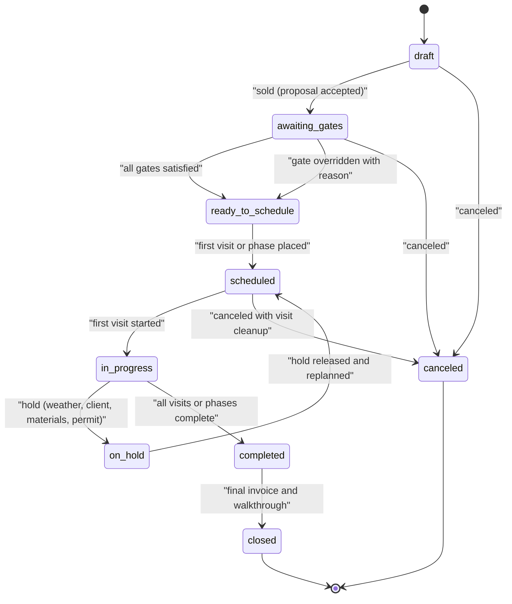
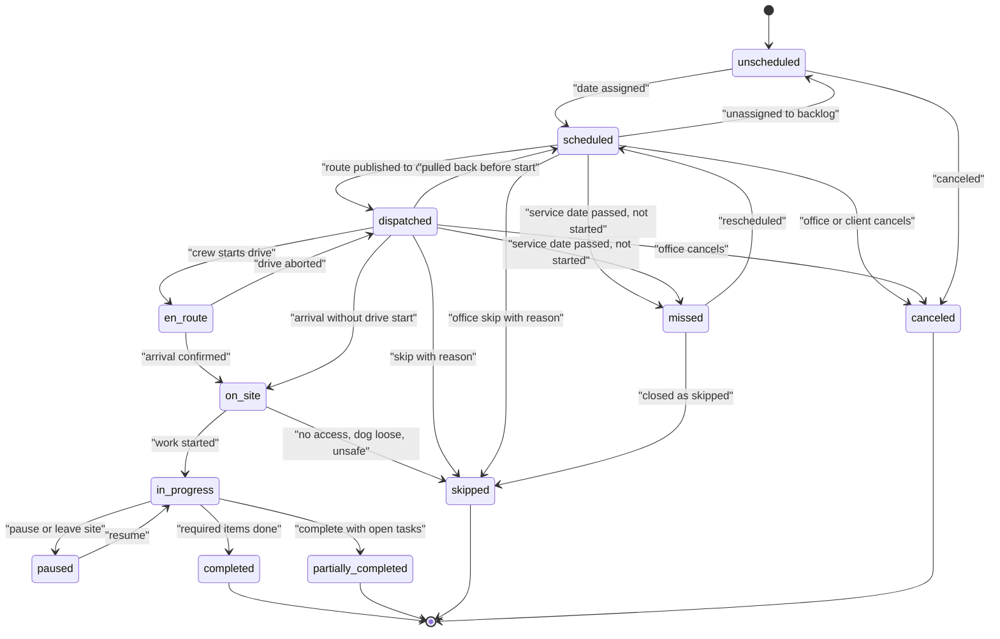

# 04 - Scheduling, Dispatch and Route Optimization

> A landscape company does not sell appointments; it sells a **season of capacity**. Two hundred weekly mows from April to November, a 5-round fertilizer program that must land inside soil-temperature windows, 60 fall cleanups crammed into five weeks before the snow, a 9-day paver patio that cannot start until the dig ticket clears, and a 2-inch snow trigger at 3 a.m. all compete for the same four crews, three trailers and one skid steer. This module is the operating heart of Rootline. It turns sold work (from [Proposals](03-crm-sales-estimating-proposals.md) and [Service Agreements](07-invoicing-billing-contracts.md)) into Visits, places those Visits on crew-days with a real road-network vehicle-routing optimizer, protects them against weather, holidays and breakdowns, tracks them live with GPS and geofences, and tells clients the truth about when the crew will show up. Competitors either treat scheduling as a calendar with a "sort by distance" button (Jobber, Yardbook, Copilot CRM), or as an enterprise ERP board that needs a full-time dispatcher (Aspire, ServiceTitan). Rootline's position: **the optimizer proposes, the dispatcher decides, and every change is a reviewable diff that also notifies the right people.**

**Related docs:** [Personas and permissions](02-personas-roles-permissions.md) | [CRM, Estimating, Proposals](03-crm-sales-estimating-proposals.md) | [Crew app](05-field-crew-mobile-app.md) | [Customer Portal](06-customer-portal.md) | [Invoicing and contracts](07-invoicing-billing-contracts.md) | [Design Studio](10-design-studio.md) | [Operations, inventory, equipment](13-operations-inventory-equipment.md) | [Service-line modules](14-service-line-modules.md) | [Team, HR, payroll](15-team-hr-payroll.md) | [Marketing and communications](16-marketing-growth-communications.md) | [AI copilot and automation](17-ai-copilot-automation.md) | [Reporting](18-reporting-analytics.md) | [Architecture](20-architecture-security.md) | [UX and sitemaps](21-ux-design-system-sitemaps.md)

**Ownership boundaries.** This document owns: the Job/Visit scheduling model and the canonical Visit state machine, recurrence and visit generation, holidays and blackouts, capacity planning and backlog, crew/skill/equipment matching for scheduling, the dispatch board, territories, the route optimizer, the weather service and weather playbooks, live tracking and ETA, multi-day project scheduling, subcontractor scheduling, client self-scheduling slot supply, and the scheduling side of Copilot. It does **not** own: on-device geofence mechanics, time punches and location privacy ([05](05-field-crew-mobile-app.md)), message templates and consent ([16](16-marketing-growth-communications.md)), program/round templates, the Storm Event Engine and pesticide compliance ([14](14-service-line-modules.md)), billing ([07](07-invoicing-billing-contracts.md)), or equipment maintenance and deliveries ([13](13-operations-inventory-equipment.md)). Where those modules meet scheduling, this document summarizes the contract and links.

> **Research note.** This module's research ran against a shared web-search budget that was already exhausted when this document was written, and direct fetches of vendor documentation hosts (Google Developers, Mapbox docs) were blocked by the session's network policy. Competitor and complaint evidence therefore comes from the sourced research reports in this repo ([R1](research/R1-field-service-platforms.md), [R2](research/R2-landscape-specific-platforms.md)) and from citations gathered by sibling module docs, re-cited here at their original URLs. Facts drawn from general industry and vendor knowledge without a fresh citation are marked **[B, verify]**. Vendor limits (API element caps, geofence counts) and prices change often: treat every such number as "as of Nov 2026, verify" before engineering commits to it.

---

## Table of contents

1. [Goals and non-goals](#1-goals-and-non-goals)
2. [Market research](#2-market-research-what-competitors-do-what-users-complain-about-the-gap-we-exploit)
3. [Personas and jobs-to-be-done](#3-personas-and-jobs-to-be-done)
4. [Feature specification](#4-feature-specification)
5. [Key user flows](#5-key-user-flows)
6. [Screens and wireframes](#6-screens-and-wireframes)
7. [Data model](#7-data-model)
8. [Integrations, APIs and events](#8-integrations-apis-and-events)
9. [Permissions](#9-permissions)
10. [AI opportunities in this module](#10-ai-opportunities-in-this-module)
11. [Edge cases, compliance and risks](#11-edge-cases-compliance-and-risks)
12. [Metrics and KPIs](#12-metrics-and-kpis)
13. [Beyond the brief: extra ideas](#13-beyond-the-brief-extra-ideas)
14. [Open questions](#14-open-questions)
15. [Sources](#sources)

---

## 1. Goals and non-goals

### 1.1 Goals

| # | Goal | Measurable target | Priority |
|---|---|---|---|
| G1 | **Sold work becomes scheduled work without re-typing.** Accepted proposals and activated agreements generate Visits with durations, skills, equipment and time windows already attached. | 100% of recurring agreement lines produce Visits automatically; median time from "proposal accepted" to "first visit on a route" < 2 minutes of human effort | [MVP] |
| G2 | **A season is planned, not improvised.** Owners see sold crew-hours vs available crew-hours by week for the whole season before April 1. | Capacity view covers 52 weeks forward; forecast error of weekly sold hours vs actual hours worked within +/-10% by week 6 of the season (estimate target) | [MVP] basic, [V1] full |
| G3 | **Real routes on real roads.** Road-network drive times with time-of-day traffic, multi-crew assignment, skills, equipment, time windows, breaks, dump and supply stops. | Drive time reduced 10-20% vs the Company's pre-Rootline routes on the first optimized week (estimate based on typical VRP gains; measured per tenant at onboarding) | [MVP] single crew, [V1] multi-crew |
| G4 | **Weather is a playbook, not a fire drill.** One action handles a rain day across all crews with client notifications. | Rain-day replan for a 6-crew Company (about 120 visits) proposed in < 60 s and applied with notifications in < 5 minutes of dispatcher time | [V1] (manual bulk move [MVP]) |
| G5 | **Clients always know when.** Day-ahead notices, on-my-way texts with live ETA, honest delay notices. | ETA accuracy: 80% of arrivals within +/-15 minutes of the last ETA sent (target) | [MVP] |
| G6 | **Dispatchers work at the speed of thought.** Dense board, keyboard-first, optimistic UI, every drag validated. | Drag-to-confirm < 100 ms optimistic, < 300 ms p95 server confirmation (budget from [20](20-architecture-security.md)); median clicks to schedule a visit <= 3 ([21](21-ux-design-system-sitemaps.md)) | [MVP] |
| G7 | **Stable routes.** Weekly maintenance clients see the same crew on the same day in roughly the same order. | >= 90% of recurring stops keep their route day and crew week over week when no inputs changed | [MVP] |
| G8 | **Projects and maintenance share one schedule.** Multi-day installs with phases and dependencies sit on the same board as mowing routes, competing for the same people and equipment. | 0 double-booked crews or equipment units on published schedules (hard validation) | [V1] |
| G9 | **AI that moves visits, with consent.** Natural-language rescheduling and agentic replans produce a ScheduleDiff that a human approves. | >= 70% of AI-proposed weather diffs accepted without edits by month 3 of use (target) | [V1] |
| G10 | **Works for a 1-truck operator and a 40-crew branch network.** | Single-crew Company can run the season with no optimizer settings touched; multi-branch Companies get branch-scoped boards and depots | [MVP] / [V1] |

### 1.2 Non-goals

- **Not a turn-by-turn navigation app.** Rootline hands off to Google Maps, Apple Maps or Waze from the crew app. Embedded truck-and-trailer navigation is a [V2] evaluation in [05](05-field-crew-mobile-app.md).
- **Not a telematics hardware vendor.** Vehicle GPS units, engine-hour sensors and dashcams come from partners (Samsara, Motive, Geotab, Verizon Connect class; verify integration availability). Rootline ingests their data.
- **Not a general workforce-management (WFM) shift scheduler** for hourly retail-style staffing. Crews are scheduled through crew-days and routes; individual shift bidding and labor-law rest rules are owned by [15](15-team-hr-payroll.md).
- **Not a snow-specific storm engine.** Storm event lifecycle, triggers and proof-of-service packets are in [14](14-service-line-modules.md). This module supplies weather data, routing and live tracking to it.
- **Not a full CPM/EVM construction scheduler** (Primavera-class). Project scheduling supports phases, tasks, finish-to-start and start-to-start dependencies with lags, and a critical path. Resource leveling across dozens of concurrent projects is [V2].
- **No fully autonomous dispatch at MVP.** Every optimizer or AI change is proposed as a diff. Auto-apply is opt-in per rule type in [V2] (for example "auto-apply rain-day moves for mowing only").

### 1.3 Design principles

1. **The season is the unit of planning; the day is the unit of execution.** Planning views (capacity, territories, master routes) think in weeks and seasons. Execution views (dispatch board, live map) think in crew-days and minutes.
2. **Visits know what they need.** Each Visit carries a duration budget, required skills, required equipment class, time window, flexibility class and lock level. The board and optimizer read these; humans do not have to remember that the Oakmont HOA needs the 72-inch mower and a licensed applicator.
3. **Proposals, not surprises.** The optimizer, weather playbooks and Copilot all produce a **ScheduleDiff** (visits moved, from/to, by crew and day, KPI deltas, conflicts, notifications that will go out). Nothing changes until someone accepts it, unless the Company has explicitly opted into auto-apply for that rule.
4. **Stability is a feature.** Recurring clients value the same day and crew more than 3 minutes of saved drive time. The objective function penalizes churn against last week's plan.
5. **Hard constraints are hard.** An expired pesticide license, a trailer already reserved, a client blackout date, a crew already at 12 hours: these block publication (with an explicit, audited override for some), not just show a yellow icon.
6. **Offline truth wins over office intent.** If a crew completes a Visit offline that the office canceled, the completion is preserved and routed to a review queue (conflict rules in [05](05-field-crew-mobile-app.md) and [20](20-architecture-security.md)).
7. **Explain every number.** Every ETA, capacity percentage, route-density score and optimizer saving can be clicked to show its inputs.

---

## 2. Market research: what competitors do, what users complain about, the gap we exploit

### 2.1 What competitors do

| Product | Scheduling and dispatch model | Routing | Weather and live tracking | Evidence |
|---|---|---|---|---|
| **Jobber** | Jobs with one-off or recurring visits (one visit, weekly, monthly, customizable); calendar and "crew scheduling" (Plus tier per third-party trackers) | Two modes: a master route covering all properties and a daily route that only optimizes one day; support advises scheduling visits on a day without a specific time so the optimizer can order them. Users report straight-line ("as the crow flies") distance and difficulty with 30-40 stops per day | GPS waypoints and geofenced "location timers"; on-my-way texts; weather rescheduling is manual drag-and-drop [B] | [Jobber landscaping](https://www.getjobber.com/industries/landscaping-software/), [recurring schedule routing](https://community.getjobber.com/discussions/job-details-scheduling/recurring-schedule-routing/10548/replies/11184), [job routing](https://community.getjobber.com/discussions/job-details-scheduling/job-routing/5443), [straight-line complaint](https://community.getjobber.com/discussions/job-details-scheduling/how-does-jobber-calculate-routes-and-can-it-use-real-driving-directions-instead-/8663/replies/9863), [location timers](https://prnewswire.com/news-releases/timesheets-just-got-easier-with-jobbers-new-location-timers-feature-301965963.html) |
| **Aspire** (ServiceTitan) | Sold contract services become scheduled work tickets with budgeted hours; crews record actual hours against them; branch and division structure; snow module with weather-triggered dispatch | Scheduling board by crew [B, verify depth of optimization] | PIN plus geofence clock-in; Motive telematics in the partner marketplace; argues GPS alone is disputable and must be paired with photos and timestamps | [R2 Aspire](research/R2-landscape-specific-platforms.md), [Aspire crew management](https://www.youraspire.com/industries/landscape-business-software/crew-management), [Motive marketplace](https://marketplace.gomotive.com/app/aspire), [Aspire blog](https://www.youraspire.com/blog/prove-service-delivery-data-ends-disputes), [SIMA on Aspire](https://resources.sima.org/snow-and-ice-resource-center/unlock-profitability-and-efficiency-with-aspire) |
| **LMN** (Granum) | Estimate-driven budgets flow into jobs and time tracking; crew app opened to all crew members in Crew 2.0 (Nov 2025) | Scheduling and routing present [B, verify optimizer depth] | Time tracking feeds job costing | [LMN Crew 2.0](https://golmn.com/blog/introducing-lmn-crew-2-0-crew-for-all), [TechPlugged](https://techplugged.com/lmn-software-transforms-the-crew-experience/) |
| **SingleOps** (Granum) | Scheduling, crew app, job costing with estimated vs actual "visit profit margin" | Map-based scheduling [B, verify] | Not documented in sources reviewed | [R2 SingleOps](research/R2-landscape-specific-platforms.md), [SingleOps](https://singleops.com/?p=1677) |
| **Service Autopilot** (Xplor) | Automation-heavy recurring residential scheduling: "automatically invoices, routes, schedules" once configured | Route-based scheduling [B] | Reviewers cite slow database response when scheduling and post-update glitches; SA Team app shows jobs, routes and GPS map destinations | [Capterra SA](https://www.capterra.com/p/122075/Service-Autopilot/reviews/), [MowBoss review](https://mowbosshq.pages.dev/guides/service-autopilot-review), [SA Team](https://apps.apple.com/us/app/sa-team/id1366612097) |
| **ServiceTitan** | Daily dispatch board with technician timelines, a Jobs tray of unassigned work, status filters, dispatcher preferences; click-to-place from the tray; add-ons such as Scheduling Pro, Dispatch Pro, Fleet Pro | Built for call-driven trades dispatch, not dense recurring routes [B] | Fleet Pro telematics add-on [B] | [Daily Dispatch Board](https://help.servicetitan.com/docs/use-the-daily-dispatch-board), [Jobs tray release](https://help.servicetitan.com/release-hub/docs/move-the-jobs-tray-onto-the-dispatch-board-to-speed-up-scheduling), [R1 ServiceTitan](research/R1-field-service-platforms.md) |
| **Housecall Pro** | Dispatch board, GPS, on-my-way texts, checklists, in-field payments | Designed for call-dispatch-fix-invoice, not route-dense recurring maintenance | GPS tracking, on-my-way | [R1 Housecall Pro](research/R1-field-service-platforms.md) |
| **Real Green** (WorkWave) | Program/round-centric: seasons of applications priced by measured area and scheduled in rounds across routes | Route-based round scheduling; WorkWave also sells standalone route software [B, verify] | Chemical usage records; reporting includes a Scheduling category | [R2 Real Green](research/R2-landscape-specific-platforms.md), [WorkWave training deck](https://documents.workwave.com/workwave/beyond-service/2026/realgreen-making-the-most-of-your-reports-report-options-101.pdf) |
| **Arborgold** | Tree/landscape scheduling with a dedicated crew app and per-crew permissions | [B, verify] | GPS-located tree inventory | [Arborgold crew permissions](https://help.arborgold.com/en/articles/permissions-in-arborgold-crew), [Arborgold 8.1](https://help.arborgold.com/en/articles/new-arborgold-crew-app) |
| **Yardbook** | Free web scheduling and routing for solo operators | Basic single-route ordering [B] | None documented | [FieldServiceSoftware.io](https://fieldservicesoftware.io/software/yardbook/) |
| **Copilot CRM** | Lawn/landscape scheduling, routing, separate "Field Force" crew app | Route optimization marketed; bulk rain-delay style schedule push [B, verify] | Field Force app | [Copilot CRM overview](https://help.copilotcrm.com/en/articles/12141481-what-is-copilot-crm), [Field Force](https://apps.apple.com/ly/app/field-force-by-copilot-crm/id6745098752) |
| **SynkedUP** | Estimating, job costing, scheduling and time tracking for design-build | Not a routing product [B] | n/a | [SynkedUP features](https://synkedup.com/features/) |
| **GorillaDesk / FieldRoutes** | Pest and lawn treatment: route-based scheduling, recurring programs | Route optimization is a core selling point (per-route pricing at GorillaDesk) | Chemical tracking | [R1](research/R1-field-service-platforms.md) |
| **Yeti** (snow) | Snow-specific dispatch with GPS-verified service history, timestamped photos, subcontractor portal, site maps | Event-driven | Weather-driven | [Yeti](https://yetisoftware.com/) |

**Feature matrix (scheduling slice).** Y = documented, P = partial, N = not found, ? = unverified. Synthesized from the matrix in [R1](research/R1-field-service-platforms.md) section 9 plus [R2](research/R2-landscape-specific-platforms.md).

| Capability | Jobber | Aspire | LMN | Service Autopilot | Real Green | ServiceTitan | Rootline |
|---|---|---|---|---|---|---|---|
| Recurring visits with seasonal bounds | Y | Y | Y | Y | Y (rounds) | P (memberships) | [MVP] |
| Application-window rounds | N | P | ? | P | Y | N | [MVP] with [14](14-service-line-modules.md) |
| Growth-adaptive mowing frequency | N | N | N | N | N | N | [V1] rules, [V2] AI |
| Holiday "slide week" automation | ? | ? | ? | ? | ? | N | [MVP] |
| Capacity: sold vs available hours by week | N | P | P | N | N | P | [MVP] basic, [V1] full |
| Single-day route ordering (road network) | P (straight-line reported) | ? | ? | Y | Y | ? | [MVP] |
| Multi-crew VRP with skills, equipment, time windows | N | P | N | N | ? | P | [V1] |
| What-if scenarios with locks | N | N | N | N | N | N | [V1] |
| Weather-driven bulk reschedule with client notices | N | P (snow) | N | ? | ? | N | [MVP] manual, [V1] playbooks |
| Live GPS, geofence arrival, ETA texts | Y | Y | ? | P | ? | Y | [MVP] |
| Late-running alerts and mid-day re-optimization | N | N | N | N | N | P | [V1] |
| Multi-day projects with dependencies on the same board | N | P | P | N | N | P | [V1] |
| Natural-language rescheduling | N | N | N | N | N | ? | [V1] |

### 2.2 What users complain about

| Theme | Evidence | What Rootline does about it |
|---|---|---|
| **Routes ignore real roads** | A Jobber user routing 30 to 40 clients a day says the optimizer uses straight-line distance and has asked since their first week ([Jobber Community](https://community.getjobber.com/discussions/job-details-scheduling/how-does-jobber-calculate-routes-and-can-it-use-real-driving-directions-instead-/8663/replies/9863)) | Road-network matrices with time-of-day buckets (4.8.3) |
| **Optimizer only works if you strip times off visits** | Jobber support advises scheduling visits "anytime" on a day so the daily optimizer can order them ([Jobber Community](https://community.getjobber.com/discussions/job-details-scheduling/recurring-schedule-routing/10548/replies/11184)) | Time windows are first-class constraints; "anytime" is just the widest window (4.1.4) |
| **Master route vs daily route confusion** | Two separate optimization modes ([job routing thread](https://community.getjobber.com/discussions/job-details-scheduling/job-routing/5443)) | One model: a **Master Route** (season template per zone-day) and **Daily Routes** that inherit from it, with drift indicators (4.7) |
| **Slow scheduling screens** | Service Autopilot reviewers cite slow database response when scheduling ([Capterra](https://www.capterra.com/p/122075/Service-Autopilot/reviews/)); [21](21-ux-design-system-sitemaps.md) calls this out as a top complaint | Local-first board state, optimistic moves, performance budgets as release gates (4.6.9) |
| **Configuration burden** | "Once configured" carries a lot of weight in Service Autopilot reviews ([MowBoss](https://mowbosshq.pages.dev/guides/service-autopilot-review)) | Opinionated defaults per service line and region; the Copilot proposes rules in plain language ([17](17-ai-copilot-automation.md)) |
| **Steep learning curve, too many steps** | Aspire "learning curve, and some common tasks require too many steps" ([GetApp UK](https://www.getapp.co.uk/reviews/9108/aspire)) | <= 3 clicks to schedule; "Move to..." and click-to-place; progressive disclosure of optimizer settings |
| **Geofencing that fails where crews work** | Android's own guide: network-location based, 100-150 m minimum radius advised, alerts 2-6 minutes late, may not fire without data ([Android geofencing](https://developer.android.com/develop/sensors-and-location/location/geofencing)); Jobber location timers need "Allow all the time" and unrestricted battery ([PR Newswire](https://prnewswire.com/news-releases/timesheets-just-got-easier-with-jobbers-new-location-timers-feature-301965963.html)) | Dual-path arrival detection on device ([05](05-field-crew-mobile-app.md)); server-side reconciliation of geofence, breadcrumbs and crew taps (4.10) |
| **Rain days are manual** | Weather rescheduling in horizontal FSM tools is drag-and-drop by hand [B, per [R1](research/R1-field-service-platforms.md) section 3.7] | Rain-day playbooks producing a single ScheduleDiff with notifications (4.9) |
| **Offline crews lose the plot** | Jobber community threads on working out of coverage ([thread](https://community.getjobber.com/discussions/job-details-scheduling/out-of-cell-service-area-access/6478)) | Routes and next 2 days of visits cached on device; schedule changes delivered as push-and-pull deltas ([05](05-field-crew-mobile-app.md)) |
| **GPS proof is disputed** | Aspire: GPS alone is disputable; pair it with photos and timestamps ([Aspire blog](https://www.youraspire.com/blog/prove-service-delivery-data-ends-disputes)) | Visit actuals combine geofence, breadcrumb dwell, crew confirmation and photo metadata into one "service evidence" score (4.10.6) |

### 2.3 The gap we exploit

1. **Nobody treats maintenance scheduling as an optimization problem across crews.** Horizontal tools order one crew's day; landscape tools assign route days by hand. A 4-crew company with 180 Tuesday properties actually has a **capacitated, skill-constrained, multi-vehicle routing problem with time windows**, and nobody in the SMB tier solves it ([R1](research/R1-field-service-platforms.md) section 3.7 found no evidence of multi-crew VRP in Jobber; Aspire and ServiceTitan are partial at enterprise prices).
2. **Weather is the landscaper's biggest scheduling variable and every tool ignores it** outside snow. A rain week in May can create a 300-visit backlog. The fix is a deterministic playbook plus a solver, not a forecast widget.
3. **Seasonal capacity is invisible until it is too late.** Owners discover in June that they sold 140% of crew capacity. Rootline shows the capacity curve while the proposals are still being written, and [03](03-crm-sales-estimating-proposals.md) uses it to set start dates and overtime premiums.
4. **Maintenance and installs live on separate boards.** Design-build firms run installs in spreadsheets or project tools and maintenance in route software. One board with one resource model ends double-booking of the skid steer.
5. **The schedule should be the source of truth for clients.** Portal ETAs, on-my-way texts, rain notices and self-scheduling all draw from the same model, so the client never hears three different stories.

> **Competitive edge.** Jobber's routing is a single-crew sort that users say ignores roads; Aspire's board is powerful but assumes a trained dispatcher; Real Green owns rounds but not installs; ServiceTitan's dispatch is built for HVAC calls. Rootline is the only platform in this segment specified to solve the **whole-week, all-crew** problem with road-network times, skills, equipment, time windows, breaks and dump runs, then keep that plan stable week over week and replan it in one action when it rains, at an SMB price.

---

## 3. Personas and jobs-to-be-done

| Persona | Role key | Scheduling surfaces | Peak scheduling moments |
|---|---|---|---|
| Business Owner | `owner` | Capacity planner, season overview, dispatch board (read-mostly), Copilot | February-March season planning; June "are we oversold?"; rain weeks |
| Office / Admin Manager | `office_manager` | Dispatch board, unassigned queue, client reschedule requests, holiday calendar | Daily 6:00-8:00 a.m. adjustments; client calls "can you come Thursday instead?" |
| Operations / Account Manager | `ops_manager` | Dispatch board, route optimizer, scenarios, weather playbooks, live map, project Gantt, Round Planner | Night-before route publish; rain-day decision at 5:30 a.m.; mid-day breakdowns |
| Sales Rep / Estimator | `estimator` | Own calendar of site assessments (non-crew events), capacity overlay when quoting start dates, "best day" for new clients | Spring selling season; promising a start week on a patio |
| Landscape Designer | `designer` | Install sequence from the design ([10](10-design-studio.md)) into project phases; client design meetings on calendar | Handing a sold design to production |
| Crew Lead / Foreman | `crew_lead` | Crew app route, reorder same-day stops, report delays, request help | 6:30 a.m. load-out; 1:00 p.m. "we are 45 minutes behind" |
| Field Technician | `technician` | Crew app today view (read), personal schedule | Knowing which crew and truck they are on |
| Bookkeeper | `bookkeeper` | Read-only: visits completed vs billed, skipped visits | Month-end reconciliation of per-visit billing |
| Subcontractor | `subcontractor` | Offers to accept/decline, own calendar of assigned visits, on-my-way | Irrigation sub accepting 6 winterizations for Friday |
| Residential client | `client_residential` | Portal: next visit, ETA, skip/reschedule requests, booking windows | "Is the crew coming today? I need to let the dog in." |
| Commercial client | `client_commercial` | Portal: multi-property schedule, service calendar, approvals for schedule changes on fixed-date sites | HOA pool opening Saturday; office park needs mowing before 7 a.m. |
| Platform staff | `platform_support`, `platform_engineer` | Read-only diagnostics of optimization runs and routes (consented) | 6-9 a.m. Eastern "my crew can't see today's route" tickets ([02](02-personas-roles-permissions.md)) |

**Jobs-to-be-done**

- *When* I sign a new weekly mowing client in April, *I want* Rootline to tell me which day and crew add the least drive time and still have room, *so that* I can tell the client "your crew comes Tuesdays" before I hang up.
- *When* it is February, *I want* to see sold hours against crew capacity for every week of the season, *so that* I know whether to hire two seasonal technicians or stop selling cleanups.
- *When* the forecast shows 0.6 inches of rain Wednesday, *I want* one button that moves Wednesday's mowing to Thursday and Friday, keeps the HOA fixed, notifies affected clients and tells the crews, *so that* I don't spend 90 minutes dragging cards and texting.
- *When* a mower breaks at 10:40 a.m., *I want* to see which of that crew's remaining 9 stops other crews can absorb within today's hours, *so that* clients are not skipped.
- *When* a fertilizer round window opens, *I want* 1,400 lawns sequenced by subdivision with licensed applicators assigned and wind limits checked, *so that* the round finishes before the window closes.
- *When* a patio project is sold, *I want* its phases to land on the install crew's calendar after the dig ticket clears and after the pavers are delivered, *so that* the crew never shows up to a site they cannot work.
- *When* I'm a crew lead running late, *I want* the app to tell the office and the next clients automatically, *so that* I don't have to call anyone from the truck.
- *When* I'm a homeowner, *I want* to know the crew comes Tuesday and see a live ETA that morning, *so that* I can open the gate.
- *When* I'm a property manager with 14 sites, *I want* one calendar showing every scheduled service and every weather delay, *so that* I can answer my board without calling the landscaper.

---

## 4. Feature specification

Features are grouped by capability. Each carries a priority tag. "Company setting" means a tenant-level configuration in Settings > Scheduling; "branch setting" means it can be overridden per branch.

### 4.1 Scheduling object model and lifecycle

#### 4.1.1 Core objects [MVP]

| Object | What it is | Created by | Example |
|---|---|---|---|
| **Job** | Unit of sold work. Types: `work_order` (one-off), `project` (multi-phase install), `recurring` (work under a Service Agreement) | Proposal acceptance ([03](03-crm-sales-estimating-proposals.md)), manual, portal booking ([16](16-marketing-growth-communications.md)), storm event ([14](14-service-line-modules.md)) | J-1042 "Henderson backyard patio and planting" (project) |
| **Service Schedule** | A recurring line on a recurring Job: what is done, how often, in which season, with what duration, skills and equipment | Agreement activation ([07](07-invoicing-billing-contracts.md)) | "Weekly mowing, Apr 1 - Nov 15, 0.75 crew-hours, 21-inch push mower allowed, Tuesday zone" |
| **Recurrence Rule** | RFC 5545 RRULE plus Rootline extensions (season bounds, frequency profile, route-day anchor, A/B week parity, exceptions) | Service Schedule editor | `FREQ=WEEKLY;BYDAY=TU` within 2027-04-01..2027-11-15 |
| **Job Phase / Job Task** | Ordered parts of a project with dependencies and durations | Project template, Design Studio install sequence ([10](10-design-studio.md)) | "Phase 2: Base prep and pavers (3 crew-days)" |
| **Visit** | A single scheduled occurrence of work on a date for a crew. The atomic unit the crew app executes and billing counts | Recurrence engine, Round Planner, project scheduler, manual | V-58840 "Ortiz weekly mow, Tue Nov 10, 2026, Crew 1, stop 7" |
| **Visit Line** | Work items performed on a Visit (mow, trim, edge, blow; or a round's application; or a project task's share) | Copied from Service Schedule or task | "Mow 6,200 sq ft; edge 180 lf; blow hardscape" |
| **Crew** | Group of employees with a crew lead plus a default vehicle, trailer and equipment kit | Settings > Crews | "Crew 1: Luis (lead) + 2, Truck T-12, 16 ft trailer TR-04" |
| **Crew Day** | A crew's roster, shift, vehicle and equipment for one date. Overrides the crew default | Generated nightly from the crew default; edited on the board | "Crew 1, Tue Nov 10: Luis, Marco, Dani (fill-in for Jesse); 7:00-17:30" |
| **Route** | Ordered Visits for a Crew Day, with depot start/end, breaks and auxiliary stops (dump, supply house) | Optimizer or manual ordering | "Crew 1 Tue: yard -> 18 stops -> green-waste dump -> yard; 6.1 h on site, 1.4 h drive" |
| **Zone (Territory)** | A polygon assigned to one or more route days (and optionally crews) | Territory tool | "Zone T-North = Tuesday, Crews 1 and 3" |
| **Master Route** | The season template sequence for a zone-day, used as the stable baseline for daily routes | Seasonal territory solve | "Tuesday North master: 74 properties, 2 crews" |
| **Resource** | Schedulable equipment: vehicle, trailer, mower class, skid steer, aerator, dump trailer, plow truck, sprayer | [13](13-operations-inventory-equipment.md) asset register | "SK-02 skid steer", "AER-01 stand-on aerator" |
| **Reservation** | A time-bounded claim on a Resource by a Crew Day, Visit or Job Phase | Board, optimizer, project scheduler | "SK-02 reserved for J-1042 Phase 2, Nov 16-18" |
| **Scenario** | A sandboxed copy of part of the schedule for what-if planning | Dispatcher, Copilot | "What if Crew 4 is out all week?" |
| **ScheduleDiff** | A proposed set of changes with KPI deltas, conflicts and notifications to be sent | Optimizer, weather playbook, Copilot, bulk tools | "Rain Wednesday: 41 visits move, +0.6 h OT on Crew 2, 38 client texts" |

#### 4.1.2 Job lifecycle and scheduling gates [MVP]



**Scheduling gates** (Company setting per job type; each gate shows owner, status and blocker reason in the backlog):

| Gate | Default for | Satisfied when | Source |
|---|---|---|---|
| Deposit paid | Projects (on), work orders over $2,500 (on), recurring (off) | `payment.deposit_received` for the required amount | [08](08-payments-stripe.md), [06](06-customer-portal.md) |
| Signed and unpaid allowed | Recurring maintenance | Proposal signed | [06](06-customer-portal.md) (signed_unpaid does not block recurring by default) |
| Materials available | Projects, installs with plant lists | All PO lines `received` or delivery `confirmed` with ETA before phase start | [13](13-operations-inventory-equipment.md) |
| Dig ticket clear (811 / Canadian one-call) | Any task with excavation deeper than the Company threshold (default 12 in) | Ticket status `clear` and within its validity window | [14](14-service-line-modules.md) |
| Permit issued | Projects flagged `permit_required` | Permit record `issued` | [14](14-service-line-modules.md) |
| HOA/architectural approval | Projects flagged by the estimator | Approval document attached | [03](03-crm-sales-estimating-proposals.md) |
| Design sold | Projects created from a Design | Design version frozen as `sold` | [10](10-design-studio.md) |
| Pre-application notices sent | Lawn/PHC rounds in notification states | Notices sent and lead time elapsed | [14](14-service-line-modules.md) |

Rules:
- A Job in `awaiting_gates` can be **tentatively placed** on the board (hatched card, "Not confirmed") for capacity planning, but its Visits cannot be `dispatched` and no client notice goes out.
- Overriding a gate requires `job.gate_override` permission, a reason, and is audited. Overriding "dig ticket clear" is never allowed (hard block).

#### 4.1.3 Visit state machine (canonical) [MVP]

The [Architecture](20-architecture-security.md) entity notes list the coarse states `unscheduled -> scheduled -> dispatched -> in_progress -> completed / skipped / canceled`. This module defines the full canonical machine; the crew app ([05](05-field-crew-mobile-app.md) section 5.2) implements the field subset. `en_route`, `on_site` and `paused` roll up to `in_progress` for coarse reporting, and `partially_completed` rolls up to `completed` with a flag.



| Transition | Allowed actors | Validations | Side effects |
|---|---|---|---|
| `unscheduled -> scheduled` | office_manager, ops_manager, owner, optimizer (via accepted diff), portal booking | Date within the visit's due window (warn outside, block outside a round's compliance window); property not in blackout | `visit.scheduled`; reservations created; client notice per [16](16-marketing-growth-communications.md) rules |
| `scheduled -> dispatched` | Route publish (manual or nightly auto-publish) | Crew assigned; hard constraints pass (skills, licenses, equipment, no double booking) | `visit.dispatched`; delta pushed to crew devices |
| `dispatched -> en_route / on_site / in_progress / paused` | crew_lead, technician, subcontractor (own) | Server re-validates on sync | `visit.en_route` (ETA text trigger), `visit.arrived`, `visit.started`, `visit.paused` |
| `in_progress -> completed / partially_completed` | crew_lead, technician, subcontractor (own) | Required checklist, photos, chem record, signature ([05](05-field-crew-mobile-app.md) 4.4.5) | `visit.completed` / `visit.partially_completed`; billing, job cost, portal timeline; partial with "return needed" creates an `unscheduled` follow-up Visit linked by `parent_visit_id` |
| `* -> skipped` | crew (on site), office (before start) | Reason code required (rain, no access, dog loose, client request, no growth, unsafe, equipment failure, ran out of time, holiday, other) | `visit.skipped`; agreement skip counters; make-up policy (4.2.6, 4.9.3) |
| `* -> canceled` | office, client (portal, if lead time allows), agreement cancellation | Not allowed from `in_progress` or terminal states | `visit.canceled`; reservations released; notification |
| `scheduled/dispatched -> missed` | System, at 03:00 property-local the day after `service_date` | No start event received (and no pending offline sync flagged for that crew, see below) | `visit.missed`; appears in "Needs attention" queue; never auto-billed |
| `missed -> scheduled` | office, ops, Copilot diff | As `unscheduled -> scheduled` | `visit.rescheduled` |

**Offline guard on `missed`.** If any device on the visit's crew has unsynced commands older than the service date, the system holds the `missed` transition for up to 24 hours and shows "Awaiting crew sync" instead, because the visit may have been completed offline ([05](05-field-crew-mobile-app.md) section 4.21).

**Conflict rule.** Terminal field states win over office states: a Visit completed offline after the office canceled it becomes `completed` with `conflict = canceled_but_performed` and a billing review task ([20](20-architecture-security.md) section 4.11).

**Flags (orthogonal to state):** `weather_hold`, `needs_reschedule`, `late_risk`, `conflict`, `locked`, `client_confirmed`, `presence_required`, `first_visit` (new client: show extra access notes), `do_not_move` (fixed-date commercial events).

#### 4.1.4 Visit timing, flexibility and locks [MVP]

Every Visit carries these scheduling attributes. They are inherited from the Service Schedule or Job Phase and can be overridden per Visit.

| Attribute | Values | Default | Used by |
|---|---|---|---|
| `due_window` | Start and end dates the visit must fall within | Weekly mow: the ISO week. Round: the round's application window. Cleanup: the seasonal calendar window | Backlog aging, optimizer, missed-window alerts |
| `flexibility` | `fixed_date`, `day_flex` (+/- N days, default N = 1), `week_flex` (any working day in the due week), `window_flex` (any date in the due window) | Weekly mow `week_flex` anchored to route day; projects `fixed_date` once confirmed; cleanups `window_flex` | Rain playbooks, optimizer moves |
| `time_window` | `anytime`; `between` (earliest arrival, latest arrival); `fixed_time` (appointment); `before`/`after` shortcuts | `anytime` | Optimizer hard or soft constraint (Company setting per window type) |
| `presence_required` | Boolean, with contact | false; true for design consults, irrigation start-ups with indoor valves, walkthroughs | Self-scheduling shows time slots instead of days |
| `access_window` | Gate or site access hours (e.g., community gate staffed 8:00-16:00; school sites only after 15:30 or on weekends; HOA quiet hours no blowers before 8:00) | From Property access info | Hard constraint |
| `duration_budget` | Crew-hours from the estimate's production rates, plus fixed setup minutes | From estimate ([03](03-crm-sales-estimating-proposals.md)) | Capacity, optimizer, crew hours budget |
| `crew_size_min` / `crew_size_max` | Minimum and maximum people on the visit | 1 / unlimited; tree removals min 3; sod installs min 2 | Assignment validation |
| `priority` | 1 (contractual, e.g., commercial SLA) to 5 (filler) | Commercial 2, residential maintenance 3, upsell 4 | Optimizer drop penalty, rain playbooks |
| `lock` | `none`, `crew`, `day`, `time`, `sequence`, `full` | `none`; client-requested times set `time`; commercial fixed dates set `day` | Optimizer and Copilot will not move locked dimensions |
| `stability_anchor` | Route day, crew and sequence position from the Master Route | Set when the Master Route is published | Stability penalty (4.8.5) |

**Duration from crew-hours to clock-hours.** A Visit's labor is budgeted in crew-hours (person-hours). On-site clock time depends on crew size and an efficiency curve (Company setting, default: 1 person 1.00, 2 people 0.95 each, 3 people 0.90 each, 4 people 0.85 each, 5+ people 0.80 each). Example: a 1.5 crew-hour mow with a 3-person crew takes 1.5 / (3 x 0.90) = 0.56 h, about 34 minutes on site, plus 5 minutes fixed setup (unload/load). The crew app shows the crew's hours budget per Visit in the same units ([05](05-field-crew-mobile-app.md)).

**Learned durations [V1].** After 3 completed occurrences, the system computes an exponentially weighted moving average of actual on-site crew-hours per Service Schedule (alpha 0.3, outliers beyond 2.5 standard deviations ignored, weather-flagged visits down-weighted). The dispatcher sees "Budget 0.75 h, actual trend 0.92 h" and can accept the learned value for scheduling without changing the client's price. Persistent overruns (trend > budget x 1.15 over 6 visits) raise a "re-price candidate" for [03](03-crm-sales-estimating-proposals.md) and [18](18-reporting-analytics.md).

### 4.2 Recurrence engine and visit generation

#### 4.2.1 Recurrence patterns [MVP unless tagged]

Rootline stores recurrence as RFC 5545 RRULE strings plus a Rootline extension record ([20](20-architecture-security.md) section 7.1). The editor never shows RRULE text to users; it offers landscape-native presets.

| Preset | Typical use | RRULE core | Rootline extensions | Notes |
|---|---|---|---|---|
| Weekly on route day | Residential and commercial mowing | `FREQ=WEEKLY;BYDAY=TU` | Season 2027-04-01..2027-11-15; `route_day_anchor = zone` (day follows the zone if the zone's day changes) | The default for maintenance |
| Bi-weekly (A/B weeks) | Budget mowing, shrub maintenance, low-growth turf | `FREQ=WEEKLY;INTERVAL=2;BYDAY=TU` | `parity = A or B` relative to the Company's season week 1 | The optimizer balances A and B so each Tuesday carries a similar load (4.7.4) |
| Twice a month | Commercial detailing, bed maintenance | `FREQ=MONTHLY;BYDAY=1TU,3TU` | Season bounds | Avoids the 5th-week gap problem of "every 2 weeks" when billing monthly |
| Every N days | Irrigation checks, mosquito treatments every 21 days | `FREQ=DAILY;INTERVAL=21` | `snap_to_route_day = true` snaps to the nearest route day within +/- 3 days | Without snapping, every-N-days floats across weekdays and destroys route density; the editor warns |
| Monthly | Irrigation inspections, monthly detailing | `FREQ=MONTHLY;BYDAY=2WE` | Season bounds | |
| Frequency profile (seasonal segments) | Mowing weekly in peak growth, bi-weekly in summer slowdown | Multiple RRULE segments | Segments: weekly Apr 1-Jun 30, bi-weekly Jul 1-Aug 31, weekly Sep 1-Oct 31, bi-weekly Nov 1-Nov 15 | Common in the Southeast and Midwest; billing implications in [07](07-invoicing-billing-contracts.md) |
| Count-limited | "26 mows per season" contracts | `FREQ=WEEKLY;BYDAY=TU;COUNT=26` | Counter tracks completed vs contracted; skipped visits optionally do not consume the count | Lets the season end early or late by weather |
| Seasonal calendar item | Spring cleanup, mulch, aeration and overseeding, fall cleanups, irrigation start-up and winterization, holiday lighting install and takedown | No RRULE: one or more `window_flex` Visits per season | Window per Region (e.g., spring cleanup Mar 20-Apr 30 in zone 6a, Mar 1-Apr 10 in 7b), min gap between multiple occurrences (fall cleanup x2, min 14 days apart) | Generated at agreement activation for the whole season |
| Program round | 5-step fertilizer, 6-round tree and shrub PHC, mosquito | From the Program Engine ([14](14-service-line-modules.md)) | Window, min days since previous round (default 28), compliance gates | Round instances become Visits through the Round Planner (4.2.5) |
| Event-driven | Snow pushes, de-icing, storm cleanups | None | Created by storm events ([14](14-service-line-modules.md)) | Routed by 4.9.6 |
| Growth-adaptive [V1] | Mowing that follows the grass, not the calendar | Base weekly rule | Growth model decides "mow", "skip", or "stretch" per occurrence (4.2.6) | Opt-in per agreement |

**Validation rules**
- Season start must be before season end; a season longer than 12 months is rejected (use renewals).
- Weekly or bi-weekly rules must have exactly one BYDAY that matches one of the Property's zone days, unless the Service Schedule is marked `off_zone` (requires `schedule.off_zone` permission and shows an "off-zone" badge with its estimated drive cost).
- Two Service Schedules on the same Property with overlapping service types (e.g., two mowing schedules) are rejected unless one is explicitly `supplemental`.
- Minimum spacing rule per service type (Company setting): mowing >= 4 days between visits, fertilizer rounds >= 28 days (from [14](14-service-line-modules.md)), aeration >= 300 days. A move that would violate spacing is blocked for compliance-bearing services and warned for others.

#### 4.2.2 Route-day anchoring [MVP]

Most residential recurring Visits do not have a client-chosen day; they have a **zone day**. The recurrence anchors to the zone, not to a fixed weekday:
- If the Company rebalances zones in July and moves "Maple Ridge" from Tuesday to Wednesday, all future `week_flex` Visits anchored to that zone move, with a single bulk client notice ("Starting July 14, your service day is Wednesday").
- Visits with `client_day_lock` (the client insisted on Fridays because of a Saturday party venue) do not follow the zone and are flagged off-zone if the zone moves.

#### 4.2.3 Seasonal service calendar [MVP]

Companies define a **Season Calendar** per Region and branch: service types with their default windows and capacity pool. Defaults ship per Region from platform templates ([19](19-platform-admin-portal.md) manages templates; [14](14-service-line-modules.md) shows the 12-month service-line calendar). Example for a zone 6a Midwest branch:

| Service | Window | Visits per season | Capacity pool | Weather sensitivity |
|---|---|---|---|---|
| Spring cleanup | Mar 20 - Apr 30 | 1 | Maintenance crews | Avoid saturated soil (> 1 in rain in 24 h) |
| Irrigation start-up | Apr 15 - May 15 | 1 | Irrigation techs | Not before last frost risk (soil temp > 40 F and no freeze forecast for 7 days) |
| Mulch install | Apr 15 - May 31 | 1 | Enhancement crews | Rain tolerant |
| Weekly mowing | Apr 1 - Nov 15 | 30-33 | Mowing crews | Skip at >= 0.25 in rain in the crew window |
| Aeration and overseeding | Aug 25 - Oct 10 | 1 | Aeration crew | Moist, not saturated soil |
| Irrigation winterization | Oct 1 - Nov 10 | 1 | Irrigation techs | Prioritize before first hard freeze (28 F or below) |
| Fall cleanup | Oct 20 - Dec 5 | 1-2 | Maintenance crews | Leaves down; after first hard freeze for the last pass |
| Snow season | Nov 1 - Apr 15 | Event-driven | Snow crews and subs | Storm Event Engine |

Season calendar windows can be shifted per year by the owner ("late spring: shift all spring windows +10 days") with a preview of affected Visits.

#### 4.2.4 Visit generation horizon and materialization [MVP]

Visits exist in three forms:

| Form | Persisted? | Horizon | Purpose |
|---|---|---|---|
| **Projected** | No (computed on read from rules) | Rest of the season, up to 52 weeks | Capacity planning, revenue forecast, client portal "season calendar" |
| **Materialized** | Yes (`visit` rows, state `scheduled` or `unscheduled`) | Rolling horizon, Company setting, default **8 weeks** for recurring, whole season for seasonal calendar items and rounds | Board, routes, reservations, client notices |
| **Dispatched** | Yes | Published days (default: today and tomorrow) | Crew devices |

Rules:
- A nightly job (02:00 tenant-local) materializes recurring Visits up to the horizon. Range: 2-26 weeks. Large tenants (> 2,000 recurring schedules) default to 6 weeks to bound row counts.
- Materialization is **idempotent**: each occurrence has a deterministic key `(service_schedule_id, occurrence_date_original)`. Re-running never duplicates.
- Editing a recurrence rule regenerates only **untouched** future materialized Visits. A Visit that was manually moved, re-crewed, locked, or has notes/photos/assets attached is **detached** and kept; the editor shows "3 detached visits will keep their custom settings [Review]".
- Edit scopes: "This visit", "This and following" (splits the Service Schedule at the date, keeping history), "Entire season" (only future, non-detached visits).
- Deleting a Service Schedule cancels future Visits (state `canceled`, reason `schedule_removed`) and never touches completed history.
- Agreement suspension for non-payment ([07](07-invoicing-billing-contracts.md)) pauses materialization and moves already-materialized future Visits to `unscheduled` with flag `on_hold_ar`; crews see "Service on hold" if a held Visit is opened. Reactivation re-materializes from the reactivation date; no automatic make-up of missed occurrences unless the Company setting says so.
- Client vacation holds (portal, [06](06-customer-portal.md)) create Property blackouts (4.2.7).
- Projected Visits for capacity use the same generator code path as materialization (one engine, two outputs) so the forecast and the schedule cannot disagree.

#### 4.2.5 Program rounds hand-off [MVP]

The Program Engine in [14](14-service-line-modules.md) owns round templates, enrollment and round instances. The contract with this module:
1. Round instances carry: Property, round number, application window (start/end), minimum days since previous round, product mix, required license category, measured area, weather guardrails, notification gate status.
2. The **Round Planner** (a view in [14](14-service-line-modules.md)) groups eligible instances by zone and week and calls the scheduling API `POST /scheduling/plans` with `mode = round` and a target week.
3. This module's optimizer sequences them into routes for licensed applicators only (hard skill constraint `pesticide_applicator` with the product's category valid in the Property's state/province), checks hourly wind and rain forecasts per route day (amber/red flags from [14](14-service-line-modules.md) section 4.1), and returns a ScheduleDiff.
4. Accepted Visits link back to the round instance (`visit.round_instance_id`). Rescheduling a round Visit outside its notified window triggers re-notification automatically (rule owned by [14](14-service-line-modules.md); this module emits `visit.rescheduled` with `old_date`/`new_date`).
5. Window protection: a round Visit cannot be moved past its window end. The rain playbook treats rounds with fewer than 5 working days left in their window as priority 1.

#### 4.2.6 Growth-adaptive mowing frequency [V1 rules, V2 AI model]

Grass does not grow on a calendar. In a dry August in Ohio, weekly mowing clients are paying for crews to "mow" dormant turf; in a wet May, bi-weekly clients' lawns get away from the crew. Growth-adaptive frequency lets a Company sell "mow when it needs it" and route accordingly.

**Inputs per Property (daily):**
- Turf type from the Property profile (cool-season: Kentucky bluegrass, tall fescue, perennial ryegrass; warm-season: bermudagrass, zoysia, St. Augustine; mixes), irrigation present (from the Property asset registry in [14](14-service-line-modules.md)).
- Weather service (4.9): daily mean temperature, rainfall over the past 7 days, reference evapotranspiration (ET0) where available.
- A **turfgrass growth potential (GP)** curve: a bell-shaped function of mean air temperature with an optimum near 68 F for cool-season and 88 F for warm-season grasses, as published in the turf-management literature (Gelernter and Stowell's growth potential model; background knowledge, verify before shipping coefficients).
- Crew observations: "no growth" skip reasons and clipping-volume quick tags from the crew app (`none`, `light`, `normal`, `heavy`).

**Rule engine [V1]:**
- `GP_7day` = mean growth potential over the last 7 days, adjusted down by 40% if 7-day rainfall < 0.25 in and the Property is not irrigated (default adjustments, tunable per Region by `platform_curator` templates).
- If `GP_7day < 0.25` for cool-season turf: the next weekly Visit becomes a **stretch candidate** (propose moving to the following week, i.e., temporary bi-weekly).
- If two consecutive crew observations are "none": propose skip of the next occurrence.
- If `GP_7day > 0.75` and the client is bi-weekly with `allow_growth_upgrade = true`: propose an extra mid-cycle mow (billable per visit).

**Contract and billing guardrails (with [07](07-invoicing-billing-contracts.md)):**
- Agreements carry `growth_adaptive = off | suggest | auto`. Default `off`. `suggest` produces dispatcher proposals; `auto` applies after the client-notice lead time (default 24 h) unless the client objects in the portal.
- Per-visit billing: client pays only for performed visits; the client notice says so.
- Fixed monthly (level-pay) billing: growth skips do not change the invoice; the agreement's `max_growth_skips_per_season` (default 4) caps skips so the Company does not under-deliver against a fixed price. Beyond the cap, skips need client consent.
- Every growth skip is logged with its evidence (GP, rainfall, crew observation photo) for dispute defense.

**Routing effect:** stretching 30% of a Tuesday zone in a drought frees whole crew-days. The capacity view shows "Freed: 18.5 crew-hours in week 32", and the Copilot proposes filling them with backlog (aeration pre-sales, bed edging enhancements) or giving crews a 4-day week.

**AI model [V2]:** a per-Region gradient-boosted model trained on clipping-volume tags, visit durations and weather predicts next-week growth class per Property (none/light/normal/heavy) and expected on-site duration. Labels come from crews, so the model improves with use. Platform-level pooled training across tenants requires the opt-in data-sharing setting in [19](19-platform-admin-portal.md).

> **Competitive edge.** No competitor reviewed in [R1](research/R1-field-service-platforms.md) or [R2](research/R2-landscape-specific-platforms.md) documents growth-driven mowing frequency. It is the kind of feature that only works when weather data, property turf data, crew observations, routing and billing live in one system, which is exactly Rootline's architecture.

#### 4.2.7 Holidays, blackouts and closures [MVP]

**Calendars:**
- **Company holiday calendar**, seeded from the country and province/state at provisioning: US federal holidays and Canadian statutory holidays for the Company's provinces (they differ: e.g., Civic Holiday, Family Day, Saint-Jean-Baptiste in Quebec, Remembrance Day observance varies by province; verify per province). The owner toggles which ones the Company observes.
- **Branch calendars** inherit and override (e.g., a Quebec branch observes June 24).
- **Crew blackouts:** crew-wide training days, the annual equipment shop day.
- **Employee time off** comes from [15](15-team-hr-payroll.md) and reduces Crew Day roster and capacity; it does not block the Crew.
- **Property blackouts:** client vacation, HOA events ("no work during the community 5K, Apr 24"), school sites during exams, construction on site, "do not service" holds.
- **Resource blackouts:** equipment down for maintenance from [13](13-operations-inventory-equipment.md).

**Holiday policies** (Company setting per holiday, default shown):

| Policy | Behavior | Default for |
|---|---|---|
| `work` | Normal schedule | Juneteenth, Columbus Day/Indigenous Peoples' Day, Veterans Day, Remembrance Day (configurable) |
| `slide_week` | Holiday's routes move +1 working day, and each following day of that week slides +1, with the last day landing on Saturday (if Saturday is a working day) or splitting across remaining days | Memorial Day, Labor Day, Victoria Day, Canada Day when it falls on a weekday |
| `shift_next` | Only the holiday's routes move to the next working day, merged into that day's routes and re-optimized | Good Friday (where observed) |
| `shift_previous` | Holiday's routes move to the previous working day | July 4 when the Company prefers to work the Saturday before |
| `skip` | Holiday's recurring visits are skipped (reason `holiday`), non-recurring visits move to backlog | Christmas Day, New Year's Day (off-season for most) |
| `compress` | Holiday's routes are distributed across the remaining working days of the week by the optimizer, respecting capacity | Thanksgiving week for fall cleanups |

**Worked example (Memorial Day 2027, Monday May 31).** Policy `slide_week`, Saturday enabled. Monday's 4 routes (96 visits) move to Tuesday June 1; Tuesday's move to Wednesday; ... Friday's 88 visits move to Saturday June 5. Commercial Visits with `lock = day` stay put and are flagged for manual decision. One ScheduleDiff shows 472 moved visits, 0 capacity violations, and one bulk client notice per affected client ("Holiday week: your service moves from Tuesday to Wednesday this week"). Generation of the diff happens 14 days ahead (Company setting) so notices go out with 7 days' lead.

**Observed dates:** when a holiday falls on a weekend, the observed weekday is used if the Company observes it (July 4, 2027 is a Sunday; observed Monday July 5).

**Blackout rules:**
- Placing a Visit on a blacked-out date is a hard block for Property and Resource blackouts, a warning for Company holidays (some companies work holidays for commercial sites at premium pay).
- Creating a blackout over already scheduled Visits opens a resolution dialog: move to next eligible date (default), skip, or keep (only for Company holidays).

#### 4.2.8 Client-driven schedule changes [MVP]

Clients request skips, reschedules and extra visits from the portal ([06](06-customer-portal.md)) or by message. Rules:
- **Skip next visit**: allowed up to the Company's cutoff (default 18:00 the day before service). After cutoff the request becomes an office task. Per-visit billing clients are not charged; fixed-price clients see the agreement's skip policy ("Skips do not reduce your monthly price; 2 skips per season can be made up on request").
- **Reschedule**: the portal offers only dates with capacity in the Property's zone (4.13). Commercial clients with approval workflows route requests to the approver contact first.
- **Pause service** (vacation): creates a Property blackout with start/end; recurring Visits within are skipped with reason `client_pause`.
- All client changes produce `visit.rescheduled` or `visit.skipped` with `actor_type = client`.

### 4.3 Capacity planning and backlog

#### 4.3.1 Capacity model [MVP basic, V1 full]

Capacity is computed in **crew-hours** per **capacity pool** per day, then rolled up by week, month and season.

**Supply (available productive crew-hours) for a Crew Day:**

```text
available = sum over roster members of (shift_hours - unpaid_meal - paid_breaks_not_productive)
            - shop_time (load-out, fueling; default 0.5 h per person per day)
            - drive_allowance (from the crew's trailing 4-week drive share, default 20% of remaining)
```

Example: Crew 1 is 3 people on a 10-hour shift (7:00-17:00) with a 30-minute unpaid meal. Paid hours = 3 x 9.5 = 28.5. Shop time 1.5 crew-hours. Drive allowance 20% x 27.0 = 5.4. **Available productive = 21.6 crew-hours.** At 0.75 crew-hours per average residential mow plus 5 minutes setup (0.25 crew-hours for 3 people), that is about 21 mows per day.

**Capacity pools** group crews by what they can do: `mowing`, `enhancement`, `install_hardscape`, `install_softscape`, `irrigation`, `lawn_application`, `tree`, `snow`, `lighting`. A crew can belong to multiple pools with a primary pool. Employees with skills (4.4) contribute to pools that require those skills.

**Demand (sold crew-hours)** per pool per week:
- Materialized and projected recurring Visits (duration budgets, or learned durations [V1]).
- Seasonal calendar items spread across their windows using a **window-spread curve** (Company setting: `flat`, `front_loaded`, `back_loaded`; default flat). Example: 220 fall cleanups at 3.5 crew-hours each = 770 crew-hours spread over Oct 20-Dec 5 (about 6.5 weeks), so about 118 crew-hours per week.
- Program rounds from [14](14-service-line-modules.md) enrollments.
- Projects: phase durations placed on tentative or confirmed dates.
- **Backlog**: sold, unscheduled work with due windows.
- **Pipeline forecast [V1]**: open opportunities from [03](03-crm-sales-estimating-proposals.md) weighted by stage probability and expected start month, shown as a separate stacked band ("likely to sell").

**Utilization bands** (Company setting): < 75% blue (under-booked), 75-90% green, 90-100% amber, 100-110% orange (overtime likely), > 110% red (not deliverable without hiring, subs or Saturday shifts).

**Overtime projection:** for each employee, scheduled hours per week from Crew Days vs overtime threshold (40 h/week FLSA default; daily overtime rules such as California's 8 h/day come from [15](15-team-hr-payroll.md)). The capacity view shows "Crew 2 projected 51.5 h/week in weeks 19-23: 11.5 h OT each x 4 people".

#### 4.3.2 Capacity planner views [MVP basic, V1 full]

- **Season heatmap** [MVP]: rows = capacity pools (expandable to crews), columns = weeks (52), cells = utilization % with color band. Click a cell for the breakdown: recurring, seasonal, rounds, projects, backlog, pipeline.
- **Week detail** [MVP]: crews x days with available vs scheduled hours, overtime projection and unassigned demand.
- **What-if levers** [V1]: add a crew (from a crew template) for a date range, add Saturday shifts, extend shift to 11 hours, move demand to subcontractors, push a project's start. Each lever shows its effect on the curve and its cost (labor at loaded rate from [15](15-team-hr-payroll.md), sub cost from [13](13-operations-inventory-equipment.md)).
- **Hiring planner** [V1]: "To keep weeks 15-22 under 95%, add 2 seasonal technicians by April 6"; links to recruiting in [15](15-team-hr-payroll.md).
- **Sales throttle** [V1]: capacity feeds [03](03-crm-sales-estimating-proposals.md) so estimators see "Earliest start: week of May 11" on proposals, an optional OT premium when the target month is > 100%, and an owner alert when new sales push any pool above 110%.
- **Season revenue curve** [V1]: projected revenue by week from scheduled and projected visits (price from the agreement lines), handed to [18](18-reporting-analytics.md) for cash-flow forecasting.

#### 4.3.3 Backlog view [MVP]

The backlog is all sold work not yet on a date (or with a date in the past and not done). It replaces the whiteboard of "jobs to get to".

| Column | Meaning |
|---|---|
| Job / Visit | Name, client, property, service type |
| Due window | Start-end; days left in window; overdue badge |
| Value | Price of the work (for prioritizing) |
| Crew-hours | Budget |
| Needs | Skills, equipment class, crew size |
| Gates | Gate status icons (deposit, materials, 811, permit) |
| Zone / nearest route day | For slotting into existing routes |
| Age | Days since sold |
| Source | Proposal, portal request, partial-visit return, rain displacement, storm event |

Behaviors:
- Default sort: **urgency score** = window pressure (days left / window length), priority, value per crew-hour, and age. Formula weights are a Company setting; the score is shown with an "explain" tooltip.
- Filters: pool, zone, service type, gate status, "fits in a gap today".
- **Auto-slot** button [MVP for single items, V1 for batches]: runs best-insertion (4.8.6) for selected items and returns a ScheduleDiff.
- **Backlog aging alerts**: items within 5 days of window end, sold projects older than 21 days without a start date (Company setting), and displaced rain visits not yet replanned after 48 hours.
- Backlog totals by pool feed the capacity view as "backlog hours" and [18](18-reporting-analytics.md) as "backlog weeks" (backlog hours / weekly capacity).

### 4.4 Crew, skill and certification matching

#### 4.4.1 Skills catalog [MVP]

Skills are Company-defined tags on employees with optional jurisdiction, category, level and expiry. Rootline ships a default catalog; certifications and their documents live in [15](15-team-hr-payroll.md).

| Skill key | Type | Example of a requirement | Constraint strength |
|---|---|---|---|
| `pesticide_applicator` | License with state/province and category (e.g., turf and ornamental) | Fertilizer + herbicide round; mosquito treatment | Hard; must be valid on the service date; "under supervision" allowed only where the state permits and a licensed applicator is on the same Crew Day |
| `irrigation_licensed` | License (state-specific, e.g., Texas licensed irrigator) | Irrigation repairs in licensing states | Hard where required by the Company's jurisdiction setting |
| `backflow_tester` | Certification with expiry | Annual backflow test | Hard |
| `cdl_class_a` / `cdl_class_b` | License | Driving a truck/trailer combination that requires a CDL | Hard for the vehicle assignment (4.5) |
| `isa_arborist`, `tree_climber`, `crane_signal` | Certification | Tree removal, crane picks | Hard for task roles |
| `equipment_operator:skid_steer` (also excavator, mini loader) | Company-verified competency | Base prep, grading | Hard |
| `paver_install`, `wall_build`, `lighting_tech` | Competency level 1-3 | Hardscape phases | Soft (level preference) or hard (level >= 2 for crew lead) |
| `plow_operator`, `sidewalk_crew` | Competency | Snow routes | Hard during storm events |
| `spanish`, `french`, `english` | Language | Client prefers Spanish-speaking crew lead | Soft |
| `client_approved` | Property-specific | Gated community requires badge-holders; school sites require background-checked staff | Hard |
| `first_aid_cpr` | Certification | Company policy: one per crew | Hard per Crew Day |

**Rules:**
- A requirement is either on the **Visit** (someone on the crew must have it), on the **crew lead** (the lead must have it), or **all members** (everyone on site must have it, e.g., background-checked staff at schools).
- Expiry is evaluated on the **service date**, not today. A license expiring May 31 makes all assigned June round Visits fail validation on publish, and an alert goes to the owner 30 days before expiry ([15](15-team-hr-payroll.md) emits `certification.expiring`).
- The validation message names the gap: "Visit V-60012 needs `pesticide_applicator` (MN, turf) - nobody on Crew 3 on Jun 2 qualifies. Swap Dani from Crew 1 (licensed) or move to Crew 1."

#### 4.4.2 Crew templates and daily rosters [MVP]

- A **Crew** has a default roster, crew lead, home depot (yard), default vehicle and trailer, default equipment kit, shift template (e.g., Mon-Fri 7:00-17:30, Saturday optional), capacity pools, and color.
- **Crew Days** are generated nightly for the materialization horizon. Changes on a Crew Day (sick call, borrowed member, different truck) affect only that day.
- **Floaters**: employees without a home crew appear in a "Floaters" lane and can be dragged onto Crew Days.
- **Sick-day handling**: when an absence is recorded in [15](15-team-hr-payroll.md) or by the crew lead in the app, the Crew Day's capacity drops, and if scheduled hours exceed the new capacity by > 10%, a `late_risk` alert and a Copilot rebalancing proposal are raised ([17](17-ai-copilot-automation.md) agent A7).
- **Crew pairing preferences** [V1]: soft preferences (keep Marco and Dani together; do not pair two trainees) used when the optimizer fills crews from floaters.
- **Training ride-alongs** [V1]: a trainee can be added as a non-counting member (capacity contribution 0.5 by default) for a configurable number of days.

### 4.5 Equipment, vehicle and trailer reservations

#### 4.5.1 Resource model [MVP basic, V1 full]

Resources come from the asset register in [13](13-operations-inventory-equipment.md). For scheduling, each resource has: class (`truck`, `trailer`, `mower_ztr_72`, `mower_ztr_60`, `mower_walk_36`, `mower_push_21`, `skid_steer`, `mini_excavator`, `aerator`, `overseeder`, `sprayer_200gal`, `dump_trailer`, `plow_truck`, `salt_spreader`, `sod_cutter`, `stump_grinder`, `bucket_truck`, `chipper`), home depot, status (`available`, `down`, `in_shop`, `rented_out`), and **capacities** used by the optimizer:

| Capacity | Unit | Example |
|---|---|---|
| Debris volume | cubic yards | 16 ft dump trailer: 10 cu yd of leaves |
| Material weight | lb / tons | One-ton dump truck: 3 tons of river rock |
| Bulk material volume | cubic yards | Mulch: 6 cu yd per truck load |
| Liquid volume | gallons | 200-gallon sprayer: about 2 acres at 2 gal/1,000 sq ft (illustrative rate) |
| Salt | tons | Plow truck with 2-ton spreader |
| Physical width | inches | 72-inch deck mower cannot pass a 48-inch gate |
| Towing | GVWR/GCWR pounds | Truck T-12 tows up to 14,000 lb; requires CDL above thresholds |
| Energy [V2] | kWh | Battery mower range: about 4.5 h of cutting per charge (illustrative) |

#### 4.5.2 Requirements and reservations [MVP]

- Visits and Job Phases declare **equipment requirements by class** ("needs any `aerator`", "needs `skid_steer` for 2 days", "needs a mower deck <= 52 in because of the 54-inch side gate"), not specific units. Property access info supplies gate widths and "no ZTR on slope > 15 degrees" notes (slope from USGS 3DEP elevation cache in [20](20-architecture-security.md)).
- Crew Days carry the specific units (truck, trailer, kit). The validator checks that the Crew Day's units satisfy every Visit's class requirements, and the trailer can carry the kit (a 16 ft trailer fits one 72-inch ZTR plus one walk-behind; a configurable **trailer layout capacity** in "deck slots" handles this [V1]).
- **Reservations** are created when a unit is assigned to a Crew Day or a Phase. A unit can hold one reservation per time interval. Shared units (one aerator for three crews in September) can be reserved by half-day blocks.
- **Conflict detection** (on drop, on publish, and continuously): double-booked unit, unit `down` or `in_shop` on the date, unit at a different depot than the crew's start, CDL requirement not met by the assigned driver, trailer over GCWR with the assigned truck.
- **Conflict resolution UI**: the conflict panel lists alternatives ranked by cost: another unit of the same class free that day; swap with a crew whose Visits do not need it; move the Visit within its flexibility; rent (creates a non-stock PO draft in [13](13-operations-inventory-equipment.md)).
- **Breakdown flow**: when [13](13-operations-inventory-equipment.md) marks a unit `down` (or a crew reports it in the app), affected Crew Days and Visits for the downtime window get `late_risk`, and the dispatcher sees a substitution proposal (4.10.8 mid-day re-optimization uses this).
- **Equipment-aware routing** [V1]: the optimizer can be asked to choose which crew gets the shared aerator on which day to minimize total drive, treating the aerator as a scarce resource across crews in the week plan.

> **Competitive edge.** Aspire tracks equipment for maintenance and costing; Jobber and Housecall Pro do not schedule equipment at all. Rootline treats a skid steer, a trailer's deck slots and a gate width as scheduling constraints, which is what stops a crew from arriving at a backyard with a mower that does not fit through the gate.

### 4.6 Dispatch board

The dispatch board is the office's cockpit (route `/schedule/board` in [21](21-ux-design-system-sitemaps.md), where the day-view wireframe 18.4 lives). This section specifies its behavior.

#### 4.6.1 Views [MVP unless tagged]

| View | Layout | Best for |
|---|---|---|
| **Day (Gantt by crew)** | Rows = crews (plus subcontractors, non-crew staff and resource lanes), x-axis = time 5:00-21:00 (zoomable), cards sized by on-site duration, drive gaps shown as thin connectors with minutes | Morning adjustments, mid-day recovery |
| **3-day** | Same as Day, 3 columns | Rain-day shifting |
| **Week (crew x day)** | Rows = crews, columns = days; each cell shows stop count, scheduled vs available hours, utilization bar, first/last stop, weather chip; expand a cell to see its sequence | Weekly balancing, holiday slides |
| **Season calendar** | Month grid with counts per day by service type and capacity band | Owner and ops planning |
| **Map** | Routes as colored polylines (one color per crew), numbered stops, unassigned pins, depots, dump/supply sites, live crew positions (4.10), zone overlays, weather radar layer [V1] | Spatial reasoning, "who is closest" |
| **Split** | Board + map side by side (>= 1536 px screens show board, map and unassigned tray simultaneously per [21](21-ux-design-system-sitemaps.md)) | Default for ops managers |
| **List** | Sortable table of Visits with all attributes; bulk edit | Auditing, exports |
| **Resources** [V1] | Rows = equipment units, bars = reservations | Skid steer and aerator contention |
| **People** [V1] | Rows = employees, bars = Crew Day membership, time off, non-crew events | Payroll-heavy weeks, sick days |
| **Project Gantt** [V1] | Rows = projects and phases, dependency arrows (4.11) | Design-build scheduling |

Filters persist per user: branch, pool, crew, service type, status, flags (late risk, unassigned, conflicts, locked), client type. Saved filter sets ("Install crews only", "Lawn applications this week").

#### 4.6.2 Unassigned tray [MVP]

A left-hand tray lists the backlog (4.3.3) for the visible date range: unscheduled Visits, missed Visits, rain-displaced Visits, partial-visit returns, portal requests awaiting approval and tentatively placed Jobs awaiting gates. Each card shows client, service, crew-hours, due window, gates and skill/equipment needs. Sort by urgency score by default. Cards can be dragged onto a crew lane, a specific position in a route, a day cell (week view) or the map (drop on a route polyline inserts at the cheapest position on that route). A WCAG 2.5.7-compliant alternative exists for every drag: select the card, then click a target slot, or use "Move to..." ([21](21-ux-design-system-sitemaps.md) section 18.4).

#### 4.6.3 Drop behaviors and validation [MVP]

| Drop target | Result |
|---|---|
| Crew lane (Day view), empty area | Visit is appended; the board immediately shows a **suggested insertion position** (cheapest insertion) as a ghost; Enter accepts, Esc keeps at end |
| Between two stops | Explicit sequence position; sets `lock = sequence` only if the user holds Shift (otherwise the optimizer may still reorder) |
| Time axis position with Alt | Sets a `fixed_time` appointment at that time |
| Day cell (Week view) | Changes date; crew stays unless dropped on another crew's row |
| Another crew | Reassigns crew; validation runs for skills, equipment, capacity |
| Unassigned tray | Unschedules (`scheduled -> unscheduled`) with reason prompt if the client was already notified |
| Map route polyline | Cheapest insertion into that route |

Every drop runs the **validator** in the browser (instant) and on the server (authoritative). Results are tiered:

| Tier | Display | Examples | Can the user proceed? |
|---|---|---|---|
| **Block** | Red outline, drop rejected with message | Missing hard skill or license; equipment class unavailable; Property or Resource blackout; dig ticket not clear; visit outside a round's compliance window; crew lane is a subcontractor who has not accepted | No |
| **Override** | Orange, modal asks for reason | Exceeds crew shift by > 60 min; client time window violated; visit outside its due window; off-zone placement; spacing rule violated for non-compliance services; holiday placement | Yes, with `schedule.override` permission and a reason (audited) |
| **Warn** | Yellow badge on card | Crew > 100% of productive capacity; drive between stops > 25 min; no on-site crew member speaks client's preferred language; weather risk on that day | Yes |
| **Info** | Gray | "Client was notified for Tuesday; a change notice will be sent" | Yes |

Validator response time budget: < 50 ms in browser for single-card checks against the loaded week; server confirmation < 300 ms p95 ([20](20-architecture-security.md) section 4.28).

#### 4.6.4 Multi-select and bulk actions [MVP]

Shift-click, lasso on map and "select all filtered" allow bulk: move to date, reassign crew, lock/unlock, skip with reason, cancel, change duration budget, add a note to crew, send a custom message to affected clients (through [16](16-marketing-growth-communications.md) templates), print route sheets, and **Optimize selection** (runs the optimizer only over selected crews/days). Bulk changes over 10 Visits always go through a ScheduleDiff preview.

#### 4.6.5 Visit card anatomy [MVP]

Uses the `VisitCard` component from [21](21-ux-design-system-sitemaps.md): service abbreviation (MW, FC, AER+OS, RND3, IRR-W), client short name, time window, duration bar, crew chip, status color, and flag icons: gate code present, dog on property, chemicals, first visit, locked, presence required, late risk, weather risk, conflict, client-confirmed, notes for crew. Hover/focus shows the full card: address, last visit notes, crew-hours budget vs learned, price, special instructions.

#### 4.6.6 Non-crew calendar events [MVP]

Estimator site assessments, design consultations, client walkthroughs, inspections, shop days, training and safety meetings appear on the board as non-crew events in an individual's lane or the "Sales and design" group ([03](03-crm-sales-estimating-proposals.md) section on site visits). They consume the person's time, so a crew lead booked for a 7:00 safety meeting starts the route at 7:30. Two-way calendar sync with Google Calendar and Microsoft 365 for office roles [V1] (busy/free only by default, details opt-in).

#### 4.6.7 Draft and published schedule [MVP]

- Schedules are **drafts** until published. Published days are pushed to crew devices as `dispatched`.
- **Auto-publish** for tomorrow at 15:00 tenant-local (Company setting, range 12:00-20:00). Load-out lists in [13](13-operations-inventory-equipment.md) are generated from the published route and regenerate until their 05:00 lock.
- Changes to a published day are **late changes**: the crew device receives a delta push, the crew app highlights "Route changed: +1 stop, 2 reordered" and the change log records who/why. Late changes after 05:00 also notify the crew lead by push.
- **Unpublish** is allowed until the first Visit of that Crew Day starts.
- The board shows a publish status per Crew Day: Draft, Published, Started, Completed.

#### 4.6.8 Collaboration and concurrency [MVP]

- Presence avatars per day and per crew; a live "ghost" of another dispatcher's drag so two people do not move the same visit ([21](21-ux-design-system-sitemaps.md)).
- Each Visit has a `version` (optimistic concurrency). If a save conflicts, the server returns the current state and the board shows "Ana moved this to Crew 3 a moment ago - keep hers or apply yours?".
- Scenarios (4.8.8) are private until promoted, so planning does not collide with live dispatch.

#### 4.6.9 Performance [MVP]

- Board state is held in a local store (normalized Visits, Crew Days, Routes for the visible range plus one buffer week) hydrated from a delta API and kept fresh by server-sent events/WebSocket topics per tenant-branch-day ([20](20-architecture-security.md) section 4.20).
- Virtualized rendering: a Week view with 40 crews and 3,000 Visits renders in < 1.5 s on a mid-range laptop and scrolls at 60 fps (target).
- Drag interactions do not wait for the network; rollback animates if the server rejects.

#### 4.6.10 Route sheets and exports [MVP]

Printable route sheet per Crew Day (PDF, English/Spanish per crew lead preference): stops in order with address, service lines, time windows, gate codes (only if the Company allows printing access secrets; default off, shows "see app"), notes, map thumbnail, material load-out summary. CSV/ICS export of Visits for a date range. For crews without smartphones, the route sheet is the fallback.

#### 4.6.11 Undo and audit [MVP]

Every change is recorded in `schedule_change` with actor (user, automation, AI agent, client, system), before/after, reason and ScheduleDiff id. Undo (Ctrl/Cmd+Z) reverts the last change or the last applied diff as a whole, if no dependent field events (start/complete) occurred. Notifications already sent are not unsent; undo sends a correction only if the original notice went out (Company setting: "Send correction notices", default on).

### 4.7 Territories, zones and route days

#### 4.7.1 Zones [MVP]

- A **Zone** is a polygon (drawn on the map, generated from ZIP/postal codes, subdivisions, or a radius) assigned to a branch, one or more route days, and optionally preferred crews.
- Properties are auto-assigned to zones by point-in-polygon at geocode (PostGIS). Properties outside any zone go to "Unzoned" and get the nearest zone suggested.
- Zones carry stats: properties, weekly crew-hours, revenue per week, average drive minutes between stops.
- Zones can overlap only if they have different route days (e.g., a dense suburb split into Tuesday-A and Thursday-B by street).

#### 4.7.2 Master routes [MVP]

A **Master Route** is the season template for a zone-day-crew: ordered list of recurring Properties with expected arrival times. Daily routes are generated from it (only that day's due Visits, skipping non-due bi-weekly ones) and then lightly re-optimized for the day's additions and removals, with a strong stability penalty toward the master order. The board shows **drift**: "Tuesday Crew 1 differs from master by 6 stops (3 adds, 2 skips, 1 move)". Re-mastering is an explicit action (monthly or after big sales pushes) that runs the territory or week solver and proposes a new master.

#### 4.7.3 Territory design solver [V1]

For seasonal planning (February, or after acquiring a competitor's route list):
- **Inputs:** all recurring Properties with weekly crew-hours, client day locks, A/B parity, crews and their working days and depots, desired balance tolerance (default +/- 10% hours per crew-day), maximum allowed client day changes (default 15% of clients).
- **Method:** capacitated clustering (balanced k-medoids on road-time distance) to produce zone-day clusters, followed by a week-plan VRP per cluster to verify feasibility; iterated to reduce cross-zone overlap. Runs async; target 120 s for 2,000 properties and 10 crews, up to 10 minutes for 10,000 properties (progress bar, emails when done).
- **Outputs:** proposed zone-day map, per-day hours and drive estimates, list of clients whose day changes with a draft notice, before/after KPIs (total weekly drive hours, average stop gap minutes, revenue per drive hour).
- **Migration plan:** changes can be effective from a chosen week; clients get notice with configurable lead time (default 14 days).

#### 4.7.4 A/B week balancing [MVP]

Bi-weekly clients are assigned parity A or B. The territory solver and the "best day" recommender balance hours so week A and week B loads on the same day differ by no more than 10% (Company setting). Display: the week view shows "Tue (A)" and capacity per parity.

#### 4.7.5 New client slotting, "best day" [MVP]

When a new recurring client is sold (in [03](03-crm-sales-estimating-proposals.md)), booked online ([16](16-marketing-growth-communications.md)), or entered by the office, Rootline runs **cheapest insertion** of the new Property's Visit (duration, skills, equipment) into each candidate master route within the zone's days (and adjacent zones within 10 minutes' drive), and returns the top 3 options:

```text
Best service day for 418 Willow Ln (weekly mow, 0.75 crew-h)
1. Tuesday, Crew 1 - adds 4 min drive, stop between #11 and #12, Tue load 92% -> 95%
2. Thursday, Crew 3 - adds 7 min drive, Thu load 81% -> 84%
3. Tuesday, Crew 3 - adds 9 min drive, Tue load 88% -> 91%
[Assign option 1]   [Waitlist if all > 100%]
```

Target response < 1.5 s p95 (cached master-route matrices). The same API powers the portal's "Your crew will visit on Tuesdays" ([16](16-marketing-growth-communications.md)) and the AI receptionist.

### 4.8 Route optimization engine

The engine is a Python service using **Google OR-Tools' vehicle routing solver** behind Connect-gRPC, stateless and horizontally scaled ([20](20-architecture-security.md) section 4.17; [OR-Tools routing](https://developers.google.com/optimization/routing)). This section specifies the product-level problem it solves.

#### 4.8.1 Optimization modes

| Mode | Problem class | Typical size | Time limit (per [20](20-architecture-security.md)) | Priority |
|---|---|---|---|---|
| `sequence` | Re-order one Crew Day (TSP with time windows, breaks, dump stops) | 10-40 stops | 5 s | [MVP] |
| `insertion` | Best position(s) for 1-20 new Visits across candidate Crew Days | 1-20 visits x up to 30 routes | 1.5 s | [MVP] |
| `day_plan` | Assign and sequence a day's Visits across all crews of a branch (VRPTW with skills, capacities, breaks) | 50-800 stops, 2-40 crews | 30 s | [V1] |
| `week_plan` | Assign flexible Visits to days and crews within a week, then sequence (periodic VRP, decomposed) | 200-4,000 stops | 120 s async | [V1] |
| `territory` | Seasonal zones and master routes (4.7.3) | 500-10,000 properties | 120 s to 10 min async | [V1] |
| `repair` | Mid-day re-optimization from crews' current positions and progress (4.10.8) | Remaining stops of 1-10 crews | 5-10 s | [V1] |
| `storm` | Priority-ordered snow routing with re-service loops (4.9.6) | 20-500 sites | 30 s, repeated | [V1] |

#### 4.8.2 Constraint catalogue

| Constraint | Hard/soft (default) | Modeling note (OR-Tools; verify API details against the current release) | Priority |
|---|---|---|---|
| Start and end at depot (yard); per-crew depot | Hard | Vehicle start/end nodes | [MVP] |
| Start at crew lead's home (take-home trucks) | Hard per crew setting | Per-vehicle start node | [V1] |
| Shift start/end, max shift length | Hard end at shift + max OT (default 2 h); soft beyond shift | Time dimension with vehicle-specific ranges; soft upper bound cost on end cumul | [MVP] |
| Service duration (crew-size adjusted, 4.1.4) | Hard | Transit callback = travel + service time at the from-node | [MVP] |
| Client time window (`between`, `fixed_time`) | `fixed_time` hard; `between` soft by default (Company setting can make hard) | Cumul range or soft bounds with lateness penalty | [MVP] |
| Access window (gate staffed hours, HOA quiet hours, school hours, municipal noise ordinance earliest start) | Hard | Cumul range | [MVP] |
| Lunch/meal break | Hard (where law requires, e.g., meal start before end of the 5th hour of work in California per [15](15-team-hr-payroll.md)); otherwise soft window 11:00-13:00, 30 min | Vehicle break intervals on the time dimension | [MVP] |
| Skills and licenses | Hard | Allowed-vehicles per node | [MVP] single crew check, [V1] assignment |
| Equipment class (aerator, skid steer, deck width vs gate width) | Hard | Allowed-vehicles per node, computed from Crew Day units | [V1] |
| Crew size minimum | Hard | Allowed-vehicles per node | [V1] |
| Debris capacity (leaf cleanup cu yd) with dump runs | Hard | Capacity dimension; dump sites as optional reload nodes (duplicated, penalty-free disjunctions) that reset load via slack | [V1] |
| Material pickup at supply house before visits that need it (mulch, stone, plants) | Hard precedence when material is not loaded at the yard | Pickup-and-delivery pairs on the same vehicle with pickup before delivery | [V1] |
| Spray tank refills (gallons) | Hard | Capacity + reload nodes at the yard or water source | [V1] |
| Salt reload (tons) during storms | Hard | Capacity + reload at salt depot | [V1] |
| Day lock, crew lock, sequence lock | Hard | Fixed vehicle; precedence or fixed rank | [MVP] |
| Stability vs master route / previous plan | Soft | Penalty on changed vehicle or rank; warm start from previous routes | [MVP] |
| Zone adherence | Soft | Penalty when assigned crew/day differs from zone | [V1] |
| Max single drive leg (default 25 min) | Soft | Arc cost surcharge above threshold | [V1] |
| Crew workload balance | Soft | Global span cost coefficient | [V1] |
| Overtime cost | Soft | End-time soft upper bound at shift end | [MVP] |
| Optional visits (fillers, upsells, flexible backlog) | Soft | Disjunction with drop penalty scaled by priority | [V1] |
| Battery equipment energy budget | Hard | Energy dimension with charging stops | [V2] |
| Traffic-dependent travel time | Soft (approximated) | Time-of-day bucketed matrices chosen by planned departure | [V1] |

Gate codes are not constraints; they are restricted access data shown on device for dispatched Visits only ([20](20-architecture-security.md)). What matters for routing is the access window (e.g., "community gate staffed 08:00-16:00; after hours needs the resident") and the Property's trailer-parking note.

#### 4.8.3 Travel-time matrices [MVP]

- **Source:** Google Routes or Mapbox matrix APIs (provider chosen per region and cost; [20](20-architecture-security.md)). Per-request element limits and traffic-aware limits differ by provider and change; verify current limits before sizing batches.
- **Time-of-day buckets:** `early` (05:00-07:00), `am_peak` (07:00-09:30), `midday` (09:30-15:00), `pm_peak` (15:00-18:30), `evening` (18:30-22:00), `night` (22:00-05:00, used for snow). The solver uses the bucket of the planned departure time for each arc (piecewise approximation).
- **Truck-and-trailer factor:** car travel times are multiplied by a Company-tunable factor (default 1.10) plus a fixed 2-minute park-and-unload buffer per stop (accounted in setup time). [V2]: learn per-crew factors from breadcrumbs.
- **Caching:** Redis keys by `(geohash7 origin, geohash7 destination, bucket)` for 14 days ([20](20-architecture-security.md)). Weekly recurring routes hit the cache almost entirely; the estimate in [20](20-architecture-security.md) is a 60-80% reduction in matrix API cost.
- **Pruning:** for `day_plan` and larger, only the k = 30 nearest neighbors per stop (by haversine) plus depots and dump sites are fetched from the provider; other arcs use a haversine-times-detour-factor estimate (default 1.35) with a high cost so the solver rarely uses them. This bounds API calls from O(n^2) to O(n x k). A 600-stop day costs about 18,000 + 2 x 600 depot arcs rather than 360,000 elements (estimate).
- **Fallback:** if the provider is down or quota is exhausted, haversine-with-detour estimates are used and the plan is labeled "Approximate drive times" in the diff.

#### 4.8.4 Objective function [MVP basic, V1 full]

The solver minimizes a weighted sum in **minute-equivalent cost units**. Defaults (Company-tunable via presets, advanced users can edit weights):

| Term | Default weight | Notes |
|---|---|---|
| Drive minutes | 1.0 per minute | Primary cost |
| Overtime minutes (beyond shift end) | 1.5 per minute | Reflects 1.5x pay |
| Soft time-window lateness | 2.0 per minute late | Early arrival waits (no penalty) unless the window is `between` and early arrival is disallowed |
| Dropped optional visit | P1 10,000; P2 3,000; P3 1,000; P4 500; P5 300 | Never drops P1/P2 unless infeasible; dropped visits listed with reasons |
| Stability: changed day | 60 per visit | Recurring visits only |
| Stability: changed crew | 30 per visit | |
| Stability: sequence rank change | 2 per rank moved | Capped at 20 per visit |
| Zone violation | 20 per visit | |
| Drive leg > 25 min | 1.0 per minute above 25 | |
| Workload imbalance | 0.2 x (max route span - min route span) | Only in `day_plan` and above |

**Presets:** "Minimize drive" (stability x 0.3), "Keep routes stable" (default), "Finish early" (overtime weight 3.0, adds end-time cost), "Balance crews" (imbalance x 3), "Storm" (lateness on priority-1 sites x 10, stability 0).

#### 4.8.5 Route stability [MVP]

Residential maintenance clients notice when their mowing day changes; commercial clients notice when the crew arrives at a different time. Stability rules:
- The previous published plan (or the Master Route) is passed as a **warm start** so local search begins from the known solution.
- Stability penalties (4.8.4) apply against the anchor.
- A **route-day change** for a recurring client is never made by the daily optimizer; only `week_plan` or `territory` modes, or a human, can change the day, and they produce client-notice drafts.
- The diff shows a "Stability" KPI: % of stops unchanged in crew, day and +/- 2 positions.

#### 4.8.6 Insertion and best-slot heuristics [MVP]

For single or small batches, a dedicated insertion service evaluates every feasible position in candidate routes (within the Visit's flexibility window and zone days), computing marginal drive minutes, lateness, capacity and stability cost. It returns ranked options with explanations. This powers drag ghosts (4.6.3), "best day" (4.7.5), backlog auto-slot (4.3.3), portal booking availability (4.13) and Copilot answers ("Can we fit the Garcia cleanup this week?").

#### 4.8.7 Locks and pins [MVP]

| Lock | Meaning | Solver encoding |
|---|---|---|
| `crew` | Must stay with this crew, any day within flexibility | Fixed vehicle set |
| `day` | Must stay on this date, any crew | Only that day's vehicles allowed |
| `time` | Must start within +/- 10 min of its set time | Hard cumul range |
| `sequence` | Keep relative order with its neighbors (e.g., "do the Smiths right after the Joneses, same driveway") | Precedence constraints with adjacency |
| `full` | Do not move at all | Node fixed to vehicle and rank; removed from search where possible |
| Route lock | Entire Crew Day frozen (e.g., a commercial route with contract SLA times) | Vehicle excluded from optimization; its stops still count for capacity and equipment |

Locks show a padlock on cards and can be set by drag modifiers, the card menu or bulk actions. Copilot and automations respect locks as hard constraints (rule also stated in [17](17-ai-copilot-automation.md) agent A7).

#### 4.8.8 What-if scenarios [V1]

- **Create** a scenario from the board for a date range and set of crews/branches. The scenario copies Visits, Crew Days and reservations into a sandbox.
- **Levers:** remove or add a crew; change shift hours; mark equipment down; toggle a constraint (e.g., allow Saturday); change objective preset; inject demand (e.g., "add 40 fall cleanups" or "sell the Ridgeview HOA account"); apply a weather playbook.
- **Run** the appropriate mode; scenarios run on the async queue with progress.
- **Compare** up to 3 scenarios side by side: total drive hours, overtime hours, dropped visits, late visits, stability %, revenue per drive hour, utilization by day, client notices required, cost delta in dollars (labor at loaded rates, fuel estimate at Company's $/mile setting).
- **Promote** a scenario to a ScheduleDiff on the live schedule. If the live schedule changed since the scenario was created, a three-way merge runs: non-conflicting changes apply, conflicting Visits are listed for manual choice.
- Limits: 10 active scenarios per user, auto-expire after 14 days (Company setting), not visible to crews or clients.

#### 4.8.9 Route density metrics [MVP]

Definitions shared with [18](18-reporting-analytics.md) (metric keys in backticks):

| Metric | Definition | Typical use |
|---|---|---|
| `stops_per_route_hour` | Completed stops / (route end - route start) in hours | Density across crews and days |
| `drive_time_pct` | Drive minutes / (route end - route start) | Target < 20% for mowing routes (Company target) |
| `route_density_onsite_ratio` | On-site minutes / (on-site + drive minutes) | Primary density KPI in [18](18-reporting-analytics.md) |
| `revenue_per_drive_hour` | Revenue of completed visits / drive hours | Pricing and territory decisions |
| `revenue_per_route_hour` | Revenue / route hours | Crew productivity and price checks |
| `avg_stop_gap_minutes` | Mean drive minutes between consecutive stops | Territory compactness |
| `marginal_drive_cost` per stop | Drive minutes saved if this stop were removed (computed by the solver) | Spotting the "$45 mow 22 miles away" outliers |
| `deadhead_minutes` | Depot-to-first-stop + last-stop-to-depot | Depot placement, take-home truck decisions |
| `route_stability_pct` | Stops unchanged in crew, day and +/- 2 positions vs prior week | Client experience |
| `zone_purity_pct` | Stops on their zone day | Territory hygiene |

Every route in the Day view shows a density chip (e.g., "On-site 78% / Drive 16% / $212 per drive hour"). Stops with marginal drive cost above a threshold (default 12 minutes) get a "low density" badge linking to a re-price or swap suggestion.

> **Competitive edge.** Real Green and GorillaDesk sell on route density for lawn treatment; Jobber users report straight-line ordering. Rootline makes density a measured, per-stop number (marginal drive cost) tied to pricing in [03](03-crm-sales-estimating-proposals.md) and to the "neighbor bundle" offers in [06](06-customer-portal.md), so the owner can see exactly which clients cost more to serve than they pay.

#### 4.8.10 Solver architecture and performance targets [MVP]

- **Search strategy:** first solution by parallel cheapest insertion (or path cheapest arc for single routes), then guided local search with a time limit (OR-Tools routing search parameters; verify names against the release in use). Warm start from the previous plan when one exists.
- **Decomposition:** large problems are split by branch depot and zone clusters; each sub-problem solves in parallel; a cross-cluster pass handles border stops. Snow `storm` mode solves per priority tier.
- **Determinism:** fixed random seed per run; identical inputs produce identical outputs (important for support and testing).
- **Fallback:** on timeout or infeasibility the service returns the best feasible solution found or a greedy insertion plan, flagged in the diff ("Partial optimization: 30 s limit reached; estimated 4% from best"). Infeasible visits are never silently dropped; each is returned with a machine-readable reason (`no_skill`, `no_equipment`, `window_infeasible`, `capacity`, `access_window`, `locked_conflict`).
- **Run records:** every run stores inputs hash, parameters, solver version, duration, objective breakdown and solution; viewable by `platform_engineer` with tenant consent for support ([19](19-platform-admin-portal.md)).

**Performance targets**

| Scenario | Size | Target (p95 wall time) | Quality target |
|---|---|---|---|
| Single crew re-sequence | 30 stops | 2 s (limit 5 s) | Within 2% of a 60 s run on the benchmark set |
| Best-slot insertion | 1 visit, 30 candidate routes | 1.5 s | Exact cheapest insertion |
| Day plan | 300 stops, 12 crews | 15 s (limit 30 s) | Within 5% of a 10-minute run |
| Day plan, large | 800 stops, 40 crews, 2 depots | 30 s | Within 7% of a 10-minute run |
| Week plan | 2,000 stops, 15 crews | 120 s async | Within 8% of a 30-minute run |
| Territory | 5,000 properties, 20 crews | 10 min async | Hours balance within +/- 10% per crew-day |
| Mid-day repair | 3 crews, 25 remaining stops | 5 s | Feasible with all P1-P2 kept |
| Storm re-route cycle | 300 sites, 25 trucks | 20 s, repeat every 15 min | All priority-1 sites within SLA where feasible |
| Matrix fetch (cache miss) | 600 stops pruned | 8 s | n/a |
| Matrix fetch (warm cache) | 600 stops | 300 ms | n/a |

Quality targets are measured nightly against a benchmark suite of anonymized, synthetic tenant-shaped instances (residential mowing, mixed commercial, fall cleanups with dump runs, rounds with licensing, storm) plus standard VRPTW instances (Solomon-style) as a sanity check.

#### 4.8.11 Explainability [MVP basic, V1 full]

- "Why here?" on any stop: the binding constraints (time window, skill, equipment, lock, access window), the next-best position and its cost difference ("Moving to Crew 3 would add 11 min drive and miss the 10:00 window").
- Diff summary in plain language, generated deterministically from the objective breakdown (with optional Copilot rewording): "Saves 47 minutes of driving across 3 crews. Two clients change position by more than 2 stops. Crew 2 finishes 25 minutes earlier."
- Dropped visit report with reasons and one-click fixes ("Add a licensed applicator to Crew 3 on Tuesday").

