# 04 - Scheduling, Dispatch and Route Optimization

> A landscape company does not sell appointments; it sells a **season of capacity**. Two hundred weekly mows from April to November, a 5-round fertilizer program that must land inside soil-temperature windows, 60 fall cleanups crammed into five weeks before the snow, a 9-day paver patio that cannot start until the dig ticket clears, and a 2-inch snow trigger at 3 a.m. all compete for the same four crews, three trailers and one skid steer. This module is the operating heart of Rootline. It turns sold work (from [Proposals](03-crm-sales-estimating-proposals.md) and [Service Agreements](07-invoicing-billing-contracts.md)) into Visits, places those Visits on crew-days with a real road-network vehicle-routing optimizer, protects them against weather, holidays and breakdowns, tracks them live with GPS and geofences, and tells clients the truth about when the crew will show up. Competitors either treat scheduling as a calendar with a "sort by distance" button (Jobber, Yardbook, Copilot CRM), or as an enterprise ERP board that needs a full-time dispatcher (Aspire, ServiceTitan). Rootline's position: **the optimizer proposes, the dispatcher decides, and every change is a reviewable diff that also notifies the right people.**

**Related docs:** [Personas and permissions](02-personas-roles-permissions.md) | [CRM, Estimating, Proposals](03-crm-sales-estimating-proposals.md) | [Crew app](05-field-crew-mobile-app.md) | [Customer Portal](06-customer-portal.md) | [Invoicing and contracts](07-invoicing-billing-contracts.md) | [Design Studio](10-design-studio.md) | [Operations, inventory, equipment](13-operations-inventory-equipment.md) | [Service-line modules](14-service-line-modules.md) | [Team, HR, payroll](15-team-hr-payroll.md) | [Marketing and communications](16-marketing-growth-communications.md) | [AI copilot and automation](17-ai-copilot-automation.md) | [Reporting](18-reporting-analytics.md) | [Architecture](20-architecture-security.md) | [UX and sitemaps](21-ux-design-system-sitemaps.md)

**Ownership boundaries.** This document owns: the Job/Visit scheduling model and the canonical Visit state machine, recurrence and visit generation, holidays and blackouts, capacity planning and backlog, crew/skill/equipment matching for scheduling, the dispatch board, territories, the route optimizer, the weather service and weather playbooks, live tracking and ETA, multi-day project scheduling, subcontractor scheduling, client self-scheduling slot supply, and the scheduling side of Copilot. It does **not** own: on-device geofence mechanics, time punches and location privacy ([05](05-field-crew-mobile-app.md)), message templates and consent ([16](16-marketing-growth-communications.md)), program/round templates, the Storm Event Engine and pesticide compliance ([14](14-service-line-modules.md)), billing ([07](07-invoicing-billing-contracts.md)), or equipment maintenance and deliveries ([13](13-operations-inventory-equipment.md)). Where those modules meet scheduling, this document summarizes the contract and links.

> **Research note.** This module's research ran against a shared web-search budget that was already exhausted when this document was written, and direct fetches of vendor documentation hosts (Google Developers, Mapbox docs) were blocked by the session's network policy. Competitor and complaint evidence therefore comes from the sourced research reports in this repo ([R1](research/R1-field-service-platforms.md), [R2](research/R2-landscape-specific-platforms.md)) and from citations gathered by sibling module docs, re-cited here at their original URLs. Facts drawn from general industry and vendor knowledge without a fresh citation are marked **[B, verify]**. Vendor limits (API element caps, geofence counts) and prices change often: treat every such number as "as of Nov 2026, verify" before engineering commits to it.
>
> **Review pass (Nov 2026).** A senior review re-ran the evidence check. The web-search budget was again exhausted and regulator hosts (dir.ca.gov, osha.gov) did not resolve from the session, so no new live searches were possible. The review instead pulled already-sourced facts from sibling documents and research reports and cites them at their original URLs: ServiceTitan's Atlas agent and Aspire's weather-triggered snow dispatch ([R2](research/R2-landscape-specific-platforms.md)), Jobber's offline and routing-tier evidence ([R1](research/R1-field-service-platforms.md), [20](20-architecture-security.md)), Cal/OSHA heat thresholds, electronic-monitoring notice laws and youth hazardous-equipment rules ([15](15-team-hr-payroll.md), [05](05-field-crew-mobile-app.md)), smart irrigation controller APIs and fertilizer blackout rule packs ([14](14-service-line-modules.md)), and the payment, deposit and service-hold event contracts ([07](07-invoicing-billing-contracts.md), [08](08-payments-stripe.md)). Statements added from background knowledge carry **[B, verify]**.

---

## Table of contents

1. [Goals and non-goals](#1-goals-and-non-goals)
2. [Market research](#2-market-research-what-competitors-do-what-users-complain-about-the-gap-we-exploit)
3. [Personas and jobs-to-be-done](#3-personas-and-jobs-to-be-done)
4. [Feature specification](#4-feature-specification)
5. [Key user flows](#5-key-user-flows)
6. [Screens and wireframes](#6-screens-and-wireframes)
7. [Data model](#7-data-model)
8. [Integrations, APIs and events](#8-integrations-apis-and-events)
9. [Permissions](#9-permissions)
10. [AI opportunities in this module](#10-ai-opportunities-in-this-module)
11. [Edge cases, compliance and risks](#11-edge-cases-compliance-and-risks)
12. [Metrics and KPIs](#12-metrics-and-kpis)
13. [Beyond the brief: extra ideas](#13-beyond-the-brief-extra-ideas)
14. [Open questions](#14-open-questions)
15. [Sources](#sources)

---

## 1. Goals and non-goals

### 1.1 Goals

| # | Goal | Measurable target | Priority |
|---|---|---|---|
| G1 | **Sold work becomes scheduled work without re-typing.** Accepted proposals and activated agreements generate Visits with durations, skills, equipment and time windows already attached. | 100% of recurring agreement lines produce Visits automatically; median time from "proposal accepted" to "first visit on a route" < 2 minutes of human effort | [MVP] |
| G2 | **A season is planned, not improvised.** Owners see sold crew-hours vs available crew-hours by week for the whole season before April 1. | Capacity view covers 52 weeks forward; forecast error of weekly sold hours vs actual hours worked within +/-10% by week 6 of the season (estimate target) | [MVP] basic, [V1] full |
| G3 | **Real routes on real roads.** Road-network drive times with time-of-day traffic, multi-crew assignment, skills, equipment, time windows, breaks, dump and supply stops. | Drive time reduced 10-20% vs the Company's pre-Rootline routes on the first optimized week (estimate based on typical VRP gains; measured per tenant at onboarding) | [MVP] single crew, [V1] multi-crew |
| G4 | **Weather is a playbook, not a fire drill.** One action handles a rain day across all crews with client notifications. | Rain-day replan for a 6-crew Company (about 120 visits) proposed in < 60 s and applied with notifications in < 5 minutes of dispatcher time | [V1] (manual bulk move [MVP]) |
| G5 | **Clients always know when.** Day-ahead notices, on-my-way texts with live ETA, honest delay notices. | ETA accuracy: 80% of arrivals within +/-15 minutes of the last ETA sent (target) | [MVP] |
| G6 | **Dispatchers work at the speed of thought.** Dense board, keyboard-first, optimistic UI, every drag validated. | Drag-to-confirm < 100 ms optimistic, < 300 ms p95 server confirmation (budget from [20](20-architecture-security.md)); median clicks to schedule a visit <= 3 ([21](21-ux-design-system-sitemaps.md)) | [MVP] |
| G7 | **Stable routes.** Weekly maintenance clients see the same crew on the same day in roughly the same order. | >= 90% of recurring stops keep their route day and crew week over week when no inputs changed | [MVP] |
| G8 | **Projects and maintenance share one schedule.** Multi-day installs with phases and dependencies sit on the same board as mowing routes, competing for the same people and equipment. | 0 double-booked crews or equipment units on published schedules (hard validation) | [V1] |
| G9 | **AI that moves visits, with consent.** Natural-language rescheduling and agentic replans produce a ScheduleDiff that a human approves. | >= 70% of AI-proposed weather diffs accepted without edits by month 3 of use (target) | [V1] |
| G10 | **Works for a 1-truck operator and a 40-crew branch network.** | Single-crew Company can run the season with no optimizer settings touched; multi-branch Companies get branch-scoped boards and depots | [MVP] / [V1] |

### 1.2 Non-goals

- **Not a turn-by-turn navigation app.** Rootline hands off to Google Maps, Apple Maps or Waze from the crew app. Embedded truck-and-trailer navigation is a [V2] evaluation in [05](05-field-crew-mobile-app.md).
- **Not a telematics hardware vendor.** Vehicle GPS units, engine-hour sensors and dashcams come from partners (Samsara, Motive, Geotab, Verizon Connect class; verify integration availability). Rootline ingests their data.
- **Not a general workforce-management (WFM) shift scheduler** for hourly retail-style staffing. Crews are scheduled through crew-days and routes; individual shift bidding and labor-law rest rules are owned by [15](15-team-hr-payroll.md).
- **Not a snow-specific storm engine.** Storm event lifecycle, triggers and proof-of-service packets are in [14](14-service-line-modules.md). This module supplies weather data, routing and live tracking to it.
- **Not a full CPM/EVM construction scheduler** (Primavera-class). Project scheduling supports phases, tasks, finish-to-start and start-to-start dependencies with lags, and a critical path. Resource leveling across dozens of concurrent projects is [V2].
- **No fully autonomous dispatch at MVP.** Every optimizer or AI change is proposed as a diff. Auto-apply is opt-in per rule type in [V2] (for example "auto-apply rain-day moves for mowing only").

### 1.3 Design principles

1. **The season is the unit of planning; the day is the unit of execution.** Planning views (capacity, territories, master routes) think in weeks and seasons. Execution views (dispatch board, live map) think in crew-days and minutes.
2. **Visits know what they need.** Each Visit carries a duration budget, required skills, required equipment class, time window, flexibility class and lock level. The board and optimizer read these; humans do not have to remember that the Oakmont HOA needs the 72-inch mower and a licensed applicator.
3. **Proposals, not surprises.** The optimizer, weather playbooks and Copilot all produce a **ScheduleDiff** (visits moved, from/to, by crew and day, KPI deltas, conflicts, notifications that will go out). Nothing changes until someone accepts it, unless the Company has explicitly opted into auto-apply for that rule.
4. **Stability is a feature.** Recurring clients value the same day and crew more than 3 minutes of saved drive time. The objective function penalizes churn against last week's plan.
5. **Hard constraints are hard.** An expired pesticide license, a trailer already reserved, a client blackout date, a crew already at 12 hours: these block publication (with an explicit, audited override for some), not just show a yellow icon.
6. **Offline truth wins over office intent.** If a crew completes a Visit offline that the office canceled, the completion is preserved and routed to a review queue (conflict rules in [05](05-field-crew-mobile-app.md) and [20](20-architecture-security.md)).
7. **Explain every number.** Every ETA, capacity percentage, route-density score and optimizer saving can be clicked to show its inputs.

---

## 2. Market research: what competitors do, what users complain about, the gap we exploit

### 2.1 What competitors do

| Product | Scheduling and dispatch model | Routing | Weather and live tracking | Evidence |
|---|---|---|---|---|
| **Jobber** | Jobs with one-off or recurring visits (one visit, weekly, monthly, customizable); calendar and "crew scheduling" (Plus tier per third-party trackers) | Two modes: a master route covering all properties and a daily route that only optimizes one day; support advises scheduling visits on a day without a specific time so the optimizer can order them. Users report straight-line ("as the crow flies") distance and difficulty with 30-40 stops per day. Which plan tier includes route optimization is disputed between sources (a Reddit snapshot says the "$169+/mo tier", a review site says Grow; as of Jan 2026, verify) ([R1](research/R1-field-service-platforms.md) section 3.2) | GPS waypoints and geofenced "location timers"; on-my-way texts; weather rescheduling is manual drag-and-drop [B] | [Jobber landscaping](https://www.getjobber.com/industries/landscaping-software/), [recurring schedule routing](https://community.getjobber.com/discussions/job-details-scheduling/recurring-schedule-routing/10548/replies/11184), [job routing](https://community.getjobber.com/discussions/job-details-scheduling/job-routing/5443), [straight-line complaint](https://community.getjobber.com/discussions/job-details-scheduling/how-does-jobber-calculate-routes-and-can-it-use-real-driving-directions-instead-/8663/replies/9863), [location timers](https://prnewswire.com/news-releases/timesheets-just-got-easier-with-jobbers-new-location-timers-feature-301965963.html) |
| **Aspire** (ServiceTitan) | Sold contract services become scheduled work tickets with budgeted hours; crews record actual hours against them; branch and division structure; snow module described as weather-triggered dispatch with per-push and per-event billing and a subcontractor portal | Scheduling board by crew [B, verify depth of optimization] | PIN plus geofence clock-in; Motive telematics in the partner marketplace; argues GPS alone is disputable and must be paired with photos and timestamps. Parent ServiceTitan's Atlas agent (below) may reach Aspire over time [B, verify] | [R2 Aspire](research/R2-landscape-specific-platforms.md), [Pulse comparison](https://pulserevops.com/tech-stacks/tk0100), [Aspire crew management](https://www.youraspire.com/industries/landscape-business-software/crew-management), [Motive marketplace](https://marketplace.gomotive.com/app/aspire), [Aspire blog](https://www.youraspire.com/blog/prove-service-delivery-data-ends-disputes), [SIMA on Aspire](https://resources.sima.org/snow-and-ice-resource-center/unlock-profitability-and-efficiency-with-aspire) |
| **LMN** (Granum) | Estimate-driven budgets flow into jobs and time tracking; crew app opened to all crew members in Crew 2.0 (Nov 2025) | Scheduling and routing present [B, verify optimizer depth] | Time tracking feeds job costing | [LMN Crew 2.0](https://golmn.com/blog/introducing-lmn-crew-2-0-crew-for-all), [TechPlugged](https://techplugged.com/lmn-software-transforms-the-crew-experience/) |
| **SingleOps** (Granum) | Scheduling, crew app, job costing with estimated vs actual "visit profit margin" | Map-based scheduling [B, verify] | Not documented in sources reviewed | [R2 SingleOps](research/R2-landscape-specific-platforms.md), [SingleOps](https://singleops.com/?p=1677) |
| **Service Autopilot** (Xplor) | Automation-heavy recurring residential scheduling: "automatically invoices, routes, schedules" once configured | Route-based scheduling [B] | Reviewers cite slow database response when scheduling and post-update glitches; SA Team app shows jobs, routes and GPS map destinations | [Capterra SA](https://www.capterra.com/p/122075/Service-Autopilot/reviews/), [MowBoss review](https://mowbosshq.pages.dev/guides/service-autopilot-review), [SA Team](https://apps.apple.com/us/app/sa-team/id1366612097) |
| **ServiceTitan** | Daily dispatch board with technician timelines, a Jobs tray of unassigned work, status filters, dispatcher preferences; click-to-place from the tray; add-ons such as Scheduling Pro, Dispatch Pro, Fleet Pro. **Atlas**, a conversational agent over Titan Intelligence, can run reports, schedule jobs and dispatch; its docs warn that responses may be inaccurate | Built for call-driven trades dispatch, not dense recurring routes [B] | Fleet Pro telematics add-on [B] | [Daily Dispatch Board](https://help.servicetitan.com/docs/use-the-daily-dispatch-board), [Jobs tray release](https://help.servicetitan.com/release-hub/docs/move-the-jobs-tray-onto-the-dispatch-board-to-speed-up-scheduling), [Atlas docs](https://help.servicetitan.com/docs/atlas), [Pantheon 2025 keynote](https://www.servicetitan.com/press/servicetitan-introducing-the-next-evolution-of-ai-at-pantheon-2025-keynote), [R1 ServiceTitan](research/R1-field-service-platforms.md) |
| **Housecall Pro** | Dispatch board, GPS, on-my-way texts, checklists, in-field payments | Designed for call-dispatch-fix-invoice, not route-dense recurring maintenance | GPS tracking, on-my-way | [R1 Housecall Pro](research/R1-field-service-platforms.md) |
| **Real Green** (WorkWave) | Program/round-centric: seasons of applications priced by measured area and scheduled in rounds across routes | Route-based round scheduling; WorkWave also sells standalone route software [B, verify] | Chemical usage records; reporting includes a Scheduling category | [R2 Real Green](research/R2-landscape-specific-platforms.md), [WorkWave training deck](https://documents.workwave.com/workwave/beyond-service/2026/realgreen-making-the-most-of-your-reports-report-options-101.pdf) |
| **Arborgold** | Tree/landscape scheduling with a dedicated crew app and per-crew permissions | [B, verify] | GPS-located tree inventory | [Arborgold crew permissions](https://help.arborgold.com/en/articles/permissions-in-arborgold-crew), [Arborgold 8.1](https://help.arborgold.com/en/articles/new-arborgold-crew-app) |
| **Yardbook** | Free web scheduling and routing for solo operators | Basic single-route ordering [B] | None documented | [FieldServiceSoftware.io](https://fieldservicesoftware.io/software/yardbook/) |
| **Copilot CRM** | Lawn/landscape scheduling, routing, separate "Field Force" crew app | Route optimization marketed; bulk rain-delay style schedule push [B, verify] | Field Force app | [Copilot CRM overview](https://help.copilotcrm.com/en/articles/12141481-what-is-copilot-crm), [Field Force](https://apps.apple.com/ly/app/field-force-by-copilot-crm/id6745098752) |
| **SynkedUP** | Estimating, job costing, scheduling and time tracking for design-build | Not a routing product [B] | n/a | [SynkedUP features](https://synkedup.com/features/) |
| **GorillaDesk / FieldRoutes** | Pest and lawn treatment: route-based scheduling, recurring programs | Route optimization is a core selling point (per-route pricing at GorillaDesk) | Chemical tracking | [R1](research/R1-field-service-platforms.md) |
| **Yeti** (snow) | Snow-specific dispatch with GPS-verified service history, timestamped photos, subcontractor portal, site maps | Event-driven | Weather-driven | [Yeti](https://yetisoftware.com/) |

**Feature matrix (scheduling slice).** Y = documented, P = partial, N = not found in the sources reviewed (absence of evidence, not proof of absence), ? = unverified. Synthesized from the matrix in [R1](research/R1-field-service-platforms.md) section 9 plus [R2](research/R2-landscape-specific-platforms.md); cells not backed by a citation in the table above are background knowledge [B, verify] and must be re-checked in demos before use in sales material.

| Capability | Jobber | Aspire | LMN | Service Autopilot | Real Green | ServiceTitan | Rootline |
|---|---|---|---|---|---|---|---|
| Recurring visits with seasonal bounds | Y | Y | Y | Y | Y (rounds) | P (memberships) | [MVP] |
| Application-window rounds | N | P | ? | P | Y | N | [MVP] with [14](14-service-line-modules.md) |
| Growth-adaptive mowing frequency | N | N | N | N | N | N | [V1] rules, [V2] AI |
| Holiday "slide week" automation | ? | ? | ? | ? | ? | N | [MVP] |
| Capacity: sold vs available hours by week | N | P | P | N | N | P | [MVP] basic, [V1] full |
| Single-day route ordering (road network) | P (straight-line reported) | ? | ? | Y [B] | Y [B] | ? | [MVP] |
| Multi-crew VRP with skills, equipment, time windows | N | P | N | N | ? | P | [V1] |
| What-if scenarios with locks | N | N | N | N | N | N | [V1] |
| Weather-driven bulk reschedule with client notices | N | P (snow) | N | ? | ? | N | [MVP] manual, [V1] playbooks |
| Live GPS, geofence arrival, ETA texts | Y | Y | ? | P | ? | Y | [MVP] |
| Late-running alerts and mid-day re-optimization | N | N | N | N | N | P | [V1] |
| Multi-day projects with dependencies on the same board | N | P | P | N | N | P | [V1] |
| Natural-language rescheduling | N | N | N | N | N | P (Atlas schedules and dispatches jobs; no evidence of diff review or route-aware moves) | [V1] |

### 2.2 What users complain about

| Theme | Evidence | What Rootline does about it |
|---|---|---|
| **Routes ignore real roads** | A Jobber user routing 30 to 40 clients a day says the optimizer uses straight-line distance and has asked since their first week ([Jobber Community](https://community.getjobber.com/discussions/job-details-scheduling/how-does-jobber-calculate-routes-and-can-it-use-real-driving-directions-instead-/8663/replies/9863)) | Road-network matrices with time-of-day buckets (4.8.3) |
| **Optimizer only works if you strip times off visits** | Jobber support advises scheduling visits "anytime" on a day so the daily optimizer can order them ([Jobber Community](https://community.getjobber.com/discussions/job-details-scheduling/recurring-schedule-routing/10548/replies/11184)) | Time windows are first-class constraints; "anytime" is just the widest window (4.1.4) |
| **Master route vs daily route confusion** | Two separate optimization modes ([job routing thread](https://community.getjobber.com/discussions/job-details-scheduling/job-routing/5443)) | One model: a **Master Route** (season template per zone-day) and **Daily Routes** that inherit from it, with drift indicators (4.7) |
| **Slow scheduling screens** | Service Autopilot reviewers cite slow database response when scheduling ([Capterra](https://www.capterra.com/p/122075/Service-Autopilot/reviews/)); [21](21-ux-design-system-sitemaps.md) calls this out as a top complaint | Local-first board state, optimistic moves, performance budgets as release gates (4.6.9) |
| **Configuration burden** | "Once configured" carries a lot of weight in Service Autopilot reviews ([MowBoss](https://mowbosshq.pages.dev/guides/service-autopilot-review)) | Opinionated defaults per service line and region; the Copilot proposes rules in plain language ([17](17-ai-copilot-automation.md)) |
| **Steep learning curve, too many steps** | Aspire "learning curve, and some common tasks require too many steps" ([GetApp UK](https://www.getapp.co.uk/reviews/9108/aspire)) | <= 3 clicks to schedule; "Move to..." and click-to-place; progressive disclosure of optimizer settings |
| **Geofencing that fails where crews work** | Android's own guide: network-location based, 100-150 m minimum radius advised, alerts 2-6 minutes late, may not fire without data ([Android geofencing](https://developer.android.com/develop/sensors-and-location/location/geofencing)); Jobber's geofenced location timers ([PR Newswire](https://prnewswire.com/news-releases/timesheets-just-got-easier-with-jobbers-new-location-timers-feature-301965963.html)) need Android "Allow all the time" location and unrestricted battery, per Jobber help content summarized in [05](05-field-crew-mobile-app.md) | Dual-path arrival detection on device ([05](05-field-crew-mobile-app.md)); server-side reconciliation of geofence, breadcrumbs and crew taps (4.10) |
| **Rain days are manual** | Weather rescheduling in horizontal FSM tools is drag-and-drop by hand [B, per [R1](research/R1-field-service-platforms.md) section 3.7] | Rain-day playbooks producing a single ScheduleDiff with notifications (4.9) |
| **Offline crews lose the plot** | Jobber community threads on working out of coverage ([thread](https://community.getjobber.com/discussions/job-details-scheduling/out-of-cell-service-area-access/6478)); a Jobber Support Team reply says the app does not support offline capabilities except internal notes ([Jobber Community](https://community.getjobber.com/discussions/job-details-scheduling/struggling-with-accessing-job-info-in-remote-areas-%e2%80%93-any-offline-workarounds/5262)), while a 2026 third-party guide claims some offline viewing; the sources conflict ([20](20-architecture-security.md) section 2, verify) | Routes and next 2 days of visits cached on device; schedule changes delivered as push-and-pull deltas ([05](05-field-crew-mobile-app.md)) |
| **GPS proof is disputed** | Aspire: GPS alone is disputable; pair it with photos and timestamps ([Aspire blog](https://www.youraspire.com/blog/prove-service-delivery-data-ends-disputes)) | Visit actuals combine geofence, breadcrumb dwell, crew confirmation and photo metadata into one "service evidence" score (4.10.6) |

### 2.3 The gap we exploit

1. **Nobody treats maintenance scheduling as an optimization problem across crews.** Horizontal tools order one crew's day; landscape tools assign route days by hand. A 4-crew company with 180 Tuesday properties actually has a **capacitated, skill-constrained, multi-vehicle routing problem with time windows**, and nobody in the SMB tier solves it ([R1](research/R1-field-service-platforms.md) section 3.7 found no evidence of multi-crew VRP in Jobber; Aspire and ServiceTitan are partial at enterprise prices).
2. **Weather is the landscaper's biggest scheduling variable, and the tools reviewed leave it to manual dragging** outside snow (Copilot CRM markets a bulk schedule push, unverified). A rain week in May can create a 300-visit backlog (illustrative: a 6-crew Company with about 120 visits a day losing two and a half days). The fix is a deterministic playbook plus a solver, not a forecast widget.
3. **Seasonal capacity is invisible until it is too late.** Owners discover in June that they sold 140% of crew capacity. Rootline shows the capacity curve while the proposals are still being written, and [03](03-crm-sales-estimating-proposals.md) uses it to set start dates and overtime premiums.
4. **Maintenance and installs live on separate boards.** Design-build firms run installs in spreadsheets or project tools and maintenance in route software. One board with one resource model ends double-booking of the skid steer.
5. **The schedule should be the source of truth for clients.** Portal ETAs, on-my-way texts, rain notices and self-scheduling all draw from the same model, so the client never hears three different stories.

> **Competitive edge.** Jobber's routing is a single-crew sort that users say ignores roads; Aspire's board is powerful but assumes a trained dispatcher; Real Green owns rounds but not installs; ServiceTitan's dispatch is built for HVAC calls. Rootline is the only platform in this segment specified to solve the **whole-week, all-crew** problem with road-network times, skills, equipment, time windows, breaks and dump runs, then keep that plan stable week over week and replan it in one action when it rains, at an SMB price.

---

## 3. Personas and jobs-to-be-done

| Persona | Role key | Scheduling surfaces | Peak scheduling moments |
|---|---|---|---|
| Business Owner | `owner` | Capacity planner, season overview, dispatch board (read-mostly), Copilot | February-March season planning; June "are we oversold?"; rain weeks |
| Office / Admin Manager | `office_manager` | Dispatch board, unassigned queue, client reschedule requests, holiday calendar | Daily 6:00-8:00 a.m. adjustments; client calls "can you come Thursday instead?" |
| Operations / Account Manager | `ops_manager` | Dispatch board, route optimizer, scenarios, weather playbooks, live map, project Gantt, Round Planner | Night-before route publish; rain-day decision at 5:30 a.m.; mid-day breakdowns |
| Sales Rep / Estimator | `estimator` | Own calendar of site assessments (non-crew events), capacity overlay when quoting start dates, "best day" for new clients | Spring selling season; promising a start week on a patio |
| Landscape Designer | `designer` | Install sequence from the design ([10](10-design-studio.md)) into project phases; client design meetings on calendar | Handing a sold design to production |
| Crew Lead / Foreman | `crew_lead` | Crew app route, reorder same-day stops, report delays, request help | 6:30 a.m. load-out; 1:00 p.m. "we are 45 minutes behind" |
| Field Technician | `technician` | Crew app today view (read), personal schedule | Knowing which crew and truck they are on |
| Bookkeeper | `bookkeeper` | Read-only: visits completed vs billed, skipped visits | Month-end reconciliation of per-visit billing |
| Subcontractor | `subcontractor` | Offers to accept/decline, own calendar of assigned visits, on-my-way | Irrigation sub accepting 6 winterizations for Friday |
| Residential client | `client_residential` | Portal: next visit, ETA, skip/reschedule requests, booking windows | "Is the crew coming today? I need to let the dog in." |
| Commercial client | `client_commercial` | Portal: multi-property schedule, service calendar, approvals for schedule changes on fixed-date sites | HOA pool opening Saturday; office park needs mowing before 7 a.m. |
| Platform staff | `platform_support`, `platform_engineer` | Read-only diagnostics of optimization runs and routes (consented) | 6-9 a.m. Eastern "my crew can't see today's route" tickets ([02](02-personas-roles-permissions.md)) |
| Platform curator | `platform_curator` | Regional Season Calendar templates (4.2.3), growth-potential coefficients (4.2.6), plant-aware pruning windows (section 13, idea 2, sourced from the [Plant Knowledge Base](12-plant-knowledge-base.md)), default weather-playbook thresholds per Region | January template refresh before tenants plan the season; mid-season corrections after an unusual spring |
| Platform finance | `platform_finance` | Per-tenant matrix-API, weather-cell and solver cost dashboards ([19](19-platform-admin-portal.md)); heavy-run quotas by plan tier ([22](22-business-model-pricing-gtm.md)) | Monthly gross-margin review; a tenant whose territory re-solves cost 10x the median |
| Platform Operator | `platform_owner` | Global holiday tables, weather-provider and solver-version rollouts, default optimizer presets | Solver upgrade go/no-go against the nightly benchmark suite (4.8.10) |

**Jobs-to-be-done**

- *When* I sign a new weekly mowing client in April, *I want* Rootline to tell me which day and crew add the least drive time and still have room, *so that* I can tell the client "your crew comes Tuesdays" before I hang up.
- *When* it is February, *I want* to see sold hours against crew capacity for every week of the season, *so that* I know whether to hire two seasonal technicians or stop selling cleanups.
- *When* the forecast shows 0.6 inches of rain Wednesday, *I want* one button that moves Wednesday's mowing to Thursday and Friday, keeps the HOA fixed, notifies affected clients and tells the crews, *so that* I don't spend 90 minutes dragging cards and texting.
- *When* a mower breaks at 10:40 a.m., *I want* to see which of that crew's remaining 9 stops other crews can absorb within today's hours, *so that* clients are not skipped.
- *When* a fertilizer round window opens, *I want* 1,400 lawns sequenced by subdivision with licensed applicators assigned and wind limits checked, *so that* the round finishes before the window closes.
- *When* a patio project is sold, *I want* its phases to land on the install crew's calendar after the dig ticket clears and after the pavers are delivered, *so that* the crew never shows up to a site they cannot work.
- *When* I'm a crew lead running late, *I want* the app to tell the office and the next clients automatically, *so that* I don't have to call anyone from the truck.
- *When* I'm a homeowner, *I want* to know the crew comes Tuesday and see a live ETA that morning, *so that* I can open the gate.
- *When* I'm a property manager with 14 sites, *I want* one calendar showing every scheduled service and every weather delay, *so that* I can answer my board without calling the landscaper.

---

## 4. Feature specification

Features are grouped by capability. Each carries a priority tag. "Company setting" means a tenant-level configuration in Settings > Scheduling; "branch setting" means it can be overridden per branch.

### 4.1 Scheduling object model and lifecycle

#### 4.1.1 Core objects [MVP]

| Object | What it is | Created by | Example |
|---|---|---|---|
| **Job** | Unit of sold work. Types: `work_order` (one-off), `project` (multi-phase install), `recurring` (work under a Service Agreement) | Proposal acceptance ([03](03-crm-sales-estimating-proposals.md)), manual, portal booking ([16](16-marketing-growth-communications.md)), storm event ([14](14-service-line-modules.md)) | J-1042 "Henderson backyard patio and planting" (project) |
| **Service Schedule** | A recurring line on a recurring Job: what is done, how often, in which season, with what duration, skills and equipment | Agreement activation ([07](07-invoicing-billing-contracts.md)) | "Weekly mowing, Apr 1 - Nov 15, 0.75 crew-hours, 21-inch push mower allowed, Tuesday zone" |
| **Recurrence Rule** | RFC 5545 RRULE plus Rootline extensions (season bounds, frequency profile, route-day anchor, A/B week parity, exceptions) | Service Schedule editor | `FREQ=WEEKLY;BYDAY=TU` within 2027-04-01..2027-11-15 |
| **Job Phase / Job Task** | Ordered parts of a project with dependencies and durations | Project template, Design Studio install sequence ([10](10-design-studio.md)) | "Phase 2: Base prep and pavers (3 crew-days)" |
| **Visit** | A single scheduled occurrence of work on a date for a crew. The atomic unit the crew app executes and billing counts | Recurrence engine, Round Planner, project scheduler, manual | V-58840 "Ortiz weekly mow, Tue Nov 10, 2026, Crew 1, stop 7" |
| **Visit Line** | Work items performed on a Visit (mow, trim, edge, blow; or a round's application; or a project task's share) | Copied from Service Schedule or task | "Mow 6,200 sq ft; edge 180 lf; blow hardscape" |
| **Crew** | Group of employees with a crew lead plus a default vehicle, trailer and equipment kit | Settings > Crews | "Crew 1: Luis (lead) + 2, Truck T-12, 16 ft trailer TR-04" |
| **Crew Day** | A crew's roster, shift, vehicle and equipment for one date. Overrides the crew default | Generated nightly from the crew default; edited on the board | "Crew 1, Tue Nov 10: Luis, Marco, Dani (fill-in for Jesse); 7:00-17:30" |
| **Route** | Ordered Visits for a Crew Day, with depot start/end, breaks and auxiliary stops (dump, supply house) | Optimizer or manual ordering | "Crew 1 Tue: yard -> 18 stops -> green-waste dump -> yard; 6.1 h on site, 1.4 h drive" |
| **Zone (Territory)** | A polygon assigned to one or more route days (and optionally crews) | Territory tool | "Zone T-North = Tuesday, Crews 1 and 3" |
| **Master Route** | The season template sequence for a zone-day, used as the stable baseline for daily routes | Seasonal territory solve | "Tuesday North master: 74 properties, 2 crews" |
| **Resource** | Schedulable equipment: vehicle, trailer, mower class, skid steer, aerator, dump trailer, plow truck, sprayer | [13](13-operations-inventory-equipment.md) asset register | "SK-02 skid steer", "AER-01 stand-on aerator" |
| **Reservation** | A time-bounded claim on a Resource by a Crew Day, Visit or Job Phase | Board, optimizer, project scheduler | "SK-02 reserved for J-1042 Phase 2, Nov 16-18" |
| **Scenario** | A sandboxed copy of part of the schedule for what-if planning | Dispatcher, Copilot | "What if Crew 4 is out all week?" |
| **ScheduleDiff** | A proposed set of changes with KPI deltas, conflicts and notifications to be sent | Optimizer, weather playbook, Copilot, bulk tools | "Rain Wednesday: 41 visits move, +0.6 h OT on Crew 2, 38 client texts" |

#### 4.1.2 Job lifecycle and scheduling gates [MVP]

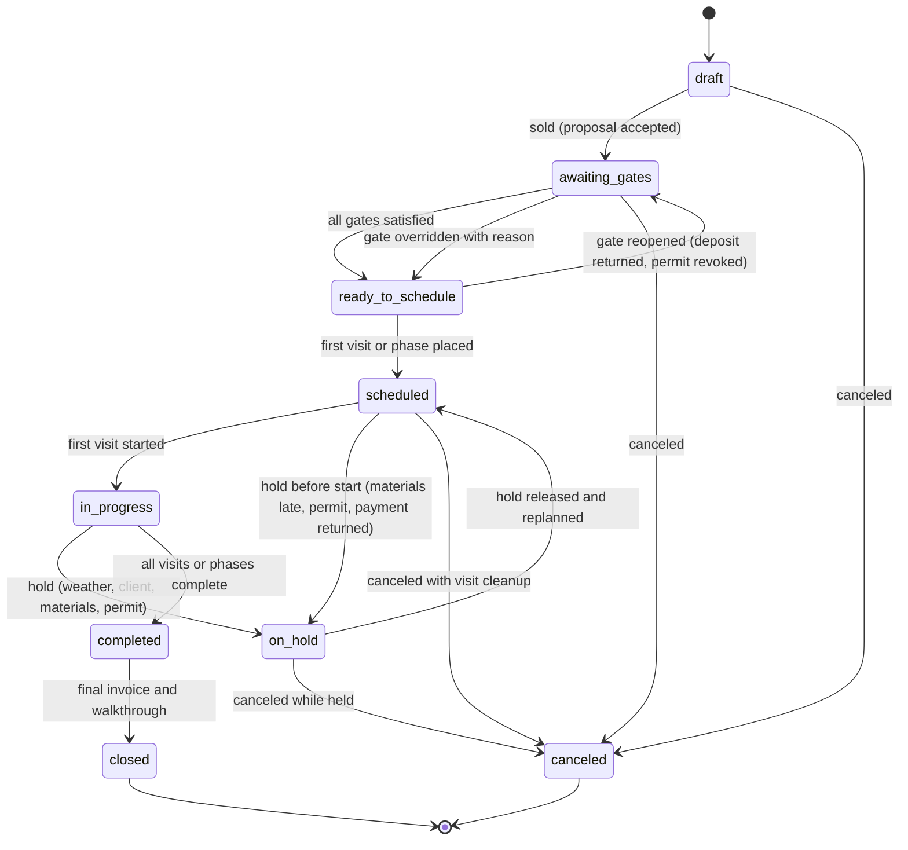

**Scheduling gates** (Company setting per job type; each gate shows owner, status and blocker reason in the backlog):

| Gate | Default for | Satisfied when | Source |
|---|---|---|---|
| Deposit paid | Projects (on), work orders over $2,500 (on), recurring (off) | `payments.deposit.received` for the required amount (event name as registered by [08](08-payments-stripe.md)); see deposit rules below | [08](08-payments-stripe.md), [06](06-customer-portal.md) |
| Signed and unpaid allowed | Recurring maintenance | Proposal signed | [06](06-customer-portal.md) (signed_unpaid does not block recurring by default) |
| Materials available | Projects, installs with plant lists | All PO lines `received` or delivery `confirmed` with ETA before phase start | [13](13-operations-inventory-equipment.md) |
| Dig ticket clear (811 / Canadian one-call) | Any task with excavation deeper than the Company threshold (default 12 in) | Ticket status `clear` and within its validity window | [14](14-service-line-modules.md) |
| Permit issued | Projects flagged `permit_required` | Permit record `issued` | [14](14-service-line-modules.md) |
| HOA/architectural approval | Projects flagged by the estimator | Approval document attached | [03](03-crm-sales-estimating-proposals.md) |
| Design sold | Projects created from a Design | Design version frozen as `sold` | [10](10-design-studio.md) |
| Pre-application notices sent | Lawn/PHC rounds in notification states | Notices sent and lead time elapsed | [14](14-service-line-modules.md) |

Rules:
- A Job in `awaiting_gates` can be **tentatively placed** on the board (hatched card, "Not confirmed") for capacity planning, but its Visits cannot be `dispatched` and no client notice goes out.
- Overriding a gate requires `job.gate_override` permission, a reason, and is audited. Overriding "dig ticket clear" is never allowed (hard block).

**Deposit gate rules [MVP].** Deposits are direct charges on the Company's own connected Stripe account; Rootline never holds the money ([08](08-payments-stripe.md)). Scheduling only reads the payment outcome events:

| Payment state (from [08](08-payments-stripe.md)) | Gate status | What scheduling allows |
|---|---|---|
| No payment, or `payments.attempt.failed` | `open` | Tentative placement only (hatched card); no client date promise; backlog shows "Deposit outstanding $5,520" |
| `payments.payment.pending` for the deposit (ACH or PAD in flight, up to about 4 business days per [08](08-payments-stripe.md)) | `pending_clearing` | Company setting `deposit_pending_counts_for` = `none` / `scheduling` (default) / `dispatch`. With the default, phases can be confirmed and the client told "Week of May 12", but Visits cannot be `dispatched` until the payment succeeds; if the first phase is fewer than 3 business days away, the board shows "Deposit still clearing" on the card |
| `payments.deposit.received` (succeeded, amount >= required) | `satisfied` | Full scheduling and dispatch |
| Partial deposit (amount < required) | `open` with amount remaining | As `open`; the Company can lower the requirement with `job.gate_override` |
| `payments.payment.returned` (R01 NSF, PAD return) after the gate was satisfied | `reopened` | Future, not-started Visits and phases get flag `needs_reschedule` and a hold reason `deposit_returned`; a `scheduled` Job moves to `on_hold` and a `ready_to_schedule` Job returns to `awaiting_gates`. Work already `in_progress` is never pulled automatically; the owner gets a decision task |
| `payments.refund.completed` covering the deposit (job canceled or descoped) | `reopened` | Same as returned; if the Job is being canceled, the cancellation flow releases reservations and cancels Visits |
| `payments.dispute.opened` on the deposit | unchanged | Owner alert only; disputes are evidence workflows in [08](08-payments-stripe.md), not schedule events |

Gate evaluation is idempotent on the payment id, so a webhook replayed by Stripe through [08](08-payments-stripe.md) never double-satisfies or double-reopens a gate.

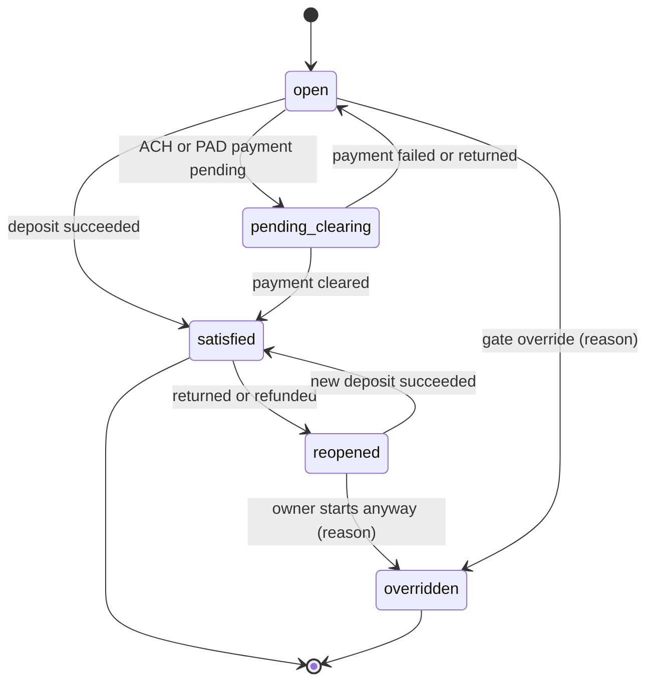

#### 4.1.3 Visit state machine (canonical) [MVP]

The [Architecture](20-architecture-security.md) entity notes list the coarse states `unscheduled -> scheduled -> dispatched -> in_progress -> completed / skipped / canceled`. This module defines the full canonical machine; the crew app ([05](05-field-crew-mobile-app.md) section 5.2) implements the field subset. `en_route`, `on_site` and `paused` roll up to `in_progress` for coarse reporting, and `partially_completed` rolls up to `completed` with a flag.

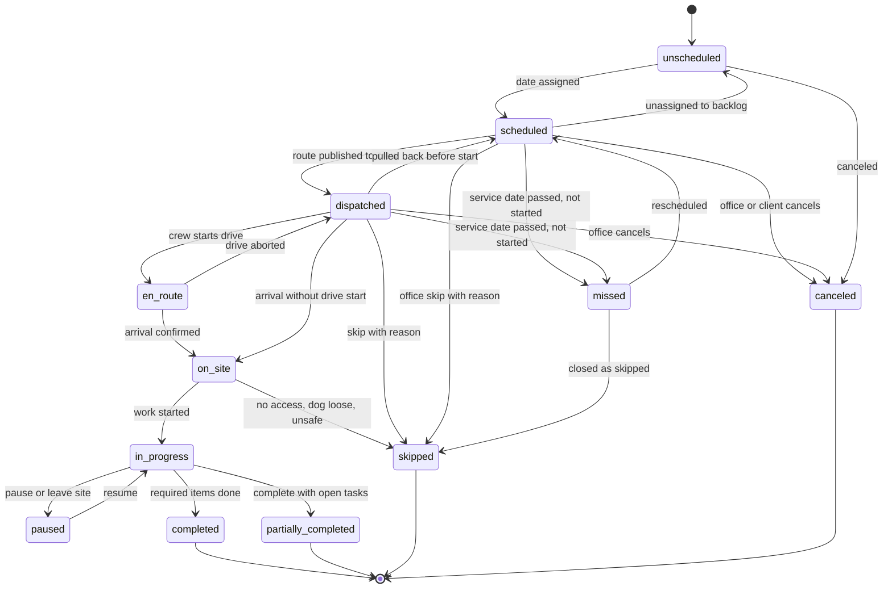

| Transition | Allowed actors | Validations | Side effects |
|---|---|---|---|
| `unscheduled -> scheduled` | office_manager, ops_manager, owner, optimizer (via accepted diff), portal booking | Date within the visit's due window (warn outside, block outside a round's compliance window); property not in blackout | `visit.scheduled`; reservations created; client notice per [16](16-marketing-growth-communications.md) rules |
| `scheduled -> dispatched` | Route publish (manual or nightly auto-publish) | Crew assigned; hard constraints pass (skills, licenses, equipment, no double booking) | `visit.dispatched`; delta pushed to crew devices |
| `dispatched -> en_route / on_site / in_progress / paused` | crew_lead, technician, subcontractor (own) | Server re-validates on sync | `visit.en_route` (ETA text trigger), `visit.arrived`, `visit.started`, `visit.paused` |
| `in_progress -> completed / partially_completed` | crew_lead, technician, subcontractor (own) | Required checklist, photos, chem record, signature ([05](05-field-crew-mobile-app.md) 4.4.5) | `visit.completed` / `visit.partially_completed`; billing, job cost, portal timeline; partial with "return needed" creates an `unscheduled` follow-up Visit linked by `parent_visit_id` |
| `* -> skipped` | crew (on site), office (before start) | Reason code required from the closed list in "Outcome mapping to agreements" below (e.g., `rain`, `no_access`, `dog_loose`, `client_request`, `no_growth`, `weather_unsafe`, `equipment_failure`, `ran_out_of_time`, `company_hold`, `other`) | `visit.skipped`; agreement skip counters; make-up policy (4.2.6, 4.9.3) |
| `* -> canceled` | office, client (portal, if lead time allows), agreement cancellation | Not allowed from `in_progress` or terminal states | `visit.canceled`; reservations released; notification |
| `scheduled/dispatched -> missed` | System, at 03:00 property-local the day after `service_date` | No start event received (and no pending offline sync flagged for that crew, see below) | `visit.missed`; appears in "Needs attention" queue; never auto-billed |
| `missed -> scheduled` | office, ops, Copilot diff | As `unscheduled -> scheduled` | `visit.rescheduled` |

**Offline guard on `missed`.** If any device on the visit's crew has unsynced commands older than the service date, the system holds the `missed` transition for up to 24 hours and shows "Awaiting crew sync" instead, because the visit may have been completed offline ([05](05-field-crew-mobile-app.md) section 4.21).

**Conflict rule.** Terminal field states win over office states: a Visit completed offline after the office canceled it becomes `completed` with `conflict = canceled_but_performed` and a billing review task ([20](20-architecture-security.md) section 4.11).

**Flags (orthogonal to state):** `weather_hold`, `needs_reschedule`, `late_risk`, `conflict`, `locked`, `client_confirmed`, `presence_required`, `first_visit` (new client: show extra access notes), `do_not_move` (fixed-date commercial events), `payment_warning` (client in the hold-warning stage of [07](07-invoicing-billing-contracts.md) 4.3.8: crew sees "payment issue, do not discuss, call office if asked"; nothing is skipped), `on_hold_ar` (agreement suspended for non-payment, 4.2.4).

**Outcome mapping to agreements [MVP].** [07](07-invoicing-billing-contracts.md) 4.3.7 closes every planned agreement occurrence in one terminal state and applies its credit policy. The Visit's terminal state and reason code map one to one, so billing never guesses:

| Visit outcome and reason code (this module) | Agreement occurrence state ([07](07-invoicing-billing-contracts.md)) |
|---|---|
| `completed`, `partially_completed` | `completed` (partial lines priced per [07](07-invoicing-billing-contracts.md)) |
| Rescheduled to a later date inside the due window or season | `rescheduled` (still counts toward the season) |
| `skipped` with `rain`, `weather_unsafe`, `snow_cover`, `frozen_ground` | `skipped_weather` |
| `skipped` with `no_growth`, `drought_dormancy`, `heat_dormancy`, or a growth-adaptive skip (4.2.6) | `skipped_dormancy` |
| `skipped` with `client_request`, `client_pause` (lead time recorded so [07](07-invoicing-billing-contracts.md) can apply its 24-hour credit rule) | `skipped_client_request` |
| `skipped` with `no_access`, `dog_loose`, `vehicle_blocking`, `client_not_present` | `skipped_access` (photo required by [05](05-field-crew-mobile-app.md)) |
| `skipped` with `equipment_failure`, `ran_out_of_time`, `crew_shortage`; or `missed` closed as skipped | `missed_company` (triggers a quality alert) |
| `skipped` with `company_hold` (service suspended for non-payment) | `skipped_company_hold` (never credited) |
| `canceled` with `schedule_removed` or `agreement_amended` | `cancelled_by_amendment` |
| `skipped` with `other` (free text required) | The office must reclassify before the next billing run; anything still `other` at billing maps to `missed_company`, so ambiguity never costs the client |
| Holiday handling (4.2.7) | A Visit moved by `slide_week`, `shift_next`, `shift_previous` or `compress` maps to `rescheduled`. Under the `skip` policy, if the agreement lists the holiday in `excluded_holidays`, no occurrence is generated at all (RRULE exception), so nothing maps; otherwise the skip maps to `missed_company` because the client was promised that visit |

Reason codes are a closed, versioned list (Company-extensible only as sub-reasons under these parents), so reports in [18](18-reporting-analytics.md) and credits in [07](07-invoicing-billing-contracts.md) stay comparable across Companies.

#### 4.1.4 Visit timing, flexibility and locks [MVP]

Every Visit carries these scheduling attributes. They are inherited from the Service Schedule or Job Phase and can be overridden per Visit.

| Attribute | Values | Default | Used by |
|---|---|---|---|
| `due_window` | Start and end dates the visit must fall within | Weekly mow: the ISO week. Round: the round's application window. Cleanup: the seasonal calendar window | Backlog aging, optimizer, missed-window alerts |
| `flexibility` | `fixed_date`, `day_flex` (+/- N days, default N = 1), `week_flex` (any working day in the due week), `window_flex` (any date in the due window) | Weekly mow `week_flex` anchored to route day; projects `fixed_date` once confirmed; cleanups `window_flex` | Rain playbooks, optimizer moves |
| `time_window` | `anytime`; `between` (earliest arrival, latest arrival); `fixed_time` (appointment); `before`/`after` shortcuts | `anytime` | Optimizer hard or soft constraint (Company setting per window type) |
| `presence_required` | Boolean, with contact | false; true for design consults, irrigation start-ups with indoor valves, walkthroughs | Self-scheduling shows time slots instead of days |
| `access_window` | Gate or site access hours (e.g., community gate staffed 8:00-16:00; school sites only after 15:30 or on weekends; HOA quiet hours no blowers before 8:00) | From Property access info | Hard constraint |
| `duration_budget` | Crew-hours from the estimate's production rates, plus fixed setup minutes | From estimate ([03](03-crm-sales-estimating-proposals.md)) | Capacity, optimizer, crew hours budget |
| `crew_size_min` / `crew_size_max` | Minimum and maximum people on the visit | 1 / unlimited; tree removals min 3; sod installs min 2 | Assignment validation |
| `priority` | 1 (contractual, e.g., commercial SLA) to 5 (filler) | Commercial 2, residential maintenance 3, upsell 4 | Optimizer drop penalty, rain playbooks |
| `lock` | `none`, `crew`, `day`, `time`, `sequence`, `full` | `none`; client-requested times set `time`; commercial fixed dates set `day` | Optimizer and Copilot will not move locked dimensions |
| `stability_anchor` | Route day, crew and sequence position from the Master Route | Set when the Master Route is published | Stability penalty (4.8.5) |

**Duration from crew-hours to clock-hours.** A Visit's labor is budgeted in crew-hours (person-hours). On-site clock time depends on crew size and an efficiency curve (Company setting, default: 1 person 1.00, 2 people 0.95 each, 3 people 0.90 each, 4 people 0.85 each, 5+ people 0.80 each). Example: a 1.5 crew-hour mow with a 3-person crew takes 1.5 / (3 x 0.90) = 0.56 h, about 34 minutes on site, plus 5 minutes fixed setup (unload/load). The crew app shows the crew's hours budget per Visit in the same units ([05](05-field-crew-mobile-app.md)).

**Learned durations [V1].** After 3 completed occurrences, the system computes an exponentially weighted moving average of actual on-site crew-hours per Service Schedule (alpha 0.3, outliers beyond 2.5 standard deviations ignored, weather-flagged visits down-weighted). The dispatcher sees "Budget 0.75 h, actual trend 0.92 h" and can accept the learned value for scheduling without changing the client's price. Persistent overruns (trend > budget x 1.15 over 6 visits) raise a "re-price candidate" for [03](03-crm-sales-estimating-proposals.md) and [18](18-reporting-analytics.md).

### 4.2 Recurrence engine and visit generation

#### 4.2.1 Recurrence patterns [MVP unless tagged]

Rootline stores recurrence as RFC 5545 RRULE strings plus a Rootline extension record ([20](20-architecture-security.md) section 7.1). The editor never shows RRULE text to users; it offers landscape-native presets.

| Preset | Typical use | RRULE core | Rootline extensions | Notes |
|---|---|---|---|---|
| Weekly on route day | Residential and commercial mowing | `FREQ=WEEKLY;BYDAY=TU` | Season 2027-04-01..2027-11-15; `route_day_anchor = zone` (day follows the zone if the zone's day changes) | The default for maintenance |
| Bi-weekly (A/B weeks) | Budget mowing, shrub maintenance, low-growth turf | `FREQ=WEEKLY;INTERVAL=2;BYDAY=TU` | `parity = A or B` relative to the Company's season week 1 | The optimizer balances A and B so each Tuesday carries a similar load (4.7.4) |
| Twice a month | Commercial detailing, bed maintenance | `FREQ=MONTHLY;BYDAY=1TU,3TU` | Season bounds | Avoids the 5th-week gap problem of "every 2 weeks" when billing monthly |
| Every N days | Irrigation checks, mosquito treatments every 21 days | `FREQ=DAILY;INTERVAL=21` | `snap_to_route_day = true` snaps to the nearest route day within +/- 3 days | Without snapping, every-N-days floats across weekdays and destroys route density; the editor warns |
| Monthly | Irrigation inspections, monthly detailing | `FREQ=MONTHLY;BYDAY=2WE` | Season bounds | |
| Frequency profile (seasonal segments) | Mowing weekly in peak growth, bi-weekly in summer slowdown | Multiple RRULE segments | Segments: weekly Apr 1-Jun 30, bi-weekly Jul 1-Aug 31, weekly Sep 1-Oct 31, bi-weekly Nov 1-Nov 15 | Common in the Southeast and Midwest; billing implications in [07](07-invoicing-billing-contracts.md) |
| Count-limited | "26 mows per season" contracts | `FREQ=WEEKLY;BYDAY=TU;COUNT=26` | Counter tracks completed vs contracted; skipped visits optionally do not consume the count | Lets the season end early or late by weather |
| Seasonal calendar item | Spring cleanup, mulch, aeration and overseeding, fall cleanups, irrigation start-up and winterization, holiday lighting install and takedown | No RRULE: one or more `window_flex` Visits per season | Window per Region (e.g., spring cleanup Mar 20-Apr 30 in zone 6a, Mar 1-Apr 10 in 7b), min gap between multiple occurrences (fall cleanup x2, min 14 days apart) | Generated at agreement activation for the whole season |
| Program round | 5-step fertilizer, 6-round tree and shrub PHC, mosquito | From the Program Engine ([14](14-service-line-modules.md)) | Window, min days since previous round (default 28), compliance gates | Round instances become Visits through the Round Planner (4.2.5) |
| Event-driven | Snow pushes, de-icing, storm cleanups | None | Created by storm events ([14](14-service-line-modules.md)) | Routed by 4.9.6 |
| Growth-adaptive [V1] | Mowing that follows the grass, not the calendar | Base weekly rule | Growth model decides "mow", "skip", or "stretch" per occurrence (4.2.6) | Opt-in per agreement |

**Validation rules**
- Season start must be before season end; a season longer than 12 months is rejected (use renewals).
- Weekly or bi-weekly rules must have exactly one BYDAY that matches one of the Property's zone days, unless the Service Schedule is marked `off_zone` (requires `schedule.off_zone` permission and shows an "off-zone" badge with its estimated drive cost).
- Two Service Schedules on the same Property with overlapping service types (e.g., two mowing schedules) are rejected unless one is explicitly `supplemental`.
- Minimum spacing rule per service type (Company setting): mowing >= 4 days between visits, fertilizer rounds >= 28 days (from [14](14-service-line-modules.md)), aeration >= 300 days. A move that would violate spacing is blocked for compliance-bearing services and warned for others.
- **Count-limited schedules** (`COUNT=26`): the counter increments on `completed` and `partially_completed` (and on skips only where the agreement says skips consume the count). When the counter reaches the contracted count, remaining materialized Visits are canceled with reason `count_reached` and the client gets "Your 26 contracted mows are complete for 2027" with an "add extra mows" link ([06](06-customer-portal.md)). If the season end date arrives first, the shortfall is reported to [07](07-invoicing-billing-contracts.md) as undelivered occurrences, and the backlog offers make-up Visits during the last two weeks of the season when the agreement allows them.
- **Leap days and month ends:** `BYMONTHDAY=29/30/31` rules use "last day of month" semantics (11.1); a Feb 29 one-time Visit created in a leap year never recurs automatically.

#### 4.2.2 Route-day anchoring [MVP]

Most residential recurring Visits do not have a client-chosen day; they have a **zone day**. The recurrence anchors to the zone, not to a fixed weekday:
- If the Company rebalances zones in July and moves "Maple Ridge" from Tuesday to Wednesday, all future `week_flex` Visits anchored to that zone move, with a single bulk client notice ("Starting July 14, your service day is Wednesday").
- Visits with `client_day_lock` (the client insisted on Fridays because of a Saturday party venue) do not follow the zone and are flagged off-zone if the zone moves.

#### 4.2.3 Seasonal service calendar [MVP]

Companies define a **Season Calendar** per Region and branch: service types with their default windows and capacity pool. Defaults ship per Region from platform templates ([19](19-platform-admin-portal.md) manages templates; [14](14-service-line-modules.md) shows the 12-month service-line calendar). Example for a zone 6a Midwest branch:

| Service | Window | Visits per season | Capacity pool | Weather sensitivity |
|---|---|---|---|---|
| Spring cleanup | Mar 20 - Apr 30 | 1 | Maintenance crews | Avoid saturated soil (> 1 in rain in 24 h) |
| Irrigation start-up | Apr 15 - May 15 | 1 | Irrigation techs | Not before last frost risk (soil temp > 40 F and no freeze forecast for 7 days) |
| Mulch install | Apr 15 - May 31 | 1 | Enhancement crews | Rain tolerant |
| Weekly mowing | Apr 1 - Nov 15 | 30-33 | Mowing crews | Skip at >= 0.25 in rain in the crew window |
| Aeration and overseeding | Aug 25 - Oct 10 | 1 | Aeration crew | Moist, not saturated soil |
| Irrigation winterization | Oct 1 - Nov 10 | 1 | Irrigation techs | Prioritize before first hard freeze (28 F or below) |
| Fall cleanup | Oct 20 - Dec 5 | 1-2 | Maintenance crews | Leaves down; after first hard freeze for the last pass |
| Snow season | Nov 1 - Apr 15 | Event-driven | Snow crews and subs | Storm Event Engine |

Season calendar windows can be shifted per year by the owner ("late spring: shift all spring windows +10 days") with a preview of affected Visits.

#### 4.2.4 Visit generation horizon and materialization [MVP]

Visits exist in three forms:

| Form | Persisted? | Horizon | Purpose |
|---|---|---|---|
| **Projected** | No (computed on read from rules) | Rest of the season, up to 52 weeks | Capacity planning, revenue forecast, client portal "season calendar" |
| **Materialized** | Yes (`visit` rows, state `scheduled` or `unscheduled`) | Rolling horizon, Company setting, default **8 weeks** for recurring, whole season for seasonal calendar items and rounds | Board, routes, reservations, client notices |
| **Dispatched** | Yes | Published days (default: today and tomorrow) | Crew devices |

Rules:
- A nightly job (02:00 tenant-local) materializes recurring Visits up to the horizon. Range: 2-26 weeks. Large tenants (> 2,000 recurring schedules) default to 6 weeks to bound row counts.
- Materialization is **idempotent**: each occurrence has a deterministic key `(service_schedule_id, occurrence_date_original)`. Re-running never duplicates.
- Editing a recurrence rule regenerates only **untouched** future materialized Visits. A Visit that was manually moved, re-crewed, locked, or has notes/photos/assets attached is **detached** and kept; the editor shows "3 detached visits will keep their custom settings [Review]".
- Edit scopes: "This visit", "This and following" (splits the Service Schedule at the date, keeping history), "Entire season" (only future, non-detached visits).
- Deleting a Service Schedule cancels future Visits (state `canceled`, reason `schedule_removed`) and never touches completed history.
- **Service holds for non-payment** follow the single client hold state owned by [07](07-invoicing-billing-contracts.md) 4.3.8 (`none`, `warning`, `suspended`), whichever of [07](07-invoicing-billing-contracts.md) or [08](08-payments-stripe.md) raised it:
  - `warning` (for example `payments.client.payment_hold` at 30 days past due): Visits stay on routes with flag `payment_warning`; nothing moves or skips.
  - `suspended` (`agreement.suspended`, after the 45-day threshold and 7-day notice by default): materialization pauses; already-materialized future Visits leave their routes, become `unscheduled` with flag `on_hold_ar`, and stay out of the optimizer; crews see "Service on hold" if a held Visit is opened. When a held Visit's due window closes while still suspended, it closes as `skipped` with reason `company_hold` (`skipped_company_hold` in [07](07-invoicing-billing-contracts.md), never credited).
  - Exemptions from [07](07-invoicing-billing-contracts.md) apply automatically: commercial snow and ice Visits and irrigation winterizations before a forecast hard freeze are not held unless the owner explicitly chooses to suspend them, and the board shows them with a "Hold exempt" badge.
  - `agreement.resumed` re-materializes from the resume date; held Visits whose due windows are still open return to the backlog with source `hold_released`, and the dispatcher gets one re-scheduling task per client. No automatic make-up of closed occurrences unless the Company setting says so.
- Client vacation holds (portal, [06](06-customer-portal.md)) create Property blackouts (4.2.7).
- Projected Visits for capacity use the same generator code path as materialization (one engine, two outputs) so the forecast and the schedule cannot disagree.

#### 4.2.5 Program rounds hand-off [MVP]

The Program Engine in [14](14-service-line-modules.md) owns round templates, enrollment and round instances. The contract with this module:
1. Round instances carry: Property, round number, application window (start/end), minimum days since previous round, product mix, required license category, measured area, weather guardrails, notification gate status.
2. The **Round Planner** (a view in [14](14-service-line-modules.md)) groups eligible instances by zone and week and calls the scheduling API `POST /scheduling/optimize` (mode `sequence` per Crew Day at MVP, `week_plan` at V1) with `context = round` and a target week (8.2).
3. **MVP:** the planner's block drop assigns instances to zone-days and to the zone's default applicator crews, and `sequence` mode orders each Crew Day. **V1:** `week_plan` assigns across days and applicators automatically. In both cases this module's optimizer sequences them into routes for licensed applicators only (hard skill constraint `pesticide_applicator` with the product's category valid in the Property's state/province), checks hourly wind and rain forecasts per route day (amber/red flags from [14](14-service-line-modules.md) section 4.1), and returns a ScheduleDiff.
4. Accepted Visits link back to the round instance (`visit.round_instance_id`). Rescheduling a round Visit outside its notified window triggers re-notification automatically (rule owned by [14](14-service-line-modules.md); this module emits `visit.rescheduled` with `old_date`/`new_date`).
5. Window protection: a round Visit cannot be moved past its window end. The rain playbook treats rounds with fewer than 5 working days left in their window as priority 1.

#### 4.2.6 Growth-adaptive mowing frequency [V1 rules, V2 AI model]

Grass does not grow on a calendar. In a dry August in Ohio, weekly mowing clients are paying for crews to "mow" dormant turf; in a wet May, bi-weekly clients' lawns get away from the crew. Growth-adaptive frequency lets a Company sell "mow when it needs it" and route accordingly.

**Inputs per Property (daily):**
- Turf type from the Property profile (cool-season: Kentucky bluegrass, tall fescue, perennial ryegrass; warm-season: bermudagrass, zoysia, St. Augustine; mixes), irrigation present (from the Property asset registry in [14](14-service-line-modules.md)).
- Weather service (4.9): daily mean temperature, rainfall over the past 7 days, reference evapotranspiration (ET0) where available.
- A **turfgrass growth potential (GP)** curve: a bell-shaped function of mean air temperature with an optimum near 68 F for cool-season and 88 F for warm-season grasses, as published in the turf-management literature (Gelernter and Stowell's growth potential model; background knowledge, verify before shipping coefficients).
- Crew observations: "no growth" skip reasons and clipping-volume quick tags from the crew app (`none`, `light`, `normal`, `heavy`).

**Rule engine [V1]:**
- `GP_7day` = mean growth potential over the last 7 days, adjusted down by 40% if 7-day rainfall < 0.25 in and the Property is not irrigated (default adjustments, tunable per Region by `platform_curator` templates).
- If `GP_7day < 0.25` for cool-season turf: the next weekly Visit becomes a **stretch candidate** (propose moving to the following week, i.e., temporary bi-weekly).
- If two consecutive crew observations are "none": propose skip of the next occurrence.
- If `GP_7day > 0.75` and the client is bi-weekly with `allow_growth_upgrade = true`: propose an extra mid-cycle mow (billable per visit).

**Contract and billing guardrails (with [07](07-invoicing-billing-contracts.md)):**
- Agreements carry `growth_adaptive = off | suggest | auto`. Default `off`. `suggest` produces dispatcher proposals; `auto` applies after the client-notice lead time (default 24 h) unless the client objects in the portal.
- Per-visit billing: client pays only for performed visits; the client notice says so.
- Fixed monthly (level-pay) billing: growth skips do not change the invoice; the agreement's `max_growth_skips_per_season` (default 4) caps skips so the Company does not under-deliver against a fixed price. Beyond the cap, skips need client consent.
- Every growth skip is logged with its evidence (GP, rainfall, crew observation photo) for dispute defense.

**Routing effect:** stretching 30% of a Tuesday zone in a drought frees whole crew-days. The capacity view shows "Freed: 18.5 crew-hours in week 32", and the Copilot proposes filling them with backlog (aeration pre-sales, bed edging enhancements) or giving crews a 4-day week.

**AI model [V2]:** a per-Region gradient-boosted model trained on clipping-volume tags, visit durations and weather predicts next-week growth class per Property (none/light/normal/heavy) and expected on-site duration. Labels come from crews, so the model improves with use. Platform-level pooled training across tenants requires the opt-in data-sharing setting in [19](19-platform-admin-portal.md).

> **Competitive edge.** No competitor reviewed in [R1](research/R1-field-service-platforms.md) or [R2](research/R2-landscape-specific-platforms.md) documents growth-driven mowing frequency. It is the kind of feature that only works when weather data, property turf data, crew observations, routing and billing live in one system, which is exactly Rootline's architecture.

#### 4.2.7 Holidays, blackouts and closures [MVP]

**Calendars:**
- **Company holiday calendar**, seeded from the country and province/state at provisioning: US federal holidays and Canadian statutory holidays for the Company's provinces (they differ: e.g., Civic Holiday, Family Day, Saint-Jean-Baptiste in Quebec, Remembrance Day observance varies by province; verify per province). The owner toggles which ones the Company observes.
- **Branch calendars** inherit and override (e.g., a Quebec branch observes June 24).
- **Crew blackouts:** crew-wide training days, the annual equipment shop day.
- **Employee time off** comes from [15](15-team-hr-payroll.md) and reduces Crew Day roster and capacity; it does not block the Crew.
- **Property blackouts:** client vacation, HOA events ("no work during the community 5K, Apr 24"), school sites during exams, construction on site, "do not service" holds.
- **Resource blackouts:** equipment down for maintenance from [13](13-operations-inventory-equipment.md).
- **Regulatory application blackouts:** jurisdiction rule packs in [14](14-service-line-modules.md) declare fertilizer blackout dates (for example, several Florida counties restrict nitrogen and phosphorus applications in summer months and New Jersey restricts professional fertilizer applications in winter months; verify current dates per pack). The pack's `fertilizer.blackout` key is a hard block for any Visit whose lines include a covered product on a Property inside that jurisdiction; mowing and other lines on the same Property are unaffected. The Round Planner never offers those dates, and a rain playbook can never push a round Visit into a blackout.

**Holiday policies** (Company setting per holiday, default shown):

| Policy | Behavior | Default for |
|---|---|---|
| `work` | Normal schedule | Juneteenth, Columbus Day/Indigenous Peoples' Day, Veterans Day, Remembrance Day (configurable) |
| `slide_week` | Holiday's routes move +1 working day, and each following day of that week slides +1, with the last day landing on Saturday (if Saturday is a working day) or splitting across remaining days | Memorial Day, Labor Day, Victoria Day, Canada Day when it falls on a weekday |
| `shift_next` | Only the holiday's routes move to the next working day, merged into that day's routes and re-optimized | Good Friday (where observed) |
| `shift_previous` | Holiday's routes move to the previous working day | July 4 when the Company prefers to work the Saturday before |
| `skip` | Holiday's recurring visits are skipped (reason `holiday`), non-recurring visits move to backlog | Christmas Day, New Year's Day (off-season for most) |
| `compress` | Holiday's routes are distributed across the remaining working days of the week by the optimizer, respecting capacity | Thanksgiving week for fall cleanups |

**Worked example (Memorial Day 2027, Monday May 31).** Policy `slide_week`, Saturday enabled. Monday's 4 routes (96 visits) move to Tuesday June 1; Tuesday's move to Wednesday; ... Friday's 88 visits move to Saturday June 5. Commercial Visits with `lock = day` stay put and are flagged for manual decision. One ScheduleDiff shows 472 moved visits, 0 capacity violations, and one bulk client notice per affected client ("Holiday week: your service moves from Tuesday to Wednesday this week"). Generation of the diff happens 14 days ahead (Company setting) so notices go out with 7 days' lead.

**Observed dates:** when a holiday falls on a weekend, the observed weekday is used if the Company observes it (July 4, 2027 is a Sunday; observed Monday July 5).

**Blackout rules:**
- Placing a Visit on a blacked-out date is a hard block for Property and Resource blackouts, a warning for Company holidays (some companies work holidays for commercial sites at premium pay).
- Creating a blackout over already scheduled Visits opens a resolution dialog: move to next eligible date (default), skip, or keep (only for Company holidays).

#### 4.2.8 Client-driven schedule changes [MVP]

Clients request skips, reschedules and extra visits from the portal ([06](06-customer-portal.md)) or by message. Rules:
- **Skip next visit**: allowed up to the Company's cutoff (default 18:00 the day before service). After cutoff the request becomes an office task. Per-visit billing clients are not charged; fixed-price clients see the agreement's skip policy ("Skips do not reduce your monthly price; 2 skips per season can be made up on request").
- **Reschedule**: the portal offers only dates with capacity in the Property's zone (4.13). Commercial clients with approval workflows route requests to the approver contact first.
- **Pause service** (vacation): creates a Property blackout with start/end; recurring Visits within are skipped with reason `client_pause`.
- All client changes produce `visit.rescheduled` or `visit.skipped` with `actor_type = client`.

### 4.3 Capacity planning and backlog

#### 4.3.1 Capacity model [MVP basic, V1 full]

Capacity is computed in **crew-hours** per **capacity pool** per day, then rolled up by week, month and season.

**Supply (available productive crew-hours) for a Crew Day:**

```text
available = sum over roster members of (shift_hours - unpaid_meal - paid_breaks_not_productive)
            - shop_time (load-out, fueling; default 0.5 h per person per day)
            - drive_allowance (from the crew's trailing 4-week drive share, default 20% of remaining)
```

Example: Crew 1 is 3 people on a 10-hour shift (7:00-17:00) with a 30-minute unpaid meal. Paid hours = 3 x 9.5 = 28.5. Shop time 1.5 crew-hours. Drive allowance 20% x 27.0 = 5.4. **Available productive = 21.6 crew-hours.** At 0.75 crew-hours per average residential mow plus 5 minutes setup (0.25 crew-hours for 3 people), that is about 21 mows per day.

**Capacity pools** group crews by what they can do: `mowing`, `enhancement`, `install_hardscape`, `install_softscape`, `irrigation`, `lawn_application`, `tree`, `snow`, `lighting`. A crew can belong to multiple pools with a primary pool. Employees with skills (4.4) contribute to pools that require those skills.

**Demand (sold crew-hours)** per pool per week:
- Materialized and projected recurring Visits (duration budgets, or learned durations [V1]).
- Seasonal calendar items spread across their windows using a **window-spread curve** (Company setting: `flat`, `front_loaded`, `back_loaded`; default flat). Example: 220 fall cleanups at 3.5 crew-hours each = 770 crew-hours spread over Oct 20-Dec 5 (about 6.5 weeks), so about 118 crew-hours per week.
- Program rounds from [14](14-service-line-modules.md) enrollments.
- Projects: phase durations placed on tentative or confirmed dates.
- **Backlog**: sold, unscheduled work with due windows.
- **Pipeline forecast [V1]**: open opportunities from [03](03-crm-sales-estimating-proposals.md) weighted by stage probability and expected start month, shown as a separate stacked band ("likely to sell").

**Utilization bands** (Company setting): < 75% blue (under-booked), 75-90% green, 90-100% amber, 100-110% orange (overtime likely), > 110% red (not deliverable without hiring, subs or Saturday shifts).

**Overtime projection:** for each employee, scheduled hours per week from Crew Days vs overtime threshold (40 h/week FLSA default; daily overtime rules such as California's 8 h/day come from [15](15-team-hr-payroll.md)). The capacity view shows "Crew 2 projected 51.5 h/week in weeks 19-23: 11.5 h OT each x 4 people".

#### 4.3.2 Capacity planner views [MVP basic, V1 full]

- **Season heatmap** [MVP]: rows = capacity pools (expandable to crews), columns = weeks (52), cells = utilization % with color band. Click a cell for the breakdown: recurring, seasonal, rounds, projects, backlog, pipeline.
- **Week detail** [MVP]: crews x days with available vs scheduled hours, overtime projection and unassigned demand.
- **What-if levers** [V1]: add a crew (from a crew template) for a date range, add Saturday shifts, extend shift to 11 hours, move demand to subcontractors, push a project's start. Each lever shows its effect on the curve and its cost (labor at loaded rate from [15](15-team-hr-payroll.md), sub cost from [13](13-operations-inventory-equipment.md)).
- **Hiring planner** [V1]: "To keep weeks 15-22 under 95%, add 2 seasonal technicians by April 6"; links to recruiting in [15](15-team-hr-payroll.md).
- **Sales throttle** [V1]: capacity feeds [03](03-crm-sales-estimating-proposals.md) so estimators see "Earliest start: week of May 11" on proposals, an optional OT premium when the target month is > 100%, and an owner alert when new sales push any pool above 110%.
- **Season revenue curve** [V1]: projected revenue by week from scheduled and projected visits (price from the agreement lines), handed to [18](18-reporting-analytics.md) for cash-flow forecasting.

#### 4.3.3 Backlog view [MVP]

The backlog is all sold work not yet on a date (or with a date in the past and not done). It replaces the whiteboard of "jobs to get to".

| Column | Meaning |
|---|---|
| Job / Visit | Name, client, property, service type |
| Due window | Start-end; days left in window; overdue badge |
| Value | Price of the work (for prioritizing) |
| Crew-hours | Budget |
| Needs | Skills, equipment class, crew size |
| Gates | Gate status icons (deposit, materials, 811, permit) |
| Zone / nearest route day | For slotting into existing routes |
| Age | Days since sold |
| Source | Proposal, portal request, partial-visit return, rain displacement, storm event |

Behaviors:
- Default sort: **urgency score** (0-100) = weighted sum of window pressure (1 - working days left / window length in working days, so a closing window scores near 1), priority, value per crew-hour, and age. Formula weights are a Company setting; the score is shown with an "explain" tooltip.
- Filters: pool, zone, service type, gate status, "fits in a gap today".
- **Auto-slot** button [MVP for single items, V1 for batches]: runs best-insertion (4.8.6) for selected items and returns a ScheduleDiff.
- **Backlog aging alerts**: items within 5 days of window end, sold projects older than 21 days without a start date (Company setting), and displaced rain visits not yet replanned after 48 hours.
- Backlog totals by pool feed the capacity view as "backlog hours" and [18](18-reporting-analytics.md) as "backlog weeks" (backlog hours / weekly capacity).
- **Backlog sources are closed-set:** `proposal`, `portal_request`, `online_booking`, `partial_return`, `rain_displaced`, `holiday_overflow`, `hold_released`, `storm_event`, `count_shortfall_makeup`, `manual`. Each has its own default urgency weight (rain-displaced and partial returns start higher because a client already expected them).

> **Competitive edge.** Aspire and LMN carry budgeted hours per job and track actuals against them ([R2](research/R2-landscape-specific-platforms.md)), which is the raw material for capacity planning, but in the sources reviewed neither documents a forward-looking, season-long view of sold crew-hours against available crew-hours by pool and week, including weighted pipeline. Jobber and Housecall Pro schedule appointments without a capacity model at all. Rootline's planner uses the same generator code path as the schedule, so the June overbooking shows up in February while the owner can still hire, subcontract or raise prices, and estimators see "Earliest start: week of May 11" on the proposal they are writing ([03](03-crm-sales-estimating-proposals.md)).

### 4.4 Crew, skill and certification matching

#### 4.4.1 Skills catalog [MVP]

Skills are Company-defined tags on employees with optional jurisdiction, category, level and expiry. Rootline ships a default catalog; certifications and their documents live in [15](15-team-hr-payroll.md).

| Skill key | Type | Example of a requirement | Constraint strength |
|---|---|---|---|
| `pesticide_applicator` | License with state/province and category (e.g., turf and ornamental) | Fertilizer + herbicide round; mosquito treatment | Hard; must be valid on the service date; "under supervision" allowed only where the state permits and a licensed applicator is on the same Crew Day |
| `irrigation_licensed` | License (state-specific, e.g., Texas licensed irrigator) | Irrigation repairs in licensing states | Hard where required by the Company's jurisdiction setting |
| `backflow_tester` | Certification with expiry | Annual backflow test | Hard |
| `cdl_class_a` / `cdl_class_b` | License | Driving a truck/trailer combination that requires a CDL | Hard for the vehicle assignment (4.5) |
| `isa_arborist`, `tree_climber`, `crane_signal` | Certification | Tree removal, crane picks | Hard for task roles |
| `equipment_operator:skid_steer` (also excavator, mini loader) | Company-verified competency | Base prep, grading | Hard |
| `paver_install`, `wall_build`, `lighting_tech` | Competency level 1-3 | Hardscape phases | Soft (level preference) or hard (level >= 2 for crew lead) |
| `plow_operator`, `sidewalk_crew` | Competency | Snow routes | Hard during storm events |
| `spanish`, `french`, `english` | Language | Client prefers Spanish-speaking crew lead | Soft |
| `client_approved` | Property-specific | Gated community requires badge-holders; school sites require background-checked staff | Hard |
| `first_aid_cpr` | Certification | Company policy: one per crew | Hard per Crew Day |
| `age_18_plus` (derived from date of birth in [15](15-team-hr-payroll.md), never shown as a raw age) | Legal eligibility | Visit lines that use chain saws, wood chippers, stump grinders or abrasive cutting discs, and any line requiring a pesticide applicator or someone working under one | Hard for the person assigned to that task role: US Hazardous Occupations Order 14 bars under-18 workers from operating chain saws, wood chippers and abrasive cutting discs ([29 CFR 570.65](https://www.ecfr.gov/current/title-29/subtitle-B/chapter-V/subchapter-A/part-570/subpart-E/section-570.65)), and EPA's applicator certification standards set a minimum age of 18 for certified applicators and those under their direct supervision ([EPA](https://www.epa.gov/pesticide-worker-safety/certification-standards-pesticide-applicators), verify per [15](15-team-hr-payroll.md)). A 16-year-old seasonal can still be on a tree crew Crew Day for ground work and cleanup, but cannot be the person assigned to the chipper task |

**Rules:**
- A requirement is either on the **Visit** (someone on the crew must have it), on the **crew lead** (the lead must have it), **all members** (everyone on site must have it, e.g., background-checked staff at schools), or a **task role** (the person assigned to a specific line, e.g., the chipper operator or the applicator, must have it; the crew app shows that line only on that person's device as "yours").
- Expiry is evaluated on the **service date**, not today. A license expiring May 31 makes all assigned June round Visits fail validation on publish, and an alert goes to the owner 30 days before expiry ([15](15-team-hr-payroll.md) emits `certification.expiring`).
- The validation message names the gap: "Visit V-60012 needs `pesticide_applicator` (MN, turf) - nobody on Crew 3 on Jun 2 qualifies. Swap Dani from Crew 1 (licensed) or move to Crew 1."

#### 4.4.2 Crew templates and daily rosters [MVP]

- A **Crew** has a default roster, crew lead, home depot (yard), default vehicle and trailer, default equipment kit, shift template (e.g., Mon-Fri 7:00-17:30, Saturday optional), capacity pools, and color.
- **Crew Days** are generated nightly for the materialization horizon. Changes on a Crew Day (sick call, borrowed member, different truck) affect only that day.
- **Floaters**: employees without a home crew appear in a "Floaters" lane and can be dragged onto Crew Days.
- **Sick-day handling**: when an absence is recorded in [15](15-team-hr-payroll.md) or by the crew lead in the app, the Crew Day's capacity drops, and if scheduled hours exceed the new capacity by > 10%, a `late_risk` alert and a Copilot rebalancing proposal are raised ([17](17-ai-copilot-automation.md) agent A7).
- **Crew pairing preferences** [V1]: soft preferences (keep Marco and Dani together; do not pair two trainees) used when the optimizer fills crews from floaters.
- **Training ride-alongs** [V1]: a trainee can be added as a non-counting member (capacity contribution 0.5 by default) for a configurable number of days.

### 4.5 Equipment, vehicle and trailer reservations

#### 4.5.1 Resource model [MVP basic, V1 full]

Resources come from the asset register in [13](13-operations-inventory-equipment.md). For scheduling, each resource has: class (`truck`, `trailer`, `mower_ztr_72`, `mower_ztr_60`, `mower_walk_36`, `mower_push_21`, `skid_steer`, `mini_excavator`, `aerator`, `overseeder`, `sprayer_200gal`, `dump_trailer`, `plow_truck`, `salt_spreader`, `sod_cutter`, `stump_grinder`, `bucket_truck`, `chipper`), home depot, status (`available`, `down`, `in_shop`, `rented_out`), and **capacities** used by the optimizer:

| Capacity | Unit | Example |
|---|---|---|
| Debris volume | cubic yards | 16 ft dump trailer: 10 cu yd of leaves |
| Material weight | lb / tons | One-ton dump truck: 3 tons of river rock |
| Bulk material volume | cubic yards | Mulch: 6 cu yd per truck load |
| Liquid volume | gallons | 200-gallon sprayer: about 2 acres at 2 gal/1,000 sq ft (illustrative rate) |
| Salt | tons | Plow truck with 2-ton spreader |
| Physical width | inches | 72-inch deck mower cannot pass a 48-inch gate |
| Towing | GVWR/GCWR pounds | Truck T-12 tows up to 14,000 lb; requires CDL above thresholds |
| Energy [V2] | kWh | Battery mower range: about 4.5 h of cutting per charge (illustrative) |

#### 4.5.2 Requirements and reservations [MVP]

- Visits and Job Phases declare **equipment requirements by class** ("needs any `aerator`", "needs `skid_steer` for 2 days", "needs a mower deck <= 52 in because of the 54-inch side gate"), not specific units. Property access info supplies gate widths and "no ZTR on slope > 15 degrees" notes (slope from USGS 3DEP elevation cache in [20](20-architecture-security.md)).
- Crew Days carry the specific units (truck, trailer, kit). The validator checks that the Crew Day's units satisfy every Visit's class requirements, and the trailer can carry the kit (a 16 ft trailer fits one 72-inch ZTR plus one walk-behind; a configurable **trailer layout capacity** in "deck slots" handles this [V1]).
- **Reservations** are created when a unit is assigned to a Crew Day or a Phase. A unit can hold one reservation per time interval. Shared units (one aerator for three crews in September) can be reserved by half-day blocks.
- **Conflict detection** (on drop, on publish, and continuously): double-booked unit, unit `down` or `in_shop` on the date, unit at a different depot than the crew's start, CDL requirement not met by the assigned driver, trailer over GCWR with the assigned truck.
- **Conflict resolution UI**: the conflict panel lists alternatives ranked by cost: another unit of the same class free that day; swap with a crew whose Visits do not need it; move the Visit within its flexibility; rent (creates a non-stock PO draft in [13](13-operations-inventory-equipment.md)).
- **Breakdown flow**: when [13](13-operations-inventory-equipment.md) marks a unit `down` (or a crew reports it in the app), affected Crew Days and Visits for the downtime window get `late_risk`, and the dispatcher sees a substitution proposal (4.10.8 mid-day re-optimization uses this).
- **Equipment-aware routing** [V1]: the optimizer can be asked to choose which crew gets the shared aerator on which day to minimize total drive, treating the aerator as a scarce resource across crews in the week plan.

> **Competitive edge.** Aspire tracks equipment for maintenance and costing ([R2](research/R2-landscape-specific-platforms.md)); in the sources reviewed, Jobber and Housecall Pro do not document equipment as a schedulable resource at all. Rootline treats a skid steer, a trailer's deck slots and a gate width as scheduling constraints, which is what stops a crew from arriving at a backyard with a mower that does not fit through the gate.

### 4.6 Dispatch board

The dispatch board is the office's cockpit (route `/schedule/board` in [21](21-ux-design-system-sitemaps.md), where the day-view wireframe 18.4 lives). This section specifies its behavior.

#### 4.6.1 Views [MVP unless tagged]

| View | Layout | Best for |
|---|---|---|
| **Day (Gantt by crew)** | Rows = crews (plus subcontractors, non-crew staff and resource lanes), x-axis = time 5:00-21:00 (zoomable), cards sized by on-site duration, drive gaps shown as thin connectors with minutes | Morning adjustments, mid-day recovery |
| **3-day** | Same as Day, 3 columns | Rain-day shifting |
| **Week (crew x day)** | Rows = crews, columns = days; each cell shows stop count, scheduled vs available hours, utilization bar, first/last stop, weather chip; expand a cell to see its sequence | Weekly balancing, holiday slides |
| **Season calendar** | Month grid with counts per day by service type and capacity band | Owner and ops planning |
| **Map** | Routes as colored polylines (one color per crew), numbered stops, unassigned pins, depots, dump/supply sites, live crew positions (4.10), zone overlays, weather radar layer [V1] | Spatial reasoning, "who is closest" |
| **Split** | Board + map side by side (>= 1536 px screens show board, map and unassigned tray simultaneously per [21](21-ux-design-system-sitemaps.md)) | Default for ops managers |
| **List** | Sortable table of Visits with all attributes; bulk edit | Auditing, exports |
| **Resources** [V1] | Rows = equipment units, bars = reservations | Skid steer and aerator contention |
| **People** [V1] | Rows = employees, bars = Crew Day membership, time off, non-crew events | Payroll-heavy weeks, sick days |
| **Project Gantt** [V1] | Rows = projects and phases, dependency arrows (4.11) | Design-build scheduling |

Filters persist per user: branch, pool, crew, service type, status, flags (late risk, unassigned, conflicts, locked), client type. Saved filter sets ("Install crews only", "Lawn applications this week").

#### 4.6.2 Unassigned tray [MVP]

A left-hand tray lists the backlog (4.3.3) for the visible date range: unscheduled Visits, missed Visits, rain-displaced Visits, partial-visit returns, portal requests awaiting approval and tentatively placed Jobs awaiting gates. Each card shows client, service, crew-hours, due window, gates and skill/equipment needs. Sort by urgency score by default. Cards can be dragged onto a crew lane, a specific position in a route, a day cell (week view) or the map (drop on a route polyline inserts at the cheapest position on that route). A WCAG 2.5.7-compliant alternative exists for every drag: select the card, then click a target slot, or use "Move to..." ([21](21-ux-design-system-sitemaps.md) section 18.4).

#### 4.6.3 Drop behaviors and validation [MVP]

| Drop target | Result |
|---|---|
| Crew lane (Day view), empty area | Visit is appended; the board immediately shows a **suggested insertion position** (cheapest insertion) as a ghost; Enter accepts, Esc keeps at end |
| Between two stops | Explicit sequence position; sets `lock = sequence` only if the user holds Shift (otherwise the optimizer may still reorder) |
| Time axis position with Alt | Sets a `fixed_time` appointment at that time |
| Day cell (Week view) | Changes date; crew stays unless dropped on another crew's row |
| Another crew | Reassigns crew; validation runs for skills, equipment, capacity |
| Unassigned tray | Unschedules (`scheduled -> unscheduled`) with reason prompt if the client was already notified |
| Map route polyline | Cheapest insertion into that route |

Every drop runs the **validator** in the browser (instant) and on the server (authoritative). Results are tiered:

| Tier | Display | Examples | Can the user proceed? |
|---|---|---|---|
| **Block** | Red outline, drop rejected with message | Missing hard skill or license; equipment class unavailable; Property or Resource blackout; dig ticket not clear; visit outside a round's compliance window; crew lane is a subcontractor who has not accepted | No |
| **Override** | Orange, modal asks for reason | Exceeds crew shift by > 60 min; client time window violated; visit outside its due window; off-zone placement; spacing rule violated for non-compliance services; holiday placement | Yes, with `schedule.override` permission and a reason (audited) |
| **Warn** | Yellow badge on card | Crew > 100% of productive capacity; drive between stops > 25 min; no on-site crew member speaks client's preferred language; weather risk on that day | Yes |
| **Info** | Gray | "Client was notified for Tuesday; a change notice will be sent" | Yes |

Validator response time budget: < 50 ms in browser for single-card checks against the loaded week; server confirmation < 300 ms p95 ([20](20-architecture-security.md) section 4.28).

#### 4.6.4 Multi-select and bulk actions [MVP]

Shift-click, lasso on map and "select all filtered" allow bulk: move to date, reassign crew, lock/unlock, skip with reason, cancel, change duration budget, add a note to crew, send a custom message to affected clients (through [16](16-marketing-growth-communications.md) templates), print route sheets, and **Optimize selection** (runs the optimizer only over selected crews/days). Bulk changes over 10 Visits always go through a ScheduleDiff preview.

#### 4.6.5 Visit card anatomy [MVP]

Uses the `VisitCard` component from [21](21-ux-design-system-sitemaps.md): service abbreviation (MW, FC, AER+OS, RND3, IRR-W), client short name, time window, duration bar, crew chip, status color, and flag icons: gate code present, dog on property, chemicals, first visit, locked, presence required, late risk, weather risk, conflict, client-confirmed, notes for crew. Hover/focus shows the full card: address, last visit notes, crew-hours budget vs learned, price, special instructions.

#### 4.6.6 Non-crew calendar events [MVP]

Estimator site assessments, design consultations, client walkthroughs, inspections, shop days, training and safety meetings appear on the board as non-crew events in an individual's lane or the "Sales and design" group ([03](03-crm-sales-estimating-proposals.md) section on site visits). They consume the person's time, so a crew lead booked for a 7:00 safety meeting starts the route at 7:30. Two-way calendar sync with Google Calendar and Microsoft 365 for office roles [V1] (busy/free only by default, details opt-in).

#### 4.6.7 Draft and published schedule [MVP]

- Schedules are **drafts** until published. Published days are pushed to crew devices as `dispatched`.
- **Auto-publish** for tomorrow at 15:00 tenant-local (Company setting, range 12:00-20:00). Load-out lists in [13](13-operations-inventory-equipment.md) are generated from the published route and regenerate until their 05:00 lock.
- Changes to a published day are **late changes**: the crew device receives a delta push, the crew app highlights "Route changed: +1 stop, 2 reordered" and the change log records who/why. Late changes after 05:00 also notify the crew lead by push.
- **Unpublish** is allowed until the first Visit of that Crew Day starts.
- The board shows a publish status per Crew Day: Draft, Published, Started, Completed.

#### 4.6.8 Collaboration and concurrency [MVP]

- Presence avatars per day and per crew; a live "ghost" of another dispatcher's drag so two people do not move the same visit ([21](21-ux-design-system-sitemaps.md)).
- Each Visit has a `version` (optimistic concurrency). If a save conflicts, the server returns the current state and the board shows "Ana moved this to Crew 3 a moment ago - keep hers or apply yours?".
- Scenarios (4.8.8) are private until promoted, so planning does not collide with live dispatch.

#### 4.6.9 Performance [MVP]

- Board state is held in a local store (normalized Visits, Crew Days, Routes for the visible range plus one buffer week) hydrated from a delta API and kept fresh by server-sent events/WebSocket topics per tenant-branch-day ([20](20-architecture-security.md) section 4.20).
- Virtualized rendering: a Week view with 40 crews and 3,000 Visits renders in < 1.5 s on a mid-range laptop and scrolls at 60 fps (target).
- Drag interactions do not wait for the network; rollback animates if the server rejects.

#### 4.6.10 Route sheets and exports [MVP]

Printable route sheet per Crew Day (PDF, English/Spanish per crew lead preference): stops in order with address, service lines, time windows, gate codes (only if the Company allows printing access secrets; default off, shows "see app"), notes, map thumbnail, material load-out summary. CSV/ICS export of Visits for a date range. For crews without smartphones, the route sheet is the fallback.

#### 4.6.11 Undo and audit [MVP]

Every change is recorded in `schedule_change` with actor (user, automation, AI agent, client, system), before/after, reason and ScheduleDiff id. Undo (Ctrl/Cmd+Z) reverts the last change or the last applied diff as a whole, if no dependent field events (start/complete) occurred. Notifications already sent are not unsent; undo sends a correction only if the original notice went out (Company setting: "Send correction notices", default on).

### 4.7 Territories, zones and route days

#### 4.7.1 Zones [MVP]

- A **Zone** is a polygon (drawn on the map, generated from ZIP/postal codes, subdivisions, or a radius) assigned to a branch, one or more route days, and optionally preferred crews.
- Properties are auto-assigned to zones by point-in-polygon at geocode (PostGIS). Properties outside any zone go to "Unzoned" and get the nearest zone suggested.
- Zones carry stats: properties, weekly crew-hours, revenue per week, average drive minutes between stops.
- Zones can overlap only if they have different route days (e.g., a dense suburb split into Tuesday-A and Thursday-B by street).

#### 4.7.2 Master routes [MVP]

A **Master Route** is the season template for a zone-day-crew: ordered list of recurring Properties with expected arrival times. Daily routes are generated from it (only that day's due Visits, skipping non-due bi-weekly ones) and then lightly re-optimized for the day's additions and removals, with a strong stability penalty toward the master order. The board shows **drift**: "Tuesday Crew 1 differs from master by 6 stops (3 adds, 2 skips, 1 move)". Re-mastering is an explicit action (monthly or after big sales pushes) that runs the territory or week solver and proposes a new master.

#### 4.7.3 Territory design solver [V1]

For seasonal planning (February, or after acquiring a competitor's route list):
- **Inputs:** all recurring Properties with weekly crew-hours, client day locks, A/B parity, crews and their working days and depots, desired balance tolerance (default +/- 10% hours per crew-day), maximum allowed client day changes (default 15% of clients).
- **Method:** capacitated clustering (balanced k-medoids on road-time distance) to produce zone-day clusters, followed by a week-plan VRP per cluster to verify feasibility; iterated to reduce cross-zone overlap. Runs async; target 120 s for 2,000 properties and 10 crews, up to 10 minutes for 10,000 properties (progress bar, emails when done).
- **Outputs:** proposed zone-day map, per-day hours and drive estimates, list of clients whose day changes with a draft notice, before/after KPIs (total weekly drive hours, average stop gap minutes, revenue per drive hour).
- **Migration plan:** changes can be effective from a chosen week; clients get notice with configurable lead time (default 14 days).

#### 4.7.4 A/B week balancing [MVP]

Bi-weekly clients are assigned parity A or B. The territory solver and the "best day" recommender balance hours so week A and week B loads on the same day differ by no more than 10% (Company setting). Display: the week view shows "Tue (A)" and capacity per parity.

#### 4.7.5 New client slotting, "best day" [MVP]

When a new recurring client is sold (in [03](03-crm-sales-estimating-proposals.md)), booked online ([16](16-marketing-growth-communications.md)), or entered by the office, Rootline runs **cheapest insertion** of the new Property's Visit (duration, skills, equipment) into each candidate master route within the zone's days (and adjacent zones within 10 minutes' drive), and returns the top 3 options:

```text
Best service day for 418 Willow Ln (weekly mow, 0.75 crew-h)
1. Tuesday, Crew 1 - adds 4 min drive, stop between #11 and #12, Tue load 92% -> 95%
2. Thursday, Crew 3 - adds 7 min drive, Thu load 81% -> 84%
3. Tuesday, Crew 3 - adds 9 min drive, Tue load 88% -> 91%
[Assign option 1]   [Waitlist if all > 100%]
```

Target response < 1.5 s p95 (cached master-route matrices). The same API powers the portal's "Your crew will visit on Tuesdays" ([16](16-marketing-growth-communications.md)) and the AI receptionist.

### 4.8 Route optimization engine

The engine is a Python service using **Google OR-Tools' vehicle routing solver** behind Connect-gRPC, stateless and horizontally scaled ([20](20-architecture-security.md) section 4.17; [OR-Tools routing](https://developers.google.com/optimization/routing)). This section specifies the product-level problem it solves.

#### 4.8.1 Optimization modes [MVP sequence and insertion, V1 others; tagged per row]

| Mode | Problem class | Typical size | Time limit (5 s, 30 s and 120 s budgets from [20](20-architecture-security.md); others defined here) | Priority |
|---|---|---|---|---|
| `sequence` | Re-order one Crew Day (TSP with time windows, breaks, dump stops) | 10-40 stops | 5 s | [MVP] |
| `insertion` | Best position(s) for 1-20 new Visits across candidate Crew Days | 1-20 visits x up to 30 routes | 1.5 s | [MVP] |
| `day_plan` | Assign and sequence a day's Visits across all crews of a branch (VRPTW with skills, capacities, breaks) | 50-800 stops, 2-40 crews | 30 s | [V1] |
| `week_plan` | Assign flexible Visits to days and crews within a week, then sequence (periodic VRP, decomposed) | 200-4,000 stops | 120 s async | [V1] |
| `territory` | Seasonal zones and master routes (4.7.3) | 500-10,000 properties | 120 s; up to 10 min async above 2,000 properties (extends the [20](20-architecture-security.md) budget for large tenants) | [V1] |
| `repair` | Mid-day re-optimization from crews' current positions and progress (4.10.8) | Remaining stops of 1-10 crews | 5-10 s | [V1] |
| `storm` | Priority-ordered snow routing with re-service loops (4.9.6) | 20-500 sites | 30 s, repeated | [V1] |

#### 4.8.2 Constraint catalogue [MVP core, V1 and V2 extensions; tagged per row]

| Constraint | Hard/soft (default) | Modeling note (OR-Tools; verify API details against the current release) | Priority |
|---|---|---|---|
| Start and end at depot (yard); per-crew depot | Hard | Vehicle start/end nodes | [MVP] |
| Start at crew lead's home (take-home trucks) | Hard per crew setting | Per-vehicle start node | [V1] |
| Shift start/end, max shift length | Hard end at shift + max OT (default 2 h); soft beyond shift | Time dimension with vehicle-specific ranges; soft upper bound cost on end cumul | [MVP] |
| Service duration (crew-size adjusted, 4.1.4) | Hard | Transit callback = travel + service time at the from-node | [MVP] |
| Client time window (`between`, `fixed_time`) | `fixed_time` hard; `between` soft by default (Company setting can make hard) | Cumul range or soft bounds with lateness penalty | [MVP] |
| Access window (gate staffed hours, HOA quiet hours, school hours, municipal noise ordinance earliest start) | Hard | Cumul range | [MVP] |
| Lunch/meal break | Hard (where law requires, e.g., meal start before end of the 5th hour of work in California per [15](15-team-hr-payroll.md)); otherwise soft window 11:00-13:00, 30 min | Vehicle break intervals on the time dimension | [MVP] |
| Skills and licenses | Hard | Allowed-vehicles per node | [MVP] single crew check, [V1] assignment |
| Equipment class (aerator, skid steer, deck width vs gate width) | Hard | Allowed-vehicles per node, computed from Crew Day units | [V1] |
| Crew size minimum | Hard | Allowed-vehicles per node | [V1] |
| Debris capacity (leaf cleanup cu yd) with dump runs | Hard | Capacity dimension; dump sites as optional reload nodes (duplicated, penalty-free disjunctions) that reset load via slack | [V1] |
| Material pickup at supply house before visits that need it (mulch, stone, plants) | Hard precedence when material is not loaded at the yard | Pickup-and-delivery pairs on the same vehicle with pickup before delivery | [V1] |
| Spray tank refills (gallons) | Hard | Capacity + reload nodes at the yard or water source | [V1] |
| Salt reload (tons) during storms | Hard | Capacity + reload at salt depot | [V1] |
| Day lock, crew lock, sequence lock | Hard | Fixed vehicle; precedence or fixed rank | [MVP] |
| Stability vs master route / previous plan | Soft | Penalty on changed vehicle or rank; warm start from previous routes | [MVP] |
| Zone adherence | Soft | Penalty when assigned crew/day differs from zone | [V1] |
| Max single drive leg (default 25 min) | Soft | Arc cost surcharge above threshold | [V1] |
| Crew workload balance | Soft | Global span cost coefficient | [V1] |
| Overtime cost | Soft | End-time soft upper bound at shift end | [MVP] |
| Optional visits (fillers, upsells, flexible backlog) | Soft | Disjunction with drop penalty scaled by priority | [V1] |
| Battery equipment energy budget | Hard | Energy dimension with charging stops | [V2] |
| Traffic-dependent travel time | Soft (approximated) | Time-of-day bucketed matrices chosen by planned departure | [V1] |

Gate codes are not constraints; they are restricted access data shown on device for dispatched Visits only ([20](20-architecture-security.md)). What matters for routing is the access window (e.g., "community gate staffed 08:00-16:00; after hours needs the resident") and the Property's trailer-parking note.

#### 4.8.3 Travel-time matrices [MVP]

- **Source:** Google Routes or Mapbox matrix APIs (provider chosen per region and cost; [20](20-architecture-security.md)). Per-request element limits and traffic-aware limits differ by provider and change; verify current limits before sizing batches.
- **Time-of-day buckets:** `early` (05:00-07:00), `am_peak` (07:00-09:30), `midday` (09:30-15:00), `pm_peak` (15:00-18:30), `evening` (18:30-22:00), `night` (22:00-05:00, used for snow). The solver uses the bucket of the planned departure time for each arc (piecewise approximation).
- **Truck-and-trailer factor:** car travel times are multiplied by a Company-tunable factor (default 1.10) plus a fixed 2-minute park-and-unload buffer per stop (accounted in setup time). [V2]: learn per-crew factors from breadcrumbs.
- **Caching:** Redis keys by `(geohash7 origin, geohash7 destination, bucket)` for 14 days ([20](20-architecture-security.md)). Weekly recurring routes hit the cache almost entirely; the estimate in [20](20-architecture-security.md) is a 60-80% reduction in matrix API cost.
- **Pruning:** for `day_plan` and larger, only the k = 30 nearest neighbors per stop (by haversine) plus depots and dump sites are fetched from the provider; other arcs use a haversine-times-detour-factor estimate (default 1.35) with a high cost so the solver rarely uses them. This bounds API calls from O(n^2) to O(n x k). A 600-stop day costs about 18,000 + 2 x 600 depot arcs rather than 360,000 elements (estimate).
- **Fallback:** if the provider is down or quota is exhausted, haversine-with-detour estimates are used and the plan is labeled "Approximate drive times" in the diff.

#### 4.8.4 Objective function [MVP basic, V1 full]

The solver minimizes a weighted sum in **minute-equivalent cost units**. Defaults (Company-tunable via presets, advanced users can edit weights):

| Term | Default weight | Notes |
|---|---|---|
| Drive minutes | 1.0 per minute | Primary cost |
| Overtime minutes (beyond shift end) | 1.5 per minute | Reflects 1.5x pay |
| Soft time-window lateness | 2.0 per minute late | Early arrival waits (no penalty) unless the window is `between` and early arrival is disallowed |
| Dropped optional visit | P1 10,000; P2 3,000; P3 1,000; P4 500; P5 300 | Never drops P1/P2 unless infeasible; dropped visits listed with reasons |
| Stability: changed day | 60 per visit | Recurring visits only |
| Stability: changed crew | 30 per visit | |
| Stability: sequence rank change | 2 per rank moved | Capped at 20 per visit |
| Zone violation | 20 per visit | |
| Drive leg > 25 min | 1.0 per minute above 25 | |
| Workload imbalance | 0.2 x (max route span - min route span) | Only in `day_plan` and above |

**Presets:** "Minimize drive" (stability x 0.3), "Keep routes stable" (default), "Finish early" (overtime weight 3.0, adds end-time cost), "Balance crews" (imbalance x 3), "Storm" (lateness on priority-1 sites x 10, stability 0).

#### 4.8.5 Route stability [MVP]

Residential maintenance clients notice when their mowing day changes; commercial clients notice when the crew arrives at a different time. Stability rules:
- The previous published plan (or the Master Route) is passed as a **warm start** so local search begins from the known solution.
- Stability penalties (4.8.4) apply against the anchor.
- A **route-day change** for a recurring client is never made by the daily optimizer; only `week_plan` or `territory` modes, or a human, can change the day, and they produce client-notice drafts.
- The diff shows a "Stability" KPI: % of stops unchanged in crew, day and +/- 2 positions.

#### 4.8.6 Insertion and best-slot heuristics [MVP]

For single or small batches, a dedicated insertion service evaluates every feasible position in candidate routes (within the Visit's flexibility window and zone days), computing marginal drive minutes, lateness, capacity and stability cost. It returns ranked options with explanations. This powers drag ghosts (4.6.3), "best day" (4.7.5), backlog auto-slot (4.3.3), portal booking availability (4.13) and Copilot answers ("Can we fit the Garcia cleanup this week?").

#### 4.8.7 Locks and pins [MVP]

| Lock | Meaning | Solver encoding |
|---|---|---|
| `crew` | Must stay with this crew, any day within flexibility | Fixed vehicle set |
| `day` | Must stay on this date, any crew | Only that day's vehicles allowed |
| `time` | Must start within +/- 10 min of its set time | Hard cumul range |
| `sequence` | Keep relative order with its neighbors (e.g., "do the Smiths right after the Joneses, same driveway") | Precedence constraints with adjacency |
| `full` | Do not move at all | Node fixed to vehicle and rank; removed from search where possible |
| Route lock | Entire Crew Day frozen (e.g., a commercial route with contract SLA times) | Vehicle excluded from optimization; its stops still count for capacity and equipment |

Locks show a padlock on cards and can be set by drag modifiers, the card menu or bulk actions. Copilot and automations respect locks as hard constraints (rule also stated in [17](17-ai-copilot-automation.md) agent A7).

#### 4.8.8 What-if scenarios [V1]

- **Create** a scenario from the board for a date range and set of crews/branches. The scenario copies Visits, Crew Days and reservations into a sandbox.
- **Levers:** remove or add a crew; change shift hours; mark equipment down; toggle a constraint (e.g., allow Saturday); change objective preset; inject demand (e.g., "add 40 fall cleanups" or "sell the Ridgeview HOA account"); apply a weather playbook.
- **Run** the appropriate mode; scenarios run on the async queue with progress.
- **Compare** up to 3 scenarios side by side: total drive hours, overtime hours, dropped visits, late visits, stability %, revenue per drive hour, utilization by day, client notices required, cost delta in dollars (labor at loaded rates, fuel estimate at Company's $/mile setting).
- **Promote** a scenario to a ScheduleDiff on the live schedule. If the live schedule changed since the scenario was created, a three-way merge runs: non-conflicting changes apply, conflicting Visits are listed for manual choice.
- Limits: 10 active scenarios per user, auto-expire after 14 days (Company setting), not visible to crews or clients.

#### 4.8.9 Route density metrics [MVP]

Definitions shared with [18](18-reporting-analytics.md) (metric keys in backticks):

| Metric | Definition | Typical use |
|---|---|---|
| `stops_per_route_hour` | Completed stops / (route end - route start) in hours | Density across crews and days |
| `drive_time_pct` | Drive minutes / (route end - route start) | Target < 20% for mowing routes (Company target) |
| `route_density_onsite_ratio` | On-site minutes / (on-site + drive minutes) | Primary density KPI in [18](18-reporting-analytics.md) |
| `revenue_per_drive_hour` | Revenue of completed visits / drive hours | Pricing and territory decisions |
| `revenue_per_route_hour` | Revenue / route hours | Crew productivity and price checks |
| `avg_stop_gap_minutes` | Mean drive minutes between consecutive stops | Territory compactness |
| `marginal_drive_cost` per stop | Drive minutes saved if this stop were removed (computed by the solver) | Spotting the "$45 mow 22 miles away" outliers |
| `deadhead_minutes` | Depot-to-first-stop + last-stop-to-depot | Depot placement, take-home truck decisions |
| `route_stability_pct` | Stops unchanged in crew, day and +/- 2 positions vs prior week | Client experience |
| `zone_purity_pct` | Stops on their zone day | Territory hygiene |

Every route in the Day view shows a density chip (e.g., "On-site 78% / Drive 16% / $212 per drive hour"). Stops with marginal drive cost above a threshold (default 12 minutes) get a "low density" badge linking to a re-price or swap suggestion.

> **Competitive edge.** Real Green and GorillaDesk sell on route density for lawn treatment; Jobber users report straight-line ordering. Rootline makes density a measured, per-stop number (marginal drive cost) tied to pricing in [03](03-crm-sales-estimating-proposals.md) and to the "neighbor bundle" offers in [06](06-customer-portal.md), so the owner can see exactly which clients cost more to serve than they pay.

#### 4.8.10 Solver architecture and performance targets [MVP]

- **Search strategy:** first solution by parallel cheapest insertion (or path cheapest arc for single routes), then guided local search with a time limit (OR-Tools routing search parameters; verify names against the release in use). Warm start from the previous plan when one exists.
- **Decomposition:** large problems are split by branch depot and zone clusters; each sub-problem solves in parallel; a cross-cluster pass handles border stops. Snow `storm` mode solves per priority tier.
- **Determinism:** fixed random seed per run; identical inputs produce identical outputs (important for support and testing).
- **Fallback:** on timeout or infeasibility the service returns the best feasible solution found or a greedy insertion plan, flagged in the diff ("Partial optimization: 30 s limit reached; estimated 4% from best"). Infeasible visits are never silently dropped; each is returned with a machine-readable reason (`no_skill`, `no_equipment`, `window_infeasible`, `capacity`, `access_window`, `locked_conflict`).
- **Run records:** every run stores inputs hash, parameters, solver version, duration, objective breakdown and solution; viewable by `platform_engineer` with tenant consent for support ([19](19-platform-admin-portal.md)).
- **Peak-load shaping.** Landscape demand is synchronized: every tenant's A7 agent wants weather diffs at 05:00 local, and every dispatcher presses "Optimize tomorrow" between 13:00 and 15:00. Rules: (1) proactive runs (agent, nightly re-mastering, scenario batches) start at a per-tenant jittered offset inside 04:15-04:55 local, so US Eastern tenants do not all hit the solver pool in the same minute; (2) two queues, `interactive` (`sequence`, `insertion`, `repair`, Copilot-initiated runs) and `batch` (`day_plan`, `week_plan`, `territory`, scenarios), with interactive work preempting batch at the worker level; (3) weighted fair queuing by tenant so a 40-crew tenant's territory solve cannot starve a 2-crew tenant's insertion; (4) autoscaling on queue depth with a 15-minute pre-warm before 04:15 Eastern and before the first rain-trigger forecast of the day. SLOs: interactive queue wait p95 < 1 s; batch queue wait p95 < 30 s at 05:00 peak; zero dropped runs (Temporal retries per [20](20-architecture-security.md)).
- **Version pinning and rollout.** A tenant's routes are produced by one pinned solver version per season week; new versions roll out by cohort only after the nightly benchmark suite shows no quality regression > 1% and the stability KPI on replayed last-week instances does not drop. `platform_owner` approves the rollout in [19](19-platform-admin-portal.md); rollback is per cohort.

**Performance targets**

| Scenario | Size | Target (p95 wall time) | Quality target |
|---|---|---|---|
| Single crew re-sequence | 30 stops | 2 s (limit 5 s) | Within 2% of a 60 s run on the benchmark set |
| Best-slot insertion | 1 visit, 30 candidate routes | 1.5 s | Exact cheapest insertion |
| Day plan | 300 stops, 12 crews | 15 s (limit 30 s) | Within 5% of a 10-minute run |
| Day plan, large | 800 stops, 40 crews, 2 depots | 30 s | Within 7% of a 10-minute run |
| Week plan | 2,000 stops, 15 crews | 120 s async | Within 8% of a 30-minute run |
| Territory | 5,000 properties, 20 crews | 10 min async | Hours balance within +/- 10% per crew-day |
| Mid-day repair | 3 crews, 25 remaining stops | 5 s | Feasible with all P1-P2 kept |
| Storm re-route cycle | 300 sites, 25 trucks | 20 s, repeat every 15 min | All priority-1 sites within SLA where feasible |
| Matrix fetch (cache miss) | 600 stops pruned | 8 s | n/a |
| Matrix fetch (warm cache) | 600 stops | 300 ms | n/a |

Quality targets are measured nightly against a benchmark suite of anonymized, synthetic tenant-shaped instances (residential mowing, mixed commercial, fall cleanups with dump runs, rounds with licensing, storm) plus standard VRPTW instances (Solomon-style) as a sanity check.

#### 4.8.11 Explainability [MVP basic, V1 full]

- "Why here?" on any stop: the binding constraints (time window, skill, equipment, lock, access window), the next-best position and its cost difference ("Moving to Crew 3 would add 11 min drive and miss the 10:00 window").
- Diff summary in plain language, generated deterministically from the objective breakdown (with optional Copilot rewording): "Saves 47 minutes of driving across 3 crews. Two clients change position by more than 2 stops. Crew 2 finishes 25 minutes earlier."
- Dropped visit report with reasons and one-click fixes ("Add a licensed applicator to Crew 3 on Tuesday").

### 4.9 Weather integration

This module owns Rootline's shared **Weather Service**, consumed by the crew app (chemical auto-fill, heat alerts in [05](05-field-crew-mobile-app.md)), lawn guardrails and storm events ([14](14-service-line-modules.md)), billing evidence ([07](07-invoicing-billing-contracts.md)), holding-yard care ([13](13-operations-inventory-equipment.md)), marketing triggers ([16](16-marketing-growth-communications.md)) and weather-normalized reporting ([18](18-reporting-analytics.md)).

#### 4.9.1 Weather Service [MVP]

- **Provider-agnostic adapter** with at least two providers: the US National Weather Service API for gridpoint hourly forecasts and alerts at no cost ([NWS API](https://www.weather.gov/documentation/services-web-api)); Environment and Climate Change Canada's Meteorological Service of Canada open data for Canada (verify current endpoints and terms); and one commercial provider for consistent North American coverage, minute-level precipitation nowcasts, soil temperature and certified historical reports (vendor selection open; candidates include Tomorrow.io, DTN and The Weather Company class providers; verify terms and pricing).
- **Spatial unit:** forecasts are fetched and cached per H3 hexagon cell (resolution 7, a few square kilometers; verify) that contains at least one Property with a Visit in the next 7 days, plus depots. A 2,000-property Company in one metro typically touches a few hundred cells (estimate).
- **Cadence:** hourly forecast refresh every 60 minutes for cells with Visits in the next 72 hours; every 15 minutes when a playbook trigger is within 20% of threshold or an alert is active; observations hourly; daily summaries at 02:00 local.
- **Variables:** hourly precipitation probability and amount (QPF), precipitation type, snowfall and ice accretion, temperature, dew point, relative humidity, heat index, wind speed and gusts and direction, cloud cover, NWS alerts (watches, warnings, advisories), and where available soil temperature at 2-4 in, reference evapotranspiration, lightning proximity [V2] and air quality index [V1].
- **Derived indices** (computed per cell and per Visit window):

| Index | Definition (default; Company-tunable) | Consumers |
|---|---|---|
| `rain_risk_window` | Max hourly precipitation probability and total QPF during the Visit's planned on-site window | Rain playbooks |
| `soil_saturation_flag` | > 1.0 in rain in the past 24 h, or > 1.5 in in 48 h | Heavy equipment, aeration, sod, mowing on clay soils |
| `spray_window_ok` | Wind below the product's label maximum, no rain within the label's rainfast interval, temperature inside label range | Lawn/PHC rounds ([14](14-service-line-modules.md)) |
| `heat_band` | Air-temperature bands at 80 F and 95 F (California's outdoor heat-illness thresholds are temperature-based; verify current 8 CCR 3395), plus heat-index bands for other jurisdictions or Company policy per [15](15-team-hr-payroll.md) | Crew safety, heat schedules |
| `freeze_flag` | Forecast low <= 32 F; `hard_freeze` <= 28 F | Irrigation winterization priority, planting holds |
| `growth_potential` | Turf GP from mean temperature (4.2.6) | Growth-adaptive mowing |
| `gdd_base50` | Growing degree days, base 50 F, accumulated from Jan 1 | Pre-emergent and round timing ([14](14-service-line-modules.md)), marketing triggers |
| `snow_trigger_eta` | Forecast time when accumulation crosses each contract trigger depth | Storm events |

- **Snapshots:** every Visit stores a weather snapshot at start and completion (temperature, precipitation last hour, wind) [MVP], used for skip evidence, chemical records and snow billing.

#### 4.9.2 Weather on the board [MVP]

- A **WeatherStrip** above each day column and in the Day view header (hourly precipitation bars, wind, temperature, alerts) using the `WeatherStrip` component in [21](21-ux-design-system-sitemaps.md).
- Per-route **risk chip**: green (no risk), amber (one or more Visits exceed a soft threshold), red (a playbook trigger is met). Clicking shows the affected Visits.
- Rain bands are drawn as hatched overlays on the Gantt where the hourly probability exceeds the Company threshold.
- Forecast confidence note: beyond 72 hours, risk chips are muted and labeled "low confidence".

#### 4.9.3 Rain-delay playbooks [MVP manual, V1 playbooks]

**MVP:** bulk "Move day" and "Slide week" actions on the board (the same engine as holiday slides, 4.2.7) with a ScheduleDiff and bulk client notices.

**V1 playbooks:** a playbook is a saved rule set: trigger, scope, per-service rules, strategy, notifications and approval mode. Rootline ships defaults per service line and Region; the Company edits them in plain language with the Copilot's help ([17](17-ai-copilot-automation.md) section 4.5.8 lists matching agent defaults).

**Triggers (defaults):**

| Service type | Move or skip when | Notes |
|---|---|---|
| Mowing | Precipitation probability >= 60% during the crew's planned window, or QPF >= 0.25 in during the window; or `soil_saturation_flag` on clay-soil properties | Matches [17](17-ai-copilot-automation.md) A7 defaults |
| Fertilizer and herbicide applications | `spray_window_ok` false for the planned hour (label wind, rainfast interval, temperature) | Compliance guardrails owned by [14](14-service-line-modules.md); playbook moves, never overrides labels |
| Hardscape: concrete, polymeric sand, sealing | Rain expected within the product's cure window | Task-level weather sensitivity (4.11) |
| Aeration and overseeding | `soil_saturation_flag` true (over 1 in in 24 h) | Prefer moist not saturated soil |
| Planting and sod | Frozen ground, or `soil_saturation_flag` on heavy equipment access | Favor overcast days (soft preference) |
| Irrigation winterization | Not a rain trigger; prioritized by `hard_freeze` forecast | Moves earlier, not later |
| Tree work | Gusts above Company limit (default 25 mph for climbing; verify crane manufacturer limits), lightning within 10 mi [V2] | Safety rule |
| Fall cleanups | Heavy rain (wet leaves double debris weight and dump fees); soft rule | Prefer to move, not required |

**Strategies** (a playbook picks one per service type; the dispatcher can switch before applying):

| Strategy | Behavior | When it fits |
|---|---|---|
| `slide_day` | Affected day's routes move to the next working day and every later day of the week slides +1; Saturday absorbs (if enabled) or overflow goes to backlog | Whole-day washouts with a weekly mowing business |
| `push_later_in_week` | Only affected Visits move, into spare capacity on later days of the same week via `week_plan` optimization; unaffected days stay intact | Partial rain days, mixed service lines |
| `split_day` | Crews work until forecast onset minus a buffer (default 30 min); remaining stops move per `push_later_in_week` | Afternoon thunderstorms |
| `skip_no_makeup` | Recurring Visits are skipped with reason `rain`; per-visit clients are not billed; fixed-price clients' skip counters increment | Late-season mowing, growth-adaptive clients |
| `swap_to_rain_work` | Crews are reassigned to rain-tolerant backlog: pruning, shop work, preventive maintenance from [13](13-operations-inventory-equipment.md), mulch where acceptable | Companies that guarantee hours to crews |
| `hold_for_decision` | Visits are flagged `weather_hold` and the dispatcher decides at a set time (default 05:30) | Uncertain forecasts |

**Priority rules inside a playbook** (applied in order): fixed-date and `do_not_move` Visits are never moved automatically (listed for decision); round Visits within 5 working days of window end; commercial SLA Visits; first visits for new clients; projects whose delay pushes a milestone; then everything else by urgency score.

**Rain day flow ("Declare rain day")**
1. Dispatcher (or the A7 agent's proposal at 05:00) selects date, branch and pools, or accepts the playbook's automatic trigger.
2. The engine builds a ScheduleDiff: moved and skipped Visits, crews' new day loads, overtime, Saturday usage, stability impact, dropped or backlogged Visits, and the client and crew notices that will be sent.
3. The dispatcher reviews, edits exceptions (keeps the HOA, moves two clients by hand), and applies.
4. Clients receive one notice each ("Rain delay: your service moves from Wednesday to Thursday") through [16](16-marketing-growth-communications.md) templates; notices are deduplicated so a client delayed twice within 24 hours receives one consolidated message ([16](16-marketing-growth-communications.md) deduplication rule). The portal shows a "Weather delay" banner ([06](06-customer-portal.md)).
5. Crews receive a push and an in-app banner ("Rain day: today's route moved to Thursday. Clock in for shop work?" in [05](05-field-crew-mobile-app.md)).
6. The diff is recorded as one `weather.delay_declared` event plus `visit.rescheduled` per Visit.

**Rainy-week cascade.** When displaced hours exceed the remaining capacity of the week (for example three rain days in a row in May), the playbook escalates and shows each option's cost: Saturday shift(s), extended shifts (+1 h per day), temporary bi-weekly for `growth_adaptive` clients, `skip_no_makeup` for per-visit mowing, subcontracting cleanups, or carrying the backlog into next week with a "catch-up week" plan. The capacity view shows backlog burn-down until the Company is caught up.

**Mid-route rain.** The crew lead taps "Rain stop" in the app: remaining Visits of that Crew Day become `weather_hold`; partially completed Visits follow the Partial flow in [05](05-field-crew-mobile-app.md); the playbook re-runs for the held Visits only.

**Approval mode.** `propose` (default; human applies), `auto_after_deadline` (applies at a set time if nobody objects, [V2]), or `auto` for specific service types only ([V2], e.g., per-visit residential mowing). Auto modes still send the dispatcher a summary.

**Decision deadline and reporting-time pay [MVP setting, V1 cost display].** The cheapest rain day is the one decided before crews leave home. Each playbook carries a `decision_deadline` (default 45 minutes before the earliest crew shift start, e.g., 06:15 for a 07:00 start). Rules:
- Diffs applied before the deadline notify crews by push and SMS ("Rain day: do not report, route moved to Thursday" or "Report at 08:00 for shop work").
- A rain day declared after crews have clocked in shows a **show-up cost** line in the ScheduleDiff: hours already worked plus any reporting-time or call-in pay the Company's jurisdiction rule pack in [15](15-team-hr-payroll.md) requires. Example: California's wage orders generally require reporting-time pay of half the scheduled day (minimum 2 hours, maximum 4 hours) when an employee reports and is sent home early, and some other states have call-in pay rules [B, verify per jurisdiction in [15](15-team-hr-payroll.md)]. For 6 crews of 3 people on 10-hour shifts at $22 per hour, a late send-home under that rule can cost about $1,584 before any work is done (illustrative arithmetic: half of 10 h is 5 h, capped at 4 h; 18 people x 4 h x $22).
- When the show-up cost is non-zero, the playbook ranks `swap_to_rain_work` and `split_day` ahead of `slide_day` by default, because paid hours are better spent on shop work, equipment maintenance from [13](13-operations-inventory-equipment.md) or rain-tolerant pruning than on reporting-time premiums.

> **Competitive edge.** In Jobber and similar horizontal tools a rain day means dragging cards and texting clients by hand ([R1](research/R1-field-service-platforms.md)). Rootline turns it into one reviewed diff: weather trigger, landscape-specific rules per service, priority for rounds near window close, client notices and crew pushes, in under five minutes of dispatcher time.

#### 4.9.4 Freeze, heat, wind and air-quality alerts [MVP alerts, V1 automations]

| Condition | Default alert | Scheduling action |
|---|---|---|
| `hard_freeze` forecast within 7 days | Owner and ops: "Hard freeze Thursday night; 46 winterizations not yet done" | Reprioritize irrigation winterizations ahead of the freeze, propose Saturday blowout shifts, notify clients of the new date |
| `freeze_flag` overnight | Planting crews and holding yard ([13](13-operations-inventory-equipment.md)) | Hold planting and sod on frozen ground until 10:00 or until forecast temperature > 34 F |
| `heat_band` >= 80 F / >= 95 F (temperature; heat index where policy says) | Crew safety banner and shade/water reminders ([05](05-field-crew-mobile-app.md), [15](15-team-hr-payroll.md)) | Optional **heat schedule**: start 1 h earlier, move strenuous tasks (sod, hardscape) before 11:00, insert cool-down breaks into routes as break intervals, and inflate on-site durations by the Company's heat factor (default +10% at >= 95 F, an estimate to be tuned from actuals) so afternoon stops do not silently overrun |
| Wind gusts above limits | Spray and tree crews | Swap spray stops for granular-eligible ones (if the round allows) or move; hold climbing work |
| NWS warnings (severe thunderstorm, tornado, winter storm, flood) | All crews in the warning polygon (push) and dispatcher | Suggest pausing routes; flag Visits inside the polygon |
| Air quality: wildfire smoke [V1] | AQI threshold alerts (California's wildfire smoke rule uses AQI for PM2.5 of 151 or higher as a key threshold; verify current rule) | Respirator reminders; option to shorten outdoor work |
| Lightning within 10 miles [V2] | Crew push "Lightning nearby: shelter in vehicles" | Pause Visits automatically; resume prompt after 30 minutes without strikes (common safety practice, verify provider data) |

**Heat rules this table must respect.** California's outdoor heat standard (8 CCR 3395) requires shade when temperatures exceed 80 F and high-heat procedures at 95 F, and landscaping is listed among the high-heat industries ([Cal/OSHA 3395](https://www.dir.ca.gov/title8/3395.html), [Ogletree](https://ogletree.com/insights/the-heat-is-on-in-california-cal-oshas-heat-illness-prevention-requirements-for-outdoor-work-sites/), [DIR 2026-53](https://dir.ca.gov/DIRNews/2026/2026-53.html)). Washington and Oregon have their own outdoor heat rules, and a federal OSHA heat injury and illness prevention rule has been in rulemaking since the 2024 proposal ([WAC 296-62-095](https://app.leg.wa.gov/wac/default.aspx?cite=296-62-095), [OSHA heat rulemaking](https://www.osha.gov/heat-exposure/rulemaking); status as of Nov 2026, verify). The jurisdiction rule packs and the heat illness prevention plan live in [15](15-team-hr-payroll.md); this module consumes the pack's thresholds as `heat_band` boundaries and break requirements, never hard-codes them, and labels Company-policy breaks as policy rather than law (as [05](05-field-crew-mobile-app.md) 4.12.5 does for the 2-hour cool-down prompts).

#### 4.9.5 Weather evidence [V1]

Each skipped or delayed Visit stores the forecast and observation that justified it. Clients disputing a skipped visit see "Skipped: 0.62 in of rain recorded between 7:00 and 11:00 at the nearest station" in the portal. Snow billing uses observed accumulation of record (station defined in the contract) from [14](14-service-line-modules.md).

#### 4.9.6 Snow and ice event dispatch [V1, with [14](14-service-line-modules.md)]

The Storm Event Engine in [14](14-service-line-modules.md) owns the event lifecycle (watch, pretreat, active, cleanup, monitoring, closed, billed), contracts, triggers and proof-of-service packets. This module supplies:

- **Site activation:** when `snow_trigger_eta` passes a site's contract trigger (e.g., 2 in for lots, any accumulation for zero-tolerance walks), the site's event Visit becomes eligible. Pretreatment Visits are generated for sites with anti-icing in the contract.
- **Storm routing (`storm` mode):** priority tiers (P1 hospitals and "open by 6:00" sites, P2 commercial lots, P3 residential driveways), open-by deadlines as hard time windows, equipment classes (plow truck, loader, skid steer with pusher box, sidewalk crew, salt truck), salt capacity with depot reloads, night travel buckets, and subcontractor-held sites as fixed assignments.
- **Re-service loops:** each serviced site re-enters the queue when accumulation since its last push reaches the re-service increment (e.g., every 4 in on 24-hour sites, per [14](14-service-line-modules.md) contracts). The router re-solves every 15 minutes during `active` (configurable), with stability weight 0 and lateness on P1 x 10.
- **Shift and fatigue rules:** Company maximum continuous shift (default 16 h) with forced relief suggestions; commercial-motor-vehicle drivers may fall under FMCSA hours-of-service rules, and snow operations sometimes qualify for exemptions (verify per state and vehicle class); this module only enforces the Company's configured limits and flags them.
- **Storm live map:** sites colored by status (not triggered, triggered, en route, in service, serviced, needs re-service), trucks with salt load remaining, subs' last check-in time; the Storm Command Center screen lives in [14](14-service-line-modules.md) and embeds this map.

### 4.10 Live GPS tracking, geofences and ETA

#### 4.10.1 Location sources [MVP]

| Source | What it provides | Rules |
|---|---|---|
| Crew app breadcrumbs | Device positions while clocked in (adaptive: every 30 s or 50 m; 2 min when stationary), geofence events (dual-path detection) | Never collected off the clock or during unpaid meals ([05](05-field-crew-mobile-app.md) section 4.23); retention 90 days raw, then visit-level arrival/departure only ([20](20-architecture-security.md)) |
| Telematics [V1] | Vehicle position, ignition, speed, engine hours from partners such as Samsara, Motive, Geotab or Verizon Connect (verify API terms per vendor) | Vehicle-level, not person-level; mapped to Crew Day by vehicle assignment; personal-use periods excluded by schedule |
| Subcontractors | Visit start/complete timestamps and optional on-my-way only | No continuous tracking by default ([05](05-field-crew-mobile-app.md) 4.22.4) |
| Manual | Crew taps arrived/departed | Always accepted; reconciled with other signals |

#### 4.10.2 Live map [MVP]

- Crew markers with heading, crew color, status (`driving`, `on_site`, `on_break` without position during unpaid meals, `at_yard`, `offline since 10:12`), current Visit, next stop with ETA.
- Today's planned route polyline vs actual trail (actual shown only for clocked-in time).
- Schedule adherence ring on each marker: on time (green), 1-15 min behind (amber), > 15 min behind (red), ahead (blue).
- Click a crew: timeline of the day (planned vs actual), remaining stops, hours used vs budget, projected end of day.
- **Playback** [V1]: replay a Crew Day at 10x-60x for disputes and coaching (90-day raw retention window).
- Live updates via WebSocket every 15-30 s per crew when the map is open (last-known positions served from Redis per [20](20-architecture-security.md)).

#### 4.10.3 Arrival and departure reconciliation [MVP]

Device geofence mechanics are owned by [05](05-field-crew-mobile-app.md) (dual-path detection, dwell >= 60 s, 75 m default radius or parcel polygon). Server-side, this module reconciles signals into **visit actuals**:

1. Candidate arrival = earliest of: crew-confirmed arrival, device geofence entry with dwell, telematics vehicle stop (ignition off or speed < 3 mph for >= 2 min) within 75 m of the parcel polygon [V1].
2. Candidate departure = latest of: completion tap, geofence exit (> 100 m for > 3 min), vehicle departure.
3. If signals disagree by > 10 minutes, the visit is flagged `actuals_review` and the dispatcher sees all signals on a mini-timeline. Crew confirmation wins for payroll ([15](15-team-hr-payroll.md)); the discrepancy is recorded.
4. Actuals feed: learned durations (4.1.4), route density metrics, job costing, ETA model, client visit summary.
5. **Job cost and the ledger.** Labor cost follows approved timesheet segments from [15](15-team-hr-payroll.md), not geofence actuals, so payroll and the books agree. Visit actuals decide *which job* drive and on-site minutes are allocated to: on-site time to the Visit's Job, drive time to the next Visit's Job or to route overhead (Company setting `drive_cost_allocation` = `next_visit` / `route_overhead` / `pro_rata_onsite`, default `route_overhead` for maintenance and `next_visit` for projects). Rain-day shop time and reporting-time pay post to overhead, never to a client job. The built-in double-entry ledger's job-cost and WIP accounting in [09](09-accounting-ledger-integrations.md) consumes these allocations; QuickBooks or Xero receive them only through the optional sync in [09](09-accounting-ledger-integrations.md).

#### 4.10.4 ETA computation [MVP]

For each remaining stop on an active route:

```text
ETA(stop k) = now
            + remaining_service(current stop)        // max(planned remaining, learned remaining)
            + sum over legs to k of drive_time(leg)  // next leg: live traffic route call; later legs: bucketed matrix
            + sum over intermediate stops of service_duration
            + scheduled breaks and dump/supply stops before k
// while driving, remaining_service is 0 and the first leg starts at the crew's current position
```

- Recomputed every 60 seconds for the next 3 stops while the route is active, and on every state event (arrival, completion, pause, reorder).
- **Client-facing ETA windows** are rounded and widened with distance in the sequence: next stop +/- 15 minutes (rounded to 5), 2-3 stops ahead +/- 30 minutes, later stops a 2-hour band, before route start a day-level window ("between 9 and noon") derived from the plan.
- **ETA accuracy model** [V1]: per-Company residuals by stop position and time of day widen or narrow windows automatically to keep the 80%-within-window target (G5).
- The portal's ETA refreshes every 60 seconds ([06](06-customer-portal.md)).

#### 4.10.5 Client notices driven by the schedule [MVP]

Templates, consent, channels and quiet hours are owned by [16](16-marketing-growth-communications.md). This module decides **when** and **with what data**:

| Notice | Trigger | Default | Data provided |
|---|---|---|---|
| Route-day assignment | Recurring client gets or changes a service day | On | Day of week, start date, crew name |
| Day-ahead reminder | Route published (default 15:00) for one-time services, installs, consults, irrigation start-ups | On for non-recurring; off for weekly mowing ([16](16-marketing-growth-communications.md)) | Date, day-level window, prep instructions ("unlock the side gate", "pets inside") |
| Morning-of window | Route start | Off (opt-in per Company) | 2-hour window |
| On my way | Crew taps "Start driving" to this stop, or geofence departure from the previous stop | On; suppressed for weekly mowing unless opted in ([16](16-marketing-growth-communications.md)) | ETA window, crew lead first name and photo (opt-in), live link valid until arrival plus 30 min |
| Running late | ETA moves past the communicated window by > 15 min | On for `between` and `fixed_time` windows | New window, apology text |
| Schedule change | Any `visit.rescheduled` after the client was notified, outside rain/holiday bulk flows | On | Old and new date |
| Weather delay | Playbook applied | On | New expected day; consolidated per 24 h |
| Holiday change | Holiday slide applied | On, sent 7 days ahead | New day for that week |
| Project window update | Project phase window changes | On, one consolidated notice per change set | New week window ([06](06-customer-portal.md)) |

Deduplication: at most one schedule-change notice per client per visit per 24 hours; if a Visit is moved several times within 60 minutes, only the final state is sent.

#### 4.10.6 Service evidence score [V1]

Each completed Visit gets an evidence score (0-100) used for disputes and snow billing: arrival/departure signal agreement (30), time on site vs budget (20), photos with in-geofence GPS and capture time inside the visit (30), checklist completion (10), crew signature/attestation (10). Below 60 shows a warning to the dispatcher before the visit is billed (Company setting). This answers the observation that GPS alone is disputable ([Aspire blog](https://www.youraspire.com/blog/prove-service-delivery-data-ends-disputes)).

**Relationship to the invoicing gate.** The evidence score is *not* the billing gate. Per-visit invoicing in [07](07-invoicing-billing-contracts.md) fires on `visit.completed` with the server-computed `verification_status = verified` defined in [05](05-field-crew-mobile-app.md) 4.4.5a (completion actor, required photos uploaded, location inside geofence or override reason, checklist, labor time, no open conflict). The two connect in one direction only: a Company can turn on "Evidence below 60 blocks billing", which adds a failing `evidence_low` check to the verification status and routes the Visit to the exception queue. When the status flips to verified (often minutes later, once photos upload from a dead zone), this module emits `visit.verified` (8.3), which [07](07-invoicing-billing-contracts.md) consumes.

#### 4.10.7 Late-running and anomaly alerts [MVP basic, V1 full]

| Alert | Condition (default) | Recipient | Priority |
|---|---|---|---|
| Stop late risk | Projected arrival later than a `between`/`fixed_time` window end by > 10 min | Dispatcher (board badge + optional push) | [MVP] |
| Route overrun | Projected route end > shift end + 30 min | Dispatcher, crew lead | [MVP] |
| Long stop | On site > 2x budget and > 20 min over | Crew lead (in-app "Need help or a note?"), dispatcher | [V1] |
| Idle while clocked in | Outside any geofence, not moving, no activity > 45 min ([05](05-field-crew-mobile-app.md) prompts the crew first) | Dispatcher after crew prompt unanswered | [V1] |
| Route not started | No drive start 30 min after shift start | Dispatcher | [MVP] |
| Device not syncing | Clocked-in device not synced > 4 h ([05](05-field-crew-mobile-app.md)) | Dispatcher | [MVP] |
| Off-route | Crew at a Property not on its route | Dispatcher (often a legitimate swap; one-tap "accept as reassignment") | [V1] |

Alerts are grouped per crew and rate-limited (one push per crew per 30 minutes unless severity increases).

#### 4.10.8 Mid-day re-optimization [V1]

Triggers: equipment breakdown, crew member leaves sick, emergency insertion ("main line break, yard flooding"), severe lateness, weather onset.

1. Dispatcher opens **Recover** on the affected crew (or accepts the alert's proposal).
2. `repair` mode takes current positions, in-progress Visits (never moved), completed Visits, remaining stops, other crews' remaining capacity within a radius (default 20 minutes' drive), and the equipment state.
3. Options are returned as up to 3 ScheduleDiffs: (a) resequence only and accept overtime; (b) move N stops to nearby crews with slack; (c) push optional and `week_flex` stops to the next day with client notices.
4. Applying a diff pushes route deltas to affected crews and sends client notices only for Visits whose window changed materially (> 30 min or different day).

**Emergency insertion [MVP basic]:** "Find a tech" shows qualified crews or technicians ranked by ETA to the emergency Property, considering current position, remaining committed stops and skills. One click inserts the job as the next stop and reflows the route.

> **Competitive edge.** Jobber and Housecall Pro send on-my-way texts and show GPS dots ([R1](research/R1-field-service-platforms.md)); ServiceTitan adds a strong dispatch board for call-driven trades. None of them closes the loop the way a landscaper needs: Rootline's ETA comes from the same road-network plan the optimizer built, widens honestly with distance in the sequence, triggers "running late" only when a promised window is actually at risk, and lets the dispatcher recover a broken-down crew with three costed options instead of six phone calls.

### 4.11 Multi-day project scheduling

#### 4.11.1 Project structure [V1, basic multi-day jobs MVP]

- **MVP:** a work order can span multiple consecutive days; it creates one Visit per day for the same crew, shown as a continuous bar on the board.
- **V1:** full project schedules: Phases contain Tasks. Each Task has: duration in crew-days (or crew-hours with a crew size), capacity pool and skills, equipment requirements, weather sensitivity (`none`, `rain_sensitive`, `cure_window_hours`, `frozen_ground`), predecessors, and an optional "must start on or after" / "must finish by" constraint.
- **Dependencies:** finish-to-start (FS), start-to-start (SS), finish-to-finish (FF), with positive or negative lag in working days. Examples: "Excavation FS Base install"; "Base install FS +1 day Pavers" (compaction and inspection); "Concrete footing FS +7 days Wall cap install" (cure, illustrative); "Irrigation sleeves SS +0 Base install".
- **Milestones:** zero-duration markers ("Hardscape complete", "Final walkthrough") that billing uses for milestone invoices ([07](07-invoicing-billing-contracts.md) emits on `milestone.reached`).
- **Templates:** per project type (paver patio 400 sq ft, retaining wall, planting install, irrigation system install, landscape lighting install) with default tasks and production-rate-driven durations from the estimate ([03](03-crm-sales-estimating-proposals.md)).
- **From design:** the Design Studio's auto-sequenced install plan ([10](10-design-studio.md)) generates phases and tasks with crew-day estimates; design phases (e.g., "Phase 1: Spring 2027 patio") map to project phases.

#### 4.11.2 Scheduling a project [V1]

- **Forward scheduling** from the earliest start allowed by gates (4.1.2) over the assigned crew's working calendar, honoring dependencies, holidays, crew availability and equipment reservations (the skid steer for 2 days).
- **Critical path** computed and highlighted; each task shows total float. Moving a critical task asks "Move 6 successor tasks too?" and shows the new completion date.
- **Crew allocation:** a task can be assigned to a crew, split across crews, or assigned to a subcontractor (4.12). Partial-day tasks can share a Crew Day with maintenance stops (an install crew finishes a planting at 13:00 and runs 4 enhancement stops).
- **Material dependencies:** deliveries from [13](13-operations-inventory-equipment.md) appear as milestones; a task that needs delivered materials shows a warning if delivery is not `delivered` by task start; rescheduling offers to move dependent deliveries and notify vendors ([13](13-operations-inventory-equipment.md)).
- **Dig ticket windows:** tasks that excavate are gated by a clear locate ticket; tickets have validity periods that vary by state/province (verify per jurisdiction). If a weather delay pushes excavation beyond validity, the system prompts a ticket renewal task ([14](14-service-line-modules.md)).
- **Weather:** weather-sensitive tasks are checked against the forecast for their dates; a rain playbook shifts the dependency chain rather than individual tasks. The client sees a window ("Week of May 12") rather than false-precision dates ([06](06-customer-portal.md)).
- **Change orders:** approved change orders ([03](03-crm-sales-estimating-proposals.md)) add tasks or duration and trigger a replan with a client notice of the new expected completion week.
- **Events:** `job.phase_changed`, `phase.completed`, `milestone.reached`, `project.completed` (consumed by [06](06-customer-portal.md), [07](07-invoicing-billing-contracts.md), [14](14-service-line-modules.md) warranties).

#### 4.11.3 Multi-project resource view [V1, leveling V2]

A Gantt across all active projects for install pools shows crew and equipment loading by week. **V2 resource leveling** proposes start-date shifts to remove over-allocation while minimizing total project delay weighted by contract value and promised windows.

> **Competitive edge.** Aspire and LMN carry install budgets and job costing, but design-build firms still report running install schedules in spreadsheets beside their maintenance software [B]. Rootline generates the project schedule from the sold design's install sequence ([10](10-design-studio.md)), gates it on deposits, dig tickets and deliveries, and puts it on the same board and resource model as the mowing routes, so the skid steer and the install crew cannot be double-booked.

### 4.12 Subcontractor scheduling [V1]

- **Subcontractors as resources:** each subcontractor organization ([13](13-operations-inventory-equipment.md) vendor record) has service types, service area polygon, daily capacity (crews or visits per day), lead time, rates and a certificate of insurance (COI) with expiry.
- **Offer flow:** dispatcher selects Visits or Tasks and "Offer to sub". The sub receives the offer in the subcontractor mode of the crew app ([05](05-field-crew-mobile-app.md) 4.22.4) or by email/SMS link: accept, decline, or propose another date inside the due window. Response SLA (default 4 hours; storms 30 minutes) after which the offer escalates to the next preferred sub or back to the dispatcher.
- **Acceptance** creates a subcontract work order ([13](13-operations-inventory-equipment.md)) and **sub-held Visits** on the board in the sub's lane, so the schedule is complete and capacity counts correctly.
- **Validation:** an expired COI or missing required license blocks dispatch to that sub. Subs see only assigned Visits, no pricing, and gate codes only for the assigned day.
- **Execution:** subs can send on-my-way messages with Company branding through masked relay ([16](16-marketing-growth-communications.md)), record arrival/completion and photos; no continuous location tracking by default.
- **Batch offers:** "6 winterizations in the north zone on Friday" as one offer; the sub orders the stops themselves, or uses Rootline's suggested sequence.

### 4.13 Client self-scheduling windows [MVP basic, V1 full]

The **Availability API** is the single slot supply for the portal ([06](06-customer-portal.md)), online booking ([16](16-marketing-growth-communications.md)), the AI receptionist and staff booking on calls.

`GET /scheduling/availability?property_id&service_type&from&to&mode`

Rules:
- Returns dates (or time slots for `presence_required` services) where the relevant capacity pool has room in the Property's zone days, computed by cheapest insertion against current plans.
- **Lead time** (Company setting per service, default 3 business days), **seasonal window** (e.g., aeration bookable Aug 20 - Oct 15 for cool-season turf, from the season calendar), holiday and Property blackouts.
- **Protected capacity:** a Company-set share of each day's capacity (default 15%) is not offered online, reserved for office priorities, rain recovery and commercial work.
- **Per-day caps** per service and zone (e.g., max 12 aerations per Tuesday per aerator).
- **Modes:** `day` (client picks a day), `week` (client picks a week; Rootline picks the day), `slot` (time slots of duration + 30-min buffer for consults and walkthroughs), `recurring_start` (client picks a start week; service day assigned by best-day, 4.7.5).
- **Holds:** selecting a slot creates a 10-minute reservation (hold) while the client completes deposit or card-on-file; released on timeout or abandon. Payment runs in Stripe Elements against the Company's own connected Stripe account ([08](08-payments-stripe.md)); scheduling never sees card data. On `payments.attempt.requires_action` (3-D Secure challenge, bank verification) the hold extends once by 10 minutes; on `payments.payment.succeeded` (or `payments.payment.pending` for ACH, per the deposit rules in 4.1.2) the hold converts to a booked Visit in the same transaction that consumes it, so two clients can never book the last aeration slot on a Tuesday.
- **Confirmation modes:** auto-confirm (default for standard services within caps) or office approval (default for commercial and for services flagged `needs_review`). Commercial client approvers can be required to approve reschedules ([06](06-customer-portal.md)).
- **Waitlist:** when no slot fits, the client can join a waitlist for a date range; cancellations or freed capacity (rain recovery done, growth skips) trigger offers in waitlist order.
- **Estimator self-booking** [V1]: site assessment appointments on estimators' calendars by territory, with travel buffers computed from the matrix between consecutive appointments.

> **Competitive edge.** Horizontal tools offer online booking against a calendar; they do not know that Tuesday is the north zone's route day or that the aerator is already committed. Rootline's Availability API offers only days where adding the job is cheap for the Company's routes and feasible for its equipment, so self-scheduling improves route density instead of eroding it.

### 4.14 AI scheduler and natural-language rescheduling [V1]

#### 4.14.1 Copilot scheduling commands [V1]

The Copilot ([17](17-ai-copilot-automation.md)) exposes scheduling tools (`schedule.query`, `schedule.propose_moves`, `optimizer.run`, `playbook.run`, `availability.find`, `capacity.query`). The LLM translates requests into structured tool calls; the deterministic engine computes the result; the Copilot renders a **ScheduleDiff** card ([17](17-ai-copilot-automation.md) generative UI) that the user accepts, edits on the board, or rejects.

| User says | What happens |
|---|---|
| "Move all of Crew 2's Wednesday stops to Thursday except the Ridgeview HOA" | Selects Crew 2's Wednesday Visits, excludes the HOA, runs `insertion` into Thursday plans with stability, returns diff with overtime impact |
| "Fit the Garcia fall cleanup in this week" | `availability.find` + best insertion; returns top 3 options with added drive and crew loads |
| "Ana went home sick. Who can take her afternoon?" | Reduces Crew 2's capacity from now, runs `repair`, proposes moves to nearby crews |
| "Push the Henderson patio a week, the pavers are late" | Shifts project start constraint by 5 working days, re-runs forward scheduling, shows new completion and affected milestone invoices |
| "Skip Bob Ortiz's mow next week, he's away" | Skip with reason `client_request`; applies agreement skip policy; drafts client confirmation |
| "Rain after 1 tomorrow. Split the day." | Runs the `split_day` playbook strategy for tomorrow |
| "How booked are we for aeration in September?" | `capacity.query` answer with weekly utilization and backlog |
| "Why is Crew 3 driving so much on Fridays?" | Density analysis with low-density stops and a territory suggestion |

Rules:
- The Copilot acts **with the requesting user's permissions**; it cannot propose what the user cannot do.
- Ambiguity is resolved with clarifying chips ("Which Smith? Smith, 12 Elm or Smith Ridge Office Park").
- Locks, fixed dates and compliance windows are hard constraints for AI-initiated changes.
- Every applied diff records `actor_type = ai_agent` with the initiating user ([20](20-architecture-security.md) audit).
- LLM usage for parsing and explanation is metered as AI credits; solver runs are not metered as AI credits but are rate-limited per tenant (default 300 heavy runs per day; [19](19-platform-admin-portal.md) can raise).

#### 4.14.2 Scheduling agent [V1]

The A7 Scheduling Agent in [17](17-ai-copilot-automation.md) runs proactively: weather reschedules 1-3 days ahead, sick-day rebalancing, gap filling from backlog, and capacity proposals for sales. Its proposals arrive in the dispatcher's inbox as ScheduleDiffs with an approval TTL (diffs for a future day expire at 05:00 on the affected day; same-day weather diffs expire at the playbook's decision deadline, default 45 minutes before the first shift start, 4.9.3). Crews are notified only after approval.

#### 4.14.3 Voice for crew leads [V1]

From the crew app: "We're running 40 minutes behind" (triggers the late-running flow and client notices for affected windows), "Swap the next two stops" (resequence request within `crew_lead` permission: same-day reorder only), "Gate locked at 22 Oak, skip it" (skip with reason and photo prompt). Voice transcription and translation are in [05](05-field-crew-mobile-app.md).

#### 4.14.4 Evaluation and safety gates for AI scheduling [V1]

- **Golden set:** 400 recorded dispatcher requests (English and Spanish, typed and voice) with expected structured tool calls, maintained per release. Ship gate: >= 95% correct tool selection and parameter extraction, 100% of locked or compliance-bound Visits untouched, 0 diffs applied without a confirmation step.
- **Ambiguity budget:** if a request maps to more than 50 Visits or to more than one branch, the Copilot must restate scope ("This moves 63 visits across 2 branches. Continue?") before it calls the optimizer.
- **No silent notices:** a Copilot-built diff that would message more than 25 clients always shows the notice preview and the count on the confirmation card.
- **Replayability:** every AI-originated diff stores the prompt, the parsed tool calls and the solver run id, so support can replay it deterministically (4.8.10 determinism).

> **Competitive edge.** ServiceTitan's Atlas can schedule and dispatch jobs conversationally, and its own documentation warns that answers may be inaccurate ([Atlas docs](https://help.servicetitan.com/docs/atlas), [R2](research/R2-landscape-specific-platforms.md)); Jobber's AI is a horizontal assistant that does not plan multi-crew routes ([R1](research/R1-field-service-platforms.md) section 3). Rootline's design choice is different: the language model never decides where a Visit goes. It translates intent into tool calls, the deterministic optimizer computes a feasible, explainable ScheduleDiff that respects locks, licenses, compliance windows and route stability, and a human approves it. "Move Crew 2's Wednesday to Thursday except the HOA" becomes a costed, reviewable diff in seconds, not a guess.

### 4.15 Scheduling settings (summary) [MVP]

| Setting | Default | Range / options |
|---|---|---|
| Materialization horizon (recurring) | 8 weeks | 2-26 weeks |
| Auto-publish time for tomorrow | 15:00 | 12:00-20:00 or off |
| Load-out lock ([13](13-operations-inventory-equipment.md)) | 05:00 | 03:00-07:00 |
| Missed-visit sweep | 03:00 the day after | Fixed |
| Client skip cutoff | 18:00 day before | Any time / hours before |
| Self-scheduling lead time | 3 business days | 0-30 days |
| Protected capacity | 15% | 0-50% |
| Crew efficiency curve | 1.00 / 0.95 / 0.90 / 0.85 / 0.80 | Editable |
| Truck-and-trailer drive factor | 1.10 | 1.00-1.50 |
| Max drive leg (soft) | 25 min | 5-60 min |
| Optimizer preset | Keep routes stable | 5 presets + custom weights |
| Rain trigger (mowing) | >= 60% probability or >= 0.25 in QPF in window | Editable per service |
| Holiday policies | Per holiday, see 4.2.7 | 6 policies |
| On-my-way for weekly mowing | Off | On/off |
| Running-late threshold | 15 min beyond window | 5-60 min |
| Late-risk alert | 10 min beyond window | 5-60 min |
| Growth-adaptive mode | Off | Off / suggest / auto per agreement |
| Rain decision deadline | 45 min before the earliest crew shift start | 0-180 min before |
| Deposit pending (ACH/PAD) counts for | Scheduling (not dispatch) | None / scheduling / dispatch |
| Drive cost allocation (job costing) | Route overhead for maintenance; next visit for projects | Next visit / route overhead / pro rata on-site |
| Heat duration factor [V1] | +10% at heat band >= 95 F | 0-30% |
| Evidence below 60 blocks billing [V1] | Off | On/off |

---

## 5. Key user flows

### 5.1 Sold weekly maintenance becomes a route stop [MVP]

1. A homeowner signs a proposal for weekly mowing (Apr 1 - Nov 15), a spring cleanup, a mulch install and two fall cleanups ([03](03-crm-sales-estimating-proposals.md)).
2. `proposal.accepted` creates a Client, Property and Service Agreement; [07](07-invoicing-billing-contracts.md) activates the agreement and emits `service_agreement.activated`.
3. This module creates one Service Schedule per recurring line (mowing: weekly, 0.75 crew-hours, zone-anchored) and seasonal calendar Visits (spring cleanup in its window, mulch in its window, two fall cleanups 14+ days apart).
4. Best-day runs (4.7.5): Tuesday, Crew 1, between stops 11 and 12, +4 minutes of drive. The office accepts (or auto-accept if the Company enabled it for new recurring clients).
5. Materialization creates Visits for the next 8 weeks; seasonal Visits are created as `unscheduled` with windows and appear in the backlog when their window approaches (default 21 days before window start).
6. The client receives "Your crew will visit on Tuesdays starting April 6" and sees the season calendar in the portal ([06](06-customer-portal.md)).

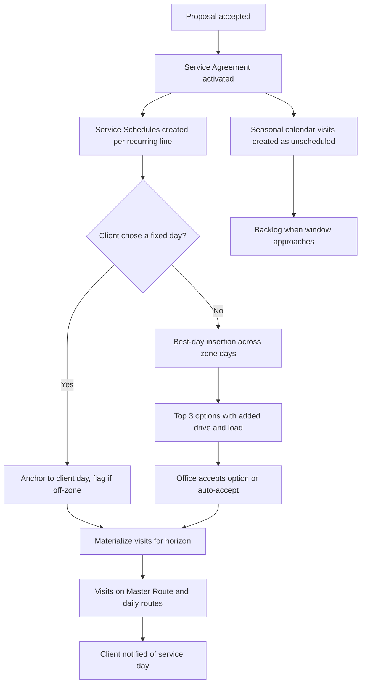

### 5.2 Season planning in February [MVP basic, V1 full]

1. The owner opens the Capacity Planner. The season heatmap shows mowing at 96% in May-June, enhancement at 128% in weeks 16-19 (mulch season), fall cleanups at 117% in weeks 43-46.
2. They run the Territory solver (V1) with 2 mowing crews plus a planned third crew from April 12. The proposal rebalances Tuesday and Thursday, changing the service day for 11% of clients.
3. They open a scenario: "Add Saturday shifts for enhancement crews in weeks 16-19" and "Subcontract 40 fall cleanups". The comparison shows overtime cost vs sub cost.
4. They promote the territory plan effective April 1 (client day-change notices drafted for March 18) and set a hiring target in [15](15-team-hr-payroll.md).
5. The sales team sees "Earliest start: week of May 10" for new enhancement proposals ([03](03-crm-sales-estimating-proposals.md)).

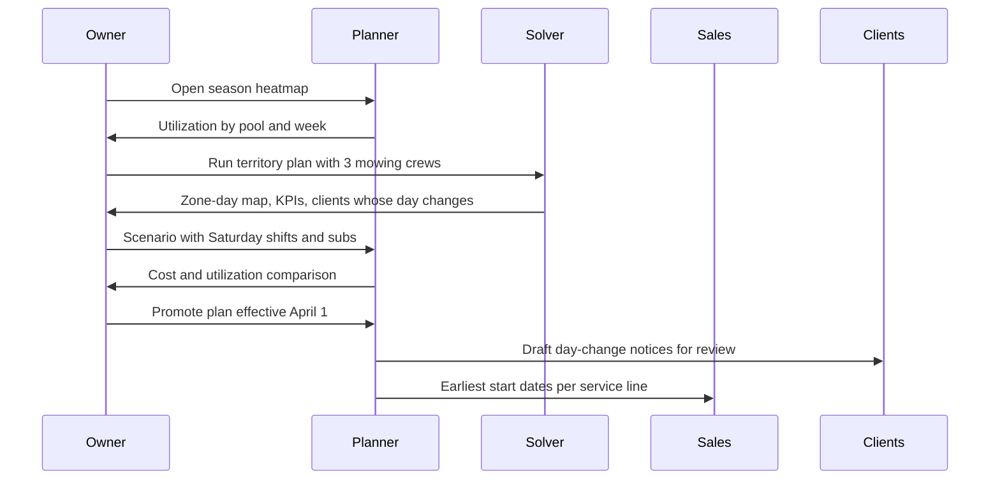

### 5.3 The daily dispatch cycle [MVP]

| Time (tenant-local) | What happens | Owner |
|---|---|---|
| 02:00 | Materialization job extends horizons; Crew Days generated; missed-visit sweep (03:00) | System |
| Every 60 min | Weather refresh for cells with Visits in the next 72 h; risk chips update | Weather Service |
| 05:00 | A7 agent posts any weather or sick-day ScheduleDiff proposals for today and tomorrow ([17](17-ai-copilot-automation.md)); load-out lists lock ([13](13-operations-inventory-equipment.md)) | Agent, system |
| 05:30-07:00 | Dispatcher reviews alerts, applies or edits diffs, handles call-outs; crews clock in and start routes | ops_manager, office_manager |
| 07:00-17:30 | Live map, ETAs, on-my-way texts, late-risk alerts, mid-day recovery | System, dispatcher |
| 12:00-15:00 | Office plans tomorrow: new work from backlog, client requests, optimizer runs | office_manager, ops_manager |
| 15:00 | Tomorrow auto-publishes; day-ahead notices go out for non-recurring Visits; load-out lists generate | System |
| 17:30-21:00 | Late changes (with crew push); route summaries; actuals reconciliation | System |

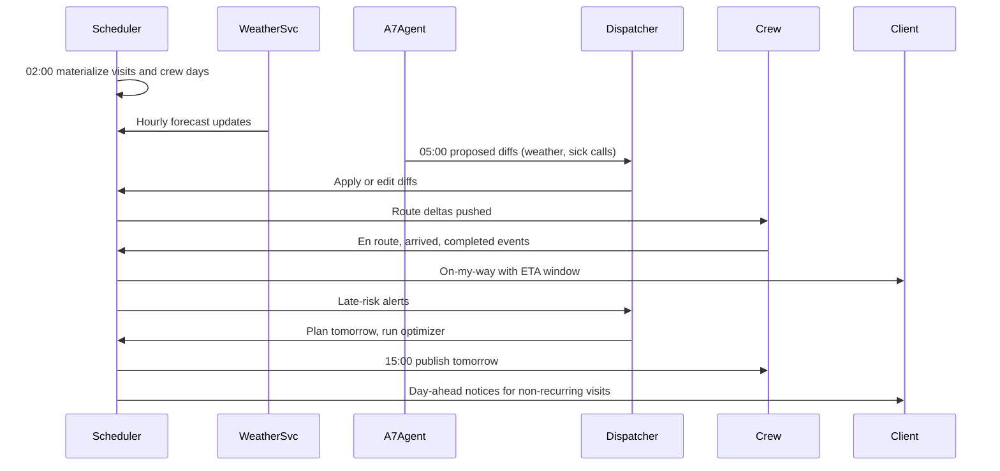

### 5.4 Rain day [MVP manual, V1 playbook]

Scenario: Tuesday Nov 10, 2026, forecast 80% rain after 13:00 with 0.6 in expected. Six crews, 118 Visits on Tuesday.

1. At 05:00 the A7 agent applies the Company's "Fall rain" playbook: `split_day` for cleanups and mowing (stop at 12:30), `push_later_in_week` for the afternoon stops, rounds near window close prioritized, the Oakmont commercial site (`do_not_move`) listed for a decision.
2. The diff: 47 Visits move to Wednesday-Friday, 3 to Saturday (Crew 3, opt-in), Crew 2 +1.5 h overtime Thursday, 44 client notices, 0 compliance violations, stability 86%.
3. The dispatcher keeps Oakmont on Tuesday morning (moves it earlier to 7:00), accepts the rest at 05:40.
4. Clients get one consolidated message each; the portal shows "Weather delay: now Thursday". Crews see their shortened Tuesday and updated Wednesday-Friday routes.
5. At 12:10 radar shows rain arriving early; Crew 4's lead taps "Rain stop". Its remaining 3 Visits become `weather_hold`; the playbook re-runs for them and proposes Thursday.

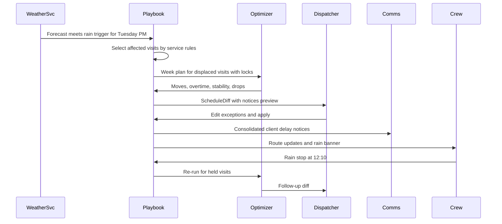

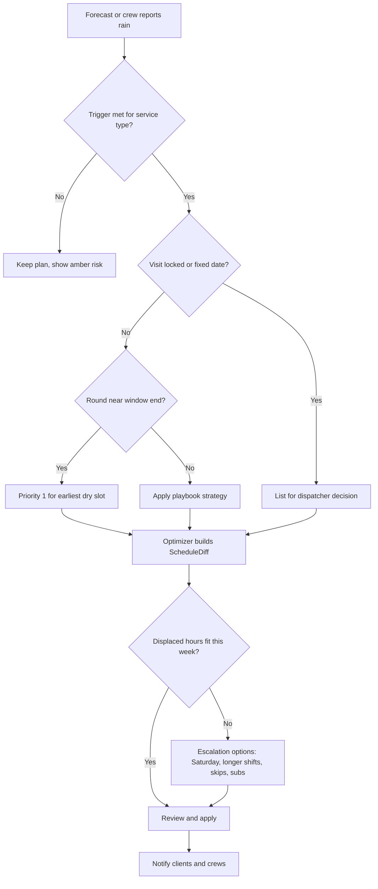

### 5.5 Mid-day breakdown recovery [V1]

1. 10:40: Crew 1's ZTR mower throws a belt. The crew lead taps "Equipment issue" in the app; [13](13-operations-inventory-equipment.md) marks the unit `down`.
2. Crew 1's 9 remaining mowing Visits get `late_risk`. The dispatcher opens Recover.
3. `repair` returns: (a) Crew 1 switches to the 48-inch walk-behind on its trailer and finishes at 18:45 (+75 min OT); (b) Crew 3 (12 minutes away, 1.8 h slack) takes 4 stops; Crew 1 completes 5 with the walk-behind by 17:20; (c) 4 `week_flex` stops move to Wednesday with notices.
4. Dispatcher applies (b). Crew 3 gets 4 new stops pushed; 2 clients with afternoon windows get "running late" updates; the other moved stops stay inside their windows so no notices go out.

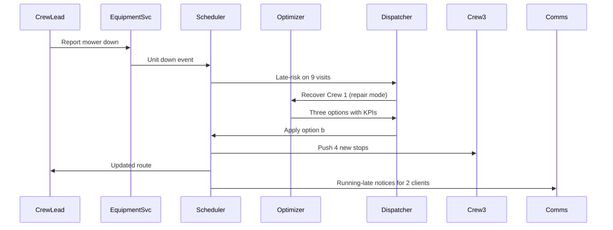

### 5.6 Scheduling a fertilizer round inside its window [MVP]

1. Round 2 (broadleaf + fertilizer) window opens May 1 - June 5 for 1,412 enrolled lawns ([14](14-service-line-modules.md)).
2. The Round Planner groups eligible round instances (28+ days since Round 1, notices sent) by zone and week and requests `week_plan` ([V1]; at MVP the ops manager drops blocks onto zone-days and each route is sequenced) with skill `pesticide_applicator` (state category turf) and sprayer capacity.
3. The optimizer returns routes for 5 licensed applicators over 4 weeks at about 75 lawns per applicator-day (illustrative), with wind/rain flags per day.
4. Two applicators' licenses expire May 31; Visits after that date fail validation and are reassigned before publish, and the owner gets a renewal alert.
5. When a weather playbook moves a round Visit, the window guard prevents moving past June 5 and re-notification fires if the date leaves the notified range.

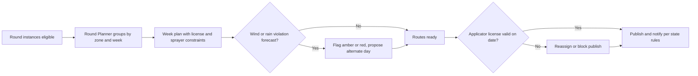

### 5.7 Multi-day patio project with dependencies [V1]

J-1042 Henderson patio and planting: deposit paid April 12, 2027; dig ticket clear April 16; pavers delivered April 23.

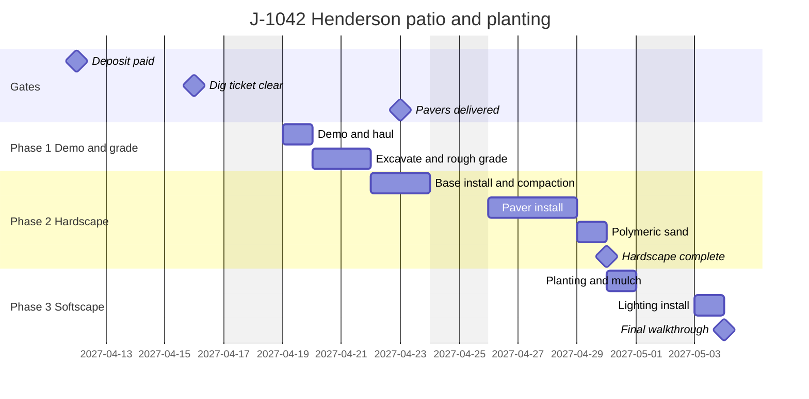

1. The project is created from the sold design's install sequence ([10](10-design-studio.md)).
2. Forward scheduling places Demo on April 19 (after the dig ticket gate). Paver install depends on base completion and the paver delivery milestone.
3. Rain on April 22 is forecast during base install; the playbook shifts the chain by one day and checks the dig ticket's validity window; the client sees "Hardscape: week of April 26".
4. `milestone.reached` for "Hardscape complete" triggers the 50% milestone invoice in [07](07-invoicing-billing-contracts.md).

### 5.8 Client reschedules from the portal [MVP]

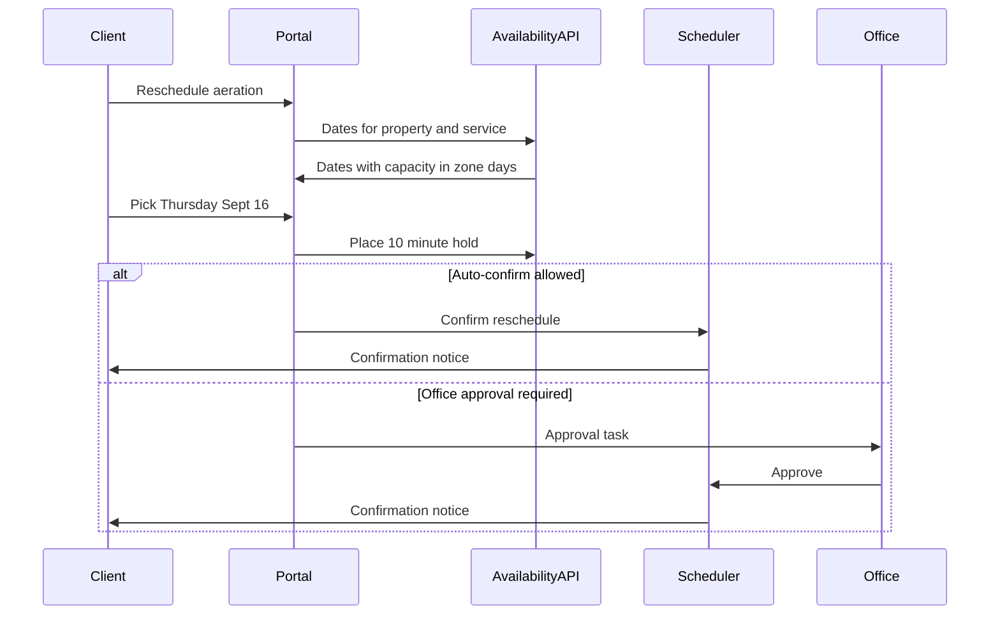

### 5.9 Natural-language reschedule via Copilot [V1]

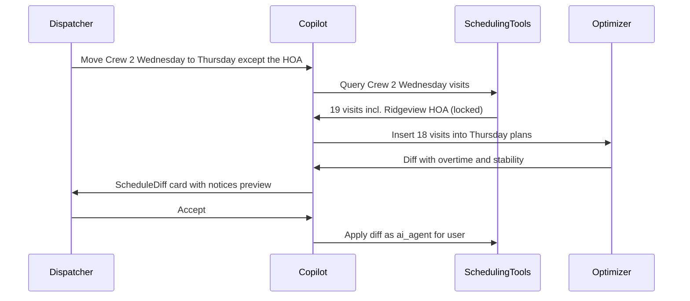

### 5.10 Snow event routing hand-off [V1]

1. The Storm Event Engine ([14](14-service-line-modules.md)) opens an `active` event; 84 sites have crossed their trigger.
2. This module activates event Visits by priority tier, assigns trucks and subs, and solves `storm` mode with open-by deadlines (P1 by 6:00).
3. Every 15 minutes, accumulation updates re-queue sites for re-service; the router re-solves with stability weight 0.
4. Arrival/departure, depth photos and salt logs flow from the crew app to the proof vault ([14](14-service-line-modules.md)); billing follows event close ([07](07-invoicing-billing-contracts.md)).

---

## 6. Screens and wireframes

### 6.1 Screen inventory

| # | Screen | Surface | Primary roles | Priority |
|---|---|---|---|---|
| S1 | Dispatch board: Day (Gantt by crew) | Web | ops_manager, office_manager | [MVP] (wireframe in [21](21-ux-design-system-sitemaps.md) 18.4) |
| S2 | Dispatch board: Week (crew x day) with unassigned tray | Web | ops_manager, office_manager | [MVP] (6.2) |
| S3 | Map view and live map | Web, manager mode on mobile | ops_manager, owner | [MVP] (6.5) |
| S4 | ScheduleDiff review (optimizer, playbook, Copilot, bulk) | Web | ops_manager, office_manager | [MVP] (6.3) |
| S5 | Capacity planner (season heatmap, week detail) | Web | owner, ops_manager | [MVP] basic (6.4) |
| S6 | Backlog | Web | ops_manager, office_manager | [MVP] (6.7) |
| S7 | Scenario compare (what-if) | Web | ops_manager, owner | [V1] (6.6) |
| S8 | Territories and zones editor; Master Route editor | Web | ops_manager, owner | [MVP] zones, [V1] solver |
| S9 | Service Schedule editor (recurrence presets, frequency profiles, growth-adaptive) | Web | office_manager, ops_manager | [MVP] (6.8) |
| S10 | Season calendar settings (per Region and branch) | Web | owner, ops_manager | [MVP] |
| S11 | Holiday and blackout calendars | Web | owner, office_manager | [MVP] |
| S12 | Weather playbooks editor | Web | owner, ops_manager | [V1] |
| S13 | Crews and Crew Day roster editor | Web | ops_manager | [MVP] |
| S14 | Resource reservations view | Web | ops_manager | [V1] |
| S15 | Project Gantt (single and multi-project) | Web | ops_manager, designer, owner | [V1] |
| S16 | Subcontractor offers inbox (sub side) and sub lanes (office side) | Crew app (sub mode), web | subcontractor, ops_manager | [V1] |
| S17 | Crew app: Today route, route changes banner, rain stop, recover requests | Mobile | crew_lead, technician | [MVP] (spec in [05](05-field-crew-mobile-app.md)) |
| S18 | Portal: next visit, ETA, reschedule and skip, booking windows | Portal | client_residential, client_commercial | [MVP] (spec in [06](06-customer-portal.md)) |
| S19 | Route sheet (print/PDF) | Web | office_manager, crew_lead | [MVP] |
| S20 | Optimization run inspector | Web (tenant) and Platform Admin | ops_manager, platform_engineer | [V1] |
| S21 | Scheduling settings | Web | owner | [MVP] |

### 6.2 Dispatch board: Week view with unassigned tray (S2)

```text
+--------------------------------------------------------------------------------------------------------------+
| Schedule / Dispatch   Week of Nov 9, 2026  [< prev] [this week] [next >]  [Day|3-day|Week|Map|Split]          |
| Branch: Columbus North v   Pools: All v   Flags: [ ] late risk [ ] conflicts [ ] unassigned   [Optimize week] |
+---------------------+----------------------------------------------------------------------------------------+
| UNASSIGNED (23)     |              Mon 9          Tue 10         Wed 11         Thu 12         Fri 13    Sat 14|
| Sort: urgency v     | Weather      sun 52F        rain 80% PM   cloudy 48F    sun 50F        sun 54F   cloudy  |
| [Search...........] |              ///////////// RISK: 118 visits Tue PM  [Plan rain day]                    |
|                     |--------------------------------------------------------------------------------------- |
| ! Fall cleanup #2   | Crew 1 (Luis) 18 st 9.6/10h  21 st 10.4/10h! 17 st 9.1/10h  19 st 9.8/10h  16 st 8.5h    -    |
|   Garcia  3.5 ch    |  T-12 TR-04   [===========]  [============]  [==========]   [===========]  [=========]      |
|   due Nov 20 (9d)   | Crew 2 (Ana)  12 st 8.8/9h   14 st 9.0/9h    11 st 8.1/9h   13 st 9.3/9h!  10 st 7.0h    -    |
|   needs dump trlr   |  Commercial   Oakmont(L)...  Ridgeview HOA(L)                                            |
| ! Winterization     | Crew 3 (Tom)  15 st 9.0/10h  15 st 8.7/10h   16 st 9.9/10h  14 st 8.2/10h  15 st 9.0h  opt-in |
|   Patel 0.75 ch     | Irrigation    WINT x9  6.1h  WINT x11 7.4h   WINT x8 5.6h   WINT x10 6.9h  WINT x7     -    |
|   before hard freeze|  (Sam, lic.)  hard freeze Thu night: 46 winterizations not done [Prioritize]           |
|   Thu (3d)          | Install A     J-1042 Henderson patio Phase 2 ============================>  (tentative) |
|   Leaf vac + dump   | Sub: GreenCo  -             WINT x6 (accepted)  -              -             -          |
| ~ Aeration (AER)    | Floaters      Dani (avail)  Jesse (PTO)     -               -              -             |
|   Brown 1.0 ch      |--------------------------------------------------------------------------------------- |
|   window ends Nov 15| Capacity     92%           101%            88%             94%            78%       --    |
| ...                 | Sold hours   212 / 231 h   238 / 236 h     205 / 233 h     220 / 234 h    176 / 226 h        |
| [Auto-slot selected]|--------------------------------------------------------------------------------------- |
| [Waitlist (4)]      | Selected: 3 cards  [Move to...] [Reassign v] [Lock] [Skip...] [Notify clients] [Diff]   |
+---------------------+----------------------------------------------------------------------------------------+
 Legend: st = stops; ch = crew-hours; (L) locked; ! = over capacity or due soon; ~ = window closing; WINT = winterization
```

Behavior notes:
- Each cell expands on click into the Day sequence for that crew-day; double-click opens the Day view.
- Dragging a tray card onto a cell shows a ghost with "+6 min drive, 9.6 -> 10.3 h" before drop.
- The "Plan rain day" call-to-action opens the ScheduleDiff review (6.3) with the playbook pre-run.
- The hard-freeze banner on the irrigation lane links to a pre-filtered backlog and a "Prioritize before freeze" optimizer run.

### 6.3 ScheduleDiff review (S4)

```text
+--------------------------------------------------------------------------------------------------------+
| Review changes: Rain plan for Tue Nov 10 (playbook "Fall rain", proposed by Scheduling Agent 05:00)    |
| Expires 06:15 Nov 10 (decision deadline) if not applied                                  [Edit rules]  |
+--------------------------------------------------------------------------------------------------------+
| SUMMARY                                   | KPIs                    Before      After      Change       |
| 47 visits move  (Wed 18, Thu 21, Fri 5,   | Drive hours (week)      61.4 h      63.0 h     +1.6 h       |
|   Sat 3)                                  | Overtime hours          2.0 h       3.5 h      +1.5 h       |
| 0 visits skipped                          | Late vs client windows  0           1          +1  [view]   |
| 1 needs your decision: Oakmont (locked)   | Route stability         -           86%                     |
| 44 client notices, 6 crew pushes          | Rounds at window risk   0           0                       |
+--------------------------------------------------------------------------------------------------------+
| BY CREW          Tue 10           Wed 11              Thu 12               Fri 13          Sat 14     |
| Crew 1           -9 stops (PM)    +4 (10.3 h)         +5 (10.4 h, OT 0.4)  -               -          |
| Crew 2           -6 stops (PM)    +2                  +4 (OT 1.5 h) !      -               -          |
| Crew 3           -8 stops (PM)    +5                  +3                   +2              +3 (opt-in)|
| ...                                                                                                    |
+--------------------------------------------------------------------------------------------------------+
| NEEDS DECISION                                                                                         |
|  Oakmont Office Park (do_not_move, contract SLA Tue)  ( ) Keep Tue, move to 07:00   ( ) Move to Wed   |
+--------------------------------------------------------------------------------------------------------+
| VISITS (47)  [filter: crew v] [only with notices]                                                      |
|  [x] Ortiz      Weekly mow   Tue 14:10 Crew 1 -> Thu 09:40 Crew 1   notice: SMS (EN)    [edit]         |
|  [x] Patel      Fall cleanup Tue 13:00 Crew 3 -> Wed 08:00 Crew 3   notice: email       [edit]         |
|  [ ] Kim        Weekly mow   Tue 15:20 Crew 1 -> Fri 08:30 Crew 3   crew change!        [edit]         |
|  ...                                                                                                   |
+--------------------------------------------------------------------------------------------------------+
| Notice preview (EN): "Rain is expected Tuesday afternoon. Your service moves to Thursday, Nov 12.      |
|  Reply here with questions. - Green Valley Landscapes"            [ES preview] [Edit template]         |
+--------------------------------------------------------------------------------------------------------+
| [Open in board]  [Apply selected (46)]  [Apply all]  [Discard]                                         |
+--------------------------------------------------------------------------------------------------------+
```

### 6.4 Capacity planner: season heatmap (S5)

```text
+------------------------------------------------------------------------------------------------------+
| Capacity planner  2027 season  Branch: All v  Units: [crew-hours] [% utilization]  [Scenario: Live v] |
+------------------------------------------------------------------------------------------------------+
| Pool / week      W10  W12  W14  W16  W18  W20  W22  W24 ... W36  W38  W40  W42  W44  W46  W48       |
| Mowing (3 crews)  -    -   71%  88%  96%  97%  95%  91% ...  84%  86%  80%  74%  52%   -    -        |
| Enhancement      40%  78%  104% 128% 122% 96%  70%  55% ...  60%  72%  88%  110% 117% 98%  41%       |
| Lawn applications -   64%  92%  85%  90%  88%  79%  75% ...  82%  91%  66%  58%   -    -    -        |
| Irrigation       12%  20%  95%  99%  61%  40%  38%  35% ...  33%  52%  89%  97%  64%   -    -        |
| Install          35%  58%  83%  97%  101% 99%  94%  90% ...  86%  80%  72%  55%  40%  20%   -        |
| Snow (events)     -    -    -    -    -    -    -    -  ...   -    -    -    -   on   on   on        |
+------------------------------------------------------------------------------------------------------+
| Cell W16 Enhancement: 128%  = recurring 0 h + seasonal (mulch, cleanups) 402 h + backlog 61 h          |
|                              + projects 0 h + pipeline (weighted) 38 h   vs available 391 h             |
| Overtime projection: 4 people x 9.5 h/wk          Suggested levers:                                     |
|  [Add Saturday shift W15-W19: -18 pts, $6,840]  [Sub 30 mulch jobs: -12 pts, $9,900]                   |
|  [Hire 2 seasonals from Apr 5: -25 pts, $11,200]  [Push 20 mulch jobs to W20-W21: -9 pts, $0]         |
+------------------------------------------------------------------------------------------------------+
| Legend: < 75% blue  75-90% green  90-100% amber  100-110% orange  > 110% red                           |
+------------------------------------------------------------------------------------------------------+
```

### 6.5 Live map with ETAs and late-risk alerts (S3)

```text
+--------------------------------------------------------------------------------------------------------+
| Live  Tue Nov 10, 10:52   Crews: 6 active  [x] Planned routes [x] Actual trails [ ] Radar [x] Zones     |
+-----------------------------------------------------------------+--------------------------------------+
|                                                                 | ALERTS (3)                           |
|      (1)--(2)--(3)--[C1 >]..(5)..(6)       zone T-North         | ! Crew 1 mower down 10:40            |
|                            \                                    |   9 visits at risk   [Recover]       |
|       YARD [Y]              (7)..(8)                            | ~ Crew 2 +22 min vs plan             |
|          \                                                      |   Ridgeview window 11:00-12:00 OK    |
|           [C3 o] on site: Smith (6/15)                          | ~ Crew 4 not syncing since 09:58     |
|                                                                 |   (last seen Hilltop Rd, low signal) |
|   [C2 >] -> Ridgeview HOA ETA 11:25 (+/-15)                     |--------------------------------------|
|                                                                 | CREW 1  Luis + 2   T-12 / TR-04      |
|            DUMP [D]          SUPPLY [S]                         | Status: on site, Ortiz (7/18)        |
|                                                                 | Hours: 3.6 used / 9.6 budget         |
|  o on site   > driving   = break (no location)   x offline      | Projected end: 18:45 (shift 17:30) ! |
|  ring: green on time, amber 1-15 late, red > 15 late            | Next: Kim  ETA 11:40 (+/-15)         |
|                                                                 | [Message crew] [Reorder] [Recover]   |
+-----------------------------------------------------------------+--------------------------------------+
```

### 6.6 Scenario compare (S7)

```text
+--------------------------------------------------------------------------------------------------------+
| Scenarios for week of Apr 12, 2027                                    [New scenario] [Promote...]      |
+--------------------------------------------------------------------------------------------------------+
| Metric                         Live plan        A: Crew 4 out all week     B: Crew 4 out + Saturday     |
|--------------------------------------------------------------------------------------------------------|
| Visits scheduled               412              396 (-16 to backlog)       412                          |
| Drive hours                    58.2             55.9                       60.4                         |
| Overtime hours                 4.0              21.5                       6.0                          |
| Late vs windows                0                7                          1                            |
| Route stability                -                71%                        78%                          |
| Revenue per drive hour         $214            $205                       $206                         |
| Labor cost delta               -                +$1,410                    +$1,880 (Sat premium)        |
| Client notices needed          0                61                         48                           |
|--------------------------------------------------------------------------------------------------------|
| Levers  A: remove Crew 4 (Apr 12-16)    B: remove Crew 4; add Sat shift Crews 1-3; allow 10.5 h days   |
| [View A on board]  [View B on board]  [Promote B to diff]                                              |
+--------------------------------------------------------------------------------------------------------+
```

### 6.7 Backlog (S6)

```text
+------------------------------------------------------------------------------------------------------------+
| Backlog  Branch: Columbus North v   Pool: All v   Source: All v   Gates: [x] ready [ ] blocked             |
| 61 items  |  412.5 crew-hours  |  backlog weeks: enhancement 1.8, irrigation 0.6, install 3.4 (!)          |
+------------------------------------------------------------------------------------------------------------+
| Urg | Item                      | Due window         | Value   | C-h  | Needs           | Gates | Zone/day |
|-----+---------------------------+--------------------+---------+------+-----------------+-------+----------|
| 96  | WINT Patel, 44 Birch Ln   | before hard freeze | $85     | 0.75 | irrigation tech | ok    | N / Thu  |
|     |  source: rain_displaced (Tue); freeze forecast Thu night, 2 days left                                |
| 91  | FC #2 Garcia, 12 Elm      | Nov 6-20 (9d)      | $410    | 3.5  | dump trailer    | ok    | N / Tue  |
| 88  | RND6 Kim, 9 Ash Ct        | Oct 20-Nov 13 (3d) | $72     | 0.4  | applicator MN   | ok    | E / Wed  |
|     |  window closes in 3 working days; priority 1 in rain playbooks                          [why 88]     |
| 74  | AER+OS Brown, 3 Oak       | Aug 25-Nov 15      | $260    | 1.0  | aerator         | ok    | S / Mon  |
| 52  | J-1077 Lee retaining wall | start by Apr 15    | $18,900 | 64.0 | skid steer,     | $ dep | -        |
|     | source: proposal, 23 d    |                    |         |      | wall_build L2   | 811 o |          |
| 40  | Bed edging (upsell)       | by Nov 30          | $180    | 1.5  | -               | ok    | N / Tue  |
+------------------------------------------------------------------------------------------------------------+
| Selected 3 (5.65 crew-h)   [Auto-slot] -> best insertion   [Offer to sub...]   [Waitlist]   [Export]       |
| Fits today: 2 items fit in gaps on Crew 1 and Crew 3 within 10 min of their routes   [Show on map]         |
+------------------------------------------------------------------------------------------------------------+
 Legend: Urg = urgency score (0-100, explainable); C-h = crew-hours; $ dep = deposit outstanding;
         811 o = dig ticket open
```

Behavior notes:
- Clicking "why 88" opens the score breakdown: window pressure 0.83 (3 of 18 working days left) x weight 50, priority 2 x weight 20, value per crew-hour $180 x weight 15, age 9 days x weight 15 (weights are the Company's; the numbers here are illustrative).
- Blocked items (gates not met) sort below ready items unless "Show blocked inline" is on; they can still be tentatively placed (4.1.2).
- "Fits today" runs `insertion` against live routes every 5 minutes while the screen is open and only lists items whose marginal drive is under the Company's density threshold (default 12 minutes).

### 6.8 Service Schedule editor (S9)

```text
+--------------------------------------------------------------------------------------------------------+
| Service Schedule: Weekly mowing - Ortiz, 418 Willow Ln        Agreement SA-2027-0142 (active)          |
+--------------------------------------------------------------------------------------------------------+
| Pattern   (o) Weekly on route day  ( ) Bi-weekly A/B  ( ) Twice a month  ( ) Every N days              |
|           ( ) Monthly  ( ) Count-limited  ( ) Seasonal segments (frequency profile)                    |
| Season    Apr 1, 2027 -> Nov 15, 2027     [Use Region default: zone 6a Midwest]                        |
| Day       Zone day: Tuesday (T-North)  [ ] Client insists on a specific day (off-zone, +7 min drive)   |
| Segments  Apr 1-Jun 30 weekly | Jul 1-Aug 31 bi-weekly (B) | Sep 1-Oct 31 weekly | Nov 1-15 bi-weekly  |
| Duration  0.75 crew-h budget   (learned trend 0.92 crew-h after 6 visits)  [Use learned for routing]   |
| Window    (o) Anytime  ( ) Between __:__ and __:__  ( ) Fixed time    Access: gate staffed 8:00-16:00  |
| Needs     Skills: -   Equipment: mower deck <= 52 in (side gate 54 in)   Crew size: 1-3                |
| Growth    Growth-adaptive: ( ) Off  (o) Suggest  ( ) Auto     Max growth skips per season: 4           |
| Holidays  Follows Company policy (Memorial Day: slide week; Labor Day: slide week)  [Override...]      |
+--------------------------------------------------------------------------------------------------------+
| PREVIEW  2027 season: 26 planned visits (weekly 13 + bi-weekly 4 + weekly 8 + bi-weekly 1), 0 conflicts|
|  Apr  6 13 20 27 | May  4 11 18 25 | Jun  1* 8 15 22 29 | Jul 13 27 | Aug 10 24 | Sep  8* 14 21 28 ... |
|  * Jun 1 is Tue but becomes Wed Jun 2 (Memorial Day slide); Sep 8 is Wed (Labor Day slide); Nov 2 last |
|  Billing impact: per-visit at $48 = $1,248 season estimate (07 recalculates installments on save)      |
+--------------------------------------------------------------------------------------------------------+
| Edit scope: (o) This and following from [Jul 1]  ( ) Entire season  ( ) This visit only                |
| 3 detached visits keep their custom settings [Review]            [Cancel]  [Save and regenerate]       |
+--------------------------------------------------------------------------------------------------------+
```

Behavior notes:
- RRULE text is never shown; an "Advanced" disclosure shows it read-only for support.
- The preview is produced by the same generator code path as materialization (4.2.4), so the 26 dates shown are exactly what will be created; Saving with a frequency change on a `fixed_season` line warns that [07](07-invoicing-billing-contracts.md) treats it as a price change requiring an amendment.
- Choosing "Client insists on a specific day" shows the off-zone drive cost and requires `schedule.off_zone`.

---

## 7. Data model

Conventions follow [20](20-architecture-security.md) section 7.1: every table carries `tenant_id` with Postgres row-level security, `branch_id` where relevant, `created_at`, `created_by`, `updated_at`, `version` for optimistic concurrency, soft-delete `archived_at`. Times are `timestamptz` in UTC; business dates (`service_date`) are property-local `date` values using the Property's IANA time zone. Recurrences are RFC 5545 RRULE strings plus extension columns. Tables live in the `ops` schema (scheduling) unless noted; GPS telemetry lives in the separate telemetry cluster.

### 7.1 Work, recurrence and visits

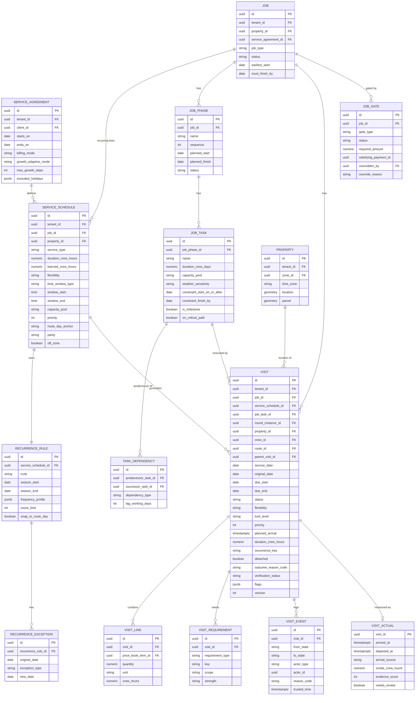

### 7.2 Crews, resources, routes and territories

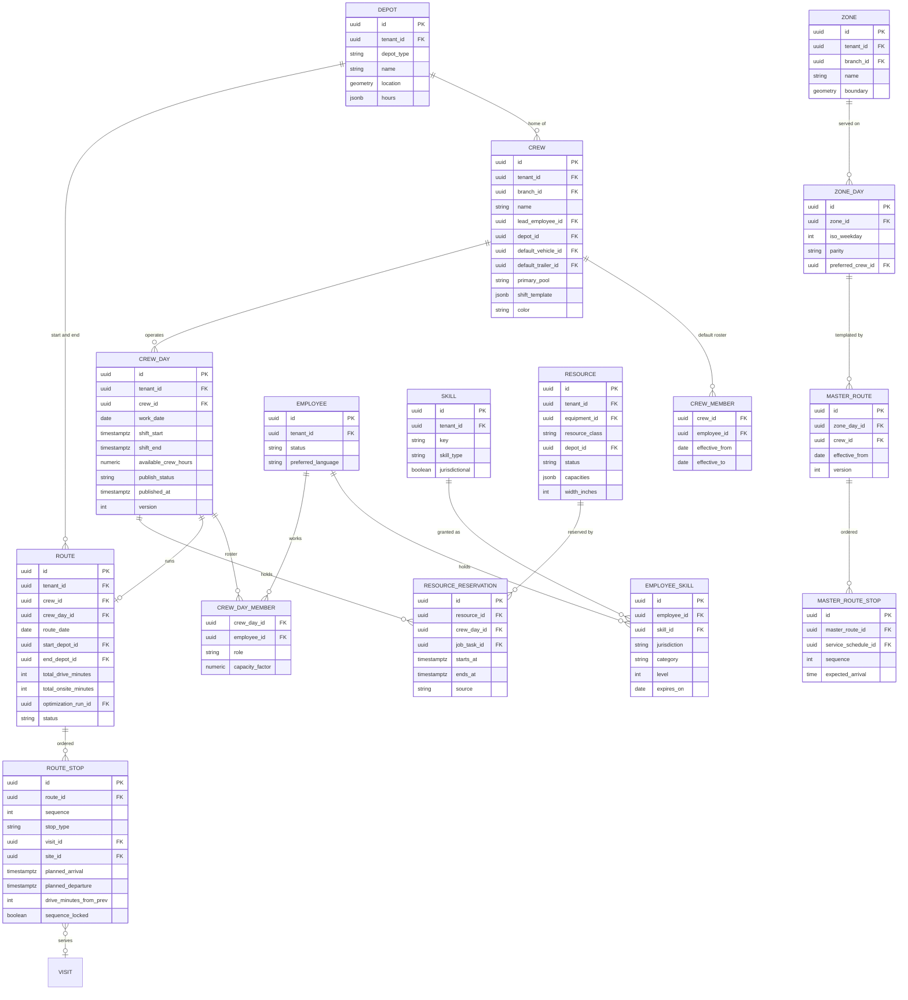

`DEPOT` covers yards, dump sites, supply houses, salt depots and water sources (`depot_type`). `ROUTE_STOP.stop_type` is one of `visit`, `break`, `dump`, `supply`, `reload`, `depot_start`, `depot_end`.

### 7.3 Planning, weather, tracking and booking

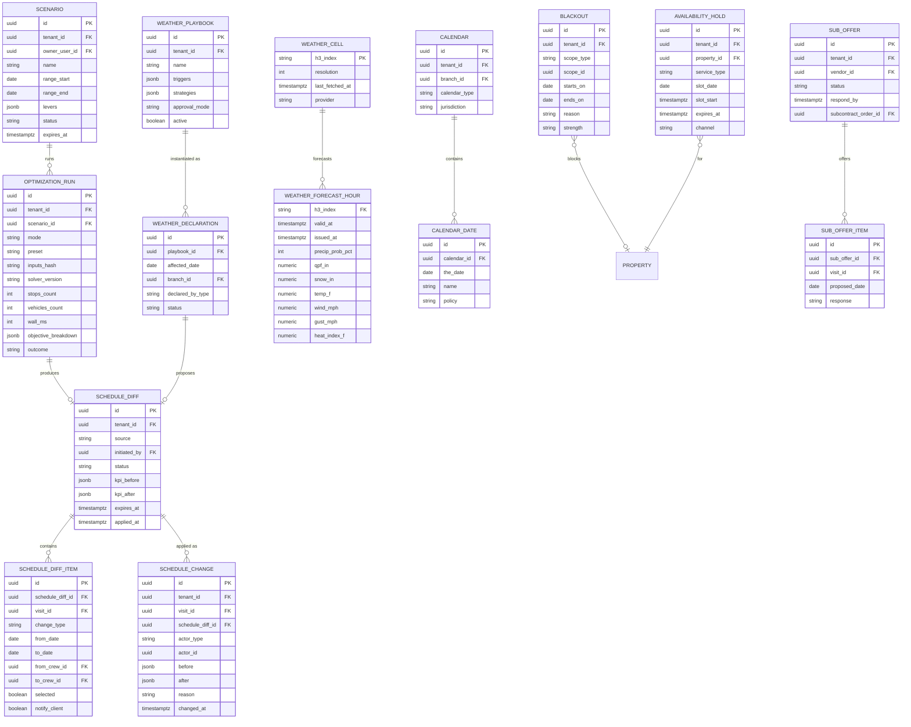

Telemetry tables (separate cluster, partitioned daily, BRIN on time; [20](20-architecture-security.md) section 4.17): `gps_ping (tenant_id, employee_id, device_id, vehicle_id, recorded_at, lat, lng, accuracy_m, speed_mps, heading, source)`, `geofence_event (tenant_id, visit_id, device_id, event_type, occurred_at, dwell_s, path)`, `telematics_event (tenant_id, vehicle_id, event_type, occurred_at, lat, lng, engine_hours)`. Live positions and ETAs are kept in Redis (`live:crew:{crew_day_id}`, `eta:visit:{visit_id}`) with 24-hour TTL and written back to `visit.planned_arrival` history only on material change (> 10 min).

### 7.4 Entity notes and invariants

| Entity | Rules |
|---|---|
| `visit` | `occurrence_key = service_schedule_id + ':' + original_date` is unique per tenant for recurring visits (idempotent materialization). `service_date` must lie within `due_start..due_end` unless an override is recorded in `schedule_change`. `crew_id` and `route_id` are both null or both set once dispatched. Index `(tenant_id, service_date, crew_id)` ([20](20-architecture-security.md)); partial index on `status in ('unscheduled','missed')` for the backlog. Partitioned by `service_date` year for tenants above 1M visits. |
| `job_gate` | `status` in `open, pending_clearing, satisfied, reopened, overridden` (4.1.2). `satisfying_payment_id` is the [08](08-payments-stripe.md) payment id; the gate transition is keyed on it for idempotency. Dig-ticket gates can never reach `overridden` (check constraint). |
| `visit.outcome_reason_code` | Required for `skipped` and `canceled`; values from the closed list in 4.1.3 "Outcome mapping to agreements"; `verification_status` mirrors [05](05-field-crew-mobile-app.md) 4.4.5a (`verified`, `unverified`) and is null until completion. `flags` holds the orthogonal flags of 4.1.3 as a string array with a GIN index for board filters. |
| `visit.detached` | Set true when a user edits date, crew, lock, duration or adds field data to a materialized recurring visit. Regeneration never overwrites detached visits. |
| `crew_day` | Unique `(crew_id, work_date)`. `available_crew_hours` is recomputed when roster, shift or time off changes (from [15](15-team-hr-payroll.md)). `publish_status` in `draft, published, started, completed`. |
| `route_stop` | Contiguous `sequence` starting at 0 per route. Non-visit stops (`break`, `dump`, `supply`, `reload`) reference `site_id` (a depot) or nothing (break). |
| `resource_reservation` | Exclusion constraint: no overlapping `[starts_at, ends_at)` for the same `resource_id` (Postgres `EXCLUDE USING gist`), except reservations with `source = scenario` which live in scenario copies. |
| `schedule_diff` | Status `proposed, partially_applied, applied, discarded, expired`. Applying is a single transaction per diff (or per crew-day batch for diffs over 500 items) with all `visit.rescheduled` events written to the outbox in the same transaction. |
| `schedule_change` | Append-only; partitioned monthly; feeds undo and audit ([20](20-architecture-security.md) audit stream). |
| `employee_skill` | Validity evaluated on the service date. Jurisdiction uses ISO 3166-2 codes (e.g., `US-MN`, `CA-ON`). |
| `blackout` | `scope_type` in `property, crew, resource, branch, company`; `strength` in `hard, soft`. |
| `availability_hold` | Expires after 10 minutes; a sweeper deletes expired rows every minute; holds count against capacity while active. |
| `weather_forecast_hour` | Retained 30 days for forecasts; observation snapshots per visit retained with the visit. |
| Scenario copies | Stored as JSONB snapshots plus `scenario_id`-scoped working rows in a separate schema (`ops_scenario`) so live RLS queries never see them. |

### 7.5 Season calendars, capacity pools, waitlist and weather snapshots

The objects behind 4.2.3 (Season Calendar), 4.3 (capacity pools and weekly capacity), 4.13 (waitlist) and 4.9.1 (per-Visit weather snapshots).

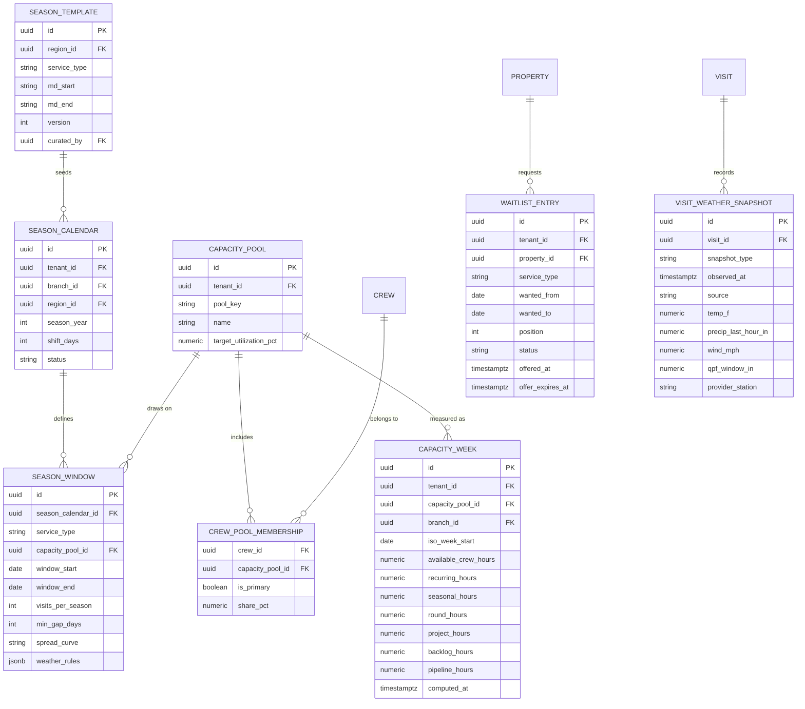

| Entity | Rules |
|---|---|
| `season_template` | Platform-owned, curated by `platform_curator` per Region; month-day strings (`md_start = "03-20"`) so a template is year-independent. Tenants never edit templates; they copy them into a `season_calendar`. |
| `season_calendar` | Unique `(tenant_id, branch_id, season_year)`. `shift_days` stores a whole-calendar shift ("late spring: +10 days"); applying it regenerates only untouched, non-detached seasonal Visits and shows a preview first (4.2.3). |
| `season_window` | `window_end >= window_start`; `min_gap_days` enforced between multiple occurrences of the same service on one Property (fall cleanup x2, 14 days apart). `spread_curve` in `flat, front_loaded, back_loaded` drives demand spreading in 4.3.1. |
| `crew_pool_membership` | Exactly one `is_primary = true` per crew; `share_pct` across a crew's pools sums to 100 and splits that crew's available hours for capacity math. |
| `capacity_week` | A materialized cache, rebuilt incrementally on `visit.*`, `crew_day` and roster events and fully nightly at 02:30; the capacity API reads it (5-minute staleness budget, 8.2). Never the source of truth for any decision that blocks a drop: the validator always reads Crew Days directly. |
| `waitlist_entry` | Ordered by `position` within `(tenant_id, service_type, zone)`; an offer holds capacity like an `availability_hold` (4.13) until `offer_expires_at` (default 2 hours, then the next entry is offered). |
| `visit_weather_snapshot` | `snapshot_type` in `start, completion, skip_evidence, delay_evidence`; written once, never updated; retained with the Visit for dispute and snow billing evidence (4.9.5). |

---

## 8. Integrations, APIs and events

### 8.1 External services

| Service | Purpose | Notes | Priority |
|---|---|---|---|
| Google Routes API or Mapbox Matrix/Directions | Travel-time matrices, live-traffic next-leg ETAs | Provider per region/cost; matrix element limits and traffic-aware limits differ by provider and change (verify); caching and pruning in 4.8.3 | [MVP] |
| Google OR-Tools (in-house service) | Vehicle routing solver | Apache 2.0 open source; runs in the Python routing service ([OR-Tools routing](https://developers.google.com/optimization/routing)) | [MVP] |
| Managed route-optimization APIs (e.g., Google Route Optimization API, Mapbox Optimization) | Benchmark and possible burst fallback | Evaluated, not primary: per-request pricing and limited control over stability penalties and landscape-specific constraints (verify current capabilities and pricing) | [V2] evaluation |
| Geocoding (Google or Mapbox) and parcels (Regrid) | Rooftop geocodes, parcel polygons for geofences and access points | Pin-correction tool; parcel polygons improve arrival detection ([20](20-architecture-security.md)) | [MVP] |
| USGS 3DEP elevation | Slope hints for equipment class constraints (no ZTR above slope threshold) | Cached per Property ([20](20-architecture-security.md)) | [V1] |
| US National Weather Service API | Hourly gridpoint forecasts and alerts (US) | Free; requires an identifying User-Agent; rate limits apply ([NWS API](https://www.weather.gov/documentation/services-web-api)) | [MVP] |
| Environment and Climate Change Canada (MSC open data) | Canadian forecasts and alerts | Verify endpoints, licensing and attribution | [MVP] for Canadian tenants |
| Commercial weather provider | Nowcasts, soil temperature, consistent cross-border data, certified historical reports for disputes | Vendor selection is open question 13 (Tomorrow.io, DTN and The Weather Company class candidates; verify terms) | [V1] |
| Telematics: Samsara, Motive, Geotab, Verizon Connect (candidates) | Vehicle positions, ignition, engine hours | OAuth or API-key connectors via the integration framework ([20](20-architecture-security.md) section 4.8); Aspire lists Motive in its marketplace ([Motive marketplace](https://marketplace.gomotive.com/app/aspire)) | [V1] |
| Google Calendar, Microsoft 365 (Graph) | Busy/free sync for office roles (estimators, designers) | Two-way for Rootline-created events; read busy/free otherwise | [V1] |
| Twilio, email, push | Client and crew notifications | Via the notifications service and [16](16-marketing-growth-communications.md) templates; 10DLC registration per Company ([Twilio A2P 10DLC](https://www.twilio.com/docs/messaging/compliance/a2p-10dlc)) | [MVP] |
| Holiday data | US federal, Canadian federal/provincial holidays | Platform-curated table, reviewed annually by `platform_engineer` ([19](19-platform-admin-portal.md)) | [MVP] |
| Stripe (indirect) | Deposit and booking-hold outcomes | Scheduling never calls Stripe and never sees card data. Each Company's own connected Stripe account is integrated once, by [08](08-payments-stripe.md); this module consumes `payments.*` domain events only (4.1.2, 4.13) | [MVP] |
| Smart irrigation controllers (indirect, Hunter Hydrawise, Rachio) | Mow-day watering suspend and water-in requests (section 13, idea 17) | Through the controller integration and consent model owned by [14](14-service-line-modules.md) | [V2] |

### 8.2 APIs (internal and public)

All endpoints are tenant-scoped, permission-checked ([20](20-architecture-security.md) section 4.6) and available to the web app, the Copilot tool layer and, from [V1], the public API with OAuth scopes `schedule:read` and `schedule:write`.

| Endpoint | Purpose | Sync/async | Priority |
|---|---|---|---|
| `GET /scheduling/board?branch_id&from&to&cursor` | Delta feed of Visits, Crew Days, Routes for the board | Sync, cursor-based | [MVP] |
| `POST /visits/{id}/move` | Move a Visit: `service_date`, `crew_id`, `position`, `lock`, `reason`, `notify_client` | Sync; returns validation tier and new version | [MVP] |
| `POST /scheduling/diffs` | Build a ScheduleDiff from a list of operations (bulk, Copilot) | Sync up to 500 items, else async | [MVP] |
| `POST /scheduling/diffs/{id}/apply` | Apply all or selected items | Sync; idempotent with `Idempotency-Key` | [MVP] |
| `POST /scheduling/optimize` | Run an optimizer mode over a scope with a preset and overrides | `sequence`/`insertion` sync; others async with run id | [MVP] / [V1] |
| `GET /scheduling/runs/{id}` | Run status, objective breakdown, resulting diff | Sync | [MVP] |
| `POST /scheduling/best-day` | Ranked service-day options for a new recurring Service Schedule | Sync, < 1.5 s p95 | [MVP] |
| `GET /scheduling/availability` | Slot supply for portal, booking and receptionist | Sync, < 800 ms p95 | [MVP] |
| `POST /scheduling/holds`, `DELETE /scheduling/holds/{id}` | 10-minute slot holds | Sync | [MVP] |
| `GET /capacity?pool&from&to&granularity` | Supply, demand and utilization | Sync (cached 5 min) | [MVP] |
| `POST /weather/declarations` | Declare a rain day with a playbook; returns a diff | Async | [MVP] manual / [V1] |
| `GET /routes/{id}/eta` | Current ETAs for remaining stops | Sync, served from cache | [MVP] |
| `POST /scenarios`, `POST /scenarios/{id}/promote` | What-if scenarios | Async | [V1] |
| `POST /projects/{id}/schedule` | Forward-schedule a project; returns critical path and diff | Async | [V1] |
| `POST /sub-offers`, `POST /sub-offers/{id}/respond` | Subcontractor offers | Sync | [V1] |

### 8.3 Domain events emitted

Events are published through the transactional outbox to the event bus as CloudEvents ([20](20-architecture-security.md) section 4.9). Names follow the `visit.*` convention used in [20](20-architecture-security.md); [13](13-operations-inventory-equipment.md) subscribes to them under the `schedule` topic.

| Event | Key payload | Main consumers |
|---|---|---|
| `visit.scheduled` | visit_id, job_id, property_id, service_date, crew_id, window, source | Notifications [16](16-marketing-growth-communications.md), portal [06](06-customer-portal.md), inventory reservations [13](13-operations-inventory-equipment.md), round instances [14](14-service-line-modules.md) |
| `visit.rescheduled` | visit_id, old_date, new_date, old_crew, new_crew, reason, diff_id, actor_type | Notifications (dedupe), portal, [13](13-operations-inventory-equipment.md) need-by dates and load-outs, [14](14-service-line-modules.md) re-notification |
| `visit.assigned` / `visit.unassigned` | visit_id, crew_id | Crew app sync, payroll allocation forecast |
| `visit.dispatched` | visit_id, route_id, crew_day_id | Crew app |
| `visit.en_route`, `visit.arrived`, `visit.started`, `visit.paused`, `visit.departed` | visit_id, timestamps, source signals | ETA, notifications (on-my-way), portal live status, analytics |
| `visit.completed`, `visit.partially_completed`, `visit.skipped`, `visit.canceled`, `visit.missed` | visit_id, outcome, reason_code, actuals | Billing [07](07-invoicing-billing-contracts.md), job cost [09](09-accounting-ledger-integrations.md), portal timeline, analytics [18](18-reporting-analytics.md), agreement counters |
| `visit.verified` | visit_id, verification_status, failing_checks (empty when verified), evidence_score | Per-visit invoicing [07](07-invoicing-billing-contracts.md) (status computed per [05](05-field-crew-mobile-app.md) 4.4.5a) |
| `visit.late_risk` | visit_id, projected_arrival, window_end, minutes_late | Dispatcher alerts, optional client "running late" |
| `route.published` / `route.changed_after_publish` | route_id, crew_day_id, change summary | Crew app push, load-out regeneration [13](13-operations-inventory-equipment.md) |
| `route.optimized` | run_id, mode, KPIs | Analytics, run inspector |
| `schedule.diff_proposed` / `schedule.diff_applied` | diff_id, source, counts, KPIs | Copilot inbox [17](17-ai-copilot-automation.md), audit |
| `weather.alert_raised` | cell, condition, affected visits | Dispatcher, crew app banners [05](05-field-crew-mobile-app.md), [13](13-operations-inventory-equipment.md) holding-yard care |
| `weather.delay_declared` | declaration_id, date, branch, visit count | Notifications [16](16-marketing-growth-communications.md), portal banner, analytics weather flags [18](18-reporting-analytics.md), [13](13-operations-inventory-equipment.md) rain-day PM planning |
| `capacity.threshold_crossed` | pool, week, utilization, cause | Owner alerts, sales throttle [03](03-crm-sales-estimating-proposals.md) |
| `job.phase_changed`, `phase.completed`, `milestone.reached`, `project.completed` | job_id, phase/milestone ids | Portal project tracker [06](06-customer-portal.md), milestone billing [07](07-invoicing-billing-contracts.md), warranties [14](14-service-line-modules.md) |
| `eta.updated` | visit_id, eta_window | Portal, live-tracking link (internal; not a public webhook by default) |

### 8.4 Events consumed

| Event | Producer | Effect here |
|---|---|---|
| `proposal.accepted` | [03](03-crm-sales-estimating-proposals.md) | Create Jobs, gates, tentative placements |
| `service_agreement.activated` / `.suspended` / `.reactivated` / `.canceled` (registered in [07](07-invoicing-billing-contracts.md) as `agreement.activated` / `.suspended` / `.resumed` / `.cancelled`; one name per event in the schema registry of [20](20-architecture-security.md)) | [07](07-invoicing-billing-contracts.md) | Create Service Schedules; pause/resume materialization and apply hold rules (4.2.4); cancel future Visits |
| `agreement.amended` | [07](07-invoicing-billing-contracts.md) | Split or edit Service Schedules from the effective date ("This and following" scope, 4.2.4) |
| `payments.deposit.received` | [08](08-payments-stripe.md) | Satisfy deposit gate (4.1.2 deposit rules) |
| `payments.payment.pending` / `payments.payment.returned` / `payments.refund.completed` (when the payment is a deposit) | [08](08-payments-stripe.md) | Deposit gate `pending_clearing` / `reopened` (4.1.2) |
| `payments.client.payment_hold` / `.payment_hold_released` | [08](08-payments-stripe.md), reconciled by [07](07-invoicing-billing-contracts.md) | `payment_warning` flag on the client's Visits (4.2.4); never skips work by itself |
| `round_instance.ready` | [14](14-service-line-modules.md) | Eligible for Round Planner scheduling |
| `storm_event.state_changed` | [14](14-service-line-modules.md) | Activate/deactivate storm routing |
| `dig_ticket.status_changed`, `permit.status_changed` | [14](14-service-line-modules.md) | Gate updates; validity-window checks |
| `delivery.status_changed`, `equipment.status_changed` | [13](13-operations-inventory-equipment.md) | Dependency warnings; reservation conflicts; breakdown flow |
| `employee.absence_reported`, `certification.expiring`, `certification.expired`, `employee.terminated` | [15](15-team-hr-payroll.md) | Crew Day capacity; skill validation; roster cleanup |
| `growth.booking_requested` | [16](16-marketing-growth-communications.md) | Create Visits from online bookings, best-day for recurring |
| `portal.reschedule_requested`, `portal.skip_requested`, `portal.pause_requested` | [06](06-customer-portal.md) | Client-driven changes (4.2.8) |
| `change_order.approved` | [03](03-crm-sales-estimating-proposals.md) | Project replan |
| `sync.conflict_detected` | Sync engine ([20](20-architecture-security.md)) | Needs-attention queue (e.g., completed after cancel) |

### 8.5 Tenant webhooks [V1]

Companies can subscribe to `visit.scheduled`, `visit.rescheduled`, `visit.completed`, `visit.skipped`, `route.published` and `weather.delay_declared` (signed, retried with exponential backoff per [20](20-architecture-security.md) section 4.7). Typical uses: a commercial client's facilities system, a Company's own data warehouse, Zapier-style automations.

---

## 9. Permissions

Notation follows [02](02-personas-roles-permissions.md): R read, W write, D delete, X execute; scope `/a` all, `/b` branch, `/c` own crew, `/o` own records; `-` none. Client columns refer to the client's own Properties. Custom roles compose these capabilities.

| Capability | owner | office_manager | estimator | designer | ops_manager | crew_lead | technician | bookkeeper | subcontractor | client_residential | client_commercial |
|---|---|---|---|---|---|---|---|---|---|---|---|
| `schedule.view` (board, calendar) | R/a | R/a | R/b | R/b | R/b | R/c | R/c | R/a | R/o assigned | R/o next visits | R/o all properties |
| `visit` create/edit | RWD/a | RWD/a | W/o own site visits | W/o design meetings | RWD/b | W/c notes, partial returns | - | - | - | - | - |
| `visit.dispatch` (assign, move date/crew) | X/a | X/a | - | - | X/b | X/c reorder same day only | - | - | - | - | - |
| `visit.skip` | X/a | X/a | - | - | X/b | X/c on site with reason | X/c on site with reason | - | X/o on site with reason | Request | Request (approver) |
| `visit.cancel` | X/a | X/a | - | - | X/b | - | - | - | - | Request within cutoff | Request (approver) |
| `visit.lock` / unlock | X/a | X/a | - | - | X/b | - | - | - | - | - | - |
| `schedule.override` (orange-tier validations) | X/a | X/a | - | - | X/b | - | - | - | - | - | - |
| `job.gate_override` (never dig tickets) | X/a | X/a <= limit | - | - | X/b | - | - | - | - | - | - |
| `route.optimize` | X/a | X/a | - | - | X/b | X/c today's sequence | - | - | - | - | - |
| `route.publish` / unpublish | X/a | X/a | - | - | X/b | - | - | - | - | - | - |
| `schedule_diff.apply` (optimizer, Copilot, playbooks) | X/a | X/a | - | - | X/b | - | - | - | - | - | - |
| `scenario` | RWX/a | RWX/a | R/o shared | - | RWX/b | - | - | - | - | - | - |
| `service_schedule` (recurrence) | RWD/a | RWD/a | W/o draft from proposal | - | RWD/b | - | - | R/a | - | - | - |
| `capacity.view` | R/a | R/a | R/a summary | R/a summary | R/b | - | - | R/a | - | - | - |
| `territory` (zones, master routes, territory solver) | RWX/a | RW/a | R/a | - | RWX/b | - | - | - | - | - | - |
| `calendar` (holidays, blackouts) | RWD/a | RWD/a | - | - | RW/b | - | - | R/a | - | W/o vacation holds | W/o site blackouts |
| `weather_playbook` configure | RWD/a | R/a | - | - | RW/b | - | - | - | - | - | - |
| `weather.declare_rain_day` | X/a | X/a | - | - | X/b | X/c rain stop | - | - | - | - | - |
| `live_map.view` | R/a | R/a | R/b positions only | - | R/b | R/c | - | - | - | ETA link only | ETA link only |
| `gps_history.view` (playback, breadcrumbs) | R/a | R/a with reason | - | - | R/b with reason | - | R/o own data | - | - | - | - |
| `crew_day.roster` | RW/a | RW/a | - | - | RW/b | R/c, W/c report absence | R/c | - | - | - | - |
| `resource_reservation` | RWD/a | RW/a | R/b | - | RWD/b | R/c | - | - | - | - | - |
| `project_schedule` | RWD/a | RW/a | R/o | RW/o design sequence | RWD/b | R/c | R/c | R/a | R/o assigned tasks | R/o phases (client view) | R/o phases (client view) |
| `sub_offer` | RWX/a | RWX/a | - | - | RWX/b | - | - | R/a | RX/o accept, decline | - | - |
| `availability.book` | X/a | X/a | X/a | X/o consults | X/b | - | - | - | - | X/o | X/o (approver rules) |
| `copilot.schedule_actions` | X/a | X/a | X/o own events | X/o | X/b | X/c voice: late, reorder, skip | - | - | - | - | - |
| `scheduling.settings` | RW/a | R/a | - | - | RW/b branch overrides | - | - | - | - | - | - |

Rules:
- `gps_history.view` "with reason" requires a reason string per access (logged); employees always see their own location data ([05](05-field-crew-mobile-app.md) section 4.23).
- `crew_lead` "reorder same day only" cannot move Visits to other days or crews, cannot touch locked sequences, and the change applies immediately to the crew's route with a notice to the dispatcher.
- Clients' requests become office tasks or auto-confirm according to 4.2.8 and 4.13; `client_commercial` approver contacts must approve changes on their sites when the Company enables approval workflows ([06](06-customer-portal.md)).
- Platform roles: `platform_support` and `platform_engineer` see schedules and optimization runs only inside a consented support session; write access requires the per-ticket "act as user (read-write)" grant defined in [02](02-personas-roles-permissions.md). `platform_owner` manages holiday data, weather providers and solver versions globally from [19](19-platform-admin-portal.md) but has no default access to tenant schedules. `platform_curator` edits Region season templates, growth-potential coefficients and default playbook thresholds (platform-level data only; tenants receive them as versioned defaults they can override). `platform_finance` sees per-tenant aggregates of matrix-API calls, weather cells and solver minutes for cost and quota management, never Visit-level or client data.

---

## 10. AI opportunities in this module

The rule throughout: **deterministic engines decide feasibility and cost; AI predicts inputs, proposes changes and explains them.** The LLM never computes a route; it calls the optimizer. Platform-wide AI strategy, guardrails and credit metering are in [17](17-ai-copilot-automation.md).

| # | Opportunity | How it works | Value | Priority |
|---|---|---|---|---|
| AI-1 | **Learned visit durations** | EWMA per Service Schedule (4.1.4), then a gradient-boosted model using property features (turf area, beds, slope), crew, season, weather and visit history | Tighter routes, fewer overruns, re-price candidates | [V1] |
| AI-2 | **Natural-language rescheduling** | Copilot tool calls produce ScheduleDiffs (4.14.1) | Minutes instead of 20 drags | [V1] |
| AI-3 | **Scheduling Agent (A7)** | Weather replans, sick-day rebalancing, gap fill, capacity proposals ([17](17-ai-copilot-automation.md)) | The 5 a.m. scramble disappears | [V1] |
| AI-4 | **Growth-adaptive mowing model** | Predicts next-week growth class per Property from weather, turf type, irrigation and crew clipping tags (4.2.6) | Fewer wasted mows in droughts, extra billable mows in flushes | [V2] |
| AI-5 | **ETA accuracy model** | Residual model by stop position, time of day, crew and service; calibrates client windows (4.10.4) | Hit the 80% within-window target | [V1] |
| AI-6 | **No-access prediction** | Predicts the chance a Visit fails for locked gates, dogs or vehicles in the driveway from history and client signals; triggers a day-before "please unlock the side gate" message | Fewer wasted trips | [V2] |
| AI-7 | **Territory advisor** | Explains density problems in plain language ("Fridays drive 31% more because 14 clients are east of the river") and proposes zone changes or re-pricing | Owner understands, not just accepts | [V1] |
| AI-8 | **Dispatcher morning brief** | 05:00 summary: weather risk, call-outs, equipment down, late-risk routes, backlog items about to expire, proposed diffs | One screen to start the day | [V1] |
| AI-9 | **Demand and capacity forecast** | Combines pipeline, renewals, seasonality and weather into weekly demand by pool, shared with [18](18-reporting-analytics.md) | Hiring and sales throttle decisions | [V1] |
| AI-10 | **Anomaly detection** | Unusual on-site durations, repeated idle periods, route deviations, visits completed far from the property | Quality control and fraud signals (handled carefully, see 11.2) | [V1] |
| AI-11 | **Voice dispatch for crew leads** | "Running 40 minutes behind" -> late flow; Spanish and English ([05](05-field-crew-mobile-app.md)) | Hands-free updates from the truck | [V1] |
| AI-12 | **Photo-based growth tags** | Vision model classifies clipping volume and turf height from routine after-photos to feed AI-4 | Labels without extra taps | [V2] |
| AI-13 | **Learned travel times** | Corrects provider drive times per crew, truck-trailer combo and neighborhood from breadcrumbs | Better plans in tight subdivisions and cul-de-sacs | [V2] |
| AI-14 | **Policy learning for dispatch** | Learns which diffs a dispatcher accepts or edits and adjusts weights and playbook suggestions per Company | Fewer edits over time | [V3] |

**Guardrails (summary):** locks, fixed dates, compliance windows and license checks are hard constraints for any AI-originated change; AI never changes a recurring client's service day or sends a client notice without human approval unless the Company opted into an auto-apply rule for that action type; every AI-applied change is attributed (`actor_type = ai_agent`) with the initiating user or automation; explanations come from the solver's objective breakdown, not invented text.

---

## 11. Edge cases, compliance and risks

### 11.1 Edge cases

| Case | Expected behavior |
|---|---|
| **DST transitions** (US and most of Canada: Nov 1, 2026 and Mar 14, 2027) | `service_date` is a local date, so recurring Visits do not shift. Shift templates are local wall-clock times. Night storm routes crossing 2:00 a.m. use UTC internally; the board shows a "DST" marker; drive-time buckets use local time |
| Branch serving two time zones | Each Property's time zone governs its windows; Crew Days use the depot's time zone; the board shows a time-zone badge on cross-zone stops |
| Client notified for Tuesday, moved to Wednesday, moved back within 60 minutes | No notice sent (dedupe keeps final state equal to notified state) |
| Office cancels while crew completes offline | Visit ends `completed` with conflict flag; billing review task ([20](20-architecture-security.md)) |
| Crew lead reorders stops offline while office re-optimizes the same route | Once a route has started, the crew's same-day sequence wins for remaining stops; office changes arrive as a "Proposed route change" the crew lead accepts or declines in the app; stop additions/removals from the office always apply |
| Two dispatchers move the same Visit | Optimistic concurrency; second save gets a merge prompt (4.6.8) |
| Holiday on a route day, Saturday disabled, week already at 100% | `slide_week` overflows to backlog with a warning; the diff offers `compress` with overtime or Saturday enablement for that week only |
| `BYMONTHDAY=31` (or 29/30) in short months | Rootline offers "last day of month" semantics (`BYMONTHDAY=-1`) in the editor; raw RFC behavior (skipping the month) is never the default |
| Bi-weekly parity across seasons | Parity is anchored to the Company's season week 1 each year by default; "continue parity from last season" is an option for year-round services |
| Agreement canceled mid-week | Future Visits after the effective date are canceled ([07](07-invoicing-billing-contracts.md)); today's dispatched Visit stays unless the office removes it |
| Property re-geocoded to a different zone | Future zone-anchored Visits move to the new zone's day only after the office confirms (client notice drafted); detached Visits stay |
| Wrong geocode (new subdivision, rural route) | Pin-correction tool on the Property; crews can submit "correct pin here" from the app; confidence score shown; optimizer uses the corrected point |
| Multi-crew Visit (a 40-acre office park needing 2 crews for a full day) | Visit with `crew_size_min = 6` can be split into linked sub-visits across 2 crews with a synchronization constraint (same day, overlapping times) [V1] |
| Presence-required Visit, client no-show | Crew marks "Client not present" (skip reason); auto-message offers rebooking slots; Company setting for trip charge (billing in [07](07-invoicing-billing-contracts.md)) |
| Project delayed past equipment reservation | Reservations move with the task chain; conflicts surfaced on the resource view; the dispatcher chooses another unit or rental |
| License expires mid-week | Visits after expiry fail validation at publish; alert 30 days ahead; reassignment proposals |
| Subcontractor declines 2 hours before start | Offer escalates to the next sub; if none, Visits return to the backlog with `late_risk` and the dispatcher is alerted |
| Matrix provider outage or quota exhausted | Haversine-with-detour fallback, labeled "approximate drive times"; no blocking |
| Weather provider outage | Last good forecast used up to 6 hours old with a stale badge; then playbooks pause automatic triggers and require manual declaration |
| Rainy week cascade (3+ days) | Escalation options (4.9.3); backlog burn-down chart until caught up |
| Overnight snow plus 7:00 fall cleanup for the same people | Rest rule (Company minimum rest between shifts, default 8 h) flags conflicts on Crew Days and proposes swaps |
| Short November daylight | Optional shift end at civil dusk minus 15 minutes per depot (computed daily) [V1]; the optimizer treats it as the shift end |
| Gated community with staffed gate hours | Access window as hard constraint; out-of-window placement blocked |
| Very large tenant (40 crews, 6,000 visits a week) | Board loads one branch at a time by default; optimizer decomposes by depot; materialization horizon defaults to 6 weeks |
| ACH deposit returns (R01) 2 days before a patio starts | Gate reopens (4.1.2); the Job moves to `on_hold`; Visits keep their dates but cannot dispatch; owner decision task: "Collect another payment, start anyway (override with reason) or release the crew-days". Released crew-days return to the backlog's "Fits today" suggestions |
| Deposit refunded after the project's first phase completed | Gate reopens but in-progress work is never pulled; remaining phases go to `on_hold` pending the owner's decision |
| Count-limited agreement hits 26 mows in mid-October | Remaining materialized Visits cancel with `count_reached`; client notice offers extra mows; capacity view shows freed hours (4.2.1) |
| Rain declared at 07:20 after crews clocked in at 07:00 | Diff shows the show-up cost and ranks shop-work and split-day strategies first (4.9.3 decision deadline) |
| Commercial approver does not respond to a rain-move request before the playbook's decision deadline | Approval request expires; the Visit stays on its original date with `weather_hold` and the dispatcher decides; the portal records "No response from approver by 06:15" for the audit trail ([06](06-customer-portal.md)) |
| 17-year-old seasonal assigned to a tree crew whose route includes a chipper task | Validator blocks only the chipper task assignment for that person (`age_18_plus`, 4.4.1); the Crew Day still publishes if another qualified member takes the task |
| Client in hold-warning stage asks the crew about the bill | Crew card shows "payment issue: refer to office"; the crew app never shows balances ([05](05-field-crew-mobile-app.md)) |
| Fertilizer round pushed by rain into a county blackout starting June 1 | Blocked; the playbook offers earlier dry days inside the window or a granular non-nitrogen substitute only if the rule pack and the program in [14](14-service-line-modules.md) allow it; otherwise the round instance is flagged "window lost" for [14](14-service-line-modules.md) to credit or reschedule after the blackout |

### 11.2 Compliance

| Area | Obligation (summary; verify per jurisdiction) | How this module complies |
|---|---|---|
| Employee location tracking | Notice and/or consent rules for electronic monitoring vary: e.g., New York's electronic-monitoring notice law ([NY Civil Rights Law 52-C](https://www.nysenate.gov/legislation/laws/CVR/52-C)), Ontario's written electronic-monitoring policy requirement for employers with 25 or more employees ([Ontario ESA guide](https://www.ontario.ca/document/your-guide-employment-standards-act-0/written-policy-electronic-monitoring)), Connecticut and Delaware notice statutes, Quebec privacy law and California employee privacy rights under CCPA/CPRA (the last four are background knowledge; verify current text; the notice templates themselves are owned by [15](15-team-hr-payroll.md)) | Tracking only while clocked in and never during unpaid meals ([05](05-field-crew-mobile-app.md) 4.23); notice acceptance at first clock-in, per-jurisdiction notice templates; 90-day raw retention; reasoned access logging for playback; employees see their own data |
| Wage and hour | Drive time between job sites is generally compensable work time under the FLSA [B, verify]; state meal/rest rules (e.g., California meal period before the end of the 5th hour of work, per the sources in [05](05-field-crew-mobile-app.md) and [15](15-team-hr-payroll.md)); reporting-time or call-in pay when crews report and are sent home (e.g., California wage orders; verify per state) | Routes include drive time in hours projections; breaks are placed as route constraints per [15](15-team-hr-payroll.md) jurisdiction rules; overtime projections on the capacity view; rain-day decision deadline and show-up cost line (4.9.3) |
| Youth employment | Under-18 workers may not operate chain saws, wood chippers or abrasive cutting discs (Hazardous Occupations Order 14), with broader limits for 14-15-year-olds ([29 CFR 570.65](https://www.ecfr.gov/current/title-29/subtitle-B/chapter-V/subchapter-A/part-570/subpart-E/section-570.65)) | `age_18_plus` task-role requirement (4.4.1); validator blocks the task assignment, not the whole Crew Day |
| Outdoor heat | Cal/OSHA 8 CCR 3395 shade at 80 F and high-heat procedures at 95 F with landscaping listed as a high-heat industry; Washington and Oregon rules; federal OSHA rule in rulemaking ([Ogletree](https://ogletree.com/insights/the-heat-is-on-in-california-cal-oshas-heat-illness-prevention-requirements-for-outdoor-work-sites/), [OSHA heat rulemaking](https://www.osha.gov/heat-exposure/rulemaking); verify) | Thresholds read from [15](15-team-hr-payroll.md) rule packs; heat schedules and break intervals in routes (4.9.4) |
| Commercial vehicle hours of service | FMCSA hours-of-service and short-haul exceptions may apply to CMV drivers (verify) | Company-configured shift and driving limits enforced as hard constraints for flagged drivers; snow fatigue rules |
| SMS and voice notices | TCPA and A2P 10DLC; quiet hours | Owned by [16](16-marketing-growth-communications.md): transactional window 7:00-21:00 local, consent per contact and purpose; this module only triggers |
| Pesticide applications | Label limits, state licensing, pre-notification lead times, recordkeeping | Hard license validation; window guards; re-notification on reschedule ([14](14-service-line-modules.md)) |
| Dig safety | Call-before-you-dig (811 in the US, provincial one-call centers in Canada); ticket validity windows | Non-overridable gate; validity checks on weather delays |
| Noise and equipment ordinances | Municipal hours for power equipment; some jurisdictions restrict gas-powered leaf blowers or new small off-road engines (e.g., California rules for new small off-road engines; verify specific local ordinances) | Municipal access windows and equipment-class constraints ("electric blower only") [V1] |
| Client location privacy | Live tracking links must not reveal other clients | Tracking link shows only the crew's approach to this Property, expires at arrival + 30 min ([16](16-marketing-growth-communications.md)) |
| Accessibility | WCAG 2.2 AA for office and portal surfaces | Drag alternatives, list equivalents for maps and Gantt ([21](21-ux-design-system-sitemaps.md)) |
| Data residency | Canadian tenant data in Canadian region where required | Optimizer and weather caches run in the tenant's region cell ([20](20-architecture-security.md)) |

**Anomaly detection and employee surveillance.** AI-10 signals (idle time, deviations) are shown to managers only as operational prompts, never as automated discipline; Companies in jurisdictions with monitoring-policy requirements must have a published policy before anomaly alerts turn on (setup wizard check).

### 11.3 Risks and mitigations

| Risk | Likelihood | Impact | Mitigation |
|---|---|---|---|
| Dispatchers distrust the optimizer ("it scrambled my routes") | High early | Low adoption of the core differentiator | Stability-first default preset, warm starts, diffs with explanations, locks, undo; measure acceptance rate |
| Route churn annoys clients | Medium | Churn | Route-day changes only via explicit week/territory modes with notices; stability KPI on every diff |
| Matrix API costs scale with tenants | Medium | Gross margin | Geohash caching, k-nearest pruning, bucketed matrices, provider negotiation; per-tenant cost monitoring in [19](19-platform-admin-portal.md) |
| Bad geocodes and parcel data | High in rural and new-build areas | Wrong ETAs, missed arrivals | Pin correction, crew feedback, parcel polygons, confidence scores |
| Weather false positives move work unnecessarily | Medium | Lost production days | Confidence-aware triggers, `hold_for_decision` near threshold, post-event review of "moved but stayed dry" days to tune thresholds |
| Alert fatigue | Medium | Ignored real problems | Grouping, rate limits, severity tiers, morning brief |
| Data import from competitors' schedules is messy | High | Bad first impression | Importers for Jobber, Service Autopilot, LMN, SingleOps exports ([R2](research/R2-landscape-specific-platforms.md) recommends both LMN and SingleOps by [V1]); Copilot-assisted cleanup of recurrence patterns |
| Optimizer performance on very large tenants | Low-medium | Timeouts | Decomposition, async modes, greedy fallback, benchmark suite gates in CI |
| Liability for ETAs and weather decisions | Low | Disputes | ETAs shown as windows, not promises; weather evidence stored; final decisions logged as human-approved |
| Scope creep into a full ERP/CPM scheduler | Medium | Delivery delay | Non-goals (1.2); resource leveling deferred to [V2] |

---

## 12. Metrics and KPIs

Definitions are shared with [18](18-reporting-analytics.md). Targets are Rootline product targets (estimates) unless noted as Company-set.

| Metric | Definition | Target / use |
|---|---|---|
| Visit completion as scheduled | Completed Visits on their originally published date / published Visits | >= 92% in non-rain weeks (Company KPI) |
| Reschedule rate | Visits with >= 1 `visit.rescheduled` after client notice / Visits | Track; spikes flag planning or weather problems |
| Missed visits | `visit.missed` / scheduled Visits | < 0.5% |
| On-time arrival | Arrivals within the communicated ETA window / arrivals with a window | >= 80% (G5) |
| ETA mean absolute error | Mean of abs(actual arrival - last ETA sent) | < 12 minutes for next-stop ETAs |
| Drive time share | `drive_time_pct` (4.8.9) | < 20% for mowing routes (Company target) |
| Route density | `route_density_onsite_ratio`, `revenue_per_drive_hour` | Trend up month over month in the first season |
| Optimizer savings | Drive minutes saved by applied optimizer diffs vs the pre-diff plan | Reported per week; 10-20% on first optimization (estimate, G3) |
| Optimizer acceptance | Applied diffs (fully or partially) / proposed diffs | >= 70% by month 3 (G9) |
| Route stability | `route_stability_pct` | >= 90% week over week for recurring stops (G7) |
| Capacity utilization | Scheduled crew-hours / available productive crew-hours, by pool and week | 85-95% in season |
| Forecast accuracy | Absolute % error of forecast weekly sold hours vs actual hours worked | <= 10% by week 6 (G2) |
| Backlog weeks | Backlog crew-hours / weekly available crew-hours by pool | Company-set; alert above 3 weeks for enhancements |
| Rain-day recovery time | Hours from rain declaration to all displaced Visits rescheduled and notified | < 15 minutes of dispatcher time; displaced work completed within 5 working days |
| Dispatcher time per day | Active minutes on board and scenario screens per dispatcher per day (product telemetry) | Down 30% vs month 1 by month 3 (target) |
| Clicks to schedule | Median interactions to place a Visit from backlog | <= 3 ([21](21-ux-design-system-sitemaps.md)) |
| Self-scheduling share | Client-initiated bookings and reschedules via portal / all bookings and reschedules | Track; growth indicates portal value |
| Overtime hours | Actual OT hours vs projected | Projection error < 15% |
| Evidence score | Mean evidence score of completed Visits | >= 85 |
| Board performance | p95 drag-to-confirm latency; week view render time | < 300 ms server confirm; < 1.5 s render |
| Optimizer SLOs | p95 wall time per mode vs 4.8.10 targets; % runs hitting fallback | < 2% fallback |
| Rain decisions before deadline | Rain declarations applied before the playbook's `decision_deadline` / all rain declarations | >= 85% (each late call carries show-up cost, 4.9.3) |
| Unverified visit share | Completed Visits not `verified` at end of day / completed Visits (shared with [05](05-field-crew-mobile-app.md)) | <= 5% |
| Deposit-gate latency | Median minutes from `payments.deposit.received` to the first phase confirmed on the board | < 60 minutes during business hours |
| Solver cost per active crew | Matrix-API, weather-cell and solver compute cost per active crew per month (platform metric for `platform_finance`) | Tracked against the gross-margin model in [22](22-business-model-pricing-gtm.md); alert at 2x the tier median |

---

## 13. Beyond the brief: extra ideas

1. **Trash-day awareness [V1].** Municipal trash and recycling pickup days per street (from municipal open data where available, crowd-sourced by crews elsewhere). The optimizer avoids string-trimming along curbs lined with bins and, in fall, schedules leaf cleanups the day before municipal yard-waste collection so bagged leaves go straight to the curb pickup instead of the Company's dump fees.
2. **Plant-aware scheduling windows [V1].** The Plant Knowledge Base ([12](12-plant-knowledge-base.md)) knows bloom times by Region. Pruning Visits get windows that respect horticulture: spring-flowering shrubs pruned after bloom; oaks not pruned during the high-risk oak wilt season in affected states (commonly spring to mid-summer; verify per state extension guidance); bird nesting-season cautions for hedge and tree work. The scheduler warns, "Lilac pruning on May 2 removes this year's flowers."
3. **Noise-ordinance engine [V1].** A curated table of municipal quiet hours and equipment rules turns into access windows and equipment-class constraints automatically ("No gas blowers in this city: assign the battery kit").
4. **Daylight-aware shifts [V1].** Shift ends computed from civil dusk per depot so November routes do not end in the dark; DST transition reminders to switch shift templates.
5. **"Ghost route" canvassing for sales [V1].** Show estimators and marketing where crews will be next week so door hangers and neighbor offers land on streets the crew already serves, using the neighborhood marketing tools in [16](16-marketing-growth-communications.md). Density compounds.
6. **Route-density pricing advisor [V1].** Every quote for a new recurring client shows its marginal drive cost on the best day; [03](03-crm-sales-estimating-proposals.md) can auto-apply a density discount or a remote-location surcharge.
7. **Dump-site and supply-house optimizer [V1].** Choose the dump site by fee per ton or yard, hours and typical queue; time supply-house pickups to vendor "order ready" notifications from [13](13-operations-inventory-equipment.md).
8. **Crew fairness objective [V1].** Balance hard sites (steep slopes, long hand-trim properties) and early-finish Fridays across crews; show crews their own fairness stats. Retention is a scheduling problem.
9. **Season replay simulator [V1].** Replay last season's weather and actuals against this season's sold work to see which weeks will hurt before the season starts.
10. **Fuel and carbon dashboard [V1], battery fleet planning [V2].** Estimate fuel and CO2e per route from miles and equipment hours; model battery equipment as an energy constraint with charging stops and trailer solar, so Companies can plan an electric transition crew by crew.
11. **Commercial schedule assurance reports [V1].** Monthly reports for property managers: scheduled vs performed, on-time rate, weather delays with evidence, and the next 30 days' calendar, delivered through the portal ([06](06-customer-portal.md)).
12. **Watering-restriction-aware planting [V2].** Municipal watering days and drought stages feed planting and irrigation-check scheduling so new plantings land where the client can legally water them.
13. **Smart access integrations [V3].** Opt-in integrations with smart locks, gate controllers or garage systems (vendor APIs vary; verify availability) to grant a time-boxed access code valid only during the crew's ETA window.
14. **Route swap marketplace between Rootline Companies [V3].** With client consent, Companies trade outlying recurring clients to a Company with density in that area for a referral fee. The platform knows where density is; nobody else can broker this.
15. **Autonomous mower and robot fleet scheduling [V3].** Treat robotic mowers deployed at commercial sites as resources with charging and supervision constraints, scheduled alongside human crews (see [23](23-innovation-moonshots.md)).
16. **"Next best action" for idle minutes [V2].** When a crew finishes early near a client with an approved but unscheduled enhancement, the app suggests it ("Bed edging at 14 Elm is approved, 25 minutes, 4 minutes away").
17. **Mow-day irrigation handshake [V2].** When a client's smart controller is connected through the Hydrawise or Rachio integration in [14](14-service-line-modules.md) (both expose OAuth APIs with zone control or rain delays: [Hunter Hydrawise API](https://www.hunterirrigation.com/support/hydrawise-api-information), [rachiopy](https://rachiopy.readthedocs.io/en/latest/zone.html)), publishing tomorrow's route sends a watering suspend for the turf zones from 20:00 the night before until the Visit completes, so the crew mows dry grass (cleaner cut, fewer ruts and clumps, fewer "you left clippings everywhere" calls). After a granular application that the label says must be watered in, the scheduler requests a zone run after the crew departs. Every command is logged on the Visit, honors the client's consent scope and is skipped when local watering restrictions forbid a run. Rate limits from the vendors (for example Hydrawise's per-user zone-command limits) are respected by batching per controller.
18. **Service delivery bank [V1].** Each agreement line keeps a running balance: contracted occurrences, delivered, credited and owed make-ups (weather skips the agreement promises to make up, count shortfalls, `missed_company` visits). The scheduler fills owed make-ups automatically into low-utilization slots near the Property's route day, typically late October when mowing load drops, and offers them to the client in the portal first. [07](07-invoicing-billing-contracts.md)'s client-behind position exposure (`agreement.position_exposure_exceeded`) becomes something operations can actually work down instead of a number on a report.
19. **Storm pre-staging optimizer [V2].** Twelve hours before a forecast event crosses contract triggers, solve a small facility-location problem: which loaders, skid steers with pusher boxes and salt loads to pre-position at which satellite lots so that every priority-1 site's first push starts within its open-by deadline. Output is a staging plan with drive-time savings at trigger time ("Stage L-2 at the Oakmont lot: P1 sites reached 38 minutes sooner"), handed to the Storm Event Engine in [14](14-service-line-modules.md).
20. **School-zone and trailer-unfriendly arc avoidance [V2].** Add time-dependent penalties to arcs that pass school frontages during arrival and dismissal on school days (school locations and calendars from public datasets where available; verify per region), and learn trailer-hostile stops from crew feedback: no turnaround in the cul-de-sac, no legal trailer parking, unprotected left turns across arterials. A 16 ft trailer that avoids one school drop-off line a morning saves minutes and neighbor complaints; the solver already supports time-bucketed arc costs (4.8.3), so this is data, not new math.
21. **Condition-adjusted durations [V1].** Production slows on hot afternoons, on wet turf the morning after rain and in peak-leaf weeks. Learned multipliers per service type (starting defaults, all estimates to be tuned from actuals: +10% at a heat band of 95 F or more, +15% for mowing within 18 hours of more than 0.5 in of rain, leaf-volume factor for cleanups from the leaf-drop stage of the season calendar) scale `duration_budget` for routing only, never the client's price. Routes stop overrunning on exactly the days crews are most tired.

---

## 14. Open questions

1. **Matrix provider economics.** Google Routes vs Mapbox per region, and at what tenant size managed route-optimization APIs become cheaper than our own solver plus matrices. Needs a cost model with real 2027 pricing (verify).
2. **Default for client time windows.** Should `between` windows be hard or soft by default? Soft gives better routes; hard gives better client promises. Proposal: soft for residential, hard for commercial.
3. **Auto-apply for weather playbooks.** Is `auto` mode for residential mowing safe enough to offer in [V2], and what notice language protects Companies?
4. **Growth-adaptive and fixed-price contracts.** Should `max_growth_skips` default to 0 for level-pay agreements to avoid under-delivery perceptions?
5. **First telematics partner.** Samsara, Motive, Geotab or Verizon Connect first, based on landscape customer overlap (needs customer survey).
6. **On-device re-sequencing.** Should the crew app solve small TSPs offline (for crew leads in dead zones), or only accept server sequences?
7. **Subcontractor location data.** Is opt-in subcontractor live location worth the misclassification risk flagged in [05](05-field-crew-mobile-app.md)?
8. **Optimizer runs in pricing tiers.** How many heavy runs per day per tier, and does `week_plan`/`territory` belong to a higher tier ([22](22-business-model-pricing-gtm.md))?
9. **Canadian weather and French notices.** Timeline for French-Canadian scheduling notices and ECCC data parity for Quebec tenants.
10. **Storm routing ownership.** Confirm the boundary with [14](14-service-line-modules.md): 14 owns event state and billing evidence; this module owns routing and live tracking. Who owns subcontractor storm call-outs?
11. **Saturday default.** Should new Companies have Saturday enabled as an overflow day by default for rain and holiday slides?
12. **Holiday data stewardship.** Platform-curated holiday tables need an annual review owner and a change notification to tenants.
13. **Commercial weather provider.** Which provider gives the best mix of nowcast quality, soil temperature, US-Canada coverage, certified reports for snow disputes and redistribution rights (portal display of observations), at what cost per active cell?
14. **Pending ACH deposits.** Is `deposit_pending_counts_for = scheduling` the right default, or should installs over a threshold (say $10,000) require a cleared deposit before any date is promised? Needs owner interviews and the ACH return rates the Companies actually see in [08](08-payments-stripe.md).
15. **Reporting-time pay rules ownership.** [15](15-team-hr-payroll.md) owns jurisdiction rule packs; confirm it will publish reporting-time and call-in pay parameters per state and province so 4.9.3 can compute show-up cost, and who verifies them annually.
16. **Event name registry.** [07](07-invoicing-billing-contracts.md), [08](08-payments-stripe.md) and [20](20-architecture-security.md) use different prefixes for the same agreement and payment events. This document now uses the producer's names for consumed events; the schema registry in [20](20-architecture-security.md) must publish one canonical name per event before MVP build starts.
17. **Holiday skips on fixed-price agreements.** Should agreements default `excluded_holidays` to the Company's observed holidays (no occurrence, no credit) or leave it empty (a holiday skip becomes `missed_company` and is credited)? The answer changes how 4.1.3 maps outcomes and what proposals in [03](03-crm-sales-estimating-proposals.md) must say.

---

## Sources

Research for this module relied on repo research reports and sibling-doc citations because the shared search budget was exhausted and vendor documentation hosts were blocked in this session (see the research note at the top). The November 2026 review pass hit the same limits (no searches left; regulator hosts unresolvable) and added only citations already gathered and used by sibling documents, listed under "Added in review". Items marked [B, verify] in the text are background knowledge to be verified.

**Rootline research and sibling documents**
- [R1 - Field service platforms](research/R1-field-service-platforms.md)
- [R2 - Landscape-specific platforms](research/R2-landscape-specific-platforms.md)
- [02 - Personas, roles and permissions](02-personas-roles-permissions.md), [05 - Field crew mobile app](05-field-crew-mobile-app.md), [14 - Service-line modules](14-service-line-modules.md), [17 - AI copilot and automation](17-ai-copilot-automation.md), [20 - Architecture and security](20-architecture-security.md), [21 - UX design system and sitemaps](21-ux-design-system-sitemaps.md)

**Competitors and user complaints**
- [Jobber - landscaping software](https://www.getjobber.com/industries/landscaping-software/)
- [Jobber Community - how does Jobber calculate routes (straight-line complaint)](https://community.getjobber.com/discussions/job-details-scheduling/how-does-jobber-calculate-routes-and-can-it-use-real-driving-directions-instead-/8663/replies/9863)
- [Jobber Community - recurring schedule routing](https://community.getjobber.com/discussions/job-details-scheduling/recurring-schedule-routing/10548/replies/11184)
- [Jobber Community - job routing](https://community.getjobber.com/discussions/job-details-scheduling/job-routing/5443)
- [Jobber Community - out of cell service area access](https://community.getjobber.com/discussions/job-details-scheduling/out-of-cell-service-area-access/6478)
- [PR Newswire - Jobber location timers](https://prnewswire.com/news-releases/timesheets-just-got-easier-with-jobbers-new-location-timers-feature-301965963.html)
- [Aspire - crew management](https://www.youraspire.com/industries/landscape-business-software/crew-management)
- [Aspire blog - prove service delivery](https://www.youraspire.com/blog/prove-service-delivery-data-ends-disputes)
- [Motive marketplace - Aspire](https://marketplace.gomotive.com/app/aspire)
- [SIMA - Aspire snow operations](https://resources.sima.org/snow-and-ice-resource-center/unlock-profitability-and-efficiency-with-aspire)
- [GetApp UK - Aspire reviews](https://www.getapp.co.uk/reviews/9108/aspire)
- [LMN - Crew 2.0](https://golmn.com/blog/introducing-lmn-crew-2-0-crew-for-all)
- [TechPlugged - LMN crew experience](https://techplugged.com/lmn-software-transforms-the-crew-experience/)
- [SingleOps - job costing](https://singleops.com/?p=1677)
- [Capterra - Service Autopilot reviews](https://www.capterra.com/p/122075/Service-Autopilot/reviews/)
- [MowBoss - Service Autopilot review](https://mowbosshq.pages.dev/guides/service-autopilot-review)
- [App Store - SA Team](https://apps.apple.com/us/app/sa-team/id1366612097)
- [ServiceTitan Help - Daily Dispatch Board](https://help.servicetitan.com/docs/use-the-daily-dispatch-board)
- [ServiceTitan release hub - Jobs tray on the dispatch board](https://help.servicetitan.com/release-hub/docs/move-the-jobs-tray-onto-the-dispatch-board-to-speed-up-scheduling)
- [WorkWave - RealGreen reports training deck (2026)](https://documents.workwave.com/workwave/beyond-service/2026/realgreen-making-the-most-of-your-reports-report-options-101.pdf)
- [Arborgold - crew permissions](https://help.arborgold.com/en/articles/permissions-in-arborgold-crew)
- [Arborgold - 8.1 crew app](https://help.arborgold.com/en/articles/new-arborgold-crew-app)
- [FieldServiceSoftware.io - Yardbook](https://fieldservicesoftware.io/software/yardbook/)
- [Copilot CRM - overview](https://help.copilotcrm.com/en/articles/12141481-what-is-copilot-crm)
- [App Store - Field Force by Copilot CRM](https://apps.apple.com/ly/app/field-force-by-copilot-crm/id6745098752)
- [SynkedUP - features](https://synkedup.com/features/)
- [Yeti Software](https://yetisoftware.com/)

**Vendor APIs and platform documentation**
- [Google OR-Tools - vehicle routing](https://developers.google.com/optimization/routing)
- [US National Weather Service API](https://www.weather.gov/documentation/services-web-api)
- [Android Developers - geofencing](https://developer.android.com/develop/sensors-and-location/location/geofencing)
- [Twilio - A2P 10DLC](https://www.twilio.com/docs/messaging/compliance/a2p-10dlc)

**Added in review (re-cited from sibling documents and research reports)**
- [ServiceTitan Help - Atlas](https://help.servicetitan.com/docs/atlas) and [ServiceTitan press - Pantheon 2025 keynote](https://www.servicetitan.com/press/servicetitan-introducing-the-next-evolution-of-ai-at-pantheon-2025-keynote) (via [R2](research/R2-landscape-specific-platforms.md))
- [Pulse comparison - Aspire snow module](https://pulserevops.com/tech-stacks/tk0100) (via [R2](research/R2-landscape-specific-platforms.md))
- [Jobber Community - offline workarounds in remote areas](https://community.getjobber.com/discussions/job-details-scheduling/struggling-with-accessing-job-info-in-remote-areas-%e2%80%93-any-offline-workarounds/5262) (via [20](20-architecture-security.md))
- [Reddit snapshot - Jobber route optimization tier](https://reddit.sentinel-team.org/posts/1qcnqu7/snapshots/2026-01-14T21%3A20%3A46.769845Z) (via [R1](research/R1-field-service-platforms.md); secondary source, verify)
- [Cal/OSHA - 8 CCR 3395 heat illness prevention](https://www.dir.ca.gov/title8/3395.html), [Ogletree - Cal/OSHA heat requirements for outdoor work sites](https://ogletree.com/insights/the-heat-is-on-in-california-cal-oshas-heat-illness-prevention-requirements-for-outdoor-work-sites/), [California DIR news release 2026-53](https://dir.ca.gov/DIRNews/2026/2026-53.html) (via [05](05-field-crew-mobile-app.md), [15](15-team-hr-payroll.md))
- [Washington WAC 296-62-095 outdoor heat exposure](https://app.leg.wa.gov/wac/default.aspx?cite=296-62-095) and [OSHA - heat injury and illness prevention rulemaking](https://www.osha.gov/heat-exposure/rulemaking) (via [15](15-team-hr-payroll.md))
- [New York Civil Rights Law section 52-C](https://www.nysenate.gov/legislation/laws/CVR/52-C) and [Ontario - written policy on electronic monitoring](https://www.ontario.ca/document/your-guide-employment-standards-act-0/written-policy-electronic-monitoring) (via [15](15-team-hr-payroll.md))
- [eCFR 29 CFR 570.65 - Hazardous Occupations Order 14](https://www.ecfr.gov/current/title-29/subtitle-B/chapter-V/subchapter-A/part-570/subpart-E/section-570.65) and [EPA - certification standards for pesticide applicators](https://www.epa.gov/pesticide-worker-safety/certification-standards-pesticide-applicators) (via [15](15-team-hr-payroll.md))
- [Hunter - Hydrawise API information](https://www.hunterirrigation.com/support/hydrawise-api-information) and [rachiopy - Rachio zone API client](https://rachiopy.readthedocs.io/en/latest/zone.html) (via [14](14-service-line-modules.md))
- Event and payment contracts: [07 - Invoicing, billing and contracts](07-invoicing-billing-contracts.md) (sections 4.3.7, 4.3.8, 8), [08 - Payments](08-payments-stripe.md) (section 8.3), [05 - Field crew mobile app](05-field-crew-mobile-app.md) (section 4.4.5a)
