# 05 - Field and Crew Mobile App

> The Rootline Crew app is the React Native (Expo), offline-first app that crews, crew leads and field estimators carry all day. It is where the plan from the office meets dirt, weather, dogs, locked gates and dead zones. It runs the crew's day: route, navigation handoff, property maps with zones and hazards, checklists, before/after photos, time (job vs drive vs shop, breaks, California meal/rest attestations), materials and plant usage, pesticide application records with auto-filled weather, signatures, Tap to Pay collections, upsell capture, voice notes translated between Spanish and English, safety (tailgate talks, JHA, DVIR, incidents, heat logs), equipment hours, crew chat and a crew-lead end-of-day report. Every hour, bag of mulch and photo recorded here flows straight into job costing ([09](09-accounting-ledger-integrations.md)), invoicing ([07](07-invoicing-billing-contracts.md)), payroll ([15](15-team-hr-payroll.md)) and the client portal ([06](06-customer-portal.md)). If the crew app is slow, confusing or loses data, every downstream number in the company is wrong. That is why this app gets the hardest engineering (a real sync engine) and the most careful UX (gloves, glare, Spanish-first, low-end Android).

**At a glance**

- **What it is:** the React Native (Expo), offline-first app that `technician`, `crew_lead` and field estimators use all day. It executes the Visits and Routes planned in [04](04-scheduling-dispatch-routing.md) and produces the field truth (time, photos, materials, chemical records, signatures, field payments) behind job costing, invoicing, payroll and the client portal.
- **Decision 1 - offline is the normal state.** The UI reads only from local SQLite; every action is a local write plus a mutation in a priority lane, synced with the bucket protocol owned by [20](20-architecture-security.md) section 4.11 (ADR-008). Append-only records for punches, chemical records and signatures; state-machine merge for Visit status (`completed` beats an office `canceled` and opens a billing review); field-level last-writer-wins by HLC elsewhere. Nothing is silently discarded.
- **Decision 2 - time is an append-only stream of punch events.** Segments are `shop`, `drive`, `job`, `meal_break`, `rest_break`, `training` and `equipment_repair`, with a one-tap crew-level punch and signed clock-out attestations ([V1], with the California pack). Timesheet derivation, pay rules and weekly approval belong to [15](15-team-hr-payroll.md).
- **Decision 3 - Visit states are the canonical keys from [04](04-scheduling-dispatch-routing.md) 4.1.3.** The app runs the field subset (`dispatched` -> `en_route` -> `on_site` -> `in_progress` / `paused` -> `completed` / `partially_completed` / `skipped`) with the closed skip reason codes, and the server-computed verification status (4.4.5a) gates per-visit invoicing in [07](07-invoicing-billing-contracts.md).
- **Decision 4 - field money lands in the Company's own Stripe account** as direct charges ([08](08-payments-stripe.md)); Rootline never holds client funds. Cash and checks follow the ledger posting rules in [09](09-accounting-ledger-integrations.md) (1065 Cash in Transit, then 1060 Undeposited Funds, then the bank).
- **Decision 5 - "off the clock = invisible."** No location collection when clocked out or during unpaid meals; payroll-grade arrivals come from dual-path detection (OS geofences plus in-app GPS against the parcel polygon).
- **[MVP]:** Today and route view, navigation handoff, visit workflow with checklists and before/after photos, crew and individual time with meal and rest break segments and Federal plus Great Lakes launch-state break reminders, chemical application records with weather auto-fill, the Snow Lite storm visit log, signatures, check/cash recording, text-to-pay and card on file, Spot it upsell capture, voice notes with EN/ES translation, safety (tailgate talks, DVIR, incident reports), crew chat and announcements, the sync engine, Outdoor Mode and Spanish-first UX.
- **[V1] and later:** Tap to Pay and Bluetooth readers, shop kiosk, MDM, manager mode, satellite offline map packs, California meal/rest attestations and heat procedures plus other state and provincial break and heat packs (the Great Lakes launch states need none of them at MVP), multi-day install logs, JHA, lone-worker safety, "Pick up extra work" [V1]; in-app turn-by-turn and consented face verification [V2].
- **Differentiators:** a full 10-hour day in a dead zone with zero lost records, UX for gloves, glare and a 3 GB Android, compliance produced as a side effect of the work (attestations, chemical records, heat logs), and tips split to the crew by clocked hours.
- **Key cross-links:** schedule, Visit state machine and ETA in [04](04-scheduling-dispatch-routing.md); client-visible photos, notes and application records in [06](06-customer-portal.md); payments in [08](08-payments-stripe.md); posting rules in [09](09-accounting-ledger-integrations.md); program rounds and pesticide compliance in [14](14-service-line-modules.md); timesheets and pay in [15](15-team-hr-payroll.md); sync protocol and device security in [20](20-architecture-security.md); crew app sitemap in [21](21-ux-design-system-sitemaps.md).

| Item | Value |
|---|---|
| Surface | iOS + Android crew app, phones and tablets (one codebase, Expo / React Native) |
| Primary users | `technician`, `crew_lead`; secondary `ops_manager`, `estimator`, `designer`, `owner`, `subcontractor` |
| Owns | Field execution UX, local data store, sync client, time capture, field records (photos, notes, chem, safety, signatures, field payments) |
| Depends on | Visit/Route model ([04](04-scheduling-dispatch-routing.md)), Price Book and inventory ([13](13-operations-inventory-equipment.md)), payroll rules ([15](15-team-hr-payroll.md)), Stripe architecture ([08](08-payments-stripe.md)), sync server and data platform ([20](20-architecture-security.md)), design system ([21](21-ux-design-system-sitemaps.md)) |
| Feeds | Job costing ([09](09-accounting-ledger-integrations.md)), invoicing ([07](07-invoicing-billing-contracts.md)), CRM leads ([03](03-crm-sales-estimating-proposals.md)), portal timeline ([06](06-customer-portal.md)), analytics ([18](18-reporting-analytics.md)) |

---

## 1. Goals and non-goals

### 1.1 Goals

1. **Zero-signal confidence.** A crew can work a full 10-hour day with no connectivity and lose nothing: route, property maps, checklists, time punches, photos, chem records, signatures and notes all work offline and sync automatically. Target: 99.9% of field operations sync without manual intervention; 0 silently lost records.
2. **Capture truth with the fewest taps.** Arriving, starting, finishing and leaving a property should take at most 3 taps (plus required photos) for a routine mowing visit, with geofence prompts doing the remembering. Crew-level punch: one tap clocks in a 4-person crew.
3. **Built for the field, not the office.** Usable with work gloves, in direct sun, one-handed, on a 3 GB RAM Android, in Spanish. Large targets (minimum 56 dp, primary 64 dp), 7:1 contrast in Outdoor Mode, voice input everywhere.
4. **Compliance by default.** California meal/rest attestations, no rounding of meal punches, pesticide records that satisfy the strictest common state field set, DVIRs, heat-illness logs and safety-meeting attendance are produced as a side effect of doing the work, not as extra paperwork.
5. **Every visit is a revenue opportunity.** One-tap "Spot it" turns a broken sprinkler head or a dying arborvitae into an estimate request with photos, location on the property map and an AI-suggested price book item.
6. **Accurate job costing.** Every labor minute is classified (job, drive, shop, break, training) and allocated to a Visit/Job/phase so budget-vs-actual hours are trustworthy the same day.
7. **Respect for workers.** No location tracking off the clock or during unpaid meal breaks, transparent data collection, opt-in leaderboards, and gamification that never rewards skipping breaks or safety.

### 1.2 Non-goals

- **Not the dispatch board.** Building and optimizing routes is [04](04-scheduling-dispatch-routing.md). The crew app consumes routes and can propose reorders; it does not run the optimizer.
- **Not a full estimating tool.** Estimators can do site assessments and quick quotes in the field (via [03](03-crm-sales-estimating-proposals.md) screens embedded in the app), but full estimate building is web-first.
- **Not a full CAD tool.** Field Design Mode captures measurements, sketches and photos; real design happens in the Design Studio ([10](10-design-studio.md)).
- **Not payroll.** The app captures time and attestations; pay calculation and exports are [15](15-team-hr-payroll.md).
- **Not the client portal.** Clients never log in to the crew app; their experience is [06](06-customer-portal.md).
- **Not a fleet telematics device.** We integrate with telematics vendors rather than replacing their hardware ([13](13-operations-inventory-equipment.md)).

---

## 2. Market research: what competitors do, what users complain about, the gap we exploit

> Research basis (as of Nov 2026): targeted web research on competitor crew apps, app-store and review-site complaints, Stripe Terminal, California wage-and-hour law, Cal/OSHA heat rules and state pesticide recordkeeping, plus Android's platform documentation for geofencing behavior. Facts on SingleOps, ServiceTitan, Housecall Pro, Real Green, FMCSA DVIR details, iOS limits and non-California break and heat rules come from general industry and regulatory knowledge and are marked "verify". Deeper competitor teardowns are in [research/R1](research/R1-field-service-platforms.md) and [research/R2](research/R2-landscape-specific-platforms.md).

### 2.1 What competitors ship in the field app

| Vendor | Crew app highlights (as researched) | Notable weaknesses / complaints |
|---|---|---|
| **Jobber** | Visit details, forms, photos, GPS "location timers" that start/stop a timer on geofence arrival (automatic mode) or send a reminder push ([PR Newswire](https://prnewswire.com/news-releases/timesheets-just-got-easier-with-jobbers-new-location-timers-feature-301965963.html)); GPS waypoints dropped when users change data in the app, viewable in a Waypoints report; live location not shared ([help-center mirror](https://prototype-help-center.pages.dev/hc/en-us/articles/115009612507)). Location timers require Android location "Allow all the time" and unrestricted battery, and apply to visits, not assessments ([help-center mirror](https://prototype-help-center.pages.dev/hc/en-us/articles/14125014745239)). | For years the app did not support offline work except internal notes; files could not be attached offline ([Jobber Community](https://community.getjobber.com/discussions/job-details-scheduling/out-of-cell-service-area-access/6478), [thread](https://community.getjobber.com/discussions/job-details-scheduling/struggling-with-accessing-job-info-in-remote-areas-%E2%80%93-any-offline-workarounds/5262/replies/5300)). A third-party review reports an offline mode added in January 2026 that still cannot edit existing records or capture signatures offline, and erratic GPS in weak signal ([FieldCamp](https://fieldcamp.ai/reviews/jobber), verify). Reviewers say the mobile app lacks desktop functions and want better offline/admin capabilities ([GetApp](https://www.getapp.com/operations-management-software/a/jobber/reviews)). An App Store reviewer notes only one fleet-GPS provider syncs ([App Store](https://apps.apple.com/us/app/jobber/id1014146758)). |
| **Aspire** | Field team members clock in/out with a unique PIN, geofencing for time ([Aspire crew management](https://www.youraspire.com/industries/landscape-business-software/crew-management)); crew leaders start/stop work for themselves and each crew member and clock members out/in for lunch; members can use their own device or the leader's ([Aspire guide](https://guide.youraspire.com/docs/time-reporting-in-the-crew-mobile-app)); tickets can be completed offline and synced later ([Aspire guide](https://guide.youraspire.com/docs/aspire-mobile-in-the-field), [Aspire mobile](https://www.youraspire.com/features/mobile-app)). The older "Crew Mobile" app has been replaced by "Aspire Mobile". | The legacy Crew Mobile iOS listing aggregated a 2.28-star average over 64 ratings ([AppGoblin](https://appgoblin.info/apps/1392810365), predates the rename, verify). Offline access reportedly arrived only in 2024 (per Capterra summary, verify). |
| **LMN** | LMN Crew 2.0 (Nov 2025) opened the app to all crew members (not just crew leads), with personal hours for current/past pay periods and integrated training ([TechPlugged](https://techplugged.com/lmn-software-transforms-the-crew-experience/)); time, work documentation and materials tracking ([App Store](https://apps.apple.com/us/app/-/id6444404165)). Time tracking feeds job costing automatically ([Capterra](https://www.capterra.com/p/142064/LMN/reviews/)). | Reviewers call time tracking "awesome, though sometimes clunky" ([Capterra](https://www.capterra.com/p/142064/LMN/reviews/)); crashes and clunky navigation ([GetApp](https://www.getapp.com/industries-software/a/lmn/)); a competitor review rates the crew app 4/10 for bugs (biased source, [Connecteam](https://connecteam.com/reviews/lmn/)); long-time LMN Time users reported problems after an update ([App Store](https://apps.apple.com/us/app/id1012359605)). |
| **Service Autopilot** | "SA Team" app: crew leaders view jobs and routes, GPS map destinations, track time, capture photos, push notifications ([App Store](https://apps.apple.com/us/app/sa-team/id1366612097)). | Capterra ease-of-use 3.8 vs 4.1 overall at time of research ([Capterra](https://www.capterra.com/p/122075/Service-Autopilot/reviews/), as of Apr 2026, verify). Offline behavior not documented in the listing. |
| **CrewTracks** | Markets explicit offline capability for crews ([CrewTracks](https://www.crewtracks.com/offline-capability/)). | Narrow scope (crew ops), no built-in GL, design or plant KB. |
| **Horizontal time clocks** (Workyard, ClockShark, Connecteam, Lumber) | Offline GPS clock-in that syncs later, geofences, crew punch ([Workyard](https://www.workyard.com/compare/best-gps-time-clocks-offline-remote-areas), [Lumber](https://www.lumberfi.com/product/productivity/offline-mode), [ClockShark](https://clockshark.com/blog/best-lawn-care-time-tracking-apps)). | Not connected to estimates, routes, chem records or invoicing; companies double-enter. |
| **Pesticide record apps** (ChemLog, Fulcrum templates, GoCanvas forms) | Capture product, rate, area and auto-captured weather: wind speed/direction, temperature, humidity at time of logging ([ChemLog](https://apps.apple.com/ca/app/chemlog/id6759417073), [Fulcrum](https://fulcrumapp.com/apps/turf-and-ornamental-pesticide-application)). | Stand-alone; not tied to the visit, the property map, inventory or the client's notification preferences. |
| **Real Green, SingleOps, ServiceTitan, Housecall Pro, Arborgold, Yardbook, Copilot CRM, SynkedUP** | All ship a mobile app covering schedule, job details, photos and some time tracking; Real Green is strongest in lawn-care application records, Arborgold and SingleOps in tree care, ServiceTitan and Housecall Pro in trades-style field payments (general industry knowledge; not re-verified in this module's research, verify against [R1](research/R1-field-service-platforms.md)/[R2](research/R2-landscape-specific-platforms.md)). | Typical pattern: either deep on one service line (lawn chem, trees) or broad and shallow. None combines design, plant data, GL and field ops in one data model. |

### 2.2 What users actually complain about (themes)

| Theme | Evidence | What it costs the business |
|---|---|---|
| **Offline is an afterthought** | Jobber's long-standing lack of offline support beyond notes; offline mode still lacking signatures/edits per one review; Aspire adding offline only recently (sources above). | Crews in rural or new-subdivision dead zones skip photos, write notes on paper, re-key at night. Time is reconstructed from memory. |
| **Background location friction and battery drain** | Jobber requires "Allow all the time" location and unrestricted battery on Android for location timers. | Crews deny permissions or kill the app; geofencing silently fails; payroll disputes. |
| **Crew-lead-only design** | LMN only recently opened its crew app to every crew member (Nov 2025). | Crew members cannot see their own hours, causing pay disputes and turnover. |
| **Bugs, clunky navigation, regressions after updates** | LMN, LMN Time and Aspire Crew Mobile reviews. | Field adoption collapses; owners revert to paper timesheets. |
| **Mobile is a cut-down desktop** | GetApp Jobber reviews. | Crew leads call the office for anything non-routine. |
| **Fragmented compliance records** | Separate pesticide apps exist because FSM tools do not capture state-required weather fields well. | Fines and audit exposure; duplicate data entry. |
| **Weak fleet/telematics integration** | Jobber App Store review on single GPS provider. | Two sources of truth for drive time and vehicle location. |
| **Geofencing fails exactly where crews work** | Android's own documentation says the geofence service mostly uses network location, recommends a minimum radius of 100-150 m, warns that alerts may not fire without a reliable data connection, and puts typical alert latency under 2 minutes, about 2-3 minutes under background limits and up to 6 minutes for a stationary device ([Android geofencing guide](https://developer.android.com/develop/sensors-and-location/location/geofencing)). | A geofence-only time clock silently misses arrivals in rural dead zones and on small suburban lots where neighboring properties sit 20 m apart. Crews learn not to trust it, and payroll disputes follow. Rootline's answer is the dual-path arrival detection in 4.5.4. |

### 2.3 The gap Rootline exploits

1. **Offline-first as architecture, not a feature flag.** Local SQLite is the app's primary database; the server is the merge point. Everything, including signatures, chem records and payments-by-check, works offline.
2. **One data model from design to dirt.** The property map the crew sees is the same to-scale Design ([10](10-design-studio.md)) the designer drew, with zones, irrigation valves and plant locations. Plants installed are logged against the Plant KB ([12](12-plant-knowledge-base.md)) for warranty tracking.
3. **Compliance automation.** Weather auto-fill for chem records, jurisdiction-aware break rules, DVIR, heat procedures, safety-meeting signatures, all bilingual.
4. **Every crew member is a first-class user** with their own hours, scorecard, training and language, while the crew lead keeps one-tap crew control.
5. **Money in the field through the Company's own Stripe** (Tap to Pay, direct charges on the connected account, [08](08-payments-stripe.md)).
6. **AI that removes typing:** voice notes transcribed and translated, photo-to-estimate-request, auto-generated end-of-day reports.

> **Competitive edge:** Jobber, Aspire and LMN each solved part of the field problem (Jobber's geofenced location timers, Aspire's PIN crew clock, LMN's job-costed time). Rootline combines all three, then adds what none of them does natively: offline signatures and chem records, weather-filled pesticide logs, California attestation workflows, Tap to Pay into the Company's own Stripe account, and a property map that is literally the to-scale design. The crew app is not a thin client over a web app; it is a full offline node.

---

## 3. Personas and jobs-to-be-done

### 3.1 Field personas

| Persona (role key) | Typical profile | Jobs-to-be-done in the app | What makes them abandon an app |
|---|---|---|---|
| **Field Technician / Crew Member** (`technician`) | 19-55, often Spanish-dominant, may have limited literacy in either language, uses own Android phone with a prepaid data plan, wears gloves, works 50-60 h/week in season | See where we go next; clock in/out; see my hours and estimated pay; follow the checklist; take required photos; report a problem; understand the client note in my language | Typing; English-only UI; tiny buttons; draining battery/data; feeling surveilled after hours |
| **Crew Lead / Foreman** (`crew_lead`) | Most experienced crew member, bilingual bridge between office and crew, drives the truck, responsible for quality and time | Run the day; punch the whole crew; reorder stops when a client is home with a party; record materials and chem; get sign-off; collect payment; fill DVIR and tailgate talk; submit end-of-day report and approve crew time | Double entry; being blamed for sync failures; being unable to fix a mistake in the field |
| **Operations / Account Manager** (`ops_manager`) | Manages 3-10 crews or a portfolio of commercial sites; drives between properties | QA site walks; see live crew status; approve exceptions; spot upsells; handle incidents | Having to open a laptop in the truck |
| **Estimator / Sales Rep** (`estimator`) | Visits prospects, measures, quotes | Site assessment, measurements, photos, quick quotes, capture leads from crew "Spot it" reports | Measuring tools separate from estimating |
| **Landscape Designer** (`designer`) | Site measurement and photo capture | Field Design Mode: LiDAR/AR measurement, sketch, photo capture for mockups ([11](11-ai-design-mockups.md)) | Re-drawing field sketches by hand |
| **Business Owner** (`owner`) | Often still in the field in companies under ~15 employees | Everything a crew lead does, plus a pocket dashboard | Too many apps |
| **Subcontractor** (`subcontractor`) | External company doing irrigation, tree or concrete work | See only assigned visits, upload completion photos and notes, sign off | Being treated like an employee |
| **Office Manager** (`office_manager`) | Rarely in the field; uses the web app | Sees crew app output (photos, notes, time) in real time | n/a (web) |
| **Bookkeeper** (`bookkeeper`) | Web only | Consumes approved time, materials and payments | n/a (web) |

### 3.2 Field environment constraints (design inputs)

| Constraint | Design implication |
|---|---|
| Direct sun, polarized sunglasses | Outdoor Mode theme with 7:1 contrast, no thin fonts, no light-gray text; avoid relying on color alone |
| Work gloves, wet or muddy hands | 56 dp minimum targets, 64 dp primary actions, generous spacing (8 dp min), swipe-to-confirm instead of small confirm dialogs, no long-press-only actions |
| One hand busy (holding a trimmer, a hose or a clipboard) | Primary actions in bottom 40% of the screen; bottom navigation; large floating "next step" button |
| Loud equipment (mowers ~90+ dBA, estimate) | Haptics plus visual alerts; never rely on sound alone |
| 4:00 a.m. snow pushes, dusk installs | Dark theme with the same contrast rules; auto-switch by sunrise/sunset at the device location |
| Dead zones (rural, new subdivisions, basements of commercial garages) | Full offline operation, clear sync indicator |
| Shared trucks and devices | Shared-tablet PIN mode; fast user switching |
| Mixed-language crews | Per-user language, auto-translated notes and chat, bilingual glossary |
| Low-end Android, cracked screens, old OS | Performance budgets (section 4.20), supported OS floor, minimal background work |
| Prepaid data plans, personal phones | Data budget, Wi-Fi-only full-res uploads, BYOD privacy guarantees, phone reimbursement tracking |
| Heat, cold, rain | Rain-safe touch handling (ignore multi-touch noise), heat-illness workflows, cold-weather battery warnings |

### 3.3 A day in the life (narrative used to test the design)

Maria is a crew lead for "Greenleaf Grounds Co." in Sacramento in July. At 6:45 a.m. her phone shows a pre-shift high-heat alert (forecast 101 F). She opens the app at the shop: the Today view lists 14 maintenance visits, the loadout list says "2 cu yd mulch, 6 flats of annuals, 1 bag 16-4-8". She taps **Crew Clock In** and selects her three crew members; each confirms on her tablet with a PIN. Shop time starts. She runs the 5-minute heat-illness tailgate talk in Spanish (attendance signed on screen), completes the DVIR for Truck 12 (one defect: left marker light out, auto-creates a fleet work order), and taps **Start route**. The app hands off to Google Maps; drive time starts automatically. At the first property a geofence prompt asks "Arrived at 1452 Oak St?" - one tap, job time starts for the whole crew. The visit card shows a red "DOG: Bruno, friendly, may be in back yard" banner and gate code (tap to reveal). Before photos, mow, edge, blow; the checklist has a required "after" photo of the front lawn. Javier spots a broken rotor head in zone 3, taps **Spot it**, takes a photo; the AI suggests "Rotor head replacement (Hunter PGP)". The client has a $150 fix-it-now authorization on file in the portal, so Maria approves the repair on the spot and logs one rotor from truck stock by scanning its barcode. At 11:00 the app reminds the crew that their 5th hour ends at 11:45; at 11:30 Maria starts a 30-minute meal break for the crew; tracking pauses. At 3:30 p.m. the app prompts water and shade checks per the high-heat procedure. At 5:10 p.m. she reviews the crew's timesheets (one correction: Luis left at 4:30 for a doctor appointment), each member attests to breaks at clock-out, and she submits the end-of-day report that the AI drafted: 13 of 14 visits complete and 1 partial (irrigation part on order), 1 upsell lead, 1 fix-it-now repair, 2 cu yd mulch used, Truck 12 marker light defect, 0 incidents.

---

## 4. Feature specification

Scope tags: [MVP] first sellable release, [V1] next scope wave, [V2] later wave, [V3] moonshot / long-term. Tags are scope tiers, not dates; [24](24-roadmap-feature-catalog.md) is binding where docs differ.

### 4.0 App shell, device modes and navigation

**4.0.1 Role-aware home and navigation [MVP].** The tab bar follows the crew app sitemap in [21](21-ux-design-system-sitemaps.md): five base destinations **Today, Map, Time, Messages, More**, with the route as home. Each role gets a variant of that bar. The tab names and order stay the same, so a technician promoted to crew lead does not have to relearn the app.

| Role | Tabs (left to right) | Role-specific behavior |
|---|---|---|
| `technician` | Today, Time, Messages, More | Map is hidden unless `crew_can_view_route_map` is on. Time opens "My clock". More holds My week, My timesheet, Safety talks and Settings |
| `crew_lead` | Today, Map, Time, Messages, More | Time opens the **Crew clock** (4.5.3). The Safety hub (talks, JHA, DVIR, heat log, incident) is pinned at the top of More and is also surfaced as cards on Today's pre-shift panel |
| `ops_manager` / `owner` | Same as crew lead at [MVP], plus an "All crews" switch on Today and Map. **Manager mode** [V1] per [21](21-ux-design-system-sitemaps.md): Today (approvals, alerts, KPIs), Schedule, Clients, Capture, More | Exceptions inbox (sync issues, time flags, chem warnings) sits at the top of Today |
| `estimator` / `designer` | Manager mode [V1]. At [MVP], Today lists appointments and More holds **Capture** (site assessments, Field Design Mode, 4.16) | No crew clock unless the user is also assigned to a crew |
| `subcontractor` [V1] | Today (assigned visits only), Messages, More | No Time tab (4.22.4) |

Rules: a persistent **sync pill** (the `SyncStatusChip` component in [21](21-ux-design-system-sitemaps.md)) sits at the top of every screen, with the states and tokens defined in [21](21-ux-design-system-sitemaps.md) section 19.2: Moss check "Synced", Stone clock "12 to send", Marigold banner "Offline 3h 10m - 41 saved", Ember dot "1 needs you" for conflicts and Ember icon "1 failed" for errors. A persistent **clock pill** shows the current status ("On the clock - Job - 2:14") whenever the user is clocked in.

**4.0.2 Device modes [MVP].**

| Mode | Purpose | Auth | Data on device |
|---|---|---|---|
| **Personal** | One person's phone (company-owned or BYOD) | Per [02](02-personas-roles-permissions.md): phone number + SMS/WhatsApp OTP on first login (email or SSO optional for office roles). After that, a long-lived device-bound session is unlocked by app PIN or device biometrics after 30 min in the background. Re-OTP is required on a device change, after 90 days or on risk signals | That user's scope (own crew's routes) |
| **Crew device** (shared tablet/phone assigned to a truck or crew) | Crew lead device that members also use | Device enrolled by `ops_manager`/`owner` with a one-time enrollment code or MDM managed config; each person signs in with a 4-6 digit PIN; auto-lock after 2 minutes idle (configurable) | Crew's scope; personal screens (my pay, my chat DMs) require PIN each time |
| **Shop kiosk** [V1] | Wall tablet at the yard for clock-in, tailgate talks, announcements | Device enrollment; PIN per punch; optional punch photo | No client data except today's crew assignments |

Rules: PINs are unique per user within a Company, never 4 identical digits or sequences (1234, 0000), lockout after 5 failed attempts for 5 minutes, reset by `crew_lead` (own crew), `ops_manager` or `office_manager`. PIN verification works offline against Argon2id hashes with a per-device pepper ([02](02-personas-roles-permissions.md)). Hashes are cached only for the crew members assigned to the device (crew mode) or the branch's active employees (kiosk), refreshed on sync, and removed on termination or reassignment.

**Offline session limit [MVP].** Per [02](02-personas-roles-permissions.md), a device can work offline for up to **7 days** without reaching the server. From day 5 the app warns: "Connect to Wi-Fi or cellular before Friday to keep working". After 7 days, new work is locked until the user re-authenticates. The lock never deletes unsynced data. It stays queued and syncs once the user re-authenticates. Two things stay available while locked. The emergency screen (4.12.6) always works. PIN-verified time punches also keep working, so a crew is never blocked from clocking in. Those punches are append-only and flagged `stale_session` for the approver. This exception to the lock rule is confirmed in [02](02-personas-roles-permissions.md) section 5.16 (crew offline lock exceptions). The 7-day grace from [02](02-personas-roles-permissions.md) is the working limit; the 14-day device-key offline lease in [20](20-architecture-security.md) 4.11.1 is the cryptographic backstop behind it, and neither one ever deletes queued field work.

**4.0.3 Outdoor Mode and themes [MVP].** Three themes: Standard, Outdoor (high contrast, bolder weights, larger type, no shadows used to convey state) and Night (dark, same contrast rules). Default for field roles is Outdoor. Auto Night between civil dusk and dawn at device location (optional). See section 4.19.

**4.0.4 Language [MVP].** Per-user language (English, Spanish at launch; French-Canadian [V1]). Spanish-first option: during onboarding the language picker is the first screen and shows "Español" first when the device locale is Spanish or the Company marked the employee as Spanish-preferred. User-generated text (client notes, scope, chat) is shown in the original with a one-tap toggle to the AI translation; if the Company enables "auto-translate", the translation is shown by default with an "Original" toggle.

**4.0.5 Global "+" capture button [MVP].** A floating action button available on Today and Visit screens: Photo, Voice note, Spot it (issue/upsell), Material used, Incident, Message office. Each capture is attached to the current context (active visit, else current location and the crew's day).

### 4.1 Today and route view

**4.1.1 Today list [MVP].** Shows the crew's visits for the selected day in route order with: sequence number, client name (or property nickname for commercial sites), address, time window (if any), service summary ("Mow/Edge/Blow + Shrub trim"), budgeted crew hours (if visible to role), status chip, hazard icons (dog, gate code, pool, chemical sensitivity, "client home - knock first"), and a "notes changed since last visit" dot.

Behaviors and rules:
- Day selector: yesterday, today, next 7 days (the D-1 to D+7 `crew_day` bucket window in [20](20-architecture-security.md); cached offline per 4.21).
- Header summary: visits (done/total), estimated finish time (from remaining budgeted hours + drive estimates), crew hours used vs budget for the day, weather now and next 6 hours (rain probability per hour, temperature, wind, heat index).
- Status chips show the canonical Visit states owned by [04](04-scheduling-dispatch-routing.md) 4.1.3 with field-friendly labels: `scheduled` ("Planned", a future day not yet published to the crew; read-only), `dispatched` ("Scheduled"), `en_route` ("En route"), `on_site` ("On site"), `in_progress` ("In progress"), `paused` ("Paused"), `completed` ("Completed"), `partially_completed` ("Partial"), `skipped` ("Skipped") and `canceled` ("Canceled"). The field subset of the state machine is shown in section 5.2.
- A visit added, removed, or moved by dispatch while the user is on the screen animates in/out with a banner "Office added 1 visit: 22 Elm Ct (irrigation repair)". Changes to a visit already In progress are never applied silently; they show a review banner.
- Rain/weather delay banner when dispatch triggers a weather reschedule ([04](04-scheduling-dispatch-routing.md)): "Rain day: today's route moved to Thursday. Clock in for shop work?"
- Pull-to-refresh forces a sync; the list is always readable offline.

**4.1.2 Route map [MVP].** Map with numbered pins, the planned polyline, crew current location (only while clocked in), and pins colored by status. Tap a pin for the visit card. Satellite toggle. Offline: the vector base map for the route corridor is pre-cached [MVP] and satellite tiles are added with offline map packs [V1] (section 4.21.3); if tiles are missing, the map degrades to pins on a blank grid with addresses (never a blank screen).

**4.1.3 Route reorder by crew lead [MVP].** Drag-to-reorder (with large handles), or "Move to next". Rules: allowed only if Company setting `crew_can_reorder` is on (default on); visits with hard time windows or "must be first" flags show a warning when moved outside their window; reorders sync as a proposed sequence (conflict rules in 4.21.6); dispatch sees "Reordered by Maria (client had a party)" with optional reason.

**4.1.4 Pick up extra work [V1].** "Finished early?" panel lists nearby unscheduled work the office has marked as fill-in (backlog items like "prune hedges", "spread 1 yd mulch", warranty plant replacements) within N miles (default 5). Crew lead can add one to today's route; it appears on the dispatch board as "self-assigned" for office confirmation.

**4.1.5 Loadout list [MVP] (aligned with the load-out sheet in [13](13-operations-inventory-equipment.md)).** For the day's route, computes materials, plants and equipment to load at the shop: sums Price Book materials on visits (e.g., "Mulch, dark brown: 4.5 cu yd across 3 visits"), plants for installs, chemicals needed by the lawn program round (lbs of product and gallons of mix), and special equipment (aerator, overseeder, power rake). Checkbox per line; unchecked lines at "Start route" prompt a warning. Pulls from inventory locations ([13](13-operations-inventory-equipment.md)).

**4.1.6 Snow event mode [V1].** When a snow event is active ([14](14-service-line-modules.md)), Today switches to an event-driven list sorted by site priority tier (hospitals, then commercial lots by open time, then residential), with trigger depth (e.g., 2-inch push trigger), last service time per site, and a big "Log push" / "Log salt" action (section 4.18). At MVP, Snow Lite storm visits appear in Today as ordinary Visits in the office's priority order, without the event-driven list (4.18).

### 4.2 Navigation handoff

**4.2.1 Deep-link to navigation apps [MVP].** "Navigate" opens the user's chosen app (Google Maps, Apple Maps, Waze; default per user) with the property's **access point** coordinate, not the parcel centroid. Each Property may define access points ("Service entrance on Elm St", "Park on street, do not block driveway", "Trailer parking at rear lot"). If no access point is defined, the geocoded address is used.

Rules:
- Commercial multi-building sites can have per-building access points; a visit can specify which.
- Vehicle constraints shown before handoff: "Low clearance 9 ft at gate", "No trailers in cul-de-sac - park on Main".
- On return to the app (app foregrounded within 30 minutes), the visit card is shown with "Arrived?" if inside the geofence.

**4.2.2 Drive-time capture [MVP].** "Start route" or "Navigate to next" begins a drive segment (section 4.5). Drive segments end on geofence entry + arrival confirmation or manual "Arrived".

**4.2.3 In-app turn-by-turn [V2].** Optional embedded navigation (Mapbox Navigation SDK or Google Navigation SDK, cost-dependent) with truck/trailer-aware routing; keeps the crew in-app for geofence and time handling. Evaluate license cost per active device before committing.

**4.2.4 ETA sharing [MVP].** When the crew starts driving to a visit, the client can receive an "On the way" message with crew lead first name, photo and live ETA if the Company enables it ([06](06-customer-portal.md), [16](16-marketing-growth-communications.md)). ETA updates are sent from the server based on location pings; the crew sees "Client notified - ETA 9:42".

### 4.3 Job and visit details

**4.3.1 Visit card header [MVP].** Client/property name, address, tap-to-call client (masked number via Twilio proxy [V1] so personal crew phones never reveal or store client numbers), service window, crew, status, and hazard banners.

**4.3.2 Property map with zones [MVP basic, V1 full].** A to-scale map of the property using satellite imagery plus vector overlays from the property's measurement or Design ([10](10-design-studio.md)):

| Layer | Examples | Priority |
|---|---|---|
| Service areas | Turf areas with sq ft ("Front lawn 3,240 sq ft"), beds, hardscape, slopes > 3:1 (mow with walk-behind only) | [MVP] (from measurements), full polygons [V1] |
| Irrigation | Controller location, zones with valve boxes, backflow preventer, main shutoff, head types per zone | [V1] |
| Access and hazards | Gates (with code reference), dog run, invisible-fence line, septic lid, shallow utilities, pool ("no blowing toward pool"), wasp nest pin (expires in 14 days), steep slope | [MVP] pins, [V1] polygons |
| Plants | Installed plants with species from the Plant KB ([12](12-plant-knowledge-base.md)), install date, warranty end date | [V1] |
| Lighting | Transformer, fixtures, timer location | [V2] |
| Work zones for this visit | Highlight of where today's tasks apply (e.g., "Prune only the boxwoods along the walk") | [V1] |

Behaviors: pinch-zoom, tap a zone to see notes/photos/tasks; "Add pin" to mark a new hazard or issue (crew lead and above; technicians can suggest, office approves if setting enabled). Pins and polygons are cached offline as GeoJSON with the visit.

**4.3.3 Gate codes and access secrets [MVP].** Stored as encrypted "access secrets" on the Property (gate code, lockbox code, garage keypad, alarm instructions). Rules:
- Masked by default; tap to reveal; every reveal logs user, time, device and visit (audit trail visible to `owner`/`ops_manager`).
- Visibility window: technicians see secrets only for visits on their route today; crew leads for their route within the lookahead window; office roles always.
- Cached on device encrypted with a per-device key; purged from the device 24 hours after the visit date.
- If a crew member reports "code didn't work", the visit gets an issue flag and the office is notified immediately; the visit can be marked Skipped with reason "No access" and a timestamped photo of the locked gate (evidence for billing disputes).

**4.3.4 Dog and safety alerts [MVP].** A Property can have pets (name, photo, temperament: friendly/nervous/aggressive, usual location, "client will secure on service day" yes/no) and hazards. Rules:
- Banner on the visit card and in Today list icons.
- Optional "Pre-entry acknowledgment" (Company setting, default on for aggressive dogs): before "Start work", the crew lead must confirm "Dog secured / not present".
- "Dog loose - cannot service" skip reason auto-sends the client a templated message with photo and offers to reschedule ([16](16-marketing-growth-communications.md)).

**4.3.5 Client notes and instructions [MVP].** Three tiers, each with author, date and translation:
1. **Standing property instructions** ("Mow at 3.5 in", "Do not mow the wildflower patch behind the shed", "Close the gate - kids and dog", "Park on the street").
2. **Visit-specific notes** ("Client hosting a party Saturday - extra blowing on patio").
3. **Recent communications summary** [V1]: AI summary of the last 30 days of client messages relevant to the crew ("Client complained about clippings on the driveway on Jun 3"), generated server-side and cached.

Notes changed since the crew's last visit are highlighted; the crew lead must open them before starting work if the Company requires acknowledgment.

**4.3.6 Scope of work [MVP].** Line items from the Job/Service Agreement for this visit: service, quantity and unit ("Mulch beds - 3 cu yd - double-shredded hardwood, dark brown"), budgeted labor hours (visible per role setting `show_budget_hours_to`: crew_lead only by default), materials to bring, task assignments per crew member [V1], and attached documents (design plan PDF, plant list, irrigation as-built). Prices are hidden from field roles unless `show_prices_in_field` is enabled (needed for crews that sell in the field).

**4.3.7 Visit history [MVP].** The last 3 visits are cached offline with the property bucket ([20](20-architecture-security.md)): date, crew, duration, notes and after-photo thumbnails. Up to 12 months of history, plus full-size images, load on demand when online. Chemical history for the last 12 months is always cached, because applicators need it to check seasonal product limits offline. "Compare with last visit" opens a side-by-side of today's before photo against last visit's after photo [V1].

**4.3.8 Checklists [MVP].** Each visit carries one or more checklist instances generated from templates attached to the service type, the property, or the agreement ([04](04-scheduling-dispatch-routing.md) owns assignment; templates are authored in the web app).

Checklist item types: checkbox; yes/no/N-A; number with unit and range ("Height of cut: 3.0-4.0 in"); single/multi choice; text; photo (with min count); signature; barcode/material; meter reading; timer (e.g., "Run zone 3 for 2 minutes and inspect"). Item properties: required, client-visible, conditional display (if "Grubs found = yes" then show "Grub area sq ft" and "Photo"), translation per language, help media (photo or short video showing "correct edge depth").

Completion rules: required items must be answered before "Complete visit"; a crew lead can override with a reason code (e.g., "Client asked to skip back yard"), which is flagged to the ops manager. Answers are field-level synced (4.21.6).

### 4.4 Visit workflow

**4.4.1 Standard flow [MVP]:** En route -> Arrive -> (pre-entry checks) -> Start work -> Before photos -> Checklist/tasks -> Materials/chem logging -> After photos -> Notes -> Client sign-off (optional) -> Complete -> Depart. The UI is a single scrolling "visit run sheet" with a sticky bottom button that always shows the next logical action ("Take before photos (0/2)", "Complete checklist (5/8)", "Complete visit").

**4.4.2 Arrival [MVP].** Triggers: geofence entry with dwell >= 60 s (configurable 30-300 s) shows a push/in-app prompt "Arrived at 1452 Oak St?"; manual "Arrived" button; or automatic arrival (Company setting "auto-arrive", off by default; when on, arrival is auto-recorded after dwell and the crew lead can undo for 10 minutes). Arrival time = the first in-geometry GNSS fix from the dual-path detector (4.5.4, flow 5.10) when the prompt is confirmed within 10 minutes; else the tap time (flagged "manual arrival"). Arrival outside the geofence is allowed but flagged ("Arrived 420 m from property").

**4.4.3 Before/after photos [MVP].**
- Camera opens in-app (photos stay in the app sandbox, not the personal camera roll, unless the Company allows); each photo records timestamp, GPS (if on the clock), heading, visit, zone (optional tag), and phase (before/during/after/issue).
- Required photo rules per service type ("2 before + 2 after for Mow"; "after photo of every bed for Mulch"). Before/after pairing [V1]: when taking the after photo, a translucent "ghost" of the matching before photo is overlaid to match framing.
- Markup [MVP]: arrows, circles, freehand, text labels, measure line (with entered length), and blur tool; markup is stored as a vector layer over the original (original is preserved).
- Auto privacy blur [V1]: on-device detection of faces and license plates blurs them on client-visible copies.
- Visibility: each photo is Internal or Client-visible; defaults: after photos client-visible, issue photos internal until converted to an estimate.
- Compression: 2048 px long edge, JPEG/HEIC quality ~0.7, typically 300-800 KB; originals uploaded on Wi-Fi only if `keep_originals` enabled. Video clips up to 60 s [V1], Wi-Fi-only upload by default.

**4.4.4 Notes [MVP].** Text or voice (section 4.11). Notes are typed: Internal, For client (appears in the visit summary sent to the client and in the portal), For next crew (pinned to the property for N visits).

**4.4.5 Complete visit [MVP].** Validations: required checklist items, required photos, required chem record if any chem product was logged, required signature if the agreement requires sign-off. Outcome options: **Completed**; **Partially completed** (choose incomplete tasks, reason, and whether to auto-create a return visit); **Skipped** (reason code from the closed list in [04](04-scheduling-dispatch-routing.md) 4.1.3, shown with plain labels: `rain`, `weather_unsafe`, `no_access`, `dog_loose`, `vehicle_blocking`, `client_not_present`, `client_request` (client declined service on site), `no_growth`, `equipment_failure`, `ran_out_of_time`, `other` with required free text; `no_access`-type skips require a photo). On completion:
- Visit summary is generated (tasks done, photos, notes for client, materials) and queued for client notification per Company template ([16](16-marketing-growth-communications.md)).
- Billing triggers fire per the invoicing mode ([07](07-invoicing-billing-contracts.md)): per-visit invoice draft, usage accumulation for monthly billing, or none for fixed-fee agreements.
- Job costing receives labor, materials and equipment usage ([09](09-accounting-ledger-integrations.md)).

**4.4.5a Visit verification status [MVP].** Per-visit auto-invoicing in [07](07-invoicing-billing-contracts.md) fires only on `visit.completed` with `verification_status = verified`. The server computes the status from the field record and recomputes it as photos finish uploading:

| Check | Verified when | Typical cause of "unverified" |
|---|---|---|
| Completion actor | Completed by the assigned crew's lead or a member allowed by setting | Completed by an office user from the web app (allowed, but routed to review) |
| Required photos | Every required photo has `blob_status = uploaded` | Photos still on the device in a dead zone. The status flips to verified automatically when the upload finishes |
| Location | Arrival or completion GPS fix inside the property geofence, or a geofence override reason recorded | "Arrived 420 m from property" with no reason |
| Checklist | No required item skipped, or a crew-lead override with a reason code | Override "Client asked to skip back yard" |
| Time | At least one job segment allocated to the visit | Visit completed with zero labor minutes (for example, completed from the truck) |
| Conflicts | No open `billing_review` conflict (4.21.6) | Office canceled while the crew completed offline |

Unverified visits land in the office's exception queue with the failing checks listed. They are never silently invoiced or silently dropped. The crew sees nothing extra unless the office sends the visit back with a question.

**4.4.6 Depart [MVP].** Geofence exit (> 100 m for > 3 min) after Completed starts the next drive segment automatically. Geofence exit while still In progress prompts "Leaving 1452 Oak St. Pause visit or complete?" so crews that run to the dump or a nursery are captured correctly.

**4.4.7 Multi-day and multi-crew visits [V1].** Install projects with phases ([14](14-service-line-modules.md)): daily log per crew (work done, % complete per task, deliveries received, inspections, weather delays), and multiple crews on the same visit each with their own time allocation.

**4.4.8 Quality audits [V1].** `ops_manager` site walks: a QA checklist (scored 1-5 per item: edging, striping, debris, bed edges, pruning form), photos, auto-score; results feed crew quality scores (4.15) and, for commercial clients, an optional client-visible site report ([06](06-customer-portal.md)).

### 4.5 Crew time tracking

Time is the largest cost in landscaping and the most disputed record. Rootline captures time as an **append-only stream of punch events** from which timesheets are derived (event sourcing), so offline punches from multiple devices merge cleanly and every edit is auditable.

**4.5.1 Segment types [MVP].**

| Segment type | Meaning | Default paid? | Costing default |
|---|---|---|---|
| `shop` | At the yard: loading, maintenance, meetings | Paid | Overhead (configurable allocation) |
| `drive` | Between shop and first stop, between stops, to dump/nursery | Paid (see compliance note) | Overhead, or allocated to the next visit, or spread proportionally across the day's visits (Company setting) |
| `job` | On site, allocated to a Visit (and Job phase/task [V1]) | Paid | Direct labor to the Job |
| `meal_break` | Unpaid, duty-free meal period | Unpaid | n/a |
| `rest_break` | Paid rest break (10 min in CA) | Paid | Allocated to the current segment's cost object |
| `training` | Training videos, certifications | Paid | Overhead |
| `equipment_repair` | Fixing equipment in field | Paid | Overhead or equipment cost |
| `other_paid` / `unpaid` | Configurable | Configurable | Configurable |

Compliance note: under the FLSA, travel between job sites during the workday is generally compensable, and travel from a required shop report to the first site is generally compensable, while ordinary home-to-first-site commuting usually is not. Rootline defaults to paid drive time and lets payroll rules ([15](15-team-hr-payroll.md)) decide treatment per jurisdiction. This is not legal advice; Companies should verify with counsel.

**4.5.2 Individual clock in/out [MVP].** Large "Clock in" button with optional selfie [V1] and location. Clock-in requires: assigned to a crew or selecting "Shop" / "Not assigned"; acceptance of the Company's location-tracking notice on first use (section 4.23). Clock-out runs the attestation flow (4.5.7) where required.

**4.5.3 Crew-level punch [MVP].** The crew lead taps **Crew Clock In**, sees today's crew roster (from [04](04-scheduling-dispatch-routing.md) crew assignment) with checkboxes, can add a floater, and confirms. One punch event per selected member is created with `punched_by = crew_lead`, `method = crew_punch`. Rules:
- Each member gets a push "Maria clocked you in at 6:58 a.m." (or, on a shared device, a PIN confirmation if the Company requires member confirmation; default: confirmation required in CA, optional elsewhere).
- Subsequent segment changes by the crew lead (drive -> job -> drive) apply to every member currently attached to the crew, unless a member is "detached" (e.g., Luis is at the dump with the trailer: detach Luis into his own drive segment, reattach on return).
- A member can always clock themselves out from their own device or via PIN on the crew device; crew leads can clock members out with a reason ("Left early - appointment"), which the member must acknowledge at next login.
- Members cannot be in two crews at once; moving a member to another crew mid-day closes their segment and opens one in the new crew.

**4.5.4 Geofence prompts [MVP].** Geofences: Shop/yard (polygon), each property on today's route (parcel polygon from parcel data where available, else circle radius default 75 m, configurable 30-300 m), dump sites, nurseries and supply yards (Company-defined, [V1]). Events and prompts:

| Event | Prompt / action | Default |
|---|---|---|
| Arrive at shop, not clocked in, scheduled shift in the next 60 min | "Clock in?" (only if the employee opted in; evaluated on device, see 4.23.1) | Prompt |
| Leave shop while clocked in, in shop segment | Auto-switch to drive | Auto (undoable 10 min) |
| Arrive at property on route | "Arrived?" (job segment for crew) | Prompt; auto optional |
| Leave property while visit In progress | "Pause or complete?" | Prompt |
| Arrive at dump / nursery | Switch to drive-other with stop tag ("Dump - green waste") | Auto tag |
| Clocked in, no movement and no activity 45 min outside any geofence | "Still working? Pick an activity" | Prompt |
| Clocked in at 30 min past scheduled end with no activity | "Forgot to clock out?" (push to member and crew lead) | Prompt |
| Clock out far from shop and last property | Flag on timesheet for review (no block) | Flag |

**Dual-path arrival detection [MVP].** OS geofencing alone is not reliable enough for payroll. Android documents a limit of 100 geofences per app per device user and a recommended minimum radius of 100-150 m. It also warns that alerts can arrive 2-6 minutes late and may not fire at all without a data connection, because the service relies on network location ([Android geofencing guide](https://developer.android.com/develop/sensors-and-location/location/geofencing)). iOS region monitoring allows 20 regions per app (verify for current iOS). Rootline therefore runs two paths and takes whichever fires first:

| Path | When active | How it works | Works without data? |
|---|---|---|---|
| **A. OS geofences (low power)** | Clocked in, any segment | Registers the shop plus the next 15 upcoming stops on iOS (100 on Android is never needed) as circles with radius `max(150 m, bounding circle of the parcel)`. Uses dwell transitions (loitering delay = Company dwell setting) to suppress drive-by alerts. Rotated as the route progresses. Re-registered after reboot (`BOOT_COMPLETED`), app update, and Android `GEOFENCE_NOT_AVAILABLE` | Unreliable (network-location based) |
| **B. In-app GPS evaluation** | Clocked in and in a `drive` segment (Standard fidelity, 4.20.3) | Each GNSS fix (about every 60 s, tightened to every 10 s within 500 m of the next stop) is tested on device against the stop's **precise geometry**: the parcel polygon from parcel data, or a 75 m circle on the access point (configurable 30-300 m) | Yes (GPS needs no data) |

Rules:
- An OS entry event alone never records arrival. It triggers a short burst of high-accuracy fixes (up to 60 s), and the precise in-polygon test then decides.
- The arrival timestamp is the **first in-geometry GNSS fix** with accuracy <= 50 m, not the time of the OS event or of the user's tap. Late OS alerts therefore do not shave minutes off job time.
- Neighboring stops (a cul-de-sac with 3 clients on the route) are disambiguated by the route order, then by the nearest polygon. If two visits remain plausible, the prompt asks "Which property? 14 Pine / 16 Pine".
- Detection telemetry (path A only, path B only, both, manual) is logged per arrival so precision and recall can be tracked per device model (section 12).

**4.5.5 Breaks and meals [MVP].** "Start break" (rest) and "Start meal" (unpaid) for the crew or an individual. During an unpaid meal, location tracking is paused (section 4.23) and the clock pill counts down ("Meal 18:40 left"). Jurisdiction-aware reminders use the policy packs in [15](15-team-hr-payroll.md): Federal plus the Great Lakes launch states (Ohio, Michigan, Illinois, Indiana, Wisconsin) at [MVP]; California, the reference pack below, and other states and provinces at [V1] (per [24](24-roadmap-feature-catalog.md) section 4.6 #18):

| Jurisdiction rule (California example, verify with counsel) | App behavior |
|---|---|
| 30-min duty-free meal before the end of the 5th hour of work | Reminder at 4h15m worked; urgent alert to member and crew lead at 4h45m; meal start after 5h00m flags a potential premium |
| Second meal before end of 10th hour | Same pattern at 9h15m / 9h45m |
| Meal waiver allowed if shift <= 6 hours (first meal) by mutual consent | Waiver on file (signed in app) suppresses the alert for shifts that end by 6h00m; if the shift exceeds 6h the alert resumes |
| 10-min paid rest per 4 hours or major fraction | Rest reminders at ~2h and ~6h; rest periods are not required to be punched but the end-of-shift attestation covers them |
| No rounding of meal punches | Meal punches are stored and paid to the minute; rounding rules never apply to meal segments |
| Daily overtime > 8 h, double time > 12 h | Approaching-OT alert to crew lead at 7h30m and 11h30m; weekly 38h alert |

Other jurisdiction packs use the same reminder engine with different parameters: the launch-state rows are [MVP], all others [V1]. The values below are the starting configuration for legal review, not legal advice (all verify):

| Jurisdiction | Meal rule (summary) | Rest rule (summary) | Reminder configuration |
|---|---|---|---|
| Washington (WAC 296-126-092) | 30-min meal between the 2nd and 5th hour of the shift | 10-min paid rest per 4 hours; no more than 3 hours without a rest | Meal window opens at 2h00m; alert at 4h30m. Rest alert at 2h45m |
| Oregon (OAR 839-020-0050) | 30-min meal for work periods of 6 hours or more | 10-min paid rest per 4-hour segment | Meal reminder from 3h00m; alert at 5h00m |
| Colorado (COMPS Order) | 30-min meal for shifts over 5 hours | 10-min paid rest per 4 hours | California-like pattern without the second-meal alert |
| Ontario (ESA) | 30-min eating period so no more than 5 consecutive hours are worked without one | No statutory paid rest | Alert at 4h30m consecutive work |
| British Columbia (ESA) | 30-min meal so no more than 5 consecutive hours are worked without one | No statutory paid rest | Same as Ontario |
| Illinois (One Day Rest in Seven Act) [MVP] | 20-min meal for 7.5 or more continuous hours, starting no later than the 5th hour; another 20-min meal for each further 4.5 continuous hours | No statutory paid rest | Meal reminder at 4h15m; alert at 4h45m |
| States with no adult meal/rest mandate (many, including the launch states Ohio, Michigan, Indiana and Wisconsin) [MVP] | Company policy only | Company policy only | Reminders off by default; Company can enable its own policy |

**4.5.6 Shared-tablet PIN mode [MVP].** On a crew device, a big numeric keypad screen ("¿Quién eres? / Who are you?") with crew members' faces/initials as quick-pick tiles, then PIN. Actions available without PIN: none except emergency info. Punch photo [V1]: an optional camera capture at punch to deter buddy punching, stored as a photo (no biometric template). Face matching is **not** performed by default; a consented face-verification option [V2] is disabled in jurisdictions with biometric privacy laws (Illinois BIPA, Texas, Washington; verify) unless the Company completes the required written-consent workflow.

**4.5.7 Clock-out attestations [V1, with the California pack].** At clock-out (individual or crew-lead initiated with member confirmation), Rootline shows a short attestation in the member's language when the Company's policy requires it (default on for California):

```text
Today you worked 9 h 42 min.
Meal breaks recorded: 1 (11:31-12:02)

1. Did you get to take all your meal breaks, free of work?   [ YES ]  [ NO ]
2. Did you get to take all your 10-minute rest breaks?       [ YES ]  [ NO ]
3. Were you injured at work today?                          [ NO ]   [ YES ]
4. Are your hours today correct?                            [ YES ]  [ NO ]

            [ Sign with finger ]      [ Submit ]
```

Rules:
- Any "No" opens a reason picker (e.g., "I chose to skip my rest break", "I was not able to - too busy", "I was interrupted") and free text/voice. A "missed/late/short meal not voluntarily waived" answer auto-creates a `premium_pay_flag` (one additional hour at the regular rate, per California practice; verify) for payroll review in [15](15-team-hr-payroll.md).
- "Injured: yes" creates a draft incident report (4.12.4) and notifies the safety contact.
- "Hours not correct" creates a timesheet dispute visible to crew lead and office; the member's clock-out still completes.
- Attestations are immutable, signed, timestamped, and stored with the punch events. Employers cannot edit an attestation; they can only annotate.
- The attestation question set is configurable per jurisdiction policy pack ([15](15-team-hr-payroll.md)); the California pack is the reference implementation.
- If a member is clocked out by the crew lead and has no device present, the attestation is queued and must be completed at the member's next login (and the timesheet stays "Attestation pending").

**4.5.8 Time allocation to visits [MVP].** Job segments carry `visit_id`. Labor hours for a visit = sum of member job-segment durations (a crew of 3 on site 40 min = 2.0 labor hours). Per-member exceptions (Luis left the site 15 min early to fetch mulch) are handled by detaching the member. Production tracking [V1]: crew lead can split a visit's time across tasks (mow 0.9 h, trim 0.6 h, blow 0.3 h) to feed production rates used by estimating ([03](03-crm-sales-estimating-proposals.md)).

**4.5.9 Edits, approvals and audit [MVP].**
- Members can propose edits to their own time ("Forgot to clock out at 5:10"). Proposals require crew lead or office approval.
- Crew leads can edit their crew's time for the current and previous day (configurable); every edit requires a reason and creates a superseding event; the original is retained.
- Approval chain: crew lead approves daily (end-of-day, 4.17) -> office/ops approves weekly -> payroll export ([15](15-team-hr-payroll.md)). Approved timesheets lock; post-approval changes require `office_manager` or `owner` and generate a payroll adjustment.
- Members can view their own timesheet, approved hours, and estimated gross pay (if the Company enables "show my pay").

**4.5.10 Time integrity [MVP].** Each punch stores device wall-clock time, device monotonic uptime, last known server-time offset, GPS fix (lat/lng, accuracy, age), and mock-location flags (Android mock-provider flag; iOS software-simulation flag). Trusted time is computed server-side as device time corrected by the last server offset. A punch is flagged for review on any of: drift of more than 5 minutes against the HLC (the threshold in [20](20-architecture-security.md)), mock-location detection, or impossible travel (more than 130 km/h between punches). The iOS check uses `CLLocationSourceInformation.isSimulatedBySoftware`, available since iOS 15. Flags never block the punch; they are surfaced to the approver.

> **Competitive edge:** Aspire lets crew leaders punch crew members and use PINs; Jobber auto-starts timers by geofence. Rootline does both and adds what California landscapers actually get sued over: no meal rounding, pre-violation meal alerts, signed end-of-shift attestations that auto-flag premium pay, and immutable punch histories. A single PAGA claim can cost far more than years of software subscriptions. Default PAGA penalties are cited at $100 per employee per pay period for initial violations ([practitioner source](https://www.californiaemploymentlawreport.com/2021/10/essential-elements-of-electronic-timekeeping-systems-for-california-employers/)). The 2024 PAGA reform is generally summarized as capping penalties for employers who can show they took "all reasonable steps" to comply before a notice, such as periodic payroll audits, lawful written policies and supervisor training (verify current caps and the exact standard with counsel). Rootline turns that defense into a product: every attestation, meal alert, premium flag and approved correction is exportable as a dated audit trail, and the monthly **Break Compliance Audit** report ([18](18-reporting-analytics.md)) is the kind of periodic review the reform rewards.

### 4.6 Materials and plant usage logging

**4.6.1 Log material used [MVP].** From the visit: "Materials" lists planned materials (from the scope) with planned quantity; the crew lead enters actual quantity used. Units come from the Price Book ([13](13-operations-inventory-equipment.md)): cu yd (mulch, topsoil, gravel), tons (stone), bags (fertilizer 50 lb), pallets (sod, pavers), each (plants, heads), lbs/gal (chemicals; chemicals also go through 4.7). Quick steppers sized for gloves (+0.5 cu yd, +1 bag) plus numeric keypad.

Rules:
- Source location required when inventory tracking is enabled: Truck 12, Shop yard bin 3, Direct from vendor (delivery), Client-supplied.
- Usage creates `material_usage` delta records (append-only, idempotent) that decrement inventory at the source and post cost to the Job ([09](09-accounting-ledger-integrations.md)). The crew app never writes journal entries. The ledger posts from the `material.used` event: for perpetual-inventory Companies, Dr Job Materials Cost (or WIP for open projects), Cr Inventory, at the item's costing method in [13](13-operations-inventory-equipment.md). Direct-from-vendor and client-supplied sources post no inventory relief.
- Variance rule: actual > 120% of planned prompts a reason ("Beds larger than estimated") and notifies the estimator if the visit is part of a fixed-price project (feeds estimate accuracy, [03](03-crm-sales-estimating-proposals.md)).
- Billable extras: on time-and-materials visits or when "extra" is flagged, the usage adds an invoice line using the Price Book sell price ([07](07-invoicing-billing-contracts.md)).

**4.6.2 Barcode and QR scanning [MVP].** Camera scanner (on-device, works offline; e.g., ML Kit via a VisionCamera frame processor) reads UPC-A/EAN-13 (fertilizer bags, irrigation parts), Code 128 (pallet tags, vendor labels), and QR (Rootline-printed bin and plant tags). Scan -> match to Price Book item by stored barcode -> quantity prompt. Unknown barcode: "Link to item" search (crew lead and above) or "Send to office" with a photo of the label. Batch scanning mode for receiving deliveries [V1].

**4.6.3 Plant installation logging [V1].** For install jobs, the plant list from the Design ([10](10-design-studio.md)) appears as a checklist grouped by bed: "Bed B: 5 x Ilex glabra 'Shamrock' #3". For each plant the crew records installed quantity, substitutions (scan nursery tag or search Plant KB [12](12-plant-knowledge-base.md); substitutions require crew lead approval and notify the designer), and optional location confirmation by tapping on the property map (snaps to the designed location). Installed plants update the Property's `plant_instance` records (the canonical installed-plant entity in [10](10-design-studio.md) section 7.1, rail R-02; same object ULID as the designed placement, and a new instance for a field-added plant) with install date, source nursery and lot/tag, and warranty end date (Company warranty policy, e.g., 1 year for trees and shrubs, 30 days for annuals), which drive warranty-claim workflows ([14](14-service-line-modules.md)). Earlier drafts called the crew-side record `installed_plant`; that name is retired in favor of `plant_instance`.

**4.6.4 Truck stock [MVP] restock prompt, [V1] full truck inventory (aligned with truck par levels in [13](13-operations-inventory-equipment.md)).** Each vehicle can be an inventory location with par levels (e.g., Truck 12: 10 rotor heads, 20 spray nozzles, 2 rolls of edging). End-of-day prompts restock for items under par and generates a pick list for the shop ([13](13-operations-inventory-equipment.md)).

**4.6.5 Dump and disposal tickets [V1].** Log green-waste and debris disposal: site, weight or volume, fee, photo of ticket (OCR [V1] extracts weight, fee, date). Costs are allocated to the visit(s) that generated the debris or to overhead.

**4.6.6 Field purchases, receipts and purchase requests [MVP receipts, V1 requests].** Crews buy things on the road: 6 bags of quick-set concrete at a big-box store, a replacement Hunter PGV valve at the irrigation supply house, ice for the water cooler on a 101 F day. The crew app owns capture; [13](13-operations-inventory-equipment.md) owns the purchasing workflow and [09](09-accounting-ledger-integrations.md) owns AP and bank-feed matching.
- **Add expense [MVP]:** photo of the receipt, then rules-based OCR reads the header (merchant, date, total, tax and card last four; no LLM and no AI credits) and the lead confirms. From [V1], AI extraction adds line items and harder layouts (AI2 in [09](09-accounting-ledger-integrations.md), metered per page on the [22](22-business-model-pricing-gtm.md) rate card). The job defaults to the current visit; overhead and "truck supplies" are also allowed. Payment source: company card (last 4 digits), fuel card, or personal (a reimbursement request that flows to payroll in [15](15-team-hr-payroll.md)). Works offline: the photo and draft queue in Lane 2.
- **Rules:** receipts over a Company threshold (default $250) or without a job need `ops_manager` approval. Personal-card purchases need a photo of the receipt, with no exceptions. Duplicate detection runs on merchant, amount, date and last 4 digits. When the card transaction arrives via the bank feed, the ledger auto-matches it to the receipt, so the bookkeeper never chases paper.
- **Purchase request [V1]:** "Need 2 x 1 in Hunter PGV valves for Morgan HOA, needed Thursday." The request is linked to the visit. The office converts it to a PO or will-call in [13](13-operations-inventory-equipment.md), and the requester gets a push when it is ready for pickup.

**4.6.7 Tool and equipment checkout [V1].** Scan an asset QR tag (backpack blower, hedge trimmer, plate compactor) to check it out to the crew for the day. Kit verification ("Irrigation kit: 9 of 10 items scanned - missing: wire stripper") and end-of-day check-in prompts are specified in [13](13-operations-inventory-equipment.md). Unreturned items create a "left behind?" alert (see Beyond the brief, idea 1).

### 4.7 Chemical and pesticide application records

State law requires commercial applicators to keep specific records; fields vary by state but typically include the product name and EPA registration number, rate, amount applied, area or site treated, target pest, date/time, applicator name and license number, and, in many states, weather conditions such as wind speed and direction and temperature ([Texas summary](https://smith.agrilife.org/files/2019/03/Pesticide-Applicator-Record-Requirements.pdf), [Wyoming](https://www.law.cornell.edu/regulations/wyoming/010-62-Wyo-Code-R-SS-62-4), [Maine Ch. 50](https://www.maine.gov/DACF/php/pesticides/documents2/bd_mtgs/sept12/BPC_Chapter_50_8-7-12.pdf), [Maryland](https://mda.maryland.gov/plants-pests/Documents/records.pdf), [Oklahoma form](https://extension.okstate.edu/programs/pesticide-safety-education/private-applicator-recordkeeping/site-files/documents/recordkeeping-form-non-commerical-and-commerical-2025-a.pdf), [Washington WAC 16-228-1320](https://lawfilesext.leg.wa.gov/Law/WACArchive/2024/htm/WAC%20%2016%20-228%20%20CHAPTER/WAC%20%2016%20-228%20-1320.htm)). Rootline captures a **superset** record and renders state-specific report formats.

**4.7.1 Application record capture [MVP].** Triggered when a chemical product is added to a visit (planned by a lawn/PHC program round [14](14-service-line-modules.md), or ad hoc). The wizard has 4 screens, most fields pre-filled:

| Field | Source / behavior | Required |
|---|---|---|
| Applicator (person) | Current user; must have a valid license/certification on file ([15](15-team-hr-payroll.md)) for the product's category in this state/province; else "Applied under supervision of" a licensed applicator (if state allows) | Yes |
| Applicator license number, category, expiry | From employee certifications; an expired or missing license blocks submission with no override (the record is saved as a flagged draft and `owner`/`ops_manager` are alerted) | Yes |
| Company/business license number | From Company settings per state | Yes |
| Client name, property address, site description | From visit | Yes |
| Date, start time, end time | Start on first "Begin application", end on "Finish" | Yes |
| Product name, EPA Reg. No. (US) / PCP Reg. No. (Canada), restricted-use flag, signal word | From the Company's product catalog (backed by a platform-maintained product list, see [12](12-plant-knowledge-base.md) and [13](13-operations-inventory-equipment.md)); barcode scan of the container [V1] | Yes |
| Active ingredient(s) and % | From catalog | Yes |
| Rate (e.g., 3.0 lb product / 1,000 sq ft; 1.5 fl oz / gal) | Default from program step; editable within label min/max (out-of-range blocks with label reference) | Yes |
| Mix: total volume of mix, product quantity in tank, carrier (water), adjuvants | Calculator from rate x area | Yes for liquids |
| Area treated (sq ft or acres) and site/zones | Pre-filled from property map service areas (e.g., Front lawn 3,240 + Back lawn 5,110 = 8,350 sq ft); tap zones on map to include/exclude | Yes |
| Total product applied | Computed (rate x area), editable (tank leftover) | Yes |
| Target pest(s) / purpose | Picklist from program step (e.g., crabgrass pre-emergent, grubs, broadleaf weeds, bagworms) | Yes |
| Application method/equipment | Spreader, backpack sprayer, ride-on sprayer (Equipment record) | Yes |
| Wind speed and direction, air temperature, humidity, sky conditions | Auto-filled from weather service at the property coordinates and time (4.7.2); applicator confirms or overrides with a hand-held anemometer reading | Yes (per state) |
| Soil temperature [V1] | From weather service or probe entry (useful for pre-emergent timing) | Optional |
| Restricted entry interval (REI) / re-entry time, posting required | From product label data and state rules | Yes |
| Posting/notification completed | Checklist: lawn markers posted (photo), door hanger left, pre-notification registry neighbors notified (state-specific) | Per state |
| Applicator signature | Finger signature + attestation "Applied according to label" | Yes |

Validations and rules:
- **Wind gate:** label limits are hard blocks for every product, restricted-use or general-use (the label is the law; rule owned by [14](14-service-line-modules.md) 4.1.8). If confirmed wind speed exceeds the product label maximum, submission is blocked with no override; the technician can switch to a granular alternative mix if the round template allows, or mark the step `weather_hold`. If wind is at or below the label maximum but above a stricter Company threshold (default 10 mph for liquid sprays; verify per label), the app warns and `crew_lead` or `ops_manager` can override up to the label maximum with a reason (`guardrail.overridden`); the override is stored on the application record.
- **Rain gate [V1]:** if rain probability > 60% in the label's rainfast window (e.g., 2 hours), warn.
- **Fertilizer blackout rules [V1]:** jurisdiction rules (e.g., local summer nitrogen/phosphorus bans in some Florida counties, phosphorus restrictions in several states; verify per locality) warn or block for fertilizer products during restricted dates or near water bodies.
- **Customer sensitivity:** client flags ("No chemicals - organic only", "Child with allergies - pre-notify 24 h") block chemical steps unless the visit's program explicitly overrides with office approval.
- Records are **immutable after signature**. Corrections create an amendment version with reason, author and timestamp; the original stays visible to auditors.
- Retention: keep for at least the longest applicable requirement (commonly 2-3 years for commercial applicators, e.g., Oklahoma's form states 2 years; [restricted-use records are commonly 3 years in some programs](https://pesticidestewardship.org/?p=2050); verify per state). Rootline default retention: 7 years, configurable upward.

**4.7.2 Weather auto-fill [MVP].** At "Begin application", the app requests current observations for the property coordinates from the weather service through the backend (US: NWS observations/nearest station or a commercial provider; Canada: ECCC or commercial provider; provider choice in [20](20-architecture-security.md)). Stored: provider, station ID or grid point, observation time, distance from property, wind speed/gust/direction, temperature, humidity, conditions. Offline: the app uses the hourly forecast cached at route download for that hour and marks the record "forecast-based, confirm on site"; the applicator must confirm or enter measured values, and the record is re-annotated with actual observations on sync (both kept). Bluetooth anemometer integration (e.g., Kestrel-class meters) [V2] fills measured wind directly.

**4.7.3 State and provincial reports [V1].** Generated server-side ([14](14-service-line-modules.md) owns the report catalog): per-application record PDF for the client (some states require giving the customer a copy or leaving a notice), monthly/annual use summaries in state formats (e.g., California Pesticide Use Report submissions to County Agricultural Commissioners for licensed pest control businesses; verify current format), and an audit export (CSV/PDF) by date range, applicator, product or property.

**4.7.4 SDS access [MVP] and spill/exposure [V1].** Safety Data Sheets for every chemical on the crew's truck (from the SDS library in [13](13-operations-inventory-equipment.md), English and Spanish where available) are cached offline at [MVP]. OSHA's Hazard Communication Standard requires SDSs to be readily accessible to employees during each shift (29 CFR 1910.1200(g)(8); verify state-plan variations), and a dead zone is not an excuse. SDS is two taps from any chem record or visit card: product, then "SDS". The "Spill" quick action [V1] captures product, quantity, location, photo, cleanup steps from section 6 of the SDS and notifications to the safety contact. Exposure incidents link to incident reports (4.12.4).

> **Competitive edge:** Stand-alone pesticide loggers such as ChemLog capture weather at time of logging but sit outside the visit and the invoice. Lawn-care platforms like Real Green are strong on chem records but weak on design and installs. Rootline's record is pre-filled from the program round, the property map's measured turf area and live weather, so the applicator confirms rather than types, and the same record drives inventory, job cost, client notification and state reporting.

### 4.8 Signatures

**4.8.1 Capture [MVP].** Full-screen signature pad in landscape or portrait, with the signer's printed name, role (client, client representative, crew member, applicator) and the document or statement being signed. Works offline.

**4.8.2 Signature use cases [MVP unless tagged].**
- Visit completion sign-off (commercial clients often require a site rep signature).
- Change order approval in the field ([03](03-crm-sales-estimating-proposals.md)): crew lead or estimator presents the change (scope, price, photos), client signs; this is an e-signed contract amendment.
- Fix-it-now repair authorization when no portal authorization exists.
- **Field T&M ticket** ([07](07-invoicing-billing-contracts.md)): for time-and-materials work (storm cleanup, emergency irrigation repair), the crew lead presents crew hours, equipment hours and materials from the visit record, and the client or site rep signs. The signed ticket is attached to the invoice as evidence.
- Pesticide applicator certification (4.7).
- Clock-out attestations (4.5.7), tailgate talk attendance (4.12.1), DVIR driver and reviewer signatures (4.12.3).
- Delivery receipts for materials [V1].
- Client acknowledgment of damage or pre-existing conditions [V1] ("Pre-existing crack in driveway, photo attached").

**4.8.2a Client hand-over mode [MVP].** Any time the device is handed to a client (signature, change order, T&M ticket, Tap to Pay tip screen, mockup preview), the app enters a locked **client view**:
- The client view shows only the document being signed or paid and the Company's branding. Internal notes, other visits, the route, chat badges, budget hours and the back gesture are hidden or disabled.
- Push banners are suppressed for its duration.
- Exiting needs the crew member's PIN or biometrics. A client who taps "Done" lands on a "Please hand the phone back" screen, never on the crew's Today list.
- The view times out after 5 minutes idle and returns to the PIN prompt.

This prevents the classic field leak, where a homeowner scrolls back and sees "Client is difficult - always disputes invoices" or a neighbor's gate code.

**4.8.3 Evidence package [MVP].** Each signature stores: vector strokes and rendered PNG, signer name, signer type, the SHA-256 hash of the exact document/statement version shown, device ID, app version, timestamp (trusted-time corrected on sync), GPS (if on the clock), and for client signatures the visit and Contact. An audit certificate PDF is generated server-side. Consumer e-signature consent language is shown before the first client signature (ESIGN/UETA practice; verify with counsel for Canada and Quebec).

### 4.9 Field payments

Clients pay the **Company's own Stripe account**; Rootline never holds client funds ([08](08-payments-stripe.md)).

Phasing (aligned with [08](08-payments-stripe.md) and [21](21-ux-design-system-sitemaps.md)): at [MVP], field collection means check/cash recording, a text-to-pay link and charging a card on file (4.9.3-4.9.4). Card-present collection (Tap to Pay and readers) is [V1]: iPhone and Android in the US first, then Canada once Interac acceptance is validated (`interac_present` is [V2] in [08](08-payments-stripe.md)). Open question 3 covers pulling iPhone Tap to Pay into MVP for design partners who run cash-on-completion cleanup routes. Target: under 45 seconds from "Collect payment" to receipt ([08](08-payments-stripe.md) goal G6).

**4.9.1 Tap to Pay on iPhone and Android [V1; verify country and device availability].** The crew lead opens an invoice (or a visit's "Collect payment"), confirms amount, and taps "Tap to Pay". The client taps a contactless card or wallet on the phone. Implementation follows Stripe Terminal's React Native SDK, which wraps native iOS/Android SDKs and supports Tap to Pay; Tap to Pay requires a completed Terminal integration first ([Stripe docs](https://docs.stripe.com/terminal/payments/setup-integration?platform=android&terminal-sdk-platform=react-native), [Stripe support](https://support.stripe.com/questions/tap-to-pay-on-iphone-or-android-and-stripe-terminal), [Stripe Tap to Pay readers](https://docs.stripe.com/terminal/tap-to-pay-readers)).

Device and platform rules (as of Nov 2026, verify):
- iPhone only (iPads lack NFC reading for Tap to Pay); Apple's Tap to Pay entitlement is required for development and a separate production entitlement before App Store release ([Swan guide](https://docs.swan.io/topics/merchants/in-person/cards/guide-setup)); a third-party guide lists iPhone XS or later on iOS 16+ ([Blackthorn](https://docs.blackthorn.io/docs/tap-to-pay)).
- Android requires a working NFC chipset and an unrooted device with a locked bootloader; qualifying Android tablets are supported ([Blackthorn](https://docs.blackthorn.io/docs/tap-to-pay)).
- Foreground location access is required by the Terminal SDK to process payments.
- Country support differs per platform; US and Canada must be checked separately. Canadian debit (Interac) acceptance must be verified before launch in Canada.
- Apple requires merchant onboarding/education screens and acceptance of Tap to Pay terms by an account admin; Rootline shows these during Company payment setup ([08](08-payments-stripe.md)).

Flow rules (see sequence diagram 5.5):
- Connection tokens and the Terminal Location are created **on the Company's connected account** (direct charges); PaymentIntents are created server-side on the connected account with `card_present`; `application_fee_amount` is zero by default and set only for Companies on the opt-in pay-as-you-grow plan ([22](22-business-model-pricing-gtm.md)).
- Device must be online at authorization time unless Stripe's offline-capable mode is supported for the device/reader and enabled by the Company (verify current Tap to Pay offline support; Stripe's offline mode historically targeted certain hardware readers). Offline fallback: "Send payment link" queued for SMS/email on sync, or record a check/cash.
- Amount limits: Company-configurable max field charge (default $5,000) and per-day cap per user; amounts above require `owner`/`office_manager` approval in-app (push approval).
- Tips [V1, with [08](08-payments-stripe.md) 4.13]: optional client-facing tip screen, enabled per Company and service line (default on for residential maintenance and installs, off for commercial). Tips attach to the Visit, are split across the crew by clocked hours on that Visit by default (or equal split, or crew-lead decision within 24 hours), post to Tips Payable and flow to payroll ([15](15-team-hr-payroll.md)).
- Surcharges follow the Company's surcharge program in [08](08-payments-stripe.md). Tap to Pay does not always reveal the card's funding type (credit or debit) before authorization, and when it cannot be determined, no surcharge is applied (fail-safe). The crew app never lets a crew member add a fee by hand.
- Receipts: SMS/email receipt from the Company's branding; the invoice is marked paid on the `payment_intent.succeeded` webhook from the connected account, not on the device result alone (device result shows "Approved - posting").
- Refunds are never initiated from the crew app; office only.

**4.9.2 External reader [V1].** Support Stripe-certified Bluetooth readers (e.g., Stripe Reader M2) for iPads, unsupported phones, or offline-capable collection; same server flow.

**4.9.3 Check and cash [MVP].** Record check (photo front/back, check number, amount, payer) or cash (amount, receipt sent). Creates a pending Payment held in **Cash in Transit** under the collecting crew lead, with custody chain: collected by -> handed to office (counted and counter-signed by `office_manager` in the web app, which moves it to Undeposited Funds) -> deposited ([09](09-accounting-ledger-integrations.md) bank deposit). Controls follow [08](08-payments-stripe.md) 4.20.2: a per-crew cash-on-hand limit (default $500) triggers a "drop cash at the office" prompt, check photos are required above $250 (configurable), and a single cash receipt above $500 also requires a second-person witness signature. Mobile check deposit is not supported (the Company deposits at its bank).

**4.9.4 Payment link and card on file [MVP].** "Text payment link" sends the portal pay page ([06](06-customer-portal.md)). "Charge card on file" (if the client saved a payment method with authorization for future charges) is available to `crew_lead` only if the Company enables it and below the field charge cap.

**4.9.5 Balance visibility [MVP].** Field roles see only the current invoice/visit amount and "past due" flag (not the client's full AR) unless `show_client_balance_in_field` is enabled.

**4.9.6 How field money reaches the books [MVP].** The crew app records facts; the built-in ledger ([09](09-accounting-ledger-integrations.md)) posts journal entries from events using its canonical chart of accounts and posting rules (09 section 4.3.2; [08](08-payments-stripe.md) 4.17 maps Stripe balance-transaction categories onto them). Nothing is posted from the device result alone.

| Field event | When the ledger posts | Journal entry (account numbers and rule keys from [09](09-accounting-ledger-integrations.md)) |
|---|---|---|
| Tap to Pay $300.00 invoice + $40.00 tip | On the connected account's balance transaction (after `payment_intent.succeeded`) | `payments.charge`: Dr 1050 Stripe Clearing 340.00; Cr 1200 AR 300.00; Cr 2160 Tips Payable 40.00. Then `payments.fee`: Dr 6150 Merchant Fees, Cr 1050 |
| Check $185.00 collected at the door | On `field_payment.recorded` | `payments.field_receipt`: Dr 1065 Cash in Transit (crew lead dimension) 185.00; Cr 1200 AR 185.00 |
| Cash $120.00 | On `field_payment.recorded` | `payments.field_receipt`: Dr 1065 Cash in Transit 120.00; Cr 1200 AR 120.00. Custody status follows the handoff chain |
| Office counts and counter-signs the crew lead's handover | On handover confirmation | `payments.handover`: Dr 1060 Undeposited Funds; Cr 1065 Cash in Transit. A count variance posts to cash over/short only with `owner` approval |
| Office deposits the day's checks and cash | On bank deposit in [09](09-accounting-ledger-integrations.md) | `payments.bank_deposit`: Dr 1010 Operating Checking; Cr 1060 Undeposited Funds |
| Check collected for an invoice already paid online | On sync | Dr 1065; Cr 2180 Customer Credits and Unapplied Cash. The office refunds or applies it as a credit |

Tips payable is cleared when payroll ([15](15-team-hr-payroll.md)) pays tips to the crew through the Company's payroll provider. Rootline never pays employees directly.

### 4.10 Upsell and issue capture ("Spot it")

**4.10.1 Spot it [MVP].** One-tap capture from anywhere: photo(s) -> pick category (or let AI suggest) -> optional voice note -> optional pin on property map -> urgency -> Submit. Categories (configurable): Irrigation (broken head, leak, valve stuck, coverage gap), Plant health (dead/declining plant, disease, insect), Turf (grubs, thin areas, disease, weeds), Tree (dead limb, hazard, storm damage), Drainage, Hardscape (heaving pavers, settling, efflorescence), Lighting (fixture out), Enhancement idea (bed refresh, seasonal color, mulch top-up), Safety hazard, Property damage (ours or pre-existing).

Outputs by category and Company rules:
- **Estimate request / Opportunity** in CRM ([03](03-crm-sales-estimating-proposals.md)) assigned to the account's estimator with photos, AI-drafted scope ("Replace 1 Hunter PGP rotor, zone 3, back lawn"), suggested Price Book items and a rough price range.
- **Service request** for repair work (irrigation) that dispatch can schedule ([04](04-scheduling-dispatch-routing.md)).
- **Fix it now**: if the client has a portal "fix-it-now" authorization ([06](06-customer-portal.md)) with a limit (e.g., up to $150 per visit for irrigation repairs) and the AI-priced repair is within the limit, the crew lead can perform it immediately; parts and time are logged and an invoice line is created; the client is notified with before/after photos. Offline, AI pricing is unavailable, so fix-it-now is allowed only when the crew lead picks the Price Book item by hand and its cached sell price (plus standard labor) is within the cached authorization limit. The server re-prices on sync and flags any difference over 10% to the office, never to the client.
- **Warranty claim** if the plant is under warranty (from installed plant records, 4.6.3), routed to the warranty workflow ([14](14-service-line-modules.md)).
- **Internal**: property damage or safety reports route to ops manager / incident flow.

**4.10.2 Spotter credit [V1].** The submitter is credited; if the request becomes a sold Job, the crew member earns points (4.15) or a cash spiff (Company-defined, e.g., 3% of sold value capped at $100), exported to payroll as a bonus.

**4.10.3 Client-visible issue report [V1].** For commercial accounts, Spot-it items can be rolled into a monthly "Site Conditions Report" with photos and proposals ([06](06-customer-portal.md)).

> **Competitive edge:** Trades platforms such as ServiceTitan built revenue programs around technician-generated leads with spiffs in HVAC and plumbing (general industry knowledge; verify current feature naming). In the landscape crew apps reviewed for this doc (Jobber, Aspire, LMN, Service Autopilot), public feature descriptions show the usual pattern: a crew member who sees a broken rotor adds a note or photo to the visit. Someone in the office then has to notice it, create an opportunity and price it, and on a 14-visit July day that often never happens. Rootline makes the crew member the first step of the sales pipeline. The photo, AI-drafted scope and price range, the pin on the to-scale property map, warranty lookup against installed plants, and a client's pre-authorized fix-it-now limit together turn a $45 rotor into revenue the same day. The spotter credit makes it worth the crew's attention. For a Company running 40,000 maintenance visits a season, even 2 spotted items per 100 visits is 800 qualified leads that cost nothing to acquire (illustrative arithmetic, not a benchmark).

### 4.11 Voice notes, transcription and translation

**4.11.1 Voice notes [MVP].** Hold-to-record or tap-to-toggle (glove friendly), up to 3 minutes, recorded as AAC/Opus (~1 MB/min or less). Available on visit notes, Spot it, chat, incident reports, checklist text fields, and end-of-day reports. Recording works offline; transcription happens on sync.

**4.11.2 Transcription and translation [MVP].** Server-side via the AI Gateway ([17](17-ai-copilot-automation.md)): speech-to-text with language auto-detect (English/Spanish, code-switching tolerant), then LLM translation to the reader's language with a landscaping glossary (e.g., "orillar" -> "edge", "mantillo"/"mulch" -> "mulch", "desbrozadora" -> "string trimmer", "aspersor" -> "sprinkler head"; glossary is Company-extendable). Display shows original transcript, translation, and audio playback. On-device transcription [V2] for offline-first users on capable devices.

**4.11.3 Structured extraction [MVP office-side extraction via A4 in 17; V1 crew-side one-tap action proposals].** At [MVP], synced voice notes are processed office-side by the A4 Field-Note Agent ([17](17-ai-copilot-automation.md) 4.5.5), which summarizes them, extracts typed issues and drafts Opportunities for the office; the crew member sees no proposals in the app. At [V1], the same extraction schema runs for the crew member and the LLM proposes actionable items as one-tap actions in the app: "Client asked to skip next week" -> propose visit skip request to office; "Need 2 more yards of mulch for the back beds" -> propose material request; "Rotor broken in zone 3" -> propose Spot it. Nothing is executed without a tap.

**4.11.4 Read-aloud [V1].** Text-to-speech of client notes, scope and safety instructions in the user's language for low-literacy users and hands-busy situations.

**4.11.5 Usage metering [MVP].** Voice transcription and translation consume AI credits ([17](17-ai-copilot-automation.md), [22](22-business-model-pricing-gtm.md)); a Company-level monthly cap with graceful degradation (transcription continues, translation of chat switches to on-demand).

### 4.12 Safety

**4.12.1 Tailgate talks / toolbox talks [MVP].** A library (platform-curated in EN/ES, Company-extendable) of 5-10 minute talks: mower safety and slopes, string trimmer eye/ear protection, heat illness, lifting, chainsaw basics (with tree-care content aligned to ANSI Z133 practices, [14](14-service-line-modules.md)), chemical handling and PPE, trailer hitching, backing up with a spotter, lightning, cold stress, silica dust when cutting pavers. Each talk: text, images, optional video (cached on Wi-Fi), 2-3 comprehension questions. Rules: schedule (e.g., weekly on Monday, or daily in high-heat), crew lead presents, each attendee signs (or PIN-confirms) on the crew device; absences recorded; attendance export for insurance and OSHA documentation ([15](15-team-hr-payroll.md)).

**4.12.2 Job Hazard Analysis (JHA) [V1].** Pre-task JHA templates attached to job types (tree removal, trenching for irrigation with utility locate ticket number, chemical application, working near roads, steep slopes). Crew lead completes hazards/controls/PPE checklist before starting the visit; required JHA blocks "Start work" until done. Utility locate (811) ticket number and expiry captured for digging jobs, with warning if expired.

**4.12.3 DVIR vehicle inspections [MVP].** Pre-trip and post-trip inspection per vehicle/trailer, with templates for truck, trailer, and equipment (mower, skid steer). Items: brakes, lights, tires, horn, mirrors, wipers, coupling devices/safety chains, trailer lights and brakes, load securement, fluid leaks, fire extinguisher, first-aid kit. Each item: OK / Defect (photo + note required) / N-A. Rules:
- Defect marked "Out of service" blocks assigning the vehicle in dispatch until repaired ([13](13-operations-inventory-equipment.md)).
- Any defect creates a fleet work order; mechanic certifies repair; next driver acknowledges (three-signature chain).
- For vehicles flagged as commercial motor vehicles (for example, GVWR or GCWR of 10,001 lb or more in interstate commerce, which a 3/4-ton pickup towing a loaded 16 ft landscape trailer often reaches), the template follows FMCSA DVIR practice. That means post-trip reports under [49 CFR 396.11](https://www.ecfr.gov/current/title-49/subtitle-B/chapter-III/subchapter-B/part-396/section-396.11) and pre-trip review of the last report under 396.13. The template enumerates the parts listed in 396.11, as in [13](13-operations-inventory-equipment.md). Two federal points are generally understood as follows (verify current text and state adoption). First, property-carrying CMV drivers need not file a post-trip report when no defect is found, since FMCSA's 2014 rule change. Second, the motor carrier keeps the report, the repair certification and the next driver's review for 3 months. Rootline still asks for a daily DVIR on every vehicle by Company policy, because a 60-second check is cheap insurance against a trailer coming loose on the highway. Retention default: 1 year (above the federal minimum).
- Odometer and engine hours captured at pre-trip (feeds fleet maintenance and mileage).

**4.12.4 Incident reports [MVP].** Types: injury/illness, near miss, vehicle accident, property damage (e.g., mower-thrown rock broke a window), client complaint on site, equipment damage, chemical exposure/spill. Captures: who, what, where (map), when, photos/video, witnesses (with statements by voice), immediate actions, first aid given, third-party info (driver license/insurance photos for vehicle accidents). Rules: injury incidents notify `owner` and safety contact immediately (push + SMS); report remains editable by the reporter for 24 h then locks; OSHA 300 log fields (case classification, days away) completed in the web app by the safety admin ([15](15-team-hr-payroll.md)); property-damage incidents can generate a client communication and an internal claim.

**4.12.5 Heat illness prevention [V1; California pack first].** California's outdoor heat standard requires fresh water, shade when temperatures exceed 80 F and when requested, cool-down rest, and high-heat procedures at 95 F for certain industries ([Ogletree](https://ogletree.com/insights/the-heat-is-on-in-california-cal-oshas-heat-illness-prevention-requirements-for-outdoor-work-sites/), [Cal/OSHA news](https://dir.ca.gov/DIRNews/2023/2023-43.html)). Landscaping is listed among the 8 CCR 3395(e) high-heat industries. The water provision is commonly stated as at least one quart per employee per hour (verify current 8 CCR 3395). Three details from the standard shape the app (verify each against the current text):
- **Effective communication.** During high heat, employees must be able to reach a supervisor by voice, observation or electronic means. Electronic means such as a phone count only where reception is reliable. When the crew device has had no signal for 15 minutes or more during an active High Heat Procedure, the app shows the crew lead: "No signal here. Phone check-ins don't count. Use voice or visual checks." That condition is also recorded in the heat log.
- **Mandatory periodic cool-down.** The mandatory 10-minute cool-down every 2 hours at 95 F applies to agriculture in the California rule, not to landscaping. Rootline's 2-hour prompts for landscaping are a Company policy default and are labeled that way, so the app never claims a legal requirement it cannot cite.
- **Heat waves and acclimatization.** Close observation applies to new employees during their first 14 days and to everyone during a heat wave. Rootline uses a working definition of 80 F or above and at least 10 F above the average high of the prior 5 days (verify). The heat wave is computed from the cached forecast and history for each route.

Jurisdiction heat packs [V1] cover other rules: Washington's outdoor heat rule (WAC 296-62-095 series, with higher-heat cool-down breaks at 90 F and above in the 2023 update), Oregon's OAR 437-002-0156 (heat-index based) and Colorado and Nevada rules as they mature (all verify). Federal OSHA published a proposed Heat Injury and Illness Prevention rule in 2024 and held public hearings in 2025; the final rule status is uncertain as of Nov 2026 (verify). Packs are data, not code, so a new rule ships as a policy-pack release from the operator console ([19](19-platform-admin-portal.md)) without an app update.

App features:
- **Heat forecast trigger:** daily forecast and live heat index at each route location; when forecast >= 80 F the crew sees "Shade required" in the pre-shift card; at >= 95 F (or Company/jurisdiction threshold) the High Heat Procedure activates.
- **High Heat Procedure:** required pre-shift heat meeting (tailgate talk, signed), water check prompts every 2 hours (crew lead logs "water available: yes, gallons on truck: 10"), observation/buddy-system check-ins (crew lead confirms "All crew observed OK" every 2 hours), cool-down rest logging, and acclimatization flags for employees within their first 14 days or returning from absence (shown on crew roster with closer observation reminders).
- **Water/rest log:** timestamped entries per crew; exported for inspections.
- **Symptom report:** any crew member can tap "I don't feel well" -> immediate crew lead and safety contact alert, first-aid guidance, nearest urgent care/hospital with one-tap navigation and 911 call.

**4.12.6 Lone worker and emergency [V1].** Emergency button: shows the current address (for 911), nearest hospital, Company emergency contacts, and shares live location with the safety contact for 60 minutes (explicit consent shown). Lone-worker check-in timer (e.g., technician doing irrigation checks alone: "Check in every 60 min"), escalation if missed.

**4.12.7 PPE and certifications check [V1].** Visit types can require certifications (chainsaw training, pesticide license, CDL for the assigned truck) and PPE checklist confirmation; the crew roster shows gaps before the route starts.

### 4.13 Equipment hours and in-field fleet

**4.13.1 Equipment assignment [MVP].** Crew device shows the crew's assigned vehicle, trailer and equipment for the day ([13](13-operations-inventory-equipment.md)); crew lead can swap ("Mower 7 broke, took Mower 9").

**4.13.2 Hour meter readings [MVP].** End-of-day prompt for equipment with hour meters (mowers, skid steers, aerators): enter reading or take a photo of the meter (OCR [V1] reads the digits). Rules: reading must be >= last reading unless "meter replaced/reset" is flagged; a jump > 14 hours in one day flags for review. Readings trigger maintenance intervals in [13](13-operations-inventory-equipment.md) (e.g., "Mower 7: oil change due at 250 h, now 247 h").

**4.13.3 Equipment usage to jobs [V1].** Equipment time on a visit is derived from crew job segments x assigned equipment (configurable: only for equipment marked "billable" or "costed") to post equipment cost to Job costing ([09](09-accounting-ledger-integrations.md)).

**4.13.4 Equipment issue report [MVP].** Report problem with photo/voice; mark "Down" removes it from dispatch availability.

**4.13.5 Telematics [V1].** For Companies with fleet telematics (e.g., Samsara, Geotab, Verizon Connect, Linxup; verify partner APIs) Rootline imports vehicle location, ignition and engine hours, and uses vehicle-based geofence events to corroborate drive/job segments. Where telematics exists, phone GPS sampling can be reduced to save battery (4.20). OEM mower telematics (e.g., Husqvarna Fleet Services, verify) [V2].

**4.13.6 Fuel log [V1].** Gallons, price, odometer, receipt photo (OCR); fuel card import (WEX/Fleetcor-type cards, [V1], specified in [13](13-operations-inventory-equipment.md) 4.14.9 and [09](09-accounting-ledger-integrations.md) BK-05; verify each program's data export).

### 4.14 Crew chat, announcements and push notifications

**4.14.1 Crew chat [MVP].** Channels: one per crew (auto-membership from crew assignment), one per Job for multi-day projects [V1], Company-wide (announcements only by default), and 1:1 DMs (Company setting; default on between a member and their crew lead/ops/office). Messages: text, voice (auto-transcribed and translated, 4.11), photo, location pin, visit/job reference card. Each message shows original language and translation toggle. Offline: messages queue with "Sending..." state and client-generated IDs; ordering is server timestamp on sync with local optimistic placement.

Rules: no client contact in chat (clients use [16](16-marketing-growth-communications.md) unified inbox); messages are Company records (retention default 2 years, configurable); `owner` can export for HR investigations. Quiet hours: DMs and non-urgent channel notifications are muted outside the member's scheduled hours (default 7 p.m.-6 a.m. and days off) unless marked urgent by `ops_manager`/`owner` (e.g., "Snow event: report at 3 a.m."). Some jurisdictions require "right to disconnect" policies (e.g., Ontario for employers with 25+ employees; verify), which quiet hours support.

**4.14.2 Announcements [MVP].** Office/owner posts to all, a role, crews or a location: text, images, video, PDF, with translation, optional "requires acknowledgment" (read receipt + tap "Understood"), and pinning (e.g., "New PPE policy", "Payday moved to Thursday", "Snow standby tonight"). Dashboard shows who has not acknowledged.

**4.14.3 Push notifications [MVP].** Categories with per-user toggles (except mandatory ones):

| Category | Examples | Mandatory? | Delivery |
|---|---|---|---|
| Schedule changes | Visit added/removed/moved today; route reordered by office | Yes (for affected crew) | High priority |
| Time and compliance | Meal break due in 30 min; forgot to clock out; attestation pending | Yes | High priority, local notification (works offline) |
| Safety | High heat procedure active; incident reported; weather warning (lightning within 10 mi, verify provider capability) | Yes | Critical-style where OS permits |
| Messages | Crew chat, DMs, mentions | No | Normal; quiet hours |
| Approvals | Time approval needed; field charge over cap needs approval | Yes for approvers | High |
| Recognition | Badge earned, 5-star client review mentioning crew | No | Low |

Local notifications (scheduled on device) are used for timers (meal reminders, REI expiry, check-ins) so they fire without connectivity.

### 4.15 Gamification and scorecards

**4.15.1 Crew and member scorecards [V1].** Weekly scorecard per crew and per member, visible to the member/crew and their managers:

| Metric | Definition | Notes |
|---|---|---|
| On-time arrival % | Visits arrived within the scheduled window (or within +/- 15 min of the planned ETA when no window) / visits | Excludes dispatch-caused delays (route changes < 2 h before) |
| Budget hours performance | Budgeted labor hours / actual labor hours for completed visits | Shown as "103% of budget" (higher is better); capped display to avoid rewarding rushing; paired with quality |
| Quality score | Weighted: QA audit scores (4.4.8) 50%, callbacks/re-dos within 7 days (negative) 30%, client ratings mentioning the visit 20% | Callbacks attributed to the crew of the original visit |
| Photo compliance | Visits with all required photos / visits | |
| Safety streak | Consecutive workdays with completed DVIR, tailgate attendance and zero recordable incidents | Near-miss reporting never breaks a streak (encourage reporting) |
| Spot-it value | Count and sold value of spotted opportunities | |
| Attestation and break compliance | Shifts with compliant meal/rest timing | Rewarded positively; never penalize honest "No" answers |

**4.15.2 Badges and challenges [V1].** Examples: "Ironclad" (30-day safety streak), "Eagle Eye" ($5,000 sold from Spot-it), "Picture Perfect" (100% photo compliance for a month), "Bilingual Bridge" (crew lead with highest message translation help). Company-defined challenges with rewards (gift cards via integration [V2], or bonus lines exported to payroll).

**4.15.3 Leaderboards [V1].** Team-based by default (crew vs crew), opt-in individual leaderboards. Guardrails (hard-coded, not configurable): never rank on speed alone; never reward fewer breaks or longer days; safety metrics cannot be traded off against productivity in composite scores; members can hide themselves from Company-wide leaderboards.

**4.15.4 Client kudos [V1].** When a client leaves a 5-star rating or review mentioning the crew ([16](16-marketing-growth-communications.md)), the crew receives a push and the review appears in the crew channel (with client name abbreviated).

### 4.16 Field Design Mode

The full Design Studio is [10](10-design-studio.md); AI mockups are [11](11-ai-design-mockups.md). Field Design Mode captures accurate inputs on site.

**4.16.1 Measure [MVP basic, V1 AR].**
- **Map measure [MVP]:** draw polygons/lines on satellite imagery and parcel lines to get sq ft and linear ft (e.g., "Bed edging 186 lf", "Turf 4,200 sq ft"); works offline on cached tiles.
- **Walk the perimeter [V1]:** GPS track while walking a bed or lawn edge; phone GNSS accuracy is typically a few meters, so walked shapes are snapped/adjusted against imagery; optional external GNSS receivers (RTK-capable, sub-meter to centimeter accuracy; vendor list in [10](10-design-studio.md)) via Bluetooth [V2].
- **AR / LiDAR measure [V1]:** on iPhone Pro and iPad Pro devices with LiDAR, measure distances, heights (fence, wall, tree canopy), slopes and small areas using ARKit scene depth; LiDAR's effective range is short (roughly 5 m, verify), so it suits beds, walls, steps and patios rather than whole lawns. Android ARCore depth where supported (lower accuracy). Each measurement stores method and estimated accuracy.
- **3D scan capture [V2]:** LiDAR scan of a patio area or front entry to produce a mesh/point cloud uploaded to the Design Studio as a reference layer.

**4.16.2 Sketch [V1].** Apple Pencil/finger sketch over the satellite view or a photo: bed lines, plant symbols, notes, dimension strings; shapes become editable vector objects in the Design Studio after sync.

**4.16.3 Photo capture for AI mockups [MVP].** Guided capture ("Stand at the street, capture the whole front facade; landscape orientation; include the driveway edge") with on-screen alignment guides; the photo set is attached to the Opportunity/Design and handed to [11](11-ai-design-mockups.md). Optional quick AI mockup preview on site [V1] for the estimator to show the homeowner (requires connectivity, uses AI credits).

**4.16.4 Site assessment forms [MVP].** Embedded from [03](03-crm-sales-estimating-proposals.md): soil type, sun/shade by zone, drainage notes, existing irrigation, access width (can a skid steer get to the back yard? gate width in inches), utilities, HOA rules. Feeds the Region and site constraints that the Plant KB filter uses ([12](12-plant-knowledge-base.md)).

### 4.17 Crew lead extras

**4.17.1 Approve crew time [MVP].** Daily review screen: each member's segments (shop/drive/job/breaks) on a timeline, flags (missed meal, punch drift, outside geofence, attestation "No"), and budget vs actual per visit. Actions: approve all, edit with reason, request member confirmation. Approval locks the day for the crew lead (office can still edit, 4.5.9).

**4.17.2 Reassign tasks [MVP].** Within a visit or the day: assign tasks to members ("Javier: trim hedges front; Luis: mow back"), move a member to another crew for the afternoon (with time segment continuity), and split the crew (two members go to Visit 9 while two finish Visit 8; each sub-group's job segments are allocated to their visit).

**4.17.3 Route changes [MVP].** Reorder (4.1.3), skip with reason, request reschedule, add fill-in work (4.1.4 [V1]), and "Call ahead" quick action that sends the client a templated "We'll be there in 20 minutes" text.

**4.17.4 End-of-day report [MVP].** Auto-drafted (AI [V1], template [MVP]) and reviewed by the crew lead:

- Visits: completed, partial (reasons), skipped (reasons), return visits needed.
- Labor: total crew hours by type; budget vs actual by visit; overtime alerts.
- Materials used and returned; truck restock needs.
- Chemical applications summary (products, total quantities, any wind overrides).
- Equipment: hour readings, issues, down equipment; DVIR post-trip status.
- Safety: tailgate talk done, incidents/near misses, heat log status.
- Upsells/Spot-it items submitted.
- Payments collected (card/check/cash totals, cash custody).
- Free-text/voice summary ("Client at 14 Pine asked for a fall cleanup quote").

Submit requires: all visits resolved (completed/partial/skipped), post-trip DVIR done (if required), crew time approved, cash handoff recorded or scheduled. Report goes to `ops_manager` and is attached to the day's record ([18](18-reporting-analytics.md)).

**4.17.5 Crew lead dashboard [V1].** Today's progress vs plan, hours remaining vs budget, crew members' clock status and break timers, and alerts (meal due, heat checks, weather).

### 4.18 Service-line field adapters

Service-line modules ([14](14-service-line-modules.md)) define data; the crew app provides specialized capture screens:

| Service line | Field capture | Priority |
|---|---|---|
| Mowing and maintenance | Height of cut, mowing pattern/direction alternation (stripe direction tracked per visit), clippings bagged vs mulched, bed weeding time, seasonal tasks (spring cleanup, fall leaf cleanup with leaf volume in cu yd), skipped-for-dormancy reasons | [MVP] |
| Lawn and plant health care (5-step fertilizer and weed control programs, aeration and overseeding) | Program round (e.g., Round 2 of 5: pre-emergent + fertilizer), product and rate (4.7), soil temp, turf condition rating 1-5, weed/insect pressure, aeration cores pulled (pass count), seed rate (lb/1,000 sq ft), lawn markers posted photo | [MVP] |
| Irrigation | Controller and zone list from the property map; spring start-up checklist per zone (run time, heads adjusted/replaced, leaks), mid-season audit, fall winterization (blowout PSI and CFM, compressor hours, backflow drained), backflow test results (tester cert number, gauge cert, readings) where the Company is certified | [V1] |
| Snow and ice: Snow Lite storm visit log | Site from the Company's snow site list (priority order), arrival/departure, services as counts (pushes, salt or ice-melt applications, walks cleared), photos with timestamp and GPS coordinates, notes; offline on the standard visit and photo pipeline. Counts feed per-push and per-application invoice lines and the per-site PDF proof of service ([14 section 4.3.0](14-service-line-modules.md#430-snow-lite-mvp)) | [MVP] |
| Snow and ice (full module) | Event, site, arrival/departure, push count, plow vs shovel vs blower, salt/ice-melt applied (lbs or tons, product), pre-treat (gallons brine), depth on arrival (inches), photos with timestamp (slip-and-fall liability evidence), contract trigger met (e.g., 2-inch push trigger) | [V1] |
| Tree care | ANSI Z133-aligned job briefing, drop zone, climber/aerial lift checks, DBH and species (Plant KB link), work performed (prune, removal, stump grind diameter), wood/chip disposal | [V1] |
| Hardscape / install projects | Daily log (crew, hours, % complete per phase), deliveries received (scan pallets of pavers, tons of base), compaction checks, base depth photos with tape measure, inspections, punch list | [V1] |
| Landscape lighting | Fixture checks, transformer voltage readings, bulb replacements, timer/photocell settings | [V2] |

### 4.19 Field UX: gloves, sunlight, one-handed, Spanish-first, accessibility

Design system details live in [21](21-ux-design-system-sitemaps.md); field-specific rules:

| Rule | Spec | Priority |
|---|---|---|
| Touch targets | Minimum 56 x 56 dp; primary actions 64 dp high and full width; at least 8 dp between targets; destructive or irreversible actions use swipe-to-confirm (long horizontal swipe), not small "OK" dialogs | [MVP] |
| Glove mode | Toggle (default on for field roles): increases touch slop, debounces accidental double taps (300 ms), disables gestures that need precision (small pinch on lists), larger keypad | [MVP] |
| Contrast and type | Outdoor theme: text contrast >= 7:1 (WCAG AAA), body >= 17 pt, key numbers >= 22 pt bold, no gray-on-white secondary text; status uses icon + label + color | [MVP] |
| Thumb zone | Bottom sticky action bar; bottom tabs; key actions never in the top third on phones | [MVP] |
| Minimal typing | Picklists, steppers, voice; every free-text field has a mic button | [MVP] |
| Feedback | Haptic tick on every successful tap/save; big success states ("Visit complete" full-screen check for 800 ms) | [MVP] |
| Language | Per-user language; Spanish-first onboarding; all platform content (checklists, safety talks, attestations) shipped in EN/ES; user content translated by AI; units and dates localized | [MVP] |
| Low literacy | Icons paired with words; read-aloud [V1]; short sentences; video help for checklist items | [V1] |
| Accessibility | VoiceOver/TalkBack labels, dynamic type up to 200% without truncating critical controls, color-blind-safe status palette | [MVP] |
| Rain | Ignore spurious multi-touch while a single primary action is in progress; confirm-on-release for primary buttons | [MVP] |
| Measurement units | Imperial or metric per Company with per-user override (crew in Canada may think in feet for lumber and metres for distances) | [MVP] |

### 4.20 Device performance: low-end Android, battery and data budgets

**4.20.1 Supported devices [MVP] (decision to revisit before MVP).**
- iOS: the two current major iOS versions plus one prior; with Apple's switch to year-based numbering (iOS 18 followed by iOS 26), that means iOS 18 and newer as of late 2026 (verify against design-partner device mix; Tap to Pay subject to Apple requirements).
- Android: Android 10 (API 29) and newer; reference low-end test device class: 3 GB RAM, 32 GB storage, 2019-2021 mid/low-end chipsets (e.g., budget Samsung Galaxy A-series and Moto G-series phones). Tap to Pay on Android requires NFC and Stripe's device requirements.
- Tablets: iPad (crew devices; no Tap to Pay), Android tablets 8-10 inch.

**4.20.2 Performance budgets [MVP].**

| Metric | Budget on reference low-end Android |
|---|---|
| Cold start to usable Today list (offline) | <= 2.5 s |
| Visit open | <= 400 ms |
| Camera open to capture-ready | <= 1.0 s |
| Photo capture to saved (compressed) | <= 1.5 s |
| Local storage for a typical crew (D-1 to D+7 window) | Structured data <= 200 MB; media cache <= 1 GB LRU, with thumbnails for the next 7 days' properties prefetched on Wi-Fi (budgets owned by [20](20-architecture-security.md)). Locally captured full-res photos purged after confirmed upload + 48 h |
| JS bundle | Hermes bytecode; lazy-load Field Design, chem, payments modules |
| Memory | No screen > 250 MB RSS on reference device |
| Crash-free sessions | >= 99.8% |

**4.20.3 Battery budget [MVP] (estimates to validate in field testing).** Target: Rootline attributable battery use <= 10% over a 10-hour shift with location tracking at "Standard" fidelity on the reference device.

| Tracking fidelity | When | Sampling |
|---|---|---|
| Off | Clocked out; unpaid meal break | No location collection at all |
| Low | Clocked in, at a property (job segment) or at shop | OS region monitoring (geofences) + significant-change/low-power updates; no continuous GPS |
| Standard | Clocked in, driving | Fused location every ~60 s or 250 m, whichever first; tightened to ~10 s within 500 m of the next stop for path B arrival detection (4.5.4); activity recognition (in vehicle/on foot) to switch modes |
| High | Field Design walk-the-perimeter; emergency share | 1 Hz GPS, time-boxed (auto-off after 15 min) |
| Telematics-assisted | Vehicle has telematics | Phone stays at Low; vehicle provides drive breadcrumbs |

Rules: show the user an explanation and current mode; warn when battery < 20% ("Switching to low-power tracking"); never request "Always" location until the user first clocks in and sees the explanation; Android foreground service notification "Rootline: tracking your work time" is visible whenever tracking is active (required by Android for background location).

**4.20.4 Data budget [MVP].** Target <= 25 MB/day per device on cellular excluding photo uploads; photos at compressed size (~0.5 MB each, ~40 photos/day for a maintenance crew = ~20 MB, estimate); full-res originals, videos, offline map tile packs and training videos download/upload on Wi-Fi only by default ("Use cellular for photos" toggle). The sync protocol uses gzip/brotli, delta pulls and binary-safe batching. A per-user "Data used this month" readout supports BYOD reimbursement discussions.

**4.20.5 Storage hygiene [MVP].** Purge visits older than the history window (D-1, matching the `crew_day` bucket in [20](20-architecture-security.md)) except unsynced items; never purge unsynced data; warn at < 1 GB free storage and refuse new video capture at < 300 MB.

### 4.21 Offline-first sync design

This section specifies the client side of sync, what each device holds, and the per-entity conflict rules as the crew experiences them. The wire protocol, bucket model, change log and ADR-008 (own the write path, evaluate PowerSync for the read path) are owned by [20](20-architecture-security.md) section 4.11; this section uses its vocabulary: **mutations**, **buckets**, **checkpoints** and the **Needs attention** list. Where the two documents differ, [20](20-architecture-security.md) wins for protocol details and this document wins for UX and per-entity field behavior.

**4.21.1 Principles [MVP].**
1. The local SQLite database is the app's source for reads; every write goes to the local DB and the `_mutation_queue` in one transaction. UI never waits on the network.
2. Writes are **mutations with intent** (e.g., `visit.complete`, `time.punch`, `material.use`) carrying a field-level patch, not raw row overwrites. The server applies domain rules on arrival.
3. Most field records are **append-only** (punches, photos, notes, usage, signatures, chem records), which eliminates most conflicts by construction.
4. Mutable shared records use **field-level last-writer-wins with hybrid logical clocks (HLC)**, except where a domain rule says otherwise (state machines, server-authoritative fields).
5. Nothing is silently discarded. A rejected mutation becomes a visible **Needs attention** item (a `_conflict` row locally, a `sync_issue` server-side) with a resolution path.
6. Idempotency everywhere: client-generated UUIDv7 identifiers for entities and mutations (time-ordered, per [20](20-architecture-security.md)); the server keys idempotency on `mutation_id`, so replays are safe.

**4.21.2 Local storage [MVP].**
- SQLite (via the Expo/React Native SQLite driver) with WAL mode; database encrypted at rest with SQLCipher, keyed from iOS Keychain / Android Keystore and wrapped by the server-issued device key under the offline lease (decision in [20](20-architecture-security.md) 4.11.1).
- A reactive query layer (an in-house thin layer or an evaluated library such as WatermelonDB or a managed sync engine such as PowerSync; build-vs-buy decision recorded in [20](20-architecture-security.md)).
- Blob store: photos, audio, signatures and SDS PDFs stored as files in the app sandbox, referenced by content hash (SHA-256).
- Tables mirror server entities for the held buckets plus the protocol tables from [20](20-architecture-security.md) (`_mutation_queue`, `_bucket_checkpoint`, `_conflict`) and app-local tables (`_blob_upload_queue`, `_local_settings`, `_telemetry_buffer`).

**4.21.3 What is cached (scopes and buckets) [MVP].** Each scope below maps onto a sync bucket defined in [20](20-architecture-security.md). Bucket membership is computed server-side from the same authorization rules as the API, so a permission or assignment change triggers `bucket.reset` and the device drops rows it no longer has rights to.

| Scope | Bucket ([20](20-architecture-security.md)) | Contents | Window / size rule | Refresh |
|---|---|---|---|---|
| User | `me:{membership_id}` | Profile, roles, permissions, language, certifications and expiry dates, own time entries (14 days) and timesheet totals for the current and previous pay period, own equipment assignments, own DMs | Always | On login, on change |
| Company reference | `reference:{tenant}` | Settings, policy packs (break and heat rules), checklist templates, skip/issue reason codes, Price Book subset (field-sellable materials, services, chemicals), chemical product catalog with EPA/PCP registration numbers, label limits and SDS files, safety talk library (text; media on Wi-Fi), translation glossary, Plant KB subset for the tenant's Regions (top ~1,500 plants: names, thumbnails, care notes; [12](12-plant-knowledge-base.md)) | Always (5-15 MB) | Daily + push-triggered |
| Crew | `crew_day:{crew_id}` (roster part) | Crew roster with PIN hashes (crew devices only), assigned vehicles/equipment and last meter readings, crew channel messages (last 200) | Always | Live |
| Route | `crew_day:{crew_id}` | Visits, route stops, job summaries, scope lines, checklists, assigned tasks, notes | D-1 to D+7 | Live |
| Property (for routed visits) | `property:{property_id}` | Property details, access points, geofence polygon, map layers (GeoJSON), pets/hazards, standing instructions, access secrets (encrypted; technicians get today only, enforced by a device-side expiry as well as bucket rules), last 3 visits' notes with after-photo thumbnails, chemical history (12 months), installed plants, irrigation zones | Properties referenced by a held `crew_day` bucket (2-20 KB each + thumbnails) | Live |
| Client (minimal) | Carried inside `property:{property_id}` | Client display name, service contact first name and masked phone, notification preferences, chem sensitivities, fix-it-now authorization limit, current invoice amount and past-due flag | For properties in window | Live |
| Map tiles | Not a sync bucket (map SDK offline region) | Vector base map + satellite tiles for the route corridor (2 km buffer) and properties (zoom up to ~20) | Today + tomorrow; cap ~150 MB, counted against the 1 GB media cache (verify map SDK tile-count limits) | Wi-Fi preferred, nightly; [MVP] basic vector for the route corridor, [V1] satellite packs (offline map packs; same split as [20](20-architecture-security.md) 4.11.1) |
| Weather | Derived, not a sync bucket | Hourly forecast for each route property for the window, plus 5-day history for heat-wave detection; current observations when online | Window | Hourly when online |

Not cached: other crews' routes (except for `ops_manager`/`owner`, who get a summary scope), client financial history, other Clients, estimates/proposals (except for estimators' own appointments), payroll rates of other employees, full client contact details for technicians.

**4.21.4 Sync protocol [MVP].**

- **Push** (`POST /sync/v1/push`, [20](20-architecture-security.md)): the `_mutation_queue` is flushed in priority lanes. Lane 1: time punches, attestations, visit state transitions, signatures, chem records, payments-by-check/cash. Lane 2: checklist answers, notes, materials, Spot-it, DVIR, incidents, expenses. Lane 3: chat, announcement receipts, scorecard events. Lane 4: blob uploads (thumbnails first, then compressed photos, then audio, then originals and videos). Lanes decide which **independent** entities go first. Mutations on the same entity, or on entities linked by a reference (a checklist answer and the visit completion that depends on it), always keep `device_seq` order: a Lane 1 `visit.complete` waits for the earlier Lane 2 checklist mutations on that visit. Batches hold up to 200 mutations or 256 KB, whichever comes first ([20](20-architecture-security.md) 4.11.4). Each mutation carries `mutation_id` (UUIDv7), `device_seq`, `entity`, `entity_id`, `op`, `base_version`, field-level `patch`, `hlc_timestamp`, `device_time`, optional GPS, `user_id` and `device_id`.
- **Server response per mutation:** `applied` (new version), `applied_with_transform` (the server adjusted the value, for example rounding a non-meal time to the tenant's 1-minute policy, and returns the result), or `rejected` (reason code, human message and server state). Rejections with code `dependency_missing` (for example, a mutation on a visit that arrived before the visit's reassignment was pulled) are retried automatically once after the next pull. Only if the retry also fails do they surface in Needs attention.
- **Pull** (`POST /sync/v1/pull`): the device sends its `{bucket_id: checkpoint}` map. The server returns ordered `put`/`delete` operations from the change log in pages of up to 5 MB with `has_more`, and the device applies each page in one SQLite transaction. A checkpoint older than the 30-day change-log retention returns `reset_required`, and that bucket is re-downloaded as a snapshot. Pull runs after push, so the client sees merged state.
- **Blobs:** resumable uploads to object storage via presigned multipart URLs (or a tus-compatible endpoint), keyed by content hash so retries and duplicates are free; the referencing record syncs first with `blob_status = pending`, and the server shows "Photo uploading from device" placeholders.
- **Triggers:** app foreground; every 60 s while foregrounded and online ([20](20-architecture-security.md)); connectivity regained; after any Lane 1 write (debounced 2 s); background fetch (iOS BGTaskScheduler / Android WorkManager, opportunistic, roughly every 15+ minutes as the OS allows); and a silent "sync nudge" push when the office changes something in the user's buckets.
- **Health:** sync pill states; "Sync details" screen (wireframe in [20](20-architecture-security.md) section 6.3) lists pending mutations by type and age, failed uploads with retry, and issues. Office alert when a clocked-in device has not synced for > 4 hours (configurable) - usually a dead zone, sometimes a broken phone.
- **Versioning:** mutations carry `schema_version`, and the server supports the N-2 client schema versions. Below the minimum protocol version, push keeps working so data is never stranded, while pull returns `426 upgrade_required` ([20](20-architecture-security.md)). The app then shows "Update needed - your work is saved", finishes flushing and only then links to the store.

**4.21.5 Clocks and ordering [MVP].** HLC timestamps (physical device time + logical counter + device ID) give a total order for LWW that tolerates small device clock skew; trusted wall time for records (punch times) is computed using the server offset measured at each sync (4.5.10).

**4.21.6 Conflict strategy per entity [MVP].**

| Entity | Who writes offline | Strategy | Example conflict and outcome |
|---|---|---|---|
| Time punch events | Member, crew lead, crew device | Append-only event union; derived timesheet recomputed server-side; device-clock skew > 5 min against the HLC flags the punch ([20](20-architecture-security.md)); duplicates: (a) same user and type within 60 s from different devices, or (b) a second `clock_in` (or second meal start) while the user already has an open segment. In both cases the earliest valid punch counts and the later one is marked `duplicate` (kept, visible to the approver, not counted); see flow 5.9 | Maria crew-punches Luis at 6:58 while Luis self-punches at 7:00 on his phone: both kept; Luis's 7:00 marked duplicate; timesheet uses 6:58; Luis sees "Clocked in by Maria at 6:58" |
| Timesheet edits | Crew lead, member (proposal) | Superseding events with reason; if the office approved/edited the day after the client's base version, the client edit becomes a **proposed change** for office review | Crew lead edits yesterday's time offline after office already approved: proposal created, office notified |
| Visit status | Crew lead, members | Server-validated state machine (5.2): transitions accepted if valid from the current server state; terminal field states (`completed`, `partially_completed`, `skipped`) dominate non-terminal ones; `completed` vs `canceled` keeps **`completed`** with `conflict = canceled_but_performed` and opens a `billing_review` task for the office, per [04](04-scheduling-dispatch-routing.md) 4.1.3 and [20](20-architecture-security.md). The work record is always preserved | Office cancels Visit 7 at 10:05 (client called); the crew, offline, completes it at 10:20. The visit stays `completed` with "Review: canceled visit was performed", and ops decides to bill or credit |
| Visit assignment / date | Office only (server-authoritative); crew lead can propose | Server wins; local optimistic changes rolled back with explanation | Crew lead marks "move to tomorrow" offline; dispatch had already moved it to Friday: Friday stands, crew lead notified |
| Route order | Crew lead (proposal), dispatch | Three-way merge: apply the crew lead's relative order to remaining (non-terminal) visits if dispatch didn't reorder since base; if both changed, dispatch order wins and crew lead's order is shown as a suggestion | |
| Checklist answers | Any crew member on the visit | Field-level (per item) LWW by HLC; photo-required items union photos | Two members tick different items offline: both kept. Same item different answers: later HLC wins, earlier kept in history |
| Notes, voice notes, chat | Anyone | Append-only; no conflicts; edits within 15 min create a revision | |
| Photos and markup | Anyone | Immutable blobs (content-addressed); markup layers versioned; deletes are soft (tombstone) and only by author within 24 h or by crew lead/office | |
| Material usage | Crew lead (members if allowed) | Append-only deltas with idempotency key; corrections as negative deltas; inventory computed server-side; negative stock allowed with warning to office | Two devices log the same 2 cu yd mulch: duplicate detection (same visit, item, qty, within 5 min, different devices) flags for crew lead review rather than auto-deleting |
| Chemical application records | Applicator | Immutable after signature; amendments as new versions; never merged | |
| Signatures, attestations | Signer | Immutable; never merged | |
| Property info edits (hazards, pets, access notes, access secrets) | Crew lead (if allowed), office | Field-level LWW by HLC with full history and conflict highlight ([20](20-architecture-security.md)). Extra rule for **access secrets**: a field-entered value applies at once (the next crew needs it today) but is marked `field_reported` until an office user confirms it. Any concurrent edit (both sides changed the field since the same base version) notifies the office with both values side by side | The crew lead enters gate code 4821# offline at 9:10; the office entered 4812# at 9:05. LWW keeps 4821# (later HLC), shows both in history and flags "Confirm gate code" to the office. If the office confirms 4812#, the crew devices update on the next pull |
| Equipment meter readings | Crew lead | Monotonic: reading below server's latest is rejected to a sync issue unless flagged reset | |
| DVIR, incident reports | Reporter | Append-only records; defects create work orders server-side (idempotent by DVIR item ID) | |
| Field payments (card) | Crew lead | Online only at authorization (unless offline-capable mode enabled); the device stores the PaymentIntent ID; server reconciles by webhook; if the device result and webhook disagree, webhook wins | |
| Field payments (check/cash) | Crew lead | Append-only records; server allocates to invoice; if invoice was already paid online, the record becomes an overpayment/credit for office review | |
| Spot-it / issue reports | Anyone | Append-only; server-side dedupe suggestions (same property, category, within 50 m and 14 days) shown to the estimator, not auto-merged | |
| Settings / templates | Office only | Server authoritative; read-only on device | |

**4.21.7 Sync issues UX [MVP].** A "Needs attention" list in Sync details and for the crew lead's end-of-day: each issue has plain-language text in the user's language ("Office canceled this visit before you completed it. Your photos and time are saved. The office will decide whether to bill."), and an action where the field can resolve it (e.g., re-enter a meter reading). Office-side issues appear in ops inbox ([04](04-scheduling-dispatch-routing.md)).

**4.21.8 Multi-device and logout [MVP].** A user can be signed in on a personal phone and appear on a crew device simultaneously; mutations carry `device_id`. Logout with unsynced data is blocked (with "Sync now"); forced logout (termination) first attempts flush, then wipes local data (unsynced data on a terminated user's device is lost only if the device never reconnects; the office sees "Device X had 12 unsynced items at revocation").

**4.21.9 Testing [MVP].** Deterministic sync test harness: scripted multi-device scenarios with simulated offline windows, clock skew (+/- 10 min), app kills mid-transaction, and server-side concurrent edits; property-based tests for merge functions; a field "airplane mode day" acceptance test per release. This complements the "Tuesday in a ravine" protocol suite in [20](20-architecture-security.md) (22 visits with zero connectivity, then reconnecting over flaky 2G with 30% packet loss) with crew-app-specific scenarios:

| Scenario | Assertion |
|---|---|
| Crew of 4: lead crew-punches at 6:58 on the tablet while 2 members self-punch on their phones, all offline, then sync in random order | Exactly 4 effective clock-ins at 6:58; 2 `duplicate` punches kept and not counted; each member's "My timesheet" shows the same result |
| Visit completed offline with 6 photos; the office cancels the visit before sync | Visit stays Completed; `billing_review` opened; all 6 photos upload; no invoice is generated until review |
| Phone rebooted mid-route with 3 geofences registered | Geofences re-registered on boot; the next arrival is detected by path A or B |
| App OTA update published mid-shift (4.24.3) | Update not applied while clocked in; applied at the next cold start after clock-out with an empty queue |
| Technician reassigned from Crew 2 to Crew 5 at noon | `bucket.reset` removes Crew 2's afternoon visits and gate codes from the device; unsynced Crew 2 morning records still push |

**4.21.10 Bootstrap, scope changes and device handover [MVP].**
- **First sync:** after enrollment the app downloads, in this order: the `me` bucket, then `reference`, today's `crew_day`, today's `property` buckets, and finally D+1 to D+7 in the background. The Today list becomes usable as soon as today's property buckets land. Target: under 60 s on 4G for a 14-visit day; the rest continues on Wi-Fi or over cellular in the background. The download is resumable by bucket checkpoint, so a dropped connection never restarts from zero.
- **Mid-day reassignment:** when a member moves crews or a visit moves to another crew, the server emits `bucket.reset`. The device keeps unsynced mutations for the old scope until they are acknowledged, then deletes the old rows. Access secrets for visits no longer on the user's route are deleted on the next pull. Even without a pull, they are deleted at the 24-hour device-side expiry.
- **Shared device at end of day:** a crew device signs out all PIN users at the Company's day-end time (default 9 p.m.) and after 2 minutes idle (4.0.2). The device's bucket set (crew scope) stays cached for tomorrow, so the morning start is instant.
- **Device swap (cracked screen):** the user signs in on the new phone, receives the `me` and crew buckets, and the old device is revoked. Revocation flushes first if the old device can still connect ([02](02-personas-roles-permissions.md)), then wipes it.

**4.21.11 Local schema migrations [MVP].** Every native or OTA release that changes local tables ships forward-only migrations. They run before first render on a copy-on-write basis: SQLite transaction, then validation, then swap. They never drop `_mutation_queue` rows, and queued mutations keep the `schema_version` they were written with, which the server accepts within the N-2 window. If a migration fails, the app keeps the old schema, stays on the prior JS bundle (EAS Update rollback, 4.24.3) and reports the failure to `platform_engineer` telemetry.

> **Competitive edge:** Jobber added offline support late; a 2026 third-party review says it still cannot edit existing records or capture signatures offline ([FieldCamp](https://fieldcamp.ai/reviews/jobber), verify). Aspire's crew app completes tickets offline, and stand-alone time clocks (Workyard, Lumber) punch offline but know nothing about visits, chem records or invoices. Rootline's sync is designed per entity: append-only where the law wants an immutable record (punches, chem logs, signatures), state-machine merge where money is at stake (completed vs canceled), and LWW with history where speed matters (gate codes, checklists). The result is that a crew can run a full day in a dead zone, and the office receives a day it can bill, pay and defend.

### 4.22 Security, MDM and BYOD

**4.22.1 App security [MVP].** OAuth 2.0/OIDC with PKCE; short-lived access tokens (15 min) and rotating refresh tokens bound to device; biometric/PIN app lock after 30 min in background (default per [02](02-personas-roles-permissions.md), configurable down to 1 min); app attestation (App Attest / Play Integrity) on sync calls [V1] per [20](20-architecture-security.md); local DB encryption; certificate pinning considered with a safe rotation plan ([20](20-architecture-security.md)); jailbreak/root detection as a risk signal (Tap to Pay will itself refuse rooted Android devices); screenshots blocked on access-secret and payment screens (Android FLAG_SECURE; iOS screen-capture detection with blur).

**4.22.2 Company-owned devices (MDM) [V1].** Support Apple Business Manager + supervised devices and Android Enterprise (fully managed or dedicated device). Managed app configuration (AppConfig standard) keys: `tenant_id`, `device_mode` (personal/crew/kiosk), `enrollment_token`, `sso_hint`, `allow_personal_camera_roll`, `tracking_policy`. Dedicated-device (kiosk) mode for shop clocks and truck tablets. Works with common MDMs (e.g., Intune, Jamf, Kandji-class; verify).

**4.22.3 BYOD [MVP].** No MDM required. Guarantees: app data is containerized in the app sandbox; client photos do not go to the personal camera roll by default; Company remote wipe affects only Rootline app data; no access to personal contacts, photos (except picker when user chooses), or location off the clock. Optional Android work profile installation [V1]. Phone reimbursement: Companies can configure a monthly BYOD stipend that flows to payroll ([15](15-team-hr-payroll.md)); California requires reimbursing employees for reasonable work use of personal phones (Labor Code 2802 as interpreted in Cochran v. Schwan's, 2014; verify), so the setup wizard prompts California Companies to configure it.

**4.22.4 Subcontractor access [V1].** Subcontractors use the same app in a restricted mode: only assigned visits, no client phone/email (masked calling only), no pricing, no gate codes beyond assigned day, completion photos/notes/sign-off, their own chat thread with ops. No time tracking or location tracking of subcontractor personnel by default (contractor relationship; misclassification risk) - only visit arrival/completion timestamps.

### 4.23 Location privacy

**4.23.1 Hard rules (not configurable) [MVP].**
1. **No location collection when clocked out.** The location service is stopped at clock-out and all geofences are unregistered. The single exception is an **employee opt-in** shop-arrival reminder ("Clock in?"): the OS evaluates the shop geofence on device, nothing is recorded, and nothing is sent to the server; the employee can turn it off at any time.
2. **No location collection during unpaid meal breaks.**
3. **Visible indicator** whenever location is being collected (in-app clock pill and the OS indicator / Android foreground notification).
4. **Employees can see everything collected about them:** "My location data" shows today's breadcrumbs and geofence events and the retention period.
5. **Purpose limitation:** location is used for time verification, visit arrival/departure, ETA to clients, safety, and job costing; it is not sold, not used for advertising, and not shared outside the Company except as client ETA (approximate, while en route to that client only).

**4.23.2 Configurable [MVP].** Retention of raw breadcrumbs (default 90 days, range 30-365; aggregated segment data retained with timesheets); who can view breadcrumbs (default `owner`, `ops_manager`; crew leads see only their crew's current location); live map for office (on/off).

**4.23.3 Notice and consent [MVP].** First clock-in shows the Company's electronic-monitoring notice (template provided, editable) and records acknowledgment. Jurisdiction packs: New York's electronic monitoring notice law (Civil Rights Law 52-c, effective 2022; verify), Connecticut and Delaware notice statutes (verify), California CPRA rights for employee personal information (verify), Ontario's written electronic monitoring policy requirement for employers with 25+ employees (verify), Quebec Law 25 requirements to inform individuals of location tracking functions and the means to activate them (verify), and PIPEDA principles in other provinces. Legal review required before launch ([20](20-architecture-security.md)).

**4.23.4 OS permission strategy [MVP].** Permissions are requested just in time, each after a full-screen explanation in the user's language. They are never all requested at first launch.

| Permission | Asked when | If denied |
|---|---|---|
| Location "While using" | First clock-in | Punches recorded with "no location" flag; arrival is manual only |
| Location "Always" (iOS) / background location (Android 10+) | After the first full day, only if the Company uses geofence prompts, with the explanation "Only while you're on the clock" | Path A geofences off; path B still works while the app is foregrounded |
| Android foreground service (type `location`, required for apps targeting Android 14+) | Implicit at clock-in; persistent notification "Rootline: tracking your work time" | n/a (no tracking without it) |
| Battery optimization exemption (Android) | After a missed geofence is detected, with OEM-specific steps (Samsung "Never sleeping apps", Xiaomi "Autostart", and others; verify per OEM) | Prompts degrade to manual; telemetry tracks it |
| Camera, microphone | First photo / first voice note | Feature hidden with a "Turn on in Settings" card |
| Notifications | After first clock-in ("So we can remind you about meal breaks") | Meal and heat reminders only show in-app; crew lead gets the alerts instead |
| NFC (Tap to Pay) | Payment setup [V1] | Payment link and reader options only |

Google Play requires a prominent in-app disclosure and a policy declaration for background location. Apple requires purpose strings for each location level and reviews them. The explanation screens double as both, so store review copy and in-app copy never drift apart.

> **Competitive edge:** Most field apps treat "Allow location all the time" as a setup step and leave privacy to the employer. Rootline makes "off the clock = invisible" a product guarantee that crews can see in their own language. That is a recruiting argument for the Company and a trust argument for the crew, and it reduces permission denials that silently break geofencing in competing apps.

### 4.24 Onboarding, practice mode, releases and support

Crew apps fail at adoption long before they fail at features. LMN only opened its crew app to every crew member in late 2025 (section 2.1), and owners who "tried an app" and went back to paper usually cite week-one confusion. This section makes the first week, and every release after it, boring in the best way.

**4.24.1 Field onboarding [MVP].**
1. The office adds the employee ([15](15-team-hr-payroll.md)), and the invite goes out by SMS in the employee's language with an install link and a 6-digit code ([02](02-personas-roles-permissions.md)). Kiosk-only employees skip the install.
2. First launch: language picker first ("Español" first for Spanish-preferred employees), then phone OTP, PIN creation and Outdoor theme preview.
3. A 4-screen interactive tour with large illustrations and audio narration in the user's language: "This is your day", "Tap here when you arrive", "Take photos here", "Your hours are here". Each screen can be skipped and replayed from More.
4. Permission primers per 4.23.4, never all at once.
5. The crew lead sees new members' onboarding status on the crew roster ("Javier: app installed, PIN set, location allowed while using, notifications off").

Target: invite to first successful clock-in in under 10 minutes, median, without office help (section 12).

**4.24.2 Practice mode [V1].** A sandbox inside the real app, branded "Práctica / Practice" with a striped banner. It loads a fake route (3 demo properties with a dog, a gate code and a chem round), lets the user clock in, complete visits, take photos, log materials and sign, and then shows a scorecard. Practice data lives in a separate local database that **never syncs** to tenant records. Uses: new-hire training on the first rainy day, crew-lead coaching, sales demos by the Company owner, and a safe place to try new features after an update. The office can assign practice as a training item with completion tracked in [15](15-team-hr-payroll.md).

**4.24.3 Release safety: OTA updates and staged rollouts [MVP].**
- JavaScript-only fixes ship as over-the-air updates (Expo EAS Update), bound to the native `runtimeVersion` so a JS bundle never runs against an incompatible native layer.
- **No surprises mid-shift.** An update downloads in the background but applies only at a cold start while the user is clocked out and `_mutation_queue` is empty. Critical security fixes can force the update at the next clock-out.
- **Staged rollout:** 1% of devices, then 10%, 50% and 100%, with automatic gates between steps: crash-free sessions >= 99.8%, sync success >= 99.9% and no rise in `_conflict` rate against the previous version. A failed gate halts the rollout and rolls the bundle back.
- **Kill switches:** every major feature (geofence automation, Tap to Pay, AI translation, Field Design AR) has a remote flag delivered through `GET /mobile/v1/config` and controlled from the operator console ([19](19-platform-admin-portal.md)). A misbehaving feature is turned off for one tenant, one device model or everyone in minutes, without a store release.
- Native releases go through the app stores on a regular cadence, with the minimum-version gate in 4.21.4.

**4.24.4 In-app support and diagnostics [MVP].** "Report a problem" (from More, or by shaking the phone, which can be turned off for gloved users) captures a voice or text description and a **diagnostics bundle**. The bundle holds app and OS version, device model, permission states, battery-optimization state, storage free, queue counts by type and age, the last 50 sync errors and geofence telemetry. It contains no record contents, photos or location breadcrumbs. It goes to the Company admin and, if the Company allows, to `platform_support` ([19](19-platform-admin-portal.md)). With tenant consent, support can raise one device's log level for 24 hours. The crew lead sees a plain-language "Your phone is fine / Your phone needs attention" result with the top fix, for example "Battery saver is stopping Rootline. Tap to fix."

---

## 5. Key user flows

### 5.1 Crew day, start to finish

1. Crew lead opens the app at the shop (or taps the opt-in geofence reminder "Clock in?").
2. Crew Clock In: select members; members confirm by PIN (crew device) or push (own phones). Shop segment starts.
3. Pre-shift card: weather, heat level, tailgate talk due, DVIR due, loadout list.
4. Tailgate talk (attendance signatures) and pre-trip DVIR (defects create work orders; out-of-service blocks the vehicle).
5. Loadout checklist; "Start route" switches the crew to drive.
6. For each visit: navigate -> arrive (geofence) -> pre-entry checks -> work -> photos/checklist/materials/chem -> complete -> depart.
7. Meals/rest breaks with jurisdiction reminders; heat checks if active.
8. Return to shop: post-trip DVIR, equipment hours, restock, cash handoff.
9. Crew lead reviews time; each member clocks out with attestation.
10. End-of-day report submitted; sync completes; office sees the day closed.

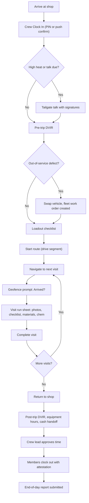

### 5.2 Visit lifecycle (mobile view of the Visit state machine)

Visit states are owned by [04](04-scheduling-dispatch-routing.md) section 4.1.3 (canonical machine). The crew app executes Visits once they are `dispatched` (route published) and implements the field subset below with the same state keys; it enforces these transitions locally and the server re-validates on sync. `en_route`, `on_site` and `paused` roll up to `in_progress` in coarse reporting, as defined in 04.

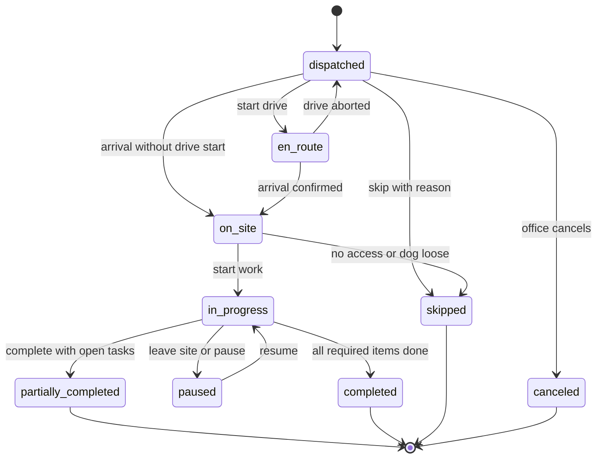

Rules: `completed` and `partially_completed` require required checklist items, photos, chem records (if chem logged) and signatures (if required) unless crew lead override with reason; a `partially_completed` Visit with "return needed" creates a follow-up `unscheduled` Visit linked by `parent_visit_id` for dispatch ([04](04-scheduling-dispatch-routing.md) 4.1.3); `skipped` always carries a reason code from the closed list in 04; `canceled` can only originate from the office (or a client request through the portal), and if it arrives after an offline completion the conflict rule in 4.21.6 applies. Visits on days not yet published (D+2 to D+7 by default) are held on the device in `scheduled` and shown read-only as "Planned"; the office-side states `unscheduled` and `missed` never appear on the device, and `missed` is held as "Awaiting crew sync" while this crew has unsynced commands for that day ([04](04-scheduling-dispatch-routing.md) 4.1.3).

### 5.3 Individual time status

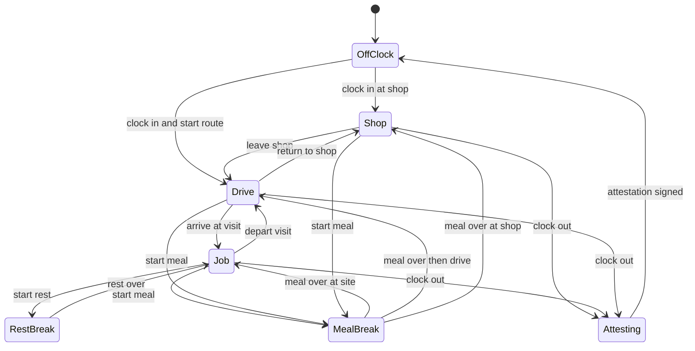

Location tracking is Off in OffClock and MealBreak, Low in Shop/Job/RestBreak, Standard in Drive.

### 5.4 Offline sync: push and pull

1. User actions write to SQLite and the `_mutation_queue` in one transaction.
2. On connectivity, the sync worker pushes Lane 1 first, then Lanes 2-3, and starts blob uploads.
3. The server applies each mutation in its own transaction under domain rules, idempotently by `mutation_id`, and returns per-mutation results.
4. The client applies results (versions, merged entities, rejections -> sync issues).
5. The client pulls ordered put/delete operations per bucket from its checkpoints and applies each page in one transaction.
6. Blob uploads complete independently; records flip from `pending` to `uploaded`.

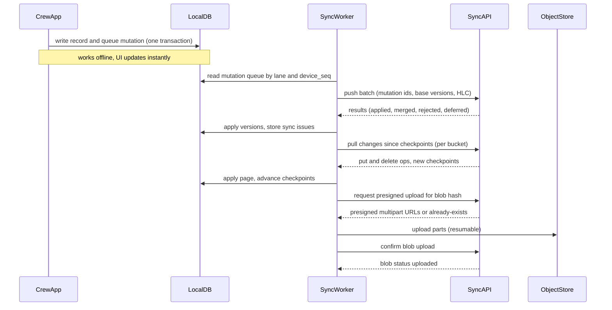

### 5.5 Tap to Pay into the Company's own Stripe account [V1]

1. Crew lead opens "Collect payment" on a visit/invoice; app checks permission, cap, device eligibility, and connectivity.
2. App asks Rootline for a Terminal connection token; Rootline creates it on the Company's connected account.
3. App discovers the Tap to Pay reader on the device and connects using the Company's Terminal Location (connected account).
4. Rootline creates a PaymentIntent on the connected account (direct charge) for the invoice amount, with optional application fee and the standard Rootline metadata set by [08](08-payments-stripe.md) 4.6 (`rootline_tenant_id`, `rootline_payment_attempt_id`, `rootline_invoice_ids`, `rootline_client_id`, `rootline_env`), plus `rootline_visit_id` and `rootline_collected_by` for field collections.
5. App collects the payment method (client taps card or wallet) and processes the payment.
6. Device shows "Approved - posting"; the server marks the invoice paid only on the connected account's `payment_intent.succeeded` webhook; receipt sent.

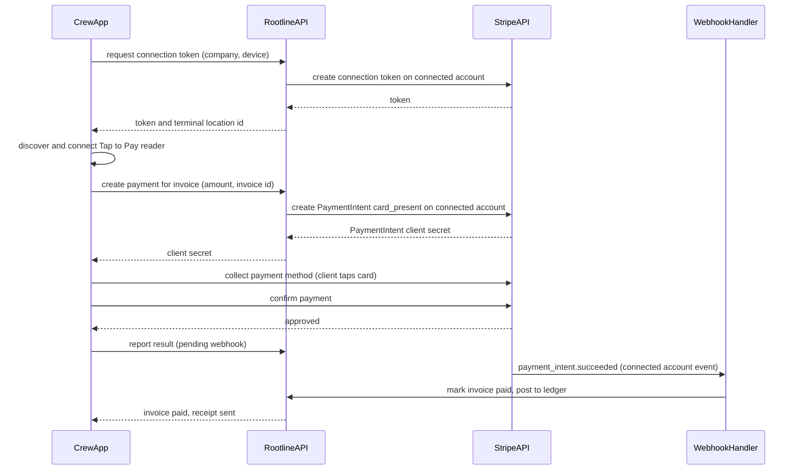

Details of Connect account types, application fees, disputes and reconciliation are in [08](08-payments-stripe.md).

### 5.6 Pesticide application record

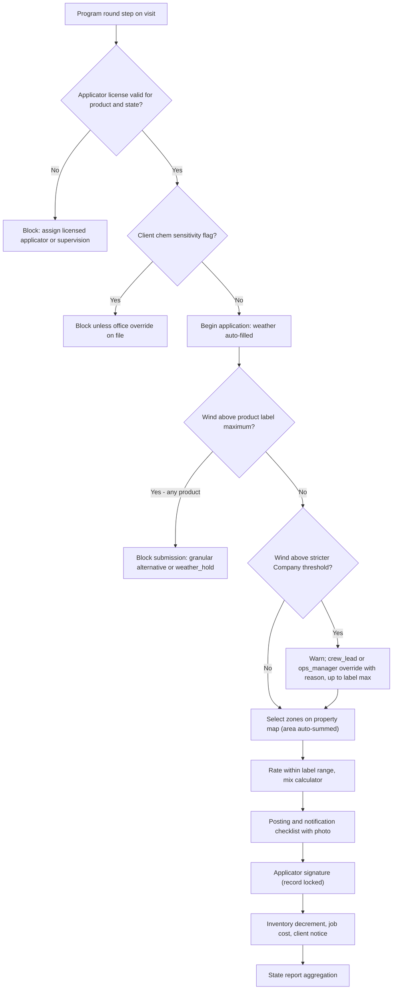

### 5.7 Spot it to estimate request

1. Technician taps Spot it, takes 1-5 photos, optional voice note.
2. On sync, AI classifies the issue, drafts a scope, matches Price Book items and suggests a price range ([17](17-ai-copilot-automation.md)).
3. If the client has a fix-it-now authorization and the price is within limit, the crew lead gets "Fix now?"; else an Opportunity/estimate request is created for the account estimator.
4. Client receives (immediately for fix-it-now, or with the estimate) photos and recommendation through the portal ([06](06-customer-portal.md)).

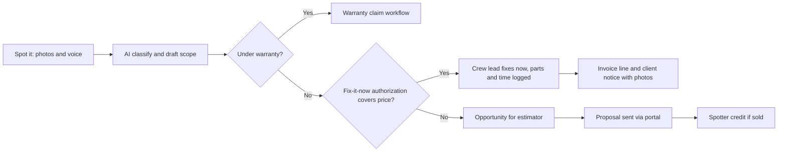

### 5.8 End of day and time approval

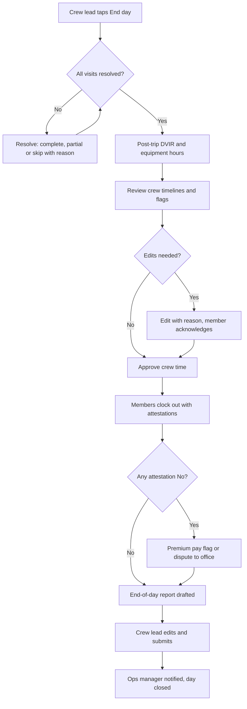

### 5.9 Crew-level punch with offline devices merging

Maria crew-punches 4 members on the truck tablet at 6:58 with no signal. Luis, unaware, also self-punches on his own phone at 7:00. Both devices sync at different times. The timesheet must show exactly one clock-in per member, and Luis must see why his own punch did not count.

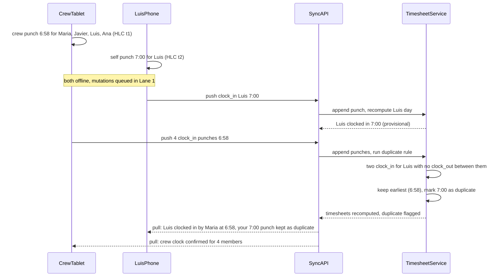

Rule detail: the 60-second duplicate window in 4.21.6 catches near-simultaneous double taps. Two `clock_in` punches for the same user with no `clock_out` between them are always resolved by keeping the earliest valid punch and marking the later one `duplicate`. This applies even when they are minutes apart, and the approver sees both. If the earlier punch came from a crew punch that the member disputes ("I wasn't there at 6:58"), the member raises a timesheet dispute (4.5.7) instead of the system guessing.

### 5.10 Arrival detection (dual path)

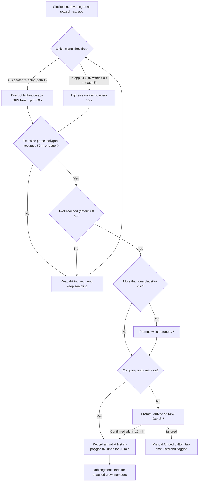

---

## 6. Screens and wireframes

### 6.1 Screen inventory

| # | Screen | Primary roles | Offline | Priority |
|---|---|---|---|---|
| S1 | Sign-in / device enrollment / language picker | All | Partial (PIN offline after enrollment) | [MVP] |
| S2 | Shared-device "Who are you?" PIN pad | Crew device users | Yes | [MVP] |
| S3 | Today (list) with pre-shift card | technician, crew_lead | Yes | [MVP] |
| S4 | Route map | crew_lead, ops_manager | Yes (cached tiles) | [MVP] |
| S5 | Visit run sheet (details + workflow) | technician, crew_lead | Yes | [MVP] |
| S6 | Property map with zones/pins | All field | Yes | [MVP]/[V1] |
| S7 | Camera + markup | All field | Yes | [MVP] |
| S8 | Materials log + scanner | crew_lead | Yes | [MVP] |
| S9 | Chemical application wizard | Licensed applicators | Yes (forecast weather) | [MVP] |
| S10 | Signature capture | crew_lead, estimator | Yes | [MVP] |
| S11 | Collect payment (Tap to Pay, check, cash, link) | crew_lead | Card needs online | [MVP] check/cash/link, [V1] card-present |
| S12 | Spot it | All field | Yes | [MVP] |
| S13 | Clock (self) and break timer | All employees | Yes | [MVP] |
| S14 | Crew clock (crew-level punch, detach/attach) | crew_lead | Yes | [MVP] |
| S15 | Clock-out attestation | Employees in policy jurisdictions | Yes | [V1] |
| S16 | Crew time review and approval | crew_lead | Yes | [MVP] |
| S17 | End-of-day report | crew_lead | Yes (AI draft on sync) | [MVP] |
| S18 | Safety hub: tailgate talk, JHA, DVIR, incident, heat log, emergency | crew_lead, all | Yes | [MVP]/[V1] |
| S19 | Equipment hours and issues | crew_lead | Yes | [MVP] |
| S20 | Chat and announcements | All | Queue offline | [MVP] |
| S21 | Scorecard and badges | All | Yes (last synced) | [V1] |
| S22 | Field Design Mode (measure, sketch, photo capture) | estimator, designer, owner | Map measure yes; AR yes; AI preview no | [MVP]/[V1] |
| S23 | My timesheet and pay estimate | All employees | Yes | [MVP] |
| S24 | Settings: language, theme, glove mode, navigation app, privacy ("My location data") | All | Yes | [MVP] |
| S25 | Sync details and Needs attention (wireframe in [20](20-architecture-security.md) 6.3) | All | Yes | [MVP] |
| S26 | Add expense (receipt capture) and purchase request | crew_lead | Yes (OCR on sync) | [MVP]/[V1] |
| S27 | Client hand-over view (sign, pay, review) | Client using a crew device | Yes (card pay needs online) | [MVP] |
| S28 | Practice mode | All employees | Yes (never syncs) | [V1] |
| S29 | Report a problem / diagnostics | All | Queued offline | [MVP] |
| S30 | Onboarding tour and permission primers | All employees | Partial (OTP needs online) | [MVP] |

### 6.2 Wireframe: Today (crew lead, Outdoor theme)

```text
+-------------------------------------------------+
| [=] Today, Tue Jul 14        (o) 12 to send     |  <- sync pill (Pending, Stone)
| ON THE CLOCK - DRIVE - 0:12   Crew: 4           |  <- clock pill
+-------------------------------------------------+
| !! HIGH HEAT 101F  Water + shade checks 2h      |
| Next check: 9:00   [ Log water/shade check ]    |
+-------------------------------------------------+
| 3 / 14 done    Finish est. 4:40 PM              |
| Hours: 9.5 used of 31.0 budget   Rain 10%       |
+-------------------------------------------------+
| (4) 1452 Oak St - Hernandez        8:30-10:00   |
|     Mow / Edge / Blow + Shrub trim   2.0 crew-h |
|     [DOG] [GATE] [NOTE CHANGED]                 |
|     [   NAVIGATE   ]      [   ARRIVED   ]       |
+-------------------------------------------------+
| (5) Willow Creek HOA - Entry 2                  |
|     Mow common areas, bed weeding   6.5 crew-h  |
|     [CHEM: Round 3 broadleaf]                   |
+-------------------------------------------------+
| (6) 88 Birch Ln - Patel                         |
|     Irrigation repair (zone 2 leak) 1.0 crew-h  |
+-------------------------------------------------+
|                                    ( + )        |  <- capture FAB
+-------------------------------------------------+
| [Today]  [Crew]  [Chat 3]  [Safety]  [More]     |
+-------------------------------------------------+
```

### 6.3 Wireframe: Visit run sheet

```text
+-------------------------------------------------+
| <  1452 Oak St - Hernandez          IN PROGRESS |
|    Job time 0:34   Crew 4   Budget 2.0 crew-h   |
+-------------------------------------------------+
| DOG: Bruno (friendly) - back yard   [Secured v] |
| GATE CODE: ****   [ Tap to reveal ]             |
| NOTE (changed Jul 10): "Do not mow wildflower   |
|  patch behind shed."  [Original ES/EN]          |
+-------------------------------------------------+
| [ PROPERTY MAP ]  Front 3,240 sf  Back 5,110 sf |
+-------------------------------------------------+
| BEFORE PHOTOS                       2/2  done   |
| [img][img]                                      |
+-------------------------------------------------+
| CHECKLIST                           5/8         |
| [x] Mow front    HOC [ 3.5 ] in                 |
| [x] Mow back                                    |
| [x] Edge walks and drive                        |
| [ ] Trim shrubs (boxwoods at walk)              |
| [ ] Blow hard surfaces                          |
| [ ] After photo: front lawn  (required)         |
+-------------------------------------------------+
| MATERIALS   none planned   [ + Add / Scan ]     |
| NOTES       [ mic ] [ type ]                    |
+-------------------------------------------------+
| [ SPOT IT ]                  [ COLLECT $ ]      |
+-------------------------------------------------+
| [        NEXT: TAKE AFTER PHOTOS (0/2)        ] |  <- sticky 64dp
+-------------------------------------------------+
```

### 6.4 Wireframe: Crew clock (crew-level punch)

```text
+-------------------------------------------------+
| <  Crew 3 - Maria R.            Tue Jul 14      |
+-------------------------------------------------+
| CREW STATUS: JOB @ Willow Creek HOA since 10:05 |
+-------------------------------------------------+
| [x] Maria R. (lead)  JOB    3.7h  Meal by 11:45 |
| [x] Javier M.        JOB    3.7h  Meal by 11:45 |
| [x] Luis P.          DRIVE  0:18  (detached:    |
|                       dump run)  [ Re-attach ]  |
| [x] Ana G. (day 6, acclimatizing) JOB    3.6h   |
| [ + Add floater ]                               |
+-------------------------------------------------+
| Switch selected to:                             |
| [  DRIVE  ] [  JOB  ] [  SHOP  ]                |
| [ REST 10 ] [ MEAL 30 ]                         |
+-------------------------------------------------+
| ! Meal must start by 11:45 for Maria, Javier    |
+-------------------------------------------------+
| [       >>> SWIPE TO CLOCK OUT SELECTED >>>   ] |
+-------------------------------------------------+
```

### 6.5 Wireframe: Chemical application record (step 3 of 4)

```text
+-------------------------------------------------+
| <  Application record          Step 3 of 4      |
|    Willow Creek HOA - Entry 2                   |
+-------------------------------------------------+
| PRODUCT  Broadleaf herbicide (3-way amine)      |
| EPA Reg. No. 0000-000  (from catalog)           |
| Target: Dandelion, clover    [ change ]         |
+-------------------------------------------------+
| AREA  (tap zones on map)                        |
| [x] Entry turf N   12,400 sf                    |
| [x] Entry turf S    9,850 sf                    |
| [ ] Pond buffer     (no-spray 25 ft)  LOCKED    |
| Total: 22,250 sf                                |
+-------------------------------------------------+
| RATE  1.5 fl oz / 1,000 sf  (label 1.0-1.6)     |
| Product: 33.4 fl oz   Mix: 22.3 gal             |
+-------------------------------------------------+
| WEATHER  (station KSAC 3.1 mi, 9:52 AM)         |
| Wind 6 mph NW  Gust 9   Temp 84F   RH 38%       |
| [ Confirm ]  [ Enter my anemometer reading ]    |
+-------------------------------------------------+
| [            NEXT: POSTING AND SIGN           ] |
+-------------------------------------------------+
```

The EPA registration number shown is a placeholder format, not a real product.

### 6.6 Wireframe: End-of-day report (AI draft)

```text
+-------------------------------------------------+
| <  End of day - Crew 3            Tue Jul 14    |
+-------------------------------------------------+
| VISITS 13 done, 1 partial (88 Birch: part on    |
|   order - return Thu proposed)                  |
| HOURS  Crew 41.5h (job 31.2 / drive 7.8 /       |
|   shop 2.5)  Budget 39.0h  (106%)               |
| MATERIALS  Mulch 2.0 cu yd, rotor x1 (Truck 12) |
| CHEM  Willow Creek: broadleaf 33.4 fl oz        |
| SAFETY Talk: Heat (4/4 signed)  DVIR: 1 defect  |
|   Heat log: 4 checks OK   Incidents: 0          |
| SPOT IT  2 submitted (1 fixed now: $68)         |
| PAYMENTS  Card $185.00 (22 Elm Ct)  Check $0    |
+-------------------------------------------------+
| NOTES (from voice, translated):                 |
| "Client at 14 Pine wants a fall cleanup quote." |
|   [ Create opportunity ]                        |
+-------------------------------------------------+
| Checks: [ok] visits  [ok] DVIR  [ok] time OK    |
|         [!] Luis attestation pending            |
+-------------------------------------------------+
| [              SUBMIT REPORT                  ] |
+-------------------------------------------------+
```

### 6.7 Wireframe: Shared-device "Who are you?" PIN pad (Spanish default)

```text
+-------------------------------------------------+
|  Camion 12 - Cuadrilla 3        6:52   (o) OK   |
+-------------------------------------------------+
|          ¿QUIEN ERES?  /  WHO ARE YOU?          |
|                                                 |
|  +---------+  +---------+  +---------+          |
|  | (photo) |  | (photo) |  | (photo) |          |
|  | Maria R.|  | Javier M|  | Luis P. |          |
|  +---------+  +---------+  +---------+          |
|  +---------+  +---------+                       |
|  | (photo) |  |  ( + )  |                       |
|  | Ana G.  |  |  Otro / |                       |
|  | dia 6   |  |  Other  |                       |
|  +---------+  +---------+                       |
+-------------------------------------------------+
|  Luis P.            PIN:  [*] [*] [ ] [ ]       |
|  +-------+  +-------+  +-------+                |
|  |   1   |  |   2   |  |   3   |                |
|  +-------+  +-------+  +-------+                |
|  |   4   |  |   5   |  |   6   |   (72 dp keys) |
|  +-------+  +-------+  +-------+                |
|  |   7   |  |   8   |  |   9   |                |
|  +-------+  +-------+  +-------+                |
|  |  <x   |  |   0   |  |  OK   |                |
|  +-------+  +-------+  +-------+                |
+-------------------------------------------------+
| [ EMERGENCIA / EMERGENCY ]      [ EN | ES ]     |
+-------------------------------------------------+
```

Notes: tiles show only the crew assigned to this device today, plus "Other" (search, for floaters). The "dia 6" badge marks an acclimatizing employee (4.12.5). The keypad never shows the last digit typed, and it shakes with a haptic buzz on a wrong PIN. The emergency button works without a PIN.

### 6.8 Wireframe: Collect payment [V1 card, MVP check/cash/link]

```text
+-------------------------------------------------+
| <  Collect payment            22 Elm Ct - Lee   |
+-------------------------------------------------+
| Invoice INV-10482  Fall cleanup     $300.00     |
| Paid to: Greenleaf Grounds Co.                  |  <- Company legal name
|          (your company's Stripe account)        |
+-------------------------------------------------+
| AMOUNT                        [ $300.00   edit ]|
| Tip screen for client          ( ) off  (o) on  |
+-------------------------------------------------+
| [        TAP TO PAY ON THIS PHONE (NFC)       ] |  <- 64 dp, needs signal
| [  Text payment link   ]  [ Charge card on file]|
| [  Record check        ]  [ Record cash        ]|
+-------------------------------------------------+
| Signal: 2 bars   Field cap: $5,000 / day left   |
| No signal? Use "Text payment link" - it sends   |
| automatically when you're back online.          |
+-------------------------------------------------+
```

After "Tap to Pay" the device enters client hand-over mode (4.8.2a): amount, Company branding and the optional tip screen (15% / 20% / custom / no tip). The result reads "Approved - posting" until the connected-account webhook confirms (4.9.1).

### 6.9 Wireframe: Spot it

```text
+-------------------------------------------------+
| <  Spot it            1452 Oak St - Hernandez   |
+-------------------------------------------------+
| [img: rotor head, cracked cap]  [img]  [+ photo]|
+-------------------------------------------------+
| AI: Irrigation - broken rotor head (92%)        |
|     Suggest: Rotor head replacement             |
|     (Hunter PGP) - $45-$70                      |
|     [ Looks right ]   [ Change category ]       |
+-------------------------------------------------+
| WHERE   [ Pin on property map ]  Zone 3 - back  |
| HOW URGENT  ( ) Can wait  (o) Soon  ( ) Now     |
| NOTE    [ hold to talk ]  "Cabeza rota, zona 3" |
|         -> "Broken head, zone 3"                |
+-------------------------------------------------+
| Client pre-approved repairs up to $150          |
| [        FIX IT NOW (logs part + time)        ] |
| [        SEND TO ESTIMATOR INSTEAD            ] |
+-------------------------------------------------+
```

Offline, the AI line reads "Will be classified when online" and the fix-it-now button is shown only if the cached authorization limit covers the Price Book price of the item the lead picks by hand.

---

## 7. Data model

Field-owned entities (server tables mirror these; shared entities such as Visit, Job, Property, Client, Employee, Crew, Equipment, PriceBookItem are defined in [20](20-architecture-security.md) and their owning module docs). All tables carry `tenant_id` (the Company's tenant key, per the conventions in [20](20-architecture-security.md) 7.1) with row-level security, `created_at`, `updated_at`, `version`, and for client-created rows a client-generated UUIDv7 `id` and `origin_device_id`.

| Entity | Purpose | Key fields |
|---|---|---|
| `device` | Enrolled device | id, tenant_id, mode (personal/crew/kiosk), platform, os_version, app_version, managed (bool), assigned_vehicle_id, last_sync_at, revoked_at |
| `bucket_checkpoint` (server-tracked per device/bucket; mirrors local `_bucket_checkpoint`) | Change-log position | device_id, bucket_id, checkpoint_lsn, updated_at |
| `sync_issue` | Rejected or conflicted mutation needing attention (the server side of the device's `_conflict` rows) | id, device_id, mutation_id, entity_type, entity_id, reason_code, server_state_json, resolution, resolved_by |
| `time_punch` | Append-only punch event | id, employee_id, crew_id, type (clock_in/segment_change/clock_out), segment_type, visit_id, punched_by, method (self/crew_punch/pin/geofence_auto), device_time, trusted_time, hlc, lat, lng, accuracy_m, mock_flag, supersedes_id, reason |
| `time_segment` (derived) | Computed span | id, employee_id, segment_type, visit_id, job_id, start_at, end_at, minutes, paid, cost_object |
| `timesheet_day` | Daily rollup and approval | id, employee_id, work_date, status (open/crew_approved/office_approved/locked), approved_by, totals_json |
| `break_attestation` | Signed end-of-shift attestation | id, employee_id, work_date, policy_pack, answers_json, reason_codes, signature_id, premium_flags |
| `premium_pay_flag` | Potential meal/rest premium | id, employee_id, work_date, type, source (attestation/rule), status |
| `visit_event` | Visit state transition log | id, visit_id, from_state, to_state, actor_id, device_time, trusted_time, lat, lng, reason_code |
| `checklist_instance`, `checklist_answer` | Per-visit checklist and per-item answers | instance: id, visit_id, template_id; answer: id, instance_id, item_key, value_json, answered_by, hlc |
| `media_asset` | Photo, video, audio, document | id, content_hash, kind, phase (before/after/issue/during), visibility, visit_id, property_id, zone_id, captured_by, captured_at, lat, lng, heading, blob_status, width, height |
| `media_annotation` | Markup layer | id, media_asset_id, vector_json, version, author_id |
| `field_note` | Text/voice note | id, visit_id, kind (internal/client/next_crew), body, language, audio_asset_id, transcript, translations_json |
| `material_usage` | Append-only usage delta | id, visit_id, price_book_item_id, quantity, unit, source_location_id, billable, entered_by, idempotency_key |
| `plant_instance` (canonical in [10](10-design-studio.md) section 7.1; formerly `installed_plant` here) | Plant installed; crew install logging (4.6.3) writes to the row created from the sold Design, or creates one for a field-added plant | Fields written from the field: id, object_id, property_id, job_id, plant_id, cultivar, size_spec, qty, source_vendor_id, tag_code, location_point, install_date, warranty_end; full field list in [10](10-design-studio.md) section 7.1 |
| `chemical_application` | Regulatory application record | id, visit_id, property_id, applicator_id, license_number, business_license, start_at, end_at, area_sqft, target_pests, method_equipment_id, weather_snapshot_id, rei_hours, posting_done, signature_id, status (draft/signed/amended), amends_id |
| `chemical_application_product` | Products in an application | id, application_id, product_id, epa_reg_no, pcp_reg_no, rate_value, rate_unit, product_qty, mix_volume, restricted_use |
| `weather_snapshot` | Observed or forecast weather | id, source, station_id, observed_at, kind (observation/forecast/manual), distance_m, wind_mph, gust_mph, wind_dir, temp_f, rh_pct, conditions |
| `signature` | Signature evidence | id, signer_name, signer_type, contact_id, employee_id, document_hash, strokes_asset_id, image_asset_id, signed_at, lat, lng, device_id |
| `field_payment` | Payment captured in field | id, invoice_id, visit_id, method (card_present/check/cash/link), amount, currency, stripe_payment_intent_id, stripe_account_id, status, collected_by, check_number, custody_status |
| `issue_report` | Spot-it capture | id, property_id, visit_id, category, urgency, location_point, description, ai_classification_json, outcome (opportunity/service_request/fix_now/warranty/internal), opportunity_id, reporter_id |
| `safety_meeting`, `safety_meeting_attendee` | Tailgate talks | meeting: id, topic_id, crew_id, presenter_id, held_at, language; attendee: meeting_id, employee_id, signature_id, quiz_score |
| `jha` | Job hazard analysis | id, visit_id, template_id, answers_json, locate_ticket_no, locate_expires_at, signed_by |
| `dvir`, `dvir_item` | Vehicle inspection | dvir: id, vehicle_id, type (pre/post), driver_id, odometer, engine_hours, status, signed_at; item: dvir_id, item_key, result, note, media_ids, work_order_id |
| `incident_report` | Incident | id, type, occurred_at, location_point, visit_id, reporter_id, persons_json, description, media_ids, severity, status, osha_recordable |
| `heat_log_entry` | Water/shade/rest/observation checks | id, crew_id, work_date, kind, value_json, logged_by, logged_at, heat_index_f |
| `equipment_meter_reading` | Hour meter | id, equipment_id, reading_hours, read_at, method (manual/photo_ocr/telematics), is_reset, media_asset_id |
| `chat_channel`, `chat_message` | Crew chat | channel: id, kind, crew_id, job_id; message: id, channel_id, author_id, body, language, translations_json, media_ids, server_seq |
| `announcement`, `announcement_receipt` | Announcements | announcement: id, audience_json, requires_ack, body_i18n; receipt: announcement_id, employee_id, read_at, acked_at |
| `scorecard_period`, `badge_award` | Gamification | scorecard: id, subject_type, subject_id, period, metrics_json; badge: id, employee_id, badge_key, awarded_at |
| `location_breadcrumb` | On-clock location sample | id, employee_id, device_id, recorded_at, lat, lng, accuracy_m, speed, activity, segment_type (retention-limited) |
| `geofence_event` | Enter/exit events | id, employee_id, geofence_type, ref_id, event (enter/exit/dwell), at, confirmed |
| `field_measurement` | Field Design Mode output | id, property_id, opportunity_id, method (map/gps_walk/ar_lidar), geometry_geojson, value, unit, accuracy_m, media_ids |
| `monitoring_consent` | Notice acknowledgment | id, employee_id, notice_version, jurisdiction, acknowledged_at, signature_id |
| `access_secret_reveal` | Audit of gate-code and lockbox reveals (4.3.3) | id, property_id, secret_id, employee_id, device_id, visit_id, revealed_at, lat, lng |
| `field_expense` | Receipt captured in the field (4.6.6); AP matching in [09](09-accounting-ledger-integrations.md) | id, visit_id, job_id, employee_id, merchant, purchased_at, total_amount, tax_amount, currency, payment_source (company_card/fuel_card/personal), card_last4, receipt_asset_id, ocr_json, status, bank_txn_id |
| `visit_verification` | Server-computed completion checks (4.4.5a) | visit_id, status (verified/unverified), failed_checks, computed_at, recomputed_on |
| `device_diagnostic_bundle` | Support diagnostics (4.24.4), no record contents | id, device_id, submitted_by, app_version, os_version, model, permissions_json, queue_stats_json, sync_errors_json, consent_scope, created_at |

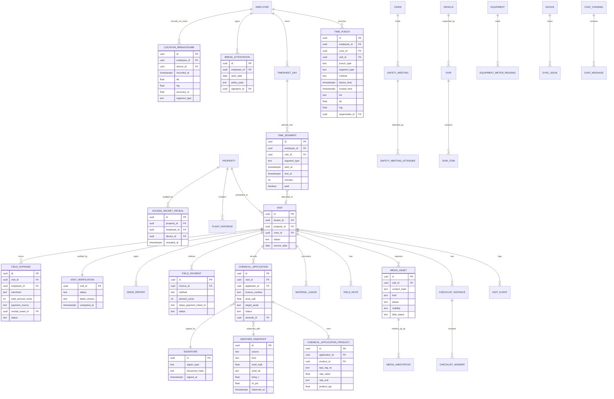

---

## 8. Integrations, APIs and events

### 8.1 External services used by the crew app

| Service | Use | Notes |
|---|---|---|
| Stripe Terminal (React Native SDK) | Tap to Pay on iPhone/Android, Bluetooth readers | Direct charges on the Company's connected account; Apple Tap to Pay entitlement; [08](08-payments-stripe.md) |
| Mapbox or Google Maps SDK | Maps, satellite, offline regions | Offline tile limits and pricing per active user to verify; [20](20-architecture-security.md) |
| Google Maps / Apple Maps / Waze deep links | Navigation handoff | URL schemes; no API cost |
| Parcel data (e.g., Regrid) | Geofence polygons, property boundaries | Server-side, cached as GeoJSON |
| Weather (NWS/ECCC or commercial provider) | Chem auto-fill, heat triggers, rain banners | Server-side proxy with caching; provider choice in [20](20-architecture-security.md) |
| AI Gateway (speech-to-text, Claude for translation/extraction/reports, vision for Spot-it and OCR) | Voice notes, translation, Spot-it classification, meter and receipt AI extraction [V1], end-of-day drafts (MVP receipt header OCR is rules-based and runs outside the gateway, per [09](09-accounting-ledger-integrations.md) AI2) | Metered as AI credits; [17](17-ai-copilot-automation.md) |
| Push: APNs, FCM (via Expo push or direct) | Notifications, silent sync nudges | |
| Twilio Proxy / masked calling [V1] | Call clients without exposing numbers | [16](16-marketing-growth-communications.md) |
| Telematics (Samsara, Geotab, Verizon Connect, Linxup; verify APIs) [V1] | Vehicle location, engine hours | [13](13-operations-inventory-equipment.md) |
| MDM (AppConfig, Android Enterprise managed configurations) [V1] | Managed deployment | |
| On-device ML (ML Kit barcode, on-device face/plate blur [V1]) | Scanning, privacy blur | Offline |
| ARKit / ARCore | AR/LiDAR measurement | [10](10-design-studio.md) |
| Twilio Verify (SMS/WhatsApp OTP) | First login and re-verification for field users | Per [02](02-personas-roles-permissions.md) |
| Expo EAS Build / EAS Update | Native builds, OTA JavaScript updates, staged rollouts and rollback (4.24.3) | Bound to `runtimeVersion`; rollout gates fed by crash and sync telemetry |
| Crash and performance telemetry (Sentry-class SDK; vendor choice in [20](20-architecture-security.md)) | Crash-free sessions, cold start, sync error rates per release and device model | PII scrubbing on device before upload |

### 8.2 Mobile API surface (summary)

| Endpoint | Purpose |
|---|---|
| `POST /sync/v1/push` | Batches of up to 200 mutations or 256 KB, whichever comes first; returns per-mutation results (protocol in [20](20-architecture-security.md) 4.11.4) |
| `POST /sync/v1/pull` | Bucket checkpoints in; ordered put/delete pages (up to 5 MB) out |
| `POST /mobile/v1/blobs/initiate` / `POST /mobile/v1/blobs/complete` | Presigned multipart upload by content hash |
| `POST /mobile/v1/devices/enroll` / `POST /mobile/v1/devices/{id}/revoke` | Device lifecycle |
| `POST /mobile/v1/terminal/connection-token` | Stripe Terminal token on connected account |
| `POST /mobile/v1/payments/card-present` | Create PaymentIntent for an invoice |
| `GET /mobile/v1/weather/observation?lat&lng` | Weather snapshot for chem records |
| `POST /mobile/v1/ai/transcribe` / `.../translate` / `.../classify-issue` | AI Gateway proxies (async jobs; results arrive via sync) |
| `GET /mobile/v1/config` | Feature flags, min app version, policy packs |

All endpoints are tenant-scoped by token; the sync API is the only write path for field records (no ad hoc REST writes), which keeps idempotency and conflict rules in one place.

### 8.3 Domain events emitted (via outbox -> event bus)

| Event | Consumers |
|---|---|
| `visit.en_route`, `visit.arrived`, `visit.started`, `visit.paused`, `visit.completed`, `visit.partially_completed`, `visit.skipped` | Scheduling [04](04-scheduling-dispatch-routing.md), client notifications [16](16-marketing-growth-communications.md), invoicing [07](07-invoicing-billing-contracts.md), portal timeline [06](06-customer-portal.md), analytics [18](18-reporting-analytics.md) |
| `sync.conflict_detected` (emitted by the sync server when a field mutation conflicts, for example completed after cancel) | Ops inbox and needs-attention queue [04](04-scheduling-dispatch-routing.md) |
| `time.punched`, `time.segment_changed`, `time.clocked_out`, `timesheet.crew_approved`, `attestation.signed`, `premium_pay.flagged` | Payroll [15](15-team-hr-payroll.md), job costing [09](09-accounting-ledger-integrations.md) |
| `media.uploaded`, `media.published_to_client` (a `client_visible` asset finished uploading, or an asset was marked client-visible) | Portal visit and project feeds [06](06-customer-portal.md), AI photo QA [17](17-ai-copilot-automation.md) |
| `material.used`, `plant.installed` | Inventory [13](13-operations-inventory-equipment.md), job costing [09](09-accounting-ledger-integrations.md), plant warranty records [13](13-operations-inventory-equipment.md) 4.17 (client warranty terms and claims applied by the Warranty Engine in [14](14-service-line-modules.md) 4.5.7) |
| `chemical_application.recorded` (on applicator signature; name per the event registry in [20](20-architecture-security.md)), `chemical_application.amended` | Compliance reports [14](14-service-line-modules.md), client notices [16](16-marketing-growth-communications.md), portal application records [06](06-customer-portal.md) |
| `signature.captured` | Contracts/change orders [03](03-crm-sales-estimating-proposals.md) |
| `field_payment.recorded` (check/cash), `field_payment.card_initiated` | AR [07](07-invoicing-billing-contracts.md), ledger [09](09-accounting-ledger-integrations.md) |
| `issue.reported` | CRM [03](03-crm-sales-estimating-proposals.md), scheduling (service requests), warranty [14](14-service-line-modules.md) |
| `visit.verified` (emitted by the Visit service in [04](04-scheduling-dispatch-routing.md) 8.3 when the 4.4.5a status flips to verified) | Per-visit invoicing and the exception queue [07](07-invoicing-billing-contracts.md) |
| `field_expense.submitted`, `purchase_request.created` | AP and bank-feed matching [09](09-accounting-ledger-integrations.md), purchasing [13](13-operations-inventory-equipment.md) |
| `dvir.submitted`, `dvir.defect_reported`, `equipment.meter_recorded`, `equipment.reported_down` | Fleet/maintenance [13](13-operations-inventory-equipment.md), dispatch availability [04](04-scheduling-dispatch-routing.md) |
| `incident.reported`, `heat.procedure_activated`, `heat.check_logged`, `safety_meeting.held` | Safety/HR [15](15-team-hr-payroll.md), owner alerts |
| `device.sync_stale`, `device.revoked` | Ops alerts, security audit [19](19-platform-admin-portal.md) |

### 8.4 Events consumed

| Event | Effect in app |
|---|---|
| `visit.dispatched`, `visit.rescheduled`, `visit.canceled`, `visit.assigned` / `visit.unassigned`, `route.published` / `route.changed_after_publish`, `crew.assignment_changed` ([04](04-scheduling-dispatch-routing.md)) | Silent push nudge; pull; banners for changes affecting today |
| `weather.alert_raised`, `weather.delay_declared` ([04](04-scheduling-dispatch-routing.md)) | Rain/heat/lightning banners, rain-day banner and safety pushes |
| `property.updated`, `client.preferences_updated` | Refresh property scope; highlight changed notes |
| `price_book.updated`, `checklist_template.updated`, `policy_pack.updated` | Reference scope refresh |
| `payments.payment.succeeded` / `payments.attempt.failed` ([08](08-payments-stripe.md), raised from the connected account's `payment_intent.*` webhooks) | Mark invoice paid/failed on device |
| `employee.terminated`, `employee.certification_expired` ([15](15-team-hr-payroll.md)) | Revoke device sessions/PIN hashes; block chem steps |
| `announcement.published` | Push + announcement feed |
| `review.received` ([16](16-marketing-growth-communications.md)) | Crew kudos |

---

## 9. Permissions

Capabilities below are the defaults; Companies can create custom roles from granular permissions ([02](02-personas-roles-permissions.md)). Legend: Y = allowed, O = own records only, C = own crew only, S = setting-dependent (off by default), A = approve, - = no access.

| Capability | owner | office_manager | estimator | designer | ops_manager | crew_lead | technician | bookkeeper | subcontractor |
|---|---|---|---|---|---|---|---|---|---|
| Use crew app | Y | Y | Y | Y | Y | Y | Y | - | Y (restricted) |
| View today's route | Y | Y | O (appointments) | O | Y | C | C | - | O (assigned visits) |
| View other crews' routes / live map | Y | Y | - | - | Y | S | - | - | - |
| Reorder own route | Y | Y | - | - | Y | S (default Y) | - | - | - |
| View gate codes / access secrets | Y | Y | O (appointments) | O | Y | C (window) | C (today only) | - | O (assigned day) |
| Start/complete visits | Y | Y | - | - | Y | C | C (if setting) | - | O |
| Override required checklist items | Y | Y | - | - | Y | C (with reason) | - | - | - |
| Capture photos, notes, voice, Spot it | Y | Y | Y | Y | Y | Y | Y | - | O |
| Clock self in/out | Y | Y | Y | Y | Y | Y | Y | - | - |
| Crew-level punch / detach / attach members | Y | Y | - | - | Y | C | - | - | - |
| Edit time (with reason) | Y | Y | - | - | Y | C (today, yesterday) | O (proposal) | - | - |
| Approve crew time (daily) | Y | Y | - | - | Y | C | - | - | - |
| Approve timesheets (weekly/payroll) | Y | Y | - | - | Y | - | - | S | - |
| View own pay estimate | Y | Y | Y | Y | Y | Y | S | - | - |
| Log materials | Y | Y | - | - | Y | C | S | - | O |
| Record chemical application | Y (if licensed) | - | - | - | Y (if licensed) | C (if licensed) | C (if licensed) | - | O (if licensed) |
| Amend signed chem record | Y | Y | - | - | Y | - | - | - | - |
| Capture client signature / change order | Y | Y | Y | Y | Y | C | - | - | - |
| Collect card payment (Tap to Pay) | Y | Y | Y | - | Y | S (default Y) | S | - | - |
| Record check/cash | Y | Y | Y | - | Y | C | S | - | - |
| Charge card on file | Y | Y | - | - | Y | S | - | - | - |
| See prices / client balance in field | Y | Y | Y | Y | Y | S | S | - | - |
| Submit DVIR | Y | Y | Y | Y | Y | Y | Y | - | - |
| Mark vehicle out of service | Y | Y | - | - | Y | Y | Y (via defect) | - | - |
| File incident report | Y | Y | Y | Y | Y | Y | Y | - | Y |
| Present tailgate talk | Y | - | - | - | Y | C | - | - | - |
| Log heat checks | Y | - | - | - | Y | C | O (symptom report) | - | - |
| Post announcements | Y | Y | - | - | Y | S (crew only) | - | - | - |
| Crew chat | Y | Y | Y | Y | Y | Y | Y | - | O (ops thread) |
| View location breadcrumbs | Y | S | - | - | Y | C (current location only) | O | - | - |
| Field Design Mode (measure, sketch, AR) | Y | - | Y | Y | Y | S | - | - | - |
| Enroll/revoke devices, reset PINs | Y | Y | - | - | Y | C (PIN reset) | - | - | - |
| End-of-day report submit | Y | - | - | - | Y | C | - | - | - |
| Submit field expense (receipt) | Y | Y | Y | Y | Y | C | S | - | - |
| Approve field expense over threshold | Y | Y | - | - | A | - | - | S | - |
| Submit purchase request [V1] | Y | Y | Y | Y | Y | C | S | - | - |
| Confirm a field-reported gate code / access secret | Y | Y | - | - | Y | - | - | - | - |
| Use practice mode [V1] | Y | Y | Y | Y | Y | Y | Y | - | Y |
| Send diagnostics bundle to platform support | Y | Y | O | O | Y | O | O | - | O |

Platform staff: `platform_support` can view a tenant's device and sync diagnostics (app version, last sync, pending mutation counts, error codes) without record contents, and can only view records with time-boxed, tenant-approved impersonation ([19](19-platform-admin-portal.md)). `platform_curator` maintains the safety talk library, chemical product catalog defaults and translation glossary. `platform_engineer` sees aggregated crash and sync telemetry. `platform_owner` controls feature flags and policy pack releases. `platform_finance` has no crew-app access.

---

## 10. AI opportunities in this module

All AI goes through the AI Gateway with credit metering, tenant isolation and human confirmation for anything that changes records ([17](17-ai-copilot-automation.md)).

| Opportunity | Description | Priority |
|---|---|---|
| Voice note transcription and EN/ES translation | Code-switching speech, landscaping glossary, original + translation shown | [MVP] |
| Client note translation and summary | Standing instructions translated; "recent communications" summarized for crews | [MVP]/[V1] |
| Spot-it classification and scope drafting | Vision + LLM classify the issue, match Price Book items, draft scope and price range | [MVP] (classify), [V1] (pricing) |
| End-of-day report drafting | Summarizes the day's records and voice notes into the report | [V1] |
| Structured extraction from voice | Office-side issue extraction and draft Opportunities by the A4 Field-Note Agent ([17](17-ai-copilot-automation.md) 4.5.5) at [MVP]; crew-side one-tap proposals ("Skip next week", "need more mulch" -> proposed actions) at [V1] | [MVP]/[V1] |
| Photo QA before leaving site | Vision model checks after photos for debris on hard surfaces, missed edging, uneven stripes; prompts "Blow the driveway again?" Advisory only | [V2] |
| Receipt, meter and ticket OCR | Field purchase receipts (4.6.6): rules-based header OCR at [MVP] (no LLM, no AI credits; AI2 basic in [09](09-accounting-ledger-integrations.md)), AI line-item extraction at [V1]; hour meters, dump tickets and fuel receipts at [V1] | [MVP]/[V1] |
| Plant, weed, pest and disease ID | Photo ID cross-referenced with the Plant KB and region ([12](12-plant-knowledge-base.md)); suggests program adjustments | [V1] (online), [V2] (on-device) |
| Chem record assistant | Explains label rate ranges, REI, and state posting rules in the user's language; never overrides label limits | [V1] |
| Safety talk generator | Generates a tailgate talk from today's conditions (heat 101 F, slopes, new hire) for crew-lead review, in EN/ES | [V1] |
| Copilot in the field | "How many hours left on Willow Creek this month?", "Where's the backflow on this property?", "What did we put down on this lawn last round?" | [V1] |
| Anomaly detection | Time anomalies (unusual drive time, repeated geofence mismatches), material overuse, chem rate outliers flagged to ops | [V2] |
| Hands-free voice mode | "Rootline, start meal break for the crew", "Mark mow front done" | [V2] |
| On-device AR mockup preview | Overlay proposed bed lines or plants in AR on site with Design data ([11](11-ai-design-mockups.md)) | [V3] |

Guardrails: AI never submits time, attestations, chem records or payments; AI-translated text is labeled; translation errors on safety content are mitigated by human-reviewed platform translations for all platform-shipped safety and compliance text (AI translation only for user-generated content).

---

## 11. Edge cases, compliance and risks

### 11.1 Edge cases

| Case | Handling |
|---|---|
| Phone dies mid-day | All data up to the last write is in SQLite; crew lead's device continues crew punches; on recharge, the member's device syncs; duplicate punches resolved per 4.21.6 |
| Crew lead's phone lost/stolen | Remote revoke; data unsynced on that device is reported; another member can be promoted to acting crew lead for the day by ops |
| Member forgets to clock out | 30-min post-shift prompt; if still open at midnight local time, the system closes at last known activity time and flags for review (never auto-pays a 16-hour day) |
| Crew works across midnight (snow event) | Segments span days; daily OT rules evaluated per workday definition from the Company's payroll setup |
| Daylight saving transitions | All times stored UTC with local zone; elapsed durations from monotonic clocks |
| Device clock wrong by hours | Trusted time via server offset; punches flagged; HLC preserves order |
| GPS spoofing apps | Mock-location flags; flagged punches, not blocked |
| Two crews at the same property (maintenance + irrigation) | Each crew has its own Visit; geofence prompts show both visits if both are on the user's route |
| Property with no parcel polygon (new subdivision) | Circle geofence on geocoded point; crew lead can drop a corrected pin (office approves) |
| Client home and refuses service on site | Skip reason `client_request` ("Client declined on site") with optional client signature; billing per agreement terms ([07](07-invoicing-billing-contracts.md)) |
| Partial completion due to rain mid-visit | `partially_completed` with reason `rain`; dispatch rain workflow proposes return |
| Chem applied, then visit canceled by office | Chem record stands (legal record); conflict surfaced; billing decided by ops |
| Applicator license expires mid-season | Chem steps blocked for that user from expiry date; crew lead sees roster gap warning 30 days before expiry |
| Tap to Pay declined or device ineligible | Offer payment link or Bluetooth reader; never retry more than 3 times in a row on the same card |
| Tap to Pay succeeded on device but webhook delayed | Device shows "Approved - posting"; invoice paid when webhook arrives; reconciliation job checks PaymentIntents without webhooks after 15 min ([08](08-payments-stripe.md)) |
| Cash collected and lost | Custody chain shows last holder; incident report path |
| Employee on day 2 is in a high-heat crew | Acclimatization flag; crew lead reminders for close observation |
| A member works for two Companies on Rootline | Separate tenant logins; app supports account switching; no data crosses tenants |
| Subcontractor tries to see client contact | Masked calling only; contact details not in the subcontractor scope |
| App update required while offline with unsynced data | Update gate waits until flush; data never discarded by updates; migrations run on local DB before first launch of new version |
| Huge commercial property (200 acres, 60 photos per visit) | Photo upload lane throttling, Wi-Fi preference, thumbnail-first; map tiles cached at lower max zoom for very large areas |
| Property in a dead zone where OS geofences never fire | Path B (in-app GPS, 4.5.4) detects arrival without data; telemetry marks the property "geofence-unreliable" so the dead-zone map (Beyond the brief, idea 14) can pre-cache more |
| Phone rebooted mid-shift | Clock state restored from SQLite on launch (punch events are the source of truth); geofences re-registered on boot; local meal/REI timers rescheduled |
| Crew crosses a time-zone boundary (e.g., Idaho-Oregon line, or Lloydminster on the Alberta-Saskatchewan border) | Visit times shown in the property's zone; punches stored in UTC with the device zone; the workday is defined by the Company's payroll zone ([15](15-team-hr-payroll.md)) |
| Device offline for more than 7 days | New work locked per 4.0.2; punches and the emergency screen stay available; nothing is deleted |
| OTA update published while crews are working | Not applied until clock-out with an empty queue (4.24.3) |
| Client grabs the phone during a signature and scrolls | Client hand-over mode (4.8.2a) blocks navigation; exit needs the crew PIN |
| Crew lead pays $38 cash at a supply yard from personal funds | Field expense with receipt photo, `payment_source = personal`, then a reimbursement line to payroll (4.6.6) |
| Seasonal (H-2B) worker returns next spring with a new phone and number | Rehire restores the profile, certifications and language; PIN must be re-confirmed ([02](02-personas-roles-permissions.md)); the old device was revoked at season end |

### 11.2 Compliance map

| Area | Requirement (summary; verify per jurisdiction) | How the app supports it |
|---|---|---|
| Wage and hour (FLSA, state) | Accurate records of hours worked; compensable travel; overtime | Event-sourced punches, segment types, OT alerts, immutable edit history |
| California meal/rest | Meal before end of 5th hour; second before end of 10th; rest 10 min per 4 h; premium of one additional hour for violations; no meal-punch rounding; attestations help defend claims ([Donohue summary](https://www.californiaemploymentlawreport.com/2021/04/california-supreme-court-provides-guidance-on-meal-breaks-donohue-v-amn-services/), [timekeeping elements](https://www.californiaemploymentlawreport.com/2021/10/essential-elements-of-electronic-timekeeping-systems-for-california-employers/), [Ogletree Break Book](https://ogletree.com/app/uploads/solutions/templates/California-Break-Book.pdf), [2026 pitfalls](https://www.californiaemploymentlawreport.com/2026/05/scheduling-smarter-five-california-wage-and-hour-pitfalls-employers-should-address-in-2026/)) | 4.5.5 and 4.5.7 |
| Piece-rate pay (CA) | Separate pay for rest periods and nonproductive time for piece-rate workers (verify) | Segment data supports payroll calculation in [15](15-team-hr-payroll.md) |
| Heat illness (Cal/OSHA 8 CCR 3395; WA, OR rules; federal rulemaking) | Water, shade at 80 F, high-heat procedures at 95 F, acclimatization, training, emergency response ([Ogletree](https://ogletree.com/insights/the-heat-is-on-in-california-cal-oshas-heat-illness-prevention-requirements-for-outdoor-work-sites/), [DIR 2026 notice](https://dir.ca.gov/DIRNews/2026/2026-53.html)) | 4.12.5 |
| Pesticide recordkeeping (state law; federal RUP rules) | Product, EPA Reg. No., rate, amount, area, target pest, date/time, applicator/license, weather; retention 2-3+ years by state | 4.7 |
| Pesticide posting and notification | State/local lawn marker and neighbor notification rules (varies; verify) | Posting checklist with photo; client sensitivity flags |
| Canadian pesticide rules | PCP registration numbers; provincial licensing and cosmetic-use restrictions (e.g., Ontario; verify) | Catalog supports PCP numbers; provincial policy packs [V1] |
| Vehicle inspections | FMCSA DVIR for CMVs (verify applicability) | 4.12.3 |
| OSHA injury records | OSHA 300/301 for recordable injuries | Incident report fields feed [15](15-team-hr-payroll.md) |
| E-signatures | ESIGN/UETA (US); provincial e-commerce acts (Canada) | 4.8.3 evidence package |
| Payments | PCI DSS SAQ-A scope; card data only in Stripe SDKs | No card data touches Rootline code or storage; [08](08-payments-stripe.md) |
| Biometrics | Illinois BIPA and similar laws | No face templates by default; consent workflow if enabled |
| Electronic monitoring and privacy | NY 52-c notice, CT/DE notice, CPRA, Ontario policy, Quebec Law 25, PIPEDA (verify) | 4.23 |
| BYOD reimbursement | California Labor Code 2802 (verify) | Stipend configuration |
| App store policies | Background location justification and prominent disclosure (Google Play), Apple location usage strings, Tap to Pay entitlement | Disclosure screens; tracking only on clock |
| Accessibility | WCAG 2.2 AA minimum (AAA contrast in Outdoor Mode) | 4.19 |
| PAGA (California) | Representative actions for Labor Code violations; 2024 reform reduces penalties for employers who took reasonable compliance steps (verify) | Attestations, meal alerts, immutable edits, monthly Break Compliance Audit export (4.5) |
| Other meal/rest rules (WA, OR, CO, ON, BC) | State and provincial meal and rest requirements (verify) | Jurisdiction packs (4.5.5) [V1] |
| Hazard communication | SDS readily accessible during each shift (29 CFR 1910.1200(g)(8); verify) | Offline SDS cache (4.7.4) |
| Android platform rules | Foreground service type declaration for location (apps targeting Android 14+), background location declaration | 4.23.4 permission strategy |

### 11.3 Risks and mitigations

| Risk | Likelihood | Impact | Mitigation |
|---|---|---|---|
| Sync engine complexity causes data loss or duplicates | Medium | Critical | Append-only design, idempotency, deterministic multi-device test harness, staged rollout with sync telemetry, "never discard" rule |
| Background location unreliable (OEM battery killers on Android) | High | High | Geofence prompts are helpers, not the only path; manual actions always available; per-OEM onboarding guidance (disable battery optimization), telemetry on missed geofences |
| Crews refuse location permissions | Medium | Medium | Clear "off the clock = invisible" promise, Spanish explanation, app works without location (manual punches flagged "no location") |
| Tap to Pay availability/entitlement delays | Medium | Medium | Payment links and Bluetooth readers as fallback; apply for entitlement early |
| AI translation errors on critical instructions | Medium | High | Human-reviewed platform content; "original" always one tap away; glossary; crew-lead confirmation for safety-critical notes |
| Regulatory variance across 60+ jurisdictions | High | Medium | Policy packs maintained by platform staff with legal review; Federal and Great Lakes launch-state packs first, California at [V1]; clear "verify with counsel" in setup |
| Low-end device performance | Medium | High | Performance budgets enforced in CI on reference devices; lazy-loaded modules |
| Gamification backlash (surveillance feel) | Medium | Medium | Team-based defaults, opt-in individual boards, no speed-only metrics |
| Map SDK and AI costs per device | Medium | Medium | Offline tile caps, AI credit metering, telematics-assisted low-power mode |

---

## 12. Metrics and KPIs

| KPI | Definition | Target (initial; estimates to validate) |
|---|---|---|
| Field adoption | Field employees active in the app on days they worked / field employees who worked | >= 90% by day 30 of a tenant |
| Crew-member (not just crew-lead) adoption | Technicians with >= 1 action per workday / technicians | >= 60% (Companies that enable member features) |
| Sync success | Mutations applied without manual resolution / mutations pushed | >= 99.9% |
| Silent data loss | Records created on device never reaching server (excluding wiped stolen devices) | 0 |
| Sync latency | p95 time from write to server-applied when online | <= 10 s (Lane 1) |
| Offline resilience | Visits completed while offline that synced successfully | 100% |
| Crash-free sessions | Per platform | >= 99.8% |
| Cold start | p75 on reference low-end Android | <= 2.5 s |
| Battery | Rootline share of battery over a 10-h shift (sampled devices) | <= 10% |
| Taps per routine visit | Median taps from arrival to depart for a mowing visit, excluding photo captures and checklist answers | <= 3 |
| On-time arrival % | 4.15.1 definition | Tenant benchmark; trend up |
| Photo compliance | Visits with all required photos | >= 95% |
| Time accuracy | Timesheet edits after crew approval / timesheets | <= 3% |
| Time approval latency | Clock-out to crew-lead approval | p80 same day |
| Meal-break compliance (CA) | Shifts with compliant first meal / shifts > 5 h | >= 98% |
| Chem record completeness | Signed records with all required fields for the state | 100% |
| DVIR completion | Vehicle-days with pre-trip DVIR / vehicle-days used | >= 98% |
| Safety talk attendance | Attendees / scheduled crew members | >= 95% |
| Spot-it yield | Spot-it reports per 100 visits; % converted to sold work; sold value per crew per month | Track; target 2+ reports per 100 visits |
| Field payment capture | Invoices due on completion paid in field within 24 h | Track by tenant |
| Visit-to-invoice time | Visit completed to invoice issued (per-visit billing) | <= 24 h |
| Budget hours accuracy | Mean absolute % error of actual vs budget hours by service type | Improves over time (feeds estimating) |
| Arrival detection recall | Arrivals detected automatically (path A or B) / arrivals that happened (including manual) | >= 90% on supported devices; tracked per device model and OEM |
| Arrival prompt precision | Arrival prompts confirmed / prompts shown | >= 95% (low precision means spam, so crews start ignoring prompts) |
| Invite to first clock-in | Median minutes from SMS invite to first successful clock-in | <= 10 min without office help |
| Unverified visit rate | Completed visits with `verification_status = unverified` at end of day / completed visits | <= 5% (each one delays an invoice) |
| OTA rollout health | Releases halted by automatic gates / releases | Track; every halt gets a postmortem |

---

## 13. Beyond the brief: extra ideas

1. **Left-behind equipment alerts [V2].** Bluetooth beacon tags on blowers, trimmers and hand tools (or OEM-connected batteries). When the crew leaves a property geofence and a tagged item is still detected there, or not detected in the truck, the crew lead gets "Blower 4 may still be at 1452 Oak St". Saves hundreds of dollars per lost item and a return trip.
2. **Photo ghosting for consistent before/after [V1].** Overlay the last after-photo at 30% opacity when shooting today's before-photo so photo series are aligned over months, enabling time-lapse "property journals" for clients and marketing ([16](16-marketing-growth-communications.md)).
3. **"Today I earned" [V1].** Live estimated earnings for hourly crew members (hours x rate, OT, spiffs), with payday countdown. Pay transparency reduces disputes and turnover; optional earned-wage-access partner integration [V2] through [15](15-team-hr-payroll.md).
4. **Skills passport [V1].** Micro-certifications (zero-turn on slopes, chainsaw basics, pesticide core exam prep, irrigation troubleshooting) with short bilingual videos and quizzes; certifications unlock task assignments and pay steps; crew members keep a portable record of their skills.
5. **Push-to-talk crew radio [V2].** Walkie-talkie over the crew channel for crews split across a large commercial site, with automatic transcription and translation of each clip.
6. **Noise and blower ordinance guard [V2].** Municipal rules on gas leaf blowers and work hours (many cities restrict hours or gas-blower use; California restricts sales of new small off-road engines, verify) shown as visit warnings: "Gas blowers banned in this city - use battery blowers", "Work before 8 a.m. not allowed on Saturdays".
7. **Smartwatch companion [V2].** Apple Watch / Wear OS: clock pill, meal countdown with haptic nudges, "Arrived?" confirmations from the wrist, heat check prompts. Ideal for gloved hands.
8. **CarPlay / Android Auto route view [V2].** Next stop, ETA, "Call client" and "Arrived" on the truck screen.
9. **Property memory pins from the crew [V1].** Crew taps "thin turf here", "chronic wet spot", "grubs last fall" on the property map; pins feed lawn program adjustments ([14](14-service-line-modules.md)) and are visible to the estimator as upsell context.
10. **Hydration and wellness nudges [V1].** Beyond compliance: optional personal hydration reminders scaled to heat index, sunscreen reminders at UV index >= 8, and cold-stress warnings during snow events.
11. **Language buddy micro-lessons [V3].** 2-minute daily English-for-the-field or Spanish-for-the-field lessons built from the Company's own glossary; points toward badges. Helps crew members grow into crew-lead roles.
12. **Client-facing "crew card" [V1].** The "On the way" message includes the crew lead's photo, first name, years with the Company and a badge ("Certified irrigation tech"). Builds trust and humanizes the service; crew members opt in to photo sharing.
13. **Auto time-lapse of installs [V2].** Daily photos from a fixed vantage (ghosted framing) stitched into a time-lapse video delivered to the client at project completion and offered for marketing with client consent.
14. **Dead-zone map [V1].** Aggregated, anonymized connectivity telemetry shows the Company where its crews lose signal, so dispatch can schedule cell-dependent tasks (card payments, AI previews) elsewhere and pre-cache more aggressively for those properties.
15. **Equipment "pre-flight" for mowers [V1].** 60-second mower checklist (blade sharpness, oil, tire pressure, safety interlock) using the DVIR engine; tied to hour meters to predict blade sharpening and reduce turf tearing complaints.
16. **H-2B season kit [V1].** Landscaping is one of the largest users of H-2B seasonal visas (verify current DOL certification data). A large share of a crew can arrive in March, new to the Company's systems and often with a new phone and a new number. The kit has four parts:
    - **Pre-arrival onboarding in Spanish:** the invite link works on any phone number, including WhatsApp OTP per [02](02-personas-roles-permissions.md), so paperwork, safety videos and PIN setup happen before day one.
    - **Returning-worker profile carryover:** certifications, language, glove-mode preference, crew history and badges persist across seasons, and only the PIN is re-confirmed.
    - **Housing and transport roster:** which van picks up whom at what time. It is visible to crew leads and feeds the morning crew punch.
    - **Season-end checkout:** final timesheet attestation, return of company equipment, device revocation and a "see you next year" rehire-eligibility flag in [15](15-team-hr-payroll.md).

    Recruiting and retaining these crews is the binding constraint for many Companies, and none of the crew apps reviewed for this doc treats the seasonal cycle as a first-class workflow.
17. **Property handoff video [V1].** When a property changes crews (route rebalancing, a new hire, a sub covering vacation), the previous crew lead records a 30-60 second walk-around: "Backflow is behind the AC unit, wildflower patch behind the shed is no-mow, the dog is friendly but jumps." The video is auto-transcribed and translated, pinned to the property and auto-played (muted with captions) the first time a new crew arrives. Tribal knowledge stops walking out the door with the crew lead.
18. **Restroom and break-spot finder [V1].** When a meal or rest reminder fires, the app suggests nearby places from a Company-curated list (commercial clients that allow crew restroom use, parks, gas stations with trailer parking), plus shade spots when the High Heat Procedure is active. A duty-free meal is easier to take when there is somewhere to take it. Restroom access is a daily, unspoken pain point for route crews that none of the reviewed crew apps addresses. Locations are Company data; crews can suggest new ones and the office approves them.
19. **Rugged-device hardware keys [V1].** Many Companies issue rugged Android phones (for example, Samsung Galaxy XCover models with a programmable side key; verify per model) to crew leads. Through MDM managed configuration (4.22.2), the side key can be mapped to "Spot it camera", "Arrived" or push-to-talk (idea 5). On any phone, the volume buttons act as the camera shutter, and a cheap Bluetooth clicker clipped to a belt can log "next checklist item done". Physical buttons work with winter gloves when touchscreens do not.
20. **First-visit baseline walkaround [V1].** On a new client's first visit, the app runs a 2-minute guided photo walk: driveway and walk edges, fences, house siding near beds, irrigation heads, vehicles parked near the work area. Each photo is timestamped and GPS-tagged into a "pre-existing conditions" record, and the client can view and acknowledge it in the portal ([06](06-customer-portal.md)). When a client later claims "your mower cracked my driveway", the office has dated proof in 30 seconds. The same walkaround repeats automatically before any hardscape or excavation project ([14](14-service-line-modules.md)).

---

## 14. Open questions

1. **Build vs buy the sync engine.** In-house op-log sync on SQLite vs a managed engine (e.g., PowerSync) vs a library (e.g., WatermelonDB). Decision criteria: Postgres RLS compatibility, per-entity conflict hooks, cost per device, offline blob handling. Owner: [20](20-architecture-security.md).
2. **Minimum OS versions.** Android 10+ and iOS "latest two plus one" are proposed; field data on actual crew devices from design-partner Companies should confirm before MVP.
3. **Tap to Pay at MVP scope.** This doc follows [08](08-payments-stripe.md): card-present is [V1], and MVP field collection is check/cash, payment link and card on file. Should iPhone-in-US Tap to Pay be pulled into MVP for design partners with cash-on-completion cleanup routes? That depends on Apple entitlement lead time and Terminal integration effort. Interac (`interac_present`) for Canada stays [V2] per [08](08-payments-stripe.md).
4. **Default for geofence automation.** Prompt-only (current default) vs auto-arrive; should auto mode be allowed in California where time accuracy is litigated?
5. **Crew member confirmation of crew punches.** Required everywhere, California-only (current default), or Company choice?
6. **Price visibility.** Should crews ever see prices by default for upsell selling, or only via the fix-it-now flow?
7. **Punch photos.** Is a non-biometric punch photo worth the privacy friction, or should it be V2 opt-in only?
8. **Embedded navigation.** Is in-app turn-by-turn worth the SDK cost compared with deep links plus geofences?
9. **Breadcrumb retention default.** 90 days proposed; legal review per jurisdiction may push it shorter.
10. **Subcontractor app experience.** Same app in restricted mode (current proposal) vs a lighter web link experience requiring no install.
11. **Union and prevailing-wage work.** Do early customers with public contracts need certified payroll classifications captured per segment (trade classification) at MVP? ([15](15-team-hr-payroll.md))
12. **Weather provider.** Free government sources (NWS, ECCC) vs a commercial provider for station density and wind accuracy that regulators will accept on chem records.
13. **Locked-device punches.** Confirm with [02](02-personas-roles-permissions.md) that PIN-verified time punches stay allowed after the 7-day offline lock (4.0.2). The alternative blocks a crew from clocking in, which creates unrecorded work time, a wage-and-hour risk in itself.
14. **Path B battery cost.** Does tightening GPS sampling to every 10 s within 500 m of each stop keep total app battery use under the 10%-per-shift budget on the reference low-end Android? This needs a field test across Samsung A-series, Moto G and one rugged device before the default is locked.
15. **Practice mode in sales.** Should practice mode double as the public demo (downloadable without a tenant) for the marketing site ([16](16-marketing-growth-communications.md))? It is cheap to build, but it exposes the app to competitors.
16. **Access-secret edits from the field.** [20](20-architecture-security.md) specifies LWW with history for gate codes. Is the added `field_reported` confirmation step (4.21.6) enough, or should Companies be able to make access secrets office-only?

---

## Sources

Research for this module combined targeted web research with platform documentation. Verification note: items marked "verify" are from secondary sources or general knowledge and need first-hand confirmation before build; every time-sensitive fact (plan names, device lists, regulatory status) should be re-checked before it is quoted externally.

**Competitors and user feedback**
- Jobber App Store listing: https://apps.apple.com/us/app/jobber/id1014146758
- Jobber location timers announcement (PR Newswire): https://prnewswire.com/news-releases/timesheets-just-got-easier-with-jobbers-new-location-timers-feature-301965963.html
- Jobber Help Center mirror, GPS waypoints: https://prototype-help-center.pages.dev/hc/en-us/articles/115009612507
- Jobber Help Center mirror, location timers: https://prototype-help-center.pages.dev/hc/en-us/articles/14125014745239
- Jobber Community, out-of-cell-service access: https://community.getjobber.com/discussions/job-details-scheduling/out-of-cell-service-area-access/6478
- Jobber Community, offline workarounds thread: https://community.getjobber.com/discussions/job-details-scheduling/struggling-with-accessing-job-info-in-remote-areas-%E2%80%93-any-offline-workarounds/5262/replies/5300
- FieldCamp Jobber review (third-party, competitor-affiliated): https://fieldcamp.ai/reviews/jobber
- GetApp Jobber reviews: https://www.getapp.com/operations-management-software/a/jobber/reviews
- ClockShark, lawn care time tracking apps (competitor content): https://clockshark.com/blog/best-lawn-care-time-tracking-apps
- Workyard, GPS time clocks that work offline: https://www.workyard.com/compare/best-gps-time-clocks-offline-remote-areas
- Lumber offline mode: https://www.lumberfi.com/product/productivity/offline-mode
- Aspire mobile app: https://www.youraspire.com/features/mobile-app
- Aspire crew management: https://www.youraspire.com/industries/landscape-business-software/crew-management
- Aspire guide, time reporting in the crew mobile app: https://guide.youraspire.com/docs/time-reporting-in-the-crew-mobile-app
- Aspire guide, Aspire Mobile in the field: https://guide.youraspire.com/docs/aspire-mobile-in-the-field
- Aspire Crew Mobile App Store listing: https://apps.apple.com/us/app/-/id1392810365
- AppGoblin, Aspire Crew Mobile ratings: https://appgoblin.info/apps/1392810365
- LMN Crew App Store listing: https://apps.apple.com/us/app/-/id6444404165
- LMN Time App Store listing: https://apps.apple.com/us/app/id1012359605
- TechPlugged, LMN Crew 2.0: https://techplugged.com/lmn-software-transforms-the-crew-experience/
- Capterra LMN reviews: https://www.capterra.com/p/142064/LMN/reviews/
- GetApp LMN: https://www.getapp.com/industries-software/a/lmn/
- Connecteam LMN review (competitor content): https://connecteam.com/reviews/lmn/
- Service Autopilot SA Team App Store listing: https://apps.apple.com/us/app/sa-team/id1366612097
- Capterra Service Autopilot reviews: https://www.capterra.com/p/122075/Service-Autopilot/reviews/
- CrewTracks offline capability: https://www.crewtracks.com/offline-capability/
- ChemLog App Store listing: https://apps.apple.com/ca/app/chemlog/id6759417073
- Fulcrum turf and ornamental pesticide application app: https://fulcrumapp.com/apps/turf-and-ornamental-pesticide-application

**Platform documentation**
- Android Developers, Create and monitor geofences (limits, radius, latency, network dependence): https://developer.android.com/develop/sensors-and-location/location/geofencing

**Payments**
- Stripe Terminal React Native setup: https://docs.stripe.com/terminal/payments/setup-integration?platform=android&terminal-sdk-platform=react-native
- Stripe support, Tap to Pay on iPhone or Android: https://support.stripe.com/questions/tap-to-pay-on-iphone-or-android-and-stripe-terminal
- Stripe Tap to Pay readers: https://docs.stripe.com/terminal/tap-to-pay-readers
- Swan in-person cards setup guide (Stripe-based): https://docs.swan.io/topics/merchants/in-person/cards/guide-setup
- Blackthorn Tap to Pay requirements: https://docs.blackthorn.io/docs/tap-to-pay

**Wage and hour, heat, safety**
- California Employment Law Report, essential elements of electronic timekeeping: https://www.californiaemploymentlawreport.com/2021/10/essential-elements-of-electronic-timekeeping-systems-for-california-employers/
- California Employment Law Report, Donohue v. AMN Services: https://www.californiaemploymentlawreport.com/2021/04/california-supreme-court-provides-guidance-on-meal-breaks-donohue-v-amn-services/
- California Employment Law Report, 2026 wage and hour pitfalls: https://www.californiaemploymentlawreport.com/2026/05/scheduling-smarter-five-california-wage-and-hour-pitfalls-employers-should-address-in-2026/
- Ogletree California Break Book: https://ogletree.com/app/uploads/solutions/templates/California-Break-Book.pdf
- Ogletree, Cal/OSHA heat illness prevention requirements: https://ogletree.com/insights/the-heat-is-on-in-california-cal-oshas-heat-illness-prevention-requirements-for-outdoor-work-sites/
- California DIR news release 2023-43: https://dir.ca.gov/DIRNews/2023/2023-43.html
- California DIR news release 2026-53: https://dir.ca.gov/DIRNews/2026/2026-53.html
- eCFR, 49 CFR 396.11 Driver vehicle inspection report(s) (cited via [13](13-operations-inventory-equipment.md); verify current text): https://www.ecfr.gov/current/title-49/subtitle-B/chapter-III/subchapter-B/part-396/section-396.11

**Pesticide recordkeeping**
- Texas A&M AgriLife, pesticide applicator record requirements: https://smith.agrilife.org/files/2019/03/Pesticide-Applicator-Record-Requirements.pdf
- Wyoming pesticide applicator recordkeeping rule (Cornell LII): https://www.law.cornell.edu/regulations/wyoming/010-62-Wyo-Code-R-SS-62-4
- Maine Board of Pesticides Control, Chapter 50: https://www.maine.gov/DACF/php/pesticides/documents2/bd_mtgs/sept12/BPC_Chapter_50_8-7-12.pdf
- Maryland Department of Agriculture, pesticide records: https://mda.maryland.gov/plants-pests/Documents/records.pdf
- Oklahoma State University, commercial/non-commercial recordkeeping form: https://extension.okstate.edu/programs/pesticide-safety-education/private-applicator-recordkeeping/site-files/documents/recordkeeping-form-non-commerical-and-commerical-2025-a.pdf
- Washington WAC 16-228-1320: https://lawfilesext.leg.wa.gov/Law/WACArchive/2024/htm/WAC%20%2016%20-228%20%20CHAPTER/WAC%20%2016%20-228%20-1320.htm
- Pesticide Stewardship, smart items to record: https://pesticidestewardship.org/?p=2050
