# 06 - Customer Portal and Client Experience

> The Customer Portal is the part of Rootline that a landscape Company's **Clients** actually touch: homeowners, HOA boards, property managers and their spouses, tenants and billing contacts. It is a white-label, passwordless, mobile-first web experience (PWA first, native later) where a Client can approve a tiered proposal and pay the deposit in under two minutes, explore their to-scale design in 2D/3D with AI before/after mockups, follow a paver-patio install like a pizza tracker, see every mow, fertilizer application and irrigation repair with crew photos, pay or autopay invoices through the **Company's own Stripe account**, request work with photos, get a personalized watering schedule for the 40 perennials just planted, file a plant-warranty claim, and refer a neighbor. Commercial Clients get a portfolio view across dozens of Properties, multi-contact roles, budget- and PO-aware approval chains for enhancements, inspection and monthly service reports, and consolidated billing. Underneath it all sits the **Property Record**: a lifetime, client-owned record of the yard (plants, irrigation map, hardscape specs, warranties, service history) that outlives any single job. Competitors treat the portal as a bill-pay page with a quote-approve button. Rootline treats it as the Company's storefront, sales closer and retention engine, and the place where the Design Studio, AI mockups and Plant Knowledge Base become visible to the person paying.

**At a glance**

- **What it is:** the white-label, passwordless, mobile-first web portal (PWA first, native later) where `client_residential` and `client_commercial` Contacts approve and sign Proposals, pay deposits and invoices, explore their Design, follow projects and Visits, request work, care for new plants and claim warranties. Commercial Clients get a multi-property portfolio with approval chains.
- **Decision 1 - "the link is the login for the action; a session is for browsing."** Scoped action links, magic links and SMS codes at [MVP], passkeys at [V1], with step-up proof only for risky actions (saved-method payments, autopay, contacts, Property Record transfer).
- **Decision 2 - client money goes to the Company's own Stripe account.** Payments are direct charges on the Company's connected account per [08](08-payments-stripe.md); Rootline never holds client funds, and saved cards and ACH mandates stay with the Company if it leaves Rootline.
- **Decision 3 - balances come from the built-in Ledger.** The portal reads the AR subledger of the double-entry Ledger in [09](09-accounting-ledger-integrations.md) (system of record; QuickBooks and Xero sync optional), so "paid" in the portal and "paid" in the books are the same number.
- **Decision 4 - Contact scopes follow [02](02-personas-roles-permissions.md):** `primary`, `co_owner`, `approver`, `billing`, `property_contact` and `viewer`, each optionally narrowed to specific Properties.
- **Decision 5 - curated transparency.** Visit dates, states and ETA windows come from [04](04-scheduling-dispatch-routing.md); crew photos and notes appear only when marked client-visible in the crew app ([05](05-field-crew-mobile-app.md)); application records show label-derived data under the rules in [14](14-service-line-modules.md); a crew's approximate position is shown only while en route to that Property.
- **Packaging ([22](22-business-model-pricing-gtm.md)):** Starter gets a Rootline-branded portal; the white-label portal and custom domain start at Grow; the "Powered by Rootline" footer is removable on Pro; commercial approval workflows are limited on Grow (5 commercial Clients) and full on Pro and Enterprise.
- **[MVP]:** proposal viewer with tiers, add-ons, e-sign, deposits and change orders; 2D design viewer with AI mockups and plant cards; project phase tracker with daily photos; upcoming Visits, "on the way" ETA notices, completion summaries and application records; invoices, statements, saved methods and autopay with Reg E notices; requests with photos; client skip, reschedule and vacation holds; messaging; preference center and consent; English and Spanish.
- **[V1] and later:** passkeys, 3D and seasonal views, live truck map on the ETA page, AI request triage, self-scheduled add-ons, payment plans, financing and crew tips, warranty claims flow, commercial portfolio, approval chains, inspection and monthly reports, and the "Dream Yard Visualizer" lead magnet [V1]; HOA board voting, enterprise SSO and Property Record transfer [V2].
- **Differentiators:** the Property Record (a lifetime, client-owned record of the yard), design and AI mockups visible to the person paying, commercial approvals with budgets and PO numbers, and Reg E-aware autopay on the Company's own Stripe account.
- **Key cross-links:** Proposals in [03](03-crm-sales-estimating-proposals.md); schedule, ETA and the self-scheduling Availability API in [04](04-scheduling-dispatch-routing.md); invoicing and agreements in [07](07-invoicing-billing-contracts.md); payments in [08](08-payments-stripe.md); Ledger in [09](09-accounting-ledger-integrations.md); Design Studio, AI mockups and Plant KB in [10](10-design-studio.md), [11](11-ai-design-mockups.md) and [12](12-plant-knowledge-base.md); messages and consent in [16](16-marketing-growth-communications.md).

**Related docs:** [Personas and RBAC](02-personas-roles-permissions.md) | [CRM, Estimating and Proposals](03-crm-sales-estimating-proposals.md) | [Scheduling and Routing](04-scheduling-dispatch-routing.md) | [Crew App](05-field-crew-mobile-app.md) | [Invoicing](07-invoicing-billing-contracts.md) | [Payments (Stripe)](08-payments-stripe.md) | [Ledger and Accounting](09-accounting-ledger-integrations.md) | [Design Studio](10-design-studio.md) | [AI Mockups](11-ai-design-mockups.md) | [Plant KB](12-plant-knowledge-base.md) | [Service Lines](14-service-line-modules.md) | [Team and Payroll](15-team-hr-payroll.md) | [Marketing and Comms](16-marketing-growth-communications.md) | [AI Copilot](17-ai-copilot-automation.md) | [Reporting](18-reporting-analytics.md) | [Platform Admin](19-platform-admin-portal.md) | [Architecture](20-architecture-security.md) | [UX and Design System](21-ux-design-system-sitemaps.md)

---

## Table of contents

1. [Goals and non-goals](#1-goals-and-non-goals)
2. [Market research](#2-market-research-what-competitors-do-what-users-complain-about-the-gap-we-exploit)
3. [Personas and jobs-to-be-done](#3-personas-and-jobs-to-be-done)
4. [Feature specification](#4-feature-specification)
5. [Key user flows](#5-key-user-flows)
6. [Screens and wireframes](#6-screens-and-wireframes)
7. [Data model](#7-data-model)
8. [Integrations, APIs and events](#8-integrations-apis-and-events)
9. [Permissions](#9-permissions)
10. [AI opportunities in this module](#10-ai-opportunities-in-this-module)
11. [Edge cases, compliance and risks](#11-edge-cases-compliance-and-risks)
12. [Metrics and KPIs](#12-metrics-and-kpis)
13. [Beyond the brief: extra ideas](#13-beyond-the-brief-extra-ideas)
14. [Open questions](#14-open-questions)
15. [Sources](#sources)

---

## 1. Goals and non-goals

### 1.1 Goals

| # | Goal | What "done" looks like | Priority |
|---|------|------------------------|----------|
| G1 | **Zero-friction access** | No passwords, ever. Every email/SMS carries a deep link that opens the exact proposal, invoice or visit, already authorized for that action. Login when needed is a magic link, SMS code or passkey. | [MVP] |
| G2 | **Every money moment is self-serve** | Approve + sign + pay deposit in one flow; pay one or many invoices; save card/bank; autopay; payment plans; financing. All on the Company's own Stripe account. | [MVP] core, [V1] plans/financing |
| G3 | **The design sells itself** | Clients explore the to-scale plan, 3D view, AI mockups (before/after, seasons, growth) and a plant list with KB photos and care info, then pick a tier. | [MVP] 2D + mockups, [V1] 3D/seasons |
| G4 | **Radical transparency** | Next visit with crew ETA, live "on the way", project phase tracker, every visit logged with photos, notes and (where relevant) chemical application records. | [MVP] history and "on the way" ETA, [V1] live truck map |
| G5 | **Commercial-grade** | Portfolio dashboard across Properties, contact roles, approval chains with budgets and PO numbers, inspection reports, monthly service reports, consolidated billing. | [V1] (basic multi-property [MVP]) |
| G6 | **Property Record** | A lifetime, client-owned record of the yard that can be exported, shared and (later) transferred at home sale. | [MVP] read view, [V1] export, [V2] transfer |
| G7 | **Truly white-label** | Company logo, colors, custom domain, branded email sender domain and branded SMS. A Client should not need to know Rootline exists. | [MVP] subdomain + brand, [V1] custom domain hardening |
| G8 | **Accessible, bilingual, mobile-first** | WCAG 2.2 AA; English + Spanish at launch, French-Canadian later; imperial/metric; USD/CAD; usable one-handed on a 5-year-old Android over 4G. | [MVP] |
| G9 | **Pre-client lead magnet** | A prospect uploads yard photos plus real dimensions and receives AI mockups and a ballpark price, which converts into a Lead with all assets attached. | [V1] |
| G10 | **Retention engine** | Seasonal offers, plant-care nudges, warranty trust, referrals and reviews raise renewal rates and revenue per Client. | [V1] |

### 1.2 Non-goals

- **Not a consumer marketplace.** The portal does not help homeowners find or compare landscapers. A cross-Company homeowner network is a moonshot covered in [23 - Innovation and Moonshots](23-innovation-moonshots.md).
- **Not a card-data processor.** Rootline never sees a PAN or bank account number in clear. Card and bank entry happen only in Stripe Elements / Stripe Financial Connections on the Company's connected account (PCI DSS SAQ-A scope, see [08](08-payments-stripe.md)).
- **Not the Company's website.** The marketing website builder, online booking widgets and campaigns live in [16](16-marketing-growth-communications.md). The portal embeds into the website and shares its brand kit.
- **Not native apps at MVP.** A responsive, installable PWA first. Native iOS/Android wrappers come in [V2] only if push and wallet features demand it.
- **Not a design editor for Clients.** Clients view, comment and choose among options the designer published. They do not edit the plan (a constrained "swap within approved alternates" feature is [V2]).
- **Not a full project-management tool for Clients.** The project tracker shows curated, client-facing milestones, never the internal task graph, labor budgets or margins.
- **No internal cost data, ever.** Costs, margins, production rates, internal notes and crew pay are structurally excluded from portal APIs (separate read models, not just hidden fields).

---

## 2. Market research: what competitors do, what users complain about, the gap we exploit

> Evidence basis: targeted web research (November 2026) across vendor help centers, review sites and community forums, plus market-structure and regulatory facts re-cited from [R1](research/R1-field-service-platforms.md), [R2](research/R2-landscape-specific-platforms.md), [08](08-payments-stripe.md), [16](16-marketing-growth-communications.md) and [19](19-platform-admin-portal.md). A few vendor portals (Aspire, SynkedUP, Yardbook) are described at listing level only and flagged for follow-up in [Open questions](#14-open-questions). Vendor claims are vendor claims; prices and plan names are "as of November 2026, verify".
>
> Verification note: items marked "verify" are from secondary sources or general knowledge and need first-hand confirmation before build.

### 2.1 What competitors ship today

| Vendor | Portal name | What a client can do (as documented) | Notable limits |
|--------|-------------|--------------------------------------|----------------|
| **Jobber** | Client Hub | Approve quotes with a signature, check appointment details, pay invoices, print receipts, request more work; if a deposit is required the button becomes "Approve and Pay Deposit"; optional "Clients can request changes" toggle; cards can be stored ([Jobber Client Hub](https://getjobber.com/features/client-hub/), [What clients see](https://help.getjobber.com/en/articles/what-do-your-clients-see-in-client-hub/), [Quote approvals](https://help.getjobber.com/es/articles/quote-approvals/)) | Staff logged in as a delegate cannot make a payment or submit a work request; requests created internally do not show in Client Hub ([Jobber help](https://help.getjobber.com/en/articles/what-do-your-clients-see-in-client-hub/)). Online payment runs through Jobber Payments, with "a 3rd party payment integration" mentioned as an alternative whose scope is unconfirmed (verify; [R1 summary](research/R1-field-service-platforms.md)). Jobber-branded, no multi-property approvals, no design viewing ([R1](research/R1-field-service-platforms.md)) |
| **LMN** | Customer Portal | Approve, reject, request change or comment on an estimate; e-sign by typing name (e-signature added in release 20.11); add payment methods, Pay Now, autopay under Profile; LMN Pay built in; contractor invites customer by email activation link ([LMN customer guide](https://support.golmn.com/hc/en-us/articles/42071271242779), [LMN 20.11 release](https://prnewswire.com/news-releases/lmn-releases-20-11-with-updates-to-customer-portal-estimating-301167182.html), [LMN Pay](https://golmn.com/lmn-pay)) | Fee claims differ between LMN pages and press releases (verify); no design visualization. LMN and SingleOps merged in November 2024 and operate as Granum; LMN Pay was relaunched "powered by Stripe" in March 2026, with Granum as the payments platform rather than the contractor owning its own account ([R2 timeline](research/R2-landscape-specific-platforms.md), [Green Industry Pros](https://www.greenindustrypros.com/business-management/software/product/22963124/granum-granum-launches-lmn-pay-experience)) |
| **Aspire** | Client portal / self-service portal (listing level) | Listing sites name a Client Portal and Self Service Portal; Aspire's differentiator is property-centric records and profitability by property ([Software Advice Aspire profile](https://www.softwareadvice.com/landscaping/aspire-profile), [Aspire vs RealGreen](https://www.youraspire.com/comparison-hub/aspire-vs-realgreen)) | Public detail on what a property manager can do in the portal was not found; Capterra notes a PIN at each login ([Capterra review](https://www.capterra.com/p/161544/Aspire/reviews/7184520/)). Owned by ServiceTitan since 2021 ([TechCrunch](https://techcrunch.com/2021/06/30/servicetitan-acquires-aspire-to-move-into-landscaping-raises-200m-at-a-9-5b-valuation)), so its portal roadmap competes for attention with ServiceTitan's HVAC-first customer portal |
| **SingleOps** | Client Portal | Book new services, view and approve proposals, accept payments; self-serve request forms; Tree Inventory launched March 2025 ([SingleOps](https://www.singleops.com), [CHOP Nashville case study](https://www.casestudies.com/company/singleops/case-study/chop-nashvilles-proposals-are-incredible), [Tree Inventory](https://singleops.com/features/tree-inventory)) | Tree inventory is internal-facing; no to-scale design viewer; now part of Granum with LMN ([R2](research/R2-landscape-specific-platforms.md)), so portal convergence between the two products is likely but unannounced (verify) |
| **Service Autopilot** | Customer portal | Listed as a feature ([GetApp](https://www.getapp.com/it-management-software/a/service-autopilot/)) | G2 reviewer: portal, proposals and invoicing not optimized for mobile, which customers dislike ([G2](https://g2.com/products/service-autopilot/reviews?page=3)); another reviewer calls the portal overpriced ([SoftwareFinder](https://softwarefinder.com/field-service/service-autopilot/reviews?page=4)) |
| **ServiceTitan** | New Customer Portal | Online scheduling, Invoices Hub, Open Proposals; past/upcoming work, service agreements, estimates, invoices and equipment history; e-sign agreements; staff manage portal users and permissions by location; admins control self-registration ([ServiceTitan portal](https://www.servicetitan.com/features/customer-portal-software), [Release hub](https://help.servicetitan.com/release-hub/docs/improve-the-customer-experience-with-the-new-customer-portal), [Setup docs](https://help.servicetitan.com/docs/set-up-and-customize-the-new-customer-portal)) | Self-scheduling of future agreement visits listed as planned; new payment methods "coming soon" (as of the docs found); built for HVAC/plumbing, not landscape |
| **Housecall Pro** | Customer portal | Book, cancel, reschedule; view and pay invoices (card or bank); approve estimates; message the business; referral link; passwordless (invited customers are logged in automatically from email); logo upload ([HCP customer portal](https://www.housecallpro.com/features/customer-portal/), [HCP help](https://help.housecallpro.com/en/articles/8448657-using-the-customer-portal)) | Portal tied to plans listed from $129/month on one review site (as of Nov 2026, verify) ([SoftwareConnect](https://softwareconnect.com/field-service-management/housecall-pro/)) |
| **RealGreen** | Customer Hub / customer portal | Add a service, access promotions, pay, autopay, prepay, installment billing; property managers toggle between service addresses ([RealGreen portal](https://realgreen.com/features/lawn-care-customer-portal), [RealGreen billing](https://www.realgreen.com/lp/lawn-care-billing-software)) | Reviews on Software Advice include strong support complaints ([RealGreen reviews roundup](https://www.realgreen.com/blog/realgreen-reviews), [Software Advice listing](https://www.softwareadvice.com.au/software/361337/service-assistant)) |
| **Arborgold** | Client Self-Service Account Portal | View and approve proposals; approve or deny individual services when admin enables it; pay current bill, payment history, print prior invoices; prepay proposals; service requests; confirm appointments ([Arborgold portal](https://arborgold.com/customer-portal/), [Accept a proposal](https://help.arborgold.com/en/articles/5535464-how-to-accept-a-proposal-in-the-customer-portal-as-a-customer), [Portal settings](https://help.arborgold.com/en/articles/4092399-customer-portal-settings)) | Portal and "Pay from Portal" placed in higher-tier plans per pricing page (verify) ([Arborgold pricing](https://arborgold.com/?p=17837)) |
| **Copilot CRM** | Customer portal | Request services, upload payment details (ACH or card), approve estimates, book work ([Copilot Ohio page](https://www.copilotcrm.com/lawn-care/ohio), [Copilot Texas page](https://www.copilotcrm.com/lawn-care/texas)) | Mostly marketing-page evidence |
| **Spraye, House of Yards, others** | Various | Spraye requires a password with email as username; customers without email cannot get a portal ([Spraye docs](https://support.spraye.io/support/solutions/articles/47001227487-overview)); House of Yards clients can only log in through the company website ([House of Yards](https://houseofyards.tawk.help/article/how-do-my-clients-login)) | Classic password-and-website friction |
| **Design-as-a-service** (Yardzen and peers) | Consumer design experience | Homeowners pay a fixed fee for a visualized landscape design delivered online ([R2](research/R2-landscape-specific-platforms.md), background, verify specifics) | Proves homeowners value seeing the future yard, but install is a referral to a contractor, not a connected system with pricing, scheduling, warranties and history ([R2](research/R2-landscape-specific-platforms.md)) |

### 2.2 What users complain about

1. **Clients do not remember the portal exists.** On Jobber's community forum, a contractor objected to making customers log into Client Hub and another noted they may only interact with a customer "once every 2 or 3 years. They aren't going to remember they have a client hub" ([Jobber Community discussion](https://community.getjobber.com/discussions/online-booking-requests/online-booking-in-client-hub/9874)). Landscape relationships are seasonal and episodic: a patio once, a spring cleanup each April, a fall aeration. A portal that requires remembering an account fails this pattern.
2. **Passwords and expiring links.** Jobber's own help center documents that reset links expire after 24 hours and that users hit "the link you used has expired" errors ([Jobber password reset troubleshooting](https://help.getjobber.com/en/articles/password-reset-troubleshooting/)). Spraye and others still require passwords ([Spraye](https://support.spraye.io/support/solutions/articles/47001227487-overview)); Zoho-style portals require separate credentials ([Zoho portal FAQ](https://www.zoho.com/en-fr/invoice/kb/portal/domain-portal.html)); several vendors publish "my client can't log in" troubleshooting pages ([CrewOps Pro](https://crewopspro.tawk.help/article/communications-setting-up-the-customer-portal), [BillerGenie](https://billergenie.helpjuice.com/customer-portal/customer-portal-troubleshooting)).
3. **Not mobile-friendly.** Service Autopilot's portal, proposals and invoicing are called out on G2 as not optimized for mobile ([G2](https://g2.com/products/service-autopilot/reviews?page=3)). Homeowners read proposals on phones in the evening; crews and property managers check status from the truck or the property.
4. **Portal as an upsell tier.** Portal access or "pay from portal" sits on higher plans for some vendors ([Arborgold pricing](https://arborgold.com/?p=17837), [Housecall Pro listing](https://softwareconnect.com/field-service-management/housecall-pro/)), so small Companies send PDFs and chase checks instead.
5. **Delegation gaps.** Staff cannot complete actions on a client's behalf while "logged in as" them in Jobber ([Jobber help](https://help.getjobber.com/en/articles/what-do-your-clients-see-in-client-hub/)). Real households and HOAs have many people: one spouse approves, the other pays, the board treasurer wants statements.
6. **Support quality spills onto clients.** RealGreen and Service Autopilot reviews contain strong complaints about vendor support ([Software Advice RealGreen](https://www.softwareadvice.com.au/software/361337/service-assistant), [Capterra Service Autopilot](https://www.capterra.com/p/122075/Service-Autopilot/reviews/?page=3)). When a client cannot pay, the landscaper absorbs the embarrassment.
7. **Nothing to look at.** Every portal above is fundamentally a list of documents: quotes, invoices, appointments. None shows the client the to-scale design, an AI rendering of their own yard, or a living record of what is planted where.
8. **The portal is a payments funnel for the vendor.** Consolidation (ServiceTitan-Aspire in 2021, LMN-SingleOps as Granum in 2024) has come with a push toward vendor-run payment programs: LMN Pay, Xplor processing for Service Autopilot, WorkWave payments for RealGreen ([R2](research/R2-landscape-specific-platforms.md)). Our research reads the post-acquisition payment complaints as the loudest in the category. The client's saved cards and autopay mandates sit in the vendor's payment program, so a contractor who wants to switch software has to re-collect every client's payment method. That is lock-in paid for by the contractor's clients.

### 2.3 The gap Rootline exploits

| Gap | Rootline answer |
|-----|-----------------|
| Portals are bill-pay pages | Portal is the **storefront and closer**: interactive design viewer, AI before/after, tiered options, add-ons, financing, e-sign and deposit in one flow. |
| Episodic relationships break account-based portals | **Action links** that work without login for scoped actions, plus magic links, SMS codes and passkeys. No password exists to forget. |
| Contractors pick the payment processor for the client | **Bring-your-own Stripe**: payments go straight to the Company's Stripe account; the Company keeps its dashboard, payouts, disputes and rates. |
| Commercial approval workflows live in email | **Approval chains** with dollar thresholds, budgets and PO numbers, plus board voting for HOAs. |
| Design and plant knowledge are invisible to clients | **Plant cards** with KB photos and care data, personalized watering schedules, warranty registry. |
| Yard history disappears when a contractor changes | **Property Record**: a client-owned lifetime record with export and transfer. |
| White-label means "upload a logo" | Custom domain, sender domain, 10DLC-registered SMS brand, color system with automatic accessibility correction, custom pages. |
| Portal balances drift from the books (sync to QuickBooks lags or breaks) | Portal balances read straight from the built-in double-entry Ledger's AR subledger ([09](09-accounting-ledger-integrations.md)); payments recorded in QuickBooks/Xero by Companies that keep external books sync back before the portal shows "paid" ([4.9.9](#499-portal-money-and-the-built-in-ledger-mvp)). |
| Design services stop at the drawing | The Dream Yard Visualizer and design viewer hand off to the same Company's pricing, install, warranty and maintenance, with no referral gap. |

> **Competitive edge - Jobber, Housecall Pro:** Both offer polished, passwordless-leaning portals for general home services, but neither can show a homeowner a to-scale plan of their own yard, an AI before/after of the proposed beds, or a plant-by-plant care schedule. In landscaping the thing being sold is a picture of the future yard. Rootline puts that picture inside the approval flow, which is where the decision happens.

> **Competitive edge - Aspire, LMN, RealGreen:** These products win commercial and lawn-program accounts on back-office depth. Their client-facing layer is thin: approve, pay, request. Rootline's commercial portal adds the property manager's actual workflow (budget-aware approval chains, PO validation, inspection and monthly service reports, snow-event logs for liability files, consolidated invoices by cost center), which turns the contractor's software into a reason for the property manager to renew. Rootline also does not route portal payments through a vendor payment program the way LMN Pay or Aspire's processing partners do. The Company's clients pay into the Company's own Stripe account, so their saved cards and ACH mandates stay with the Company if it ever leaves Rootline.

> **Competitive edge - Yardzen-style design services:** Design-as-a-service shows that homeowners will pay to see their future yard, but the handoff to an installer is a referral and the design does not connect to pricing, scheduling or warranties. In Rootline the same Company owns the design, the price, the install, the warranty and the maintenance program, and the portal shows all of them in one place. The design is what sells the work, and it stays in use through installation and maintenance.

> **Competitive edge - ServiceTitan:** ServiceTitan's portal is strong on agreements and equipment history for HVAC; its landscape fit is weak and its own docs list agreement-visit self-scheduling as planned. Rootline's equivalent of "equipment history" is the Property Record (plants, irrigation zones and heads, lighting fixtures, hardscape specs) built for the yard.

---

## 3. Personas and jobs-to-be-done

Role keys follow [02 - Personas, Roles and Permissions](02-personas-roles-permissions.md). The portal adds **contact scopes** (Section 3.3) that refine what each client-side person can do on a Client account.

### 3.1 Client-side personas

| Persona | Role key | Example | Top jobs-to-be-done |
|---------|----------|---------|---------------------|
| Residential homeowner | `client_residential` | **Dana Whitfield**, Naperville IL (USDA zone 6a on the 2023 map), two kids, a dog, a 0.3-acre lot; bought the full-season lawn program plus a $16,650 front-yard renovation (paver walkway, patio, new beds, drip irrigation) | "Show me what my yard will look like and what it costs, let me pick the middle option and pay the deposit tonight on my phone." "Tell me when the crew is coming so I can let the dog in." "Remind me to water the new plants." |
| Additional residential contact | `client_residential` with scoped access | **Sam Whitfield** (spouse, co-signer), **Priya** (tenant in the Whitfields' rental property, can request service and see visits, cannot see invoices) | "Let me approve too." "Let me report a broken sprinkler head without seeing the owner's bills." |
| Commercial property manager | `client_commercial` | **Marcus Reyes**, portfolio manager at Sonoran Community Management (a community management firm) overseeing 14 HOAs in Phoenix, plus two office parks | "Show all 16 properties, what was done this month, what is pending my approval and what we have spent against budget." "Route enhancement proposals over $5,000 to the board." "Every invoice must carry the PO and property code or AP rejects it." |
| HOA board member | `client_commercial` with approver/viewer scope | **Linda Ortiz**, treasurer of a 220-home HOA | "Vote on the $18,400 entrance renovation from my phone; see the rendering first." "Download the year's statements for the annual meeting." |
| Facilities manager | `client_commercial` | **Kevin Park**, facilities at a 40-acre corporate campus with a snow contract | "Prove the lots were plowed at 2-inch trigger and salted before 6 a.m. when someone slips." "Approve the irrigation repair ticket under $750 without paperwork." |
| Billing contact / AP clerk | `client_commercial` or `client_residential` with billing scope | **Rosa**, AP specialist at the management firm | "Get one consolidated statement per month with PO and GL codes, and pay by ACH." |
| Site contact | `client_commercial` with `property_contact` scope | **Hector**, on-site maintenance lead at an apartment community | "Submit a request with photos of the dead shrub at Building C." |
| Prospect (pre-client) | none (anonymous, then a Lead) | **Jordan**, new homeowner who found the Company's website | "Upload photos, enter my bed sizes, see a few options and a rough price before I talk to anyone." |

### 3.2 Company-side personas that operate the portal

| Persona | Role key | Portal-related jobs |
|---------|----------|---------------------|
| Business Owner | `owner` | Set brand, domain, which modules are visible, payment and autopay policies, review and referral programs. |
| Office / Admin Manager | `office_manager` | Invite and manage client access, answer messages, resend links, handle billing questions, view-as-client to troubleshoot. |
| Estimator | `estimator` | Publish proposals and change orders to the portal; see view/engagement analytics; respond to change requests. |
| Designer | `designer` | Publish design versions, options and mockups to the viewer; answer pinned design comments. |
| Ops / Account Manager | `ops_manager` | Own commercial accounts; publish inspection and monthly service reports; adjudicate warranty claims; respond to service requests. |
| Crew Lead | `crew_lead` | Mark visit photos and notes as client-visible; trigger "on the way"; capture sign-off at walkthrough. |
| Technician | `technician` | Capture photos and checklist items that may flow to the portal (via crew lead curation or auto rules). |
| Bookkeeper | `bookkeeper` | Statements, payment application, refund and credit visibility in the portal. |
| Subcontractor | `subcontractor` | No portal access to clients; may upload photos to a job that a staff member can publish. |

Platform-side roles (`platform_owner`, `platform_support`, `platform_curator`, `platform_finance`, `platform_engineer`) touch the portal only through the operator console in [19](19-platform-admin-portal.md): domain/TLS health, deliverability, abuse reports, the plant content that powers plant cards (curated by `platform_curator`), and consent-based support impersonation.

### 3.3 Contact scopes (portal-level permission bundles)

A Client has one or more Contacts. Each Contact with portal access has exactly one **scope** per Client account, optionally narrowed to a subset of Properties. Scopes are presets of granular portal permissions (the full matrix is in [Section 9](#9-permissions)); Companies can create custom scopes in [V1]. Scope keys and defaults are the contact roles defined in [02, section 5.11](02-personas-roles-permissions.md); this doc only adds portal-specific detail.

| Scope key | Typical holder | Summary |
|-----------|----------------|---------|
| `primary` | Homeowner, HOA manager of record | Everything on the account, including adding/removing other contacts and changing autopay. Exactly one per Client; transferring `primary` takes both the old and new holder, or a Company action with a recorded reason. |
| `co_owner` | Spouse, business partner | Sees and pays everything, can sign and approve. Cannot manage contacts. Managing payment methods and autopay is Company-configurable (default off, per [02](02-personas-roles-permissions.md)), so one spouse cannot quietly move autopay to a different bank account. |
| `approver` | Board member, regional manager | View proposals/designs, approve or decline within an optional dollar limit, vote, submit requests. Does not pay and does not manage payment methods; invoice visibility is optional. Approver rights lapse automatically at the board term end date ([02](02-personas-roles-permissions.md)). |
| `billing` | AP clerk, bookkeeper for the client | Invoices, statements, payments, payment methods, autopay, POs, documents of type financial. No schedule, photos or proposals unless the Company grants them. |
| `property_contact` | On-site maintenance lead, tenant | Submit requests, see visit schedule and history for assigned Properties, message. No financials. |
| `viewer` | Board member at large, owner's assistant | Read-only on assigned modules. |

### 3.4 Jobs-to-be-done, ranked by frequency

| Rank | Job | Frequency | Module |
|------|-----|-----------|--------|
| 1 | Know when the crew is coming / came | Weekly (Apr-Nov mowing), per storm (snow) | Visits, notifications |
| 2 | Pay what I owe without calling anyone | Monthly or per job | Invoices, payments, autopay |
| 3 | Decide on a proposal | 1-6 times per year | Proposals, design viewer |
| 4 | Report a problem or ask for something extra | Several times per year | Requests, messaging |
| 5 | See proof of work | Commercial: monthly; residential: occasionally | Service history, reports |
| 6 | Keep new plants alive | Daily for the first weeks after install | Plant care |
| 7 | Get a replacement under warranty | Rare but emotionally high-stakes | Warranty claims |
| 8 | Find a document | Rare (sale of home, insurance, board meeting) | Documents, Property Record |

---

## 4. Feature specification

Each feature lists behaviors and rules an engineer can estimate against. Priority tags: [MVP] first sellable release, [V1] within about 12 months of MVP, [V2] 12-24 months, [V3] moonshot.

### 4.1 White-label branding and domains

#### 4.1.1 Brand kit [MVP]
- Shared with the website builder and document templates ([16](16-marketing-growth-communications.md)): primary logo (SVG or PNG, min 512 px wide), square mark (for favicon, PWA icon, SMS vCard), primary and accent colors, font pair from a curated list of 20 web-safe/Google font pairs (no arbitrary font uploads at MVP for licensing reasons), hero photo, email header image.
- **Accessible palette generator:** from the primary color, generate a 10-step tonal scale and automatically choose text-on-color variants that pass WCAG 2.2 AA contrast (4.5:1 for body text, 3:1 for large text and UI components). If the brand color fails as a button background with white text, the system darkens it for interactive elements and shows the owner a side-by-side preview with the reason. Owners can override only with an explicit "I accept reduced accessibility" acknowledgment that is logged; the override is ignored for users who enable the high-contrast preference.
- Dark mode tokens generated automatically [V1].
- Live preview of portal home, proposal, invoice, email and SMS with the brand applied, on mobile and desktop frames.

#### 4.1.2 Portal naming and copy [MVP]
- The Company names its portal (default "My Yard" for residential and "Property Center" for commercial; editable per language).
- Editable welcome message, support hours, emergency phone (for snow and irrigation leaks), footer links (terms, privacy, cancellation policy).
- Custom content pages (FAQ, service area map, "What to expect on install day", warranty policy) [V1], authored with the same block editor as the website builder.

#### 4.1.3 Domains [MVP subdomain, and custom domain on Grow and above; V1 hardening]
- **Default subdomain** on a Rootline-owned portal domain, e.g. `greenleafgrounds.rootline.app` (final domain decided in [20](20-architecture-security.md)). Slug rules: 3-40 chars, lowercase letters, digits, hyphens; reserved-word list (admin, api, www, support, billing, login, mail and brand names of large competitors); uniqueness enforced platform-wide; renames keep a 301 redirect for 12 months.
- **Custom domain** (e.g. `portal.greenleafgrounds.com`) [MVP on Grow, Pro and Enterprise; Starter uses the Rootline-branded portal on the default subdomain, per [22](22-business-model-pricing-gtm.md)]: owner enters hostname, Rootline shows a CNAME target and a TXT ownership token; certificates issued and renewed automatically through a SaaS custom-hostname service (e.g. Cloudflare for SaaS custom hostnames). States: `pending_dns` -> `pending_validation` -> `active` -> `cert_renewal_failed` / `dns_broken`. Health check every 15 minutes; on failure, links in new emails fall back to the default subdomain and the owner gets an alert. Apex domains are not supported (CNAME required); `www` is discouraged because it belongs to the marketing site.
- All deep links in outbound messages use the Company's active portal hostname so the client never sees a Rootline URL.
- [V1] hardening: multiple custom hostnames per Company (for example a separate `snow.greenleafgrounds.com` for a commercial snow brand), passkey related origins (4.2.4), certificate-expiry forecasting, and an automatic DNS diagnosis page that tells the owner in plain words which record is wrong.

#### 4.1.4 Branded email [MVP]
- Default sending address `"Greenleaf Grounds Co." <notifications@mail.rootline.app>` with Reply-To routed into the unified inbox.
- **Verified sender domain** [MVP]: owner adds DKIM and Return-Path records for `mail.greenleafgrounds.com`; once verified, mail is sent from `hello@greenleafgrounds.com` (or any address on that domain). DMARC alignment is checked and the owner is warned if their DMARC policy is `p=reject` and alignment fails.
- Transactional and marketing streams are separated (different message streams/IPs) so a marketing complaint spike cannot hurt invoice deliverability.
- **Mailbox-provider sender rules:** Gmail and Yahoo require SPF, DKIM and DMARC authentication for bulk senders, one-click unsubscribe (RFC 8058 `List-Unsubscribe-Post`) on marketing mail, and spam complaint rates below 0.3% ([Gmail/Yahoo requirements summary](https://bird.com/docs/knowledge-base/deliverability/gmail-yahoo-requirements), as cited in [19](19-platform-admin-portal.md); verify current thresholds). Rootline therefore (a) will not verify a sender domain without a published DMARC record (`p=none` is enough to start; the setup wizard generates it), (b) adds one-click unsubscribe headers on the marketing stream only, never on invoices or sign-in mail, and (c) applies the tenant complaint-rate circuit breaker defined in [16](16-marketing-growth-communications.md) (marketing sends pause at 0.2% over a rolling 7 days), which protects proposal and invoice delivery.
- Every template is branded (logo, colors, footer with physical address for marketing mail as CAN-SPAM requires) and available in the Client's language.

#### 4.1.5 Branded SMS [MVP]
- SMS is sent from a Company-specific number registered under the Company's own 10DLC brand and campaign (US) or appropriate Canadian sender, provisioned through [16](16-marketing-growth-communications.md). Messages start with the Company name ("Greenleaf Grounds: Your crew is on the way, ETA 9:40-10:10.").
- Short links use the Company's portal hostname (`portal.greenleafgrounds.com/v/8KQ2`), not a generic shortener, which also improves carrier filtering outcomes.
- Toll-free and short code options are out of scope for MVP.

#### 4.1.6 "Powered by Rootline" [MVP shown, V1 removable]
- A small footer badge on Starter and Grow (it doubles as the referral loop for other landscapers, see [22](22-business-model-pricing-gtm.md)). Removable on Pro and Enterprise. Never shown inside emails or SMS.

#### 4.1.7 Embeds [V1]
- Drop-in script and iframe embeds for the Company's existing website: "Client login" button, "Pay an invoice" (lookup by invoice number + ZIP), "Request service", and the AI lead magnet ([4.17](#417-pre-client-lead-magnet-dream-yard-visualizer)).

### 4.2 Access and authentication (passwordless)

Design principle: **the link is the login for the action; a session is for browsing.** Most Clients arrive from a message about one thing. They should complete that thing without being asked who they are again, and the system should require stronger proof only when the action is riskier.

#### 4.2.1 Action links [MVP]
- Every outbound message (proposal sent, invoice issued, visit reminder, report published) carries a signed, opaque token bound to: tenant, Client, Contact, the target object, an allowed action set, and an expiry.
- Default action scopes and lifetimes:

| Message | Action scope | Token lifetime | Notes |
|---------|-------------|----------------|-------|
| Proposal / change order sent | view, select options, comment, sign, pay deposit | Until proposal expiry, max 60 days | Signing follows the proof ladder (4.2.5) |
| Invoice issued / reminder | view, pay this invoice, download PDF | 90 days or until paid + 30 days | Paying with a saved method requires step-up (4.2.5) |
| Visit reminder / on the way | view visit, add access note, reschedule (if policy allows) | 7 days after visit | |
| Report published (commercial) | view report, download | 60 days | |
| Request update | view request thread, reply | 30 days | |

- Tokens are random 128-bit values stored hashed (SHA-256); they are not JWTs, so revocation is a row update.
- Opening an action link creates an **action session** limited to that scope. A banner offers "See everything for your account" which triggers a full sign-in (magic link to the same address, or SMS code), not a password.
- **Email security scanners** (for example Microsoft Defender Safe Links) pre-fetch URLs. Therefore no token is ever consumed or state changed on HTTP GET. GET renders a lightweight page; the actual exchange happens via a POST triggered by user interaction or a same-origin script that checks for a human-like environment. Single-use semantics apply only to login magic links (4.2.2), not to action links, which are multi-use within their lifetime.
- Forwarded links: action links are multi-use, so a forwarded proposal opens for the recipient (this is how a spouse or a board member often sees it first). Signing follows the proof ladder (4.2.5) and the audit trail records the verified signer (4.4.6). Staff can revoke a link at any time, and revoking takes effect on the next request.

#### 4.2.2 Magic link sign-in [MVP]
- Client enters email on the portal sign-in page. The response is always "If that address is on file, we have sent a link" (no enumeration).
- Link: single-use, 15-minute TTL, bound to the requesting browser via a short-lived cookie nonce; if opened on a different device, the user sees "Approve sign-in on your other device?" with a 6-digit code shown on both (cross-device flow), or can simply continue on the new device after re-confirming the email.
- Rate limits: 5 requests per address per hour, 20 per IP per hour, with Cloudflare Turnstile (or equivalent) after the third attempt.
- Contacts without email can sign in by SMS code (4.2.3).

#### 4.2.3 SMS one-time code [MVP]
- 6-digit numeric code, 10-minute TTL, max 5 attempts per code, max 5 codes per number per hour. Codes are sent through a verification channel separate from conversational SMS so a STOP on marketing does not block login codes (login codes are transactional; consent and opt-out handling per [11](#11-edge-cases-compliance-and-risks)).
- WebOTP / `autocomplete="one-time-code"` support so Android and iOS autofill the code.
- Landline numbers fall back to a voice call reading the code [V1].

#### 4.2.4 Passkeys [V1]
- After a Client's second full sign-in, offer "Sign in with Face ID / fingerprint next time" (WebAuthn passkey, discoverable credential, user verification required). Passkeys are scoped to the portal hostname (relying party ID), so a Company moving from the default subdomain to a custom domain must prompt clients to re-enroll; the system tracks credential RP IDs and shows a one-time re-enroll prompt.
- **Avoiding re-enrollment with related origins** [V1]: WebAuthn Level 3 "Related Origin Requests" let a site use passkeys whose RP ID is a different domain, provided that domain publishes the allowed origins at `/.well-known/webauthn`. Rootline registers every portal passkey with the Company's default subdomain as RP ID (`greenleafgrounds.rootline.app`) and lists the active custom hostname(s) in that subdomain's well-known file, so a later move to `portal.greenleafgrounds.com` keeps existing passkeys working. Browsers without related-origin support fall back to the one-time re-enroll prompt above. Browser support is incomplete and changing (supported in recent Chromium and Safari releases as of 2025 per our background knowledge; verify before relying on it).
- Passkeys satisfy step-up (4.2.5) without an extra code.
- Multiple passkeys per Contact; management page lists them with device names and last-used dates.

#### 4.2.5 Sessions and step-up [MVP]
- Full session: 30-day rolling, device-remembered, HttpOnly SameSite=Lax cookies on the portal hostname. Idle timeout 7 days for commercial Contacts with `billing` or `primary` scope (configurable by the Company down to 1 day).
- **Step-up required** (fresh proof within 10 minutes) for: adding/removing a payment method, enrolling or changing autopay, adding or removing Contacts, changing the Contact's own email/phone, downloading the full Property Record export, approving any proposal above a Company-set threshold (default $10,000), and transferring the Property Record.
- Sign out everywhere; list of active sessions with device and approximate location (city-level from IP).
- **Proof ladder by action** (the single rule table the BFF policy engine enforces; thresholds are Company settings with the defaults shown):

| Action | Allowed from an action session (link)? | Extra proof required |
|--------|----------------------------------------|----------------------|
| View the linked proposal, invoice, visit or report; comment; select tiers and add-ons; request changes | Yes, for the linked object only | None |
| Pay the linked invoice or deposit by **entering a new** card or bank account in the Payment Element | Yes | None. The payer is spending their own instrument, and Stripe Radar plus 3-D Secure handle card risk. A code here would add friction without protecting the Client's money |
| Pay with a **saved** payment method | No (the page offers "Sign in to use your saved Visa 4242") | Full session, plus step-up if the last proof is older than 10 minutes |
| Sign a proposal or change order at or below the step-up threshold (default $10,000), with the typed name fuzzy-matching the Contact the link was sent to | Yes | None. The audit trail records that the link was delivered to the Contact's on-file address and when |
| Sign above the threshold, sign with a typed name that does not match the addressee, or sign as a new Contact | Yes, after proof | One-time code to the Contact's **on-file** email or phone (never to an address typed in on the page), or a passkey |
| Approve a commercial enhancement within the approver's limit | Yes | Step-up when the amount exceeds the Client's approval step-up setting (default $5,000) |
| Add or remove payment methods; change autopay; add or remove Contacts; change own email or phone; export, share or transfer the Property Record | No | Full session plus step-up, every time |

This table is the single proof-ladder rule for the platform. [02](02-personas-roles-permissions.md) follows it in its homeowner journey (4.5) and its authentication table (5.14): paying the linked invoice with a newly entered card or bank account needs no code, and step-up applies to saved-method payments, signatures above the threshold or under a non-matching name, and contact, autopay and payment-method changes.

#### 4.2.6 Self-registration and access requests [MVP]
- Company setting: `invite_only` (default), `match_on_file` (a person can sign in if their email or mobile matches a Contact), or `open_request` (anyone can request access; the request lands in the office queue with name, address and relationship).
- **Auto-invite rules:** invite the Client's primary Contact automatically when the first proposal, invoice or visit reminder is sent (default on). No separate "activate your portal" email is ever required: the first action link activates access.

#### 4.2.7 View as client and assisted actions [MVP]
- Staff with `portal.view_as_client` can open a read-only rendering of exactly what a given Contact sees (scope and Property filters applied). A persistent banner and an audit log entry record it.
- Unlike Jobber's delegate mode, Rootline does not let staff click "Pay" in the portal as the client. Instead the staff member uses "Send secure payment link" or "Take payment" in the Company app ([08](08-payments-stripe.md)), which keeps the authorization trail honest. Staff can, however, **submit a request or record an approval on behalf of** a Client with a reason ("Client approved by phone on 2027-04-12 14:05, call recorded"), which is stored as an assisted action and shown to the Client.

#### 4.2.8 Enterprise SSO for commercial Clients [V2]
- SAML 2.0 / OIDC with Microsoft Entra ID, Okta and Google Workspace for large management companies; just-in-time provisioning maps IdP groups to contact scopes per Property. Offered on the Company's top tier.

#### 4.2.9 One person, many Companies [V2]
- Identities are tenant-isolated by default: Dana's identity at Greenleaf Grounds Co. is unrelated to her identity at her pool company if both use Rootline. An opt-in "Rootline Wallet" (V2) would let a person link portal identities across Companies for one inbox and one Property Record view. It never reveals to one Company that the person uses another, and it is off by default for white-label reasons. See [Open questions](#14-open-questions).

> **Competitive edge - Jobber, LMN, Spraye:** LMN asks the contractor to invite the client and the client to activate an account; Spraye requires a password; Jobber users report that clients seen once every few years forget Client Hub exists. Rootline's action links make the first interaction a one-tap task with no account setup, and the step-up model means a homeowner paying a $186 mowing invoice never meets a login screen, while changing autopay still requires fresh proof.

### 4.3 Home dashboard

#### 4.3.1 Card stack [MVP]
The home screen is a ranked stack of cards for the selected Property (or for "All properties" in commercial accounts). Each card type has a ranking score; the top three are always visible above the fold on a 390 x 844 viewport.

| Card | Shows | Score rule (higher first) | Priority |
|------|-------|---------------------------|----------|
| Action required: overdue balance | Total overdue, oldest invoice age, Pay button | 100 if any invoice > 0 days past due | [MVP] |
| Action required: proposal expiring | Proposal name, tier summary, expiry countdown | 95 if expires within 72 h; else 70 | [MVP] |
| Action required: change order, work blocked | CO number, price and day delta, photos, Review button | 99 while the crew is waiting | [MVP] |
| Action required: approval pending (commercial) | Count and value of items awaiting this Contact's decision | 90 | [V1] |
| Today: crew on the way | Live ETA window, crew lead first name and photo; map with approximate truck position [V1] | 98 while en route | [MVP] |
| Next visit | Date, service ("Weekly mow and trim", "Round 3: fertilizer + broadleaf weed control"), arrival window, access-note shortcut | 80 if within 3 days; else 60 | [MVP] |
| Active project | Phase tracker with current phase and next milestone | 75 | [MVP] |
| Open balance (not overdue) | Amount, due date, autopay status | 65 | [MVP] |
| Plant care today | "Water the 12 new shrubs along the walkway: about 2 gallons each" | 85 during the establishment window on scheduled days | [V1] |
| Weather notice | Rain delay, snow event in progress, freeze warning for new plantings | 88 when active | [V1] |
| Latest service | Last visit summary with photo thumbnail and rating prompt | 50 | [MVP] |
| Seasonal offer | One Company-configured offer matched to this Property | 30 (never above action cards) | [V1] |
| Messages | Unread count and latest snippet | 85 if unread staff message | [MVP] |

- Cards never show internal status words ("unassigned", "needs costing"); each internal state maps to a client-facing phrase in the Company's language.
- Empty-state copy is warm and specific ("No visits scheduled yet. Your spring cleanup will be scheduled in late March.").

#### 4.3.2 Property switcher [MVP]
- Clients with multiple Properties (a residential owner with a rental, an HOA with three entrances billed separately, a portfolio of 16 sites) get a switcher in the header. Contacts with Property-restricted scopes see only their assigned Properties.
- Commercial accounts default to the portfolio view ([4.16](#416-commercial-and-hoa-experience)).

#### 4.3.3 Account summary strip [MVP]
- Program enrollment ("2027 Lawn Program: Round 2 of 6 complete"), autopay status, payment method on file (brand + last 4), next renewal date for Service Agreements.

### 4.4 Proposals, options, e-sign and deposits

Proposal construction is owned by [03](03-crm-sales-estimating-proposals.md). This section specifies the client-facing experience.

#### 4.4.1 Proposal viewer [MVP]
- Responsive, scroll-based document (not a PDF in a frame). Sections in Company-defined order: cover (hero image or mockup), personal letter, "Your property" (aerial with Property boundary), scope by area ("Front entry bed", "Back patio", "Side yard drainage"), design embed ([4.5](#45-interactive-design-viewer)), option groups and tiers, add-ons, schedule estimate, payment schedule, warranty terms, terms and conditions, signature block.
- Line-item display mode per proposal: `lump_sum`, `by_area`, `itemized` (quantities and unit prices, e.g. "Hardwood mulch, 3 in depth: 6 cu yd"), or `itemized_no_unit_price`. Costs and margins are never present in the portal payload.
- Sticky footer on mobile shows the running total, deposit due today and the primary button.
- A PDF version is generated server-side for download and archiving; the signed PDF includes the selected options only.

#### 4.4.2 Option groups and tiers [MVP]
- An option group is a mutually exclusive choice; a typical paver proposal has "Patio package: Good / Better / Best" (e.g. Good: 320 sq ft concrete pavers; Better: 320 sq ft with a 2-course seat wall; Best: 400 sq ft premium pavers, seat wall, 6 low-voltage lights).
- Rules: exactly one tier per required group; optional groups allow "none"; the estimator marks a "recommended" tier (badge); selecting a tier recalculates totals **server-side** (client sends selection IDs only) including tax and deposit; prices are locked to the proposal version.
- Tier comparison table auto-generated from tier line items with checkmarks for included features.
- If tiers have different Design Options, switching the tier switches the design viewer and mockups to the matching option.

#### 4.4.3 Add-ons [MVP; dependencies V1]
- Optional items with checkbox or quantity stepper ("Add drip irrigation to new beds +$1,850", "Extra hardwood mulch +$95 per cu yd").
- Min/max quantities; add-ons can be tier-restricted (only offered with Better/Best).
- [V1] Dependencies and exclusions ("Landscape lighting requires transformer add-on", "Sod excludes seed"), enforced both in UI and server-side.

#### 4.4.4 Questions, comments and change requests [MVP]
- Section-level comments ("Could the walkway be 4 ft wide instead of 3?") create a thread visible to the estimator and designer. The proposal stays in `viewed` state.
- "Request changes" moves the proposal to `changes_requested`, notifies the estimator, and locks signing until a new version is published. The client sees "Greenleaf Grounds is revising your proposal" with an SLA hint configured by the Company.

#### 4.4.5 Proposal states [MVP]

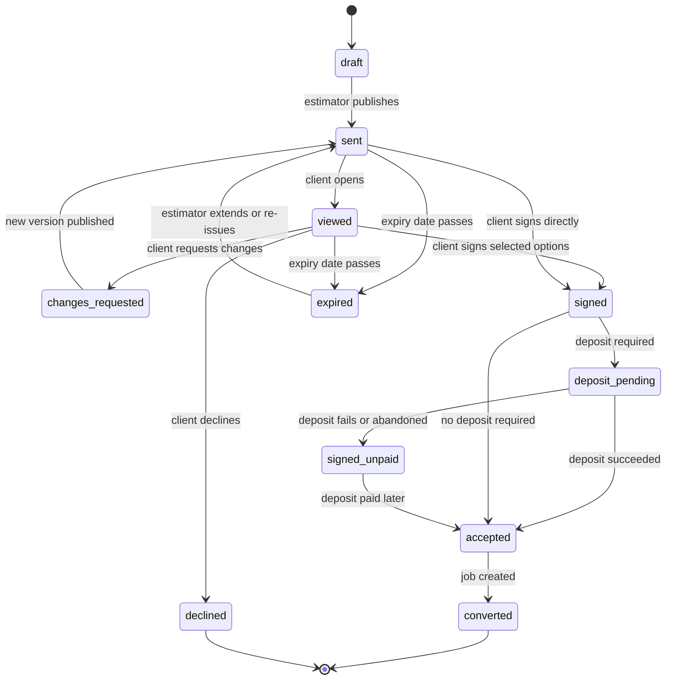

- `accepted` triggers Job creation per [03](03-crm-sales-estimating-proposals.md) and [04](04-scheduling-dispatch-routing.md). Companies choose whether `signed_unpaid` blocks scheduling (default: blocks for Projects, does not block for recurring maintenance).
- **Decline** asks for an optional reason (price, timing, chose another contractor, other) which feeds win/loss analytics in [18](18-reporting-analytics.md).

#### 4.4.6 E-signature [MVP]
- Compliant with the US ESIGN Act and UETA, and with Canadian provincial electronic commerce acts (PIPEDA Part 2 for federal matters): the signer affirmatively consents to do business electronically (checkbox with the consumer disclosure, including how to get a paper copy and withdraw consent), sees the full terms before signing, and receives a copy.
- **Signer verification** follows the proof ladder in 4.2.5. A forwarded link cannot be detected reliably, so the rule does not try to. It checks things the system can know instead: the amount, whether the typed name matches the Contact the link was addressed to, and whether the session is fresh. Example: Dana's $16,650 proposal is above the $10,000 default, so she confirms a 6-digit code sent to her phone on file, which iOS and Android autofill (about 10 seconds). A $640 change order from the same link needs no code. A signer who is not a Contact can sign as a new Contact only if the Company allows "anyone with the link can sign" (off by default). The new signer verifies their own email or phone with a code, the signature is flagged "signed by a new Contact", and both the original addressee and the Company are notified at once.
- Signature styles: typed name rendered in a script font (default, fully accessible) or drawn signature (optional). Typed is always available so keyboard and screen-reader users are never blocked.
- Audit trail per signature: signer Contact ID, name typed, verification method, IP, user agent, timestamps (viewed, consented, signed), SHA-256 hash of the canonical proposal version JSON and of the rendered PDF, selected options. A **Certificate of Completion** page is appended to the signed PDF.
- **Multi-signer** [V1]: proposals can require N signatures (both spouses; two of three board officers). Signing order optional. The proposal reaches `signed` when the requirement is met; partial state is shown ("1 of 2 signatures").
- Signature binds to a specific version; a later revision invalidates unsigned signatures and starts over.

#### 4.4.7 Deposits and payment schedule [MVP]
- Deposit rule set on the proposal: fixed amount, percentage of total (e.g. 30%), or "first milestone". Rounding to the cent; minimum deposit configurable.
- Payment happens in the same flow right after signing, using the Stripe Payment Element on the **Company's connected account** (direct charge). Methods: card, Apple Pay / Google Pay, US bank account (ACH) via Stripe Financial Connections instant verification with microdeposit fallback, Canadian pre-authorized debit [V1]. See [08](08-payments-stripe.md).
- ACH deposits are "processing" for several business days; the proposal moves to `accepted` on `processing` if the Company enables "accept on ACH initiation" (default on for deposits under $5,000), otherwise on `succeeded`. An ACH return after acceptance raises an alert to `office_manager` and flags the Job.
- The full milestone schedule is displayed ("30% deposit today $4,995; 40% ($6,660) when hardscape is complete; 30% ($4,995) at final walkthrough"), and each milestone becomes an invoice per [07](07-invoicing-billing-contracts.md).
- Card surcharges or cash discounts are configured in [08](08-payments-stripe.md) and shown transparently before payment where legal.

#### 4.4.8 Financing offer [V1]
- For proposals above a Company threshold (e.g. $3,000), show "As low as $X/month" with a soft-pull prequalification through a consumer-financing partner integrated in [08](08-payments-stripe.md). The Company is paid by the lender; Rootline never holds funds. Marketing copy must follow Truth in Lending advertising rules (trigger terms require full disclosures), so the component renders lender-supplied compliant copy only.

#### 4.4.9 Proposal engagement signals [MVP]
- Events (opened, time on section, tier toggles, mockup slider used, add-ons toggled, PDF downloaded) stream to the estimator's timeline in [03](03-crm-sales-estimating-proposals.md). Clients are told in the privacy notice that engagement is recorded. No third-party ad trackers ever load in the portal.

#### 4.4.10 Change orders [MVP]
- Change orders on active Projects appear as a card on the project tracker and as a notification. Content: reason (client request, unforeseen condition such as buried concrete, design change), scope delta, price delta (+/-), schedule impact in days, updated payment schedule, photos.
- Approve requires signature (same rules as 4.4.6); decline returns to `ops_manager`. Approved change orders adjust the contract value and the remaining milestones; negative change orders generate a credit per [07](07-invoicing-billing-contracts.md).

#### 4.4.11 Service Agreement renewals [V1]
- 30-60 days before an agreement term ends, the Client sees "Renew your 2028 Lawn and Shrub Program" with the new price, a clear year-over-year difference ("+3.5%: $58.40 to $60.45 per mow"), any changed scope, and one-tap renewal with signature and autopay continuation. Auto-renew clauses, if used, display the renewal date and cancellation path as required by applicable automatic-renewal laws (rules tracked in [07](07-invoicing-billing-contracts.md) and [14](14-service-line-modules.md)).
- Portal rules for auto-renewing agreements (the strictest applicable rule wins; legal content maintained with counsel; verify each before launch):
  - **Separate consent:** auto-renewal terms get their own unticked checkbox at signing. The portal stores it as a `consent_record` of purpose `auto_renewal` with the exact disclosure text version.
  - **Renewal notice window:** a renewal notice goes out in the window the Client's jurisdiction requires, defaulting to 30-45 days before the cancel-by date. Commercial contracts are covered too. For example, New York General Obligations Law 5-903 makes auto-renewal clauses in contracts for service, maintenance or repair of real property unenforceable unless written notice is given 15-30 days before the cancellation deadline. Landscape maintenance contracts for New York HOAs and office parks fall squarely under it (cited from general knowledge; verify).
  - **Click to cancel:** wherever a Client enrolled online, they can cancel online in the portal in no more steps than enrolling took. California's automatic renewal law was amended to require this from July 1, 2025 (AB 2863; verify). The FTC's 2024 "click-to-cancel" amendments to the Negative Option Rule were vacated by the Eighth Circuit in July 2025 (verify current status). Rootline builds to the strict standard regardless, so a future federal rule needs no rework.
  - **Retention offers** (for example "pause instead of cancel" or "skip July mows") may appear once in the cancel flow and must never block it.

### 4.5 Interactive design viewer

Designs are authored in the [Design Studio (10)](10-design-studio.md); mockups come from [AI Design and Mockups (11)](11-ai-design-mockups.md); plant data from the [Plant Knowledge Base (12)](12-plant-knowledge-base.md). The viewer is a read-only, client-optimized renderer of a published **Design Version**.

#### 4.5.1 2D plan viewer [MVP]
- Vector rendering (WebGL with a canvas fallback) of the published Design Version: Property boundary, house footprint, beds, hardscape, lawn areas, plant symbols, irrigation, lighting, labels, north arrow, scale bar, dimension strings.
- Pinch/scroll zoom from whole-property to 1:20 detail; double-tap to zoom to an area; "Fit" button.
- Layer toggles exposed to clients: Planting, Hardscape, Lawn, Irrigation, Lighting, Dimensions, Existing vs Proposed. Internal layers (construction notes, grading details, utilities) are hidden unless the designer publishes them.
- Measure tool [V1]: tap two points to see distance; tap an area to see square footage (helps Clients understand "320 sq ft patio").
- Units follow the Client's preference (ft/in or m), independent of the Company's default.
- Accessibility: every plan has a structured text alternative (areas table with dimensions, plant schedule, hardscape materials) that screen readers and keyboard users can navigate; plant symbols are focusable in a logical order and announce "Hydrangea paniculata 'Limelight', 3 plants, #5 container, front entry bed".

#### 4.5.2 Plant cards and plant list [MVP]
- Tap a plant symbol or a row in the plant list to open a **plant card**: KB hero photo plus seasonal photos (bloom, fall color, winter form), common and botanical names, cultivar, mature height and spread, growth rate, sun and water needs, bloom months, native status for the Property's Region, deer resistance, pollinator value, pet toxicity flag (from KB data with source), the Plant Region Profile rating ("Excellent performer in Northern Illinois"), and a short care summary.
- Plant list (schedule) grouped by type (trees, shrubs, perennials, grasses, groundcovers), with quantity, install size ("2 in caliper B&B", "#3 container", "flat of 18") and location.
- The card shows only Company-approved fields; the Company can hide retail plant prices.
- Photos are KB-licensed images curated by `platform_curator` ([12](12-plant-knowledge-base.md)); each has license and attribution metadata respected in the UI.

#### 4.5.3 AI mockups and before/after slider [MVP]
- Gallery of published mockups per Design Option: a mockup is published to the portal when the estimator or designer attaches it to the proposal option (`mockup.attached_to_proposal` in [11](11-ai-design-mockups.md)); each is paired with the original property photo.
- **Before/after slider:** draggable divider (keyboard-operable with arrow keys, screen-reader labeled "Comparison slider, 50 percent after"), plus "Before", "After", and "Side by side" toggles.
- A required caption on every AI image: "AI rendering for illustration. Plants shown at about 3 years of growth; actual appearance varies." (maturity year comes from the mockup metadata). This disclaimer is non-removable by Companies to limit misrepresentation risk ([11](#11-edge-cases-compliance-and-risks)).
- Pinch-zoom to 3x on mockups, with resolution sufficient for a phone (min 2048 px long edge).

#### 4.5.4 Seasonal, growth and day/night toggles [V1]
- **Seasonal toggle** (Spring / Summer / Fall / Winter): pre-generated mockup variants driven by KB phenology (bloom months, fall color, deciduous vs evergreen) for the Property's Region. Shown only if the designer generated and approved them.
- **Growth slider** (Install / Year 3 / Year 5+): variants generated from KB mature size and growth rate so clients understand why the designer spaced the boxwoods 3 ft apart.
- **Day / Night** for lighting designs: night render with fixture locations.

#### 4.5.5 3D view [V1]
- Browser 3D (three.js / WebGPU when available) generated from the Design: extruded hardscape, terrain from elevation data where available, plant models sized by KB attributes, sun position by date/time for the Property's latitude ("See shade on the patio at 6 pm in July").
- Orbit, walk mode, preset camera views saved by the designer.
- Performance guardrails: LOD models, max 150k triangles on mobile, automatic fallback to 2D plus mockups on low-memory devices, "Lite mode" toggle.

#### 4.5.6 Option comparison [MVP]
- Side-by-side view of two Design Options (plan or mockup) synchronized pan/zoom, with a price delta strip ("Option B: +$2,300 for the dry creek bed and 14 more perennials").

#### 4.5.7 Pinned design comments [V1]
- Client drops a pin on the plan or mockup and writes "Can this tree move 3 ft left so it doesn't block the window?" The comment stores plan coordinates (in the Design's coordinate system) and the Design Version. The designer sees pins as an overlay in Design Studio and can resolve them with a new version.

#### 4.5.8 Client plant swaps within approved alternates [V2]
- Designers can mark alternates for any plant ("Any of: Little Lime hydrangea, Bobo hydrangea"). Clients may swap within that set; the system re-prices from the price book, checks KB constraints (sun, zone, mature size against the bed) and regenerates the mockup at low resolution. The designer approves before the proposal version is updated.

#### 4.5.9 Downloads and IP protection [MVP]
- PDF plan sheets (Company title block) downloadable when the Company allows. Editable formats (DXF/DWG, Studio file) are never exposed in the portal.
- "Design fee gating": Companies that charge a design fee can watermark the plan and disable downloads until the design invoice is paid or the proposal is accepted.

#### 4.5.10 Viewer performance [MVP]
- Published Design Versions are compiled into a client bundle (simplified vector geometry + plant index + mockup URLs on the CDN). Target: first meaningful render under 2.5 s on a mid-range Android over 4G; bundle under 1.5 MB excluding images; images served in AVIF/WebP with responsive sizes.

### 4.6 Project tracker (install and multi-phase work)

#### 4.6.1 Phase tracker [MVP]
- A horizontal (desktop) or vertical (mobile) "pizza tracker" showing client-facing phases, current phase highlighted, completion dates for done phases and target windows for upcoming ones.
- Phase templates by project type, configured by the Company. Example for a paver patio and planting install:

| # | Client-facing phase | Typical internal trigger |
|---|---------------------|--------------------------|
| 1 | Proposal accepted | Proposal `accepted` |
| 2 | Design finalized | Final Design Version marked construction-ready |
| 3 | Approvals and permits | HOA architectural approval uploaded; permit issued (if any) |
| 4 | Utility locates | 811 ticket cleared |
| 5 | Materials ordered | Purchase orders sent ([13](13-operations-inventory-equipment.md)) |
| 6 | Scheduled | Visits booked for crew |
| 7 | Site prep and excavation | First visit started |
| 8 | Hardscape | Hardscape tasks complete |
| 9 | Irrigation and lighting | Tasks complete |
| 10 | Planting and mulch | Tasks complete |
| 11 | Final walkthrough | Walkthrough visit complete, punch list resolved |
| 12 | Complete, warranty active | Final invoice issued; warranty registrations created |

- Mapping from internal Project phases/tasks ([04](04-scheduling-dispatch-routing.md), [14](14-service-line-modules.md)) to client phases is many-to-one and configured per template; the client never sees internal task names.
- Each phase can carry a client-facing note ("Pavers are on backorder from the supplier; new delivery date April 22").

#### 4.6.2 Schedule confidence and delays [V1]
- Upcoming phases show a window ("Week of May 12") rather than a false-precision date. Weather or supply delays update the window and send one consolidated notification rather than per-visit noise. Rain-delay logic comes from [04](04-scheduling-dispatch-routing.md).

#### 4.6.3 Daily photo log [MVP]
- Crew photos and short notes captured in the crew app ([05](05-field-crew-mobile-app.md)) appear in the project feed if marked client-visible. Default rule: crew lead curates (selects up to 12 photos per day); Companies can switch to auto-publish for specific photo types (before/after) or require office review.
- Photos are served via signed CDN URLs that expire after 1 hour (refreshed on view); EXIF location is stripped from client-visible copies; faces of crew members can be auto-blurred [V1] if the Company enables it.

#### 4.6.4 Punch list and walkthrough sign-off [V1]
- At final walkthrough, the crew lead or `ops_manager` records punch items with photos; the client sees them, can add their own items within 7 days (configurable), and signs off on completion. Sign-off starts warranty clocks and can trigger the final milestone invoice.

#### 4.6.5 Documents in context [MVP]
- HOA approval letters, permits, material selections (paver color "Charcoal blend", wall cap style), delivery tickets and as-built drawings attach to the project and roll into the Property Record at completion.

#### 4.6.6 Time-lapse [V2]
- From geo-tagged daily photos taken from consistent positions (the crew app shows a ghost overlay to align shots), automatically generate a shareable before-to-after time-lapse video.

### 4.7 Visits, service history and transparency

#### 4.7.1 Upcoming visits [MVP]
- List and calendar of scheduled Visits for the selected Property: date, arrival window, service, recurring program step ("Round 4 of 6: Summer fertilizer + grub preventive"), crew lead first name.
- Company controls what is shown: arrival windows (on/off and width, default 2 h), crew names (first name only, or hidden), price per visit (hidden by default for agreement work).
- Subscribe to calendar [V1]: per-Contact private ICS feed URL (revocable) so visits show up in Google/Apple/Outlook calendars.

#### 4.7.2 Access notes and property instructions [MVP]
- Client-editable fields on each Property: gate code (stored encrypted, visible only to the assigned crew on the visit day), pets ("Dog in backyard Tue/Thu; please text before entering"), parking, "do not mow when the kids' party tent is up", irrigation controller location, preferred contact for on-site questions.
- Changes notify the `ops_manager` and are shown to crews in the crew app ([05](05-field-crew-mobile-app.md)) with a "changed" badge on the next visit.

#### 4.7.3 "On the way" and live ETA [MVP; live truck map V1]
- When the crew lead taps "Start driving to next stop" (or geofence departure from the previous stop is detected), the Visit moves to `en_route` ([04](04-scheduling-dispatch-routing.md) 4.1.3) and the Client receives "Your Greenleaf Grounds crew is on the way, ETA 9:40-10:10" with a link.
- The live page [MVP] shows the ETA window (next stop +/- 15 minutes rounded to 5, per [04](04-scheduling-dispatch-routing.md) 4.10.4), crew lead's first name and photo (optional) and truck description; the link stays valid until arrival plus 30 minutes. From [V1] it adds a map with the truck's approximate position **only while en route to this Property** and only within the final 30 minutes; position is snapped and delayed by 60 seconds to protect crew privacy. Tracking stops on arrival.
- ETA source: routing ETA from [04](04-scheduling-dispatch-routing.md) (`eta.updated`), refreshed every 60 seconds. A "running late" notice follows the trigger owned by 04 4.10.5 (ETA more than 15 minutes past the communicated window).
- Companies can disable live maps and keep ETA-only notifications.

#### 4.7.4 Visit completion summary [MVP]
- After a Visit is completed: date, services performed (checklist items marked done), crew notes written for the client, before/after photos, any issues found ("Noticed two broken spray heads in zone 3; quote sent"), and applications made.
- **Skipped or rescheduled visits** show the reason in plain language ("Mowing skipped: lawn dormant from drought; you are not charged for skipped mows under your per-visit agreement"), consistent with billing mode in [07](07-invoicing-billing-contracts.md).

#### 4.7.5 Application records (lawn care, plant health care) [MVP]
- For pesticide and fertilizer applications, the visit summary includes: product name, EPA registration number (US) or PCP registration number (Canada), active ingredient, application rate and area treated, target pest, weather at application (temperature, wind speed and direction), re-entry guidance from the label, and the applicator's name and license or certification number where required.
- **Pet and kid re-entry alert:** push/SMS "Treatment applied at 10:12 am. Keep pets and kids off the treated lawn until the spray has dried, per the product label." Text comes from the product's label-derived guidance stored in [14](14-service-line-modules.md), never improvised by AI.
- A number of US states and Canadian provinces impose posting, pre-notification or customer-notice requirements for commercial lawn applications; the rules engine in [14](14-service-line-modules.md) decides which notices are mandatory, and the portal is one delivery channel (with email/SMS and printable leave-behind as alternatives). Clients can register as pre-notification requesters [V1].

#### 4.7.6 Service history timeline [MVP]
- Reverse-chronological feed of all Visits, Projects, applications, requests, invoices and messages for a Property, with filters (service type, date range, has photos). Full-text search [V1].
- Each entry is permalinked so office staff can send "Here is the visit from June 12" links.

#### 4.7.7 Rate this visit [MVP]
- One-tap thumbs up/down (or 5-star, Company choice) plus optional comment and photo on each completed Visit summary. Negative ratings open a follow-up task for `ops_manager` with a 1-business-day SLA, and the thread appears in the unified inbox. Ratings feed crew scorecards ([15](15-team-hr-payroll.md)) and the review flow ([4.13](#413-growth-seasonal-offers-referrals-reviews)).

#### 4.7.8 Program view [MVP]
- For recurring programs (6-step lawn program, 4-visit shrub care, 30-week mowing season Apr-Nov, irrigation start-up in April and winterization/blowout in October, snow season Nov-Mar), a program card shows all steps with status (done, scheduled, upcoming window), so the client can see "Round 5: Fall fertilizer and aeration, target Sept 15-Oct 10".

### 4.8 Invoices, statements and documents

#### 4.8.1 Invoices [MVP]
- Tabs: Open, Paid, All. Each invoice: number, date, due date, Property, Job/Visit references, line items (per Company display settings), tax, credits applied, payments, balance, status (open, partially paid, paid, overdue, voided).
- PDF download (Company template). Multi-select "Pay selected".
- **Question a line** [V1]: client taps a line and writes a question; this creates an inquiry linked to the invoice, pauses automated dunning for that invoice for up to 14 days (configurable), and alerts the `office_manager`.

#### 4.8.2 Statements [MVP]
- Monthly statements (opening balance, invoices, payments, credits, closing balance, aging buckets), by Property or consolidated, generated per [07](07-invoicing-billing-contracts.md). On-demand statement for any date range.

#### 4.8.3 Receipts and credits [MVP]
- Branded receipt for every payment (email + portal), with payment method brand/last 4, amount, invoices paid, and the Company's legal name. Credit memos and their application history are visible.

#### 4.8.4 Year-end and spend summaries [V1]
- Annual spend by Property and category (maintenance, enhancements, snow), useful to HOA treasurers and commercial budgets. Exportable CSV.

#### 4.8.5 Documents vault [MVP core, V1 COIs]
- Typed documents per Client and Property: signed proposals and change orders (with certificates of completion), Service Agreements, warranty certificates, plant warranty registrations, HOA approvals, permits, as-built drawings, irrigation backflow test reports, soil test results, Certificates of Insurance (COI) [V1], W-9 / tax forms [V1], safety data sheets for products applied [V1].
- Each document has a visibility rule (scopes allowed), retention class (from [20](20-architecture-security.md)) and a source link.
- **COI self-serve** [V2]: a commercial Client requests a COI naming them as certificate holder or additional insured; the request routes to the `office_manager` or, via integration, to the Company's insurance broker; the issued COI is stored and its expiry tracked, with automatic re-issue reminders 30 days before policy expiry.

### 4.9 Payments

Architecture, Stripe objects and money flows are specified in [08 - Payments (Stripe)](08-payments-stripe.md). Here we define the portal behavior.

#### 4.9.1 Pay one or many invoices [MVP]
- Select invoices (default all open), see total, choose method, pay. Partial payments allowed if the Company enables them (minimum amount configurable, e.g. $25); partial amounts apply oldest-first unless the Client picks invoices.
- Methods: card and wallets (Apple Pay, Google Pay, Link) and US bank account (ACH Direct Debit) at [MVP]; Canadian pre-authorized debit at [V1]. All via Stripe Payment Element on the Company's connected account; the Company chooses which methods to enable.
- Fee transparency: if the Company passes card fees through (surcharge or non-cash adjustment where permitted), the fee line appears before confirmation with a nudge to bank payment; rules by state/province in [08](08-payments-stripe.md).

#### 4.9.2 Saved payment methods [MVP]
- Saved via SetupIntent to a Stripe Customer object on the Company's connected account. The portal shows brand, last 4, expiry and a nickname. Requires step-up (4.2.5) to add or remove.
- Default method per Client account; commercial accounts can hold multiple bank accounts (operating accounts per HOA).
- Expiring card reminder 30 days before expiry; Stripe's card account updater refreshes many cards automatically, so the reminder is suppressed if an update arrives.

#### 4.9.3 Autopay enrollment [MVP]
- Options: "Charge each invoice on its due date", "Charge on invoice date", or "Charge monthly statement balance on day N".
- Scope: whole account, or per Service Agreement (e.g. autopay the mowing program but not enhancement projects).
- Optional per-charge **cap** ("never auto-charge more than $750"); invoices above the cap are emailed for manual payment.
- **Authorization text** shown and stored (timestamp, IP, Contact, method, scope, cap). For ACH, a Stripe mandate is created; the client receives a copy by email.
- **Variable-amount notices:** for consumer accounts debited by ACH where amounts vary, Regulation E (12 CFR 1005.10(d)) requires notice of the amount and date at least 10 days before the transfer, unless the consumer elects to be notified only when the amount falls outside a specified range. Rootline implements this by (a) sending each invoice at least 10 days before its autopay date, or (b) offering the range election ("Notify me only if a charge is outside $40-$150"). This is a default-on policy for residential ACH autopay. It overrides the generic charge-timing default in [08](08-payments-stripe.md) (ACH charged 5 days after issue): a consumer ACH debit whose amount varies is scheduled no earlier than 10 days after the invoice notice, unless the Client made the range election and the amount falls inside it. Commercial accounts (not covered by Reg E) use the 08 defaults.
- Pre-charge reminder for card autopay (default 3 days before; never fewer than the 2-day minimum set in [08](08-payments-stripe.md)), configurable.
- **Canadian PAD** [V1]: for variable-amount pre-authorized debits, Rootline sends pre-notification of the amount and date per the PAD agreement. The default is 10 calendar days, reducible by agreement where Payments Canada Rule H1 allows. The mandate is presented in English or French, and the rules are owned by [08](08-payments-stripe.md) (verify against Rule H1).
- Cancel autopay any time (step-up required); cancellation is effective for charges not yet initiated. For consumer ACH, Regulation E (12 CFR 1005.10(c)) lets the consumer stop a preauthorized transfer by notifying at least 3 business days before it is scheduled. The portal therefore never initiates an ACH debit within 3 business days of a cancellation request it has received, and every pre-charge notice carries a "Stop this payment" link that works up to that cutoff.

#### 4.9.4 Payment plans and installments [V1]
- **Project milestone plans** come from the proposal (4.4.7).
- **Season installment plans**: an annual program billed in equal installments (e.g. a $1,620 lawn program billed as 9 monthly charges of $180 from March to November) with a disclosed schedule and autopay requirement.
- **Prepay discount**: pay the full season upfront for a Company-set discount (e.g. 5%), common in lawn programs; creates a prepayment credit consumed by visit invoices.
- **Hardship plan request** [V1]: client proposes a plan for an overdue balance (e.g. 3 payments); `office_manager` approves; dunning pauses while the plan is current.
- Plan states: `proposed`, `active`, `delinquent`, `completed`, `canceled` (US spelling for all state and event keys, matching the canonical `canceled` Job and Visit state in [04](04-scheduling-dispatch-routing.md)).
- **Credit guardrail:** in the US, a business that regularly extends consumer credit payable in more than four installments may be a "creditor" under Regulation Z. Following [07](07-invoicing-billing-contracts.md), season plans default to client-ahead calendars, where installments do not trail completed services, and never carry finance charges unless the Company has configured disclosed terms. Hardship plans are capped at 4 installments by default; the cap can be raised only with an explicit Company acknowledgment.

#### 4.9.5 Financing [V1]
- Same lender integration as 4.4.8, also available on large invoices.

#### 4.9.6 Tips for the crew [V1]
- Optional tip at payment for residential Visits and Projects (percent presets 10/15/20%, or flat $10/$20/$50 on invoices under $150), shown only if the Company enables tips; per service line the default is on for residential maintenance and installs and off for commercial invoices ([08](08-payments-stripe.md) 4.13). Tips post to **Tips Payable** (liability, account 2160 in the chart of accounts of [09](09-accounting-ledger-integrations.md); rules in [08](08-payments-stripe.md) 4.13), are excluded from the surcharge base and sales tax, and flow to payroll via [15](15-team-hr-payroll.md). Distribution defaults to a crew split by clocked hours on that Visit.
- **Tip ownership rules:** under the FLSA as amended in 2018, employers, managers and supervisors may not keep employees' tips (cited from general knowledge; verify). Owners and users holding `owner` or `ops_manager` roles are therefore excluded from tip splits by default. Deducting card processing fees from tips is hidden wherever the [08](08-payments-stripe.md) rules table forbids it (for example California). The receipt states: "100% of your tip goes to the crew."

#### 4.9.7 Failed payments and recovery [MVP]
- Failed autopay: Client is notified with a one-tap "Update payment method" action link; retries follow the schedule in [08](08-payments-stripe.md) 4.15 (soft card declines: up to 4 retries over 14 days, on days 1, 3, 7 and 14; hard declines are never retried). For ACH, only insufficient-funds returns (R01, R09) are re-presented, at most twice within 180 days of the original entry under Nacha rules (verify current rules). Returns such as R02 (account closed), R07 (authorization revoked), R10 or R29 (unauthorized) are never retried: autopay on that method is suspended at once and the Client is asked for a new method.
- Disputes and refunds are handled on the Company's Stripe account; the portal reflects refund status and amounts.

#### 4.9.8 Pay without signing in [MVP]
- Public "Pay an invoice" page on the portal domain: invoice number + billing ZIP/postal code lookup, then pay as a guest (no saved method). Rate-limited and Turnstile-protected.

#### 4.9.9 Portal money and the built-in Ledger [MVP]

Every number a Client sees in the portal must equal what the Company's books say. Competitor portals show balances from an operational database that syncs to QuickBooks after the fact, so "I paid, why does it say overdue?" is a common support call. In Rootline the built-in double-entry Ledger ([09](09-accounting-ledger-integrations.md)) is the system of record, and the portal reads the **AR subledger** directly.

- **Single source:** open balance, aging, statement lines and credits come from the AR subledger projection (`portal_invoice_view`), never from a separate portal cache. A payment confirmed by Stripe updates the projection in the same outbox transaction that posts the journal entry.
- **Postings from portal actions** (account codes and posting rules from the canonical chart in [09](09-accounting-ledger-integrations.md) 4.2 and 4.3.2; [08](08-payments-stripe.md) 4.17 maps Stripe balance-transaction categories onto them):

| Portal action | Ledger effect (on Stripe balance transaction) | What the Client sees |
|---------------|-----------------------------------------------|----------------------|
| Deposit paid at signing | Dr 1050 Stripe Clearing; Cr 2150 Customer Deposits. Applied to the first milestone invoice later: Dr 2150, Cr 1200 AR | "Deposit $4,995 received" on the project tracker and receipt |
| Invoice paid (card) | Dr 1050; Cr 1200 AR. Fee lines: Dr 6150 Merchant Fees, Cr 1050 | Invoice "Paid", receipt. Fees are never shown to the Client |
| Invoice paid (ACH, processing) | No GL entry yet; subledger "pending payment" record | "Payment processing, usually 4 business days". The balance shows as pending, not overdue, and dunning pauses |
| ACH succeeds / returns after success | Success: Dr 1050, Cr 1200. Return: Dr 1200, Cr 1050 | Return: "Your bank returned this payment (account closed)" and an update-method link |
| Season prepay | Prepaid season invoice Dr 1200 AR, Cr 2200 Deferred Revenue - Service Agreements (contract liability per [07](07-invoicing-billing-contracts.md)); payment Dr 1050, Cr 1200; revenue released per completed Visit | Prepaid balance with a "used so far" meter on the program card |
| Tip | Dr 1050; Cr 2160 Tips Payable | "100% of your tip goes to the crew" |
| Surcharge (where legal) | Dr 1050; Cr 4950 Card Surcharge Income | Separate disclosed line before confirmation |
| Overpayment or unallocated payment | Dr 1050; Cr 2180 Customer Credits and Unapplied Cash | "Credit on account $35.00, applied to your next invoice" |
| Referral reward or goodwill credit | Credit memo: Dr 4910 Discounts and Allowances (reason code `referral` or `goodwill`); Cr 1200 or 2180 | Credit memo in Documents and on the next statement |
| Refund | Paired with credit memo per [08](08-payments-stripe.md) | Refund status and expected arrival |

- **External books mode:** some Companies keep QuickBooks Online/Desktop or Xero as their system of record and sync with Rootline ([09](09-accounting-ledger-integrations.md)). A check deposited and recorded in QuickBooks is imported back as an external payment before the portal stops showing the balance. If the sync is more than 15 minutes stale, balance cards show "Updated 9:42 am" and the dunning engine waits for the next successful sync before sending an overdue reminder. This stops the "I mailed a check last week" escalation.
- **Allocation is explicit:** each payment stores a `payment_allocation` (invoice IDs and amounts, deposit, tip, surcharge, unapplied). Statements and receipts render from it, so a commercial AP clerk who pays 14 invoices in one ACH sees exactly how it was applied.
- **Period locks:** when the bookkeeper locks an accounting period, portal-side corrections (for example a voided invoice in a closed month) post in the current open period with a reference back. The Client-facing invoice history stays unchanged, and the books stay closed.

> **Competitive edge - LMN Pay, Jobber Payments, RealGreen:** Competitor portals tie online payment to the vendor's own payment program. LMN Pay is built into LMN's portal and since March 2026 runs "powered by Stripe" with Granum as the platform ([Green Industry Pros](https://www.greenindustrypros.com/business-management/software/product/22963124/granum-granum-launches-lmn-pay-experience)). Jobber's "Approve and Pay Deposit" flow is built around Jobber Payments. Running on Stripe does not mean the contractor owns the account. Rootline's portal charges the Company's own Stripe account directly: the Company keeps its Stripe dashboard, payout schedule, dispute handling and negotiated rates, and can leave Rootline without re-papering every client's autopay. RealGreen-style prepay and installment billing is matched, and the Reg E-aware autopay notices are built in rather than left to the contractor. Because the portal reads balances from the built-in Ledger (4.9.9) rather than a copy that syncs to QuickBooks later, "paid" in the portal and "paid" in the books are always the same.

### 4.10 Service requests and self-scheduling

#### 4.10.1 Request with photos [MVP]
- Categories (Company-configurable): New project idea, Add a service, Problem with a service, Irrigation issue (leak, broken head, controller), Tree or storm damage, Snow/ice issue (commercial, with "urgent" flag), Plant warranty claim (routes to 4.12.3), Billing question, Other.
- Fields: Property, location on property (tap on the Property map or Design plan to drop a pin; or choose an area like "Back yard"), description, up to 10 photos or a 60-second video, urgency (routine / soon / urgent with Company-defined meaning), preferred dates.
- Photos are uploaded directly to object storage via presigned URLs, resized client-side to max 2560 px, HEIC converted server-side.
- Submission creates a Request in [03](03-crm-sales-estimating-proposals.md) with status visible to the client: `submitted` -> `in_review` -> `quoted` / `scheduled` / `resolved` / `closed`.
- Response SLA promise shown per category (configurable; e.g. "We reply within 1 business day").

#### 4.10.2 AI triage [V1]
- On submit, the AI Gateway ([17](17-ai-copilot-automation.md)) classifies the category, extracts entities (zone number, plant name, quantity), assesses urgency (e.g. "water gushing" or "main line break" -> urgent irrigation), suggests a price book service and a draft reply, and for simple, Company-whitelisted items can produce an instant quote ("Replace 2 spray heads: $95 + $35 per head") for the client to approve. The office always reviews auto-quotes unless the Company explicitly enables auto-send for that service.

#### 4.10.3 Self-scheduling add-on services [V1]
- A Company-curated catalog of bookable add-ons with instant prices: "Gutter cleaning", "Mulch refresh", "Core aeration + overseed", "Holiday lighting install", "Irrigation start-up", "Irrigation winterization", "Extra mow before an event".
- Price is computed from the price book and Property measurements in the Property Record (e.g. aeration priced by lawn square footage; mulch by bed area x depth / 324 to get cubic yards); if measurements are missing, the item becomes "Request a quote".
- Slot selection uses capacity from [04](04-scheduling-dispatch-routing.md): only days where the relevant crew type has capacity in the Property's route zone, respecting lead time (e.g. 3 business days), blackout dates and seasonal windows (aeration offered Aug 20-Oct 15 for cool-season turf). Clients pick a day or a week, not a time, unless the service requires presence.
- Booking creates a one-off Job and Visit, optionally charges a deposit or card-on-file authorization, and shows in the program view.

#### 4.10.4 Skip, reschedule and vacation holds [MVP]
- Policy-driven, with the scheduling rules owned by [04](04-scheduling-dispatch-routing.md) 4.2.8: Company sets which services allow client skips (e.g. weekly mow), the cutoff (default 18:00 the day before service; later requests become an office task), billing effect (no charge for skipped per-visit work; no effect on flat monthly contracts) and maximum skips per season.
- Vacation hold: pause visits between dates (a Property blackout; Visits inside it close as `skipped` with reason `client_pause`); optional "mow the day before we return".
- Reschedule requests for non-recurring visits pick from slots offered by the Availability API in [04](04-scheduling-dispatch-routing.md) 4.13. Commercial Clients with approval workflows route the request to the approver Contact first. Requests emit `portal.skip_requested`, `portal.reschedule_requested` or `portal.pause_requested` (8.3).

### 4.11 Messaging

#### 4.11.1 Threaded conversations [MVP]
- One conversation space per Client, with threads contextually attached to a Property, Proposal, Job, Invoice or Request. Clients can start a general thread or reply in context.
- **Bridged to SMS and email:** a staff reply is delivered to the portal and, according to the Contact's preferences, by SMS (from the Company's 10DLC number) or email (from the verified sender domain). Client replies by SMS or email thread back into the same conversation via reply-address tokens and phone-number matching. Staff work from the unified inbox in [16](16-marketing-growth-communications.md).
- Attachments: photos, PDFs, video up to 100 MB (portal), MMS limits applied to SMS bridge (images resized; links for larger files).
- Staff identity shown as first name + role ("Maria, Office"), with an optional avatar; Company can choose a shared "Greenleaf Grounds Team" identity instead.

#### 4.11.2 Expectations and hours [MVP]
- Business hours with auto-reply outside hours, emergency contact path (e.g. irrigation main-line break, snow emergency), expected reply time.
- [V1] AI receptionist drafts answers grounded in the Client's own data and Company FAQ; auto-send only for whitelisted intents (visit date, invoice balance, gate code confirmation), otherwise staff approve ([17](17-ai-copilot-automation.md)).

#### 4.11.3 Translation [V1]
- Messages are auto-translated between the Contact's language and the staff member's language with "translated, see original" toggle. Common in crews and offices that work in Spanish while clients write in English, and vice versa.

#### 4.11.4 Read state and delivery status [V1]
- Staff see delivered/read for portal messages and delivered/failed for SMS; clients see "Seen by Greenleaf Grounds" only if the Company enables it.

### 4.12 Plant care and warranties

#### 4.12.1 Personalized plant care guide [MVP static, V1 personalized]
- On Project completion, the system generates a care guide for the plants actually installed (from the as-built plant list, not the proposal), using KB care data for the Property's Region ([12](12-plant-knowledge-base.md)): watering during establishment, mulching, pruning windows ("Prune Limelight hydrangea in late winter; blooms form on new wood"), fertilizing, winter protection, common pests to watch.
- [MVP] Guide is a templated, Company-branded page and PDF assembled from KB care snippets.
- [V1] Guide is personalized by AI within guardrails: grounded only in KB care fields and the Company's care policy, reviewed or auto-approved per Company setting, translated to the Client's language.

#### 4.12.2 Watering schedule and reminders [V1]
- Establishment schedule generated per planting group based on plant type, install size, soil type (from Property Record), season and the Company's warranty watering policy. Example policy template (Company-editable, not universal guidance): trees and large shrubs - deep water every 2-3 days for the first 2 weeks, then twice weekly through week 8, then weekly until first frost; perennials - every 1-2 days for the first week, then every 3 days for weeks 2-4.
- **Weather-aware:** daily job checks forecast and observed rainfall for the Property; if rainfall since the last reminder exceeds a threshold (default 0.5 in / 13 mm), the reminder is skipped with a note ("Skip today: 0.7 in of rain yesterday"). Heat waves add an extra watering reminder.
- Channels: push (PWA), SMS or email per preference; send windows (4.14.1) honored, so watering reminders go out at 7 am, not at dawn; reminders end automatically when the establishment period ends.
- **"I watered" check-in:** one tap logs compliance with a timestamp, which strengthens warranty claims. Optional photo.
- [V2] Smart irrigation controller integration (e.g. Rachio, Hunter Hydrawise via their APIs) to read actual run times and suggest a temporary "new plantings" schedule, with Client approval.

#### 4.12.3 Plant warranty registry and claims [MVP registry, V1 claims flow]
- Each warrantied installed plant gets a **warranty registration**: plant, location, install date, size, warranty term (e.g. 1 year for trees and shrubs, 1 season for perennials, none for annuals), coverage (replacement plant only, or plant + labor at X%), number of replacements allowed (commonly one), conditions (client watering compliance, no damage from animals, storms or chemical misuse), and exclusions. Registrations are created automatically from the as-built plant list and the Company's warranty policy.
- Clients see a warranty list with countdowns ("Serviceberry, back corner: warranty through June 3, 2028").
- **Claim flow** [V1]: select plant on the plan or list -> photos (whole plant, close-up of leaves/bark) -> questionnaire (when noticed, watering frequency, recent weather events) -> AI pre-assessment (likely drought stress, transplant shock, disease, animal damage; with confidence and recommended next step) -> `ops_manager` decision (approve replacement, schedule inspection, deny with reason, or "wait and see" with re-check date) -> replacement Visit scheduled -> claim closed. Claims auto-attach the watering check-in history and applicable weather (e.g. heat dome week, late frost).
- Approved replacements create a zero-price Job (or partial-price per coverage) and a new registration with a fresh or remaining-term warranty per Company policy.

#### 4.12.4 Seasonal care tips feed [V1]
- Region- and plant-aware tips ("Your Little Bluestem looks best if you leave it standing through winter for structure and birds; cut back in March") curated by `platform_curator` and Company-editable, delivered monthly.

#### 4.12.5 "What's wrong with my plant?" [V2]
- Client photo diagnosis assistant grounded in KB pest/disease data, with confidence levels and a "Have a pro look" button that creates a request. Never recommends restricted-use pesticides or DIY chemical rates.

### 4.13 Growth: seasonal offers, referrals, reviews

#### 4.13.1 Seasonal offers [V1]
- Company-defined offers targeted by Property attributes and history: e.g. core aeration + overseeding in late summer for cool-season lawns over 3,000 sq ft; fall cleanup for Properties with mature deciduous trees; holiday lighting in October for Properties that had it last year; irrigation winterization reminders in late September for Properties with irrigation zones.
- Offer card shows price (computed from Property measurements), validity dates, one-tap "Add to my plan" which creates a Job (or a pending request if pricing needs review).
- Frequency caps: max 1 offer card and 2 offer messages per Client per month (Company-configurable) to avoid fatigue. Marketing consent required for message delivery (portal card display is not a marketing message).

#### 4.13.2 Next best service recommendations [V2]
- Model-ranked suggestions from history, Property features and regional seasonality ("Your irrigation system is 9 years old; 4 zones showed repairs last season. Consider a system audit."). Always labeled as suggestions.

#### 4.13.3 Referral program [V1]
- Each Contact gets a referral link (portal domain) and a shareable card (e.g. their own before/after image, with consent). Reward rules: fixed credit (e.g. $50) to referrer when the referee's first invoice of at least $X is paid; optional referee discount. Rewards post as credit memos via [07](07-invoicing-billing-contracts.md).
- Fraud controls: same-address and same-payment-method detection, cap on rewards per year, manual review over thresholds.

#### 4.13.4 Reviews [V1]
- After a milestone event that applies to every Client the same way (Project completion sign-off, end of season, or a configurable number of completed visits), the Client is invited to leave a public review. Google Business Profile is the primary destination, with Facebook and Houzz as secondary links. Eligibility rules (no re-ask within 180 days, skip if a matched Google review exists) are owned by [16](16-marketing-growth-communications.md). Private feedback to the Company is offered **alongside** public review links, never instead of them.
- **No Yelp solicitation:** Yelp discourages businesses from asking for reviews, so the portal never sends Yelp review requests. A Company may show a passive "Find us on Yelp" badge in the footer ([16](16-marketing-growth-communications.md)).
- **No review gating and no incentives:** the same invitation goes to everyone regardless of predicted or actual sentiment, and a thumbs-down visit rating (4.7.7) never removes a Client from review eligibility. Rootline does not suppress negative reviews, consistent with the FTC rule on consumer reviews and testimonials (16 CFR Part 465). No review incentive of any kind exists in the product, because Google prohibits incentivized reviews of any sentiment ([BrightLocal platform guidelines](https://www.brightlocal.com/learn/review-management/dos-and-donts/review-platform-guidelines/), [DAC Group](https://www.dacgroup.com/?p=159133), as cited in [16](16-marketing-growth-communications.md)). Referral rewards (4.13.3) are never tied to reviews, and the template editor blocks incentive language in review asks.
- Review responses are managed in [16](16-marketing-growth-communications.md).

#### 4.13.5 Share your project [V1]
- Branded before/after share cards and time-lapse clips (V2) that clients can post; shares include the Company's referral link.

### 4.14 Notification preferences and consent

#### 4.14.1 Preference center [MVP]
- Per Contact, per category, per channel (email, SMS, push):

| Category | Type | Default email | Default SMS | Default push | Can disable? |
|----------|------|---------------|-------------|--------------|--------------|
| Sign-in codes and links | Transactional / security | On | On (if used) | n/a | No |
| Proposals and change orders | Transactional | On | Off | On | Yes for `viewer` (portal-only); signers keep email |
| Visit reminders (day before) | Transactional | Off | On | On | Yes |
| On the way / completed | Transactional | Off | On | On | Yes |
| Invoices, receipts, autopay notices | Transactional / legally required | On | Off | On | Reg E notices cannot be turned off while ACH autopay is active |
| Application notices (pesticide) | Regulatory where required | On | On | On | Not where legally required |
| Messages from the Company | Conversational | On | On | On | Yes (at least one channel stays on) |
| Plant care reminders | Service | Off | On | On | Yes |
| Commercial reports and approvals | Transactional | On | Off | On | Yes, digest available |
| Offers, newsletters, review and referral asks | Marketing | Requires opt-in | Requires express written consent | Requires opt-in | Yes |

- **Send windows** follow the rule table in [16](16-marketing-growth-communications.md) (strictest of federal, state "mini-TCPA" and provincial rules wins): transactional SMS and push 7 am-9 pm in the recipient's local time (so 7:15 am "on the way" messages for early crews are allowed), marketing SMS 9 am-7 pm Monday-Saturday only. Urgent categories (snow emergency for opted-in commercial Contacts, irrigation leak response, sign-in codes) bypass send windows. A Contact can narrow their own window further (for example "no texts before 8 am").
- Language per Contact; units per Contact.
- **Digest mode** [V1] for commercial Contacts: daily or weekly digest of visits, reports and approvals instead of per-event messages.

#### 4.14.2 Consent records [MVP]
- Every consent (SMS transactional, SMS marketing, email marketing, e-sign consumer consent, autopay authorization, Reg E range election) is stored as an immutable record: Contact, channel, purpose, exact disclosure text version, method (web form, keyword, staff-recorded verbal), timestamp, IP/phone, and source page. Revocations are records too.
- SMS opt-out and help keywords (STOP, STOPALL, END, CANCEL, UNSUBSCRIBE, QUIT, HELP, START, plus Spanish equivalents such as ALTO, PARAR, BAJA and AYUDA) are honored globally per number; STOP on the Company's number stops all non-security SMS from that number and the change is reflected in the preference center.
- **Any reasonable means:** under the FCC's revocation rules (in effect since April 11, 2025), opt-outs made by any reasonable means must be honored within 10 business days. Portal-specific sources include a free-text SMS reply ("please stop texting me"), a message-thread request, a preference-center toggle and a request taken by staff over the phone. Rootline processes them immediately rather than taking the 10 days. Clear marketing-only opt-outs revoke marketing only; ambiguous ones revoke all SMS and ask the Client to clarify by email. The FCC's later amendments to the "revoke all" scope have reported effective dates that differ between sources (as of Nov 2026, verify; sources in [16](16-marketing-growth-communications.md)), and the design above holds under any outcome.
- Canadian Contacts: express consent for commercial electronic messages per CASL, with identification and unsubscribe in every message; implied-consent windows tracked per [16](16-marketing-growth-communications.md).

### 4.15 The Property Record

The Property Record is Rootline's answer to "the yard has no memory". It is a lifetime, structured record of a Property's landscape that the Client can see, export and eventually transfer.

#### 4.15.1 Contents [MVP view, V1 complete]

| Section | Contents | Source modules | Priority |
|---------|----------|----------------|----------|
| Property profile | Address, parcel outline, lot size, lawn area, bed area, turf type, sun/shade map, soil type, soil test results (pH, P, K, organic matter), USDA hardiness zone and Rootline Region | [10](10-design-studio.md), [12](12-plant-knowledge-base.md), [14](14-service-line-modules.md) | [MVP] profile, [V1] soil and sun |
| Installed plants | Each plant: species/cultivar (KB link), location on plan, install date, install size, source nursery, warranty status, replacement history, care guide | [10](10-design-studio.md), [12](12-plant-knowledge-base.md), [13](13-operations-inventory-equipment.md) | [MVP] |
| Hardscape | Areas, materials (manufacturer, product, color, SKU), base depth and compaction notes, install date, warranty, sealing history | [10](10-design-studio.md), [14](14-service-line-modules.md) | [V1] |
| Irrigation map | Controller (make/model, location), zones with type (spray, rotor, drip), head counts, valve locations, main line and lateral routes, backflow device with annual test dates and reports, rain sensor, water source | [14](14-service-line-modules.md) | [V1] |
| Lighting | Fixtures (type, lamp, wattage), transformer (size, location, timer), zones and wire runs | [14](14-service-line-modules.md) | [V1] |
| Drainage and utilities | Drains, downspout tie-ins, dry wells, located utilities (from 811 marks and as-builts, informational only) | [10](10-design-studio.md) | [V1] |
| Trees | Tree inventory with DBH, condition, risk notes, pruning and treatment history (arborist work) | [14](14-service-line-modules.md) | [V1] |
| Service history | All visits, applications, projects, photos | This doc, [04](04-scheduling-dispatch-routing.md) | [MVP] |
| Documents | Designs (PDF), warranties, permits, HOA approvals, as-builts | This doc | [MVP] |
| Client notes and photos | Client's own notes ("Grandma's peony, moved from the old house") and photos | Client | [V1] |

- **Never included:** prices paid by the Company, costs, margins, internal notes, crew pay, Company-internal ratings of the Client.
- Data is presented on an interactive map/plan (the latest as-built Design Version with service events plotted) plus list views.

#### 4.15.2 Ownership and portability [V1]
- Policy: the **facts about the yard belong to the Client**; the Company is the steward. The Client can export at any time (step-up required): a branded PDF "Yard Book", a ZIP of photos and documents, and machine-readable files (JSON for structured data, GeoJSON for plan features in the Property's local coordinate reference, CSV for plant and service lists).
- If the Client stops using the Company, read-only portal access to the Property Record continues for at least 24 months (exact period is a Company-tier setting with a platform minimum; see [Open questions](#14-open-questions)). The Company may not delete the Client's Property Record during that period except for legal erasure requests.
- If the Company churns off Rootline, Clients receive an export link (Company-branded email sent by the platform) and read-only access for a platform-defined minimum (proposed 12 months), funded as part of the Company's offboarding terms ([19](19-platform-admin-portal.md), [22](22-business-model-pricing-gtm.md)).

#### 4.15.3 Sharing and transfer [V2]
- **Share read-only link** with an expiry (realtor, home inspector, insurance adjuster, new landscaper).
- **Transfer at home sale** ("Yard Carfax"): the seller initiates transfer to the buyer; the Company is notified and can introduce itself to the new owner; the record forks so the seller keeps a copy of their history and the buyer gets the yard facts (not the seller's invoices or messages).
- **Import into another Rootline Company** [V2]: with Client consent, a new Company can receive the record (structured data, not the prior Company's documents marked Company-confidential).

#### 4.15.4 QR plant tags [V2]
- Optional weatherproof QR tags at installation link to the plant's page in the Property Record (care, warranty, "report a problem").

> **Competitive edge - ServiceTitan, SingleOps:** ServiceTitan exposes equipment history in its portal and SingleOps launched a Tree Inventory for arborists, which shows the value of asset-level records. Neither gives a landscape client a to-scale map of every plant, irrigation zone, valve and light in the yard with warranties and care guides attached, and neither positions that record as the client's to keep and transfer. That ownership stance builds trust with homeowners and gives Companies a reason to stay on Rootline: the record is what makes them the obvious choice to keep maintaining the yard.

### 4.16 Commercial and HOA experience

#### 4.16.1 Portfolio dashboard [V1; MVP has property switcher and per-property pages]
- Map and table of all Properties the Contact can access with columns: Property, region/manager, contract status, last visit, next visit, open requests, pending approvals, YTD spend vs budget, open balance, latest inspection score.
- Filters by region, property type (HOA, office, retail, multifamily), account manager, budget status (over/under).
- KPIs across the portfolio: enhancements approved this month, average request response time, % visits completed on schedule, snow events this season.

#### 4.16.2 Contacts and roles [MVP basic, V1 full]
- Contacts assigned scopes (Section 3.3) per Property or Property group. A management firm can have 30 Contacts: regional managers, community managers, board members (per community), AP clerks, site staff.
- `primary` Contacts on the commercial side can invite and deactivate their own colleagues (step-up), subject to Company approval if the Company enables "approve new client contacts".
- Departing personnel: when a management firm loses a community contract, the Company (or the firm's primary) moves the Property to another Client or revokes access in bulk; open approvals assigned to removed Contacts are reassigned.

#### 4.16.3 Enhancement approval workflows with budgets and PO numbers [V1]
- **Approval policy** per Client (optionally per Property): ordered rules evaluated by amount and category. Example for Sonoran Community Management:

| Rule | Condition | Approvers | Mode |
|------|-----------|-----------|------|
| 1 | Category = irrigation repair AND amount <= $750 | Community manager | Any one |
| 2 | Amount <= $5,000 | Community manager, then regional manager | Sequential |
| 3 | Amount > $5,000 | Board of that community | Vote: majority of 5, quorum 3, 7-day deadline |
| 4 | Snow extras during an event | Pre-approved up to contract unit rates | Auto |

- **Budgets:** per Property, per fiscal year, per category (enhancements, irrigation repairs, tree work, seasonal color, snow extras). Proposals show "This uses $6,200 of $18,000 remaining enhancement budget (34%)". Over-budget proposals require the next-higher approver level (configurable) and show a red warning.
- **PO numbers:** Client can require a PO on approval. PO formats can be validated (regex supplied by the Client, e.g. `^SCM-[0-9]{6}$`). A **blanket PO** with a not-to-exceed amount can cover a category for a year; each approved item draws down the PO balance; the portal shows remaining balance; invoices automatically carry the PO number ([07](07-invoicing-billing-contracts.md)).
- Approval requests carry the proposal, design/mockups, photos and the requesting manager's note. Approvers can approve, reject (reason required), request changes, or delegate (to another `approver` with equal or higher limit) while out of office.
- Escalation: reminders at 48 h and 120 h; Company is notified when an approval has stalled past the Company's SLA.
- **Approval request states:** `pending` -> `approved` / `rejected` / `changes_requested` / `expired` / `withdrawn`; each step has its own state.

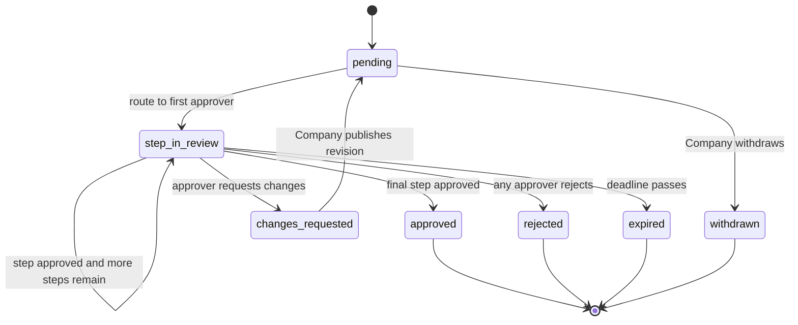

#### 4.16.4 HOA board voting [V2]
- Board votes with quorum and majority rules, deadline, optional comments, and a vote record exportable for minutes. Rootline records votes; it does not determine legal validity under the HOA's bylaws (the Client configures rules and is responsible for compliance).

#### 4.16.5 Site inspection reports [V1]
- `ops_manager` or `crew_lead` performs a scored inspection in the crew/office app: categories (turf quality, bed weeding, shrub pruning, tree health, irrigation function, litter, hardscape condition, seasonal color), each 1-5 with photos and comments; issues flagged with recommended action and optional one-click proposal.
- Published reports show the score trend per Property and per category, and recommended enhancements can be approved directly (feeding the approval workflow).

#### 4.16.6 Monthly service reports [V1]
- Auto-generated per Property on the 1st of each month (or on demand): visits performed and dates, services completed vs contract schedule, applications made (with product and rate), irrigation repairs (zone, part, quantity), labor hours (optional, Company setting), photos (selected highlights), weather impacts, snow events, open requests and their status, planned work next month, and enhancements pending approval.
- **AI narrative summary** [V1]: a short paragraph grounded in the report data ("In June, crews completed 4 of 4 scheduled maintenance visits. Irrigation repairs in zones 2 and 7 resolved the dry patches near the clubhouse..."), editable by `ops_manager` before publishing; Companies can auto-publish after 48 h if not edited.
- PDF export with Company branding; bulk download for all Properties.

#### 4.16.7 Snow and ice service log [V1]
- For snow contracts ([14](14-service-line-modules.md)): per storm event, per Property: trigger reached (e.g. 2-inch push trigger), arrival and departure times for each push, accumulation at service, de-icer type and quantity (e.g. "1.5 tons treated salt"), sidewalks cleared, photos with timestamps and GPS, weather data source for the event.
- Exportable per event or season as a PDF/CSV evidence package for slip-and-fall claims and insurer requests.

#### 4.16.8 Consolidated billing [V1]
- One invoice or statement per period across Properties, with per-Property sections or lines, cost-center/GL code per Property (Client-supplied), PO per line, remit-to details, and a summary page. Generated in [07](07-invoicing-billing-contracts.md); the portal lets `billing` Contacts download PDFs and CSV, pay by ACH in one payment, and see allocation.
- [V2] AP portal compatibility exports (generic CSV/XLS formats); [V3] e-invoicing integrations with procure-to-pay networks (e.g. Coupa, SAP Ariba) for large clients.

#### 4.16.9 Budgets and forecast [V1]
- Client-side view: contract value + approved enhancements + forecast for scheduled seasonal work vs budget per Property, with month-by-month projection. Helpful for HOA reserve and operating budget meetings.

#### 4.16.10 Resident intake for HOAs and multifamily [V2]
- Optional resident-facing request page per community (e.g. `portal.greenleafgrounds.com/r/desert-ridge`), where residents submit issues; the community manager triages and forwards approved items to the Company. Residents never see financials and do not become Contacts unless invited.

#### 4.16.11 Vendor compliance packet [V1]
- One place for the commercial client to fetch the Company's current COI, W-9, licenses (e.g. pesticide business license), safety program summary and signed contract.

### 4.17 Pre-client lead magnet ("Dream Yard Visualizer")

Rendering and layout engines are specified in [11](11-ai-design-mockups.md); lead routing and campaigns in [16](16-marketing-growth-communications.md). The portal hosts the public experience on the Company's portal domain and website embeds.

#### 4.17.1 Experience [V1; MVP offers a photo-based quote request form]
1. Prospect lands on `portal.greenleafgrounds.com/visualize` (or the embed on the Company's site).
2. Enters address; the system confirms the service area (Company-defined polygons or ZIP list). Out-of-area addresses get a polite message and optional waitlist.
3. Uploads 1-5 photos of the area to redesign (guidance overlay: "Stand at the street, landscape orientation, include the whole bed").
4. Enters **real dimensions** (e.g. "Front bed: 42 ft along the house, 8 ft deep") or traces the bed on the satellite view; the AI pipeline uses dimensions to scale plant counts and spacing. The UI warns when dimensions and photo perspective disagree badly ("Your photo suggests a bed closer to 25 ft long; please confirm").
5. Chooses a style (Cottage, Modern, Native/Pollinator, Low-maintenance, Xeric for arid Regions), maintenance appetite, and a budget range.
6. Verifies email or mobile (one-time code) to unlock results; marketing consent is a separate, unticked checkbox.
7. Receives 2-3 mockups constrained to the Company's preferred **Plant Palette** for the Property's Region (KB), a starter plant list with plant cards, and a ballpark price range computed from the Company's price book assemblies ("Typical investment: $6,500-$9,000"; never a binding quote).
8. CTA: "Book a design consultation" (self-scheduling into estimator availability) or "Ask a question".

#### 4.17.2 Conversion [V1]
- On verification, a Lead is created in [03](03-crm-sales-estimating-proposals.md) with photos, dimensions, style, budget, mockups and engagement. On conversion to a Client, mockups and dimensions seed the Design in [10](10-design-studio.md), and the prospect's verified identity becomes their portal Contact with history intact.

#### 4.17.3 Abuse and cost controls [V1]
- Per-Company monthly cap on lead-magnet AI credits with alerting; per-email/phone and per-IP limits (e.g. 3 generations per day); Turnstile; image safety filters (reject non-outdoor, faces/people prominent, explicit content); watermark on mockups until a consultation is booked; out-of-area requests do not consume AI credits.

#### 4.17.4 Privacy [V1]
- Clear notice that photos are processed by AI providers through the AI Gateway, retained for a stated period (default 18 months for unconverted leads) and not used to train third-party models (provider settings enforced per [17](17-ai-copilot-automation.md) and [20](20-architecture-security.md)).

### 4.18 Accessibility, languages, mobile-first and performance

#### 4.18.1 Accessibility [MVP]
- Conformance target **WCAG 2.2 Level AA** across all portal surfaces, verified by automated checks in CI (axe-core) plus manual screen-reader passes (VoiceOver iOS, TalkBack Android, NVDA Windows) before each major release.
- Specific commitments: brand-color auto-correction (4.1.1); minimum target size 24 x 24 CSS px (SC 2.5.8) with 44 x 44 for primary actions; full keyboard support including the plan viewer, before/after slider and signature; no cognitive-function test at sign-in (SC 3.3.8 Accessible Authentication: magic links, codes with autofill and passkeys comply); focus never hidden behind sticky footers (SC 2.4.11); consistent help location (SC 3.2.6) with the "Message us" entry point in the same place on every page; captions or transcripts for videos; reduced-motion mode disables slider animations and 3D auto-rotation.
- The design viewer's text alternative (4.5.1) is a first-class view, not an afterthought.
- An accessibility statement page per Company portal with a contact path for barriers.

#### 4.18.2 Languages [MVP EN/ES, V1 FR-CA]
- UI strings in English and Spanish at launch, French (Canada) in [V1]. Language auto-detected from browser, overridable per Contact, and remembered on the Contact so emails and SMS follow.
- Company-authored content (proposal letters, scope descriptions, offer copy, care guides) can be authored in multiple languages; [V1] AI translation drafts with "machine translated" label until a staff member approves.
- Quebec: for Clients with Quebec Properties, French versions of contracts and the portal are offered by default, consistent with the Charter of the French Language; this is a launch gate for Quebec-based Companies ([22](22-business-model-pricing-gtm.md)).
- Plant common names come from KB localized names; botanical names are never translated.

#### 4.18.3 Units, currency, time [MVP]
- Imperial or metric per Contact (cu yd vs m3, sq ft vs m2, in vs mm rainfall). Currency is the Company's (USD or CAD); amounts formatted per locale. All dates shown in the Property's time zone.

#### 4.18.4 Mobile-first PWA [MVP; push V1]
- Designed at 360 px width first. Installable PWA with app icon from the brand kit. Web push notifications (on iOS this requires the user to add the portal to the Home Screen, iOS/iPadOS 16.4+), with SMS/email fallback.
- Offline: last-viewed proposal, care guide, and Property Record summary cached for offline reading [V1]; actions queue only for comments and "I watered" check-ins.
- Native apps [V2] if push adoption on iOS via PWA is too low.

#### 4.18.5 Performance budgets [MVP]

| Metric | Budget (p75, mid-range Android, 4G) |
|--------|-------------------------------------|
| Largest Contentful Paint, home | < 2.5 s |
| Interaction to Next Paint | < 200 ms |
| Cumulative Layout Shift | < 0.1 |
| Initial JS (compressed) | < 200 KB for home and pay flows |
| Time to pay (from action link tap to payment confirmation, saved method) | < 30 s median user time |

### 4.19 Portal administration (Company side)

#### 4.19.1 Portal settings [MVP]
- Module toggles: proposals, design viewer, project tracker, visits, live ETA, invoices, payments, autopay, requests, self-scheduling, messaging, plant care, warranties, offers, referrals, reviews, documents, Property Record.
- Visibility rules: show prices on visits, crew names/photos, arrival windows, labor hours on reports, line-item detail default, application details.
- Invite policy, self-registration mode, session idle time for commercial users, step-up thresholds.
- Payment policies (see [08](08-payments-stripe.md)): enabled methods, partial payments, minimums, surcharges, autopay options, deposit defaults.

#### 4.19.2 Client access management [MVP]
- Per Client: list of Contacts with scope, Properties, last sign-in, invite status; actions: invite, resend, change scope, revoke, view as client. Bulk invite for imports (with throttling and staged rollout recommendations).

#### 4.19.3 Portal analytics [V1]
- Adoption (% active Clients with at least one portal session in the last 90 days), share of invoices paid online, autopay enrollment, proposal view-to-approval funnel by tier, self-serve request share, warranty claims, offer conversion. Details and definitions in [18](18-reporting-analytics.md).

#### 4.19.4 Template and content editor [MVP]
- Branded email/SMS templates per event with variables, language variants and preview; content pages (V1); care guide templates (MVP).

---

## 5. Key user flows

### 5.1 Proposal to signed and deposit paid (residential, first portal contact)

1. Estimator publishes a proposal with three tiers and two add-ons; the design viewer and two AI mockups are attached ([03](03-crm-sales-estimating-proposals.md), [11](11-ai-design-mockups.md)).
2. Dana receives an email from `hello@greenleafgrounds.com` and an SMS from the Company's number with a link on `portal.greenleafgrounds.com`.
3. She taps the link on her phone. GET renders a page; a POST exchanges the action token for an action session (no login screen).
4. She scrolls the proposal, drags the before/after slider, taps a plant to read about it, toggles "Better", adds drip irrigation.
5. The server recalculates totals and deposit; the sticky footer shows "Total $16,650, deposit today $4,995" (Better tier $14,800 plus drip $1,850, 30% deposit).
6. She taps "Approve and sign": e-sign consent, typed signature. The $16,650 total is above the $10,000 step-up threshold, so the proof ladder (4.2.5) sends a 6-digit code to her phone on file. iOS autofills it and she taps Confirm, about 10 seconds. (For a $2,400 fall bed-refresh proposal, the action link alone would have been enough.)
7. Payment Element loads for the Company's connected Stripe account; she pays with Apple Pay.
8. Stripe returns success to the client and sends a webhook to Rootline; the proposal moves to `accepted`, a Project Job is created, the signed PDF with certificate is stored, and a receipt is sent.
9. The portal shows the project tracker at phase 1, invites her to add Sam as `co_owner`, and offers passkey setup.

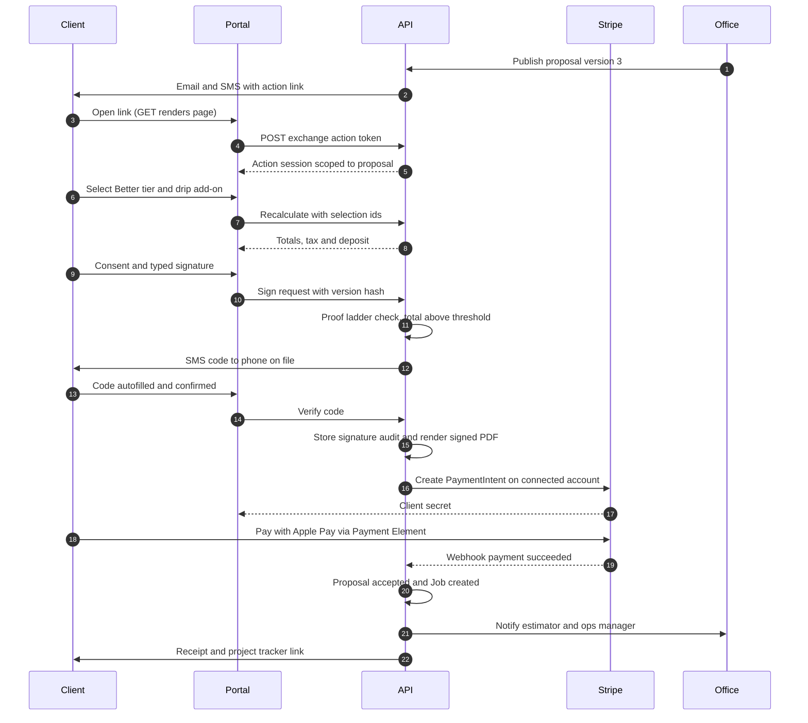

### 5.2 Passwordless sign-in

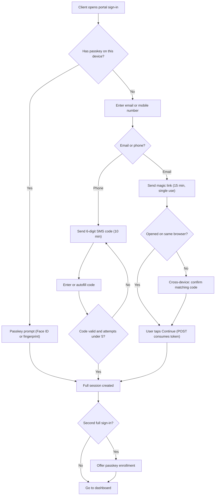

### 5.3 Commercial enhancement approval with budget and PO

1. `ops_manager` publishes an enhancement proposal "Replace 2,400 sq ft of dead turf at the north entrance with xeric planting, $11,850" for Desert Ridge HOA.
2. The approval engine evaluates policy: amount > $5,000 -> board vote; budget check shows $9,000 remaining in enhancements -> over budget by $2,850 -> rule requires community manager endorsement before the board vote.
3. Community manager Marcus endorses with a note and attaches the PO `SCM-204118`.
4. Five board members receive approval requests with mockups; three vote yes within 4 days; quorum and majority reached.
5. Proposal moves to `accepted`; budget is drawn down; the PO is stamped on the Job and all resulting invoices; the project tracker appears in the portfolio dashboard.

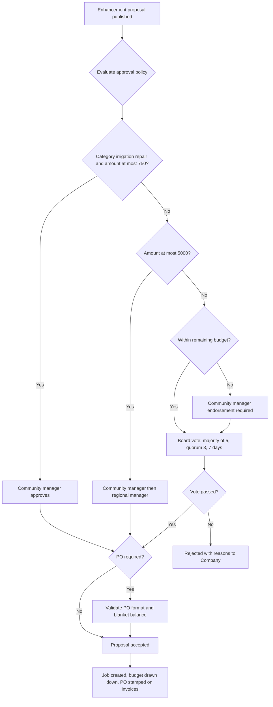

### 5.4 Plant warranty claim

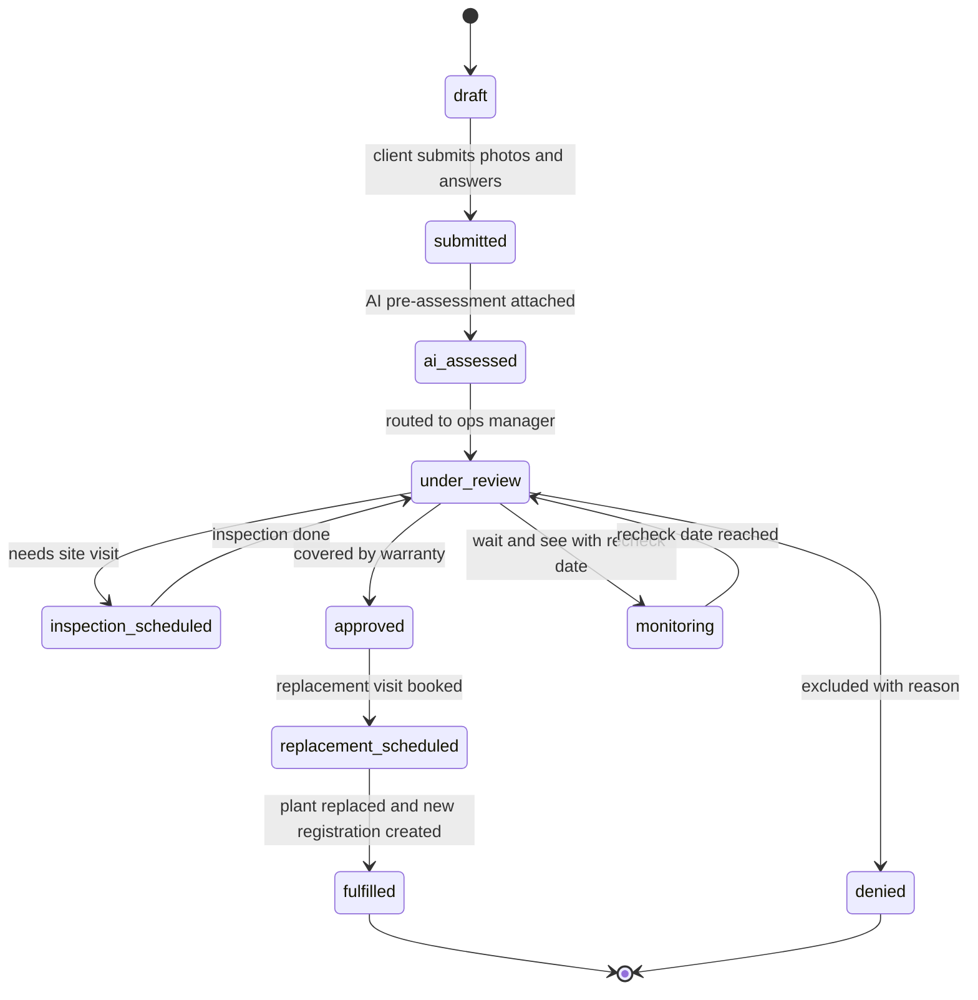

Rules: a claim can only be filed for an active registration; one open claim per registration; denial requires a reason from a Company-defined list (animal damage, mechanical damage, lack of watering evidence, outside warranty, act of nature excluded by policy) plus optional note; Clients may appeal once, which re-opens `under_review` with the owner notified.

### 5.5 Autopay enrollment (ACH, residential)

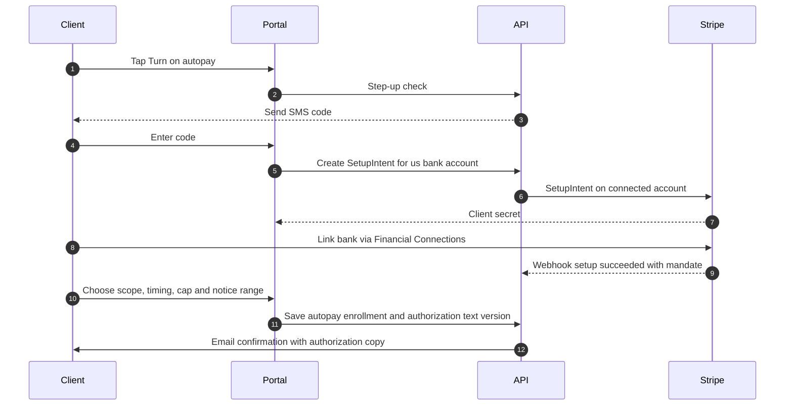

### 5.6 Visit day: on the way to paid

1. Crew lead taps "Drive to next stop" in the crew app; ETA computed; Client gets "on the way" SMS.
2. Crew arrives; live map hides; Visit starts.
3. Crew completes checklist (mow, trim, edge, blow), takes before/after photos, logs a broken spray head in zone 3.
4. Visit completion publishes a summary to the portal; an irrigation repair request is auto-created and a quote drafted.
5. If per-visit billing: invoice issued; autopay charges per enrollment (or batch at month end per [07](07-invoicing-billing-contracts.md)).
6. Client rates the visit; a thumbs-down opens a follow-up task.

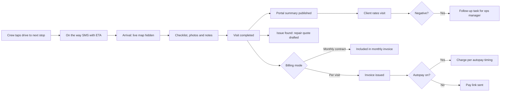

### 5.7 Lead magnet to Client

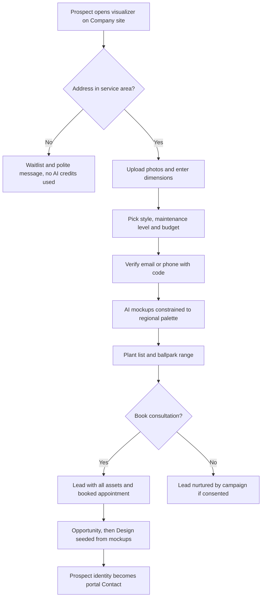

### 5.8 Service request with photos and AI triage

1. Hector (site contact) taps "Request", selects Building C on the property map, writes "Two shrubs dead by the front door", attaches 3 photos.
2. AI triage tags "plant replacement, non-urgent, possible warranty" and checks the Property Record: these two shrubs were installed 7 months ago with an active warranty.
3. The request is routed as a warranty claim draft to `ops_manager`, who approves replacement; Hector sees "Replacement scheduled for Thursday".

### 5.9 Property Record transfer at home sale [V2]

1. Dana starts "Transfer my yard record" and enters the buyer's email and closing date.
2. On the closing date the buyer receives an invitation (Company-branded) to claim the record; claim requires verifying email and confirming the Property address.
3. The record forks: buyer receives yard facts (plants, irrigation map, hardscape specs, warranties that are transferable per Company policy, service history summaries without prices); Dana keeps her full history read-only.
4. The Company is notified and can offer the buyer the existing program.

### 5.10 Change order mid-project (work blocked) [MVP]

1. During excavation for Dana's patio, the crew hits an old buried concrete footing. The crew lead logs photos and a note in the crew app ([05](05-field-crew-mobile-app.md)) and flags "work blocked".
2. `ops_manager` drafts Change Order #2 from the price book: "Break out and haul away buried concrete footing, about 1.5 cu yd: +$640, +1 day". The reason is "unforeseen condition", and the photos are attached.
3. Publishing marks it **work blocked**. Dana gets SMS and email action links, plus a red "Action needed" card on the home dashboard and project tracker (score 99 in 4.3.1, outranked only by an overdue balance).
4. Dana sees the photos, the scope and price delta, and the updated payment schedule (final milestone goes from $4,995 to $5,635). At $640 she is below the step-up threshold, so she signs from the link with no code (4.2.5).
5. Approval updates the contract value and remaining milestones ([07](07-invoicing-billing-contracts.md)), and the crew app shows "CO #2 approved, proceed".
6. Timeouts: if a work-blocked change order is undecided after the Company SLA (default 4 business hours), `ops_manager` gets a "call the client" task. If declined, the crew's pre-agreed fallback applies (for example, shift the patio 2 ft) and a revised Design Version is required before work resumes.

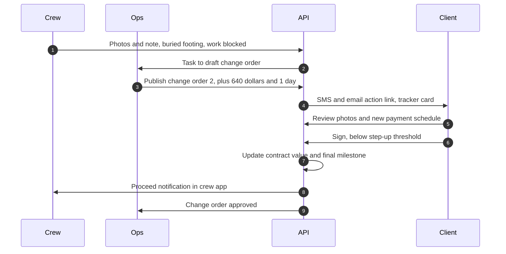

### 5.11 Portal payment to the Ledger (with optional external books) [MVP]

1. Rosa (commercial `billing`) selects 14 open invoices across 9 Properties and pays $23,480 by ACH from the HOA operating account saved on the Company's Stripe account.
2. Stripe reports `processing`. The AR subledger records a pending payment with its allocation, and no GL entry is posted yet. The portal shows "Processing" on each invoice, and dunning pauses for those invoices.
3. On `succeeded` (typically a few business days later), the Ledger posts Dr Stripe Clearing, Cr AR per allocation, and fee lines to Processing Fees ([08](08-payments-stripe.md)). Invoices flip to Paid, and a receipt with the allocation table goes to Rosa.
4. If the Company keeps external books in QuickBooks Online, the payment and allocation sync out ([09](09-accounting-ledger-integrations.md)). A paper check another community mailed and the Company recorded in QuickBooks syncs back in as an external payment, and the portal balance updates. Until that sync lands, the balance card shows its "updated at" time.

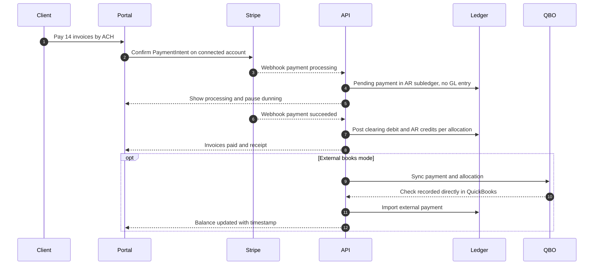

---

## 6. Screens and wireframes

### 6.1 Screen inventory

| ID | Screen | Primary personas | Priority |
|----|--------|------------------|----------|
| P-01 | Sign-in (email/phone, passkey) | All Contacts | [MVP] |
| P-02 | Action landing (scoped view from a link) | All Contacts | [MVP] |
| P-03 | Home dashboard (single Property) | `client_residential`, site contacts | [MVP] |
| P-04 | Portfolio dashboard | `client_commercial` | [V1] |
| P-05 | Proposal viewer with tiers and add-ons | Homeowners, approvers | [MVP] |
| P-06 | Sign and pay deposit | Homeowners, approvers | [MVP] |
| P-07 | Design viewer: 2D plan, plant cards, layers | All proposal viewers | [MVP] |
| P-08 | Mockup gallery with before/after slider | All proposal viewers | [MVP] |
| P-09 | 3D view | All proposal viewers | [V1] |
| P-10 | Project tracker | Project Clients | [MVP] |
| P-11 | Change order approval | Project Clients | [MVP] |
| P-12 | Visits: upcoming and history timeline | All Contacts | [MVP] |
| P-13 | Visit summary detail (photos, applications, rating) | All Contacts | [MVP] |
| P-14 | Live ETA ("on the way") | Residential Contacts | [MVP] ETA page, [V1] truck map |
| P-15 | Invoices and statements | `billing`, `primary` | [MVP] |
| P-16 | Pay (one or many invoices) | `billing`, `primary`, guests | [MVP] |
| P-17 | Payment methods and autopay | `billing`, `primary` | [MVP] |
| P-18 | Payment plans | `billing`, `primary` | [V1] |
| P-19 | New request (with photos and map pin) | All Contacts except `viewer` | [MVP] |
| P-20 | Book an add-on (catalog and slot picker) | Residential, site contacts | [V1] |
| P-21 | Messages (threads) | All Contacts | [MVP] |
| P-22 | Plant care guide and watering schedule | Project Clients | [MVP] guide, [V1] schedule |
| P-23 | Warranties and claim flow | Project Clients | [MVP] list, [V1] claims |
| P-24 | Property Record | `primary`, `co_owner` | [MVP] view, [V1] export |
| P-25 | Documents vault | Per scope | [MVP] |
| P-26 | Approvals inbox (commercial) | `approver`, `primary` | [V1] |
| P-27 | Inspection and monthly reports | Commercial Contacts | [V1] |
| P-28 | Snow event log | Commercial Contacts | [V1] |
| P-29 | Budgets and POs | Commercial `primary`, `billing` | [V1] |
| P-30 | Offers, referrals and reviews | Residential Contacts | [V1] |
| P-31 | Account: contacts, preferences, sessions, passkeys | All Contacts | [MVP] |
| P-32 | Public pay-an-invoice | Guests | [MVP] |
| P-33 | Dream Yard Visualizer (public) | Prospects | [V1] |
| C-01 | Company: portal settings and brand kit | `owner`, `office_manager` | [MVP] |
| C-02 | Company: client access management and view as client | `office_manager` | [MVP] |
| C-03 | Company: approval policies, budgets, POs per commercial Client | `ops_manager`, `office_manager` | [V1] |

### 6.2 Home dashboard (residential, mobile)

```text
+--------------------------------------+
| [E&S logo]  My Yard        (bell)(=) |
| 1418 Maple Ct, Naperville      [v]   |
+--------------------------------------+
| ! BALANCE DUE                         |
|   $186.00  - Invoice 1043, 6 days    |
|   overdue                             |
|   [ Pay now  ]   Autopay is off  >   |
+--------------------------------------+
| TODAY  Crew on the way                |
|   ETA 9:40 - 9:55 am                  |
|   Luis (crew lead) - white F-250      |
|   [ map: truck 1.8 mi away ]          |
|   Add gate or pet note >              |
+--------------------------------------+
| YOUR FRONT YARD PROJECT               |
|   (*)--(*)--(*)--( )--( )--( )        |
|   Sold Design Permit Sched Build Done |
|   Next: Materials ordered, wk of 4/21 |
|   View tracker >                      |
+--------------------------------------+
| NEW PROPOSAL   expires in 5 days      |
|   Fall core aeration + overseed $385  |
|   [ Review and approve ]              |
+--------------------------------------+
| WATER TODAY                           |
|   12 new shrubs along the walkway     |
|   About 2 gal each, slow soak         |
|   [ I watered ]    Skip reason >      |
+--------------------------------------+
| LAST VISIT  Tue Apr 8                 |
|   [photo][photo]  Spring cleanup done |
|   How did we do?  (thumb up)(thumb dn)|
+--------------------------------------+
| [Home] [Visits] [Pay] [Requests] [Me] |
+--------------------------------------+
```

### 6.3 Proposal: tier selection and sign (mobile)

```text
+--------------------------------------+
| < Front Yard Renovation     v3  PDF  |
+--------------------------------------+
| [ AI mockup: after ]  <|>  [before]  |
|   AI rendering, plants at ~3 years   |
+--------------------------------------+
| CHOOSE YOUR PACKAGE                   |
| +----------+ +----------+ +---------+ |
| |  GOOD    | | BETTER * | |  BEST   | |
| | $11,900  | | $14,800  | | $19,650 | |
| | Concrete | | + seat   | | Premium | |
| | pavers   | |   wall   | | pavers  | |
| | 320 sqft | | 320 sqft | | 400 sqft| |
| |          | | Our pick | | + 6 lts | |
| +----------+ +----------+ +---------+ |
|   Compare packages >                  |
+--------------------------------------+
| ADD-ONS                               |
| [x] Drip irrigation for new beds      |
|     +$1,850                           |
| [ ] Extra mulch (cu yd)  [-] 0 [+]    |
|     +$95 each                         |
+--------------------------------------+
| PLANTS (38)                 See all > |
|  Limelight hydrangea x3   #5   (i)    |
|  Little bluestem x12      #1   (i)    |
+--------------------------------------+
| Questions? Comment on any section     |
| [ Request changes ]                   |
+======================================+
| Total $16,650  Deposit today $4,995  |
| [      Approve and sign       ]       |
+--------------------------------------+
```

Sign step (sheet over the proposal):

```text
+--------------------------------------+
| Approve Front Yard Renovation         |
| Better package + Drip irrigation      |
| Total $16,650 incl. tax               |
| Deposit due today (30%): $4,995       |
| Then: 40% at hardscape, 30% at final  |
+--------------------------------------+
| [x] I agree to sign electronically    |
|     and receive records electronically|
|     (Read disclosure)                 |
| Full name                             |
| [ Dana Whitfield                 ]    |
|   Dana Whitfield  (script preview)    |
|   Draw instead >                      |
+--------------------------------------+
| [ Apple Pay ]                         |
| ----- or pay with -----               |
| ( ) Bank account (no fee)             |
| ( ) Card                              |
+--------------------------------------+
| [   Sign and pay $4,995   ]           |
| Secured by Stripe. Paid to            |
| Greenleaf Grounds Co.                 |
+--------------------------------------+
```

### 6.4 Design viewer with plant card (desktop)

```text
+----------------------------------------------------------------------------+
| Front Yard Renovation - Design v3 (Option B: Better)   [2D] [3D] [Mockups] |
+-----------------------------------------------+----------------------------+
| Layers                                        | PLANT                      |
| [x] Planting [x] Hardscape [ ] Irrigation     | [ KB photo: summer ]       |
| [ ] Lighting [x] Dimensions [ ] Existing      | [spr][sum][fall][win]      |
|                                               | Limelight Hydrangea        |
|   N                                           | Hydrangea paniculata       |
|   ^      +-------------- 42'-0" -------+      |   'Limelight'              |
|          |  o  o  o   (H)(H)(H)   o  o |      | Qty 3 - #5 container       |
|  HOUSE   |  bed A  - 8'-0" deep        |      | Mature 6-8 ft H x 6-8 ft W |
|          +-----------------------------+      | Sun: full to part sun      |
|          ::::: paver walk 4'-0" :::::         | Water: moderate            |
|          ::::::::::::::::::::::::::::         | Blooms: Jul - Sep          |
|          ::::: patio 320 sq ft ::::::         | Region rating: Excellent   |
|                                               |  (Northern Illinois)       |
|  [ + ] [ - ] [ Fit ]  Scale 1" = 8'           | Pet note: see KB source    |
|  Measure | Comment pin                        | Care: prune late winter... |
+-----------------------------------------------+ [ Full care guide ]        |
| Plant list (38)  Areas table  Materials       |                            |
+-----------------------------------------------+----------------------------+
```

### 6.5 Project tracker (mobile)

```text
+--------------------------------------+
| < Front Yard Renovation               |
+--------------------------------------+
| (v) Proposal accepted        Mar 14   |
| (v) Design finalized         Mar 20   |
| (v) HOA approval             Mar 28   |
|     HOA approval letter.pdf           |
| (v) Utility locates          Apr 2    |
| (>) Materials ordered                 |
|     Pavers arriving wk of Apr 21      |
| ( ) Site prep and excavation          |
|     Target: wk of Apr 28              |
| ( ) Hardscape                         |
| ( ) Irrigation and lighting           |
| ( ) Planting and mulch                |
| ( ) Final walkthrough                 |
| ( ) Complete - warranty active        |
+--------------------------------------+
| ACTION NEEDED                         |
| Change order #2: relocate downspout   |
| drain, +$640, +1 day   [ Review ]     |
+--------------------------------------+
| DAILY LOG                             |
| Apr 2  [photo][photo] Locate flags in |
|        place. - Luis                  |
+--------------------------------------+
| Payments: $4,995 paid / $16,650       |
| Next: $6,660 at hardscape complete    |
+--------------------------------------+
```

### 6.6 Commercial portfolio dashboard (desktop)

```text
+------------------------------------------------------------------------------------+
| Greenleaf Grounds Co. - Property Center Sonoran Community Mgmt   Marcus R. (v)     |
+------------------------------------------------------------------------------------+
| Approvals waiting: 4 ($27,310)  | Open requests: 9 | Visits on schedule (30d): 97%  |
| Enhancement budget used: 61%    | Snow events: n/a | Open balance: $48,220          |
+------------------------------------------------------------------------------------+
| Filter: [Region: All v] [Type: HOA v] [Budget: All v]   Search [            ]       |
+------------------------------------------------------------------------------------+
| Property            | Last visit | Next visit | Requests | Approvals | Budget | Insp |
|---------------------|------------|------------|----------|-----------|--------|------|
| Desert Ridge HOA    | Jun 10     | Jun 17     | 2        | 1 $11,850 | 118% ! | 4.2  |
| Mesa Verde Commons  | Jun 11     | Jun 18     | 0        | 0         | 44%    | 4.6  |
| Saguaro Park Villas | Jun 9      | Jun 16     | 3        | 2 $9,410  | 72%    | 3.8  |
| Camelback Office Pk | Jun 12     | Jun 13     | 1        | 1 $6,050  | 51%    | 4.4  |
| ... 12 more                                                                        |
+------------------------------------------------------------------------------------+
| [ Map view ]  [ Download monthly reports (16) ]  [ Consolidated statement: May ]    |
+------------------------------------------------------------------------------------+
```

### 6.7 Visit summary with application record (mobile, P-13)

Example values are illustrative; real product names, registration numbers and label text come from the Company's product catalog in [14](14-service-line-modules.md).

```text
+--------------------------------------+
| < Visit - Tue May 13                  |
+--------------------------------------+
| Round 2 of 6: Spring fertilizer +     |
| broadleaf weed control                |
| Crew: Ana (licensed applicator)       |
| Arrived 10:02 am   Left 10:31 am      |
+--------------------------------------+
| [ before photo ]   [ after photo ]    |
+--------------------------------------+
| DONE                                  |
| (v) Fertilizer, 9,200 sq ft lawn      |
| (v) Spot weed control, front + back   |
| (!) Grub damage starting near patio   |
|     Quote sent: grub control $89  >   |
+--------------------------------------+
| APPLICATION RECORD                    |
| Product: [label name from catalog]    |
| EPA Reg. No.: [from label]            |
| Active ingredients: [from label]      |
| Rate: [per label] per 1,000 sq ft     |
| Area treated: 9,200 sq ft             |
| Target: dandelion, clover             |
| Weather: 64 F, wind 4 mph NW          |
| Re-entry: keep pets and kids off      |
|   until the spray has dried (label)   |
| Applicator license: [number]          |
| [ Label PDF ]  [ Safety data sheet ]  |
+--------------------------------------+
| How did we do?  (thumb up) (thumb dn) |
| [ Message the team ]                  |
+--------------------------------------+
```

### 6.8 Approver view: enhancement vote with budget and PO (mobile, P-26)

```text
+--------------------------------------+
| Approvals (3)        Desert Ridge HOA |
+--------------------------------------+
| North entrance xeric conversion       |
| $11,850  -  Board vote                |
| Needs 3 yes of 5, quorum 3            |
| Deadline Jun 21 (4 days left)         |
+--------------------------------------+
| [ AI mockup: after ]  <|>  [before]   |
|   AI rendering, plants at ~3 years    |
| Plan  |  Plant list (22)  |  Photos   |
+--------------------------------------+
| BUDGET  Enhancements FY2027           |
|   Remaining before:      $9,000       |
|   This request:         $11,850       |
|   OVER BUDGET by $2,850  (!)          |
|   Endorsed by Marcus R., Jun 12       |
|   PO: SCM-204118 (format valid)       |
+--------------------------------------+
| VOTES   Yes 2   No 0   Pending 3      |
|   You have not voted                  |
+--------------------------------------+
| Comment (required to reject)          |
| [                                  ]  |
| [ Approve ] [ Reject ] [ Changes ]    |
| Out of office? Delegate my vote >     |
+--------------------------------------+
```

### 6.9 Warranty claim, step 2 of 4 (mobile, P-23)

```text
+--------------------------------------+
| < Warranty claim                      |
|   (o)--(*)--( )--( )                  |
|   Plant Photos Questions Review       |
+--------------------------------------+
| Serviceberry, back corner             |
| Installed Jun 3, 2027  -  #7 container|
| Warranty: 1 year, ends Jun 3, 2028    |
| Replacements left: 1                  |
+--------------------------------------+
| Add photos                            |
| [ + Whole plant ]  [ + Leaves/bark ]  |
| [photo 1]  [photo 2]                  |
+--------------------------------------+
| Your watering log, last 30 days       |
|  14 "I watered" check-ins             |
|  Rain 2.1 in  -  heat wave Jul 8-12   |
|  (attached to your claim)             |
+--------------------------------------+
| [ Back ]                [ Continue ]  |
+--------------------------------------+
```

### 6.10 Book an add-on (mobile, P-20)

```text
+--------------------------------------+
| < Add a service       1418 Maple Ct   |
+--------------------------------------+
| Core aeration + overseed              |
| Your lawn: 9,200 sq ft (measured)     |
| Price: $385 incl. seed, plus tax      |
| Season window: Aug 20 - Oct 15        |
+--------------------------------------+
| Pick a week                           |
| ( ) Aug 25    (*) Sep 8   ( ) Sep 15  |
| ( ) Sep 22    Sep 1: full             |
+--------------------------------------+
| Before we come                        |
| Flag sprinkler heads and any          |
| invisible dog fence line.             |
| [ Mark them on my yard map ]          |
+--------------------------------------+
| Charged to Visa 4242 when complete    |
| [   Book for week of Sep 8   ]        |
+--------------------------------------+
```

### 6.11 Property Record (desktop, P-24)

```text
+--------------------------------------------------------------------------------+
| My Yard Record - 1418 Maple Ct, Naperville IL    [ Export ] [ Share ] [ Print ] |
+--------------------------------------------+-----------------------------------+
| Map: as-built v4                           | PROFILE                           |
|  +-------------------------------------+   |  Lot 0.30 ac, lawn 9,200 sq ft    |
|  | HOUSE  [bed A] o o o (H)(H)(H)      |   |  Beds 1,140 sq ft, zone 6a        |
|  |        :::: patio 320 sq ft ::::    |   |  Soil: silty clay loam, pH 7.4    |
|  |  Z1 Z2 spray      Z3 Z4 drip        |   |   (soil test Apr 2027)            |
|  |  * controller in garage             |   | PLANTS  38 installed              |
|  +-------------------------------------+   |  36 thriving, 1 replaced,         |
|  Layers [x] Plants [x] Irrigation          |  1 open warranty claim            |
|         [ ] Lighting [x] Service pins      | IRRIGATION  4 zones, backflow     |
|                                            |  test due Oct 2028                |
+--------------------------------------------+-----------------------------------+
| TIMELINE   [ All types v ]   [ Has photos ]                                    |
|  Sep 8 2027   Core aeration + overseed, 6 photos                               |
|  Jun 3 2027   Front yard renovation complete, 38 plant warranties started      |
|  Apr 2 2027   Utility locates cleared                                          |
|  ...                                                                           |
+--------------------------------------------------------------------------------+
```

### 6.12 Dream Yard Visualizer results (mobile, P-33)

```text
+--------------------------------------+
| [E&S logo]   Visualize your yard      |
+--------------------------------------+
| Front bed: 42 ft x 8 ft (you entered) |
| Style: Native / Pollinator            |
+--------------------------------------+
| [ Mockup 1 of 3: after ] <|> [before] |
|  AI rendering for illustration.       |
|  Plants at ~3 years. Watermarked.     |
|  ( * ) ( ) ( )                        |
+--------------------------------------+
| STARTER PLANT LIST (14 kinds)         |
|  Little bluestem x18     native  (i)  |
|  Purple coneflower x12   native  (i)  |
|  Serviceberry x1         native  (i)  |
+--------------------------------------+
| Typical investment: $6,500 - $9,000   |
| A ballpark range, not a quote.        |
+--------------------------------------+
| [ Book a design consultation ]        |
| [ Ask a question ]                    |
+--------------------------------------+
```

---

## 7. Data model

The canonical core model (Company, Client, Property, Contact, Proposal, Job, Visit, Invoice, Payment, Design, Plant) is owned by [20](20-architecture-security.md) and the respective module docs. This section defines **portal-owned entities** and how they attach to the core. Every table carries `tenant_id` and is protected by Postgres row-level security; portal read APIs use dedicated read models (projections) that never include cost or margin columns.

### 7.1 Portal-owned entities

| Entity | Purpose | Key fields and rules |
|--------|---------|----------------------|
| `portal_settings` | Per-Company portal configuration | module toggles (jsonb), visibility rules, invite mode, step-up threshold, session idle days, default language |
| `brand_kit` | Shared brand assets | logo asset ids, primary/accent colors, generated token set, font pair, contrast override flag and acknowledgment |
| `portal_domain` | Subdomain and custom hostnames | hostname (unique platform-wide), kind (`default`, `custom`), status, cert status, verified_at, last_health_check_at |
| `sender_domain` | Verified email sending domain | domain, dkim status, return path status, dmarc policy observed |
| `portal_identity` | A Contact's ability to sign in to one Company's portal | contact_id, email, phone (E.164), language, units, status (`invited`, `active`, `suspended`, `revoked`), last_sign_in_at |
| `contact_access` | Scope of a Contact on a Client, optionally per Property | contact_id, client_id, scope_key, property_ids (null = all), approval_limit_amount, custom_permissions |
| `action_token` | Deep-link tokens | token_hash, target_type, target_id, actions (array), expires_at, revoked_at, use_count |
| `login_challenge` | Magic links and SMS codes | channel, code_hash or token_hash, expires_at, attempts, consumed_at, device_nonce_hash |
| `passkey_credential` | WebAuthn credentials | credential_id, public_key, sign_count, rp_id, transports, device_label, last_used_at |
| `portal_session` | Sessions | identity_id, kind (`action`, `full`), scope, created_at, last_seen_at, step_up_at, ip, user_agent |
| `notification_preference` | Per Contact, category, channel | category, channel, enabled, quiet_hours, digest_frequency |
| `consent_record` | Immutable consent log | purpose, channel, disclosure_version, method, granted (bool), captured_at, evidence (jsonb) |
| `proposal_engagement_event` | Engagement analytics | proposal_version_id, event_type, section_key, payload, occurred_at |
| `proposal_selection` | Client's selected tiers/add-ons | proposal_version_id, option_group_id, tier_id, addon quantities (jsonb), computed_total, computed_deposit |
| `signature_record` | E-sign audit | signer_contact_id, signable_type (`proposal`, `change_order`, `agreement`, `walkthrough`), version_hash, pdf_hash, method, consent_record_id, verification_method, ip, user_agent, signed_at |
| `approval_policy` / `approval_rule` | Commercial approval rules | ordered rules with conditions (amount ranges, categories, budget status) and approver sets, mode (`any`, `sequential`, `vote`), quorum, deadline_days |
| `approval_request` / `approval_step` / `approval_vote` | Runtime approvals | status per request and per step, decided_by, reason, delegated_to |
| `client_budget` | Per Property, per category, per fiscal year | amount, consumed_amount (derived), fiscal_year_start |
| `purchase_order` | Client POs | number, format_regex, kind (`single`, `blanket`), not_to_exceed, drawn_amount, valid_from, valid_to |
| `service_request` | Client requests | category, property_id, location_point (PostGIS point in plan coordinates or WGS84), description, urgency, status, ai_triage (jsonb) |
| `request_attachment` | Photos/videos | asset_id, media_type, exif_stripped (bool) |
| `message_thread` / `message` | Conversations | context_type and context_id, channel_of_origin, body, translated_body, language, delivery status |
| `warranty_registration` | Per installed plant (or hardscape item) | installed_item_id, term_months, coverage (jsonb), replacements_allowed, starts_on, ends_on, status |
| `warranty_claim` | Claims | registration_id, status, answers (jsonb), ai_assessment (jsonb), decision_reason, decided_by |
| `care_plan` / `care_task` | Care guides and watering reminders | plant groups, schedule rules, weather_skip_threshold, next_due_at; task completions (`watered` check-ins) |
| `offer` / `offer_impression` / `offer_redemption` | Seasonal offers | targeting rules, price rule, validity, caps |
| `referral_link` / `referral` | Referral program | code, referrer_contact_id, referee lead/client, reward status |
| `review_invite` | Review asks | trigger, channel, platforms, sent_at, clicked_at |
| `property_record_share` / `property_record_transfer` | Sharing and transfer | expires_at, recipient, scope, status, fork_record_id |
| `lead_magnet_session` | Visualizer runs | address, in_area, photo assets, dimensions (jsonb), style, budget_range, verified_contact, mockup ids, credits_used, lead_id |
| `autopay_enrollment` | Autopay authorizations | payment_method_ref (Stripe id on connected account), scope (account or agreement ids), timing, cap_amount, notice_range_min, notice_range_max, authorization_text_version, status |
| `payment_plan` | Installments | kind (`season`, `hardship`, `milestone`), schedule (jsonb), status |

### 7.2 Relationships

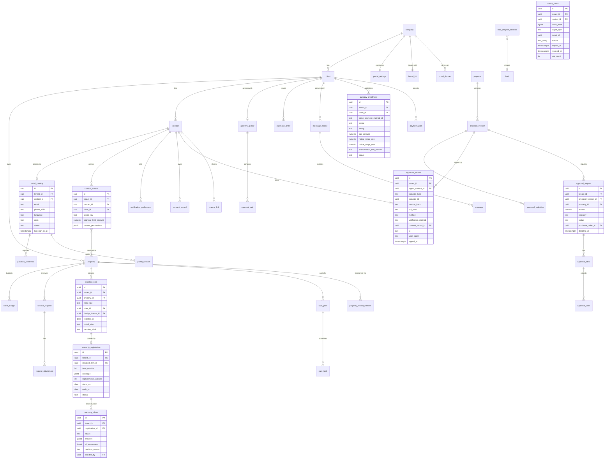

### 7.3 Modeling rules

- **Read models:** `portal_proposal_view`, `portal_invoice_view`, `portal_visit_view`, `portal_property_record_view` are projections built from domain events; they contain only client-safe fields. The portal BFF can only query these projections plus portal-owned tables (enforced by a separate database role with grants limited to those relations).
- **Installed items** (`installed_item`) are created from the as-built Design Version at Project completion (plants, hardscape features, irrigation components, lighting fixtures) and are the backbone of the Property Record and warranties. They reference KB `plant_id` for plants.
- **Version binding:** signatures, selections and approvals reference `proposal_version_id` and `version_hash`; editing a proposal always creates a new version.
- **Money fields** are `numeric(14,2)` with currency at the Company level; computed totals are stored with the computation inputs hash for auditability.
- **Soft deletion** is not used for consent and signature records (append-only, with revocation records).
- **Retention:** signatures and financial documents follow retention classes in [20](20-architecture-security.md) (financial records commonly 7 years; pesticide application records per jurisdiction); erasure requests anonymize identity fields while retaining legally required records.

---

## 8. Integrations, APIs and events

### 8.1 External services

| Service | Use in the portal | Notes | Priority |
|---------|-------------------|-------|----------|
| **Stripe (Company's connected account)** | Payment Element, PaymentIntents (direct charges), SetupIntents, Customers, Financial Connections (ACH bank linking), mandates, card wallets, Canadian PAD, refunds/disputes status | Architecture and webhooks in [08](08-payments-stripe.md). The portal never uses Stripe's hosted customer portal because it would break white-label and data unity. | [MVP] (PAD [V1]) |
| **Email provider** (Postmark or SendGrid) | Transactional and marketing streams, sender domains (DKIM, Return-Path), inbound reply parsing into threads | Separate streams per category | [MVP] |
| **Twilio** | SMS/MMS via Company 10DLC numbers, verification codes, voice code fallback, inbound SMS to threads | Consent and keyword handling, see [16](16-marketing-growth-communications.md) | [MVP] |
| **Web Push** (VAPID) | PWA notifications | iOS requires Home Screen install | [V1] |
| **Custom hostname / TLS service** (e.g. Cloudflare for SaaS) | Custom portal domains with automated certificates | Health checks and fallback | [MVP] |
| **Bot protection** (e.g. Cloudflare Turnstile) | Sign-in, public pay, visualizer | Privacy-preserving, accessible challenge | [MVP] |
| **Maps** (Mapbox or Google) | Property maps, live ETA map, request pins | Tile costs metered per Company | [MVP] |
| **Weather API** | Watering skips, rain delays, freeze alerts, snow logs | Shared with [04](04-scheduling-dispatch-routing.md) and [14](14-service-line-modules.md) | [V1] |
| **AI Gateway** | Triage, translation, narratives, care guides, warranty pre-assessment, concierge, mockups | Metered as AI credits; provider-agnostic ([17](17-ai-copilot-automation.md)) | [V1] |
| **Consumer financing partner** | Prequalification and loan offers | Via [08](08-payments-stripe.md) | [V1] |
| **Review platforms** | Deep links to Google Business Profile (primary), Facebook and Houzz review pages | Links, not scraping; no Yelp solicitation; no incentives (4.13.4) | [V1] |
| **Smart irrigation controllers** (e.g. Rachio, Hunter Hydrawise) | Read schedules/run times; suggest establishment schedules | OAuth per Client | [V2] |
| **Identity providers** (Entra ID, Okta, Google) | Commercial SSO | SAML/OIDC | [V2] |
| **E-invoicing networks** (e.g. Coupa, Ariba) | Large commercial invoice delivery | Partner-dependent | [V3] |

### 8.2 Portal API surface

- **Portal BFF** (backend-for-frontend) in the modular monolith, exposing a typed API (tRPC or GraphQL per [20](20-architecture-security.md)) consumed only by portal frontends. Every request resolves `tenant_id` from the hostname, then the session, then RLS context; a mismatch between hostname tenant and session tenant is a hard 403 and a security event.
- **Public endpoints:** `POST /auth/challenge`, `POST /auth/verify`, `POST /auth/action/exchange`, `GET /pay/lookup`, `POST /visualize/*` (rate-limited).
- **Embed SDK** [V1]: `rootline-portal.js` web component for "Client login", "Pay invoice", "Request service" and "Visualize your yard" with theme from the brand kit.
- **Company API** (for Companies' own integrations, [20](20-architecture-security.md)): endpoints to create action links ("give me a pay link for invoice 1043"), list portal identities, and manage contact access.

### 8.3 Domain events emitted by the portal

| Event | Payload highlights | Typical consumers |
|-------|--------------------|-------------------|
| `portal.identity.invited` / `activated` / `revoked` | contact, client, scope | CRM timeline, analytics |
| `portal.session.started` | kind (action/full), method (link, code, passkey) | Security analytics |
| `proposal.viewed` / `proposal.section_viewed` | version, section, duration | Estimator timeline ([03](03-crm-sales-estimating-proposals.md)), Copilot nudges |
| `proposal.selection_changed` | tier and add-on ids, computed total | Estimator insight |
| `proposal.changes_requested` / `proposal.comment_added` | text, section | Estimator task |
| `proposal.signed` | version hash, signer, signature id | Proposals, documents |
| `proposal.declined` | reason | Win/loss analytics ([18](18-reporting-analytics.md)) |
| `change_order.approved` / `declined` | delta amount and days | Jobs, invoicing |
| `approval.requested` / `approval.step_decided` / `approval.completed` | amounts, budget impact, PO | Proposals, notifications, budgets |
| `payment_method.added` / `removed` | method type, last 4 | Payments, collections |
| `autopay.enrolled` / `changed` / `canceled` | scope, timing, cap | Invoicing ([07](07-invoicing-billing-contracts.md)); [08](08-payments-stripe.md) confirms the mandate and emits the authoritative `payments.autopay.enrolled` / `.disabled` |
| `payment_plan.requested` / `activated` | schedule | Collections |
| `service_request.submitted` | category, urgency, pin, attachments | CRM, dispatch, Copilot triage |
| `portal.skip_requested` / `portal.reschedule_requested` / `portal.pause_requested` | visit or property, requested dates, reason, contact | Scheduling client-driven changes ([04](04-scheduling-dispatch-routing.md) 4.2.8) |
| `visit.rated` | score, comment | Crew scorecards ([15](15-team-hr-payroll.md)), reviews |
| `access_note.updated` | property, fields changed | Crew app ([05](05-field-crew-mobile-app.md)) |
| `warranty_claim.submitted` / `decided` | registration, decision | Ops, scheduling |
| `care_task.completed` | plant group, timestamp | Warranty evidence |
| `offer.redeemed` | offer, property, price | Jobs, marketing attribution ([16](16-marketing-growth-communications.md)) |
| `referral.converted` | referrer, referee, reward | Credits ([07](07-invoicing-billing-contracts.md)) |
| `review.invite_clicked` | platform | Marketing analytics |
| `property_record.exported` / `shared` / `transferred` | scope, recipient | Audit, CRM |
| `lead_magnet.completed` | address, style, budget, mockup ids | Leads ([03](03-crm-sales-estimating-proposals.md), [16](16-marketing-growth-communications.md)) |

### 8.4 Domain events consumed by the portal

| Event | Source | Portal effect |
|-------|--------|---------------|
| `proposal.published` | [03](03-crm-sales-estimating-proposals.md) | Build proposal read model; issue action tokens; send notifications |
| `design.version_published` | [10](10-design-studio.md) | Compile viewer bundle; update design tab |
| `mockup.attached_to_proposal` / `mockup.generated` | [11](11-ai-design-mockups.md) | Add to the proposal option's gallery only once the mockup is attached to that option (`mockup.attached_to_proposal`; attachment is the Company's approval for client viewing). A mockup that is only `mockup.generated` never appears in the portal; the event refreshes metadata (fidelity grade, maturity year) for mockups already attached |
| `plant.updated` | [12](12-plant-knowledge-base.md) | Refresh cached plant cards |
| `visit.scheduled` / `rescheduled` / `en_route` / `arrived` / `completed` / `partially_completed` / `skipped` / `canceled` | [04](04-scheduling-dispatch-routing.md), [05](05-field-crew-mobile-app.md) | Update visits, ETA, summaries, notifications |
| `eta.updated`, `weather.delay_declared` | [04](04-scheduling-dispatch-routing.md) | Live ETA page; weather notice card and banner |
| `job.phase_changed` | [04](04-scheduling-dispatch-routing.md), [14](14-service-line-modules.md) | Advance project tracker |
| `media.published_to_client` | [05](05-field-crew-mobile-app.md) | Add to project or visit feed |
| `chemical_application.recorded` | [05](05-field-crew-mobile-app.md) (record), with notice rules from [14](14-service-line-modules.md) | Application record and re-entry alert |
| `invoice.issued` / `voided` / `statement.generated` | [07](07-invoicing-billing-contracts.md) | Invoice views; Reg E notice timing for autopay |
| `payments.payment.succeeded` / `payments.payment.pending` / `payments.payment.returned` / `payments.attempt.failed` / `payments.refund.completed` / `payments.dispute.opened` | [08](08-payments-stripe.md) | Status updates, receipts, "payment processing" state, failed-payment prompts |
| `project.completed` | [04](04-scheduling-dispatch-routing.md) | Create installed items, warranty registrations, care plan; review invite |
| `inspection.published` / `service_report.published` | [14](14-service-line-modules.md) | Commercial reports |
| `snow_event.closed` | [14](14-service-line-modules.md) | Snow log entry |
| `payment.allocated` / `credit_memo.applied` | [07](07-invoicing-billing-contracts.md), [08](08-payments-stripe.md) | Rebuild invoice, statement and receipt views from the allocation |
| `accounting_sync.external_payment_imported` / `accounting_sync.stale` | [09](09-accounting-ledger-integrations.md) | Update balances; show the "updated at" timestamp; hold overdue reminders while stale |
| `accounting_period.locked` | [09](09-accounting-ledger-integrations.md) | Route portal-side corrections to the open period (4.9.9) |
| `change_order.published` | [03](03-crm-sales-estimating-proposals.md) | Action card, notification, action token (5.10) |

Events flow through the transactional outbox to the event bus ([20](20-architecture-security.md)); notification fan-out is orchestrated by durable workflows (Temporal) so retries, quiet hours and digesting are reliable.

### 8.5 Webhooks for Companies [V1]

Companies can subscribe to a subset of portal events (`proposal.signed`, `service_request.submitted`, `approval.completed`, `review.invite_clicked`) via signed webhooks (HMAC-SHA256, timestamped, retried with exponential backoff for 24 hours) for their own tools.

---

## 9. Permissions

### 9.1 Client-side: contact scope x capability

Legend: Y = allowed, P = allowed for assigned Properties only, L = allowed up to the Contact's approval limit, C = Company-configurable (default shown in parentheses), - = not allowed.

| Capability | `primary` | `co_owner` | `approver` | `billing` | `property_contact` | `viewer` |
|------------|-----------|------------|------------|-----------|----------------|----------|
| View dashboard | Y | Y | Y | Y | P | Y |
| View proposals and designs | Y | Y | Y | C (-) | C (-) | Y |
| Select tiers, add-ons, comment | Y | Y | Y | - | - | - |
| Sign proposals and change orders | Y | Y | L | - | - | - |
| Approve enhancement requests / vote | Y | Y | L | - | - | - |
| Pay deposit at signing | Y | Y | - | Y | - | - |
| View invoices and statements | Y | Y | C (-) | Y | - | C (-) |
| Pay invoices | Y | Y | - | Y | - | - |
| Manage payment methods and autopay | Y | C (-) | - | Y | - | - |
| Stop a scheduled autopay charge (before the Reg E cutoff) | Y | Y | - | Y | - | - |
| Request payment plan | Y | Y | - | Y | - | - |
| View visits and service history | Y | Y | Y | C (-) | P | Y |
| Edit access notes | Y | Y | - | - | P | - |
| Submit service requests | Y | Y | Y | - | P | - |
| Book add-ons / skip visits | Y | Y | - | - | C (-) | - |
| Messaging | Y | Y | Y | Y | P | C (read only) |
| File warranty claims | Y | Y | - | - | P | - |
| View Property Record | Y | Y | Y | - | P (no financial docs) | Y |
| Export / share / transfer Property Record | Y | C (Y) | - | - | - | - |
| Manage contacts and scopes | Y | - | - | - | - | - |
| Renew or cancel a Service Agreement | Y | Y | L | - | - | - |
| Manage budgets and POs (commercial) | Y | Y | - | Y | - | - |
| Download reports and documents | Y | Y | Y | Financial only | P (service docs) | Y |
| Referral links and reviews | Y | Y | - | - | - | - |

Residential homeowners (`client_residential`) are typically `primary`; commercial organizations (`client_commercial`) usually use the full range. Custom scopes [V1] are built from the same capability list. Defaults match the contact-role table in [02, section 5.11](02-personas-roles-permissions.md). The matrix adds portal-only capabilities (stop a scheduled charge, renew or cancel, warranty claims, Property Record) that 02 does not enumerate.

### 9.2 Company-side: role x portal capability

| Capability | `owner` | `office_manager` | `estimator` | `designer` | `ops_manager` | `crew_lead` | `technician` | `bookkeeper` | `subcontractor` |
|------------|---------|------------------|-------------|------------|---------------|-------------|--------------|--------------|-----------------|
| Configure portal settings, brand, domains | Y | Y | - | - | - | - | - | - | - |
| Payment and autopay policies | Y | C | - | - | - | - | - | C | - |
| Invite / revoke client contacts | Y | Y | Own clients | - | Own accounts | - | - | - | - |
| View as client (read-only) | Y | Y | Own clients | Own designs | Own accounts | - | - | Y | - |
| Record assisted approval or request | Y | Y | Y | - | Y | - | - | - | - |
| Publish proposals / change orders | Y | Y | Y | - | Y | - | - | - | - |
| Publish designs and mockups | Y | - | C | Y | - | - | - | - | - |
| Mark visit photos client-visible | Y | Y | - | - | Y | Y | C (-) | - | - |
| Publish inspection / monthly reports | Y | Y | - | - | Y | C | - | - | - |
| Decide warranty claims | Y | C | - | - | Y | - | - | - | - |
| Reply to client messages | Y | Y | Y | Y | Y | C | - | Billing threads | - |
| Configure approval policies, budgets, POs | Y | Y | - | - | Y | - | - | C | - |
| Configure offers, referrals, reviews | Y | Y | - | - | - | - | - | - | - |
| View portal analytics | Y | Y | Own pipeline | - | Own accounts | - | - | Payments only | - |
| Apply payments, unapplied credits and credit memos shown in the portal | Y | Y | - | - | - | - | - | Y | - |
| Approve hardship payment plans | Y | Y | - | - | - | - | - | C (Y) | - |

### 9.3 Platform-side

| Capability | `platform_owner` | `platform_support` | `platform_curator` | `platform_finance` | `platform_engineer` |
|------------|------------------|--------------------|--------------------|--------------------|---------------------|
| See domain/TLS/deliverability health per tenant | Y | Y | - | - | Y |
| View a tenant's portal as a client | Only with tenant-granted, time-boxed support consent; logged and visible to the tenant | Same | - | - | Break-glass only, logged |
| Edit plant card content (KB) | Y | - | Y | - | - |
| Adjust lead-magnet AI credit caps | Y | Y | - | Y | - |
| Suspend a portal for abuse (phishing, spam) | Y | Y (with approval) | - | - | - |

Authorization is enforced server-side in the BFF with a policy engine shared with [02](02-personas-roles-permissions.md); the UI hides what a scope cannot do but never relies on hiding.

---

## 10. AI opportunities in this module

All AI runs through the AI Gateway ([17](17-ai-copilot-automation.md)), is metered as AI credits on the Company's account, is grounded only in the requesting Client's data plus Company and KB content, and is labeled as AI-generated wherever its output is shown to a Client.

| # | Opportunity | Description | Guardrails | Priority |
|---|-------------|-------------|------------|----------|
| AI-1 | **Portal concierge** | Client-facing assistant: "When is my next mow?", "Why is this invoice higher than last month?", "Is Limelight hydrangea safe for dogs?", "Can I add aeration?" Answers from the Client's own records, Company FAQ and KB; can start actions (open the pay sheet, draft a request) but never completes payments or signatures. | Retrieval restricted to tenant + Client scope; no price promises outside the price book; hands off to a human on complaints, cancellations, legal or safety topics; transcript visible to staff | [V1] |
| AI-2 | **Proposal explainer** | "Explain this proposal simply" summary, tier difference explanations, Spanish/French translation, answers to common questions inline | Read-only; cites proposal sections; never alters price or scope | [V1] |
| AI-3 | **Request triage and photo understanding** | Classify, extract, detect urgency (water leak, fallen tree on structure), match to price book, draft reply and quote | Company review unless an intent is whitelisted for auto-send | [V1] |
| AI-4 | **Warranty pre-assessment** | Vision model plus questionnaire to estimate cause (drought, transplant shock, disease, animal, mechanical); attaches weather history and watering log | Advisory only; decision by `ops_manager`; never shown to the client as a denial reason | [V1] |
| AI-5 | **Personalized care guides** | Rewrite KB care data into a plan for the Client's plants, Region, soil and season; weather-adaptive watering | Grounded only in KB fields and Company policy; no chemical rates | [V1] |
| AI-6 | **Monthly report narratives** | Draft property-level summaries for commercial reports | Every number in the narrative must come from report data (validated by a post-check that extracts numbers and compares) | [V1] |
| AI-7 | **Sentiment and churn signals** | Detect frustration in messages and ratings, missed approvals, payment slippage; alert account owner with suggested recovery | Internal only; no automated client-facing action | [V1] |
| AI-8 | **Lead magnet mockups and layouts** | Dimension-aware mockups constrained to regional Plant Palettes ([11](11-ai-design-mockups.md)) | Watermarks, disclaimers, credit caps, safety filters | [V1] |
| AI-9 | **Next best service** | Recommend relevant add-ons by Property features, history and season | Frequency caps; marketing consent for messages | [V2] |
| AI-10 | **Plant problem diagnosis** | Photo diagnosis for clients with "have a pro look" escalation | No DIY pesticide advice; confidence shown | [V2] |
| AI-11 | **Voice and SMS concierge** | Same as AI-1 over SMS ("Text MOW to reschedule") and voice | TCPA consent; identity verified via phone on file + code for account actions | [V2] |
| AI-12 | **Accessibility assist** | Auto-generated alt text for crew photos and mockups ("Freshly edged bed with dark brown mulch along the front walk") | Reviewed sample audits; staff can edit | [V1] |

---

## 11. Edge cases, compliance and risks

### 11.1 Identity and access edge cases

| Case | Handling |
|------|----------|
| Two spouses share one email | One portal identity per email; second spouse can be added with a phone-only identity. Signing records the typed name and the verified channel. |
| Contact has no email and no mobile (landline only) | Voice code sign-in [V1]; otherwise office sends paper and uses assisted actions. |
| Email security scanner pre-fetches links | No state change on GET; magic links consumed only by POST after user interaction (4.2.1). |
| Proposal forwarded to a third party who signs | Proof ladder (4.2.5): a typed name that does not match the addressee, or an amount above the threshold, requires a code to the addressee's on-file channel. A non-Contact can sign only if the Company allows "anyone with link"; they then verify their own channel, and the signature is flagged with the addressee and Company notified. |
| Property manager leaves the management firm | Firm `primary` or Company revokes; sessions and passkeys invalidated; pending approvals reassigned; audit trail retained. |
| HOA changes management company | Property moved to new Client with history; old firm loses access at the effective date; Property Record continuity preserved for the HOA. |
| Person is a Contact on two Clients of the same Company (owner of a rental and their home) | One identity, multiple Client accounts with an account switcher; scopes per Client. |
| Tenant vs owner | Tenant gets `property_contact` on that Property; never sees invoices or other Properties. |
| Phone number recycled by carrier | Phone-only identities require re-verification after 180 days of inactivity; carrier-deactivation signals (where available via the messaging provider) suspend SMS login for that number. |
| Custom domain DNS breaks | Links fall back to default subdomain; passkeys tied to the custom RP ID fall back to code sign-in until fixed. |

### 11.2 Money edge cases

| Case | Handling |
|------|----------|
| Deposit paid, then Company revises the proposal | Revision with price change requires re-signature; deposit carries over as a credit to the new version; if Client declines the revision, refund per Company policy displayed at signing. |
| ACH deposit returns after the job started | Alert `office_manager`; Job flagged; Client notified with a pay link; Company decides whether to pause work. |
| Autopay on a disputed invoice | "Question a line" pauses autopay for that invoice; Stripe disputes on the Company's account pause dunning automatically. |
| Company disconnects Stripe | Payment UI shows "Online payments temporarily unavailable, contact Company"; autopay enrollments suspended with notice; saved methods remain on the Company's Stripe account if they reconnect the same account ([08](08-payments-stripe.md)). |
| Company switches to a different Stripe account | Saved payment methods do not migrate automatically between Stripe accounts; Clients are asked to re-add methods; Rootline provides a guided re-enrollment campaign. |
| Variable ACH autopay amounts (consumer) | Reg E notice at least 10 days ahead or range election (4.9.3). |
| Surcharging | Only where allowed, with disclosures; never on debit cards where prohibited; logic owned by [08](08-payments-stripe.md). |
| Partial payments across multiple Properties | Allocation rules (oldest first or client-chosen) recorded per payment; consolidated statements reflect allocation. |
| Currency | Company currency only; a Canadian Client of a US Company pays in USD with card network FX. |
| Client mailed a check that the Company recorded in QuickBooks, not Rootline (external books mode) | The portal keeps showing the balance until the sync imports the payment. Balance cards show "updated at", and overdue reminders hold while the sync is stale (4.9.9). |
| Tip refunded after it went to payroll | Requires `owner` or `crew_lead` confirmation; posts per [08](08-payments-stripe.md) (employee receivable or Company absorbs); the Client sees only the refund. |
| Client cancels autopay 2 business days before an ACH debit | Rootline does not initiate the debit (Reg E 3-business-day stop-payment rule, 4.9.3), even though Stripe could still accept it; the invoice reverts to manual pay. |
| Overpayment (paid the same invoice by check and online) | Excess posts to Unapplied Client Credits; the Client chooses "apply to next invoice" or "refund" in the portal; refunds need `office_manager` or `bookkeeper` approval. |

### 11.3 Content and design edge cases

- **AI mockup misrepresentation:** Clients may treat mockups as promises. Mandatory, non-removable disclaimer with maturity year; proposals state that plant sizes at install are per the plant schedule; signed PDFs include the schedule, not the mockup, as the contractual scope (mockups appear as illustrations).
- **Plant swaps by nurseries:** when an as-built plant differs from the proposal (substitution due to availability), the Property Record and care guide use the as-built record; the Client is notified of substitutions above a Company threshold.
- **Toxicity and allergy information:** shown only from KB sources with citation; phrased as informational, with "ask your vet/doctor" language; never inferred by AI.
- **Large designs on low-end phones:** automatic Lite mode (2D raster tiles and mockups only).
- **Photos of people:** crew-face blurring option; clients' photos with people are allowed in requests but excluded from share cards unless the uploader confirms consent.

### 11.4 Compliance checklist

| Area | Requirement | Rootline approach |
|------|-------------|-------------------|
| E-signatures (US) | ESIGN Act and state UETA: consumer consent to electronic records, record retention and reproducibility | Consent record with disclosure version; signed PDF with certificate; retained per retention class |
| E-signatures (Canada) | Provincial electronic commerce acts; PIPEDA Part 2 for federal | Same evidence model; French versions for Quebec |
| Payments | PCI DSS SAQ-A scope | Card/bank entry only in Stripe Elements; no PAN in Rootline systems or logs |
| Consumer ACH | Regulation E preauthorized transfers, variable-amount notice | 4.9.3 notices and range election |
| SMS | TCPA, CTIA guidelines, carrier 10DLC registration | Consent records, STOP/HELP, quiet hours, Company-registered brand/campaign ([16](16-marketing-growth-communications.md)) |
| Email | CAN-SPAM (US), CASL (Canada) | Transactional/marketing separation, unsubscribe, physical address, consent tracking |
| Reviews | FTC rule on consumer reviews and testimonials (16 CFR Part 465); Google's ban on incentivized reviews; Yelp's policy against soliciting reviews | No gating, no incentives of any kind, no suppression, no Yelp asks (4.13.4) |
| Auto-renewal | State automatic renewal laws (for example California, amended effective July 1, 2025); New York GOL 5-903 for service and maintenance contracts on real property, including commercial; FTC Negative Option Rule "click-to-cancel" amendments vacated in July 2025 (verify all) | Separate consent, notice windows by jurisdiction, online cancellation as easy as enrollment (4.4.11, [07](07-invoicing-billing-contracts.md)) |
| SMS consent revocation | FCC revocation rules: any reasonable means, honored within 10 business days (since April 11, 2025); state mini-TCPA send-time and frequency limits | Immediate processing of keyword, free-text and staff-recorded opt-outs; strictest-rule send windows ([16](16-marketing-growth-communications.md)) |
| Email deliverability | Gmail/Yahoo bulk sender requirements (SPF, DKIM, DMARC, one-click unsubscribe, complaint rate below 0.3%) | DMARC required for sender-domain verification; one-click unsubscribe on marketing stream; complaint circuit breaker (4.1.4) |
| ACH origination | Nacha Operating Rules: WEB debit authorization, account validation, return-code-specific re-presentment limits | Stripe mandates and Financial Connections; R01/R09-only retries (4.9.7) |
| Canadian PAD | Payments Canada Rule H1: PAD agreement, pre-notification, cancellation rights | PAD mandate in EN/FR; pre-notification per agreement (4.9.3, [08](08-payments-stripe.md)) |
| Tips | FLSA tip-ownership rules (employers, managers and supervisors may not keep tips); state fee-deduction limits | Owners and managers excluded from splits by default; fee deduction hidden where prohibited (4.9.6) |
| Consumer installment credit | Regulation Z "creditor" definition (more than four installments) | Client-ahead calendars, 4-installment hardship cap, no finance charges without disclosed terms (4.9.4) |
| Privacy | CCPA/CPRA, GDPR (if applicable), PIPEDA, Quebec Law 25 | Privacy notice per Company (Company is the business/controller; Rootline is service provider/processor); data access and deletion requests via portal; AI processing disclosed |
| Accessibility | ADA Title III exposure (US), AODA (Ontario), WCAG 2.2 AA as the standard of care | 4.18.1 commitments, accessibility statement |
| Pesticides | State/provincial notification and recordkeeping | Application records and notices via [14](14-service-line-modules.md) rules engine |
| Lending ads | Truth in Lending (Regulation Z) trigger terms | Lender-supplied compliant financing copy only |
| Language | Quebec Charter of the French Language | French versions for Quebec clients |

### 11.5 Security risks

| Risk | Mitigation |
|------|------------|
| Cross-tenant data leak via hostname confusion | Tenant resolved from hostname and session must match; RLS; projection-only DB role; automated cross-tenant tests in CI |
| IDOR on invoices, photos, documents | Opaque IDs plus server-side authorization on every fetch; signed, short-lived media URLs |
| Phishing using white-label portals | Domain verification, abuse reporting, platform takedown in [19](19-platform-admin-portal.md); DMARC alignment; links only to verified portal hosts |
| Account takeover via SIM swap | Step-up for sensitive actions prefers passkeys; notifications to all channels on contact-info change; 24 h cool-down before a changed phone can approve over the step-up threshold |
| Token leakage in referrer headers or logs | `Referrer-Policy: strict-origin`, tokens moved from URL to POST body after first load, log scrubbing |
| AI prompt injection via client-uploaded text or images | Gateway-level input isolation; tools exposed to the concierge are read-only or require explicit client confirmation; no cross-client retrieval |
| Abuse of public visualizer to burn AI credits | Caps, verification before generation of full results, rate limits, Turnstile |

### 11.6 Business risks

- **Low adoption by older clients** -> action links that need no account, phone-first flows, paper fallback, staff assisted actions.
- **Companies hide the portal** because they fear exposing schedules or photos -> granular visibility settings and "start small" presets (Pay + Proposals only).
- **Feature sprawl hurts speed** -> modules toggleable; performance budgets enforced in CI.
- **Property Record retention costs** after churn -> storage tiering (cold storage for media after 12 months of inactivity) and platform minimum retention priced into plans ([22](22-business-model-pricing-gtm.md)).

---

## 12. Metrics and KPIs

Targets below are **internal design targets (estimates), not industry statistics**. Definitions are shared with [18](18-reporting-analytics.md).

| KPI | Definition | Target (12 months after MVP) |
|-----|------------|------------------------------|
| Portal reach | % of active Clients with a portal identity | > 90% |
| Portal activity | % of active Clients with at least one portal or action-link session in the last 90 days | > 60% residential, > 75% commercial |
| Sign-in success rate | Successful sign-ins / sign-in attempts | > 95% |
| Magic link failure rate | Expired or already-used link errors / magic links sent | < 3% |
| Online payment share | Invoice dollars paid via portal or action link / total collected | > 70% |
| Autopay enrollment | % of recurring-service Clients on autopay | > 50% |
| Action-link completion | % of action links whose target action (pay, sign, approve, reply) completes within 7 days without a full sign-in | > 60% for invoice links |
| Step-up abandonment | % of step-up challenges started but not completed within 10 minutes | < 8% (higher means the proof ladder is too strict) |
| Portal-to-ledger tie-out | Daily check that portal AR equals Ledger AR per Company | 100% match; any variance pages `platform_engineer` |
| External books freshness | % of portal balance reads served while the accounting sync is less than 15 minutes old (external books mode only) | > 99% |
| Time to pay | Median days from invoice issued to paid, portal-paid invoices vs others | 30% lower for portal-paid |
| Proposal approval time | Median hours from first view to signature | < 72 h residential |
| Proposal conversion | Signed / viewed, by tier presence and by design viewer usage | Track lift vs proposals without designs |
| Deposit capture | % of signed proposals with deposit paid within 24 h | > 85% |
| Self-serve request share | Requests submitted via portal / all requests | > 50% |
| Message response time | Median staff first response, business hours | < 2 business hours |
| Visit rating | % thumbs-up (or average stars) | > 95% thumbs-up |
| Warranty claim cycle time | Median days from claim to decision | < 5 business days |
| Watering compliance | % of scheduled watering reminders with "I watered" check-ins | Tracked, used to tune reminders |
| Commercial approval cycle time | Median days from approval request to decision | < 5 days |
| Offer conversion | Redemptions / unique offer impressions | Tracked per offer |
| Referral conversion | Referred leads that become paying Clients | Tracked per program |
| Review invite conversion | Review link clicks / invites sent | Tracked per platform |
| Lead magnet conversion | Verified visualizer sessions that book a consultation | Tracked per Company |
| Accessibility | Automated axe violations on critical paths | 0 serious/critical |
| Opt-out processing time | Median time from any opt-out (keyword, free text, toggle, staff-recorded) to suppression | < 1 minute; 100% within 1 business day |
| Performance | p75 LCP on home and pay flows | < 2.5 s |

---

## 13. Beyond the brief: extra ideas

1. **"Year in Your Yard" recap [V1].** Every December, an auto-generated, Company-branded story: visits completed, best before/after photos, plants installed and how they are doing, inches of rain vs watering reminders, snow pushes performed. Shareable with the referral link. Retention and word-of-mouth in one artifact.
2. **"Yard Carfax" for real estate [V2].** A realtor-ready Property Record report (plants, irrigation system specs, backflow test history, lighting, hardscape warranties, maintenance history) that sellers can attach to listings. The Company gets an introduction to the buyer at closing. Potential partnership channel with brokerages ([22](22-business-model-pricing-gtm.md)).
3. **Neighborhood route bundles [V2].** "Join the Tuesday route on Maple Ct and save 10%." Companies offer discounts where route density lowers their cost ([04](04-scheduling-dispatch-routing.md)). Shown only as a street-level offer; never reveals which neighbors are clients.
4. **Freeze and heat alerts for new plantings [V1].** "Frost tonight (29 F): cover the 12 new perennials or water them this afternoon." Weather-driven, plant-aware, and a visible reason the Company cares about warranty outcomes.
5. **Pet and kid safe mode [V1].** Contacts flag "dogs" or "young kids"; application visits trigger re-entry timers on the home screen, and the Company can prefer pet-friendly product programs for those Properties.
6. **Crew thank-you wall [V1].** Separate from tips (4.9.6): Clients can leave a short thank-you note or photo for the crew after any visit. Notes appear in the crew app, on a breakroom TV view and in crew scorecards ([15](15-team-hr-payroll.md)). It costs the Client nothing and helps retention in a labor-short industry.
7. **Season Pass subscriptions [V1].** Bundled annual plans (mowing + 6-step lawn + spring/fall cleanup + irrigation start-up and winterization) sold as a monthly subscription with autopay, prepay discount and one-tap renewal.
8. **Calendar and smart-home hooks [V2].** ICS feeds today; later, smart-home integrations (garage or gate opening on crew arrival with time-limited codes, if the homeowner opts in) and smart irrigation pause during mow days.
9. **Plant QR tags and a "garden walk" mode [V2].** Weatherproof tags link to plant pages; walk mode on the phone uses location to show what each plant is and how to care for it.
10. **Gift a yard service [V1].** Gift cards and "gift a spring cleanup" for adult children buying help for aging parents, a common real-world purchase pattern; the gift creates a pending Client and Property.
11. **HOA board kit [V2].** One-click packet for annual meetings: spend vs budget, completed enhancements with before/afters, inspection score trend, proposed next-year enhancements with renderings.
12. **Proactive "we noticed" cards [V1].** Crew-reported observations (grub damage starting, a leaning tree, a cracked paver) appear as cards with a photo and an optional quote, turning field eyes into helpful, non-pushy upsells.
13. **Client-side design moodboards [V2].** Before the consultation, clients save plants from the Company's regional palette and inspiration photos into a moodboard the designer receives in Design Studio.
14. **Accessibility-first "simple mode" [V1].** Large-type, single-column portal variant with only Pay, Next visit and Message, for older clients; toggle in the header and remembered per Contact.
15. **Live storm board for commercial snow clients [V2].** During an event, a live per-site status board ("Lot plowed 4:12 am, walks salted 4:40 am, second push queued") replacing 3 a.m. phone calls from property managers.
16. **"Before we come" prep and private-line marking [V1].** The 811 call-before-you-dig system marks public utility lines, but private lines are generally the owner's responsibility and go unmarked: low-voltage lighting runs, invisible dog fences, irrigation laterals, gas lines to grills and pool heaters, and wiring to detached garages. Before aeration, an install or a fence-line planting, the portal asks the Client to drop pins on their yard map ("dog fence runs along the back property line") and confirm prep ("move the trampoline", "flag sprinkler heads"). Pins land on the crew app map and in the Property Record ([05](05-field-crew-mobile-app.md)). Fewer severed wires and damage claims, and the Client feels in control.
17. **HOA architectural review packet for homeowners [V1].** Many HOAs require architectural committee approval before landscape changes, and that step stalls residential installs (it is phase 3 of the project tracker in 4.6.1). One tap generates the submission packet from the approved Design Version: a to-scale site plan with dimensions, plant schedule with mature sizes, hardscape materials and colors, the AI mockup labeled as an illustration, and the contractor's license and insurance. The Client submits it themselves or authorizes the Company to submit. Approval letters uploaded back move the tracker forward automatically.
18. **Home improvement summary for the homeowner's records [V1].** IRS Publication 523 lists landscaping among improvements that can add to a home's basis (cited from general knowledge; verify). The Property Record can produce a year-by-year "capital improvements" summary of installs (patio, walkway, plantings, irrigation, lighting), kept separate from routine maintenance, with signed contracts and paid invoices attached. It is labeled informational, not tax advice. Homeowners keep it with closing documents, and it makes the Property Record useful long after the install.
19. **Storm damage and insurance claim packet [V1].** After a wind or ice storm, a Client reports a fallen limb or crushed bed with photos. The Company's assessment, timestamped photos, weather data for the event date and an itemized estimate assemble into a branded PDF the homeowner can send to their insurer. Commercial Clients get the same packet per Property. It turns a stressful event into a fast, well-documented job, and the Company is the first call.
20. **Commercial SLA scorecard with automatic service credits [V2].** Commercial maintenance contracts often promise service levels: visits completed within the scheduled window, request response within N business hours, snow pushes within N hours of trigger. The portal computes them from real visit and request data each month. Where the contract says so, it issues the agreed service credit as a credit memo ([07](07-invoicing-billing-contracts.md)) without the property manager having to ask. A vendor that reports its own misses builds more trust than any sales pitch, and that wins renewals against Aspire-run competitors.

---

## 14. Open questions

1. **Default portal domain.** What Rootline-owned domain hosts default subdomains (and should it avoid "Rootline" entirely for white-label purity, e.g. a neutral domain)? Decision needed with [20](20-architecture-security.md) and brand.
2. **Cross-Company identity ("Rootline Wallet").** Do we ever link a person's identities across Companies? It helps homeowners and the moonshot homeowner network ([23](23-innovation-moonshots.md)) but conflicts with white-label expectations. Proposed: off by default, explicit opt-in, never visible to Companies.
3. **Property Record retention after churn.** Proposed minimums: 24 months read-only access after a Client leaves a Company, 12 months after a Company leaves Rootline. Who pays storage, and is a paid "homeowner keep-forever" tier acceptable to Companies?
4. **Portal included in all plans? (packaging settled in [22](22-business-model-pricing-gtm.md))** The core portal (proposals, pay, history, requests) is in every plan, Rootline-branded on Starter; the white-label portal and custom domain start at Grow; the badge is removable on Pro; commercial multi-property approvals are limited to 5 commercial Clients on Grow and unlimited on Pro and Enterprise. Still open: how visualizer usage draws on each plan's AI credits (300 / 2,000 / 6,000 per month on Starter / Grow / Pro) and whether Companies want a separate lead-magnet credit cap by default.
5. **Live crew location.** ETA-only by default, or live map by default? Crew privacy and labor-relations considerations vary by Company; proposal is ETA-only default with live map opt-in.
6. **Accept on ACH initiation threshold.** Is $5,000 the right default for treating a processing ACH deposit as acceptance?
7. **Financing partner.** Which consumer financing provider(s) for US and Canada, and do we need a fallback for Companies whose Stripe configuration is not compatible?
8. **Warranty transferability on home sale.** Should plant warranties transfer to the buyer by default? Company policy setting with a recommended default.
9. **Client edits to the Property Record.** How do we reconcile client-added notes and photos with Company-maintained facts (e.g., client says they removed a shrub)? Proposed: client additions are a separate layer that Companies can accept into the record.
10. **Competitive gaps.** Aspire's, SynkedUP's and Yardbook's client portal specifics are described at listing level only (verify); a hands-on teardown (demo accounts or customer interviews) is recommended before finalizing the competitive matrix in [01](01-market-landscape.md).
11. **Native app timing.** What PWA push adoption on iOS triggers the move to native wrappers?
12. **Proof-ladder thresholds.** Is $10,000 the right default above which signing needs a code? Should commercial approvals have a lower default ($5,000 proposed)? And is a fuzzy name match between the typed signature and the addressed Contact strong enough below the threshold? Validate with counsel and with step-up abandonment data (Section 12).
13. **Contact-scope defaults versus doc 02 (resolved).** This doc follows [02](02-personas-roles-permissions.md) on contact scopes (`property_contact`; `co_owner` cannot manage contacts; payment-method management off by default for `co_owner`), and 02 now follows the proof ladder in 4.2.5 (no blanket step-up for paying; step-up only for saved-method payments, larger or mismatched signatures, and contact, autopay and payment-method changes). No open item remains; kept here so the numbering of later questions stays stable.
14. **Passkey related origins.** If related-origin support is still incomplete in Firefox and some embedded browsers at launch, do we register custom-domain Companies' passkeys on the custom domain instead and accept re-enrollment on later domain changes?
15. **External books mode and dunning.** How stale can the accounting sync get before automated overdue reminders pause for every Client of that Company (proposed: 60 minutes)?

---

## Sources

### Competitor products and documentation (searched November 2026; vendor claims, verify)

- Jobber - [Client Hub feature page](https://getjobber.com/features/client-hub/); [What do your clients see in client hub](https://help.getjobber.com/en/articles/what-do-your-clients-see-in-client-hub/); [Quote approvals](https://help.getjobber.com/es/articles/quote-approvals/); [Client hub settings](https://help.getjobber.com/es/articles/client-hub-settings/); [Password reset troubleshooting](https://help.getjobber.com/en/articles/password-reset-troubleshooting/); [Jobber Community: Online booking in Client Hub](https://community.getjobber.com/discussions/online-booking-requests/online-booking-in-client-hub/9874)
- LMN - [LMN Customer Portal: Customer Guide](https://support.golmn.com/hc/en-us/articles/42071271242779); [LMN Pay](https://golmn.com/lmn-pay); [LMN Releases 20.11 with updates to Customer Portal (PR Newswire)](https://prnewswire.com/news-releases/lmn-releases-20-11-with-updates-to-customer-portal-estimating-301167182.html); [New LMN Customer Portal (PR Newswire)](https://prnewswire.com/news-releases/new-lmn-customer-portal-technology-changes-the-way-landscapers-run-their-business-improves-customer-service-301041887.html)
- Aspire - [Software Advice: Aspire profile](https://www.softwareadvice.com/landscaping/aspire-profile); [Aspire vs RealGreen comparison](https://www.youraspire.com/comparison-hub/aspire-vs-realgreen); [Capterra review mentioning login PIN](https://www.capterra.com/p/161544/Aspire/reviews/7184520/)
- SingleOps - [SingleOps home](https://www.singleops.com); [Tree Inventory](https://singleops.com/features/tree-inventory); [CHOP Nashville case study](https://www.casestudies.com/company/singleops/case-study/chop-nashvilles-proposals-are-incredible)
- Service Autopilot - [G2 reviews (page 3)](https://g2.com/products/service-autopilot/reviews?page=3); [G2 reviews](https://g2.com/products/service-autopilot/reviews); [Capterra reviews](https://www.capterra.com/p/122075/Service-Autopilot/reviews/); [Capterra reviews page 3](https://www.capterra.com/p/122075/Service-Autopilot/reviews/?page=3); [SoftwareFinder reviews](https://softwarefinder.com/field-service/service-autopilot/reviews?page=4); [GetApp listing](https://www.getapp.com/it-management-software/a/service-autopilot/); [Software Advice profile](https://www.softwareadvice.com/field-service/service-autopilot-profile)
- ServiceTitan - [Customer Portal feature page](https://www.servicetitan.com/features/customer-portal-software); [Release hub: new customer portal](https://help.servicetitan.com/release-hub/docs/improve-the-customer-experience-with-the-new-customer-portal); [Set up and customize the New Customer Portal](https://help.servicetitan.com/docs/set-up-and-customize-the-new-customer-portal); [Webinar recap](https://www.servicetitan.com/blog/webinar-recap-unlock-a-better-customer-experience); [Goettl guide to Customer Portal 2.0 (third party)](https://support.goettl.com/portal/en/kb/articles/servicetitan-s-customer-portal-2-0-what-it-is-and-how-to-use-it)
- Housecall Pro - [Customer portal feature page](https://www.housecallpro.com/features/customer-portal/); [Using the customer portal (help)](https://help.housecallpro.com/en/articles/8448657-using-the-customer-portal); [SoftwareConnect listing (pricing reference)](https://softwareconnect.com/field-service-management/housecall-pro/)
- RealGreen - [Lawn care customer portal](https://realgreen.com/features/lawn-care-customer-portal); [Lawn care billing software](https://www.realgreen.com/lp/lawn-care-billing-software); [RealGreen reviews roundup](https://www.realgreen.com/blog/realgreen-reviews); [Software Advice listing](https://www.softwareadvice.com.au/software/361337/service-assistant); [SelectHub profile](https://www.selecthub.com/p/field-service-software/realgreen/)
- Arborgold - [Client Self-Service Account Portal](https://arborgold.com/customer-portal/); [How to accept a proposal in the customer portal](https://help.arborgold.com/en/articles/5535464-how-to-accept-a-proposal-in-the-customer-portal-as-a-customer); [Customer portal settings](https://help.arborgold.com/en/articles/4092399-customer-portal-settings); [Plans and pricing](https://arborgold.com/?p=17837)
- Copilot CRM - [Ohio lawn care page](https://www.copilotcrm.com/lawn-care/ohio); [Texas lawn care page](https://www.copilotcrm.com/lawn-care/texas); [What is Copilot CRM](https://help.copilotcrm.com/en/articles/12141481-what-is-copilot-crm)
- Other portals - [Spraye portal overview](https://support.spraye.io/support/solutions/articles/47001227487-overview); [House of Yards: How do my clients log in](https://houseofyards.tawk.help/article/how-do-my-clients-login); [Zoho Invoice portal FAQ](https://www.zoho.com/en-fr/invoice/kb/portal/domain-portal.html); [CrewOps Pro: setting up the customer portal](https://crewopspro.tawk.help/article/communications-setting-up-the-customer-portal); [BillerGenie: customer portal troubleshooting](https://billergenie.helpjuice.com/customer-portal/customer-portal-troubleshooting)

### Standards, regulations and vendor technical references (canonical documents cited from general knowledge; verify current versions)

- W3C - [Web Content Accessibility Guidelines (WCAG) 2.2](https://www.w3.org/TR/WCAG22/); [Web Authentication (WebAuthn) Level 2](https://www.w3.org/TR/webauthn-2/)
- Passkeys developer resource - [passkeys.dev](https://passkeys.dev/)
- US ESIGN Act - [15 U.S.C. 7001 (Cornell LII)](https://www.law.cornell.edu/uscode/text/15/7001)
- Regulation E, preauthorized transfers - [12 CFR 1005.10 (eCFR)](https://www.ecfr.gov/current/title-12/chapter-X/part-1005/subpart-A/section-1005.10)
- FTC rule on consumer reviews and testimonials - [16 CFR Part 465 (eCFR)](https://www.ecfr.gov/current/title-16/chapter-I/subchapter-D/part-465)
- FTC - [CAN-SPAM Act: A Compliance Guide for Business](https://www.ftc.gov/business-guidance/resources/can-spam-act-compliance-guide-business)
- CRTC - [Canada's Anti-Spam Legislation](https://crtc.gc.ca/eng/internet/anti.htm)
- Quebec - [Charter of the French Language (LegisQuebec)](https://www.legisquebec.gouv.qc.ca/en/document/cs/C-11)
- Stripe - [Connect direct charges](https://docs.stripe.com/connect/direct-charges); [ACH Direct Debit](https://docs.stripe.com/payments/ach-direct-debit); [Pre-authorized debit in Canada (ACSS)](https://docs.stripe.com/payments/acss-debit); [Payment Element](https://docs.stripe.com/payments/payment-element)
- Cloudflare - [Cloudflare for SaaS (custom hostnames)](https://developers.cloudflare.com/cloudflare-for-platforms/cloudflare-for-saas/)
- Microsoft - [Safe Links in Microsoft Defender for Office 365](https://learn.microsoft.com/en-us/defender-office-365/safe-links-about)
- WebKit - [Web Push for Web Apps on iOS and iPadOS](https://webkit.org/blog/13878/web-push-for-web-apps-on-ios-and-ipados/)

### Additional sources (re-cited from research reports and sibling documents)

Sources already gathered and cited by other Rootline research and module docs, reused here:

- Internal research - [R1 Field service platforms](research/R1-field-service-platforms.md) (Jobber Client Hub capabilities and gaps, category portal norms); [R2 Landscape-specific platforms](research/R2-landscape-specific-platforms.md) (ownership timeline, vendor payment programs, design-as-a-service)
- Market structure - [TechCrunch: ServiceTitan acquires Aspire (2021)](https://techcrunch.com/2021/06/30/servicetitan-acquires-aspire-to-move-into-landscaping-raises-200m-at-a-9-5b-valuation); [Green Industry Pros: Granum launches LMN Pay experience](https://www.greenindustrypros.com/business-management/software/product/22963124/granum-granum-launches-lmn-pay-experience); [Landscape Management: LMN by Granum launches financial platform with Stripe](https://www.landscapemanagement.net/lmn-by-granum-launches-new-financial-infrastructure-platform-in-partnership-with-stripe/)
- Reviews policy - [BrightLocal review platform guidelines](https://www.brightlocal.com/learn/review-management/dos-and-donts/review-platform-guidelines/); [DAC Group on incentivized review enforcement](https://www.dacgroup.com/?p=159133); [Podium on review gating](https://www.podium.com/article/review-gating)
- TCPA revocation - [Nixon Peabody: FCC partially delays new TCPA consent revocation rules](https://www.nixonpeabody.com/insights/alerts/2025/04/11/fcc-partially-delays-new-tcpa-consent-revocation-rules); [Crowell: FCC adopts amendments to TCPA rules](https://www.crowell.com/en/insights/client-alerts/fcc-officially-adopts-amendments-to-tcpa-rules); [Mac Murray and Shuster on the revoke-all delay](https://mslawgroup.com/delayed-again-fcc-pushes-back-tcpas-revoke-all-rule-to-january-31-2027/); [FCC 26-67](https://docs.fcc.gov/public/attachments/FCC-26-67A1.pdf)
- Email deliverability - [Bird: Gmail and Yahoo sender requirements](https://bird.com/docs/knowledge-base/deliverability/gmail-yahoo-requirements)

Canonical rules cited from general knowledge (verify current text before launch):

- Regulation E stop-payment right - [12 CFR 1005.10(c) (eCFR)](https://www.ecfr.gov/current/title-12/chapter-X/part-1005/subpart-A/section-1005.10)
- Regulation Z creditor definition - [12 CFR 1026.2(a)(17) (eCFR)](https://www.ecfr.gov/current/title-12/chapter-X/part-1026/subpart-A/section-1026.2)
- Nacha - [ACH Operating Rules](https://www.nacha.org/rules)
- Payments Canada - [Rule H1: Pre-Authorized Debits](https://www.payments.ca/systems-services/rules-standards)
- New York General Obligations Law 5-903 - [NY Senate: GOB 5-903](https://www.nysenate.gov/legislation/laws/GOB/5-903)
- California automatic renewal law - [Cal. Bus. and Prof. Code 17600 et seq. (California Legislative Information)](https://leginfo.legislature.ca.gov/faces/codes_displayText.xhtml?lawCode=BPC&division=7.&title=&part=3.&chapter=1.&article=9.)
- FTC Negative Option Rule - [FTC: Negative Option Rule](https://www.ftc.gov/legal-library/browse/rules/negative-option-rule)
- FLSA tip ownership - [US Department of Labor Fact Sheet 15: Tipped Employees](https://www.dol.gov/agencies/whd/fact-sheets/15-tipped-employees-flsa)
- IRS - [Publication 523, Selling Your Home (improvements and basis)](https://www.irs.gov/publications/p523)
- W3C - [Web Authentication Level 3 (related origin requests)](https://www.w3.org/TR/webauthn-3/)
- 811 - [Call811.com: know what's below](https://call811.com/)
