# 07 - Invoicing, Billing and Service Agreements

> Billing is where a landscape company either gets paid for the work it already did or quietly gives it away. Most companies still run billing from a mix of the scheduler, spreadsheets, QuickBooks and memory: a mowing visit that never made it onto an invoice, a fertilizer application that was skipped but still billed, a $48,000 commercial install whose 10% retainage nobody remembered to invoice 14 months later. This module defines Rootline's **Billing Engine**: one model that turns every billable event (a completed visit, an approved T&M ticket, a reached milestone, a 4-inch snow push, an approved change order) into a **Billable Item**, rolls Billable Items into Invoices according to a **Billing Schedule** (per-visit, batched, level monthly installments with true-up, prepaid seasons, milestones, progress, retainage, T&M, AIA-style pay applications, snow events), runs them through approval and **Billing Runs**, calculates sales tax correctly for US states and Canadian provinces, delivers branded invoices with proof-of-service attachments, collects through the Company's own Stripe account ([08](08-payments-stripe.md)), chases late payers with a guarded AI collections agent, and posts every event to the built-in double-entry ledger ([09](09-accounting-ledger-integrations.md)). It also owns the **Service Agreement** lifecycle (terms, scope, escalators, renewal, cancellation, proration, mid-season changes, skipped-visit credits) because in landscaping the contract *is* the billing plan.

**At a glance**

- **What it is:** the Billing Engine and the Service Agreement lifecycle. Every billable event becomes a Billable Item; Billing Schedules turn Billable Items into Invoices; Billing Runs batch, approve and send them; every event posts to the built-in ledger.
- **Decision 1, one engine for every billing mode:** per-visit, batched, level monthly installments with season-end true-up, prepaid seasons, deposits, milestones, progress, retainage, T&M, AIA-style pay applications, snow per-push / per-event / seasonal with caps ([4.2](#42-invoice-generation-modes)).
- **Decision 2, the contract is the billing plan:** Service Agreements carry terms, escalators, renewal, cancellation and proration rules, and a live earned-vs-billed-vs-paid meter that drives the true-up automatically ([4.3](#43-service-agreement-lifecycle-mvp-unless-tagged)).
- **Decision 3, deposits are liabilities:** a paid Deposit Request posts to 2150 Customer Deposits, not revenue, and is applied to invoices by a chosen method; installments and prepaid seasons post to 2200 Deferred Revenue and are recognized per completed visit ([4.11](#411-ledger-postings-per-billing-event-mvp)).
- **Decision 4, tax per line:** every line carries a tax category and every Job a real-property treatment; a tax engine adapter (manual rates and Stripe Tax at MVP, Avalara at V1) does the rate math for US states and Canadian provinces, with evidence stored per invoice ([4.5](#45-sales-tax-and-indirect-tax-us-and-canada)).
- **Decision 5, money moves elsewhere:** collection runs on the Company's own Stripe account through [08](08-payments-stripe.md); posting rules P1-P42 use the canonical chart and rule registry of [09](09-accounting-ledger-integrations.md), which wins any account-code conflict.
- **MVP:** per-visit, batch, level billing with true-up, prepaid seasons, deposits, milestones, T&M, basic snow billing, agreement lifecycle, invoice approvals and Billing Runs, proof-of-service invoices, US/Canada sales tax, credit memos and write-offs, statements, late fees, dunning, collections workspace.
- **Later:** [V1] percent-complete progress billing, retainage, AIA-style pay applications, full snow billing, consolidated portfolio billing, client-side AP approval, indexed escalators, payment plans, AI collections agent, credit limits, cross-currency, filing partners; [V2] e-invoicing networks.
- **Differentiators:** contract-native level billing with an automatic true-up, residential and commercial billing in one product, invoices that carry GPS-stamped proof of service, landscape-aware taxability, and ledger-exact postings at the moment of each event.
- **Key cross-links:** proposals and deposits set in [03](03-crm-sales-estimating-proposals.md); visits from [04](04-scheduling-dispatch-routing.md) and [05](05-field-crew-mobile-app.md); portal pay and approvals in [06](06-customer-portal.md); permissions in [02](02-personas-roles-permissions.md); snow events in [14](14-service-line-modules.md).

---

## Table of contents

1. [Goals and non-goals](#1-goals-and-non-goals)
2. [Market research](#2-market-research-what-competitors-do-what-users-complain-about-the-gap-we-exploit)
3. [Personas and jobs-to-be-done](#3-personas-and-jobs-to-be-done)
4. [Feature specification](#4-feature-specification)
5. [Key user flows](#5-key-user-flows)
6. [Screens and wireframes](#6-screens-and-wireframes)
7. [Data model](#7-data-model)
8. [Integrations, APIs and events](#8-integrations-apis-and-events)
9. [Permissions](#9-permissions)
10. [AI opportunities in this module](#10-ai-opportunities-in-this-module)
11. [Edge cases, compliance and risks](#11-edge-cases-compliance-and-risks)
12. [Metrics and KPIs](#12-metrics-and-kpis)
13. [Beyond the brief: extra ideas](#13-beyond-the-brief-extra-ideas)
14. [Open questions](#14-open-questions)
15. [Sources](#sources)

---

## 1. Goals and non-goals

### 1.1 Goals

| # | Goal | How we will know (targets are internal design targets, not market statistics) |
|---|------|------|
| G1 | **Nothing billable is ever lost.** Every completed visit, approved T&M entry, material usage, milestone and snow event creates a Billable Item that is either invoiced, included in a fixed-price agreement, or explicitly excluded with a reason. | "Unbilled aging" report shows zero orphaned Billable Items older than the Company's billing cycle; leakage audit in pilot customers. |
| G2 | **Every way landscapers actually bill**, in one engine: per-visit, weekly/monthly batches, level monthly installments with true-up, prepaid seasons, deposits, milestones, progress %, retainage, T&M, AIA-style pay applications, snow per-push / per-application / seasonal with caps, fixed recurring fees, not-to-exceed enhancements. | Pilot companies can migrate 100% of their 2026 billing arrangements without workarounds. |
| G3 | **Month-end billing in under 30 minutes** for a 300-client maintenance company. | Median Billing Run duration (open to all sent) measured in product. |
| G4 | **Sales tax that is right by default** for US states and Canadian provinces, including labor vs materials, maintenance vs capital improvement, and exemption certificates. | Tax engine coverage; zero manual tax overrides needed for 95% of invoices (target). |
| G5 | **Get paid faster** with autopay, proof-of-service invoices, smart dunning and an AI collections agent. | DSO reduction vs the Company's pre-Rootline baseline; autopay penetration on agreements. |
| G6 | **Contracts that bill themselves.** A Service Agreement signed in February produces correct installment invoices, visit credits, renewal notices, escalations and a season-end true-up with zero manual spreadsheet work. | Count of agreements requiring manual invoice edits at true-up. |
| G7 | **Ledger-exact.** Every billing event posts a balanced journal entry to the built-in GL with a documented posting rule, so the Company's books are correct without a bookkeeper re-keying anything. | 100% of billing events have posting rules; trial balance ties to AR subledger daily. |
| G8 | **Commercial-grade**: PO numbers, consolidated portfolio billing, client-side AP approval, pay apps, retainage, lien waivers and e-invoicing readiness, so mid-size companies can win property-management and HOA accounts. | Commercial pilot accounts invoiced without exporting to Excel. |

### 1.2 Non-goals

- **Rootline is not a payment processor or merchant of record.** Money moves on the Company's own Stripe account; this doc consumes payment events from [08 - Payments](08-payments-stripe.md) and never holds client funds.
- **Rootline does not give tax advice.** We provide a tax determination engine (Stripe Tax or Avalara, plus manual rates) and a curated default taxability matrix; the Company and its accountant own their filing positions. Filing and remittance are V1+ partner integrations, not built in-house.
- **Rootline is not a debt-collection agency.** The AI collections agent acts as the Company's own first-party accounts-receivable assistant. Hand-off to licensed third-party agencies is an integration, not a service we perform.
- **General-ledger depth** (chart of accounts, period close, WIP schedules, job-cost accounting, bank reconciliation) lives in [09](09-accounting-ledger-integrations.md). This doc specifies only what billing posts and when.
- **Estimating and proposals** (where prices, options, deposits and payment terms are first set) live in [03](03-crm-sales-estimating-proposals.md); the client-facing payment and approval UX lives in [06 - Customer Portal](06-customer-portal.md).

---

## 2. Market research: what competitors do, what users complain about, the gap we exploit

> **Research note (November 2026).** Competitor capabilities below come from vendor help centers, vendor marketing pages and review sites; some claims rely on search-result excerpts of the cited pages. Each is cited and anything time-sensitive is marked "verify". Broader competitive coverage is in [01 - Market landscape](01-market-landscape.md), [R1](research/R1-field-service-platforms.md), [R2](research/R2-landscape-specific-platforms.md) and [R4](research/R4-industry-payments-accounting.md).

### 2.1 What competitors do

| Product | Billing model highlights | What it does well | Where it stops |
|---|---|---|---|
| **Jobber** | Invoice reminders configured per job; for recurring jobs a custom reminder schedule (e.g., a day each month) or "as needed". When a reminder comes due the job moves to "Requires Invoicing"; **batch invoice creation** makes one invoice per client, combining multiple ready jobs, but splits jobs at properties with different tax rates into separate invoices. Batch creation only works for jobs that have invoice reminders ([Jobber help](https://help.getjobber.com/hc/en-us/articles/115009687088), [Jobber help](https://help.getjobber.com/hc/en-us/articles/115009542848), [Jobber invoicing](https://www.getjobber.com/features/invoicing)). Automated payment reminders and autopay are reported by third parties to sit on higher tiers ([Agiled roundup](https://agiled.app/blog/best-invoicing-software-for-landscapers); verify against current Jobber pricing). | Simple, fast for owner-operators; batch invoicing; client hub. | Reminder-driven, not contract-driven: no native level billing with season-end true-up, no retainage or pay apps, no deferred-revenue accounting (relies on QuickBooks). The QuickBooks Online sync is one-way; paid status recorded in QBO no longer syncs back; invoices and payments sync only to the parent customer, not per-property sub-customers; QuickBooks Desktop is not supported; and a sync error on one client blocks all of that client's invoices and payments ([Jobber QBO FAQ](https://help.getjobber.com/es/articles/quickbooks-integration-faqs/), [Jobber sync errors](https://help.getjobber.com/hc/en-us/articles/10466688449431-Common-QuickBooks-Sync-Errors-and-How-to-Fix-Them); as of Nov 2026, verify). |
| **LMN** | Payment schedule is built on the estimate's Contract tab; after approval the schedule carries to the job for invoicing. Service lines can be billed **per-season, per-hour or per-visit**: per-season services are covered by the monthly invoice while per-visit items bill on completion ([LMN help via search excerpt](https://intercom.help/lmn/en/articles/15939070-invoicing-payments-best-practices), [LMN invoicing training](https://golmn.com/software-training/landscape-invoice-software-lmn)). Marketing claims automated monthly, per-service, material-quantity, hourly and milestone billing, and that fixed monthly schedules can cut invoicing time "by up to 90%" (vendor claim) ([LMN features](https://golmn.com/features/invoicing), [LMN blog](https://golmn.com/blog/lmnpro-release)). | Estimating-first DNA; contract payment schedules tie to budgets. LMN merged with SingleOps in November 2024 and the group now operates as Granum, which has launched an "LMN Pay" payments experience ([Green Industry Pros](https://www.greenindustrypros.com/business-management/software/product/22963124/granum-granum-launches-lmn-pay-experience)). | We found no public documentation of how mid-contract changes, proration or true-ups are handled. G2 rating 3.7 from 13 reviews at time of research ([G2](https://www.g2.com/sellers/landscape-management-network); as of Nov 2026, verify). |
| **Aspire** | An **invoicing assistant** flags invoices that are overdue or ready to send and contracts missing required information; invoices can be filtered by contract type or timing; invoices can be created from in-progress jobs; one-off projects bill through a secondary invoice type alongside maintenance contracts; "open billing" by percentage, dollar amount or finer granularity ([Aspire invoicing page via search excerpt](https://www.youraspire.com/industries/landscape-business-software/invoicing), [Landscape Management sponsored content](https://www.landscapemanagement.net/sponsoredcontent/building-a-foundation-for-growth/)). | Strongest contract-driven commercial workflow among landscape-specific tools; a ServiceTitan company since 2021 ([TechCrunch](https://techcrunch.com/2021/06/30/servicetitan-acquires-aspire-to-move-into-landscaping-raises-200m-at-a-9-5b-valuation)). Its snow module is described as offering per-push and per-event billing with events booked back into the contract ([Pulse comparison](https://pulserevops.com/tech-stacks/tk0100), [SIMA on Aspire](https://resources.sima.org/snow-and-ice-resource-center/unlock-profitability-and-efficiency-with-aspire)). | Retainage support is reported only by third-party listicles; we found no official documentation of a dedicated retainage feature ([US Tech Automations](https://ustechautomations.com/resources/blog/landscape-invoice-software-2026); verify). A Capterra reviewer reported little invoice customization and that their customers had trouble interpreting invoices ([Capterra Aspire reviews](https://www.capterra.com/p/161544/Aspire/reviews/?page=6)). Accounting relies on QuickBooks sync. |
| **RealGreen (WorkWave)** | Customer Assistant websites support autopay enrollment, prepay incentives and one-time payments; vendor reports companies using them have "12% more customers on autopay" (vendor claim). Describes spreading annual services into equal recurring payments that adjust automatically when services change mid-year ([RealGreen billing page](https://realgreen.com/features/landscape-billing-invoice-software), [RealGreen billing LP](https://www.realgreen.com/lp/lawn-care-billing-software)). Automated marketing runs renewal and prepay campaigns ([RealGreen](https://www.realgreen.com/mobileprinting)). | Deepest lawn-care program billing (prepay, budget-style plans). | A review summarized in our research called RealGreen's accounting and invoicing "basically unusable" ([Capterra](https://www.capterra.com/p/78106/Service-Assistant/reviews/?page=5)); UI widely described as dated. |
| **Service Autopilot** | Billing and invoicing, contract management, recurring scheduling ([Software Advice](https://www.softwareadvice.com/landscaping/service-autopilot-profile/)). | Automation-heavy recurring residential. | Reviewers describe invoice automation as generic with glitches after setup ([GetApp reviews](https://www.getapp.com/operations-management-software/a/service-autopilot/reviews/)). |
| **LawnPro** | Documents "level billing": an annual contract spread into equal monthly payments, then at contract end the leftover balance is closed by issuing a credit, creating a final invoice, or writing off a small difference ([LawnPro level billing](https://lawnprosoftware.com/features/level-billing)). | Clearest public description of true-up mechanics. | Small-operator scope; no commercial billing. |
| **Others** (SingleOps, ServiceTitan, Housecall Pro, Arborgold, Yardbook, Copilot CRM, SynkedUP) | Covered in [01](01-market-landscape.md) and [R1](research/R1-field-service-platforms.md)/[R2](research/R2-landscape-specific-platforms.md). Pattern: generalist FSM tools (Housecall Pro, ServiceTitan) are strong on per-job invoicing and memberships but are built around HVAC/plumbing ticket economics; landscape tools (SingleOps, Arborgold, Copilot CRM, Yardbook) cover per-visit and recurring invoicing and lean on QuickBooks for anything accounting-shaped. For snow, competitor-written comparisons describe generic FSM tools handling per-push billing by duplicating job templates and batch invoicing, with spreadsheets for per-inch pricing ([ContractorApps](https://contractorapps.pages.dev/comparisons/best-field-service-software-snow-removal); treat with caution). | | None we reviewed combines level billing with true-up, deferred revenue, retainage, pay apps, snow caps and a native GL in one product. |

Third-party guidance on landscape billing captures the core rule Rootline encodes: a fixed monthly maintenance installment should follow the contract, extra work should follow approval, and a skipped per-visit service should not become an invoice line just because it was on the schedule ([Fieldproxy blueprint](https://www.fieldproxy.ai/blueprints/landscaping-annual-contract)). Prepay discounts are a staple of lawn-care marketing ([Weed Man](https://weedman.com/blog/prepay-and-referral-discounts)), so prepaid seasons must be first-class, not a hack.

### 2.2 What users complain about

Grouped from the sources above plus recurring themes in owner forums and review sites (themes, not counts):

1. **Invoices customers cannot read.** Line items that say "Maintenance - April" with no visit dates, no photos, no explanation of what was skipped. (Aspire Capterra review above.) Unreadable invoices generate calls, disputes and late payments.
2. **Level billing that breaks in July.** A client cancels mid-season after the heavy mowing months; the company has billed 5 of 12 equal installments but delivered 60% of the work. Most tools leave the owner to calculate the true-up in a spreadsheet. LawnPro's documentation is notable precisely because it addresses closing out the balance at all.
3. **Skipped visits billed anyway** (or credited inconsistently), especially in drought weeks when mowing is skipped.
4. **Accounting double entry.** Invoices live in the FSM tool, revenue recognition and deferred revenue live in QuickBooks (or nowhere), and the sync breaks on edited or voided invoices. RealGreen accounting complaints above; Jobber's own help center documents a one-way QBO sync in which a check the bookkeeper records in QBO does not mark the Jobber invoice paid, and one bad client record blocks that client's invoices and payments (section 2.1). The office ends up with two AR balances that disagree, and the client gets a past-due reminder for an invoice they paid.
5. **Tax confusion.** Owners do not know whether mowing, mulch, a paver patio, or a snow push is taxable in their state, and most tools offer a single tax rate per client or per property (Jobber even splits batch invoices by tax rate).
6. **Commercial paperwork done in Excel.** Pay applications, schedules of values, retainage tracking, lien waivers and PO tracking for HOA and property-management clients.
7. **Collections is awkward and manual.** Owners hate chasing neighbors for money; reminder features exist but are plan-gated, generic and not tied to a service-hold policy.
8. **Paper still matters.** A meaningful share of older residential clients want a mailed invoice and pay by check; most tools force the office to print, stuff and stamp. (Estimate based on interviews and forum themes; validate in pilot.)

### 2.3 The gap Rootline exploits

1. **Contract-native billing**: the Service Agreement is the billing plan, with a running "earned vs billed vs paid" meter per agreement and an automatic true-up.
2. **One engine for residential and commercial**: per-visit and level billing for homeowners, pay apps/retainage/PO/consolidated billing for property managers, in the same product.
3. **Built-in GL**: deferred revenue, contract assets, deposits, retainage receivable and sales tax payable are posted correctly at the moment of the event, not reconstructed by a bookkeeper.
4. **Proof-of-service invoices**: every line links to the visit, its GPS-stamped photos and crew notes, which directly attacks complaint #1 and reduces disputes.
5. **Taxability that understands landscaping**: per-line tax categories (maintenance labor, capital-improvement labor, materials, plants, snow removal, design) with jurisdiction rules, not one rate per client.
6. **Guarded AI collections** that is polite, compliant, evidence-aware and linked to service holds.

> **Competitive edge: level billing with a live true-up meter.** Jobber's billing is driven by invoice reminders on jobs and LMN's by a payment schedule on the contract tab; neither publicly documents an automatic season-end reconciliation. Rootline treats every installment agreement as a running account (earned value of completed visits vs billed vs paid), shows it to the office and to the client in the portal, and produces the true-up, credit or cancellation invoice automatically under rules the owner chose when the agreement was signed.

> **Competitive edge: commercial billing without Excel.** Aspire is the commercial benchmark for contract billing, but we found no official documentation of dedicated retainage or AIA-style pay applications. Rootline generates G702/G703-style pay applications straight from the schedule of values in the accepted proposal, tracks retainage per line, and bills retainage release automatically at substantial completion.

---

## 3. Personas and jobs-to-be-done

| Persona (role key) | Jobs-to-be-done in billing | What "great" looks like |
|---|---|---|
| Business Owner (`owner`) | "Make sure every dollar of work turns into cash. Know who owes me what. Never argue with a good client about an invoice." | Weekly cash and AR digest; approve exceptions on the phone; set policies once (late fees, credits, renewal escalator) and trust the engine. |
| Office / Admin Manager (`office_manager`) | "Run month-end billing for 300 clients without missing anything. Answer 'why is my bill $X?' in 10 seconds." | Billing Run with exception queue; one-click invoice explanation with photos; statement runs; dunning on autopilot. |
| Bookkeeper / Accountant (`bookkeeper`) | "Books that tie out. Deferred revenue and sales tax payable that I can defend. Clean period close." | Posting rules visible per transaction; AR subledger ties to GL; sales tax liability report by jurisdiction; write-off and bad-debt reports. |
| Operations / Account Manager (`ops_manager`) | "Keep my commercial accounts happy: right PO, right property, enhancements approved before we do them." | PO tracking, NTE alerts, consolidated statements per portfolio, client approvals in portal. |
| Sales Rep / Estimator (`estimator`) | "Sell an agreement with payment terms the client likes, and renew it with a price increase without losing the client." | Payment-plan options on proposals (12 equal payments vs prepay discount), renewal proposals with escalators prefilled. |
| Landscape Designer (`designer`) | "Get paid for design work, and have the design fee credited if the client buys the install." | Design retainer invoice with automatic credit-on-conversion rule. |
| Crew Lead / Foreman (`crew_lead`) | "Log what we actually did so billing is right; collect a check or card on site when the client asks." | Visit completion and T&M entries flow to billing; field payment capture (see [05](05-field-crew-mobile-app.md)). |
| Field Technician (`technician`) | "Not lose my tips; not be blamed for billing errors." | Tips flow to payroll; visit proof attached automatically. |
| Subcontractor (`subcontractor`) | "Submit my work so the prime can bill it and pay me." | Sub work becomes Billable Items with markup (AP side in [13](13-operations-inventory-equipment.md)). |
| Residential homeowner (`client_residential`) | "Know what I'm paying for, pay automatically, not get surprised." | Clear invoices with photos; autopay; season meter in portal; easy card update. |
| Commercial property manager / HOA board (`client_commercial`) | "Invoices that match our PO, coded to the right property, approved by the right person, in the format our AP system wants." | PO numbers enforced; per-property invoices or consolidated with subtotals; portal AP approval; pay apps; W-9/COI on file; e-invoicing. |
| Platform Operator (`platform_owner`) and platform staff (`platform_finance`, `platform_support`) | "Ship sensible defaults (tax categories, late-fee limits, dunning templates); help tenants debug billing without seeing more than needed." | Platform-maintained taxability defaults and legal-limit tables; audited support sessions ([19](19-platform-admin-portal.md)). |

---

## 4. Feature specification

The module is organized around five core objects. Engineers should read 4.1 first; every later feature is expressed in these terms.

### 4.1 Billing Engine core concepts [MVP]

| Concept | Definition | Key rules |
|---|---|---|
| **Billable Item** | An atomic, priced record of something the Company may charge for: a completed visit, an approved T&M line, a material or plant used, a milestone reached, a snow push, a change order, a fee. Created by events from other modules (`visit.completed`, `timesheet.approved`, `change_order.approved`, `snow_event.closed`, `milestone.reached`). | Status: `unbilled` -> `staged` (on a draft invoice) -> `invoiced` / `covered` (included in a fixed-price agreement or installment, shown as $0 detail) / `excluded` (with reason code) / `written_off`. A Billable Item can be on at most one non-void invoice. Price is resolved at creation from (in order) the agreement price, proposal price, client price list, price book; the source is stored. |
| **Billing Schedule** | The rule set attached to a Job, Project or Service Agreement describing *when* and *how* Billable Items become invoices: type (see 4.2), cadence, amounts, deposit rules, retainage %, tax mode, PO, bill-to. | One active schedule per Job; agreements can hold one schedule per service line (e.g., mowing on level billing, enhancements per-visit). Planned entries (`billing_schedule_entry`) are generated ahead (e.g., 12 installments) and are editable until invoiced. |
| **Invoice** | A legally meaningful, numbered request for payment issued to a bill-to party, with lines, tax, terms, attachments. | Immutable once `sent` except for status, payments and notes; corrections happen through credit memos, debit (supplemental) invoices or void-and-reissue (rules in 4.6). |
| **Billing Run** | A batch operation that gathers all Billable Items and due schedule entries for a period/cycle, builds draft invoices, runs validation and tax, routes exceptions and approvals, then sends. | Idempotent: re-running a run for the same cycle only picks up new items. Runs are resumable and auditable (who approved what). |
| **Account (customer ledger)** | The client's running AR position: open invoices, unapplied payments, credit balance, deposits held, promises to pay, payment plans, dunning state. | Single source for statements, portal balances, AR aging and collections. Ties to the GL AR control account daily. |

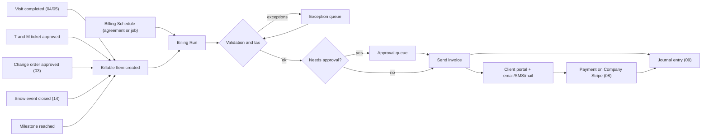

**Billing triggers.** Every schedule type declares an *invoice trigger*:

| Trigger | Meaning | Example |
|---|---|---|
| `on_event` | Invoice immediately when a Billable Item is created (after optional approval). | Per-visit invoicing of a one-off cleanup. |
| `on_cycle` | Accumulate items and invoice on a cycle date (weekly Friday, 1st of month, last business day). | Monthly batch of per-visit mowing. |
| `on_schedule_date` | Invoice planned amounts on planned dates regardless of items. | Level installments on the 1st, prepaid season invoice on Feb 1. |
| `on_milestone` | Invoice when a project milestone or phase is marked complete. | 50% at "hardscape complete". |
| `on_period_progress` | Invoice percent complete per schedule-of-values line per period. | Monthly pay application. |
| `manual` | Office creates the invoice. | Ad-hoc fee. |

### 4.2 Invoice generation modes

Each mode below is a `billing_schedule.type`. A Company can mix modes per client, per job and per agreement service line.

#### 4.2.1 Per-visit invoicing [MVP]

- **What**: one invoice per completed visit (or per visit-day when a crew does two services at one property on the same day).
- **Rules**
  - Trigger on `visit.completed` with `verification_status = verified` (crew lead marked complete, photos uploaded if required by the service template, geofence check passed; see [05](05-field-crew-mobile-app.md)). Unverified visits go to the exception queue instead of invoicing.
  - Optional **delay window** (default 2 hours) so the crew lead can correct quantities before the invoice goes out.
  - Lines: the visit's services at agreement/price-book prices, plus any add-ons logged in the field (e.g., "extra 3 bags of leaf debris haul-away: $15 each") which require `office_manager` approval if the client's settings say "no unapproved add-ons".
  - **Autopay clients** are charged at send (or on due date if the Company prefers), using the saved PaymentMethod on the Company's Stripe account ([08](08-payments-stripe.md)).
  - Visits that are `skipped` or `cancelled` produce no line by default; a configurable **trip charge** (e.g., $35 when the gate was locked and the client was notified) creates a Billable Item instead.
- **Edge cases**: visit completed across midnight (bill on start date); crew splits property across two days (one visit, two time segments, one invoice line); visit re-opened after invoice sent (creates a supplemental invoice or credit memo, never edits the sent invoice).

#### 4.2.2 Batched invoicing (weekly / bi-weekly / monthly / custom) [MVP]

- **What**: accumulate Billable Items and invoice on a cycle. Most common for residential per-visit mowing ("bill on the 1st for last month's mows").
- **Rules**
  - Cycle definitions: weekly (choose weekday), bi-weekly (anchor date), semi-monthly (1st and 16th), monthly (day 1-28 or "last business day"), 4-4-5 periods for companies on fiscal calendars, custom list of dates.
  - **Cut-off**: items with `service_date <= cycle_end` are included; items completed after cut-off wait for the next cycle even if logged late. Late-logged items from a prior period are flagged "late capture" so the office can see crews' logging discipline.
  - **Grouping keys** (configurable): bill-to party, currency, tax jurisdiction set, PO number, billing group. Unlike tools that split invoices by tax rate, Rootline calculates tax **per line** so one invoice can cover several properties in different jurisdictions; splitting by property is a presentation choice, not a tax constraint.
  - Detail level per client: "one line per visit" (date, property, service, crew photo link) or "rolled-up" ("Weekly mowing x 4 visits: Apr 6, 13, 20, 27 - $220.00") with visit detail in an appendix.
  - **Minimum invoice amount** (e.g., hold invoices under $25 until next cycle unless it is the final cycle of the season).
- **Edge cases**: a client changes cycle mid-month (close the open period on change date and start the new cycle); a client with both per-visit and level-billed services (two schedules; one combined invoice if their cycle dates match, otherwise separate).

#### 4.2.3 Level billing: fixed monthly installments with true-up [MVP]

The flagship residential and small-commercial maintenance model: "30 weekly mows plus a 5-step fertilizer program, spring and fall cleanup, billed as 12 equal payments."

- **Setup (from the accepted proposal, [03](03-crm-sales-estimating-proposals.md))**
  - Agreement contract value (ACV) = sum of service lines x planned occurrences x unit price (e.g., 30 mows x $55).
  - Installment count (2-24), start month, billing day, rounding rule (round to cents; remainder on last installment, or on first).
  - **Pricing model per service line**:
    1. `fixed_season`: the season price is fixed regardless of visit count (typical in commercial; the client buys "lawn maintenance April-November"). Only *company-caused* misses are credited.
    2. `per_visit_leveled`: price is per occurrence, payments are leveled, and the season is trued up to actual completed occurrences.
    3. `banded`: fixed if actual occurrences fall within a band (e.g., 28-32 mows); outside the band, each missing or extra occurrence is credited or charged at the unit price.
- **Earned-value meter.** For each agreement Rootline tracks four running totals: **planned value**, **earned value** (sum of unit value of completed occurrences, or ratable value for fixed-season lines), **billed**, **paid**. The **position** = billed - earned. Positive = the client is ahead (contract liability / deferred revenue); negative = the company is ahead (contract asset / unbilled receivable). The meter is shown on the agreement, in Billing Runs and (optionally) to the client in the portal ([06](06-customer-portal.md)).
- **Worked example: Hernandez residence, 2027 season** (illustrative prices)

  | Service line | Occurrences | Unit price | Value | Timing |
  |---|---|---|---|---|
  | Weekly mowing, trim, blow | 30 | $55.00 | $1,650.00 | Apr 6 - Oct 26 |
  | 5-step fertilizer and weed control | 5 | $72.00 | $360.00 | Apr, Jun, Jul, Sep, Oct |
  | Spring cleanup | 1 | $340.00 | $340.00 | Apr |
  | Fall cleanup | 1 | $390.00 | $390.00 | Nov |
  | **Agreement contract value** | | | **$2,740.00** | 12 installments Jan-Dec: 11 x $228.33 + 1 x $228.37 |

  | Month end | Cumulative earned | Cumulative billed | Position (billed - earned) | Ledger meaning |
  |---|---|---|---|---|
  | Mar | $0.00 | $684.99 | +$684.99 | Deferred revenue |
  | Apr | $632.00 | $913.32 | +$281.32 | Deferred revenue |
  | Jun | $1,199.00 | $1,369.98 | +$170.98 | Deferred revenue |
  | Aug | $1,766.00 | $1,826.64 | +$60.64 | Deferred revenue |
  | Sep | $2,058.00 | $2,054.97 | -$3.03 | Unbilled receivable |
  | Nov | $2,740.00 | $2,511.63 | -$228.37 | Unbilled receivable |
  | Dec | $2,740.00 | $2,740.00 | $0.00 | Settled |

  If two August mows are skipped for drought and the agreement credits drought skips, earned drops by $110 and the December installment is automatically reduced to $118.37 (true-up method "adjust final installment"). If the same client had been put on 12 installments **April to March**, at the end of August they would have been billed $1,141.65 against $1,766.00 earned (an exposure of $624.35 if they cancel or move), and exposure would peak at $913.36, 33% of ACV, at the end of November when the season is done but four installments remain. Rootline's schedule builder plots this **exposure curve** and warns when peak exposure exceeds a Company threshold (default: 25% of ACV), recommending a calendar (Jan-Dec or Feb-Jan) that keeps the client slightly ahead.

- **True-up methods** (chosen at agreement setup, overridable at close with permission):
  1. `adjust_final_installment` (default): recompute the last 1-3 open installments so the agreement lands at earned value.
  2. `relevel_remaining`: whenever the projected earned value changes by more than a threshold (default $50), spread the difference across remaining installments.
  3. `season_end_invoice_or_credit`: leave installments alone; at season close issue a true-up invoice (client owes) or credit memo (client is owed). Credits default to the client's credit balance for next season; refund on request.
  4. `small_balance_writeoff`: differences under a threshold (default $10) are written off to a contra-revenue account automatically, matching the LawnPro-style practice.
- **Season close** runs automatically N days after the last planned occurrence (default 14) or when the office closes it. It freezes earned value, applies the true-up, posts the final recognition entries and, if renewal is on, kicks off renewal (4.3.4).
- **Tax on installments**: tax is calculated on each installment invoice using the agreement's blended taxable ratio (taxable value / ACV per jurisdiction) and corrected at true-up. Where a jurisdiction taxes only some lines (e.g., materials taxable, maintenance labor not), the installment invoice shows the split. See 4.5.
- **Compliance guardrail**: in the US, a business that regularly extends consumer credit payable in more than four installments may be treated as a "creditor" under the Truth in Lending Act's Regulation Z. Level billing that keeps the client ahead (prepayment) is generally not credit, but schedules that let installments trail completed services across seasons could be. Rootline (a) defaults to client-ahead calendars, (b) never adds finance charges to installment schedules unless the Company has configured disclosed terms, and (c) flags schedules whose installments end more than 60 days after the last service. This is also why a 12-payment level plan can coexist with the 4-installment cap on past-due payment plans (4.9.4, [08](08-payments-stripe.md) 4.8): a client-ahead level plan pays for service in advance, whereas a payment plan spreads a debt for work already delivered. A residential level plan whose projected exposure exceeds the Company threshold (default 25% of ACV; the April-March Hernandez calendar peaks at 33%, the January-December one at 8%) is routed to the owner with the same warning as an over-cap payment plan. This is a product guardrail, not legal advice; see section 11.

#### 4.2.4 Prepaid seasons and deferred revenue [MVP]

- **What**: the client pays the whole season up front, usually for a discount ("Pay in full by March 15 and save 5%").
- **Rules**
  - Prepay offer configured on the agreement or proposal: discount % or $, deadline, eligible service lines, whether it combines with other discounts. Example: $2,740 x 0.95 = $2,603.00 if paid by Mar 15.
  - The prepay invoice posts to **deferred revenue** (contract liability), not revenue. Each completed occurrence recognizes revenue at its unit value x prepay factor ($55 x 0.95 = $52.25 per mow). Fixed-season lines recognize ratably by month across the service window.
  - Discount is presented as a line on the invoice and recognized as contra-revenue in proportion to delivery (no day-one discount expense).
  - If the deadline passes unpaid, the schedule falls back to the agreement's alternative (e.g., 12 installments) automatically and the client is notified.
  - Season close: unearned prepaid value (skipped occurrences that the agreement credits) becomes client credit, refund, or forfeit per the agreement's terms. Forfeiture must be explicitly stated in signed terms (posting P37); otherwise default is credit (P11).
  - Mid-season cancellation of a prepaid season: refund = paid - earned (at the discounted unit value) - early-termination fee (if contracted). Optional "discount clawback": if the client cancels, earned value is recomputed at undiscounted prices (must be in signed terms).
- **Gift and prepaid credits**: prepaid "lawn care credits" sold as gifts are customer prepayment liabilities; see 4.7.

#### 4.2.5 Deposits and deposit application [MVP]

- **What**: money collected before work begins, mostly for installs (paver patios, plantings, irrigation systems), design retainers and special-order materials.
- **Rules**
  - Deposits are requested from the proposal ([03](03-crm-sales-estimating-proposals.md)) as a **Deposit Request** document (number prefix `DEP-`). A deposit request is not a revenue invoice: when paid it posts to **Customer Deposits** (liability). This keeps revenue and, in most jurisdictions, sales tax off the books until work is invoiced. Companies whose accountant prefers deposit invoices (revenue/tax at billing) can switch the deposit mode to `deposit_as_progress_invoice` per Company.
  - Deposit amount: % of proposal (default 30%), fixed amount, or "materials cost + X%". Minimums and maximums configurable. Some US states limit home-improvement deposits for consumer contracts (California's home improvement rules are a frequently cited example: 10% or $1,000, whichever is less, for contracts subject to them). Rootline ships a platform-maintained rule table that warns the estimator when a deposit exceeds a jurisdiction's cap for residential home-improvement work (verify per state; maintained by `platform_finance`).
  - **Application methods**: `apply_to_first_invoice`, `apply_pro_rata` (each progress invoice consumes deposit in proportion to its share of contract value), `apply_to_final_invoice` (common for "deposit holds your spot"), `manual`.
  - Deposit application appears as a negative line on the invoice ("Less deposit received Mar 3, DEP-1042: -$11,550.00") and reduces the amount due, not the taxable amount.
  - Unapplied deposits on cancelled jobs: refund (full or less a cancellation fee and the cost of non-returnable special-order materials, if contracted; posting P35), or convert to client credit. Requires `owner` approval, or `office_manager` within the refund limit ($500 per refund by default, [02](02-personas-roles-permissions.md) 5.6); the Stripe refund itself follows [08](08-payments-stripe.md) 4.16.
  - Design retainer rule: "credit design fee toward installation if install is signed within 90 days" creates an automatic credit line on the first install invoice.
- **Canada**: under the GST/HST rules a deposit is generally not treated as consideration until it is applied to the supply, which matches the liability treatment; tax is charged when the deposit is applied (verify with the Company's accountant).

#### 4.2.6 Milestone and progress billing for projects [MVP]

- **Milestone billing**: fixed % or $ per milestone linked to project phases ([04](04-scheduling-dispatch-routing.md)). Example paver patio and planting project, contract $38,500: 30% deposit at signing ($11,550, held as a customer deposit); 50% invoiced at "hardscape complete" ($19,250); 50% invoiced at "final walkthrough accepted" ($19,250) less the deposit, so $7,700 is due at the end. With `apply_pro_rata`, each milestone invoice would instead consume $5,775 of the deposit.
  - Milestone completion requires a gate: crew lead marks phase complete + required photos; optional client sign-off in the portal ("Confirm the patio is complete?") before the invoice is released. Configurable per milestone.
  - Change orders ([03](03-crm-sales-estimating-proposals.md)) add either a new milestone, increase an existing one, or bill on approval (`co_billing = on_approval | with_next_milestone | at_completion`).
- **Progress (percent-complete) billing** [V1]: each period the project manager enters % complete per phase or per schedule-of-values line; Rootline bills `contract_value x pct_complete - previously_billed`. Suggested % comes from tasks completed, labor hours burned vs budget and installed quantities from the Design takeoff ([10](10-design-studio.md)); the PM confirms. Over-billing guard: billing beyond 100% of a line is blocked; billing more than cost-based % complete + 15 points triggers a warning (front-loading is a real practice but should be deliberate).

#### 4.2.7 Retainage [V1]

- **What**: a % of each progress billing withheld by the client until substantial or final completion, common in commercial and public work (often 5-10%; varies by contract and by state prompt-payment and retainage statutes; verify per project).
- **Rules**
  - Retainage % per contract, with separate rates for work completed and stored materials; optional **step-down** (e.g., 10% until 50% complete, then 5%; or stop withholding after 50%).
  - Each progress invoice shows gross earned this period, retainage withheld this period, net due. Retainage withheld accumulates in a **Retainage Receivable** sub-account per project (not in regular AR aging; it has its own aging since release dates are contractual).
  - **Retainage release invoice** generated at substantial completion (partial release) and final completion (remaining), with optional attachments: punch-list closure, unconditional final lien waiver, warranty letter, as-built drawings.
  - Retainage **payable** to subcontractors (mirror withholding) is handled on the AP side ([13](13-operations-inventory-equipment.md), [09](09-accounting-ledger-integrations.md)), but Rootline links them so the sub's retainage is released when the client releases ours ("pay-when-paid" if the subcontract says so).
  - Alerts: retainage older than N days after substantial completion; statutory release deadlines if the Company records the governing state.

#### 4.2.8 Time and materials (T&M) [MVP]

- **What**: billing actual labor hours, equipment hours, materials and subs at agreed rates, common for enhancements, storm cleanup, irrigation repairs and drainage fixes.
- **Rules**
  - Rate cards per Company, overridable per client/agreement: labor by role (e.g., crew member $65/hr, crew lead $85/hr, certified irrigation tech $95/hr, overtime multiplier 1.5x), equipment by asset class (mini-excavator $125/hr, skid steer $110/hr, bucket truck $175/hr), minimum charge (e.g., 1 hour), travel time policy (billable / non-billable / flat trip charge), materials at price-book price or cost + markup (default 25%), dump/disposal fees at cost + %.
  - Source of hours: approved time entries tagged to the job ([15](15-team-hr-payroll.md)), not payroll hours; the T&M ticket can round to 0.25 h.
  - **Field T&M ticket**: crew lead captures hours, equipment, materials and photos; client can sign on the device ([05](05-field-crew-mobile-app.md)). Signed tickets are attached to the invoice as evidence.
  - **Not-to-exceed (NTE)**: T&M jobs can carry an NTE; at 80% of NTE the ops manager is alerted; billing beyond NTE is blocked unless a change order raises it.
  - Approval: T&M invoices default to `requires_approval` because errors are common.

#### 4.2.9 AIA G702/G703-style pay applications for commercial [V1]

- **What**: the standard US commercial format for requesting progress payment: an Application and Certificate for Payment summary (G702 style) plus a Continuation Sheet listing the schedule of values (G703 style).
- **Licensing note**: "AIA", "G702" and "G703" are American Institute of Architects documents and trademarks. Rootline generates its own **AIA-style** pay application with the same columns and math (which is what most owners and GCs accept). Producing the official AIA form requires the user to hold an AIA Contract Documents license; Rootline can fill a licensed template the Company uploads [V2]. See open question 5 in section 14.
- **Continuation sheet columns** (computed): A item no.; B description of work; C scheduled value; D work completed from previous application; E work completed this period; F materials presently stored (not in D or E); G total completed and stored to date (D+E+F); G/C percent; H balance to finish (C-G); I retainage.
- **Summary lines**: (1) original contract sum; (2) net change by change orders; (3) contract sum to date; (4) total completed and stored to date; (5) retainage on completed work and on stored material; (6) total earned less retainage; (7) less previous certificates for payment; (8) current payment due; (9) balance to finish including retainage.
- **Rules**
  - Schedule of values comes from the accepted proposal or estimate (grouped lines) and is locked at contract; changes only through approved change orders, which append lines (CO-1, CO-2) or adjust scheduled values with an audit trail.
  - Stored materials require evidence (delivery ticket photo, storage location, insurance certificate if off-site); stored-material line items move into "completed" when installed.
  - Each pay app has a period (e.g., the 25th to the 25th), an application number, a status (`draft` -> `submitted` -> `certified` (architect/owner approved, possibly with adjusted amounts) -> `invoiced` -> `paid`), and supports **certified amount different from applied amount**: the owner's rep can reduce a line; Rootline records the certified amounts and carries the variance to the next application.
  - Attachments packet: G702/G703-style PDF, conditional progress lien waiver for this payment, unconditional waiver for the prior payment (state statutory forms where required, e.g., states with mandated waiver forms), certified payroll if prevailing wage (V2), photos by schedule line, updated certificate of insurance.
  - Notarization: some owners require notarized applications; Rootline supports a notary block and e-notarization partner integration [V2].
- **Example** (Briarwood Clubhouse grounds, contract $186,400, retainage 10%): Pay App #3 shows $112,640 completed and stored to date, $11,264 retainage, $101,376 earned less retainage, previous certificates $63,900, current payment due $37,476.

#### 4.2.10 Event-based snow and ice billing [MVP basic / V1 full]

Snow contracts are where landscaping billing gets genuinely complex, and where documentation protects companies in slip-and-fall claims.

- **Contract models** (one per site per season; [14](14-service-line-modules.md) covers operations):

  | Model | How it bills | Example rate card (illustrative) |
  |---|---|---|
  | `per_push` | Each plowing pass after the trigger depth, priced by depth tier. | Trigger 2"; 2-4" $285; 4-8" $410; 8-12" $560; each additional 4" $150. |
  | `per_event` | One charge per storm event (event = snowfall period with no gap > 6 h), including all pushes needed. | $520 per event up to 8"; $780 for 8-14". |
  | `per_application` | Each deicing application, priced per application, per ton, or per bag. | Lot and drive salt $195/application; sidewalk ice melt $85/application; bulk salt $165/ton applied. |
  | `hourly_equipment` | T&M by equipment and labor (loader, skid steer, pickup with plow, shovel crew). | Pickup w/ plow $120/h; loader $185/h; shovel crew member $55/h. |
  | `seasonal_fixed` | Flat season fee (e.g., Nov 15 - Apr 15) billed in installments; unlimited or capped. | $11,800 for the season in 5 monthly installments; unlimited pushes up to 60" seasonal snowfall, per-push above. |
  | `seasonal_capped` | Per-push/per-application billing that stops at a seasonal **cap** (client's budget certainty). | Per-push rates above; seasonal cap $14,500. |
  | `seasonal_with_floor` | Per-event billing with a guaranteed seasonal **minimum** (contractor's revenue certainty) trued up at season end. | Minimum $6,000 billed in March if events total less. |
  | `hybrid` | Seasonal fixed plowing + per-application salting (most common commercial structure). | |

- **Rules**
  - A **Snow Event** record (start/end timestamps, observed snowfall by site from crew logs, reference snowfall from a weather data source; see [04](04-scheduling-dispatch-routing.md)) groups all Site Service Logs (arrival/departure time, service type, depth measured, salt quantity, photos, GPS track).
  - Billable Items are created per site service log by applying the site's rate card; the depth tier uses the **crew-measured depth** with the weather reference shown alongside, and discrepancies over 2" are flagged for review before billing.
  - **Caps**: when cumulative season billing reaches the cap, subsequent items are created as `covered` ($0) lines so the client still sees every service delivered; the invoice shows "Seasonal cap reached on Feb 9; services continue at no charge".
  - **Floors**: season close compares billed vs minimum and issues the true-up invoice.
  - **Event invoicing cadence**: per event (within 48 h of event close), weekly, or monthly. Commercial clients usually want monthly with an **event appendix**: date, start/end time, depth, services performed, quantities, photos, weather reference. This log is also the contractor's best defense in slip-and-fall litigation, so it is retained for 7 years by default.
  - Taxability of snow removal varies by jurisdiction; the line uses tax category `snow_ice_removal` (4.5).
  - **Trigger evaluation**: the trigger is tested per site per push using the crew-measured depth at arrival; a push below trigger is logged but creates a `covered` or `excluded` item (reason `below_trigger`) unless the contract says "service on any accumulation" (common for hospitals and senior-living sites, which also often specify zero-tolerance salting). Client instructions such as "do not plow the north lot before 5 a.m." are stored on the site and printed on the log.
  - **Salt by weight**: when salt is billed per ton, quantity comes from the spreader calibration and the crew's loaded/unloaded log (or a scale ticket), rounded to 0.1 ton; when billed per application, quantity is 1 regardless of tons, but tons are still captured for inventory ([13](13-operations-inventory-equipment.md)) and job costing.
  - **Subcontracted sites**: snow subs log through the crew app's restricted subcontractor mode ([05](05-field-crew-mobile-app.md) 4.22.4) or the subcontractor portal ([13](13-operations-inventory-equipment.md)); their logs create both the client Billable Item (at the client rate card) and the sub's payable (at the sub rate card, AP in [13](13-operations-inventory-equipment.md)), linked so margin per push is visible.
- **Worked example: Oak Ridge Apartments, Jan 14-15 storm** (`hybrid`: seasonal plowing plus per-application salting; illustrative rates). Two pushes logged (4.5 in at 2:10 a.m. and 3 in at 9:40 a.m.), two lot salt applications at $195 and two sidewalk ice-melt applications at $85. Plowing is covered by the $11,800 seasonal fee, so the pushes print as covered $0 lines with times, depths and photos; salting bills $390 + $170 = **$560** for the event. Under a `per_push` contract with the rate card above, the same event would bill $410 (4-8 in tier) + $285 (2-4 in tier) + $560 = **$1,255**; under `seasonal_capped` with $14,180 already billed against a $14,500 cap, only $320 would bill and the remaining $935 would print as covered with the note "Seasonal cap reached Jan 15".

> **Competitive edge: snow billing that understands storms.** Aspire, the commercial benchmark, is described as supporting per-push and per-event billing with events booked back into the contract, while generic FSM tools reportedly fall back to duplicated job templates and spreadsheets for per-inch pricing (section 2.1). Rootline goes further in three specific ways: (1) **depth-tiered rate cards** priced from crew-measured depth and reconciled against an independent weather reference, with discrepancies queued before anything is billed; (2) **seasonal caps and floors** that keep recording every service after the cap as a covered $0 line, so the client sees the full record and the floor true-up is automatic; (3) the invoice's **event appendix is generated from the same site service logs** that SIMA's documentation guidance describes as a legal shield in slip-and-fall claims ([SIMA in-season documentation](https://resources.sima.org/snow-and-ice-resource-center/effective-in-season-documentation)), so the bill and the evidence can never disagree. We have not verified whether Aspire supports caps, floors or depth tiers; treat that part of the comparison as open until checked ([R2](research/R2-landscape-specific-platforms.md)).

#### 4.2.11 Fixed recurring fees (subscriptions) [MVP]

- **What**: flat recurring charges not tied to visit counts: smart-irrigation monitoring ($12/month per controller), landscape lighting maintenance plan ($29/month), "priority service membership", equipment rental to the client.
- **Rules**: monthly/quarterly/annual; proration on start and cancel (daily proration default); autopay required option; renewal and escalation as agreements (4.3).

#### 4.2.12 Enhancements and not-to-exceed work orders [MVP]

- **What**: extra work proposed during maintenance ("replace 6 dead boxwoods, $480", "add 12 yards of mulch to the north beds, $1,140"), very common in commercial maintenance where property managers approve enhancements against a budget.
- **Rules**: enhancement proposals are small proposals ([03](03-crm-sales-estimating-proposals.md)) approved in the portal; on completion they bill per-visit or join the next batch; commercial enhancements carry the client's PO and can be limited by an **annual enhancement budget** per property (Rootline shows remaining budget to the property manager in the portal).

#### 4.2.13 Warranty, callbacks and no-charge work [MVP]

- Plant warranty replacements (e.g., one-year replacement warranty on trees and shrubs, often conditional on the client watering) create Billable Items at $0 with a reference to the original job and warranty terms; out-of-warranty or excluded causes (drought without irrigation, deer damage) bill normally with the reason shown.
- Callbacks for quality issues ("missed trim along the fence") are $0 visits linked to the original visit; their cost is tracked for job costing ([09](09-accounting-ledger-integrations.md)) but never invoiced.

### 4.3 Service Agreement lifecycle [MVP unless tagged]

A **Service Agreement** is the signed contract for recurring work (a maintenance season, a lawn program, a snow season, an irrigation care plan). It is created from an accepted proposal ([03](03-crm-sales-estimating-proposals.md)), generates the recurring Visits ([04](04-scheduling-dispatch-routing.md)) and owns the Billing Schedule.

#### 4.3.1 Terms and scope

| Field group | Fields and rules |
|---|---|
| Parties | Client, bill-to party (may differ: management company vs ownership entity), properties covered (one or many), signers, Company entity/branch. |
| Term | Start date, end date (or `evergreen` with notice period), season window(s) per service line (e.g., mowing Apr 1 - Nov 15), blackout windows. |
| Scope (service lines) | Service (from price book), frequency (weekly, bi-weekly, N per season, on-trigger for snow), planned occurrences, unit price or season price, pricing model (`fixed_season`, `per_visit_leveled`, `banded`, `per_visit`, `per_push`, etc.), inclusions/exclusions text ("excludes leaf removal after Nov 15"), measured quantities from the Design or site assessment (e.g., 14,200 sq ft turf, 3,100 sq ft beds) that justify the price. |
| Billing | Schedule type per line, installments, billing day, payment terms (Due on receipt, Net 15, Net 30), autopay requirement, prepay offer, deposit, PO number and ceiling, invoice detail level, delivery channel. |
| Policies | Skipped-visit credit policy, weather policy, cancellation policy and fee, late fee policy, escalator, renewal mode, service-hold policy for non-payment, warranty terms. |
| Legal | Terms template version, jurisdiction clauses (auto-renewal notices, cancellation rights), e-signature evidence ([03](03-crm-sales-estimating-proposals.md)), signed PDF hash. |

#### 4.3.2 Agreement states

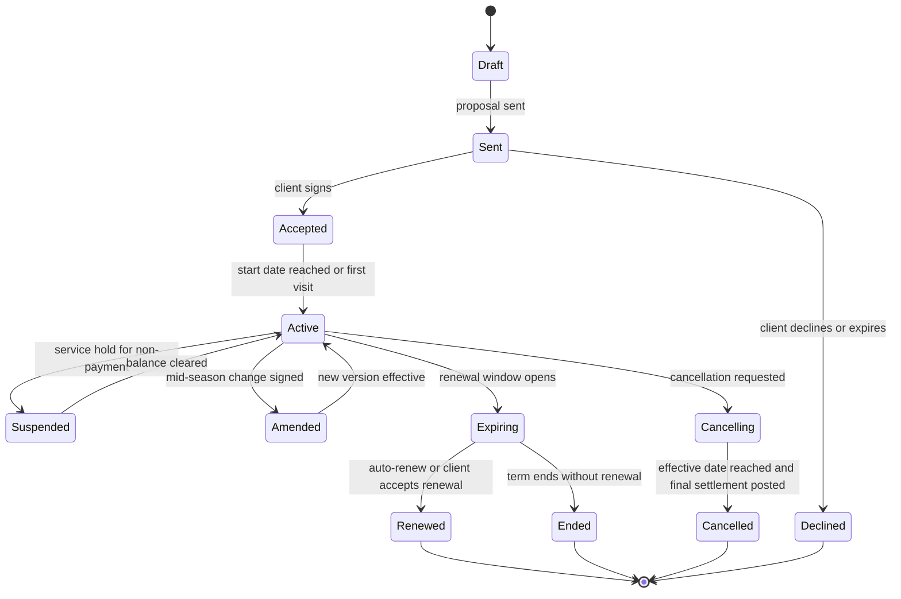

Rules:
- Agreements are **versioned**: amendments create version N+1 with an effective date; billing and visits before the effective date keep version N's prices. The earned-value meter respects versions.
- A renewal creates a **new agreement** (new term, new number suffix `-2028`) linked to the prior one; true-up of the prior term completes first.

#### 4.3.3 Price escalators [MVP fixed % / V1 indexed]

- Types: `fixed_pct` (e.g., +4% at renewal), `fixed_amount` (+$2 per mow), `cpi_linked` (US CPI-U or Canada CPI, with floor and ceiling, e.g., CPI with min 3%, max 6%) [V1], `fuel_surcharge` (monthly surcharge line indexed to a public diesel price series, e.g., the US EIA weekly on-highway diesel average, with a base price and a per-$0.10 step) [V1], `labor_index` (manual) [V2].
- Timing: at renewal (default), on anniversary, or mid-term on a date (commercial multi-year contracts often escalate yearly within the term).
- Notice: the escalated price must be communicated before it applies; default 30 days before renewal, configurable per jurisdiction. The renewal notice shows old price, new price, reason (optional AI-drafted explanation: "fuel and labor costs rose 6% in our area this year").
- Rounding rules: round unit prices to $0.50 or $1 (configurable) so mowing prices stay human ($55 -> $57, not $57.20).
- **Worked examples** (illustrative index values):
  - `fixed_pct` +4%, rounding to the nearest $1: $55.00 mow -> $57.20 -> $57.00; 5-step program $360 -> $374.40 -> rounded per round ($72 -> $75 x 5 = $375).
  - `cpi_linked` with floor 3% and ceiling 6%: rounding up to the next $0.50: if the trailing 12-month CPI change published before the notice date is 2.6%, the floor applies (3%): $55 -> $56.65 -> $57.00. If CPI is 7.1%, the ceiling applies (6%): $55 -> $58.30 -> $58.50. The index value, publication date and series ID are stored on the renewal record so the client can be shown exactly where the number came from.
  - `fuel_surcharge`: base diesel $3.75/gal, +0.5% of the month's maintenance and snow labor lines for each full $0.10 above base, capped at 5%. With the weekly average at $4.12, the surcharge is 3 steps x 0.5% = 1.5%, so a $4,800 commercial month adds a $72.00 `fuel_surcharge` line. Fuel surcharges are recalculated monthly from the last published value before the invoice date, never retroactively.
- **Multi-year contracts**: a 3-year HOA maintenance contract can carry a different escalator per contract year (e.g., year 2 +3%, year 3 +3.5%); the engine creates version N+1 of the agreement on each anniversary automatically (no new signature, because the escalation was signed up front) and sends an informational notice.
- **Escalation guardrail**: an escalator can never produce a price decrease unless the escalator explicitly allows it (some CPI clauses are symmetric); a negative index reading with a floor of 0% leaves prices unchanged.
- **Escalation impact preview**: before a renewal batch, the owner sees total revenue uplift and an AI churn-risk score per client ([17](17-ai-copilot-automation.md)) and can exclude at-risk VIPs.

#### 4.3.4 Auto-renewal and renewal campaigns [MVP]

- Renewal modes: `auto_renew` (same terms + escalator; client notified; can opt out), `renewal_proposal` (generate a new proposal requiring signature; default for commercial), `manual`.
- **Notice compliance**: several jurisdictions regulate automatic renewal of consumer and service contracts. For example, New York General Obligations Law section 5-903 makes auto-renewal clauses in contracts for service, maintenance or repair to real or personal property unenforceable unless the provider sends written notice 15-30 days before the client's deadline to give notice of non-renewal; California's Automatic Renewal Law imposes disclosure, consent, reminder and online-cancellation requirements on consumer subscriptions (both verify; laws change frequently, and the federal FTC "click-to-cancel" rule was vacated by a federal appeals court in 2025, but state laws remain). Rootline ships a platform-maintained **renewal-notice rule table** by state/province (maintained by `platform_finance` with counsel) that sets minimum notice windows, required channel (written/email), required content and online cancellation availability; the engine schedules notices automatically and refuses to auto-renew an agreement whose required notice was not delivered (it converts to `renewal_proposal`).
- **Notice window computation (worked example)**: the window is computed from the client's deadline to give notice of non-renewal, not from the term end. Hernandez's agreement ends Dec 31 and lets the client cancel renewal any time before Dec 31, so under a 15-30-day rule the notice must be sent between Dec 1 and Dec 16; the engine schedules it for Dec 1 (earliest compliant date, maximizing the client's decision time) with a 3-day retry buffer for bounced email before falling back to mail. If the agreement instead required 30 days' notice of non-renewal (client deadline Dec 1), the window would move to Nov 1-Nov 16. Each notice stores the rule row version, channel, delivery proof and content hash; an agreement whose notice is not delivered by the window's last day converts to `renewal_proposal` automatically (verify the rule rows with counsel).
- Renewal timing defaults: residential lawn programs renew in December-February (before the season and before competitors' spring mailers); commercial renewals align with client budget cycles (often July-October for calendar-year budgets). Renewal campaign tooling with [16](16-marketing-growth-communications.md).
- Renewal cannot proceed while the client has a balance > 60 days past due (configurable); the renewal goes to the office for review.

#### 4.3.5 Cancellation and proration [MVP]

- **Who can cancel**: client (portal request or written notice; the request is logged with timestamp), Company (for non-payment, property sold, safety), mutual.
- **Notice period**: per agreement (e.g., 30 days written notice); effective date = later of requested date and notice date + notice period, unless waived.
- **Settlement calculation** at effective date:
  - `earned_value` (completed occurrences at unit value, or ratable value for fixed-season lines through the effective date)
  - minus `billed_to_date`
  - plus `early_termination_fee` (fixed, % of remaining ACV, or "recapture of prepay/multi-year discount"; must be in signed terms; capped by the rule table where jurisdictions restrict)
  - plus/minus `unreturnable_costs` (e.g., special-order materials already purchased for this client)
  - = **final invoice** (positive) or **credit/refund** (negative).
- **Proration methods** for fixed-season or subscription lines: `by_occurrence` (default for visit-based lines), `by_day`, `by_month`, `by_season_weight` (a weight curve, e.g., mowing season weights Apr 10%, May 16%, Jun 16%, Jul 14%, Aug 13%, Sep 13%, Oct 12%, Nov 6%, so cancelling at the end of June correctly earns 42% of the season, not 3/8).
- **Worked example, commercial early termination**: a 3-year $64,800/year HOA maintenance contract signed with a 4% multi-year discount and a termination clause of "60 days' notice; recapture of the multi-year discount on work delivered". The HOA board terminates effective Jun 30 of year 2. Earned in year 2 through Jun 30 (the contract's weight curve places 52% of annual value in January-June, because spring cleanup, mulch and the heaviest mowing months fall there) = $33,696; billed (6 of 12 level installments) = $32,400; discount recapture = the stored list price ($67,500/year) minus the contract price ($64,800/year) = $2,700 per contract year x 1.52 contract years delivered = $4,104 => final invoice $1,296 + $4,104 = **$5,400**, with the calculation attached and the clause quoted. Without a signed recapture clause the engine refuses to add the fee and shows why.
- Future visits after the effective date are cancelled in the schedule ([04](04-scheduling-dispatch-routing.md)); open installment invoices after the effective date are voided (if unsent) or credited.
- **Client cooling-off rights**: residential agreements signed in the client's home, and in some jurisdictions remote or online contracts, may carry a statutory cancellation window (for example, the US FTC Cooling-Off Rule gives buyers three business days to cancel certain sales made at the buyer's home, and Canadian provinces set cancellation periods for direct-sales and distance contracts; verify scope, thresholds and periods per jurisdiction). Estimators who sign agreements on a tablet at the kitchen table trigger the in-home rule; the proposal records the signing location ([03](03-crm-sales-estimating-proposals.md)). Agreements with an open cooling-off window cannot charge deposits beyond what the rule table allows, and a cancellation inside the window refunds in full (P35) with no fee.
- **Property sold**: option to **transfer** the agreement to the new owner (new client, same property) with a new signature, carrying the earned-value position forward or settling with the seller.

#### 4.3.6 Mid-season changes (amendments) [MVP]

| Change | Engine behavior |
|---|---|
| Add a service line (e.g., add mosquito control from June) | New line with occurrences from effective date; ACV increases; remaining installments re-leveled (or added as separate per-visit billing, per Company preference). Requires client signature for residential (portal one-click accept) unless amount < Company threshold and terms allow office-confirmed changes. |
| Remove a service line | Future occurrences cancelled; earned value to date stays; remaining installments re-leveled; credit if already billed ahead. |
| Change frequency (weekly -> bi-weekly in drought, or vice versa) | Recalculate planned occurrences; for `fixed_season` lines a frequency change is a price change and requires amendment. |
| Change price | New version with effective date; prior occurrences keep old price. |
| Change billing (installments -> per-visit, or change billing day) | Close the current schedule at the effective date with a mini true-up; open the new schedule. |
| Add a property (commercial) | New property scope with its own lines; consolidated billing updated. |

#### 4.3.7 Skipped visits and credits [MVP]

Every planned occurrence ends in a terminal state: `completed`, `rescheduled` (still counts toward the season), `skipped_weather`, `skipped_dormancy` (drought/heat), `skipped_client_request`, `skipped_access` (locked gate, dog in yard), `missed_company` (crew failure), `skipped_company_hold` (service hold for non-payment, 4.3.8), `cancelled_by_amendment`.

Credit policy matrix (Company defaults, overridable per agreement):

| Skip reason | `per_visit_leveled` lines | `fixed_season` lines | Notes |
|---|---|---|---|
| `skipped_weather` then rescheduled | No credit (visit happens later) | No credit | |
| `skipped_weather` not rescheduled | Credit unit value | No credit unless > N consecutive (e.g., 3) | Weather data attached as evidence. |
| `skipped_dormancy` | Credit unit value (default) or "convert to alternative service" (e.g., a drought-week skip converts to a bed weeding visit of equal value) | No credit | Conversion requires client notification. |
| `skipped_client_request` with >= 24 h notice | Credit | Credit at unit value if the agreement says so | Limit per season configurable (e.g., max 3 credited skips). |
| `skipped_client_request` < 24 h notice | No credit, or trip charge | No credit | |
| `skipped_access` | Trip charge or no credit | No credit | Photo of locked gate required. |
| `missed_company` | Credit + optional goodwill credit | Credit | Triggers quality alert. |

Credits are applied according to the true-up method: they reduce earned value (and therefore the final installment or re-leveled installments), or create a credit memo immediately if the Company chooses "visible credits" (clients like seeing "Credit: skipped mow Aug 17, drought: -$55.00" on their next invoice).

#### 4.3.8 Service holds and non-payment suspension [MVP]

- Policy: when the oldest unpaid invoice is > N days past due (default 45) and the balance > $X (default $100), the agreement enters `suspended` after an advance notice (default 7 days). Suspension pauses visit generation for that client ([04](04-scheduling-dispatch-routing.md)) and shows a "Service on hold" banner to crews and in the portal.
- Exemptions: snow and ice on commercial sites (safety and liability), irrigation winterization before a freeze (property damage risk), and any client flagged VIP. These require explicit owner choice to suspend.
- Paused visits are logged as `skipped_company_hold` and are not credited.
- Resumption is automatic when the balance is paid; the dispatcher gets a re-scheduling task.
- **One hold state per client.** This module owns the service-hold policy. The payments module's `payments.client.payment_hold` signal ([08](08-payments-stripe.md) 4.15, default 30 days past due or a hard decline not cured in 7 days) maps to the **hold-warning** stage here (the +30 dunning step in 4.9.3: crews see "payment issue" on the visit, nothing is skipped); actual suspension still requires the 45-day threshold and the 7-day advance notice. Whichever module raises the signal, scheduling sees one state: `none`, `warning`, `suspended`.
- **Partial resumption**: a client who pays the oldest invoices so that nothing is past the threshold resumes even if a newer balance remains; an active payment plan (4.9.4) that is `current` also resumes service.

### 4.4 Invoices

#### 4.4.1 Invoice states [MVP]

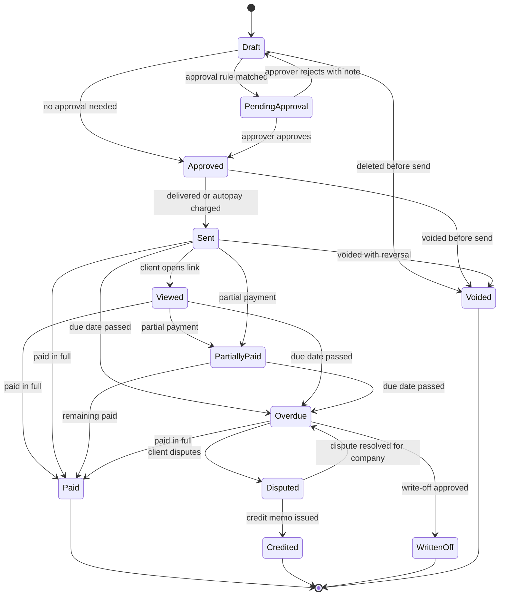

- `Overdue`, `Viewed`, `Disputed` are **derived flags** stored for querying; payment status is computed from allocations ([08](08-payments-stripe.md)).
- **Stored status vs UI state.** The `invoice.status` column uses the snake_case values of the entity model in [20](20-architecture-security.md) 7.4: `draft`, `pending_approval`, `approved`, `issued` (shown as **Sent**; the `invoice.issued` event fires on this transition), `partially_paid`, `paid`, `credited`, `written_off`, `void`. `Viewed`, `Overdue` and `Disputed` are flags, not statuses.
- A `Sent` invoice can only be voided if no payment is allocated; otherwise a credit memo is required. Voids after the accounting period is closed post the reversal in the current open period ([09](09-accounting-ledger-integrations.md)).

#### 4.4.2 Numbering [MVP]

- Per-Company sequential numbers with configurable prefix and per-document type (`INV-`, `DEP-`, `CM-`, `PA-` for pay apps, `ST-` for statements). Optional per-branch or per-year sequences (`INV-2027-00412`).
- Numbers are assigned at **approval** (not at draft) so voided drafts never create gaps; once assigned, a number is never reused. Voided sent invoices keep their number and appear on the audit report. This satisfies auditors and is ready for e-invoicing regimes that expect unique, sequential identifiers.
- Imported historical invoices (migration from Jobber/QuickBooks) keep their original numbers in a separate `legacy_number` field.

#### 4.4.3 Line-item rules [MVP]

| Line type | Source | Rules |
|---|---|---|
| `service` | Visit, agreement line, price book | Shows service date(s), property, quantity/unit (e.g., 1 visit, 12 yd3 mulch, 0.5 acre aeration). |
| `material` / `plant` | Field usage, takeoff, purchase | Quantity, unit (cu yd, bag, flat, each, ton, pallet), unit price; optional cost visibility (never shown to client). Plant lines can show botanical and common name and size (#3 container, 2" caliper B&B) from the Plant KB ([12](12-plant-knowledge-base.md)). |
| `labor` / `equipment` | T&M | Role, hours, rate; equipment class and hours. |
| `subcontract` | Sub bill | Description, markup hidden or shown per Company setting. |
| `fee` | Rules | Trip charge, disposal, fuel surcharge, convenience fee where lawful ([08](08-payments-stripe.md)), late fee. |
| `discount` | Proposal, prepay, promo, goodwill | % or $; scope line or invoice; contra-revenue account. |
| `installment` | Level schedule | "Installment 5 of 12, Hernandez 2027 Maintenance Agreement"; expandable detail of visits completed this month (no amounts or $0). |
| `deposit_application` | Deposit | Negative; reduces amount due, not taxable base. |
| `retainage` | Progress | Negative "retainage withheld (10%)", or positive "retainage release". |
| `credit_application` | Credit balance or credit memo | Negative; reduces amount due. |
| `covered` | Fixed-price agreement, cap reached, warranty | $0 lines that document work delivered. |
| `section` / `note` | Template | Headers ("Front entrance beds"), notes, no amount. |

Rules:
- **Price lock**: lines priced from an agreement or proposal cannot be edited by roles below `office_manager`; overrides require a reason code and are reported (price-override report).
- Every line stores `revenue_account_id`, `tax_category`, `job_id`, `property_id`, `service_line` (maintenance, install, snow, irrigation, tree, lighting, design, enhancement) and `source_type/source_id`, so revenue, tax and job costing are correct without manual coding.
- Negative invoice totals are not allowed; the engine converts them into a credit memo.
- Quantities support 3 decimals (0.125 acre); money is stored as integer minor units with currency.

#### 4.4.4 Templates and branding [MVP basic / V1 designer]

- **Brand kit** shared with proposals and the portal ([06](06-customer-portal.md), [21](21-ux-design-system-sitemaps.md)): logo, colors, font pair, footer, legal entity name, license numbers (many states require contractor license numbers on documents), tax registration numbers (GST/HST, QST, PST numbers in Canada).
- MVP: 3 professionally designed templates (Classic, Modern, Commercial) with toggles: show visit dates, show photos thumbnails, show crew notes, roll-up vs detail, show property map thumbnail, show season meter, show "pay now" QR code.
- V1: block-based **template designer** (drag sections: header, bill-to/service-to, PO block, lines, tax summary, payment instructions, terms, attachments index, thank-you note) with per-client template assignment and per-language variants (English, Spanish at launch; French-Canadian later; client language drives invoice language).
- Required content checks by jurisdiction (e.g., Canadian invoices show the supplier's GST/HST, QST and PST registration numbers and tax amounts in the form CRA requires for the client to claim input tax credits, see 4.5.3; US invoices for home-improvement work show the contractor license number where the state requires it). The template engine refuses to render a template missing required fields for the invoice's jurisdiction.

#### 4.4.5 Attachments and proof of service [MVP]

- Auto-attached per Company/client settings:
  - **Before/after photos** from the visit (GPS and timestamp watermarked), selectable "best 3" by AI.
  - **Visit map**: property map with crew GPS breadcrumb and on-site time (commercial clients love this; residential default off for privacy).
  - **Chemical application notice**: for fertilizer, herbicide, insecticide and fungicide applications, a notice generated from the field chemical log ([05](05-field-crew-mobile-app.md), [14](14-service-line-modules.md)): product name, EPA registration number, active ingredient, rate, area treated, date/time, applicator name and license number, weather at application, re-entry or watering instructions. Where state rules require post-application notification to the customer, the notice is delivered with or before the invoice and logged for recordkeeping. (Specific state requirements are maintained in the compliance rule table in [14](14-service-line-modules.md).)
  - **Signed T&M tickets**, **change orders**, **lien waivers**, **pay-app packets**, **snow event logs**, **irrigation inspection reports** (zones, heads replaced, backflow test results), **design PDFs** for install milestones.
- Attachments are rendered into the portal invoice view and optionally merged into a single PDF packet (commercial AP departments often require one PDF).
- Size limits: 25 MB per invoice packet for email (larger packets are link-only).

#### 4.4.6 Delivery channels [MVP / V1 mail]

- Email with secure portal link (magic link, expiring 30 days, re-issued on request) and PDF attachment toggle.
- SMS with short link (requires SMS consent captured per TCPA/10DLC rules; see [16](16-marketing-growth-communications.md)).
- Portal notification and push (native app later).
- **Print batch** [MVP]: invoices for clients whose channel is mail are collected into one print-ready PDF per run (address block positioned for a standard double-window envelope, remittance stub with QR code), so the office prints and stuffs once instead of 40 times.
- **Printed mail** [V1] via a print-and-mail API partner (for example Lob): invoice PDF + remittance stub + return envelope; cost per piece passed through or absorbed (Company setting); remittance stub carries invoice number and a QR code for online payment. Checks can be routed to a lockbox partner [V2].
- Commercial **AP portal / email-to-AP** routing: send to the client's AP inbox (e.g., `invoices@propertyco.com`) with the invoice PDF as the only attachment and a structured subject (`INV-2027-00412 | PO 77812 | Oak Ridge Apartments`).
- Delivery tracking: sent, delivered, bounced, opened, link clicked; bounced emails create an office task.

#### 4.4.7 Internal approval workflow before sending [MVP]

- Approval rules (any match routes to `pending_approval`):
  - Invoice total > threshold (default $2,500) or T&M invoices of any size.
  - Manual price override or discount > X% (default 10%).
  - First invoice for a new client.
  - Margin on the job below target (if job costing enabled; [09](09-accounting-ledger-integrations.md)).
  - AI anomaly flag (section 10): amount deviates > 2 standard deviations from the client's history, missing photos for a service that requires them, visit count mismatch.
  - Commercial client with required PO and PO missing.
- Approver: role-based (`owner`, `office_manager`, or `ops_manager` for their accounts) with **multi-level** approval for large amounts [V1] (e.g., > $25,000 requires owner).
- Approvals can be done in bulk in the Billing Run and on mobile (push notification "12 invoices need approval, $18,420").
- Rejected invoices return to draft with a note and a task for the preparer.

#### 4.4.8 Client-side acceptance (commercial AP approval) [V1]

- `client_commercial` contacts with the `approver` contact scope ([06](06-customer-portal.md) 3.3, with invoice visibility enabled) can review invoices in the portal, approve, reject with reason, or request changes; multi-step approval chains on the client side (site manager -> regional manager) are configurable per client.
- Invoice shows `client_status`: `awaiting_client_approval`, `approved_by_client`, `rejected_by_client`. Payment terms clock can start at client approval if the contract says so (common in commercial "Net 30 from approved invoice").

#### 4.4.9 PO numbers and ceilings [MVP]

- Purchase Orders recorded per client/property/agreement: PO number, issuer, amount ceiling (optional), date range, allowed service lines, remaining balance.
- Client setting "PO required": invoices without a valid PO cannot be approved. When a PO's remaining balance would go negative, the invoice is blocked and the ops manager is alerted at 80% consumption.
- Multiple POs per client (e.g., one for maintenance, one for enhancements, one per snow season).

#### 4.4.10 Consolidated billing for commercial portfolios [V1]

- **Billing hierarchy**: Client (e.g., "Greystone Property Management") -> Billing Groups (e.g., "Region North", "HOA: Maple Court") -> Properties. Each property can override the **bill-to entity** (property-management reality: the payer is each property's ownership entity, "Oak Ridge Apartments LLC c/o Greystone", even though the manager administers everything).
- Modes: `per_property_invoices` (one invoice per property per cycle, plus a consolidated statement), `consolidated_invoice` (one invoice per billing group with per-property subtotals and per-property tax), `master_with_sub_invoices` (one summary invoice referencing per-property sub-invoices; each sub-invoice is numbered and payable on its own).
- Per-property GL coding fields the client wants on the invoice (their property code, GL account, cost center) stored as client-defined fields and printed/exported.
- HOA specifics: board approvals, multiple signers, fiscal year alignment, reserve-study items billed separately from operating budget items (separate invoices tagged `reserve` vs `operating`).

> **Competitive edge: the bill-to entity is per property, not per client.** Jobber's QuickBooks Online sync posts invoices and payments only to the parent customer, not to QBO sub-customers, and does not support QuickBooks Desktop (section 2.1), so a property manager with 22 sites collapses into one customer in the books. Rootline models Client -> Billing Group -> Property with a bill-to entity, PO and client GL code per property, posts every journal line with a `property_id` dimension in the built-in ledger, and still syncs per-property sub-customers to QBO for Companies that keep it ([09](09-accounting-ledger-integrations.md)).

#### 4.4.11 Multi-currency [MVP single-currency / V1 cross-currency]

- Each Company has a **base currency** (USD or CAD at launch). MVP: invoices in base currency only.
- V1: clients can have a **billing currency** different from base (a Windsor, Ontario company with Detroit clients). Price books per currency (no auto-conversion of prices by default). Invoice currency is fixed at creation; the GL records the base-currency equivalent at the invoice date rate; realized FX gain/loss posts at payment; unrealized revaluation at period end ([09](09-accounting-ledger-integrations.md)). Rate source: daily published reference rates (e.g., Bank of Canada) with manual override.
- Stripe: charge in invoice currency on the Company's connected account; settlement currency and conversion are the Company's Stripe settings ([08](08-payments-stripe.md)).

#### 4.4.12 E-invoicing readiness [V1 structured export / V2 networks]

- Canonical invoice JSON is mapped to **UBL 2.1** fields from day one (supplier/customer parties with tax IDs, lines with classified tax category, allowances/charges, payment means, references to PO and contract). This lets us emit **Peppol BIS Billing 3.0** and similar profiles when US/Canadian e-invoicing networks (the US Digital Business Networks Alliance framework, Canadian initiatives) or large clients require them [V2].
- Exports: UBL XML, CSV, hybrid PDF/A-3 with embedded XML [V2]; ANSI X12 810 EDI for national-account clients [V2].
- National-account facility-management portals (e.g., ServiceChannel, Corrigo) are common for commercial landscapers serving retail chains; V2 integrations submit invoices and pull work orders and NTEs (verify partner API availability).
- Invoices carry an immutable content hash and a rendering version so the PDF shown in 2031 matches what was sent in 2027.
- **Mandate status**: we know of no US federal or Canadian federal B2B e-invoicing mandate in force as of Nov 2026 (verify); demand will come first from national-account and government clients and from large property-management AP platforms, which is why structured export is V1 and network delivery is V2.

### 4.5 Sales tax and indirect tax (US and Canada)

Landscaping is one of the hardest small-business tax categories in North America: the same crew on the same day can perform a service that is taxable (lawn maintenance in some states), a capital improvement where the contractor pays tax on materials and charges none on labor (a new paver patio in many states), and a sale of tangible goods (bagged mulch delivered and left for the homeowner). Rootline's approach: **classify every line, determine tax per line by jurisdiction, keep an evidence trail, and let a professional tax engine do the rate math.**

#### 4.5.1 Tax architecture [MVP]

| Component | Description | Priority |
|---|---|---|
| **Tax category taxonomy** | Rootline-defined categories assigned to every price-book item and invoice line: `lawn_maintenance_labor`, `landscape_maintenance_labor`, `landscape_install_labor`, `capital_improvement_labor`, `repair_labor`, `tree_care_labor`, `snow_ice_removal`, `irrigation_service`, `irrigation_install`, `pesticide_fertilizer_application`, `design_services`, `tangible_materials_installed`, `tangible_goods_sold` (delivered, not installed), `plants_installed`, `plants_sold`, `equipment_rental`, `disposal_fee`, `delivery_fee`, `fuel_surcharge`, `finance_charge`, `gift_credit`, `nontaxable_other`. | MVP |
| **Job tax classification** | Each Job carries `real_property_treatment`: `maintenance_repair`, `capital_improvement`, `new_construction`, `tangible_sale`, `mixed`. Defaults from job type (install project -> capital improvement; maintenance agreement -> maintenance) and can require a certificate (e.g., New York's Certificate of Capital Improvement, Form ST-124, is the commonly cited example of documentation that changes the treatment; verify). | MVP |
| **Contractor model per jurisdiction** | `contractor_as_consumer` (the Company pays tax when buying materials; invoice to client shows no tax on materials or labor for real-property improvements; materials purchased tax-free trigger **use tax accrual**) vs `contractor_as_retailer` (materials separately stated and taxed to client; purchased under resale certificate) vs `service_taxable` (labor itself taxable). Configured per Company per state by its accountant, with platform defaults. | MVP |
| **Tax engine adapter** | Interface: `quote(lines, ship_from, ship_to, customer_exemption, date)`, `commit(invoice)`, `adjust(credit_memo)`, `void(invoice)`. Implementations: `manual_rates` (Company-maintained rate per property or tax zone; for very small companies and for Canada where rates are simple), `stripe_tax` (Stripe Tax calculation API with product tax codes mapped from Rootline categories), `avalara` (AvaTax with uncommitted quotes and committed invoices, tax codes and entity-use codes for exemptions). | MVP manual + Stripe Tax; V1 Avalara; V3 Vertex for enterprise |
| **Sourcing** | Services to real property are sourced to the **property address** (geocoded rooftop with PostGIS; county/city/special district assignment comes from the engine). Tangible goods picked up at the yard are sourced to the yard. | MVP |
| **Mapping table** | `tax_category x engine -> engine_tax_code`, maintained by `platform_finance`, with per-Company overrides. Every override is audited. | MVP |
| **Evidence** | Each invoice stores the engine request/response, rates by jurisdiction, exemption certificate ID used, and classification decisions, so an auditor can reconstruct why tax was or was not charged. | MVP |

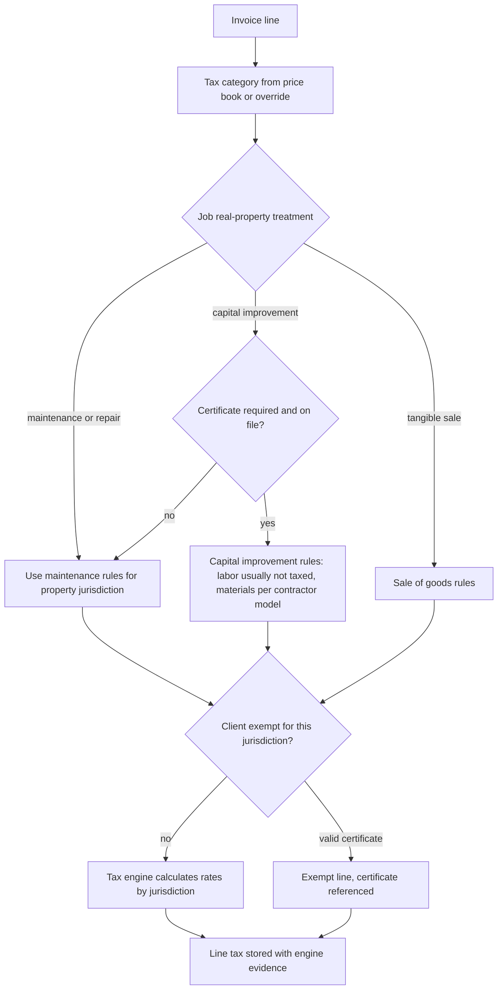

> **Competitive edge: tax per line, not per client.** Jobber's own help center notes that batch invoicing splits jobs at properties with different tax rates into separate invoices, a sign that tax is modeled per property rather than per line. Rootline classifies each line (maintenance labor vs capital-improvement labor vs installed materials vs goods sold vs snow removal), so a single commercial invoice can mix a taxable maintenance line and a non-taxable capital improvement correctly, with the evidence an auditor needs.

#### 4.5.2 Taxability patterns (illustrative, verify) [MVP]

The platform ships a **default taxability matrix** curated by `platform_finance` with outside tax counsel, and the tax engine remains the source of truth for rates. The table below shows the *kinds* of differences the matrix must express; it is illustrative only, not tax advice, and every row must be verified before launch (as of Nov 2026, verify).

| Pattern | Examples commonly cited | Rootline handling |
|---|---|---|
| Landscaping and lawn-care services taxable as services | Ohio, Connecticut, Iowa, Washington, Texas ("real property services") are commonly cited as taxing some landscaping or lawn-care services. Broad-based gross receipts or service taxes (Hawaii GET, New Mexico GRT, South Dakota) reach most services. | `lawn_maintenance_labor` and `landscape_maintenance_labor` taxable in these jurisdictions; capital improvements often treated differently. |
| Maintenance taxable, capital improvement exempt with documentation | New York: maintenance of real property taxable; capital improvements not taxable when documented (ST-124). | Job classification + certificate gate; installment invoices for maintenance taxed; install invoices not taxed when certificate on file. |
| Labor generally not taxable; contractor consumes materials | Many states treat landscape installation like construction: contractor pays tax on materials, charges none to the customer. | `contractor_as_consumer`; no tax lines; use-tax accrual on untaxed purchases ([13](13-operations-inventory-equipment.md), [09](09-accounting-ledger-integrations.md)). |
| Tangible goods taxable when sold separately | Bagged mulch, plants or firewood sold and delivered without installation. | `tangible_goods_sold`, `plants_sold` taxable at property or pickup location. |
| Residential vs nonresidential distinctions | Some states tax repair and remodeling of nonresidential property but not residential (Texas is a commonly cited example). | Property type (residential/commercial) is an input to the engine via customer/property usage codes. |
| Snow removal | Treated as a taxable real-property service in some states, untaxed in others. | Separate `snow_ice_removal` category so it can differ from mowing. |
| Pesticide/fertilizer applications | Some states tax pest control or lawn treatment specifically. | `pesticide_fertilizer_application` category. |

**Worked example: one commercial invoice, three tax treatments** (a jurisdiction modeled on the New York pattern; illustrative 8.0% combined rate, verify real rates in the engine). Linden Park HOA, June invoice:

| Line | Tax category | Job treatment | Taxable? | Amount | Tax |
|---|---|---|---|---|---|
| June grounds maintenance (installment 3 of 8) | `landscape_maintenance_labor` | `maintenance_repair` | Yes | $4,200.00 | $336.00 |
| Mulch refresh, 40 yd3 installed in existing beds | `tangible_materials_installed` + labor | `maintenance_repair` (replacing mulch maintains existing beds) | Yes | $2,280.00 | $182.40 |
| New entrance planting bed (Certificate of Capital Improvement on file) | `plants_installed`, `landscape_install_labor` | `capital_improvement` | No (Company paid tax on plants at purchase or accrues use tax) | $6,950.00 | $0.00 |
| Irrigation backflow test fee, pass-through filing fee | `nontaxable_other` | n/a | No | $45.00 | $0.00 |
| **Total** | | | | **$13,475.00** | **$518.40** |

The invoice prints a tax summary by jurisdiction and treatment, the certificate number on the capital-improvement line and the engine's document code. Without the certificate on file, the Billing Run raises the "capital improvement without certificate" exception (4.10) instead of silently taxing or exempting the line. Whether mulch replacement is maintenance or improvement is exactly the kind of call the default matrix must encode per state and the Company's accountant must confirm.

#### 4.5.3 Canada: GST/HST, QST and PST [MVP]

- **GST/HST**: GST 5% applies in provinces without HST; HST applies at 13% in Ontario, 15% in New Brunswick, Newfoundland and Labrador and Prince Edward Island, and 14% in Nova Scotia after its 2025 rate change (as of Nov 2026, verify). For services in relation to real property, the place of supply is generally the province where the property is located, so an Ottawa company servicing a Gatineau property charges GST + QST, not Ontario HST (verify with CRA guidance).
- **QST** (Quebec, 9.975%) applies to most services and goods supplied in Quebec; registration required separately from GST.
- **PST/RST**: British Columbia, Saskatchewan and Manitoba levy provincial sales taxes with their own rules on which services and goods are taxable; treatment of landscaping labor vs materials differs between them (BC PST is generally applied to goods rather than landscaping labor; Saskatchewan and Manitoba tax certain services) (verify each against provincial bulletins; encoded in the default matrix).
- **Small suppliers**: businesses under the CAD $30,000 small-supplier threshold (over four consecutive calendar quarters) need not register for GST/HST; Rootline tracks trailing taxable revenue and warns the owner when they approach the threshold.
- **Invoice requirements**: registration numbers (GST/HST, QST, PST) printed on invoices and tax amounts or rates stated so commercial clients can claim input tax credits. CRA's documentation requirements scale with the invoice total in three tiers, generally under $100, $100 to $499.99, and $500 or more (raised from $30 and $150 in 2021; as of Nov 2026, verify): the middle tier adds the supplier's registration number and the tax charged (or a statement that tax is included and the rate), and the top tier adds the recipient's name, the payment terms and a description of the supply. Rootline's Canadian templates always print the top-tier content, so every invoice qualifies regardless of amount.
- **Tax point**: GST/HST generally becomes payable on the earlier of the day the consideration is paid and the day it becomes due, and an invoice date generally makes it due (verify), so each level-billing installment carries its own tax, deposits are taxed when applied (4.2.5) and a prepaid season is taxed in full on the prepay invoice. US sales tax is generally due at the invoice date on accrual filers; the per-jurisdiction cash/accrual setting is in 4.5.5.
- **Tax-inclusive pricing** [V1]: some Canadian residential Companies quote "all-in" prices. Price books can be flagged tax-inclusive per Company; the engine backs tax out of each line (rounded per line), and the invoice states "Price includes 13% HST of $6.33" as CRA allows when the rate or amount is disclosed. US Companies default to tax-exclusive.
- **Exemptions**: First Nations (Indian Act section 87 relief for qualifying status-holders on reserve), certain public service bodies (rebates rather than exemptions), diplomats. Captured as exemption certificates with jurisdiction scope.
- Engine: `manual_rates` is sufficient for most Canadian Companies (rates are provincial, not local), with Stripe Tax or Avalara optional.

#### 4.5.4 Exemptions and certificates [MVP vault / V1 validation]

- **Certificate vault**: per client (and optionally per property), store certificate type (`resale`, `nonprofit_501c3`, `government`, `agricultural`, `capital_improvement`, `first_nations`, `other`), jurisdictions covered, number, issue and expiry date, PDF/image, validation status.
- **HOA reality check**: most homeowners associations are **not** sales-tax-exempt merely because they are nonprofit corporations; exemption usually requires a specific status (e.g., a 501(c)(3) charity in a state that exempts charities, or a government body). The default matrix does not exempt `client_type = hoa` unless a valid certificate is on file. Same for "nonprofit" churches, schools and clubs: certificate required.
- **Resale/sub work**: when the Company works as a subcontractor for another landscaper or GC, a resale or contractor certificate can make the invoice exempt where the state allows.
- Expiry handling: 30 days before expiry, the client gets a portal task "Upload renewed exemption certificate"; on expiry, new invoices tax normally and the office is alerted.
- V1: validation via engine services (e.g., Avalara certificate management) and Stripe Tax customer exemption status (`exempt` / `reverse`) mapping.
- Exempt invoices print the certificate reference.

#### 4.5.5 Tax reporting and filing [MVP reports / V1 filing partner]

- Sales tax liability report by jurisdiction and period (state, county, city, district; GST/HST/QST/PST lines), taxable vs exempt vs non-taxable sales, credits and bad-debt adjustments, on accrual or cash basis (Company setting per jurisdiction where cash-basis reporting is permitted).
- Ties to GL `Sales Tax Payable` sub-accounts per agency ([09](09-accounting-ledger-integrations.md)).
- Bad-debt tax recovery report: tax on written-off invoices that may be deductible on future returns where allowed.
- V1: filing and remittance through Avalara Returns or Stripe Tax filing partners; Rootline never remits on behalf of the Company itself.
- Economic nexus monitor: trailing 12-month sales into each US state vs that state's economic nexus threshold, for Companies working across state lines (Kansas City metro, Quad Cities, Twin Ports) [V1].

### 4.6 Adjustments: credit memos, refunds, voids, write-offs [MVP]

| Document | When used | Rules |
|---|---|---|
| **Credit memo** (`CM-`) | Price correction, service complaint, skipped-visit credit, returned materials, true-up in client's favor, goodwill. | References original invoice(s) and lines; reason code required (`pricing_error`, `service_quality`, `skipped_visit`, `true_up`, `goodwill`, `returned_goods`, `tax_correction`, `dispute_settlement`); tax reverses proportionally through the engine; disposition: `apply_to_invoice`, `hold_as_credit`, `refund`. Approval required above threshold (default $250) or for goodwill reason. |
| **Supplemental (debit) invoice** | Under-billed amount discovered after send (extra 2 yd3 of mulch installed). | New invoice referencing the original; same tax treatment. |
| **Void** | Wrong client, duplicate, sent in error, no payment allocated. | Full reversal entry; number retained; client notified if already sent ("Please disregard INV-00412"). |
| **Refund** | Overpayment, credit balance refund, cancelled job deposit, dispute settlement. | Executed on the Company's Stripe account against the original PaymentIntent when possible (partial allowed, within card network refund windows) or by check/ACH-out recorded manually; approval by `owner` or `office_manager`; refund reason; ledger posting in 4.11. Refunds of Stripe-processed payments are initiated through [08](08-payments-stripe.md). |
| **Write-off** | Uncollectible balance, small residual, bankruptcy, settled dispute. | Reason code; approval matrix (e.g., `office_manager` up to $100, `owner` above); method `direct` (Bad Debt Expense) or `allowance` (against Allowance for Doubtful Accounts, if the Company uses it; [09](09-accounting-ledger-integrations.md)); sales-tax bad-debt adjustment recorded; client flagged (optional "do not service" until paid); recovery of a written-off amount reverses through "Bad debt recovered". |
| **Small-balance auto write-off** | Residuals under a threshold (default $1.00, configurable to $10) from rounding or partial payments. | Automatic; contra-revenue `Small balance adjustments`; listed in a monthly report. |

### 4.7 Customer balances: credits, prepayments, unapplied cash, gift credits [MVP]

- Every client has a **wallet** with typed balances: `credit_balance` (from credit memos and true-ups), `unapplied_payments` (overpayments or payments received without an invoice), `deposits_held` (per job), `prepaid_season` (per agreement), `gift_credit` [V1].
- **Auto-apply rules**: apply credits to the oldest open invoice (default), to the next invoice only, or manual. Deposits and prepaid seasons apply only to their own job/agreement.
- Credits show in the portal with origin ("Credit from 2026 season true-up: $110.00").
- **Unclaimed property**: long-dormant credit balances may be reportable to the state or province as unclaimed property after a dormancy period. Rootline reports credit balances with no activity for 24+ months and supports refund-or-escheat workflows (rules vary by jurisdiction; verify) [V1].
- **Gift credits** [V1]: "Give Mom a spring cleanup" gift certificates sold through the website builder ([16](16-marketing-growth-communications.md)); liability until redeemed; expiry and breakage subject to gift-card laws (many jurisdictions restrict expiry), so default is no expiry.

### 4.8 Statements [MVP]

- **Types**: `open_item` (all open invoices and credits, the default for residential), `balance_forward` (prior balance + this period's activity, preferred by some commercial clients), `activity` (all transactions in a date range), `agreement_statement` (earned vs billed vs paid for an agreement; doubles as the season summary), `consolidated_portfolio` (per billing group with per-property sections).
- **Statement runs**: monthly on a chosen day for clients with open balances; delivered like invoices; include aging summary and pay-now link for the full balance.
- Statements do not post to the GL; they are generated documents with a number and snapshot.
- **Year-end summary** for residential clients (what they paid for, services by month, and, where useful, documentation for home-office or rental-property owners' records).
- **Content rules**: statements list invoices, payments, credit memos, applied credits and late fees; customer deposits held and prepaid-season balances are shown in a separate "held for you" box (they are not AR); retainage receivable appears in its own section with release conditions; disputed invoices are marked and excluded from the "amount due now" figure.
- **Balance-forward math (worked example)**: Greystone Region North, June statement: opening balance $9,412.40 + invoices issued $13,359.60 + late fees $0.00 - payments received $9,412.40 - credits applied $140.00 = closing balance $13,219.60, of which current $13,219.60 and past due $0.00. The statement ties to the AR subledger for that billing group at the statement date; a mismatch blocks the statement run and opens an integrity task ([09](09-accounting-ledger-integrations.md)).
- **Snapshot rule**: a statement is generated from a point-in-time snapshot and never changes; a payment that arrives a minute later shows on the next statement, and the portal's live balance (which can differ) is labeled "as of now".

### 4.9 Accounts receivable, late fees, dunning and collections

#### 4.9.1 AR aging and the collections workspace [MVP]

- Aging buckets: Current, 1-30, 31-60, 61-90, 91-120, 120+ days past due (based on due date; option to age by invoice date). Retainage receivable aged separately.
- Filters: client type, service line, property, salesperson/account manager, branch, billing group, autopay status, dunning stage, promise-to-pay status.
- **Collections workspace**: prioritized queue (largest recoverable amount x probability of payment, from the AI model), client timeline (invoices, payments, messages, visits, disputes), quick actions (send reminder, log call, record promise, offer payment plan, place service hold, escalate).
- Daily AR tie-out: AR subledger total = GL AR control account; discrepancies alert the bookkeeper ([09](09-accounting-ledger-integrations.md)).

#### 4.9.2 Late fees and finance charges [MVP]

- Policy fields: type (`flat`, `percent_monthly`, `flat_plus_percent`), amount, grace period (days after due), minimum fee, maximum per invoice, maximum per year, compounding (off by default; finance charges are never charged on finance charges unless explicitly enabled and lawful), frequency (once, monthly), applies to (residential/commercial), excluded clients.
- **Legal guardrails**: late fees and finance charges are regulated (state usury and consumer credit laws, contract-law limits on penalties; in Canada, the federal Interest Act requires an annual rate to be stated where interest is expressed for a period of less than a year, or recovery may be limited) (verify). Rootline:
  - requires the late fee policy to be **disclosed in the signed agreement or proposal terms**, or on invoices before the fee is first charged; fees cannot be applied to clients whose signed terms predate the policy unless the owner overrides with an acknowledgement;
  - ships a platform-maintained **jurisdiction limits table** (max rate, max flat fee, consumer vs commercial) used to warn or block configurations exceeding limits (maintained by `platform_finance` with counsel; labeled "verify" in-product);
  - always states monthly percentage fees with the equivalent annual rate (1.5% per month = 18% per year).
  - distinguishes consumer from commercial accounts (limits are usually stricter for consumers) and the Company's state from the Property's state; when they differ, the stricter row applies;
  - never assesses a fee on a disputed amount, on an invoice in an active payment plan or promise to pay, on a balance under the automatic bankruptcy stay, or on an invoice that was late only because Rootline's own delivery bounced.
- **Limits table row structure** (values are maintained by `platform_finance` with counsel; none are hard-coded): `jurisdiction`, `account_type` (consumer, commercial), `max_monthly_rate`, `max_annual_rate`, `max_flat_fee`, `min_grace_days`, `requires_written_agreement`, `requires_invoice_disclosure`, `compounding_allowed`, `effective_from`, `source_citation`, `reviewed_on`. A Company configuration that exceeds the row is blocked at save with the citation shown; a row change that makes an existing policy non-compliant pauses that policy and notifies the owner.
- **Worked example**: policy "1.5% per month (18% per year) on the past-due balance, $5 minimum, $50 maximum per invoice, assessed once at 10 days past due and monthly thereafter, no compounding". INV-00977 for $1,620 reaches 10 days past due: fee = max($5, 1.5% x $1,620 = $24.30) = **$24.30**. A $96 invoice: 1.5% = $1.44, so the $5 minimum applies, which is an effective 5.2% for that month; if the jurisdiction row caps fees on small consumer balances, the engine uses the lower capped amount and logs why.
- Late fee assessment creates an invoice line (or a separate `FC-` invoice, Company setting) and posts to `Finance charge income`. Late fees can be waived in one click with a reason (waivers are the most common goodwill gesture); the AI collections agent can offer a waiver within owner-set bounds.

#### 4.9.3 Dunning (automated reminders) [MVP]

Default residential sequence (fully configurable; steps are Automations under the hood, [17](17-ai-copilot-automation.md)):

| Day relative to due | Step | Channel | Notes |
|---|---|---|---|
| -3 | Friendly upcoming-due reminder (non-autopay clients) | Email | Optional; includes pay link. |
| 0 | Due today | Email + SMS (if consented) | |
| +3 | First past-due | Email | Includes visit photos summary ("Here's the work we did in April"). |
| +10 | Second past-due + late fee notice | Email + SMS | Late fee applied at grace end if policy exists. |
| +21 | Statement + personal note from owner (AI-drafted, owner-approved template) | Email + optional mail | |
| +30 | Service hold warning (7-day notice) | Email + SMS + portal banner | Hold per 4.3.8. |
| +45 | Service hold begins; office call task | Task + agent call option | |
| +60 | Final notice | Email + certified mail [V1] | |
| +90 | Collections review: payment plan, agency hand-off, small claims packet, or write-off | Task for owner | |

- Commercial sequence differs: no SMS by default, AP-inbox emails, PO and approval references, statement-based reminders, escalation to the property manager's supervisor contact at +45.
- **Autopay failures**: the automatic retry schedule is owned by [08](08-payments-stripe.md) 4.15 (soft card declines retried on day 1, 3, 7 and 14; no retry for hard declines such as a stolen card; ACH R01/R09 re-presented at most twice within Nacha limits). This module's reminder cadence runs in parallel but never duplicates 08's failure notices: while an automatic retry is still scheduled, the invoice's dunning steps are suppressed and the client sees one "update your card" thread, not two. Card updater is handled by Stripe.
- Dunning pauses automatically when: a dispute is open, a promise to pay is active, a payment plan is current, the client is VIP-flagged, or a payment is pending (ACH in flight, 3-5 business days).
- **Quiet hours and consent**: SMS and calls only 8 a.m.-9 p.m. client local time (TCPA-aligned default), honoring opt-outs, 10DLC-registered campaigns ([16](16-marketing-growth-communications.md)).

#### 4.9.4 Payment plans and promises to pay [V1]

- **Promise to pay**: date + amount, captured by office or AI agent; reminder the day before; broken promise resumes dunning and notifies the owner.
- **Payment plan**: split a past-due balance into N installments with autopay required; plan status `current`/`broken`; services may resume while current. Owner bounds: minimum $50 per installment, no interest or fees by default, and **at most 4 installments for `client_residential`**, aligned with the Truth in Lending guardrail in [08](08-payments-stripe.md) 4.8 and the portal hardship flow in [06](06-customer-portal.md) (more than four installments can make the Company a Regulation Z "creditor"; raising the cap requires an explicit owner acknowledgment and a disclosed-terms template; verify with counsel). Commercial plans may run up to 12 installments. Plan mechanics (scheduled payment requests on one balance) are shared with [08](08-payments-stripe.md) 4.8.
- **Worked example**: Thompson owes $612 of June-July mowing, 62 days past due, plus a $9.18 late fee, and is on service hold. The AI agent waives the late fee as a goodwill gesture within the owner's bound (P40) and offers 3 autopay installments of $204 on the 1st, 15th and 29th; the client accepts in the portal; dunning pauses and the service hold lifts once the first installment clears. If installment 2 fails and is not cured within 7 days, the plan becomes `broken`, the remaining $408 re-enters dunning at its real age and the hold returns after the standard 7-day notice.

#### 4.9.5 AI collections agent [V1]

A first-party AR assistant that acts for the Company (not a third-party collector). Details of the agent framework, guardrails and evaluation are in [17](17-ai-copilot-automation.md); billing-specific behavior:

- **Writes and sends** personalized reminders in the client's language with evidence (visit dates, photos, signed agreement terms), tone set by the owner (`warm`, `neutral`, `firm`), escalating gently over the sequence.
- **Reads replies** (email/SMS/portal chat) and classifies: `paid_already` (searches payments and bank deposits, asks for remittance details), `dispute` (opens a dispute case, pauses dunning, routes to the account manager with a summary), `hardship` (offers a payment plan within bounds), `promise` (records promise to pay), `wrong_contact` (updates billing contact after verification), `unsubscribe` (honors immediately).
- **Negotiates within hard bounds** set by the owner: maximum installments, maximum waiver of late fees, never discounts principal above X% without human approval, never threatens legal action, credit reporting or service suspension unless the Company's policy actually provides for it and it is the next scheduled step.
- **Discloses it is an AI assistant** acting for the Company in every first message of a thread; offers a human hand-off at any time.
- **Voice** [V2]: outbound calls via the AI receptionist stack ([16](16-marketing-growth-communications.md)) only for commercial accounts or residential clients who consented to calls; recording disclosures by jurisdiction.
- **Compliance posture**: although the US Fair Debt Collection Practices Act primarily governs third-party collectors, some state laws (California's Rosenthal Act is the usual example) apply similar rules to first-party creditors. The agent therefore follows conservative defaults inspired by Regulation F regardless of jurisdiction: Regulation F's call-frequency presumption (no more than 7 call attempts within 7 consecutive days per debt, and no call within 7 days after a phone conversation about that debt; verify), which Rootline applies to all channels combined, plus no contact at inconvenient times, no false urgency, no disclosure of the debt to third parties, and an easy opt-out from electronic messages. Every message is logged and auditable. Every message is logged and auditable.
- **Agency hand-off** [V2]: export a collections packet (invoices, agreement, evidence, contact history) to a licensed agency partner; the balance moves to "placed with agency" status; recoveries net of agency fees post correctly.
- **Small-claims packet** [V2]: generates a jurisdiction-appropriate summary (amount, timeline, evidence index) for the owner; no legal advice.

> **Competitive edge: collections with evidence and consequences.** Third-party roundups report that Jobber gates automated payment reminders to higher tiers, and reviewers describe Service Autopilot's invoice automation as generic (section 2). Rootline's reminders carry proof of service (photos, visit dates, signed terms), understand disputes, promises and payment plans, and connect to a real service-hold policy, so the polite reminder and the operational consequence come from one system the owner configured once.

#### 4.9.6 Credit limits, credit holds and client billing profiles [V1]

Commercial accounts and large residential installs need a credit decision before work starts, not a collections decision after.

- **Client billing profile** (one per client, MVP for the fields, V1 for limits): default terms, bill-to party, delivery channel, invoice language, detail level, PO required, autopay required, statement type, dunning policy, late-fee policy, tax exemption status, credit limit, risk tier (`A` autopay or prepay, `B` standard, `C` deposit required, `D` cash in advance).
- **Credit limit** = maximum open exposure: open AR + unbilled completed work + approved-but-not-started enhancements. Default limits by tier (e.g., `B` residential $2,500, `B` commercial $25,000), overridable per client by `owner`.
- **Credit hold behavior** when exposure would exceed the limit, or when any invoice is more than N days past due (default 60): new proposals, enhancement approvals and change orders for that client require `owner` or `office_manager` approval before they become Jobs; recurring maintenance continues unless the service-hold policy (4.3.8) applies. Snow and safety-critical work is never blocked automatically.
- **Signals**: payment history (average days to pay, broken promises, returns), autopay status, and for commercial clients an optional business credit report through a partner [V2]; the AI payment-likelihood model (AI4) suggests a tier, a human sets it.
- **Deposit escalation**: tier `C` clients automatically get a higher default deposit on new proposals (e.g., 50% instead of 30%, subject to the deposit-cap rule table in 4.2.5).

### 4.10 Batch invoicing: Billing Runs [MVP]

The Billing Run is the office manager's month-end cockpit. It must handle 1,000+ invoices without the browser choking (server-side pagination, background generation via durable workflows; see [20](20-architecture-security.md)).

1. **Scope**: cycle date; schedule types (per-visit batches, installments, subscriptions, snow, T&M); branches; client segments; "include late-captured items" toggle.
2. **Gather**: unbilled Billable Items with `service_date <= cut-off` and schedule entries due on or before the cycle date.
3. **Build**: draft invoices grouped by bill-to, currency, PO and billing-group rules; tax quoted (uncommitted) per line.
4. **Validate** into an **exception queue** (each with a one-click fix):

   | Exception | Fix action |
   |---|---|
   | Visit not verified (missing photos, geofence fail) | Open visit; verify or exclude. |
   | Price missing or zero on a billable line | Pick price from price book; save to client price list. |
   | PO required but missing / PO ceiling exceeded | Attach PO; request PO from client (portal task). |
   | Exemption certificate expired | Tax normally or request renewal. |
   | Property not geocoded / tax jurisdiction unknown | Fix address (map picker). |
   | Amount anomaly vs client history | Review lines; accept. |
   | Client has no deliverable channel | Add email or enable mail. |
   | Agreement suspended or cancelling | Hold or bill final. |
   | Autopay method expired / Stripe account disconnected | Send as regular invoice; notify client. |
   | Accounting period closed for service date | Post in current period (auto) with note. |
   | Possible duplicate (same property, service, date) | Merge or exclude. |
   | Capital-improvement line without a certificate on file (where the matrix requires one) | Request certificate in portal or tax as maintenance. |
   | Agreement position exposure above threshold (client far behind on a level plan) | Review schedule; offer to re-level or switch calendar. |
   | Client over credit limit (4.9.6) | Send anyway, hold, or require approval. |

5. **Review**: summary (count, total, tax, autopay vs send, by service line), diff vs last cycle ("+14 invoices, -$3,210 vs May: 22 drought skips credited"), invoice previews, sample 5 random invoices for spot check.
6. **Approve**: bulk approve; approval rules (4.4.7) generate a sub-queue.
7. **Send**: staggered delivery (avoid 600 emails in one minute hitting spam filters; default 50/minute), autopay charges executed through [08](08-payments-stripe.md) with idempotency keys; failures go to dunning.
8. **Post and report**: journal entries created in one batch ([09](09-accounting-ledger-integrations.md)); run report saved (PDF + CSV); the run can be reopened to pick up stragglers (idempotent).

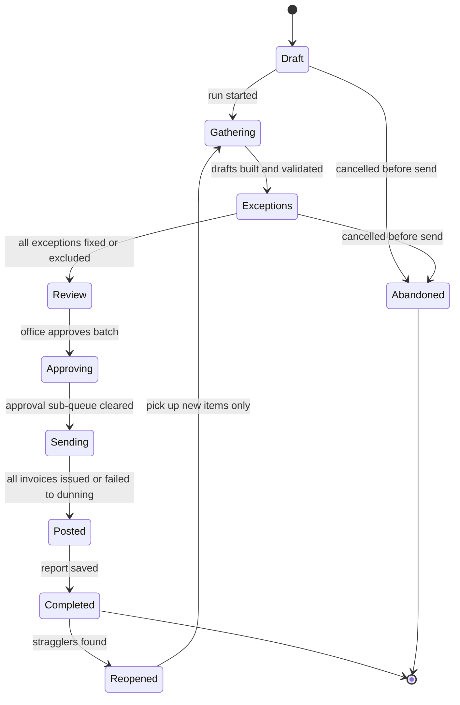

Rules:
- Only one open run per cycle and scope; a second run for an overlapping scope is refused with a link to the open one.
- A run can be `Abandoned` only before any invoice is issued; drafts are deleted and Billable Items return to `unbilled`. After the first invoice is issued, the run can only complete (unsent drafts are released back to `unbilled` at completion).
- Sending is resumable: a crash mid-send resumes from the last issued invoice (durable workflow, [20](20-architecture-security.md)); idempotency keys on autopay PaymentIntents prevent double charges.
- Throughput target: 1,000 invoices gathered, taxed and rendered in under 5 minutes per tenant (tax engine calls batched; PDFs rendered lazily on first view or send).

### 4.11 Ledger postings per billing event [MVP]

Every billing event posts a balanced journal entry to the built-in ledger at the moment it happens (or as a daily summarized entry with full sub-ledger detail where volume is high). Codes below are the **canonical default chart of accounts** from [09 - 4.2.2](09-accounting-ledger-integrations.md), shown with their account roles; posting rules bind to roles, never to numbers, so a Company that renumbers its chart breaks nothing. ([09 - 4.2.6](09-accounting-ledger-integrations.md) keeps a crosswalk from the provisional codes used before the canonical chart existed, such as 1100 AR and 2210 deferred revenue, for anyone migrating prototypes or test fixtures built on them.) Revenue accounts are split by division (maintenance, enhancements, install, design, lawn and PHC, irrigation, snow, lighting, tree). Sales tax payable is sub-accounted per tax agency. Every journal line carries dimensions: `client_id`, `property_id`, `job_id`, `agreement_id`, `division` (service line), `branch_id`. In [09](09-accounting-ledger-integrations.md)'s rule registry these rules are namespaced `billing.P1` to `billing.P42`.

Default accounts used by billing: `1010 Operating checking` (`bank:operating`), `1050/1051 Stripe clearing USD/CAD` (`stripe_clearing:{currency}`), `1060 Undeposited funds`, `1065 Cash in transit, crew-held`, `1075 Disputed payments receivable`, `1200 Accounts receivable` (`ar_control`), `1205 Retainage receivable`, `1210 Unbilled receivables - agreements (contract asset)`, `1220 Allowance for doubtful accounts`, `2101-2149 Sales tax payable by agency` (US states, counties, cities; Canadian PST agencies), `2125 GST/HST payable`, `2126 QST payable`, `2150 Customer deposits`, `2160 Tips payable`, `2170 Gift credit liability`, `2180 Customer credits and unapplied cash`, `2190 Unclaimed property payable`, `2200 Deferred revenue - service agreements (contract liability)`, revenue `4100 Maintenance`, `4200 Enhancements`, `4300 Design-build and installation`, `4350 Design fees`, `4400 Lawn care and PHC`, `4500 Irrigation`, `4600 Snow and ice`, `4700 Lighting`, `4800 Tree care`, `4910 Discounts and allowances (contra-revenue)`, `4920 Payment method discounts`, `4930 Small balance adjustments`, `4950 Card surcharge income`, `6150 Merchant processing fees`, `6152 Rootline platform fees`, `6155 Dispute fees`, `6170 Bad debt expense`, `7200 Finance charge income`, `7500 Other income`, `7910 Realized FX gain/loss`. "Tax" in the table means 2101-2149 in the US and 2125/2126 (plus PST agency sub-accounts) in Canada.

| # | Event (trigger) | Debit | Credit | Notes |
|---|---|---|---|---|
| P1 | Standard invoice issued: per-visit, batch, T&M, milestone, snow per-push (`invoice.issued`) | 1200 AR (total) | 4100-4800 revenue by division (per line, net of line discounts); tax per agency | Covered ($0) lines post nothing. |
| P2 | Deposit request paid (`payment.succeeded` allocated to a `DEP-` document) | 1050 Stripe clearing (or 1060 for a check) | 2150 Customer deposits | The deposit request itself posts nothing. |
| P3 | Deposit applied on an invoice | 2150 Customer deposits | 1200 AR | Posted with P1 of that invoice. |
| P4 | Level-billing installment invoice issued | 1200 AR | 2200 Deferred revenue; tax | Installments never hit revenue. |
| P5 | Agreement occurrence completed (per-visit-leveled or prepaid line) | 2200 Deferred revenue | 4100-4800 revenue (unit value) | Daily summarized entry with per-agreement detail. |
| P6 | Fixed-season line month-end recognition | 2200 Deferred revenue | 4100-4800 revenue (ratable or weighted share) | Uses the season weight curve. |
| P7 | Period-end presentation reclass for agreements in a client-behind position | 1210 Unbilled receivables | 2200 Deferred revenue | Auto-reversed on day 1 of next period. Per agreement, the net position decides asset vs liability. |
| P8 | Unbilled-revenue accrual for completed but not-yet-invoiced Billable Items (optional, accrual-basis Companies) | 1210 Unbilled receivables | 4100-4800 revenue | Auto-reversed day 1; prevents revenue landing in the wrong month for monthly batch billing. |
| P9 | Prepaid season invoice issued | 1200 AR (net of prepay discount) | 2200 Deferred revenue (net); tax | Recognition via P5/P6 at discounted unit values (net presentation default; gross-with-contra optional: Dr 2200 + Dr 4910, Cr 4xxx at list). |
| P10 | True-up invoice (client owes) | 1200 AR | 2200 Deferred revenue (clears the agreement to zero); tax if it adjusts | Agreement position settles at zero. |
| P11 | True-up credit (client is owed) | 2200 Deferred revenue; tax (tax portion) | 2180 Customer credits, or 1200 AR if applied to an open invoice | A refund then follows P16. |
| P12 | Progress invoice with retainage withheld | 1200 AR (net due incl. tax); 1205 Retainage receivable (retainage) | 4300 revenue (gross earned this period); tax | Tax on gross by default; the "tax retainage at release" option moves the tax portion to the release invoice. Percentage-of-completion WIP adjustments (over/under billings) are posted by the WIP schedule in [09](09-accounting-ledger-integrations.md), not here. |
| P13 | Retainage release invoice | 1200 AR | 1205 Retainage receivable | Plus tax if tax was deferred to release. |
| P14 | Payment received on the Company's Stripe account, card or ACH/PAD | 1050/1051 Stripe clearing (gross) | 1200 AR (allocated); 2180 (any excess) | Executed by [08](08-payments-stripe.md)'s `payments.charge` rule from the Stripe balance transaction; listed here for completeness. |
| P15 | Stripe fees and optional Rootline application fee | 6150 Merchant processing fees; 6152 Rootline platform fees | 1050 Stripe clearing | From Stripe balance transactions ([08](08-payments-stripe.md) 4.17). |
| P16 | Refund of a credit balance or of an invoiced amount after its credit memo | 2180 Customer credits | 1050 Stripe clearing (or 1010 when a refund check clears) | Credit memo (P18) always precedes refunds of invoiced amounts ([08](08-payments-stripe.md) 4.16). Deposit refunds use P35. |
| P17 | Stripe payout to bank | 1010 Operating checking | 1050 Stripe clearing | Matched in bank rec ([09](09-accounting-ledger-integrations.md)). |
| P18 | Credit memo issued | 4100-4800 revenue or 4910 Discounts and allowances (per reason code); tax | 1200 AR (applied) or 2180 Customer credits (held) | Reason code drives the account (goodwill -> 4910). A `tax_correction` memo (late exemption certificate, rate error) posts tax lines only: Dr tax, Cr 1200 or 2180. |
| P19 | Credit balance applied to an invoice | 2180 Customer credits | 1200 AR | |
| P20 | Late fee / finance charge assessed | 1200 AR | 7200 Finance charge income | Typically non-taxable; the engine decides. |
| P21 | Write-off, direct method | 6170 Bad debt expense (pre-tax); tax (tax portion where the bad-debt deduction is taken) | 1200 AR | Tax portion handling per jurisdiction setting. |
| P22 | Write-off, allowance method | 1220 Allowance for doubtful accounts | 1200 AR | Allowance provisioning is rule `ar.AR1` in [09](09-accounting-ledger-integrations.md). |
| P23 | Recovery of a written-off invoice | 1200 AR | 6170 Bad debt expense (or 1220); tax (if a bad-debt tax deduction had been taken, the liability is re-established) | Then P14 or P33 for the cash. |
| P24 | Small-balance auto write-off | 4930 Small balance adjustments | 1200 AR | Under threshold only. |
| P25 | Invoice voided (no payments) | Exact reversal of the original entry | | Same period if open; otherwise the current open period. |
| P26 | Chargeback opened | 1075 Disputed payments receivable; 6155 Dispute fees | 1050 Stripe clearing | Detail in [08](08-payments-stripe.md). |
| P27 | Chargeback won | 1050 Stripe clearing | 1075 Disputed payments receivable; 6155 (if Stripe returns the fee) | |
| P28 | Chargeback lost | 1200 AR (invoice reopened for collection) or 6170 Bad debt expense | 1075 Disputed payments receivable | Company chooses. |
| P29 | Gift credit sold / redeemed [V1] | Sold: 1050. Redeemed: 2170 | Sold: 2170. Redeemed: 1200 | Breakage only where gift-card law allows. |
| P30 | Tip paid with an invoice payment [V1] | 1050 Stripe clearing | 2160 Tips payable | Cleared by payroll ([15](15-team-hr-payroll.md)); never revenue, never taxed, never surcharged. |
| P31 | Foreign-currency invoice paid [V1] | 1050/1051 (base-currency equivalent at payment rate) | 1200 AR (at invoice rate); 7910 Realized FX gain/loss (difference, debit or credit) | Revaluation of open foreign AR at period end in [09](09-accounting-ledger-integrations.md). |
| P32 | Seasonal snow installment / recognition | Installment: 1200. Recognition: 2200 | Installment: 2200. Recognition: 4600 Snow and ice | Installment via P4; ratable recognition over the season months via P6. |
| P33 | Offline payment recorded: check, cash, Interac e-Transfer, wire | 1060 Undeposited funds (office), 1065 Cash in transit (crew-collected, crew lead dimension) or 1010 (wire or e-Transfer straight to bank) | 1200 AR (allocated); 2180 (excess) | Bank deposit later posts Dr 1010, Cr 1060 and is matched in bank rec. |
| P34 | Payment returned after success: ACH R01/NSF, PAD return, bounced check | 1200 AR (invoice reopened) | 1050 Stripe clearing (or 1010 / 1060 for checks) | A returned-payment fee, only if disclosed in signed terms and lawful, is a separate P1 line to 7500 Other income. Allocation reverses; dunning restarts at the invoice's real age. |
| P35 | Deposit refunded on a cancelled job | 2150 Customer deposits | 1050 Stripe clearing (or 1010) | Any contracted cancellation fee or non-returnable special-order material kept from the deposit posts Dr 2150, Cr 4300 (or 7500, Company setting) plus tax where the fee is taxable. |
| P36 | Early-termination fee or discount clawback invoiced on cancellation | 1200 AR | Revenue of the agreement's division (or 7500, Company setting); tax per engine | Only when the fee is in signed terms (4.3.5). |
| P37 | Unearned prepaid value forfeited at season close | 2200 Deferred revenue | 4100-4800 revenue (breakage) | Only when signed terms state forfeiture (4.2.4); otherwise P11 credit. |
| P38 | Card surcharge collected [V1] | 1050 Stripe clearing | 4950 Card surcharge income; tax where the surcharge is taxable | Rules owned by [08](08-payments-stripe.md) 4.10. |
| P39 | Payment-method discount (ACH incentive) applied [V1] | 4920 Payment method discounts | 1200 AR | Rules owned by [08](08-payments-stripe.md) 4.10. |
| P40 | Late fee waived | 7200 Finance charge income | 1200 AR | Reversal of P20; a waiver in a later period posts in the current period. |
| P41 | Design-fee credit on install conversion (4.2.5) | 4910 Discounts and allowances (reason `design_credit`) | 1200 AR | Posted with P1 of the first install invoice; the design fee already recognized in 4350 stays earned. |
| P42 | Dormant credit escheated as unclaimed property [V1] | 2180 Customer credits | 2190 Unclaimed property payable (`unclaimed_property_payable`) | Remittance to the state or province posts Dr 2190, Cr 1010. |

**Posting keys.** Each rule builds the deterministic business key required by [20](20-architecture-security.md) (L4 exactly-once posting): `invoice:{id}:issue`, `invoice:{id}:void`, `credit_memo:{id}:issue`, `agreement:{id}:recognize:{service_date}`, `agreement:{id}:reclass:{period}`, `late_fee:{id}:assess` and `:waive`, `write_off:{id}`, `deposit:{id}:apply:{invoice_id}`. Re-delivered or duplicated events therefore cannot double-post.

**Worked example: the Hernandez agreement in the ledger** (Ontario variant shown last; card fee uses the illustrative 2.9% + $0.30 rate from [08](08-payments-stripe.md), real entries use the actual balance transaction):

| Date | What happened | Rule | Debit | Credit |
|---|---|---|---|---|
| Jan 1 | Installment 1 of 12 issued, autopay charged | P4 | 1200 AR $228.33 | 2200 Deferred revenue $228.33 |
| Jan 1 | Card payment succeeds | P14 | 1050 Stripe clearing $228.33 | 1200 AR $228.33 |
| Jan 1 | Stripe fee on the payment (same balance transaction; posted with the payout on Jan 3 if the Company summarizes fees per payout, [08](08-payments-stripe.md) 4.17.2) | P15 | 6150 Merchant processing fees $6.92 | 1050 Stripe clearing $6.92 |
| Jan 3 | Payout lands in the bank | P17 | 1010 Operating checking $221.41 | 1050 Stripe clearing $221.41 |
| Apr 6 | First weekly mow completed | P5 | 2200 Deferred revenue $55.00 | 4100 Maintenance revenue $55.00 |
| Apr | Spring cleanup and fertilizer round 1 completed | P5 | 2200 $412.00 | 4100 $340.00; 4400 Lawn and PHC revenue $72.00 |
| Sep 30 | Month-end, base case with no skips: earned $2,058.00 vs billed $2,054.97 (company ahead $3.03) | P7 | 1210 Unbilled receivables $3.03 | 2200 Deferred revenue $3.03 (reverses Oct 1) |
| Sep 30 | Same date with the two credited August drought skips: earned $1,948.00 vs billed $2,054.97 (client ahead $106.97) | none | | 2200 carries a $106.97 credit balance; no reclass |
| Dec 1 | Final installment issued at the adjusted $118.37 | P4 | 1200 AR $118.37 | 2200 Deferred revenue $118.37 |
| Dec 14 | Season close: earned $2,630.00 = billed $2,630.00 | none | | Agreement position and its 2200 balance are zero |

If the same agreement belonged to an Ontario Company, each installment would also carry 13% HST: Dr 1200 $258.01, Cr 2200 $228.33, Cr 2125 GST/HST payable $29.68 (tax is due on each installment as it is invoiced; verify the place-of-supply and tax-point rules in 4.5.3).

**Posting invariants** (enforced by the ledger service and tested with property-based tests): every entry balances in base currency; AR subledger = 1200 control; deposits by client = 2150; sum of agreement positions = 2200 - 1210 (after reclass); no posting to a closed period (auto-redirect to the current period with the original date retained as `service_date`); every entry references its source document and posting rule ID (P1-P42) for auditability.

---

## 5. Key user flows

### 5.1 Residential season agreement: sign, level bill, true-up, renew [MVP]

1. Estimator sends a maintenance proposal with two payment options: "12 monthly payments of $228.33 (autopay)" or "Pay in full by Mar 15: $2,603 (save 5%)" ([03](03-crm-sales-estimating-proposals.md)).
2. Client signs in the portal, picks 12 payments, saves a card or bank account (Stripe SetupIntent on the Company's account).
3. Agreement activates; Billing Schedule creates 12 planned installments; Visits are generated ([04](04-scheduling-dispatch-routing.md)).
4. On each billing day the installment invoice is created, tax quoted, autopay charged, receipt emailed; P4 and P14 post.
5. Each completed visit recognizes revenue (P5) and updates the earned-value meter the client can see.
6. Drought skips in August are logged as `skipped_dormancy`; the policy credits them; projected true-up updates.
7. Season close (Nov 30 + 14 days): the December installment is reduced by the credits; P10/P11 settle the agreement to zero.
8. Renewal notice goes out Dec 1 with a 4% escalator, respecting the state notice rule; the client does nothing and the 2028 agreement auto-renews; or the client clicks "Cancel renewal" in the portal.

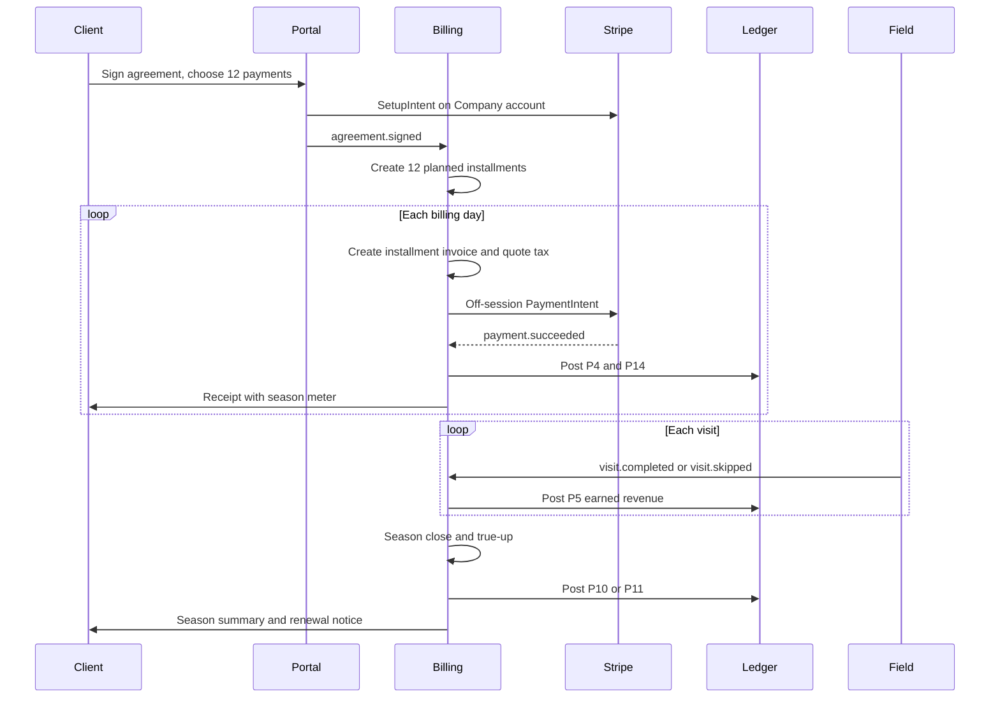

### 5.2 Month-end Billing Run [MVP]

1. On the 1st at 6 a.m., an Automation creates a draft Billing Run for "Monthly batch + installments" and notifies the office manager: "Billing Run ready: 312 invoices, $86,410, 9 exceptions".
2. Office manager opens the run, fixes exceptions (4 unverified visits, 2 missing POs, 1 expired exemption certificate, 2 anomalies).
3. Reviews the diff vs last month and spot-checks 5 invoices.
4. Bulk-approves; 6 invoices over $2,500 route to the owner, who approves on mobile.
5. Sends: 188 autopay charges, 118 emails, 6 printed letters (queued to the print-and-mail partner at V1; at MVP they export as one print-ready PDF batch with remittance stubs).
6. The run posts journal entries and saves its report. Target: under 30 minutes end to end.

### 5.3 Commercial install with deposit, progress billing, retainage and pay apps [V1]

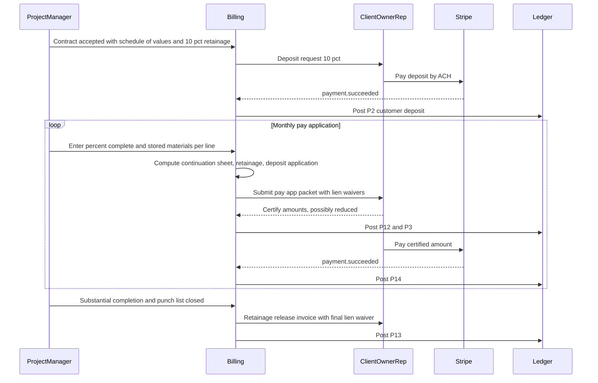

Steps of note: certified amount less than applied creates a carry-forward on that schedule line; a change order adds lines CO-1..n; the deposit is consumed pro rata across pay apps if configured.

### 5.4 Snow event to invoice [MVP basic / V1 full]

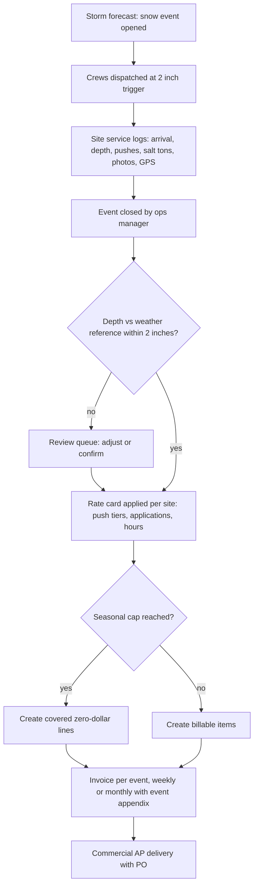

### 5.5 Overdue invoice to resolution with the AI collections agent [V1]

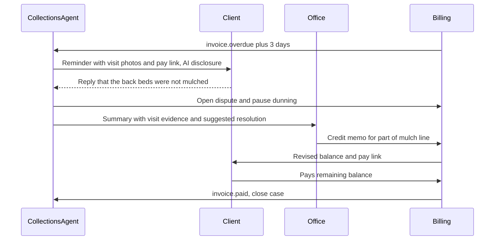

### 5.6 Mid-season cancellation with proration [MVP]

1. Client requests cancellation in the portal on Jul 15 (moving). Agreement notice period: 14 days; effective Jul 29.
2. Engine computes: earned through Jul 29 (completed visits + cleanup + fertilizer apps) vs billed; no early-termination fee for "property sold" reason (Company policy).
3. Office reviews the settlement preview; option to **transfer** the agreement to the buyer is offered (the buyer gets an invite).
4. On the effective date: future visits cancelled, unsent installments voided, final settlement posted. In the Hernandez example the client has been billed $1,598.31 (7 installments) against $1,491.00 earned, so the settlement is a $107.31 credit, refunded to the card on file; had the client been on an April-start calendar, the same cancellation would have produced a final invoice instead.
5. Exit survey and "win-back" Automation at next season start ([16](16-marketing-growth-communications.md)).

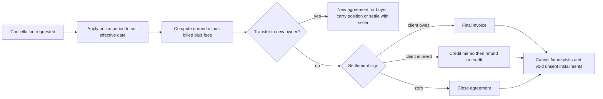

---

## 6. Screens and wireframes

### 6.1 Screen inventory

| Screen | Surface | Primary roles | Priority |
|---|---|---|---|
| Billing home (AR, cash, unbilled, runs due, exceptions) | Company web | `owner`, `office_manager`, `bookkeeper` | MVP |
| Invoice list (filters, bulk actions, saved views) | Company web | `office_manager`, `bookkeeper` | MVP |
| Invoice editor / detail (lines, tax, attachments, timeline, ledger tab) | Company web | `office_manager` | MVP |
| Billing Run wizard (scope, exceptions, review, approve, send) | Company web | `office_manager` | MVP |
| Approvals inbox (web + mobile) | Company web, mobile | `owner`, `ops_manager` | MVP |
| Agreement detail: Billing tab (schedule, earned-value meter, true-up preview, amendments) | Company web | `office_manager`, `ops_manager` | MVP |
| Renewal center (expiring agreements, escalation preview, notice compliance) | Company web | `owner`, `estimator` | MVP |
| Collections workspace (queue, client timeline, AI agent log) | Company web | `office_manager`, `owner` | MVP basic / V1 agent |
| Credit memos, refunds, write-offs | Company web | `office_manager`, `owner` | MVP |
| Statements and statement runs | Company web | `office_manager` | MVP |
| Tax settings (engine, registrations, category mapping, nexus monitor) | Company web | `owner`, `bookkeeper` | MVP |
| Exemption certificate vault | Company web, portal upload | `office_manager`, client | MVP |
| Pay application editor (G703-style grid) | Company web | `ops_manager`, `office_manager` | V1 |
| Snow billing board (events, sites, caps) | Company web | `ops_manager` | V1 |
| PO manager and consolidated billing setup | Company web | `ops_manager` | MVP PO / V1 consolidated |
| Template designer | Company web | `owner`, `office_manager` | V1 |
| Client invoice view, pay, season meter, statements | Customer portal ([06](06-customer-portal.md)) | `client_residential`, `client_commercial` | MVP |
| Client AP approval queue | Customer portal | `client_commercial` | V1 |
| Field: collect payment, T&M ticket sign | Crew app ([05](05-field-crew-mobile-app.md)) | `crew_lead` | MVP |
| Platform: tax matrix, legal-limit tables, dunning template library | Platform admin ([19](19-platform-admin-portal.md)) | `platform_finance`, `platform_owner` | MVP |
| Season close and true-up review (earned vs billed per agreement, bulk close) | Company web | `office_manager`, `bookkeeper` | MVP |
| Client billing profile and credit limits | Company web | `owner`, `office_manager` | MVP profile / V1 limits |
| Payment plans and promises (create, track, broken-plan queue) | Company web, portal | `office_manager`, client | V1 |
| Unbilled work and leakage report (Billable Items past cycle, unverified visits) | Company web | `owner`, `office_manager` | MVP |

### 6.2 Wireframe: Billing Run review (office manager, desktop) [MVP]

```text
+----------------------------------------------------------------------------------------------+
| Rootline  |  Billing > Runs > June 2027 Monthly + Installments          [Save draft] [Help]  |
+----------------------------------------------------------------------------------------------+
| (1) Scope  >  (2) Exceptions [9]  >  (3) Review  >  (4) Approve  >  (5) Send                 |
+----------------------------------------------------------------------------------------------+
| SUMMARY                                      | DIFF VS MAY RUN                               |
| Invoices: 312   Total: $86,410.22            | +14 invoices   -$3,210.40                     |
| Tax: $2,118.06  Autopay: 188  Email: 118     | 22 drought skips credited  (-$1,210.00)       |
| Mail: 6         Needs approval: 6 ($19,880)  | 3 new agreements (+$684.99)                   |
+----------------------------------------------------------------------------------------------+
| EXCEPTIONS (9)                                            [Fix all with AI suggestions]      |
| ! Visit not verified    Kowalski - 18 Elm St     Jun 22 mow   no photos   [Open] [Exclude]   |
| ! Visit not verified    Patel - 44 Birch Ln      Jun 29 mow   geofence    [Open] [Exclude]   |
| ! PO required           Greystone / Oak Ridge    Enhancement $1,140       [Attach] [Request] |
| ! PO ceiling exceeded   Maple Court HOA          PO 77812 92% used        [Raise] [Hold]    |
| ! Certificate expired   St. Mark's Church        exempt -> taxable?       [Tax] [Request]   |
| ! Amount anomaly        Nguyen - 9 Lakeview      $1,920 vs avg $240      [Review]           |
| ! No delivery channel   Brooks - 210 Pine       no email, mail off       [Add] [Enable mail] |
| ...                                                                                          |
+----------------------------------------------------------------------------------------------+
| INVOICES  [Search......]  Filter: [All v] [Needs approval v] [Autopay v]   Sort: [Amount v]  |
| [ ] INV-2027-01188  Hernandez        Installment 6/12       $228.33  autopay  ready          |
| [ ] INV-2027-01189  Greystone/OakR   Monthly maint + 2 enh  $4,812.00 email  needs approval  |
| [ ] INV-2027-01190  Kim              4 mows (Jun 3-24)      $220.00  email   ready           |
| [x] Select all ready (296)                       [Preview 5 random]  [Approve selected ->]   |
+----------------------------------------------------------------------------------------------+
```

### 6.3 Wireframe: Agreement detail, Billing tab (earned-value meter) [MVP]

```text
+----------------------------------------------------------------------------------------------+
| Hernandez - 2027 Residential Maintenance  AGR-0412   Active   v2 (amended Jun 3)             |
| [Overview] [Scope] [Visits] [Billing] [Documents] [Activity]                                 |
+----------------------------------------------------------------------------------------------+
| SEASON METER (Jan 1 - Dec 31)                                                                |
| Planned  $2,740.00  |=========================================================|              |
| Earned   $1,948.00  |=========================================                | 71%          |
| Billed   $2,054.97  |===========================================              | 75%          |
| Paid     $2,054.97  |===========================================              | as of Sep 30 |
| Position: client ahead by $106.97 (deferred revenue)   Projected true-up: -$110.00 (credit)  |
+----------------------------------------------------------------------------------------------+
| SERVICE LINES               Model              Done / Plan   Skips (credited)   Value       |
| Weekly mowing  $55          per_visit_leveled  24 / 30       2 drought (2)     $1,320.00    |
| 5-step fert    $72          per_visit_leveled   4 / 5        0                   $288.00    |
| Spring cleanup $340         per_visit           1 / 1        0                   $340.00    |
| Fall cleanup   $390         per_visit           0 / 1        0                     $0.00    |
+----------------------------------------------------------------------------------------------+
| SCHEDULE   12 installments, 1st of month, autopay Visa ...4242 (exp 09/28)                  |
| Jan-Sep  9 x $228.33   paid                                                                  |
| Oct $228.33  Nov $228.33  Dec $118.37 (adjusted: -$110.00 for 2 credited drought skips)      |
| True-up method: [Adjust final installment v]   Max exposure: $118.37 = 4% of ACV (Nov) OK    |
+----------------------------------------------------------------------------------------------+
| POLICIES  Escalator: +4% at renewal  |  Renewal: auto, notice Dec 1 (NY rule: 15-30 days)    |
| Cancellation: 14 days notice, no fee if property sold  |  Late fee: 1.5%/mo (18%/yr) after 10d |
| [Amend agreement] [Change billing] [Cancel agreement] [Preview renewal] [Show client view]   |
+----------------------------------------------------------------------------------------------+
```

### 6.4 Wireframe: Collections workspace with AI agent [MVP workspace / V1 agent]

```text
+----------------------------------------------------------------------------------------------+
| Collections        AR: $41,820   Past due: $12,406   DSO: 27 days   Agent: ON (warm tone)    |
+----------------------------------------------------------------------------------------------+
| QUEUE (sorted by expected recovery)          | CLIENT: Brookside Dental (commercial)         |
| > Brookside Dental     $3,240  48d  promise  | Open: INV-00977 $1,620 (48d)  INV-01041 $1,620|
|   Ridgeview HOA        $2,880  35d  AP appr. | Promise: $1,620 on Jul 15 (by agent, Jul 8)   |
|   Thompson             $612    62d  hold     | Dunning: paused (promise active)              |
|   Alvarez              $410    31d  step 4   | Service: active   Autopay: none               |
|   ...                                        +-----------------------------------------------+
|                                              | TIMELINE                                       |
| Bulk: [Send reminder] [Assign] [Export]      | Jul 8  Agent: reminder + photos (email)        |
|                                              | Jul 8  Client: "AP pays on the 15th"           |
|                                              | Jul 8  Agent: recorded promise to pay $1,620   |
|                                              | Jun 21 Invoice INV-01041 viewed (2x)           |
|                                              +-----------------------------------------------+
|                                              | AGENT SUGGESTS                                 |
|                                              | "Second invoice is not yet due for AP. Wait   |
|                                              |  for Jul 15 payment, then send a statement."  |
|                                              | [Accept] [Edit message] [Take over manually]   |
+----------------------------------------------------------------------------------------------+
```

### 6.5 Wireframe: Pay application editor (G703-style continuation sheet) [V1]

```text
+------------------------------------------------------------------------------------------------------+
| Briarwood Clubhouse Grounds   Pay App #3   Period: May 26 - Jun 25, 2027   Status: Draft             |
| Contract $186,400  CO net +$0   Retainage 10% work / 10% stored   [Suggest % from progress (AI)]     |
+------------------------------------------------------------------------------------------------------+
| A  | B Description        | C Scheduled | D Previous | E This period | F Stored | G To date | %   | H Balance | I Ret.  |
| 1  | Mobilization         |    8,000.00 |   8,000.00 |          0.00 |     0.00 |  8,000.00 | 100 |      0.00 |   800.00|
| 2  | Demolition/grading   |   22,500.00 |  22,500.00 |          0.00 |     0.00 | 22,500.00 | 100 |      0.00 | 2,250.00|
| 3  | Irrigation           |   31,200.00 |  18,720.00 |      9,360.00 |     0.00 | 28,080.00 |  90 |  3,120.00 | 2,808.00|
| 4  | Paver plaza          |   64,800.00 |  21,780.00 |     19,440.00 | 4,200.00 | 45,420.00 |  70 | 19,380.00 | 4,542.00|
| 5  | Planting             |   41,600.00 |       0.00 |      8,640.00 |     0.00 |  8,640.00 |  21 | 32,960.00 |   864.00|
| 6  | Landscape lighting   |   12,300.00 |       0.00 |          0.00 |     0.00 |      0.00 |   0 | 12,300.00 |     0.00|
| 7  | 90-day maintenance   |    6,000.00 |       0.00 |          0.00 |     0.00 |      0.00 |   0 |  6,000.00 |     0.00|
|    | TOTALS               |  186,400.00 |  71,000.00 |     37,440.00 | 4,200.00 |112,640.00 |  60 | 73,760.00 |11,264.00|
+------------------------------------------------------------------------------------------------------+
| Summary: Earned less retainage $101,376.00  Less previous certificates $63,900.00  DUE $37,476.00    |
| Attachments: [x] Conditional progress waiver  [x] Unconditional waiver #2  [x] Photos by line  [ ] COI|
| [Preview packet PDF]   [Submit to owner rep ->]                                                      |
+------------------------------------------------------------------------------------------------------+
```

### 6.6 Wireframe: Client-facing invoice (portal and PDF) with proof of service [MVP]

```text
+------------------------------------------------------------------------+
| [Green Acres Landscaping logo]                  INVOICE INV-2027-01190 |
| Lic. #12345   Sales tax permit 12-345678          Date: Jul 1, 2027    |
| Bill to: Min-jun Kim              Service at: 77 Willow Ct             |
| Due: Jul 15, 2027 (Net 14)        Amount due: $220.00     [Pay now]    |
+------------------------------------------------------------------------+
| Weekly mowing, trim and blow             4 visits   $55.00    $220.00  |
|   Jun 3  [photo] [photo]  Crew: Team Blue   on site 32 min             |
|   Jun 10 [photo] [photo]                                               |
|   Jun 17 rained out - moved to Jun 19                                  |
|   Jun 19 [photo] [photo]  (rain make-up)                               |
|   Jun 24 [photo] [photo]                                               |
| Subtotal $220.00   Tax $0.00 (lawn mowing not taxable in this state)   |
| Total $220.00                                                          |
+------------------------------------------------------------------------+
| Your season: 12 of 30 mows done  [view season]                         |
| Questions about this invoice? [Ask]  (answered with visit details)     |
| Pay by card or bank (ACH)   [QR code]   Autopay: [Turn on]             |
+------------------------------------------------------------------------+
```

### 6.7 Wireframe: Consolidated portfolio invoice (commercial, portal and PDF) [V1]

```text
+-----------------------------------------------------------------------------------------------+
| [Green Acres Landscaping]          INVOICE INV-2027-01204 (consolidated, billing group)       |
| Bill to: Greystone Property Management - Region North          Date: Jul 1, 2027              |
| AP inbox: invoices@greystonepm.com    Terms: Net 30 from client approval                      |
| Client status: approved by site managers (2 of 3)   Regional approval: pending                |
+-----------------------------------------------------------------------------------------------+
| PROPERTY (bill-to entity)           PO      GL code   Maint.    Enh.      Tax     Total       |
| Oak Ridge Apartments LLC c/o GPM    77812   6410-OR   4,200.00  1,140.00  427.20  5,767.20    |
| Maple Court HOA                     77840   6410-MC   3,600.00      0.00  288.00  3,888.00    |
| Birch Commons LP c/o GPM            77811   6410-BC   2,950.00    480.00  274.40  3,704.40    |
| TOTAL                                                10,750.00  1,620.00  989.60 13,359.60    |
+-----------------------------------------------------------------------------------------------+
| Oak Ridge detail: June maintenance (installment 3 of 8)            4,200.00                   |
|   Enhancement E-2207 mulch, 12 yd3 north beds (PO 77812, approved Jun 4)  1,140.00            |
|   Visits: Jun 2, 9, 16, 23, 30  [photos]  [visit map]  [enhancement before/after]             |
| Birch Commons detail: Enhancement E-2215 replace 6 dead boxwoods (warranty: no, deer)         |
+-----------------------------------------------------------------------------------------------+
| Pay all by ACH [Pay $13,359.60]   or pay per property   Remit: INV-2027-01204 + PO            |
| Attachments (1 PDF packet, 14 pages): invoice, per-property visit logs, enhancement approvals |
+-----------------------------------------------------------------------------------------------+
```

Notes: each property row carries its own bill-to entity, PO and client GL code; tax is computed per line by property jurisdiction (4.5), so one consolidated invoice can span several tax jurisdictions; regional approval is the second step of the client-side chain (4.4.8), and the Net 30 clock starts when the chain completes.

### 6.8 Wireframe: Snow billing board (ops manager, desktop) [V1]

```text
+------------------------------------------------------------------------------------------+
| Snow billing   Season 2027-28   Event: Jan 14-15 storm (closed 11:20)   Ref: 7.2 in      |
+------------------------------------------------------------------------------------------+
| SITE               MODEL             PUSHES   DEPTH crew/ref   SALT     BILLABLE    CAP  |
| Oak Ridge Apts     hybrid            2 (cov)  7.5 / 7.2        2+2 app  $560.00     n/a  |
| Briarwood Plaza    per_push          3        8.0 / 7.2        3 app    $1,440.00   n/a  |
| Maple Court HOA    seasonal_capped   2        7.0 / 7.2        2 app    $320.00     100% |
| St. Mark's Church  per_event         1 event  4.0 / 7.2  !     incl.    $520.00     n/a  |
| Lakeview Clinic    per_push          2        9.5 / 6.8  !     4 app    review      n/a  |
+------------------------------------------------------------------------------------------+
| ! Crew depth differs from reference by more than 2 in:                                   |
|   [Accept crew depth + note]  [Use reference depth]  [Ask crew lead]                     |
| Event billable: $2,840.00 + 1 site in review   Sites 5   Logs 14   Photos 61   Subs 1    |
| Cadence: [Monthly with event appendix v]  [Preview appendix]  [Stage billable items ->]  |
+------------------------------------------------------------------------------------------+
```

Notes: depth discrepancies over 2 inches block staging until resolved; covered pushes (seasonal fee or cap reached) still appear in the appendix; the "Subs" count links to subcontractor logs whose payables are created at the same time (4.2.10).

### 6.9 Wireframe: Approvals on mobile (owner) [MVP]

```text
+----------------------------------+
| Approvals (12)        $18,420.00 |
+----------------------------------+
| Greystone / Oak Ridge            |
| Consolidated draft  $5,767.20    |
| Rule: total > $2,500             |
| Margin 41% (target 35%)    OK    |
| [View]  [Reject]  [Approve]      |
+----------------------------------+
| Nguyen - 9 Lakeview              |
| $1,920.00 vs avg $240     !      |
| AI: 6 T&M hours, drainage        |
| repair, ticket signed Jun 12     |
| [View]  [Reject]  [Approve]      |
+----------------------------------+
| [Approve all low-risk (9)]       |
+----------------------------------+
```

Notes: "low-risk" means the only rule matched was the amount threshold and AI1 found no anomaly; anything flagged for price override, missing PO, margin below target or anomaly must be approved one by one.

---

## 7. Data model

All tables carry `tenant_id` (Company) with Postgres row-level security, `created_at`, `updated_at`, `created_by`, and soft-delete where noted ([20](20-architecture-security.md)). Money is stored as `bigint` minor units plus a `currency` code. Documents that have been sent are immutable; changes create new rows (versions, credit memos, reversals).

### 7.1 Entities and key fields

| Entity | Key fields | Notes |
|---|---|---|
| `service_agreement` | id, number, client_id, bill_to_party_id, status, term_start, term_end, evergreen, notice_days, renewal_mode, escalator_id, cancellation_policy_id, late_fee_policy_id, credit_policy_id, true_up_method, prior_agreement_id, currency, signed_document_id | One per client per term; links to proposal. |
| `agreement_version` | id, agreement_id, version_no, effective_date, reason, signed_document_id | Amendments. |
| `agreement_line` | id, agreement_version_id, property_id, price_book_item_id, service_line, pricing_model, frequency, planned_occurrences, unit_price, season_price, season_start, season_end, weight_curve_id, tax_category | Scope. |
| `billing_schedule` | id, owner_type (agreement, job, project), owner_id, type, trigger, cadence, installment_count, billing_day, rounding_rule, deposit_mode, retainage_pct_work, retainage_pct_stored, retainage_stepdown_json, po_id, billing_group_id, detail_level, delivery_channel, autopay_required | One per job, or per agreement line group. |
| `billing_schedule_entry` | id, billing_schedule_id, planned_date, planned_amount, kind (installment, milestone, deposit, retainage_release, true_up), status, invoice_id | Planned future invoices. |
| `billable_item` | id, source_type, source_id, client_id, property_id, job_id, agreement_line_id, service_date, description, quantity, unit, unit_price, amount, price_source, tax_category, revenue_account_id, status, invoice_line_id, exclusion_reason, covered_reason | Atomic billable fact. |
| `billing_run` | id, cycle_date, scope_json, status, counts_json, totals_json, started_by, approved_by, sent_at, report_document_id | Batch. |
| `invoice` | id, number, doc_type (invoice, deposit_request, finance_charge, retainage_release, true_up, pay_app), client_id, bill_to_party_id, billing_group_id, po_id, issue_date, due_date, terms, currency, fx_rate, subtotal, discount_total, tax_total, total, amount_paid, balance, status, client_status, sent_at, viewed_at, voided_at, void_reason, template_id, language, content_hash, render_version, billing_run_id, journal_entry_id | Header. |
| `invoice_line` | id, invoice_id, line_type, billable_item_id, description, service_date_from, service_date_to, property_id, job_id, quantity, unit, unit_price, amount, discount_amount, tax_category, tax_amount, revenue_account_id, sort_order, parent_line_id | Lines. |
| `invoice_attachment` | id, invoice_id, kind (photo, map, chemical_notice, tm_ticket, change_order, lien_waiver, snow_log, report, design), file_id, include_in_pdf | Proof of service. |
| `invoice_approval` | id, invoice_id, rule_code, level, approver_role, approver_user_id, decision, note, decided_at | Internal approvals. |
| `tax_calculation` | id, invoice_id, engine, request_json, response_json, committed, engine_document_code | Audit evidence. |
| `tax_category_mapping` | id, tax_category, engine, engine_tax_code, scope (platform, tenant) | Mapping. |
| `tax_registration` | id, jurisdiction, registration_number, effective_from, filing_frequency | Company registrations. |
| `tax_exemption_certificate` | id, client_id, property_id, type, jurisdictions, number, issued_on, expires_on, file_id, validation_status | Vault. |
| `credit_memo` | id, number, client_id, reason_code, amount, tax_amount, disposition, status, approved_by, journal_entry_id | Credits. |
| `credit_application` | id, source_type (credit_memo, wallet, deposit), source_id, invoice_id, amount, applied_at | Applications. |
| `client_wallet_entry` | id, client_id, balance_type (credit, unapplied, deposit, prepaid_season, gift), amount, related_type, related_id | Typed balances (sum by type). |
| `refund` | id, client_id, source_type, source_id, amount, method (stripe, check, ach), stripe_refund_id, reason, approved_by | Refunds. |
| `write_off` | id, invoice_id, amount, tax_amount, method (direct, allowance), reason_code, approved_by, recovered_amount | Write-offs. |
| `late_fee_policy` | id, type, amount, percent_monthly, grace_days, min_fee, max_fee, frequency, compounding, applies_to, disclosure_text | Policy. |
| `late_fee_assessment` | id, invoice_id, policy_id, amount, assessed_on, waived, waived_reason | Fees. |
| `dunning_policy` / `dunning_step` | id, name, segment; step: day_offset, channel, template_id, action (remind, fee, hold, task, agent) | Sequences. |
| `collection_case` | id, client_id, status, stage, assigned_to, agent_enabled, dispute_reason, opened_at, closed_at | Collections. |
| `promise_to_pay` | id, case_id, amount, promised_date, source (office, agent, portal), status | Promises. |
| `payment_plan` / `payment_plan_installment` | id, client_id, total, installments, autopay_method_id, status (`current`, `broken`); installment: due_date, amount, status | One shared entity, defined in [08](08-payments-stripe.md) 7.1; this module creates collections plans for past-due balances (`plan_type = collections`, 4.9.4) alongside 08's milestone and calendar plans. |
| `statement` | id, number, client_id, type, period_from, period_to, opening_balance, closing_balance, document_id | Snapshots. |
| `purchase_order` | id, client_id, property_id, number, ceiling_amount, consumed_amount, valid_from, valid_to, allowed_service_lines | POs. |
| `billing_group` | id, client_id, name, mode (per_property, consolidated, master_sub), bill_to_party_id, delivery_email | Portfolios. |
| `pay_application` | id, project_id, number, period_from, period_to, status, retainage_pct_work, retainage_pct_stored, applied_amount, certified_amount, invoice_id | Pay apps. |
| `sov_line` | id, project_id, item_no, description, scheduled_value, change_order_id, sort_order | Schedule of values. |
| `pay_app_line` | id, pay_application_id, sov_line_id, previous_completed, this_period, stored_materials, certified_this_period, retainage | Continuation sheet rows. |
| `snow_rate_card` | id, agreement_line_id, model, trigger_inches, tiers_json, application_rates_json, hourly_rates_json, seasonal_cap, seasonal_floor | Snow pricing. |
| `price_escalator` | id, type, value, index_series, floor_pct, ceiling_pct, rounding, timing | Escalation. |
| `renewal` | id, agreement_id, new_agreement_id, notice_rule_code, notice_due_on, notice_sent_at, status | Renewal tracking. |
| `einvoice_document` | id, invoice_id, format (ubl, peppol_bis, x12_810), payload_file_id, network, status | E-invoicing. |
| `client_billing_profile` | id, client_id, default_terms, bill_to_party_id, delivery_channel, language, detail_level, po_required, autopay_required, statement_type, dunning_policy_id, late_fee_policy_id, risk_tier, credit_limit, credit_hold, credit_hold_reason | One per client (4.9.6). |
| `agreement_season_close` | id, agreement_id, season_label, closed_on, closed_by, planned_value, earned_value, billed_to_date, paid_to_date, true_up_method, true_up_amount, true_up_document_id, journal_entry_id | Frozen season result; immutable once posted. |
| `billing_rule_table` (platform) | id, rule_type (late_fee_limit, renewal_notice, deposit_cap, cooling_off, surcharge_ref, unclaimed_property), jurisdiction, account_type, params_json, effective_from, effective_to, source_citation, reviewed_on, version | Maintained by `platform_finance` in [19](19-platform-admin-portal.md); tenants read, never write. |
| `snow_event_billing` | id, snow_event_id, site_property_id, agreement_line_id, measured_depth_in, reference_depth_in, discrepancy_status, billable_total, covered_total, cap_consumed_after | Per-site billing view of an event owned by [14](14-service-line-modules.md). |

### 7.2 Entity-relationship diagram

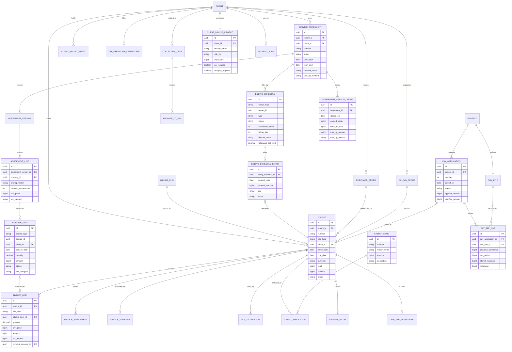

### 7.3 Key constraints and indexes

- `unique (tenant_id, doc_type_prefix, number)` on invoices; numbers allocated from a per-tenant sequence table under row lock at approval.
- `billable_item.invoice_line_id` unique where invoice not void (partial unique index) to prevent double billing.
- `billing_schedule_entry (billing_schedule_id, planned_date, kind)` unique to make runs idempotent.
- Index `invoice (tenant_id, status, due_date)` for aging; `billable_item (tenant_id, status, service_date)` for runs; GiST on property geography lives in the property module.
- Derived balances (`invoice.balance`, `client` AR totals) are maintained by the payments allocation service and verified nightly against allocations.

---

## 8. Integrations, APIs and events

### 8.1 External services

| Service | Use in this module | Priority | Notes |
|---|---|---|---|
| **Stripe (Company's connected account)** | Autopay off-session charges, pay-now links (card, ACH via bank account), refunds, dispute events, card updater, SetupIntents for agreements. Rootline is the invoicing system of record; we do not use Stripe Invoicing or Stripe Billing on the Company's account, so invoices, tax and dunning stay consistent across payment methods (card, ACH, check, cash). | MVP | Architecture in [08](08-payments-stripe.md). |
| **Stripe Tax** | Tax calculation per line via product tax codes mapped from Rootline tax categories; registrations per Company. | MVP | Verify availability and liability model for direct charges on Standard connected accounts (open question). |
| **Avalara AvaTax** | Tax quotes (uncommitted) and committed invoices; exemption certificate management; returns filing partner. | V1 | Companies already on Avalara or with multi-state exposure. |
| **QuickBooks Online / Desktop, Xero** | Optional sync of invoices, credit memos, payments and customers when the Company keeps an external GL ([09](09-accounting-ledger-integrations.md)). Rootline remains the billing system of record; invoice edits in QBO/Xero are detected and flagged, never silently accepted. | MVP QBO / V1 Xero, QBD | Mapping of revenue accounts and tax codes per Company. |
| **Print-and-mail API (e.g., Lob)** | Printed invoices, statements, certified final notices. | V1 | Address verification reused. |
| **Twilio / Postmark or SendGrid** | SMS and email delivery, delivery webhooks (bounce, open). | MVP | Consent per [16](16-marketing-growth-communications.md). |
| **E-signature (built-in)** | Agreement, amendment, T&M ticket, pay app signatures. | MVP | [03](03-crm-sales-estimating-proposals.md). |
| **FX rates (e.g., Bank of Canada daily rates)** | Cross-currency invoices. | V1 | Manual override allowed. |
| **Index data (CPI, EIA diesel)** | Escalators and fuel surcharges. | V1 | Cached monthly/weekly. |
| **Weather data provider** | Snow event reference depths, skip evidence. | V1 | Shared with [04](04-scheduling-dispatch-routing.md). |
| **Facility-management portals (e.g., ServiceChannel, Corrigo), Peppol access points, EDI VANs** | National-account invoice submission and e-invoicing. | V2 | Verify partner APIs. |
| **Collections agency partners; e-notary partners** | Agency placement; notarized pay apps. | V2 | |

### 8.2 Public API (tenant-scoped, OAuth 2.0) [MVP core / V1 full]

REST + webhooks, versioned (`/v1`), idempotency keys on all POSTs ([20](20-architecture-security.md)).

| Endpoint | Purpose |
|---|---|
| `GET/POST /v1/invoices`, `GET /v1/invoices/{id}`, `POST /v1/invoices/{id}/approve`, `/send`, `/void` | Invoice lifecycle. |
| `GET /v1/invoices/{id}/pdf`, `/ubl` | Rendered documents. |
| `POST /v1/billable-items` | Third-party systems (e.g., a smart-irrigation vendor) push billable usage. |
| `GET/POST /v1/agreements`, `POST /v1/agreements/{id}/amend`, `/cancel`, `/renew` | Agreement lifecycle. |
| `GET /v1/agreements/{id}/position` | Earned/billed/paid meter. |
| `POST /v1/billing-runs`, `GET /v1/billing-runs/{id}` | Run orchestration. |
| `POST /v1/credit-memos`, `POST /v1/refunds`, `POST /v1/write-offs` | Adjustments (permission-scoped). |
| `GET /v1/ar/aging`, `GET /v1/statements/{id}` | AR. |
| `GET/POST /v1/tax/exemption-certificates` | Vault. |

### 8.3 Domain events

Emitted through the transactional outbox ([20](20-architecture-security.md)); webhook-subscribable by tenants unless marked internal. Names follow the canonical event catalog in [20](20-architecture-security.md) 4.9 (`invoice.issued`, `credit_memo.issued`, `payment.succeeded` and so on). Two naming notes for implementers: [08](08-payments-stripe.md) refers to the same events with module prefixes (`invoicing.invoice.issued`, `payments.payment.succeeded`), and [20](20-architecture-security.md) lists the agreement events as `service_agreement.activated` / `service_agreement.renewal_due`; these are the same events as `agreement.activated` / `agreement.renewal_due` below and must resolve to one registered name per event in the schema registry.

| Event | Emitted when | Key consumers |
|---|---|---|
| `billable_item.created` / `.excluded` | Source event priced | Billing runs, job costing (09), reporting (18) |
| `invoice.created` / `.approved` | Draft built; internal approval granted (number assigned) | Approvals inbox, copilot (17) |
| `invoice.issued` | Approved -> Sent transition: document final, tax committed, autopay attempt scheduled. **The ledger posts P1/P4/P9/P10/P12/P13 on this event** (posting key `invoice:{id}:issue`) | Ledger (09), payments (08: pay link and autopay), portal (06), comms (16), QBO/Xero sync |
| `invoice.delivered` / `.delivery_failed` / `.viewed` | Per channel (email, SMS, mail, AP inbox); first portal open | Office tasks for bounces, AI4 send-time model, reporting |
| `invoice.paid` / `.partially_paid` / `.overdue` | Allocation changes, due date passes | Dunning, collections agent, reporting |
| `invoice.voided` / `.written_off` / `.disputed` / `.client_approved` / `.client_rejected` | Adjustments; commercial AP decisions (4.4.8) | Ledger (09 binds write-offs to its `collections_case.written_off` trigger; same fact), collections, terms clock |
| `credit_memo.issued`, `refund.requested` | Adjustments | Ledger, payments (08) |
| `agreement.signed` / `.activated` / `.amended` / `.suspended` / `.resumed` | Lifecycle | Scheduling (04), portal, comms |
| `agreement.renewal_due` (N days before term end) / `.renewal_notice_due` (statutory notice deadline) / `.renewed` / `.cancelled` / `.season_closed` / `.transferred` | Lifecycle | Renewal agent and automations (17), marketing (16), reporting (18), payments (08: keep or end autopay scope) |
| `billing_run.ready` / `.completed` | Batch | Notifications, reporting |
| `late_fee.assessed` / `.waived` | Fees (09 registers P20 under the alias `invoice.finance_charge_assessed`) | Ledger, portal |
| `client.credit_hold_set` / `.credit_hold_released` | Credit limit or past-due rule (4.9.6) | Sales (03: proposal approval gate), ops |
| `agreement.position_exposure_exceeded` | Client-behind position above the Company threshold | Office task, owner digest |
| `dunning.step_executed`, `promise_to_pay.created` / `.broken`, `payment_plan.broken` | Collections | Owner digest, agent |
| `tax.exemption_certificate_expiring` | 30 days before expiry | Portal tasks, office |
| `pay_application.submitted` / `.certified` | Commercial | Portal, ledger |

Consumed events:

| Event | From | Effect here |
|---|---|---|
| `proposal.accepted` | [03](03-crm-sales-estimating-proposals.md) | Create agreement/job + billing schedule + deposit request |
| `change_order.approved` | [03](03-crm-sales-estimating-proposals.md) | Billable item or SOV change |
| `visit.completed` / `.skipped` / `.verified` | [04](04-scheduling-dispatch-routing.md), [05](05-field-crew-mobile-app.md) | Billable items, earned value, credits |
| `timesheet.approved`, `material.used`, `equipment.usage_logged` | [15](15-team-hr-payroll.md), [13](13-operations-inventory-equipment.md) | T&M billable items |
| `milestone.reached`, `phase.completed` | [04](04-scheduling-dispatch-routing.md) | Milestone invoices |
| `snow_event.closed` | [14](14-service-line-modules.md) | Snow billable items |
| `payment.succeeded` / `.failed` / `.refunded`, `dispute.created` / `.closed`, `payout.paid` | [08](08-payments-stripe.md) | Allocations, dunning, ledger |
| `payment.pending` (ACH/PAD in flight) / `payment.returned` (R01, NSF, PAD return) | [08](08-payments-stripe.md) | Pending badge and dunning pause; on return, reopen invoice (P34) and restart dunning at real age |
| `payments.client.payment_hold` / `.payment_hold_released` | [08](08-payments-stripe.md) | Reconciled with this module's service-hold policy (4.3.8); one hold state per client, whichever module raised it |
| `period.closed` | [09](09-accounting-ledger-integrations.md) | Redirect postings, run reclasses |
| `client.merged`, `property.transferred` | CRM | Re-point balances, agreement transfer |

---

## 9. Permissions

Granular permissions compose into roles ([02](02-personas-roles-permissions.md)). Legend: **F** full, **A** approve, **C** create/edit drafts, **V** view, **O** own records only (assigned clients/jobs), **-** none. Platform roles never see tenant financial data except through an audited, time-boxed support session granted by the tenant ([19](19-platform-admin-portal.md)).

| Capability | owner | office_manager | bookkeeper | ops_manager | estimator | designer | crew_lead | technician | subcontractor | client_residential | client_commercial | platform_support | platform_finance | platform_owner |
|---|---|---|---|---|---|---|---|---|---|---|---|---|---|---|
| View invoices and AR | F | F | F | O | O | - | - | - | - | O (own) | O (own portfolio) | session | - | session |
| Create/edit draft invoices | F | F | C | C (O) | - | - | - | - | - | - | - | - | - | - |
| Approve invoices (internal) | A | A (to limit) | - | A (O, to limit) | - | - | - | - | - | - | - | - | - | - |
| Send / resend invoices | F | F | F | O | - | - | - | - | - | - | - | - | - | - |
| Void invoices | F | A | A | - | - | - | - | - | - | - | - | - | - | - |
| Run Billing Runs | F | F | F | - | - | - | - | - | - | - | - | - | - | - |
| Issue credit memos | F | A (to limit) | F | C (O, to limit) | - | - | - | - | - | - | - | - | - | - |
| Refunds | F | A (to limit) | A (to limit) | - | - | - | - | - | - | request | request | - | - | - |
| Write-offs | F | A (to limit) | A (to limit) | - | - | - | - | - | - | - | - | - | - | - |
| Waive late fees | F | F | F | O | - | - | - | - | - | - | - | - | - | - |
| Configure late fee, dunning, credit and cancellation policies | F | C | V | - | - | - | - | - | - | - | - | - | defaults and legal tables | defaults and legal tables |
| Configure tax engine, registrations, category mapping | F | V | F | - | - | - | - | - | - | - | - | - | platform mapping | platform mapping |
| Manage exemption certificates | F | F | F | O | - | - | - | - | - | upload | upload | - | - | - |
| Create/amend agreements | F | F | V | C (O) | C | - | - | - | - | accept | accept / approve | - | - | - |
| Cancel agreements | F | A | - | request | - | - | - | - | - | request | request | - | - | - |
| Renewal center and escalations | F | C | V | O | C | - | - | - | - | - | - | - | - | - |
| Pay applications (prepare/submit) | F | F | V | C (O) | - | - | - | - | - | - | certify | - | - | - |
| Collections workspace and AI agent settings | F | F | V | O | - | - | - | - | - | - | - | - | - | - |
| Record field payments / T&M tickets | F | F | F (office-received payments) | F | O (deposits on own Proposals) | - | C | C (if granted) | - | sign | sign | - | - | - |
| Submit billable work (sub) | F | F | - | F | - | - | - | - | C (own) | - | - | - | - | - |
| Approve invoices in portal (client AP) | - | - | - | - | - | - | - | - | - | - | A (`approver` contact scope) | - | - | - |
| View ledger postings for invoices | F | V | F | - | - | - | - | - | - | - | - | - | - | - |
| Design fee invoices | F | F | V | - | V | C (own designs) | - | - | - | - | - | - | - | - |
| Credit limits, risk tiers and credit holds | F | C (to limit) | V | request | - | - | - | - | - | - | - | - | - | - |
| Payment plans and promises to pay | F | F | V | O | - | - | - | - | - | request | request | - | - | - |
| Season close and true-up override | F | A | A | - | - | - | - | - | - | - | - | - | - | - |
| Platform rule tables (late-fee limits, renewal notices, deposit caps, cooling-off, tax mapping) | V | V | V | - | - | - | - | - | - | - | - | - | F | F |

Rules:
- "To limit" thresholds are role limits from [02](02-personas-roles-permissions.md) 5.6, adjustable per user: by default `office_manager` may issue credit memos up to $250, refunds up to $500 each ($2,000 per day) and write-offs up to $100; `bookkeeper` refunds up to $500 and write-offs up to $500; `ops_manager` credit memos up to $250. Above the limit the action becomes an approval request to `owner`.
- Segregation of duties option [V1]: the user who creates a credit memo or write-off cannot approve it; the user who records a cash payment cannot void the invoice it paid.
- Additional client contacts (spouse, tenant, billing contact) see only invoices for properties and documents they are scoped to; a tenant contact can see service details without seeing amounts if the owner contact chooses ([06](06-customer-portal.md)).
- `platform_owner` can change platform defaults (tax mapping, legal tables, dunning template library) but never edits tenant invoices.
- `platform_curator` and `platform_engineer` have no access to tenant billing data; engineers debug with redacted, aggregated telemetry or through the same audited support session as `platform_support`.
- Custom roles ([02](02-personas-roles-permissions.md)) are composed from the canonical permission keys of 02 5.2 (e.g., `invoice.approve_internal`, `invoice.send`, `invoice.void`, `credit_memo.create`, `payment.refund`, `collections_case.write_off`, `tax_setting.update`, `service_agreement.update`), each with optional amount limits. Billing Runs and agreement cancellation need keys not yet in 02's catalog (proposed: `billing_run.post` and `service_agreement.cancel`).

---

## 10. AI opportunities in this module

All AI runs through the AI Gateway, is metered in AI credits, and follows the guardrails in [17](17-ai-copilot-automation.md): AI proposes, humans (or owner-approved policies) dispose; no AI action moves money, issues credits or writes off balances without a rule or a human approval.

| # | Capability | What it does | Guardrail | Priority |
|---|---|---|---|---|
| AI1 | **Invoice QA / anomaly detection** | Flags invoices that deviate from client history, missing billable items (visit completed but nothing billed), duplicate lines, prices below price book, missing required photos or chemical notices, PO mismatches. Explains why. | Advisory flags feed the approval queue. | V1 (rules-based MVP) |
| AI2 | **"Explain this invoice"** | Client or office asks "why is my bill $412 this month?"; copilot answers using lines, visits, skips, true-up and photos, in the client's language. | Grounded only in the client's own records; cites lines. | V1 |
| AI3 | **AI collections agent** | Section 4.9.5. | Bounds, disclosure, contact caps, human hand-off. | V1 |
| AI4 | **Payment-likelihood and smart send time** | Predicts days-to-pay and default risk per invoice; schedules email/SMS delivery at the time each client historically pays (e.g., Friday mornings). | Explainable features; no protected-class inputs. | V1 |
| AI5 | **Agreement setup from a document** | Parses a commercial property manager's RFP or an existing contract PDF (scope, frequencies, snow triggers, PO, insurance, payment terms) into a draft agreement and billing schedule. | Human review required before activation. | V1 |
| AI6 | **Tax category suggestion** | Suggests the tax category for new price-book items and flags lines whose category conflicts with job classification ("mulch install on a capital improvement job is coded as tangible_goods_sold"). | Suggestion only; bookkeeper confirms. | V1 |
| AI7 | **Progress % suggestion for pay apps** | Suggests % complete per schedule line from tasks, installed quantities (from the Design takeoff in [10](10-design-studio.md)), photos and hours. | PM confirms; differences logged. | V2 |
| AI8 | **Renewal pricing assistant** | Proposes escalators per client using margin, visit cost drift, churn risk and local market data; drafts the renewal letter. | Owner approves the batch. | V1 |
| AI9 | **Cash-flow forecast** | 13-week cash forecast from installments, open AR with predicted pay dates, seasonal patterns, snow probability; feeds [18](18-reporting-analytics.md). | Forecast ranges, not points. | V1 |
| AI10 | **Dispute summarizer** | Builds a dispute packet from visits, GPS, photos, signatures and messages for client conversations and Stripe chargeback evidence ([08](08-payments-stripe.md)). | Human submits. | V1 |
| AI11 | **Season recap video/letter** | Generates a short season recap for each residential client (visits, before/after photo collage, what's planned next year) attached to the final installment and renewal notice. | Client can opt out. | V2 |
| AI12 | **Remittance matching** | Reads remittance emails, check images and ACH addenda to auto-apply commercial payments across many invoices. | Confidence threshold; low-confidence goes to a queue. | V1 |
| AI13 | **Exemption certificate reader** | Reads an uploaded resale, nonprofit or capital-improvement certificate (PDF or phone photo), extracts type, number, jurisdictions, signer and expiry, checks it against the client name and the engine's validation service, and pre-fills the vault record. | Bookkeeper or office confirms before the certificate changes any tax; low-confidence fields are highlighted. | V1 |
| AI14 | **Billing Run briefing** | Writes the run summary the office manager reads first: "312 invoices, $86,410; 22 drought skips credited; 3 clients over credit limit; Oak Ridge PO 92% consumed; Nguyen anomaly explained by a signed T&M ticket". Groups exceptions by root cause (e.g., 4 unverified visits all from one crew whose phone was offline). | Read-only; every claim links to the underlying record. | V1 |
| AI15 | **Contract-clause checker** | Before an agreement is sent, checks that the billing terms the engine will enforce (late fee, auto-renewal, cancellation fee, forfeiture, discount clawback, deposit) actually appear in the signed terms template for that jurisdiction, and flags gaps ("auto-renew selected but the NY notice clause is missing"). | Advisory; legal text comes only from counsel-approved templates ([03](03-crm-sales-estimating-proposals.md)). | V1 |

---

## 11. Edge cases, compliance and risks

### 11.1 Edge cases (engineers must handle)

| Case | Required behavior |
|---|---|
| Visit marked complete after its invoice was sent, then crew corrects quantity | Supplemental invoice or credit memo; never mutate sent invoice. |
| Same property owned by a client who switched from per-visit to level billing mid-month | Close per-visit cycle at switch date; start schedule; no double billing (Billable Item can only be billed once). |
| Agreement amended with a back-dated effective date | Allowed only within an open accounting period; recompute earned value; adjustments posted in the current period. |
| Client pays an installment twice (autopay + manual) | Overpayment to credit balance (P14 excess to 2180); auto-apply to next installment unless client requests refund. |
| Partial payment on a consolidated invoice for 12 properties | Allocation rule: client-specified (remittance), else oldest-first by property; AI12 helps. |
| Stripe account disconnected or restricted mid-season | Autopay invoices switch to "send" mode; owner alerted; dunning paused for affected autopay clients for 7 days ([08](08-payments-stripe.md)). |
| ACH payment returned (NSF) after invoice marked paid | Reopen invoice, reverse P14, optional returned-payment fee (where lawful and disclosed), notify. |
| Tax rate changes mid-season (e.g., local rate change on Jul 1) | Each invoice uses rates effective on its tax point date; installments after the change use the new rate; true-up recomputes tax by period. |
| Exemption certificate uploaded after invoices were taxed | Credit memo for tax only on invoices within the lookback window the jurisdiction allows; engine-adjusted. |
| Client in Canada billed in CAD by a US Company (cross-border) | V1 multi-currency; tax registration check (non-resident GST/HST registration may apply; flag for accountant). |
| Snow event spans midnight and two billing periods | Event belongs to the period of its start; per-push items dated by push time for logs. |
| Seasonal cap reached mid-event | Items before cap billed, remaining items covered at $0; invoice explains. |
| Retainage % changes by change order | New rate applies to future pay apps only; prior retainage unaffected. |
| Pay app certified for less than applied | Record certified amounts; variance carried to next application per line. |
| Client deceased / estate | Pause dunning, route to owner; agreement cancellation without fee; communications to executor. |
| Client bankruptcy notice | Automatic stay: stop all collection activity immediately for pre-petition balances, flag account, route to owner/counsel. Agent must never contact. |
| Property sold mid-season | Transfer or cancel flow (4.3.5); prepaid balances follow the payer, not the property. |
| Duplicate client records merged | Merge wallets, invoices, agreements; recompute aging; audit trail. |
| Accounting period closed but void needed | Reversal in current period; report shows original period impact. |
| Rounding: 12 installments of an amount not divisible by 12 | Remainder on last (or first) installment per rule; tax rounding per line then summed (engine rules). |
| Invoice language Spanish, client contact English | Language per contact; PDF in billing contact's language; dual-language template option. |
| Billing day falls on a weekend or bank holiday | Invoice date stays on the scheduled day; ACH debits are submitted for the next business day and the pre-notification states that date; card autopay charges on the scheduled day. |
| Leap year and `by_day` proration | Daily rate = season price / actual days in the season window (Feb 29 counts when inside the window). |
| Client changes property manager mid-season (bill-to changes, client stays) | New bill-to applies to invoices issued after the effective date; open invoices keep their bill-to unless reissued (void and reissue only if unpaid and unsent to AP). |
| PO expires mid-cycle | Items with service dates inside the PO window bill against it; later items raise the "PO required" exception. |
| Crew logs offline and syncs after the cycle cut-off | Items carry the true `service_date`; they land in the next cycle as "late capture" (4.2.2) and, for accrual Companies, P8 accrues them in the right month. |
| Retroactive price change requested after invoices were issued | Never edits issued invoices; creates a credit memo or supplemental invoice for the delta on affected visits, with the amendment as reason. |
| Tax engine switched mid-year (manual rates to Stripe Tax or Avalara) | Switch is effective-dated; invoices keep the engine that taxed them; credit memos against old invoices use the original engine's evidence and rates. |
| Client disputes a covered $0 line ("you never came on Jan 15") | Opens a service dispute, not a billing dispute; evidence packet from the site log; no AR impact. |
| Bankruptcy filed mid-season | Pre-petition balances frozen under the stay; post-petition services billed on a separate invoice series flagged `post_petition`; agreement continuation requires owner decision. |
| Two agreements for the same property and service line (duplicate sale) | Second agreement cannot activate; office resolves before visits are generated. |
| Commercial client pays a pay app at the certified amount minus an unexplained short-pay | Short-pay creates a `short_paid` reason queue entry; not written off automatically; AI12 reads remittance notes for the reason. |

### 11.2 Compliance

| Area | Requirement | Rootline control |
|---|---|---|
| **PCI DSS** | SAQ-A scope: card data only in Stripe Elements/Checkout on the Company's account. | Billing never stores PAN; only Stripe PaymentMethod IDs ([08](08-payments-stripe.md)). |
| **Sales tax** | Correct collection, exemption documentation, record retention (often 3-7 years by jurisdiction). | Per-line tax evidence, certificate vault, 7-year retention default. |
| **Late fees / interest** | State usury and consumer-credit limits; Canada Interest Act annual-rate disclosure. | Jurisdiction limits table, disclosure enforcement, annual-rate display (verify tables with counsel before launch). |
| **Truth in Lending (Reg Z)** | Consumer credit with finance charges or more than 4 installments may trigger creditor obligations. | Client-ahead installment defaults; no finance charges on installment plans without disclosed terms; flags for trailing schedules; payment plans interest-free by default. |
| **Automatic renewal laws** | State notice/consent/cancellation rules (e.g., NY GOL 5-903, California ARL). | Renewal-notice rule table; auto-renew blocked without compliant notice; online cancellation in portal. |
| **Home-improvement contract rules** | Some states limit deposits and require specific contract language for residential improvement work (California is the commonly cited example). | Deposit cap warnings; contract template clauses by state ([03](03-crm-sales-estimating-proposals.md)). |
| **Collections conduct** | FDCPA/Reg F (third parties), state first-party collection laws (e.g., Rosenthal Act), Canadian provincial collection rules. | Conservative defaults for all tenants: contact caps, hours, no third-party disclosure, AI disclosure, bankruptcy stop. |
| **TCPA / 10DLC / CASL** | SMS consent and opt-out; Canadian anti-spam law for commercial electronic messages. | Transactional vs marketing classification; consent records ([16](16-marketing-growth-communications.md)). |
| **Privacy (GDPR/CCPA/PIPEDA)** | Access, deletion, retention. | Financial records retained for legal periods despite deletion requests (lawful-basis exception), with minimization of non-financial personal data. |
| **Pesticide recordkeeping** | State applicator records and customer notification rules. | Chemical notices generated from field logs and attached/delivered ([14](14-service-line-modules.md)). |
| **Lien laws** | Preliminary notice and lien filing deadlines (state-specific) on install projects; statutory waiver forms in some states. | Lien deadline tracker and statutory waiver templates [V1] (see section 13). |
| **Unclaimed property** | Dormant credit balances may be escheatable. | Dormant-credit report and refund workflow [V1]. |
| **AIA documents** | Copyrighted forms and trademarks. | AIA-style output by default; official forms only under the Company's license. |
| **SOC 2** | Change management, access control, audit logs. | Every financial action audited with actor, before/after, reason. |

### 11.3 Risks

| Risk | Likelihood | Impact | Mitigation |
|---|---|---|---|
| Tax matrix errors cause under- or over-collection | Medium | High (tenant liability, trust) | Engine as rate source; counsel-reviewed defaults; per-line evidence; tenants confirm settings at onboarding with their accountant; clear disclaimers. |
| Level-billing math confuses clients ("why is December $118?") | Medium | Medium | Season meter in portal; AI2 explanations; plain-language true-up notices sent 30 days before. |
| Migration from Jobber/LMN/QuickBooks loses open balances or agreement positions | High | High | Migration toolkit: opening AR by invoice, opening agreement positions, legacy numbers, reconciliation report signed off by owner ([24](24-roadmap-feature-catalog.md)). |
| AI collections agent says something non-compliant or damages a relationship | Low-Medium | High | Hard bounds, templates + LLM within policy, pre-send classifiers, human review mode for first 30 days, full logs. |
| Dual systems: QBO users edit invoices in QBO | High | Medium | Sync flags conflicts; Rootline wins by default; education. |
| Performance at month-end peaks (thousands of tenants run on the 1st) | High | Medium | Durable workflows, queue partitioning per tenant, staggered sends, tax engine batching and caching. |
| Stripe Tax limitations for connected accounts | Medium | Medium | Adapter pattern; Avalara and manual fallback. |
| Regulatory drift (renewal, late fee, surcharge laws) | High | Medium | `platform_finance` owns rule tables with quarterly legal review and change log visible to tenants. |

---

## 12. Metrics and KPIs

Formal KPI definitions and metric keys live in [18](18-reporting-analytics.md), which wins any conflict; billing-specific definitions:

| KPI | Definition | Why it matters | Illustrative target (design target, not benchmark) |
|---|---|---|---|
| **DSO** (days sales outstanding) | Countback method by default (`dso_countback` in [18](18-reporting-analytics.md): subtract each prior month's billed revenue from ending AR until AR is exhausted), because the simple method distorts for seasonal businesses; the simple method `dso_simple` = (Ending AR / revenue billed in period) x days in period is shown for comparison | Cash speed | Company-specific; track trend vs pre-Rootline baseline. |
| **CEI** (collection effectiveness index) | (Beginning AR + billed - ending total AR) / (beginning AR + billed - ending current AR) x 100 | Collections quality independent of growth | > 85% |
| **Time to invoice** | Median hours from `visit.completed` (or milestone) to `invoice.issued` (per-visit modes) or days after cycle end (batch) | Leakage and cash speed | Per-visit < 24 h; batch < 2 days after cycle |
| **Billing leakage rate** | Billable Items older than 1 cycle still `unbilled` / all Billable Items | Lost revenue | < 0.5% |
| **Autopay penetration** | `autopay_penetration` in [18](18-reporting-analytics.md) (recurring clients on autopay / recurring clients); billing screens also show the agreement view (active agreements with autopay / active agreements) | Predictable cash | Rising season over season |
| **On-time payment rate** | Invoices paid by due date / invoices due | Client behavior | > 80% residential |
| **Bad debt %** | `bad_debt_pct` in [18](18-reporting-analytics.md): write-offs / billed revenue (trailing 12 months) | Credit policy | < 1% |
| **Invoice correction rate** | Credit memos + voids (excluding true-ups and skip credits) per 100 invoices | Billing accuracy | < 2 |
| **Dispute rate** | Disputed invoices + chargebacks / invoices | Trust | < 0.5% |
| **Billing Run duration** | Run created -> all sent | Office efficiency | < 30 min for 300 invoices |
| **Exception rate** | Exceptions / invoices in run | Data quality upstream | < 3% |
| **True-up variance** | abs(true-up amount) / ACV | Planning accuracy | < 5% |
| **Renewal rate** | Agreements renewed / agreements expiring | Retention | Company-specific |
| **Escalation realization** | Average realized price increase on renewed agreements | Pricing power | Tracked vs target |
| **AI agent recovery** | $ recovered from cases handled by the agent / $ assigned, and median days to resolution | Agent value | Compare to manual baseline |
| **Retainage aging** | Retainage receivable older than 60 days past substantial completion | Commercial cash | Trending to zero |
| **Unbilled revenue days** | Unbilled receivables (1210 plus unbilled Billable Items) / average daily revenue | Work done but not yet billed | < 5 days for maintenance; project-specific for installs |
| **Autopay failure rate** | Failed autopay attempts / autopay attempts (first attempt), and recovery rate after retries ([08](08-payments-stripe.md)) | Hidden churn and cash risk | Track by method (card vs ACH) |
| **Cost to collect** | Office hours on collections (time tracking) + agency fees + AI credits / dollars collected past due | Collections efficiency | Falling after AI3 launch |
| **Pay app cycle time** | Days from period end to certified pay app, and certified to paid | Commercial cash speed | Company-specific baseline |
| **Pre-bill dispute catch rate** | Issues raised in the pre-bill preview (section 13, idea 17) / all billing issues raised that cycle | Problems fixed before invoicing | Rising |

---

## 13. Beyond the brief: extra ideas

1. **Proof-of-service invoices as a brand moment** [MVP]: every invoice is a mini report card (photos, on-site time, what was skipped and why). Turns the most disliked document into a trust builder and reduces "did you even come?" disputes.
2. **Season meter for clients** [MVP]: a portal widget showing "18 of 30 mows done, you're $60 ahead"; demystifies level billing and nearly eliminates true-up surprises.
3. **Exposure curve advisor** [MVP]: when building installment plans, Rootline charts the Company's credit exposure across the season and suggests the calendar that keeps clients slightly ahead; a small feature that prevents real losses.
4. **Lien deadline tracker** [V1]: for install projects, computes preliminary-notice and lien filing deadlines by state from first-furnishing and completion dates, reminds the owner, and prepares notices with statutory waivers. Landscapers often forget they have lien rights at all.
5. **Budget-season pack for commercial clients** [V1]: in July-September, auto-generates next-year proposals, price letters and a "budget workbook" per property (maintenance, enhancements, snow scenarios at low/average/high snowfall) so property managers can drop Rootline's numbers into their budgets first.
6. **Tips on invoices** [V1]: optional gratuity prompt on residential invoices and receipts, routed to the crew via payroll (P30). A crew-morale feature competitors rarely handle cleanly.
7. **Neighbor bundles** [V2]: if three homes on the same street sign up, each gets a route-density discount applied automatically as a line; marketing ([16](16-marketing-growth-communications.md)) and routing ([04](04-scheduling-dispatch-routing.md)) benefit too.
8. **Split billing** [V1]: one service, multiple payers: landlord pays maintenance while tenant pays enhancements; HOA pays common areas while owners pay their own yards; divorced co-owners split 50/50. Each payer gets their own invoice from one Billable Item set.
9. **Weather-protected plans** [V2]: an optional "drought guarantee" add-on where the client pays a fixed season price and the Company commits to convert skipped mows into other services of equal value; makes skipped-visit policy a selling point.
10. **Smart billing date** [V1]: clients choose their billing day (payday alignment) within a window; AI4 suggests days that maximize on-time payment.
11. **Cash-flow smoothing for the Company** [V2]: Rootline shows owners how moving 20% of clients to Jan-Dec level billing would flatten winter cash troughs, with a one-click renewal campaign to offer it.
12. **Early-payout partners** [V3]: for large commercial receivables, offer optional invoice factoring or early payment through licensed third-party partners, where funds flow from the partner to the Company's own accounts. Rootline never holds funds; this is a marketplace referral with clear disclosures ([22](22-business-model-pricing-gtm.md), [23](23-innovation-moonshots.md)).
13. **Year-end homeowner summary** [V1]: a tidy annual statement for clients who own rental properties or need records for HOA reimbursements or insurance claims.
14. **"Fix it before it's late" nudges** [V1]: if an autopay card expires next month, the client gets a friendly update link 3 weeks ahead; failed payments drop because problems are prevented, not chased.
15. **Sustainability line** [V2]: invoices for smart-irrigation clients show gallons saved this month vs baseline (from controller data); a delightful, differentiating extra that supports price increases.
16. **Charity round-up** [V3]: clients can round up payments to support a local tree-planting nonprofit chosen by the Company; remitted by the Company, tracked as a liability.
17. **Pre-bill preview** [V1]: 48 hours before the monthly batch, batch-billed clients get a portal preview ("Here is what we plan to bill on the 1st: 4 mows, 1 aeration, $315. Something wrong?"). A one-tap "question this" pauses only that client's draft and routes it to the office with the visit evidence. Fixing a problem before the invoice exists avoids a credit memo, a dispute and a late payment; for commercial clients the same preview doubles as the PO-coding check their AP team wants.
18. **Standing enhancement allowance** [V1]: a residential client can set "fix anything under $150 without asking" (broken sprinkler head, dead perennial, extra bag of leaf haul). The crew logs the fix with before/after photos, the Billable Item is pre-approved within the allowance, and the next invoice shows it with the photo. Turns field-found upsells into revenue without phone tag, while the "no unapproved add-ons" rule still protects everyone else.
19. **Storm statements for property managers** [V1]: within 24 hours of each event closing, every commercial snow client gets one statement per portfolio covering that storm (sites served, pushes, salt, weather reference, cap meter, accrued cost to date) even when invoicing is monthly. Property managers can accrue storm costs immediately and answer their owners the next morning, which is the moment they judge their snow contractor.
20. **Billing integrity score** [V1]: a daily 0-100 score per Company built from leakage (unbilled items past cycle), unverified visits, exception backlog, AR-to-GL tie-out, tax evidence coverage, expired certificates and dunning backlog, with the top three fixes listed. Owners see whether billing is healthy without reading reports; the platform team ([19](19-platform-admin-portal.md)) sees which tenants need onboarding help before they churn.
21. **GC pay-app portal export** [V2]: landscape subcontractors on larger commercial jobs are often required to submit pay applications through the general contractor's construction payment platform (Oracle Textura and Procore Pay are common examples; verify current integration options). Rootline exports the continuation sheet, lien waivers and compliance documents in the format those platforms import, so the landscape sub stops re-keying the same pay app twice a month.

---

## 14. Open questions

1. **Stripe Tax on connected accounts**: can Stripe Tax calculate and track liability for direct charges on Standard-style connected accounts in the way we need (Company's registrations, Company's liability), or do we compute tax via Stripe Tax's calculation API independent of the charge? Needs a technical spike with Stripe.
2. **Deposit tax default**: liability treatment (tax at application) vs deposit-as-progress-invoice (tax at billing). Which default is right for the most US states and all Canadian provinces? Requires tax counsel review.
3. **Installment invoices vs one invoice with a payment schedule**: we default to one invoice per installment (clear for clients, simple tax point). Some accountants prefer a single annual invoice with scheduled payments. Do we support both at MVP or defer the second to V1?
4. **Revenue recognition defaults**: per-visit earned value for leveled lines and season weights for fixed-season lines. Should we offer straight-line monthly recognition as a simpler default for small companies on cash-basis books?
5. **AIA licensing**: do we pursue a partnership/licensing arrangement with AIA Contract Documents to render official G702/G703, or stay AIA-style only?
6. **Legal rule tables ownership**: late-fee limits, renewal-notice rules, deposit caps and surcharge rules need a maintained legal database. Build in-house with counsel, or license from a compliance-data vendor?
7. **Gapless numbering**: assign at approval (no gaps from drafts) is the plan; do any Canadian or US e-invoicing initiatives expected in our horizon require stricter sequencing?
8. **AI agent voice calls**: are residential outbound AI collection calls worth the regulatory and brand risk, or do we restrict voice to commercial accounts permanently?
9. **QuickBooks-first customers**: decided in [09](09-accounting-ledger-integrations.md) 4.17.1. When a Company keeps QBO, QuickBooks Desktop or Xero as its book of record (Mode C), the built-in ledger still posts every billing event as an operational subledger (job costing, agreement positions, deferred revenue) and invoices, credit memos and payments sync as documents. Remaining question for this module: should Mode C tenants see the earned-vs-billed agreement meter and true-up previews sourced from Rootline's subledger even when the CPA adjusts deferred revenue directly in QBO, and how is that drift surfaced?
10. **Snow depth source of truth**: crew-measured depth vs weather-service depth when they disagree on a per-push contract; should contracts specify the source, and should Rootline offer a default clause?
11. **Unclaimed property**: handle escheat reporting in-product (V2) or only report dormant credits and leave filing to the Company's accountant?
12. **Cross-border Companies**: how much of non-resident GST/HST registration and US sales tax for Canadian Companies do we automate in V1?
13. **Unbilled accrual default (P8)**: should accrual-basis Companies get P8 on by default? It makes monthly P&L correct for monthly batch billers but adds reversing entries that confuse some small-company bookkeepers.
14. **Credit limits at MVP or V1?** Commercial pilots may need credit holds on enhancement approvals from day one; residential Companies will not. Decide after the first five commercial pilot interviews.
15. **Event names**: confirm with [20](20-architecture-security.md) whether agreement events are registered as `agreement.*` or `service_agreement.*`, and whether 08's module-prefixed names are aliases or the canonical form.
16. **Service-hold thresholds**: 08 defaults its payment-hold signal to 30 days past due and this doc defaults suspension to 45 days after a 7-day notice; confirm the two-stage model (warning, then suspension) with pilot owners before launch.

---

## Sources

Verification note: items marked "verify" are from secondary sources or general knowledge and need first-hand confirmation before build. Some competitor statements rely on search-result excerpts of the cited pages; treat vendor capabilities, ratings and prices as "as of November 2026, verify". Regulatory references in sections 4.2-4.9 and 11 (Regulation Z, NY GOL 5-903, California Automatic Renewal Law and home-improvement deposit limits, the FTC negative-option rule litigation, the FTC cooling-off rule, Canada's Interest Act, GST/HST place-of-supply, tax-point and small-supplier rules, CRA input-tax-credit documentation tiers, state taxability examples) are drawn from general knowledge of these laws, are marked "verify" in the text and must be confirmed by counsel before launch. Deeper research lives in [R1](research/R1-field-service-platforms.md), [R2](research/R2-landscape-specific-platforms.md) and [R4](research/R4-industry-payments-accounting.md).

Competitors and market:
- Jobber Help Center, invoice reminders and batch invoicing: <https://help.getjobber.com/hc/en-us/articles/115009687088>
- Jobber Help Center, batch invoice creation: <https://help.getjobber.com/hc/en-us/articles/115009542848>
- Jobber Help Center (related invoicing article): <https://help.getjobber.com/hc/en-us/articles/115009517847>
- Jobber invoicing features: <https://www.getjobber.com/features/invoicing>
- Jobber landscaping software page: <https://www.getjobber.com/industries/landscaping-software/>
- Jobber Community, batch invoicing discussion: <https://community.getjobber.com/discussions/invoicing-getting-paid/past-due/5679/replies/7435>
- LMN, landscape invoice software training: <https://golmn.com/software-training/landscape-invoice-software-lmn>
- LMN invoicing features: <https://golmn.com/features/invoicing>
- LMN blog, LMN Pro release: <https://golmn.com/blog/lmnpro-release>
- LMN help, invoicing and payments best practices: <https://intercom.help/lmn/en/articles/15939070-invoicing-payments-best-practices>
- LMN help, create an invoice: <https://intercom.help/lmn/en/articles/15938945-create-an-invoice>
- LMN on G2: <https://www.g2.com/sellers/landscape-management-network>
- Aspire invoicing page: <https://www.youraspire.com/industries/landscape-business-software/invoicing>
- Landscape Management, "Building a foundation for growth" (sponsored, Aspire): <https://www.landscapemanagement.net/sponsoredcontent/building-a-foundation-for-growth/>
- Aspire reviews on Capterra: <https://www.capterra.com/p/161544/Aspire/reviews/?page=6>
- Aspire on GetApp Canada: <https://www.getapp.ca/software/9108/aspire>
- RealGreen billing and invoice software: <https://realgreen.com/features/landscape-billing-invoice-software>
- RealGreen lawn care billing landing page: <https://www.realgreen.com/lp/lawn-care-billing-software>
- RealGreen marketing automation: <https://www.realgreen.com/mobileprinting>
- RealGreen (Service Assistant) reviews on Capterra: <https://www.capterra.com/p/78106/Service-Assistant/reviews/?page=5>
- LawnStarter review of RealGreen: <https://www.lawnstarter.com/blog/?p=52273>
- Service Autopilot on Software Advice: <https://www.softwareadvice.com/landscaping/service-autopilot-profile/>
- Service Autopilot reviews on GetApp: <https://www.getapp.com/operations-management-software/a/service-autopilot/reviews/>
- LawnPro level billing and contracts: <https://lawnprosoftware.com/features/level-billing>
- Fieldproxy landscaping annual contract blueprint: <https://www.fieldproxy.ai/blueprints/landscaping-annual-contract>
- Weed Man, prepay and referral discounts: <https://weedman.com/blog/prepay-and-referral-discounts>
- Agiled, best invoicing software for landscapers (third-party roundup): <https://agiled.app/blog/best-invoicing-software-for-landscapers>
- US Tech Automations, landscape invoice software 2026 (third-party): <https://ustechautomations.com/resources/blog/landscape-invoice-software-2026>
- Jobber Help Center, QuickBooks Online integration FAQ (one-way sync, parent-customer only, no Desktop): <https://help.getjobber.com/es/articles/quickbooks-integration-faqs/>
- Jobber Help Center, common QuickBooks sync errors (client-level blocking): <https://help.getjobber.com/hc/en-us/articles/10466688449431-Common-QuickBooks-Sync-Errors-and-How-to-Fix-Them>
- TechCrunch, ServiceTitan acquires Aspire (June 30, 2021): <https://techcrunch.com/2021/06/30/servicetitan-acquires-aspire-to-move-into-landscaping-raises-200m-at-a-9-5b-valuation>
- Green Industry Pros, Granum launches LMN Pay experience (LMN and SingleOps under Granum): <https://www.greenindustrypros.com/business-management/software/product/22963124/granum-granum-launches-lmn-pay-experience>
- Pulse RevOps, landscape tech-stack comparison (Aspire snow billing): <https://pulserevops.com/tech-stacks/tk0100>
- SIMA, unlock profitability and efficiency with Aspire: <https://resources.sima.org/snow-and-ice-resource-center/unlock-profitability-and-efficiency-with-aspire>
- SIMA, effective in-season documentation: <https://resources.sima.org/snow-and-ice-resource-center/effective-in-season-documentation>
- ContractorApps, best field service software for snow removal (competitor-written; treat with caution): <https://contractorapps.pages.dev/comparisons/best-field-service-software-snow-removal>

Regulatory references (cited in sibling docs):
- Regulation Z creditor definition, 12 CFR 1026.2(a)(17), as cited in [06](06-customer-portal.md): <https://www.ecfr.gov/current/title-12/chapter-X/part-1026/subpart-A/section-1026.2>
- Card surcharging caps and state rules, as tabulated with sources in [08](08-payments-stripe.md) 4.10.

Related Rootline documents: [01 Market landscape](01-market-landscape.md), [02 Personas and permissions](02-personas-roles-permissions.md), [03 CRM, estimating and proposals](03-crm-sales-estimating-proposals.md), [04 Scheduling](04-scheduling-dispatch-routing.md), [05 Crew app](05-field-crew-mobile-app.md), [06 Customer portal](06-customer-portal.md), [08 Payments](08-payments-stripe.md), [09 Accounting](09-accounting-ledger-integrations.md), [14 Service lines](14-service-line-modules.md), [16 Marketing and comms](16-marketing-growth-communications.md), [17 AI copilot](17-ai-copilot-automation.md), [18 Reporting](18-reporting-analytics.md), [19 Platform admin](19-platform-admin-portal.md), [20 Architecture](20-architecture-security.md).
