# 08 - Payments: Bring-Your-Own Stripe

> Rootline lets every landscape Company accept money through **its own Stripe account**, not a Rootline-owned merchant account. Clients pay invoices, deposits, season prepayments, snow pushes and crew tips by card, ACH, Canadian PAD, Apple Pay/Google Pay, Link, Tap to Pay or a card reader, and every cent lands directly in the Company's Stripe balance and then its bank. Rootline orchestrates the experience (portal, autopay, payment plans, surcharging compliance, dunning, dispute evidence) and turns every Stripe balance transaction into balanced journal entries in the built-in ledger. Rootline never holds client funds, never marks up processing by default, and a Company that leaves Rootline keeps its Stripe account, its saved cards and its payment history. This is the single most important trust decision in the product: the industry's incumbents increasingly lock contractors into vendor-owned payment accounts and earn margin on every swipe; Rootline wins by doing the opposite and still delivering a better-integrated payments experience than any of them.

**At a glance**

- **What it is:** the money-movement module. Each Company connects its **own** Stripe account; Rootline orchestrates portal pay, autopay, deposits, payment plans, field collection, refunds, disputes and payouts on that account and turns every Stripe balance transaction into ledger entries.
- **Decision 1, connection model:** Stripe Connect with Standard-style controller properties (full Dashboard, Stripe-owned losses, Company-paid fees), onboarded by Connect OAuth for existing accounts or Account Links / embedded onboarding for new ones ([4.1](#41-connection-model-the-decision)). Express and Custom are rejected; a restricted-API-key "advanced mode" is a secondary [V1] path.
- **Decision 2, charge type:** **direct charges** on the connected account; an optional application fee exists only on the opt-in pay-as-you-grow plan ([4.24](#424-platform-monetization-and-transparency)). The default is the Zero-Markup Pledge. Rootline never holds client funds.
- **Decision 3, Rootline's own revenue:** a separate Rootline platform Stripe account runs Stripe Billing for Company subscriptions and AI credits ([4.25](#425-rootlines-own-saas-billing-account-mvp)); prices are owned by [22](22-business-model-pricing-gtm.md).
- **Decision 4, ledger:** postings come from Stripe balance transactions, never fee formulas, through the canonical posting rules and account codes of [09](09-accounting-ledger-integrations.md) (1050 Stripe Clearing, 6150 Merchant Processing Fees, payout to 1010 Operating Checking) ([4.17](#417-reconciliation-into-the-ledger-mvp)).
- **Decision 5, webhooks:** verify, persist, acknowledge, then process per object with re-fetch and monotonic state; endpoint paths match [20](20-architecture-security.md) ([4.22](#422-webhooks-architecture-for-connected-accounts-mvp)).
- **MVP:** OAuth and Account Links onboarding, health monitoring, cards, wallets, Link and ACH, portal pay, autopay, deposits, pay links, retries and dunning, refunds, ledger reconciliation and payout proof, dispute evidence assembly, cash and check recording, webhooks, Rootline SaaS billing.
- **Later:** [V1] restricted-key mode, Canadian PAD, payment plans, surcharging and ACH incentives, financing, tips, Tap to Pay, USD/CAD cross-currency, pay-as-you-grow; [V2] Interac in person, remote deposit capture, additional payment providers.
- **Differentiators:** full portability (the Company keeps its account, saved cards and history), dispute evidence assembled from GPS-stamped visit proof, payout-to-bank-feed proof to the penny, compliance-gated surcharging, and payments that keep working even when the Company is behind on its Rootline bill.
- **Key cross-links:** invoices, deposits policy and collections in [07](07-invoicing-billing-contracts.md); chart of accounts and posting rules in [09](09-accounting-ledger-integrations.md); permissions in [02](02-personas-roles-permissions.md); portal pay UX in [06](06-customer-portal.md); tenant lifecycle in [19](19-platform-admin-portal.md).

**Document status:** Design proposal v1.0 (2026-11-07). Owner: Payments and Ledger domain team. Related docs: [Personas and permissions](02-personas-roles-permissions.md), [CRM, estimating and proposals](03-crm-sales-estimating-proposals.md), [Field crew app](05-field-crew-mobile-app.md), [Customer portal](06-customer-portal.md), [Invoicing and billing](07-invoicing-billing-contracts.md), [Accounting and ledger](09-accounting-ledger-integrations.md), [Team, HR and payroll](15-team-hr-payroll.md), [AI copilot and automation](17-ai-copilot-automation.md), [Platform admin](19-platform-admin-portal.md), [Architecture and security](20-architecture-security.md), [Business model and pricing](22-business-model-pricing-gtm.md).

**Scope boundary.** This doc owns: the Stripe connection model, payment methods, money-movement flows, webhooks, payouts, reconciliation postings, disputes, surcharging/fee compliance, the provider abstraction, and Rootline's own SaaS billing account. It does **not** own invoice generation, billing schedules, sales tax calculation, statements or collections policy (see [07](07-invoicing-billing-contracts.md)), nor the chart of accounts and accounting periods (see [09](09-accounting-ledger-integrations.md)). Where those meet payments we summarize and link.

## Contents

1. [Goals and non-goals](#1-goals-and-non-goals)
2. [Market research](#2-market-research)
3. [Personas and jobs-to-be-done](#3-personas-and-jobs-to-be-done)
4. [Feature specification](#4-feature-specification)
5. [Key user flows](#5-key-user-flows)
6. [Screens and wireframes](#6-screens-and-wireframes)
7. [Data model](#7-data-model)
8. [Integrations, APIs and events](#8-integrations-apis-and-events)
9. [Permissions](#9-permissions)
10. [AI opportunities](#10-ai-opportunities-in-this-module)
11. [Edge cases, compliance and risks](#11-edge-cases-compliance-and-risks)
12. [Metrics and KPIs](#12-metrics-and-kpis)
13. [Beyond the brief](#13-beyond-the-brief-extra-ideas)
14. [Open questions](#14-open-questions)
15. [Sources](#sources)

---

## 1. Goals and non-goals

### 1.1 Goals

| # | Goal | Measurable target (internal targets, not benchmarks) |
|---|------|------------------------------------------------------|
| G1 | **The Company owns its merchant relationship.** Its Stripe account, full Stripe Dashboard, payouts, KYC, disputes and customer payment methods belong to it and survive leaving Rootline. | 100% of connected accounts use full-Dashboard, Stripe-owned-losses configuration in MVP. |
| G2 | **Get paid faster than any landscape platform.** Every invoice, proposal, statement and text message carries a one-tap pay path; recurring clients are on autopay by default. | Median invoice-to-cash under 5 days for online-paid invoices; 60%+ of Service Agreement value on autopay within 12 months of a Company's go-live. |
| G3 | **Zero-touch reconciliation.** Every Stripe balance transaction becomes ledger entries automatically, and every payout auto-matches a bank-feed line. | 98%+ of payouts auto-matched with zero manual entries. |
| G4 | **Compliance as a feature.** Surcharging, ACH mandates, PAD agreements, TCPA-safe dunning, PCI SAQ-A scope and payment-plan lending limits are enforced by the product, not by the Company's memory. | Zero surcharges applied where prohibited; zero card data touching Rootline servers. |
| G5 | **Win disputes by default.** Signed proposals, GPS-stamped visit photos and completion records are assembled into dispute evidence automatically. | Evidence packet drafted within 10 minutes of `charge.dispute.created` for 100% of disputes. |
| G6 | **Field-ready.** Crews collect payment and tips on a phone with Tap to Pay, in English or Spanish, without a separate app. | Field payment flow under 45 seconds from "Collect payment" to receipt. |
| G7 | **Transparent economics.** A Company can see, per payout, exactly what Stripe charged and what (if anything) Rootline took. | Default Rootline processing markup: 0%. |
| G8 | **Processor-portable architecture.** Stripe is the first adapter behind a provider abstraction; adding a second processor does not require rewriting invoicing, the portal or the ledger. | New-provider adapter estimated at under one quarter of one team's time. |

### 1.2 Non-goals

- **Rootline is not a payment facilitator, money transmitter or bank.** It never takes custody of client funds, never runs separate-charges-and-transfers flows for Company revenue, and never sits in the funds flow between a Client and a Company.
- **No proprietary card processing or acquiring.** We do not negotiate interchange-plus pricing on behalf of Companies (a Company may negotiate custom pricing directly with Stripe because it owns the account).
- **No in-house consumer lending.** Consumer financing is delivered through partners; Rootline-native payment plans are capped to avoid becoming a creditor under lending rules (see [4.8](#48-payment-plans-and-installments-v1)).
- **No crypto, no stored-value wallets, no gift-card float at MVP.**
- **No payroll disbursement.** Tips and wages flow to payroll providers via [15](15-team-hr-payroll.md); Rootline does not push money to employees.
- **Not a second source of truth for invoices.** Stripe Invoicing and Stripe Subscriptions are **not** used on connected accounts; Rootline's invoices and schedules (see [07](07-invoicing-billing-contracts.md)) are the system of record, and Stripe is the payment rail.

### 1.3 Design principles

1. **"Your Stripe, your money, your clients."** Every design choice is tested against: would this still be true if the Company left tomorrow?
2. **Stripe is the source of truth for money state; Rootline is the source of truth for business meaning.** We never guess money state from our own records; we re-fetch from Stripe and attach meaning (which invoice, which visit, which crew).
3. **Ledger postings are driven by balance transactions, never by fee formulas.** Fees change, promotions happen, and Stripe's numbers win.
4. **Evidence is collected at the moment of work, not at the moment of dispute.**
5. **Compliance rules are data, versioned with effective dates**, edited by platform staff in the admin console ([19](19-platform-admin-portal.md)) and applied deterministically.
6. **Fail safe, not fail silent.** If a Company's account is restricted or disconnected, every payment surface degrades to clear offline instructions within seconds, and the owner is told why and what to do.

---

## 2. Market research

### 2.1 What the market does today

The dominant model in field-service and landscape software is the **embedded payfac or "white-labeled processor" model**: the software vendor signs the contractor up for a vendor-branded payments product, the vendor controls (or co-controls) the merchant account, and the vendor earns a share of processing revenue. Recent moves make the lock-in pattern clearer, not weaker.

| Vendor | Payments product (as of Nov 2026, verify) | Account ownership / portability | Notable details |
|--------|-------------------------------------------|---------------------------------|-----------------|
| **Jobber** | Jobber Payments, built on Stripe with Jobber as the Connect platform (per a [Stripe case study](https://www.casestudies.com/company/stripe/case-study/jobber-and-stripe-help-200k-home-service-professionals-save-on-payment-fees) covering roughly 200,000 home service pros); partnership with Stripe for financing and instant payouts ([ACHR News](https://www.achrnews.com/articles/143559-jobber-partners-with-stripe-to-activate-financing-and-instant-payouts-for-home-service-businesses)) | Vendor-branded payments product; payouts and eligibility governed by Jobber; Client Hub mentions a third-party payment integration whose scope we could not verify ([R1](research/R1-field-service-platforms.md)) | Instant payouts cost 1% and eligibility is "at Jobber's discretion" based on processing history ([Jobber Help](https://help.getjobber.com/en/articles/instant-payouts/)). Ran an invitation-only "ACH on us" promotion reimbursing ACH fees up to $1,000 from Feb 25 to May 1, 2026 ([Jobber](https://www.getjobber.com/ach-on-us/)). Third-party sites list 2.9% + $0.30 online and 2.5% + $0.10 in person ([PaymentProviders.io](https://paymentproviders.io/compare/stripe-vs-jobber-payments?focus=fees), verify) and 1% ACH ([Get Holdings](https://getholdings.com/resources/guides/best-payment-processing-contractors), unverified against Jobber's own page). QuickBooks Online sync: a sync error on one client blocks all of that client's invoices and payments, payments sync only to the parent customer (not QBO sub-customers), and QuickBooks Desktop is not supported ([Jobber QBO FAQ](https://help.getjobber.com/es/articles/quickbooks-integration-faqs/), summarized in [R1](research/R1-field-service-platforms.md)). |
| **Housecall Pro** | HCP Payments, Instapay, Wisetack financing, Klarna | Vendor-branded | Instapay deposits eligible card and ACH payments typically in under 30 minutes for an additional 1%; standard card payouts typically 2 business days, first payout up to 7 business days; some ACH up to 7 business days ([Housecall Pro](https://www.housecallpro.com/features/payment-processing/)). Wisetack terms extended to 84 and 120 months in Feb 2026 ([HCP release notes](https://www.housecallpro.com/resources/february-2026-product-updates/)); Wisetack not available via HCP in Canada ([HCP Help](https://help.housecallpro.com/en/articles/3836042-wisetack-consumer-financing-overview)). Klarna auto-enabled for new Pros activating HCP Payments from March 2026 (per [Dupple review](https://dupple.com/reviews/housecall-pro), verify). |
| **LMN (Granum)** | LMN Pay, relaunched March 2026 "powered by Stripe" ([Landscape Management](https://www.landscapemanagement.net/lmn-by-granum-launches-new-financial-infrastructure-platform-in-partnership-with-stripe/), [Green Industry Pros](https://www.greenindustrypros.com/business-management/software/product/22963124/granum-granum-launches-lmn-pay-experience)) | A third-party processing consultant reports LMN Pay accounts are built on Stripe Connect, are "NOT Stripe accounts you control," cannot be taken with you if you leave, and lacked partial refunds ([Merchant Cost Consulting](https://merchantcostconsulting.com/lower-credit-card-processing-fees/lmn-pay-stripe-migration/), single third-party opinion) | LMN's own help center still references a Fiserv-supported LMN Pay ([LMN Help](https://intercom.help/lmn/en/articles/15938966-what-is-lmn-pay)) alongside newer Stripe payment-run docs ([LMN Help](https://intercom.help/lmn/en/articles/15938993-payment-runs-with-stripe)), suggesting a mid-migration state. |
| **Aspire (ServiceTitan)** | Historically CardConnect as preferred processor ([Aspire blog, 2019](https://www.youraspire.com/blog/your-customers-can-pay-online-with-aspire-in-version-5.0-0)); Crew Control electronic payments ([Aspire blog](https://youraspire.com/blog/how-to-collect-payments-from-landscaping-customers)) | Processor partner model | Mobile app records cash/check in the field. Aspire is marketed as part of ServiceTitan's landscape offering ([ServiceTitan](https://www.servicetitan.com/landscape-business-software)). Current processor arrangement unconfirmed (verify). |
| **Service Autopilot (Xplor)** | Xplor integrated processing | Users report they **must** use Xplor's processor and cannot bring their own ([MowBoss review](https://mowbosshq.pages.dev/guides/service-autopilot-review), [Capterra reviews](https://www.capterra.com/compare/105508-122075/LawnPro-vs-Service-Autopilot)) | Capterra reviewer: "The company was bought by a credit card processor so you no longer have a choice of processor"; complaints of rate increases and slower support ([GetApp reviews](https://www.getapp.com/operations-management-software/a/service-autopilot/reviews/)). |
| **Real Green (WorkWave)** | WorkWave payments ([R2](research/R2-landscape-specific-platforms.md), background, verify) | Unknown, likely vendor-held | The benchmark for lawn-program billing: autopay enrollment, prepay incentives, installment billing and "spread annual services into equal payments that adjust automatically when services change" ([RealGreen billing](https://realgreen.com/features/landscape-billing-invoice-software), [RealGreen portal](https://realgreen.com/features/lawn-care-customer-portal)). Rootline must match budget billing for 5-step fertilizer programs ([07](07-invoicing-billing-contracts.md)) and beat it on portability and reconciliation. |
| **ServiceTitan, SingleOps, Arborgold, Yardbook, Copilot CRM, SynkedUP** | Each markets integrated online payments (vendor-reported); SingleOps likely converging on LMN Pay after the Granum merger ([R2](research/R2-landscape-specific-platforms.md), estimate) | Not verified (verify) | Processor identity, ownership and fee models were not confirmed; see [R2 research](research/R2-landscape-specific-platforms.md) and R4 for the deeper survey. |
| **Marketplaces (LawnStarter, GreenPal, TaskEasy)** | Marketplace collects from the homeowner and pays the provider ([R2](research/R2-landscape-specific-platforms.md), background) | Provider never owns the payment relationship or the client | Relevant because Rootline's homeowner lead marketplace ([22](22-business-model-pricing-gtm.md)) must not drift into this model: leads flow to Companies, money flows to the Company's own Stripe. |

### 2.2 What users complain about

From reviews and third-party analysis (qualitative themes, not statistics):

1. **Forced processors.** The loudest complaint about Service Autopilot after its Xplor acquisition is the inability to bring your own processor, followed by rate creep once the choice is gone ([Capterra](https://www.capterra.com/compare/105508-122075/LawnPro-vs-Service-Autopilot), [MowBoss](https://mowbosshq.pages.dev/guides/service-autopilot-review)).
2. **Non-portable accounts.** If the merchant account belongs to the software vendor, switching software means re-onboarding payments, re-collecting every saved card and ACH mandate from every autopay client, and losing history ([Merchant Cost Consulting on LMN Pay](https://merchantcostconsulting.com/lower-credit-card-processing-fees/lmn-pay-stripe-migration/)). For a lawn company with 600 autopay clients, that is a spring-season catastrophe.
3. **Payout friction and paid speed.** Vendors monetize speed: 1% for instant payouts at both Jobber and Housecall Pro, with discretionary eligibility ([Jobber](https://help.getjobber.com/en/articles/instant-payouts/), [Housecall Pro](https://www.housecallpro.com/features/payment-processing/)). First payouts can take up to 7 business days.
4. **Missing basics.** Partial refunds missing in at least one vendor product (per the LMN Pay review), weak ACH, no PAD for Canadian Companies, no tips, and reconciliation that ends at "payment recorded" rather than a balanced ledger.
5. **Payments that do not reconcile in the books.** Jobber's own QuickBooks Online FAQ documents that a sync error on one client blocks all of that client's payments and that payments cannot sync to QBO sub-customers ([Jobber QBO FAQ](https://help.getjobber.com/es/articles/quickbooks-integration-faqs/)); for a commercial landscaper billing an HOA management company with 12 sub-properties, that is the exact structure they need. Rootline's built-in ledger posts payments, fees and payouts natively, and its QBO export maps Properties to sub-customers ([09](09-accounting-ledger-integrations.md)).
6. **Surcharging confusion.** Contractors ask on vendor forums how to add card fees to invoices (e.g., [Jobber community thread](https://community.getjobber.com/discussions/invoicing-getting-paid/advice-adding-the-credit-card-service-fee-to-invoices/1228/replies/8669)); state-by-state law is a patchwork (see [4.10](#410-surcharging-convenience-fees-and-ach-incentives-v1)), and most tools leave compliance entirely to the contractor.

### 2.3 The gap Rootline exploits

| Gap | Rootline answer |
|-----|-----------------|
| Vendor-owned merchant accounts | Company-owned Stripe account with full Dashboard; leave anytime with your cards and history. |
| Hidden processing margin | Default 0% markup; any optional platform fee is visible line-by-line in the Company's own Stripe Dashboard (application fees are visible on direct charges) and in Rootline's payout report. |
| "Recorded payment" is the end of the story | Every payout reconciles to the ledger and bank feed automatically ([09](09-accounting-ledger-integrations.md)). |
| Disputes are a scramble | Evidence packets assembled automatically from signed proposals, GPS-stamped photos and visit logs. |
| Surcharging is DIY and risky | Rules engine by state/province, card funding type and network cap; ACH-incentive alternative. |
| Canada as an afterthought | CAD accounts, Canadian PAD (`acss_debit`), Quebec surcharge block, French-Canadian payment UI (later). |
| Seasonal businesses treated like restaurants | Season prepay programs, snow-event per-push autopay, Apr-Nov mowing autopay, payment plans for installs. |

> **Competitive edge.** Service Autopilot users complain they "no longer have a choice of processor"; LMN Pay accounts reportedly cannot leave with you. Rootline's pitch writes itself: *"Bring your own Stripe. Keep it if you leave. We do not mark up your processing."* Because the account is the Company's own, Rootline also cannot be the reason payouts are held: holds and reserves are between the Company and Stripe, with Rootline surfacing them clearly rather than adjudicating them.

---

## 3. Personas and jobs-to-be-done

| Persona (role key) | Jobs-to-be-done in payments | What "great" feels like |
|--------------------|-----------------------------|-------------------------|
| Business Owner (`owner`) | Connect Stripe once; see cash coming in; decide surcharge/ACH policy; approve big refunds and dispute responses; trust that money is reconciled. | "I connected my existing Stripe in 3 minutes, autopay runs itself, and my books match the bank every Monday." |
| Office / Admin Manager (`office_manager`) | Take phone payments, chase overdue invoices, enroll clients in autopay, record checks, issue small refunds, answer "did my payment go through?" | One screen showing every payment attempt, its status, and the next retry. |
| Bookkeeper / Accountant (`bookkeeper`) | Reconcile payouts to bank, verify fees, close the month, export to QuickBooks/Xero or rely on built-in GL. | Payout report that ties to the penny with journal entries already posted. |
| Sales Rep / Estimator (`estimator`) | Collect the deposit the moment a proposal is signed; offer financing on a $28,000 patio + wall. | "Sign and pay deposit" in one portal session; financing pre-qualification in the proposal. |
| Operations / Account Manager (`ops_manager`) | Know which clients are on service hold for non-payment before routing crews; manage commercial account billing contacts. | Dispatch board flags "payment hold" clients automatically ([04](04-scheduling-dispatch-routing.md)). |
| Crew Lead / Foreman (`crew_lead`) | Collect payment at job completion (one-off cleanups, cash-on-completion clients), accept tips, record a check handed over at the door. | Tap to Pay on the crew phone in Spanish, with a photo receipt. |
| Field Technician (`technician`) | Usually none; optionally record a check or collect on a cash route; see tips earned. | Tips visible in the app by visit and pay period. |
| Subcontractor (`subcontractor`) | None by default (no access to payments). | Not applicable. |
| Residential Client (`client_residential`) | Pay an invoice from a text in 20 seconds; set and forget autopay for weekly mowing; finance a big install; tip the crew. | Apple Pay in one tap; clear receipts with before/after photos. |
| Commercial Client (`client_commercial`) | Pay many invoices across many properties at once by ACH; get remittance detail for AP; route approvals; pay via AP portal or wire. | Statement-level "pay selected" with ACH and a downloadable remittance file; virtual account numbers for wires. |
| Additional Client Contact (`billing` contact scope) | Pay on behalf of the Client without seeing design details; update the card on file. | Billing-only portal scope ([06](06-customer-portal.md) 3.3). |
| Platform Operator (`platform_owner`) | Choose platform monetization; watch payments health across tenants; ensure no client money touches Rootline; manage compliance rule tables. | A single payments-ops dashboard with account health, webhook lag and dispute exposure. |
| Platform Finance (`platform_finance`) | Run Rootline's own SaaS billing; track application-fee revenue (if any); reconcile Rootline's own books. | Separate Stripe account with clean SaaS revenue reporting. |
| Platform Support (`platform_support`) | Diagnose "my client can't pay" tickets without seeing card data. | Read-only payment timeline with Stripe request IDs and decline codes. |
| Platform Engineer (`platform_engineer`) | Keep webhooks flowing, replay failures, rotate keys, run incident playbooks. | Replay and resync tools, per-tenant queues, clear SLOs. |

---

## 4. Feature specification

Features are grouped as: connection model (4.1-4.4), payment methods (4.5), money-in flows (4.6-4.16), ledger and currency (4.17-4.18), disputes and field collection (4.19-4.20), platform-level concerns (4.21-4.26). Every feature carries a priority tag.

**Feature index**

| Feature | Section | Priority |
|---------|---------|----------|
| Full-Dashboard connected accounts (Account Links + OAuth) | 4.1-4.2 | [MVP] |
| Accounts v2 configuration support | 4.1.3 | [MVP] where enabled, else [V1] migration |
| Advanced restricted-API-key mode | 4.1.3, 4.21 | [V1] |
| Capability checks and health monitoring | 4.2.5, 4.3 | [MVP] |
| Embedded Stripe notification/account components | 4.3 | [V1] |
| Disconnection handling and offline instructions | 4.4 | [MVP] |
| Cards, wallets, Link, ACH with Financial Connections | 4.5 | [MVP] |
| Canadian PAD, bank transfers with virtual accounts, BNPL | 4.5 | [V1] |
| Interac in person | 4.5 | [V2] |
| Portal invoice payment (Payment Element) | 4.6 | [MVP] |
| Autopay with SetupIntents and mandates | 4.7 | [MVP] |
| Payment plans and installments | 4.8 | [V1] |
| Partial, multi-invoice and overpayment handling | 4.9 | [MVP]; commercial payment approvals [V1] (5.12) |
| Surcharging engine and ACH/autopay incentives | 4.10 | [V1] |
| Deposits on proposal approval | 4.11 | [MVP] |
| Consumer financing partners | 4.12 | [V1] |
| Crew tips | 4.13 | [V1] |
| Pay links, QR codes, pay-by-text | 4.14 | [MVP] |
| Retries and dunning | 4.15 | [MVP]; service hold [V1] |
| Refunds and credit memos | 4.16 | [MVP] |
| Ledger reconciliation of balance transactions and payouts | 4.17 | [MVP] |
| Payout schedule visibility, instant payout and negative-balance handling | 4.17.5 | [MVP] |
| USD/CAD multi-currency | 4.18 | [V1] |
| Dispute evidence auto-assembly, evidence score and counter-or-accept advice | 4.19 | [MVP]; Visa CE 3.0 and prevention [V1]; network alerts [V2] |
| Tap to Pay and readers | 4.20.1 | [V1] |
| Cash/check recording and deposit batches | 4.20.2 | [MVP] |
| Check OCR | 4.20.3 | [V1] |
| Remote deposit capture and lockbox | 4.20.4 | [V2] |
| Key and secret security, step-up auth, card-testing defenses | 4.21 | [MVP] |
| Webhooks architecture | 4.22 | [MVP] |
| Provider abstraction | 4.23 | [MVP] foundation; adapters [V2]+ |
| Platform monetization options | 4.24 | [MVP] zero markup; pay-as-you-grow [V1] |
| Rootline SaaS billing account | 4.25 | [MVP] |
| Company payment settings | 4.26 | [MVP] |
| Switch Kit (payment-method migration from previous processor) | 13 (idea 15) | [V1] |

### 4.1 Connection model: the decision

#### 4.1.1 Options considered

Stripe now describes connected-account behavior through **controller properties** rather than fixed "account types" ([Stripe: migrate to controller properties](https://docs.stripe.com/connect/migrate-to-controller-properties)). The legacy types map as follows ([Stripe: update to typeless Connect](https://docs.stripe.com/connect/update-to-typeless-connect)):

| Legacy type | `controller.stripe_dashboard.type` | `controller.fees.payer` | `controller.losses.payments` | `controller.requirement_collection` |
|-------------|-----------------------------------|-------------------------|------------------------------|-------------------------------------|
| Standard | `full` | `account` | `stripe` | `stripe` |
| Express | `express` | `application` | `application` | `stripe` |
| Custom | `none` | `application` | `application` | `application` |

In the newer **Accounts v2** API, a single Account object carries **configurations** (`merchant`, `customer`, `recipient`) instead of separate Account/Customer objects; `merchant` bundles card payments and payouts for accounts that are merchant of record on direct charges, `customer` lets the same Account pay as a customer (e.g., for subscriptions), and `recipient` is for separate charges and transfers ([Stripe: Accounts v2](https://docs.stripe.com/connect/accounts-v2), [Accounts v2 API](https://docs.stripe.com/connect/accounts-v2/api)). In v2 the dashboard choice is constrained by responsibilities: an Express dashboard requires both the fees and losses collectors to be `application`, and a full dashboard requires both to be `stripe` ([Stripe edge docs: connected account configuration](https://edge-docs.stripe.com/connect/accounts-v2/connected-account-configuration)). v1-created accounts can be managed through v2, but Stripe discourages running both API versions indefinitely ([Accounts v2 API](https://docs.stripe.com/connect/accounts-v2/api)).

For attaching an **existing** Stripe account, Stripe still supports Connect OAuth for "an extension or an application that needs access to an existing account," while recommending Connect Onboarding (Account Links) for creating new Standard-style accounts ([Stripe: Using Standard connected accounts](https://docs.stripe.com/connect/oauth), [Stripe: Standard accounts](https://docs.stripe.com/connect/standard-accounts)).

#### 4.1.2 Decision matrix

Scores: 5 = best for Rootline's strategy; criteria are equally weighted (doubling the weight of liability, portability and existing-user access, the three criteria Express and Custom lose worst, moves the totals to A 87, B 48, C 35, D 74, so A's lead over B and C widens and its 13-point lead over D is unchanged). "Company" = the landscape business.

| Criterion | **A. Full-Dashboard, Stripe-owned losses ("Standard-style"), v2 `merchant` config** | B. Express-style | C. Custom-style | D. Raw restricted API keys ("advanced mode") |
|-----------|---------------------------------|------------------|-----------------|---------------------------------------------|
| Who is merchant of record | Company | Company (direct charges) or platform-mediated | Company, platform-managed | Company |
| Negative balance / fraud loss liability | **Stripe/Company** (`losses.payments = stripe`); Rootline not liable (5) | **Rootline** (`application`) (1) | **Rootline** (1) | Company (5) |
| Dispute handling | Company in its Dashboard; Rootline can respond via API on its behalf (5) | Platform-led (3) | Platform-led entirely (2) | Company; Rootline via key (4) |
| Dashboard | Full Stripe Dashboard (5) | Light Express dashboard (3) | None; platform must build everything (1) | Full (5) |
| KYC / requirement collection | Stripe (5) | Stripe (5) | **Rootline** must collect and keep current (1) | Stripe, outside Rootline's view (4) |
| Payout control (schedule, instant payouts, bank) | Company in Dashboard (5) | Platform-configurable, Company limited (3) | Platform (2) | Company (5) |
| Who pays Stripe processing fees | Company directly to Stripe (`fees.payer = account`) (5) | Platform, recovered via markup (2) | Platform (2) | Company (5) |
| Platform can take application fees | Yes, on direct charges via `application_fee_amount`, visible to Company ([Stripe: application fees](https://docs.stripe.com/connect/application-fees)) (5) | Yes (5) | Yes (5) | **No** (no Connect relationship) (1) |
| Connect platform costs to Rootline | None expected for Stripe-owned-pricing accounts (verify current [Connect pricing](https://stripe.com/connect/pricing)) (5) | Per-active-account and payout fees typical (verify) (2) | Same as Express or higher (2) | None (5) |
| Portability if Company leaves Rootline | **Complete**: account, customers, payment methods, history stay (5) | Partial; Express accounts are tied to the platform (2) | Poor (1) | Complete (5) |
| Existing Stripe users can connect | Yes via OAuth (5) | No (new accounts only) (1) | No (1) | Yes (5) |
| Platform webhooks/visibility | Connect webhooks for all events (5) | Yes (5) | Yes (5) | Per-account endpoint Rootline must create; key may lack scopes (2) |
| Tax forms (1099-K) | Stripe files directly to Company as a direct Stripe user (verify for current year) (5) | Platform responsibility via Connect tax reporting (2) | Platform (2) | Stripe/Company (5) |
| Regulatory exposure for Rootline | Lowest (5) | Higher: platform bears losses (2) | Highest (1) | Low, but key custody risk (3) |
| Brand control of onboarding | Stripe-hosted or embedded onboarding (3) | Embedded/hosted (4) | Full (5) | None (2) |
| Engineering effort | Medium (4) | Medium (4) | High (1) | Medium-high: per-account endpoints, scope checks (3) |
| **Total (of 75)** | **72** | **44** | **32** | **59** |

#### 4.1.3 Recommendation

**Primary path [MVP]: Option A.** Each Company's Stripe account is configured as full Dashboard, Stripe-collected requirements, Stripe-owned losses, Company-paid fees. Rootline creates **direct charges** on the connected account using the platform secret key plus the `Stripe-Account` header (v1) or the v2 account context.

- **New Stripe accounts:** created through the API (Accounts v2 with the `merchant` configuration and full dashboard where generally available to Rootline; otherwise v1 `POST /v1/accounts` with the Standard-equivalent controller properties) and onboarded via **Account Links** (Stripe-hosted) or the **embedded account onboarding component** inside Rootline.
- **Existing Stripe accounts:** linked via **Connect OAuth** (`read_write` scope). Rootline stores only the account ID (`acct_...`); it uses its own platform key with the `Stripe-Account` header rather than storing per-account OAuth access tokens.
- **Why:** this is the only option where (1) the Company owns liability, KYC, payouts and disputes, (2) the Company keeps everything if it leaves, (3) Rootline can still take a transparent application fee for Companies that opt into the pay-as-you-grow plan ([4.24](#424-platform-monetization-and-transparency)), and (4) Rootline carries the least regulatory and credit exposure. It is also exactly the promise competitors cannot make.
- **Trade-off accepted:** onboarding is Stripe-branded and the Company sees Stripe's full Dashboard (more power, more complexity). We mitigate with embedded components and a "you never need to open Stripe" Rootline experience for day-to-day work.

**Secondary path [V1]: Option D, "Advanced: restricted API key mode."** Offered only to Companies that refuse Connect (for example, an enterprise landscaper whose security team prohibits third-party OAuth grants, or a Company whose Stripe account is already connected to a platform policy that blocks additional connections). Gated by `owner` acknowledgment of the trade-offs: no application fees possible, Rootline must create and maintain a webhook endpoint on the account, key rotation is the Company's responsibility, and some features (embedded components, Connect-level monitoring) are unavailable. Keys are envelope-encrypted with KMS ([4.21](#421-key-and-secret-security-mvp)).

**Rejected:** Express and Custom. They put fraud and negative-balance liability on Rootline, make the Company's account non-portable, and contradict the brand promise. Custom also makes Rootline responsible for KYC.

**Migration posture.** The connection layer is written against Rootline's provider abstraction ([4.23](#423-payments-provider-abstraction-mvp-foundation-additional-providers-v2)) and an internal `ConnectedAccount` model that records which API generation (v1 controller properties or v2 configurations) each account uses. New accounts move to v2 once Rootline's platform is enabled for it; existing v1 accounts are managed via v2 when Stripe's guidance says the dual-version period should end. No Company action is required for this migration.

> **Competitive edge.** Express/Custom-style embedded payments are why some incumbents can control payouts, take margin and make leaving painful. Rootline deliberately gives up that leverage. The bet: in a market where the most-cited complaint about one major tool is "no choice of processor," portability is a sales weapon worth more than basis points.

### 4.2 Onboarding: connect existing or create new [MVP]

#### 4.2.1 Entry points

- Setup wizard step "Get paid" (shown during Company onboarding; skippable).
- Settings > Payments > "Connect Stripe".
- Contextual prompts: first time an `office_manager` sends an invoice without online payment enabled; when a proposal with a deposit is about to be sent.
- Only `owner` (or a custom role with `payments.account.manage`) can complete the connection, because Stripe requires an account representative.

#### 4.2.2 Pre-flight checklist (Rootline-side, before redirecting to Stripe)

| Check | Rule | Failure behavior |
|-------|------|------------------|
| Country | Company country is US or CA (launch markets). | Block with "not yet supported" and waitlist capture. |
| Legal entity type | Sole proprietor, LLC, corporation, partnership, non-profit. | Informational; Stripe collects. |
| Industry / MCC | Prefill MCC `0780` (Landscaping and Horticultural Services); tree care and snow are typically the same MCC, irrigation/lighting installers may choose contractor MCCs. | Company can change in Stripe. |
| Statement descriptor | Prefill from Company name, max 22 characters, Latin characters; suggest a short prefix for dynamic suffixes (e.g., `GREENLEAF*` + `MOW 0612`). | Validate length and characters before submission. |
| Business URL | Prefill Company's Rootline website or portal domain ([16](16-marketing-growth-communications.md)). | Required by Stripe for card-not-present. |
| Support phone/email | Prefill from Company profile. | Required. |
| Bank account | Collected by Stripe. | Not handled by Rootline. |

#### 4.2.3 Path 1: Connect an existing Stripe account (OAuth)

1. Owner clicks **"I already use Stripe"**.
2. Rootline creates a signed `state` value (tenant ID, user ID, nonce, 10-minute expiry) and redirects to Stripe's OAuth authorize URL with `scope=read_write` and prefilled `stripe_user` fields.
3. Owner logs in to Stripe, picks the account (if they have several), and authorizes.
4. Stripe redirects back with `code` and `state`. Rootline validates `state`, exchanges the code, and stores `stripe_user_id` (the `acct_` ID).
5. Rootline immediately runs the **capability check** (4.2.5) and **conflict check**: is this `acct_` already connected to another Rootline tenant? If yes, block and route to support (prevents one Stripe account silently powering two Companies' books).
6. Rootline registers payment method domains for the Company's portal domains (needed for Apple Pay on direct charges) and creates a Terminal Location if field payments are enabled.
7. Health status becomes `active` or `action_required`; owner lands on the Payments Health page ([6.2](#62-wireframe-settings--payments--stripe-connection-and-health)).

Edge rules: if the Stripe account's country differs from the Company's Rootline country, show a warning and require explicit confirmation (e.g., a Vermont company that registered its Stripe account in Canada). If the account's default currency is not the Company's base currency, the ledger configures a foreign-currency clearing account ([4.18](#418-multi-currency-usd-and-cad-v1)).

#### 4.2.4 Path 2: Create a new Stripe account (Account Links or embedded onboarding)

1. Owner clicks **"Create my Stripe account"**.
2. Rootline creates the account via API with prefilled business profile (country, email, business name, URL, MCC, support contacts) and the Standard-equivalent configuration.
3. Rootline either (a) creates an Account Link (`type=account_onboarding`; where Stripe supports it for this configuration, ask for `eventually_due` requirements up front so the Company is not interrupted mid-season) and redirects, or (b) renders the embedded onboarding component in Rootline's UI.
4. The return URL is not proof of completion. Rootline re-fetches the account and evaluates `charges_enabled`, `payouts_enabled`, `requirements.currently_due`, `requirements.past_due`, `requirements.eventually_due`, `requirements.disabled_reason` and capability statuses.
5. If incomplete, the Payments Health page shows the remaining steps with a "Continue with Stripe" button that generates a fresh Account Link (links are single-use and short-lived; never email them).

Target: onboarding completed in under 15 minutes for a sole proprietor with documents at hand (internal target; LMN says most of its customers onboard in under 15 minutes ([Green Industry Pros](https://www.greenindustrypros.com/business-management/software/product/22963124/granum-granum-launches-lmn-pay-experience)), which sets the bar).

#### 4.2.5 Capability checks

Rootline maintains a per-account **capability matrix** refreshed on every `account.updated` / `capability.updated` (v1) or the v2 equivalent account events, and nightly by polling.

| Rootline feature | Required Stripe capability / setting | If missing |
|------------------|--------------------------------------|-----------|
| Card payments online and in person | `card_payments` active | Card option hidden; owner alerted. |
| Payouts | `payouts_enabled = true` | Payments allowed (Stripe may still accept), banner "Payouts paused by Stripe". |
| ACH Direct Debit (US) | `us_bank_account_ach_payments` active | ACH hidden; autopay enrollment offers card only. |
| Canadian PAD | `acss_debit_payments` active | PAD hidden. |
| Link | `link_payments` active | Link hidden in Payment Element. |
| BNPL (Affirm, Klarna, Afterpay/Clearpay) | `affirm_payments`, `klarna_payments`, `afterpay_clearpay_payments` | Option hidden; never auto-requested without owner opt-in. |
| Bank transfers with virtual account numbers | Customer balance / bank transfer capability for the account's country | Commercial "pay by wire" falls back to static bank instructions. |
| Tap to Pay / readers | `card_payments` plus a Terminal Location registered on the account | Field payment button shows "Set up field payments". |

Rule: for full-Dashboard accounts, payment-method enablement is ultimately controlled by the Company in its own Stripe Dashboard. Rootline acts only after the owner turns on the corresponding Rootline feature: it requests the capability via API where Stripe permits platforms to do so for this account configuration, and otherwise deep-links the owner to the right Dashboard settings page and re-checks on return. The toggle always shows Stripe's pricing link ("Stripe charges for this method; see your Stripe pricing").

### 4.3 Account health monitoring [MVP]

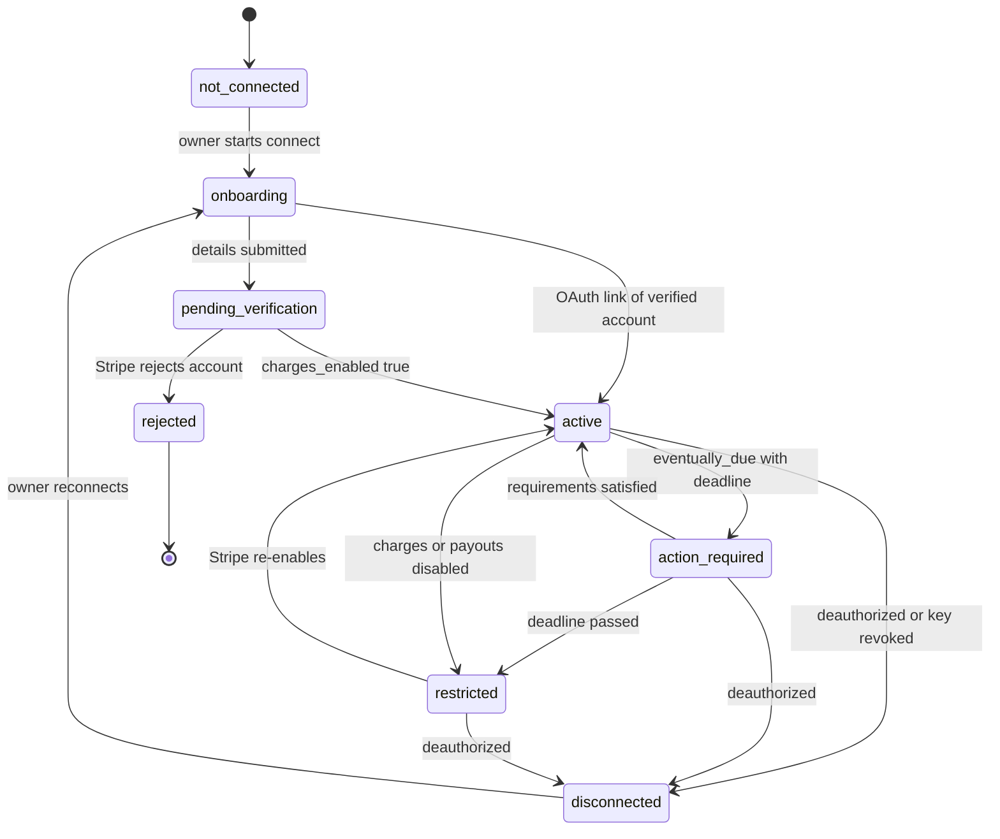

**Health signals collected per connected account:**

| Signal | Source | Severity rule |
|--------|--------|---------------|
| `charges_enabled`, `payouts_enabled` | Account object | Either false -> `restricted` (critical). |
| `requirements.currently_due` / `past_due` | Account object | Non-empty `past_due` -> critical; `currently_due` with `current_deadline` within 14 days -> warning. Owner nudges at 14, 7 and 2 days before the deadline (7 and 2 match the operator console's nudges in [19](19-platform-admin-portal.md) PA-110), and a "what breaks if you miss it" count of scheduled autopay charges. |
| `requirements.disabled_reason` | Account object | Shown verbatim plus a plain-English translation. |
| Capability status changes | Capability events | Any active capability becoming inactive -> warning; affected payment methods auto-hidden. |
| `payout.failed` | Webhook | Critical: "Your bank rejected the payout" with failure code translated. |
| Dispute rate (trailing 90 days, count of disputes / count of card charges, computed from data Rootline sees) | Rootline | Warning at 0.5%, critical at 0.75% (internal thresholds, intentionally below card-network monitoring program levels; verify network thresholds annually). |
| Webhook silence | Rootline | Account with payments in last 7 days but no events in 24 hours -> engineering alert (possible endpoint misconfiguration or disconnect not yet observed). |
| Reserve or risk hold | Balance transactions with reserve categories | Informational banner: "Stripe is holding $X as a reserve until <date>". |
| RAK validity (advanced mode) | Daily API probe with the stored key | Probe failing with authentication error -> `disconnected`. |

**Notification fan-out:** owner (email, SMS, in-app), `office_manager` (in-app), `bookkeeper` for payout failures. Stripe's own notifications also reach the owner because they own the account; Rootline's job is translation and context ("3 autopay charges scheduled tomorrow will fail unless you upload a business verification document").

**Embedded notification banner [V1]:** where supported for full-Dashboard accounts, Rootline embeds Stripe's notification banner and account management components so owners resolve requirements without leaving Rootline (verify component availability for this account configuration).

### 4.4 Disconnection and degraded modes [MVP]

| Trigger | Detection | Immediate Rootline behavior |
|---------|-----------|-----------------------------|
| Owner disconnects in Rootline | Explicit action with typed confirmation ("DISCONNECT") | Rootline calls OAuth deauthorize (OAuth accounts) or marks RAK revoked; see below. |
| Owner removes Rootline from Stripe Dashboard | `account.application.deauthorized` webhook | Same as below within 60 seconds. |
| RAK revoked/rolled | Authentication error on any call or daily probe | Same as below. |
| Stripe disables charges | `account.updated` with `charges_enabled=false` | Treated as `restricted`, not disconnected; history still readable. |

**Degraded behavior when disconnected:**

1. All pay buttons in portal, emails, texts and QR codes switch to an **offline payment instructions** page (Company-configured: mail-a-check address, phone number, bank wire instructions for commercial clients).
2. Scheduled autopay runs are **paused** (not deleted) and listed in a "Paused autopay" queue with amounts and dates.
3. In-flight ACH/PAD payments (status `processing`) are flagged `outcome_unverifiable` because Rootline can no longer read the account or receive webhooks. If the same account reconnects, Rootline resyncs those objects automatically; otherwise the bookkeeper confirms outcomes manually from the Company's Stripe Dashboard.
4. Saved payment methods remain on the Company's Stripe account (they belong to the Company). Rootline keeps only references and display metadata (brand, last 4, expiry, bank name). On reconnection of the **same** account, all autopay enrollments resume. On connection of a **different** Stripe account, autopay enrollments require re-collection, or the Company can ask Stripe to copy payment data between its own accounts (Stripe supports PAN data migrations on request; verify process) and Rootline remaps references by fingerprint.
5. The ledger is unaffected; open Stripe Clearing balances remain until payouts are recorded manually or via bank feed.
6. Platform admin console shows the tenant in the "Payments disconnected" cohort for proactive outreach (see [19](19-platform-admin-portal.md)).

> **Competitive edge.** When a Company leaves a vendor-owned payments product, its autopay base must be re-collected card by card. When a Company leaves Rootline, nothing about its payments changes except that Rootline stops orchestrating them. Rootline should publish a **Payments Portability Pledge** in its terms of service.

### 4.5 Payment methods

Online client payments use Stripe's **Payment Element** (an iframe-hosted, PCI-scoped component) on Rootline's portal and pay pages, with `automatic_payment_methods` so the Company's Dashboard settings and Rootline's per-context rules decide what appears. Pricing below is Stripe list pricing as reported by third parties as of Nov 2026 (verify on [Stripe pricing](https://stripe.com/pricing)); actual fees always come from balance transactions.

| Method | Stripe type | Markets | Typical settlement | Indicative Stripe cost (verify) | Best landscaping use | Priority |
|--------|-------------|---------|--------------------|-------------------------------|----------------------|----------|
| Credit/debit cards | `card` | US, CA | ~2 business days standard payout | US 2.9% + $0.30 online; CA 2.9% + C$0.30 ([Superdupr](https://superdupr.com/blog/stripe-fees)) | Cleanups, small installs, one-off work orders | [MVP] |
| Apple Pay / Google Pay | `card` wallets | US, CA | As cards | As cards | Mobile pay-from-text | [MVP] |
| Link | `link` | US (CA availability verify) | As underlying | As underlying | Repeat residential payers | [MVP] |
| ACH Direct Debit with Financial Connections | `us_bank_account` | US | Up to ~4 business days to confirm ([Superdupr](https://superdupr.com/blog/ach-fees)) | 0.8% capped at $5 ([Dodo Payments](https://dodopayments.com/blogs/stripe-ach-fees/)) | Autopay, installs over $1,000, commercial | [MVP] |
| Canadian pre-authorized debit | `acss_debit` | CA | Several business days | Verify CA pricing | Canadian autopay programs | [V1] |
| Bank transfer to virtual account (ACH credit/wire) | `customer_balance` bank transfer | US (CA verify) | Same/next day on receipt | Verify | HOAs and property managers paying from AP | [V1] |
| Tap to Pay on iPhone / Android | Terminal `card_present` | US, CA | As cards | In-person card pricing, possibly plus a per-transaction Tap to Pay fee (verify) | Pay-at-completion cleanups, cash routes | [V1] |
| Card readers (e.g., Stripe Reader M2, WisePOS E, S700) | Terminal | US, CA | As cards | Hardware purchase plus in-person pricing | Office counter, garden-center style retail, trade shows | [V1] |
| Interac debit in person | Terminal `interac_present` | CA | As cards | Verify | Canadian field collection | [V2] |
| BNPL: Affirm, Klarna, Afterpay | `affirm`, `klarna`, `afterpay_clearpay` | Varies | Paid in full by provider | Higher percentage (verify) | $2,000-$15,000 residential installs | [V1] |
| Consumer financing partners (Wisetack and others) | Partner API, not Stripe | US (Wisetack CA availability limited per [HCP](https://help.housecallpro.com/en/articles/3836042-wisetack-consumer-financing-overview)) | Partner funds Company | Merchant fee per partner | $5,000-$80,000 hardscape, irrigation, lighting | [V1] |
| Cash, check, money order | Manual | US, CA | Bank deposit | None | Older clients, rural routes | [MVP] |
| Check capture (photo + OCR) | Manual + AI | US, CA | Bank deposit | None | Field check collection | [V1] |
| Remote deposit capture | Banking partner | US | Next day | Partner fees | Companies with heavy check volume | [V2] |

**Per-context method rules (Company-configurable defaults):**

| Context | Default methods shown | Rationale |
|---------|-----------------------|-----------|
| Residential invoice under $1,000 | Card, wallets, Link, ACH | Convenience wins. |
| Any invoice over $2,500 | ACH first (pre-selected), card available | ACH cap makes large payments far cheaper for the Company. |
| Commercial client statement | ACH, bank transfer, card (optional, may be disabled) | AP departments prefer ACH/wire; card fees on $40,000 statements are punitive. |
| Proposal deposit | Card, wallets, ACH, financing | Fast commitment; financing offered if proposal total exceeds threshold (default $3,000). |
| Autopay enrollment | ACH or card (ACH incentive shown if enabled) | Lowers cost of recurring revenue. |
| Field collection | Tap to Pay, reader, cash, check | In person only. |
| Tip-only payment | Card, wallets | Small amounts. |

**ACH verification rules [MVP]:** instant verification through Stripe Financial Connections by default; microdeposit fallback when the client's bank is unsupported, with Rootline reminding the client to verify (descriptor-code verification) at 24 h and 72 h. Payments using unverified accounts are not created. Account and routing numbers are never displayed beyond last 4.

**Canadian PAD rules [V1]:** PAD agreement (mandate) presented in English or French (French [V2] alongside fr-CA UI), capturing `transaction_type` (personal or business) and `payment_schedule` (`interval` for monthly maintenance, `sporadic` for per-visit or per-snow-event billing, `combined` for programs with both). Pre-notification of amounts/dates follows the mandate terms; Rootline sends the notice by email at least the agreed number of days before each debit (default 10 calendar days, reducible by agreement with the payor where rules permit; verify against Payments Canada Rule H1 and Stripe's PAD guidance).

### 4.6 Pay an invoice in the portal [MVP]

**Description.** The client opens an invoice (from email, SMS, portal login or QR code), sees line items, photos of the completed work and payment options, and pays with the Payment Element. The charge is a **direct charge on the Company's connected account**.

**Behaviors and rules:**

- PaymentIntent is created server-side when the client clicks "Pay", not on page load (avoids orphan PaymentIntents from link previews and bots). Amount = amount the client chose (full balance by default; partial allowed if Company enables, see [4.9](#49-partial-payments-overpayments-and-multi-invoice-payments-mvp)).
- Metadata on every PaymentIntent: `rootline_tenant_id`, `rootline_payment_attempt_id`, `rootline_invoice_ids` (comma-separated, max 10, longer lists in Rootline only), `rootline_client_id`, `rootline_env`. Description: "Invoice 10482 - Greenleaf Grounds Co.". Dynamic statement descriptor suffix: invoice number or service abbreviation (e.g., `MULCH 10482`).
- `receipt_email` is not set; Rootline sends branded receipts (with photos and the Company's logo) to avoid duplicate Stripe receipts. Company can opt into Stripe receipts.
- Idempotency key on create: `pi:create:{payment_attempt_id}`. Re-clicks reuse the open PaymentIntent for that invoice/amount/client within 24 hours.
- **Surcharge or ACH-discount computation** happens after the client selects a method and before confirmation, using a ConfirmationToken (client creates it; server inspects `payment_method_preview` for type, card funding and country, recomputes the final amount, updates the PaymentIntent, then confirms). See [4.10](#410-surcharging-convenience-fees-and-ach-incentives-v1).
- 3D Secure handled by Stripe (`requires_action`); Rootline shows the challenge inline.
- On `payment_intent.succeeded` (cards: seconds; ACH: days), invoice status updates and the ledger posts ([4.17](#417-reconciliation-into-the-ledger-mvp)). For ACH, the invoice shows **"Payment pending (bank)"** with the expected clear date immediately on `processing`; dunning pauses while pending.
- "Save this payment method for future invoices" checkbox (`setup_future_usage=off_session`) with explicit consent text; ticking it offers autopay enrollment on the success page.
- Accessibility: Payment Element supports keyboard and screen readers; Rootline's surrounding UI meets WCAG 2.2 AA ([21](21-ux-design-system-sitemaps.md)). Locales: `en`, `es`, `fr-CA` (later).

### 4.7 Autopay with SetupIntents and mandates [MVP]

**Description.** Clients enroll a card or bank account so Rootline can charge invoices automatically: weekly mowing invoiced per visit, monthly flat-rate maintenance (e.g., $189/month Apr-Nov or 12 equal payments), lawn-care program rounds (5-step fertilization), snow pushes per event, irrigation start-up and winterization.

**Enrollment paths:**

1. **Proposal/agreement acceptance:** Service Agreement e-sign includes an autopay step ([03](03-crm-sales-estimating-proposals.md)); SetupIntent collects the method with mandate acceptance.
2. **Portal:** "Set up autopay" from billing settings.
3. **After a one-off payment:** "Save and turn on autopay".
4. **Office-assisted:** office manager sends an "Autopay enrollment" link (never types card numbers on behalf of clients by default; phone-order entry by staff into a Stripe element is possible [V1] only with the `payments.moto` permission, is logged, and may change the Company's PCI self-assessment type; see the PCI scoping breakdown in [11.1](#111-compliance)).

**Rules:**

- SetupIntent with `usage=off_session` on the Company's connected account; the Stripe Customer object lives on the connected account and maps 1:1 to the Rootline Client (commercial clients may have multiple billing Contacts with separate methods).
- Mandate capture: card mandate text plus, for ACH, the Nacha-required authorization language; for PAD, the PAD agreement. Rootline stores the mandate ID, the exact consent text version, IP, user agent, timestamp and the Contact who accepted.
- **Card-on-file rules (stored credentials).** Card networks expect the cardholder to agree, at the moment the card is saved, to how it will be used: which charges (e.g., "each weekly mowing visit" or "$189.00 on the 5th of each month, April-November"), how the amount is set (fixed or per visit), when charges happen, and how to cancel. Rootline generates that consent text from the Service Agreement terms, so it is never generic. The first charge is customer-initiated (on-session SetupIntent or payment); later autopay charges go out as merchant-initiated with `off_session=true`, and Stripe carries the network transaction references. If agreement terms change materially (a new price at renewal, a new service line), Rootline re-sends the consent summary and, for amount increases above the client's autopay cap, asks for re-confirmation (verify current Visa and Mastercard stored-credential and recurring-billing rules).
- Autopay scope options: **all invoices**, **agreement invoices only** (default), or **specific Properties** (HOA manager: autopay for Property A only).
- **Charge timing** (Company-level default, overridable per agreement): on invoice issue date, on due date, or N days after issue (default: 3 days after issue for card, 5 days for ACH to honor any pre-notification commitments). Clients receive a "We will charge $189.00 to Visa 4242 on Jun 3" pre-notification by email (and SMS if opted in) at least 2 days before for cards; for ACH and PAD, per mandate terms.
- **Caps:** client can set a per-invoice autopay cap (e.g., "do not auto-charge over $500"); invoices above the cap become regular invoices with a "Pay now" request.
- Off-session PaymentIntent creation uses `off_session=true, confirm=true`; failures with `authentication_required` trigger an on-session recovery email with a pay link.
- **Card lifecycle:** Stripe's automatic card updates (account updater/network tokens) are consumed via `payment_method.automatically_updated`; Rootline sends expiring-card outreach at 30 and 7 days before expiry if no update arrives.
- **Mandate revocation:** ACH R07/R10 returns or `mandate.updated` to inactive immediately disable autopay for that method, notify office, and stop retries.
- **Property sale or client churn:** ending a Service Agreement prompts "keep autopay for other invoices?"; transferring a Property to a new Client never transfers payment methods.

> **Competitive edge.** Field-service tools let a contractor save a card, but the consent is usually one generic checkbox and the card lives in the vendor's payments account. Rootline ties each autopay consent to the actual Service Agreement terms (dates, amounts, cap), stores the evidence for disputes, and keeps the saved method in the Company's own Stripe account. The same card that pays for the weekly mowing round still works if the Company moves to different software next year.

### 4.8 Payment plans and installments [V1]

**Description.** Split a large invoice or proposal into scheduled payments, e.g., an $18,400 paver patio and seat wall: 30% deposit on signature, 40% on mobilization (materials delivered), 30% on completion walkthrough; or a residential client paying a $3,600 fall cleanup + drainage repair in 3 monthly installments.

**Rules:**

- Plan types: **milestone** (tied to project phases from [14](14-service-line-modules.md)/[04](04-scheduling-dispatch-routing.md); charge when a phase is marked complete and client approves, or auto after N days) and **calendar** (fixed dates).
- **Lending guardrail:** for consumers (`client_residential`), Rootline-native plans default to **no finance charge and at most 4 installments**, because consumer credit payable by written agreement in more than four installments generally brings Truth in Lending disclosure obligations even without interest (Regulation Z's creditor definition; verify with counsel per state). Longer or interest-bearing plans route to a financing partner ([4.12](#412-consumer-financing-v1)). Commercial plans are not subject to this cap but late fees follow [07](07-invoicing-billing-contracts.md) rules.
- Each installment is a Rootline invoice installment (one invoice, many scheduled payment requests), charged off-session if the client authorized it, or sent as a pay request otherwise.
- Missed installment: enters dunning ([4.15](#415-failed-payments-retries-and-dunning-mvp)); Company can configure "stop work" on milestone plans (ops board shows a payment hold).
- Rootline uses its own durable scheduler (Temporal workflows) and off-session PaymentIntents, **not** Stripe Subscriptions or Subscription Schedules on the connected account, so that the invoice, tax, ledger and plan remain one source of truth.

### 4.9 Partial payments, overpayments and multi-invoice payments [MVP]

- **Partial payments:** Company toggle (default on for invoices over $500, off for small invoices). Minimum partial amount (default $50 or 10%, whichever is larger). Invoice moves to `partially_paid`; remaining balance stays in dunning per [07](07-invoicing-billing-contracts.md).
- **Multi-invoice payment:** commercial and residential clients can select several open invoices (statement view) and pay once. Allocation: client-selected invoices, then oldest-first for any remainder. One PaymentIntent, many `payment_allocation` rows.
- **Overpayment:** possible with manual entries or race conditions (client pays online while office records a check for the same invoice). Excess becomes an **unapplied credit** (liability) visible to office; options: apply to next invoice automatically (default for agreement clients) or refund.
- **Race guard:** before confirming a PaymentIntent, the server re-reads invoice balance; if balance changed since the page loaded, the client sees "Your balance changed to $X" and must re-confirm.

### 4.10 Surcharging, convenience fees and ACH incentives [V1]

Surcharging is legal in most US states but banned or capped in several, and network rules apply on top. Rootline treats it as a **compliance-gated feature** driven by a versioned rules table that platform staff maintain in the admin console ([19](19-platform-admin-portal.md)).

**Facts the rules engine encodes (as of Nov 2026, verify; this is not legal advice):**

| Rule | Detail | Source |
|------|--------|--------|
| Visa US cap | Lesser of the merchant's card acceptance cost or 3%, effective April 15, 2023; merchants notify their acquirer 30 days before surcharging | [AFS Law alert](https://www.afslaw.com/perspectives/alerts/visa-reduces-its-merchant-surcharge-cap-3-effective-april-15-2023-merchants), [Paya notice](https://support.paya.com/updates-to-visas-surcharge-rules-in-canada-the-us-and-us-territories) |
| Mastercard US cap | Reported at 4% (Rootline applies the lower 3% across brands for simplicity) | [AFS Law alert](https://www.afslaw.com/perspectives/alerts/visa-reduces-its-merchant-surcharge-cap-3-effective-april-15-2023-merchants) |
| Debit and prepaid cards | Surcharging prohibited even when "run as credit" | [Visa Canada FAQ](https://www.visa.ca/content/dam/VCOM/regional/na/canada/Support/Documents/surcharging-faq-businesses-en.pdf), [Mastercard Canada](https://www.mastercard.com/ca/en/business/support/merchant-surcharge-rules.html) |
| Canada cap | 2.4% maximum (Visa and Mastercard) | [Visa Canada FAQ](https://www.visa.ca/content/dam/VCOM/regional/na/canada/Support/Documents/surcharging-faq-businesses-en.pdf), [Mastercard Canada](https://www.mastercard.com/ca/en/business/support/merchant-surcharge-rules.html) |
| Quebec | Surcharging prohibited under provincial consumer protection law (verify) | Rootline legal review required |
| States banning surcharges | Connecticut, Massachusetts, Maine (Maine also covers debit) | [LawPay](https://www.lawpay.com/about/blog/credit-card-surcharge-rules/), [Nickel](https://www.nickel.com/surcharge-laws) |
| States with caps | Colorado (2% or cost, per method), Oklahoma (lesser of 2% or cost, after SB 677 effective Nov 1, 2025) | [Rundoo, Sept 2026](https://rundoo.ai/insights/credit-card-surcharge-laws-by-state/), [Lifted Payments](https://liftedpayments.com/credit-card-surcharge-rules-by-state) |
| Contested or changing | California (sources disagree), Louisiana (reported statutory bar from Aug 1, 2026) | [Rundoo](https://rundoo.ai/insights/credit-card-surcharge-laws-by-state/), [Nickel](https://www.nickel.com/surcharge-laws) |
| Price-display rules | New York requires the total price including the credit-card surcharge to be displayed, and the surcharge may not exceed what the card processor charges (amended General Business Law section 518, reported effective February 2024; verify). Pay pages for New York Companies or Properties therefore show "Card price $1,284.38 / Bank price $1,250.00" rather than an add-on line. | Rootline legal review required (primary source to verify) |
| Network rule changes in flight | Visa and Mastercard announced a revised US merchant settlement in November 2025 that, if approved, would change honor-all-cards and surcharging flexibility (verify final court status and effective dates). The rules table carries effective-dated rows so a change ships as data, not code. | Rootline legal review required (primary source to verify) |
| Canada debit | Interac debit and all debit/prepaid cards may not be surcharged | [Visa Canada FAQ](https://www.visa.ca/content/dam/VCOM/regional/na/canada/Support/Documents/surcharging-faq-businesses-en.pdf) |

**Engine behavior:**

1. **Eligibility check at configuration:** Company enables surcharging only after (a) attesting it notified Stripe (its acquirer) at least 30 days earlier, with the date stored, (b) choosing a rate not above its own average card cost (Rootline computes trailing-90-day effective rate from balance transactions and shows it), and (c) acknowledging disclosure obligations. Rootline blocks enabling if the Company's own state/province is on the ban list.
2. **Per-transaction evaluation:** surcharge applies only if **all** pass: card `funding = credit`; card country and Company country are US or CA as configured; neither the Company's state/province nor the service Property's state/province is on the ban list (conservative "either location" rule); rate <= min(Company cap, network cap, jurisdiction cap).
3. **Base amount:** invoice amount being paid, excluding tips and excluding any portion the Company marks as non-surchargeable (e.g., pass-through permit fees).
4. **Disclosure:** pre-payment notice on the invoice and pay page ("A 2.75% surcharge applies to credit cards, which is not greater than our cost of acceptance. No surcharge for debit cards or bank payments."), line item on the receipt, and in-app signage text for field collection. Jurisdictions with total-price display rules (New York) switch the rules engine to `display_mode = dual_price`, which shows the card total and the bank total side by side before the client chooses.
5. **Sales tax on the surcharge:** taxability varies by jurisdiction; the tax engine in [07](07-invoicing-billing-contracts.md) receives the surcharge as a separate line with its own tax code.
6. **Refunds:** surcharge refunded pro rata with any refund.
7. **Field payments:** Tap to Pay shows the card funding type after tap only in some flows; if funding cannot be determined before authorization, Rootline does **not** surcharge (fail-safe).
8. **Proposals and estimates:** when a Company surcharges, Proposals show the card surcharge policy in the payment terms the client signs, so a dispute over "a fee I never agreed to" meets signed evidence ([4.19](#419-disputes-with-automatic-evidence-assembly-mvp)).
9. **Audit trail:** every surcharge decision stores the rule-set version, the inputs (funding, card country, Company and Property jurisdictions, rate) and the result. A quarterly compliance report per Company lists surcharged payments, rates and the trailing effective cost, so the Company can show its acquirer that it never exceeded its cost of acceptance.

**Alternatives Rootline actively recommends:**

- **ACH incentive / bank-payment discount [V1]:** "Pay by bank and save 2%" applied as an invoice discount line when the client pays by ACH/PAD before the due date. Discounts for a payment method are generally permissible where surcharges are not (verify state-by-state; rules table covers this too). Ledger: contra-revenue "Payment method discounts".
- **Autopay discount [V1]:** e.g., $5 off each monthly maintenance invoice for ACH autopay.
- **Price-inclusive pricing:** Rootline's estimating engine ([03](03-crm-sales-estimating-proposals.md)) can build expected processing cost into overhead recovery, so no visible fee is needed.
- **Convenience fees** (flat fees for an alternative channel) are not offered at MVP or V1; network rules for convenience fees are narrow and easy to misapply. Re-evaluate [V2].

> **Competitive edge.** Contractors ask on vendor forums how to add card fees to invoices; the typical answer is a manual line item that may be illegal in their state, applied to debit cards, or above the network cap. Rootline is the only landscape platform we know of (verify during R4 research) that makes surcharging conditional on card funding type, jurisdiction and the Company's own measured cost, and that nudges toward ACH incentives instead.

### 4.11 Deposits on proposal approval [MVP]

**Description.** When a client accepts a Proposal ([03](03-crm-sales-estimating-proposals.md)), the portal immediately asks for the deposit defined by the Company's deposit policy.

**Rules:**

- Deposit policy per proposal type: percentage (default 30% for installs over $5,000), fixed amount (e.g., $500 to hold a spring cleanup slot), or "materials cost" (deposit equals estimated material and plant cost from the Estimate, so the Company is never out of pocket for 14 yards of mulch and 40 shrubs).
- Signature and payment are separate atomic steps: signature is recorded first (legally the acceptance); the job becomes `sold_pending_deposit` until the deposit succeeds, then `sold`. Company chooses whether scheduling waits for the deposit (default yes for installs, no for maintenance agreements).
- Deposit recorded as **Customer Deposits** (2150, liability) in the ledger, then applied to invoices by the deposit application method chosen in [07](07-invoicing-billing-contracts.md) 4.2.5 (first invoice, pro rata across progress invoices, final invoice, or manual) ([4.17](#417-reconciliation-into-the-ledger-mvp)).
- ACH deposits: job is `sold` on `processing` if Company opts in ("trust ACH pending"); otherwise on `succeeded`.
- Deposit refund rules link to cancellation terms in the signed Proposal (posting rule P35 in [07](07-invoicing-billing-contracts.md)); refunds above the non-refundable portion follow the refund approval routing in [4.16](#416-refunds-and-credit-memos-mvp) (`owner`, or `office_manager` within the refund limit).
- Deposit link expiry: 14 days; reminders at day 2 and day 7.
- Financing: if the proposal total exceeds the financing threshold, the deposit step shows "Or finance this project" ([4.12](#412-consumer-financing-v1)).

### 4.12 Consumer financing [V1]

**Description.** Offer homeowners monthly payments on large projects (a $42,000 backyard renovation: patio, outdoor kitchen, low-voltage lighting, irrigation) while the Company is paid in full by the lender.

**Approach:** partner integrations behind a `FinancingProvider` interface, shown in proposals, portal and estimator mobile flows.

| Partner type | Examples to evaluate | Notes |
|--------------|---------------------|-------|
| Home-services POS lending | Wisetack (used by Housecall Pro, with terms extended to 84/120 months in Feb 2026 per [HCP](https://www.housecallpro.com/resources/february-2026-product-updates/)) | Strong fit for $1,000-$25,000+ jobs; Canada availability limited per [HCP Help](https://help.housecallpro.com/en/articles/3836042-wisetack-consumer-financing-overview). |
| BNPL via Stripe | Affirm, Klarna, Afterpay/Clearpay as Payment Element methods | Zero extra integration once capability is enabled; shorter terms; checkout-style approval. |
| Contractor-focused lenders | Home-improvement programs such as GreenSky and Service Finance Company (candidates for the RFP; verify current programs, landscaping eligibility and dealer requirements) | Longer terms, higher ticket sizes; usually need a dealer agreement per Company, so Rootline integrates the application and status flow while the Company signs the lender's agreement directly. |
| Multi-lender marketplaces | Aggregators such as Hearth or Acorn Finance (candidates; verify) that show offers from several lenders after one soft-pull application | Better approval odds for borderline credit; Rootline must display offers in the order the marketplace returns them, never re-ranked by referral fee. |
| Canada | Canadian home-improvement lenders such as Financeit (candidate; verify) | Fills the gap left by limited Wisetack availability in Canada; separate `FinancingProvider` adapter per country. |

**Rules:**

- Rootline is a **referral/technology provider**, never the lender; disclosures come from the lender; Rootline displays "as low as $X/month" only with lender-provided, compliant figures.
- Pre-qualification (soft pull) from the proposal link; application status webhooks update the proposal (`financing_pending`, `approved`, `funded`, `declined`).
- Funding: lender pays the Company directly (often net of a merchant fee); Rootline records a `financing_settlement` payment against the invoice and the merchant fee as an expense ([09](09-accounting-ledger-integrations.md)).
- Estimator can see a "financing offered" flag and, if the Company enables it, build lender merchant fees into the price via the estimate's overhead recovery.
- **Selection rule:** one primary lender per Company per country, plus at most one fallback ("second look") lender if the first declines. The proposal shows "Monthly payments available" only when the Proposal total is within the lender's min/max ticket (e.g., $1,000-$25,000 for a POS lender; values come from the provider adapter, not hard-coded).
- **Funding timing:** most lenders fund after the homeowner confirms completion (or a project milestone). Rootline sends the lender's completion-confirmation request to the client when the final Visit is marked complete with photos, so the Company is not waiting on a forgotten email.
- **Ledger:** financed amount funded posts Dr 1010 Operating Checking (or the lender's clearing account if funding is netted) and Dr 6156 Financing Merchant Fees / Cr 1200 AR for the gross invoice; the AR closes in full because the homeowner's obligation is now to the lender.
- **Compliance:** Rootline never pre-screens, scores or steers homeowners into or away from financing based on protected characteristics or proxies; the "offer financing" decision is based only on Proposal amount and Company settings (Equal Credit Opportunity Act and Regulation B considerations; counsel to confirm). Marketing copy follows lender-approved templates.

> **Competitive edge.** Housecall Pro's Wisetack integration is a strong benchmark for home services ([HCP](https://www.housecallpro.com/resources/february-2026-product-updates/)), but Wisetack is limited in Canada via HCP ([HCP Help](https://help.housecallpro.com/en/articles/3836042-wisetack-consumer-financing-overview)). Rootline's provider interface lets a Company in Ontario use a Canadian lender and a Company in Ohio use a US one in the same proposal flow, with the funded amount, merchant fee and AR close-out posted to the ledger automatically.

### 4.13 Tips for crews [V1]

**Description.** Residential clients can tip the crew when paying an invoice or via a post-visit "Thank your crew" message that includes a finished-job photo.

**Rules:**

- Enabled per Company and per service line (default on for residential maintenance and installs, off for commercial).
- Tip prompts: 10%, 15%, 20%, custom, or flat amounts ($10, $20, $50) for small invoices under $150.
- Tips are attached to a **Visit** (or the Job's most recent completed Visit). Allocation: proportional to clocked hours on that Visit by default ([05](05-field-crew-mobile-app.md)), or equal split, or crew lead decides within 24 hours.
- Tips are **not revenue and not taxable sales**; they post to **Tips Payable** (liability) and flow to payroll exports as cash/credit tips ([15](15-team-hr-payroll.md)).
- Processing fee on the tip portion: Company absorbs by default. Deducting card fees from tips is restricted in some jurisdictions (verify per state; e.g., California rules on tip deductions) so the "deduct pro-rata fee" option is hidden where the rules table forbids it.
- Tips excluded from surcharge base and sales tax.
- Crew app shows tips per Visit and per pay period; tip notifications are celebratory (crew-lead push: "The Martins tipped $40 for today's spring cleanup").

### 4.14 Payment links, QR codes and pay-by-text [MVP]

- Every invoice, statement and payment request gets a **Rootline pay link** on the Company's portal domain: `https://portal.greenleafgrounds.com/i/7Gk2Qx` (white-label custom domain per [06](06-customer-portal.md); fallback `https://<slug>.rootline.app/pay/...`).
- Link token: random 128-bit, stored hashed, scoped to one payable object, expires when the object is paid or voided, or after 180 days (statement links regenerate monthly). No login required to pay; viewing other invoices requires login or a one-time code.
- **QR codes** printed on PDF invoices, mailed statements and door hangers ("Scan to pay your fall cleanup"), and displayed in the crew app for clients who prefer to pay on their own phone.
- **Pay-by-text:** SMS with the link, sent only to Contacts with TCPA-compliant consent and 10DLC-registered numbers ([16](16-marketing-growth-communications.md)).
- **Generic "Pay your bill" link** on the Company website: client enters invoice number + ZIP/postal code to find the invoice (rate-limited, no account enumeration).
- Stripe Payment Links objects are not used for invoice payments (they would create a parallel product catalog); they may be used for simple marketing offers like "Book an aeration and overseeding slot, $99 deposit" [V1].

### 4.15 Failed payments, retries and dunning [MVP]

**Retry policy by failure class:**

| Failure | Examples (Stripe decline codes / ACH return codes) | Retry rule | Client/office action |
|---------|----------------------------------------------------|------------|----------------------|
| Soft card decline | `insufficient_funds`, `do_not_honor`, `try_again_later`, `processing_error` | Up to 4 retries over 14 days (day 1, 3, 7, 14), timed to the 1st/15th or known payday patterns where data suggests | Email/SMS with update link after first failure. |
| Hard card decline | `stolen_card`, `lost_card`, `pickup_card`, `fraudulent`, `invalid_account` | **No retry**; method marked unusable | Request new method. |
| Expired / incorrect details | `expired_card`, `incorrect_number`, `incorrect_cvc` | No retry until method updated | Update link. |
| Authentication needed | `authentication_required` | No off-session retry; on-session pay link | Client completes 3DS. |
| ACH insufficient funds | R01, R09 | Retry up to 2 more times within the Nacha limits (total 3 presentments within 180 days; verify current rules) | Notify after each. |
| ACH account closed / invalid | R02, R03, R04 | No retry; method disabled | New method needed. |
| ACH unauthorized / revoked | R05, R07, R10, R29 | No retry; mandate revoked; office alerted | Office calls client; possible dispute-like handling. |
| PAD returns (CA) | NSF and other return reasons | Mirrors ACH classes per Stripe return reason mapping | As above. |

**Retry guardrails (apply on top of the table):**

- **Network advice wins.** When a decline carries a network or Stripe advice code meaning "do not try again" (for example, Mastercard merchant advice codes for a closed account, or Visa's "do not reattempt" decline categories), the method is treated as a hard decline whatever the decline code says (verify field names on Stripe's decline object). Card networks penalize excessive reattempts on the same card (verify current Visa and Mastercard limits); Rootline's ceiling is 4 retries per invoice and 8 attempts per card per 30 days across all invoices.
- **ACH costs money to fail.** Stripe may charge a fee for each failed ACH debit (verify current pricing), and Nacha limits re-presentment of R01/R09 returns to two. ACH retries are therefore timed to the client's observed deposit pattern (AI4 in [10](#10-ai-opportunities-in-this-module)) or, without data, to the next 1st or 15th, never back-to-back.
- **One clock per client.** If several invoices for the same client fail on the same day (a weekly mowing client with 3 unpaid visits), retries are consolidated into one multi-invoice attempt and one message, not three.
- **Dunning ownership.** The retry schedule here governs automatic charge attempts; the reminder cadence, late fees and collections steps are owned by [07](07-invoicing-billing-contracts.md). Durable workflows in [20](20-architecture-security.md) implement this table (20's `AgreementBillingWorkflow` cites the same day 1/3/7/14 schedule).

**Failed-payment notice sequence (Company-editable templates, default):** Day 0 failure notice -> Day 3 reminder -> Day 7 reminder + office task -> Day 14 "final notice" -> Day 21 hand-off to the invoice dunning and collections policy in [07](07-invoicing-billing-contracts.md) 4.9.3 (service hold, late fee where legal, collections handoff). Days count from the failed charge; while these notices run, 07 suppresses its own reminder steps for the invoice so the client gets one thread. Communications respect quiet hours (8am-9pm local) and SMS consent; copy is friendly by default ("Looks like your card on file didn't go through for this week's mowing").

**Service hold integration [V1]:** if an agreement client is more than N days past due (default 30) or autopay failed with a hard decline and no update in 7 days, Rootline raises `payments.client.payment_hold` so scheduling can flag or skip upcoming visits ([04](04-scheduling-dispatch-routing.md)). Office must confirm skips; snow contracts default to "never auto-skip" for safety and liability reasons.

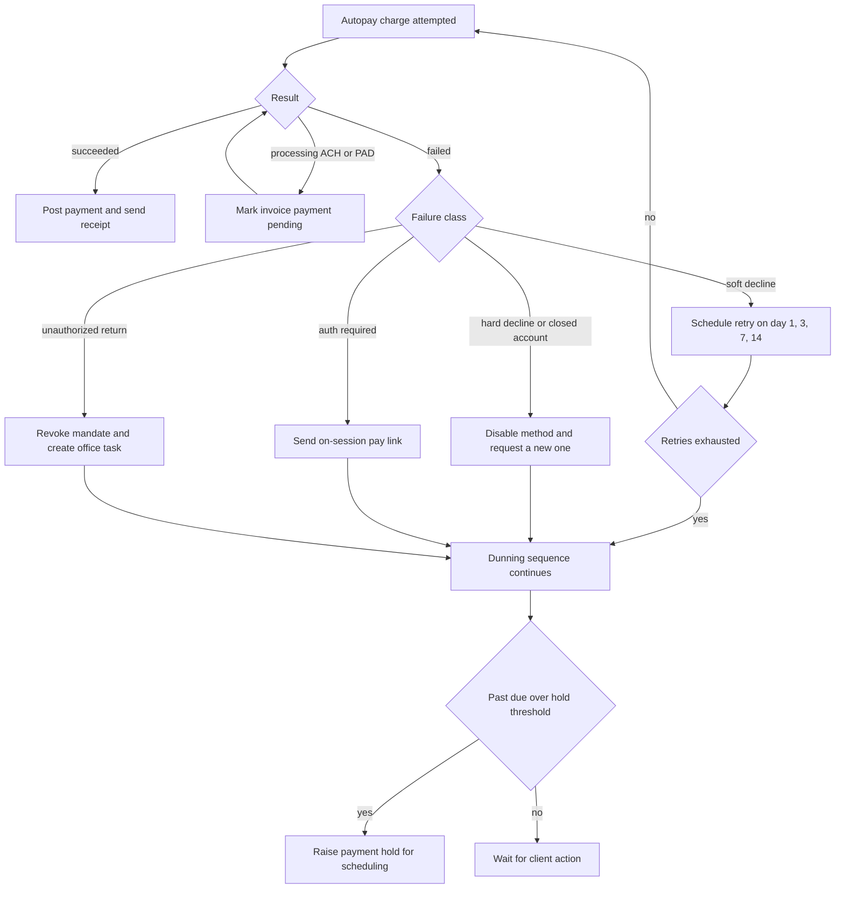

### 4.16 Refunds and credit memos [MVP]

**Rules:**

- Refunds always go back to the original payment method via the Refunds API on the connected account (`refund_application_fee=true` whenever a platform fee was taken, see [4.24](#424-platform-monetization-and-transparency)).
- Every refund is paired with a **credit memo** in Rootline ([07](07-invoicing-billing-contracts.md)) so AR, revenue and tax are corrected; the refund then pays out the credit. Exception: refunding an unapplied overpayment or a deposit (no revenue involved).
- Types: full, partial (any amount up to the remaining refundable amount), line-item based (e.g., refund the $120 annual-color line because the planting was rained out and not rescheduled), surcharge pro rata, tip refund (requires `crew_lead` or `owner` confirmation because tips may already be in payroll; if already paid out through payroll, the tip refund posts to an employee receivable or is absorbed by the Company per policy).
- **Approval thresholds** (Company-configurable defaults from [02](02-personas-roles-permissions.md) 5.6, `refund.max_amount`): `office_manager` up to $500 per refund and $2,000 per day, `bookkeeper` up to $500 per refund; above that, `owner` approval in-app (push notification with one-tap approve). All refunds require a reason code (service issue, billing error, duplicate, goodwill, cancellation, plant warranty).
- ACH/PAD refunds take several business days; status tracked via `refund.updated`/`charge.refund.updated`; failed refunds (closed account) create an office task and an **unclaimed funds** record (for escheatment tracking, see [11](#11-edge-cases-compliance-and-risks)).
- Refund blocked if the payment is under dispute (Stripe rejects refunds on disputed charges); Rootline explains instead of erroring.
- Processing fees: Stripe's handling of the original fee on refunds is read from the refund's balance transaction, never assumed (verify current Stripe policy). The Payments report shows "fees not returned on refunds" so owners see the true cost of goodwill refunds.
- **Plant warranty claims** ([14](14-service-line-modules.md)): a warranty replacement is a no-charge Visit by default, not a refund; a cash warranty settlement uses refund reason `plant_warranty`.
- **Refund windows and fallbacks:** ACH Direct Debit and PAD refunds are only possible within a limited period after the original payment (Stripe documents the window per method; verify, e.g., 180 days for ACH Direct Debit). Card refunds to closed or replaced cards are usually rerouted by the issuer, but can fail. When a refund cannot go back to the original method, Rootline offers a **manual refund by check or bank transfer** recorded through the manual provider (Dr 1200 AR after the credit memo, or Dr 2180 Customer Credits or 2150 Customer Deposits / Cr 1010 Operating Checking when the check clears), keeping the credit memo and audit trail intact.
- **Season prepay cancellations:** when a client cancels a prepaid lawn program after 2 of 7 rounds, the refund amount comes from the Service Agreement's proration rule in [07](07-invoicing-billing-contracts.md) (rounds delivered at list price, minus any prepay discount clawback), not from a manual guess, and the refund dialog shows the math.

### 4.17 Reconciliation into the ledger [MVP]

The built-in general ledger ([09](09-accounting-ledger-integrations.md)) treats each currency balance at Stripe as a **clearing account**: money is in it from the moment Stripe records a balance transaction until a payout moves it to the bank.

#### 4.17.1 Default accounts (canonical codes from 09)

The chart of accounts, account roles and default codes are owned by [09](09-accounting-ledger-integrations.md) (4.2.2 chart, 4.3.2 payments posting rules); [07](07-invoicing-billing-contracts.md) 4.11 uses the same codes. This section lists only the accounts payments touches. Posting rules reference **account roles** (for example `stripe_clearing:USD`, `ar_control`), never hard-coded numbers, so a Company can renumber its chart without breaking payments postings; the codes below are the canonical defaults from 09's template. Canadian GST/HST and QST accounts are also defined in 09.

| Code | Account role (09) | Account | Type | Used by |
|------|-------------------|---------|------|---------|
| 1010 | `bank:operating` | Operating Checking | Asset | Payouts, negative-balance debits, manual refunds |
| 1050 | `stripe_clearing:USD` | Stripe Clearing - USD | Asset (control) | Every USD balance transaction |
| 1051 | `stripe_clearing:CAD` | Stripe Clearing - CAD | Asset (control) | CAD balances [V1] |
| 1055 | `stripe_reserve` | Stripe Reserve Held | Asset (control) | Reserves held and released |
| 1060 | `undeposited_funds` | Undeposited Funds | Asset | Checks and cash awaiting deposit (4.20.2) |
| 1065 | `cash_in_transit` | Cash in Transit (crew-held) | Asset | Field cash and checks, per crew lead (4.20.2) |
| 1075 | `disputed_receivable` | Disputed Payments Receivable | Asset (control) | Card disputes awaiting outcome |
| 1090 | `payments_suspense` | Payments Suspense (must be zero to lock a period) | Asset | Unknown reporting categories |
| 1200 | `ar_control` | Accounts Receivable | Asset (control) | Payment allocations, refunds after credit memos, ACH returns |
| 2150 | `customer_deposits` | Customer Deposits | Liability (control) | Deposits on proposal approval (4.11) |
| 2160 | `tips_payable` | Tips Payable | Liability | Crew tips (4.13), cleared by payroll |
| 2180 | `customer_credits` | Customer Credits and Unapplied Cash | Liability (control) | Overpayments and unallocated payments |
| 4910 | `discounts_allowances` | Discounts and Allowances | Contra-revenue | Goodwill credit memos before refunds |
| 4920 | `payment_method_discounts` | Payment Method Discounts (ACH and autopay incentives) | Contra-revenue | ACH incentive [V1] (4.10) |
| 4950 | `surcharge_income` | Card Surcharge Income | Revenue | Card surcharge [V1] (4.10) |
| 6150 | `merchant_fees` | Merchant Processing Fees | Expense | Stripe processing and standalone Stripe fees |
| 6152 | `platform_fees` | Rootline Platform Fees | Expense | Application fees, pay-as-you-grow only (4.24) |
| 6155 | `dispute_fees` | Dispute Fees | Expense | Dispute and ACH dispute fees |
| 6156 | `financing_merchant_fees` | Financing Merchant Fees | Expense | Consumer financing partner fees (4.12) |
| 6170 | `bad_debt` | Bad Debt Expense | Expense | Lost disputes written off |
| 7910 | `realized_fx` | Realized FX Gain/Loss | Other income/expense | Cross-currency settlement and conversion cost |
| 7950 | `cash_over_short` | Cash Over/Short | Other income/expense | Crew cash handover variances (owner approval) |

Role keys are the canonical spellings from [09](09-accounting-ledger-integrations.md) (4.2.2 chart and 4.2.6 crosswalk); the crosswalk also lists the legacy aliases the posting-rule registry resolves to them.

#### 4.17.2 Posting rules by balance transaction category

Rootline reads every balance transaction on the connected account (via webhooks plus the nightly sync) and maps Stripe's `reporting_category` to a posting rule. Gross and fee are posted as separate lines from the same balance transaction so revenue and fees are both visible.

| Stripe reporting category | 09 rule | Debit | Credit | Notes |
|---------------------------|---------|-------|--------|-------|
| `charge` (gross) | `payments.charge` | 1050/1051 Stripe Clearing | 1200 AR, 2150 Customer Deposits, 2160 Tips Payable, 4950 Card Surcharge Income, 2180 Customer Credits and Unapplied Cash (per allocation) | Allocation from Rootline `payment_allocation`. |
| `charge` (fee lines) | `payments.fee` | 6150 Merchant Processing Fees (6152 Rootline Platform Fees for application fee lines) | Clearing | Fee details from `fee_details`; application fee identified by type, never by amount. |
| `refund` | `payments.refund` | 1200 AR (credit memo already reduced AR) or 2180/2150 | Clearing | Paired with credit memo. |
| `dispute` | `payments.dispute` | 1075 Disputed Payments Receivable (card disputes) or 1200 AR (ACH/PAD disputes, which cannot be contested); 6155 Dispute Fees | Clearing | On funds withdrawal. See Examples 7 and 10. |
| `dispute_reversal` | `payments.dispute_reversal` | Clearing | 1075 (and 6155 if fee returned) | On win. |
| `fee` (standalone Stripe fees, e.g., Terminal, Radar, instant payout fee) | `payments.fee` | 6150 | Clearing | |
| `payout` | `payments.payout` | 1010 Operating Checking | Clearing | Matched to bank feed. |
| `payout_reversal` (failed payout) | `payments.payout_reversal` | Clearing | 1010 Operating Checking | Owner alerted. |
| `risk_reserved_funds` / reserve release | `payments.reserve` | 1055 Stripe Reserve Held / Clearing | Clearing / 1055 | Visible "Stripe is holding". |
| `other_adjustment` or unknown | `payments.other_adjustment` | 1090 Payments Suspense | Clearing | Bookkeeper task; never silently dropped. |

**Timing:** postings occur when the balance transaction exists (card charges within seconds; ACH when the payment succeeds). ACH `processing` creates a sub-ledger "pending payment" record only, not a GL entry, so a later failure needs no reversal. ACH returns after success (e.g., R10 within the consumer return window) post a reversal: Dr AR, Cr Clearing, plus any return fee.

**Granularity:** payment-level entries for AR credits (needed for the AR sub-ledger and client statements); fees can be posted per payment (default) or summarized per payout (Company option, for bookkeepers who prefer fewer lines).

#### 4.17.3 Worked journal entries

Fees below use an **illustrative** card rate of 2.9% + $0.30 online and 2.7% + $0.05 in person; ACH 0.8% capped at $5. Real entries use the actual balance transaction. Sales tax omitted for clarity (handled in [07](07-invoicing-billing-contracts.md)).

**Example 1 - Card payment of a spring cleanup + 6 cubic yards of mulch, invoice 10482 for $1,250.00.** Fee = $36.25 + $0.30 = $36.55.

| Account | Debit | Credit |
|---------|------:|-------:|
| 1050 Stripe Clearing - USD | 1,250.00 | |
| 1200 Accounts Receivable (Client: Martin, Inv 10482) | | 1,250.00 |
| 6150 Merchant Processing Fees | 36.55 | |
| 1050 Stripe Clearing - USD | | 36.55 |

Net clearing increase $1,213.45 equals the balance transaction `net`.

**Example 2 - 30% ACH deposit on an $18,400 paver patio and seat wall proposal.** Deposit $5,520.00; ACH fee 0.8% = $44.16, capped at $5.00.

| Account | Debit | Credit |
|---------|------:|-------:|
| 1050 Stripe Clearing - USD | 5,520.00 | |
| 2150 Customer Deposits | | 5,520.00 |
| 6150 Merchant Processing Fees | 5.00 | |
| 1050 Stripe Clearing - USD | | 5.00 |

When the mobilization progress invoice ($7,360.00, 40%) is issued, the deposit is applied:

| Account | Debit | Credit |
|---------|------:|-------:|
| 2150 Customer Deposits | 5,520.00 | |
| 1200 Accounts Receivable | | 5,520.00 |

**Example 3 - Tap to Pay at a weekly-maintenance client: $300.00 invoice plus $40.00 tip.** Charge $340.00; in-person fee 2.7% x 340 = $9.18 + $0.05 = $9.23 (Company absorbs fee on tip).

| Account | Debit | Credit |
|---------|------:|-------:|
| 1050 Stripe Clearing - USD | 340.00 | |
| 1200 Accounts Receivable | | 300.00 |
| 2160 Tips Payable (Visit V-88213, crew of 3) | | 40.00 |
| 6150 Merchant Processing Fees | 9.23 | |
| 1050 Stripe Clearing - USD | | 9.23 |

Payroll later clears Tips payable to wages ([15](15-team-hr-payroll.md)).

**Example 4 - Credit-card surcharge in a state that permits it: $2,000.00 irrigation repair invoice, 2.75% surcharge = $55.00.** Charge $2,055.00; fee 2.9% x 2,055 = $59.60 (rounded) + $0.30 = $59.90.

| Account | Debit | Credit |
|---------|------:|-------:|
| 1050 Stripe Clearing - USD | 2,055.00 | |
| 1200 Accounts Receivable | | 2,000.00 |
| 4950 Card Surcharge Income | | 55.00 |
| 6150 Merchant Processing Fees | 59.90 | |
| 1050 Stripe Clearing - USD | | 59.90 |

**Example 5 - Partial refund of $200.00 on invoice 10482 (bed edging redone poorly; goodwill).** Credit memo then refund:

| Account | Debit | Credit |
|---------|------:|-------:|
| 4910 Discounts and Allowances | 200.00 | |
| 1200 Accounts Receivable | | 200.00 |
| 1200 Accounts Receivable | 200.00 | |
| 1050 Stripe Clearing - USD | | 200.00 |

**Example 6 - Daily payout containing Examples 1, 3, 4 and the Example 5 refund.** $1,213.45 + $330.77 + $1,995.10 - $200.00 = **$3,339.32**. Rootline lists the payout's balance transactions (`GET /v1/balance_transactions?payout=po_...` on the connected account) and confirms they net to the payout amount before posting:

| Account | Debit | Credit |
|---------|------:|-------:|
| 1010 Operating Checking | 3,339.32 | |
| 1050 Stripe Clearing - USD | | 3,339.32 |

The bank feed (Plaid) line for $3,339.32 two business days later auto-matches the payout by amount, date window (+/- 3 business days) and Stripe descriptor; the bank reconciliation in [09](09-accounting-ledger-integrations.md) marks it cleared.

**Example 7 - Dispute on a $650.00 fall cleanup (client claims service not performed).** Stripe withdraws $650.00 plus an illustrative $15.00 dispute fee:

| Account | Debit | Credit |
|---------|------:|-------:|
| 1075 Disputed Payments Receivable | 650.00 | |
| 6155 Dispute Fees | 15.00 | |
| 1050 Stripe Clearing - USD | | 665.00 |

If **won** (`dispute_reversal`): Dr 1050 650.00 / Cr 1075 650.00 (plus a fee reversal to 6155 only if the balance transaction shows one; Stripe's dispute-fee and any countering-fee refund policy varies by market and has changed over time, so the ledger never assumes it). If **lost**: by default the invoice is reopened for collection: Dr 1200 650.00 / Cr 1075 650.00; a later write-off posts Dr 6170 Bad Debt Expense / Cr 1200. Company may choose "write off lost disputes immediately" (Dr 6170 / Cr 1075).

**Example 8 - CAD-based Company billing in USD.** A Windsor, Ontario snow contractor (base currency CAD, Stripe account settling in CAD only) invoices a Detroit property manager USD 4,000.00 for salting. Invoice-date rate 1.3700 (illustrative) books AR at CAD 5,480.00. The client pays by card; Stripe converts to CAD in the balance transaction: amount CAD 5,440.00, fees CAD 172.00 (illustrative, including conversion), net CAD 5,268.00.

| Account | Debit | Credit |
|---------|------:|-------:|
| 1051 Stripe Clearing - CAD | 5,440.00 | |
| 7910 Realized FX Gain/Loss | 40.00 | |
| 1200 Accounts Receivable (USD 4,000.00 at 1.3700) | | 5,480.00 |
| 6150 Merchant Processing Fees | 172.00 | |
| 1051 Stripe Clearing - CAD | | 172.00 |

Where Stripe embeds the currency-conversion cost in the exchange rate rather than itemizing it in `fee_details`, it lands in 7910 Realized FX Gain/Loss rather than 6150; Rootline never splits it out by formula (principle 3). The payout report labels the line "FX and conversion" so the owner sees the true cost of cross-border billing.

**Example 9 - Pay-as-you-grow application fee (opt-in plan only, see [4.24](#424-platform-monetization-and-transparency)).** Client pays invoice 1042 for $1,850.00 by card. Stripe fee (illustrative) 2.9% x 1,850 = $53.65 + $0.30 = $53.95. Rootline application fee 0.5% = $9.25 (under the $10.00 per-payment cap). Net to the Company's Stripe balance $1,786.80.

| Account | Debit | Credit |
|---------|------:|-------:|
| 1050 Stripe Clearing - USD | 1,850.00 | |
| 1200 Accounts Receivable | | 1,850.00 |
| 6150 Merchant Processing Fees (Stripe) | 53.95 | |
| 6152 Rootline Platform Fees | 9.25 | |
| 1050 Stripe Clearing - USD | | 63.20 |

Zero-markup Companies never see a 6152 line. The application fee comes from the `application_fee` attached to the charge, not from Rootline's own pricing table, so a pricing-config bug cannot misstate the Company's books.

**Example 10 - ACH unauthorized return after success.** A $189.00 April maintenance autopay debit succeeds; 35 days later the homeowner's bank returns it as unauthorized (R10). On Stripe an ACH dispute of this kind cannot be contested (verify current Stripe ACH dispute behavior) and carries a fee (illustrative $15.00). Because there is nothing to contest, Rootline skips 1075 and reopens the receivable directly:

| Account | Debit | Credit |
|---------|------:|-------:|
| 1200 Accounts Receivable (invoice reopened) | 189.00 | |
| 6155 Dispute Fees | 15.00 | |
| 1050 Stripe Clearing - USD | | 204.00 |

The mandate is marked revoked, autopay for that method is disabled, and an office task opens with the client's signed authorization attached ([4.15](#415-failed-payments-retries-and-dunning-mvp)).

#### 4.17.4 Continuous integrity checks

- **Clearing proof (nightly):** for each currency, GL balance of Stripe Clearing + Reserve Held must equal Stripe's reported balance (available + pending + reserved) for the account. Differences over $0.00 open a bookkeeper task with the list of unmatched balance transactions.
- **Payout proof:** sum of a payout's balance transactions equals payout amount; payout posted only when proven.
- **Bank proof:** every `payout.paid` should match a bank-feed credit within 5 business days; unmatched payouts are flagged.
- **External accounting mode:** the built-in ledger is the book of record by default. When a Company keeps QuickBooks Online, QuickBooks Desktop or Xero as its book of record ([09](09-accounting-ledger-integrations.md) 4.17.1, Mode C), Rootline still posts these entries to its own ledger as an operational subledger (Stripe clearing, AR, deposits), and the sync pushes payments into a "Stripe Clearing" bank-type account, fees as expenses and payouts as transfers ([09](09-accounting-ledger-integrations.md) 4.17.2), so the external bank feed matches each payout for its net amount.

> **Competitive edge.** Most field-service tools stop at "payment recorded on invoice" and leave fees and payouts to a bookkeeper with a spreadsheet, or push gross payments into QuickBooks so deposits never match the bank. Rootline posts net-of-fee clearing entries from Stripe's own balance transactions and proves every payout against the bank feed.

#### 4.17.5 Payout schedule, instant payouts and negative balances [MVP]

The Company owns its payouts. Rootline reads, explains and reconciles them, and never changes them.

- **Schedule.** Rootline reads the account's payout settings and shows them on the Payments page ("Daily, 2-business-day rolling; next payout Tue Jun 4"). Changes happen in the Company's Stripe Dashboard through a deep link. Rootline recommends **daily automatic payouts**: one payout per business day produces one bank-feed line per day, and auto-match rates are highest that way. Manual payouts get a warning in the reconciliation screen: "Manual payouts are matched by amount only; expect more review."
- **Instant payouts.** Where Stripe offers Instant Payouts to the Company's account, the Company triggers them in its own Dashboard at Stripe's price (verify current pricing and eligibility). Rootline adds no markup (see [4.24](#424-platform-monetization-and-transparency) option F). The instant-payout fee is a standalone `fee` balance transaction posted to 6150, and the payout matches a same-day bank credit.
- **Negative balances.** When refunds, disputes and returns exceed incoming funds (common in December for a mowing-only Company refunding unused season prepayments), Stripe may debit the Company's bank account to cover the shortfall (behavior per the account's settings and Stripe's terms; verify). Rootline posts that debit as Dr 1050 Clearing / Cr 1010 Operating Checking whatever balance-transaction category it arrives under, matches it against the bank-feed withdrawal, and warns the owner 3 days ahead when scheduled refunds will push the balance negative.
- **First payout.** New Stripe accounts typically wait several days for their first payout (Stripe sets this per account and country; verify). The onboarding checklist tells the owner this before the spring rush, not after.
- **Payout holds.** Payouts paused by Stripe (verification, risk review, failed bank account) raise the `restricted` or `action_required` health state from [4.3](#43-account-health-monitoring-mvp) with the reason translated into plain English.

### 4.18 Multi-currency: USD and CAD [V1]

- **Company base currency** is set at tenant creation (USD for US Companies, CAD for Canadian) and matches the Stripe account's default currency; mismatches warn during connection.
- **Invoice currency** defaults to base currency; cross-border invoicing (CAD Company billing a US client in USD, or vice versa) is allowed when enabled. PaymentIntents are created in the invoice currency.
- **Settlement:** if the Company has a Stripe bank account in that currency (e.g., USD account on a Canadian Stripe account), funds settle without conversion into `1050 Stripe clearing - USD`; otherwise Stripe converts and Rootline posts realized FX from the balance transaction's `exchange_rate`.
- **Foreign-currency balances** in clearing are revalued at period end by the ledger (unrealized FX, [09](09-accounting-ledger-integrations.md)).
- **Client card FX:** a US client paying a CAD invoice with a US card may see issuer FX fees; the pay page notes "This invoice is in CAD; your bank may convert."
- No currencies beyond USD/CAD until new markets are added ([22](22-business-model-pricing-gtm.md)).

### 4.19 Disputes with automatic evidence assembly [MVP]

**Description.** When a client disputes a charge with their bank, Rootline assembles a complete evidence packet from data captured during normal work and submits it on the Company's behalf through the Disputes API on the connected account, after human review.

**Evidence sources (all captured at work time):**

| Evidence | Captured by | Stripe evidence field |
|----------|-------------|-----------------------|
| Signed Proposal or Service Agreement with e-sign certificate (signer name, email, IP, timestamp, document hash) | [03](03-crm-sales-estimating-proposals.md) | `customer_signature`, `service_documentation` |
| Scope and price as accepted (line items, options chosen, terms) | 03 | `product_description` |
| Visit completion records: crew, clock-in/out with GPS geofence check, duration, checklist results | [05](05-field-crew-mobile-app.md) | `service_documentation`, `service_date` |
| Before/after photos with capture timestamp, GPS coordinates and server-received time, plotted on a property map | 05 | `service_documentation` |
| Communications: visit-complete notifications with delivery receipts, client replies, call logs, portal messages | [16](16-marketing-growth-communications.md), [06](06-customer-portal.md) | `customer_communication` |
| Portal activity: proposal views, logins, invoice views, payment page session with IP/device | 06 | `access_activity_log`, `customer_purchase_ip` |
| Invoice and receipt | [07](07-invoicing-billing-contracts.md) | `receipt` |
| Refund, cancellation and plant warranty policies as shown at signature | 03 | `refund_policy`, `cancellation_policy` (+ disclosure fields) |
| Autopay mandate and pre-notification emails | 4.7 | `uncategorized_file`, `customer_communication` |
| Prior undisputed payments from the same client and device (for fraud-type disputes) | Payments | Enhanced evidence for Visa Compelling Evidence 3.0 where Stripe exposes it on the Disputes API (verify field names and eligibility) |

**Reason-specific playbooks:**

| Dispute reason | Playbook emphasis |
|----------------|-------------------|
| `fraudulent`, `unrecognized` | Signature, IP and device match, account history, prior payments, descriptor explanation ("GREENLEAF* MOW is Greenleaf Grounds Co., your weekly mowing provider since 2023"). |
| `product_not_received` (service not performed) | GPS-verified visit timeline, timestamped photos, crew roster, delivery receipts of completion notices. |
| `product_unacceptable` (quality) | Signed scope, before/after photos, communications showing remediation offered (e.g., re-edge beds at no charge), warranty terms. |
| `subscription_canceled` (agreement cancellation) | Agreement terms with cancellation notice period, date of cancellation request, visits performed before it. |
| `duplicate` | Two distinct invoices and Visits with dates and photos. |
| `credit_not_processed` | Refund policy and the status of any credit memo or refund. |

**Workflow rules:**

1. On `charge.dispute.created` (or an inquiry in `warning_needs_response`), Rootline creates a Dispute case linked to payment, invoice(s), Visits and Proposal; notifies owner and office manager with the response deadline (`evidence_details.due_by`) translated into local time.
2. Within 10 minutes, the **evidence packet** is generated: a single, paginated "Service Evidence Report" PDF (cover narrative, timeline, map, photo grid, signature certificate, communications excerpt) plus structured fields. The cover narrative is drafted by the Copilot ([10](#10-ai-opportunities-in-this-module)) strictly from linked records, with every claim footnoted to a record.
3. Photos are compressed and the packet is fit to Stripe's evidence size/page limits (verify current limits); oversize content is summarized with thumbnails.
4. A human (`owner`, or `office_manager` with `payments.disputes.respond`) reviews, edits and clicks **Submit**. Submission is final (Stripe accepts one submission), so the UI requires confirmation.
5. Optional **auto-submit** (default off): if no human acts by 48 hours before `due_by`, submit the packet as drafted.
6. Ledger postings per [4.17](#417-reconciliation-into-the-ledger-mvp) Example 7; dispute outcome updates invoice state.
7. **Accept dispute** option (when evidence is weak or amount is small): closes the case, posts loss, optional client-relationship flag.
8. ACH/PAD unauthorized returns are not contestable through card-network evidence; they route to collections with the same packet available for direct client contact or small-claims filing.
9. **Coexistence with Stripe's own dispute tools.** Because the Company owns a full-Dashboard account, it may also respond in the Stripe Dashboard or turn on Stripe's automated dispute features where offered (for example, Stripe's AI-assisted Smart Disputes; verify availability and pricing for the account). Before submitting, Rootline re-fetches the dispute and checks `evidence_details.submission_count` and `has_evidence`; if evidence already exists from another source, Rootline never overwrites it and shows "Evidence already submitted in Stripe on Jun 3". In settings the owner picks one responder per reason code (Rootline, Stripe automation, or manual in Stripe), so two systems never race the same deadline.
10. **Counter-or-accept economics.** Some markets now charge an additional fee to counter a dispute, on top of the dispute fee (verify current Stripe dispute pricing). The workspace shows: amount at stake, fees already incurred, any countering fee, the evidence-completeness score (0-100, from the checklist below), and a recommendation. Default rule: recommend **accept** when amount < $50 and evidence score < 60, or when the client relationship is worth more than the charge (owner's call). Otherwise recommend **counter**. Auto-submit (rule 5) never runs when the recommendation is accept.

**Evidence-completeness score (deterministic, shown per dispute):**

| Element present | Points |
|-----------------|-------:|
| Signed Proposal or Service Agreement covering the disputed service | 25 |
| Visit record with GPS geofence pass on the service date | 25 |
| Timestamped, geotagged before/after photos (3 or more) | 20 |
| Delivered completion notification (SMS/email receipt) | 10 |
| Portal activity or prior undisputed payments from the same client/device | 10 |
| Policy disclosure (refund, cancellation, warranty) accepted at signature | 10 |

**Visa Compelling Evidence 3.0 for "fraudulent" claims [V1].** Visa's CE 3.0 rules let a merchant answer an "I did not make this payment" dispute by showing at least two prior undisputed transactions with the same cardholder, roughly 120-365 days old, that share key data elements (such as IP address, device ID, or customer account login) with the disputed one (verify current Visa thresholds). Rootline's portal records login account, device fingerprint and IP on every payment session. So for a weekly-mowing client paying through the portal for two seasons, the CE 3.0 packet is assembled automatically: prior payment IDs, matching elements and dates.

**Dispute prevention [V1]:** recognizable descriptors with Company phone, photo receipts after every paid Visit, autopay pre-notifications, one-click "Request a credit" in the portal (so unhappy clients ask the Company before their bank), and anomaly alerts for unusual refund/dispute patterns. **Card-network pre-dispute alerts [V2]:** evaluate network programs that let a merchant refund or share order details before a chargeback is filed (for example, Visa's Order Insight and Rapid Dispute Resolution, and Mastercard's Ethoca alerts), available through Stripe or partners (verify availability and per-alert cost for small merchants). A pre-dispute refund avoids the dispute fee and does not count toward the Company's dispute ratio.

> **Competitive edge.** A field-service dispute is usually won or lost on proof of service. We found no competitor that advertises capturing GPS-geofenced visit timelines and timestamped photos as a default part of the crew workflow **and** piping them straight into the processor's dispute evidence fields (verify in R4). Competitors with embedded payments may handle disputes for the contractor, but the contractor still has to dig up proof.

### 4.20 Field payments, cash and checks

#### 4.20.1 Tap to Pay and card readers [V1]

- Crew app ([05](05-field-crew-mobile-app.md)) integrates the Stripe Terminal React Native SDK. Connection tokens are minted per tenant by Rootline's backend with the connected account context; the device never holds API keys.
- Each Company has a Terminal **Location** (address of the business or branch); readers and Tap to Pay sessions are registered to it.
- Device requirements follow Apple and Google/Stripe published requirements for Tap to Pay (supported iPhone models/iOS versions; NFC Android devices with current security patches; verify current lists). Unsupported devices hide the option and suggest a reader.
- Flow: "Collect payment" on a completed Visit -> amount (invoice balance, editable down for partial if allowed) -> optional tip screen (client-facing, large buttons, English/Spanish) -> tap -> result -> receipt by SMS/email with completion photo.
- **Connectivity:** Tap to Pay requires a network connection (verify); some readers support store-and-forward offline mode with Company-set limits per transaction and per day, and the Company bears decline risk for offline-captured payments. When offline without a reader, the app records **"Collect later"** and queues a pay link to send automatically when connectivity returns.
- **Crew permissions:** only `crew_lead` by default; `technician` can be granted `payments.field.collect`. Field refunds are not allowed.
- Surcharges are not applied in the field unless card funding is known before authorization (fail-safe, see 4.10).

#### 4.20.2 Cash and check recording [MVP]

- Crew lead records cash or check against the Visit's invoice: amount, method, check number, payer name, photo of the check (front/back) or cash-count photo.
- Ledger: field receipt posts Dr **1065 Cash in Transit** (per crew lead) / Cr 1200 AR (rule `payments.field_receipt` in [09](09-accounting-ledger-integrations.md) 4.3.2). End-of-day handover in the office: office manager confirms count, posting Dr 1060 Undeposited Funds / Cr 1065 (`payments.handover`); variances create a task and post to 7950 Cash Over/Short only with `owner` approval.
- Office-received checks (mail) post directly to 1060 (`payments.office_receipt`).
- **Deposit batches:** office groups items in 1060 into a deposit, prints a deposit slip, and on bank-feed match posts Dr 1010 Operating Checking / Cr 1060 (`payments.bank_deposit`).
- **Controls:** per-crew cash limit (default $500) triggers "drop cash at office" prompts; audit log of every edit; checks cannot be edited after deposit; photos required for checks over $250 (configurable).

> **Competitive edge.** Tap to Pay and card readers are table stakes in home-services software (Jobber lists them per [R1](research/R1-field-service-platforms.md), background). The difference is what happens after the tap: Rootline splits the tip across the crew by clocked hours and sends it to payroll ([15](15-team-hr-payroll.md)), attaches the GPS-stamped completion photo to the receipt (dispute evidence on day one), and tracks cash and checks from the truck to the bank deposit in the ledger (1065 -> 1060 -> 1010). Most tools treat a $65 cash payment as "marked paid" and leave the rest to trust.

#### 4.20.3 Check capture with OCR [V1]

- Phone camera captures the check; Rootline's vision service reads the courtesy amount, legal amount, check number, date, payer and MICR line; disagreement between courtesy and legal amounts flags the item.
- Commercial remittance stubs and AP remittance emails are parsed to suggest invoice allocations (see [10](#10-ai-opportunities-in-this-module)).
- MICR data is treated as sensitive financial data: encrypted at rest, masked in UI (last 4 of account).

#### 4.20.4 Remote deposit capture and lockbox [V2]

- Integrate with an RDC-capable banking partner so captured checks are deposited electronically from the office or crew app (subject to the Company's bank RDC agreement and endorsement rules, e.g., "For mobile deposit only").
- Commercial lockbox file import (BAI2 or CSV remittance) for large commercial maintenance Companies.

### 4.21 Key and secret security [MVP]

| Secret | Storage | Access | Rotation |
|--------|---------|--------|----------|
| Rootline Connect platform secret key | Cloud secrets manager, never in env files or repos | Payments service runtime role only | Scheduled rotation with Stripe's key-rolling (overlap window), quarterly or on incident |
| Platform **restricted** keys per internal service (read-only reporting, webhook processor, Terminal token minting) | Secrets manager | Each service gets only the scopes it needs | Quarterly |
| Webhook signing secrets (Connect endpoint, platform endpoint, v2 event destination) | Secrets manager; two active secrets during rotation | Webhook ingress only | On endpoint rotation |
| Company restricted API keys (advanced mode) | Postgres, **envelope-encrypted**: per-tenant data key from KMS (`GenerateDataKey`), AES-256-GCM ciphertext + encrypted data key + KMS key ID + key version | Decrypt only inside the payments worker under a KMS grant scoped by tenant; every decrypt audited | Company-driven; Rootline reminds every 180 days and on staff offboarding events |
| Per-account webhook secrets (advanced mode) | Same envelope scheme | Webhook ingress | When Rootline recreates the endpoint |
| Stripe account IDs, customer IDs, payment method IDs | Plain columns (not secrets) protected by RLS | Tenant-scoped | N/A |

**Restricted key intake rules (advanced mode) [V1]:**

1. Owner pastes an `rk_live_...` key in a write-only field (never echoed back; UI shows `rk_live_...9fQa` after save).
2. Rootline validates required permissions by probing each resource with harmless calls (list with `limit=1`) and shows a checklist: PaymentIntents (write), SetupIntents (write), Customers (write), PaymentMethods (write), Refunds (write), Disputes (write), Files (write), Charges (read), Balance (read), Balance transactions (read), Payouts (read), Events (read), Mandates (read), Webhook endpoints (write), Terminal (write, only if field payments), Financial Connections (read, only if ACH).
3. Secret keys (`sk_live_...`) are rejected with an explanation ("Please create a restricted key; we never store full secret keys").
4. Rootline creates a webhook endpoint on the account for the event list in [8.2](#82-stripe-webhook-events-consumed), stores its signing secret encrypted, and verifies delivery with a test event.
5. Daily probe; failure moves the account to `disconnected` (4.4).

**Other controls:** OAuth `state` CSRF tokens; account-ID-to-tenant binding enforced in a unique index (one `acct_` per tenant, one tenant per `acct_` unless a platform admin approves a multi-entity exception); DLP scanning in the logging pipeline that masks anything resembling a PAN (Luhn-valid 13-19 digit sequences) in notes, messages and logs (office staff do sometimes type card numbers into notes); payment-page Content Security Policy restricting scripts to Rootline and Stripe origins; script-change monitoring on payment pages (see PCI notes in [11](#11-edge-cases-compliance-and-risks)); break-glass access to production payment data requires two-person approval and is logged to the tenant-visible audit log ([20](20-architecture-security.md)). Connecting or disconnecting Stripe, pasting a restricted key and issuing refunds above the tenant threshold (default $500) require step-up re-authentication within the last 10 minutes, per [20](20-architecture-security.md).

**Card-testing and pay-page abuse defenses [MVP].** Public pay links and the generic "Pay your bill" lookup are exactly what card testers look for: an unauthenticated page that will run a card for a small amount. Each failed test costs the Company money and can raise its dispute and fraud rates on a Stripe account it owns. Rules:

| Control | Rule |
|---------|------|
| No free-form amounts | A PaymentIntent can only be created against a valid pay-link token or an authenticated portal session, for an amount bound to open balances (partial-payment minimums from [4.9](#49-partial-payments-overpayments-and-multi-invoice-payments-mvp) apply). There is no "enter any amount" page. Marketing deposits [V1] use fixed amounts. |
| Velocity limits per link | More than 5 failed confirmations or more than 3 distinct card fingerprints on one pay link within 1 hour locks the link for 1 hour and alerts `office_manager`; 3 locks in 24 hours requires the office to reissue the link. |
| Velocity limits per IP and tenant | Per-IP and per-tenant failure-rate ceilings at the edge (WAF); a tenant-wide spike (e.g., 20+ declines in 10 minutes across links) switches all of that tenant's public pay pages to "verify by one-time code" mode for 24 hours. |
| Bot challenge | Invisible bot challenge on the generic invoice lookup and after the first decline on any link; invoice lookup requires invoice number plus ZIP/postal code and is rate-limited per IP. |
| Stripe Radar | Radar runs on every direct charge on the Company's account; Companies can add their own rules in their Dashboard. Rootline passes useful signals (client tenure, pay-link token age) as metadata where Radar rules can use them. |
| Monitoring | Card-testing patterns roll up to the platform admin's dispute and fraud board ([19](19-platform-admin-portal.md) PA-113) and to the Company's Payments Health page. |


### 4.22 Webhooks architecture for connected accounts [MVP]

**Endpoints:**

| Endpoint | Receives | Notes |
|----------|----------|-------|
| `/webhooks/stripe/connect` | Events from all connected accounts (each event carries `account`) | Main pipeline for Company money events. |
| `/webhooks/stripe/platform` | Events on Rootline's Connect platform account (e.g., application fees, platform-level account events) | Low volume. |
| `/webhooks/stripe/v2` | Accounts v2 thin events via an event destination | Thin payloads, always fetched. |
| `/webhooks/stripe/direct/{endpoint_token}` | Events from advanced-mode (restricted-key) accounts; Rootline creates this endpoint in the Company's own account at connect time | URL token identifies the tenant; the per-tenant signing secret (KMS-encrypted) proves the sender. Path names match [20](20-architecture-security.md). |
| `/webhooks/stripe/saas` | Rootline's **separate** SaaS billing Stripe account | Entirely separate service role and secrets, handled only by the platform billing module ([4.25](#425-rootlines-own-saas-billing-account-mvp), [19](19-platform-admin-portal.md)). |

**Pipeline rules:**

1. **Verify before anything:** HMAC-SHA256 signature over the raw body using the endpoint secret(s), timestamp tolerance 5 minutes; reject on failure (HTTP 400) and count by source for anomaly alerts.
2. **Persist then acknowledge:** insert the raw event into the `stripe_event` inbox table (the name used in [20](20-architecture-security.md)) with unique key `(stripe_event_id)` and `ON CONFLICT DO NOTHING`; duplicate inserts are no-ops (idempotent receipt). Return 2xx with a 200 ms target and a 2-second hard ceiling; no business logic in the request path. Stripe retries undelivered events for up to a few days with backoff (verify current window), so a short ingress outage loses nothing, but the nightly drift repair (rule 9) is the safety net.
3. **Route:** resolve tenant from `account` (connected-account map) or the endpoint token; unknown accounts go to a quarantine table and alert (possible leftover account after tenant deletion). Quarantined events are kept 30 days, never processed into any tenant, and reviewed by `platform_engineer`.
4. **Serialize per object:** a durable workflow per `(account, object_id)` (e.g., per PaymentIntent or Dispute) processes events in order of receipt; different objects process in parallel; one tenant's backlog cannot starve others (per-tenant concurrency limits and fair queuing).
5. **Never trust event order or snapshots for money state:** Stripe does not guarantee delivery order. Handlers re-fetch the current object from Stripe for any money-affecting event (and always for thin events), then apply **monotonic state transitions** (e.g., a PaymentIntent never moves from `succeeded` back to `processing` in Rootline). Stale events are acknowledged and ignored.
6. **Dependency fetching:** if `charge.refunded` arrives before Rootline knows the PaymentIntent, the handler fetches and creates the parent first.
7. **Idempotent effects:** ledger postings are keyed by `(balance_transaction_id, posting_rule_version)`; notifications by `(event_type, object_id, recipient)`; so replays never double-post or double-notify.
8. **Retries and DLQ:** handler failures retry with exponential backoff for 24 hours, then land in a dead-letter queue visible in the platform admin console with "replay" and "resync object" buttons.
9. **Backfill and drift repair:** a nightly job per active account lists recent PaymentIntents, charges, refunds, disputes, payouts and balance transactions and diffs them against Rootline; Stripe's Events API covers recent history for replay (retention window per Stripe docs; verify). Reconnected accounts trigger a full resync since disconnection.
10. **API version pinning:** webhook endpoints and SDK calls are pinned to one Stripe API version; upgrades run a dual-endpoint period with shadow processing and diff reports before cutover.
11. **Outbound domain events:** after commit, handlers write to the transactional outbox, producing Rootline domain events ([8.3](#83-domain-events-emitted-and-consumed)) for invoicing, scheduling, notifications, analytics and tenant webhooks.

**SLOs:** p95 ingest-to-processed under 30 seconds; p99 under 5 minutes; DLQ depth zero at steady state; signature failure alerts at more than 10 per minute.

**Capacity planning (estimate, not a benchmark):** a 15-crew Company with ~1,500 payments/month generates roughly 10-20 Stripe events per payment lifecycle (intent, charge, balance transaction, payout, updates), so on the order of 15,000-30,000 events/month. At 2,000 such tenants that is 30-60 million events/month, about 12-23 events/second average with spring-season peaks several times higher. Comfortably within a single Node ingestion tier plus Temporal workers.

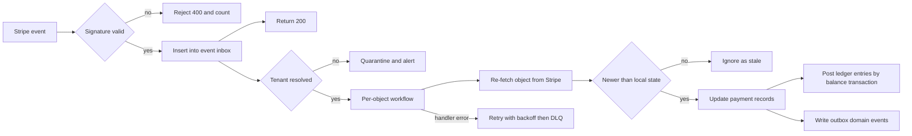

### 4.23 Payments provider abstraction [MVP foundation, additional providers V2+]

Rootline's invoicing, portal, crew app and ledger talk to a **Payments domain API**, never to Stripe directly. Stripe is the first adapter.

```text
interface PaymentProvider {
  id: 'stripe' | 'manual' | string
  capabilities(): ProviderCapabilities            // methods, countries, terminal, disputes API, fees model
  onboarding: { start(tenant): RedirectOrEmbed; status(account): AccountHealth }
  createPaymentSession(req: PaymentRequest): ClientSessionHandle   // client secret / hosted token
  finalizeAmount(session, methodPreview): AmountBreakdown          // surcharge / discount hook
  chargeSavedMethod(req: OffSessionCharge): PaymentResult
  createSetupSession(req: SetupRequest): ClientSessionHandle
  refund(req: RefundRequest): RefundResult
  getDispute(id): CanonicalDispute
  submitDisputeEvidence(id, packet: EvidencePacket): DisputeResult
  listBalanceEntries(range | payoutId): CanonicalBalanceEntry[]    // drives ledger posting
  listPayouts(range): CanonicalPayout[]
  parseWebhook(raw, headers): CanonicalEvent[]
  terminal?: { connectionToken(tenant): string; locations(): Location[] }
}
```

**Canonical models:** `PaymentAttempt`, `PaymentMethodRef` (provider token + display metadata + fingerprint), `Mandate`, `CanonicalBalanceEntry` (gross, fee lines, net, currency, category, payout ref), `CanonicalDispute`, `CanonicalPayout`. The ledger posting engine consumes only `CanonicalBalanceEntry`, so any future processor maps into the same clearing-account pattern.

**Built-in "manual" provider** handles cash, checks, money orders, external ACH/wire received outside Stripe, AP-portal payments from commercial clients, and lender settlements, so every payment in Rootline has a provider.

**Candidate future adapters (evaluation only, no commitment):** Adyen for Platforms (large multi-branch Companies), Square (Companies already on Square hardware), PayPal/Braintree (Venmo for residential tips), Canadian processors (e.g., Moneris, Helcim) for Canadian Companies wanting Interac-heavy acceptance, and Fiserv CardPointe/CardConnect for Companies migrating from tools that used it. Each must support Company-owned merchant accounts to be considered.

**Rules:** one active card processor per Company at a time (to keep autopay and reconciliation coherent); the manual provider is always available; switching processors runs a guided migration (new autopay consent where required, dual-run period for in-flight ACH).

### 4.24 Platform monetization and transparency

The commercial decision (prices, plan names, revenue model) is owned by [22](22-business-model-pricing-gtm.md). This section specifies the payments mechanics behind each option so the two docs stay consistent.

| Option | How it works | Pros | Cons | Priority |
|--------|-------------|------|------|----------|
| **A. Zero-Markup Pledge (default on every plan)** | Company pays Stripe directly; no `application_fee_amount` on any charge; Rootline earns only subscription and usage revenue ([22](22-business-model-pricing-gtm.md)) | Strongest trust story; simplest compliance; no conflict of interest; Stripe fees in the Company's Dashboard are the whole story | Leaves processing revenue (the incumbents' profit engine) on the table | [MVP] |
| **B. Pay-as-you-grow plan (opt-in)** | Company chooses a cheaper subscription (Starter at $39/month instead of $69/month on annual billing or $79/month on monthly billing, per [22](22-business-model-pricing-gtm.md)) plus a **0.5% application fee capped at $10.00 per payment**, taken as `application_fee_amount` on direct charges and shown in its own Stripe Dashboard and in Rootline's payout report | Aligns cost with usage for small and seasonal Companies; transparent by construction | Fee is on top of Stripe's fees; some Companies dislike any per-transaction fee; needs careful refund and dispute policy | [V1] |
| **C. Premium payments features in higher tiers** | Candidate only: surcharging engine, dispute automation, payment plans in upper tiers. Core pay-invoice, autopay, ACH and card-on-file stay on every tier (22's packaging table) | Monetizes value, not volume | Feature-gating money collection can feel punitive; 22 rejected a separate "Payments Plus" add-on for MVP | [V1] candidate, decision in 22 |
| **D. Lender referral revenue** | Financing partners pay a disclosed referral fee per funded loan | Revenue without touching Company margins | Must be disclosed; must not bias which lender is shown (ranking by approval odds and cost to the homeowner, never by referral fee) | [V2] (matches 22) |
| **E. Processor partner programs** | Negotiated partner economics with Stripe, if available | Revenue without Company cost | Must be disclosed in terms; cannot influence Company's pricing | [V2] |
| **F. Reselling instant payouts** | Not offered | N/A | Instant payouts (where Stripe makes them available) are configured by the Company in its own Dashboard at Stripe's price; Rootline does not add a markup | Not planned |

**Recommendation:** MVP ships with Option A and the public **Zero-Markup Pledge** from [22](22-business-model-pricing-gtm.md): *"Your clients pay you through your own Stripe account. Stripe's fees go to Stripe. We add nothing, unless you choose our pay-as-you-grow plan."* Option B launches in V1 as an **opt-in** plan. With the 22 numbers, pay-as-you-grow is cheaper for a Company processing less than about $6,000/month online ((69 - 39) / 0.005); Rootline tells the owner when they cross that line for 2 consecutive months and offers a one-click switch back.

**Fee mechanics (Option B) [V1]:**

| Rule | Behavior |
|------|----------|
| Fee base | Amount allocated to invoices, deposits and surcharges. **Tips are excluded** from the base (the crew's money is never fee'd by Rootline). |
| Cap | Fee = min(0.5% x base, $10.00) per payment, computed in minor units with banker's rounding; `payment_pricing_config` bounds (at most 100 bps, cap at most $25.00 unless enterprise) are enforced by 22's validation rules. |
| Method | Same rate for card and ACH; the $10.00 cap already prevents large ACH payments from being punished. |
| Partial refund | Application fee refunded pro rata (`refund_application_fee=true` with Stripe's proportional behavior). |
| Full refund or lost dispute | Full application fee returned. A Company never pays Rootline on money it did not keep. |
| Field payments | Same rule as online; Terminal PaymentIntents carry the same `application_fee_amount`. |
| Plan change | Takes effect at 00:00 Company local time the next day; never applied to PaymentIntents created before the change. |
| Restricted-key mode | Not available (no Connect relationship, so no application fees); Companies on that path stay on Option A. |
| Reporting | Monthly itemized fee statement; per-payout breakdown; ledger account 6152 Rootline Platform Fees (Example 9). |

> **Competitive edge.** Embedded-payments competitors earn margin they do not itemize, and Service Autopilot users report rate increases after their processor choice disappeared ([Capterra](https://www.capterra.com/compare/105508-122075/LawnPro-vs-Service-Autopilot)). On Rootline, any platform fee appears as a Stripe application fee in the Company's own Dashboard, so transparency is enforced by Stripe, not merely promised by Rootline. A Company can check Rootline's take against Stripe's own records at any time, which no vendor-owned payments product allows.

### 4.25 Rootline's own SaaS billing account [MVP]

Rootline bills Companies for their Rootline subscription through a **separate Stripe account** ("Rootline Billing"), distinct from the Connect platform account that orchestrates Company payments.

**Why separate:**

- Clean separation of Rootline's revenue from Company money flows; no chance of a code path confusing a Company's client payment with Rootline's own revenue.
- Different risk profiles, API keys, webhook endpoints, team access (platform_finance on Billing; platform_engineer on Connect) and audit scopes.
- Rootline's financial statements, revenue recognition and SaaS sales tax are computed from one account dedicated to them.

**Design:**

- Stripe Billing subscriptions per Company: base plan by tier, per-seat add-ons (office/estimator seats vs. field seats), add-on modules, and **AI credits** as metered usage reported from Rootline's AI Gateway ([17](17-ai-copilot-automation.md)) through usage meters, with monthly true-up.
- Annual and monthly plans (Starter, Grow, Pro, Enterprise); seasonal billing as defined in [22](22-business-model-pricing-gtm.md): Winter Mode for maintenance-only Companies (for example Dec-Feb at a reduced base price, monthly plans only; tenant state `winter_mode` in [19](19-platform-admin-portal.md)) and the Snow & Ice add-on billed only in snow months. AI credits included per tier and credit packs are also priced in 22.
- Stripe Tax for SaaS sales tax (US states that tax SaaS, Canadian GST/HST/QST); Rootline's own invoices and receipts branded Rootline.
- Payment methods for subscriptions: card, ACH, and invoice-with-terms for Enterprise.
- Smart retries and dunning on the Billing account; lifecycle events feed tenant state in the admin console ([19](19-platform-admin-portal.md)).
- **Principle: never hold a Company's client payments hostage for Rootline's bill.** Tenant lifecycle states and timings are owned by [19](19-platform-admin-portal.md) (PA-012) and [22](22-business-model-pricing-gtm.md): `past_due` (days 0-13) restricts nothing, `restricted` (days 14-29) blocks only growth features, `suspended` (days 30-59) makes office users read-only except invoicing, payments and AR, and day 60 unpaid becomes `churned`. Through `past_due`, `restricted`, `suspended` and seasonal `winter_mode`, the Customer Portal's pay links, statement pay and scheduled autopay keep working ("payments-only mode") so the Company's clients are not harmed and the Company can still collect the cash it needs to pay us. Autopay pre-notifications and receipts still send because they are part of the payment, not marketing.
- **At churn** the Company's Stripe account is untouched. Rootline (a) emails the owner a full export (open invoices, autopay roster with Stripe Customer and PaymentMethod IDs, mandates with consent evidence, payment history), (b) when churn came through non-payment, keeps the Customer Portal in payments-only mode until at least day 90 after the first failed Rootline payment ([19](19-platform-admin-portal.md) PA-012), then (or straight away after a voluntary cancellation) replaces pay pages with the Company's offline payment instructions for 90 more days, and (c) deauthorizes its Connect access only after that window or when the owner asks, whichever is first. The Company can keep charging its saved methods from its own Stripe Dashboard or a new platform, which is the Payments Portability Pledge in practice ([13](#13-beyond-the-brief-extra-ideas)).
- Future option [V2]: Accounts v2's `customer` configuration could let one Account object represent a Company as both connected merchant and Rootline customer; Rootline keeps billing on the separate account unless finance and security review approve unification (see [14](#14-open-questions)).

### 4.26 Company payment settings [MVP]

Settings > Payments contains:

| Setting | Default | Notes |
|---------|---------|-------|
| Stripe connection and health | Not connected | Section 4.2-4.4 |
| Online payment methods enabled | Card, wallets, Link, ACH | Per-context rules in 4.5 |
| Pass-through options | Surcharge off; ACH discount off | 4.10, compliance-gated |
| Autopay defaults | Agreement invoices only; charge 3 days after issue (card), 5 days (ACH) | 4.7 |
| Deposit policy | 30% for installs over $5,000; $0 for maintenance | 4.11 |
| Partial payments | On for invoices over $500 | 4.9 |
| Tips | Off (opt-in), presets 10/15/20% | 4.13 |
| Financing | Off; threshold $3,000 when on | 4.12 |
| Refund approval thresholds | $500 per refund, $2,000 per day for office manager | 4.16 |
| Statement descriptor and suffix strategy | Company name; suffix = invoice number | 4.2 |
| Receipt branding and photo inclusion | On, include last completion photo | 4.6 |
| Failed-payment notice templates and schedule | Day 0/3/7/14/21 after a failed charge (invoice reminder cadence is set in [07](07-invoicing-billing-contracts.md) 4.9.3) | 4.15 |
| Service hold threshold | 30 days past due; never for snow | 4.15 |
| Field payments | Off; crew leads only when on | 4.20 |
| Cash controls | $500 crew cash limit; photo required over $250 | 4.20 |
| Ledger posting granularity | Per payment | 4.17 |
| Offline payment instructions | Required before going live | 4.4 |

---

## 5. Key user flows

### 5.1 Create a new Stripe account (embedded or hosted onboarding)

1. Owner opens Settings > Payments and chooses "Create my Stripe account".
2. Rootline runs pre-flight checks (4.2.2) and creates the account with prefilled profile and Standard-equivalent configuration.
3. Rootline generates an Account Link (or renders embedded onboarding); owner completes identity, business and bank details with Stripe.
4. Stripe returns the owner to Rootline; Rootline re-fetches the account and evaluates requirements and capabilities.
5. Rootline registers payment method domains for the portal's custom domain and, if enabled, a Terminal Location.
6. Health becomes `active` (or `pending_verification`); owner sees the first-run checklist: offline payment instructions, autopay defaults, deposit policy.

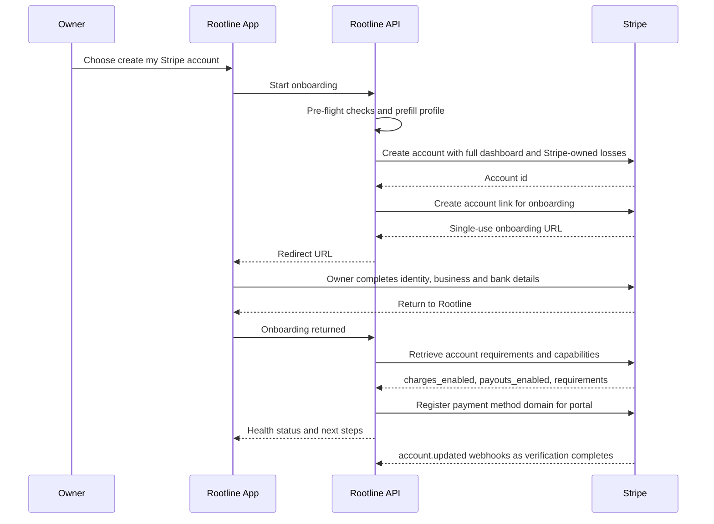

### 5.2 Link an existing Stripe account (OAuth)

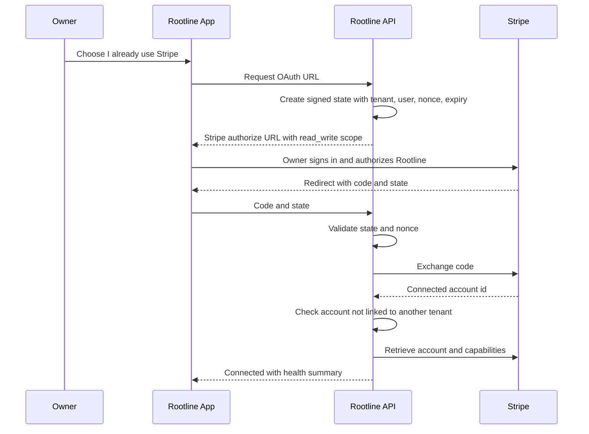

### 5.3 Client pays an invoice in the portal (with surcharge or ACH discount evaluation)

1. Client taps the pay link in an SMS; the portal shows the invoice, completion photos and amount due.
2. Client clicks Pay; Rootline creates (or reuses) a PaymentIntent on the connected account for the balance.
3. Client chooses a method in the Payment Element; the browser creates a ConfirmationToken.
4. Rootline's server inspects the token's payment method preview (type, card funding, country), applies the surcharge or ACH discount rules, updates the PaymentIntent amount, and returns the final breakdown.
5. Client sees the final amount (e.g., "$1,250.00 + $34.38 credit card surcharge" or "Bank payment discount -$25.00") and confirms.
6. Stripe processes; card results return immediately, ACH goes to `processing`.
7. Webhooks drive invoice status, receipts and ledger postings.

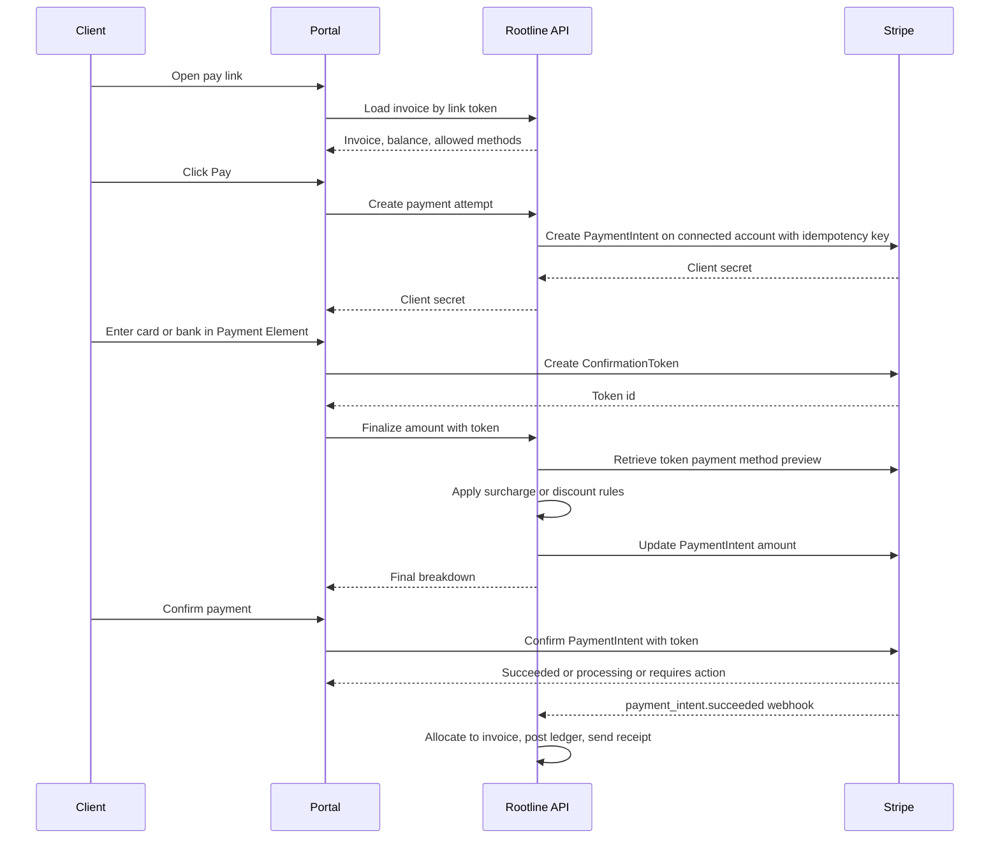

### 5.4 Autopay enrollment and an off-session charge

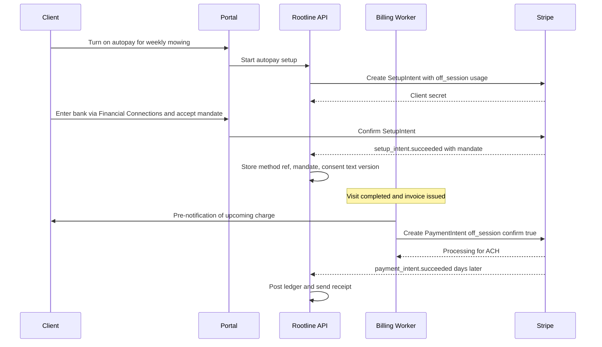

### 5.5 Proposal approval with deposit

1. Client reviews the Proposal (with Design and Mockup, see [10](10-design-studio.md) and [11](11-ai-design-mockups.md)), selects the "Better" option and add-ons.
2. Client e-signs; signature is committed (`accepted`), job becomes `sold_pending_deposit`.
3. Deposit step shows amount by policy (e.g., materials cost $6,140 on an $18,400 install) with methods, or financing if over threshold.
4. On success: Customer Deposits posted; job `sold`; scheduling and purchasing are triggered ([04](04-scheduling-dispatch-routing.md), [13](13-operations-inventory-equipment.md)).
5. If the client abandons the deposit: reminders on day 2 and day 7; estimator sees "signed, deposit pending" in the pipeline.

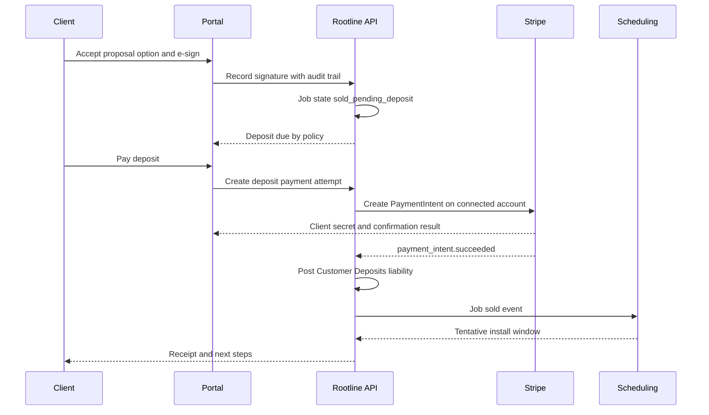

### 5.6 Field collection with Tap to Pay and tip

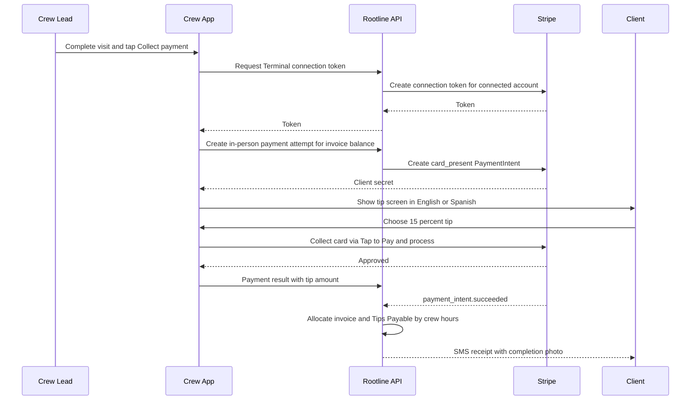

### 5.7 Dispute evidence auto-assembly

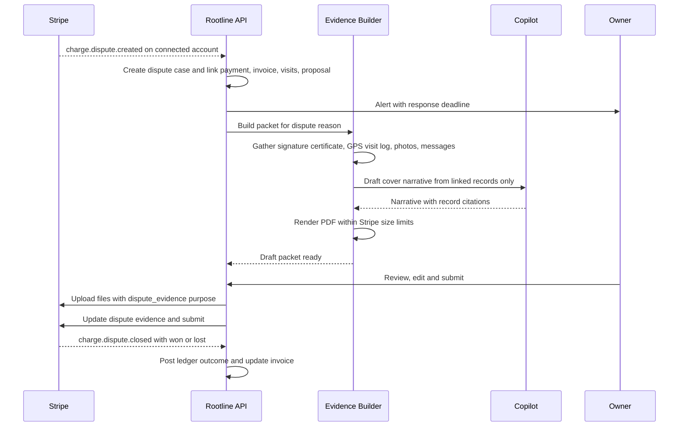

### 5.8 Payout reconciliation

1. Stripe creates a payout on the Company's schedule (e.g., daily, 2-day rolling).
2. On `payout.paid`, Rootline lists the payout's balance transactions on the connected account, verifies they net to the payout amount and that each is already posted (posting any missing ones).
3. Rootline posts Dr Bank / Cr Stripe Clearing.
4. Bank feed import ([09](09-accounting-ledger-integrations.md)) matches the bank credit to the payout; bookkeeper sees "Payout matched" with a drill-down to every invoice and fee inside it.
5. Exceptions (amount mismatch, missing bank line after 5 business days, `payout.failed`) create tasks.

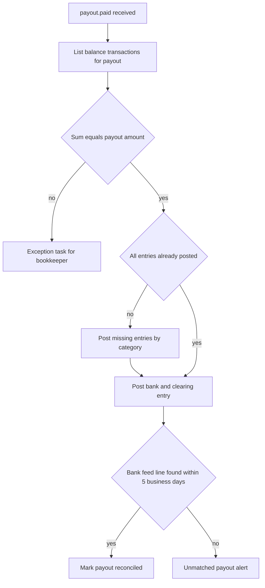

### 5.9 Payment attempt lifecycle (internal state machine)

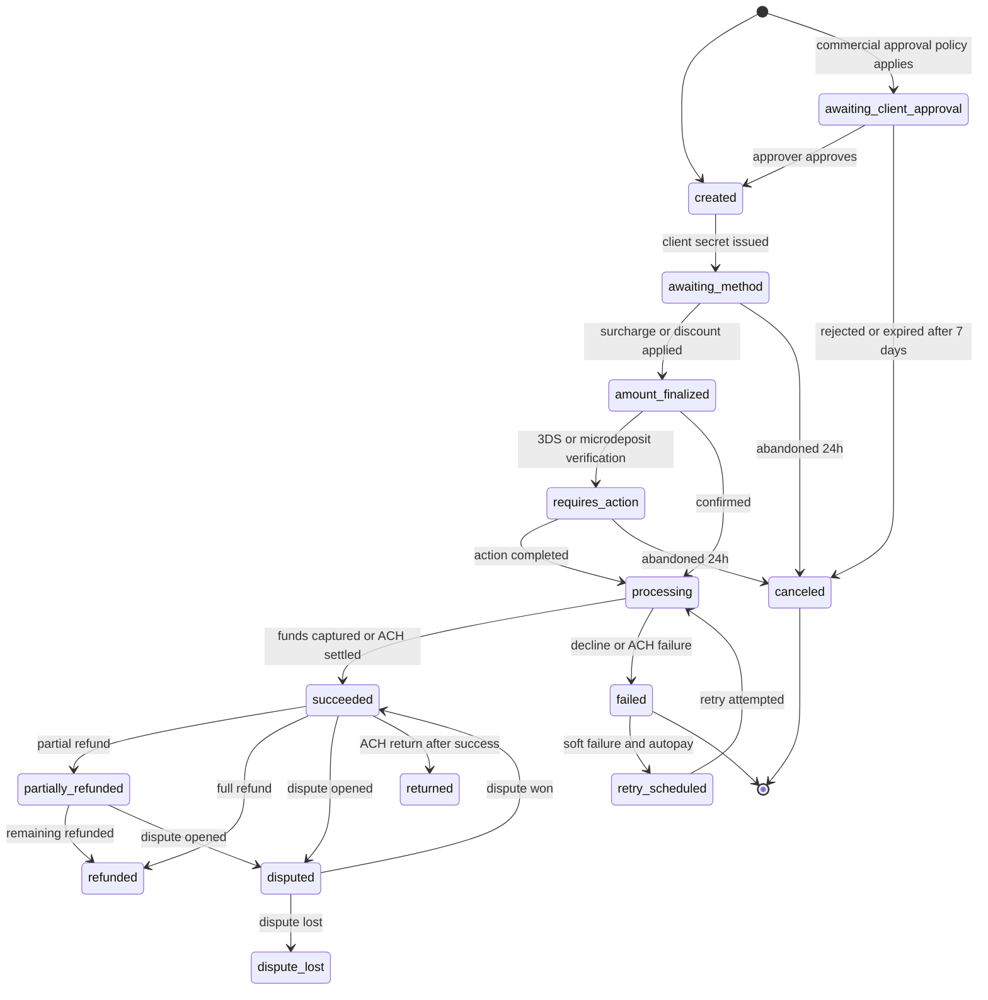

### 5.10 Refund with approval routing

1. Office manager opens a payment and chooses Refund, picking lines or an amount and a reason code.
2. If the amount exceeds the office manager's threshold, the owner gets a push notification and approves in one tap.
3. Rootline issues a credit memo, then calls the Refunds API on the connected account with an idempotency key.
4. Webhooks confirm the refund; ledger posts; the client gets a branded refund receipt with expected timing (cards a few business days, bank refunds longer).

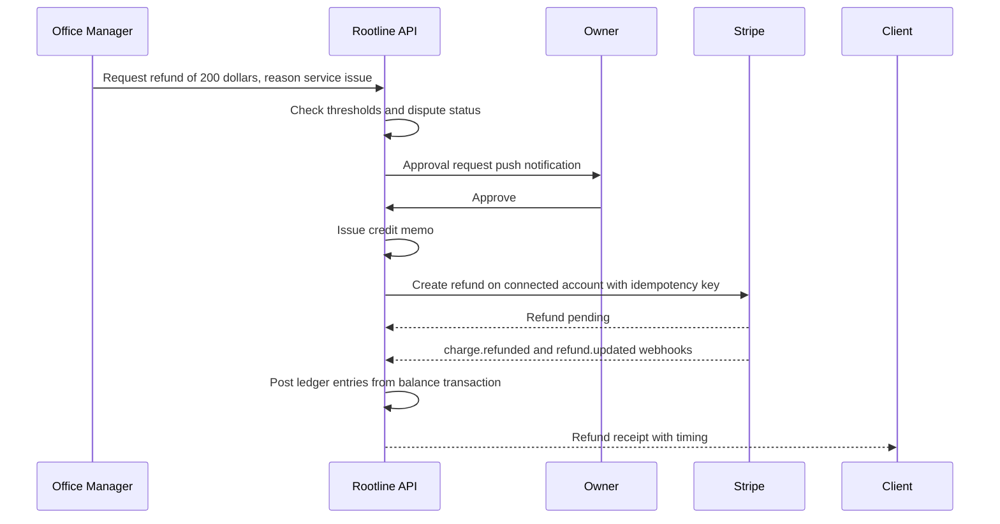

### 5.11 Milestone installment on a payment plan

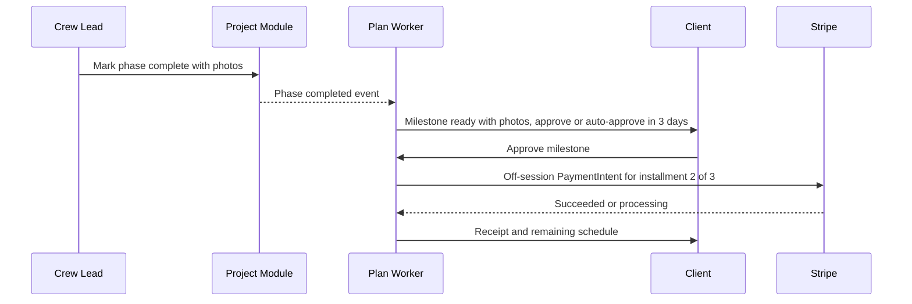

### 5.12 Commercial statement pay: multi-invoice, partial, ACH, two approvers (pay link or QR)

Crossroads Property Management (9 HOA properties) receives a monthly statement with a QR code. The AP clerk (billing contact) selects 14 of 17 open invoices, short-pays one disputed invoice, and needs a second approver for payments over $5,000. Payment approval thresholds are a [V1] extension of the commercial approval chains in [06](06-customer-portal.md), configured by the Client (Crossroads uses its VP as approver above $5,000, mirroring the example in [02](02-personas-roles-permissions.md)).

1. AP clerk scans the statement QR or taps the emailed link; the link token resolves to the statement, and a one-time code to the clerk's email unlocks invoice detail.
2. Clerk selects invoices, enters $1,180.00 against a $1,400.00 invoice with a reason ("Irrigation repair at Lot 7 under review"), and chooses ACH.
3. Rootline computes allocations (selected invoices first, partial last), checks the Client's approval policy, and parks the payment as `awaiting_client_approval` because $9,860.00 is over the $5,000.00 threshold. No PaymentIntent exists yet, so nothing can be charged by mistake; the parked request expires after 7 days.
4. The approver gets a portal notification and approves; only then is the PaymentIntent created and confirmed with the saved ACH mandate.
5. The short-paid invoice moves to `partially_paid` with the client's reason attached and an office task; dunning pauses on it for 14 days.
6. Remittance (CSV and PDF) is available immediately for the client's AP system.

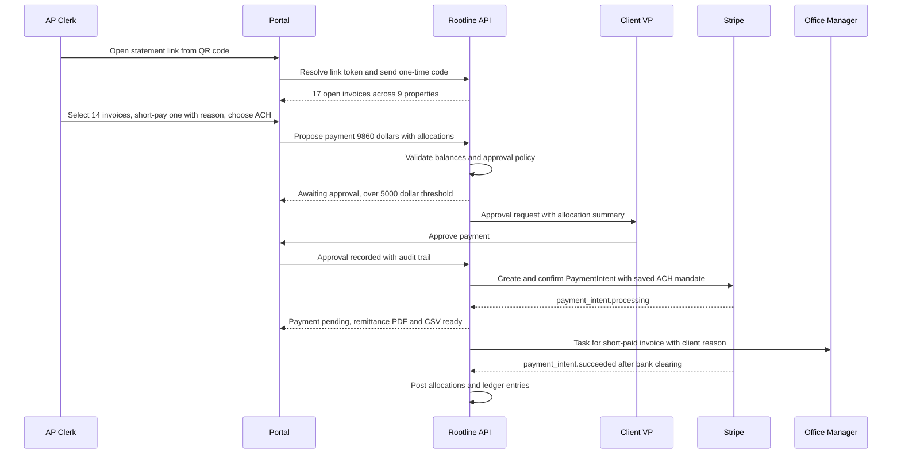

### 5.13 Consumer financing from a proposal

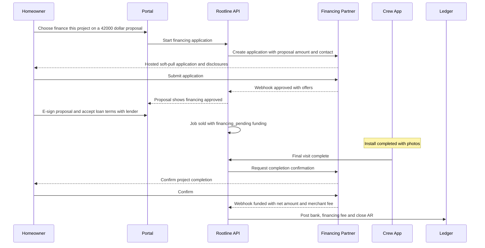

### 5.14 Failed autopay: retry, card update and dunning

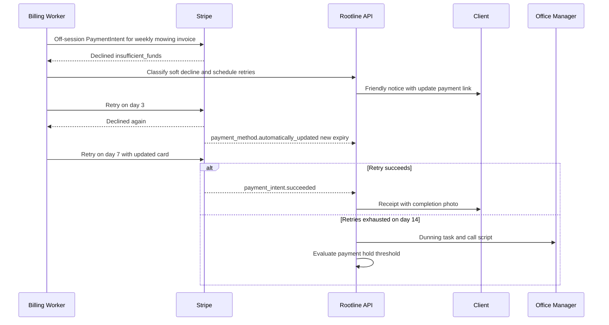

### 5.15 Disconnection and degraded mode

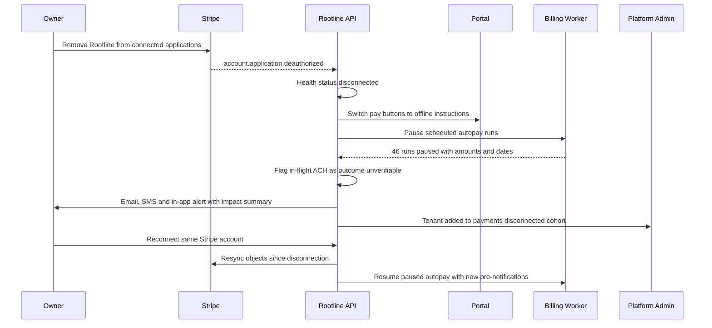

---

## 6. Screens and wireframes

### 6.1 Screen inventory

| # | Screen | Surface | Primary roles | Priority |
|---|--------|---------|---------------|----------|
| S1 | Settings > Payments > Stripe connection and health | Company web | `owner` | [MVP] |
| S2 | Payments settings (methods, autopay, deposits, tips, surcharge, dunning) | Company web | `owner`, `office_manager` | [MVP] |
| S3 | Payments list and payment detail timeline | Company web | `office_manager`, `bookkeeper` | [MVP] |
| S4 | Take a payment (office): text a pay link, charge a saved method, record cash/check; MOTO card entry [V1] | Company web | `office_manager` | [MVP] |
| S5 | Refund dialog with approval routing | Company web + mobile push | `office_manager`, `owner` | [MVP] |
| S6 | Disputes queue and dispute workspace | Company web | `owner`, `office_manager` | [MVP] |
| S7 | Payouts and reconciliation | Company web | `bookkeeper`, `owner` | [MVP] |
| S8 | Autopay roster (who is enrolled, failures, expiring methods) | Company web | `office_manager` | [MVP] |
| S9 | Deposit batches and check register | Company web | `office_manager`, `bookkeeper` | [MVP] |
| S10 | Portal: pay invoice / pay statement | Customer portal | `client_residential`, `client_commercial` | [MVP] |
| S11 | Portal: billing and autopay settings | Customer portal | Clients, billing contacts | [MVP] |
| S12 | Portal: proposal deposit step / financing | Customer portal | Clients | [MVP] / [V1] |
| S13 | Crew app: collect payment, tip, receipt | Crew mobile | `crew_lead` | [V1] |
| S14 | Crew app: record cash/check, end-of-day handover | Crew mobile | `crew_lead` | [MVP] |
| S15 | Platform admin: payments ops (account health, webhooks, DLQ, compliance rules) | Platform admin | `platform_owner`, `platform_engineer`, `platform_support` | [MVP] |
| S16 | Platform admin: SaaS billing | Platform admin | `platform_finance` | [MVP] |
| S17 | Switch Kit: payment-method migration tracker (import from previous processor, re-collection campaign) | Company web + Platform admin | `owner`, `office_manager`, `platform_support` | [V1] |
| S18 | Portal: commercial payment approval (approve, reject, comment) | Customer portal | `client_commercial` approvers | [V1] |
| S19 | Payments compliance report (surcharge audit, mandate evidence, refund log) | Company web | `owner`, `bookkeeper` | [V1] |

### 6.2 Wireframe: Settings > Payments > Stripe connection and health

```text
+---------------------------------------------------------------------------------------+
| Greenleaf Grounds Co.           Settings > Payments                    [?] Help       |
+---------------------------------------------------------------------------------------+
| STRIPE CONNECTION                                                                     |
|  Status:  (*) ACTIVE - action needed by Jun 14                                        |
|  Account: Greenleaf Grounds Co.     acct_...7Qw2   Country: US   Currency: USD        |
|  Mode:    Connected via Stripe (you own this account)   [Open Stripe Dashboard ->]    |
|                                                                                       |
|  ! Stripe needs: Business representative ID document (due Jun 14, 11 days)            |
|    If not provided, card payments pause; 46 autopay charges fall after Jun 14.        |
|    [Resolve with Stripe]                                                              |
|                                                                                       |
| CAPABILITIES                          FEES (last 30 days, from Stripe)                |
|  [x] Cards and wallets   active        Processed        $84,310.22                    |
|  [x] ACH Direct Debit    active        Stripe fees       $1,742.18  (2.07% effective) |
|  [x] Link                active        Rootline fees         $0.00  (no markup)       |
|  [ ] Canadian PAD        n/a (US)      Disputes            1 open / 0.09% rate        |
|  [ ] Tap to Pay          [Set up]      Next payout       $3,339.32 on Tue Jun 4       |
|                                                                                       |
| OFFLINE INSTRUCTIONS (shown if payments are unavailable)              [Edit]          |
|  "Mail checks to 118 Orchard Rd, Ames IA 50010 or call (515) 555-0142"                |
|                                                                                       |
| DANGER ZONE                                                                           |
|  [Disconnect Stripe]  Your Stripe account, clients' saved cards and history stay      |
|                       with you. Autopay will pause until you reconnect.               |
+---------------------------------------------------------------------------------------+
```

### 6.3 Wireframe: Portal pay invoice (mobile)

```text
+------------------------------------+
| [logo] Greenleaf Grounds Co.       |
|------------------------------------|
| Invoice 10482          Due Jun 10  |
| 14 Birch Ln - Spring cleanup       |
|  Spring cleanup             $780.00|
|  Mulch, dbl shred, 6 cu yd  $470.00|
|  -------------------------------   |
|  Balance due              $1,250.00|
|  [photo] [photo] [photo]  Completed|
|  May 28 by Crew Blue (3)           |
|------------------------------------|
| Pay  (o) Full $1,250.00            |
|      ( ) Other amount  [______]    |
|                                    |
| [ Apple Pay ]                      |
| ---------- or ----------           |
| ( ) Card   (o) Bank account        |
|  Bank payment saves you $25.00     |
|  [ Link your bank (instant) ]      |
|                                    |
| [x] Save for future invoices and   |
|     turn on autopay                |
|                                    |
| Total today              $1,225.00 |
| [        Pay $1,225.00         ]   |
| Secured by Stripe. Greenleaf never |
| sees your card or bank details.    |
|  Add a tip for Crew Blue? [Yes]    |
+------------------------------------+
```

### 6.4 Wireframe: Crew app collect payment with tip (client-facing, Spanish toggle)

```text
+------------------------------------+
| < Visit V-88213   [EN | ES]        |
|------------------------------------|
|  Martin - 14 Birch Ln              |
|  Weekly mow + edge + blow          |
|  Amount due            $300.00     |
|------------------------------------|
|  Add a tip for your crew?          |
|  [10% $30] [*15% $45*] [20% $60]  |
|  [ Custom ]   [ No tip ]           |
|------------------------------------|
|  Total                 $345.00     |
|                                    |
|     ))) Hold card or phone near    |
|         the top of this device     |
|                                    |
|  [ Cancel ]                        |
|------------------------------------|
|  Cash or check instead? [Record]   |
+------------------------------------+
```

### 6.5 Wireframe: Dispute workspace

```text
+-------------------------------------------------------------------------------------------+
| Disputes > DP-0031  $650.00  Reason: Service not provided   Respond by Jul 2, 5:59 PM CT  |
| Client: R. Okafor (14 Elm Ct)   Charge: Visa ...4242 Apr 30   Status: NEEDS RESPONSE       |
| Evidence score 90/100   Fees so far $15.00   Recommendation: COUNTER   Responder: Rootline |
+-------------------------------------------------------------------------------------------+
| EVIDENCE PACKET (auto-built 6 min after dispute)           | PREVIEW (PDF, 9 pages, 3.1MB) |
|  [x] Signed agreement 2026 Maintenance (e-sign cert)       | +---------------------------+ |
|  [x] Visit log Apr 28: Crew Red, 8:02-8:51 AM, GPS inside  | | Service Evidence Report   | |
|      property boundary (map)                               | | Greenleaf Grounds Co.     | |
|  [x] 6 before/after photos (timestamped, geotagged)        | | Timeline ...              | |
|  [x] "Visit complete" SMS delivered Apr 28 8:53 AM         | | [map] [photos]            | |
|  [x] Portal: client viewed invoice May 1 (IP match)        | +---------------------------+ |
|  [ ] Phone call notes (none found)                         |                               |
|  [+ Add file]                                              | Narrative (AI draft, edit):   |
|                                                            | "On April 28, 2026, Crew Red  |
| Stripe fields: service_date = 2026-04-28                   | performed the spring cleanup  |
|   service_documentation = report.pdf                       | at 14 Elm Ct as agreed in the |
|   customer_signature = agreement.pdf                       | signed 2026 agreement [1]..." |
|   customer_communication = messages.pdf                    |                               |
+-------------------------------------------------------------------------------------------+
| [Accept dispute]                    [Save draft]           [Submit evidence (final)]      |
+-------------------------------------------------------------------------------------------+
```

### 6.6 Wireframe: Payouts and reconciliation

```text
+------------------------------------------------------------------------------------------+
| Payouts                                 USD   Range: Jun 1 - Jun 30     [Export CSV]       |
+------------------------------------------------------------------------------------------+
| Date    Payout id     Amount      Gross       Fees     Refunds  Disputes  Bank match       |
| Jun 4   po_...a91     3,339.32    3,645.00   105.68    200.00      0.00   [x] Jun 6        |
| Jun 5   po_...b27     5,515.00    5,520.00     5.00      0.00      0.00   [x] Jun 7        |
| Jun 6   po_...c55     1,839.10    2,580.00    75.90      0.00    665.00   [x] Jun 10       |
| Jun 9   po_...d03       812.44      840.00    27.56      0.00      0.00   [ ] pending      |
+------------------------------------------------------------------------------------------+
| po_...a91 detail                                                                           |
|  Inv 10482  Martin        card    1,250.00   fee 36.55   net 1,213.45   JE-22871 posted     |
|  Inv 10477  Chen (tap)    card      340.00   fee  9.23   net   330.77   JE-22872 (tip 40)   |
|  Inv 10469  Diaz          card    2,055.00   fee 59.90   net 1,995.10   JE-22873 (surch.)   |
|  Rfd 10482  Martin        refund   -200.00              net  -200.00   JE-22880            |
|  Sum of net = 3,339.32 = payout amount   [check] Clearing proof OK                        |
+------------------------------------------------------------------------------------------+
```

### 6.7 Wireframe: Portal proposal acceptance, deposit and financing (mobile)

```text
+------------------------------------+
| [logo] Greenleaf Grounds Co.       |
|------------------------------------|
| Proposal P-2291  Backyard refresh  |
| Option chosen: BETTER   $18,400.00 |
|  Paver patio 420 sq ft, seat wall  |
|  Low-voltage lighting (8 fixtures) |
|  [x] Signed by Dana Martin 10:42 AM|
|------------------------------------|
| Deposit to schedule your install   |
|  Materials deposit      $6,140.00  |
|  (pavers, wall block, plants;      |
|   applied to your first invoice)   |
|                                    |
| ( ) Card / Apple Pay               |
| (o) Bank account (no fee to you)   |
|     [ Link your bank (instant) ]   |
|                                    |
| [      Pay deposit $6,140.00     ] |
|------------------------------------|
| Or pay monthly                     |
|  As low as $219/mo with <Lender>   |
|  Checking won't affect your credit |
|  score. Terms from the lender.     |
|  [ See if you qualify ]            |
|------------------------------------|
| Deposit refund terms (signed):     |
|  Full refund until materials are   |
|  ordered; non-refundable after.    |
+------------------------------------+
```

The "as low as" figure is rendered only from lender-supplied, compliant values (4.12); if the lender API is unavailable, the financing block hides rather than showing a stale number.

### 6.8 Wireframe: Autopay roster (office)

```text
+-------------------------------------------------------------------------------------------+
| Autopay roster      Enrolled 412 / 588 agreement clients (70%)   [Send enrollment links]  |
| Filters: [All] [Failing 9] [Expiring 30d 14] [Paused 0] [Over cap 3] [Not enrolled 176]   |
+-------------------------------------------------------------------------------------------+
| Client          Scope           Method        Next charge        Status          Action   |
| Martin, D.      Agreements      Visa ..4242   Jun 3  $189.00      OK              [...]   |
| Okafor, R.      All invoices    ACH ..6789    Jun 5  $96.00       OK              [...]   |
| Chen, L.        Agreements      MC ..5100     Jun 3  $189.00      Expires 06/26   [Nudge] |
| Diaz Prop LLC   Property A only ACH ..1122   Jun 7  $1,240.00    Over cap $1,000 [Ask]   |
| Patel, S.       Agreements      Visa ..0005   retry Jun 4         Soft decline 2/4 [Call] |
| Rivera, J.      Agreements      ACH ..3301   -                    R10 revoked     [Task]  |
+-------------------------------------------------------------------------------------------+
| Last 30 days: 1,604 autopay charges, 98.1% first-attempt success, $6,210 recovered by     |
| retries, 0 charges outside notice window.     Copilot: "Text the 14 expiring cards today" |
+-------------------------------------------------------------------------------------------+
```

---

## 7. Data model

All tables carry `tenant_id` with Postgres row-level security ([20](20-architecture-security.md)); money is stored as integer minor units (`amount_minor`) with an ISO `currency`; Stripe IDs are stored verbatim for traceability. Rootline never stores PAN, CVC, full bank account numbers or track data.

### 7.1 Entities

| Entity | Purpose | Key fields |
|--------|---------|-----------|
| `payment_account` | A Company's connection to a provider | `provider`, `provider_account_id` (acct_), `connection_method` (oauth, account_link, embedded, restricted_key), `api_generation` (v1_controller, v2_config), `country`, `default_currency`, `health_status`, `charges_enabled`, `payouts_enabled`, `requirements_json`, `connected_at`, `disconnected_at`, `disconnect_reason` |
| `payment_account_capability` | Capability snapshot | `capability`, `status`, `requested_at`, `updated_at` |
| `payment_account_health_event` | Audit of health changes | `from_status`, `to_status`, `reason_code`, `stripe_event_id` |
| `provider_credential` | Encrypted RAK / webhook secrets (advanced mode) | `kind`, `ciphertext`, `encrypted_dek`, `kms_key_id`, `key_version`, `last4`, `validated_scopes`, `last_validated_at`, `revoked_at` |
| `payment_customer_ref` | Rootline Client/Contact to Stripe Customer on the connected account | `client_id`, `contact_id`, `provider_customer_id` |
| `payment_method_ref` | Saved method reference, never raw data | `provider_payment_method_id`, `type`, `brand`, `last4`, `exp_month`, `exp_year`, `bank_name`, `funding`, `fingerprint`, `status` (active, expired, disabled), `is_default` |
| `mandate` | Autopay / ACH / PAD authorization | `provider_mandate_id`, `payment_method_ref_id`, `type`, `status`, `consent_text_version`, `accepted_by_contact_id`, `accepted_ip`, `accepted_user_agent`, `accepted_at`, `pad_payment_schedule`, `pad_transaction_type`, `revoked_at` |
| `autopay_enrollment` | What gets auto-charged | `client_id`, `scope` (all, agreements, properties), `property_ids`, `per_invoice_cap_minor`, `charge_timing_rule`, `status` |
| `payment_attempt` | Rootline wrapper around a PaymentIntent | `provider_payment_intent_id`, `channel` (portal, office, field, autopay, plan), `status`, `amount_minor`, `surcharge_minor`, `discount_minor`, `tip_minor`, `currency`, `initiated_by`, `idempotency_key`, `failure_code`, `next_retry_at`, `attempt_no` |
| `payment` | A successful money receipt (any provider including manual) | `payment_attempt_id`, `provider`, `method_type`, `amount_minor`, `received_at`, `status` (succeeded, partially_refunded, refunded, disputed, returned), `deposit_batch_id` |
| `payment_allocation` | Splits a payment across invoices, deposits, tips, credits | `payment_id`, `target_type` (invoice, deposit, tip, unapplied_credit), `target_id`, `amount_minor` |
| `refund` | Refund record | `payment_id`, `provider_refund_id`, `amount_minor`, `reason_code`, `credit_memo_id`, `approved_by`, `status` |
| `dispute` | Dispute case | `payment_id`, `provider_dispute_id`, `reason`, `status`, `amount_minor`, `due_by`, `evidence_submitted_at`, `outcome`, `auto_submit`, `responder` (rootline, stripe_automation, manual_in_stripe), `evidence_score`, `recommendation` (counter, accept), `fees_incurred_minor` |
| `dispute_evidence_item` | Packet contents | `dispute_id`, `kind`, `source_record_type`, `source_record_id`, `stripe_field`, `file_id`, `included` |
| `balance_entry` | Canonical balance transaction | `provider_balance_txn_id`, `category`, `amount_minor`, `fee_minor`, `net_minor`, `currency`, `exchange_rate`, `source_object_id`, `payout_id`, `available_on`, `journal_entry_id` |
| `payout` | Provider payout | `provider_payout_id`, `amount_minor`, `currency`, `arrival_date`, `status`, `bank_feed_txn_id`, `reconciled_at` |
| `payment_plan` / `payment_plan_installment` | Installment schedules (shared with [07](07-invoicing-billing-contracts.md), which creates past-due collections plans) | `invoice_id` or `proposal_id`, `plan_type` (milestone, calendar, collections), `installment_no`, `due_on`, `amount_minor`, `trigger` (date, milestone), `status`, `payment_attempt_id` |
| `tip_allocation` | Tip split | `payment_id`, `visit_id`, `employee_id`, `amount_minor`, `method` (hours, equal, manual), `payroll_export_id` |
| `pay_link` | Signed links/QR | `token_hash`, `target_type`, `target_id`, `expires_at`, `last_opened_at`, `open_count` |
| `surcharge_rule_set` (platform-level) | Versioned compliance rules | `jurisdiction`, `rule_type`, `max_rate_bps`, `effective_from`, `effective_to`, `source_url`, `approved_by` |
| `fee_policy` (tenant) | Company's surcharge/discount config | `surcharge_rate_bps`, `acquirer_notice_date`, `ach_discount_bps`, `autopay_discount_minor`, `status` |
| `deposit_batch` / `check_item` | Cash/check handling | `batch_no`, `total_minor`, `deposited_at`, `bank_feed_txn_id`; `check_number`, `payer_name`, `micr_last4`, `image_file_ids`, `ocr_confidence` |
| `payment_approval_request` [V1] | Commercial client approval before a payment is created | `client_id`, `requested_by_contact_id`, `approver_contact_id`, `amount_minor`, `allocations_json`, `status` (pending, approved, rejected, expired), `expires_at`, `payment_attempt_id` |
| `surcharge_decision` | Audit trail of every surcharge/discount evaluation | `payment_attempt_id`, `rule_set_version`, `card_funding`, `card_country`, `company_jurisdiction`, `property_jurisdiction`, `rate_bps`, `display_mode`, `result` (applied, blocked_reason) |
| `payment_migration_batch` / `payment_migration_item` [V1] | Switch Kit imports from a previous processor | `source_system`, `requested_at`, `stripe_request_ref`, `status`; per item: `legacy_customer_ref`, `client_id`, `provider_payment_method_id`, `fingerprint`, `outcome` (imported, duplicate, recollect_needed), `recollect_link_id` |
| `financing_application` | Partner financing | `provider`, `proposal_id`, `status`, `approved_amount_minor`, `funded_amount_minor`, `merchant_fee_minor` |
| `stripe_event` | Raw webhook inbox (name shared with [20](20-architecture-security.md)) | `stripe_event_id` (unique), `endpoint`, `account_id`, `type`, `api_version`, `payload_json`, `received_at`, `processed_at`, `status` (received, processed, ignored_stale, quarantined, dead_lettered), `error` |

### 7.2 Entity relationships

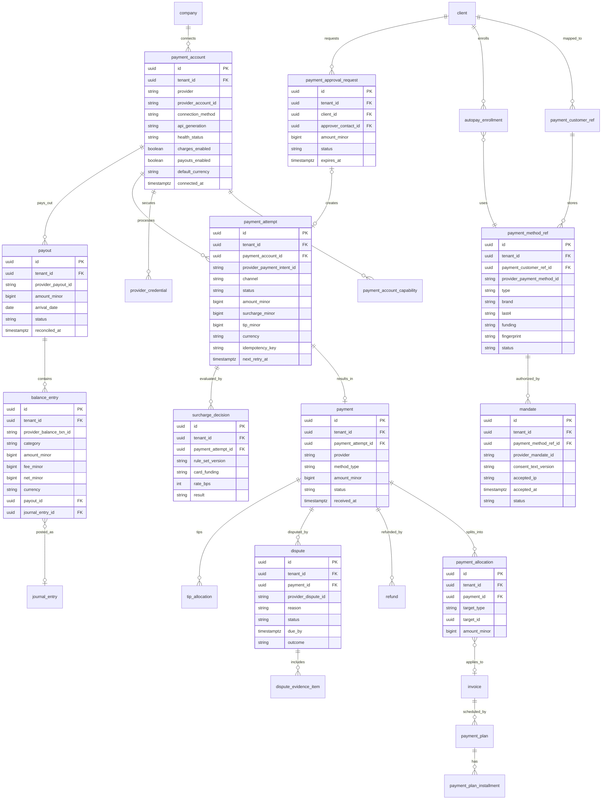

**Key constraints:** unique `(provider, provider_account_id)` across tenants (with admin-approved exceptions); unique `stripe_event.stripe_event_id`; unique `balance_entry.provider_balance_txn_id`; `payment_allocation` sum per payment equals `payment.amount_minor` (deferred constraint check); `payment_attempt.idempotency_key` unique per tenant; Contacts deleted under privacy requests keep payment records with pseudonymized names (financial records retention, see [11](#11-edge-cases-compliance-and-risks)).

---

## 8. Integrations, APIs and events

### 8.1 External services

| Service | Use | Priority |
|---------|-----|----------|
| Stripe Connect (OAuth, Account Links, Accounts v1/v2, embedded components) | Connection, onboarding, health | [MVP] |
| Stripe Payments (PaymentIntents, SetupIntents, ConfirmationTokens, Payment Element, Customers, PaymentMethods, Mandates, Refunds, Disputes, Files) | Money movement | [MVP] |
| Stripe Financial Connections | Instant ACH verification | [MVP] |
| Stripe Balance, Balance Transactions, Payouts, Events | Reconciliation and replay | [MVP] |
| Stripe Terminal (Tap to Pay iPhone/Android, readers, Locations, connection tokens) | Field payments | [V1] |
| Stripe Billing, Stripe Tax, usage meters (Rootline's separate billing account) | SaaS subscriptions | [MVP] |
| Plaid (or similar) bank feeds | Payout and deposit matching ([09](09-accounting-ledger-integrations.md)) | [MVP] |
| AWS KMS (or cloud equivalent) and secrets manager | Key custody | [MVP] |
| Financing partners (e.g., Wisetack; others by RFP) | Consumer financing | [V1] |
| Twilio / Postmark | Receipts, pre-notifications, dunning ([16](16-marketing-growth-communications.md)) | [MVP] |
| RDC banking partner | Remote check deposit | [V2] |
| QuickBooks Online / Xero | Payment, fee and payout export when external books are system of record ([09](09-accounting-ledger-integrations.md)) | [MVP] for QBO, [V1] Xero |

### 8.2 Stripe webhook events consumed

| Group | Events (v1 names; v2 thin-event equivalents for Accounts v2, verify names) |
|-------|-------------------------------------------------------------|
| Account and connection | `account.updated`, `account.application.authorized`, `account.application.deauthorized`, `capability.updated`, `account.external_account.updated`; v2 account and requirements update events, merchant-configuration capability status events |
| PaymentIntents | `payment_intent.created`, `payment_intent.processing`, `payment_intent.requires_action`, `payment_intent.succeeded`, `payment_intent.payment_failed`, `payment_intent.canceled`, `payment_intent.amount_capturable_updated` |
| Charges and refunds | `charge.succeeded`, `charge.failed`, `charge.refunded`, `charge.refund.updated`, `refund.created`, `refund.updated`, `refund.failed` |
| Disputes | `charge.dispute.created`, `charge.dispute.updated`, `charge.dispute.closed`, `charge.dispute.funds_withdrawn`, `charge.dispute.funds_reinstated` |
| Setup and mandates | `setup_intent.succeeded`, `setup_intent.setup_failed`, `setup_intent.requires_action`, `mandate.updated`, `payment_method.attached`, `payment_method.detached`, `payment_method.updated`, `payment_method.automatically_updated` |
| Payouts and balance | `payout.created`, `payout.paid`, `payout.failed`, `payout.canceled`, `balance.available` |
| Terminal | `terminal.reader.action_succeeded`, `terminal.reader.action_failed` |
| Financial Connections | `financial_connections.account.disconnected`, `financial_connections.account.deactivated` |
| Fraud | `review.opened`, `review.closed`, `radar.early_fraud_warning.created` |
| Platform fees (Option B, pay-as-you-grow) | `application_fee.created`, `application_fee.refunded` on the platform endpoint |
| SaaS billing account (separate) | `customer.subscription.*`, `invoice.paid`, `invoice.payment_failed`, `invoice.finalized`, billing meter error events |

`radar.early_fraud_warning.created` is treated as a **dispute precursor**: Rootline suggests a proactive refund for small amounts (default under $100) to avoid a dispute fee and a dispute-rate hit.

### 8.3 Domain events emitted and consumed

**Emitted (via transactional outbox):** names below carry this module's `payments.` prefix (and consumed events the producer's prefix, such as `invoicing.`). The schema registry registers one name per event, the unprefixed name from [20](20-architecture-security.md) 4.9.3 where one exists: `payments.payment.succeeded` is `payment.succeeded`, `payments.dispute.opened` is `dispute.created`, `payments.refund.completed` is `payment.refunded`, `payments.payout.paid` is `payout.paid`, and `invoicing.invoice.issued` is [07](07-invoicing-billing-contracts.md)'s `invoice.issued`.

| Event | Key payload | Typical consumers |
|-------|-------------|-------------------|
| `payments.account.connected` / `.health_changed` / `.disconnected` | account, status, reasons | Notifications, platform admin, portal |
| `payments.attempt.created` / `.failed` / `.requires_action` | attempt, failure class | Dunning, copilot, analytics |
| `payments.payment.succeeded` | payment, allocations | Invoicing (status), ledger, receipts, scheduling (holds released), analytics |
| `payments.payment.pending` | attempt, expected clear date | Invoicing (pending badge), dunning pause |
| `payments.payment.returned` | payment, return code | Invoicing (reopen), collections |
| `payments.refund.completed` / `.failed` | refund, credit memo | Invoicing, ledger, notifications |
| `payments.dispute.opened` / `.evidence_ready` / `.closed` | dispute, outcome | Owner alerts, ledger, CRM (client risk flag) |
| `payments.autopay.enrolled` / `.disabled` | client, method, reason | CRM, agreements |
| `payments.method.expiring` | client, method, expiry | Communications |
| `payments.payout.paid` / `.reconciled` / `.failed` | payout, totals | Ledger, bookkeeper tasks |
| `payments.client.payment_hold` / `.payment_hold_released` | client, days past due | Scheduling/dispatch ([04](04-scheduling-dispatch-routing.md)) |
| `payments.tip.allocated` | visit, employees, amounts | Payroll exports ([15](15-team-hr-payroll.md)), crew app |
| `payments.deposit.received` | proposal, job | Jobs, scheduling, purchasing |
| `payments.approval.requested` / `.decided` [V1] | approval request, approver, decision | Customer portal notifications, CRM timeline |
| `payments.account.balance_negative_forecast` | account, projected shortfall, date | Owner alerts, cash-flow forecast ([18](18-reporting-analytics.md)) |
| `payments.fraud.card_testing_detected` | link or tenant scope, attempts, containment action | Owner alerts, platform fraud board ([19](19-platform-admin-portal.md)) |

**Consumed:**

| Event | Producer | Payments reaction |
|-------|----------|-------------------|
| `invoicing.invoice.issued` | [07](07-invoicing-billing-contracts.md) | Create pay link; schedule autopay attempt and pre-notification |
| `invoicing.invoice.voided` / `.credit_memo.issued` | 07 | Cancel open attempts; prompt refund if paid |
| `proposals.proposal.accepted` | [03](03-crm-sales-estimating-proposals.md) | Start deposit flow |
| `visit.completed` | [04](04-scheduling-dispatch-routing.md), [05](05-field-crew-mobile-app.md) | Enable field collection; attach evidence to related payments |
| `phase.completed` / `milestone.reached` ([04](04-scheduling-dispatch-routing.md) Job phases and milestones), `project_phase.completed` ([14](14-service-line-modules.md) design-build projects) | [04](04-scheduling-dispatch-routing.md), [14](14-service-line-modules.md) | Trigger milestone installment (the plan's `trigger` names the phase or milestone; whichever event arrives first for it fires the installment once) |
| `agreements.agreement.renewed` / `.canceled` | 07 | Keep or end autopay scope |
| `clients.client.merged` | CRM | Merge customer refs (same Stripe Customer kept; other detached after migration) |
| `tenant.lifecycle_changed` (to `restricted`, `suspended`, `winter_mode` or `churned`) | [19](19-platform-admin-portal.md) | Restricted, suspended or Winter Mode: client pay links, statement pay and autopay keep working (payments-only mode in `suspended`; never disable client pay links). Churned: export package, offline instructions on pay pages, scheduled deauthorization (4.25) |

### 8.4 Rootline public API and tenant webhooks [V1]

- REST/GraphQL endpoints for payments read (list payments, payouts, refunds, disputes), create payment request, and record manual payment; write operations that move money (refunds) require an OAuth scope `payments:write` granted by `owner`.
- Tenant outbound webhooks for `payment.succeeded`, `refund.completed`, `dispute.opened`, `payout.reconciled` (signed, retried, replayable) for Zapier-style automations.
- No API ever returns Stripe secrets, raw mandate bank data or anything beyond last-4 method data.

---

## 9. Permissions

Legend: **F** full, **A** with approval/threshold, **R** read-only, **O** own records only, **-** none. Custom roles compose these from the canonical permission keys in [02](02-personas-roles-permissions.md) 5.2 (e.g., `payment.refund`, `dispute.respond`, `payment.collect`, `stripe_connection.connect`; the older spellings `payments.refund.create` and `payments.disputes.respond` are registered aliases). Numeric limits (refund amounts, field collection caps) come from 02 5.6. Client roles act only on their own Client/Properties per [06](06-customer-portal.md); the last column is the `billing` contact scope from [06](06-customer-portal.md) 3.3.

| Capability | owner | office_manager | bookkeeper | estimator | designer | ops_manager | crew_lead | technician | subcontractor | client_residential | client_commercial | `billing` contact scope |
|-----------|:-----:|:--------------:|:----------:|:---------:|:--------:|:-----------:|:---------:|:----------:|:-------------:|:------------------:|:-----------------:|:---------------:|
| Connect / disconnect Stripe, manage RAK | F | - | - | - | - | - | - | - | - | - | - | - |
| View payments health and fees | F | R | R | - | - | R | - | - | - | - | - | - |
| Configure methods, autopay defaults, deposits, tips | F | A | - | - | - | - | - | - | - | - | - | - |
| Configure surcharge / ACH discount | F | - | - | - | - | - | - | - | - | - | - | - |
| View all payments and payment timeline | F | F | F | O | - | R | O | - | - | O | O | O |
| Send payment requests / pay links | F | F | F | F | - | F | - | - | - | - | - | - |
| Take phone payment (MOTO via Stripe element) [V1], off by default | F | F | - | A | - | - | - | - | - | - | - | - |
| Charge a saved method manually | F | F | - | - | - | - | - | - | - | - | - | - |
| Collect payment in field (Tap to Pay/reader) | F | F | - | O (deposits on own Proposals) | - | A | A | A | - | - | - | - |
| Record cash/check | F | F | F | F | - | F | F | A | - | - | - | - |
| Issue refund | F | A (to limit) | A (to limit) | - | - | - | - | - | - | - | - | - |
| Respond to disputes | F | A | R (F if granted) | - | - | - | - | - | - | - | - | - |
| View payouts and reconcile | F | R | F | - | - | - | - | - | - | - | - | - |
| Post/adjust payment journal entries | F | - | F | - | - | - | - | - | - | - | - | - |
| Create payment plans | F | F | - | A | - | - | - | - | - | - | - | - |
| Offer financing | F | F | - | F | - | - | - | - | - | O | - | - |
| View tips | F | R | R | - | - | R | O | O | - | - | - | - |
| Pay invoices / statements | - | - | - | - | - | - | - | - | - | F | F | F |
| Manage own saved methods and autopay | - | - | - | - | - | - | - | - | - | F | F | F |
| Approve multi-property payment (commercial approval workflow) | - | - | - | - | - | - | - | - | - | - | F | A |

**Platform roles (Rootline staff):**

| Capability | platform_owner | platform_finance | platform_support | platform_engineer | platform_curator |
|-----------|:--------------:|:----------------:|:----------------:|:-----------------:|:----------------:|
| View tenant payments health, volumes, dispute rates | F | F | R | R | - |
| View individual payment metadata (amounts, statuses, decline codes; no PII beyond name) | F | R | R (with ticket, time-boxed) | R (incident-scoped) | - |
| Replay webhooks / resync objects | F | - | A | F | - |
| Edit surcharge and compliance rule sets | F | A | - | - | - |
| Configure platform application fees (Option B, pay-as-you-grow) | F | A | - | - | - |
| Manage Rootline SaaS billing (separate account) | F | F | R | - | - |
| Access encrypted credentials | - (no human access; break-glass two-person only) | - | - | Break-glass A | - |
| View a tenant's payments screens as that tenant (support session) | A (read-only, Support Access Grant) | - | A (read-only, tenant-granted Support Access Grant per [19](19-platform-admin-portal.md), logged) | - | - |

Rules: no platform role can initiate a charge, capture, refund or payout, change payout settings, or respond to a dispute on a Company's account (matching the "never visible or actionable" list in [19](19-platform-admin-portal.md) PA-111); Rootline staff actions on payments are written to the tenant-visible audit log. Automated Rootline actions (autopay, retries, auto-submitted dispute evidence) run only under the Company's own configuration and are attributed to the Company setting that authorized them.

---

## 10. AI opportunities in this module

All AI features run through the AI Gateway ([17](17-ai-copilot-automation.md)), are metered as AI credits, never see full card or bank numbers (they do not exist in Rootline), and never move money without a human confirmation unless the Company has explicitly enabled an automation for that exact action.

| # | Opportunity | How it works | Guardrails | Priority |
|---|-------------|-------------|------------|----------|
| AI1 | **Dispute narrative drafting** | Claude drafts the cover letter from linked records (signature certificate, GPS visit log, photos, messages), citing each fact to a record ID; reason-specific templates. | Only facts present in records; human submit; hallucination check compares every date/amount in the draft against source records. | [MVP] |
| AI2 | **"Why did this payment fail?" explainer** | Translates decline codes, ACH return codes and Stripe requirements into plain English/Spanish with the next best action. | Deterministic code-to-explanation table first; LLM only rephrases. | [MVP] |
| AI3 | **Collections copilot** | Drafts dunning messages tuned to client history ("Long-time client, first miss, card expired: friendly nudge with update link"), suggests call scripts for office staff. | Respects quiet hours, consent, and Company tone settings; never threatens actions the Company has not enabled. | [V1] |
| AI4 | **Payment propensity and smart retry timing** | Model predicts the best retry day/time and channel per client from past payment timing (e.g., pays on the 1st and 15th). | Retries stay within network and Nacha limits. | [V1] |
| AI5 | **Remittance and check matching** | Vision + LLM read checks, remittance stubs and commercial AP remittance emails ("Payment for invoices 10411, 10412 less retainage") and propose allocations. | Human confirms when confidence < 0.95 or amounts disagree. | [V1] |
| AI6 | **Payout explainer** | "Why is today's deposit $3,339.32?" answered from balance entries with a breakdown. | Read-only over ledger data. | [V1] |
| AI7 | **Anomaly detection** | Flags unusual refund patterns by user, repeated manual charges to the same card, cash variances by crew, spikes in early fraud warnings. | Alerts only; no automatic blocking except configured thresholds. | [V1] |
| AI8 | **Deposit and method nudges** | Suggests deposit size from material cost and client risk; recommends ACH for large invoices; suggests offering financing when proposal total and client signals fit. | Suggestions only; fair-lending-safe (no protected-class signals; lender decides credit). | [V1] |
| AI9 | **Cash-flow forecast** | Projects payouts for the next 14-60 days from scheduled autopay, open invoices, payment propensity, weather-driven visit changes ([04](04-scheduling-dispatch-routing.md)) and seasonality. | Shown with confidence bands; feeds [18](18-reporting-analytics.md). | [V2] |
| AI10 | **Compliance rule watcher** | Monitors surcharge and payment-law sources and drafts proposed rule-set changes for platform staff review. | Never auto-publishes rules; platform_owner approval. | [V2] |
| AI11 | **Switch Kit matcher** | Matches the previous processor's customer export (names, emails, billing addresses, last 4 and expiry) to Rootline Clients and Properties, proposing merges for "Bob and Linda Smith" vs "Smith, Robert" at the same address. | Human confirms every match below 0.9 confidence; never attaches a payment method to a Client without a matched contact identity. | [V1] |
| AI12 | **Dispute outcome learning** | Learns from closed disputes per reason code which evidence elements correlate with wins for this Company and suggests capture changes ("add a photo of the gate latch for back-yard visits"). | Suggestions only; evidence score formula stays deterministic and versioned. | [V2] |

---

## 11. Edge cases, compliance and risks

### 11.1 Compliance

| Area | Requirement | Rootline design |
|------|-------------|-----------------|
| **PCI DSS** | Keep Companies eligible for the simplest self-assessment (SAQ A) for e-commerce, and keep Rootline's own scope as small as possible | Card entry only in Stripe's Payment Element iframes (Stripe.js loaded from Stripe); Terminal SDK handles card-present data; no card fields in Rootline forms; DLP masking of PAN-like strings; CSP and script monitoring on pay pages. PCI SSC revised SAQ A eligibility in 2025 regarding payment-page script security (verify current text); Rootline provides an attestation package (AOC as a service provider, CSP documentation) Companies can attach to their own SAQ. See the PCI scoping breakdown below this table. |
| **Nacha (ACH)** | Proper authorization for WEB/PPD debits, account validation for first-use WEB debits, return-rate limits, retry limits | Financial Connections validation; stored consent text and evidence; retry policy capped per class (4.15); unauthorized-return monitoring per Company with alerts; Stripe as the originator's processor carries the bank relationship. Nacha's 2026 risk-based fraud-monitoring rules (phased in from March 2026 by volume tier, then June 2026 for everyone else; verify) apply to originators, third-party senders and ODFIs; Rootline helps the Company show compliance by logging every mandate, verification result and unauthorized return, and flagging any client with two or more unauthorized returns. |
| **Payments Canada (PAD)** | PAD agreement content, pre-notification, cancellation rights | PAD mandate flow via `acss_debit`, notification scheduler, cancellation via portal. |
| **Reg E / consumer rights** | Consumers can dispute unauthorized debits | Revocation handling, evidence retention. |
| **Truth in Lending (Reg Z)** | Consumer credit in more than four installments or with finance charges triggers disclosures | Native consumer plans limited to 4 installments, no finance charge; longer plans via licensed lenders (4.8). Counsel to confirm state rules. |
| **Surcharging laws and network rules** | Bans, caps, debit prohibition, disclosure, acquirer notice | Versioned rule sets, fail-safe evaluation (4.10). Rules reviewed quarterly by platform staff with counsel. |
| **TCPA / 10DLC / CASL** | Consent for SMS receipts, reminders and dunning | Consent stored per Contact and channel; quiet hours; STOP handling ([16](16-marketing-growth-communications.md)). |
| **Tax reporting** | 1099-K (US) for payment volume; Canada's digital platform reporting rules | With Company-owned full-Dashboard accounts, Stripe handles the account holder's tax forms as a direct Stripe user (verify for current tax year); Rootline does not issue 1099-Ks for Company processing. The federal 1099-K threshold was restored to more than $20,000 and more than 200 transactions by 2025 legislation, while some states use lower thresholds (verify both). Rootline's year-end payments summary per Company (gross by month, refunds, fees) helps the bookkeeper tie the 1099-K to the ledger, because the 1099-K reports gross amounts before refunds and fees, which often confuses owners. Canada: counsel to confirm Rootline is not a reporting platform operator for Company payments (it does not connect sellers with buyers); revisit for the homeowner lead marketplace in [22](22-business-model-pricing-gtm.md). |
| **Privacy (GDPR/CCPA/PIPEDA)** | Data minimization, deletion requests | Rootline stores only tokens and display metadata; deletion requests pseudonymize Contacts while retaining financial records for statutory periods (typically 7 years for tax records; configurable by jurisdiction, verify). |
| **Unclaimed property** | Uncashed refunds/credits may escheat | Unapplied credits and failed refunds older than the dormancy period appear in an "unclaimed funds" report with state of last known address ([09](09-accounting-ledger-integrations.md)). |
| **Money transmission** | Rootline must not hold or move client funds | Direct charges only; no separate-charges-and-transfers; application fees (if any) are Rootline's own revenue, not client funds. Counsel review before Option B launch. |

**PCI scoping breakdown.** Card data never touches Rootline servers, but Rootline still matters to PCI because its servers deliver the page that embeds Stripe's iframe. A compromised Rootline page could swap the iframe for a fake form. That makes Rootline a third-party service provider that can affect the security of its Companies' card payments.

| Channel | What the Company's SAQ likely is (QSA or acquirer decides; verify) | Rootline's obligation |
|---------|------------------------------------------------------------------|-----------------------|
| Portal and pay-link payments (Payment Element in iframe) | SAQ A | Keep payment pages free of third-party scripts other than Stripe.js and Rootline's own signed bundle; CSP with `frame-src`/`script-src` allow-lists; subresource integrity on Rootline bundles; change detection on pay-page scripts and headers with alerting within 15 minutes; quarterly external ASV scans of portal domains; an annual service-provider attestation (AOC) covering page delivery, published in the trust center ([20](20-architecture-security.md)). |
| Office phone orders typed into a Stripe element by staff (MOTO) [V1] | May no longer be SAQ A; some assessors treat staff keying into a browser as SAQ C-VT-style scope for the office workstation | Default is **"Text a pay link while on the phone"** (keeps the Company in SAQ A and puts the client's own device in charge). MOTO entry is a separate permission (`payments.moto`), off by default, with an in-app note on PCI implications, and logged per transaction. |
| Field Tap to Pay and Stripe readers [V1] | Card-present via Stripe Terminal; Stripe publishes guidance on the applicable validation path (verify) | Rootline's crew app never sees PAN (SDK only); device management guidance (screen lock, OS updates) in the crew-app policy ([05](05-field-crew-mobile-app.md)). |
| Card numbers typed into notes, emails or SMS by mistake | Out of policy for every SAQ | DLP masks Luhn-valid 13-19 digit sequences on ingest across notes, messages, call transcripts and AI prompts; the original is never stored; office staff see a coaching message ("We removed a card number. Send a pay link instead."). |
| AI Receptionist and call recordings ([16](16-marketing-growth-communications.md)) | Card data must not be captured by voice | The receptionist never asks for card numbers; it texts a pay link. Recordings and transcripts are DLP-scanned and redacted before storage. |

### 11.2 Edge cases

| # | Scenario | Expected behavior |
|---|----------|-------------------|
| E1 | Client pays online while office records a mailed check for the same invoice | Second payment creates an unapplied credit; office prompted to apply to next invoice or refund the online payment (refund preferred to avoid check-return risk only after check clears). |
| E2 | ACH succeeds, then is returned R10 30 days later after the visit was completed | Payment `returned`; invoice reopened; mandate revoked; Dr AR / Cr Clearing; office task; autopay disabled; ops sees payment hold if threshold met. |
| E3 | Owner disconnects Stripe mid-season with 400 autopay clients | Autopay paused, not lost; owner shown count and dollar value before confirming; reconnection resumes. |
| E4 | Stripe restricts the account for verification in April (spring prepay rush) | Health `restricted`; pay links show offline instructions; scheduled autopay held for up to 7 days awaiting resolution, then converted to manual pay requests. |
| E5 | Stripe holds a reserve after a spike in season-prepay volume | Reserve shown with release dates; clearing proof includes reserve; owner coached to pre-notify Stripe before big prepay campaigns ([13](#13-beyond-the-brief-extra-ideas) prepay builder includes this checklist). |
| E6 | Card expires between invoice issue and autopay date | Automatic card update used if received; otherwise pre-notification includes "update your card" link; attempt skipped (not failed) if the method is known-expired. |
| E7 | Commercial client wants to pay 37 invoices across 12 HOA properties with one ACH | Statement pay with allocations; remittance PDF/CSV downloadable; approval workflow if the client requires a second approver. |
| E8 | Client disputes a card payment that was partially refunded | Dispute amount reflects remaining charge; evidence packet includes refund record. |
| E9 | Tip refunded after payroll export | Refund requires owner approval; employee clawback not automatic (labor-law sensitive); default is Company absorbs. |
| E10 | Invoice voided after a pay link was opened but before payment | Pay page re-checks balance at confirm; shows "This invoice was updated"; open PaymentIntent canceled. |
| E11 | Duplicate click / network retry on "Pay" | Idempotency keys and single open attempt per invoice-amount-client prevent double charges. |
| E12 | Webhook arrives for an account no longer linked to any tenant | Quarantined; platform alert; never processed into another tenant. |
| E13 | Two Rootline tenants (two brands of the same owner) want to share one Stripe account | Blocked by default; platform admin can approve a multi-entity exception with separate statement descriptor suffixes and metadata-based ledger routing ([V2]). |
| E14 | Canadian Company in Quebec enables surcharging | Blocked by rules table (verify Quebec rule); ACH-style PAD discount suggested instead. |
| E15 | Client in a surcharge-ban state pays a Company in a permissive state | Conservative rule: no surcharge if either location bans it. |
| E16 | Crew collects cash and loses it | Cash in Transit variance; owner-approved write-off to cash over/short; audit trail. |
| E17 | Snow event: 300 per-push invoices issued at 6 a.m. after an overnight storm | Autopay attempts staggered by worker rate limits; Stripe rate limits respected with backoff; pre-notifications batched; dispute risk reduced by including plow timestamps and GPS in receipts. |
| E18 | Property sold mid-agreement; new owner asks to continue service | New Client record; old Client's methods and autopay end; new enrollment required. |
| E19 | Client asks to pay with two cards for one invoice | Supported via partial payments (two sequential attempts). |
| E20 | Rootline's own outage during an autopay window | Durable workflows resume; charges run late, never twice; pre-notification dates honored by re-sending if the charge date slips beyond the notice. |
| E21 | Company changes Stripe account to a different legal entity (sold the business) | Treated as a new connection; old account history retained read-only; ledger entity change handled in [09](09-accounting-ledger-integrations.md). |
| E22 | Stripe API version or Accounts v2 behavior change | Pinned versions, shadow processing and diff reports before upgrade (4.22). |
| E23 | Company has Stripe's automated dispute handling on and Rootline also drafted a packet | Rootline detects existing evidence (`submission_count` > 0 or `has_evidence`), does not submit, and offers to attach its Service Evidence Report to the Company's Stripe response manually before `due_by`. |
| E24 | Card-testing attack: 300 attempts in 20 minutes against one HOA statement link | Link locks after 5 failures; tenant-wide one-time-code mode switches on at 20 declines in 10 minutes; Radar blocks; owner gets a plain-English incident summary with the fee impact; platform admin sees it on the fraud board ([19](19-platform-admin-portal.md)). |
| E25 | December: a mowing-only Company refunds $8,400 of unused season prepayments while incoming payments are near zero | Rootline warns 3 days ahead that refunds will push the Stripe balance negative; Stripe may debit the Company's bank (4.17.5); ledger posts the debit and matches the bank line. |
| E26 | Commercial client's AP platform pays 11 invoices with a single-use virtual card | The office gives the AP platform a Rootline statement pay link (the card is charged through Stripe like any other card), or, if the AP platform pushes funds by ACH or check instead, records the receipt through the manual provider. Allocations come from the remittance email parsed by AI5. Level 2/3 data [V2] can lower interchange where eligible. |
| E27 | Client pays a deposit, then the Company cannot start for 8 weeks because of a stone shortage | Deposit stays in 2150 Customer Deposits; client sees the delay notice and materials status in the portal; if the client cancels, refund follows the signed deposit terms with the approval routing in 4.16; the evidence packet is ready if the client disputes instead. |
| E28 | Owner leaves Rootline mid-season | 4.25 churn rules: export package, 90 days of offline instructions on pay pages, Stripe access deauthorized after the window; saved methods remain chargeable from the Company's own Stripe Dashboard. |

### 11.3 Risks

| Risk | Likelihood | Impact | Mitigation |
|------|-----------|--------|------------|
| Single-processor dependency on Stripe (pricing, policy or outage) | Medium | High | Provider abstraction (4.23); manual provider fallback; offline instructions; monitor Stripe status and degrade gracefully. |
| Zero-markup default limits revenue vs. competitors that monetize payments | High | Medium | Opt-in pay-as-you-grow plan, possible premium tiers, financing referral revenue (4.24); pricing analysis in [22](22-business-model-pricing-gtm.md). |
| OAuth path for existing accounts changes or narrows for new platforms | Medium | Medium | Support Account Links for new accounts; advanced restricted-key mode as a fallback; stay close to Stripe partner guidance. |
| Surcharge rules change faster than the rules table | Medium | High (legal exposure for Companies) | Quarterly review, AI rule watcher (AI10), conservative defaults, disclaimers, default-off feature. |
| Companies confused by full Stripe Dashboard | Medium | Low | Rootline-first UX, embedded components, "you rarely need Stripe" onboarding copy. |
| Webhook backlog during spring peaks or snow events | Medium | Medium | Inbox pattern, per-tenant fairness, autoscaling workers, SLO alerts. |
| Restricted-key leakage in advanced mode | Low | High | Envelope encryption, minimal scopes, decrypt auditing, daily validation, rotation reminders. |
| Dispute automation submits weak or inaccurate evidence | Low | Medium | Human review default, record-cited narratives, accuracy checks. |

---

## 12. Metrics and KPIs

Targets are internal goals for Rootline, not industry benchmarks. Formal KPI definitions and metric keys live in [18](18-reporting-analytics.md); where a KPI also appears there (for example `autopay_penetration`, which counts recurring clients rather than dollars), 18's definition governs dashboards and the variant below is a payments operating metric.

| KPI | Definition | Target |
|-----|------------|--------|
| Payments activation rate | % of active tenants with `charges_enabled` within 14 days of signup | 80% |
| Onboarding time | Median minutes from "Connect Stripe" click to `charges_enabled` | < 15 min (existing accounts < 3 min) |
| Online payment share | % of invoice dollars paid via Stripe vs. manual methods (rolling 90 days) | 70% by month 6 of tenant life |
| ACH share of online dollars | ACH + PAD dollars / online dollars | 40% |
| Autopay coverage | % of Service Agreement invoice dollars charged by autopay | 60% |
| Days to paid | Median days from invoice issued to payment succeeded, online-paid invoices | < 5 days |
| First-attempt success rate | Autopay attempts succeeding on first try | > 95% card, > 97% ACH |
| Dunning recovery rate | % of failed autopay dollars recovered within 30 days | > 70% |
| Dispute rate | Disputes / card charges (trailing 90 days, count) | < 0.3% per tenant; alert at 0.5% |
| Dispute win rate | Won / (won + lost), excluding accepted | > 60% for service-not-provided disputes with complete visit evidence |
| Evidence latency | Minutes from dispute created to packet ready | p95 < 10 min |
| Payout auto-match rate | Payouts matched to bank feed without manual action | > 98% |
| Clearing proof exceptions | Tenants with nonzero clearing differences at night | < 0.5% of tenants |
| Webhook processing latency | p95 ingest-to-processed | < 30 s |
| Field payment time | Median seconds from "Collect payment" to receipt sent | < 45 s |
| Tip participation | % of eligible residential payments with a tip | Tracked; no target (Company preference) |
| Surcharge compliance violations | Surcharges applied where disallowed (found in audits) | 0 |
| Payments support tickets | Tickets per 1,000 payments | < 2 |
| Platform fee transparency | % of tenants viewing the monthly fee report | Tracked |
| Evidence completeness | Median evidence score (4.19) on disputes for Visits completed in the crew app | >= 80 |
| Card-testing containment | Card-testing incidents (link lock or tenant-wide challenge mode) that produce more than 10 failed charges before containment | 0 per quarter |
| Autopay base retained on switch | % of a migrating Company's prior autopay clients active on Rootline autopay 60 days after go-live (Switch Kit) | 90% (target, to be measured in pilots) |
| Pay-as-you-grow fit | % of pay-as-you-grow Companies whose online volume is below the break-even line in [22](22-business-model-pricing-gtm.md) | > 90% (above that, Rootline should be prompting a switch) |

---

## 13. Beyond the brief: extra ideas

1. **Season Prepay Builder [V1].** "Prepay your 2027 lawn program by March 15 and save 5%." Builds the offer, pay links and portal page; posts payments to Customer Deposits and releases revenue per Visit; checks the Company's Stripe risk posture and recommends notifying Stripe before a big campaign; handles pro-rata refunds on cancellation. Turns the winter cash-flow trough into a spring cash bump.
2. **Snow Event Autopay with plow proof [V1].** Per-push invoices auto-charged after each event with a receipt showing plow timestamps, GPS trail and snow depth at trigger (e.g., 2-inch trigger met at 3:40 a.m. per the weather feed), drastically reducing "you never plowed" disputes.
3. **Payments Portability Pledge [MVP].** A contractual promise in Rootline's terms: your Stripe account, cards on file and history stay yours; Rootline will provide a full export (payments, mandates, mappings) within 7 days of request. Marketing turns a technical choice into a trust brand.
4. **Monthly "Your Payments, Explained" report [V1].** Plain-English PDF/email: what clients paid, what Stripe charged, effective rate by method, what ACH saved you, Rootline's cut ($0.00), disputes and outcomes, and the dollars autopay collected while you slept.
5. **"Thank your crew" moments [V1].** Post-visit message with a finished-job photo and optional tip; crew sees tips and client kudos in the app; owner sees which crews earn the most gratitude (retention signal for [15](15-team-hr-payroll.md)).
6. **HOA split-pay [V2].** An HOA board approves an entrance-bed refresh; Rootline splits a share to each homeowner with individual pay links while the HOA guarantees the remainder, all reconciled to one Job.
7. **Gift a Service [V1].** Homeowners gift "a spring cleanup for Mom" via a gift link; treated as a prepaid gift credit with gift-card law checks per state/province (expiry and dormancy rules). Tagged [V1] (per [24](24-roadmap-feature-catalog.md) section 4.6 #24) and gated on the gift-card law matrix ([16](16-marketing-growth-communications.md) open question 17). The payment is a direct charge on the Company's connected Stripe account, sold through the website gift certificates in [16](16-marketing-growth-communications.md) 4.25, held as a `gift_credit` balance in [07](07-invoicing-billing-contracts.md)'s client wallet (4.7) and posted by 07's rule P29 (sold: Dr 1050 Stripe Clearing, Cr 2170 Gift Credit Liability; redeemed: Dr 2170, Cr 1200).
8. **Neighborhood batch discount at checkout [V2].** When three neighbors on the same street prepay aeration and overseeding, all get a route-density discount; payments confirm the route ([04](04-scheduling-dispatch-routing.md)).
9. **Retainage-aware commercial payments [V1].** Commercial invoices with retainage (e.g., 10% held until punch list) show retainage receivable and a "release retainage" payment request when conditions are met ([07](07-invoicing-billing-contracts.md)).
10. **Mechanics lien deadline tracker for unpaid installs [V2].** For unpaid install jobs, show state/province lien notice deadlines and generate preliminary notices with counsel-approved templates ([07](07-invoicing-billing-contracts.md)).
11. **Weather-credit autopay [V2].** If drought dormancy or storms cancel mowing visits on a flat-rate plan, Rootline proposes automatic credits before the next charge so clients never feel overcharged (and do not dispute).
12. **Stripe Capital-style working capital offers surfaced in context [V2].** Where Stripe offers financing to the Company's own account, Rootline can show the offer in context (e.g., before spring material purchasing) without Rootline lending or earning undisclosed fees.
13. **"Pay before we roll" for first-time clients [V1].** For new one-off clients, require card authorization at booking and capture after completion photos are uploaded (respecting authorization validity windows), cutting no-pay risk on cleanups.
14. **Client trust score [V2].** Payment reliability score (on-time history, method type, disputes) visible to estimators and ops to set deposit levels and autopay requirements; explainable and never sold or shared across tenants.
15. **Switch Kit: bring your autopay base with you [V1].** The hardest part of leaving Jobber Payments, LMN Pay or Xplor is the saved-card base: a migration guide from one challenger tool notes clients must re-enter payment details after switching ([Rebolt](https://help.rebolthq.com/en/articles/14063025-jobber-migration-guide), cited in [19](19-platform-admin-portal.md)). Stripe supports PCI-compliant imports of card data from another processor, and copying data between Stripe accounts, on request (verify current eligibility, timelines and whether the previous vendor must cooperate). The Switch Kit (screen S17, operator side in 19's PA-023) automates everything around that request: the request-letter template, a mapping file from the old system's customer IDs to Rootline Clients, fingerprint de-duplication, a per-client status board, and an automatic "please re-enter your card" campaign only for clients that could not be migrated. ACH and PAD mandates are re-collected where the old authorization does not name the Company correctly (counsel to confirm). Sales pitch: "Switch in January, keep 90% of your autopay base without a single phone call" (target, to be measured).
16. **Deposit-to-materials transparency [V1].** The portal shows a homeowner what their deposit bought: the purchase order for 14 pallets of pavers, the nursery pick ticket for 40 shrubs, and the delivery photo on the driveway ([13](13-operations-inventory-equipment.md)). A common homeowner worry at the deposit step is whether the contractor will actually start the job; showing where the money went answers that worry, and it also gives the Company strong evidence if a deposit is ever disputed.
17. **Commercial card Level 2/Level 3 data [V2].** Property managers and facilities clients often pay with corporate or purchasing cards. Sending enhanced data (tax amount, customer PO number, line items) can qualify those transactions for lower interchange for merchants on interchange-plus pricing (verify Stripe support, eligibility and pricing). Rootline already has the PO number, tax lines and line items on every commercial invoice, so a $14,000 monthly HOA maintenance payment could carry Level 3 data automatically if the Company has negotiated IC+ pricing directly with Stripe.
18. **Collect-on-route stops [V1].** For cash-on-completion clients, the crew's route ([04](04-scheduling-dispatch-routing.md)) marks "collect $65 at this stop" with the client's preferred method, and the day's route ends with a cash drop at the office when the crew's cash-in-transit will pass the $500 limit. Fewer forgotten collections, less cash riding in trucks overnight.
19. **Paid-and-happy review moment [V1].** A successful payment with a tip, or a fast on-time autopay client who opens the receipt, is the best time to ask for a review ([16](16-marketing-growth-communications.md)). The receipt carries a one-tap review link only when the client has no open dispute, complaint, credit request or failed payment in the last 90 days, so the ask never lands on an unhappy client.

---

## 14. Open questions

1. **Accounts v2 timing:** when will Rootline's platform be enabled for Accounts v2 with full-dashboard merchant configurations, and does OAuth linking of existing accounts work identically under v2? Decision needed before MVP build start on the connection module.
2. **Connect platform costs:** confirm with Stripe that full-Dashboard, Company-paid-fee accounts incur no per-account Connect charges for Rootline, and what pricing tools (if any) apply to application fees (see [Stripe platform pricing tools](https://edge-docs.stripe.com/connect/platform-pricing-tools)).
3. **Monetization:** launch with Option A only (current recommendation, matching 22), or bring the pay-as-you-grow plan forward to MVP? Needs [22](22-business-model-pricing-gtm.md) modeling and counsel review.
4. **Surcharging at MVP or V1?** Recommendation is V1 behind compliance gating; founder decision.
5. **Financing partners:** which lenders for US and Canada (Wisetack Canada availability is limited per HCP's help center)? RFP criteria: Company-direct funding, soft-pull prequalification, fees, API quality.
6. **RDC partner selection** for remote check deposit and lockbox ingestion (V2).
7. **Tip deductions:** confirm state-by-state rules on deducting processing fees from tips and tip pooling with non-tipped roles; default remains "Company absorbs".
8. **Unify SaaS billing with Accounts v2 `customer` configuration** or keep the separate Rootline Billing account permanently? Current recommendation: keep separate.
9. **Card-network pre-dispute alert programs:** availability and cost through Stripe or partners for small merchants.
10. **Quebec and French-language PAD:** confirm surcharge prohibition and bilingual mandate requirements before Canadian launch outside Ontario/BC/Alberta.
11. **Offline Tap to Pay:** confirm current Stripe support for offline acceptance on Tap to Pay vs. readers for rural routes.
12. **Multi-entity Companies** (one owner, several LLCs or branches): one Stripe account per entity, or one account with metadata routing? Affects ledger entity design in [09](09-accounting-ledger-integrations.md).
13. **Dispute responder of record:** if a Company turns on Stripe's own automated dispute handling in its Dashboard, should Rootline default to "Stripe responds, Rootline adds proof-of-service files before the deadline" or "Rootline responds"? Needs a test on real disputes in the pilot cohort; depends on whether Stripe's automation accepts platform-supplied evidence for connected accounts (verify).
14. **MOTO scope:** confirm with a QSA whether office staff keying cards into a Stripe element inside Rootline changes a Company's SAQ type, and whether Rootline should ship MOTO at all or rely only on "text a pay link while on the phone".
15. **Switch Kit feasibility:** which incumbents (Jobber Payments, LMN Pay, Xplor, WorkWave) will cooperate with card-data export requests, how long Stripe's import or account-to-account copy takes, and whether imported ACH mandates remain valid under the new merchant name. This decides whether "keep your autopay base" can be a launch promise or only a best-effort service.
16. **Payments accounts per chart template:** payments postings use the canonical codes and roles of [09](09-accounting-ledger-integrations.md) 4.2.2 (4.17.1). Open: which payments-only accounts (1051 Stripe Clearing - CAD, 1055 Stripe Reserve Held, 4920 Payment Method Discounts, 4950 Card Surcharge Income, 6156 Financing Merchant Fees) each template variant in 09 4.2.3 activates by default, especially the Canada overlay, and whether inactive ones are created lazily on first posting.

---

## Sources

**Verification note:** items marked "verify" are from secondary sources or general knowledge and need first-hand confirmation before build. This includes Stripe API behavior not cited below, Smart Disputes and dispute countering fees, Visa Compelling Evidence 3.0 thresholds, New York surcharge display rules, the November 2025 Visa/Mastercard settlement, the 1099-K threshold change, Nacha 2026 phases, refund windows, data-migration processes and Level 2/3 data. Claims about SingleOps, Real Green, Arborgold, Yardbook, Copilot CRM and SynkedUP payments are marked unverified above; prices and plan names are "as of Nov 2026, verify".

**Stripe documentation**

- [Stripe: Connect and Accounts v2](https://docs.stripe.com/connect/accounts-v2)
- [Stripe: Connect and the Accounts v2 API](https://docs.stripe.com/connect/accounts-v2/api)
- [Stripe edge docs: Accounts v2 connected account configuration](https://edge-docs.stripe.com/connect/accounts-v2/connected-account-configuration)
- [Stripe: Migrate your Connect integration to use controller properties](https://docs.stripe.com/connect/migrate-to-controller-properties)
- [Stripe: Update to typeless Connect](https://docs.stripe.com/connect/update-to-typeless-connect)
- [Stripe: Using Standard connected accounts (OAuth)](https://docs.stripe.com/connect/oauth)
- [Stripe: Standard accounts](https://docs.stripe.com/connect/standard-accounts)
- [Stripe: Application fees](https://docs.stripe.com/connect/application-fees)
- [Stripe: Create direct charges](https://docs.stripe.com/connect/direct-charges)
- [Stripe: Direct charges fee payer behavior](https://docs.stripe.com/connect/direct-charges-fee-payer-behavior)
- [Stripe edge docs: Platform pricing tools](https://edge-docs.stripe.com/connect/platform-pricing-tools)

**Competitors**

- [Jobber Help: Instant payouts](https://help.getjobber.com/en/articles/instant-payouts/)
- [Jobber: ACH on us promotion](https://www.getjobber.com/ach-on-us/)
- [Jobber Community: adding a credit card service fee to invoices](https://community.getjobber.com/discussions/invoicing-getting-paid/advice-adding-the-credit-card-service-fee-to-invoices/1228/replies/8669)
- [ACHR News: Jobber partners with Stripe to activate financing and instant payouts](https://www.achrnews.com/articles/143559-jobber-partners-with-stripe-to-activate-financing-and-instant-payouts-for-home-service-businesses)
- [Get Holdings: Best payment processing for contractors (2026)](https://getholdings.com/resources/guides/best-payment-processing-contractors)
- [Housecall Pro: Payment processing](https://www.housecallpro.com/features/payment-processing/)
- [Housecall Pro: February 2026 product updates](https://www.housecallpro.com/resources/february-2026-product-updates/)
- [Housecall Pro Help: Wisetack consumer financing overview](https://help.housecallpro.com/en/articles/3836042-wisetack-consumer-financing-overview)
- [Dupple: Housecall Pro review (Jul 2026)](https://dupple.com/reviews/housecall-pro)
- [Landscape Management: LMN by Granum launches new financial infrastructure platform in partnership with Stripe](https://www.landscapemanagement.net/lmn-by-granum-launches-new-financial-infrastructure-platform-in-partnership-with-stripe/)
- [Green Industry Pros: Granum launches LMN Pay experience](https://www.greenindustrypros.com/business-management/software/product/22963124/granum-granum-launches-lmn-pay-experience)
- [Merchant Cost Consulting: LMN Pay Stripe migration review](https://merchantcostconsulting.com/lower-credit-card-processing-fees/lmn-pay-stripe-migration/) (third-party opinion; page content seen only via search summary)
- [LMN Help: What is LMN Pay](https://intercom.help/lmn/en/articles/15938966-what-is-lmn-pay)
- [LMN Help: Payment runs with Stripe](https://intercom.help/lmn/en/articles/15938993-payment-runs-with-stripe)
- [Aspire blog: Your customers can pay online with Aspire 5.0](https://www.youraspire.com/blog/your-customers-can-pay-online-with-aspire-in-version-5.0-0)
- [Aspire blog: How to collect payments from landscaping customers](https://youraspire.com/blog/how-to-collect-payments-from-landscaping-customers)
- [ServiceTitan: Landscape business software](https://www.servicetitan.com/landscape-business-software)
- [MowBoss: Service Autopilot review 2026](https://mowbosshq.pages.dev/guides/service-autopilot-review)
- [Capterra: LawnPro vs Service Autopilot reviews](https://www.capterra.com/compare/105508-122075/LawnPro-vs-Service-Autopilot)
- [GetApp: Service Autopilot reviews](https://www.getapp.com/operations-management-software/a/service-autopilot/reviews/)

**Repo research reports and their sources**

- [R1: Field-service platforms](research/R1-field-service-platforms.md) and [R2: Landscape-specific platforms](research/R2-landscape-specific-platforms.md)
- [Stripe case study: Jobber and Stripe help 200k home service professionals](https://www.casestudies.com/company/stripe/case-study/jobber-and-stripe-help-200k-home-service-professionals-save-on-payment-fees)
- [PaymentProviders.io: Stripe vs Jobber Payments fees](https://paymentproviders.io/compare/stripe-vs-jobber-payments?focus=fees) (third-party)
- [Jobber Help: QuickBooks integration FAQs](https://help.getjobber.com/es/articles/quickbooks-integration-faqs/)
- [RealGreen: Landscape billing and invoice software](https://realgreen.com/features/landscape-billing-invoice-software)
- [RealGreen: Lawn care customer portal](https://realgreen.com/features/lawn-care-customer-portal)
- [Rebolt: Jobber migration guide](https://help.rebolthq.com/en/articles/14063025-jobber-migration-guide) (clients re-enter payment details after switching; cited in [19](19-platform-admin-portal.md))

**Surcharging and network rules**

- [AFS Law: Visa reduces its merchant surcharge cap to 3%, effective April 15, 2023](https://www.afslaw.com/perspectives/alerts/visa-reduces-its-merchant-surcharge-cap-3-effective-april-15-2023-merchants)
- [Paya: Updates to Visa's surcharge rules in Canada, the US and US territories](https://support.paya.com/updates-to-visas-surcharge-rules-in-canada-the-us-and-us-territories)
- [Visa Canada: Surcharging FAQ for businesses (PDF)](https://www.visa.ca/content/dam/VCOM/regional/na/canada/Support/Documents/surcharging-faq-businesses-en.pdf)
- [Mastercard Canada: Merchant surcharge rules](https://www.mastercard.com/ca/en/business/support/merchant-surcharge-rules.html)
- [LawPay: Credit card surcharge laws by state for 2026](https://www.lawpay.com/about/blog/credit-card-surcharge-rules/)
- [Nickel: 2026 credit card surcharge laws by state](https://www.nickel.com/surcharge-laws)
- [Rundoo: Credit card surcharge laws by state (September 2026)](https://rundoo.ai/insights/credit-card-surcharge-laws-by-state/)
- [Lifted Payments: Credit card surcharge rules by state (2026 tracker)](https://liftedpayments.com/credit-card-surcharge-rules-by-state)

**Pricing references (third-party summaries of Stripe pricing)**

- [Superdupr: Stripe fees (2026)](https://superdupr.com/blog/stripe-fees)
- [Superdupr: ACH fees in 2026](https://superdupr.com/blog/ach-fees)
- [Dodo Payments: Stripe ACH fees](https://dodopayments.com/blogs/stripe-ach-fees/)

**Primary references to verify before build**

- [Stripe pricing](https://stripe.com/pricing) and [Stripe Connect pricing](https://stripe.com/connect/pricing)
- Stripe docs for ACH Direct Debit, Canadian pre-authorized debits, Terminal Tap to Pay, Disputes evidence, ConfirmationTokens, Webhooks best practices and Events retention (docs.stripe.com)
- Nacha Operating Rules (WEB debit account validation; 2026 fraud-monitoring phases)
- Payments Canada Rule H1 (pre-authorized debits)
- PCI SSC SAQ A (current version) and PCI DSS v4.0.1
- Regulation Z, 12 CFR 1026.2(a)(17) (creditor definition, more-than-four-installments rule)
- Stripe docs: Smart Disputes and dispute pricing (including any countering fee), Disputes API `evidence_details` and enhanced evidence for Visa Compelling Evidence 3.0, ACH Direct Debit dispute and refund windows, Instant Payouts pricing, data migrations (importing card data from another processor and copying between Stripe accounts), Level 2/Level 3 card data, Terminal offline mode and Tap to Pay pricing
- Visa Compelling Evidence 3.0 rules; Visa Order Insight and Rapid Dispute Resolution; Mastercard Ethoca alerts
- New York General Business Law section 518 (credit card surcharge display, as amended effective 2024)
- Status of the November 2025 Visa/Mastercard US merchant settlement (court approval and effective dates)
- IRS guidance on the Form 1099-K reporting threshold after the 2025 legislation; state 1099-K thresholds
- Nacha 2026 rules: risk-based fraud monitoring phases and effective dates
- Equal Credit Opportunity Act and Regulation B (financing referral practices)
- PCI SSC FAQ and SAQ A revision (2025) on payment-page script eligibility; PCI DSS v4.0.1 service-provider validation requirements
