# 09 - Accounting: Built-in Double-Entry Ledger and Integrations

> Rootline keeps the books of a landscape company as a by-product of running the company. Every completed mowing visit, mulch delivery, paver patio milestone, snow push, Stripe payout, vendor bill, payroll run and depreciating zero-turn mower becomes a balanced, immutable journal entry in a real double-entry general ledger, posted automatically from domain events by versioned posting rules and tagged with the dimensions a landscaper actually manages by (division, branch, job, phase, cost type, property, crew). On top of that ledger sit the subledgers (AR, AP with 1099s, inventory, fixed assets, loans, payroll imports), bank and card feeds with AI categorization, landscape-grade job costing (estimated vs actual by phase and cost type, burdened labor, equipment recovery), a WIP schedule with percentage-of-completion and over/under billing for installs, deferred revenue for prepaid programs, LMN-style overhead recovery tracking against the Company Budget, the full statement set, a period-close checklist, an Accountant Hub for outside CPAs, and multi-entity consolidation. Companies that want QuickBooks Online, QuickBooks Desktop, Xero or (later) Sage Intacct keep them, through a sync engine that is explicit about which system is the book of record, maps every account, class and tax code, quarantines failures per record and never double-posts. This module is why a landscaper can cancel two subscriptions, why a CPA can close a 20-person company in under four hours, and why an owner finally sees whether the irrigation division made money in June.

**At a glance**

- **What it is:** the built-in double-entry general ledger, which is the Company's system of record by default, plus the subledgers, banking, job costing, revenue recognition, close, Accountant Hub and accounting integrations that sit on it.
- **Decision 1, the ledger always runs:** every tenant gets the append-only, always-balanced, idempotent ledger from MVP, because AR, deferred revenue, Stripe clearing and job costing need it even when QuickBooks is the book of record ([4.0](#40-feature-index-and-phasing), [20](20-architecture-security.md) L1-L12).
- **Decision 2, this doc owns the posting rules and account codes:** posting rules are versioned data bound to account roles, and the canonical chart (4.2.2) and rule registry (4.3) here are what [07](07-invoicing-billing-contracts.md) (`billing.P1`-`P42`) and [08](08-payments-stripe.md) (`payments.*`) use, for example 1200 Accounts Receivable, 1050 Stripe Clearing, 2150 Customer Deposits, 2200 Deferred Revenue, 6150 Merchant Processing Fees ([4.2](#42-chart-of-accounts-and-dimensions), [4.3](#43-automatic-posting-rules)).
- **Decision 3, dimensions instead of account sprawl:** division and branch are required on every revenue and direct-cost line; job, phase and cost type drive landscape job costing ([4.2.4](#424-dimensions-mvp-core-v1-custom)).
- **Decision 4, exactly one book of record per entity:** Mode A native, Mode B native plus a read-only QuickBooks or Xero mirror, or Mode C with QuickBooks Online, QuickBooks Desktop or Xero as the book of record and Rootline as the operational subledger ([4.17.1](#4171-books-of-record-modes-mvp)).
- **Decision 5, bank truth from feeds:** Plaid bank and card feeds with rules (MVP) and AI categorization (V1); every Stripe payout is proven against its balance transactions and matched to the bank line ([4.6](#46-banking-receipts-and-reconciliation)).
- **MVP:** ledger engine and rule registry, landscape chart templates, core dimensions, automatic postings for billing, payments, AP, inventory and labor, AR and inventory subledgers, bills recorded, payroll file import, bank feeds and reconciliation, receipt capture, job costing, deferred revenue, core statements, basic close checklist, delegated accountant access, audit trail, US sales tax payable, QuickBooks Online connector and migration.
- **Later:** [V1] USD/CAD multi-currency, AP approvals and checks, 1099/T5018, fixed assets and loans, AI categorization, WIP and percentage-of-completion, budgets and overhead recovery, cash forecast, Accountant Hub, year-end, multi-entity, Canadian GST/HST/QST worksheets, QuickBooks Desktop and Xero; [V2] tax-basis views, embedded bill pay, cross-tenant consolidation, Sage Intacct and long-tail systems.
- **Packaging:** sold as Ledger Essentials (all tiers), Ledger Plus (included from Grow) and Ledger Advanced (included in Pro), with prices owned by [22](22-business-model-pricing-gtm.md); entitlements gate breadth, never correctness.
- **Differentiators:** books as a by-product of operations, estimate-to-actual job cost and WIP from the same data, overhead recovery against the Company Budget, a free Accountant Hub for CPAs, and the best-behaved QuickBooks sync in the category.
- **Key cross-links:** billing events in [07](07-invoicing-billing-contracts.md); Stripe flows in [08](08-payments-stripe.md); POs and inventory in [13](13-operations-inventory-equipment.md); payroll in [15](15-team-hr-payroll.md); KPIs in [18](18-reporting-analytics.md); invariants and connector framework in [20](20-architecture-security.md).

**Document status:** Design proposal v1.0 (2026-11-07). Owner: Money domain team (`ledger` and `integrations` modules). Related docs: [Personas and permissions](02-personas-roles-permissions.md), [CRM, estimating and proposals](03-crm-sales-estimating-proposals.md), [Scheduling](04-scheduling-dispatch-routing.md), [Crew app](05-field-crew-mobile-app.md), [Customer portal](06-customer-portal.md), [Invoicing and billing](07-invoicing-billing-contracts.md), [Payments (BYO Stripe)](08-payments-stripe.md), [Operations, inventory and equipment](13-operations-inventory-equipment.md), [Service lines](14-service-line-modules.md), [Team, HR and payroll](15-team-hr-payroll.md), [AI copilot and automation](17-ai-copilot-automation.md), [Reporting and analytics](18-reporting-analytics.md), [Platform admin](19-platform-admin-portal.md), [Architecture and security](20-architecture-security.md), [UX and sitemaps](21-ux-design-system-sitemaps.md), [Pricing and GTM](22-business-model-pricing-gtm.md), [Moonshots](23-innovation-moonshots.md), [Roadmap](24-roadmap-feature-catalog.md).

**Scope boundary.** This doc owns: the ledger engine and its accounting semantics, the Chart of Accounts and dimensions, the posting-rule registry (including the canonical account codes and role keys that [07](07-invoicing-billing-contracts.md) and [08](08-payments-stripe.md) use in their posting tables), AP and bill pay, 1099/T5018, the inventory, fixed asset, loan and payroll subledgers on the accounting side, banking and reconciliation, job costing, WIP and revenue recognition, budgets and overhead recovery tracking, financial statements, period close, the Accountant Hub workflows, year-end, multi-entity consolidation, accounting integrations and QuickBooks migration. It does **not** own: invoice generation, billing schedules, sales tax calculation, collections ([07](07-invoicing-billing-contracts.md)); Stripe money movement and dispute handling ([08](08-payments-stripe.md)); POs, receiving, stock movements and equipment operations ([13](13-operations-inventory-equipment.md)); payroll calculation and time capture ([15](15-team-hr-payroll.md), [05](05-field-crew-mobile-app.md)); management dashboards, KPI definitions and the semantic layer ([18](18-reporting-analytics.md)); the technical invariants L1-L12 and the connector framework ([20](20-architecture-security.md)). Where those meet the ledger we summarize and link.

## Contents

- [1. Goals and non-goals](#1-goals-and-non-goals)
- [2. Market research](#2-market-research)
- [3. Personas and jobs-to-be-done](#3-personas-and-jobs-to-be-done)
- [4. Feature specification](#4-feature-specification)
  - [4.1 Ledger engine](#41-ledger-engine)
  - [4.2 Chart of Accounts and dimensions](#42-chart-of-accounts-and-dimensions)
  - [4.3 Automatic posting rules](#43-automatic-posting-rules)
  - [4.4 Worked journal entries: one month at Reyes Outdoor Living](#44-worked-journal-entries-one-month-at-reyes-outdoor-living)
  - [4.5 Subledgers](#45-subledgers)
  - [4.6 Banking, receipts and reconciliation](#46-banking-receipts-and-reconciliation)
  - [4.7 Job costing](#47-job-costing)
  - [4.8 Revenue recognition, WIP and deferred revenue](#48-revenue-recognition-wip-and-deferred-revenue)
  - [4.9 Budgets, overhead recovery and forecasts](#49-budgets-overhead-recovery-and-forecasts)
  - [4.10 Financial reports](#410-financial-reports)
  - [4.11 Period close](#411-period-close)
  - [4.12 Accountant Hub and the external CPA](#412-accountant-hub-and-the-external-cpa)
  - [4.13 Audit trail and evidence](#413-audit-trail-and-evidence)
  - [4.14 Year-end](#414-year-end)
  - [4.15 Multi-entity books and consolidation](#415-multi-entity-books-and-consolidation)
  - [4.16 Sales tax, use tax and GST/HST on the ledger side](#416-sales-tax-use-tax-and-gsthst-on-the-ledger-side)
  - [4.17 Accounting integrations](#417-accounting-integrations)
  - [4.18 Migration from QuickBooks and opening balances](#418-migration-from-quickbooks-and-opening-balances)
- [5. Key user flows](#5-key-user-flows)
- [6. Screens and wireframes](#6-screens-and-wireframes)
- [7. Data model](#7-data-model)
- [8. Integrations, APIs and events](#8-integrations-apis-and-events)
- [9. Permissions](#9-permissions)
- [10. AI opportunities in this module](#10-ai-opportunities-in-this-module)
- [11. Edge cases, compliance and risks](#11-edge-cases-compliance-and-risks)
- [12. Metrics and KPIs](#12-metrics-and-kpis)
- [13. Beyond the brief: extra ideas](#13-beyond-the-brief-extra-ideas)
- [14. Open questions](#14-open-questions)
- [Sources](#sources)

> **Verification note.** Items marked **(verify)** are from secondary sources or general knowledge and need first-hand confirmation before build. Claims that link to a source are cited to the original page; claims marked (verify) about vendor APIs, tax rules and accounting standards are stated because the design depends on them, and each must be checked against the primary source (listed at the end of the Sources section) before engineering commits or anything is said externally. No statistic in this document is invented; numeric examples are labeled illustrative.

---

## 1. Goals and non-goals

### 1.1 Goals

| # | Goal | Measure of success (first 12 months after MVP GA) |
|---|------|---------------------------------------------------|
| G1 | **Books as a by-product.** Every operational event with a financial effect posts a balanced entry automatically, with no re-keying. | 97%+ of journal lines in a typical tenant are system-posted; manual entries under 25 per month for a 20-person Company. |
| G2 | **Correct by construction.** The ledger cannot be unbalanced, edited after posting, posted into a locked period or double-posted, and every subledger ties to its control account. | Zero unbalanced entries ever; zero unresolved subledger drift at any month-end ([20](20-architecture-security.md) L1-L12). |
| G3 | **Landscape-native management accounting.** P&L by division, job cost by phase and cost type, burdened labor, equipment recovery, overhead recovery vs the Company Budget, WIP for installs, deferred revenue for prepaid programs. | 80% of design-build tenants post a WIP schedule every month; owners open the division P&L at least weekly in season. |
| G4 | **Close in hours, not weeks.** Automated close checklist, auto-matched bank and Stripe payouts, AI flux commentary. | Median close completed by business day 5; under 4 hours of bookkeeper time for a 20-person Company (the target in [02](02-personas-roles-permissions.md) journey 4.7). |
| G5 | **CPA-trusted.** Outside accountants get free delegated access, a multi-client hub, standard exports and an audit trail they would sign off on. | 300+ accounting firms active in the Hub; 60%+ of native-ledger tenants have an outside accountant connected. |
| G6 | **Optional, honest integrations.** QuickBooks Online, Desktop and Xero are supported in clearly labeled modes; sync failures are per record, explained and fixable in one click. | Fewer than 2 unresolved sync errors per 1,000 synced objects at month-end; zero duplicate customers created by sync. |
| G7 | **Painless migration.** A QuickBooks company moves to the native ledger with opening balances that tie to the cent. | Opening trial balance, AR aging and AP aging tie to the source on 100% of assisted migrations; median migration under 2 working days. |
| G8 | **Replace a subscription.** Small Companies can drop QuickBooks entirely. | 35% of tenants under $2M revenue run native-only by month 12 (estimate to validate in pilots). |
| G9 | **North American from day one.** US and Canada, USD and CAD, sales tax and GST/HST/QST, 1099 and T5018/T4A, GAAP and ASPE-friendly reporting. | Canadian pilot tenants close and file GST/HST from Rootline with no spreadsheet. |
| G10 | **Explainable numbers.** Any number on any report drills to journal lines, then to the source document (visit, invoice, bill, time entry, payout) and the posting rule that created it. | 100% of system entries carry a source link and rule version. |

### 1.2 Non-goals

- **Not a tax preparer.** Rootline produces tax-ready trial balances, depreciation schedules, 1099 files and sales tax reports; it does not prepare or file income tax returns.
- **Not a payroll engine.** Gross-to-net, payroll tax filing and W-2/T4 issuance stay with the payroll provider ([15](15-team-hr-payroll.md)). Rootline imports the payroll journal and allocates labor cost. When [15](15-team-hr-payroll.md)'s embedded payroll option ships ([V1] pilot, [V2] GA), the licensed partner still computes, moves money and files; its journal posts through the same `payroll.PR1`-`PR3` rules, just without a file.
- **Not a bank or money transmitter.** Client money stays in the Company's Stripe account and bank ([08](08-payments-stripe.md)); vendor payments leave the Company's own bank, through the bank or a licensed payables partner. Rootline never holds funds.
- **Not a full ERP for $100M roll-ups at launch.** Multi-entity consolidation is in scope; revenue sharing across franchise systems, statutory consolidation of foreign subsidiaries and IFRS reporting are not.
- **Not an audit firm.** The audit trail and evidence locker make audits and reviews cheaper; they do not replace them.
- **Not two books of record.** At any moment exactly one system is the book of record for a legal entity, and every screen says which ([20](20-architecture-security.md) L12).

### 1.3 Design principles

1. **The journal is append-only.** Posted entries never change. Corrections are reversals plus new entries, linked both ways. A typo costs one reversal, not trust.
2. **Posting rules are data, not code paths.** Each rule is a versioned record that maps an event to accounts through **account roles** (for example `ar_control`, `stripe_clearing:USD`), never hard-coded account numbers. Companies can renumber their chart without breaking a single rule.
3. **Subledgers are the truth for detail, the GL is the truth for totals, and they must agree.** AR, AP, inventory, fixed assets, loans, deferred revenue and Stripe clearing each reconcile to a control account nightly; drift opens an integrity case ([20](20-architecture-security.md) L7).
4. **Dimensions instead of account sprawl.** One "Materials" COGS account tagged by division, job, phase and cost type beats 40 lookalike accounts. Account explosion is offered only where an external system needs it.
5. **Accrual by default, cash on demand.** The ledger is accrual. Cash-basis statements are derived views, not a second ledger.
6. **Season-aware.** In most northern markets the bulk of a landscaper's revenue lands between April and November, while snow contractors invert the calendar. Budgets phase by month, overhead recovery shows pacing, depreciation can follow engine hours, and winter is when migrations, year-end and budgeting happen.
7. **The bookkeeper is a power user, the owner is a reader.** Bookkeeper screens are dense, keyboard-first and batch-oriented; owner screens are three numbers and a sentence of explanation.
8. **Never silently drop money.** Anything Rootline cannot classify posts to a visible suspense account with a task, never to nowhere.
9. **Integrations are explicit about direction.** Every synced object type has a declared owner system, a declared direction and a declared conflict rule.
10. **AI proposes, people (or explicit policies) dispose.** AI categorizes, matches, drafts and explains; nothing AI-drafted posts to the ledger without a human approval or a tenant-configured auto-post policy with thresholds ([17](17-ai-copilot-automation.md)).

---

## 2. Market research

### 2.1 What competitors do

No landscape or field-service product in our research keeps a real general ledger for small and mid-sized contractors. They sync to QuickBooks or Xero, and the quality of that sync is a recurring complaint category ([R1](research/R1-field-service-platforms.md) section 14.4).

| Product | Accounting approach | Job costing and WIP | Notable limits and complaints | Evidence |
|---|---|---|---|---|
| **Jobber** | One-way sync **to** QuickBooks Online (clients, products/services, invoices, payments, refunds, tips, Jobber Payments payouts); Xero sync also offered. Jobber is the source of truth; edits in QBO are overwritten. | Job costing and Job Profitability on the higher Grow tier; operational, no WIP, no percentage-of-completion, no retainage accounting, no overhead allocation. QuickBooks/Xero sync itself starts at the Connect tier per third-party pricing trackers summarized in [R1](research/R1-field-service-platforms.md) (as of 2026, verify). | Paid status recorded in QBO **does not sync back**; invoices and payments sync only to the **parent** customer, not sub-customers; **QuickBooks Desktop is not supported**; a sync error on one client **blocks all invoices and payments for that client**. Profitability depends on crews logging time and materials against jobs. | [Jobber QBO FAQ](https://help.getjobber.com/es/articles/quickbooks-integration-faqs/), [Jobber sync errors](https://help.getjobber.com/hc/en-us/articles/10466688449431-Common-QuickBooks-Sync-Errors-and-How-to-Fix-Them), [Jobber Job Insights](https://productupdates.getjobber.com/30097-see-revenue-and-cost-trends-with-job-insights), [Jobber community](https://community.getjobber.com/discussions/finances-forum/how-do-you-actually-track-job-profitability-not-just-revenue/15674/replies/15706) |
| **Aspire** (ServiceTitan) | Not a general ledger; integrates with an external accounting system and **reads its vendor list from that system**. Third-party AP automation (Vergo) is sold specifically for Aspire bills. | Strongest landscape job costing; purchases costed at what was paid; work tickets with budgeted vs actual hours. | Long implementations; vendor master lives outside Aspire; AP is a bolt-on. Retainage support is claimed only by third-party listicles; [R2](research/R2-landscape-specific-platforms.md) found no official Aspire retainage documentation (section on Aspire invoicing). | [Aspire purchasing](https://www.youraspire.com/features/purchasing), [Aspire purchasing guide](https://guide.youraspire.com/docs/using-the-purchasing-module), [Vergo](https://www.getvergo.com/learn/best-ap-automation-software-for-landscape-companies-using-aspire), [Aspire branch vs division](https://guide.youraspire.com/docs/deciding-branch-or-division-for-company-set-up) |
| **LMN** (Granum) | QuickBooks Online and Desktop sync are the commonly cited path (verify); not a general ledger. | Budget-first estimating with labor burden and three overhead recovery methods (MORS, FLH, SORS); "Job Costing Advisor" tracks labor from timesheets and materials from vendor bills against the estimate. | The budget lives in LMN, the actuals live in QuickBooks; overhead recovery is a pricing input, not a tracked result against the GL. | [LMN overhead help](https://intercom.help/lmn/en/articles/15939065-how-lmn-calculates-overhead-labor-burden-and-profit-in-estimates), [LMN estimating FAQ](https://intercom.help/lmn/en/articles/15939077-estimating-faq), [Turf Magazine](https://turfmagazine.com/lmn-introduces-job-costing-advisor-for-landscapers) |
| **SingleOps** (Granum) | QuickBooks sync (verify Online vs Desktop coverage). | Estimated vs actual "visit profit margin" and labor budget vs actual under Reports. | Fixed roles, no read-only role for external CPAs. POs and inventory are Premier-only, and items appear in inventory only once a PO exists (support suggests a placeholder vendor PO to seed counts), so inventory valuation for the books is an afterthought. | [SingleOps role permissions](https://docs.singleops.com/hc/articles/43339904495387), [SingleOps job costing](https://singleops.com/?p=1677), [SingleOps POs](https://docs.singleops.com/hc/articles/43339572958491), [SingleOps inventory](https://docs.singleops.com/hc/articles/43339637494043) |
| **Service Autopilot** (Xplor) | QuickBooks sync (verify). | Light; automation-centric. | Reviewers describe invoice automation as generic with glitches; processor choice and rate complaints. | [GetApp reviews](https://www.getapp.com/operations-management-software/a/service-autopilot/reviews/), [Capterra](https://www.capterra.com/compare/105508-122075/LawnPro-vs-Service-Autopilot) |
| **Real Green** (WorkWave) | Built-in billing for lawn programs with accounting exports (verify). | Program and route metrics; limited project costing. | A Capterra reviewer called its accounting and invoicing "basically unusable"; support and cloud-migration complaints. | [Capterra Real Green reviews](https://www.capterra.com/p/78106/Service-Assistant/reviews/?page=5) |
| **Arborgold, Yardbook, Copilot CRM, SynkedUP** | QuickBooks Online sync is the common path (verify per product). | SynkedUP sells job costing and overhead-based pricing; others are light. | None keeps books; Yardbook and Copilot target small residential operators. | [SynkedUP features](https://synkedup.com/features/), [Copilot CRM overview](https://help.copilotcrm.com/en/articles/12141481-what-is-copilot-crm), [R2](research/R2-landscape-specific-platforms.md) |
| **ServiceTitan** | Integrates with QuickBooks and mid-market ERPs (for example Sage Intacct, Viewpoint Vista); built for companies with controllers (verify current list). | Strong job costing for HVAC/plumbing tickets. | Enterprise price and implementation; not landscape-shaped. | [R1](research/R1-field-service-platforms.md) section 5 |
| **Housecall Pro** | QuickBooks sync (verify Online and Desktop). | Job costing on higher tiers; analytics add-on vendors sell "beyond built-in reports". | A cottage industry of analytics add-ons is itself evidence of unmet demand. | [HCP advanced reporting](https://housecallpro.com/features/advanced-reporting), [Inzata](https://inzata.ai/blog/housecall-pro-data-analytics-beyond-built-in-reports) |
| **FieldEdge** | Long-standing two-way QuickBooks integration including Desktop. | Moderate. | Proves a segment of contractors buys **because of** accounting fidelity. | [R1](research/R1-field-service-platforms.md) section 7 |
| **Intuit itself** (QuickBooks Online Advanced, Intuit Enterprise Suite) | The incumbent ledger every FSM syncs to. Intuit has been moving upmarket with multi-entity and industry editions (including construction-oriented project features) and keeps raising QuickBooks prices and gating features by tier (verify current feature set and prices). | Projects-level job costing in QBO Plus/Advanced; no landscape cost types, production rates, equipment recovery or overhead recovery. | The real competitive risk is not that Intuit adds landscape operations, but that it keeps CPAs anchored in QuickBooks. Price increases and the Desktop sunset ([R4](research/R4-industry-payments-accounting.md) sections 21 and 23) are migration moments for us. | [R4](research/R4-industry-payments-accounting.md) (background facts marked verify) |

### 2.2 The accounting tools landscapers actually run

| Tool | Where it fits | What matters for Rootline |
|---|---|---|
| **QuickBooks Online** | The default for most small US and Canadian landscapers and their CPAs. Classes and Locations exist on Plus and Advanced; Projects on Plus and Advanced; Simple Start and Essentials lack classes (verify current plan matrix). | Our mapping must work with or without classes; sub-customers (up to several levels) are the natural place for Properties (verify depth limit). Intuit's 2025 App Partner Program meters some API read calls by tier (verify current terms), which pushes us to CDC and webhooks rather than polling reads. |
| **QuickBooks Desktop** (Pro, Premier, Enterprise; Canada editions) | Older, larger design-build firms and many CPAs. Intuit stopped selling new subscriptions of some Desktop editions to new US customers after 2024 while Enterprise continues (verify). | Only reachable through the Web Connector (SOAP polling from the customer's Windows PC) or a third-party Desktop API service; no webhooks. Shrinking but sticky: a strong migration source. |
| **Xero** | Common in Canada and with younger CPAs; strong bank feeds. Only two active tracking categories (verify current limit). | Division and branch must fit in two tracking categories; Xero's developer pricing moved to tiers in 2025-2026 (verify). |
| **Sage Intacct** | $20M+ multi-entity commercial firms and PE roll-ups; rich dimensions and consolidation. | Our dimension model maps naturally; this is the upmarket integration [V2]. |
| **Construction accounting** (Foundation, Sage 100/300 Contractor, Viewpoint) | A minority of large design-build and commercial install firms that bid bonded public work. | They expect WIP schedules, retainage, certified payroll; we meet the WIP and retainage needs natively and export for the rest. |
| **Spreadsheets** | WIP schedules, overhead recovery tracking, budgets, cash forecasts, 1099 lists. | Every spreadsheet a CPA maintains outside the system is a feature we should absorb. |

### 2.3 What users complain about

| Complaint | Evidence | Rootline response |
|---|---|---|
| "QuickBooks and my field software disagree." Duplicate customers, unmapped tax codes, payments recorded twice (once by sync, once by the bookkeeper), deposits that never match the bank because fees are not split. | Jobber documents parent-only customers, no paid-status sync-back and error cascades; R1 synthesizes the category's failure modes. ([Jobber QBO FAQ](https://help.getjobber.com/es/articles/quickbooks-integration-faqs/), [R1](research/R1-field-service-platforms.md) section 14.4) | Native ledger (nothing to sync), or a sync engine with explicit direction, an external reference map, lookup-before-create, per-record quarantine and net-of-fee payout posting ([4.17](#417-accounting-integrations)). |
| "My bookkeeper needs a paid seat and still can't see why a number is what it is." | [02](02-personas-roles-permissions.md) persona research; SingleOps has no read-only role ([SingleOps](https://docs.singleops.com/hc/articles/43339904495387)). | Free Accountant Hub seats, drill-to-source on every number ([4.12](#412-accountant-hub-and-the-external-cpa), [4.13](#413-audit-trail-and-evidence)). |
| "Job costing doesn't match the P&L." | Jobber profitability depends on crews logging time and materials ([Jobber community](https://community.getjobber.com/discussions/finances-forum/how-do-you-actually-track-job-profitability-not-just-revenue/15674/replies/15706)); analytics vendors note missing loaded labor and overhead ([Inzata](https://www.inzata.ai/blog/jobber-job-profitability-tracking), vendor claim). | Job cost **is** the GL, tagged by dimension; applied labor and burden with variance accounts so job cost and P&L tie by construction ([4.7](#47-job-costing)). |
| "Accounting in my lawn software is unusable." | Real Green review ([Capterra](https://www.capterra.com/p/78106/Service-Assistant/reviews/?page=5)). | A real GL designed by accountants, with deferred revenue for prepay programs ([4.8](#48-revenue-recognition-wip-and-deferred-revenue)). |
| "My vendors and bills live somewhere else." | Aspire reads vendors from the accounting system; Vergo sells AP automation for it ([Aspire](https://www.youraspire.com/features/purchasing), [Vergo](https://www.getvergo.com/learn/best-ap-automation-software-for-landscape-companies-using-aspire)). | Rootline owns the vendor master ([13](13-operations-inventory-equipment.md)) and the AP subledger with 3-way match and bill approval ([4.5.2](#452-accounts-payable-bills-approvals-and-bill-pay)). |
| "I priced with overhead recovery but never know if I recovered it." | LMN teaches FLH/SORS/MORS for pricing ([LMN help](https://intercom.help/lmn/en/articles/15939065-how-lmn-calculates-overhead-labor-burden-and-profit-in-estimates)); actual recovery lives in spreadsheets. | Overhead recovery tracker with seasonal pacing, fed by actual billable hours and actual overhead from the GL ([4.9.2](#492-overhead-recovery-tracker-v1)). |
| "QuickBooks Desktop isn't supported." | Jobber ([QBO FAQ](https://help.getjobber.com/es/articles/quickbooks-integration-faqs/)); FieldEdge's niche is built on it ([R1](research/R1-field-service-platforms.md)). | Desktop via Web Connector [V1], plus a one-way migration path to native books ([4.17.3](#4173-quickbooks-desktop-via-web-connector-v1), [4.18](#418-migration-from-quickbooks-and-opening-balances)). |
| "QuickBooks keeps getting more expensive, and Desktop is being pushed to Online." | Intuit's repeated price increases, the end of new US sales of several Desktop editions after 2024 and the 2025 App Partner Program are background facts in [R4](research/R4-industry-payments-accounting.md) sections 21 and 23 (verify); forum complaint quotes were not retrieved, so this is an **interview hypothesis**, not evidence. | Native books that replace the subscription (Ledger Plus), a Desktop-to-native migration kit, and a QuickBooks mirror for CPAs who are not ready ([4.17](#417-accounting-integrations), [4.18](#418-migration-from-quickbooks-and-opening-balances)). |
| "Snow seasons wreck my books." Seasonal contracts, per-push billing and salt inventory straddle fiscal years. | Snow bookkeeping guidance discusses seasonal deferral under ASC 606 and per-push triggers ([Beancount](https://beancount.io/blog/2026/06/03/snow-removal-plowing-ice-management-contractor-bookkeeping-asc-606-seasonal-deferred-revenue-per-push-trigger-section-179-plow-truck-salt-spreader-sima-asca-revenue-per-truck-hour-kpi-guide)). | Seasonal recognition curves, per-event accruals and a snow "risk ledger" per site ([4.8](#48-revenue-recognition-wip-and-deferred-revenue), [13](#13-beyond-the-brief-extra-ideas)). |

### 2.4 The gap we exploit

1. **Nobody keeps the books.** Every competitor outsources the ledger to Intuit or Xero, so every landscaper pays twice and reconciles forever ([R1](research/R1-field-service-platforms.md) section 15, pattern 3). A native GL that is genuinely good removes a subscription for small Companies and removes drift for all of them.
2. **Nobody connects the estimate budget to the actuals.** LMN-style overhead recovery and burden are pricing assumptions in one tool; actual overhead and actual hours are in another. Rootline holds both, so "did we recover overhead this year?" becomes a live tile.
3. **Nobody does WIP for small design-build firms.** WIP and over/under billing live in CPA spreadsheets; sureties and banks ask for them. Rootline generates them from job cost and billing data that already exist.
4. **Sync done right is still a differentiator.** For Companies whose CPA insists on QuickBooks, Rootline can be the best-behaved QuickBooks citizen in the category: sub-customers per Property, classes per division, Desktop support, per-record quarantine, paid-status round-trip and net-of-fee deposits.
5. **The CPA is the channel.** A CPA with 14 landscape clients who can close all of them in one Hub becomes a reseller. QuickBooks won small business partly through accountants; we copy that playbook inside a vertical.

> **Competitive edge.** Jobber's QuickBooks Online integration is one-way, parent-customer only, unsupported on Desktop, and blocks every invoice for a client when one record errors ([Jobber QBO FAQ](https://help.getjobber.com/es/articles/quickbooks-integration-faqs/)). Aspire has the best landscape job costing but depends on an external system for its vendor list and leaves AP to add-ons ([Aspire](https://www.youraspire.com/features/purchasing)). LMN taught the industry to price from a budget but leaves the actuals in QuickBooks ([LMN](https://intercom.help/lmn/en/articles/15939065-how-lmn-calculates-overhead-labor-burden-and-profit-in-estimates)). Rootline is the only product where the budget, the estimate, the job cost, the WIP schedule and the general ledger are the same data.

---

## 3. Personas and jobs-to-be-done

Role keys follow [02](02-personas-roles-permissions.md). Running examples: **Reyes Outdoor Living** (Charlotte, NC; residential design-build plus maintenance; about 22 people at peak) with outside CPA **Karen Liu** and part-time in-house bookkeeper **Beth**; **Summit Grounds Group** (Columbus, OH; commercial maintenance, snow and irrigation; three branches; two legal entities); and **Evergreen Edge Landscaping**, whose 2026 Company Budget is the worked example in [03](03-crm-sales-estimating-proposals.md) EST-01.

| Persona (role key) | Jobs-to-be-done in this module | What "great" looks like |
|---|---|---|
| Business Owner (`owner`) | Know if the business is making money, by division and by job, this month; know if cash covers February payroll; approve big bills; sign off on the close. | A Monday "money brief": cash, AR over 60, gross margin by division vs budget, overhead recovery pacing, one sentence on what changed. No accounting vocabulary required. |
| Office / Admin Manager (`office_manager`) | Enter and code bills, match receipts, record checks and cash, answer the CPA's questions, run the AP payment batch. | Inbox-zero AP queue; bills arrive pre-coded to jobs; receipts matched before they ask. |
| Bookkeeper, internal (`bookkeeper`, e.g. Beth) | Categorize bank and card lines, reconcile accounts and Stripe payouts, chase missing receipts, import payroll, prepare the close. | 90% of bank lines auto-categorized; reconciliation is reviewing exceptions, not ticking boxes. |
| Bookkeeper / CPA, external (`bookkeeper` via Accountant Hub, e.g. Karen Liu) | Close 14 clients by business day 10; post adjusting entries; lock periods; produce statements, WIP and tax packages; file 1099s. | One login, all clients, a close checklist that already knows what is wrong, and periods that stay locked. |
| Operations / Account Manager (`ops_manager`) | Code materials and sub bills to jobs and phases; watch job cost vs estimate; approve timesheets so labor cost lands correctly. | A job cost screen that shows burned vs budgeted hours by phase daily and warns before a job goes red. |
| Sales Rep / Estimator (`estimator`) | Learn from actuals: which production rates and equipment rates were wrong last season. | Estimate-vs-actual by assembly feeding next year's production rates ([03](03-crm-sales-estimating-proposals.md)). |
| Landscape Designer (`designer`) | Mostly none; sees design-fee revenue attribution if commissioned. | Nothing to do here, which is the point. |
| Crew Lead / Foreman (`crew_lead`) | Snap receipts for field purchases; confirm materials used; record cash collected. | "Add expense" takes 15 seconds offline; never asked twice for the same receipt. |
| Field Technician (`technician`) | Clock time to the right job (drives labor cost); snap receipts when they hold a card. | Invisible accounting. |
| Subcontractor (`subcontractor`) | Submit invoices against sub work orders, see payment status, provide W-9 and lien waivers. | Paid on time, no phone calls; retainage visible ([13](13-operations-inventory-equipment.md)). |
| Platform Operator (`platform_owner`) | Know how many tenants run native books, sync health across the fleet, integrity incidents; manage chart templates and posting-rule packs. | A fleet "books health" board in the admin console ([19](19-platform-admin-portal.md)) with zero integrity cases open. |
| Platform staff (`platform_support`, `platform_finance`, `platform_engineer`, `platform_curator`) | Support: diagnose sync errors and posting questions under consented access. Finance: Rootline's own SaaS revenue (not tenant books). Engineer: posting engine, connectors, integrity jobs, break-glass only. Curator: no ledger access; the Plant KB regional survival data they curate feeds warranty-reserve suggestions (AI15) as aggregate signals only. | Support resolves "why is my P&L wrong" tickets with the explain tool, never by editing data. |
| Client contacts (`client_residential`, `client_commercial`) | Indirect: statements, credits and deposits shown in the portal come from the AR subledger ([06](06-customer-portal.md)). | The balance in the portal always equals the balance in the books. |

**Top jobs-to-be-done, phrased the way customers say them:**

1. "Tell me which division actually made money last month, after overhead." (owner)
2. "Close March without re-keying anything from the field software." (bookkeeper)
3. "Show the bank what my WIP looks like before the line-of-credit renewal." (owner, CPA)
4. "Make the Stripe deposit match the bank to the penny." (bookkeeper)
5. "Get 1099s out by January 31 without a spreadsheet." (office manager, CPA)
6. "Let my CPA keep QuickBooks, but stop it from drifting." (owner)
7. "Know if I am on pace to recover overhead in a slow spring." (owner)
8. "Move off QuickBooks in January without losing my opening balances." (owner, CPA)

---

## 4. Feature specification

### 4.0 Feature index and phasing

The phasing reflects one opinion: **the ledger engine runs for every tenant from MVP**, because AR, deferred revenue, Stripe clearing, job costing and WIP need it even when QuickBooks is the book of record ([20](20-architecture-security.md) L12). What phases in is the breadth that lets a Company drop QuickBooks entirely.

| ID | Feature | Section | Priority |
|---|---|---|---|
| LG-01 | Ledger engine: append-only journal, balanced entries, reversals, periods and locks, idempotent posting | 4.1 | [MVP] |
| LG-02 | Posting-rule registry with versioning, preview and simulation | 4.1.4 | [MVP] registry, [V1] simulation UI |
| LG-03 | Multi-currency (USD/CAD), realized FX | 4.1.6 | [V1] |
| LG-04 | Unrealized FX revaluation with auto-reversal | 4.1.6 | [V1] |
| LG-05 | Manual, recurring, auto-reversing and accrual entries with approvals | 4.1.8 | [MVP] manual, [V1] recurring and approvals |
| COA-01 | Landscape Chart of Accounts templates by business type, account roles | 4.2 | [MVP] |
| COA-02 | Dimensions: division, branch, department, job, phase, cost type, property, custom | 4.2.4 | [MVP] core, [V1] custom |
| COA-03 | Dimension policies per account | 4.2.5 | [V1] |
| COA-04 | Statistical accounts (man-hours, properties, acres) | 4.2.2 | [V1] |
| PR-01 | Automatic posting rules for billing, payments, AP, inventory, labor, equipment, assets, loans, WIP, FX | 4.3 | [MVP] billing/payments/AP/inventory/labor, [V1] remainder |
| SL-AR | AR subledger tie-out, aging, allowance provisioning | 4.5.1 | [MVP], allowance [V1] |
| SL-AP | Bills, vendor credits, approval workflow, payment batches, check printing, positive pay | 4.5.2 | [MVP] bills and payments recorded, [V1] approvals and checks, [V2] embedded bill pay |
| SL-1099 | 1099-NEC/MISC tracking and e-file; T5018/T4A | 4.5.3 | [V1] tracking and files, [V1] e-file via partner |
| SL-INV | Inventory valuation subledger, GRNI, PPV | 4.5.4 | [MVP] |
| SL-FA | Fixed assets, multiple books, depreciation, disposals | 4.5.5 | [V1] |
| SL-LN | Loans, lines of credit, amortization, seasonal schedules | 4.5.6 | [V1] |
| SL-PR | Payroll journal import and labor allocation | 4.5.7 | [MVP] file import, [V1] API |
| BK-01 | Bank and card feeds via Plaid; file import (CSV, OFX/QFX, CAMT.053) | 4.6.1 | [MVP] |
| BK-02 | AI-assisted categorization and rules | 4.6.3 | [MVP] rules, [V1] AI |
| BK-03 | Receipt capture and matching | 4.6.4 | [MVP] |
| BK-04 | Reconciliation workspace | 4.6.5 | [MVP] |
| BK-05 | Fuel card program import (card, driver, vehicle, gallons) with fraud flags | 4.6.1 | [V1] |
| JC-01 | Job costing by job, phase, cost type; applied labor and burden | 4.7 | [MVP] |
| JC-02 | Equipment cost allocation and over/under recovery | 4.7.3 | [V1] |
| JC-03 | Commitments and projected cost at completion | 4.7.5 | [V1] |
| RR-01 | Deferred revenue for agreements (posting from [07](07-invoicing-billing-contracts.md)) | 4.8.2 | [MVP] |
| RR-02 | WIP schedule, percentage-of-completion, over/under billing, loss provisions | 4.8.3 | [V1] |
| RR-03 | Tax-basis views (cash, completed contract) | 4.8.5 | [V2] |
| BU-01 | Budgets by account, division and month; versions | 4.9 | [V1] (Company Budget for estimating is [MVP] in [03](03-crm-sales-estimating-proposals.md)) |
| BU-02 | Overhead recovery tracker | 4.9.2 | [V1] |
| BU-03 | 13-week and seasonal cash forecast | 4.9.4 | [V1] |
| RP-01 | Core statements, aging, trial balance, GL detail, sales tax liability | 4.10 | [MVP] |
| RP-02 | Budget vs actual, cash flow statement, report packages | 4.10 | [V1] |
| CL-01 | Period close checklist with automated checks | 4.11 | [MVP] basic, [V1] full |
| AH-01 | Accountant access (delegated) | 4.12 | [MVP] |
| AH-02 | Accountant Hub (multi-client) and client-question workflow | 4.12 | [V1] |
| AU-01 | Audit trail, hash chain, explain-this-number | 4.13 | [MVP] |
| YE-01 | Year-end close, retained earnings, tax exports | 4.14 | [V1] |
| ME-01 | Multi-entity books inside one Company, intercompany | 4.15 | [V1] |
| ME-02 | Consolidation with eliminations; Organization-level consolidation | 4.15 | [V1] in-Company, [V2] cross-tenant |
| TX-01 | Sales tax payable by agency, use-tax accrual, GST/HST ITCs | 4.16 | [MVP] US, [V1] Canada |
| IN-QBO | QuickBooks Online connector (external_sync and mirror modes) | 4.17.2 | [MVP] |
| IN-QBD | QuickBooks Desktop via Web Connector | 4.17.3 | [V1] |
| IN-XERO | Xero connector | 4.17.4 | [V1] |
| IN-INT | Sage Intacct connector | 4.17.5 | [V2] |
| IN-LT | Long-tail accounting via unified API vendor | 4.17.6 | [V2] |
| IN-PAY | Payroll journal connectors (Gusto, ADP, QuickBooks Payroll, Canadian providers) | 4.17.7 | [MVP] files, [V1] APIs |
| IN-TAX | Tax-prep exports (TB with tax lines, GIFI) | 4.17.8 | [V1] |
| MG-01 | QuickBooks migration with opening balances | 4.18 | [MVP] QBO, [V1] QBD and Xero |

**Packaging map.** [22](22-business-model-pricing-gtm.md) sells the ledger as three entitlements. The engine itself is never gated: posting, control-account proofs and the operational subledger run for every tenant because billing, payments and job costing depend on them. Entitlements gate breadth and workload, never correctness.

| Entitlement ([22](22-business-model-pricing-gtm.md) codes) | Feature IDs from the index above | Notes |
|---|---|---|
| **Ledger Essentials** (all tiers) | LG-01, LG-02 registry, COA-01, COA-02 core dimensions (division, branch, job, phase, cost type, property), PR-01, SL-AR, SL-INV, SL-PR file import, BK-01 (one feed), BK-03, JC-01, RR-01, RP-01, CL-01 basic, AH-01, AU-01, TX-01, IN-QBO, MG-01 | Division and branch stay required dimensions in every package because posting rules and job cost depend on them; what [22](22-business-model-pricing-gtm.md) calls "classes and departments" in Advanced maps to the `department` dimension, dimension policies (COA-03) and custom dimensions |
| **Ledger Plus** (`ledger_plus`) | SL-AP, SL-1099, BK-01 unlimited feeds, BK-02, BK-04, BK-05, BU-01, BU-02, BU-03, RP-02, CL-01 full, AH-02, YE-01, SL-FA, SL-LN, IN-XERO, IN-PAY APIs, IN-TAX | The "drop QuickBooks" package; included from Grow up per [22](22-business-model-pricing-gtm.md) |
| **Ledger Advanced** (`ledger_advanced`) | RR-02 WIP and percentage-of-completion, JC-02, JC-03, COA-03, COA-04, custom dimensions, ME-01, ME-02, LG-03, LG-04 | Design-build, commercial and multi-entity firms |
| QuickBooks Desktop connector (`qbd_connector`) | IN-QBD | Add-on below Pro |

### 4.1 Ledger engine

#### 4.1.1 Engine principles [MVP]

| Principle | Rule | How it is enforced |
|---|---|---|
| Append-only journal | A posted journal entry and its lines can never be updated or deleted. | No `UPDATE`/`DELETE` grant on journal lines for the application role; trigger rejects updates to posted headers except the reversal link ([20](20-architecture-security.md) L2). |
| Every entry balances | Sum of functional-currency amounts across lines is zero; at least two lines; no zero lines. | Deferred constraint trigger at commit ([20](20-architecture-security.md) L1); see 4.1.6 for multi-currency semantics. |
| Reversals, not edits | Correcting an entry creates a reversing entry (mirror lines, same dimensions, `reverses_entry_id`) and, usually, a corrected replacement entry. Both link to the original and to the reason. | Reversal API is the only mutation path; UI shows original, reversal and replacement as a struck-through stack. |
| Periods and locks | Each legal entity has fiscal years and monthly periods with states `open`, `soft_closed`, `locked`. Posting dates must fall in a postable period. | Trigger on period state ([20](20-architecture-security.md) L3); late events redirect to the first open period with the original `service_date` kept (4.1.5). |
| Multi-currency | One functional currency per legal entity (USD or CAD); lines can carry a transaction currency, rate and rate source. | [20](20-architecture-security.md) L9 plus 4.1.6. |
| Idempotent posting from domain events | A domain event processed twice, or the same business fact emitted twice under two different event IDs, produces one entry. | Unique `(tenant_id, posting_key)` where `posting_key` is a deterministic **business key** built by the rule from the source document, never from the event ID: `invoice:{invoice_id}:issue`, `invoice:{invoice_id}:void`, `stripe_bt:{balance_transaction_id}`, `payout:{payout_id}:settle`, `timesheet:{time_segment_id}:approve:{revision}` ([20](20-architecture-security.md) L4). The event ID is used only for consumer-inbox deduplication. Keys should not include the rule version, so a replay after a pack update cannot mint a second key for the same fact (open question 16). |
| Gapless numbering | Journal numbers are sequential per legal entity with no gaps, which auditors and some tax authorities expect. | Sequence row locked in the posting transaction ([20](20-architecture-security.md) L5). |
| Tamper evidence | Each entry is hash-chained to the previous one per tenant; daily chain heads anchored to write-once storage. | [20](20-architecture-security.md) L8. |
| Money is integers | Amounts in minor units; rounding at line level; tax rounding per jurisdiction. | [20](20-architecture-security.md) L10. |
| Rules are versioned | Each entry records the posting-rule version that produced it; rule edits never rewrite history. | [20](20-architecture-security.md) L11. |

**Proposed ledger invariants L13-L18** (to be added to [20](20-architecture-security.md) 4.18; they are accounting rules the database can enforce):

| # | Invariant | Enforcement |
|---|---|---|
| L13 | **Control accounts are posted only by their subledger.** AR, AP, inventory, fixed asset cost and accumulated depreciation, deferred revenue, customer deposits, Stripe clearing and loan principal accounts reject manual journal lines unless the line references a subledger object (client, vendor, item, asset, agreement, loan) and the user holds `ledger.control_account.adjust`. | Account flag `is_control`, trigger checks `source_type` or the explicit adjustment permission flag in the transaction context. |
| L14 | **Required dimensions are present.** Lines on accounts with a dimension policy of `required` (for example all 5xxx direct-cost accounts require `division`; job-cost accounts require `job_id` or the explicit `unassigned` marker) cannot post without them. | Policy table per account; trigger validates the line's dimension set. |
| L15 | **One book of record per legal entity.** In `external_sync` mode, native statements are watermarked "Operational subledger, not book of record"; period locks mirror the external system's closing date. | Tenant and entity setting; report renderer and lock synchronizer read it. |
| L16 | **Suspense must be zero to lock.** A period cannot move to `locked` while any suspense or clearing account flagged `must_clear_at_close` has a non-zero balance, unless the `owner` signs an override with a reason. | Close checklist hard check plus period-state trigger. |
| L17 | **Reversals mirror exactly.** A reversing entry has the same line count, accounts, dimensions and currencies as the original with negated amounts, and an entry can be reversed at most once. | Trigger compares the line sets; unique index on `reverses_entry_id`. |
| L18 | **Intercompany balances net to zero.** For every pair of legal entities, due-from in one equals due-to in the other in functional currency at all times (per currency for cross-currency pairs). | Intercompany postings are generated as linked pairs in one transaction; nightly proof. |

#### 4.1.2 Journal entry types and lifecycle [MVP]

| Entry type | Created by | Typical example | Approval |
|---|---|---|---|
| `system` | Posting engine from a domain event | Invoice 10482 issued; Stripe payout po_...; stock issue to job | None (rule-governed) |
| `manual` | User | Reclassify $1,200 of fuel from Admin to Snow | Per approval policy (4.1.8) |
| `adjusting` | Bookkeeper or CPA during close | Accrue December dump fees not yet billed | Flagged "accountant adjustment" when posted by a firm user |
| `accrual` | Engine or template, with `auto_reverse_on` | Unbilled revenue (07 P8), unbilled sub work | Auto |
| `reversing` | Engine (from reversal action or auto-reversal) | Day-1 reversal of last month's accrual | Inherits |
| `recurring` | Template schedule | Monthly prepaid insurance amortization $4,350 | First instance approved, then auto |
| `revaluation` | FX revaluation run | Revalue open USD AR for a CAD Company | Auto, reviewed at close |
| `wip` | WIP schedule post | Over/under billings for open installs | Bookkeeper posts after review |
| `depreciation` | Depreciation run | May depreciation, all field equipment | Auto after first review |
| `opening` | Migration | Opening trial balance at 2027-01-01 | Owner and accountant sign-off |
| `closing` | Year-end (optional, see 4.14) | Close P&L to retained earnings for export | Accountant |
| `consolidation` | Consolidation run | Eliminate intercompany equipment rental | Accountant |

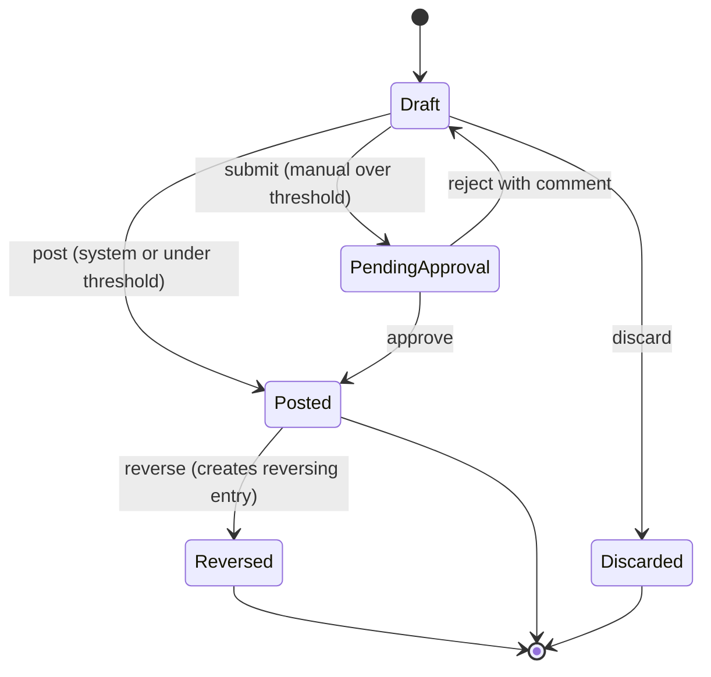

Rules:

- Drafts are mutable and do not affect balances; drafts older than 30 days raise a close-checklist warning.
- Posting assigns the journal number, chain hash and `posted_at`; the `entry_date` (accounting date) is user- or rule-supplied and must be in a postable period.
- A reversal's `entry_date` defaults to the original date if that period is open, otherwise to the first open period; the UI explains which.
- A posted entry can carry **annotations** (comments, attachments, tags) after posting; annotations are versioned and never change amounts.

#### 4.1.3 The posting engine [MVP]

The posting engine is the `ledger` module's consumer of domain events from the transactional outbox ([20](20-architecture-security.md) section 4.9). It never calls other modules to "fetch the truth" at posting time beyond reading the event's referenced document version, so a replay months later produces the identical entry.

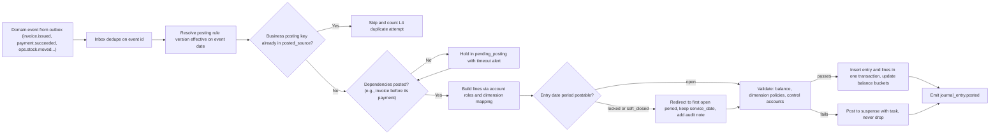

Behaviors and rules:

1. **Ordering and dependencies.** Each rule declares dependencies (for example `payments.charge` depends on the invoice or deposit request it allocates to). Out-of-order events wait in `pending_posting` (up to 24 hours by default) and raise a bookkeeper task if the dependency never arrives. Payments that arrive for invoices that will never exist (a payment link with no invoice) post to `customer_credits` instead.
2. **Batching.** High-volume rules (07 P5 per-visit recognition, labor accruals, equipment usage) post as **daily summarized entries** per legal entity, one line per dimension combination, while the subledger keeps per-document detail. A 140-person Summit Grounds June day produces about 30 summarized labor lines rather than 1,200 entries. Idempotency survives summarization: every contributing source writes its own business key to `posted_source` (unique per tenant) in the same transaction as the summary entry, so a time entry can never be summarized twice. The summary for a day is built at a cutoff (default 02:00 entity time the next morning); sources that arrive after the cutoff post as a **supplemental summary** for the same `entry_date` (`labor:{entity}:{date}:summary:{n}`) rather than reopening the first one.
3. **Back-dated events.** A crew app that syncs a completed visit three weeks later, after March is locked, posts into April with `service_date = 2027-03-28` and a note. Job cost and operational reports use `service_date`; the GL uses `entry_date`. The close checklist for April lists "late events from locked periods" so the CPA can decide whether to reopen.
4. **Rule failures never block the business.** If a rule cannot resolve an account role (a Company deleted its "Dump fees" account), the line posts to suspense (`1099 Suspense`) with a task and the event keeps flowing. Invoices are never blocked from sending because accounting setup is incomplete.
5. **Re-posting after correction.** If a source document is corrected (credit memo, voided invoice, reversed stock movement), the source module emits a new event and the engine posts the reversal or delta. The engine never mutates its own past output.
6. **Mode awareness.** In `external_sync` mode the engine still posts natively (operational subledger) and the integration layer decides what to push ([4.17](#417-accounting-integrations)).

#### 4.1.4 Posting rules as data [MVP registry, V1 simulation UI]

- A **posting rule** has: `rule_key` (for example `billing.P1`, `inventory.IN3`), name, triggering event type(s), conditions (expression over event payload: service line, client tax status, billing mode), line templates (account role, amount expression, sign, dimension mapping), dependencies, batching policy, and effective dates.
- **Rule packs.** The platform ships versioned packs (US Standard, Canada Standard, Lawn Care Program, Design-Build POC). The Platform Operator publishes pack versions from the admin console ([19](19-platform-admin-portal.md)); tenants inherit updates unless they have overridden a rule, in which case they get a diff and a one-click accept.
- **Tenant overrides** [V1]: a bookkeeper can change which account role a rule line uses (for example "post Stripe fees to 6150 per payout instead of per payment", which [08](08-payments-stripe.md) already exposes as a setting), or add a condition ("snow revenue from HOA clients goes to 4610 Seasonal Contracts even when invoiced per push"). Overrides create a new rule version effective from a chosen date; they never apply retroactively.
- **Preview and simulation** [V1]: before activating a rule change, the bookkeeper sees the entries it would have produced for last month's events side by side with what actually posted, and the P&L difference. Activation requires `ledger.posting_rule.manage` and step-up authentication.
- **Explainability.** Every system journal line links to the rule version and to the event; the "Why this entry?" panel renders the rule in plain English: "Rule billing.P1 v3: when an invoice is issued, debit Accounts Receivable for the total and credit revenue by service line and sales tax payable by agency."

#### 4.1.5 Accounting periods, fiscal years and locks [MVP]

- **Fiscal year** per legal entity, any start month (many landscapers use calendar years; some snow-heavy companies use a May-April fiscal year so a winter is not split across two years; Rootline supports both). 52-53 week years are [V2].
- **Periods** are calendar months by default; 13-period years are [V2].
- **States:**

| State | Who can post | Typical use |
|---|---|---|
| `open` | System and users with posting permissions | Current and prior month during close |
| `soft_closed` | System events are redirected to the next open period; users with `period.post_soft_closed` can post adjusting entries | Month under CPA review |
| `locked` | Nobody; system events redirect | Closed and reported months |

- **Transitions:** `open -> soft_closed` (bookkeeper), `soft_closed -> locked` (bookkeeper or owner, after hard checks in 4.11), `locked -> soft_closed` (reopen: `owner` or `bookkeeper` with `period.unlock`, step-up auth, reason required; periods older than 90 days need dual control per [02](02-personas-roles-permissions.md) 5.6). Every reopen notifies the owner and the connected accountant firm and is listed on the next close checklist.
- **Reopen authority (shared with [20](20-architecture-security.md) L3 and [02](02-personas-roles-permissions.md) 5.10).** [02](02-personas-roles-permissions.md) grants `period.unlock` (`ledger.period.unlock`) to `owner` and `bookkeeper`, including delegated CPAs, and 20 L3 enforces the rule below at the database level: reopening a locked period (`locked → soft_closed`) requires an approved `approval_request` of type `period_reopen` in the transaction context plus step-up, granted by the `owner` or by a `bookkeeper` under the owner's reopen policy. Rule: the database invariant checks for that approved `period_reopen` request in the transaction context. The default **reopen policy** routes a bookkeeper's request to the `owner` (flow 5.8). An owner may set "my accountant may reopen periods under 90 days without my approval", in which case the bookkeeper's own step-up satisfies the policy and the owner is notified. Periods over 90 days old and any period in a locked fiscal year always need two distinct approvers.
- **Snow-season fiscal years.** For a May-April fiscal year, period 1 is May. Season curves (4.8.2) and budgets (4.9) are keyed to calendar months, not period numbers, so switching a Company's fiscal year start never shifts a snow curve.

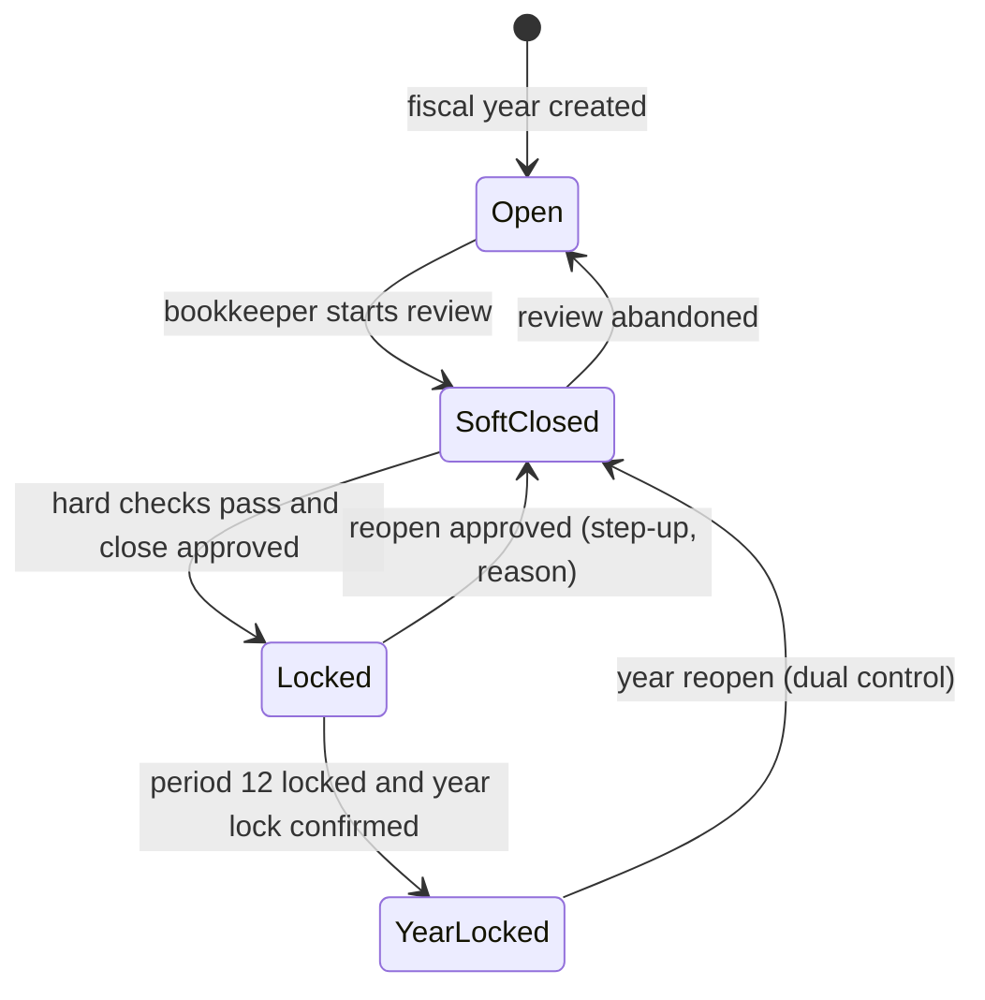
- **Lock date sync.** In `external_sync` or mirror mode, Rootline's lock state for a period is pushed to the external system's closing date (QBO "close the books" date where supported, verify API support) or pulled from it, depending on which is the book of record.
- **Subledger cut-off.** Locking a period also freezes subledger documents dated in it: invoices, bills, stock movements and time entries dated in a locked period cannot be created or edited; the source modules offer "post in next open period" instead ([13](13-operations-inventory-equipment.md) already follows this).

#### 4.1.6 Multi-currency and FX [V1]

Scope at launch: US Companies in USD, Canadian Companies in CAD, with cross-border billing and bank accounts in the other currency (Windsor snow contractor billing a Detroit property manager in USD, per [08](08-payments-stripe.md) Example 8).

- **Functional currency** per legal entity, fixed at creation.
- **Transaction currency** per document (invoice, bill, bank account, Stripe balance). Lines store `amount_txn_minor`, `currency`, `fx_rate`, `fx_rate_source`, `fx_rate_date` and `amount_minor` (functional).
- **Rates.** Daily reference rates from a configured source (Bank of Canada daily exchange rates for CAD entities is the natural default; a commercial rate API as fallback; verify licensing). Manual override per document with permission and audit. Rate types: `spot` (transaction date), `closing` (period end, for revaluation), `average` (period average, for consolidation translation [V2]).
- **Realized FX** posts at settlement: the difference between the functional amount at the document rate and at the settlement rate goes to `7910 Realized FX Gain/Loss`. When Stripe converts currency, the balance transaction's actual converted amount is the settlement amount ([08](08-payments-stripe.md) 4.17).
- **Unrealized FX revaluation** runs at period end for monetary balances in foreign currency (open AR and AP, foreign-currency bank accounts, foreign Stripe clearing): it posts the difference to `7920 Unrealized FX Gain/Loss` as an `accrual` entry that auto-reverses on day 1 of the next period.
- **Balancing semantics.** [20](20-architecture-security.md) L1 is implemented as: every entry balances to zero in functional currency; single-currency entries also balance in their transaction currency; multi-currency entries (FX settlement, revaluation, foreign-currency transfers) carry an explicit FX line and are validated in functional currency. This is a proposed clarification of L1's "per currency" wording (open question 2).
- **Rounding.** Functional-currency rounding residues from conversion post to `7930 FX Rounding` (never more than 1 minor unit per line; larger residues fail validation).

**Worked revaluation (illustrative rates).** The Windsor Company has a USD 4,000.00 invoice open at month end, booked at 1.3700 (CAD 5,480.00). The closing rate is 1.3850, so the receivable is worth CAD 5,540.00:

| Account | Debit (CAD) | Credit (CAD) |
|---|---:|---:|
| 1200 Accounts Receivable (USD 4,000.00 revalued) | 60.00 | |
| 7920 Unrealized FX Gain/Loss | | 60.00 |

Auto-reversed on the first day of the next month; when the client pays, realized FX is computed against the original 1.3700 rate as in [08](08-payments-stripe.md) Example 8.

#### 4.1.7 Balances, performance and correctness checks [MVP]

- **Balance buckets.** Each posting increments `balance_bucket(tenant, entity, account, period, day, currency)` inside the posting transaction. Trial balance, balance sheet and P&L read buckets; dimensional reports read the analytics replica ([18](18-reporting-analytics.md)). Hot accounts (Stripe clearing on a busy autopay day) use day-level buckets to limit row contention.
- **Nightly proofs** ([20](20-architecture-security.md) L7): buckets equal the sum of lines; trial balance nets to zero per entity; each control account equals its subledger (AR aging, AP aging, inventory valuation, fixed asset register net book value, deferred revenue by agreement, customer deposits by client, loan principal by loan, Stripe clearing vs Stripe's reported balance). Any drift opens a `ledger_integrity_case`, pages on-call and shows a red badge on the tenant's close checklist.
- **Property-based tests** generate random event sequences (invoices, partial payments, refunds, credit memos, disputes, voids, stock moves, bill matches, payroll imports, reversals across locked periods) and assert every invariant on every build ([20](20-architecture-security.md) 4.29).

#### 4.1.8 Manual, recurring and accrual entries [MVP manual, V1 recurring and approvals]

- **Manual JE editor.** Spreadsheet-style grid; account search by number, name or alias ("dump" finds 5510); dimension columns appear only when the account's policy needs them; running balance indicator; paste from Excel; attach support; "auto-reverse on" date.
- **Approval policy** [V1]: thresholds per entry type, for example manual entries over $5,000 or touching equity need `owner` approval; accountant adjustments need none but notify the owner. Self-approval is never allowed above the threshold.
- **Recurring templates** [V1]: monthly, quarterly, annual, or season-only (April-November) schedules; fixed or formula amounts (for example "1/12 of the annual insurance premium"); end date or occurrence count; skip-a-month.
- **Allocation entries** [V1]: allocate a shared cost by a driver: yard rent by square feet per division, the operations manager's salary by division man-hours, shop labor by asset hours. Drivers can be statistical accounts (4.2.2), so "allocate June shop overhead by June engine hours" is one click.
- **Accrual helpers** [V1]: "accrue unbilled sub work" (open sub work orders with completion but no bill), "accrue dump fees" (disposal tickets without vendor bills, from [13](13-operations-inventory-equipment.md)), "accrue wages since last payroll" (approved time after the last pay period end). Each produces an auto-reversing accrual with line-level support.

### 4.2 Chart of Accounts and dimensions

#### 4.2.1 Template philosophy [MVP]

1. **Account roles, not numbers.** Posting rules bind to roles (`ar_control`, `revenue:maintenance`, `cogs_materials`); each template binds roles to accounts. A Company that wants AR at 1100 instead of 1200 renumbers freely.
2. **Cost type by account, division by dimension.** Direct costs are split into the five cost types every landscaper and LMN user thinks in (labor, materials, equipment, subcontractors, dump and disposal fees) plus other direct costs, and **division is a required dimension** on every revenue and direct-cost line. The chart stays the same size whether a Company runs two divisions or eight; per-division accounts would add roughly 30 accounts for every division.
3. **Expanded "divisional accounts" option.** For Companies that mirror to QuickBooks Simple Start or Essentials (no classes) or to Xero with both tracking categories already used, the template can expand revenue and direct-cost accounts per division (for example 5110-MNT Field Wages - Maintenance and 5110-DB Field Wages - Design-Build). The posting engine handles both shapes because it maps role plus division to an account.
4. **CPA-friendly numbering.** Four-digit ranges in the familiar order: 1xxx assets, 2xxx liabilities, 3xxx equity, 4xxx revenue, 5xxx direct costs, 6xxx overhead, 7xxx other income and expense, 8xxx income taxes, 9xxx statistical.

#### 4.2.2 Default landscape Chart of Accounts [MVP]

System accounts (marked **S**) carry an account role and cannot be deleted, only renamed or renumbered. Control accounts (marked **C**) are posted only by their subledger (L13).

**Assets**

| Code | Account | Role | Notes |
|---|---|---|---|
| 1010 | Operating Checking | `bank:operating` S | One per real bank account; Plaid-linked |
| 1020 | Payroll Checking | `bank:payroll` | Optional; Gusto/ADP debits |
| 1030 | Tax Reserve Savings | `bank:reserve` | Optional "Profit First"-style reserve ([13](#13-beyond-the-brief-extra-ideas)) |
| 1040 | Petty Cash | `cash:petty` | |
| 1050 | Stripe Clearing - USD | `stripe_clearing:USD` S C | Per [08](08-payments-stripe.md) 4.17 |
| 1051 | Stripe Clearing - CAD | `stripe_clearing:CAD` S C | |
| 1055 | Stripe Reserve Held | `stripe_reserve` S C | |
| 1060 | Undeposited Funds | `undeposited_funds` S | Checks and cash awaiting deposit |
| 1065 | Cash in Transit (crew-held) | `cash_in_transit` S | Per crew lead dimension |
| 1075 | Disputed Payments Receivable | `disputed_receivable` S C | |
| 1090 | Payments Suspense | `payments_suspense` S | Unknown Stripe reporting categories ([08](08-payments-stripe.md) 4.17.2); must be zero to lock (L16) |
| 1099 | Suspense - Unclassified | `suspense` S | Unresolvable account roles and unclassifiable lines from any module; must be zero to lock (L16) |
| 1200 | Accounts Receivable | `ar_control` S C | |
| 1205 | Retainage Receivable | `retainage_receivable` S C | Commercial installs ([07](07-invoicing-billing-contracts.md) P12) |
| 1210 | Unbilled Receivables - Agreements | `unbilled_receivable` S | Contract asset for agreements (07 P7, P8) |
| 1215 | Underbillings (Costs and Estimated Earnings in Excess of Billings) | `underbillings` S | WIP, 4.8.3 |
| 1220 | Allowance for Doubtful Accounts | `allowance_doubtful` S | Contra-asset |
| 1230 | Vendor Claims Receivable | `vendor_claims` | Nursery guarantee claims, RTVs ([13](13-operations-inventory-equipment.md)) |
| 1235 | Pallet Deposits Receivable | `pallet_deposits` | |
| 1240 | Employee Advances | `employee_advances` | |
| 1260 | GST/HST and QST Recoverable (ITCs) | `itc_recoverable` S | Canadian entities |
| 1310 | Inventory - Hardscape and Aggregates | `inventory:hardscape` S C | Pavers, wall block, stone, base |
| 1315 | Inventory - Mulch, Soil and Compost | `inventory:bulk` S C | Bunkers, by the cubic yard |
| 1320 | Inventory - Plants (Holding Yard) | `inventory:plants` S C | |
| 1330 | Inventory - Fertilizer and Chemicals | `inventory:chemicals` S C | Lot-tracked in Advanced mode |
| 1340 | Inventory - Irrigation and Lighting Parts | `inventory:parts` S C | Truck stock included |
| 1345 | Inventory - Salt and Deicers | `inventory:salt` S C | Season-straddling |
| 1350 | Inventory - Shop Parts | `inventory:shop` S C | Filters, blades, belts |
| 1360 | Inventory - Fuel | `inventory:fuel` S C | Yard tanks |
| 1370 | Inventory in Transit | `inventory:transit` S C | Branch transfers [V1] |
| 1410 | Prepaid Insurance | `prepaid:insurance` | Amortized monthly |
| 1420 | Prepaid H-2B Program Costs | `prepaid:h2b` | Amortized over the season ([13](#13-beyond-the-brief-extra-ideas)) |
| 1430 | Prepaid Expenses - Other | `prepaid:other` | Software, licenses, registrations |
| 1510 | Trucks and Trailers | `fa_cost:vehicles` S C | |
| 1520 | Mowers and Landscape Equipment | `fa_cost:mowers` S C | |
| 1530 | Heavy Equipment | `fa_cost:heavy` S C | Skid steers, mini excavators |
| 1540 | Snow Equipment | `fa_cost:snow` S C | Plows, spreaders, pushers |
| 1550 | Shop Tools and Equipment | `fa_cost:shop` S C | |
| 1560 | Office Furniture and IT | `fa_cost:office` S C | |
| 1570 | Buildings and Yard Improvements | `fa_cost:buildings` S C | Bunkers, fencing, lighting |
| 1580 | Land | `fa_cost:land` S C | Never depreciated |
| 1590-1597 | Accumulated Depreciation (one per class above) | `accum_depr:{class}` S C | Contra-asset |
| 1599 | Assets Not Yet in Service | `fa_cip` S C | Deposits on a truck on order |
| 1610 | Security Deposits | `deposits_paid` | |
| 1620 | Right-of-Use Assets | `rou_assets` | Lease accounting [V2] |
| 1910 | Intercompany Receivable - {entity} | `ic_due_from:{entity}` S C | Multi-entity (4.15) |

**Liabilities**

| Code | Account | Role | Notes |
|---|---|---|---|
| 2000 | Accounts Payable | `ap_control` S C | |
| 2010 | Retainage Payable - Subcontractors | `retainage_payable` S C | [13](13-operations-inventory-equipment.md) |
| 2020 | Goods Received Not Invoiced | `grni` S C | Receipts without bills |
| 2030 | Accrued Expenses | `accrued_expenses` | Dump fees, utilities, sub work |
| 2040-2049 | Credit Cards (one per card program) | `credit_card:{card}` | Amex, Visa, WEX/fuel cards |
| 2101-2149 | Sales Tax Payable - {agency} | `sales_tax_payable:{agency}` S | Per state/county/city agency ([07](07-invoicing-billing-contracts.md)) |
| 2120 | Use Tax Payable | `use_tax_payable` S | Contractor-as-consumer purchases |
| 2125 | GST/HST Payable | `gst_hst_payable` S | Canadian entities |
| 2126 | QST Payable | `qst_payable` S | Quebec supplies |
| 2150 | Customer Deposits | `customer_deposits` S C | |
| 2160 | Tips Payable | `tips_payable` S | Cleared by payroll |
| 2170 | Gift Credit Liability | `gift_credit` S | [07](07-invoicing-billing-contracts.md) P29 |
| 2180 | Customer Credits and Unapplied Cash | `customer_credits` S C | |
| 2190 | Unclaimed Property Payable | `unclaimed_property_payable` S | Dormant credits and stale vendor checks being escheated ([07](07-invoicing-billing-contracts.md) P42; stale checks 4.6.5) |
| 2200 | Deferred Revenue - Service Agreements | `deferred_revenue` S C | Contract liability per agreement |
| 2210 | Overbillings (Billings in Excess of Costs and Estimated Earnings) | `overbillings` S | WIP, 4.8.3 |
| 2215 | Accrued Losses on Contracts | `contract_loss_accrual` S | Loss jobs, 4.8.4 |
| 2310 | Accrued Wages | `accrued_wages` S | Applied labor (4.7.2) |
| 2320 | Payroll Taxes Payable | `payroll_taxes_payable` S | |
| 2330 | Benefits and Deductions Payable | `payroll_deductions_payable` | 401(k), garnishments, health |
| 2350 | Accrued PTO | `accrued_pto` | |
| 2360 | Payroll Clearing (Net Pay) | `payroll_clearing` S | Must clear to zero |
| 2380 | Backup Withholding Payable | `backup_withholding` | [V2], 4.5.3 |
| 2390 | Applied Labor Burden Clearing | `applied_burden` S | Over/under-applied burden |
| 2410 | Warranty Reserve | `warranty_reserve` S | Plant and install warranties |
| 2420 | Accrued Workers' Compensation | `accrued_wc` | Premium audits |
| 2510 | Line of Credit | `loc:{loan}` S C | |
| 2520 | Current Portion of Long-Term Debt | `ltd_current` S | Year-end reclass |
| 2610 | Equipment Loans | `loan_principal:{loan}` S C | One sub-account per note |
| 2620 | Vehicle Loans | `loan_principal:{loan}` S C | |
| 2630 | Notes Payable - Bank/SBA | `loan_principal:{loan}` S C | |
| 2640 | Lease Liabilities | `lease_liability` | [V2] |
| 2650 | Loans from Shareholders | `shareholder_loans` | |
| 2910 | Intercompany Payable - {entity} | `ic_due_to:{entity}` S C | |

**Equity**

| Code | Account | Role | Notes |
|---|---|---|---|
| 3000 | Owner's Capital / Common Stock | `equity:capital` | Entity-type aware labels |
| 3100 | Owner Contributions | `equity:contributions` | |
| 3200 | Owner Draws / Distributions | `equity:draws` | S-corp distributions vs LLC draws labeled by entity type |
| 3300 | Retained Earnings | `retained_earnings` S | Computed roll-forward (4.14) |
| 3400 | Cumulative Translation Adjustment | `cta` S | Consolidation of a CAD entity into a USD parent [V2] |
| 3900 | Opening Balance Equity | `opening_balance_equity` S | Must be zero after migration (4.18) |

**Revenue** (division dimension required; sub-accounts optional)

| Code | Account | Role | Typical landscape revenue |
|---|---|---|---|
| 4100 | Maintenance Revenue | `revenue:maintenance` S | Weekly mowing rounds April-November, contract maintenance, spring and fall cleanups, bed maintenance |
| 4200 | Enhancements Revenue | `revenue:enhancements` S | Mulch by the cubic yard, seasonal color, small plantings sold to maintenance clients |
| 4300 | Design-Build and Installation Revenue | `revenue:install` S | Paver patios, walls, plantings, grading, drainage |
| 4350 | Design Fees | `revenue:design` S | Design Studio plans and consultations, often credited against the install |
| 4400 | Lawn Care and Plant Health Care Revenue | `revenue:lawn_phc` S | 5-step fertilizer programs, grub control, aeration and overseeding, tree and shrub care |
| 4500 | Irrigation Revenue | `revenue:irrigation` S | Spring start-ups, winterizations (blow-outs), repairs, installs |
| 4600 | Snow and Ice Revenue | `revenue:snow` S | Seasonal contracts, per-push at 2-inch triggers, per-application salting |
| 4700 | Landscape Lighting Revenue | `revenue:lighting` S | |
| 4800 | Tree Care Revenue | `revenue:tree` S | |
| 4910 | Discounts and Allowances | `discounts_allowances` S | Contra-revenue; credit memo reason codes |
| 4920 | Payment Method Discounts | `payment_method_discounts` S | ACH incentive ([08](08-payments-stripe.md) 4.10) |
| 4930 | Small Balance Adjustments | `small_balance_adj` S | [07](07-invoicing-billing-contracts.md) P24 |
| 4950 | Card Surcharge Income | `surcharge_income` S | [08](08-payments-stripe.md) 4.10 |

**Direct costs (cost of revenue)** (division required; job required where marked J)

| Code | Account | Role | Notes |
|---|---|---|---|
| 5110 | Field Wages | `cogs_labor` S J | Applied from approved time (4.7.2) |
| 5120 | Field Labor Burden | `cogs_burden` S J | Payroll taxes, workers' comp, benefits, PTO at standard rates |
| 5180 | Non-billable Field Time | `cogs_labor_nonbillable` S | Rain-outs, yard time, training, callbacks (cost code required) |
| 5190 | Field Labor Variance | `labor_variance` S | Actual payroll vs applied (OT premium, bonuses) |
| 5195 | Labor Burden Variance | `burden_variance` S | Over/under-applied burden closed monthly |
| 5210 | Materials - Hardscape and Aggregates | `cogs_materials:hardscape` S J | |
| 5220 | Materials - Plants | `cogs_materials:plants` S J | |
| 5230 | Materials - Mulch, Soil and Compost | `cogs_materials:bulk` S J | |
| 5240 | Materials - Fertilizer and Chemicals | `cogs_materials:chemicals` S J | |
| 5250 | Materials - Irrigation and Lighting Parts | `cogs_materials:parts` S J | |
| 5260 | Materials - Salt and Deicers | `cogs_materials:salt` S J | |
| 5270 | Purchase Price Variance | `ppv` S | Stock lines billed above or below receipt cost |
| 5280 | Inventory Shrink and Adjustments | `shrink` S | Count variances, scrap |
| 5290 | Plant Losses (Holding Yard) | `plant_loss` S | Unless covered by a nursery guarantee |
| 5310 | Equipment Charged to Jobs | `equipment_applied` S J | Rate card x usage (4.7.3) |
| 5320 | Equipment Rental | `cogs_equipment_rental` S J | Day rentals billed by vendors |
| 5330 | Fuel - Field Vehicles and Equipment | `equipment_fuel` S | Actual cost |
| 5340 | Repairs and Maintenance - Field Equipment | `equipment_repairs` S | Shop labor and parts, outside repairs |
| 5350 | Depreciation - Field Equipment | `equipment_depreciation` S | From fixed asset runs |
| 5360 | Equipment Insurance, Registration and Licensing | `equipment_ownership_other` S | |
| 5390 | Equipment Cost Recovery | `equipment_recovery` S | Contra; credit side of 5310 |
| 5410 | Subcontractors | `cogs_subs` S J | Install, snow, tree, electrical subs |
| 5510 | Dump and Tipping Fees | `cogs_disposal:dump` S J | Per ton or per load |
| 5520 | Green Waste and Spoils Disposal | `cogs_disposal:green` S J | |
| 5530 | Hauling and Delivery | `cogs_disposal:hauling` S J | Delivery charges not capitalized to inventory |
| 5610 | Permits, Inspections and Locates | `cogs_other:permits` S J | |
| 5620 | Small Tools and Job Supplies | `cogs_other:supplies` S J | |
| 5630 | Job Travel and Lodging | `cogs_other:travel` S J | Out-of-town installs, storm response |
| 5710 | Warranty Expense | `warranty_expense` S | Reserve accrual and true-up |
| 5990 | Provision for Contract Losses | `contract_loss_expense` S | 4.8.4 |

**Overhead (operating expenses)** (department dimension optional; division optional for allocation)

| Code | Account | Code | Account |
|---|---|---|---|
| 6010 | Office and Admin Salaries | 6210 | Rent - Office and Yard |
| 6020 | Sales and Estimating Salaries | 6220 | Utilities |
| 6030 | Commissions | 6230 | Yard and Shop Maintenance |
| 6040 | Officer Compensation | 6240 | Telephone and Internet |
| 6050 | Payroll Taxes and Benefits - Admin | 6310 | General Liability Insurance |
| 6110 | Advertising and Marketing | 6320 | Commercial Auto Insurance |
| 6120 | Lead Generation and Referral Fees | 6330 | Umbrella and Other Insurance |
| 6130 | Software and Subscriptions | 6410 | Admin Vehicle Fuel and Repairs |
| 6150 | Merchant Processing Fees (S) | 6430 | Depreciation - Non-Job Assets (S) |
| 6152 | Rootline Platform Fees (S) | 6510 | Accounting and Legal |
| 6155 | Dispute Fees (S) | 6520 | Licenses, Permits and Certifications (applicator licenses) |
| 6156 | Financing Merchant Fees (S) | 6530 | Dues and Memberships (NALP, SIMA, state associations) |
| 6160 | Bank Fees | 6540 | Training and Education |
| 6170 | Bad Debt Expense (S) | 6610 | Office Supplies and Postage |
| 6180 | Collection Agency Fees | 6640 | Meals |
| 6190 | Penalties and Late Fees Paid | 6990 | Miscellaneous |

**Other income and expense, taxes, statistics**

| Code | Account | Role |
|---|---|---|
| 7100 | Interest Income | `interest_income` |
| 7200 | Finance Charge Income | `finance_charge_income` S ([07](07-invoicing-billing-contracts.md) P20) |
| 7300 | Gain or Loss on Disposal of Assets | `fa_disposal_gain_loss` S |
| 7400 | Interest Expense - Debt | `interest_expense` S |
| 7500 | Other Income (rebates, insurance recoveries) | `other_income` |
| 7910 | Realized FX Gain/Loss | `realized_fx` S |
| 7920 | Unrealized FX Gain/Loss | `unrealized_fx` S |
| 7930 | FX Rounding | `fx_rounding` S |
| 7950 | Cash Over/Short | `cash_over_short` S |
| 8100 | Income Tax Expense (C-corporations) | `income_tax_expense` |
| 9010 | Billable Field Man-Hours (statistical) | `stat:billable_hours` [V1] |
| 9020 | Total Field Man-Hours (statistical) | `stat:total_hours` [V1] |
| 9030 | Properties Under Agreement (statistical) | `stat:properties` [V1] |
| 9040 | Acres Maintained / Square Feet Installed (statistical) | `stat:area` [V1] |
| 9050 | Equipment Engine Hours (statistical) | `stat:engine_hours` [V1] |

Statistical accounts hold non-monetary quantities posted by the same engine (approved billable hours per division per day), so ratios such as revenue per man-hour, overhead per billable hour and gross profit per man-hour ([18](18-reporting-analytics.md)) can be computed inside the ledger, budgeted and allocated against.

#### 4.2.3 Template variants [MVP: three; V1: all]

| Template | For | Differences from the default |
|---|---|---|
| **Full-service multi-division** (default) | Reyes-style design-build plus maintenance | As above |
| **Lawn care and PHC** | Real Green-style program companies | Revenue sub-accounts per program step (round 1 pre-emergent... round 5 winterizer), prepay discount contra account, chemical inventory as the main stock, applicator license costs in overhead; deferred revenue as a headline account |
| **Residential maintenance** | 2-10 truck mow-and-blow operations | Fewer accounts (no WIP, no retainage, no heavy equipment); single bank; owner draws prominent |
| **Design-build** | Install-heavy firms | WIP accounts on by default, retainage, contract loss accounts, design fee revenue, warranty reserve |
| **Commercial maintenance plus snow** | Summit Grounds-style | Snow sub-accounts (4610 Seasonal Contracts, 4620 Per Push, 4630 Per Application, 4640 Salt and Deicer Sales), salt inventory, subcontractor-heavy snow COGS, branch dimension required |
| **Tree care** | Arborgold/SingleOps-style | Crane and climbing equipment, wood disposal, PHC injections |
| **Irrigation and lighting service** | Irrigation contractors with a lighting side line | Revenue sub-accounts 4510 Spring Start-ups, 4520 Winterizations (blow-outs), 4530 Repairs and Service Calls, 4540 New System Installs, 4550 Backflow Testing, 4710 Lighting Installs, 4720 Lighting Service; prepaid start-up and winterization packages as deferred revenue; parts inventory by service van (truck stock is the main stock location); warranty reserve on installs; backflow tester certifications in overhead |
| **Canada overlay** | Any Canadian entity | GST/HST/QST accounts and ITCs, CCA tax book classes, T5018 tracking, CAD functional currency |

Templates are selected in onboarding from three questions (what do you sell, do you do installs over $10,000, do you plow snow). The CPA can import a firm-standard template instead (4.12).

#### 4.2.4 Dimensions [MVP core, V1 custom]

| Dimension | Meaning | Source | Mapping to QBO / Xero / Intacct |
|---|---|---|---|
| `legal_entity` | Separate books (4.15) | Org settings ([02](02-personas-roles-permissions.md) 5.9) | Separate QBO company / Xero org / Intacct entity |
| `division` | Profit center: Maintenance, Enhancements, Design-Build, Lawn/PHC, Irrigation, Snow, Lighting, Tree | Service line on the Price Book item, job or agreement | QBO **Class**; Xero tracking category 1; Intacct department or class |
| `branch` | Operating location | Job's selling branch ([02](02-personas-roles-permissions.md) cross-branch rules) | QBO **Location**; Xero tracking category 2; Intacct location |
| `department` | Overhead cost center: Admin, Sales, Shop, Yard, Field Supervision | Employee home department, bill line | QBO class or location (configurable); Intacct department |
| `job` / `phase` / `cost_type` / `cost_code` | Job costing (4.7) | Job, Project phase, cost type from the line, cost code from the estimate assembly | QBO sub-customer or Project plus item; Xero not natively (tracking or description); Intacct project and task |
| `client` / `property` | Who and where | Document | QBO customer and sub-customer |
| `agreement` | Service Agreement | Billing ([07](07-invoicing-billing-contracts.md)) | Memo or Intacct contract |
| `vendor` / `employee` / `asset` / `item` / `crew` | Subledger and operational references | Source document | Entity refs where the target supports them |
| Custom (up to 5) [V1] | Tenant-defined: salesperson, region, program, storm event | User-defined lists | Intacct user-defined dimensions; otherwise memo |

A **storm event** custom dimension is pre-seeded for snow Companies: every push, salt application, sub ticket and overtime hour from the "January 14-15 storm" rolls up to a per-storm P&L.

#### 4.2.5 Dimension policies [V1]

Per account and dimension: `required`, `optional`, `forbidden`, with a default value rule. Examples: 5xxx requires `division`; job-cost accounts require `job_id` or `unassigned`; balance-sheet accounts forbid `job` except retainage, deposits and WIP accounts; 6xxx allows `department`. The policy table is enforced by L14 and drives which columns appear in entry and categorization screens.

#### 4.2.6 Crosswalk to codes used in 07 and 08

**Priority:** [MVP] (role aliases must resolve before the first payments posting).

[07](07-invoicing-billing-contracts.md) 4.11 and [08](08-payments-stripe.md) 4.17 both quote the canonical codes and role keys from 4.2.2 directly. Posting rules bind to roles, so the table below is the binding **alias map** for the posting-rule registry: it lists the alternate role spellings the registry resolves to each canonical role (registered as aliases, as [02](02-personas-roles-permissions.md) does for permission keys) and the provisional account numbers used for billing and payments before this chart existed, so any prototype, test fixture or migration script built on them can be remapped by role.

| Canonical role (this doc) | Registered role alias | Provisional billing code | Provisional payments code | Canonical default |
|---|---|---|---|---|
| `bank:operating` | `operating_bank` | 1000 | 1000 | **1010** |
| `stripe_clearing:USD` / `:CAD` | same | 1050 | 1050 / 1051 | **1050 / 1051** |
| `stripe_reserve` | same | n/a | 1055 | **1055** |
| `undeposited_funds` | same | n/a | 1060 | **1060** |
| `cash_in_transit` | same | n/a | 1065 | **1065** |
| `payments_suspense` | same | n/a | 1090 | **1090** |
| `ar_control` | same | 1100 | 1100 | **1200** |
| `retainage_receivable` | n/a | 1105 | n/a | **1205** |
| `unbilled_receivable` | n/a | 1110 | n/a | **1210** |
| `disputed_receivable` | `disputed_payments` | 1120 | 1120 | **1075** |
| `allowance_doubtful` | n/a | 1190 | n/a | **1220** |
| `sales_tax_payable:{agency}` | n/a | 2100 | n/a | **2101-2149** |
| `customer_deposits` | same | 2200 | 2200 | **2150** |
| `deferred_revenue` | n/a | 2210 | n/a | **2200** |
| `customer_credits` | same | 2220 | 2220 | **2180** |
| `gift_credit` | n/a | 2230 | n/a | **2170** |
| `tips_payable` | same | 2300 | 2300 | **2160** |
| `unclaimed_property_payable` | n/a | n/a (assigned here for [07](07-invoicing-billing-contracts.md) P42) | n/a | **2190** |
| `discounts_allowances` | same | 4900 | 4900 | **4910** |
| `small_balance_adj` | n/a | 4910 | n/a | **4930** |
| `surcharge_income` | `card_surcharge_income` | n/a | 4920 | **4950** |
| `payment_method_discounts` | same | n/a | 4960 | **4920** |
| `merchant_fees` | same | 6100 | 6100 | **6150** |
| `platform_fees` | `platform_application_fees` | n/a | 6105 | **6152** |
| `dispute_fees` | same | 6100 | 6110 | **6155** |
| `financing_merchant_fees` | same | n/a | 6115 | **6156** |
| `bad_debt` | same | 6200 | 6200 | **6170** |
| `realized_fx` | same | 7100 | 7100 | **7910** |
| `finance_charge_income` | n/a | 7200 | n/a | **7200** |
| `suspense` | n/a | n/a | n/a | **1099** |

> **Collision warning.** Three provisional numbers mean something different in the canonical chart: **2200** was the provisional payments code for Customer Deposits but is Deferred Revenue here; **4920** was the provisional payments code for Card Surcharge Income but is Payment Method Discounts here; **4910** was the provisional billing code for Small Balance Adjustments but is Discounts and Allowances here. The engine is unaffected (it never reads numbers), but any fixture, spreadsheet or import that still carries provisional numbers must be remapped by **role**, never by number.

#### 4.2.7 Chart maintenance rules [MVP]

- **Create**: code unique per entity; type and normal balance required; parent (header) accounts are not postable (L6); new accounts inherit dimension policy from the parent.
- **Rename/renumber**: free at any time; history follows the account ID. Mirror and sync mappings update automatically.
- **Archive**: allowed only with zero balance in all open periods and no active posting-rule binding; archived accounts still report historically.
- **Merge** [V1]: posts a reclass entry moving the balance (and, optionally, re-tagging future postings) from A to B; never rewrites historical lines.
- **Change account type** (for example expense to COGS): allowed only when the account has no posted lines; otherwise create a new account and reclass.
- **Import/export**: CSV and the QBO account list format; AI maps a foreign chart to roles during migration (4.18).

### 4.3 Automatic posting rules

The registry below is the canonical list. Rule keys are namespaced by the module that emits the triggering event: `billing.P1`-`billing.P42` are the rules specified in [07](07-invoicing-billing-contracts.md) 4.11 (bound here to canonical roles), `payments.*` follow Stripe reporting categories as specified in [08](08-payments-stripe.md) 4.17, and the remaining namespaces are specified in this document. Codes are the canonical defaults from 4.2.2; the engine resolves them through account roles. "J" means the line carries job, phase and cost-type dimensions; every revenue and direct-cost line carries `division` and `branch`.

#### 4.3.1 Revenue, billing and AR [MVP]

| Rule | Trigger event | Debit | Credit | Timing and granularity |
|---|---|---|---|---|
| `billing.P1` Invoice issued | `invoice.issued` (per-visit, batch, T&M, milestone, snow per push) | 1200 AR (total) | 4100-4800 revenue by division (net of line discounts); 2101+ sales tax payable per agency | At issue; one entry per invoice |
| `billing.P2` Deposit paid | `payment.succeeded` allocated to a deposit request | 1050 Stripe Clearing (via `payments.charge`) | 2150 Customer Deposits | At payment |
| `billing.P3` Deposit applied | `invoice.issued` with deposit application | 2150 Customer Deposits | 1200 AR | With P1 |
| `billing.P4` / `billing.P9` Installment or prepaid season invoice | `invoice.issued` with agreement billing | 1200 AR | 2200 Deferred Revenue (per agreement); 2101+ tax | At issue |
| `billing.P5` Deferred revenue recognition (per occurrence) | `visit.completed` on a leveled or prepaid agreement line | 2200 Deferred Revenue | 4100/4400/4500... revenue at unit value | Daily summarized entry with per-agreement detail |
| `billing.P6` Ratable recognition (fixed-season lines, seasonal snow) | Month-end job | 2200 Deferred Revenue | Revenue by weighted season curve | Month-end |
| `billing.P7` / `billing.P8` Contract asset reclass and unbilled accrual | Month-end job | 1210 Unbilled Receivables | 2200 Deferred Revenue (P7) or revenue (P8) | Auto-reverses day 1 |
| `billing.P12` Progress invoice with retainage | `invoice.issued` (progress) | 1200 AR (net due); 1205 Retainage Receivable | 4300 revenue (gross earned this period); 2101+ tax | At issue |
| `billing.P13` Retainage release | `invoice.issued` (release) | 1200 AR | 1205 Retainage Receivable | At issue |
| `billing.P18` Credit memo | `credit_memo.issued` | 4xxx revenue or 4910 Discounts and Allowances (by reason code); 2101+ tax | 1200 AR (applied) or 2180 Customer Credits (held) | At issue |
| `billing.P20` Finance charge | `invoice.finance_charge_assessed` | 1200 AR | 7200 Finance Charge Income | At assessment |
| `billing.P21` / `billing.P22` Write-off | `collections_case.written_off` | 6170 Bad Debt (direct) or 1220 Allowance | 1200 AR | At approval |
| `billing.P25` Void | `invoice.voided` | Exact reversal of P1 | | Same period if open, else first open period |
| `billing.P33` Offline payment (check, cash, Interac e-Transfer, wire) | `payment.succeeded` with an offline method (field collection per [08](08-payments-stripe.md) 4.20) | 1060 Undeposited Funds (office), 1065 Cash in Transit (crew lead dimension) or 1010 (wire, e-Transfer) | 1200 AR; 2180 for any excess | Overlaps `payments.field_receipt` and `payments.office_receipt` below; one posting key per payment, so whichever module emits first wins |
| `billing.P34` Returned payment (ACH R01/NSF, PAD return, bounced check) | `payment.returned` | 1200 AR (invoice reopened) | 1050 Stripe Clearing, or 1010 / 1060 for checks | Bank return fee to 6160; any NSF fee to the client only if disclosed and lawful ([07](07-invoicing-billing-contracts.md)) |
| `billing.P35` Deposit refunded on a canceled job | `refund.completed` against a deposit | 2150 Customer Deposits | 1050 or 1010 | Any contracted cancellation fee or non-returnable special-order material kept: Dr 2150, Cr 4300 (or 7500) |
| `billing.P37` Prepaid value forfeited at season close (breakage) | Season-close job on an agreement with forfeiture terms | 2200 Deferred Revenue | 4100-4800 revenue | Only when signed terms state forfeiture; otherwise a P11 credit |
| `billing.P38` / `billing.P39` Card surcharge / payment-method discount [V1] | `payment.succeeded` with surcharge or discount | 1050 / 4920 Payment Method Discounts | 4950 Card Surcharge Income / 1200 AR | Rules owned by [08](08-payments-stripe.md) 4.10 |
| `billing.P42` Dormant credit escheated [V1] | Unclaimed property report approved by `owner` | 2180 Customer Credits | 2190 Unclaimed Property Payable | Then Dr 2190 / Cr 1010 when remitted to the state; stale vendor checks follow the same path after the void (Dr 1010 / Cr 2000, then Dr 2000 / Cr 2190) |
| `ar.AR1` Allowance provisioning [V1] | Month-end aging-based calculation | 6170 Bad Debt | 1220 Allowance | Month-end; percentage by aging bucket (default 1% current, 5% 31-60, 15% 61-90, 40% over 90; illustrative, tenant-set) |
| `warranty.WR1` Warranty reserve accrual [V1] | `invoice.issued` with install lines | 5710 Warranty Expense | 2410 Warranty Reserve | Percentage of install plant and hardscape revenue (tenant default; Plant KB mortality data can suggest a rate, [13](#13-beyond-the-brief-extra-ideas)) |
| `warranty.WR2` Warranty replacement [V1] | `ops.warranty.claim_resolved` | 2410 Warranty Reserve | 1320 Plants inventory, 2000 AP, 2310 Accrued Wages (replacement labor at cost) | At resolution |

#### 4.3.2 Payments and cash [MVP]

| Rule | Trigger | Debit | Credit | Notes |
|---|---|---|---|---|
| `payments.charge` | Stripe balance transaction `charge` | 1050/1051 Stripe Clearing (gross) | 1200 AR, 2150 Deposits, 2160 Tips, 4950 Surcharge, 2180 Unapplied (per allocation) | Per payment ([08](08-payments-stripe.md) 4.17.2) |
| `payments.fee` | Fee lines of a balance transaction; standalone `fee` | 6150 Merchant Fees (6152 for application fees) | 1050/1051 | Per payment (default) or per payout |
| `payments.refund` | `refund` | 1200 AR (after credit memo) or 2180/2150 | 1050/1051 | Paired with `billing.P18` |
| `payments.dispute` | `dispute` | 1075 Disputed Receivable; 6155 Dispute Fees | 1050/1051 | ACH/PAD disputes cannot be contested, so they debit 1200 AR (invoice reopened) instead of 1075 ([08](08-payments-stripe.md) Example 10) |
| `payments.dispute_reversal` | `dispute_reversal` (won) | 1050/1051 | 1075 (and 6155 if fee returned) | |
| `payments.dispute_lost` | `dispute.closed` lost | 1200 AR (reopen) or 6170 Bad Debt | 1075 | Company setting |
| `payments.payout` | `payout` | 1010 Operating Checking | 1050/1051 | Proven against the payout's balance transactions first |
| `payments.payout_reversal` | Failed payout | 1050/1051 | 1010 | Owner alerted |
| `payments.reserve` | Reserve held / released | 1055 / 1050 | 1050 / 1055 | |
| `payments.other_adjustment` | Unknown category | 1090 Payments Suspense | 1050/1051 | Task; never dropped |
| `payments.field_receipt` | Cash or check collected in the field | 1065 Cash in Transit (crew lead) | 1200 AR | [08](08-payments-stripe.md) 4.20.2 |
| `payments.office_receipt` | Check received in office | 1060 Undeposited Funds | 1200 AR | |
| `payments.handover` | Crew cash handed to office | 1060 | 1065 | Variance to 7950 only with `owner` approval |
| `payments.bank_deposit` | Deposit slip recorded or bank line matched | 1010 | 1060 | One deposit, many checks |

#### 4.3.3 Purchasing, AP and inventory [MVP unless tagged]

| Rule | Trigger | Debit | Credit | Notes |
|---|---|---|---|---|
| `inventory.IN1` Receipt to stock | `ops.receipt.posted` (stock location) | 13xx Inventory (at PO cost) | 2020 GRNI | [13](13-operations-inventory-equipment.md) 4.3.1 |
| `inventory.IN2` Receipt to job | `ops.receipt.posted` (job-direct PO) | 52xx Materials J | 2020 GRNI | Hits job cost on receipt, not on bill |
| `inventory.IN3` Issue to job | `ops.stock.moved` type `issue_to_job` | 52xx Materials J (at moving average) | 13xx Inventory | Daily summarized per job and item category |
| `inventory.IN4` Return from job | `return_from_job` | 13xx | 52xx J | At original issue cost or restock value |
| `inventory.IN5` Adjustment / count variance | `adjustment`, `count_variance` | 5280 Shrink (loss) or 13xx (gain) | 13xx or 5280 | Reason code required |
| `inventory.IN6` Plant loss | `plant_loss` | 5290 Plant Losses, or 1230 Vendor Claims if under nursery guarantee | 1320 | |
| `inventory.IN7` Vendor return [V1] | `vendor_return` | 1230 Vendor Claims | 13xx | Cleared by vendor credit |
| `inventory.IN8` Branch transfer [V1] | `transfer` between branches | 1370 In Transit | 13xx (from) | Then 13xx (to) / 1370 on arrival |
| `inventory.IN9` Fuel issued to equipment | Fuel issue from yard tank | 5330 Fuel (asset dim) | 1360 | Off-road fuel tagged for excise credit ([13](#13-beyond-the-brief-extra-ideas)) |
| `inventory.IN10` Shop parts to work order | Parts issued on equipment WO | 5340 Repairs (asset dim) | 1350 | |
| `ap.AP1` Non-PO bill | `ledger.bill.posted` | 5xxx/6xxx/1xxx per line (dims); 1260 ITC (Canada); use tax via AP9 | 2000 AP | Dumps, utilities, insurance, software |
| `ap.AP2` Bill matched to stock receipt | `ops.bill.matched` | 2020 GRNI (receipt value); 5270 PPV (difference) | 2000 AP | PPV credit when billed below receipt |
| `ap.AP3` Bill matched to job-direct receipt | `ops.bill.matched` | 2020 GRNI; price variance and landed cost to 52xx J | 2000 AP | Job is costed at what was paid |
| `ap.AP4` Subcontractor bill with retainage | `ledger.bill.posted` (sub work order) | 5410 Subcontractors J | 2000 AP (net); 2010 Retainage Payable | [13](13-operations-inventory-equipment.md) sub work orders |
| `ap.AP5` Sub retainage release | Final acceptance plus lien waiver | 2010 | 2000 | Pay-when-paid link to client retainage |
| `ap.AP6` Bill payment | `ledger.bill_payment.released` | 2000 AP | 1010 (check/ACH) or 2040 (card) | Check number, ACH trace |
| `ap.AP7` Early-pay discount taken | Payment within discount terms | 2000 AP | Original cost account (or 5270 for stock) | 2/10 net 30 |
| `ap.AP8` Vendor credit | `ledger.vendor_credit.posted` | 2000 AP | Original account, 1230 or 52xx J | Applied to future bills or refunded |
| `ap.AP9` Use tax accrual | Bill line flagged taxable-but-untaxed | Cost account of the line | 2120 Use Tax Payable | Contractor-as-consumer states ([07](07-invoicing-billing-contracts.md)) |
| `ap.AP10` Card transaction categorized | Bank feed line on a card account | Expense/asset per categorization | 2040 Credit Card | Or matched to an existing bill |
| `ap.AP11` Card statement paid | Bank line matched | 2040 | 1010 | |

#### 4.3.4 Labor, payroll and burden [MVP unless tagged]

| Rule | Trigger | Debit | Credit | Notes |
|---|---|---|---|---|
| `labor.LB1` Job time approved | `timesheet.approved` (job-coded time) | 5110 Field Wages J (hours x employee base rate); 5120 Field Labor Burden J (wages x standard burden %) | 2310 Accrued Wages; 2390 Applied Burden Clearing | Daily summarized; also posts hours to 9010 |
| `labor.LB2` Non-billable field time | `timesheet.approved` (yard, rain, training, callback codes) | 5180 Non-billable Field Time; 5120 | 2310; 2390 | Cost code required |
| `labor.LB3` Overtime premium [V1] | `timesheet.approved` with OT hours | 5110 J (premium portion, if "allocate OT to jobs" is on) or 5190 | 2310 | Company policy |
| `payroll.PR1` Payroll journal imported | `payroll_import.posted` | 2310 Accrued Wages (applied wages for the period); 5190 Field Labor Variance (difference); 6010-6040 admin wages; 2160 Tips Payable (tips paid as wages) | 2360 Payroll Clearing (net); 2320 Payroll Taxes Payable (withholdings); 2330 Deductions Payable | Per pay run |
| `payroll.PR2` Employer taxes | Same import | 2390 Applied Burden Clearing (field share); 6050 (admin share) | 2320 | Split by wage share |
| `payroll.PR3` Payroll funding | Bank lines matched (net pay, tax impound, 401k) | 2360; 2320; 2330 | 1020 Payroll Checking | Payroll provider debits |
| `payroll.PR4` Burden costs incurred | Workers' comp, health, PTO bills or accruals | 2390 (field share) | 2000, 2420, 2350 | Keeps actual burden in the clearing account |
| `payroll.PR5` Burden true-up | Month-end | 5195 Burden Variance | 2390 (or the reverse) | Clears 2390 to zero monthly |
| `prepaid.PP2` H-2B program amortization [V1] | `timesheet.approved` for H-2B workers | 5120 Field Labor Burden J | 1420 Prepaid H-2B | Per-hour rate = program cost / budgeted season hours |

#### 4.3.5 Equipment, fixed assets and loans [V1 unless tagged]

| Rule | Trigger | Debit | Credit | Notes |
|---|---|---|---|---|
| `equipment.EQ1` Usage charged to job | `ops.equipment.usage_recorded` | 5310 Equipment Charged to Jobs J | 5390 Equipment Cost Recovery | Net zero in COGS; drives job cost and over/under recovery |
| `assets.FA1` Asset placed in service | `ops.asset.placed_in_service` ([13](13-operations-inventory-equipment.md)): asset record activated from a bill, loan or cash purchase | 15xx Asset Cost | 2000 AP, 2610 Loan, 1010, or 1599 | Capitalization threshold check |
| `assets.FA2` Depreciation run | Month-end depreciation run (book) | 5350 Depreciation - Field Equipment (asset dim) or 6430 (non-job assets) | 1591-1597 Accumulated Depreciation | One entry per run, one line per asset class and division |
| `assets.FA3` Disposal or sale | `ops.asset.disposed` | 1010/1200 (proceeds); 159x (accumulated) | 15xx (cost); 7300 gain or loss (either side) | Trade-in = sale plus purchase |
| `assets.FA4` Casualty or theft | `ops.asset.disposed` (casualty) | 159x; insurance receivable; 7300 loss | 15xx | Linked to the loss ledger ([13](13-operations-inventory-equipment.md)) |
| `loans.LN1` Loan payment | Bank line matched to loan schedule | 2610-2630 principal; 7400 interest | 1010 | Split from the amortization schedule; variance flagged |
| `loans.LN2` Line-of-credit draw / repayment | Bank line matched | 1010 / 2510 | 2510 / 1010 | |
| `loans.LN3` Current-portion reclass | Year-end (or each period-end for interim statements) | 2610-2630 | 2520 Current Portion | Auto-reverses |
| `loans.LN4` Interest accrual | Month-end, payments not yet due | 7400 | 2030 | Auto-reverses |
| `prepaid.PP1` Prepaid amortization [MVP] | Recurring template | 6310/6320 etc. | 1410/1430 | Monthly |

#### 4.3.6 Revenue recognition, WIP, FX, tax and intercompany [V1 unless tagged]

| Rule | Trigger | Debit | Credit | Notes |
|---|---|---|---|---|
| `wip.WP1` Underbilling | WIP schedule posted | 1215 Underbillings J | 4300 revenue J | Auto-reverses day 1 |
| `wip.WP2` Overbilling | WIP schedule posted | 4300 revenue J | 2210 Overbillings J | Auto-reverses day 1 |
| `wip.WP3` Loss provision | WIP schedule detects projected loss | 5990 Provision for Contract Losses J | 2215 Accrued Losses | Adjusted each period; released at completion |
| `fx.FX1` Realized FX | Settlement in a different rate than booking | 7910 (loss) | 7910 (gain) | Inside the settlement entry |
| `fx.FX2` Unrealized revaluation | Period-end run | Monetary account or 7920 | 7920 or monetary account | Auto-reverses |
| `tax.TX1` Sales tax remittance [MVP] | Filing marked paid / bank line matched | 2101+ per agency | 1010 | Vendor discounts for timely filing post to 7500 |
| `tax.TX2` GST/HST/QST return | Return filed | 2125, 2126 | 1260 ITCs; 1010 (net payable) or the reverse for a refund | Canada |
| `interco.IC1` Cross-entity service | Visit by entity B's crew on entity A's job, or equipment loaned across entities | Entity A: 5110/5310 J; Entity B: 1910 Due From A | Entity A: 2910 Due To B; Entity B: 5390 recovery or 4xxx intercompany revenue | Generated as a linked pair (L18) |
| `close.CL1` Suspense clearing | Bookkeeper reclass | Correct account | 1099 | Required before lock |

### 4.4 Worked journal entries: one month at Reyes Outdoor Living

Reyes Outdoor Living (Charlotte, NC) in May 2027. The Thompson backyard (paver patio and seat wall, $18,400 proposal, journey 4.1 in [02](02-personas-roles-permissions.md)) is mid-build; maintenance agreements are in full swing. Sales tax is omitted for clarity (handled in [07](07-invoicing-billing-contracts.md)); all amounts are illustrative. Payments-side entries reuse the numbers from [08](08-payments-stripe.md) 4.17.3 so the two documents agree.

**E1 - May 3. 30% ACH deposit on the Thompson proposal** (`payments.charge`, `billing.P2`, `payments.fee`). ACH fee 0.8% capped at $5.00 (illustrative).

| Account | Dimensions | Debit | Credit |
|---|---|---:|---:|
| 1050 Stripe Clearing - USD | | 5,520.00 | |
| 2150 Customer Deposits | Client Thompson, Job J-2291 | | 5,520.00 |
| 6150 Merchant Processing Fees | | 5.00 | |
| 1050 Stripe Clearing - USD | | | 5.00 |

**E2 - May 5. Job-direct receipt of hardscape materials** (`inventory.IN2`). 620 sq ft of pavers at $4.10 ($2,542.00), 18 tons of #57 stone and paver base at $38.00 ($684.00), 12 bags of polymeric sand at $31.00 ($372.00).

| Account | Dimensions | Debit | Credit |
|---|---|---:|---:|
| 5210 Materials - Hardscape and Aggregates | J-2291, Phase 2 Hardscape, cost type Materials, Design-Build | 3,598.00 | |
| 2020 Goods Received Not Invoiced | Vendor: hardscape supplier, PO 4471 | | 3,598.00 |

**E3 - May 9. Supplier bill matched with a $95.00 delivery charge** (`ap.AP3`). The PO had no delivery line and $95.00 exceeds the default $75-per-bill freight tolerance, so the match engine raised a `price_variance` exception; the `ops_manager` accepted it and the freight is landed to the job ([13](13-operations-inventory-equipment.md) 4.11.2).

| Account | Dimensions | Debit | Credit |
|---|---|---:|---:|
| 2020 Goods Received Not Invoiced | PO 4471 | 3,598.00 | |
| 5210 Materials - Hardscape and Aggregates | J-2291, Phase 2, Materials (landed freight) | 95.00 | |
| 2000 Accounts Payable | Vendor bill 88213, due Jun 8 | | 3,693.00 |

**E4 - May 12. 12 cubic yards of double-shredded hardwood mulch issued from the yard bunker** (`inventory.IN3`) at the moving-average cost of $28.50 per yard.

| Account | Dimensions | Debit | Credit |
|---|---|---:|---:|
| 5230 Materials - Mulch, Soil and Compost | J-2291, Phase 3 Planting and Beds, Materials | 342.00 | |
| 1315 Inventory - Mulch, Soil and Compost | Branch: Charlotte yard | | 342.00 |

**E5 - May 12. Crew timesheet approved** (`labor.LB1`). Four-person crew, 9.5 hours each on Phase 2 = 38 hours; average base wage $24.00 = $912.00; standard burden 28% = $255.36. Statistical account 9010 Billable Field Man-Hours +38.

| Account | Dimensions | Debit | Credit |
|---|---|---:|---:|
| 5110 Field Wages | J-2291, Phase 2, Labor | 912.00 | |
| 5120 Field Labor Burden | J-2291, Phase 2, Labor burden | 255.36 | |
| 2310 Accrued Wages | Pay period May 10-23 | | 912.00 |
| 2390 Applied Labor Burden Clearing | | | 255.36 |

**E6 - May 12. Equipment charged to the job** (`equipment.EQ1`). Compact track loader 6.5 engine hours at $52.00 ($338.00) and the dump trailer one day at $45.00, rates from the equipment rate card ([13](13-operations-inventory-equipment.md) 4.14.7).

| Account | Dimensions | Debit | Credit |
|---|---|---:|---:|
| 5310 Equipment Charged to Jobs | J-2291, Phase 2, Equipment; assets CTL-03, TRL-07 | 383.00 | |
| 5390 Equipment Cost Recovery | Assets CTL-03, TRL-07 | | 383.00 |

**E7 - May 15. Mobilization progress invoice (40% = $7,360.00) with the deposit applied** (`billing.P1`, `billing.P3`).

| Account | Dimensions | Debit | Credit |
|---|---|---:|---:|
| 1200 Accounts Receivable | Thompson, Inv 10511 | 7,360.00 | |
| 4300 Design-Build and Installation Revenue | J-2291, Design-Build | | 7,360.00 |
| 2150 Customer Deposits | Thompson | 5,520.00 | |
| 1200 Accounts Receivable | Thompson, Inv 10511 | | 5,520.00 |

**E8 - May 18. Thompson pays the $1,840.00 balance by card in the portal** (`payments.charge`, `payments.fee`). Fee at an illustrative 2.9% + $0.30 = $53.66.

| Account | Dimensions | Debit | Credit |
|---|---|---:|---:|
| 1050 Stripe Clearing - USD | | 1,840.00 | |
| 1200 Accounts Receivable | Thompson, Inv 10511 | | 1,840.00 |
| 6150 Merchant Processing Fees | | 53.66 | |
| 1050 Stripe Clearing - USD | | | 53.66 |

**E9 - May 20. Stripe payout of $1,786.34 lands in the bank** (`payments.payout`), auto-matched to the Plaid bank line two business days later.

| Account | Debit | Credit |
|---|---:|---:|
| 1010 Operating Checking | 1,786.34 | |
| 1050 Stripe Clearing - USD | | 1,786.34 |

**E10 - May 21. Low-voltage lighting subcontractor bill, $2,400.00 with 10% retainage** (`ap.AP4`).

| Account | Dimensions | Debit | Credit |
|---|---|---:|---:|
| 5410 Subcontractors | J-2291, Phase 4 Lighting, Subcontractor | 2,400.00 | |
| 2000 Accounts Payable | Sub: lighting contractor | | 2,160.00 |
| 2010 Retainage Payable - Subcontractors | Sub: lighting contractor, J-2291 | | 240.00 |

**E11 - May 22. Goodwill credit memo and partial refund on a spring cleanup** (`billing.P18`, `payments.refund`; [08](08-payments-stripe.md) Example 5). Edging redone poorly; $200.00 credited and refunded to the card.

| Account | Dimensions | Debit | Credit |
|---|---|---:|---:|
| 4910 Discounts and Allowances | Maintenance; reason "quality goodwill" | 200.00 | |
| 1200 Accounts Receivable | Client Martin, Inv 10482 | | 200.00 |
| 1200 Accounts Receivable | Client Martin | 200.00 | |
| 1050 Stripe Clearing - USD | | | 200.00 |

**E12 - May 24. Dispute on a $650.00 fall cleanup paid last November** (`payments.dispute`; [08](08-payments-stripe.md) Example 7). Illustrative $15.00 dispute fee.

| Account | Debit | Credit |
|---|---:|---:|
| 1075 Disputed Payments Receivable | 650.00 | |
| 6155 Dispute Fees | 15.00 | |
| 1050 Stripe Clearing - USD | | 665.00 |

**E13 - May 29. Biweekly payroll journal imported from Gusto for May 10-23** (`payroll.PR1`, `payroll.PR2`). Gross wages $48,600.00 (field $41,200.00, office $7,400.00). Applied field wages accrued from approved time for the period were $40,650.00, so $550.00 (overtime premium and a crew bonus) is variance. Employee withholdings: federal $4,860.00, FICA $3,717.90, state $2,187.00; 401(k) $972.00; net pay $36,863.10. Employer FICA $3,717.90 plus FUTA/SUTA $680.00 = $4,397.90, split by wage share: field $3,728.26, office $669.64.

| Account | Debit | Credit |
|---|---:|---:|
| 2310 Accrued Wages (clears applied field wages) | 40,650.00 | |
| 5190 Field Labor Variance | 550.00 | |
| 6010 Office and Admin Salaries | 7,400.00 | |
| 2360 Payroll Clearing (net pay) | | 36,863.10 |
| 2320 Payroll Taxes Payable (employee withholdings) | | 10,764.90 |
| 2330 Benefits and Deductions Payable (401k) | | 972.00 |
| 2390 Applied Labor Burden Clearing (employer taxes, field share) | 3,728.26 | |
| 6050 Payroll Taxes and Benefits - Admin | 669.64 | |
| 2320 Payroll Taxes Payable (employer taxes) | | 4,397.90 |
| **Totals** | **52,997.90** | **52,997.90** |

**E14 - May 29. Gusto debits the payroll account** (`payroll.PR3`), matched from the bank feed as three debits totaling $52,997.90.

| Account | Debit | Credit |
|---|---:|---:|
| 2360 Payroll Clearing | 36,863.10 | |
| 2320 Payroll Taxes Payable | 15,162.80 | |
| 2330 Benefits and Deductions Payable | 972.00 | |
| 1020 Payroll Checking | | 52,997.90 |

**E15 - May 31. Deferred revenue recognized on maintenance agreements** (`billing.P5`). May's completed occurrences across 61 leveled and prepaid agreements recognized $18,420.00, posted as daily summarized entries (one month shown). The Hernandez prepaid agreement contributed 5 mows at $52.25 ($55.00 list less the 5% prepay factor, per [07](07-invoicing-billing-contracts.md) 4.2.4) = $261.25.

| Account | Dimensions | Debit | Credit |
|---|---|---:|---:|
| 2200 Deferred Revenue - Service Agreements | Per agreement (61 lines in detail) | 18,420.00 | |
| 4100 Maintenance Revenue | Maintenance, Charlotte | | 18,420.00 |

**E16 - May 31. Monthly depreciation run, book basis** (`assets.FA2`). Includes the 60-inch zero-turn from [13](13-operations-inventory-equipment.md) 4.14.7 ($14,000 cost, $3,000 salvage, 4 years straight-line = $229.17 per month) and a compact track loader ($68,500 cost, $20,500 salvage, 6 years = $666.67 per month).

| Account | Debit | Credit |
|---|---:|---:|
| 5350 Depreciation - Field Equipment (by asset and division) | 2,845.84 | |
| 6430 Depreciation - Non-Job Assets (office IT) | 312.50 | |
| 1591 Accumulated Depreciation - Trucks and Trailers | | 1,650.00 |
| 1592 Accumulated Depreciation - Mowers and Landscape Equipment | | 529.17 |
| 1593 Accumulated Depreciation - Heavy Equipment | | 666.67 |
| 1596 Accumulated Depreciation - Office Furniture and IT | | 312.50 |

**E17 - May 31. Equipment loan payment matched from the bank feed** (`loans.LN1`). The track loader was financed with $60,000.00 at 6.9% APR over 48 months: payment $1,433.99; first-month interest $345.00; principal $1,088.99.

| Account | Debit | Credit |
|---|---:|---:|
| 2610 Equipment Loans - CTL-03 note | 1,088.99 | |
| 7400 Interest Expense - Debt | 345.00 | |
| 1010 Operating Checking | | 1,433.99 |

**E18 - May 31. Labor burden true-up** (`payroll.PR4`, `payroll.PR5`). In May, applied burden credited to 2390 totaled $11,860.40. Actual burden debited to 2390: employer taxes on two field payrolls $7,456.52, workers' compensation accrual $3,710.00 (`Cr 2420`), field health premiums $1,050.00 (`Cr 2000`) = $12,216.52. Burden was under-applied by $356.12, which means the 28% standard rate is slightly low for May; the variance closes to the P&L and the overhead and burden review in [4.9](#49-budgets-overhead-recovery-and-forecasts) flags it.

| Account | Debit | Credit |
|---|---:|---:|
| 5195 Labor Burden Variance | 356.12 | |
| 2390 Applied Labor Burden Clearing | | 356.12 |

**What these entries mean to Dana Reyes.** The Thompson job's May cost so far (E2-E6, E10) is visible by phase within seconds of each event; the deposit never touched revenue; the Stripe fee is an expense, not a short payment; the payroll entry reconciles field labor already charged to jobs with what Gusto actually paid; and the $550 overtime variance plus the $356 burden variance are visible instead of being buried inside job costs. At month end the WIP schedule ([4.8.3](#483-percentage-of-completion-and-the-wip-schedule-v1)) adjusts install revenue to percentage of completion.

**Sales tax and dispute outcomes (E19-E21).** Reyes's entries above omit sales tax. The next two entries switch to Summit Grounds in Columbus, Ohio, because Ohio taxes landscaping and lawn care services (verify current Ohio Department of Taxation guidance), which makes the tax lines visible. Summit runs Mode C (flow 5.6), so E19 and E20 post to Rootline's operational subledger and push to QuickBooks Online as an invoice and a sales tax payment; the arithmetic is identical in Mode A. The third entry closes the Reyes dispute from E12. Rates are illustrative and must come from the tax engine in [07](07-invoicing-billing-contracts.md) 4.5.

**E19 - June 30. Monthly batch invoice to Crossroads PM for the Maple Court property** (`billing.P1`). Four weekly mows at $385.00 ($1,540.00) and 18 cubic yards of mulch installed at $68.00 ($1,224.00), all taxable. Illustrative Franklin County combined rate 8.00%: state 5.75% ($158.93), county 1.25% ($34.55) and transit authority 1.00% ($27.64), total $221.12 (verify current rates). Ohio's state department collects the county and transit portions, so there is **one agency** sub-account (2101 Ohio Department of Taxation) with **jurisdiction detail** on each tax line for the return. In states with home-rule cities that self-administer sales tax (Colorado, Louisiana, Alabama; verify), the same invoice would post to two or more agency sub-accounts.

| Account | Dimensions | Debit | Credit |
|---|---|---:|---:|
| 1200 Accounts Receivable | Crossroads PM, property Maple Court, Inv 20446 | 2,985.12 | |
| 4100 Maintenance Revenue | Maintenance, Columbus, AGR Maple Court | | 1,540.00 |
| 4200 Enhancements Revenue | Enhancements, Columbus | | 1,224.00 |
| 2101 Sales Tax Payable - Ohio Department of Taxation | Jurisdictions: OH state 158.93, Franklin County 34.55, transit 27.64 | | 221.12 |

**E20 - July 23. June Ohio sales tax return filed and paid** (`tax.TX1`). Summit's June tax collected across all invoices was $18,406.30 (illustrative). Ohio allows a vendor's discount for timely filing and payment, 0.75% of the tax in this example (verify current rate), which posts to other income.

| Account | Debit | Credit |
|---|---:|---:|
| 2101 Sales Tax Payable - Ohio Department of Taxation | 18,406.30 | |
| 1010 Operating Checking | | 18,268.25 |
| 7500 Other Income (vendor's discount for timely filing) | | 138.05 |

The filing worksheet (4.16) shows the return's lines (gross sales, exempt sales by reason, taxable sales by county) beside the ledger balance of 2101; any difference must be explained before close check C17 passes.

**E21 - July 18. The Reyes dispute from E12 is lost** (`payments.dispute_lost`). The cardholder's bank found for the client. [08](08-payments-stripe.md) Example 7 reopens the invoice by default; Reyes has chosen 08's optional "write off lost disputes immediately" setting for amounts under $1,000, so the $650.00 goes to bad debt. The $15.00 dispute fee already sits in 6155 and is not returned. Above the threshold the entry would be Dr 1200 / Cr 1075 and the invoice would reopen for collections in [07](07-invoicing-billing-contracts.md).

| Account | Dimensions | Debit | Credit |
|---|---|---:|---:|
| 6170 Bad Debt Expense | Fall cleanup client, Maintenance; reason `dispute_lost` | 650.00 | |
| 1075 Disputed Payments Receivable | Dispute du_... | | 650.00 |

### 4.5 Subledgers

Each subledger holds document-level detail and posts to a control account through the rules in 4.3. Nightly proofs assert subledger total = control balance per legal entity and currency (L7).

| Subledger | Owner of documents | Control account(s) | Proof |
|---|---|---|---|
| Accounts receivable | Billing ([07](07-invoicing-billing-contracts.md)) | 1200, 1205, 2150, 2180 | Sum of client account positions by component |
| Deferred revenue | Billing ([07](07-invoicing-billing-contracts.md)) | 2200, 1210 | Sum of agreement positions = 2200 - 1210 |
| Stripe clearing | Payments ([08](08-payments-stripe.md)) | 1050, 1051, 1055 | Stripe-reported balance |
| Accounts payable | Ledger (this doc) | 2000, 2010, 2020 | Open bills, retainage by sub, GRNI by receipt |
| Inventory | Operations ([13](13-operations-inventory-equipment.md)) | 1310-1370 | Stock balance valuation by branch |
| Fixed assets | Ledger (this doc), linked to equipment records in [13](13-operations-inventory-equipment.md) | 1510-1599 | Register cost and accumulated depreciation by class |
| Loans | Ledger (this doc) | 2510-2650 | Principal per loan schedule and lender statement |
| Payroll clearing | Ledger import of payroll provider journals | 2310, 2360, 2390 | 2360 zero after funding; 2390 zero after true-up |

#### 4.5.1 Accounts receivable on the ledger side [MVP; allowance V1]

Invoices, payments, credits, statements, write-offs and collections are specified in [07](07-invoicing-billing-contracts.md). The ledger adds:

- **Daily AR tie-out** of the client account subledger to 1200 (and 1205, 2150, 2180). A mismatch blocks period lock (L16-style hard check) and names the client accounts involved.
- **AR aging report** by due date (default) or invoice date, with buckets current, 1-30, 31-60, 61-90, over 90; filter by division, branch, client type (residential, commercial, HOA); retainage shown separately because a 10% retention on a commercial install is not "past due" until release conditions are met.
- **Allowance for doubtful accounts** [V1]: aging-based percentages or a specific-identification list, posted by `ar.AR1` at month-end; the allowance method changes how write-offs post ([07](07-invoicing-billing-contracts.md) P21 vs P22).
- **Customer deposits and credits schedule**: deposits held per open proposal or job, credits per client, oldest first; credits older than the state's dormancy period appear in the **unclaimed property** report with the client's last known state ([08](08-payments-stripe.md) compliance table).

#### 4.5.2 Accounts payable: bills, approvals and bill pay

**Priority:** [MVP] bills, vendor credits and recorded payments; [V1] approval workflow, payment batches, printed checks, NACHA files and positive pay; [V2] embedded bill pay.

Bill intake ([MVP] basic, AI extraction [V1] through the A9 AP Agent in [17](17-ai-copilot-automation.md)), duplicate detection and the 2-way/3-way match engine are specified in [13](13-operations-inventory-equipment.md) 4.11. The ledger owns the bill as an accounting document and everything after matching.

**Bill lifecycle [MVP basic, V1 approvals]**

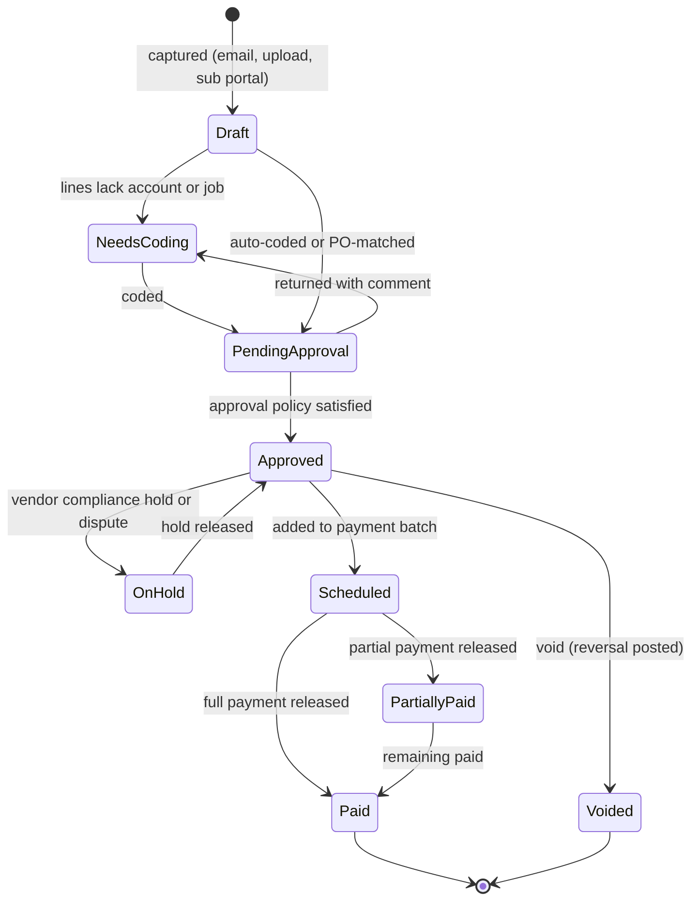

- A bill posts to the ledger (`ap.AP1`-`AP4`) when it reaches `Approved` in approval-enabled tenants, or on save in tenants without approvals (MVP default). Bills in `Draft`, `NeedsCoding` or `PendingApproval` at month-end appear on the close checklist as unrecorded liabilities with an "accrue" action.
- **Header fields**: vendor, vendor invoice number (unique per vendor; duplicates blocked), bill date, accounting date, due date (from terms), terms (Net 30, 2/10 Net 30, due on receipt, EOM), currency, PO references, attachments, memo, 1099 box default, legal entity.
- **Line fields**: account, amount, quantity and unit cost (for PO lines), tax (use tax flag; GST/HST/QST paid for ITCs), dimensions (division, branch, job, phase, cost type, asset for repairs), billable flag (re-bill to client as a T&M material line in [07](07-invoicing-billing-contracts.md)), 1099 box override.
- **Approval policy** [V1]: rules evaluated in order, for example (illustrative defaults):

| Condition | Approver(s) |
|---|---|
| PO-matched within tolerance | Auto-approved |
| Job-coded lines | `ops_manager` of the job's branch, then `owner` if bill total over $5,000 |
| Overhead lines (6xxx) over $1,000 | `owner` |
| New vendor's first bill | `owner` plus `bookkeeper` |
| Any bill over $25,000 | Two approvers, neither the creator |

- **Vendor compliance holds**: an expired certificate of insurance, missing W-9 or missing lien waiver on a subcontractor ([13](13-operations-inventory-equipment.md) `ops.vendor.compliance_changed`, `ops.lien_waiver.signed`) puts its bills `OnHold` for payment (not for posting: the liability is real).
- **Payment batches** [MVP record, V1 batches]: select bills by due date, vendor or job; Rootline proposes a batch that captures expiring early-pay discounts (2/10 Net 30 shown with its roughly 37% annualized return, per [13](13-operations-inventory-equipment.md)) and shows the batch's effect on the 13-week cash forecast (4.9.4). Approval by `owner` (or `bookkeeper` up to a limit, [02](02-personas-roles-permissions.md) `bill_payment.approve`).
- **Payment methods:**

| Method | How money moves | Priority |
|---|---|---|
| Record payment made outside Rootline | Check written by hand, bank bill pay, wire; bank feed match closes it | [MVP] |
| Printed checks | Rootline prints MICR checks on blank check stock or pre-printed stock (laser, 3-per-page or check-on-top with stubs showing invoice numbers); check register with void tracking; signature image only below a threshold, two signature lines above | [V1] |
| ACH via bank file | NACHA-format file generated for upload to the Company's bank portal; remittance advice emailed to vendors | [V1] |
| Positive pay export | Issued-check file in the bank's format to block forged checks | [V1] |
| Embedded bill pay | A licensed payables partner debits the Company's bank and pays vendors by ACH, check or virtual card; Rootline never holds funds | [V2] |

- **Vendor banking security**: changes to vendor or subcontractor bank details require dual control and a call-back verification task with the phone number on file before the change (business email compromise is a known contractor risk, [02](02-personas-roles-permissions.md) 5.6); payments to a bank account changed in the last 10 days require `owner` approval.
- **Vendor credits** (`ap.AP8`): from returns, nursery guarantee claims, pricing corrections; applied to open bills or refunded (refund matched from the bank feed).
- **AP aging** by due date with buckets and a "discount expiring" column; **GRNI aging** (receipts without bills) from [13](13-operations-inventory-equipment.md) appears beside it because both are liabilities the CPA reviews together.

> **Competitive edge.** Aspire reads its vendor list from the accounting system, and a third-party AP product is marketed specifically to process Aspire bills ([Aspire](https://www.youraspire.com/features/purchasing), [Vergo](https://www.getvergo.com/learn/best-ap-automation-software-for-landscape-companies-using-aspire)). Rootline owns vendors, POs, receipts, match, bill approval and payment in one place, so a subcontractor bill is coded to the job phase, held for a missing lien waiver and released with retainage tracked, without leaving the product.

#### 4.5.3 1099-NEC, 1099-MISC, T5018 and T4A [V1]

Landscapers pay many unincorporated subcontractors (mow-and-blow subs, snow plow subs, tree climbers, hardscape installers), so year-end information returns are a real January pain.

**US (1099):**

- **Vendor tax profile**: legal name, TIN (encrypted, last 4 shown), TIN type, entity classification from the W-9 (individual, single-member LLC, partnership, C or S corporation, LLC tax classification), exempt payee code, 1099 eligible flag, default box (NEC box 1 for services; MISC box 1 for rents, such as renting storage or yard space from an individual), state and state ID. W-9 collected through the sub portal ([13](13-operations-inventory-equipment.md) 4.13) with e-signature.
- **Eligibility rules**: corporations are generally exempt except for attorneys' fees; payments for merchandise are excluded; **payments made by credit card, debit card or third-party payment network are excluded** because the payment settlement entity reports them on Form 1099-K (verify current IRS instructions). Rootline therefore counts only check, ACH and cash bill payments toward 1099 totals, by payment method, automatically.
- **Thresholds**: $600 for payments made through 2025; the One Big Beautiful Bill Act raised the 1099-NEC and 1099-MISC threshold to $2,000 for payments made after December 31, 2025, with inflation indexing after 2026 (verify). Thresholds are stored as dated platform parameters so each tax year applies its own rule.
- **Deadlines**: 1099-NEC to recipients and the IRS by January 31 (no automatic extension); 1099-MISC to recipients by January 31 and to the IRS by the end of February on paper or March 31 electronically (verify). The year-end checklist (4.14) starts in November with a "W-9 missing" campaign to vendors paid over the threshold.
- **E-file**: electronic filing is required when a filer has 10 or more information returns in aggregate (verify). Rootline e-files through the IRS Information Returns Intake System (IRIS) application-to-application interface or through a certified filing partner at [V1] (build-vs-partner is open question 9), including the Combined Federal/State Filing program where available and direct state filing exports where a state requires it (verify per state).
- **Recipient copies**: delivered electronically through the sub portal with the recipient's prior consent (the IRS requires affirmative consent for electronic statements; verify), otherwise printed for mailing.
- **TIN matching** [V1]: bulk TIN matching through the IRS e-Services program (verify enrollment requirements) when the W-9 is received, so January surprises are eliminated.
- **Backup withholding** [V2]: when a payee fails to provide a TIN, a 24% backup withholding is applied at payment (`2380 Backup Withholding Payable`), tracked for Form 945 (verify).
- **Corrections**: corrected returns generated from the diff between filed and current totals.

**Canada:**

- **T5018** (Statement of Contract Payments): Companies whose primary business activity is construction report payments for construction services to subcontractors (reporting threshold $500 per year, return due within six months of the end of the chosen reporting period, calendar or fiscal; verify). Whether a landscaping Company's activities count as construction depends on the CRA definition and the Company's mix of hardscape and installation work (verify with the CRA T5018 guide; Rootline asks during onboarding and lets the CPA decide).
- **T4A box 048** (fees for services) for payments to unincorporated individuals for services where T5018 does not apply (verify threshold and due date, generally the last day of February).
- Filing via CRA XML (Internet file transfer) export [V1].

#### 4.5.4 Inventory subledger [MVP]

Physical operations (locations, movements, costing method, counts, reservations) are specified in [13](13-operations-inventory-equipment.md) 4.3. The ledger side:

- **Valuation report** by branch, location type and inventory account at any date, with quantity, moving-average cost and extended value; ties to 1310-1370 nightly (drift alert, as specified in [13](13-operations-inventory-equipment.md)).
- **GRNI** (2020) with aging and an "accrue or chase" action; GRNI older than 60 days flags a likely missing bill or a receipt error.
- **Purchase price variance** (5270) by vendor and item; feeds vendor scorecards in [13](13-operations-inventory-equipment.md).
- **End-of-season write-downs** [V1]: plants still in the holding yard in late season, overwintering risk, and expired chemicals are reviewed for lower-of-cost-or-net-realizable-value write-downs (Dr 5290 or 5280, Cr inventory) with a reason code and photo evidence; a "season-end inventory review" task is generated each October.
- **Year-end physical count**: a count event tied to the fiscal year-end; variances post to 5280 in the year being closed (count date within the soft-closed period, approved by the CPA).
- **Consignment** [V1]: consigned stock (a nursery's trees held in the Company's yard) is tracked in quantity only and never hits the balance sheet until issued, when `inventory.IN2`-style posting creates the liability.

#### 4.5.5 Fixed assets and depreciation [V1]

The **fixed asset register** is the accounting twin of the equipment record in [13](13-operations-inventory-equipment.md) 4.14 (`asset.ledger_fixed_asset_id`). An equipment record can exist without a fixed asset (a $400 backpack blower expensed under the capitalization threshold); every fixed asset that is equipment links to its equipment record.

- **Capitalization policy**: tenant threshold (default $2,500 per item, aligned with the IRS de minimis safe harbor for taxpayers without an applicable financial statement; verify), with prompts when a bill line above the threshold is coded to an expense account ("This $8,950 stand-on spreader looks like equipment. Capitalize?").
- **Multiple books per asset**:

| Book | Purpose | Methods | Notes |
|---|---|---|---|
| `book` | GAAP/ASPE financial statements; posts to the GL | Straight-line; declining balance (150%/200%); **units of production by engine hours**; none (land) | Monthly runs post `assets.FA2` |
| `federal_tax` | US income tax | MACRS GDS/ADS tables, half-year and mid-quarter conventions, Section 179 and bonus elections | Memo only; exported to tax prep |
| `state_tax` | States that decouple from bonus depreciation | Same engine, state-specific rules | Memo only |
| `cca` | Canadian capital cost allowance | Declining-balance classes (for example Class 10 at 30% for automotive equipment and Class 38 at 30% for power-operated earth-moving equipment such as skid steers and mini excavators; verify classes and rates), half-year rule and any accelerated incentive in force (verify) | Memo only; T2/T2125 schedules |

- **Units of production for seasonal equipment.** A mower depreciated straight-line charges the same $229.17 in January as in May, which distorts monthly margins in a seasonal business. With the engine-hours method, the same mower ($11,000 depreciable base over 3,200 expected hours = $3.4375 per hour) charges about $488.13 in a 142-hour May and $0 in January. Hours come from telematics or meter readings in [13](13-operations-inventory-equipment.md). Owners choose per asset class; the year total is similar, the monthly picture is honest.
- **Tax-book specifics worth automating** (all verify): under the One Big Beautiful Bill Act, 100% bonus depreciation applies to qualified property acquired after January 19, 2025, and the Section 179 limit rose to $2.5 million with a $4 million phase-out threshold; **the MACRS mid-quarter convention applies when more than 40% of a year's depreciable basis is placed in service in the fourth quarter**, which is exactly what happens when a snow contractor buys plows and spreaders in October-December. Rootline warns in September when Q4 purchases on order would trip the 40% test.
- **Lifecycle**: `on_order` (deposits in 1599) -> `in_service` (depreciation starts per convention) -> `fully_depreciated` -> `disposed`. Placed-in-service date defaults from the equipment record's in-service date.
- **Disposals** (`assets.FA3`, `FA4`): sale (proceeds, gain or loss), trade-in (treated as a sale plus a purchase; like-kind exchange treatment does not apply to equipment for US federal tax after 2017; verify), scrap, theft or casualty (insurance receivable, link to the loss ledger and police report in [13](13-operations-inventory-equipment.md)). Disposal stops depreciation per convention and archives the equipment record only after operations confirm.
- **Depreciation run**: monthly, all books; the `book` run posts one entry with lines per asset class, division and branch (field assets to 5350, others to 6430). Re-runs are idempotent per period; changing a method or life prospectively posts nothing historical (change in estimate), while a correction of an error is a manual adjusting entry with approval.
- **Reports**: register (cost, accumulated, net book value per book), depreciation schedule (projected by month for the budget), additions and disposals roll-forward, tax depreciation summary for the CPA.
- **Leases** [V2]: operating and finance leases under ASC 842 for private companies (yard leases, leased trucks) with right-of-use assets and lease liabilities; ASPE tenants use their own lease rules (verify).

#### 4.5.6 Loans and financing [V1]

Equipment-heavy landscapers carry many notes: truck loans, dealer financing on mowers, a skid steer note, an SBA loan, a seasonal line of credit drawn in March and paid down by October.

- **Loan record**: lender, type (term, equipment note, vehicle, SBA, line of credit, shareholder), legal entity, principal, rate (fixed or variable with index and margin), start date, term, payment frequency, **payment calendar** (standard monthly, or **seasonal skip-payment schedules** such as payments April-November only, which some equipment dealers offer; verify with lenders), balloon, collateral (linked assets), covenants.
- **Amortization schedule** generated and versioned; variable-rate loans recalculate on rate change; extra principal payments re-amortize or shorten term per lender terms.
- **Bank-feed matching**: a payment matching the scheduled amount within $1.00 auto-splits principal and interest (`loans.LN1`); a mismatch opens a review with the lender's statement attached.
- **Lines of credit**: draws and repayments from bank lines; interest computed from the lender statement (actual) with an optional daily accrual estimate.
- **Current portion reclass** (`loans.LN3`) for balance sheet presentation, auto-reversing.
- **Covenant monitor** [V1]: debt service coverage ratio, current ratio, debt-to-equity, minimum tangible net worth computed monthly from the ledger with an amber warning one month before a breach is projected (beyond the brief: lenders look at these at renewal; owners rarely do until it is too late).
- **Debt schedule report** for lenders and the CPA: balances, rates, maturities, collateral, payments next 12 months.

#### 4.5.7 Payroll journal import and labor allocation [MVP file import, V1 APIs]

Payroll calculation stays with the payroll provider ([15](15-team-hr-payroll.md)); Rootline sends approved hours out and brings the payroll journal back.

- **Sources**: Gusto, ADP (RUN and Workforce Now), QuickBooks Payroll, Paychex, Paycor; Canadian providers such as Wagepoint, Payworks, ADP Canada and Ceridian Dayforce (verify current export formats and APIs per provider). MVP accepts each provider's standard payroll journal or general ledger export file; [V1] pulls via API where the provider offers one.
- **Mapping**: provider pay items (regular, overtime, bonus, PTO, tips, reimbursement), employee and employer tax types, deductions and benefits map once to account roles; employees map to department (admin) or field (cleared against 2310 applied wages).
- **Validation before posting**:
  - Import gross equals the sum of its lines; net pay plus withholdings plus deductions equals gross; employer taxes recorded separately.
  - For each field employee, paid regular hours vs approved time in Rootline within a tolerance (default 0.25 hours); mismatches list "paid but not clocked" and "clocked but not paid".
  - Tips paid this run reconcile against 2160 Tips Payable allocations ([08](08-payments-stripe.md) Example 3).
  - The funding amount matches the bank feed debits (or creates expected bank lines for matching).
- **Posting**: `payroll.PR1`-`PR3` as in E13-E14. Field wage variance (overtime premium, bonuses, PTO paid in season) goes to 5190 by default; [V1] can **re-allocate variance to jobs pro rata to hours** in the pay period so job cost carries real overtime.
- **QuickBooks Payroll in external mode**: payroll is already in QBO; Rootline does not import a journal for the book of record, but still needs labor cost for job costing, which it computes from approved time at standard burdened rates and reconciles to QBO payroll totals monthly (difference shown, not posted).

### 4.6 Banking, receipts and reconciliation

#### 4.6.1 Bank and card connections [MVP]

- **Plaid Link** connects checking, savings, credit card and line-of-credit accounts at US and Canadian institutions (verify current Canadian coverage; a Canadian-specialist aggregator is the fallback, open question 4). Products used: transactions and balances only; no money movement through the aggregator.
- **History on connect**: up to 24 months where the institution supports it (verify Plaid's maximum history request), but Rootline only creates bank lines on or after the account's **ledger start date** (the migration conversion date, 4.18) to avoid double-counting history that is already in the opening balance.
- **File import** for any account without a feed or as a fallback: CSV with a column-mapping wizard, OFX/QFX, and [V1] BAI2 and ISO 20022 CAMT.053 for commercial banking portals. Imports are deduplicated against feed data.
- **Fuel card programs** [V1]: fleet fuel cards (WEX, Fuelman and similar; verify each program's data export or API) carry one of a maintenance company's largest and hardest-to-allocate field costs. Aggregator feeds usually show only merchant and amount; the fuel card program's own file adds card, driver, vehicle, odometer, product (diesel, unleaded, DEF) and gallons. Rootline imports that file daily or weekly, maps card to vehicle or asset ([13](13-operations-inventory-equipment.md)), posts fuel to 5330 with the `asset` dimension, flags fills larger than the vehicle's tank capacity or two fills within 30 minutes (a classic fuel-card fraud pattern), and feeds the off-highway fuel credit tracker (section 13, idea 1). Statement payments reconcile against 2040-2049 like any card.
- **Connection health**: last successful refresh, institution status, re-authentication needed (login changed, MFA expired); the bookkeeper and owner get a task when a feed is broken for more than 48 hours, because a silent feed outage is how month-end surprises happen.
- **Security**: aggregator access tokens are encrypted with per-tenant data keys ([20](20-architecture-security.md)); account numbers shown masked; disconnecting a feed never deletes imported lines.
- **Regulatory note**: the US open-banking rule (CFPB section 1033) addresses consumer accounts and its status was under reconsideration in 2025-2026; most landscaper accounts are business accounts outside its scope, so Rootline relies on aggregator agreements, not regulation, for access (verify).

#### 4.6.2 Transaction ingestion [MVP]

- Pending transactions are displayed (cash dashboard) but never categorized or reconciled; only **posted** transactions become `bank_transaction` rows.
- Deduplication: provider transaction ID first; for file-to-feed switches, a fuzzy key (date within 2 days, exact amount, normalized description).
- Provider modifications and removals (the aggregator's sync can modify or remove previously sent transactions) are applied; if a removed transaction was already categorized and posted, Rootline posts a reversal and opens a task rather than silently deleting.
- Each line gets a **normalized merchant** (from the platform merchant directory, for example "SITEONE LANDSCAPE SUP #1234 ROSWELL GA" becomes "SiteOne Landscape Supply") and the aggregator's category as a weak signal.

#### 4.6.3 Categorization pipeline: matching, rules and AI [MVP rules, V1 AI]

Every posted bank or card line flows through four stages; the first stage that produces a confident answer wins.

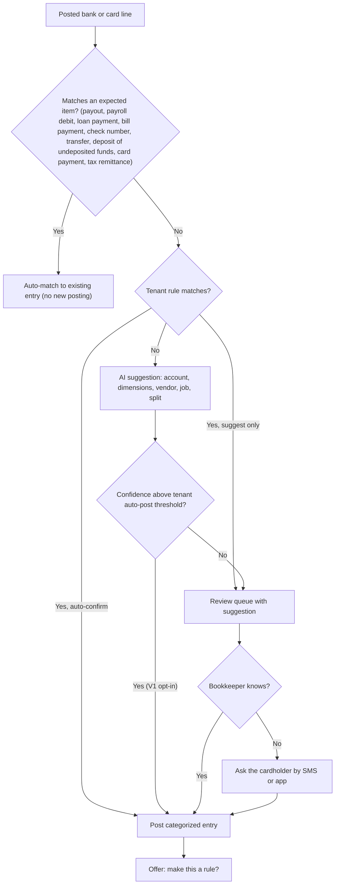

- **Expected-item matching** (deterministic): Stripe payouts by amount, date window and descriptor ([08](08-payments-stripe.md) 4.17.4); payroll debits by provider descriptor and import totals; loan payments by schedule; bill payments by check number or ACH trace; inter-account transfers by opposite-sign pairs within 3 business days; office check deposits by summing undeposited funds selections; card statement payments; sales tax remittances by agency descriptor.
- **Tenant rules**: conditions on account, direction, amount range, normalized merchant, description contains or regex, day of month; actions: account, dimensions (division, department, job), split by percentage or fixed amounts, vendor, memo, 1099 flag, auto-confirm or suggest. Rules are ordered, testable against the last 90 days ("this rule would have matched 37 lines"), and versioned.
- **AI suggestions** [V1]: the model sees the normalized merchant, MCC, amount, the tenant's history for that merchant, matched receipt line items, and context (the cardholder's crew was on job J-2291 that day per the crew app; the line is on the shop card). It returns account, dimensions, vendor and an optional split with a confidence score and a one-line reason ("Home Depot on 5/14 while Crew 2 was at Thompson; receipt shows 6 bags of quick-set concrete"). Auto-posting above a threshold is an explicit tenant opt-in with weekly sampling review; default is suggest-only. See [17](17-ai-copilot-automation.md) for guardrails.
- **Ask the cardholder**: unexplained card lines generate a one-tap question to the cardholder ("What was the $86.40 at Home Depot on May 14 for?" with buttons for their jobs that day, "shop supplies", "personal, I will repay"). Personal charges post to 1240 Employee Advances (or 3200 Owner Draws for the owner).
- **Learning**: every correction offers "Always do this for SHELL OIL on the fuel card?" Platform-level priors (merchant to category) are learned only from non-identifying features across tenants, with tenant opt-out; no tenant's amounts, jobs or vendors are visible to another.

#### 4.6.4 Receipt capture and matching [MVP]

- **Channels**: crew app photo (offline-capable, [05](05-field-crew-mobile-app.md)), web upload, forwarding to a per-Company receipts address, e-receipts from suppliers, SMS photo reply to an "ask" question.
- **Extraction**: [MVP] rules-based OCR of merchant, date, total, tax, tip and payment card last four, with no LLM extraction (AI2 basic); [V1] line items and harder layouts through AI document understanding via the AI Gateway ([17](17-ai-copilot-automation.md); AI2, metered per page in [22](22-business-model-pricing-gtm.md)).
- **Matching**: to card or bank lines by card last four, exact amount (or amount within a tip tolerance for meals), date within 3 days; to bills when a receipt is actually a vendor invoice.
- **Missing receipt chase**: tenant policy (default: receipts required for card spend of $25 or more; IRS substantiation rules for some expense categories start at $75, verify) creates reminders to the cardholder for 3, 7 and 14 days, then escalates to the `office_manager`.
- **Retention**: receipt images stay attached to the journal entry for the record-retention period ([20](20-architecture-security.md)); electronic records are kept in a form that meets IRS and CRA electronic record-keeping expectations (verify Rev. Proc. 97-22 and CRA guidance).

#### 4.6.5 Reconciliation workspace [MVP]

- **Continuous matching, periodic certification.** Feed-connected accounts are matched daily, so the month-end "reconcile" is a certification step: enter or import the statement ending balance and date, review exceptions, finish when the difference is $0.00.
- **Match types**: 1:1; 1:many (one bank deposit containing five checks from undeposited funds; one Stripe payout containing 43 payments and fees, already proven by [08](08-payments-stripe.md)); many:1 (a bill paid in two transfers); bank line to new entry (categorize in place).
- **Statement upload with OCR** [V1] for accounts without feeds: the statement's ending balance, period and line list are extracted and matched.
- **Outputs**: reconciliation report (beginning balance, cleared deposits and payments, outstanding checks and deposits in transit, ending book and bank balances), stored as a PDF in the evidence locker (4.13).
- **Controls**: items in a completed reconciliation are locked; un-reconciling requires `bank_reconciliation.undo`, a reason, and is impossible for locked periods. Outstanding checks older than 90 days create a "stale check" task (contact vendor, void and reissue, or report as unclaimed property).
- **Credit cards and lines of credit** reconcile the same way against their statements.

> **Competitive edge.** Field-service tools push gross payments into QuickBooks and leave the bookkeeper to discover that the bank deposit is net of fees, three days later, mixed with 40 other payments. Rootline proves each Stripe payout against its balance transactions before posting it and then auto-matches the bank line, so a month of card payments reconciles with zero manual matches ([08](08-payments-stripe.md) goal G3).

#### 4.6.6 Cash position [MVP]

A cash panel (owner dashboard and close checklist) shows bank balances (aggregator balances, timestamped), Stripe available and pending per currency (from [08](08-payments-stripe.md)), undeposited funds, crew-held cash in transit by crew lead, credit card balances, line-of-credit availability, and payroll and AP due in the next 14 days.

### 4.7 Job costing

Job costing in Rootline is not a separate report fed by exports: job cost **is** the set of journal lines carrying a job dimension, plus the statistical hours lines, plus commitments from [13](13-operations-inventory-equipment.md). Job cost and the P&L therefore tie by construction; the only differences are the explicit variance accounts (5190, 5195) and overhead.

#### 4.7.1 Cost structure [MVP]

| Level | Example | Source |
|---|---|---|
| Job | J-2291 Thompson backyard; WO-8812 irrigation repair; AGR-0412 Hernandez 2027 maintenance | [04](04-scheduling-dispatch-routing.md) job model |
| Phase (Projects) | 1 Demo and grading, 2 Hardscape, 3 Planting and beds, 4 Lighting, 5 Cleanup | Project phases from the sold estimate |
| Cost code | Paver installation, wall block, mulch install, ZTR mowing, edging | Estimate assemblies and Price Book services ([03](03-crm-sales-estimating-proposals.md)) |
| Cost type | Labor, labor burden, materials, equipment, subcontractor, disposal, other | From the posting rule |

**Budgets on a job**: the **original budget** is frozen from the sold estimate at proposal acceptance (hours and dollars by phase, cost code and cost type); approved change orders ([03](03-crm-sales-estimating-proposals.md)) create the **revised budget**; the project manager's **forecast** produces the estimate at completion.

#### 4.7.2 Labor costing and burden allocation [MVP]

- **Rate basis** (Company setting): employee's actual base rate (default), crew average rate (hides individual wages in job cost views, consistent with pay-rate masking in [02](02-personas-roles-permissions.md)), or standard rate by role.
- **Burden** is applied at a standard percentage per employee class from the Company Budget ([03](03-crm-sales-estimating-proposals.md) EST-01: FICA, FUTA/SUTA, workers' compensation by class code, benefits, PTO, training and PPE; 28.00% in the Evergreen Edge example). Separate classes for W-2 seasonal field staff, H-2B workers (with amortized program costs, `prepaid.PP2`) and salaried crew leads. Actual burden arrives through payroll, insurance and benefit bills into 2390; the monthly true-up (`payroll.PR5`) moves the residual to 5195 so the P&L is right while job costs stay stable and comparable.
- **Salaried crew leads**: hourly equivalent = annual salary / expected annual hours, applied to their time.
- **Overtime premium** [V1]: allocated to the jobs worked after the 40th hour ("hours in order", default) or pro rata across the week's jobs, or left in 5190.
- **Drive time**: yard-to-first-site and between-site time is allocated to the route's visits pro rata by on-site minutes with cost code "Travel" (default), or posted to 5180 Non-billable Field Time. Allocating it is what makes a cul-de-sac of $45 mows look as unprofitable as it really is ([18](18-reporting-analytics.md) property P&L heatmap).
- **Non-billable time** (rain-outs, yard, shop, training, callbacks): cost codes required; posts to 5180 by division; callbacks carry the original job's dimension for quality-cost reporting ([07](07-invoicing-billing-contracts.md) notes callbacks are $0 visits).

#### 4.7.3 Equipment cost allocation [V1]

- Usage records from [13](13-operations-inventory-equipment.md) (telematics engine hours in the job geofence, crew-assigned equipment times on-site hours times a utilization factor, or manual entry) post `equipment.EQ1` at the rate-card version effective on the usage date, by basis: per engine hour, per crew hour (trucks), per mile, per day.
- **Over/under-recovery report** by asset and class: applied (5310) vs actual cost (5330 fuel + 5340 repairs + 5350 depreciation + 5360 insurance and registration). Example (illustrative): mowers applied $48,200 vs actual $52,900 for the season to date = $4,700 under-recovered, meaning rates are too low or machines sit idle; the report proposes the rate the estimator should use next season ([13](13-operations-inventory-equipment.md) 4.14.7).
- **Small tools charge** [V1]: optional per-crew-hour charge (for example $0.75/h) applied with labor to recover trimmers, blowers and hand tools expensed below the capitalization threshold.

#### 4.7.4 Materials, subcontractors, disposal and other direct costs [MVP]

Materials hit the job from inventory issues at moving-average cost (`inventory.IN3`) or job-direct receipts at PO cost, trued up to billed price at match (`ap.AP3`); subcontractor bills by sub work order and phase (`ap.AP4`); dump and disposal tickets allocated per load from [13](13-operations-inventory-equipment.md) `ops.disposal.recorded`; permits, locates and job travel from bills and card lines coded to the job.

#### 4.7.5 Commitments and estimate at completion [V1]

- **Committed cost** = approved, unreceived PO lines and unbilled sub work orders tagged to the job ([13](13-operations-inventory-equipment.md) 4.8.8).
- **Estimate at completion (EAC)** per phase and cost type, default rule: `actual + max(open commitments, remaining revised budget)`; for labor, if the crew app reports physical percent complete for the phase ([05](05-field-crew-mobile-app.md) task completion or installed square feet), `EAC hours = actual hours / physical percent complete`. The project manager can override any cell with a note; overrides older than 45 days on active jobs are flagged as stale.
- **Alerts**: projected gross margin falls more than 5 points below the sold margin; labor hours burned exceed physical percent complete by more than 15 points ("Phase 2 has used 82% of its hours and is 55% complete"); a commitment pushes a phase over budget before the cost even lands.

#### 4.7.6 Job cost report [MVP basic, V1 EAC and commitments]

Columns: phase and cost code; cost type; original budget; approved change orders; revised budget; committed; actual; percent of budget used; physical percent complete; EAC; variance at completion; and estimated vs actual hours. Header: contract value, billed to date, earned revenue (from WIP), gross profit (sold, projected, to date), and retainage. Every actual drills to journal lines and their source documents (time entries with crew and date, receipts, bills, issues, usage records).

#### 4.7.7 Recurring maintenance costing [MVP]

For agreement and per-visit work, the useful unit is the **property season** and the **visit**:

- Revenue per visit (agreement unit value or invoiced amount) vs labor (on-site plus allocated drive), equipment, materials and disposal per visit, per property, per route and per crew.
- **Budgeted vs actual man-hours per visit**: a property estimated at 0.75 crew-hours per weekly mow that averages 0.92 is running 23% over, which becomes a renewal price recommendation ([03](03-crm-sales-estimating-proposals.md) renewal re-pricing).
- **Gross profit per man-hour** and **revenue per man-hour** by property feed [18](18-reporting-analytics.md).

#### 4.7.8 Job close-out [MVP]

Job status `completed` opens a 30-day straggler window (tenant setting) during which bills and receipts still post to the job; then the job is `cost_closed`. Costs arriving later still post to the job with a `post_close` flag (warranty work goes to the warranty reserve, not the job). The closed-job record stores final revenue, cost and gross profit vs the original estimate (fade or gain), which [03](03-crm-sales-estimating-proposals.md) uses to calibrate production rates.

> **Competitive edge.** Jobber's own community explains that its job profitability is only as good as the time and materials crews enter on the job, and analytics add-on vendors sell the missing loaded labor and overhead views ([Jobber community](https://community.getjobber.com/discussions/finances-forum/how-do-you-actually-track-job-profitability-not-just-revenue/15674/replies/15706), [Inzata](https://www.inzata.ai/blog/jobber-job-profitability-tracking)). LMN's Job Costing Advisor tracks labor and bills against the estimate ([Turf Magazine](https://turfmagazine.com/lmn-introduces-job-costing-advisor-for-landscapers)) but the general ledger lives elsewhere. In Rootline the burdened labor, equipment recovery, materials at actual cost and subcontractor retainage that make up job cost are the same journal lines that make up the P&L.

### 4.8 Revenue recognition, WIP and deferred revenue

#### 4.8.1 Recognition policy by work type [MVP policy engine; V1 WIP]

Rootline ships a default policy that a CPA can adjust per Company. The defaults follow common practice under ASC 606 for US private companies and ASPE Section 3400 for Canadian private enterprises (verify both with the Company's accountant; Rootline provides mechanisms, not accounting opinions).

| Work type | Default recognition | Mechanism |
|---|---|---|
| Per-visit maintenance, invoiced per visit or in batches | At completion of each visit | `billing.P1`; month-end accrual of completed-not-invoiced visits (`billing.P8`) |
| Level-billed and prepaid agreements (mowing season, bed maintenance) | As occurrences are delivered; fixed-season lines ratably by a season curve | `billing.P4`-`P7` ([07](07-invoicing-billing-contracts.md) 4.2) |
| Lawn care and PHC programs (5-step fertilizer and weed control) | Per application completed | `billing.P5` |
| Snow seasonal (fixed-fee) contracts | Ratably over the contract season using a weighting curve or straight-line | `billing.P6`; discussed in snow bookkeeping guidance ([Beancount](https://beancount.io/blog/2026/06/03/snow-removal-plowing-ice-management-contractor-bookkeeping-asc-606-seasonal-deferred-revenue-per-push-trigger-section-179-plow-truck-salt-spreader-sima-asca-revenue-per-truck-hour-kpi-guide)) |
| Snow per push or per application | At event completion | `billing.P1` (with month-end accrual of uninvoiced events) |
| Enhancements and small installs under the WIP threshold | At completion | `billing.P1`; simplification policy, default threshold $10,000 contract value or 30 days duration |
| Design-build projects at or above the threshold | Over time, input method (cost-to-cost) by default | WIP schedule (4.8.3) |
| Design fees | At delivery when the design is a distinct deliverable; otherwise combined with the build | Policy flag on the Price Book item |
| Standard plant and workmanship warranties | Assurance-type: no revenue deferral; accrue expected cost | `warranty.WR1` |
| Extended warranties sold separately [V2] | Deferred and recognized over the warranty term | Deferred revenue sub-account |
| Retainage | Recognized as earned; receivable held in 1205 | `billing.P12` |

Over-time recognition for installs is supported by the fact that the work is performed on the customer's land, so the customer controls the asset as it is created, which is one of the ASC 606 criteria for over-time recognition (verify with the CPA for each contract type).

#### 4.8.2 Deferred revenue for prepaid contracts [MVP]

The agreement position mechanics (earned value meter, prepay factors, true-ups, contract asset vs liability per agreement) are specified in [07](07-invoicing-billing-contracts.md) 4.2. The ledger adds:

- **Deferred revenue roll-forward** per period: opening balance, billed, recognized, credits and refunds, closing, by agreement, division and branch; ties to 2200 - 1210 (L7).
- **Season curves**: configurable monthly weights for ratable lines. Illustrative fixed-season maintenance curve April-November: 10%, 15%, 14%, 11%, 11%, 12%, 15%, 12%. Illustrative snow season curve November-March: 10%, 20%, 30%, 25%, 15%. Companies can derive a curve from their own last three seasons of labor hours or snow events.
- **Cancellations**: early termination posts the true-up (07 P10/P11) and releases any remaining deferred balance as a credit or revenue per the agreement's terms.
- **Prepaid program liability report** for lawn care Companies: every prepaid client's remaining applications and dollars, which is also the number a buyer asks for in an acquisition.

#### 4.8.3 Percentage-of-completion and the WIP schedule [V1]

The WIP schedule is generated on day 1 of each month for every open project at or above the threshold, reviewed, and posted as auto-reversing entries.

**Rules:**

- `percent_complete = cost_to_date / estimated_total_cost` (cost-to-cost, default). Alternatives per job: labor hours-to-hours, physical units (square feet installed from the crew app), or manual milestones.
- **Uninstalled materials**: materials delivered to the job site but not yet installed (pavers on pallets in the client's driveway) can be excluded from cost-to-date to avoid overstating progress (verify treatment with the CPA); Rootline knows them because they sit in the job-site inventory location in [13](13-operations-inventory-equipment.md).
- `earned_revenue = percent_complete x contract_value` (contract value includes approved change orders; unapproved change orders are excluded unless the CPA marks them probable).
- `underbilling = earned - billed` when positive (contract asset, 1215); `overbilling = billed - earned` when positive (contract liability, 2210). Billed excludes deposits not yet applied (deposits are 2150 liabilities).
- **Estimated total cost** comes from the job's EAC (4.7.5). If the EAC has not been reviewed in 45 days, the WIP line is flagged and the bookkeeper can still post it with a note.
- **Projected losses**: when estimated total cost exceeds contract value, the full projected loss is recognized immediately (4.8.4).

**Worked example: Reyes Outdoor Living WIP schedule at May 31, 2027 (illustrative).**

| Job | Contract (with approved COs) | Est. total cost | Est. GP | Cost to date | % complete | Earned revenue | Billed to date | Underbilled (1215) | Overbilled (2210) | Cost to complete |
|---|---:|---:|---:|---:|---:|---:|---:|---:|---:|---:|
| J-2291 Thompson patio and seat wall | 19,600 | 13,250 | 6,350 | 9,275 | 70.0% | 13,720 | 7,360 | 6,360 | | 3,975 |
| J-2264 Patel front-yard renovation and irrigation | 42,000 | 29,400 | 12,600 | 25,872 | 88.0% | 36,960 | 39,900 | | 2,940 | 3,528 |
| J-2302 Lakeside HOA entrance renovation | 12,400 | 8,680 | 3,720 | 1,302 | 15.0% | 1,860 | 3,720 | | 1,860 | 7,378 |
| J-2287 Morgan retaining wall (loss job) | 9,800 | 10,300 | -500 | 6,180 | 60.0% | 5,880 | 4,900 | 980 | | 4,120 |
| **Totals** | **83,800** | **61,630** | **22,170** | **42,629** | | **58,420** | **55,880** | **7,340** | **4,800** | **19,001** |

Thompson's $9,275 cost to date is materials $4,035.00 (E2-E4), the lighting sub $2,400.00 (E10), two crew-days of labor and burden $2,334.72, the track loader $383.00 and dump fees $122.28. The Morgan wall hit ledge rock; the revised estimate of $10,300 exceeds the $9,800 contract.

Entries posted May 31, auto-reversing June 1:

| Rule | Account | Dimensions | Debit | Credit |
|---|---|---|---:|---:|
| `wip.WP1` | 1215 Underbillings | J-2291 | 6,360.00 | |
| `wip.WP1` | 1215 Underbillings | J-2287 | 980.00 | |
| `wip.WP1` | 4300 Design-Build and Installation Revenue | J-2291, J-2287 | | 7,340.00 |
| `wip.WP2` | 4300 Design-Build and Installation Revenue | J-2264, J-2302 | 4,800.00 | |
| `wip.WP2` | 2210 Overbillings | J-2264 (2,940.00), J-2302 (1,860.00) | | 4,800.00 |
| `wip.WP3` | 5990 Provision for Contract Losses | J-2287 | 200.00 | |
| `wip.WP3` | 2215 Accrued Losses on Contracts | J-2287 | | 200.00 |

Net effect on May install revenue: +$2,540 (earned $58,420 vs billed $55,880). The Morgan provision is $200 because POC already shows a $300 loss to date ($5,880 earned vs $6,180 cost) and the full projected loss is $500.

**Reports from the same data:** the surety-format WIP schedule that banks and bonding companies expect; the **closed-jobs schedule** for the year with gross profit fade or gain vs estimate; and **backlog** (contract value not yet earned: $25,380 in the example) for the owner's capacity planning.

**WIP rules engineers must get right:**

- **Change orders.** Approved change orders raise both contract value and estimated cost on the WIP line in the period they are approved; pending change orders are excluded by default. A CPA can mark a pending change order "probable" with a note, which includes its revenue only to the extent of costs already incurred on it (no margin on unapproved work).
- **Retainage.** Billed-to-date includes retainage billed (it is earned and billed, just not yet due), so retainage never shows up as an underbilling.
- **Deposits.** Unapplied deposits are excluded from billed-to-date until an invoice applies them (E7 shows why: until the mobilization invoice, the $5,520 Thompson deposit is a 2150 liability, not billing).
- **Small jobs crossing the threshold.** A job that starts below the threshold and grows past it through change orders enters the WIP schedule in the period it crosses, with a catch-up adjustment for cumulative earned revenue; it never leaves the schedule until closed.
- **Completed but not closed.** Jobs at 100% stay on the schedule until the straggler window ends (4.7.8) so late costs do not land as phantom margin in the closed-jobs report.
- **Rounding.** Percent complete is stored to four decimals; earned revenue rounds to cents per job, and totals are sums of rounded job lines, so the posted entries tie to the printed schedule exactly.

> **Competitive edge.** WIP and over/under billing are what banks and sureties ask a design-build firm for, yet in the public documentation reviewed for Jobber, LMN, Aspire, SingleOps and SynkedUP ([R1](research/R1-field-service-platforms.md), [R2](research/R2-landscape-specific-platforms.md)) none describes a WIP schedule that posts over/under billings to a general ledger; LMN and Aspire stop at job costing against the estimate, and the WIP schedule lives in the CPA's spreadsheet. Rootline generates it from job cost and billing data that are already in the ledger, posts it as auto-reversing entries and prints the surety format, so a 15-person design-build firm gets construction-grade reporting without a construction ERP.

#### 4.8.4 Loss contracts [V1]

When a project's EAC exceeds its contract value, `wip.WP3` provisions the remaining projected loss (total projected loss minus loss already recognized through POC). The provision is recalculated every period and released as the job completes. The job gets a red badge, the owner is notified, and the closed-job record keeps the loss for estimator learning.

#### 4.8.5 Tax-basis and cash-basis views [V2]

- **Cash-basis P&L**, derived from the accrual ledger: revenue when payments are received (payment allocations spread across the invoice's revenue lines pro rata), expenses when bills are paid, deferred revenue and WIP adjustments excluded. Useful for the many small landscapers who file on the cash method.
- **Completed-contract view** for small contractors eligible under the gross-receipts test for long-term contracts (an inflation-indexed threshold of roughly $31 million of average gross receipts for 2025; verify), with an accrual-to-tax reconciliation schedule for the CPA.
- These are views and export schedules, not alternate ledgers.

### 4.9 Budgets, overhead recovery and forecasts

#### 4.9.1 Budget model [V1]

- The **Company Budget** that estimating uses ([03](03-crm-sales-estimating-proposals.md) EST-01, [MVP]) is the summary view of a ledger **budget version**: amounts by account (or account group), division, branch and month, plus statistical budgets (billable hours by month).
- **Versions**: original, revised (for example after a slow spring), and rolling forecast; one version is the "estimating budget" pinned by estimates.
- **Phasing methods**: even; seasonal curve from last year's actuals; custom per month; **driver-based** (revenue = budgeted billable hours x budgeted revenue per man-hour; field wages = hours x average wage; burden = wages x burden %; equipment recovery = hours x rates).
- **Inputs**: guided wizard (03), XLSX import, copy last year's actuals with a percentage change, or an AI-drafted budget from history and the sales pipeline [V1] that the owner edits.
- **Locks**: an approved budget version is read-only; edits create a new version.

#### 4.9.2 Overhead recovery tracker [V1]

LMN-style pricing recovers overhead through a rate built from the budget (FLH, SORS, MORS; [03](03-crm-sales-estimating-proposals.md) EST-02). Rootline then measures whether the business actually recovered it.

- **Recovered overhead** for a period = actual billable field hours x FLH rate (FLH method), or actual direct costs x SORS percentage, or the sum of category costs x MORS percentages, using the pinned budget version.
- **Actual overhead** = posted 6xxx accounts (plus any overhead-tagged allocations) for the period.
- **Recovery %** = recovered / actual, shown monthly and year to date against the **planned recovery curve** implied by the budget's seasonal phasing, because a northern landscaper will always under-recover in January-March.

**Worked example: Evergreen Edge Landscaping, 2026 budget (from [03](03-crm-sales-estimating-proposals.md) EST-01).** Overhead $420,000 ($35,000 per month), 20,000 budgeted billable hours, FLH $21.00 per hour. Budgeted hours phased March-December: 1,000; 2,200; 2,600; 2,600; 2,300; 2,300; 2,300; 2,400; 1,800; 500.

| Through June 30 | Budget | Actual |
|---|---:|---:|
| Billable field hours | 8,400 | 8,050 |
| Overhead recovered at $21.00/h | $176,400 | $169,050 |
| Overhead incurred | $210,000 | $214,600 |
| Recovery % year to date | 84.0% (planned) | 78.8% |

The tracker explains the 5.2-point gap: 350 fewer billable hours ($7,350 less recovery) and $4,600 of overhead overspend. If July-December hit their budgeted 11,600 hours and overhead runs at budget, the year ends with $412,650 recovered against $424,600 of overhead: 97.2%, an **under-recovery of $11,950 that comes straight out of net profit**. The tracker proposes the levers in owner language: about 569 more billable hours at $21.00, or a price increase on remaining unsold work, or $11,950 of overhead cuts.

- **Mid-season re-pricing loop.** When year-to-date recovery trails the planned curve by more than 3 points for two consecutive months, the tracker raises a task for the `owner` and `estimator`: either re-pin a revised budget version (which raises the FLH or SORS rate on **new** estimates only; signed proposals are never re-priced) or accept the gap. The decision and the resulting rate change are logged so year-end variance analysis can show what was decided and when.
- **Division recovery.** With the division P&L allocations in 4.10, recovery can be shown per division (snow recovers overhead in winter months when maintenance recovers nothing), which keeps a Company from cutting a division that is actually carrying the winter.

> **Competitive edge.** LMN taught the industry to build overhead recovery into every estimate ([LMN help](https://intercom.help/lmn/en/articles/15939065-how-lmn-calculates-overhead-labor-burden-and-profit-in-estimates)), and SynkedUP markets overhead-based pricing ([SynkedUP](https://synkedup.com/features/estimating/)). Both stop at the price. Because Rootline holds the pinned budget, the actual billable hours from time capture and the actual overhead from the general ledger, it answers the question those tools leave to a spreadsheet: "are we on pace to recover overhead this year, and what does it cost us if we are not?"

#### 4.9.3 Budget vs actual [V1]

Monthly and year-to-date by account, account group, division and branch, with variance in dollars and percent, a flex-budget option (budget restated at actual billable hours for variable lines such as field wages, fuel and materials), and AI commentary for the largest variances ("Fuel is $3,120 over budget in June: price per gallon up 9% and engine hours up 6% vs plan").

#### 4.9.4 Cash forecast [V1]

This is the same forecast engine as the 13-week cash flow forecast in [Reporting](18-reporting-analytics.md) section 4.9.1, not a second model: 18 owns the analytics behavior (P10-P50-P90 ranges, backtest, alerting and the dashboard), and this section owns the ledger inputs (bank, Stripe, AR, AP, payroll, loan, tax and recurring-entry schedules), the seasonal 12-month view and the ledger-side scenarios. Predicted pay dates come from the one payment-timing model (AI9).

- **13-week direct forecast**: opening cash (bank balances plus Stripe available and pending) plus receipts (open AR by predicted pay date from each client's payment history; scheduled autopay and agreement installments; deposits on approved proposals) minus disbursements (AP by due date and scheduled batches; payroll from scheduled hours x rates plus taxes per pay calendar; loan payments from schedules; sales tax due dates; recurring entries such as rent and insurance; equipment on order) = ending cash per week, against a minimum cash threshold.
- **Seasonal 12-month forecast** showing the winter trough: "Cash bottoms at $38,200 in the week of February 15; line of credit headroom $150,000."
- **Scenarios** [V1]: snow season light, average or heavy (seasonal contract revenue is fixed while per-push revenue, sub costs, salt and overtime vary); "rained-out week" (lost billable hours, payroll still due); "lose the Crossroads PM contract".
- Actual vs forecast accuracy is tracked per week to tune the payment-timing model.

### 4.10 Financial reports

Management dashboards, KPI definitions and the report builder belong to [18](18-reporting-analytics.md); this module owns the **accounting reports** that must tie to the ledger to the cent. All reports drill from any amount to journal lines, then to source documents and posting rules.

| Report | Key behaviors | Priority |
|---|---|---|
| **Profit and loss** | Two layouts: *Landscape management* (revenue by division, direct costs by cost type, gross profit and GP%, overhead, net operating income, other, net income) and *Standard* (accountant layout). Columns by month, quarter, YTD, by division, branch or department; comparatives (prior period, prior year, budget); % of revenue; statistical ratios (revenue per man-hour). | [MVP] |
| **Division P&L with allocations** | Overhead allocated to divisions by a chosen driver (billable hours default, revenue, or direct cost) so each division shows a net profit, with the unallocated view one click away. | [V1] |
| **Balance sheet** | Comparative; classified (current vs long-term, with current portion of debt); retainage, contract assets and liabilities shown separately. | [MVP] |
| **Statement of cash flows** | Indirect method from balance sheet movements with account-role classification (operating, investing, financing). | [V1] |
| **Trial balance** | Unadjusted, adjustments and adjusted columns (worksheet view); by entity; as of any date. | [MVP] |
| **General ledger detail** | By account and date range with running balance, dimensions, source links; export to XLSX. | [MVP] |
| **Journal register** | All entries with filters by type, actor (user, accountant, automation, AI), rule. | [MVP] |
| **Budget vs actual** | 4.9.3, with flex budget. | [V1] |
| **AR aging** and **AP aging** | Summary and detail, by due or document date; retainage separate; GRNI aging beside AP. | [MVP] |
| **Sales tax liability** | By agency and jurisdiction: taxable and exempt sales, tax collected, adjustments (bad debt, credits), tax paid, payable; ties to 2101+; use tax accrued. | [MVP] US, [V1] GST/HST/QST worksheet |
| **Deferred revenue roll-forward** | 4.8.2. | [MVP] |
| **WIP schedule**, **closed jobs**, **backlog** | 4.8.3. | [V1] |
| **Job cost** and **job profitability summary** | 4.7.6. | [MVP] |
| **Overhead recovery** | 4.9.2. | [V1] |
| **Equipment over/under recovery** | 4.7.3. | [V1] |
| **Inventory valuation**, **GRNI**, **PPV** | 4.5.4. | [MVP] |
| **Fixed asset register and depreciation schedule**; **debt schedule** | 4.5.5, 4.5.6. | [V1] |
| **1099 / T5018 summary and detail** | 4.5.3. | [V1] |
| **Bank reconciliation reports** | 4.6.5. | [MVP] |
| **Cash forecast** | 4.9.4. | [V1] |
| **Financial package** | Branded PDF: cover, highlights, P&L, balance sheet, cash flow, division P&L, WIP, AR aging, KPI page, Copilot narrative in English or Spanish; scheduled monthly to the owner and lender. | [V1] |

**Report engine behaviors:**

- **Time travel** [V1]: "as posted on" any date, so the March package issued on April 9 can be reproduced exactly even after April adjustments to March (useful when a lender asks why numbers changed).
- **Basis toggle** [V2]: accrual (default) or derived cash basis (4.8.5).
- **Include or exclude** auto-reversing accruals, WIP and accountant adjustments, to show "operational" vs "adjusted" views.
- **Closed-period badge**: every report shows whether its periods are locked and reconciled, per [18](18-reporting-analytics.md) goal G5.
- **Exports**: XLSX (values, with a GL-detail tab), CSV, PDF; scheduled delivery; report packages.
- **Custom row layouts** [V1]: account groups, subtotals, ratio rows; saved per Company or per accounting firm template.

### 4.11 Period close

**Priority:** [MVP] checklist with C1-C8, C18, C21 and sign-off; [V1] the full 24-check list, close calendar, readiness score and AI flux commentary.

Close is a **checklist with automated checks**, generated for each legal entity on day 1 of the new month (the bookkeeper can start it earlier for a continuous close). Each check runs automatically on open and again on demand; hard checks block locking, soft checks require a note to waive.

| # | Check | Automated test | Type |
|---|---|---|---|
| C1 | Bank, card and loan accounts reconciled through period end | Completed reconciliation per account with difference $0.00 | Hard |
| C2 | Stripe clearing proven | GL 1050/1051/1055 equals Stripe-reported balance at period end ([08](08-payments-stripe.md) 4.17.4) | Hard |
| C3 | Undeposited funds and crew cash in transit | Items older than 5 days explained | Soft |
| C4 | AR ties | AR subledger = 1200/1205/2150/2180 | Hard |
| C5 | AP ties; GRNI reviewed | AP subledger = 2000/2010; GRNI items over 60 days reviewed | Hard / Soft |
| C6 | Inventory ties | Valuation = 13xx | Hard |
| C7 | Deferred revenue ties | Agreement positions = 2200 - 1210 | Hard |
| C8 | Payroll complete | Journals imported for all pay dates in the period; 2360 = 0 | Hard |
| C9 | Burden trued up | 2390 = 0 after `payroll.PR5` | Soft |
| C10 | Labor complete | No unapproved timesheets dated in the period | Soft |
| C11 | Revenue complete | Completed visits and events not invoiced are invoiced or accrued (`billing.P8`) | Soft |
| C12 | Costs complete | Open sub work and dump tickets without bills accrued | Soft |
| C13 | Depreciation posted | Run exists for the period (if fixed assets enabled) | Hard |
| C14 | Recurring and prepaid entries posted | All templates due in the period posted | Soft |
| C15 | FX revaluation posted | Multi-currency entities only | Hard |
| C16 | WIP posted | Reviewed and posted for design-build templates | Hard |
| C17 | Sales tax reconciled | Liability per agency matches the return data or explained | Soft |
| C18 | Suspense cleared | 1099 Suspense, 1090 Payments Suspense and other `must_clear_at_close` accounts = 0 (L16) | Hard |
| C19 | Drafts and approvals | No draft entries or pending approvals dated in the period | Soft |
| C20 | Late events reviewed | Events redirected from earlier locked periods acknowledged | Soft |
| C21 | Integrity | No open `ledger_integrity_case` | Hard |
| C22 | Flux review | Accounts moving more than 20% and $1,000 (defaults) vs prior month or budget have commentary; AI drafts it | Soft |
| C23 | Sync clean | Mirror or external mode: zero open sync errors for the period | Hard (external modes) |
| C24 | Sign-off | Bookkeeper marks `ready_for_review`; owner (or bookkeeper if delegated) approves | Configurable |

**Close states** (per legal entity and period): `not_started -> in_progress -> ready_for_review -> completed`. Completing the close moves the accounting period to `locked` and stamps financial metrics as "period closed" in [18](18-reporting-analytics.md). Tasks have assignees (internal bookkeeper, accountant firm staff, office manager), due dates on a close calendar (default target: business day 5), comments and attachments. A **close readiness score** (percentage of checks passing) is visible all month for continuous close.

### 4.12 Accountant Hub and the external CPA

Delegated access, the firm model and revocation are specified in [02](02-personas-roles-permissions.md) 5.10 ([MVP] basic delegated access, [V1] Hub). This module specifies what the accountant does inside it.

- **Multi-client dashboard** [V1]: each client Company with close status and readiness score, unreconciled and uncategorized counts, open sync errors, suspense balance, AR over 90 days, upcoming sales tax and 1099 deadlines, period lock state, last owner login. Queries run per tenant under the delegation; there are no cross-tenant joins ([02](02-personas-roles-permissions.md)).
- **Firm templates** [V1]: a firm's preferred chart of accounts variant, bank rules, recurring entries, close checklist additions and report layouts can be applied to a new client in one step.
- **Client questions** [V1]: the accountant selects transactions or items ("12 card charges without receipts", "Is this $4,800 payment to J. Alvarez a subcontractor?") and Rootline sends the owner a plain-language list with one-tap answers by app, email or SMS; answers post the categorization or attach the receipt, and the accountant sees the audit of who answered.
- **Accountant adjustments**: entries posted by firm users carry the flag and firm identity ("Liu & Partners CPAs - Karen Liu posted 4 adjusting entries"); owners are notified; adjustments appear in their own column of the trial balance worksheet.
- **Bulk reclass**: select lines by filter (account, vendor, date, dimension) and reclass account or dimension in one balanced entry with full linkage.
- **Work papers** [V1]: per account per period, attach lead schedules, tie-outs and notes; carry forward to next period; export the binder.
- **Review notes**: comment threads on entries, accounts and reports with resolve tracking.
- **Imports**: audit-adjusting entries from the CPA's tools as CSV, previewed and posted as one batch.
- **Exports**: tax-prep exports (4.17.8), trial balance with mapped tax lines, GL detail.
- **Accountant-led onboarding** [V1]: a firm can create a client Company, apply its template, and invite the owner, which makes accountants a sales channel ([22](22-business-model-pricing-gtm.md)). Firm seats are free.

> **Competitive edge.** In landscape software today, the CPA either buys a seat in the field tool, works from QuickBooks with numbers that disagree with operations, or both ([02](02-personas-roles-permissions.md) persona research). Rootline gives the accountant free access to all clients in one hub, the operational source behind every number, and period locks that hold.

### 4.13 Audit trail and evidence

- **Entry-level provenance** [MVP]: actor type (`user`, `accountant`, `automation`, `ai_agent`, `system`), actor identity, firm, source document and version, source event ID, posting-rule version, approvals, IP and device for manual actions, timestamps (`entry_date`, `service_date`, `posted_at`).
- **Master data history** [MVP]: every change to accounts, posting rules and overrides, bank rules, integration mappings, period states, vendor tax and banking details, budgets and dimension policies, with before and after values.
- **Hash-chain verification** [MVP]: the UI shows "Chain verified through entry 48,213 on 2027-06-01" with the anchored digest ([20](20-architecture-security.md) L8); a verification failure is a severity-1 incident.
- **Evidence locker** [MVP]: attachments per entry and per period (receipts, bills, bank statements, reconciliation reports, WIP support, approvals, payroll registers), retained for the record-retention period ([20](20-architecture-security.md): 7 years after fiscal year end).
- **Explain this number** [MVP]: from any report cell, a tree of contributing lines, grouped by rule and source, with the plain-English rule and links to documents; the Copilot can narrate it ([17](17-ai-copilot-automation.md)).
- **Auditor access** [V1]: a time-boxed read-only custom role with evidence download and sampling export (random or monetary-unit sample of entries with their evidence) [V2].

### 4.14 Year-end

**Priority:** [V1] (year lock, retained earnings roll-forward and the year-end calendar); the optional closing entry for exports is [V1]; prior-period adjustment flags are [MVP] because they follow from period locks.

| When | Step | Owner |
|---|---|---|
| November | W-9 campaign to vendors paid or expected to be paid over the 1099 threshold; T5018/T4A eligibility review; asset additions and disposals review; Q4 capex and the mid-quarter convention warning; inventory count planning; budget kickoff for next season | `office_manager`, `bookkeeper`, `owner` |
| December | Physical count; accrue year-end bonuses; review warranty reserve and allowance; snow contracts straddling year-end checked for correct deferral | `ops_manager`, `bookkeeper` |
| January | Close period 12; 1099-NEC to recipients and IRS by January 31; T4A by end of February; payroll year-end at the provider ([15](15-team-hr-payroll.md)); tax package export | `bookkeeper`, CPA |
| February-March | Accountant adjustments; year lock; next-year budget approved and pinned for estimating ([03](03-crm-sales-estimating-proposals.md)) | CPA, `owner` |

- **Retained earnings** are computed: at the fiscal-year boundary, P&L accounts start the new year at zero in reports and 3300 shows prior retained earnings plus prior-year net income. No closing entry is required for native reporting; an optional `closing` entry can be generated for exports or external systems that need one [V1].
- **Year lock**: locking period 12 offers to lock the year; reopening a locked year needs `owner` plus `bookkeeper` dual control.
- **Prior-year adjustments** after the year is locked post in the current year flagged `prior_period_adjustment` (shown separately in reports), unless the year is reopened under dual control.
- **New year roll**: balance sheet carries forward automatically; budgets and recurring templates roll; 1099 accumulators reset per tax year.
- Year-end falls in the landscaper's quiet season, which is why Rootline schedules migrations, chart clean-ups and budget work in December-February (4.18).

### 4.15 Multi-entity books and consolidation

Organization structure (branches, divisions, legal entities, multi-company organizations) is defined in [02](02-personas-roles-permissions.md) 5.9. Branches and divisions are **dimensions inside one set of books**; legal entities are **separate books**.

- **Legal entity books** [V1]: each entity has its own functional currency, fiscal calendar, periods and locks, journal sequence, bank accounts, tax IDs, sales tax registrations, 1099 filer profile and optionally its own Stripe account ([08](08-payments-stripe.md)). Every document (invoice, bill, time entry, stock movement) belongs to exactly one entity, defaulted from the job or branch.
- **Shared chart**: entities share the Company chart of accounts by default (consolidation then needs no mapping); accounts can be restricted to specific entities. A fully separate chart for an acquired firm is supported with a consolidation mapping [V2].
- **Intercompany** [V1]: when an activity in one entity serves another (crews employed by Summit Grounds LLC plowing for Summit Snow Services LLC; trucks owned by one entity carrying plows owned by the other; shared office staff; intercompany loans), Rootline generates **linked pairs** (`interco.IC1`) at a configured transfer rate, keeping due-from and due-to equal (L18). Monthly settlement nets and records the payment between entities.
- **Consolidation** [V1 within one Company; V2 across tenants in an Organization]: choose entities and period; Rootline aggregates, applies **elimination rules** (intercompany receivables and payables, intercompany revenue and expense or recovery, intercompany loans and interest) in a separate elimination book (never in the entities' books), and produces consolidated statements with an entity-column view. Cross-currency consolidation [V2] translates a CAD entity into a USD parent using the current-rate method (balance sheet at closing rate, P&L at average rate, equity at historical rates) with the difference in 3400 Cumulative Translation Adjustment.

**Worked intercompany example (illustrative).** In January, Summit Snow Services LLC uses six of Summit Grounds LLC's pickups for nine storm days (54 truck-days) at an intercompany rate of $85 per truck-day = $4,590.

| Entity | Account | Dimensions | Debit | Credit |
|---|---|---|---:|---:|
| Summit Snow Services LLC | 5310 Equipment Charged to Jobs | Storm event "Jan 14-15", sites | 4,590.00 | |
| Summit Snow Services LLC | 2910 Intercompany Payable - Summit Grounds | | | 4,590.00 |
| Summit Grounds LLC | 1910 Intercompany Receivable - Summit Snow | | 4,590.00 | |
| Summit Grounds LLC | 5390 Equipment Cost Recovery | Assets PU-11 to PU-16 | | 4,590.00 |

On consolidation, 1910 and 2910 eliminate, and the charge and recovery net to zero. The transfer rate affects each LLC's taxable income, so the CPA owns it; Rootline only applies it consistently.

### 4.16 Sales tax, use tax and GST/HST on the ledger side

Tax determination, exemptions and invoice tax lines are owned by [07](07-invoicing-billing-contracts.md) 4.5. The ledger provides:

- **Payable sub-accounts per agency** (state, county, city, special district; provincial and federal in Canada) so the liability report ties to returns.
- **Filing worksheets** [MVP US basic, V1 Canada]: per agency and filing period, taxable sales, exempt sales by reason, tax collected, adjustments (credit memos, bad-debt deductions where allowed), vendor collection allowances, and net due; marking a return filed and matching the payment posts `tax.TX1`. Automated filing and remittance through a tax-compliance partner (Avalara Returns or a Stripe Tax filing partner) is [V1], as owned by [07](07-invoicing-billing-contracts.md) 4.5.5; Rootline never remits on the Company's behalf itself (open question 10).
- **Use tax accrual** (`ap.AP9`) for purchases on which the vendor did not charge tax but tax is owed (contractor-as-consumer materials bought out of state, online parts purchases), with a use tax report.
- **Canada**: GST/HST and QST collected (2125, 2126) vs input tax credits on purchases and capital assets (1260); return worksheet with net tax; filing frequency per registration; **Quick Method** support for small registrants who elect it (remittance computed as a prescribed percentage of tax-included sales, with ITCs generally limited to capital purchases; verify eligibility and rates), with the difference between tax collected and remitted posted to other income (verify presentation with the CPA).
- **Liability reconciliation** in the close checklist (C17).

### 4.17 Accounting integrations

The connector framework (OAuth token vault with refresh locks, external reference map, Temporal sync workflows, idempotency keys, retries and circuit breakers, error UX, connector health) is specified in [20](20-architecture-security.md) section 4.8. This section specifies the accounting semantics on top of it.

#### 4.17.1 Books-of-record modes [MVP]

Every legal entity is in exactly one mode ([20](20-architecture-security.md) L12, `ledger_mode`), chosen in onboarding and changeable at a period boundary.

| | **A. Native** | **B. Native + mirror** | **C. External sync** |
|---|---|---|---|
| Book of record | Rootline ledger | Rootline ledger | QuickBooks Online/Desktop or Xero |
| `ledger_mode` | `native` | `native` with `mirror_target` | `external_sync` |
| What Rootline posts | Everything | Everything | Everything, as an operational subledger (job cost, WIP, deferred revenue, Stripe clearing) |
| What syncs | Nothing | Push only: **summary** journal entries (daily per account x class x location) or **detail** documents (customers, invoices, payments, bills) to a read-only mirror for the CPA | Push operational documents (clients, items, invoices, credit memos, payments, deposits, payouts as transfers, optionally bills and vendors) and accounting adjustments (deferred revenue, WIP, labor accruals) as journal entries; pull payments and credits recorded in the external system, plus its trial balance for dashboards |
| Bank reconciliation | Rootline | Rootline | External system |
| Period locks | Rootline (pushed to mirror's closing date) | Rootline (pushed to mirror's closing date) | External closing date pulled into Rootline |
| Statements labeled | Book of record | Book of record; mirror labeled "copy" | "Operational subledger, not book of record" watermark (L15) |
| Typical Company | Small firm dropping QuickBooks; new firms | CPA wants QuickBooks access during transition; lender requires QuickBooks reports | CPA and owner committed to QuickBooks or Xero; larger firms with established processes |
| Priority | [MVP] | [MVP] QBO summary, [V1] QBO detail, Xero, QBD | [MVP] QBO, [V1] Xero and QBD |

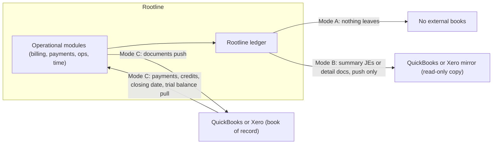

**Switching modes** happens only at a period boundary after a close: C to A or B is a migration (4.18) using the external system's balances as the opening position; A or B to C requires an export of opening balances to the external system, which Rootline generates as a journal entry plus open AR and AP detail.

#### 4.17.2 QuickBooks Online [MVP]

**Connection and preflight.** OAuth 2.0 connection per legal entity (one QBO company per entity). On connect, Rootline reads the QBO company's preferences and lists problems before any data moves: home currency and whether multi-currency is enabled (it cannot be turned off in QBO once enabled; verify), class and location tracking (needed for division and branch), sales tax setup (automated sales tax vs manual rates; verify behavior), accounting method, closing date, and the plan's limits on classes, locations and accounts (verify current plan limits). Example preflight message: "Class tracking is off in QuickBooks. Turn it on to sync divisions, or switch to divisional accounts (4.2.1)."

**Object mapping (Mode C detail; Mode B detail uses the same mapping push-only):**

| Rootline object | QBO object | Rules and gotchas |
|---|---|---|
| Client | Customer | QBO display names must be unique across customers, vendors and employees (verify); collisions (a sub who is also a client) are resolved by a suffix such as " (Client)" and recorded in the reference map |
| Property | Sub-customer (optional, default on for commercial multi-property clients) | Preserves per-property AR and job costing in QBO; QBO limits sub-customer nesting depth (verify) |
| Design-build Job | QBO Project or sub-customer | Projects where the plan supports them (verify API support), otherwise sub-customer |
| Price Book item | Item (Service or Non-inventory) | Rootline owns inventory; QBO inventory items are never used, to avoid double COGS |
| Invoice | Invoice | Document number = Rootline number (QBO limits length; verify); lines with class; Rootline-calculated tax pushed as an override where the QBO tax setup allows it (verify), and any QBO-computed difference over $0.01 raises a sync error instead of silently diverging |
| Deposit payment | Payment (unapplied, Mode C) or journal entry to Customer Deposits (Mode B summary) | Applied when the invoice syncs |
| Card or ACH payment | Payment deposited to a **"Stripe Clearing" bank-type account** in QBO | Checks and cash go to Undeposited Funds |
| Stripe fees | Expense (purchase) from Stripe Clearing, per payment or per payout | Mirrors [08](08-payments-stripe.md) granularity |
| Stripe payout | Transfer from Stripe Clearing to the operating bank account | So the QBO bank feed matches a transfer for the net amount ([08](08-payments-stripe.md) 4.17.4) |
| Credit memo, refund | CreditMemo, RefundReceipt (or refund against the credit) | |
| Dispute | Journal entry (disputed receivable and fee) | |
| Vendor, bill, vendor credit, bill payment | Vendor, Bill, VendorCredit, BillPayment | Optional in Mode C (some CPAs run AP in QBO); 1099 flag synced |
| Labor accruals, deferred revenue, WIP, depreciation, inventory movements | JournalEntry | Never place AR or AP lines in journal entries (they require a customer or vendor in QBO and confuse aging); post to non-control accounts or use documents |
| Division, branch | Class, Location | Department maps to class or location by setting |
| Tax codes and agencies | TaxCode, TaxRate, TaxAgency | Mapping table with validation |

**Mode B summary JEs.** One journal entry per entity per day (or per period, tenant setting) with lines per account x class x location, memo linking to Rootline's journal numbers; AR and AP appear as summary lines against non-AR/AP clearing accounts in QBO (or as documents if detail is chosen) because QBO requires a name on AR/AP lines. The QBO closing date follows Rootline's locked periods. QBO-side edits detected through change data capture raise an "external edit to mirror" alert; they are never pulled into the book of record.

**Mode C inbound.** Payments and credits recorded directly in QBO (an HOA's check entered by the CPA) are pulled and applied in Rootline so the client portal balance stays right, which fixes the "paid status does not sync back" problem documented for Jobber ([Jobber QBO FAQ](https://help.getjobber.com/es/articles/quickbooks-integration-faqs/)). Customer contact edits in QBO are accepted if the Rootline record has not changed since the last sync, otherwise they create a conflict task. QBO deletions never cascade into Rootline; they raise a task.

**Sync engine behaviors:**

- **Triggers**: outbound from domain events; inbound from QBO webhooks plus change-data-capture polling every 15 minutes as a safety net ([20](20-architecture-security.md) 4.8). CDC has a limited lookback window (about 30 days; verify), so a connection that has been down longer is repaired by a full reconciliation sweep rather than CDC.
- **Rate limits**: QBO enforces per-company request and concurrency limits (on the order of hundreds of requests per minute and about 10 concurrent requests; verify current values). Rootline keeps a per-company token bucket, honors `Retry-After` on 429, and uses batch operations (verify batch size limits) for backfills.
- **API call economics**: Intuit's App Partner Program (2025) meters certain read and query calls by partner tier (verify current terms). Rootline therefore avoids read polling: it relies on webhooks and CDC, caches reference data, and writes with idempotency rather than read-before-every-write.
- **Idempotency and duplicates**: the external reference map plus a marker in the QBO object's private note (for example `[rl:inv_01J...]`) allows lookup-before-create after a timeout; zero duplicate customers is a release criterion (G6).
- **Concurrency**: QBO's optimistic concurrency token on updates; on a stale-token error, Rootline re-reads, re-applies if no conflicting field changed, otherwise opens a conflict task.
- **Dependency ordering without cascades**: a customer must exist before its invoice, but an error on one invoice never blocks other invoices or payments for the same client (the opposite of the behavior Jobber documents, [Jobber sync errors](https://help.getjobber.com/hc/en-us/articles/10466688449431-Common-QuickBooks-Sync-Errors-and-How-to-Fix-Them)).
- **Conflict matrix** (Mode C):

| Object edited in QBO after sync | Default resolution |
|---|---|
| Invoice amounts or lines | Flag "edited in QuickBooks"; Rootline owns invoices, so the default is to re-push Rootline's version after the user confirms; alternative: void and reissue in Rootline |
| Invoice memo or terms | Accept into Rootline |
| Payment created in QBO | Import as a payment, apply to the referenced invoice |
| Customer name or address | Accept if Rootline unchanged since last sync; else conflict task |
| Item price | Ignore (Price Book owns prices); warn |
| Deleted or voided object | Task; never cascade |

- **Error UX**: each failure is a `sync_error` with a plain-language reason, the record, a deep link to fix the mapping, and retry or skip ([20](20-architecture-security.md)); the AI explains unfamiliar QBO error codes ([17](17-ai-copilot-automation.md)).
- **Mapping UI**: account roles to QBO accounts with type validation (a revenue role cannot map to an expense account), items, tax codes, classes, locations, terms and payment methods; AI-suggested mappings with confidence; unmapped required roles block the first sync with a checklist.
- **Backfill**: initial sync of open AR (from a chosen date), active clients and items; history optional.

> **Competitive edge.** For Companies that keep QuickBooks, Rootline is designed to be the best-behaved integration in the category: Properties as sub-customers, divisions as classes, a Stripe Clearing account that makes deposits match the bank, paid status that flows back, per-record quarantine instead of client-wide blocking, and Desktop support. Jobber documents the opposite on each of those points ([Jobber QBO FAQ](https://help.getjobber.com/es/articles/quickbooks-integration-faqs/)).

#### 4.17.3 QuickBooks Desktop via Web Connector [V1]

- **Mechanism**: the customer installs Intuit's QuickBooks Web Connector on the Windows machine with the company file; it polls Rootline's SOAP endpoint on a schedule, receives qbXML requests and returns responses (verify current Web Connector requirements, including whether QuickBooks must be open and how unattended mode works).
- **Supported modes**: Mode B summary (recommended) and Mode C for customers, items, invoices, credit memos, payments and journal entries; bills optional.
- **Change detection**: no webhooks; modified-date queries with iterators on each poll; object identity by Desktop list and transaction IDs, with edit-sequence concurrency.
- **Gotchas**: name length limits on lists and hierarchical full names (verify), single-user vs multi-user mode, company file closed or on a different PC, Canadian editions' tax codes, the user forgetting to run the Web Connector (Rootline shows "last poll 3 days ago" on the dashboard and emails the bookkeeper).
- **Strategy**: Intuit has narrowed Desktop availability for new US customers since 2024 while Enterprise continues (verify). Rootline supports Desktop to win those customers and offers a one-click migration to native books (4.18). A third-party Desktop API service is a build-vs-buy option (open question 8).

#### 4.17.4 Xero [V1]

- **Connection**: OAuth 2.0; one Xero organization per legal entity.
- **Mapping differences from QBO**: Xero contacts can be both customers and suppliers (no display-name collision); **only two active tracking categories** (verify) map to division and branch, so department and job go to the line description or, for job costing, stay in Rootline; invoices (`ACCREC`), bills (`ACCPAY`), credit notes, payments, bank transfers (Stripe payout from a "Stripe Clearing" bank account), manual journals, items, tax rates (including Canadian GST/HST rates).
- **Rate limits**: per-organization per-minute and daily call limits and a concurrency limit (on the order of 60 per minute, 5,000 per day and 5 concurrent; verify), plus app-wide limits; same token-bucket and backoff strategy as QBO.
- **Webhooks** for contacts and invoices (verify coverage); polling with modified-since for other objects.
- **Developer pricing**: Xero moved to tiered developer pricing in 2025-2026 (verify), which affects Rootline's cost to serve ([22](22-business-model-pricing-gtm.md)).
- **Bank rec**: in Mode C, Xero's bank reconciliation is used; Rootline's net-of-fee payout transfers make Stripe deposits match.

#### 4.17.5 Sage Intacct [V2]

For $20M+ commercial firms and private-equity roll-ups that standardize on Intacct: Rootline's dimensions map natively (location, department, class, project, customer, vendor, employee, item, user-defined dimensions), multi-entity with consolidation lives in Intacct, and Rootline pushes summary journal entries by dimension or AR/AP detail (Mode B or C). API: Intacct's XML web services and newer REST API (verify current status). Statistical accounts (man-hours) map to Intacct statistical accounts.

#### 4.17.6 Long-tail accounting systems [V2]

Sage 50, Zoho Books, FreshBooks, NetSuite and others through a unified accounting API vendor, in Mode B summary only (lowest common denominator: chart of accounts, journal entries, contacts). Building QBO and Xero natively remains the right call because they carry 90%+ of the target market's books (estimate to validate in pilots) and need deep mapping control.

#### 4.17.7 Payroll journal connectors [MVP files, V1 APIs]

Specified in 4.5.7. Outbound hours to payroll providers are specified in [15](15-team-hr-payroll.md); the round trip (hours out, journal back, labor variance explained) is what makes labor cost trustworthy.

#### 4.17.8 Tax-prep exports [V1]

- **Tax line mapping**: each account maps to a tax line per return type (US Form 1120-S, 1065, 1120, Schedule C; Canada GIFI codes for T2 and T2125; verify current line and code lists), maintained as platform reference data with CPA overrides.
- **Exports**: trial balance with tax lines in CSV/XLSX layouts that common tax and work-paper packages import (UltraTax CS, Lacerte, ProConnect, Drake, CCH Axcess, TaxCycle, Caseware; verify each import format), tax depreciation by asset and book, 1099 data, sales tax summary, officer compensation and shareholder loan schedules.
- **Open accounting export** [MVP]: full GL detail, trial balance, AR and AP aging and vendor 1099 data in documented CSV, available to the owner any time, so the built-in GL never feels like lock-in (recommended in [R1](research/R1-field-service-platforms.md) as "open accounting export for CPAs").

### 4.18 Migration from QuickBooks and opening balances

Migration is the moment a Company decides whether to trust the built-in ledger. It must tie to the cent and be done in about two working days, ideally in the winter quiet season.

**Inputs**: QBO via API [MVP]; QuickBooks Desktop via report exports and IIF/Excel lists [V1]; Xero via API [V1]. If the Company is also migrating operational data from an FSM tool (Jobber, LMN, Service Autopilot), that import is handled by [03](03-crm-sales-estimating-proposals.md) and [07](07-invoicing-billing-contracts.md); for **opening balances the accounting system wins**, and Rootline lists differences between the FSM's AR and QuickBooks' AR for clean-up.

**Steps:**

1. **Choose the conversion date.** Recommended: the first day of the fiscal year (usually January 1, when landscapers are least busy) or the first day of a month after a closed month. The day before the conversion date is the **opening balance date**.
2. **Connect and snapshot.** Rootline pulls the source trial balance, AR and AP aging detail, open deposits and credits, item list, customer and vendor lists, classes and locations, fixed asset and loan lists (from reports or uploads) as of the opening balance date, and stores the snapshot immutably.
3. **Map the chart.** AI maps each source account to a Rootline template account or account role with confidence and reason ("'Mulch & Stone COGS' -> 5230 Materials - Mulch, Soil and Compost"); the CPA reviews. Option to keep the source numbering. Source classes become divisions; locations become branches.
4. **Map master data.** QuickBooks customers become Clients (deduplicated against any already imported from the FSM), sub-customers become Properties, vendors become vendors (with 1099 flags and TINs where available), items become Price Book entries.
5. **Load control-account detail, not lumps.**
   - Open AR: each open invoice and credit as a migrated document (original number, date, due date, open amount, client, property, division), posting Dr 1200 / Cr 3900 Opening Balance Equity per document.
   - Open AP: each open bill and vendor credit, Dr 3900 / Cr 2000.
   - Customer deposits and unapplied credits by client; **deferred revenue by agreement** (remaining prepaid applications and dollars, critical for lawn care prepay); retainage receivable and payable by job.
   - Inventory quantities and costs by item and location ([13](13-operations-inventory-equipment.md)).
   - Fixed assets with cost, accumulated depreciation per book, method and remaining life; loans with balances and remaining schedules.
   - Bank accounts with the reconciled balance and **outstanding items** (uncleared checks and deposits in transit) loaded as open reconciliation items for the first reconciliation.
6. **Load the remaining trial balance.** All other balance sheet accounts post against 3900. For mid-year conversions, year-to-date P&L is loaded as monthly summarized history so year-end statements are complete.
7. **Prove it.** Hard checks: Rootline opening trial balance equals the source to the cent for every account; 3900 Opening Balance Equity equals zero after control-account detail replaces the source lumps; AR aging by client and AP aging by vendor equal the source; inventory and fixed asset totals equal their accounts; for mid-year conversions, year-to-date 1099 payments per vendor are loaded so January filings are complete.
8. **History for comparatives.** Monthly trial balances for up to the prior 24 months are imported as `history` entries in locked periods, so trend charts, prior-year comparatives and budgets from actuals work on day one. A read-only, searchable archive of source transactions can be attached [V1].
9. **Optional parallel month** in Mode B (mirror back to QuickBooks) to compare one month of results.
10. **Cut over.** Periods before the conversion date are locked; the book-of-record mode switches; the source system's closing date is set to the opening balance date; the owner and accountant e-sign an **opening balance certificate** stored in the evidence locker.

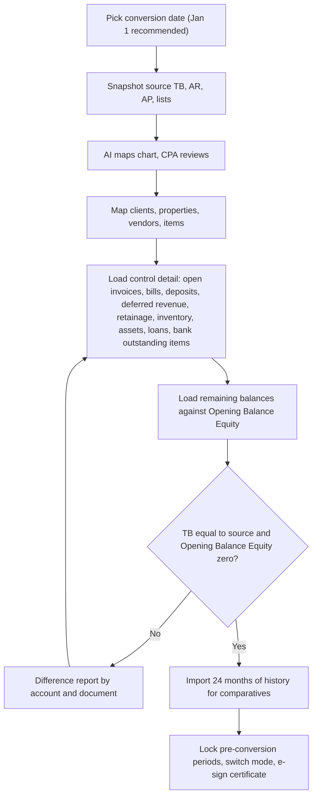

> **Competitive edge.** Moving books is the scariest part of leaving QuickBooks, and field-service vendors avoid it because they do not keep books. Rootline treats migration as a product feature with proofs at every step and an e-signed certificate, and schedules it for the quiet season when landscapers actually have time.

---

## 5. Key user flows

### 5.1 A completed mowing visit becomes revenue, cost and cash [MVP]

1. The crew lead completes a weekly mow at the Hernandez property in the crew app; the visit syncs ([05](05-field-crew-mobile-app.md)).
2. Scheduling emits `visit.completed`; billing recognizes the occurrence against the prepaid agreement and emits a recognition event; people emits `timesheet.approved` when the crew lead's timesheet is approved that evening.
3. The posting engine posts `billing.P5` (deferred revenue to maintenance revenue, $52.25) and `labor.LB1` (field wages and burden to the agreement's job, with allocated drive time) in the daily summarized entries, and `equipment.EQ1` for the mower hours.
4. The property's season P&L and the route's gross profit per man-hour update in [18](18-reporting-analytics.md).
5. If the agreement were per-visit billed instead, `billing.P1` would post at invoice issue and `payments.charge` at autopay success, then `payments.payout` when Stripe pays out.

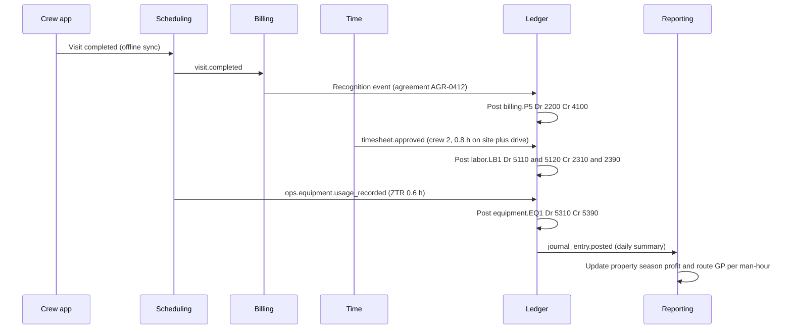

### 5.2 Month-end close by the outside CPA [MVP basic, V1 full]

1. On business day 1, Rootline generates the April close for Reyes; 17 of 24 checks already pass from continuous matching.
2. Beth (internal bookkeeper) clears the review queue: 23 bank lines suggested by AI, 4 sent to cardholders as questions, 2 missing receipts.
3. Beth imports the second April payroll journal; the labor variance is $412 (overtime on the Patel job) and the burden true-up posts.
4. Karen Liu (CPA) opens the Hub, sees Reyes at 88% readiness, reviews the WIP schedule draft with Dana's project manager notes, and posts it.
5. Karen reviews flux commentary drafted by the Copilot, edits two explanations, posts two accountant adjustments (an accrued dump-fee bill and a reclass of a trailer purchase from repairs to fixed assets).
6. All hard checks pass; Beth marks `ready_for_review`; Dana approves on her phone; April locks; the financial package goes to Dana and the bank.

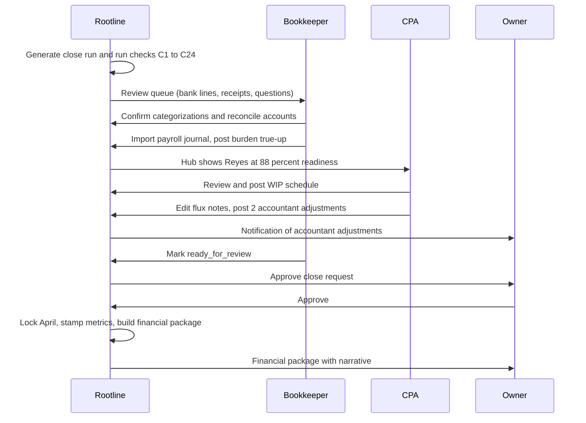

### 5.3 A card purchase in the field becomes a coded, reconciled expense [MVP]

1. Crew lead Luis buys 6 bags of quick-set concrete at a big-box store on the shop card ($86.40) and snaps the receipt in the crew app, offline ([05](05-field-crew-mobile-app.md), [13](13-operations-inventory-equipment.md) 4.4.4).
2. The receipt syncs; rules-based OCR reads merchant, date, total and tax (line items are added by AI extraction from [V1], AI2); the app's job context suggests J-2291 Phase 2.
3. Two days later the card line arrives through Plaid; Rootline matches it to the receipt (last four, amount, date) and proposes Dr 5210 J-2291 / Cr 2040 Credit Card.
4. Beth confirms with one click and accepts "Always code this merchant's receipts with job context to materials".
5. At month end, the card statement reconciles with this line already cleared.

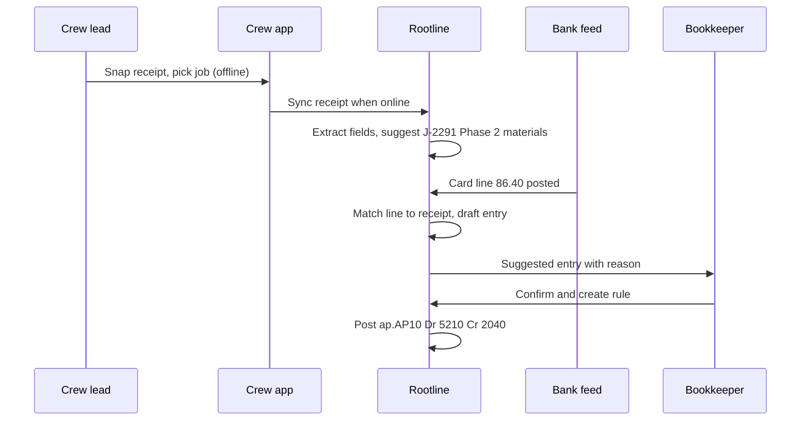

If no receipt exists after 3 days, the cardholder gets "What was the $86.40 at the store on May 14 for?" with buttons for the jobs they worked that day.

### 5.4 Subcontractor bill to payment, with retainage and a lien waiver [V1]

1. The lighting sub submits a $2,400 invoice in the sub portal against sub work order SWO-118 ([13](13-operations-inventory-equipment.md) 4.13.4).
2. The bill is auto-coded to J-2291 Phase 4, 10% retainage computed, and routed to the `ops_manager` for approval (job-coded) and then to the owner because it is the vendor's first bill.
3. On approval, `ap.AP4` posts; the bill joins the next payment batch, but the batch flags that the conditional lien waiver for this progress payment is not signed.
4. The sub e-signs the waiver in the portal; the hold releases; the owner approves the batch; Rootline prints the check (or produces the ACH file).
5. When the client's final retainage is released and the final unconditional waiver is signed, `ap.AP5` releases the $240 retainage payable.

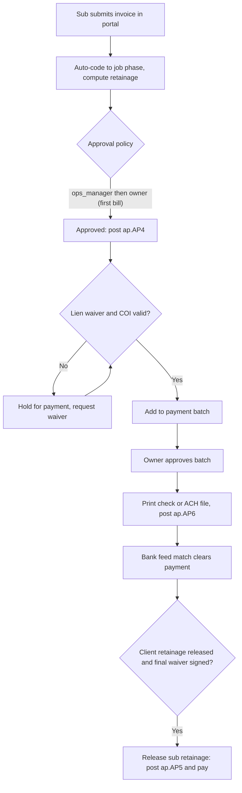

### 5.5 Payroll round trip [MVP files, V1 APIs]

1. Pay period closes Saturday; ops managers approve timesheets by Monday 10:00.
2. Rootline sends approved hours by employee, job and earning type to the payroll provider ([15](15-team-hr-payroll.md)).
3. The provider runs payroll Tuesday; Rootline imports the payroll journal (file or API).
4. Validation compares paid hours to approved hours per employee and tips paid to tips payable; exceptions go to the office manager.
5. `payroll.PR1` and `PR2` post; funding debits arrive through the bank feed and `payroll.PR3` matches them; variance is shown on the labor variance tile.

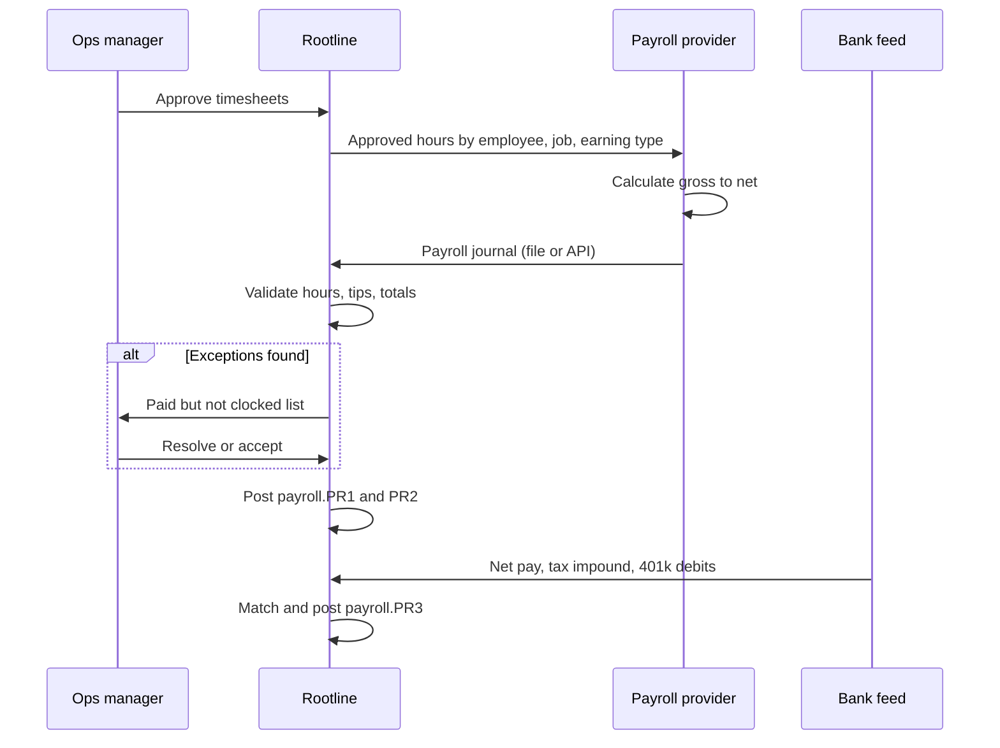

### 5.6 Mode C: QuickBooks Online is the book of record [MVP]

1. Summit Grounds' CPA keeps QBO. Rootline issues invoice 20417 to Crossroads PM for the Maple Court property; `invoice.issued` posts natively and the sync workflow pushes customer (exists), sub-customer "Maple Court" (exists), and the invoice with class "Maintenance" and location "Columbus".
2. Crossroads mails a check, which the CPA records in QBO against invoice 20417.
3. QBO's webhook (or the 15-minute CDC poll) reports the payment; Rootline imports it, applies it to invoice 20417 and the client portal shows paid.
4. Rootline also pushes its month-end deferred revenue and labor accrual journal entries to QBO so QBO's P&L matches Rootline's operational view.

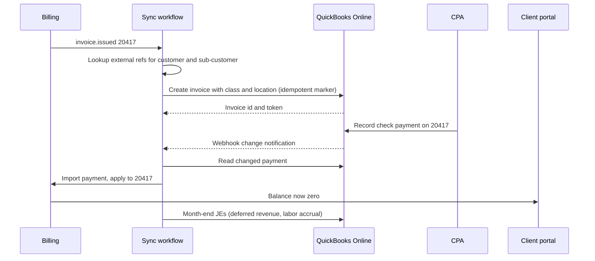

### 5.7 Monthly WIP posting [V1]

1. Day 1: Rootline drafts the WIP schedule for all open projects at or above the threshold.
2. Project managers get a task for each job whose EAC is older than 45 days or whose physical percent complete diverges from cost percent complete by more than 15 points.
3. The bookkeeper reviews the draft, excludes uninstalled materials where flagged, and posts; entries auto-reverse on day 1 of the next month.
4. The owner sees backlog, gross profit fade and over/under billing on the dashboard; the surety-format WIP is available for the bank.

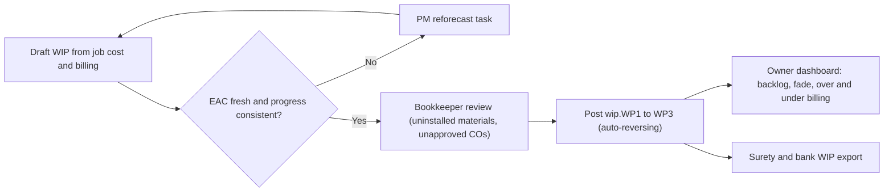

### 5.8 Reopening a locked period [MVP]

1. An HOA's March invoice was coded to the wrong division and the CPA wants March restated before the bank package.
2. Karen requests reopen of March with a reason; because March is under 90 days old, Dana's single approval with step-up authentication suffices (older periods need dual control per [02](02-personas-roles-permissions.md) 5.6).
3. March moves to `soft_closed`; Karen posts a reclass; the system re-runs C1-C24 for March; Karen re-locks.
4. The audit trail records the reopen, the entries and the re-lock; the next close checklist lists "March reopened April 12 by Karen Liu, 1 entry".

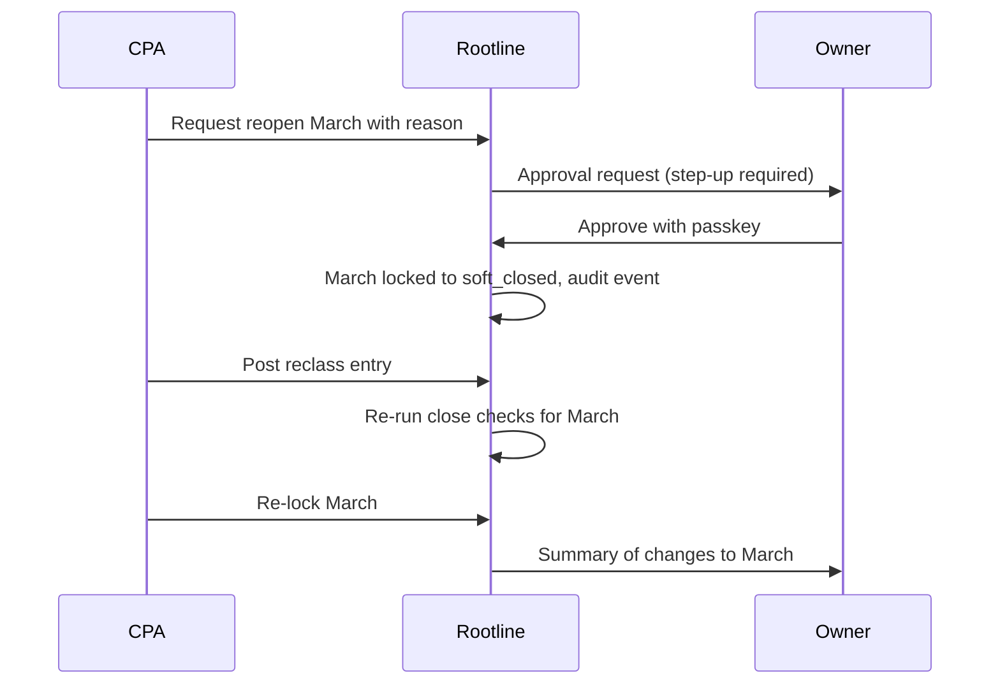

### 5.9 Year-end 1099s [V1]

1. November 1: Rootline lists vendors with check, ACH or cash payments year-to-date approaching the threshold and no W-9 on file; one click sends W-9 requests through the sub portal.
2. Received W-9s are TIN-matched; mismatches go back to the vendor.
3. In early January, after the December close, the 1099 workspace shows each eligible vendor's total by box, excluding card payments.
4. The office manager reviews, the CPA approves, Rootline e-files and delivers recipient copies electronically to consenting vendors and prints the rest, before January 31.

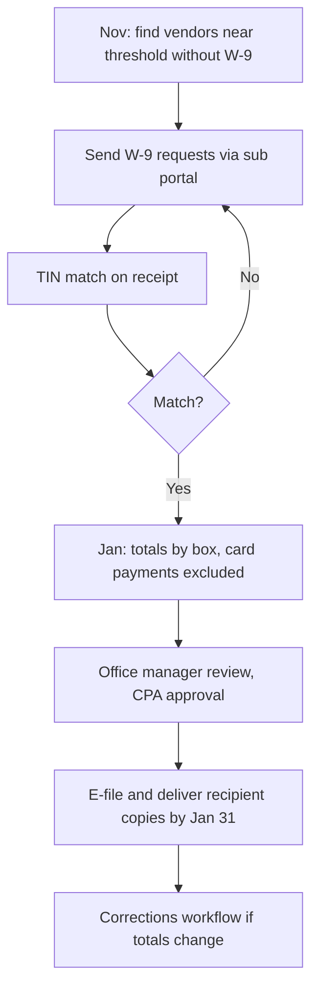

---

## 6. Screens and wireframes

### 6.1 Screen inventory

All ledger screens live in the Company web app under **Money** (sitemap in [21](21-ux-design-system-sitemaps.md)); the Accountant Hub is a separate firm-level surface; owners get read-only summaries on mobile.

| # | Screen | Surface | Primary roles | Priority |
|---|---|---|---|---|
| 1 | Money home (cash, AR, AP, close readiness, overhead recovery, alerts) | Web, mobile summary | `owner`, `bookkeeper` | [MVP] |
| 2 | Chart of Accounts (tree, roles, dimension policies) | Web | `bookkeeper`, `owner` | [MVP] |
| 3 | Journal entries list and register | Web | `bookkeeper` | [MVP] |
| 4 | Journal entry editor (manual, recurring, auto-reversing) | Web | `bookkeeper` | [MVP] |
| 5 | Entry detail with provenance, rule explanation, reversal stack | Web | `bookkeeper`, `owner` | [MVP] |
| 6 | Bank feed review (categorize, match, ask) | Web | `bookkeeper`, `office_manager` | [MVP] |
| 7 | Bank rules manager with test-against-history | Web | `bookkeeper` | [MVP] |
| 8 | Reconciliation workspace | Web | `bookkeeper` | [MVP] |
| 9 | Receipts inbox | Web, crew app | `office_manager`, `crew_lead` | [MVP] |
| 10 | Bills list, bill detail and coding | Web | `office_manager`, `ops_manager` | [MVP] |
| 11 | Approvals inbox (bills, entries, batches, reopen requests) | Web, mobile | `owner`, `ops_manager` | [V1] |
| 12 | Payment batch builder and check printing | Web | `office_manager`, `owner` | [V1] |
| 13 | Vendor 1099 / T5018 workspace | Web | `office_manager`, `bookkeeper` | [V1] |
| 14 | Job cost report | Web, mobile summary | `ops_manager`, `owner`, `estimator` | [MVP] |
| 15 | WIP schedule | Web | `bookkeeper`, `owner` | [V1] |
| 16 | Deferred revenue roll-forward | Web | `bookkeeper` | [MVP] |
| 17 | Budget editor and budget vs actual | Web | `owner`, `bookkeeper` | [V1] |
| 18 | Overhead recovery tracker | Web, mobile tile | `owner` | [V1] |
| 19 | Cash forecast and scenarios | Web | `owner`, `bookkeeper` | [V1] |
| 20 | Financial statements and report library | Web | `owner`, `bookkeeper` | [MVP] |
| 21 | Close checklist | Web | `bookkeeper`, `owner` | [MVP] |
| 22 | Fixed asset register and depreciation | Web | `bookkeeper` | [V1] |
| 23 | Loans and debt schedule | Web | `bookkeeper`, `owner` | [V1] |
| 24 | Payroll import and labor variance | Web | `bookkeeper`, `office_manager` | [MVP] |
| 25 | Entities, intercompany and consolidation | Web | `bookkeeper`, `owner` | [V1] |
| 26 | Integrations: QuickBooks, Xero, payroll (connection, mapping, sync health, errors) | Web | `bookkeeper`, `owner` | [MVP] |
| 27 | Migration wizard and opening balance proof | Web | `bookkeeper`, `owner`, `platform_support` (assisted) | [MVP] |
| 28 | Accountant Hub (client list, close status, questions) | Accountant web | `bookkeeper` (firm) | [V1] |
| 29 | Audit trail and evidence locker | Web | `owner`, `bookkeeper` | [MVP] |
| 30 | Posting rules and overrides (with simulation) | Web | `bookkeeper` | [V1] |

### 6.2 Wireframe: bank feed review

```text
+--------------------------------------------------------------------------------------------------+
| Rootline  Money > Banking > Review          Entity: Reyes Outdoor Living LLC      [Rules] [Help] |
+--------------------------------------------------------------------------------------------------+
| Accounts: [Operating Chk 1010  ok 2h ago] [Payroll Chk 1020  ok] [Amex 2041  ok] [Shop Visa 2042 !]|
| Filter: (To review 31) (Suggested 23) (Asked 4) (Matched 112)    Search: [            ]          |
+----+--------+-------------------------------+-----------+--------------------------------+-------+
|    | Date   | Description                   | Amount    | Rootline suggestion            |       |
+----+--------+-------------------------------+-----------+--------------------------------+-------+
| [] | May 20 | STRIPE TRANSFER ST-8K2Q       | +1,786.34 | MATCH Payout po_1Q.. (proved)  | [OK]  |
| [] | May 29 | GUSTO NET 052923              |-36,863.10 | MATCH Payroll May 10-23 net    | [OK]  |
| [] | May 31 | DEERE FIN PMT                 | -1,433.99 | MATCH Loan CTL-03 #1 P1,088.99 | [OK]  |
|    |        |                               |           |   I345.00                      |       |
| [] | May 14 | HOME DEPOT #3412  (Shop Visa) |    -86.40 | 5210 Materials-Hardscape       | [OK]  |
|    |        |   receipt matched (6 bags     |           |   J-2291 Thompson / Ph 2       | [Edit]|
|    |        |   quick-set concrete)         |           |   AI 0.93 "Crew 2 at Thompson" |       |
| [] | May 16 | SHELL OIL 5774                |    -92.18 | 5330 Fuel - field (rule #12)   | [OK]  |
| [] | May 17 | AMAZON MKTPLACE               |   -214.97 | ? Low confidence               | [Ask] |
|    |        |                               |           |   asked Luis 2d ago, no reply  |       |
| [] | May 22 | CHARLOTTE MOTOR SPEEDWAY      |   -180.00 | 3200 Owner Draws? 0.51         | [Edit]|
+----+--------+-------------------------------+-----------+--------------------------------+-------+
| Selected: 3   [Confirm selected]  [Split]  [Make rule]  [Send to owner as question]             |
+--------------------------------------------------------------------------------------------------+
| ! Shop Visa feed needs re-authentication since May 30.   [Reconnect]                            |
+--------------------------------------------------------------------------------------------------+
```

### 6.3 Wireframe: job cost report

```text
+--------------------------------------------------------------------------------------------------+
| J-2291 Thompson backyard - paver patio and seat wall     Status: In progress   PM: Alex   [Export]|
| Contract $19,600 (incl. CO-1 $1,200)  Billed $7,360  Earned (WIP) $13,720  Retainage $0           |
| Gross profit  Sold 32.4%  |  Projected 30.6%  |  To date 32.4%           Last EAC review: Jun 2   |
+--------------------------------------------------------------------------------------------------+
| Phase / cost type     | Revised | Commit- | Actual  | % used | Phys % | EAC     | Var at   | Hours  |
|                       | budget  | ted     |         |        | done   |         | complet. | est/act|
+-----------------------+---------+---------+---------+--------+--------+---------+----------+--------+
| 1 Demo and grading    |   1,330 |       0 |   1,290 |   97%  |  100%  |   1,290 |     +40  | 40/38  |
| 2 Hardscape           |   7,720 |     310 |   5,243 |   68%  |   35%  |   8,103 |    -383  |118/38  |
|   Labor + burden      |   3,450 |       0 |   1,167 |   34%  |        |   3,450 |       0  |        |
|   Materials           |   3,620 |     310 |   3,693 |  102%  |        |   4,003 |    -383 !|        |
|   Equipment           |     650 |       0 |     383 |   59%  |        |     650 |       0  |        |
| 3 Planting and beds   |   1,580 |       0 |     342 |   22%  |   10%  |   1,580 |       0  | 24/0   |
| 4 Lighting (sub)      |   2,400 |       0 |   2,400 |  100%  |   80%  |   2,400 |       0  |  -     |
| 5 Cleanup and haul    |     220 |       0 |       0 |    0%  |    0%  |     220 |       0  |  6/0   |
+-----------------------+---------+---------+---------+--------+--------+---------+----------+--------+
| Total                 |  13,250 |     310 |   9,275 |   70%  |        |  13,593 |    -343  |188/76  |
+--------------------------------------------------------------------------------------------------+
| ! Phase 2 is 68% spent but 35% physically complete: $3,693 of pavers and base are on site, not   |
|   yet installed. Materials are $383 over: paver waste above the takeoff factor and $95 freight.  |
|   [View lines] [Explain] [Send to estimator: update paver waste factor]                          |
+--------------------------------------------------------------------------------------------------+
```

(Illustrative. The EAC shown includes a June 2 reforecast; the May 31 WIP schedule in 4.8.3 used the $13,250 estimate reviewed before it. Phase 1 actual is one crew-day of labor and burden plus $122 of dump fees.)

### 6.4 Wireframe: close checklist

```text
+--------------------------------------------------------------------------------------------------+
| Close: April 2027   Reyes Outdoor Living LLC     Readiness 88% (21/24)    Target: BD5 (May 7)    |
| Status: in_progress     Assignees: Beth (internal), Karen Liu (Liu & Partners CPAs)              |
+--------------------------------------------------------------------------------------------------+
| HARD CHECKS                                                                                      |
|  [x] C1  Bank and card accounts reconciled (5/5)                                    Beth  May 3  |
|  [x] C2  Stripe clearing proven ($0.00 difference)                                  auto         |
|  [x] C4  AR ties to 1200 ($148,212.55)                                              auto         |
|  [x] C8  Payroll complete (2 runs), 2360 = 0                                        Beth  May 4  |
|  [ ] C16 WIP schedule posted                         4 jobs, 1 EAC stale  [Open]    Karen        |
|  [x] C18 Suspense 1099 = $0.00                                                      auto         |
| SOFT CHECKS                                                                                      |
|  [!] C10 3 unapproved timesheets dated Apr 29-30          [Nudge ops managers]                   |
|  [x] C11 Completed visits not invoiced: accrued $2,140 (billing.P8)                 auto         |
|  [ ] C22 Flux review: 6 accounts flagged, AI drafted notes   [Review notes]         Karen        |
| SIGN-OFF                                                                                         |
|  [ ] C24 Bookkeeper ready_for_review -> Owner approval                                           |
+--------------------------------------------------------------------------------------------------+
| [Lock April]  (disabled: 1 hard check open)        [Export close binder]   [History]             |
+--------------------------------------------------------------------------------------------------+
```

### 6.5 Wireframe: WIP schedule

```text
+--------------------------------------------------------------------------------------------------+
| WIP schedule as of May 31, 2027      Method: cost-to-cost   Threshold: $10,000 or 30 days        |
| Status: Draft   [Exclude uninstalled materials: OFF]  [Surety format]   [Post (auto-reverse)]    |
+--------------------------------------------------------------------------------------------------+
| Job                 | Contract | Est cost | Cost TD | % cmp | Earned | Billed | Under | Over  |Flag|
+---------------------+----------+----------+---------+-------+--------+--------+-------+-------+----+
| J-2291 Thompson     |   19,600 |   13,250 |   9,275 | 70.0% | 13,720 |  7,360 | 6,360 |       |    |
| J-2264 Patel        |   42,000 |   29,400 |  25,872 | 88.0% | 36,960 | 39,900 |       | 2,940 |    |
| J-2302 Lakeside HOA |   12,400 |    8,680 |   1,302 | 15.0% |  1,860 |  3,720 |       | 1,860 |    |
| J-2287 Morgan wall  |    9,800 |   10,300 |   6,180 | 60.0% |  5,880 |  4,900 |   980 |       |LOSS|
+---------------------+----------+----------+---------+-------+--------+--------+-------+-------+----+
| Totals              |   83,800 |   61,630 |  42,629 |       | 58,420 | 55,880 | 7,340 | 4,800 |    |
+--------------------------------------------------------------------------------------------------+
| Entries to post:  Dr 1215 7,340 / Cr 4300 7,340   Dr 4300 4,800 / Cr 2210 4,800                  |
|                   Dr 5990 200 / Cr 2215 200 (Morgan projected loss $500, $300 recognized)        |
| Backlog (unearned contract): $25,380      Avg GP fade on jobs closed YTD: -2.1 pts               |
+--------------------------------------------------------------------------------------------------+
```

### 6.6 Wireframe: QuickBooks Online sync health and mapping

```text
+--------------------------------------------------------------------------------------------------+
| Integrations > QuickBooks Online     Summit Grounds LLC   Mode: C External sync (QBO is book)    |
| Connected: Summit Grounds LLC (QBO)  Token ok   Last push 2 min ago   Last pull (CDC) 9 min ago   |
| Health: 98.7%   Objects synced 30d: 4,812   Open errors: 3   Conflicts: 1   API budget: normal   |
+--------------------------------------------------------------------------------------------------+
| OPEN ITEMS                                                                                       |
| ERR  Invoice 20433  "Tax code OH-Franklin not mapped"        [Map tax code]   [Retry] [Skip]     |
| ERR  Payment P-9921 "Invoice 20433 not yet in QuickBooks"    waits on the item above (no cascade)|
| ERR  Vendor "Green Valley Nursery" "Name already used by a customer" -> suggest "(Vendor)" [Fix] |
| CONF Customer "Crossroads PM" address edited in QBO and Rootline   [Keep Rootline] [Keep QBO]     |
+--------------------------------------------------------------------------------------------------+
| MAPPING                                    | QuickBooks account                 | Status         |
| ar_control                                 | Accounts Receivable (A/R)          | ok             |
| stripe_clearing:USD                        | Stripe Clearing (Bank)             | ok             |
| revenue:maintenance  x class Maintenance   | 4100 Maintenance Revenue           | ok             |
| revenue:snow                               | (unmapped)                         | AI: 4600 Snow  |
|                                            |                                    | Removal 0.97   |
| division -> Class   branch -> Location     | Classes 6/6 mapped, Locations 3/3  | ok             |
+--------------------------------------------------------------------------------------------------+
```

### 6.7 Wireframe: reconciliation workspace

```text
+--------------------------------------------------------------------------------------------------+
| Reconcile: 1010 Operating Checking (First Citizens ...4421)     Statement: May 1 - May 31, 2027   |
| Statement ending balance [ 86,412.07 ]  (imported from feed)   Book balance at May 31: 84,903.55  |
+--------------------------------------------------------------------------------------------------+
| Beginning balance (Apr 30, reconciled)                                             71,288.40    |
| + Cleared deposits (38)                                                           142,906.12    |
| - Cleared payments and checks (61)                                                127,782.45    |
| = Cleared balance                                                                  86,412.07    |
| Statement ending balance                                                           86,412.07    |
| DIFFERENCE                                                                              0.00 ok  |
+--------------------------------------------------------------------------------------------------+
| OUTSTANDING ITEMS (in book, not yet on statement)                                                |
|  Check 4412  May 29  Green Valley Nursery (bill 88017)                              -1,940.00    |
|  Check 4415  May 31  Lighting sub (bill 88231, retainage held 240.00)               -2,160.00    |
|  Deposit     May 31  Undeposited funds: 3 checks (Crossroads, Patel, Martin)        +2,591.48    |
|  Book balance = cleared balance - outstanding checks + deposits in transit          84,903.55    |
+--------------------------------------------------------------------------------------------------+
| EXCEPTIONS                                                                                       |
|  (none)  All 99 statement lines matched: 71 auto, 24 rule, 4 manual                               |
+--------------------------------------------------------------------------------------------------+
| [Finish and lock items]   [Download reconciliation report PDF]   [View matched lines]            |
+--------------------------------------------------------------------------------------------------+
```

(Illustrative amounts; the arithmetic ties: 86,412.07 - 1,940.00 - 2,160.00 + 2,591.48 = 84,903.55.)

### 6.8 Wireframe: migration opening-balance proof

The screen that decides whether a CPA trusts the native ledger. Every row is a hard check from 4.18 step 7; the certificate cannot be signed while any row is red.

```text
+---------------------------------------------------------------------------------------------------+
| Migration: QuickBooks Online -> Rootline     Reyes Outdoor Living LLC      Proof run #3          |
| Conversion date Jan 1, 2027 | Opening balance date Dec 31, 2026 | Snapshot Jan 4 09:12 (immutable)|
+---------------------------------------------------------------------------------------------------+
| CHECK                                          QuickBooks      Rootline     Difference  Status    |
| Trial balance (112 accounts mapped)            balanced        balanced          0.00   ok        |
| Accounts receivable, 64 open invoices          96,418.20       96,418.20         0.00   ok        |
|   AR aging by client (58 clients, 5 buckets)   tie             tie               0.00   ok        |
| Customer deposits, 7 open proposals            38,250.00       38,250.00         0.00   ok        |
| Deferred revenue, 41 prepaid lawn programs     22,914.75       22,914.75         0.00   ok        |
|   (QBO "Customer Prepayments" liability, loaded per agreement: 163 applications remaining)        |
| Accounts payable, 23 open bills                31,077.40       31,077.40         0.00   ok        |
| Inventory, 4 locations, 37 items               27,640.12       27,515.12      -125.00   FAIL      |
|   Mulch bunker: QBO qty 96 yd, count 91.6 yd at $28.41 avg            [Explain] [Resolve]        |
| Fixed assets NBV, 38 assets (book)            412,300.00      412,300.00         0.00   ok        |
| Loans, 6 notes (schedules vs lender stmts)    188,904.33      188,904.33         0.00   ok        |
| Bank 1010: reconciled balance + 9 outstanding  84,112.06       84,112.06         0.00   ok        |
| 3900 Opening Balance Equity residual                 n/a          125.00 Dr             must be 0 |
+---------------------------------------------------------------------------------------------------+
| RESOLVE INVENTORY DIFFERENCE                                                                      |
|  ( ) Post count variance in FY2026 in QuickBooks before cutover (CPA)  <- recommended             |
|  ( ) Load Rootline at counted quantity; Rootline posts Dr 5280 / Cr 3900 in an opening adjustment |
+---------------------------------------------------------------------------------------------------+
| History: 24 monthly trial balances loaded (Jan 2025 - Dec 2026), comparatives ready               |
| [Re-run proof]   [Download difference report]   [Sign opening certificate] (disabled: 2 failing)  |
+---------------------------------------------------------------------------------------------------+
```

(Illustrative. The $125.00 difference is 4.4 cubic yards of mulch at the moving average of about $28.41; until it is resolved, 3900 holds the residual and the certificate stays unsigned.)

### 6.9 Wireframe: owner "Money" home on mobile

The owner is a reader (design principle 7): three numbers, one sentence, and a door into detail.

```text
+--------------------------------------------+
| Money        Reyes Outdoor Living      (D) |
| Mon Jun 7, 2027    May close: 92% ready    |
+--------------------------------------------+
| CASH TODAY                      $96,240    |
|  Bank $84,904 + Stripe pending $11,336     |
|  13-week low: $41,800 (week of Aug 16)     |
|                            [See forecast]  |
+--------------------------------------------+
| MAY GROSS MARGIN           actual   vs bud |
|  Maintenance               41.2%    +1.4   |
|  Design-Build              33.8%    -2.2 ! |
|  Lawn and PHC              52.0%    +0.6   |
|  Irrigation                44.5%    -0.9   |
+--------------------------------------------+
| OVERHEAD RECOVERY YTD   79%  (plan 84%)    |
|  [##############......]  behind pace       |
+--------------------------------------------+
| AR over 60 days     $8,420   3 clients  >  |
| Bills due this week $14,612  2 to approve >|
+--------------------------------------------+
| "Design-build slipped 2.2 points: the      |
|  Morgan wall hit ledge rock and now shows  |
|  a $500 projected loss. Everything else is |
|  on plan."                 [Ask why]       |
+--------------------------------------------+
```

---

## 7. Data model

All tables live in the `ledger` schema (integrations tables in `integrations`), carry `tenant_id` with row-level security ([20](20-architecture-security.md)), and most carry `legal_entity_id`. Money is `bigint` minor units with an ISO currency code; rates are `numeric(18,8)`; quantities `numeric(18,4)`. Shared entities owned elsewhere are referenced, not copied: `client`, `property`, `job`, `visit`, `agreement` ([04](04-scheduling-dispatch-routing.md), [07](07-invoicing-billing-contracts.md)), `invoice`, `credit_memo` ([07](07-invoicing-billing-contracts.md)), `payment`, `balance_entry`, `payout` ([08](08-payments-stripe.md)), `vendor`, `stock_movement`, `asset`, `purchase_order`, `receipt` ([13](13-operations-inventory-equipment.md)), `employee`, `time_segment` (the `time_entry` of [20](20-architecture-security.md)'s module map) ([15](15-team-hr-payroll.md)), `legal_entity`, `org_unit` ([02](02-personas-roles-permissions.md)).

### 7.1 Entities

| Entity | Key fields | Notes |
|---|---|---|
| `fiscal_year` | id, legal_entity_id, start_date, end_date, status | |
| `accounting_period` | id, legal_entity_id, fiscal_year_id, period_no, start_date, end_date, status (`open`, `soft_closed`, `locked`), locked_at, locked_by | L3 |
| `ledger_account` | id, legal_entity_scope, code, name, type (`asset`, `liability`, `equity`, `revenue`, `cogs`, `expense`, `other_income`, `other_expense`, `statistical`), normal_balance, parent_id, is_postable, is_control, is_active, must_clear_at_close, currency_restriction, tax_line_refs | L6, L13, L16 |
| `account_role_binding` | id, role_key, qualifier (division, currency, agency, class), account_id, effective_from | Rules bind to roles |
| `dimension_policy` | id, account_id, dimension, requirement (`required`, `optional`, `forbidden`), default_rule | L14 |
| `custom_dimension` / `custom_dimension_value` | id, name, values | Up to 5 per tenant [V1] |
| `journal_entry` | id, legal_entity_id, number, entry_date, service_date, period_id, entry_type, status, posting_key (unique per tenant, L4), source_type, source_id, source_event_id (trace only, not part of any uniqueness key), posting_rule_version_id, memo, reverses_entry_id, reversed_by_id, auto_reverse_on, actor_type, actor_id, firm_id, approved_by, posted_at, prev_hash, chain_hash | L1-L5, L8, L11 |
| `journal_line` | id, entry_id, line_no, account_id, amount_minor (signed), currency, amount_txn_minor, txn_currency, fx_rate, fx_rate_source, description, quantity, uom, dims: division_id, branch_id, department_id, job_id, phase_id, cost_type, cost_code, client_id, property_id, agreement_id, vendor_id, employee_id, asset_id, item_id, crew_id, storm_event_id, intercompany_entity_id, custom_dims (jsonb) | Immutable |
| `posting_rule` / `posting_rule_version` | id, rule_key, version, trigger_events, conditions, line_templates (jsonb), dependencies, batching, effective_from, effective_to, pack_id, tenant_override | L11 |
| `posted_source` | tenant_id, posting_key, journal_entry_id, source_type, source_id, posted_at | One row per business fact, including each source rolled into a daily summary; unique `(tenant_id, posting_key)` |
| `pending_posting` | id, event_id, rule_key, waiting_on, first_seen_at, timeout_at, status | Out-of-order events |
| `balance_bucket` | legal_entity_id, account_id, period_id, bucket_date, currency, debit_minor, credit_minor | Hot-path balances |
| `entry_template` | id, kind (`recurring`, `allocation`, `accrual`), schedule, lines, driver, next_run_on | |
| `approval_request` | id, subject_type, subject_id, policy_id, state, approvers, decided_at | Shared with bills, batches, reopen |
| `fx_rate` | currency_pair, rate_date, rate_type, rate, source | |
| `revaluation_run` | id, period_id, rate_set, entry_id | |
| `bank_connection` | id, provider, institution, status, last_success_at, error_code, token_ref | Encrypted token |
| `bank_account` | id, legal_entity_id, ledger_account_id, connection_id, mask, type, currency, ledger_start_date | |
| `bank_transaction` | id, bank_account_id, provider_txn_id, posted_date, amount_minor, description, normalized_merchant, mcc, status (`new`, `suggested`, `asked`, `matched`, `categorized`, `excluded`), journal_entry_id | |
| `bank_rule` | id, priority, conditions, actions, auto_confirm, version, created_by | |
| `bank_match` | id, bank_transaction_id, match_type, target_type, target_id, confidence, method (`expected`, `rule`, `ai`, `manual`) | 1:1, 1:n, n:1 |
| `categorization_suggestion` | id, bank_transaction_id, account_id, dims, split, confidence, reason, model_version | AI audit |
| `reconciliation` | id, bank_account_id, statement_date, statement_balance_minor, cleared_balance_minor, status, report_file_id | |
| `receipt` | id, source, image_file_id, merchant, receipt_date, total_minor, tax_minor, card_last4, lines (jsonb), matched_bank_transaction_id, job_id | |
| `vendor_tax_profile` | vendor_id, tin_enc, tin_last4, tin_type, entity_class, is_1099, default_box, w9_file_id, tin_match_status, t5018_eligible | Vendor master in [13](13-operations-inventory-equipment.md) |
| `bill` | id, legal_entity_id, vendor_id, vendor_invoice_no, bill_date, accounting_date, due_date, terms_code, currency, status, total_minor, retainage_minor, hold_reason, journal_entry_id | Unique (vendor_id, vendor_invoice_no) |
| `bill_line` | id, bill_id, account_id, amount_minor, qty, unit_cost_minor, po_line_id, receipt_line_ids, tax_treatment, form_1099_box, billable, dims | |
| `vendor_credit` | id, vendor_id, amount_minor, reason, applied_minor | |
| `payment_batch` | id, legal_entity_id, status, scheduled_date, total_minor, approved_by | |
| `bill_payment` | id, batch_id, vendor_id, method (`check`, `ach_file`, `card`, `external`, `partner`), check_no, trace_no, amount_minor, released_at, journal_entry_id | |
| `bill_payment_application` | bill_payment_id, bill_id, amount_minor, discount_minor | |
| `info_return` | id, tax_year, form (`1099_nec`, `1099_misc`, `t5018`, `t4a`), vendor_id, box_amounts (jsonb), status, filed_at, correction_of_id | |
| `fixed_asset` | id, legal_entity_id, equipment_asset_id, asset_class, description, cost_minor, placed_in_service_on, status, disposal_id | Links to [13](13-operations-inventory-equipment.md) `asset` |
| `asset_book` | fixed_asset_id, book (`book`, `federal_tax`, `state_tax`, `cca`), method, life_months, life_hours, salvage_minor, convention, bonus_pct, sec179_minor, cca_class | |
| `depreciation_line` | id, fixed_asset_id, book, period_id, amount_minor, hours_basis, run_id, journal_entry_id | |
| `asset_disposal` | id, fixed_asset_id, disposal_date, type, proceeds_minor, gain_loss_minor, journal_entry_id | |
| `loan` | id, legal_entity_id, lender_vendor_id, type, principal_minor, rate, rate_type, start_date, term_months, payment_calendar (jsonb), ledger_account_id, collateral_asset_ids | |
| `loan_schedule_line` | id, loan_id, due_date, payment_minor, principal_minor, interest_minor, status, bank_transaction_id | Versioned on rate change |
| `payroll_import` | id, legal_entity_id, provider, pay_date, period_start, period_end, gross_minor, net_minor, employer_tax_minor, status, file_id, journal_entry_id | |
| `payroll_import_line` | id, import_id, employee_id, pay_item_code, amount_minor, hours, department_id | |
| `payroll_code_map` | provider, pay_item_code, account_role, treatment | |
| `budget` / `budget_version` / `budget_line` | id; version_no, status, is_estimating_budget; account_id, division_id, branch_id, period_id, amount_minor, stat_quantity | Company Budget in [03](03-crm-sales-estimating-proposals.md) reads `budget_version` |
| `wip_run` / `wip_line` | id, period_id, method, status, entry_id; job_id, contract_minor, est_cost_minor, cost_to_date_minor, pct_complete, earned_minor, billed_minor, under_minor, over_minor, loss_provision_minor, eac_reviewed_at | |
| `close_run` / `close_task` | id, period_id, status, readiness_pct; check_code, type (`hard`, `soft`), result, assignee_id, due_on, waived_reason | |
| `work_paper` | id, account_id, period_id, file_id, notes, carried_from_id | Accountant Hub |
| `client_question` | id, subject_type, subject_id, asked_by_firm_id, question, answer, answered_by, answered_at | |
| `intercompany_pair` | id, entry_a_id, entry_b_id, entity_a_id, entity_b_id, amount_minor, settled_by_id | L18 |
| `consolidation_run` / `elimination_rule` | id, entity_ids, period_id, status; match criteria, accounts | Elimination book |
| `external_connection` | id, legal_entity_id, connector (`qbo`, `qbd`, `xero`, `intacct`), mode, mirror_style (`summary`, `detail`), status, health | Framework in [20](20-architecture-security.md) |
| `external_ref` | entity_type, entity_id, connector, external_id, external_version, last_synced_hash | [20](20-architecture-security.md) |
| `sync_mapping` | id, connection_id, mapping_type (`account_role`, `item`, `tax_code`, `class`, `location`, `terms`, `payment_method`), local_key, external_id, confidence, confirmed_by | |
| `sync_error` / `sync_conflict` | id, connection_id, object_type, object_id, code, message, depends_on_id, status, resolution | Per-record quarantine |
| `migration_run` / `opening_balance_item` | id, source, conversion_date, snapshot_file_id, status, certificate_file_id; item_type, source_ref, amount_minor, local_ref, journal_entry_id | Proof data |
| `tax_line_map` | account_id, return_type, tax_line_code | Tax exports |
| `ledger_integrity_case` | id, check_code, legal_entity_id, detected_at, drift_minor, details, status | L7 |
| `fuel_card_transaction` | id, program, card_id, driver_employee_id, vehicle_asset_id, odometer, product, gallons, amount_minor, bank_transaction_id, flags | Fuel card import (BK-05); ties to the card statement line |

### 7.2 Entity relationships

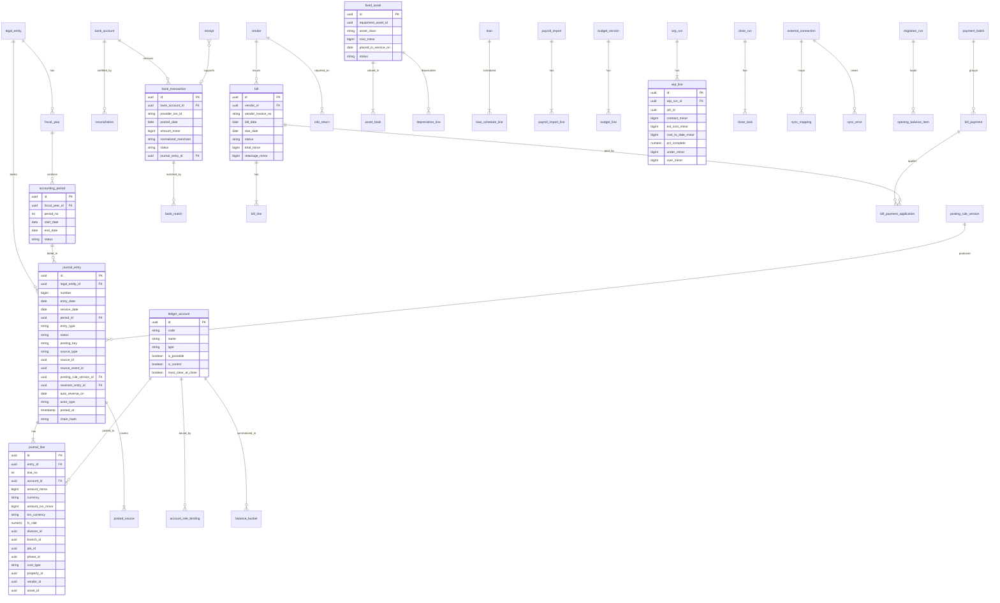

**Indexes and partitioning.** `journal_line` is partitioned by tenant cell and fiscal year (volume estimate in [20](20-architecture-security.md): about 250 million lines per year platform-wide by year 3) with composite indexes on `(tenant_id, account_id, entry_date)`, `(tenant_id, job_id)`, `(tenant_id, division_id, entry_date)`; `journal_entry` and `posted_source` carry the unique `(tenant_id, posting_key)` business key from L4; `bank_transaction` is unique on `(bank_account_id, provider_txn_id)`; `bill` is unique on `(tenant_id, vendor_id, vendor_invoice_no)`.

---

## 8. Integrations, APIs and events

### 8.1 External services

| Service | Purpose | Mechanism | Priority |
|---|---|---|---|
| Plaid (or a similar aggregator; Canadian specialist as fallback) | Bank, card and loan feeds; balances | Link, transactions sync with cursor, webhooks | [MVP] |
| Bank file formats | Feeds without aggregator coverage; ACH and positive pay out | CSV, OFX/QFX in; BAI2, CAMT.053 in [V1]; NACHA and bank positive-pay formats out [V1] | [MVP]/[V1] |
| QuickBooks Online | Mirror or book of record | OAuth 2.0, REST, webhooks, change data capture | [MVP] |
| QuickBooks Desktop | Mirror or book of record | Web Connector (SOAP, qbXML) | [V1] |
| Xero | Mirror or book of record | OAuth 2.0, REST, webhooks | [V1] |
| Sage Intacct | Upmarket book of record | XML web services / REST (verify) | [V2] |
| Unified accounting API vendor | Long-tail systems | Vendor API, summary JEs only | [V2] |
| Payroll providers (Gusto, ADP, QuickBooks Payroll, Paychex, Paycor; Wagepoint, Payworks, ADP Canada, Dayforce) | Payroll journal import | Files [MVP], APIs [V1] (verify per provider) | [MVP]/[V1] |
| IRS IRIS or a certified 1099 filing partner | 1099 e-file, TIN matching | A2A API or partner API (verify) | [V1] |
| CRA | T5018 and T4A filing | XML Internet file transfer export | [V1] |
| Exchange-rate source (Bank of Canada daily rates; commercial fallback) | FX | Daily pull (verify licensing) | [V1] |
| Sales tax compliance partner (Avalara Returns or a Stripe Tax filing partner, per [07](07-invoicing-billing-contracts.md) 4.5.5) | Automated sales tax filing and remittance | Partner API | [V1] |
| Embedded payables partner | Bill pay by ACH, check, virtual card | Partner API; funds move from the Company's bank | [V2] |
| AI Gateway ([17](17-ai-copilot-automation.md)) | Chart and integration mapping and sync-error explanations [MVP]; LLM receipt and bill extraction (MVP uses rules-based OCR outside the gateway), AI categorization and narratives [V1] | Internal | [MVP]/[V1] |
| Stripe ([08](08-payments-stripe.md)) | Balance transactions and payouts | Via the payments module only, never directly | [MVP] |

### 8.2 Domain events consumed

| Event | Producer | Rules posted |
|---|---|---|
| `invoice.issued`, `invoice.voided`, `credit_memo.issued`, `invoice.finance_charge_assessed`, `collections_case.written_off` | billing ([07](07-invoicing-billing-contracts.md)) | `billing.P1`-`P42` |
| Agreement recognition events, month-end billing jobs | billing | `billing.P5`-`P8` |
| `payment.succeeded`, `payment.returned`, `payment.refunded` (08's `payments.refund.completed`), `dispute.created` (08's `payments.dispute.opened`), `dispute.closed`, `payout.paid`, `payout.failed`, balance-entry events | payments ([08](08-payments-stripe.md)) | `payments.*`, `billing.P33`-`P35`, `P38`, `P39` |
| `ops.receipt.posted`, `ops.stock.moved`, `ops.stock.count_posted`, `ops.bill.matched`, `ops.disposal.recorded`, `ops.equipment.usage_recorded`, `ops.warranty.claim_resolved`, `ops.vendor.compliance_changed`, `ops.lien_waiver.signed`, `ops.po.approved` (commitments) | operations ([13](13-operations-inventory-equipment.md)) | `inventory.*`, `ap.AP2`-`AP5`, `equipment.EQ1`, `warranty.WR2`; holds; commitments |
| `timesheet.approved` | people ([15](15-team-hr-payroll.md)) | `labor.*`, `prepaid.PP2` (the older `time_entry.recorded` name is registered in [15](15-team-hr-payroll.md) section 8 only as an alias of `timesheet.approved`; live segment edits before approval are not posted) |
| `change_order.approved`, `job.completed`, `job.canceled` | sales and ops ([03](03-crm-sales-estimating-proposals.md), [04](04-scheduling-dispatch-routing.md)) | Revised job budgets, WIP inclusion, job close-out |
| `visit.completed`, `visit.skipped` | ops | Job cost hours, accrual candidates (C11) |
| `ops.asset.placed_in_service`, `ops.asset.disposed` | operations ([13](13-operations-inventory-equipment.md); 13 section 8 registers the unprefixed `asset.*` spellings as aliases) | `assets.FA1`, `FA3`, `FA4` |

### 8.3 Domain events emitted

Events use the `ledger.` namespace already referenced by [13](13-operations-inventory-equipment.md); [20](20-architecture-security.md) lists the unprefixed names in its catalog, which are aliases of these.

| Event | Payload highlights | Consumers |
|---|---|---|
| `ledger.journal_entry.posted` / `ledger.journal_entry.reversed` | entry id, type, rule, accounts and dimensions summary | Reporting, integrations (mirror and external sync), audit, webhooks |
| `ledger.period.soft_closed` / `ledger.period.closed` / `ledger.period.reopened` | entity, period, actor | Operations (block back-dated movements), billing, reporting (closed badge), integrations (closing date) |
| `ledger.bill.received` / `ledger.bill.posted` / `ledger.bill.approved` / `ledger.bill_payment.released` | bill, vendor, amounts, jobs | Operations (match engine, sub portal status), cash forecast, notifications |
| `ledger.bank_transaction.imported` / `.matched` / `.categorized` | line, match, confidence | Reconciliation UI, AI learning |
| `ledger.reconciliation.completed` | account, statement date | Close checklist |
| `ledger.close.completed` | entity, period, readiness, package id | Reporting, owner notification, Accountant Hub |
| `ledger.wip.posted` | period, totals, loss jobs | Reporting (backlog, fade), estimating feedback |
| `ledger.budget.approved` | version, is_estimating_budget | Estimating ([03](03-crm-sales-estimating-proposals.md)) re-pins rates for new estimates |
| `ledger.integrity_case.opened` | check, drift | On-call, platform admin fleet view ([19](19-platform-admin-portal.md)) |
| `ledger.info_return.filed` | tax year, form, count | Sub portal, notifications |
| `integrations.sync_error.opened` / `.resolved` | connector, object, code | Bookkeeper tasks, platform connector health |

### 8.4 Public API and webhooks

- **OAuth scopes** ([20](20-architecture-security.md)): `ledger:read` (accounts, entries, balances, reports), `ledger:write` (manual journal entries as drafts or posted per the caller's permission, bills, bank rules), `bills:write`.
- **Endpoints (REST, v1)**: `GET /ledger/accounts`, `GET /ledger/journal-entries?from&to&account&job`, `POST /ledger/journal-entries` (requires `Idempotency-Key`; returns 409 on a locked period with the first open period suggested), `POST /ledger/journal-entries/{id}/reverse`, `GET /ledger/reports/trial-balance?asOf`, `GET /ledger/reports/profit-and-loss?from&to&groupBy=division`, `GET /ledger/jobs/{id}/cost`, `POST /ap/bills`, `GET /ledger/periods`.
- **Webhooks**: `ledger.journal_entry.posted` and `ledger.period.closed` for BI tools and CPA systems, signed per [20](20-architecture-security.md).
- **Spreadsheet link** [V2]: an Excel and Google Sheets add-in with functions such as `RL.BALANCE("4100","2027-05","Maintenance")`, because accountants live in spreadsheets (beyond the brief, section 13).

---

## 9. Permissions

Permission keys follow the `resource.action` taxonomy of [02](02-personas-roles-permissions.md) 5.2 and use 02's canonical keys (`financial_report`, `ledger.journal_entry`, `ledger.period.lock` / `unlock`, `bank_reconciliation`, `bill`, `bill_payment.approve`, `accounting_sync`), including the ledger-specific keys `ledger.control_account.adjust` (manual lines on subledger control accounts, rule L13), `ledger.posting_rule.manage`, `wip.post`, `info_return.manage` (1099 and T5018 workspace) and `accounting_sync.resolve`, all in 02 5.2 and the 02 10.1 role template matrix; ledger resources are scoped by legal entity, not branch, unless branch-restricted financials are enabled [V2] ([02](02-personas-roles-permissions.md) 5.3). Field classes `cost`, `margin`, `pay_rate` and `vendor_banking` are masked per [02](02-personas-roles-permissions.md) 5.4. MFA is mandatory for any role holding `ledger.*` ([20](20-architecture-security.md)). External accountants receive the `bookkeeper` template through delegated access (free seats).

**Legend:** F = full (create, edit, post, delete where allowed); C = create or edit; A = approve; V = view; O = own records only; B = own branch only; L = up to an approval limit; S = requires step-up authentication; cfg = off by default, Company can enable; - = no access.

| Capability (permission key) | owner | office_manager | estimator | designer | ops_manager | crew_lead | technician | bookkeeper | subcontractor |
|---|---|---|---|---|---|---|---|---|---|
| View P&L, balance sheet, cash flow (`financial_report.read`) | V | cfg | - | - | cfg B (division P&L) | - | - | V | - |
| View GL detail, journal register (`ledger.journal_entry.read`) | V | - | - | - | - | - | - | V | - |
| Manage chart of accounts (`ledger.account.manage`) | F | - | - | - | - | - | - | F | - |
| Create manual journal entries (`ledger.journal_entry.create`) | C | cfg L | - | - | - | - | - | C | - |
| Approve journal entries (`ledger.journal_entry.approve`) | A | - | - | - | - | - | - | A (not own) | - |
| Reverse entries (`ledger.journal_entry.reverse`) | F | - | - | - | - | - | - | F | - |
| Adjust control accounts (`ledger.control_account.adjust`, L13) | F S | - | - | - | - | - | - | F S | - |
| Posting-rule overrides (`ledger.posting_rule.manage`) | F S | - | - | - | - | - | - | F S | - |
| Soft-close and lock periods (`ledger.period.lock`) | F | - | - | - | - | - | - | F | - |
| Reopen periods (`ledger.period.unlock`) | F S | - | - | - | - | - | - | F S (dual control over 90 days) | - |
| Connect bank and card feeds (`bank_connection.manage`) | F S | - | - | - | - | - | - | F S | - |
| Categorize bank lines (`bank_transaction.categorize`) | F | C | - | - | - | - | - | F | - |
| Answer cardholder questions, attach receipts (`expense`) | O | O | O | O | O | O | O | F | - |
| Reconcile accounts (`bank_reconciliation.reconcile`) | F | - | - | - | - | - | - | F | - |
| Undo a reconciliation (`bank_reconciliation.undo`) | F S | - | - | - | - | - | - | F S | - |
| Create and code bills (`bill`) | F | C | - | - | C B (job lines) | - | - | F | O (submit own) |
| Approve bills (`bill.approve`) | A | - | - | - | A B L | - | - | A L | - |
| Approve and release payment batches (`bill_payment.approve`) | A | - | - | - | - | - | - | A L | - |
| Change vendor banking (`vendor_banking.update`) | F S (dual control) | - | - | - | - | - | - | F S (dual control) | O (own, verified by call-back) |
| 1099 / T5018 workspace and filing (`info_return.manage`) | F | C | - | - | - | - | - | F | V (own forms) |
| Fixed assets and depreciation (`fixed_asset.manage`) | F | - | - | - | V (no cost) | - | - | F | - |
| Loans and debt schedule (`loan.manage`) | F | - | - | - | - | - | - | F | - |
| Payroll journal import (`payroll_import.run`) | F | C | - | - | - | - | - | F | - |
| View job cost (`job_cost.view`, `cost` field class) | V | V | V (own estimates' jobs) | - | V B | Hours only | - | V | - |
| Reforecast job EAC (`job_cost.forecast`) | F | - | C (own jobs) | - | C B | - | - | F | - |
| Post WIP schedule (`wip.post`) | A | - | - | - | - | - | - | F | - |
| Budgets (`budget.manage`) | F | - | - | - | V B cfg | - | - | F | - |
| Overhead recovery and cash forecast (`report.overhead`, `report.cash_forecast`) | V | - | - | - | - | - | - | V | - |
| Integrations: connect, map (`accounting_sync.update`) | F S | - | - | - | - | - | - | F S | - |
| Resolve sync errors (`accounting_sync.resolve`) | F | cfg | - | - | - | - | - | F | - |
| Migration and opening balances (`ledger.migration.run`) | A (sign certificate) | - | - | - | - | - | - | F | - |
| Entities, intercompany, consolidation (`legal_entity.books`) | F | - | - | - | - | - | - | F | - |
| Audit trail and evidence locker (`audit_log.view`) | V | - | - | - | - | - | - | V | - |
| Full GL data export (`data_export.ledger`) | F S | - | - | - | - | - | - | F S | - |

**Platform roles** (see [02](02-personas-roles-permissions.md) 5.13 and [19](19-platform-admin-portal.md)):

| Capability | platform_owner | platform_support | platform_finance | platform_curator | platform_engineer |
|---|---|---|---|---|---|
| Publish chart templates and posting-rule packs | F | - | - | - | C (with review) |
| Fleet books health, integrity cases, connector health (aggregate, no tenant amounts) | V | V | - | - | V |
| View a tenant's ledger | Consented support session only | Consented, time-boxed, read-only | - | - | Break-glass with dual approval |
| Assist a migration | - | With tenant owner's consent, in an "assisted migration" session; every action attributed | - | - | - |
| Correct a tenant's posted data | Never directly; only by guiding the tenant to post reversals | - | - | - | Never directly |
| Rootline's own SaaS revenue and Stripe Billing | V | - | F | - | - |

---

## 10. AI opportunities in this module

All AI runs through the AI Gateway with tenant isolation, prompt and model versioning, and metering as AI credits ([17](17-ai-copilot-automation.md)). Guardrails specific to the ledger: AI never posts into a locked period; AI-drafted entries need human approval unless the tenant has an explicit auto-post policy with thresholds and sampling; every AI-originated line carries `actor_type = ai_agent`, the model version and its stated reason; financial answers cite journal lines or reports, never free text alone.

| ID | Opportunity | How it works | Priority |
|---|---|---|---|
| AI1 | **Bank and card categorization** | Merchant, MCC, amount, tenant history, receipt lines and crew job context produce account, dimensions and splits with confidence and a reason (4.6.3) | [V1] (rules [MVP]) |
| AI2 | **Receipt and bill extraction** | Document understanding for receipts, vendor invoices, sub invoices, dump tickets and nursery pick tickets; PO and job detection. **[MVP] basic** means manual or rules-based intake with no LLM extraction and no AI credits: a dedicated OCR pass reads header fields (merchant or vendor, date, total, tax, card last four, invoice and PO numbers) through deterministic rules and per-vendor templates, and the user confirms or keys the rest. **[V1]** adds LLM document understanding (header and line items, sub invoices, scale and dump tickets), metered at 2 credits per page on [22](22-business-model-pricing-gtm.md)'s rate card; bill-side extraction runs as the A9 AP Agent in [17](17-ai-copilot-automation.md) and matches [13](13-operations-inventory-equipment.md) 4.11.1 (Bill intake [MVP basic, V1 AI]) | [MVP] basic (rules/OCR, no LLM), [V1] AI extraction |
| AI3 | **Chart and integration mapping** | Maps a QuickBooks chart, items and tax codes to Rootline roles during migration and sync setup, with confidence | [MVP] |
| AI4 | **Close copilot** | Runs checks, nudges assignees, drafts flux commentary ("Dump fees up 41% vs April: 3 more demolition jobs; per-ton rate unchanged"), assembles the close binder | [V1] |
| AI5 | **Anomaly and fraud detection** | Duplicate bills across channels; vendor bank details changed shortly before a large payment; payments to a vendor sharing an employee's address or bank account; purchases split just under approval limits; round-dollar manual entries at odd hours; sudden fuel spikes per card | [V1] |
| AI6 | **Ask your books** | Natural-language questions answered with cited numbers: "What did the irrigation division make in June after overhead?" "Why is the Stripe deposit $3,339.32?" ([08](08-payments-stripe.md) AI6) | [V1] |
| AI7 | **Entry drafting** | "Reclass $1,200 of May fuel from Admin to Snow" drafts a balanced entry with dimensions for approval | [V1] |
| AI8 | **Job overrun prediction** | Early signals (hours burned vs physical progress, material variances, crew mix) predict which jobs will miss margin, two to three weeks before the cost lands | [V2] |
| AI9 | **Payment timing model** | Predicts when each open invoice will be paid from client history, method and season, feeding the 13-week cash forecast | [V1] |
| AI10 | **1099 and T5018 classification** | Reads W-9s, flags vendors likely reportable, explains exclusions (card payments) | [V1] |
| AI11 | **Tax line and GIFI mapping** | Suggests tax lines for new accounts; flags inconsistent mappings | [V1] |
| AI12 | **Sync error explainer** | Translates QuickBooks and Xero error codes into a fix ("This tax code exists in QuickBooks but is inactive; reactivate it or map to OH-Franklin-2027") | [MVP] |
| AI13 | **Owner money brief** | Weekly narrative in English or Spanish: cash, margin by division, overhead pacing, one recommended action | [V1] |
| AI14 | **Budget drafting** | Proposes next season's budget from history, the signed agreement book and the pipeline; explains each assumption | [V1] |
| AI15 | **Warranty reserve rate** | Suggests the reserve percentage per install type from the Company's replacement history and Plant KB regional mortality signals ([12](12-plant-knowledge-base.md)) | [V2] |
| AI16 | **Audit sampling assistant** | Selects samples, assembles evidence, drafts a PBC response for the CPA | [V2] |

---

## 11. Edge cases, compliance and risks

### 11.1 Edge cases

Edge cases are numbered X1-X35 so they never collide with the worked journal entries E1-E21 in 4.4.

| # | Situation | Behavior |
|---|---|---|
| X1 | Payment event arrives before its invoice event | Held in `pending_posting`; alert after 24 hours; never posted to AR without the invoice |
| X2 | Crew app syncs a March visit after March is locked | Posts in the first open period with `service_date` in March; listed on the next close checklist (C20) |
| X3 | Invoice voided after its period is locked | Reversal posts in the current open period ([07](07-invoicing-billing-contracts.md) rule); original period untouched |
| X4 | Client overpays or pays an invoice twice | Excess to 2180 Customer Credits; refund or apply per [07](07-invoicing-billing-contracts.md) |
| X5 | One payment covers invoices in three divisions | One `payments.charge` entry with allocation lines per invoice; revenue already carries division |
| X6 | Stripe balance goes negative (refunds exceed charges) and Stripe debits the bank | Negative payout posts Dr 1050 / Cr 1010; bank feed matches the debit |
| X7 | Customer check bounces (NSF) | Reverse the payment (Dr 1200 / Cr 1010), bank fee to 6160, optional NSF fee via billing; client flagged |
| X8 | Bank feed reconnect re-sends 90 days of transactions | Provider ID dedupe, then fuzzy dedupe; nothing posts twice |
| X9 | Aggregator removes a transaction already categorized | Reversal posted, task opened; never silent deletion |
| X10 | CAD Company buys trees from a US nursery in USD | Bill in USD at the bill-date rate; realized FX at payment; open USD AP revalued at month-end |
| X11 | Vendor bill arrives before the receipt is recorded | 3-way match exception `no_receipt`; option to receive now; liability still accrued at close via C12 |
| X12 | Subcontractor is also a client | One person, two roles in Rootline; QBO display-name collision handled by suffix (4.17.2) |
| X13 | Time approved after the payroll journal was imported | Accrual posts in the current period; next payroll clears it; variance report shows the timing |
| X14 | H-2B workers leave early in the season | Unamortized prepaid program cost is expensed at season end with a reason code; burden rate for next year adjusts |
| X15 | Equipment sold with its loan still outstanding | One disposal entry with proceeds, payoff to the lender, gain or loss and loan closure; collateral link released |
| X16 | Snow storm spans month-end (Jan 31 evening to Feb 1 morning) | Per-push revenue and costs dated by completion timestamp in the entity's time zone; the storm dimension spans both periods |
| X17 | Entry created at 11:30 pm Pacific on the last day of the month for a Company in Eastern time | Period is determined by the legal entity's time zone, not UTC or the user's device |
| X18 | Pro-rata allocation leaves a one-cent remainder | Largest-remainder method assigns cents deterministically; never creates an unbalanced entry |
| X19 | Prepaid lawn client sells the house mid-season | Remaining deferred revenue refunded or transferred to the new owner per agreement terms ([07](07-invoicing-billing-contracts.md)) |
| X20 | A Company wants to change its fiscal year | Allowed only at a year boundary with a short transition year [V2]; otherwise blocked |
| X21 | A Company wants to change functional currency | Not allowed; create a new legal entity and migrate |
| X22 | The business is sold | Final close, full export, entity archived read-only for the retention period; Stripe handled per [08](08-payments-stripe.md) E21 |
| X23 | QuickBooks connection down longer than the CDC lookback | Full reconciliation sweep on reconnect; differences listed before any writes |
| X24 | QuickBooks company has multi-currency on but the Rootline entity is single-currency | Allowed; Rootline pushes home-currency documents only; foreign-currency QBO edits raise conflicts |
| X25 | The accounting firm is revoked mid-close | Sessions end immediately ([02](02-personas-roles-permissions.md)); posted adjustments stay with attribution; drafts by the firm are preserved for the owner |
| X26 | Negative truck stock issued to a job | Costed at last known average; count variance posts on the next count ([13](13-operations-inventory-equipment.md)) |
| X27 | Owner pays a personal expense with the business card | Categorized to 3200 Owner Draws (or 1240 for an employee) |
| X28 | Retainage receivable unpaid more than 12 months after completion | Collections case and reclass review (current vs non-current) prompted at year-end |
| X29 | Deposit refunded because the client cancels before work starts | Dr 2150 / Cr 1050 via `payments.refund`; no revenue ever recognized |
| X30 | Two sessions post concurrently to the same hot account | Day-level balance buckets and row locks; journal numbering stays gapless (L5) |
| X31 | The same `invoice.issued` fact is emitted twice under two event IDs (producer retry bug) | Second attempt hits the `(tenant_id, posting_key)` unique constraint, is skipped and counted as an `L4_duplicate_attempt`; no second entry |
| X32 | A time entry is edited after it was rolled into yesterday's daily labor summary | New revision key (`timesheet:{id}:approve:{rev}`) posts the delta in a supplemental summary and reverses the prior revision's share; the original summary entry is never edited |
| X33 | A payment is applied in QuickBooks (Mode C) to an invoice that Rootline has already voided | Imported payment posts to 2180 Customer Credits with a conflict task; never re-opens the voided invoice silently |
| X34 | A prepaid lawn client pays in December for next season, and the Company's fiscal year ends December 31 | Whole amount sits in 2200 Deferred Revenue at year-end; the prepaid liability report (4.8.2) and the coverage guard (section 13) show it against year-end cash |
| X35 | A subcontractor's certificate of insurance lapses between bill approval and payment | Bill moves to `OnHold` for payment (4.5.2); the payment batch drops it with a reason; the liability stays booked |

### 11.2 Compliance

| Area | Requirement | Rootline approach |
|---|---|---|
| Record retention | IRS and CRA retention periods (CRA generally six years; IRS varies by situation) | 7 years after fiscal year end for ledger, invoices, bills, receipts and tax records ([20](20-architecture-security.md)) |
| Electronic records | IRS and CRA expectations for electronic books (accessibility, integrity, retrievability; verify Rev. Proc. 97-22 and CRA guidance, including where records may be kept for Canadian businesses) | Immutable journal, hash chain, evidence locker, export on demand; Canadian data residency evaluated (open question 12) |
| Financial reporting frameworks | US GAAP (ASC 606 revenue, ASC 842 leases) for private companies; ASPE in Canada | Policy engine with CPA-selectable treatments; Rootline does not opine |
| Information returns | 1099-NEC/MISC rules, e-file mandate, recipient consent; T5018/T4A | Dated rule parameters, partner or IRIS filing, consent capture (4.5.3) |
| Sales and use tax; GST/HST/QST | Jurisdiction rules ([07](07-invoicing-billing-contracts.md)) | Agency sub-accounts, liability reconciliation, use tax accrual, ITCs |
| Assurance | SOC 2 Type II with Processing Integrity ([20](20-architecture-security.md)) | Plus a **SOC 1 Type II** report [V2], because auditors of Companies whose books live in Rootline will need comfort over the ledger's controls (internal control over financial reporting relevance) |
| Privacy and security | TINs, bank details and payroll data are sensitive | Field encryption, masking, step-up for views, dual control for banking changes ([02](02-personas-roles-permissions.md)) |
| E-signatures | Opening balance certificates, close sign-offs, W-9s | ESIGN/UETA-compliant e-signature with audit trail |

### 11.3 Risks

| Risk | Likelihood | Impact | Mitigation |
|---|---|---|---|
| CPAs refuse to trust a new GL | High | High | Free Hub, accountant-led onboarding, open exports, migration proofs, SOC 1, a landscape-CPA advisory board in the design-partner program, Mode B mirror as a bridge |
| A ledger bug damages trust | Medium | Severe | DB invariants L1-L18, property-based tests, nightly proofs, shadow "dual-run" of the posting engine against a reference implementation during beta, integrity cases paged as incidents |
| Scope creep into a full construction ERP | High | Medium | Phasing in 4.0; certified payroll, AIA billing depth and job-cost accounting for union labor are explicitly out of MVP |
| Intuit or Xero API terms and pricing change | Medium | Medium | Webhooks and CDC over polling, batching, mirror-summary option, native-first positioning; cost to serve tracked in [22](22-business-model-pricing-gtm.md) |
| QuickBooks Desktop declines faster than expected | Medium | Low | Desktop support built thin (summary mirror); migration path to native |
| Tax rule changes (1099 thresholds, bonus depreciation) | High | Medium | Dated platform parameters managed in the admin console; annual rules review each October |
| AI miscategorization goes unnoticed | Medium | Medium | Suggest-only default, auto-post only above high confidence with weekly sampling, precision metric per tenant |
| Liability for filing errors | Low | High | Partner filing with approvals and CPA sign-off, clear terms, professional liability insurance |
| Performance at scale (hundreds of millions of lines) | Medium | Medium | Partitioning, balance buckets, analytics replica for dimensional reports ([18](18-reporting-analytics.md)) |
| Support load from being the book of record | High | Medium | Explain-this-number, AI explainers, certified accountant directory, accounting-specialist support tier |

---

## 12. Metrics and KPIs

| Area | Metric | Target (12 months after MVP GA) |
|---|---|---|
| Adoption | Share of tenants in Mode A / B / C | 30% / 15% / 55% (estimate); native share rising each quarter |
| Adoption | Tenants with bank feeds connected | 85% of Mode A and B tenants |
| Automation | Journal lines system-posted | 97% or more |
| Automation | Bank lines auto-matched or auto-categorized without edits | 80% at MVP (rules plus matching), 90% at V1 (AI) |
| Automation | Stripe payouts auto-matched to bank lines | 98% or more ([08](08-payments-stripe.md) G3) |
| Automation | Card spend with matched receipts | 90% within 7 days |
| Close | Median business days to close | 5 or fewer |
| Close | Bookkeeper hours per close (20-person Company) | Under 4 |
| Close | Close readiness on business day 1 | 70% of checks passing |
| Accuracy | Unbalanced entries; unresolved subledger drift at month-end | 0; 0 |
| Accuracy | AI categorization precision (confirmed without edit) | 95% or more for auto-posted lines |
| Accuracy | Sync errors open at month-end per 1,000 synced objects | Under 2 |
| Accuracy | Duplicate customers or invoices created by sync | 0 |
| Accuracy | L4 duplicate attempts caught by the posting-key constraint | Tracked per producer module; any sustained non-zero rate is a producer bug to fix, never a ledger error |
| Accuracy | Periods reopened after lock, per tenant per year | 2 or fewer (a higher rate means checks are passing too early) |
| Accuracy | Suspense (1090 and 1099) balance on business day 3 | Under $500 for 90% of tenants |
| Performance | Event to posted entry, p95 | Under 5 seconds |
| Performance | Rootline to QBO sync lag, p95 | Under 2 minutes |
| Value | Owners viewing division P&L weekly (April-November) | 60% of active owners |
| Value | Design-build tenants posting WIP monthly | 80% |
| Value | Tenants using the overhead recovery tracker monthly | 50% of tenants with a budget |
| CPA channel | Accounting firms active in the Hub; median clients per firm | 300; 4 |
| CPA channel | Tenants with an outside accountant connected | 60% of Mode A and B tenants |
| Migration | Assisted migrations tying on first proof run | 90% |
| Migration | Median migration elapsed time | Under 2 working days |
| Business | Tenants reporting a canceled QuickBooks subscription | Tracked in onboarding and renewal surveys |

---

## 13. Beyond the brief: extra ideas

1. **Off-highway fuel tax credit tracker [V1].** Mowers, skid steers and other off-road equipment burn taxed gasoline and diesel; US federal law allows a credit or refund of fuel excise tax for certain nontaxable uses, including off-highway business use, claimed on Form 4136 or Form 8849 (verify eligibility rules and rates), and some states refund fuel tax for off-road use. Rootline already knows which fuel went into which machine (yard tank issues and fuel cards by asset, [13](13-operations-inventory-equipment.md)), so it can compute the claim each quarter. For a 20-mower operation this is real money nobody claims.
2. **Profit First style reserve buckets [V1].** Owners pick allocation percentages (taxes, owner pay, profit, operating expenses) and Rootline shows virtual buckets inside the operating account, or sweeps to real reserve accounts through the bank, with a weekly "move $4,210 to the tax reserve" task. Popular with small contractors and a strong retention hook.
3. **Winter cash plan [V1].** In September Rootline builds a December-March plan: snow revenue scenarios, prepay campaign targets for lawn programs ([16](16-marketing-growth-communications.md)), line-of-credit timing and the exact week cash would bottom out without action.
4. **Surety and lender package in one click [V1].** WIP schedule, closed-jobs schedule, AR aging, equipment list with net book values, debt schedule, interim statements and covenant calculations as a branded PDF. Commercial installers bidding bonded municipal work need this every quarter.
5. **Covenant early warning [V1].** Debt service coverage and current ratio projected from the cash forecast, warning months before a breach at the line-of-credit renewal.
6. **Snow risk ledger [V2].** Per site and per season: fixed seasonal fee vs actual cost of pushes, salt and subs, shown live through the winter, with the historical snowfall for that site. It tells the owner which seasonal contracts to re-price and quantifies exposure for a possible weather-risk hedge or snow insurance product ([23](23-innovation-moonshots.md)).
7. **Plant-warranty reserve from real mortality [V2].** Combining the Company's replacement history with Plant KB regional performance data ([12](12-plant-knowledge-base.md)) to set warranty reserve rates per install type and region, and to flag designs heavy in plants with poor local survival before the warranty bill arrives.
8. **H-2B program cost amortization [V1].** Visa, agent, recruitment and inbound travel costs capitalized as prepaid and charged per H-2B hour worked, so April jobs are not penalized and estimators see the true burdened rate of seasonal labor.
9. **Excel and Google Sheets live link [V2].** Accountant-friendly functions (`RL.BALANCE`, `RL.JOBCOST`) that refresh from the ledger, so a CPA's existing workbooks keep working.
10. **Owner pay and quarterly tax estimate helper [V2].** For S-corporation owners, a reasonable-compensation reminder and a quarterly estimated-tax set-aside suggestion from year-to-date profit, clearly labeled as an estimate for the CPA to confirm.
11. **Peer benchmarks on the P&L [V1].** Gross margin by division, overhead percentage and net margin next to anonymized peers of similar size and region ([18](18-reporting-analytics.md) benchmarking), right on the P&L the owner already reads.
12. **Rebate and incentive tracking [V2].** Utility water-conservation rebates for smart irrigation controllers and drip conversions, manufacturer volume rebates and early-order programs from suppliers, tracked as receivables so they are actually collected.
13. **Always-closed books [V2].** Daily soft close: every check runs nightly, so the month-end close is a formality and the owner can ask a lender-quality question any day of the month.
14. **Acquisition-ready data room [V2].** Landscaping is consolidating; an owner preparing to sell can export a quality-of-earnings-ready data set (monthly P&L by division, customer concentration, recurring revenue under agreement, prepaid liabilities, equipment schedule) that buyers and their diligence teams expect.
15. **Rootline-certified accountant directory and referral program [V1].** Accountants who pass a short certification are listed for Companies looking for a landscape-savvy CPA; firms earn referral credit ([22](22-business-model-pricing-gtm.md)).
16. **Autonomous close agent [V3].** An agent that runs the whole month-end close (matches, accruals, burden true-up, WIP draft, flux commentary, binder) and hands the CPA only the exceptions and a sign-off screen, with every action reversible and attributed ([17](17-ai-copilot-automation.md)).
17. **Ledger-verified working capital [V3].** With the owner's explicit consent, verified ledger data (AR quality, recurring agreement revenue, WIP, seasonality) supports financing offers from licensed lending partners: a spring line of credit sized to the cash forecast trough, or financing for 60-day commercial receivables. Rootline never lends or holds funds; the idea belongs to the fintech track in [23](23-innovation-moonshots.md).
18. **Prepaid liability coverage guard [V1].** A lawn care Company that collects $180,000 of prepaid programs in December and January has spent other people's money if it uses that cash to fund winter payroll and then cannot staff April applications. Rootline computes a weekly **coverage ratio**: (bank plus Stripe available minus payroll, tax and loan payments due in the next 14 days) divided by (2200 Deferred Revenue plus 2150 Customer Deposits for work not yet started). Below 1.0 the owner sees an amber tile and a plain sentence ("You are holding $142,600 of customers' prepaid work and have $118,900 of free cash"); below a tenant threshold it becomes a close-checklist soft check. No competitor can compute this because none of them holds both the bank balance and the per-agreement liability.
19. **Business personal property tax listings from the asset register [V1].** Many US states and counties tax business equipment and require an annual listing or rendition by acquisition year and cost (North Carolina, Texas, Virginia and Georgia among them; verify each state's form, due date and filing threshold). An equipment-heavy landscaper owes this on every mower, trailer and skid steer, and usually reconstructs the list from memory each January. The fixed asset register already holds cost, acquisition year, disposal date and the yard's county ([13](13-operations-inventory-equipment.md) locations), so Rootline produces the listing per county, flags disposed assets that should be removed (a common overpayment), and adds the filing to the year-end calendar (4.14).
20. **Insurance premium audit pack, ledger side [V1].** General liability and workers' compensation premiums are trued up after the policy year from audited payroll, sales and subcontractor costs, and payments to subcontractors who could not show a valid certificate of insurance are commonly added to the insured's premium base (verify per carrier and state). [15](15-team-hr-payroll.md) BURD-04 produces payroll by class code; the ledger adds what only it knows: revenue by division (for sales-rated GL classes), and every subcontractor payment with the COI coverage dates that applied **on the payment date** from [13](13-operations-inventory-equipment.md) vendor compliance. The pack also posts the expected audit adjustment as an accrual to 2420 so the true-up bill is not a surprise.
21. **Capital purchase timing advisor [V1].** "Should we buy the second compact track loader in December or March?" combines four things Rootline already has: the 13-week and seasonal cash forecast (4.9.4), the tax books with bonus depreciation, Section 179 and the mid-quarter convention test (4.5.5), the loan amortization for the dealer's financing offer (4.5.6), and the asset's projected utilization from the equipment rate card ([13](13-operations-inventory-equipment.md)). Output: cash low point under each option, an estimated tax effect clearly labeled as an estimate for the CPA, the mid-quarter trigger warning, and the break-even billable hours at the current equipment rate.
22. **Sales and use tax audit defense file [V1].** State audits typically look back three to four years (verify per state), and contractors are audited on both sides: tax charged to clients and use tax owed on materials bought untaxed. Rootline keeps, per invoice line, the taxability decision and rule version from [07](07-invoicing-billing-contracts.md), the exemption certificate on file at the invoice date, and per bill line the use-tax decision (`ap.AP9`); an "audit request" export assembles a sampled period with all evidence, and a self-review runs quarterly to estimate exposure before an auditor does.

---

## 14. Open questions

1. **Bank feed timing.** This doc and [08](08-payments-stripe.md) and [13](13-operations-inventory-equipment.md) treat Plaid bank feeds as [MVP]; the connector catalog in [20](20-architecture-security.md) lists Plaid as [V1]. Native books (Mode A) are not credible without feeds and reconciliation, so the recommendation is MVP; if feeds slip, Mode A should launch only with file import and design partners.
2. **L1 wording.** [20](20-architecture-security.md) L1 says entries balance "per currency". This doc proposes functional-currency balance for all entries plus transaction-currency balance for single-currency entries, with explicit FX lines (4.1.6). Agree and update L1, or adopt a trading-account method that balances every currency.
3. **Native ledger in every tier? (largely resolved by [22](22-business-model-pricing-gtm.md)).** [22](22-business-model-pricing-gtm.md) puts Ledger Essentials in every tier, Ledger Plus from Grow up and Ledger Advanced at Pro (mapping in 4.0). Remaining question: [22](22-business-model-pricing-gtm.md) lists "classes and departments" under Advanced, but division and branch are required dimensions for every tenant here. Proposed wording for [22](22-business-model-pricing-gtm.md): "department dimension, custom dimensions and dimension policies" in Advanced; division and branch reporting in all tiers. Second issue: [22](22-business-model-pricing-gtm.md) places bank reconciliation in Ledger Plus, but a Company cannot credibly run native books (Mode A) without reconciling its bank. Recommendation: Essentials tenants either get single-account reconciliation (BK-04 for their one feed) or default to Mode C with QuickBooks or Xero as the book of record until they upgrade.
4. **Canadian aggregator.** Plaid's Canadian institution coverage for business accounts must be validated with design partners; a Canadian-specialist aggregator may be needed at launch.
5. **Shared vs per-entity chart.** [02](02-personas-roles-permissions.md) says each legal entity has its own chart; this doc defaults to a shared chart with entity restrictions for easier consolidation. Confirm with the CPA advisory board.
6. **Cash-basis demand.** How many target Companies report on the cash basis to their CPA? If most do, the derived cash-basis view should move from [V2] to [V1].
7. **WIP threshold default.** $10,000 or 30 days is a guess; validate with design-build pilots and their CPAs.
8. **QuickBooks Desktop build vs buy.** Build on the Web Connector ourselves or use a third-party Desktop API service? Depends on the share of Desktop pilots and the vendor's reliability.
9. **1099 e-file build vs partner.** IRIS A2A directly (more control, compliance burden) or a certified filing partner (faster, per-form cost)? Recommendation: partner at V1, revisit at scale.
10. **Sales tax filing partner.** [07](07-invoicing-billing-contracts.md) 4.5.5 schedules partner filing at V1, with worksheets only at MVP. Which partner first (Avalara Returns for multi-state commercial tenants, a Stripe Tax filing partner for single-state residential tenants, or both), and does Canada (GST/HST, QST, PST returns) need a partner at all or only the worksheet?
11. **Embedded bill pay partner.** Which payables partner, and does a partner model affect the "Rootline never holds funds" promise in practice (it must not)?
12. **Canadian data residency.** Do Canadian tenants (or their accountants) require books stored in Canada? Affects the cell architecture in [20](20-architecture-security.md).
13. **SOC 1 timing.** Is a SOC 1 Type II needed before larger design-build firms with audited statements will move their books, and should it come before V2?
14. **Mode B detail vs summary default.** Do CPAs prefer the detail mirror (more QuickBooks objects, more sync errors) or the summary mirror (cleaner, less drill-down)? Pilot both.
15. **Labor variance allocation default.** Leave overtime premium in 5190 (simpler, cleaner P&L) or allocate to jobs by default (truer job cost)? Pilot estimators and owners disagree in early interviews (to be run).
16. **Rule version in posting keys.** [20](20-architecture-security.md) L4 gives `stripe_bt:{balance_transaction_id}:{posting_rule_version}` as an example key. Including the rule version lets a replay after a retroactively effective pack update mint a second key for the same balance transaction. Proposal: drop the version from all posting keys (the entry already records its rule version) and update L4's example.
17. **Alias retirement.** [07](07-invoicing-billing-contracts.md) and [08](08-payments-stripe.md) now use the canonical codes and role keys (4.2.6). Keep the registered role aliases (`operating_bank`, `disputed_payments`, `card_surcharge_income`, `platform_application_fees`) permanently, or retire them after MVP once no posting-rule pack, fixture or partner integration references them? Recommendation: keep them through V1 under the same two-major-version alias policy [02](02-personas-roles-permissions.md) applies to permission keys, then retire.
18. **Ohio-style single-agency states.** Should the default agency sub-account structure be per agency (one Ohio account with jurisdiction detail, as in E19) or per jurisdiction (separate state, county and transit accounts)? Per agency matches the return and the payment; per jurisdiction is what some CPAs expect to see. Pilot with Summit-style multi-county commercial tenants.

---

## Sources

Sources are cited where used. Verification note: items marked **(verify)** in the text are from secondary sources or general knowledge and need first-hand confirmation before engineering commitments or external use.

**Competitors and user evidence**

- [Jobber Help Center, "QuickBooks integration FAQs"](https://help.getjobber.com/es/articles/quickbooks-integration-faqs/)
- [Jobber Help Center, "Common QuickBooks Sync Errors and How to Fix Them"](https://help.getjobber.com/hc/en-us/articles/10466688449431-Common-QuickBooks-Sync-Errors-and-How-to-Fix-Them)
- [Jobber product update, "See revenue and cost trends with Job Insights"](https://productupdates.getjobber.com/30097-see-revenue-and-cost-trends-with-job-insights)
- [Jobber Community, "How do you actually track job profitability, not just revenue?"](https://community.getjobber.com/discussions/finances-forum/how-do-you-actually-track-job-profitability-not-just-revenue/15674/replies/15706)
- [Inzata, Jobber job profitability tracking (vendor claim)](https://www.inzata.ai/blog/jobber-job-profitability-tracking)
- [Inzata, Housecall Pro analytics beyond built-in reports (vendor claim)](https://inzata.ai/blog/housecall-pro-data-analytics-beyond-built-in-reports)
- [Housecall Pro, Advanced Reporting](https://housecallpro.com/features/advanced-reporting)
- [Aspire, Purchasing features](https://www.youraspire.com/features/purchasing)
- [Aspire Guide, Using the purchasing module](https://guide.youraspire.com/docs/using-the-purchasing-module)
- [Aspire Guide, Deciding branch or division for company set-up](https://guide.youraspire.com/docs/deciding-branch-or-division-for-company-set-up)
- [Vergo, AP automation for landscape companies using Aspire](https://www.getvergo.com/learn/best-ap-automation-software-for-landscape-companies-using-aspire)
- [LMN Help, How LMN calculates overhead, labor burden and profit in estimates](https://intercom.help/lmn/en/articles/15939065-how-lmn-calculates-overhead-labor-burden-and-profit-in-estimates)
- [LMN Help, Estimating FAQ](https://intercom.help/lmn/en/articles/15939077-estimating-faq)
- [Turf Magazine, LMN introduces Job Costing Advisor for landscapers](https://turfmagazine.com/lmn-introduces-job-costing-advisor-for-landscapers)
- [SingleOps Docs, Role permissions](https://docs.singleops.com/hc/articles/43339904495387)
- [SingleOps, Job costing (visit profit margin)](https://singleops.com/?p=1677)
- [SingleOps Docs, Purchase orders](https://docs.singleops.com/hc/articles/43339572958491)
- [SingleOps Docs, Inventory](https://docs.singleops.com/hc/articles/43339637494043)
- [Capterra, Real Green (Service Assistant) reviews](https://www.capterra.com/p/78106/Service-Assistant/reviews/?page=5)
- [GetApp, Service Autopilot reviews](https://www.getapp.com/operations-management-software/a/service-autopilot/reviews/)
- [Capterra, LawnPro vs Service Autopilot reviews](https://www.capterra.com/compare/105508-122075/LawnPro-vs-Service-Autopilot)
- [SynkedUP features](https://synkedup.com/features/)
- [SynkedUP, Estimating](https://synkedup.com/features/estimating/)
- [Jobber Help Center, How to connect Jobber and QuickBooks Online (new integration)](https://help.getjobber.com/es/articles/how-to-connect-jobber-and-quickbooks-online-new-quickbooks-integration/)
- [Copilot CRM, What is Copilot CRM](https://help.copilotcrm.com/en/articles/12141481-what-is-copilot-crm)
- [Beancount.io, Snow removal contractor bookkeeping (ASC 606 seasonal deferred revenue discussion)](https://beancount.io/blog/2026/06/03/snow-removal-plowing-ice-management-contractor-bookkeeping-asc-606-seasonal-deferred-revenue-per-push-trigger-section-179-plow-truck-salt-spreader-sima-asca-revenue-per-truck-hour-kpi-guide)

**Internal research and related specifications**

- [R1 - Field service platforms](research/R1-field-service-platforms.md) (accounting approaches across FSM vendors, Jobber QuickBooks sync analysis, open accounting export recommendation)
- [R2 - Landscape-specific platforms](research/R2-landscape-specific-platforms.md) (Aspire, LMN, SynkedUP, Real Green accounting and job costing)
- [R4 - Industry, payments and accounting](research/R4-industry-payments-accounting.md) (QuickBooks Online, Desktop and Xero API background, Intuit pricing and partner-program changes, ledger architecture patterns; its API facts are themselves marked for verification)
- [03 - Estimating](03-crm-sales-estimating-proposals.md) (Company Budget EST-01, overhead recovery methods EST-02)
- [07 - Invoicing](07-invoicing-billing-contracts.md) (posting rules P1-P42, deferred revenue mechanics, sales tax)
- [08 - Payments](08-payments-stripe.md) (Stripe clearing, posting by balance transaction, worked payment entries)
- [13 - Operations](13-operations-inventory-equipment.md) (stock movements, 3-way match, equipment cost per hour, subcontractors)
- [20 - Architecture](20-architecture-security.md) (ledger invariants L1-L12, connector framework, events)
- [22 - Business model and pricing](22-business-model-pricing-gtm.md) (Ledger Essentials, Plus and Advanced entitlements)
- [15 - Team, HR and payroll](15-team-hr-payroll.md) (burden, workers' compensation class allocation BURD-04, embedded payroll roadmap)

**Primary sources to check first**

- [IRS, About Form 1099-NEC](https://www.irs.gov/forms-pubs/about-form-1099-nec) (threshold for payments after 2025, deadlines, e-file rules; also cited by [13](13-operations-inventory-equipment.md))
- [Intuit Developer, QuickBooks Online Accounting API](https://developer.intuit.com/app/developer/qbo/docs/get-started) (limits, batch, CDC, webhooks, App Partner Program)
- [Xero Developer documentation](https://developer.xero.com/documentation/) (limits, tracking categories, webhooks, developer pricing)

**Items to verify against primary sources:** Intuit QuickBooks Online API rate limits, batch limits, change-data-capture lookback, webhook format and App Partner Program metering; QuickBooks plan limits for classes, locations and accounts; QuickBooks Desktop Web Connector behavior and Desktop availability; Xero API limits, tracking-category limits and developer pricing; Plaid history limits and Canadian coverage; Sage Intacct API status; IRS Form 1099-NEC/MISC instructions (thresholds after the One Big Beautiful Bill Act, deadlines, e-file mandate, IRIS), TIN matching, backup withholding and Form 4136; MACRS conventions, bonus depreciation and Section 179 limits; the de minimis safe harbor; CRA T5018, T4A, GST/HST Quick Method and CCA class guidance; ASC 606 over-time criteria and ASPE Section 3400; Bank of Canada exchange-rate terms of use; CFPB section 1033 status; Ohio taxability of landscaping and lawn care services, the Franklin County combined rate and Ohio's vendor's discount (E19-E20); which states have self-administered home-rule local sales taxes; state business personal property listing rules; carrier practices on uninsured-subcontractor premium audits; fuel card program export formats.
