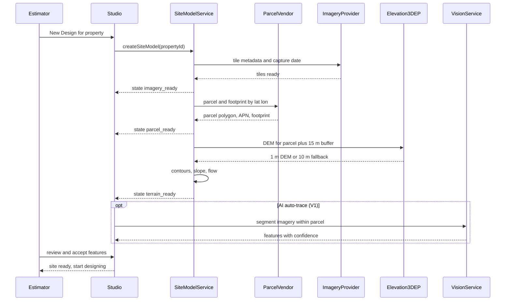
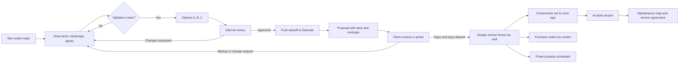
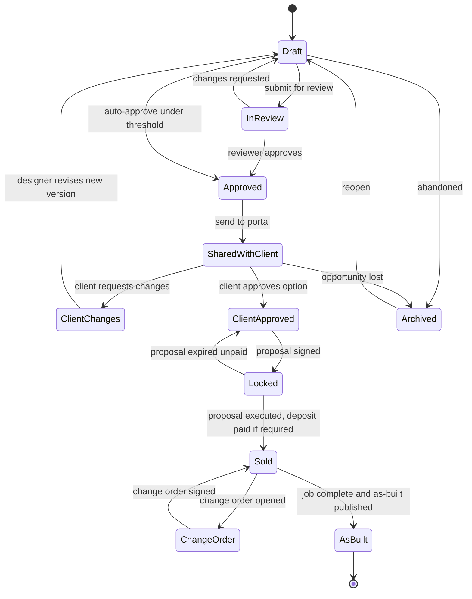
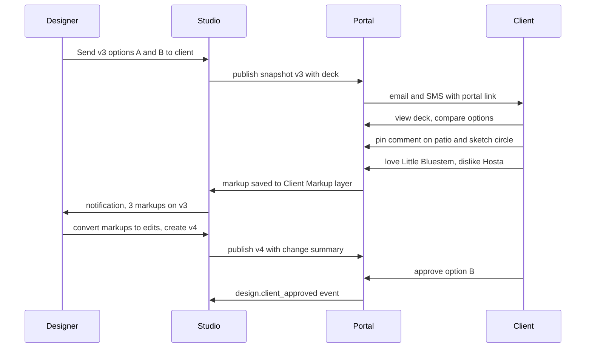
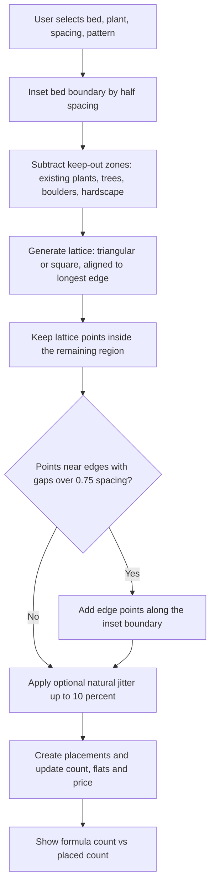
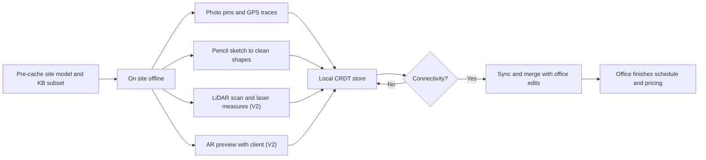
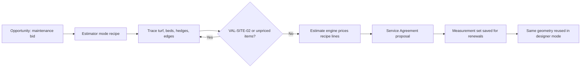
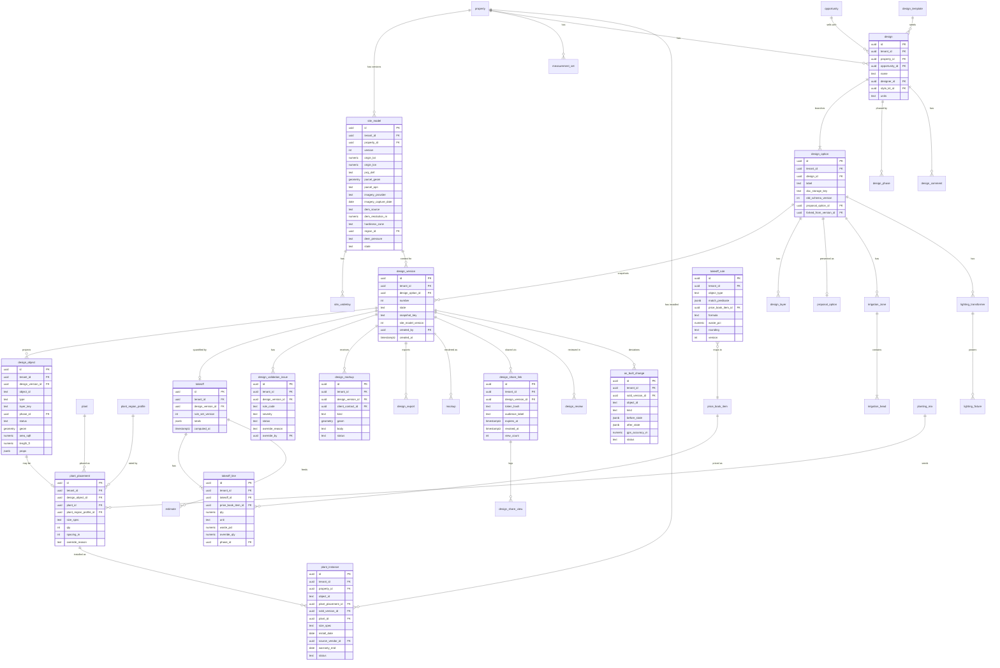

# 10 - Design Studio: Built-in Landscape Planning

> The Design Studio is Rootline's browser-based, to-scale landscape planning tool, and the heart of the product's "design sells the job" thesis. A designer or estimator types a property address and within about a minute gets a geo-referenced site model: parcel boundary, aerial basemap, house footprint, LiDAR-derived contours and slope. They then draw beds, turf, hardscape, walls, water features, lighting and irrigation with CAD-grade precision. They place plants from the operator-curated, region-aware [Plant Knowledge Base](12-plant-knowledge-base.md), and every plant symbol is auto-sized to its mature spread and checked live against the site's sun, hardiness zone, deer pressure, hydrozone and setbacks. Every stroke drives a live takeoff priced against the Company's [Price Book](03-crm-sales-estimating-proposals.md): mulch in cubic yards, edging in linear feet, pavers plus base plus sand, plants by container size. The design pushes into an Estimate and Proposal with one click and stays linked. Then it can be rendered photoreal by the [AI mockup engine](11-ai-design-mockups.md), presented in the [Customer Portal](06-customer-portal.md), marked up by the client, phased over three seasons, exported as a PDF plan set or DWG, and handed to the crew as a construction set and, later, an as-built property map. No competitor ships this loop end to end in one system. This document specifies it.

**At a glance**

- **What it is:** Rootline's built-in, to-scale landscape design tool for the browser and iPad. An address becomes a geo-referenced site model in about a minute; designers and estimators draw beds, turf, hardscape, water features, lighting and irrigation, and every object prices live against the Company's Price Book.
- **Decision 1, the plan is the record:** a Design holds Design Options (A/B/C), each a live CRDT document (RDD). Immutable Design Versions move `draft` -> `in_review` -> `approved` -> `shared` -> `client_approved` -> `locked` (on `proposal.signed`) -> `sold` (on `proposal.executed`) -> `as_built` ([5.3](#53-flow-c-design-version-lifecycle)). Mockups, Estimates and Proposals all pin a Design Version.
- **Decision 2, plants come only from the Plant KB:** the picker is pre-filtered to the Property's Region and hardiness zone, symbols size to mature spread, and one validation engine (zone, Plant Region Profile rating, legal status, sun, deer, hydrozone, site rule packs) serves the Studio, the AI layout solver and the design assistant ([4.11](#411-live-validation-engine)).
- **Decision 3, the design is the estimate:** tenant Takeoff Rules turn geometry into Price Book quantities with waste and rounding; one click pushes the Takeoff into an Estimate (internal costing) that feeds the Proposal (customer-facing), and the two stay linked through change orders ([4.15](#415-takeoff-to-estimate-and-live-pricing)).
- **Decision 4, one design, many uses:** the sold version becomes the crew's construction set and plant pull list ([05](05-field-crew-mobile-app.md)), purchase orders ([13](13-operations-inventory-equipment.md)), the as-built property map, the maintenance map, and the installed-plant list behind portal care guides and plant warranties ([06](06-customer-portal.md)).
- **Decision 5, the stack:** a TypeScript/WebGL2 canvas on a Yjs CRDT document with offline iPad editing and real-time co-editing, inside the Next.js modular monolith on Postgres + PostGIS with Temporal site-model workflows ([4.23](#423-technical-approach-summary), [20](20-architecture-security.md)).
- **MVP:** address to site (parcel, imagery, footprint), measurement and estimator trace-and-price mode, beds, turf, patios and walkways, KB plant placement with live validation, options and versions, takeoff with a live price panel and push to Estimate, single-sheet PDF and image export.
- **Later:** terrain, sun study, 3D with growth slider and seasons, irrigation and lighting design, AI auto-trace, AI layouts, plan-to-photo mockups, conversational edits, portal client markup, construction set and as-built [V1]; DWG, hydraulic calcs, staking and AR [V2]; template marketplace and field-measured sun [V3].
- **Differentiators:** the only tool that closes the loop from address to as-built in one record; region-curated plants validated live; dimension-aware AI that renders what the plan says at prices the Company actually charges.
- **Key links:** plants, Regions and palettes [12](12-plant-knowledge-base.md); AI layouts, mockups and the design assistant [11](11-ai-design-mockups.md); Estimates and Proposals [03](03-crm-sales-estimating-proposals.md); portal presentation and markup [06](06-customer-portal.md); roles [02](02-personas-roles-permissions.md); Design Studio seats, usage meters and AI credits [22](22-business-model-pricing-gtm.md); entities and events [20](20-architecture-security.md).

**Verification note.** Items marked "verify" are from secondary sources (including the research reports [R2](research/R2-landscape-specific-platforms.md) and [R3](research/R3-design-ai-plant-data.md)) or general knowledge and need first-hand confirmation against the vendor's current site, the adopted code edition or a trial before build or use in sales material.

---

## Table of contents

1. [Goals and non-goals](#1-goals-and-non-goals)
2. [Market research](#2-market-research-what-competitors-do-what-users-complain-about-the-gap-we-exploit)
3. [Personas and jobs-to-be-done](#3-personas-and-jobs-to-be-done)
4. [Feature specification](#4-feature-specification)
5. [Key user flows](#5-key-user-flows)
6. [Screens and wireframes](#6-screens-and-wireframes)
7. [Data model](#7-data-model)
8. [Integrations, APIs and events](#8-integrations-apis-and-events)
9. [Permissions](#9-permissions)
10. [AI opportunities in this module](#10-ai-opportunities-in-this-module)
11. [Edge cases, compliance and risks](#11-edge-cases-compliance-and-risks)
12. [Metrics and KPIs](#12-metrics-and-kpis)
13. [Beyond the brief: extra ideas](#13-beyond-the-brief-extra-ideas)
14. [Open questions](#14-open-questions)
15. [Sources](#sources)

---

## 1. Goals and non-goals

### 1.1 Goals

| # | Goal | Measurable target (MVP unless noted) |
|---|------|--------------------------------------|
| G1 | **Address to drawable site in about a minute.** Parcel, imagery, footprint and (V1) contours load automatically. | p50 under 60 s, p95 under 3 min from address entry to "site ready" |
| G2 | **To-scale and trustworthy.** Measurements match field reality closely enough to order materials. | Area takeoffs within ±3% of field-verified area on calibrated sites (V1 target; we will track it, see [KPIs](#12-metrics-and-kpis)) |
| G3 | **Design is the estimate.** Every drawn object has quantities that price live against the Price Book and push to an Estimate without re-keying. | 0 manual re-keying of quantities; under 2 min from "design done" to draft Estimate |
| G4 | **Plants are right for the place.** Only KB plants, filtered and validated for the property's Region, zone, sun and deer pressure. | Less than 1 unresolved "error" validation per sent design; override reasons captured 100% |
| G5 | **Clients fall in love.** Presentation mode, 3D, growth slider, season toggle and AI mockups make the proposal emotional, not just a line-item list. | Track close rate for proposals with a design vs without (hypothesis: materially higher, to be measured, not claimed) |
| G6 | **Fast enough for the truck seat.** Usable on an iPad on site, offline, with Apple Pencil. | iPad sketch mode usable offline for 8 h; sync on reconnect with zero lost edits (V1) |
| G7 | **One design, many uses.** The sold design becomes the construction set, the as-built property map and the maintenance map: bed areas for next spring's mulch, zone map for irrigation start-ups, plant inventory for warranty and plant health care (PHC). | 80% of sold install jobs have an as-built within 14 days of completion (V1) |
| G8 | **Pro-grade output.** PDF plan sets with title blocks and plant schedules that a landscape architect would not be embarrassed by, plus DXF/DWG for the trades. | Plan set export under 30 s for a 6-sheet residential set |

### 1.2 Non-goals

- **Not a licensed civil or structural engineering tool.** We compute quantities, slopes and rule-of-thumb checks (for example "this wall exceeds 4 ft; engineering may be required"). We do not produce stamped grading plans, wall engineering or stormwater calcs for permits. Engineers' drawings come in as underlays.
- **Not a replacement for AutoCAD/Land F/X in landscape-architecture firms.** We interoperate (DXF/DWG in and out). We win the design-build contractor, not the 40-person LA firm producing municipal bid sets.
- **Not BIM.** No IFC-grade object semantics before [V3].
- **Not a general home-design tool.** Houses are context: extruded footprints with simple roofs. We do not model interiors.
- **Not a hydraulic engineering suite.** Irrigation design covers head layout, coverage, precipitation rates, zone flow and simple pipe sizing. It does not do full pressure-loss network solving before [V2].
- **Not a survey.** Parcel lines from data vendors are approximate. The product says so on screen and on every export.

### 1.3 Design principles

1. **Geometry is truth; numbers follow.** Quantities are always derived from geometry plus properties (depth, material, spacing). They are never typed in as orphan numbers. Manual overrides are allowed, flagged, and they survive geometry edits.
2. **Real units everywhere.** Every object lives in a real-world coordinate system with real dimensions. There is no "canvas pixels" mode.
3. **The plant KB is the only plant source.** A Company can add private plants (see [12](12-plant-knowledge-base.md)), but every placed plant references a KB record with traits. That is what makes validation, growth and schedules possible.
4. **Warn, do not block, except where safety or law says block.** Designers are professionals. Errors (invasive species in a state that prohibits it) block sending until overridden with a reason. Warnings educate.
5. **Progressive power.** An estimator can trace a bed and get a mulch quote in 90 seconds. A designer can produce a 9-sheet plan set. Same tool, with complexity revealed on demand.
6. **Offline and multiplayer from day one.** The document model is a CRDT from the first line of code. Collaboration and offline iPad use are therefore features we switch on, not rewrites.
7. **Every object knows its money.** Hovering any object shows its cost and price contribution. Selecting a region of the plan shows a subtotal.

---

## 2. Market research: what competitors do, what users complain about, the gap we exploit

### 2.1 Three categories of tool, none of which closes the loop

The landscape contractor today stitches together three classes of software:

1. **Business-management platforms with measurement but no design.** Jobber, Housecall Pro, ServiceTitan, Service Autopilot, Yardbook, Copilot CRM, LMN, SynkedUP, Real Green, Arborgold and Aspire. At best they measure areas on a satellite image for pricing. None of them, as far as our research could establish, ships a true to-scale planting-design canvas tied to a plant database.
2. **Standalone landscape design tools.** PRO Landscape+, DynaSCAPE Design, Realtime Landscaping, iScape, VizTerra and others. They produce attractive drawings and images, but they are separate subscriptions with separate customer records, and their estimates rarely flow cleanly into the business system.
3. **Professional landscape CAD.** Land F/X on AutoCAD, Vectorworks Landmark. Powerful plant and irrigation schedules, but expensive, steep to learn, desktop-bound and disconnected from operations.

What we found per competitor (as of Nov 2026, verify before external use):

- **Aspire (a ServiceTitan company)** bought Go iLawn (online property measurement) and LandOne (cloud digital takeoff and design) and combined them into **PropertyIntel** ([IGIN](https://igin.com/article-8937-Aspire-Software-announces-intent-to-acquire-Go-iLawn-and-LandOne.html), [Landscape Management](https://www.landscapemanagement.net/aspire-software-launches-new-propertyintel-measuring-and-estimating-tool/), [Green Industry Pros](https://greenindustrypros.com/business-management/software/product/22684683/aspire-software-aspire-software-announces-launch-of-online-property-intelligence-tool-propertyintel)). Listings describe AI-powered measuring of property boundaries and features, slope visualization, point-and-click takeoff, drawing and annotation, and shape, circle, line and count tools. They also describe "PropertyIntel Complete", a done-for-you service that returns a measured takeoff for a submitted address, and one-click upload of takeoffs into Aspire ([Slashdot listing](https://slashdot.org/software/p/PropertyIntel/), [ZoftwareHub](https://zoftwarehub.com/en-sa/products/propertyintel/overview)). Go iLawn on its own was listed with assembly takeoff, slope routines and a 3D view ([SourceForge](https://www.sourceforge.net/software/product/Go-iLawn)). **This is the strongest incumbent in takeoff.** It is measurement-and-takeoff-first, not a plant-aware design tool.
- **Jobber** has no native design canvas. Its help center documents two ways to measure: the **Deep Lawn** integration, which uses AI to measure lawns, homes, driveways and walkways and syncs the figures into Jobber, and a manual workaround of tracing in Google Maps and copying area into a custom field ([Jobber help](https://help.getjobber.com/es/articles/how-to-measure-property-distance-and-size/), [Jobber product updates](https://productupdates.getjobber.com/25949-virtually-measure-properties-and-automatically-import-data-into-jobber-with-deep-lawn)). Jobber's community has threads from users looking for separate landscape design software and training ([Jobber community](https://community.getjobber.com/discussions/operations-forum/looking-for-landscape-design-software--training/8084)).
- **LMN** is estimating-centric (budget-based pricing is its signature). It merged with SingleOps in Nov 2024, and the group now operates as Granum. In February 2025 it announced a strategic partnership with **Attentive.ai** for AI mapping, measurement and material calculations, and in February 2026 a release note described **Beam AI** takeoffs mapping automatically into LMN estimates ([Attentive.ai announcement](https://attentive.ai/blog/lmn-and-attentive-ai-announce-strategic-partnership), [Landscape Management](https://www.landscapemanagement.net/lmn-and-attentive-partner-to-integrate-products/), [LMN release note](https://support.golmn.com/hc/en-us/articles/46786137574683); compiled in [R2](research/R2-landscape-specific-platforms.md)). A G2 reviewer said measuring large commercial sites "would take literal days" before such tools ([G2](https://www.g2.com/products/lmn)). In other words, LMN partners for measurement rather than building design.
- **SiteRecon** and **Attentive.ai** (Accelerate, Beam AI) sell AI-generated property maps and takeoffs from aerial imagery to commercial maintenance firms, alongside Aspire and LMN rather than replacing them ([SourceForge LMN vs SiteRecon](https://www.sourceforge.net/software/compare/LMN-vs-SiteRecon), [R2](research/R2-landscape-specific-platforms.md) section 8). They are the benchmark for DS-SITE-05 auto-trace accuracy and speed, and they stop at quantities.
- **SynkedUP** markets quoting that is "automatically priced for profit" ([SynkedUP landscaping](https://synkedup.com/industry/landscaping/)). Third-party listings mention CAD and image-editing tools, but we found no vendor-confirmed description of a planting-design module ([Software Advice](https://www.softwareadvice.com/landscaping/synkedup-profile/), [Capterra](https://www.capterra.com/p/228695/SynkedUP/)). Verify in a demo.
- **Arborgold** has a landscape measuring tool for tracing lawn, bed and sod areas and saving them as custom measures ([Arborgold help](https://help.arborgold.com/en/articles/4423488-landscape-measuring-tool-basics)).
- **PRO Landscape+** (Drafix) lists landscape design, AI design tools, landscape CAD, 3D rendering, proposal generation, photo imaging, material takeoffs, a plant library and a mobile companion app, at about $90/month or $900/year ([Capterra](https://www.capterra.com/p/126135/PRO-Landscape/), [GetApp](https://www.getapp.com/all-software/a/pro-landscape/); as of Nov 2026, verify). Reviewers ask for "more native plants suited to their climate zone" and say plant symbols are hard to tell apart ([Capterra UK](https://www.capterra.co.uk/software/126135/pro-landscape), [Software Advice](https://www.softwareadvice.com/landscaping/pro-landscape-profile)). One calls it "meant for someone not a beginner at design" ([Capterra reviews](https://www.capterra.com/p/126135/PRO-Landscape/reviews/)). Ratings are based on small samples (about 3.6 to 3.7 from 8 or 9 reviews at the time of search). In 2025 it added an AI suite: AI Outdoor Living Designer (generate concepts from a customer photo), AI Paver Tool, AI Eraser, AI Cutout Tool and an "Ask Wayne" assistant ([Green Industry Pros](https://www.greenindustrypros.com/business-management/software/product/22961404/pro-landscape-pro-landscape-launches-aibased-designer-suite), [Lawn and Landscape](https://www.lawnandlandscape.com/news/pro-landscape-updates-design-software-with-artificial-intelligence)). Its proposal lives inside PRO Landscape, so client records, deposits, scheduling and invoicing stay in another system ([R3](research/R3-design-ai-plant-data.md) 2.4). **PRO Landscape+ is the incumbent Rootline displaces most directly in design-build shops**, and it now competes on AI imagery. Rootline therefore has to win on the regional plant KB and the closed money loop, not on imaging alone.
- **DynaSCAPE** (Design, Color, and historically Manage for CRM and estimating) is a Canadian design suite known for **hand-drawn-looking** plans that clients read as "designed", with a following among design-build firms and horticulture colleges. Quantities historically flowed into DynaSCAPE Manage, so its estimating link only works if the firm runs that product too (background knowledge in [R3](research/R3-design-ai-plant-data.md) 2.2.2; current packaging and pricing not verified, verify). Lesson taken: the "Hand-drawn watercolor" symbol style (DS-SYMB-01) is a sales feature, not decoration.
- **SketchUp plus plugins** (Skatter, Laubwerk, PlaceMaker, Profile Builder, Enscape or D5 for rendering) is how many design-build firms model hardscape, outdoor kitchens and pergolas in 3D. Quantities come only from plugins and manual export, and plants are rarely modeled as data (background knowledge in [R3](research/R3-design-ai-plant-data.md) 2.2.5, verify). Lesson taken: credible extruded hardscape in 3D and a DAE/GLB export so firms can keep SketchUp for one-off structures (DS-3D-06).
- **Realtime Landscaping** (Plus, Pro, Architect, Photo tiers; Windows) is popular with small contractors for its low learning curve, 3D walkthroughs and a plant **growth-over-time** view. **Structure Studios VizTerra** sells cinematic 3D flyovers to high-ticket outdoor-living and pool builders. **iScape** offers phone AR and photo design (Pro around $29.99 per month, with reviewers citing AR crashes on complex designs; [AI Tools Bakery](https://aitoolsbakery.com/blog/iscape-review/), third-party, verify). None of the three links to a contractor's price book, CRM or invoicing ([R3](research/R3-design-ai-plant-data.md) 2.2.6-2.2.8 and 2.4; Realtime and VizTerra details are background knowledge, verify).
- **Yardzen-style design services** sell homeowners remote 2D plans and 3D renderings at fixed package prices, with a referral to an installer ([R2](research/R2-landscape-specific-platforms.md) section 11; verify current packages). This shows that homeowners pay for visualized design, and that the install handoff is where value leaks. Rootline lets the installing Company capture the design fee itself (see [13 Beyond the brief](#13-beyond-the-brief-extra-ideas), item 19).
- **Land F/X** offers automated plant schedules sortable by botanical or common name, irrigation schedules (including equipment not yet placed) and watering schedules ([Land F/X planting schedules](https://www.landfx.com/docs/planting/schedules.html), [Land F/X irrigation schedules](https://www.landfx.com/index.php/docs/irrigation/schedules-and-reports/196-irrigation-schedules-and-reports.html), [watering schedule](https://www.landfx.com/docs/irrigation/schedules-and-reports/1545-watering-schedule.html)). A third-party summary says its 3D visualization is less developed than dedicated visualization tools ([FitGap](https://us.fitgap.com/products/land-f-x)).
- **Vectorworks Landmark** auto-generates schedules, including plant lists, irrigation plans and existing-tree reports ([Vectorworks help, 2015](https://app-help.vectorworks.net/2015/NNA/eng/VW2015_Guide/Worksheets/Creating_Schedules_Automatically.htm)). Reviews describe an extensive plant database covering thousands of species ([Dyverse review](https://avaria.dyverse.com/best-landscape-architecture-software-expert-reviews-comparisons-2024)).
- **Housecall Pro, ServiceTitan core, Service Autopilot, Yardbook, Copilot CRM, Real Green.** Their public materials we reviewed focus on scheduling, CRM, billing and, in several cases, satellite measurement for lawn-size pricing. We found no to-scale planting-design module. ServiceTitan's landscape strategy runs through Aspire and PropertyIntel. Verify each with a current demo, because this space moves fast.

### 2.2 Capability matrix (as of Nov 2026, verify)

Legend: **Y** = native (evidence found), **P** = partial or basic, **I** = via third-party integration or partner, **N** = not found in our research, **?** = could not verify either way. Rootline column shows our target and priority tag.

| Capability | Rootline (target) | Aspire + PropertyIntel | Jobber | LMN | SynkedUP | PRO Landscape+ | Land F/X | Vectorworks Landmark |
|---|---|---|---|---|---|---|---|---|
| Address to parcel and aerial basemap | Y [MVP] | Y | I (Deep Lawn) | I (Attentive) | ? | ? | ? | P (aerial imagery import; verify) |
| AI auto-measure of lawn, beds, hardscape | Y [V1] | Y | I (Deep Lawn) | I (Attentive) | ? | ? | N | N |
| Terrain contours and slope | Y [V1] | P (slope visualization) | N | ? | N | ? | ? | P (site modeling; verify) |
| To-scale planting design canvas | Y [MVP] | P (LandOne heritage) | N | N | ? | Y | Y | Y |
| Region-curated plant KB with live validation | Y [MVP] | N | N | N | N | P (library; regional depth criticized) | P (plant database) | P (plant database) |
| Plant symbols auto-sized to mature spread | Y [MVP] | N | N | N | N | ? | ? | ? |
| Mixed-species planting areas at a density | Y [V1] | N | N | N | N | ? | ? | P (landscape areas; background knowledge, verify) |
| Live takeoff priced against the business price book | Y [MVP] | Y (to Aspire) | N | I (via partner, planned) | ? | P (takeoffs in a separate system) | P (schedules; no business pricing) | P (schedules; no business pricing) |
| Design to Estimate to Proposal in one system | Y [MVP] | P | N | N | N | N | N | N |
| 3D with growth slider and season toggle | Y [V1] | P (Go iLawn 3D view) | N | N | N | P (3D rendering) | P (3D; reported weaker) | P (3D; growth and seasons not verified) |
| AI photoreal mockups linked to the plan | Y [V1] | ? | N | N | N | P (AI design tools listed) | N | ? |
| Irrigation design with precipitation rates | Y [V1] | N | N | N | N | ? | Y | Y |
| Lighting design with voltage-drop calc | Y [V1] | N | N | N | N | ? | ? | ? |
| Client markup in a white-label portal | Y [V1] | ? | N | N | N | N | N | N |
| Real-time multiplayer editing | Y [V1] | ? | N | N | N | N | N | ? |
| Offline iPad sketch with LiDAR or AR capture | Y [V1]/[V2] | ? | N | N | N | P (mobile companion app) | N | ? |
| As-built map reused by maintenance and irrigation service | Y [V1] | ? | N | N | N | N | N | N |

### 2.3 What users complain about

- **Double entry between design and business tools.** The standalone design tools are separate products. Contractors redraw quantities into their estimating system, and errors creep in. A 2026 contractor-oriented blog lists mismatched paver counts, wrong retaining-wall heights and irrigation head-spacing errors discovered before ground is broken ([JackMacBiz, 2026](https://jackmacbiz.github.io/blog/2026-06-13-why-your-current-landscape-design-app-is-wasting-8-hours-per/); single source, treat as anecdote).
- **Plant libraries that do not know the region.** "More native plants suited to their climate zone" is a recurring ask about PRO Landscape+ ([Capterra UK](https://www.capterra.co.uk/software/126135/pro-landscape)). Generic libraries put zone 8 plants in zone 5 designs, and the contractor pays the warranty claim.
- **Learning curve.** CAD-grade tools are "meant for someone not a beginner" ([Capterra](https://www.capterra.com/p/126135/PRO-Landscape/reviews/)). A gardening-forum user says landscape design software has "taken a huge step backwards" compared with older tools ([garden.org](https://garden.org/thread/view/132802/software/)). Trade press advises budgeting real time and money for onboarding ([Green Industry Pros](https://www.greenindustrypros.com/22738198)).
- **Measurement workarounds.** Jobber's own documented fallback is to trace in Google Maps and paste the number into a custom field ([Jobber help](https://help.getjobber.com/es/articles/how-to-measure-property-distance-and-size/)). Users hunt for separate design software in vendor communities ([Jobber community](https://community.getjobber.com/discussions/operations-forum/looking-for-landscape-design-software--training/8084)).
- **Symbol and output quality.** Plant symbols are hard to tell apart ([Software Advice](https://www.softwareadvice.com/landscaping/pro-landscape-profile)), and 3D in pro CAD trails dedicated visualizers ([FitGap](https://us.fitgap.com/products/land-f-x)).
- **Design is the weakest feature in the category.** On Capterra's landscape software pricing guide, "Landscape Design" is among the lowest-rated features at 2.9 ([Capterra pricing guide](https://www.capterra.com/landscape-software/pricing-guide/), via [R3](research/R3-design-ai-plant-data.md)). Buyers are saying the design they get today, where they get any, is poor.
- **Desktop and Windows lock-in.** PRO Landscape+, DynaSCAPE and Realtime are Windows desktop products (background knowledge, verify), which does not fit a designer who works at the client's kitchen table on an iPad.
- **Plant availability surprises.** The designer persona in [02](02-personas-roles-permissions.md) spends a June day resolving substitutions because the nursery is out of 3-gallon 'Little Lime' hydrangeas. No design tool we reviewed checks stock or proposes validated substitutes at order time (see DS-PLNT-06, DS-PLNT-12 and Beyond the brief item 20).

### 2.4 The gap we exploit

1. **Closed loop.** Address, site model, design, live takeoff, Estimate, Proposal, signed Job, construction set, as-built and maintenance map. One record from start to finish. Competitors cover one or two links of that chain.
2. **The operator-curated, region-aware plant KB** with live validation. This is a data moat: thousands of plants with Region performance profiles, curated by `platform_curator` staff (see [12](12-plant-knowledge-base.md)).
3. **Dimension-aware AI** that respects the drawn geometry. The AI generates layouts inside real dimensions and renders mockups that match the plan (see [11](11-ai-design-mockups.md)), rather than "AI pictures" that cannot be built or priced.
4. **Approachable but deep.** Estimator mode (trace and price) and designer mode (full plan sets) in the same tool.
5. **Built for the field.** iPad offline sketching, LiDAR capture, AR plant preview, and the crew app's construction-set view (see [05](05-field-crew-mobile-app.md)).

> **Competitive edge: vs Aspire PropertyIntel.** PropertyIntel is excellent at measuring what exists and turning it into takeoffs. Rootline's Design Studio measures too ([V1] AI auto-trace), but its center of gravity is designing what will exist. Plants come from a curated regional KB, each one validated for sun and zone, sized to maturity, and priced by container size. Our takeoff is a by-product of design, not a separate activity. And customers are not buying into an ERP-style suite aimed at larger commercial operators: a 6-person design-build shop gets 2D design, takeoffs and AI mockups with one designer seat on the **Grow** plan, with 3D a per-seat add-on on Grow and included on Pro (see [22](22-business-model-pricing-gtm.md); verify current Aspire packaging before making price comparisons).

> **Competitive edge: vs Jobber, Housecall Pro and ServiceTitan.** These platforms rely on third-party measurement (Deep Lawn) or manual Google Maps tracing for site quantities. None lets a salesperson draw a bed, drop in 14 'Limelight' hydrangeas, and watch the proposal total update. For a design-build company, that one interaction justifies switching.

> **Competitive edge: vs PRO Landscape+, DynaSCAPE and Land F/X.** They are separate products with separate client lists and price lists. Rootline's design is the same record as the client, property, estimate, proposal, invoice and job cost. Our plant library is region-curated (we answer the "native plants for my zone" complaint directly), and our client experience (portal markup, presentation mode, mockups) is built in rather than exported as a PDF. PRO Landscape+'s 2025 AI tools make attractive pictures, but a picture with no Price Book, no stock check and no zone validation still has to be re-keyed and re-checked. In Rootline the AI output is a set of editable, validated, priced design objects (DS-AI-01).

> **Competitive edge: vs SketchUp, Realtime Landscaping and VizTerra.** These win on 3D emotion and, for SketchUp, on custom hardscape modeling. Rootline does not try to out-model SketchUp. It makes 3D a by-product of the 2D plan (extruded hardscape, archetype plants with a growth slider and seasons) that a non-modeler gets for free, and it exports DAE/GLB for firms that still want SketchUp for a one-off pavilion. A 3D model that cannot reprice itself when the client says "make the patio 2 ft deeper" is a rendering, not a sales tool.

---

## 3. Personas and jobs-to-be-done

| Persona (role key) | Primary jobs-to-be-done in the Design Studio | What success feels like |
|---|---|---|
| Landscape Designer (`designer`) | Turn a site visit and client wishlist into a beautiful, buildable, region-appropriate plan, in options, then revise from client feedback. | "I designed a 2,400 sq ft backyard with patio, wall and 180 plants in 3 hours, and the estimate was already done." |
| Sales Rep / Estimator (`estimator`) | Quickly measure and price a scope (mulch, cleanups, sod, a small patio) without being a designer, and attach a clean visual to the proposal. | "Traced 6 beds on the satellite photo from my truck, priced 9 cu yd of mulch plus edging, sent the proposal before I left the driveway." |
| Business Owner (`owner`) | Make sure designs are profitable, consistent and on brand. Approve big designs. Reuse templates that sell. | "Every design shows margin while it's drawn. I approve anything over $25k with one tap." |
| Office / Admin Manager (`office_manager`) | Manage templates, title blocks, symbol styles and Price Book mappings. Send designs and chase approvals. | "Plan sets go out with our logo, license number and the right disclaimer every time." |
| Operations / Account Manager (`ops_manager`) | Turn sold designs into phased projects, material orders and crew instructions. Keep as-built maps for maintenance accounts. | "Sold design to purchase orders and a phased schedule in an afternoon." |
| Crew Lead / Foreman (`crew_lead`) | Read the construction set on a phone or tablet: dimensions, layout, plant locations, grades. Record as-built changes. | "I see exactly where the 3 'Green Velvet' boxwoods go, 30 in off the walkway, and I can mark the one we moved." |
| Field Technician (`technician`) | View plant and zone locations for maintenance or install. Capture site photos. | "I know which irrigation zone feeds the front bed when I do the spring start-up." |
| Bookkeeper (`bookkeeper`) | Rarely in the Studio. Needs takeoffs to reconcile material costs in job costing. | "Material variance on job 1042 traces back to the design takeoff." |
| Subcontractor (`subcontractor`) | View (and comment on) the layers relevant to their trade, for example the lighting or irrigation sub. | "I got the lighting layer with fixture schedule and wire runs, nothing else." |
| Residential client (`client_residential`) | Understand and fall in love with the design, compare options, request changes, approve. | "I could see what it looks like in 5 years and in October, and I circled the spot where I want the fire pit." |
| Commercial client (`client_commercial`) | Review phased enhancement plans across multiple properties. Route approvals to the board. Get documents for the HOA architectural review. | "The board saw Phase 1 and 2 side by side, with costs, and approved Phase 1 in the portal." |
| Platform curator (`platform_curator`) | Maintain the global symbol library, style templates, plant-to-3D-model mappings and material catalogs. | "New region palette published; 40 style templates now resolve to Pacific Northwest plants." |
| Platform Operator (`platform_owner`) | Monitor adoption, data-vendor costs (parcels, imagery, AI credits) and quality of the Studio across tenants. | "Imagery cost per design is down 30% since we cached parcel lookups." |

---

## 4. Feature specification

Feature IDs use the prefix `DS-`. Each carries a priority tag: [MVP], [V1], [V2] or [V3]. Quantities and defaults marked "default" are tenant-configurable in **Settings, Design Studio, Defaults**. Where a default is an industry rule of thumb rather than a cited standard, it is labeled as such. Tenants should calibrate defaults to their region, suppliers and crews.

### 4.1 Property setup and the site model

A **Site Model** is the geo-referenced context for all Designs on a Property: boundary, basemap, footprints, terrain, existing features and underlays. One Property has one current Site Model, with history. Many Designs share it.

| ID | Feature | Behaviors and rules | Priority |
|---|---|---|---|
| DS-SITE-01 | **Address to site** | Uses the Property address (from CRM, see [03](03-crm-sales-estimating-proposals.md)), or a pin drop if the address does not geocode (rural lots, new subdivisions). Geocodes to lat/lon and sets the site origin at the parcel centroid. Kicks off async jobs for parcel, footprint, imagery and elevation. Shows progressive results: imagery in under 5 s, parcel in under 10 s, terrain later. | [MVP] |
| DS-SITE-02 | **Parcel boundary** | Fetched from a parcel data vendor (Regrid primary; see [8](#8-integrations-apis-and-events)). Displayed as a dashed line labeled "Approximate parcel line, not a survey." Multi-parcel properties: user can merge adjacent parcels. Parcels with no geometry: user draws the boundary. Parcel attributes stored: APN, acreage, owner name (used only for CRM matching, never shown to clients), land use, year built where available. Lookups are cached per tenant and property and refreshed only on demand. | [MVP] |
| DS-SITE-03 | **Basemap imagery** | Default satellite tiles from the tenant's configured map provider. Optional premium high-resolution aerial (Nearmap or EagleView class) with the capture date shown, metered per pull at cost plus 20% (the `premium_imagery` usage meter in [22](22-business-model-pricing-gtm.md), confirmed before purchase). Imagery date is always visible in the corner: "Imagery: Apr 2025". A "use older capture" dropdown appears when the premium provider has history (great for seeing a lawn before a pool was built). Leaf-off imagery is preferred when available because beds are visible under deciduous canopy. **License-clean layer:** USDA NAIP orthoimagery (public domain, leaf-on, 4-band with near-infrared, roughly 60 cm and in some recent state cycles 30 cm, refreshed every 2-3 years per state; background knowledge in [R3](research/R3-design-ai-plant-data.md) 3.3.6, verify per state) is fetched alongside the basemap. It is coarser than commercial tiles, but nobody's terms restrict deriving geometry from it, and its NIR band separates turf and planting beds from bare soil and mulch (NDVI). | [MVP] standard; [V1] premium and NAIP |
| DS-SITE-04 | **House and structure footprints** | Pre-populated from building-footprint data (vendor matched footprints, or open footprint datasets as a fallback). Editable: user can square corners (90° snap), offset walls, add bump-outs and decks. House height and roof type (gable, hip, flat; ridge height) are entered or estimated from LiDAR (DS-SITE-07). Footprints drive shadows, foundation setbacks and 3D context. | [MVP] footprint; [V1] heights |
| DS-SITE-05 | **AI auto-trace of existing features** | Segmentation of the basemap into turf, beds, hardscape, driveway, trees (canopy outlines), water and structures. Produces editable "existing conditions" objects with confidence scores. Low-confidence edges (under 0.6) are highlighted for review. Competitive parity with Deep Lawn, Attentive and PropertyIntel AI measure. Each run costs AI credits. Results stay "unverified" until a user accepts them per object or in bulk. **Source rule:** segmentation runs only on imagery whose license permits derived geometry (NAIP, tenant-uploaded drone orthomosaics, or premium aerial with derivative rights). It never runs on tiles whose terms forbid it ([Open questions](#14-open-questions) item 1). Each accepted object records its source imagery and capture date, which is what the "measurement accuracy dispute" log in [11.3](#113-risks) relies on. Model details are in [11](11-ai-design-mockups.md). | [V1] |
| DS-SITE-06 | **Terrain from elevation data** | Pulls a DEM for the parcel plus a 15 m buffer: USGS 3DEP 1 m lidar DEM where available, otherwise 1/3 arc-second (about 10 m) seamless DEM ([USGS](https://www.usgs.gov/faqs/what-types-elevation-datasets-are-available-what-formats-do-they-come-and-where-can-i-download), [data.gov 1 m DEM](https://catalog-old.data.gov/dataset/usgs-1-meter-digital-elevation-model)). Canada uses NRCan's high-resolution DEM products where available (verify coverage). Generates contours at 1 ft (or 0.25 m) intervals with 1 m data, or 5 ft (1 m) with 10 m data. **Resolution and source vintage are labeled on screen.** 10 m terrain shows "coarse terrain, verify on site." | [V1] |
| DS-SITE-07 | **Slope and drainage analysis** | Slope heatmap with configurable classes (defaults: 0-2% flat, 2-5% gentle, 5-15% moderate, 15-33% steep, over 33% (3:1) "unsafe to mow with a ride-on, consider groundcover or terracing"). Flow arrows from D8 flow direction, sink (low spot) detection, and an elevation profile along any drawn line. Canopy height model from lidar first returns where point clouds are available ([V2]) to estimate existing tree and house heights for shading. | [V1] slope; [V2] canopy |
| DS-SITE-08 | **Underlays with scale calibration** | Upload PDF (vector or raster), PNG/JPG, TIFF/GeoTIFF, DXF/DWG (DWG [V1]). **Two-point scale calibration:** user picks two points and types the known distance, for example "62 ft 4 in". **Georeferencing:** user pins 2 points (similarity transform) or 3 or more points (affine, with RMS residual displayed) to basemap features such as house corners. Opacity slider, clip to rectangle, lock. Validation: if the calibrated scale disagrees with the parcel-derived scale by more than 2%, show "Underlay scale differs from map by 3.4%. Check the calibration distance." Multi-page PDFs: pick the page; vector PDFs keep linework snappable. DXF/DWG layers are listed and can be toggled. Survey units: detect "US survey foot" vs international foot in georeferenced CAD and warn (the US survey foot was retired by NIST/NGS at the end of 2022; old surveys still use it). | [MVP] PDF and image; [V1] DXF/DWG, georeferencing |
| DS-SITE-09 | **Existing conditions inventory** | Existing trees (species if known, DBH, canopy diameter, height, keep/remove/protect status, tree protection zone ring drawn at 1 ft radius per inch DBH as a common rule of thumb, configurable), utilities (from 811 locate photos, client knowledge or plans), fences, spigots, downspouts, AC units, meters, septic fields, wells, easements and setbacks. Each has a symbol and is used by validation (DS-VAL). | [MVP] basic; [V1] utilities and TPZ |
| DS-SITE-10 | **Site model versioning** | Re-pull imagery or parcel data without breaking existing designs. Site Model versions are immutable; Designs reference the version they were drawn on. "New imagery available (Jun 2026). Preview and adopt?" | [V1] |
| DS-SITE-11 | **Large and commercial sites** | Sites up to 200 acres (HOA common areas, office parks). Tiled imagery and DEM fetched per viewport. Designs can hold multiple "areas" (Entrance A, Clubhouse, Pond 3). Performance targets in [4.23](#423-technical-approach-summary). | [V1] |

**Site setup states.** `pending` → `imagery_ready` → `parcel_ready` → `terrain_ready` → `ready` (any failure moves the job to `partial` with the specific missing layer, and the user can proceed). The designer can start drawing at `imagery_ready`.

### 4.2 Measurement tools

| ID | Tool | Behaviors | Priority |
|---|---|---|---|
| DS-MEAS-01 | **Distance** | Click-click polyline; live segment and cumulative length; shift for 15° angle snap; type a length while drawing ("24'6" Enter"). | [MVP] |
| DS-MEAS-02 | **Area and perimeter** | Polygon or freehand trace with bezier support. Shows area (sq ft, sq yd, acres, or m² and ha) and perimeter. Holes (subtract a tree ring or an island bed). Multi-area totals ("all 7 front beds: 1,284 sq ft"). | [MVP] |
| DS-MEAS-03 | **Count** | Click to count (for example existing shrubs to remove, or 14 existing heads). Count sets are color-coded and named. | [MVP] |
| DS-MEAS-04 | **Slope and grade** | Two points give rise/run, %, ratio (3:1) and degrees. Uses terrain if available, otherwise the user enters spot elevations. Profile view along a polyline. | [V1] |
| DS-MEAS-05 | **Volume** | Area times depth for fill or cut, or terrain-aware cut/fill between existing and proposed surfaces ([V2]). | [MVP] simple; [V2] terrain |
| DS-MEAS-06 | **Measure to pricing** | Any measurement can be "promoted" to a takeoff line ("Spring cleanup: 3,200 sq ft beds") without becoming a design object. This is estimator mode in its simplest form, and covers maintenance bids: mowing area, trimming linear feet, bed area for mulch renewal. | [MVP] |
| DS-MEAS-07 | **Measurement sets for maintenance** | Named, reusable measurement sets on the Property (Turf mowable area, Bed area, Hedge LF, Hard edge LF for edging). They feed Service Agreement pricing in [03](03-crm-sales-estimating-proposals.md) and production-rate budgeting in [14](14-service-line-modules.md). Versioned by season. | [MVP] |
| DS-MEAS-08 | **Estimator mode (trace and price)** | A reduced skin of the same engine for `estimator` users and anyone who toggles it. It shows only Measure, Bed, Turf, Count and Promote-to-takeoff tools, hides layers, sheets, symbols and validation except VAL-TKO-01 and VAL-SITE-02, and opens with **scope recipes** that pair a measurement with Price Book items: "Spring cleanup and mulch" (bed area, depth 2 in for top-dress or 3 in for new, edging LF), "Sod install" (area, prep, pallets), "Aeration and overseeding" (turf area, seed rate from the turf species record), "Hedge trimming" (LF and average height), "Fall leaf cleanup" (turf plus bed area). Every recipe line becomes a takeoff line, so the same work later opens in designer mode with no re-entry. Switching to designer mode is one click and loses nothing. Target: first priced scope in under 10 minutes median ([KPIs](#12-metrics-and-kpis)). | [MVP] |

### 4.3 Drawing engine and core landscape objects

**Geometry primitives.** All shapes are paths of line segments, circular arcs and cubic beziers. Closed paths may have holes. Every object has `layer`, `phase`, `tags`, `notes`, an optional `price_book_item_id` override, and a `locked` flag.

| ID | Feature | Behaviors and rules | Priority |
|---|---|---|---|
| DS-DRAW-01 | **Bed tool (curvy beds)** | Draw with click (corner) or click-drag (smooth bezier handle). Freehand with smoothing (Ramer-Douglas-Peucker then curve fit, tolerance 2 in). "Bed from offset": select a house wall, walkway or fence and drag to create a bed of uniform depth, for example 6 ft off the foundation, with automatic rounded corners (default radius 3 ft). Node editing: add, delete, convert corner to smooth. Bed properties: mulch type and depth (default 3 in), soil amendment (default 2 in compost, tilled), weed fabric (default off; many designers avoid fabric under organic mulch), edging type, bed name. | [MVP] |
| DS-DRAW-02 | **Offsets and booleans** | Offset any path inward or outward (round, miter or bevel joins). Union, subtract and intersect beds, turf and hardscape, using a robust polygon-clipping library (Clipper2-class) with 1 mm tolerance. "Turf auto-subtracts": drawing a bed or patio over turf removes that area from turf automatically, so turf area always equals remaining lawn. | [MVP] |
| DS-DRAW-03 | **Edging** | Edging runs along any bed or turf boundary segment, or as a standalone polyline. Types from the Price Book: spade-cut (natural) edge, steel (1/8 in or 3/16 in, 10 ft or 16 ft lengths), aluminum, plastic/poly, paver soldier course, concrete curb, stone. Rules: edges shared with hardscape default to "no edging needed" (configurable). Steel quantities round up to whole pieces plus stakes (default 1 stake per 30 in). Corners add a configurable 2% waste. | [MVP] |
| DS-DRAW-04 | **Turf areas** | Turf objects: existing turf, new sod, seed, hydroseed, artificial turf. Sod is computed in sq ft and pallets (default 450 sq ft per pallet; varies by farm and region, configurable). Seed rate comes from the KB turf species record (lbs per 1,000 sq ft). Mowability check: slopes over 33% flagged. Narrow strips under 3 ft wide flagged "consider bed or hardscape; hard to mow" (default). | [MVP] |
| DS-DRAW-05 | **Rock, gravel and decomposed granite (DG) areas** | Material and depth give cu yd and tons (density per material in the Price Book, for example 1.4 tons per cu yd for crushed stone as an editable default). Optional fabric and edging. | [MVP] |
| DS-DRAW-06 | **Boulders and accents** | Boulder sizes (2-man, 3-man, 1 ton, 2 ton or custom by dimensions) with weight estimate and equipment flag ("requires skid steer or mini excavator"). Placed as objects with rotation and 3D model. | [V1] |
| DS-DRAW-07 | **Path smoothing and constraints** | Parametric constraints: fixed width walkways (4 ft default), parallel to a wall, concentric arcs, equal spacing. Constraint solver keeps relationships during edits. | [V2] |
| DS-DRAW-08 | **Precision entry** | Every tool accepts typed input: lengths ("12'6\"", "3.8m"), angles ("@45"), relative coordinates ("@10',0"). Units follow tenant preference with a per-design override. Imperial displays to 1/16 in. Metric displays to 1 mm. | [MVP] |
| DS-DRAW-09 | **Copy, array and mirror** | Linear and radial arrays (fence posts, bollard lights), mirror across an axis (symmetrical formal gardens), copy objects between designs and options. | [MVP] copy; [V1] arrays |

### 4.4 Hardscape

Hardscape objects carry **material** (from the Hardscape Material Catalog, which ties to Price Book items), **pattern**, **base spec** and **edge treatment**. Patterns render accurately to scale in 2D and 3D, so the client sees real 6x9 or 12x24 unit proportions, and the takeoff uses pattern-specific waste factors.

| ID | Object | Key properties and rules | Priority |
|---|---|---|---|
| DS-HARD-01 | **Patios and walkways (pavers, natural stone, concrete, stamped concrete)** | Shape (any path), material (manufacturer product or generic), pattern (running bond, stack bond, herringbone 45/90, basketweave, I-pattern or random multi-size, ashlar, circle kit), border or soldier course (width and material), joint width, finish elevation, slope direction (default 1/8 in per ft = about 1% away from house; configurable 1-2%). **Base spec presets** (editable defaults that tenants must calibrate to soils and local practice; manufacturer and industry association guidance should be consulted, verify): pedestrian patio or walkway 6 in compacted aggregate base, 1 in bedding sand; residential driveway 8-12 in base; clay soil adds geotextile. Base extends beyond the paver edge by a configurable overbuild (default 6 in each side). | [MVP] |
| DS-HARD-02 | **Driveways and parking pads** | As patios, but with "vehicular" base presets, permeable-paver option (open-graded base layers ASTM No. 57, No. 8 and No. 2 stone classes, depths configurable) and a permeable-area credit (see Beyond the brief). | [V1] |
| DS-HARD-03 | **Retaining and seat walls** | Polyline wall with height profile (constant, or per-vertex heights following terrain), block product (face height and length, setback per course), buried courses (default 1 course or 10% of height, whichever greater; rule of thumb), cap units, drainage aggregate (default 12 in behind wall), perforated drain pipe, geogrid (when height exceeds the manufacturer's gravity limit; user-entered layers). **Safety rule:** walls with exposed height of 4 ft or more (or over the jurisdiction value set in tenant settings) trigger "Engineering and permit may be required (for example IRC R404.4 in many US jurisdictions; verify locally)." The warning is printed on exports. | [V1] |
| DS-HARD-04 | **Steps and stairs** | Draw a run between two elevations. The tool proposes riser count and height using the outdoor rule of thumb 2R + T between 25 and 27 in, riser 5 to 7 in (defaults). Example: 28 in rise gives 5 risers of 5.6 in with 14.8 in treads, or 4 risers of 7 in with 12 in treads; the user picks. Supports block, stone slab, timber, concrete. Landing required if more than 12 risers (default). | [V1] |
| DS-HARD-05 | **Freestanding walls and pillars** | Pillars at ends or intervals with lights or caps; veneer area for stone. | [V1] |
| DS-HARD-06 | **Decks (context only)** | Footprint, height and material for 3D and estimating linkage. Not structural design. | [V1] |
| DS-HARD-07 | **Curbs, steps-in-lawn, stepping stones** | Stepping stones placed along a path at stride spacing (default 24 in on center) with count. | [MVP] stepping stones |
| DS-HARD-08 | **Material pattern rendering** | Vector pattern fills at true scale, color blends (for example "Bella blend: 40% charcoal, 60% sand"), border insets. 3D materials with PBR textures where licensed. Manufacturers' catalogs (Belgard, Unilock, Techo-Bloc, Versa-Lok, Allan Block and others) are loaded by `platform_curator` subject to data licensing (see [Open questions](#14-open-questions)). | [MVP] generic; [V1] manufacturer catalogs |
| DS-HARD-09 | **Hardscape assemblies** | A hardscape object maps to an assembly in the Price Book: pavers + base + sand + polymeric sand + edge restraint + geotextile + excavation + haul-off + compaction labor + equipment. See [4.15](#415-takeoff-to-estimate-and-live-pricing). | [MVP] |

### 4.5 Water features and structures

| ID | Object | Key properties and rules | Priority |
|---|---|---|---|
| DS-WATR-01 | **Ponds** | Outline, max depth, shelves. Liner size = (max length + 2 x max depth + 2 x overlap) by (max width + 2 x max depth + 2 x overlap), overlap default 1 ft. Example: 8 x 12 ft pond, 2 ft deep gives a 14 x 18 ft liner. Underlayment same size. Pump sizing hint from turnover (default 1 x volume per hour) and waterfall width (a commonly cited rule of thumb is about 100-150 GPH per inch of weir width for a typical sheet of water, verify with manufacturer). Volume in gallons (cu ft x 7.48). | [V1] |
| DS-WATR-02 | **Pondless waterfalls, bubblers and fountains** | Basin volume, stream length, weir width, pump, plumbing run length. | [V1] |
| DS-WATR-03 | **Dry creek beds** | Width, depth, river-rock sizes by percentage (for example 60% 2-4 in, 30% 4-8 in, 10% boulders), fabric. Tied to drainage analysis (DS-DRN). | [V1] |
| DS-STRC-01 | **Structures** | Pergolas, arbors, pavilions, gazebos, sheds, playsets, outdoor kitchens (with counter linear feet and appliance cutouts), fire pits (round or square kits with inside and outside diameters), fireplaces, fences (style, height, post spacing default 8 ft, gate count), shade sails, raised planters. Each has a 2D symbol, a parametric 3D model (posts, beams, rafters spacing for pergolas) and an assembly link for pricing. | [MVP] symbols; [V1] parametric 3D |
| DS-STRC-02 | **Fire safety clearances** | Fire features get a clearance ring drawn to scale and checked by VAL-FIRE-02 against structures, fences, decks and **overhead canopy at the selected design year** (a fire pit that clears a young red maple at install may sit under its canopy by year 10). Defaults by fuel type, tenant-editable per jurisdiction: **wood-burning** fire pits and in-ground fire rings 25 ft from structures and combustibles, reflecting the International Fire Code's recreational-fire provision (IFC 307.4.2 in recent editions) where it is adopted; **portable wood-burning outdoor fireplaces** 15 ft (IFC 307.4.3); **gas** fire features use the manufacturer's listed clearances entered on the product, with a 10 ft fallback when none is entered. Code sections, editions and local amendments vary (many municipalities modify or exempt residential fire pits): verify locally. Overhead clearance to canopy default 10 ft above the burner. Output on exports: "Clearance per [jurisdiction setting]; verify with the local fire marshal." | [V1] |
| DS-STRC-03 | **Pools and spas (reference only)** | Outline and coping for context, pool-barrier fence reminder, splash-zone planting guidance (no messy or thorny plants within 6 ft, default). We do not design pools. | [V1] |

### 4.6 Landscape lighting

The lighting tool designs low-voltage systems: fixtures, transformers and wire runs. It performs voltage-drop and load checks so the crew does not discover a dim path light on install day. (Lighting as a service line is in [14](14-service-line-modules.md).)

| ID | Feature | Behaviors and rules | Priority |
|---|---|---|---|
| DS-LITE-01 | **Fixture placement** | Fixture types: path, area, up/spot, well, wash, down/moon, step, hardscape (under-cap), bollard, in-grade. Properties: product, lamp wattage (W or VA for LED), lumens, beam angle, color temperature (2700K default warm), mounting height, aim direction. 2D symbol shows aim and beam cone. | [V1] |
| DS-LITE-02 | **Transformers** | Product, capacity (for example 150/300/600/900 W), taps (for example 12-15 V multi-tap), timer or photocell or astronomical clock, smart (Wi-Fi) flag. **Load rule:** connected load at most 80% of rated capacity (default). The tool proposes the smallest transformer that satisfies the rule. | [V1] |
| DS-LITE-03 | **Wire runs and voltage drop** | Draw wire runs from transformer to fixtures with topology: daisy chain, T, loop, hub (home-run with splice hub). Wire gauge (16/14/12/10/8 AWG). **Voltage-drop calc** per fixture using the industry wire-constant method: VD = (watts x one-way feet) / wire constant (manufacturer defaults commonly 7,500 for 12 AWG, 11,920 for 10 AWG, 19,000 for 8 AWG; configurable per tenant, verify against the manufacturer used), or a resistance-based method for exactness on hub topologies. **Example:** 8 LED path lights at 4 VA each (32 VA) on 120 ft of 12 AWG gives VD = 32 x 120 / 7,500 = 0.51 V. From a 12 V tap, the last fixture sees about 11.5 V: OK. **Rules:** fixture voltage within the manufacturer's range (defaults: LED 9-15 V; halogen 10.8-11.5 V); the tool recommends tap selection and gauge upgrades and flags runs out of range in red. | [V1] |
| DS-LITE-04 | **Lighting schedule and wire takeoff** | Fixture schedule (type, product, qty, lamp, beam, color temp), transformer schedule, wire by gauge in feet (with 10% slack default), connectors, hubs, conduit sleeves under hardscape (auto-detected where wire runs cross a patio or walkway). | [V1] |
| DS-LITE-05 | **Night preview** | 2D night mode with light pools (photometric-lite: inverse-square falloff with beam cone). 3D night render with real-time lights (limited to N = 64 dynamic lights; more are baked). Feeds the AI night mockup ([11](11-ai-design-mockups.md)). | [V2] |
| DS-LITE-06 | **Light-trespass and dark-sky hints** | Warn when up-lights aim above horizontal near property lines, or when fixtures exceed 3000K in a tenant-flagged dark-sky community. | [V2] |

> **Competitive edge: lighting that is priced, checked and serviceable.** Field-service platforms (Jobber, Housecall Pro, Aspire) have no lighting design at all. Design tools draw fixture symbols and night images, but we found no evidence that PRO Landscape+ or Realtime runs per-fixture voltage-drop checks against the transformer taps (verify in demos). Rootline sizes the transformer, flags the dim last fixture before install day, prices the wire by gauge, and keeps the fixture and transformer map for the annual lighting tune-up and lamp-replacement service ([14](14-service-line-modules.md)).

### 4.7 Irrigation design

Irrigation layouts also become the **zone map** used later by service techs for start-ups, winterizations and repairs ([14](14-service-line-modules.md)), and by the crew app ([05](05-field-crew-mobile-app.md)).

| ID | Feature | Behaviors and rules | Priority |
|---|---|---|---|
| DS-IRR-01 | **Water source and point of connection (POC)** | Meter size, static pressure (psi), available flow (GPM). **Design flow rule:** zone flow at most 75% of safe meter flow (default, a common rule of thumb). Backflow preventer type and location, master valve, flow sensor. | [V1] |
| DS-IRR-02 | **Heads and nozzles** | Spray, rotor, rotary nozzle (multi-stream), bubbler, drip zone (inline dripline with emitter spacing and flow, or point-source emitters per plant). Nozzle catalog: radius, arc, flow (GPM) and PR at pressure, from manufacturer data loaded by `platform_curator` (licensing in [Open questions](#14-open-questions)). Place by click, along an edge (auto-arc at corners: 90°, 180°), or **auto-layout** in an area with head-to-head spacing (spacing at most radius, default 100% of radius, square or triangular). | [V1] |
| DS-IRR-03 | **Coverage visualization** | Throw arcs drawn to scale. Coverage heatmap shows estimated application overlap. Dry spots (area reached by fewer than 2 heads in head-to-head designs) are highlighted. Overspray onto hardscape, house or windows flagged. | [V1] |
| DS-IRR-04 | **Precipitation rate (PR)** | Per zone: PR (in/hr) = 96.25 x total zone GPM / irrigated area (sq ft). For head-to-head square spacing: PR = 96.25 x full-circle-equivalent GPM / (S x L). **Example:** 15 ft sprays at 15 ft square spacing, 3.7 GPM per full-circle equivalent: 96.25 x 3.7 / 225 = 1.58 in/hr. **Rules:** do not mix head types (spray, rotor, rotary nozzle, drip) in one zone (error); flag PR variance over 20% within a zone (warning, for example rotors with mismatched nozzles); zone GPM must not exceed design flow (error). | [V1] |
| DS-IRR-05 | **Zones and hydrozones** | A zone groups heads plus one valve. Each zone gets a plant-water-need class from the beds it waters (see DS-VAL hydrozoning) and an exposure (sun, shade). Rule: a zone should not water both high-water turf and low-water shrubs (warning). Auto-zoning proposes valve groups by head type, exposure, hydrozone and flow limit. | [V1] |
| DS-IRR-06 | **Pipe routing and sizing** | Mainline and laterals drawn as polylines. Auto-route laterals ([V2]). Pipe size suggested from flow with velocity at most 5 ft/s (common rule of thumb). PVC class or poly. Sleeves under hardscape auto-detected. Trench length takeoff. | [V1] manual; [V2] auto |
| DS-IRR-07 | **Controller and schedule draft** | Controller model, station count (zones plus 20% spare default), wiring. **Runtime suggestion:** minutes per week = (weekly requirement in inches / PR) x 60, split into cycles to avoid runoff (cycle-soak). Weekly requirement can come from regional ET data. Example: 1.0 in per week at 1.58 in/hr gives 38 min per week, as 3 cycles of 13 min. | [V2] |
| DS-IRR-08 | **Irrigation schedule and takeoff** | Head schedule (symbol, model, nozzle, arc, radius, qty, PSI, GPM), valve schedule, pipe by size and class (LF), fittings allowance (default 10% of pipe cost), wire (LF by gauge), controller, backflow. | [V1] |
| DS-IRR-09 | **Hydraulic calc (pressure loss)** | Friction loss through pipe (Hazen-Williams), elevation change from terrain, valve and backflow losses. Pressure at the critical head versus nozzle requirement. | [V2] |
| DS-IRR-10 | **As-built irrigation map** | Heads and valve boxes captured or corrected from the crew app with GPS and photos. Valve locator pins ("Zone 4 valve box: 3 ft left of the AC pad"). | [V1] |

> **Competitive edge: vs Land F/X and Vectorworks irrigation tools.** Irrigation F/X is the benchmark for hydraulic rigor and schedules that municipal reviewers accept ([Land F/X irrigation features](https://www.landfx.com/irrigationfeatures)), and Rootline does not try to beat it on pressure-loss modeling before [V2]. It wins on what happens after the drawing. In Land F/X the plan ends as a sheet handed to an installer. In Rootline the same zones become the service tech's zone map for the April start-up and the October winterization ([14](14-service-line-modules.md)), the head counts become the irrigation kit on the estimate, and the valve-box locator pins ("Zone 4: 3 ft left of the AC pad") save the time techs otherwise spend probing for a buried valve box. A design-build firm that installs and services its own systems gets value every season, not once.

### 4.8 Drainage and grading

| ID | Feature | Behaviors and rules | Priority |
|---|---|---|---|
| DS-DRN-01 | **Drainage objects** | Downspouts (with roof area served), downspout extensions, pop-up emitters, catch basins, channel (trench) drains, French drains, solid and perforated pipe (4 in default), swales, dry wells, rain gardens. Pipe slope check: at least 1% (1/8 in per ft, default) using terrain or user spot elevations. | [V1] |
| DS-DRN-02 | **Foundation grade check** | Using terrain and spot elevations, flags where grade does not fall away from the foundation. Reference: the IRC commonly requires a fall of at least 6 in within the first 10 ft from foundation walls (R401.3, verify the adopted code locally). | [V1] |
| DS-DRN-03 | **Spot elevations and proposed grades** | Spot elevations (existing and proposed), proposed contour editing, cut/fill volume between surfaces ([V2]). | [V1] spots; [V2] proposed surfaces |
| DS-DRN-04 | **Dry well and rain garden sizing** | Roof or impervious area x design storm depth gives a volume, and the tool sizes the dry well or rain garden from that volume plus the soil infiltration rate. Design storm depth defaults to the 1 in event and is configurable per Region. Outputs are labeled "Estimate; not an engineered stormwater design." | [V2] |
| DS-DRN-05 | **Flow and ponding overlay** | Flow arrows and sink detection from DEM (DS-SITE-07), with proposed hardscape and grade changes applied ([V2]). | [V1] existing; [V2] proposed |

### 4.9 Layers, snapping, dimensions, annotations and the symbol library

| ID | Feature | Behaviors and rules | Priority |
|---|---|---|---|
| DS-LAYR-01 | **Layers** | Default layer set (tenant-editable template): Property and Parcel, Existing Conditions, Existing Trees, Utilities, Demolition, Grading and Drainage, Hardscape, Structures, Water Features, Beds, Turf, Trees, Shrubs, Perennials and Grasses, Groundcovers, Annuals and Bulbs, Irrigation, Lighting, Dimensions, Annotations, Phasing, Client Markup, AI Suggestions. Per layer: visible, locked, opacity, print on/off, color override, "include in takeoff" on/off. Layer groups. Per-sheet layer states for exports ("Planting Plan" sheet hides Irrigation). | [MVP] |
| DS-LAYR-02 | **Object-level visibility filters** | Filter by phase, option, tag, plant category, status (existing, proposed, remove). "Show only what changed from v3." | [V1] |
| DS-SNAP-01 | **Snapping** | Endpoint, midpoint, center, intersection, perpendicular, tangent, nearest-on-edge, extension, parallel, grid (default 1 ft or 0.25 m, adaptive with zoom), angle (15° increments with Shift), house walls and footprint corners, plant centers, underlay vector linework. Smart guides show alignment with nearby objects. Snap tolerance in screen pixels (default 8 px) so it behaves the same at any zoom. Hold Alt (Option) to disable temporarily. | [MVP] |
| DS-DIM-01 | **Dimensions** | Linear, aligned, angular, radius and diameter, arc length, chained (baseline and continuous), offset from a house corner (the crew's favorite, because it is how they stake). **Associative:** dimensions update when geometry moves. Dimension styles per tenant (arrowheads, text height in paper units, precision such as nearest 1 in or 1/2 in). | [MVP] linear and aligned; [V1] full set |
| DS-ANNO-01 | **Annotations** | Text, leader callouts, keynotes (numbered notes with a legend), plant labels (auto "5 - HYD LIM" key plus quantity, with leaders to groups), area labels (auto "Bed 3: 214 sq ft, 3 in mulch"), revision clouds, north arrow, scale bar, match lines for multi-sheet sets. Labels avoid overlaps automatically (label placement heuristic). | [MVP] basic; [V1] keynotes and auto labels |
| DS-SYMB-01 | **Symbol library** | Plan-view symbols for every object class: trees (deciduous, evergreen, palm, ornamental, columnar), shrubs (deciduous, broadleaf evergreen, needled evergreen), perennials, ornamental grasses, groundcovers, annuals, vines; plus site furnishings, lighting, irrigation and drainage symbols. Symbol **styles:** "Colored plan" (default), "Hand-drawn watercolor", "CAD line (black and white)", "Presentation (shadowed)". A style is switchable per sheet. | [MVP] two styles; [V1] four styles |
| DS-SYMB-02 | **Procedural plant symbols** | Each plant's symbol is generated from KB traits: form (round, vase, columnar, weeping, spreading, clumping), foliage texture (fine, medium, coarse), foliage color by season, bloom color and months, evergreen vs deciduous. So 'Limelight' hydrangea and 'Annabelle' look different on the plan, which answers the "symbols hard to tell apart" complaint. Curators can override with hand-drawn symbols for popular plants. | [V1] |
| DS-SYMB-03 | **Tenant symbols and blocks** | Tenants upload SVG symbols or DXF blocks with an insertion point and a scale mode (fixed real-world size, or paper size). Saved "blocks" can include several objects (for example "Standard mailbox bed": bed, 3 boxwoods, 12 perennials, 1 boulder). | [V1] |

### 4.10 Plant placement from the Plant Knowledge Base

| ID | Feature | Behaviors and rules | Priority |
|---|---|---|---|
| DS-PLNT-01 | **Context-aware plant picker** | Drawer with search (common name, botanical name, cultivar, trait such as "deer resistant red fall color 4 ft"). **Pre-filtered to the property's Region and hardiness zone** from the KB ([12](12-plant-knowledge-base.md)). When the cursor or selection is in a bed, the picker also filters to that bed's sun class (from sun study or a manual tag), hydrozone and soil. Each result card shows a photo, mature H x W, sun, water, zone range, Region performance rating on the KB's 1-5 Plant Region Profile scale (for example "5 Top performer, Central Ohio"; ratings 1-2 and `do_not_use` plants are hidden from default search, per [12](12-plant-knowledge-base.md) KB-PRP-01), any profile conditions ("needs afternoon shade here"), deer rating (A-D), native status for the property's state or province, price per container size from the Price Book, and nursery availability ([V1]). "Company favorites" and "Operator palettes" tabs. | [MVP] |
| DS-PLNT-02 | **Placement modes** | Single click; click-repeat (stays armed); **line or hedge** (count along a polyline at spacing: 30 ft hedge at 3 ft on center gives 11 plants with ends included); **massing / drift** (draw a freeform shape and choose a count or spacing; plants are placed with natural jitter and, by default, odd-number groupings of 3, 5 or 7 when count is small); **arc** placement; **grid** (orchard, formal). | [MVP] single, click-repeat, line; [V1] massing |
| DS-PLNT-03 | **Symbols auto-sized to mature spread** | Symbol diameter = KB mature spread (midpoint of range by default; designer can choose min, mid or max) at the **design year** selected on the growth slider (DS-3D-03). At "install" the symbol shows install size by container. Label shows "at maturity" vs "at install." **Example:** Hydrangea paniculata 'Limelight', mature 6-8 ft wide, shows a 7 ft circle at maturity and about 1.5 ft at install from a #3 container. | [MVP] maturity; [V1] growth stages |
| DS-PLNT-04 | **Fill-bed (groundcover and bedding)** | Select a bed (or draw a region) and choose plant, on-center spacing (12, 18 or 24 in presets or custom) and pattern (triangular default, or square). **Count formula** (area in sq ft, spacing s in ft): triangular = area / (s² x 0.866); square = area / s². Per square foot: 12 in triangular 1.155, 18 in 0.513, 24 in 0.289; square 1.0, 0.444 and 0.25. The tool also places actual plant points (not just a number), inset half-spacing from the edge, avoiding existing plants within their install radius plus half-spacing, around trees and boulders. Count = placed points (accurate for odd shapes), with formula count shown for comparison. **Example:** 180 sq ft of Pachysandra at 12 in triangular gives 208 by formula. Flats conversion: count / plants per flat (for example 18 per flat gives 12 flats), rounded up. | [MVP] |
| DS-PLNT-05 | **Spacing validation** | At the chosen design year: crowding warning when two canopies overlap by more than 25% of the smaller radius (default); sparse info when massed plants leave gaps over 50% of spread at year 3 (default). Hedges and screens get their own rule (overlap expected, warning only if spacing is under 50% of spread). | [MVP] |
| DS-PLNT-06 | **Substitution and swap** | Swap one plant for another across the design, a selection or an option ("swap all 'Green Velvet' boxwood for Ilex glabra 'Shamrock' in Option B: deer-resistant alternative"). Suggest substitutions from KB similarity (form, size, sun, water, bloom) filtered to Region; one click to swap with validation re-run. | [MVP] manual; [V1] suggestions |
| DS-PLNT-07 | **Container size and spec per placement** | Each placement has size spec: #1, #2, #3, #5, #7, #10, #15, #25 gallon; B&B by caliper (1.5 in, 2 in, 2.5 in, 3 in) or height (5-6 ft, 6-7 ft); flats or plugs; bare root; bulbs by count. Default size per category (tenant settings: shrubs #3, perennials #1, ornamental trees 1.5 in cal B&B, shade trees 2 in cal B&B). Size affects price, install labor, install-stage symbol size and warranty terms. | [MVP] |
| DS-PLNT-08 | **Plant schedule and legend (auto)** | Auto-generated table per design or option or phase: Key (auto 3-letter genus plus 3-letter species or cultivar, for example HYD LIM, collision-safe), Symbol, Qty, Botanical name, Common name, Size, Spacing, Mature H x W, Native (Y/N for the state or province), Water use, Notes. Grouped by category (Trees, Evergreen Shrubs, Deciduous Shrubs, Perennials, Grasses, Groundcovers, Annuals, Bulbs). Sort botanical or common. Optional columns: bloom time, deer rating, unit price, extended price (internal sheets only). Counts update live. Placed on sheets as a live table (DS-EXP). | [MVP] |
| DS-PLNT-09 | **Existing plants** | Mark existing plants as keep, transplant (with new location) or remove (with disposal and removal labor). Unknown species allowed as a "generic" plant with size. | [MVP] |
| DS-PLNT-10 | **Seasonal interest and bloom succession** | A chart of months against plants in bloom, fall color or winter interest. Gaps highlighted ("No bloom July-August in front beds"). Suggestions from KB to fill gaps. | [V1] |
| DS-PLNT-11 | **Palette-driven design** | Start a design from an operator Plant Palette (for example "Central Ohio Pollinator Sun Palette") or a Company palette. Picker limits to palette plants plus "show all." Palette roles (backbone evergreen, accent shrub, seasonal color, groundcover, vertical, specimen) are used by templates and AI (see [4.19](#419-templates-and-style-kits)). | [MVP] |
| DS-PLNT-12 | **Nursery availability and price** | Inline availability badges per size from vendor feeds and Price Book vendor costs ([12](12-plant-knowledge-base.md), [13](13-operations-inventory-equipment.md)): "In stock at Acme Nursery: #3 $18.50 (as of Nov 3)". Out-of-stock suggests sizes or substitutes. | [V1] |
| DS-PLNT-13 | **Mixed and matrix planting** | Fill a bed with a **species mix** instead of one plant, the "landscape area" concept that Vectorworks Landmark users expect ([R3](research/R3-design-ai-plant-data.md) 2.2.3) and the way naturalistic meadow and pollinator beds are actually specified. The designer defines a mix by role and percentage (for example "Prairie matrix, part sun: 40% *Sporobolus heterolepis* at 18 in, 25% *Echinacea purpurea*, 20% *Rudbeckia fulgida*, 10% *Schizachyrium scoparium*, 5% *Liatris spicata* as emergent accents") and an overall density (plants per sq ft or average on-center spacing). Placement draws points with Poisson-disk sampling at the mix's spacing, assigns species by percentage with clustering rules (matrix species scattered, accents in drifts of 3-7), and keeps taller species away from the bed's front edge relative to the main viewing point. Count rule: total = area x density, split by percentage with largest-remainder rounding so species counts always sum to the total. The plant schedule lists each species, and the mix is saved as a reusable **Planting Mix** that can be added to a Company palette. Validation runs per species. | [V1] |

### 4.11 Live validation engine

Validation runs incrementally in a web worker as the design changes. Issues appear as badges on objects, in a **Validation panel** (grouped by severity and category), and as a summary chip ("2 errors, 7 warnings"). Each rule has an ID, a severity, tenant-configurable thresholds and an "override with reason" action. Overrides are stored with user and time, and they are reported (see the warranty link in [13 Beyond the brief](#13-beyond-the-brief-extra-ideas)). **Errors block "Send to client" and "Attach to Proposal"** until resolved or overridden by a user holding `design.override_errors` (default: `owner`, `designer` lead). (A design never becomes `sold` by a user action; see [5.3](#53-flow-c-design-version-lifecycle).) Pushing to an internal Estimate is allowed with open errors, so estimators can price while the designer fixes issues, but the Estimate shows an "open design errors" health-check item ([03](03-crm-sales-estimating-proposals.md) estimate health checks). Rules re-run when KB data changes (for example a plant is newly listed invasive in a state).

**One rule engine, three callers.** The operator-curated **rule packs** (site-geometry defaults such as hydrant, sight-triangle and utility clearances in [11](11-ai-design-mockups.md) AIM-GEN-C2, and jurisdiction packs for water budgets, nonfunctional turf, defensible space and HOA lists in [12](12-plant-knowledge-base.md) KB-RGN-11; attached by jurisdiction and Client type, published as `kb.rule_pack_published`) are evaluated by this same engine, and their violations are written to `design_validation_issue`. The AI layout solver, the AI design assistant's constraint check and the Studio validator therefore can never disagree about what is allowed.

| Rule | Check | Default severity and threshold | Data source | Priority |
|---|---|---|---|---|
| VAL-ZONE-01 | Property hardiness zone colder than plant's coldest rated zone | 1 zone colder: warning; 2 or more colder: error. Microclimate override per bed (for example a protected south wall raised half a zone) | KB zones, property zone from Region (USDA 2023 map in the US; Canada's hardiness zones use a different methodology, stored separately) | [MVP] |
| VAL-ZONE-02 | Property zone warmer than plant's warmest rated zone (chill or heat tolerance) | warning | KB | [MVP] |
| VAL-SUN-01 | Plant sun requirement vs bed sun class | Full-sun plant in part shade or shade: warning; shade plant in full sun: warning (error if KB marks "scorches in full sun" for the Region) | KB plus sun study (DS-SUN) or manual bed tag | [MVP] manual; [V1] computed |
| VAL-RGN-01 | Region performance rating | Rating 2 (Marginal) or 1 (Not recommended) in the property's Region: warning, and rating 2 adds a client-disclosure note to the proposal; curator flag `do_not_use`: error; `not_rated`: info "not yet rated here; zone fit only" | Plant Region Profile, 1-5 scale ([12](12-plant-knowledge-base.md) KB-PRP-01) | [MVP] |
| VAL-RGN-02 | Region profile conditions | A rating-3 ("acceptable with conditions") plant whose machine-checkable conditions are not met by the bed context: `needs_afternoon_shade` on a bed whose computed afternoon sun (12:00-18:00) exceeds 3 h; `avoid_wet_sites` in a bed tagged wet or in a mapped sink (DS-SITE-07); `needs_supplemental_water` in a bed with no irrigation zone; `avoid_road_salt` (see VAL-SALT-01). Warning, naming the condition | Plant Region Profile conditions, sun study, drainage, irrigation layer | [V1] |
| VAL-INV-01 | Invasive or prohibited in state or province | Listed invasive (advisory): warning; legally prohibited or noxious: error, and the plant is hidden from the picker by default | KB regulatory lists | [MVP] |
| VAL-DEER-01 | Deer pressure | Property deer pressure High and plant rated C (occasionally severely damaged) or D (frequently severely damaged): warning; pressure Medium and rating D: warning. Uses the Region profile's deer-rating override when present | Property attribute (client or ops), KB `deer_resistance` A-D scale ([12](12-plant-knowledge-base.md)) | [V1] |
| VAL-H2O-01 | Hydrozone mixing | A bed or irrigation zone combining plants whose water-use classes differ by 2 or more classes (for example very low with high): warning | KB `water_need` (very low, low, moderate, high) everywhere; WUCOLS class for the property's California WUCOLS region where licensed ([12](12-plant-knowledge-base.md)) | [V1] |
| VAL-SPC-01 | Plant crowding or sparse spacing | See DS-PLNT-05 | Geometry plus KB spread | [MVP] |
| VAL-FND-01 | Plant too close to foundation or wall at maturity | Center-to-wall distance under (mature spread / 2 + 1 ft): warning (rule of thumb; maintenance access and air flow) | Geometry plus footprint | [MVP] |
| VAL-TREE-01 | Large tree near structures | Trees with mature height of 40 ft or more within 15 ft of a foundation, or 30 ft or more within 10 ft of hardscape: warning (defaults, estimate; tenant-tunable) | KB height plus geometry | [MVP] |
| VAL-UTIL-01 | Planting over or near utilities | Tree or shrub centers within 5 ft of a marked buried utility; trees with mature height over 25 ft under overhead lines (common "right tree, right place" guidance; default): warning. Septic fields: no trees or shrubs with aggressive roots: warning | Utilities layer, KB `infrastructure_risk` (root aggressiveness) | [V1] |
| VAL-SITE-01 | Sight triangle or clearance | Plants over 30 in mature height within a driveway or street-corner sight triangle (default 25 ft legs, configurable to local ordinance): error, overridable with a logged reason (the default site rule pack, [11](11-ai-design-mockups.md) AIM-GEN-C2) | Geometry, KB height, site rule pack | [V1] |
| VAL-TOX-01 | Toxicity | Client profile flags dogs, cats, horses or small children, and the plant is toxic to them: warning (shown to designer; optional client-facing note) | KB toxicity, client profile | [V1] |
| VAL-FIRE-01 | Defensible space | In mapped high fire-hazard areas or tenant-enabled wildfire-risk areas: wood mulch, woody plants or combustible materials in the ember-resistant Zone 0 (0-5 ft from structures): error (hard rule in the defensible-space pack, [11](11-ai-design-mockups.md) AIM-GEN-C2 and [12](12-plant-knowledge-base.md) KB-RGN-11); flammable plants in Zones 1-2 (5-100 ft): warning (zone definitions per jurisdiction, verify locally) | KB `fire_behavior`, geometry, rule pack | [V2] |
| VAL-ACC-01 | Accessibility (commercial) | Walkways under 36 in clear width, running slope over 5% (1:20) without ramp treatment, cross slope over about 2% (1:48): warning on designs flagged commercial or public (reference: ADA 2010 Standards, verify) | Geometry, terrain | [V2] |
| VAL-HARD-01 | Wall height and steps | DS-HARD-03 wall height rule; steps out of the 2R + T range | Geometry | [V1] |
| VAL-IRR-01 | Irrigation rules | Mixed head types, PR variance, zone flow over design flow, overspray onto structures | Irrigation objects | [V1] |
| VAL-LITE-01 | Lighting rules | Transformer over 80% load; fixture voltage out of range | Lighting objects | [V1] |
| VAL-TKO-01 | Unpriced objects | Any object that would produce takeoff quantities but has no Price Book mapping: warning ("3 objects not priced") | Takeoff rules | [MVP] |
| VAL-SITE-02 | Outside parcel | Proposed objects outside the parcel boundary: warning ("Is this on the neighbor's lot?") | Geometry plus parcel | [MVP] |
| VAL-SALT-01 | Road and walk salt exposure | In Regions flagged as de-icing Regions (snow belt; set by the operator per Region), plants within 6 ft of a driveway, public sidewalk or street edge (the "hell strip"), or inside a drawn snow-storage area, whose `salt_tolerance_soil` or `salt_tolerance_spray` is none or low: warning ("Boxwood within 4 ft of the salted driveway: salt spray burn likely"). Distance default 6 ft, tenant-editable | KB salt tolerance, geometry, snow-storage polygons | [V1] |
| VAL-JUG-01 | Black walnut (juglone) | Juglone-sensitive plants (`juglone_tolerance` = sensitive, for example many rhododendrons, azaleas and tomatoes) placed inside the existing-tree drip line of a *Juglans nigra* in the Existing Trees layer, plus a 10 ft buffer (default; roots extend beyond the canopy): warning | KB juglone tolerance, existing tree species and canopy | [V1] |
| VAL-EAVE-01 | Rain shadow under eaves | Plants with `water_need` moderate or high centered inside the roof overhang (footprint roof edge, default eave 18 in where not entered) or within 2 ft of the wall on a non-irrigated bed: warning ("Under the eave: no rainfall reaches this spot; add drip or choose a drier plant") | Footprint roof overhang, irrigation layer, KB water need | [V1] |
| VAL-FIRE-02 | Fire feature clearance | Structures, decks, fences, wood mulch or canopy at the selected design year inside a fire feature's clearance ring (DS-STRC-02): warning; inside the ring at install year: error for wood-burning features | Geometry, KB mature size and growth, fire feature fuel type | [V1] |
| VAL-SNOW-01 | Snow storage and plow damage | Shrubs, perennials or lighting fixtures inside a drawn snow-storage or plow-push area (from the snow plan, Beyond the brief item 12), or within 3 ft of a plowed edge: warning ("plants here get buried and crushed by the plow every winter") | Snow plan polygons, geometry | [V1] |

### 4.12 Sun and shade study

| ID | Feature | Behaviors and rules | Priority |
|---|---|---|---|
| DS-SUN-01 | **Sun path and shadow at time** | Pick a date and time (or animate a day). Sun position is computed with a standard solar-position algorithm (NOAA/NREL-class, accurate to well under a degree) using the site lat/lon and its IANA time zone, with DST handled. Shadows are cast in 2D (projected) and 3D from house footprints with heights and roofs, structures, fences and walls, existing trees (canopy ellipsoids with height; leaf-on or leaf-off by season and deciduousness), and proposed trees at the selected design year. | [V1] |
| DS-SUN-02 | **Sun-hours heatmap** | Direct sun hours per cell (default grid 0.5 m) averaged over a date range (default: Region's growing season from frost dates, or Apr 15-Sep 15), sampled every 15 min. Runs on the GPU (shadow mapping) or in a worker. **Classes** (defaults, configurable): Full sun 6 h or more, Part sun 4-6 h, Part shade 2-4 h, Full shade under 2 h (the same four classes as the KB `sun` trait in [12](12-plant-knowledge-base.md)). Afternoon sun hours (12:00-18:00 solar) are stored separately because they drive scorch risk and VAL-RGN-02. Each bed receives a sun class by area-weighted majority, displayed as a chip ("Part shade, 3.4 h avg"). Feeds VAL-SUN-01 and the plant picker. | [V1] |
| DS-SUN-03 | **Future shade** | "Shade in year 10": proposed trees at year-10 size cast shade, so the designer sees that the new red maple will shade the vegetable bed and the turf under it will thin. Generates a warning on turf areas that drop below 4 h of sun (default). | [V2] |
| DS-SUN-04 | **Manual sun tags** | Without terrain or heights, designers tag beds manually (Full sun, Part sun, Part shade, Full shade) from site observation. Always available and overrides computed values, with a flag. | [MVP] |
| DS-SUN-05 | **Measured sun from the field** | Optional import of field sun observations (photos timestamped with compass heading from the crew app, or a sun-tracking survey [V3]) to calibrate the model. | [V3] |

### 4.13 3D view, growth slider and seasons

| ID | Feature | Behaviors and rules | Priority |
|---|---|---|---|
| DS-3D-01 | **3D view** | Toggle 2D/3D or split screen. Terrain mesh from DEM (or flat), house as extruded footprint with roof, hardscape extruded with thickness and elevations, walls with caps, steps, structures from parametric models, water with animated surface, lights. Orbit, pan, zoom, "walk" mode at eye height (5 ft 6 in default), saved camera views (used for mockups and presentations). | [V1] |
| DS-3D-02 | **3D plant models** | About 150 to 250 parametric **plant archetypes** (our estimate of what covers the KB's forms; for example "upright vase deciduous shrub", "mounding grass", "columnar evergreen") parameterized per plant by KB height, spread, leaf color, bloom color and density, plus hero hand-made models for the top 300 plants by usage. LOD: high-poly near camera, mid, and billboard impostors at distance. GPU instancing so 2,000 plants hold frame rate on an iPad. | [V1] archetypes; [V2] hero models |
| DS-3D-03 | **Growth time slider** | Stops: Install, Year 1, Year 3, Year 5, Year 10, Maturity. Size at time t: install size + (mature size - install size) x g(t / years to maturity), where g is a logistic curve parameterized by the KB `growth_rate` (slow, moderate, fast) and `years_to_maturity` ([12](12-plant-knowledge-base.md)). When `years_to_maturity` is missing, a category default applies (for example perennials 3, shrubs 5-8, trees 20-40; estimates) and the symbol is marked "growth estimated from category". Applies to 2D symbols, 3D models, shadows and spacing validation. Note on screen: "Growth is an estimate; actual growth varies with site and care." | [V1] |
| DS-3D-04 | **Season toggle** | Early spring, late spring, summer, fall, winter (also by month for the bloom calendar). Uses KB phenology: bloom color and months, foliage color by season, fall color, deciduous leaf drop, evergreen, winter interest (bark, berries, structure). Turf goes dormant-tan in winter for warm-season grasses in the South; snow cover option in the North. | [V1] |
| DS-3D-05 | **Time of day and lighting** | Sun position from DS-SUN-01; night mode with landscape lights (DS-LITE-05). | [V1] day; [V2] night |
| DS-3D-06 | **Export to AR and 3D formats** | GLB (Android, web) and USDZ (iOS AR Quick Look) for viewing the design in AR on the actual lawn ([V2]); COLLADA (DAE) and GLB of terrain, house massing and hardscape in real-world units for designers who model custom structures in SketchUp or render in Lumion, Twinmotion or D5 ([V2]); video flythrough export (MP4, 1080p) rendered server-side for social and presentations ([V2]). Exported plants carry their KB key as the object name, so a round-tripped model can be re-linked. | [V2] |
| DS-3D-07 | **Photoreal handoff** | "Render this view" sends camera, depth and segmentation passes to the AI mockup engine, so the photoreal image matches the plan's geometry ([11](11-ai-design-mockups.md)). | [V1] |

### 4.14 Options, versions and phasing

| ID | Feature | Behaviors and rules | Priority |
|---|---|---|---|
| DS-OPT-01 | **Options (A/B/C)** | An Option is a branch of a Design ("A: Bluestone patio", "B: Paver patio + pergola", "C: Phase-able budget version"). Created by fork (copying the current state). Each Option has its own takeoff and maps to a **Proposal option or tier** (Good, Better, Best) in [03](03-crm-sales-estimating-proposals.md). Max 6 options per design (soft limit). | [MVP] |
| DS-OPT-02 | **Propagate changes across options** | Edits to shared objects (same stable object IDs, for example the house bed) can be pushed to other options with a 3-way merge preview: "Apply 'front bed widened to 7 ft' to options B and C?" Conflicts shown per object. | [V1] |
| DS-VER-01 | **Versions** | Immutable named snapshots ("v3: after client meeting Oct 14"). Auto-snapshot on: send to client, push to estimate, client approval, proposal signed (lock) and proposal executed (sold). Restore and fork-from-version. | [MVP] |
| DS-VER-02 | **Visual compare** | Overlay two versions or options: added in green, removed in red, modified in amber. Takeoff delta table ("+42 sq ft pavers, -3 HYD LIM, +$1,240 price"). | [V1] |
| DS-PHAS-01 | **Phasing plans** | Phases with name, target season and year, and sequence ("Phase 1: Spring 2027: Patio, wall, foundation beds"; "Phase 2: Fall 2027: Backyard trees and screening"; "Phase 3: Spring 2028: Lighting and water feature"). Objects are assigned to a phase (default Phase 1). Phase views show cumulative build-out ("after Phase 2"). Phase plan sheets and per-phase takeoff and estimate. Phase dependencies (for example "irrigation mainline before patio sleeves"). Maps to Project phases in the Job ([04](04-scheduling-dispatch-routing.md)). | [V1] |
| DS-PHAS-02 | **Budget slider** | Client or designer sets a target budget, and the tool proposes which objects to defer to later phases (ranked by designer-assigned priority) to fit. | [V2] |

### 4.15 Takeoff to Estimate and live pricing

The takeoff engine converts design objects into quantities, using **Takeoff Rules**, and prices them through the Company's [Price Book](03-crm-sales-estimating-proposals.md) (items, assemblies or kits, production rates and target margins). Live totals update as the designer draws.

#### 4.15.1 Takeoff rules [MVP]

A Takeoff Rule maps an object type plus properties to one or more Price Book items, a quantity formula, a waste factor and rounding. Rules are tenant-level with platform-provided starter defaults. Formulas use a safe expression language (no arbitrary code) over object measures: `area_sqft`, `perimeter_ft`, `length_ft`, `count`, `depth_in`, `height_ft`, `face_area_sqft`, `volume_cuft`, plus properties.

| Object | Price Book item(s) | Quantity formula (defaults) | Rounding (default) |
|---|---|---|---|
| Bed: mulch | Mulch (by type), per cu yd; labor via production rate | `area_sqft * depth_in / 324 * (1 + waste)`, waste 5% | Up to 0.5 cu yd |
| Bed: soil amendment | Compost or topsoil, per cu yd | `area_sqft * amend_depth_in / 324 * (1 + settle)`, settle 15% (estimate) | Up to 0.5 cu yd |
| Bed: fabric (optional) | Weed fabric, per sq ft or roll | `area_sqft * 1.10` (overlap) | Whole rolls |
| Bed: prep | Bed prep labor (sod removal, tilling), per sq ft | `area_sqft` | 1 sq ft |
| Edging: steel | Steel edging piece (10 ft or 16 ft), stakes | `ceil(length_ft * 1.02 / piece_length)`; stakes `ceil(length_ft * 12 / 30)` | Whole pieces |
| Edging: spade cut | Spade edge labor, per LF | `length_ft` | 1 LF |
| Turf: sod | Sod per sq ft, pallets; prep labor | `area_sqft * 1.05`; pallets `ceil(sqft / pallet_sqft)` | Whole pallets |
| Turf: seed | Seed per lb; starter fertilizer; straw | `area_sqft / 1000 * seed_rate_lb` | Whole bags |
| Turf: topsoil under new sod or seed | Screened topsoil per cu yd; spreading labor | `area_sqft * topsoil_in / 324 * (1 + settle)`; 4 in default when "import topsoil" is on, settle 15% (estimate) | Up to 0.5 cu yd |
| Berm or raised planting mound | Fill soil per cu yd; shaping labor | Drawn proposed surface ([V2]): exact volume between surfaces. Otherwise `area_sqft * peak_height_in / 12 * shape_factor / 27`; shape factor 0.5 (smooth mound, paraboloid-like; estimate), 0.33 for a cone-like mound | Up to 0.5 cu yd |
| Dry creek or river rock area | Rock by size class per ton; fabric | `area_sqft * depth_in / 324 * tons_per_cuyd` per size-class percentage (DS-WATR-03); density from the Price Book item | Up to 0.5 ton |
| Patio: pavers | Paver product per sq ft | `area_sqft * (1 + pattern_waste)`; running bond 5%, herringbone 10%, curved or circle 12% (defaults) | Whole pallets or sq ft per product rule |
| Patio: base | Crushed aggregate per ton | `(area_sqft + overbuild_sqft) * base_in / 12 / 27 * compaction_factor * tons_per_cuyd`; 6 in, 1.25, 1.4 (defaults, estimate) | Up to 1 ton |
| Patio: bedding sand | Concrete sand per cu yd | `area_sqft * sand_in / 324`; 1 in | Up to 0.5 cu yd |
| Patio: edge restraint | Edge restraint per LF; spikes | `perimeter_ft - edge_against_structure_ft` | Whole pieces |
| Patio: polymeric sand | Bags | `ceil(area_sqft / coverage_per_bag)`; coverage per product | Whole bags |
| Patio: excavation | Excavation labor and haul-off per cu yd | `(area_sqft + overbuild_sqft) * (base_in + sand_in + paver_thickness_in) / 12 / 27 * swell`; swell 1.25 | Up to 1 cu yd |
| Wall | Block units, caps, drain stone, drain pipe, geogrid, base | blocks `ceil(face_area_sqft / unit_face_sqft * 1.05)`; caps `ceil(length_ft / cap_length_ft)`; drain stone `length_ft * height_ft * 1 ft / 27` | Whole units |
| Plants | Plant item by size, install labor by size | `count` per (plant, size); flats `ceil(count / per_flat)` | Whole |
| Boulders | Boulder by size, equipment | `count` | Whole |
| Lighting | Fixtures, transformer, wire by gauge, connectors | Schedule counts; wire `length_ft * 1.10` | Whole spools or LF |
| Irrigation | Heads, nozzles, valves, pipe by size, wire, controller, backflow | Schedule counts; pipe `length_ft * 1.05`; fittings allowance 10% of pipe cost | Per item |

**Worked example (a front-yard refresh, zone 6b Ohio, estimate defaults):**

| Line | Geometry | Formula | Qty |
|---|---|---|---|
| Double-shredded hardwood mulch | Beds 640 sq ft at 3 in | 640 x 3 / 324 x 1.05 = 6.22 | **6.5 cu yd** |
| Steel edging 1/8 in x 10 ft | 142 LF perimeter minus 38 LF against walkway = 104 LF | ceil(104 x 1.02 / 10) | **11 pieces**, 42 stakes |
| Pachysandra terminalis, flats of 18 | 180 sq ft at 12 in triangular | 180 x 1.155 = 208 | **208 plants = 12 flats** |
| Paver patio 16 x 20 ft herringbone | 320 sq ft | 320 x 1.10 | **352 sq ft** |
| 3/4 in crushed base, 6 in | 17 x 21 ft footprint with 6 in overbuild = 357 sq ft | 357 x 0.5 / 27 x 1.25 x 1.4 | **11.6 tons** (round to 12) |
| Bedding sand, 1 in | 320 sq ft | 320 / 324 | **1.0 cu yd** |
| Excavation and haul-off | 357 sq ft x (6 + 1 + 2.375 in) | 357 x 9.375 / 12 / 27 x 1.25 | **12.9 cu yd** (round to 13) |
| Hydrangea paniculata 'Limelight' #3 | 5 placements | count | **5** |

#### 4.15.2 Live price panel [MVP]

- Docked bottom bar (collapsible): **Price, Cost, Gross margin %, vs target margin** (from the Estimate template), and a chip for unpriced objects. Updates within 100 ms of an edit (target).
- **Hover cost:** hovering any object shows "Patio: 352 sq ft pavers + base + sand + labor = $9,860 price."
- **Selection subtotal:** marquee-select shows the subtotal of the selection, handy for "what if we drop the back bed?"
- **Cost visibility:** users without `estimate.view_cost` see price only. Clients never see cost or margin.
- **Per-option and per-phase totals** side by side.
- **Budget guardrail:** if the client's stated budget (from Opportunity) is exceeded by over 10%, the price bar turns amber.
- **One pricing engine.** The Studio does not price on its own. Its worker calls the same Estimate pricing package that [03](03-crm-sales-estimating-proposals.md) uses (`priceTakeoff(takeoffLines, priceBookSnapshot, estimateTemplate)`): production-rate labor hours, labor burden, equipment rates, overhead recovery and target margin. So the Studio total and the Estimate total for the same takeoff always match to the cent. If they ever differ, the cause is an estimator override, and the S6 sync review shows it.
- **Offline pricing.** On the iPad offline (DS-MOB-02), totals use the cached Price Book snapshot and show "Prices as of Nov 3, offline". On reconnect, totals re-price against the live Price Book, and any change is flagged in the bar.
- **Units at the boundary.** Takeoff quantities are in design units (sq ft, cu yd, LF, each). The Price Book item's selling unit (bag, pallet, ton, flat, piece) is applied by the item's conversion rule, so "6.22 cu yd" becomes "7 yards delivered" or "84 bags at 2 cu ft" depending on how the Company buys and sells mulch.

#### 4.15.3 Push to Estimate and stay linked [MVP]

1. "Create Estimate" (or "Update Estimate") generates estimate lines grouped by area or phase (configurable grouping: by area, by category, by phase). Each line keeps `source_design_object_ids`.
2. Labor hours are computed by the Estimate engine from production rates ([03](03-crm-sales-estimating-proposals.md)). The Studio only supplies quantities.
3. **Two-way link with protection:** when the design changes after an Estimate exists, the Estimate shows a banner "Design v5 changed 6 quantities. Review." with a diff (old qty, new qty, price delta). Estimators accept per line or all. **Manual overrides in the Estimate are preserved** and flagged as "override" so design changes do not silently clobber them.
4. Locking: when a Proposal is **sent**, it pins the exact design version, mockups and estimate snapshot; later edits create a new version and the proposal shows "Revised design available" ([11](11-ai-design-mockups.md)). On `proposal.signed` the pinned version is **locked** (no new versions can be attached to that proposal). On `proposal.executed` (signed and, where required, deposit paid, per the proposal state machine in [03](03-crm-sales-estimating-proposals.md)) it becomes `sold`. If the deposit never succeeds and the proposal expires, the lock is released. After `sold`, changes become a **Change Order** flow ([03](03-crm-sales-estimating-proposals.md)): fork the sold version, edit, push a delta estimate.
5. Price Book changes (for example mulch cost rises in March) update live totals on open designs, but never on sent or sold proposals (those hold price snapshots).

#### 4.15.4 Material ordering handoff [V1]

After sale, takeoff quantities flow to purchase orders by vendor and delivery date in [13](13-operations-inventory-equipment.md), split by phase. The sold takeoff also becomes the **material budget baseline** for job costing: when vendor bills and inventory issues post to the Job in the built-in double-entry Ledger ([09](09-accounting-ledger-integrations.md)), estimate-vs-actual is computed per takeoff line ("base stone: 12 tons estimated, 14.5 tons billed, +21%"). That variance feeds the takeoff-accuracy KPI and tenant waste-factor calibration ([12](#12-metrics-and-kpis)). The Studio writes no journal entries itself.

### 4.16 Collaboration, review and client markup

| ID | Feature | Behaviors and rules | Priority |
|---|---|---|---|
| DS-COLB-01 | **Comments pinned to place** | Comments pinned to a point, an object or an area, with threads, @mentions (internal users), attachments (site photos), resolve and reopen. Comments are versioned with the design, and they carry through option forks with a "from v3" tag. Notifications through the unified notification center ([16](16-marketing-growth-communications.md)). | [MVP] |
| DS-COLB-02 | **Presence and live co-editing** | Live cursors with names, selection highlights, "following" mode (watch the senior designer drive), and simultaneous editing of different objects. Conflicts on the same property resolve per property (last writer wins with visible "edited by" flash). Layer locks are respected. Max 10 simultaneous editors per design (soft limit). | [MVP] presence; [V1] co-editing |
| DS-COLB-03 | **Internal design review** | "Submit for review" moves the design to `in_review` and assigns reviewer(s) (owner or senior designer). Reviewers see a checklist (validation clean, schedule complete, price within target margin, title block filled) and approve or request changes. Tenant rule: designs over $X (default $25,000) require owner approval before sending. | [V1] |
| DS-COLB-04 | **Client markup in portal** | In the [Customer Portal](06-customer-portal.md) design viewer, clients can drop pins with comments, sketch freehand (a red "make this bigger" circle), react to plants ("love", "not for me") from the plant gallery, choose between options, and approve or request changes. Client markup lands on a dedicated **Client Markup** layer, never on design geometry. Designers convert markup into tasks or edits. Commercial clients (`client_commercial`) can route to multiple approvers (board members) with required-approver rules ([06](06-customer-portal.md)). | [V1] |
| DS-COLB-05 | **Share links** | Tokenized, expiring view-only links for people outside the portal (for example an HOA architectural committee). Watermark "Preliminary. Not for construction." Configurable expiry (default 30 days). Revocable. Access logged. | [V1] |
| DS-COLB-06 | **Subcontractor scoped access** | Share specific layers (Irrigation, Lighting) with a `subcontractor` user. They see the geometry of those layers, the base map and needed dimensions, but no prices. They can comment and upload as-built corrections. | [V2] |
| DS-COLB-07 | **Activity history** | Who changed what and when, per object, with undo history per user (local undo only undoes your own edits, as in Figma-style multiplayer tools). | [MVP] per-user undo; [V1] history panel |

### 4.17 Presentation mode

| ID | Feature | Behaviors and rules | Priority |
|---|---|---|---|
| DS-PRES-01 | **Story deck** | Auto-built presentation from the design: cover (client name, property photo, company branding), "Your property today" (photo and existing plan), the plan (colored, clean, no construction clutter), 3D flythrough, before/after mockup slider ([11](11-ai-design-mockups.md)), growth slider (install, 3 yr, 10 yr), seasons, plant gallery (photos, why chosen: "native, deer resistant, blooms Jul-Sep"), options comparison, phasing, price summary (by option and phase, per proposal settings), and the next step ("Approve and pay deposit"). Designers reorder, hide or add slides. | [V1] |
| DS-PRES-02 | **Live presenting** | Full-screen on laptop or iPad, at the kitchen table or over a video call. Presenter can toggle layers and slide the growth and season controls live. Clean mode hides UI chrome, validation badges and costs. | [V1] |
| DS-PRES-03 | **Async presentation in portal** | The same deck appears in the portal as a scrollable story, with view analytics (opened, time on each slide, which option viewed most) feeding sales follow-up ([03](03-crm-sales-estimating-proposals.md)). | [V1] |
| DS-PRES-04 | **Narrated walkthrough** | AI-generated narration script from the design's intent and plant notes; optional designer voice-over recording; exported as MP4. | [V2] |

### 4.18 Exports and plan sets

| ID | Feature | Behaviors and rules | Priority |
|---|---|---|---|
| DS-EXP-01 | **Sheet layout editor** | Paper sizes: Letter, Legal, Tabloid (11x17, ANSI B), ARCH C (18x24), ARCH D (24x36), ARCH E (36x48); ISO A4 to A0 for metric tenants. Viewports with scale (1 in = 10 ft, 1 in = 20 ft, 1/8 in = 1 ft-0 in, 1:100, 1:200 or "fit"), rotation (plan north vs true north), per-viewport layer states. Live tables: plant schedule, lighting schedule, irrigation schedule, legend, keynotes, revision table. | [MVP] single-sheet; [V1] multi-sheet sets |
| DS-EXP-02 | **Title block** | Tenant template: logo, company name, address, phone, license numbers (contractor, pesticide applicator if relevant, irrigation license where states require one), client name, property address, sheet title and number (L-1, L-2), scale, north arrow, date, drawn by, reviewed by, revision table, and a disclaimer ("Parcel lines approximate. Not a survey. Verify utilities with 811 before digging."). **Compliance rule:** the words "Landscape Architect" or a professional seal can only appear when the user's verified profile carries a landscape-architect license for that state or province (see [11. Edge cases](#11-edge-cases-compliance-and-risks)). | [MVP] |
| DS-EXP-03 | **Standard sheet set** | One-click set: L-0 Cover and Rendering, L-1 Existing Conditions and Demolition, L-2 Layout and Dimensions, L-3 Planting Plan and Plant Schedule, L-4 Hardscape Plan and Details, L-5 Irrigation Plan and Schedule, L-6 Lighting Plan and Schedule, L-7 Phasing Plan, L-8 Grading and Drainage. Sheets without content are skipped. | [V1] |
| DS-EXP-04 | **PDF** | Vector PDF (crisp at any zoom), embedded fonts, raster basemap at 200 dpi (configurable up to 300), PDF layers (OCG) mapped to design layers so viewers can toggle them. Server-side rendering. A 6-sheet set in under 30 s (target). | [MVP] |
| DS-EXP-05 | **PNG, JPG and SVG** | Any view or viewport, transparent background option, up to 8,000 px wide. SVG keeps layers as groups. | [MVP] |
| DS-EXP-06 | **DXF** | DXF with layers named to a tenant mapping (default NCS-style naming such as `L-PLNT-TREE`, `L-PLNT-SHRB`, `L-HARD-PAVE`, `L-IRRG-HEAD`, `L-LITE-FIXT`, `L-ANNO-DIMS`), blocks for symbols with attributes (plant key, size), real-world units (feet or meters), optional georeference to State Plane, UTM or provincial MTM (with a warning about ground vs grid distances). | [V1] |
| DS-EXP-07 | **DWG** | Same content as DXF, via a licensed DWG library (decision in [Open questions](#14-open-questions)). | [V2] |
| DS-EXP-08 | **Data exports** | CSV of the plant schedule and takeoff; GeoJSON of design objects (WGS84); GLB/USDZ 3D; the design's native document (Rootline Design Document, see [4.23](#423-technical-approach-summary)) for backup and portability. | [MVP] CSV; [V1] GeoJSON and native; [V2] 3D |
| DS-EXP-09 | **HOA and permit packet** | Pre-formatted packet: site plan with dimensions to property lines, material spec sheets, plant list, color and material board, and a narrative. Many HOA architectural committees ask for exactly this. | [V2] |

### 4.19 Templates and style kits

| ID | Feature | Behaviors and rules | Priority |
|---|---|---|---|
| DS-TMPL-01 | **Design templates** | Reusable starting points: "Foundation bed, 2-story colonial", "Mailbox bed", "Paver patio with seat wall 16x20", "Front walk with planting pockets". A template contains parametric geometry (adapts to the house width or selected edge) and **palette roles** instead of fixed plants. | [MVP] simple (fixed) templates; [V1] parametric |
| DS-TMPL-02 | **Style kits** | Platform-curated styles: Modern, Cottage, Native Pollinator, Xeriscape and Desert, Woodland Shade, Japanese-inspired, Formal and Boxwood, Prairie, Coastal, Mediterranean, Edible. A style kit defines bed geometry tendencies (curvilinear vs rectilinear), hardscape materials and patterns, palette roles and ratios (for example 30% evergreen backbone, 20% flowering shrubs, 40% perennials and grasses, 10% accents), repetition rules and color scheme. | [V1] |
| DS-TMPL-03 | **Region resolution** | When a template or style is applied, palette roles **resolve to plants from the property's Region palettes** in the KB, filtered by sun class per bed and by validation. "Native Pollinator" in Austin, TX and in Minneapolis, MN produce different plant lists from the same template. This is where the operator's curation shows up as magic. | [V1] |
| DS-TMPL-04 | **Company template library** | Save any design or selection as a template. Share across the company. Mark "approved" (owner) so estimators use only approved templates. Usage analytics (which templates win jobs). | [MVP] |
| DS-TMPL-05 | **Template marketplace** | Platform-curated and third-party designer templates and style kits (free and paid; revenue share), see [22](22-business-model-pricing-gtm.md). | [V3] |

### 4.20 Mobile, iPad on-site sketch mode, AR and LiDAR capture

The Studio runs in the browser on iPad (Safari) for full editing. The **on-site sketch mode** is optimized for touch and Apple Pencil and works offline. Native capture features (AR, LiDAR, Bluetooth laser meters) live in the Expo crew/sales app ([05](05-field-crew-mobile-app.md)) and sync into the same design document.

| ID | Feature | Behaviors and rules | Priority |
|---|---|---|---|
| DS-MOB-01 | **Touch and Pencil UI** | Large tool targets (44 pt minimum), Pencil draws while a finger pans and zooms, palm rejection, two-finger tap undo, three-finger tap redo, radial tool menu. Handwriting-to-text for notes. | [V1] |
| DS-MOB-02 | **Offline design** | The design document plus site model tiles (imagery, parcel, terrain for the parcel plus buffer) are cached for offline use (default: designs for today's and tomorrow's site visits are pre-cached automatically). Edits sync on reconnect via CRDT merge with zero data loss. The KB subset for the Region is cached (plants, photos thumbnails). | [V1] |
| DS-MOB-03 | **GPS walk-and-trace** | Walk a bed edge or property line with GPS tracing. Accuracy chip shown (consumer GPS is typically several meters; RTK receivers centimeter-level, [V2] support). Traces snap to imagery edges when within tolerance. Labeled "approximate." | [V1] |
| DS-MOB-04 | **Bluetooth laser distance meters** | Pair a Bluetooth laser measure (Leica DISTO and Bosch GLM class; verify SDK availability). A measurement fills the active dimension input ("Bed depth: 7 ft 4 in" from the laser). | [V2] |
| DS-MOB-05 | **LiDAR scan capture** | On LiDAR-equipped iPhone Pro and iPad Pro: scan a bed, wall or slope to produce a mesh and point cloud, geo-registered to the site with GPS plus user alignment to two plan points. Extract wall heights, step heights, slope profiles and existing shrub volumes. Apple's RoomPlan targets interiors, so outdoor capture uses ARKit scene reconstruction (verify capability limits; LiDAR range is short, roughly 5 m). | [V2] |
| DS-MOB-06 | **AR plant and hardscape preview** | Place proposed plants (at install or maturity size) and a patio outline in AR on the actual lawn, anchored to scanned ground and GPS. Clients walk around their future yard. ARKit and ARCore. Geospatial anchors where available. | [V2] |
| DS-MOB-07 | **Photo pins** | Site photos taken in the app are pinned at their GPS location and heading on the plan, attached to objects ("photo of downspout"), and available to AI mockups as source images. | [MVP] |
| DS-MOB-08 | **Quick sketch to design** | A rough Pencil sketch over imagery becomes clean geometry (shape recognition: circles, smooth beds, rectangles) and later full AI sketch-to-plan ([11](11-ai-design-mockups.md)). | [V1] shape recognition; [V2] AI |

### 4.21 AI hooks (summary; full spec in [11](11-ai-design-mockups.md) and [17](17-ai-copilot-automation.md))

| ID | Hook | What the Studio provides and receives | Priority |
|---|---|---|---|
| DS-AI-01 | **Generate layout** | Studio sends the site model (parcel, footprint, existing features, sun classes, slopes, utilities), the selected area, constraints (budget, style kit, must-haves such as "16x20 patio off the slider", "screen the neighbor's shed", "keep the maple") and the Region palette. The AI returns **editable design objects** on an "AI Suggestions" layer, with 1-3 alternatives, all of which pass validation. Accepting moves objects to normal layers. | [V1] |
| DS-AI-02 | **Render to mockup** | Camera view (2D top-down or 3D), depth, segmentation and object IDs go to the mockup engine. It returns a photoreal image consistent with the plan, with a link back to the version it represents. A banner shows "Mockup out of date" when the design changes. | [V1] |
| DS-AI-03 | **Auto-trace existing conditions** | DS-SITE-05. | [V1] |
| DS-AI-04 | **Auto-fill plants** | Select beds, choose a style, and the AI fills them using palette roles with layering (tall at back, short in front relative to the main viewing point), odd-number groupings, repetition and bloom succession. | [V1] |
| DS-AI-05 | **Natural-language edits** | "Make the patio 2 ft deeper and switch to Techo-Bloc Blu 60 in Shale Grey", "add a 3 ft path from the gate to the patio", "replace everything deer-sensitive in the backyard". The design assistant ([11](11-ai-design-mockups.md) AIM-GEN-D) shows a diff card with quantity and price changes before applying. | [V1] |
| DS-AI-06 | **Design critique** | An AI review agent checks validation, aesthetics (repetition, scale relative to house, focal points, layering), buildability (equipment access through gates, checked against the machine widths on the Company's equipment list in [13](13-operations-inventory-equipment.md)) and margin. Produces a checklist. | [V2] |
| DS-AI-07 | **Plan import** | Parse a landscape architect's PDF planting plan and schedule (common in commercial bid work) into placed KB plants, beds and a takeoff, with a confidence report. | [V2] |
| DS-AI-08 | **Client explanation** | Generates client-friendly plant notes and design narrative for the presentation and proposal ("Why we chose Little Bluestem: native to Ohio, drought tolerant once established, copper fall color"). | [V1] |

All AI calls go through the AI Gateway and are metered in AI credits. AI never commits changes to a sold version and never bypasses validation.

### 4.22 Construction set, staking and as-built

| ID | Feature | Behaviors and rules | Priority |
|---|---|---|---|
| DS-CON-01 | **Construction set in crew app** | Read-only view of the sold version (or a later change order) in the crew app ([05](05-field-crew-mobile-app.md)): layers per task (demo, hardscape, planting), dimensions from house corners, plant locations with tags (key, size, qty), install notes. Works offline. | [V1] |
| DS-CON-02 | **Plant tagging and pull list** | Plant list by delivery or phase with checkboxes for receiving and staging ("5 HYD LIM #3 received, 1 damaged"). Feeds plant warranty records. | [V1] |
| DS-CON-03 | **Staking and layout points** | Generate layout points (bed corners, patio corners, tree centers) with offsets from two fixed references (house corners) and coordinates. Export a stakeout CSV for GNSS or total-station users. The crew app shows "you are here" with GPS accuracy and the distance to the next point (RTK receivers [V2]). | [V2] |
| DS-CON-04 | **As-built capture** | The crew marks moved, substituted or added items with photos. The designer or `ops_manager` reconciles and publishes an **As-Built version**. The as-built becomes the Property's living map: bed areas for future mulch renewals, the irrigation zone map, plant inventory with install dates (warranty and PHC programs), and lighting and transformer locations ([14](14-service-line-modules.md)). | [V1] |
| DS-CON-05 | **Maintenance map** | From the as-built, generate maintenance measurements (mowable turf, bed areas, hedge LF, number of trees for pruning) and seed a Service Agreement estimate ([03](03-crm-sales-estimating-proposals.md)). | [V1] |

### 4.23 Technical approach summary

This section summarizes the Studio-specific architecture. Platform-wide architecture, tenancy, offline sync and security are specified in [20](20-architecture-security.md).

#### 4.23.1 Client architecture

- **App shell:** Next.js React app. The Studio route (`/designs/[designId]`) is a client-only island with React for chrome (panels, inspector, dialogs) and an **imperative rendering engine** outside React's render cycle for the canvas. React state never holds per-object geometry, to avoid re-render storms.
- **2D renderer:** WebGL2, with WebGPU when available behind a flag ([V2]). We have a custom renderer (or PixiJS-class library as a starting point) with tessellation of paths into triangle meshes (cached per object; re-tessellated on change), instanced rendering for plant symbols, SDF (signed distance field) text for crisp labels at any zoom, and a texture atlas for symbol styles. Pattern fills (paver bonds) are rendered by a fragment shader in world units, so 6x9 pavers stay to scale at every zoom.
- **3D renderer:** three.js (or Babylon.js; decide in a spike) sharing the same scene graph data. Terrain from a DEM heightfield, instanced plant archetypes with LOD, and shadow maps for the sun study.
- **Scene graph:** flat object store keyed by stable object ID (ULID), with a layer and z-order index, an R-tree spatial index (rbush-class) for hit testing, snapping and culling, and dirty-flag propagation to the tessellation cache and takeoff and validation engines.
- **Workers:** takeoff engine, validation engine, sun-hours computation (GPU where possible), polygon booleans and offsets (Clipper2 compiled to WASM), and PDF/DXF import parsing. All run in Web Workers so the main thread holds 60 fps.
- **Undo/redo:** per-user undo stack built on CRDT transactions with origin tracking (undo only your own changes).

#### 4.23.2 Units, precision and coordinate systems

- **Internal units:** meters as float64 in a **site-local projected coordinate system**: a transverse Mercator projection centered on the site origin (scale factor 1.0), so distances and areas are true ground values with negligible distortion across typical sites (residential to campus scale, a few km). The site origin (WGS84 lat/lon) and projection definition are stored on the Site Model.
- **Transforms:** site-local to WGS84 (GeoJSON export, GPS), to Web Mercator (basemap tiles), and to State Plane (NAD83(2011)), UTM or Canadian MTM for DXF/DWG georeferenced exports, via PROJ (proj4js on the client, PROJ on the server). US survey foot vs international foot handled explicitly.
- **Precision:** geometric tolerance 1 mm. Display rounding is user-selectable (imperial to 1/16 in; metric to 1 mm). Area of bezier paths is computed analytically (Green's theorem on cubic segments), not by flattening, so areas do not drift with zoom. Perimeter is computed by adaptive Gaussian quadrature to 0.1 mm.
- **Elevations:** stored in meters relative to NAVD88 (US) or CGVD2013 (Canada) when known from the DEM. Relative "site datum" elevation (house finished floor = 100.00) is supported for user-entered spot grades.
- **Angles:** stored in radians, with plan north vs true north offset stored per design.

#### 4.23.3 Document format: Rootline Design Document (RDD)

- Each Design Option has a live **CRDT document** (Yjs) holding: `meta` (units, styles, site model version), `layers`, `objects` (Y.Map of object ID to Y.Map of properties; geometry stored as compact arrays), `phases`, `sheets`, `comments` anchors and `markup`. Large binary assets (underlays, scans) are referenced by object-storage key, never embedded.
- **Persistence:** CRDT updates appended to an update log, compacted into snapshots (every 500 updates or 5 minutes idle) stored in object storage, with a pointer row in Postgres. **Versions** are immutable snapshots plus a materialized JSON export.
- **Schema versioning:** `rdd_schema_version` with forward migrations run on load. Unknown properties are preserved (forward compatibility with newer clients).
- **Projection to Postgres:** a server-side projector materializes objects into relational tables (`design_object`, `plant_placement`, `takeoff_line`) on every version and on a debounce (10 s idle) for the live head. This powers search, reports ([18](18-reporting-analytics.md)), the public API and the crew app, without parsing CRDT blobs.
- **Export format:** RDD-JSON (documented, versioned) for portability and backups. This is our "you own your data" promise.

Example object in RDD-JSON:

```json
{
  "id": "01JC8Z5Q9X2K7Y3M4N5P6R7S8T",
  "type": "bed",
  "layer": "beds",
  "phase": "phase_1",
  "geometry": {
    "closed": true,
    "segments": [
      { "op": "M", "p": [12.402, -3.118] },
      { "op": "C", "c1": [13.9, -3.2], "c2": [15.1, -2.4], "p": [15.844, -1.007] },
      { "op": "L", "p": [15.844, 2.250] },
      { "op": "Z" }
    ],
    "holes": []
  },
  "props": {
    "name": "Front foundation bed",
    "mulch": { "price_book_item_id": "pbi_mulch_dbl_hardwood", "depth_in": 3 },
    "amendment": { "price_book_item_id": "pbi_compost", "depth_in": 2 },
    "edging": [{ "segments": [0, 1], "price_book_item_id": "pbi_steel_edge_10" }],
    "sun_class": { "value": "part_sun", "source": "computed", "avg_hours": 4.6 },
    "hydrozone": "moderate"
  },
  "status": "proposed",
  "created_by": "usr_123",
  "updated_at": "2026-11-07T15:12:09Z"
}
```

#### 4.23.4 Real-time collaboration

- **Transport:** WebSocket to a Studio collaboration service (Node, Hocuspocus/y-websocket-class), sticky by document ID, horizontally scaled with Redis pub/sub for fan-out. Awareness protocol for cursors and selections.
- **Authorization:** tokens carry tenant, user, design and role. The server **validates every incoming update**: it rejects updates touching locked layers or objects for which the role lacks permission (for example a `subcontractor` editing outside shared layers), and updates to frozen (`sold`) versions. Clients without edit rights receive read-only sync.
- **Conflict semantics:** per-property last-writer-wins within an object (this is how Yjs maps behave, and it mirrors the per-property approach described for Figma's multiplayer ([Liveblocks](https://www.liveblocks.io/blog/understanding-sync-engines-how-figma-linear-and-google-docs-work))). Geometry is a single property, so two users dragging different nodes of the same bed simultaneously resolve to one winner. That is acceptable, and it is visible.
- **Offline:** y-indexeddb (web) or SQLite-backed store (Expo app), merging on reconnect. Long-offline edits (over 7 days) show a merge summary.

#### 4.23.5 Server-side services

- **Site Model service** (TypeScript module): orchestrates parcel, footprint, imagery metadata and DEM fetches through durable workflows (Temporal), caches per property, and tiles DEMs into terrain tiles and contours (GDAL-based Python worker).
- **Vision service** (Python): segmentation for auto-trace, canopy detection, plan-PDF parsing ([11](11-ai-design-mockups.md)).
- **Export service:** headless renderer (same rendering core compiled for Node with a GL context, or a Skia-based vector path) for PDF, PNG and SVG. DXF writer (open-source writer), DWG via a licensed SDK ([V2]).
- **Takeoff service:** the same takeoff engine package runs in the browser (live) and on the server (authoritative quantities for Estimates). One codebase, deterministic results, versioned rules.

#### 4.23.6 Performance targets

Targets for engineering, measured in CI on reference devices.

| Scenario | Target |
|---|---|
| Open typical residential design (2,000 objects, 1 underlay) | Interactive under 1.5 s on an M1-class laptop or 2021 iPad Pro; under 3 s on a mid-range Windows laptop |
| Pan and zoom | 60 fps with 10,000 objects including 5,000 plant symbols; 30 fps or better with 50,000 objects (commercial) |
| Local edit to screen | Under 16 ms per frame |
| Remote collaborator edit visible | p95 under 200 ms within a region |
| Incremental takeoff and price update | Under 100 ms per edit; full recompute of 10,000 objects under 500 ms |
| Incremental validation | Under 100 ms per edit |
| Sun-hours heatmap (1 acre, 0.5 m grid, season at 15 min) | Under 5 s on GPU path; under 20 s on CPU fallback |
| 3D view with 2,000 plants | 30 fps or better on 2021 iPad Pro |
| Site setup (address to ready, standard imagery) | p50 under 60 s, p95 under 3 min |
| 6-sheet PDF export | Under 30 s server-side |
| iPad memory budget | Under 600 MB for a typical residential design including tiles |
| RDD snapshot size | Under 2 MB typical residential; 20 MB ceiling before chunking |

---

## 5. Key user flows

### 5.1 Flow A: Address to ready site model

1. The estimator opens an Opportunity for "Henderson, 418 Maple Ridge Dr" and clicks **New Design**.
2. Rootline geocodes the Property and sets the site origin. If the geocode confidence is low, the user drops a pin.
3. The Site Model workflow fetches basemap imagery metadata (instant), the parcel and matched footprint (seconds) and the DEM (tens of seconds). It derives contours and slope.
4. Optional [V1]: AI auto-trace proposes existing turf, beds, hardscape and tree canopies with confidence scores.
5. The user reviews: accepts the auto-traced turf (with 2 edge fixes), corrects the house footprint (adds a 12x14 ft deck) and enters the house height (2-story, 24 ft ridge).
6. The site is `ready`. Measurement sets are saved ("Mowable turf 6,840 sq ft", "Beds 1,120 sq ft").



### 5.2 Flow B: Design to dollars (design, takeoff, estimate, proposal, job)

1. The designer applies the "Native Pollinator" style kit to the front beds. Palette roles resolve to Region plants filtered by each bed's sun class.
2. They adjust: widen the foundation bed by an offset of 7 ft, add a 16x20 herringbone patio, and fill a shade bed with Pachysandra at 12 in on center.
3. The live price bar shows $18,420 at a 47% gross margin (target 45%). The validation chip reads "0 errors, 3 warnings" (one deer warning; the designer swaps the hosta).
4. The designer forks Option B (bluestone patio plus pergola) and Option C (phased budget).
5. Submit for review. The owner approves on mobile.
6. "Create Estimate" builds Estimate lines with quantities from the takeoff. Production rates add labor ([03](03-crm-sales-estimating-proposals.md)).
7. The Proposal is built with three options, the presentation deck and AI mockups ([11](11-ai-design-mockups.md)), and sent to the portal.
8. The client chooses Option B, signs, and pays the deposit through the Company's own Stripe account ([08](08-payments-stripe.md)).
9. When the proposal executes (signature plus deposit), the design version freezes as `sold` and becomes the construction set. Takeoff flows to purchase orders ([13](13-operations-inventory-equipment.md)). Phases map to Project phases ([04](04-scheduling-dispatch-routing.md)).



### 5.3 Flow C: Design version lifecycle



Rules:

- Only `Draft` and `ChangeOrder` working copies are editable. Every other state is an immutable snapshot.
- State keys in storage are snake_case (`draft`, `in_review`, `approved`, `shared`, `client_changes`, `client_approved`, `locked`, `sold`, `change_order`, `as_built`, `archived`), matching the sequence [11](11-ai-design-mockups.md) relies on.
- Transition to `SharedWithClient` requires zero unresolved errors (or overrides with reasons) and a filled title block.
- `Locked` is set by `proposal.signed`. `Sold` is set by `proposal.executed` ([03](03-crm-sales-estimating-proposals.md)), never manually, except by `owner` for imported legacy jobs. Both are immutable.
- `Archived` designs remain searchable and can be reopened. Their site models remain for the Property.

### 5.4 Flow D: Client markup loop



### 5.5 Flow E: Fill-bed algorithm



### 5.6 Flow F: On-site iPad visit (offline)

1. Before the visit, the iPad pre-caches the Property's site model and the KB subset for the Region (automatic for scheduled site assessments in [03](03-crm-sales-estimating-proposals.md)).
2. On site with no signal, the designer walks the yard: photo pins, GPS trace of the back bed, laser-measured patio depth ([V2]), a LiDAR scan of the existing wall ([V2]).
3. They sketch beds with the Pencil, and shape recognition cleans them up. They tag beds' sun class manually from observation (east side, morning sun).
4. They drop a few plants with the client and show AR previews of a Japanese maple at Year 5 ([V2]).
5. On reconnect in the truck, edits sync and merge with the office designer's concurrent changes. The office designer then finishes the plant schedule.



### 5.7 Flow G: Change order on a sold design

1. Mid-install, the client asks to extend the patio by 4 ft and add two lights.
2. The `ops_manager` opens a Change Order from the Job. The Studio forks the `sold` version into a `ChangeOrder` working copy.
3. The designer edits. The compare view shows "+64 sq ft pavers, +2 path lights, +36 ft 12 AWG wire, +$2,310".
4. "Push delta to Change Order" creates delta estimate lines. The client signs the Change Order in the portal ([03](03-crm-sales-estimating-proposals.md)), which emits `change_order.approved`.
5. The new sold version replaces the construction set in the crew app. The crew sees a "Revised" badge with highlighted changes.

### 5.8 Flow H: Estimator trace and price (maintenance bid, no designer)

An estimator bids a season-long maintenance agreement for a new residential client in March, from the office, without visiting.

1. From the Opportunity, the estimator opens **Estimator mode** (DS-MEAS-08). The site model is already built because `property.created` triggered it (section 8.2).
2. They pick the **"Residential maintenance"** recipe. It asks for four measurements: mowable turf, bed area, hedge LF and hard edge LF.
3. They trace turf with auto-subtract on (the driveway, walks and beds are removed automatically): **6,840 sq ft mowable**. They trace 7 beds: **1,120 sq ft**. They trace the yew hedge along the front: **64 LF**. Hard edges along walks and the driveway come to **210 LF**.
4. VAL-SITE-02 flags one bed that crosses the parcel line ("Is this on the neighbor's lot?"). The estimator nudges it back.
5. The recipe maps the measurements to Price Book items and production rates through the Estimate engine ([03](03-crm-sales-estimating-proposals.md)): weekly mowing Apr-Nov (30 visits, default), spring cleanup, 2 in mulch top-dress (1,120 x 2 / 324 x 1.05 = 7.3, rounded up to **7.5 cu yd**), 2 hedge trims, monthly edging, fall cleanup, and optional core aeration and overseeding on 6,840 sq ft.
6. The price bar shows the annual agreement total and margin. The estimator clicks **Create Estimate** and then **Service Agreement proposal** ([07](07-invoicing-billing-contracts.md) handles monthly billing over the season).
7. The measurement set is saved on the Property as "2027 season" (DS-MEAS-07). Next year's renewal re-prices from it automatically, and if the client later buys a design-build project, the designer opens the same geometry in designer mode.



---

## 6. Screens and wireframes

### 6.1 Screen inventory

| # | Screen | Surface | Primary roles | Priority |
|---|---|---|---|---|
| S1 | Designs list (per Property, per Opportunity, company-wide with filters: status, designer, value, region) | Company web | designer, estimator, owner | [MVP] |
| S2 | Site setup panel (progress, data sources, imagery date, parcel and footprint review, AI auto-trace review) | Company web, iPad | designer, estimator | [MVP] |
| S3 | **Design canvas (2D)** with toolbar, layers, inspector, live price bar, validation chip | Company web, iPad | designer, estimator | [MVP] |
| S4 | Plant picker drawer (context-aware) | Company web, iPad | designer, estimator | [MVP] |
| S5 | Takeoff and pricing panel (lines by object, rules, unpriced items, push to Estimate) | Company web | estimator, designer, owner | [MVP] |
| S6 | Estimate sync review (design diff to estimate lines) | Company web | estimator | [MVP] |
| S7 | Validation panel (by severity and category; override with reason) | Company web, iPad | designer | [MVP] |
| S8 | Sun study panel (date and time scrubber, heatmap legend, bed sun classes) | Company web | designer | [V1] |
| S9 | 3D view with growth slider and season toggle; split view | Company web, iPad | designer, client (portal) | [V1] |
| S10 | Irrigation mode (POC, heads, zones, PR table, schedules) | Company web | designer, ops_manager | [V1] |
| S11 | Lighting mode (fixtures, transformers, runs, voltage table) | Company web | designer | [V1] |
| S12 | Versions and options (history, compare overlay, takeoff delta) | Company web | designer, estimator | [MVP] list; [V1] compare |
| S13 | Comments and review panel | Company web, iPad | all internal | [MVP] |
| S14 | Presentation mode | Company web, iPad, Portal | designer, estimator, clients | [V1] |
| S15 | Sheet layout and export dialog | Company web | designer, office_manager | [MVP] |
| S16 | Template and style kit gallery | Company web | designer, estimator | [MVP] |
| S17 | Studio settings (defaults, takeoff rules, layer template, title blocks, symbol styles, units) | Company web | owner, office_manager | [MVP] |
| S18 | On-site sketch mode (touch-first chrome) | iPad web, Expo app | designer, estimator | [V1] |
| S19 | AR preview and LiDAR capture | Expo app | designer, estimator | [V2] |
| S20 | Portal design viewer with markup and option chooser | Customer Portal | client_residential, client_commercial | [V1] |
| S21 | Crew construction-set viewer and as-built capture | Crew app | crew_lead, technician | [V1] |
| S22 | Platform symbol, style kit, archetype and material catalog manager | Platform Admin | platform_curator | [MVP] basic |

### 6.2 Wireframe: main design canvas (S3)

```text
+--------------------------------------------------------------------------------------------------+
| Rootline > Henderson - 418 Maple Ridge Dr > Front + Back Refresh       Option: [A v] [B] [C] [+]  |
| v4 Draft - autosaved 10:42   (JM)(SK) live          [Review v] [Present] [Export v] [Send v]      |
+------+-------------------------------------------------------------------------+-----------------+
| TOOLS|  N                                                         Imagery: Apr 2025 | INSPECTOR       |
| [Sel]|  ^   .........................parcel line (approx).................          | Bed: Front fdn  |
| [Bed]|      :                                                              :       | Area   214 sqft |
| [Trf]|      :   +-------------------- HOUSE (2-story, 24' ridge) ------+   :       | Perim   71 ft   |
| [Hrd]|      :   |                                                      |   :       | Sun  Part sun   |
| [Wal]|      :   +------------------------------------------------------+   :       |      4.6 h avg  |
| [Stp]|      :    ( o  o  O  o  o )  <- Front fdn bed, 7' offset            :       | Mulch [Dbl hw v]|
| [Plt]|      :    (  HYD LIM x5   )      ~~~ steel edging                   :       | Depth [3 in   ] |
| [Fil]|      :        |walk 4'|                                               :       | Amend [2 in cmp]|
| [Irr]|      :   turf 6,840 sqft          [ PATIO 16x20 herringbone ]         :       | Edging[Steel 10]|
| [Lgt]|      :        |      |             * *  (pergola - Option B)        :       | Phase [Phase 1v]|
| [Drn]|      :........|......|.............................................:       |-----------------|
| [Dim]|               street                                                       | Takeoff         |
| [Txt]|  Scale bar 0---10---20 ft     Cursor: 41'-3" E, 18'-7" N  Snap: endpoint      |  Mulch  2.1 cy  |
| [Msr]|                                                                             |  Edging  6 pcs  |
| [AI ]|  [2D|3D|Split]   Growth: Install--Y1--Y3--(Y5)--Y10--Mature   Season: Summer v |  Plants 17      |
+------+-------------------------------------------------------------------------+-----------------+
| LAYERS v | Price $18,420  Cost $9,760  GM 47.0% (target 45%)  | 0 errors  3 warnings | 2 unpriced |
+--------------------------------------------------------------------------------------------------+
```

Behavior notes: the left toolbar collapses to icons, and keyboard shortcuts are shown on hover (B bed, T turf, P plant, F fill, D dimension, M measure). The inspector is context-sensitive. The bottom bar is the money bar. Clicking "3 warnings" opens S7. Clicking the price opens S5.

### 6.3 Wireframe: plant picker drawer (S4)

```text
+------------------------------------------------------------------+
| PLANTS for: Front fdn bed  [Part sun 4.6h] [Zone 6b] [Deer: High]  |
| Search: [ red fall color shrub under 5 ft                    (x)] |
| Filters: [Native to OH] [Deer resistant] [Pollinator] [Evergreen] |
| Tabs: (Region palette) (Company favorites) (All KB)                |
+------------------------------------------------------------------+
| [photo] Itea virginica 'Little Henry'    5 Top performer - C. Ohio |
|         Sweetspire - 2-3' H x 3-4' W - Part sun ok - Native: E. US |
|         Deer: B (seldom damaged)  Water: Moderate                 |
|         #3 $24.00  #5 $36.00   In stock: Acme Nursery  [+ Place]  |
+------------------------------------------------------------------+
| [photo] Fothergilla gardenii             4 Reliable - Central Ohio |
|         Dwarf fothergilla - 2-3' H x 2-4' W - Native: SE US        |
|         Deer: B   Water: Moderate   #3 $27.50       [+ Place]     |
+------------------------------------------------------------------+
| [photo] Euonymus alatus 'Compactus'      ! Invasive advisory (Rgn) |
|         Hidden by default - shown because "All KB" tab is active  |
+------------------------------------------------------------------+
| Placement: (Single) (Repeat) (Line @ 3' oc) (Mass) (Fill 12/18/24)|
| Size: [#3 v]   Design year preview: [Maturity v]                   |
+------------------------------------------------------------------+
```

Plant ratings, prices and stock in this wireframe are illustrative example data, not KB facts.

### 6.4 Wireframe: estimate sync review (S6)

```text
+--------------------------------------------------------------------------------+
| Design v5 changed since Estimate E-2291 was created from v4                    |
| Option B - Paver patio + pergola                       [Accept all] [Dismiss]  |
+--------------------------------------------------------------------------------+
| Line                          | v4 qty    | v5 qty    | Price delta | Action      |
|-------------------------------|-----------|-----------|-------------|-------------|
| Pavers - Herringbone 6x9      | 352 sqft  | 422 sqft  | +$1,190     | [Accept]    |
| 3/4" base (tons)              | 12        | 14        | +$96        | [Accept]    |
| Bedding sand (cy)             | 1.0       | 1.5       | +$38        | [Accept]    |
| HYD LIM #3                    | 5         | 3         | -$147       | [Accept]    |
| Mulch dbl hardwood (cy)       | 6.5       | 6.5       | $0          | -           |
| Steel edging 10'              | 11        | 13        | +$84        | OVERRIDE: 12 |
|   (estimator set 12 manually; keep override?)  [Keep 12] [Use 13]            |
+--------------------------------------------------------------------------------+
| Net change: +$1,261 price   +$702 cost   GM 46.6% -> 46.4%                      |
+--------------------------------------------------------------------------------+
```

### 6.5 Wireframe: 3D view with growth and season (S9)

```text
+--------------------------------------------------------------------------------+
| 3D  [Orbit] [Walk] [Saved views v: "From patio door"]   [Render mockup (AI)]    |
+--------------------------------------------------------------------------------+
|                                                                                |
|            /\        ___________ house ____________                            |
|           /  \      |   []    []    []    []     |    (red maple, Y5: 18' H)  |
|          /____\     |___________[door]___________|          @@@@              |
|        pergola       |=| patio herringbone |=|            @@@@@@             |
|                      seat wall 18"  ( ) ( ) fire pit         ||                |
|      ~ ~ ~ grasses ~ ~ ~       o o o hydrangeas o o o                          |
|   ____________________________ turf __________________________________         |
|                                                                                |
+--------------------------------------------------------------------------------+
| Growth: Install --- Y1 --- Y3 ---[Y5]--- Y10 --- Mature   "Growth is estimated" |
| Season: Early spring | Late spring | [Summer] | Fall | Winter    Time: 5:40 PM  |
| Sun: Jun 21  shadows on    Lights: off    Plants: 184 (LOD high near camera)    |
+--------------------------------------------------------------------------------+
```

### 6.6 Wireframe: on-site sketch mode on iPad (S18)

```text
+------------------------------------------------------------+
| < Henderson     OFFLINE - 14 edits queued        [Done]    |
+------------------------------------------------------------+
|                                                            |
|        (Pencil draws; finger pans and zooms)               |
|                                                            |
|      [photo pin]      ~~~~ sketched bed ~~~~               |
|                       (auto-cleaned curve)                 |
|                                                            |
|      GPS: +/- 4 m   [Trace walk]  [Laser: 7'-4"]           |
+------------------------------------------------------------+
|  ( Bed )( Plant )( Measure )( Photo )( Note )( Sun tag )   |
|   radial menu: long-press anywhere                         |
+------------------------------------------------------------+
```

### 6.7 Wireframe: plan sheet L-3 Planting Plan, as exported (S15)

ARCH D (24 x 36 in) landscape sheet. The viewport, plant schedule and title block are live objects in the sheet layout editor (DS-EXP-01). Once exported, the PDF is vector with PDF layers.

```text
+----------------------------------------------------------------------------------------------+------------------+
|  PLANTING PLAN                                                                               | [LOGO]           |
|                                                                                              | Cedar & Stone    |
|   N                                                                                          | Landscapes LLC   |
|   ^      .................. approximate parcel line, not a survey ...................        | 1180 Elm St      |
|          :                                                                            :      | Columbus OH      |
|          :     +------------------- EXISTING HOUSE (FF 100.00) ----------------+      :      | (614) 555-0142   |
|          :     |                                                               |      :      | OH Contractor    |
|          :     +---------------------------------------------------------------+      :      |  Lic. 000000     |
|          :   (3)BUX GV  (5)HYD LIM-------.   (24)NEP WL ~~~~~~~~                       :     |------------------|
|          :    o o o      O  O  O  O  O    `--(208)PAC TER @12" tri                     :     | CLIENT           |
|          :   ~~~~~~~~~~~~~~ steel edge ~~~~~~~~~~~~~~~                               :       | Henderson        |
|          :               [ PATIO 16'x20' ]        (1)ACE RUB 2" cal B&B  @@@          :      | 418 Maple Ridge  |
|          :                                                                            :      | Dr               |
|          :........................................................................:          |------------------|
|   0  5  10    20 ft   SCALE 1" = 10'-0"                                                      | SHEET  L-3       |
+----------------------------------------------------------------------------------------------| PLANTING PLAN    |
| PLANT SCHEDULE                                                                               | Scale 1"=10'     |
| KEY     QTY  BOTANICAL NAME                  COMMON NAME            SIZE      SPACING NATIVE | Date 2026-11-07  |
| TREES                                                                                        | Drawn  JM        |
| ACE RUB   1  Acer rubrum 'Red Sunset'         Red Sunset red maple   2" cal B&B  as shown  Y | Reviewed SK      |
| SHRUBS                                                                                       |------------------|
| BUX GV    3  Buxus 'Green Velvet'             Green Velvet boxwood   #3         36" oc   N   | REVISIONS        |
| HYD LIM   5  Hydrangea paniculata 'Limelight' Limelight hydrangea    #3         60" oc   N   | 1 10/14 client   |
| PERENNIALS AND GROUNDCOVERS                                                                  |   markup         |
| NEP WL   24  Nepeta 'Walker's Low'            Walker's Low catmint   #1         24" oc   N   | 2 11/02 Opt B    |
| PAC TER 208  Pachysandra terminalis           Japanese pachysandra   flats/18  12" tri  N    |------------------|
| Notes: 3" dbl-shredded hardwood mulch all beds. Verify utilities with 811 before digging.    | Landscape Design |
| Parcel lines approximate. Not a survey. Growth shown at maturity; actual growth varies.      | Not for permit   |
+----------------------------------------------------------------------------------------------+------------------+
```

Rules shown: plant keys are collision-safe (DS-PLNT-08), the native column is computed for the property's state, the title block wording is "Landscape Design" because no verified landscape-architect license is on the user's profile (DS-EXP-02), and the disclaimer lines are mandatory and cannot be deleted from the template. The company name, address, phone and license number are placeholders.

---

## 7. Data model

The **live design geometry** lives in the CRDT document (RDD) per Design Option (see [4.23.3](#4233-document-format-rootline-design-document-rdd)). Relational tables hold metadata, immutable version pointers and **projections** of objects used for queries, takeoffs, reporting, the API and the crew app. Every table carries `tenant_id` and is protected by Postgres row-level security ([20](20-architecture-security.md)). Platform-owned catalogs (symbols, style kits, archetypes, manufacturer materials) have `tenant_id` null and are readable by all tenants. Tenants can add rows of their own.

### 7.1 Entities

| Entity | Purpose | Key fields |
|---|---|---|
| `site_model` | Geo context for a Property, versioned | `property_id`, `version`, `origin_lat`, `origin_lon`, `proj_def`, `parcel_geom` (PostGIS, WGS84), `parcel_source`, `parcel_apn`, `footprints` (geometry collection), `imagery_provider`, `imagery_capture_date`, `dem_source`, `dem_resolution_m`, `dem_vintage`, `terrain_tiles_key`, `hardiness_zone`, `region_id`, `deer_pressure`, `state` |
| `site_underlay` | Uploaded PDF, image or CAD with calibration | `site_model_id`, `file_key`, `kind` (pdf, image, dxf, dwg, geotiff), `page`, `transform` (affine matrix), `calibration_points`, `rms_residual_m`, `units_detected`, `opacity` |
| `measurement_set` | Named reusable measurements for pricing and maintenance | `property_id`, `name`, `season`, `items` (jsonb: label, measure, value, geometry ref) |
| `design` | Container per Property and Opportunity | `property_id`, `opportunity_id`, `name`, `designer_id`, `style_kit_id`, `status` (derived from latest option and version), `units`, `created_from_template_id` |
| `design_option` | Branch (A, B, C) with live CRDT doc | `design_id`, `label`, `name`, `doc_storage_key`, `doc_snapshot_seq`, `rdd_schema_version`, `proposal_option_id`, `forked_from_version_id`, `sort` |
| `design_version` | Immutable snapshot | `design_option_id`, `number`, `name`, `state` (draft, in_review, approved, shared, client_changes, client_approved, locked, sold, change_order, as_built, archived), `snapshot_key`, `site_model_version`, `takeoff_id`, `created_by`, `reason` |
| `design_layer` | Layer metadata (projection) | `design_option_id`, `key`, `name`, `color`, `visible_default`, `locked`, `print`, `include_in_takeoff`, `sort` |
| `design_phase` | Phasing | `design_id`, `name`, `target_season`, `target_year`, `sequence`, `project_phase_id` |
| `design_object` | Projection of every object | `design_version_id` (or head), `object_id` (ULID, stable), `type`, `layer_key`, `phase_id`, `status` (existing, proposed, remove, transplant), `geom` (PostGIS, site-local and WGS84), `area_sqft`, `length_ft`, `props` (jsonb), `price_book_item_id` |
| `plant_placement` | Projection for plants (fast schedules and reports) | `design_object_id`, `plant_id`, `plant_region_profile_id`, `size_spec`, `qty`, `spacing_in`, `pattern`, `planting_mix_id` (nullable), `design_year_basis`, `kb_release_id` (KB release pinned at send, per [12](12-plant-knowledge-base.md)), `override_reason` |
| `plant_instance` | Installed plant on the Property's living map (rail R-02 in [23](23-innovation-moonshots.md#42-rails-what-mvp-and-v1-must-build-so-the-moonshots-stay-possible)). A sold `plant_placement` becomes a `plant_instance` at install and keeps the same stable object ULID. Rows are created when the install Job completes, from the sold version's placements [MVP], and corrected by crew install logging (`plant.installed`; the crew app's `installed_plant` record in [05](05-field-crew-mobile-app.md) 4.6.3 writes to this row) and by as-built reconciliation (DS-CON-04) [V1] | `property_id`, `object_id` (the placement's ULID; a new ULID only for plants added in the field), `plant_placement_id`, `sold_version_id`, `as_built_version_id` (nullable), `job_id`, `plant_id` (KB), `cultivar`, `size_spec` (container size), `qty`, `install_date`, `source_vendor_id`, `tag_code`, `location_point`, `warranty_end` (from the Warranty Engine, [14](14-service-line-modules.md) 4.5.7), `status` (installed, establishment_check, healthy, declining, dead, replaced, removed), `replaced_by_instance_id` |
| `takeoff` | Quantities snapshot for a version or head | `design_option_id`, `design_version_id`, `rule_set_version`, `computed_at`, `totals` (jsonb: price, cost, margin) |
| `takeoff_line` | One quantity line | `takeoff_id`, `price_book_item_id`, `qty`, `unit`, `waste_pct`, `rounding`, `source_object_ids` (uuid array), `phase_id`, `override_qty`, `override_by` |
| `takeoff_rule` | Mapping from object to item and formula | `object_type`, `match` (jsonb predicate on props), `price_book_item_id`, `formula`, `waste_pct`, `rounding`, `active`, `version` |
| `design_validation_issue` | Current and historical issues | `design_option_id`, `design_version_id`, `rule_code`, `severity`, `object_ids`, `message`, `status` (open, resolved, overridden), `override_reason`, `override_by`, `override_at` |
| `design_comment` | Pinned threads | `design_id`, `design_version_id`, `anchor` (point, object or area), `author_id`, `author_kind` (user, client_contact), `body`, `parent_id`, `resolved_at` |
| `design_markup` | Client markup items | `design_version_id`, `client_contact_id`, `kind` (pin, sketch, reaction, option_choice), `geom`, `body`, `plant_id`, `status` (new, converted, dismissed) |
| `design_export` | Generated deliverables | `design_version_id`, `format` (pdf, png, svg, dxf, dwg, csv, geojson, glb, usdz, rdd_json), `sheet_set_id`, `file_key`, `status`, `requested_by`, `bytes` |
| `sheet_set` | Sheet layout definitions | `design_option_id`, `title_block_template_id`, `sheets` (jsonb: size, viewports, layer states, tables) |
| `title_block_template` | Tenant title block | `tenant_id`, `name`, `layout` (jsonb), `logo_key`, `license_fields`, `disclaimer_text` |
| `design_template` | Templates and blocks | `tenant_id` (null = platform), `kind` (template, block, style_kit), `name`, `content_key` (RDD fragment), `palette_roles` (jsonb), `approved`, `usage_count`, `win_rate` |
| `symbol_def` | Symbols and styles | `tenant_id`, `category`, `style`, `svg_key`, `params` (jsonb for procedural), `insertion`, `scale_mode` |
| `plant_archetype` | 3D archetypes | `name`, `form`, `model_key`, `param_schema` |
| `hardscape_material` | Material catalog | `tenant_id`, `manufacturer`, `product`, `unit_dims_in`, `thickness_in`, `patterns_supported`, `texture_key`, `price_book_item_id` |
| `irrigation_zone` | Zone projection | `design_option_id`, `number`, `head_type`, `hydrozone`, `exposure`, `gpm`, `pr_in_hr`, `valve_object_id`, `controller_station` |
| `irrigation_head` | Head projection | `zone_id`, `object_id`, `model`, `nozzle`, `arc_deg`, `radius_ft`, `gpm`, `psi` |
| `lighting_transformer` | Transformer projection | `design_option_id`, `object_id`, `model`, `capacity_w`, `taps`, `connected_load_w`, `load_pct` |
| `lighting_fixture` | Fixture projection | `transformer_id`, `run_id`, `object_id`, `model`, `watts`, `wire_ft_from_source`, `gauge_awg`, `calc_voltage` |
| `design_share_link` | Tokenized external view link (DS-COLB-05) | `design_version_id`, `token_hash` (SHA-256; raw token shown once), `audience_label` (for example "Maple Ridge HOA ARC"), `layers_visible`, `watermark_text`, `expires_at`, `revoked_at`, `created_by`, `view_count`, `last_viewed_at` |
| `design_share_view` | Access log for share links | `share_link_id`, `viewed_at`, `ip_hash`, `user_agent`, `pages_viewed` |
| `design_review` | Internal review request (DS-COLB-03) | `design_version_id`, `requested_by`, `reviewer_ids`, `checklist` (jsonb: validation clean, schedule complete, margin within target, title block filled), `threshold_rule` (for example "price over $25,000"), `outcome` (approved, changes_requested), `decided_by`, `decided_at`, `comment` |
| `as_built_change` | One field-reported deviation (DS-CON-04) | `sold_version_id`, `object_id`, `kind` (moved, substituted, added, removed, quantity_changed), `before` (jsonb), `after` (jsonb), `photo_keys`, `gps_point`, `gps_accuracy_m`, `reported_by`, `status` (pending, accepted, rejected), `reconciled_by`, `as_built_version_id` |
| `planting_mix` | Reusable species mix (DS-PLNT-13) | `tenant_id` (null = platform), `name`, `density_per_sqft`, `components` (jsonb: plant_id, role, percent, spacing_in, cluster_rule), `region_id`, `sun_class` |

### 7.2 Entity-relationship diagram



### 7.3 Data rules

- **Stable object IDs** (ULIDs) persist across versions and options. They are the basis for estimate line provenance, version diffs, option propagation, as-built reconciliation and comment anchoring.
- **Plant instances (rail R-02):** when the install Job completes, each sold `plant_placement` becomes a `plant_instance` with the same object ULID. Field substitutions update `plant_id`, `cultivar` and `size_spec` on the instance and are recorded as `as_built_change` rows; the sold version is never rewritten. A dead, removed or replaced plant is soft-deleted with a reason (`removed`, `died`, `replaced`, per rail R-01), and a replacement is a new instance linked by `replaced_by_instance_id`. Portal care guides ([06](06-customer-portal.md)), warranty records ([14](14-service-line-modules.md) 4.5.7, [13](13-operations-inventory-equipment.md) 4.17.3), PHC programs and the plant outcomes loop ([23](23-innovation-moonshots.md) M-29) all key on `plant_instance`.
- **Projection consistency:** `design_object` rows for immutable versions are written once. Head projections are eventually consistent (10 s debounce) and labeled as such in the API.
- **Price snapshots:** `takeoff` for shared or sold versions stores unit prices at snapshot time, so later Price Book changes never alter a sent proposal.
- **Site model immutability:** a version's `site_model_version` is pinned. Adopting new imagery creates a new site model version and requires a design re-save to adopt it.
- **Soft delete and retention:** designs are soft-deleted (30-day restore). Sold and as-built versions are retained for the life of the Property record and are exportable on tenant exit ([20](20-architecture-security.md)).
- **Plant KB references:** if a KB plant is merged or deprecated by curators, placements keep the old ID with a redirect, and validation re-runs. Sold versions are never rewritten.

---

## 8. Integrations, APIs and events

### 8.1 External services

| Service | Use in Studio | Notes and risks | Priority |
|---|---|---|---|
| **Map tiles and satellite** (Mapbox or Google Maps Platform) | Basemap, geocoding fallback | **Licensing risk:** some map providers' terms restrict tracing or deriving data from their imagery. Legal review must confirm that tracing beds and turf from the chosen provider's imagery is permitted. If not, use a provider or aerial vendor whose license allows derived works for the tracing layer. See [Open questions](#14-open-questions). | [MVP] |
| **Parcel data** (Regrid primary) | Parcel boundaries, APN, acreage, land use; matched building footprints | Self-serve API plans bill by parcel records returned, with a premium schema that includes building footprint attributes and a separate matched building footprints API ([Regrid plans](https://support.regrid.com/reference/plan-options), [Regrid API pricing summary](https://apis.io/plans/regrid/regrid-plans-pricing/), [Regrid API intro](https://support.regrid.com/api/using-the-parcel-api)). Cache aggressively per property. Pricing as of Nov 2026, verify. Canada coverage to be confirmed. | [MVP] |
| **Open building footprints** (open datasets as fallback) | Footprint when the vendor has none | Check license (some are ODbL, which has share-alike obligations for derived databases). | [MVP] |
| **Premium aerial imagery** (Nearmap or EagleView class) | High-res, dated, leaf-off, historical captures | Per-pull cost passed through at cost plus 20% on the `premium_imagery` usage meter ([22](22-business-model-pricing-gtm.md)), not AI credits. Coverage concentrated in metros. | [V1] |
| **USGS 3DEP** | DEM (1 m where available; 1/3 arc-second fallback), elevation point query, WCS ([USGS FAQ](https://www.usgs.gov/faqs/what-types-elevation-datasets-are-available-what-formats-do-they-come-and-where-can-i-download), [3DEP products](https://www.usgs.gov/core-science-systems/ngp/3dep/about-3dep-products-services), [3DEP index](https://index.nationalmap.gov/arcgis/rest/services/3DEPElevationIndex/MapServer)) | Public, free. Vintage and resolution vary by project, and 1 m seamless coverage is incomplete. Show source and date. | [V1] |
| **USDA NAIP orthoimagery** | License-clean imagery for AI auto-trace and NDVI turf and bed separation | Public domain; leaf-on; about 60 cm, coarser than commercial tiles; refresh about every 2-3 years per state (background knowledge in [R3](research/R3-design-ai-plant-data.md), verify) | [V1] |
| **Google Solar API** (optional) | Digital surface model and annual sun flux as a cross-check for the sun-hours heatmap (DS-SUN-02) | Per-request pricing. Terms restrict use to the API's purpose, so legal must confirm landscape shade analysis qualifies before use (verify) | [V2] |
| **Drone orthomosaics** (DroneDeploy or Pix4D-class GeoTIFF and DSM) | Current, high-resolution basemap and surface model for commercial and new-construction sites | Tenant-owned data, so no third-party license limits tracing | [V2] |
| **One-call (811) centers** | Dig-area polygon export for locate tickets (Beyond the brief item 22) | State and provincial centers differ in electronic ticket and white-lining support (verify per center) | [V2] |
| **Lidar point clouds** (public 3DEP point clouds) | Canopy height model, building heights | Heavy processing (Python worker, PDAL-class tooling). Cache derived rasters only. | [V2] |
| **Canadian elevation** (NRCan high-resolution DEM products) | Terrain for Canadian sites | Verify coverage and license. | [V1] |
| **Plant KB** (internal, [12](12-plant-knowledge-base.md)) | Plant search, traits, region profiles, palettes, phenology, growth, archetype mapping | In-process module calls. A Region-scoped KB subset is cached on the client. | [MVP] |
| **Price Book and Estimates** (internal, [03](03-crm-sales-estimating-proposals.md)) | Takeoff pricing, estimate creation and sync | Synchronous read; events for change. | [MVP] |
| **AI Gateway** (internal, [17](17-ai-copilot-automation.md)) | Auto-trace, layout generation, mockups, critique, NL edits, plan import | Metered in AI credits. | [V1] |
| **Nursery and vendor feeds** ([12](12-plant-knowledge-base.md), [13](13-operations-inventory-equipment.md)) | Availability and cost badges | Staleness timestamp displayed. | [V1] |
| **Manufacturer catalogs** (pavers, walls, irrigation, lighting) | Material and product data | Data licensing per manufacturer. Curated by `platform_curator`. | [V1] |
| **DWG SDK** (licensed) | DWG import and export | Commercial license vs GPL tooling decision. | [V1] import; [V2] export |
| **Apple ARKit and Google ARCore** (via Expo native modules) | AR preview, LiDAR capture, geospatial anchors | Device capability matrix. | [V2] |
| **Bluetooth laser meters** | Measurement input | Vendor SDK availability (verify). | [V2] |

### 8.2 Domain events

Events are published through the transactional outbox to the event bus ([20](20-architecture-security.md)). Payloads carry IDs plus a minimal summary. Consumers fetch details.

**Emitted by the Design Studio**

| Event | When | Key payload | Main consumers |
|---|---|---|---|
| `site_model.ready` | Site setup reaches `ready` or `partial` | property_id, site_model_id, layers_available | CRM (property enrichment), Reporting |
| `site_model.updated` | New imagery, parcel or terrain version adopted | site_model_id, version, changed_layers | Open designs (banner) |
| `design.created` | New design | design_id, property_id, opportunity_id, template_id | CRM timeline, Reporting |
| `design.version_published` | Any snapshot (an immutable Design Version) is written | design_version_id, state, reason | Audit, Reporting, mockup staleness ([11](11-ai-design-mockups.md)), portal viewer bundle ([06](06-customer-portal.md)), KB usage counts ([12](12-plant-knowledge-base.md)) |
| `design.plant_placed` | Plants added to or swapped in a head (batched, debounced 60 s) | design_option_id, plant_ids, region_id | KB usage counts and curator gap list ([12](12-plant-knowledge-base.md)) |
| `design.submitted_for_review` / `design.review_completed` | Review flow | design_version_id, reviewer_ids, outcome | Notifications, Automations ([17](17-ai-copilot-automation.md)) |
| `design.takeoff_updated` | Head takeoff changed (debounced 10 s) | design_option_id, totals, changed_lines | Estimate sync banner |
| `design.pushed_to_estimate` | Create or update Estimate | design_version_id, estimate_id, line_count | Estimating |
| `design.shared_with_client` | Sent to portal | design_version_id, recipients | Portal, CRM, Automations |
| `design.client_markup_added` | Client markup saved | design_version_id, markup_ids, client_contact_id | Notifications, CRM |
| `design.client_approved` | Client approves an option | design_version_id, option_id | Proposal workflow |
| `design.validation_overridden` | Error or warning overridden | rule_code, object_ids, reason, user_id | Audit, warranty risk analytics |
| `design.locked` | Version locked on proposal signature, awaiting execution | design_version_id, proposal_id | Proposal workflow, Purchasing (hold POs) |
| `design.sold` | Version frozen as sold (from `proposal.executed`) | design_version_id, job_id | Ops, Purchasing, Scheduling |
| `design.as_built_published` | As-built version published | design_version_id, property_id | Service lines (irrigation map, maintenance measurements), PHC |
| `design.exported` | Export generated | design_version_id, format | Audit, usage metering |

**Consumed by the Design Studio**

| Event | Reaction |
|---|---|
| `property.created` / `property.address_changed` | Pre-build the site model in the background (configurable; costs a parcel lookup) |
| `property.measurement_updated` ([03](03-crm-sales-estimating-proposals.md)) | Offer the new measurement version as a base-layer update on open heads; never touch shared or sold snapshots |
| `opportunity.site_assessment_scheduled` | Pre-cache the site model and KB subset for the assignee's iPad |
| `price_book.item_changed` | Refresh live totals in open heads. Never touch shared or sold snapshots. |
| `kb.release_published` (changed plant ids) / `kb.profile_updated` / `kb.regulatory_status_changed` / `kb.regulatory_listing_enacted` / `kb.plant_merged` / `kb.plant_deprecated` ([12](12-plant-knowledge-base.md)) | Re-run validation on open heads and shared-but-unsold versions. Notify the designer if new errors appear. Sold versions keep their pinned KB release. |
| `kb.rule_pack_published` ([12](12-plant-knowledge-base.md)) | Re-validate open drafts against the new pack version; sent proposals keep the version they were checked against. |
| `kb.property_region_changed` ([12](12-plant-knowledge-base.md)) | Refresh the site model's Region and zone; re-run Region and zone validations on open heads. |
| `proposal.signed` | Lock the pinned version (state `locked`); block new versions on that proposal |
| `proposal.executed` | Freeze the pinned version as `sold` and emit `design.sold` |
| `proposal.expired` / `proposal.declined` | Release a lock if present; move the design to `archived` when the Opportunity is lost |
| `change_order.approved` | Promote the change-order version to `sold`; the crew app shows the "Revised" construction set |
| `job.completed` | Prompt as-built capture for `ops_manager` and `crew_lead`; for install Jobs, create `plant_instance` rows from the sold version's plant placements (rail R-02) |
| `plant.installed` ([05](05-field-crew-mobile-app.md)) | Update the matching `plant_instance` (same object ULID) with installed quantity, substitution, source nursery, tag and location; a field-added plant creates a new instance and an `as_built_change` |
| `mockup.generated` | Attach to design version, presentation deck and portal |

### 8.3 Public API and webhooks

REST endpoints in the public API ([20](20-architecture-security.md)), OAuth-scoped `designs:read` and `designs:write`:

| Method and path | Purpose | Priority |
|---|---|---|
| `GET /v1/properties/{id}/site-model` | Site model metadata, parcel and footprint GeoJSON | [V1] |
| `GET /v1/designs?property_id=&status=` | List designs | [V1] |
| `GET /v1/designs/{id}/options/{opt}/versions/{v}` | Version metadata and object projection (GeoJSON FeatureCollection) | [V1] |
| `GET /v1/designs/{id}/versions/{v}/takeoff` | Takeoff lines with Price Book references | [V1] |
| `GET /v1/designs/{id}/versions/{v}/plant-schedule` | Plant schedule JSON or CSV | [V1] |
| `POST /v1/designs/{id}/versions/{v}/exports` | Request an export (`format`, `sheet_set_id`); async, returns an export ID | [V1] |
| `POST /v1/designs/import` | Import RDD-JSON or GeoJSON into a new design | [V2] |

Webhooks (tenant-configurable): `design.shared_with_client`, `design.client_approved`, `design.sold`, `design.as_built_published`, `design.exported`. Signed with HMAC-SHA256, retried with exponential backoff for 24 h.

---

## 9. Permissions

Permissions are granular capabilities ([02](02-personas-roles-permissions.md)). Defaults per role are shown below, and tenants can compose custom roles from them. [02](02-personas-roles-permissions.md) is the canonical permission catalog; the keys below are this module's spellings and are registered as aliases of the canonical keys (for example `design.view` = `design.read`, `design.edit` = `design.create` plus `design.update`, `estimate.view_cost` = `field.cost.read` on `estimate`). Crew roles see plan sheets for Jobs assigned to their Crew, read-only and price-free, per the crew scope in [02](02-personas-roles-permissions.md). **Legend:** **F** = full; **E** = create and edit; **V** = view; **C** = view and comment or markup; **A** = approve; **S** = scoped (only assigned designs, or only shared layers); **P** = price only (no cost or margin); **-** = none.

### 9.1 Tenant and client roles

| Capability (permission key) | owner | office_manager | estimator | designer | ops_manager | crew_lead | technician | bookkeeper | subcontractor | client_residential | client_commercial |
|---|---|---|---|---|---|---|---|---|---|---|---|
| View designs (`design.view`) | F | F | S (own, plus branch read) | F | S (branch) | S (sold or as-built for assigned jobs) | S (assigned jobs) | - | S (shared layers) | S (shared versions) | S (shared versions, all their properties) |
| Create and edit designs (`design.edit`) | E | - | S (own) | S (own or assigned) | - | - | - | - | - | - | - |
| Delete or archive designs (`design.delete`) | F | - | - | S (own) | - | - | - | - | - | - | - |
| Create site model, re-pull data (`site_model.manage`) | F | F | E | E | E | - | - | - | - | - | - |
| Purchase premium imagery or LiDAR (`site_model.premium`) | F | F | E (within monthly cap) | E (within cap) | E (within cap) | - | - | - | - | - | - |
| See cost and margin in live price bar (`estimate.view_cost`) | F | F | F | P (default) | F | - | - | F | - | - | - |
| Override validation errors (`design.override_errors`) | F | - | - | E (lead designer) | - | - | - | - | - | - | - |
| Submit for review (`design.submit_review`) | F | - | E | E | - | - | - | - | - | - | - |
| Approve design internally (`design.approve`) | A | A (up to tenant limit) | - | A (senior designer flag) | A (branch, up to tenant limit) | - | - | - | - | - | - |
| Push takeoff to Estimate (`design.push_estimate`) | F | F | S (own) | E | S (branch) | - | - | - | - | - | - |
| Edit takeoff rules (`takeoff_rule.manage`) | F | F | E (if granted) | - | E | - | - | - | - | - | - |
| Share with client or share link (`design.share`) | F | F | F | E | F | - | - | - | - | - | - |
| Client markup and option choice (`design.markup`) | - | - | - | - | - | - | - | - | C (comments only) | C | C |
| Client approve design (`design.client_approve`) | - | - | - | - | - | - | - | - | - | A | A (per approval rules) |
| Export PDF, PNG, SVG (`design.export`) | F | F | F | F | F | V (construction PDF) | - | - | S (shared layers) | V (client-facing PDF) | V (client-facing PDF) |
| Export DXF, DWG, RDD-JSON (`design.export_cad`) | F | F | - | F | F | - | - | - | S (shared layers) | - | - |
| Manage templates, style kits, symbols (`design.templates`) | F | F | V | E | V | - | - | - | - | - | - |
| Manage title blocks and Studio settings (`design.settings`) | F | F | - | - | - | - | - | - | - | - | - |
| Use AI generation (`ai.design`, alias of `mockup.generate`) | F | F | E (own designs, credit cap) | E (own designs, credit cap) | - | - | - | - | - | - | - |
| Record as-built changes (`design.as_built`) | F | F | - | E | E | E | C (photos and notes) | - | S (own trade layer) | - | - |
| Publish as-built version (`design.as_built_publish`) | F | F | - | E | E | - | - | - | - | - | - |

Rules:

- `client_residential` and `client_commercial` never see cost, margin, internal comments, validation overrides or unshared options. They see the shared version only, through the portal ([06](06-customer-portal.md)).
- Additional client contacts (spouse, tenant, billing contact) inherit view and markup only if the primary contact or the Company grants it. Billing contacts default to no design access.
- `subcontractor` access is per design and per layer, time-boxed (default: from assignment through 7 days after job completion, the crew-scope window in [02](02-personas-roles-permissions.md); configurable). Subcontractors see their PO amount, never the Company's sell price.
- The estimator's premium imagery and AI credit caps are tenant-set monthly amounts (default: 50 premium pulls per user per month; AI credit caps per user and per role follow the credit ledger rules in [22](22-business-model-pricing-gtm.md) 4.4.1, and the Company's monthly pool of 300, 2,000 or 6,000 included credits on Starter, Grow or Pro is the outer limit).
- Defaults in this table follow the master role matrix in [02](02-personas-roles-permissions.md) (`design`: `office_manager` and `ops_manager` read-only, `estimator` own designs, `designer` own or assigned designs; `mockup.generate`: not granted to `ops_manager` by default). An `ops_manager` who also designs gets `design.edit` through a custom role or a per-user grant; reconciling and publishing as-builts uses the module capabilities `design.as_built` and `design.as_built_publish`, which the `ops_manager` template includes.

### 9.2 Platform roles

| Capability | platform_owner | platform_support | platform_curator | platform_finance | platform_engineer |
|---|---|---|---|---|---|
| View a tenant's designs | Break-glass with audit | With tenant consent (support session, time-boxed, read-only) | - | - | Break-glass with audit (incident only) |
| Edit a tenant's designs | - (never; tenant must act) | With explicit tenant consent per session; all edits attributed | - | - | - |
| Manage global symbols, style kits, archetypes, materials, default takeoff rules | F | V | E | - | V |
| Manage nursery and manufacturer catalog ingestion | F | - | E | - | E |
| View Studio usage and vendor cost dashboards (parcels, imagery, AI) | F | V | V | F | V |
| Configure data vendors, rate limits and feature flags | F | - | - | - | E |

All platform access to tenant designs is logged in the tenant-visible access log ([19](19-platform-admin-portal.md)).

---

## 10. AI opportunities in this module

Section [4.21](#421-ai-hooks-summary-full-spec-in-11-and-17) lists the user-facing AI hooks. This section covers the wider set of AI uses that make the Studio feel smart, and the guardrails around them. Model choices and the gateway are in [17](17-ai-copilot-automation.md); generation and mockup pipelines are in [11](11-ai-design-mockups.md).

| Opportunity | What it does | Approach | Priority |
|---|---|---|---|
| Auto-trace existing conditions | Turf, beds, hardscape, canopies from imagery | Segmentation (SAM-family) plus a fine-tuned classifier on landscape classes; polygon simplification; confidence per edge | [V1] |
| Constrained layout generation | Beds, hardscape and plants within real dimensions and constraints | LLM planner (Claude family) produces a structured design intent; a deterministic geometry solver places shapes; the KB resolves plants; validation gates output | [V1] |
| Auto-fill plants by style | Fill beds using palette roles, layering, repetition | Rules engine plus LLM for intent; deterministic placement | [V1] |
| Takeoff anomaly detection | Flags "mulch depth 30 in", "patio base 0 in", "3,000 plants in a 40 sq ft bed", price per sq ft far off company norms | Statistical bounds per tenant plus rules; explanations by LLM | [V1] |
| Client markup summarizer | Turns 14 pins and sketches into a numbered change list for the designer | Multimodal LLM over the markup layer and snapshot image | [V1] |
| Plant substitution ranking | Ranks substitutes by similarity, region performance, availability and margin | Embedding similarity on KB traits (pgvector) plus availability and price features | [V1] |
| Auto label and dimension placement | Places plant labels and key dimensions without overlaps for sheets | Optimization heuristic (simulated annealing), not an LLM | [V1] |
| Proposal narrative | Writes the design story and "why these plants" notes | LLM with KB facts as grounded context; designer edits | [V1] |
| Natural-language editing | "Widen the walk to 5 ft and add path lights every 8 ft" | LLM tool-calling against a typed Studio command API; preview diff; undoable (the design assistant, [11](11-ai-design-mockups.md) AIM-GEN-D) | [V1] |
| Design critique agent | Reviews aesthetics, buildability, validation and margin before sending | Agent with read-only Studio tools and a rubric | [V2] |
| Plan PDF import | Converts a landscape architect's planting plan and schedule into objects and a takeoff | Document understanding (LLM vision) plus symbol detection plus schedule table parsing; human verification UI | [V2] |
| Sketch to plan | Napkin or Pencil sketch to clean, to-scale geometry | Vision model plus calibration from a known dimension | [V2] |
| Win-probability coach | "Designs in your area with a before/after mockup and 2 options close more often" | Tenant analytics plus benchmark models ([18](18-reporting-analytics.md)); suggestions, never auto-changes | [V2] |
| Maintenance forecast | Predicts annual maintenance hours and cost of the design | Production-rate model over objects (mowing sq ft, pruning counts, mulch renewal) | [V1] |
| Accessible plan description | Text description of the plan for screen-reader users and client emails | LLM over the object projection | [V1] |

**Guardrails**

1. AI-generated objects always land on the **AI Suggestions** layer and need human acceptance.
2. AI output must pass validation. The generator gets validation feedback in a loop (max 3 iterations) before showing results.
3. AI never edits `sold` or shared snapshots, never sends to clients and never changes prices.
4. Credits are shown before expensive actions ("Generate 3 layouts: 60 credits", the [22](22-business-model-pricing-gtm.md) rate card).
5. Tenant designs are not used to train shared models without explicit tenant opt-in ([20](20-architecture-security.md)).
6. AI imagery shown to clients carries the canonical "AI artist rendering" badge and disclaimer ([11](11-ai-design-mockups.md) AIM-FID-07).

---

## 11. Edge cases, compliance and risks

### 11.1 Edge cases

| Area | Edge case | Handling |
|---|---|---|
| Geocoding | New subdivision with no parcel or imagery of the house | Pin drop; builder's plot plan as underlay (PDF calibration); "imagery predates construction" banner |
| Parcel | Condo or townhome (parcel equals the unit footprint; common area belongs to the HOA) | Allow the "service area" polygon to differ from the parcel; commercial HOA designs attach to the HOA client's property |
| Parcel | One property spans several parcels, or a 40-acre rural parcel | Merge parcels; define a design "area of interest" to limit data fetch and rendering |
| Parcel | Parcel line visibly offset from imagery (common) | User can nudge the parcel layer (translation and rotation only) with a "shifted by user" flag; never used as a legal line |
| Imagery | Tree canopy hides beds; imagery is years old | Leaf-off or older captures (premium); GPS trace or LiDAR scan; manual trace from site photos |
| Terrain | Only 10 m DEM available | Contours at coarse interval; slope classes shown with "coarse" badge; spot elevations from the field recommended before grading decisions |
| Terrain | Lidar predates regrading or construction | Show vintage; allow user spot elevations to override |
| Underlay | Survey in US survey feet vs international feet | Detect from CAD headers and CRS where available; ask the user when ambiguous |
| Underlay | Scanned PDF with skew | Rotation correction during calibration; affine with residual display |
| Units | Metric tenant with imperial supplier units (for example mulch sold per cu yd in Canada) | Display units per tenant; Price Book units per item; takeoff converts at the item boundary |
| Geometry | Self-intersecting bed outline | Auto-repair (split into valid polygons) with notice |
| Geometry | Bed drawn across a patio | Auto-subtract hardscape from beds and turf (configurable); warn if subtraction produces slivers under 1 sq ft |
| Plants | KB plant deprecated or merged after the design was shared | Redirect ID; validation re-run; sold versions untouched |
| Plants | Plant reclassified as prohibited after sale but before install | Notify `ops_manager` and `designer`; suggest substitutes; change order if the client must approve |
| Plants | Private (tenant-only) plant without full traits | Validation shows "insufficient data" info items rather than false passes |
| Pricing | Price Book item deactivated that a takeoff rule references | Line becomes "unpriced" and VAL-TKO-01 fires |
| Pricing | Estimator overrides a quantity then the design changes | Override is preserved and flagged in the sync review (S6) |
| Collaboration | Two users edit the same bed's geometry concurrently | Per-property last-writer-wins; the loser sees a flash and can undo; activity log records both |
| Collaboration | Offline iPad edits for 5 days, office deleted the object meanwhile | CRDT merge keeps the deletion with edits orphaned into a "conflicts" tray for review |
| Versions | Client approves v3 while designer is drafting v4 | Approval binds to v3; v4 shows "client approved v3; changes will need re-approval" |
| Versions | Client signs but the deposit payment fails (card declined, ACH return) | Version stays `locked`, not `sold`; no POs or construction set are released; the lock clears if the proposal expires unpaid ([03](03-crm-sales-estimating-proposals.md), [08](08-payments-stripe.md)) |
| Plants | Sold plant out of stock at order time and the best substitute is a different size class | Outside the default substitution clause, so it routes as a Change Order with the price delta; within the clause, it becomes a minor revision with a client notice (Beyond the brief item 20) |
| Plants | Existing tree species unknown, so juglone and root-aggressiveness rules cannot run | Rules return "insufficient data" info items; the designer is prompted to identify the tree (photo plant-ID per [12](12-plant-knowledge-base.md)) |
| Imagery | NAIP auto-trace disagrees with the commercial basemap by more than the tolerance (stale or coarse capture) | Auto-trace objects are flagged "source older than basemap" with both capture dates; the user picks the source per object |
| Scale | 50,000-object commercial design | Tiled rendering, object culling, layer-level lazy loading; validation batched in background |
| Export | Very large ARCH E sheet with 300 dpi basemap | Server memory guard; downsample with notice; max sheet pixels configurable |
| Time | Sun study across DST changes; site near a time-zone boundary | IANA time zone from lat/lon (not the user's browser time zone) |
| Accessibility | Screen-reader user needs to review a design | Object list view with structured descriptions; keyboard-only drawing with typed coordinates |

### 11.2 Compliance

- **Not a survey; not engineering.** Every view of the parcel and every export carries a disclaimer. Wall-height, drainage and grading checks are labeled "rule-of-thumb guidance, not engineering." Tenant settings can add jurisdiction-specific thresholds.
- **Professional licensure.** US states and Canadian provinces license landscape architects, regulating the title "Landscape Architect" and, in many jurisdictions, the practice itself. Design-build contractors often design under exemptions that vary by jurisdiction. The Studio never prints "Landscape Architect" or a seal unless the user's profile holds a verified license for that jurisdiction. Default title block wording is "Landscape Design" or "Design-Build Plan." Exemption rules vary, so tenants are advised to confirm theirs (verify per state or province).
- **Call before you dig.** Exports and construction sets include an 811 reminder in the US (provincial one-call services in Canada). Utility-locate photos can be attached to the utilities layer. Plants and objects near utilities trigger VAL-UTIL-01.
- **Invasive and prohibited species.** State and provincial prohibited-plant lists are enforced as errors (see VAL-INV-01). Data provenance and update cadence are owned by the KB team ([12](12-plant-knowledge-base.md)).
- **Water-efficiency ordinances.** Where tenants operate under water-budget rules (for example California's Model Water Efficient Landscape Ordinance), the hydrozone and irrigation data support a water-budget worksheet ([V2]; see Beyond the brief).
- **Accessibility.** Studio chrome targets WCAG 2.2 AA ([21](21-ux-design-system-sitemaps.md)). The canvas offers the object list alternative and keyboard drawing. Commercial designs can run accessibility checks (VAL-ACC-01) against ADA standards (guidance only).
- **Privacy and security.** Designs reveal home layouts, gates, lighting and camera positions. Share links are tokenized, expiring and revocable, and access is logged. Parcel owner names from vendors are used only for CRM matching and are never shown in client-facing outputs. Client photos are tenant-private. Retention and deletion follow [20](20-architecture-security.md) (GDPR/CCPA/PIPEDA requests include designs and photos tied to the person).
- **Data licenses.** Map, imagery, parcel, footprint, manufacturer and 3D asset licenses define what may be cached, traced, exported (for example DXF containing traced geometry) and displayed to clients. Every source carries license metadata, and the export service enforces it (for example the premium imagery basemap omitted from DXF exports if the license forbids redistribution).
- **AI disclosure.** AI images carry the "AI artist rendering" badge in the portal and in PDFs, with C2PA content credentials ([11](11-ai-design-mockups.md) AIM-FID-07).

### 11.3 Risks

| Risk | Likelihood | Impact | Mitigation |
|---|---|---|---|
| Scope creep toward full CAD parity delays MVP | High | High | Strict MVP cut (section 4 tags); estimator-mode first; DXF in and out instead of rebuilding CAD |
| Rendering performance on low-end Windows laptops and older iPads | Medium | High | WebGL2 baseline, instancing, LOD, performance budgets in CI on reference devices, a degraded "lite" mode |
| CRDT complexity (permissions, migrations, large documents) | Medium | High | Proven library (Yjs); server-side update validation; chunking above 20 MB; schema migrations tested with fuzzed documents |
| Imagery or parcel licensing forbids tracing or caching | Medium | High | Legal review before MVP; choose providers accordingly; per-source license metadata |
| Data vendor costs per design erode margin | Medium | Medium | Lazy fetch, per-property caching, tiered included lookups, premium imagery as paid add-on |
| Measurement accuracy disputes ("you said 640 sq ft, we needed 700") | Medium | Medium | Accuracy labels by source; field verification step for installs; waste factors; quantity history in the job record |
| Liability for walls, drainage or plant failures | Low to medium | High | Disclaimers; engineering thresholds; validation override logging; warranty terms per [07](07-invoicing-billing-contracts.md) |
| Learning curve repels estimators | Medium | High | Estimator mode, templates, AI auto-trace, in-app guided tours, a 20-minute "first design" onboarding ([21](21-ux-design-system-sitemaps.md)) |
| 3D plant assets look cheap and hurt the brand | Medium | Medium | Archetype quality bar, hero models for the top 300, AI mockups for the photoreal moments |
| Manufacturer data unavailable or stale | Medium | Low | Generic materials always available; curator ingestion pipeline; tenant overrides |

---

## 12. Metrics and KPIs

Definitions follow [18](18-reporting-analytics.md). Targets are initial hypotheses to validate after launch, not claims.

| KPI | Definition | Initial target |
|---|---|---|
| Time to site ready | Address entered to site model `ready` (p50 and p95) | p50 under 60 s; p95 under 3 min |
| Time to first priced design | Site ready to first takeoff over $0 | Estimator mode: under 10 min median |
| Design attach rate | Share of proposals over $2,500 that include a Studio design | 60% of design-build tenants by month 6 after adoption |
| Design-to-proposal cycle time | First design edit to proposal sent | Track; aim for 30% reduction vs the tenant's pre-Rootline baseline (self-reported) |
| Close rate, with vs without design | Proposals won divided by sent, segmented by design attached, mockup attached and option count (`design_led_close_rate` in [18](18-reporting-analytics.md)) | Measure; no target claimed until data exists |
| Takeoff accuracy | Takeoff quantity vs actual consumed (from job costing in [09](09-accounting-ledger-integrations.md)) for mulch, pavers, base, plants | Within ±5% on 80% of lines (V1) |
| Estimate re-key rate | Estimate lines edited manually after push, as a share of pushed lines | Under 15% |
| Validation at send | Average open warnings and errors per design at send | 0 errors (enforced); under 5 warnings |
| Override-to-claim correlation | Warranty claims on plants placed with overridden validation vs not | Monitored; feeds curator and tenant coaching |
| Client engagement | Share of shared designs opened by clients; markup per design; time in presentation | 85% opened within 72 h |
| Collaboration health | p95 sync latency; conflict-tray items per 1,000 edits | Under 200 ms; under 1 |
| Performance | p95 frame time during pan and zoom on reference devices; crash-free sessions | Under 16.7 ms; 99.8% crash-free |
| Export reliability | Successful exports divided by requested | 99.5% or better |
| As-built coverage | Completed install jobs with a published as-built within 14 days | 80% (V1) |
| Cost to serve per design | Parcel, imagery, DEM, AI credits and compute per design | Track monthly; budget set in [22](22-business-model-pricing-gtm.md) |
| Template win rate | Proposals won divided by sent, per template and style kit | Top templates surfaced to tenants |
| Estimator-mode share | Share of takeoffs created in Estimator mode by `estimator` users, and their median time to first priced scope | Track adoption; under 10 min median (same as time to first priced design) |
| Retainer-to-install conversion | Design retainers whose install proposal executes, divided by retainers paid (Beyond the brief item 19) | Track; no target until data exists |
| Substitution turnaround | Out-of-stock alert to accepted substitute on a sold design (item 20) | Median under 1 business day |
| Site-rule catches | Validation issues from VAL-SALT-01, VAL-JUG-01, VAL-EAVE-01 and VAL-FIRE-02 resolved before send, per 100 designs | Track; feeds curator and tenant coaching |

---

## 13. Beyond the brief: extra ideas

Ideas the founder did not ask for, each a lever for retention, revenue or delight.

1. **The Living Property Map** [V1]. The as-built design becomes the Property's permanent, versioned map, the seed of the digital twin in [23](23-innovation-moonshots.md). Every future visit, mulch renewal, irrigation repair and plant replacement is pinned to it. The map stays exportable (RDD-JSON, GeoJSON, DXF), but a competitor would have to rebuild years of linked visits, repairs and plant history around it. That makes it a strong retention moat.
2. **Design-to-maintenance upsell** [V1]. Each design shows "Estimated maintenance: 26 visits per season, about $3,850 per year" from production rates over the drawn objects. One click drafts a Service Agreement ([03](03-crm-sales-estimating-proposals.md), [07](07-invoicing-billing-contracts.md)). Install customers become recurring revenue.
3. **Plant warranty intelligence** [V1]. Link warranty claims ([07](07-invoicing-billing-contracts.md), [14](14-service-line-modules.md)) back to placements: plant, region profile, sun class and validation overrides. Report "plants placed against a sun warning failed at 3x the rate" (measured per tenant, once data exists) and feed curators region-level failure data for the KB ([12](12-plant-knowledge-base.md)).
4. **Water-budget and rebate packet** [V2]. Hydrozones plus irrigation data produce a water-budget worksheet (for example California MWELO-style: maximum applied water allowance from ETo, landscape area and an ET adjustment factor; verify the current formula and factors per jurisdiction) and a "turf replacement rebate" packet with before/after turf areas, photos and plant lists, the paperwork many utilities ask for.
5. **Impervious coverage and stormwater credit** [V2]. Track impervious vs pervious area (permeable pavers counted per local rules) against tenant-entered zoning lot-coverage limits. Rain garden and dry well sizing feed municipal stormwater credit applications where they exist.
6. **HOA architectural review packet** [V2]. One-click submission set formatted for HOA architectural committees: dimensioned site plan, materials board, plant list, elevations from 3D, and a narrative. Status tracking of the HOA approval on the Opportunity.
7. **Pollinator and biodiversity score** [V1]. Native plant percentage (by state or province), bloom continuity months, host-plant count for butterflies and moths where the KB carries it, and a badge clients love to share. The scoring method is published in the KB doc and labeled as a Rootline index, not a certification.
8. **Bloom calendar postcards** [V2]. Because Rootline knows what is planted where and when it blooms, the portal can send "What's blooming in your yard this month" with care tips. It is a delightful, automatic touchpoint that drives referrals ([16](16-marketing-growth-communications.md)).
9. **Auto-sequenced install plan** [V1]. From the design, generate an installation task sequence (demo, rough grade, irrigation mainline and sleeves, base, pavers, walls, soil, plants, mulch, lighting, cleanup) with crew-day estimates. It drops into Project phases in [04](04-scheduling-dispatch-routing.md).
10. **Equipment access check** [V2]. Gate widths and paths are drawn, and the tool checks whether a mini skid steer or tracked carrier fits (common widths on a configurable equipment list from [13](13-operations-inventory-equipment.md)). It flags "hand-carry only" zones that need extra labor.
11. **Drone orthomosaic import** [V2]. Import a GeoTIFF from a drone survey (DroneDeploy or Pix4D class) as a high-res, current basemap and DEM. This is valuable for commercial sites and new construction where satellite imagery is stale.
12. **Snow plan from the same site model** [V1]. Commercial snow accounts reuse the site model to draw push zones, stacking areas, sidewalk routes and no-stack zones (over drains, near hydrants). Areas feed snow pricing ([14](14-service-line-modules.md)). Same map, second service line.
13. **Firewise overlay** [V2]. In tenant-enabled wildfire areas, show defensible-space rings and plant flammability flags (VAL-FIRE-01), and produce a homeowner-friendly "firewise improvements" option.
14. **Design DNA analytics for the operator** [V2]. Aggregated, anonymized trends across tenants: which plants and styles get specified and win by Region. These feed operator palettes, nursery partnerships and benchmarking ([18](18-reporting-analytics.md), [19](19-platform-admin-portal.md)). Opt-in, with k-anonymity thresholds.
15. **Freelance designer network** [V3]. Tenants without in-house designers request a design from vetted freelance designers inside Rootline. Designers work in the tenant's Studio with scoped access, and Rootline takes a marketplace fee ([22](22-business-model-pricing-gtm.md)).
16. **Robotic layout and machine control** [V3]. Export layout to robotic layout printers and GNSS-guided equipment, so bed lines and paver edges are painted or staked automatically.
17. **Carbon and canopy story** [V3]. Estimated canopy cover change and long-term carbon storage of planted trees using published urban forestry methods (labeled as estimates), for commercial ESG reports and municipal canopy programs.
18. **Client self-design starter** [V2]. A guided, simplified Studio in the portal or on the Company's website ([16](16-marketing-growth-communications.md)): homeowners sketch wishes on their own aerial and pick styles. The result becomes a qualified lead with a pre-built site model. Lead capture that pre-does half the design.
19. **Paid design retainer, credited to the install** [V1]. Many design-build firms charge a design fee and credit it back if the client hires them for the install. Rootline makes that a first-class flow. The designer sets a retainer on the Opportunity (amount set by the tenant; packages such as "Front yard concept" or "Full property master plan"). The client pays it in the portal through the **Company's own Stripe account** ([08](08-payments-stripe.md)) as a Deposit Request ([07](07-invoicing-billing-contracts.md) 4.2.5), which the built-in Ledger records as a customer deposit (a liability) ([09](09-accounting-ledger-integrations.md)). If the install is signed within the credit window (default 90 days, the design-retainer rule in [07](07-invoicing-billing-contracts.md) 4.2.5), the deposit is applied to the first install invoice as a credit line ("Design retainer credit: -$750"). If the window lapses or the proposal is declined, the retainer is recognized as design-fee revenue under the posting rules in [09](09-accounting-ledger-integrations.md) (account 4350 Design Fees). Until the retainer is paid, the client sees the presentation deck, not exportable files, and DXF/DWG are never released to clients. This turns Yardzen-style design spend into revenue for the installer, and the credit-back closes the install.
20. **Stock-aware substitution at order time** [V1]. When the sold takeoff generates nursery POs ([13](13-operations-inventory-equipment.md)) and a vendor feed reports a plant and size out of stock, Rootline ranks substitutes that pass every validation rule for **that bed**: same palette role, mature size within ±20%, same sun, water and deer class, Region rating 3 or better, and in stock at a linked nursery. The designer accepts with one click. If the swap is within the contract's substitution clause (default "equal or better value, same size class"), the sold design is revised as a minor revision and the client gets a portal notice with photos of the new plant. Otherwise it routes as a Change Order. The as-built and the warranty records stay accurate without anyone retyping a plant list.
21. **Delivery and staging plan** [V1]. On the construction set, the designer or `ops_manager` drops **drop-zone pins** for bulk deliveries (12 tons of base, 6.5 cu yd of mulch, 3 pallets of pavers, the haul-off dumpster), plywood driveway protection, and the equipment access path through the gate. The tool flags drop zones over a septic field, over marked irrigation lines or on turf slated to stay. The map prints on the supplier PO and delivery ticket ([13](13-operations-inventory-equipment.md)) and shows in the crew app, so the truck driver dumps the gravel where the crew needs it, not on the client's lawn.
22. **811 dig-area export** [V2]. The Studio already knows every excavation: patio and wall footprints, tree and shrub pits, irrigation and lighting trenches, drainage runs. It unions them into a buffered **dig-area polygon** (default buffer 5 ft, tenant-editable) and exports it as KML or GeoJSON plus a marked PDF map for the one-call locate ticket. Where the state or provincial center supports electronic white-lining, the polygon uploads with the ticket (verify per center). The ticket number and expiry are stored on the Job, and the scheduler warns before booking an excavation Visit on an expired ticket ([04](04-scheduling-dispatch-routing.md)). Locate rules and tolerance zones differ by jurisdiction (verify), so Rootline exports the area and never claims compliance.
23. **Growth truth loop** [V2]. As-built plant points plus GPS-pinned photos from maintenance visits (year 1, 2, 3) let the vision service measure actual canopy width against the known scale of the plan. Compared with the growth model (DS-3D-03), this calibrates `years_to_maturity` and regional size overrides in the KB ([12](12-plant-knowledge-base.md)), aggregated across opted-in tenants with k-anonymity. The result is copy no catalog can match: "In Central Ohio installs, 'Limelight' reaches about 5 ft wide by year 3." Over time the growth slider becomes the most accurate in the industry because it learns from real yards.
24. **Spring mulch renewal autopilot** [V1]. Every as-built and maintenance measurement set knows its bed area and mulch depth. In January, one action prices next spring's mulch renewal for every maintenance client: "312 properties, 184,000 sq ft of beds at 2 in top-dress, 1,136 cu yd, $X total", with per-property proposals pre-built from the Price Book and sent as a renewal campaign ([03](03-crm-sales-estimating-proposals.md), [16](16-marketing-growth-communications.md)). It ends the "underpriced mulch on 300 accounts" problem described in [03](03-crm-sales-estimating-proposals.md), because every quantity comes from a measured bed, not a guess.

> **Competitive edge: the map is the moat.** Measurement-only tools stop at the quote. Rootline's design becomes the as-built, the maintenance map, the irrigation zone map, the plant inventory and the snow plan for the same property. Each additional use makes the data more valuable and switching costlier, compounding in a way no competitor's standalone design tool can.

---

## 14. Open questions

1. **Imagery provider and tracing rights.** Which basemap provider's terms permit tracing and storing derived geometry for commercial use? Do premium aerial licenses allow showing imagery in client portals and PDF exports? Legal review is needed before MVP.
2. **DWG strategy.** Should we license a commercial DWG SDK (cost, membership terms) for V1 import, or ship DXF-only until V2? GPL-licensed DWG libraries are likely incompatible with our licensing model.
3. **Parcel data costs and Canada.** [22](22-business-model-pricing-gtm.md) includes 100, 500 or 2,000 parcel lookups per month (Starter, Grow, Pro) and meters extra lookups at $0.10. Open: what are the actual per-lookup vendor costs at our projected volumes, and how good is Canadian parcel coverage?
4. **Manufacturer data licensing.** Will paver, wall, irrigation and lighting manufacturers provide catalogs (dimensions, nozzle performance, photometrics, textures) under a license allowing in-app use? Is there a partnership or co-marketing model?
5. **3D plant assets.** Do we build archetypes in-house, license a library, or generate them procedurally with AI assistance? What is the budget for the top 300 hero models?
6. **Renderer choice.** Custom WebGL2 renderer vs a library (PixiJS for 2D, three.js vs Babylon.js for 3D). A 4-week spike against the performance targets should decide.
7. **iPad: web vs native.** Is Safari with Pencil events good enough for on-site sketching, or do we need a native canvas in the Expo app sooner than planned?
8. **CRDT permissions model.** Is per-update server validation sufficient for layer-scoped subcontractor access, or do we need per-layer sub-documents?
9. **Growth model data.** Does the KB have years-to-maturity and growth-rate data for enough plants to make the growth slider credible at launch? What is the fallback for missing data (category defaults)?
10. **Licensure guidance.** Should the platform maintain a jurisdiction table of landscape architecture practice exemptions, or leave it to tenants with a generic warning?
11. **Accuracy SLA.** Do we publicly commit to a measurement accuracy statement, and how do we handle disputes?
12. **Client self-design scope.** How much of the Studio do we expose to homeowners without cannibalizing the Company's design fee?
13. **Commercial bid sets.** How far should PDF plan import (DS-AI-07) go for commercial maintenance bids, where takeoff from LA drawings is the main use, compared with PropertyIntel-style measurement services?
14. **Partner or build for auto-trace before [V1].** Until DS-SITE-05 ships, should we integrate a measurement vendor (SiteRecon, Attentive.ai or Deep Lawn) as a stopgap, given that several are tied to competitors ([R2](research/R2-landscape-specific-platforms.md))? And is NAIP's roughly 60 cm resolution good enough for residential bed edges, or does auto-trace need premium imagery to hit the ±3% target (G2)?
15. **Design retainer accounting default.** [07](07-invoicing-billing-contracts.md) credits a design retainer toward an install signed within 90 days, and [09](09-accounting-ledger-integrations.md) recognizes design fees at delivery when the design is a distinct deliverable. Open: confirm how a retainer still held as a customer deposit is released when the credit window lapses (Beyond the brief item 19), and the US and Canadian sales tax on design services by jurisdiction, with [07](07-invoicing-billing-contracts.md) and [09](09-accounting-ledger-integrations.md).
16. **Fire-feature and salt defaults.** Who owns the jurisdiction table for VAL-FIRE-02 clearances and the de-icing Region flag for VAL-SALT-01: the operator's KB team ([12](12-plant-knowledge-base.md)), the site rule packs in [11](11-ai-design-mockups.md), or tenants alone?
17. **Winter Mode.** [22](22-business-model-pricing-gtm.md) pauses new designs in Winter Mode, but February is the designer's peak month ([02](02-personas-roles-permissions.md)). Should Studio editing stay on for tenants in Winter Mode who hold a Design Studio seat?

---

## Sources

Verification note: items marked "verify" in the text are from secondary sources or general knowledge and need first-hand confirmation against current vendor pages before build.

**Competitors and market**

- Aspire Software and Go iLawn and LandOne acquisition: [IGIN article 8937](https://igin.com/article-8937-Aspire-Software-announces-intent-to-acquire-Go-iLawn-and-LandOne.html)
- PropertyIntel launch: [Landscape Management](https://www.landscapemanagement.net/aspire-software-launches-new-propertyintel-measuring-and-estimating-tool/), [Green Industry Pros](https://greenindustrypros.com/business-management/software/product/22684683/aspire-software-aspire-software-announces-launch-of-online-property-intelligence-tool-propertyintel), [Turf Magazine](https://turfmagazine.com/aspire-announces-launch-of-propertyintel), [Aspire news](https://www.youraspire.com/news/aspire-software-announces-launch-of-online-property-intelligence-tool-propertyintel)
- PropertyIntel features: [Slashdot listing](https://slashdot.org/software/p/PropertyIntel/), [ZoftwareHub](https://zoftwarehub.com/en-sa/products/propertyintel/overview), [SourceForge](https://sourceforge.net/software/product/PropertyIntel/)
- Go iLawn: [SourceForge](https://www.sourceforge.net/software/product/Go-iLawn), [Slashdot](https://slashdot.org/software/p/Go-iLawn)
- Attentive AI and the LMN partnership: [SourceForge Attentive AI](https://www.sourceforge.net/software/product/Attentive-AI)
- LMN: [G2](https://www.g2.com/products/lmn), [Capterra](https://www.capterra.com/p/142064/LMN/reviews/SoftwareAdvice___5059043/)
- Jobber measurement: [Jobber help, measure property distance and size](https://help.getjobber.com/es/articles/how-to-measure-property-distance-and-size/), [Jobber product updates, Deep Lawn](https://productupdates.getjobber.com/25949-virtually-measure-properties-and-automatically-import-data-into-jobber-with-deep-lawn), [Jobber community, property-based pricing](https://community.getjobber.com/discussions/finances-forum/property-based-pricing/8417/replies/8593), [Jobber community, looking for landscape design software](https://community.getjobber.com/discussions/operations-forum/looking-for-landscape-design-software--training/8084)
- Arborgold measuring tool: [Arborgold help](https://help.arborgold.com/en/articles/4423488-landscape-measuring-tool-basics)
- SynkedUP: [SynkedUP landscaping](https://synkedup.com/industry/landscaping/), [quoting guide](https://synkedup.com/streamline-your-landscape-quoting-process-with-synkedup-a-quick-guide/), [Capterra](https://www.capterra.com/p/228695/SynkedUP/), [Software Advice](https://www.softwareadvice.com/landscaping/synkedup-profile/)
- PRO Landscape+: [Capterra](https://www.capterra.com/p/126135/PRO-Landscape/), [Capterra reviews](https://www.capterra.com/p/126135/PRO-Landscape/reviews/), [Capterra UK](https://www.capterra.co.uk/software/126135/pro-landscape), [Software Advice](https://www.softwareadvice.com/landscaping/pro-landscape-profile), [GetApp](https://www.getapp.com/all-software/a/pro-landscape/), [FitGap](https://us.fitgap.com/products/023733/pro-landscape), [G2](https://www.g2.com/products/pro-landscape)
- Land F/X: [planting schedules](https://www.landfx.com/docs/planting/schedules.html), [irrigation schedules and reports](https://www.landfx.com/index.php/docs/irrigation/schedules-and-reports/196-irrigation-schedules-and-reports.html), [watering schedule](https://www.landfx.com/docs/irrigation/schedules-and-reports/1545-watering-schedule.html), [irrigation features](https://www.landfx.com/irrigationfeatures), [FitGap summary](https://us.fitgap.com/products/land-f-x)
- Vectorworks Landmark: [Vectorworks 2015 help, automatic schedules](https://app-help.vectorworks.net/2015/NNA/eng/VW2015_Guide/Worksheets/Creating_Schedules_Automatically.htm), [Dyverse review](https://avaria.dyverse.com/best-landscape-architecture-software-expert-reviews-comparisons-2024), [G2 comparison](https://www.g2.com/compare/land-f-x-vs-vectorworks-landmark)
- User sentiment and adoption: [JackMacBiz blog (2026)](https://jackmacbiz.github.io/blog/2026-06-13-why-your-current-landscape-design-app-is-wasting-8-hours-per/), [garden.org forum](https://garden.org/thread/view/132802/software/), [Green Industry Pros: implementing design software](https://www.greenindustrypros.com/22738198), [r/LandscapeArchitecture thread title](https://redlib.hackliberty.org/r/LandscapeArchitecture/comments/1lete6r/design_software_for_landscape_contractors), [r/LandscapingPros overview](https://gummysearch.com/r/LandscapingPros/)
- Landscape software category: [Capterra landscape software pricing guide](https://www.capterra.com/landscape-software/pricing-guide/), [FitGap landscape design software](https://us.fitgap.com/search/landscape-design-software)
- Additional competitor sources (via [R2](research/R2-landscape-specific-platforms.md) and [R3](research/R3-design-ai-plant-data.md)): LMN and Attentive.ai partnership ([Attentive.ai](https://attentive.ai/blog/lmn-and-attentive-ai-announce-strategic-partnership), [Landscape Management](https://www.landscapemanagement.net/lmn-and-attentive-partner-to-integrate-products/), [Horttrades](https://horttrades.com/lmn-and-attentiveai-announce-strategic-partnership)); Beam AI takeoffs in LMN ([LMN release note](https://support.golmn.com/hc/en-us/articles/46786137574683)); LMN on G2 ([G2](https://www.g2.com/products/lmn)); SiteRecon ([SourceForge LMN vs SiteRecon](https://www.sourceforge.net/software/compare/LMN-vs-SiteRecon)); PRO Landscape+ AI suite ([Green Industry Pros](https://www.greenindustrypros.com/business-management/software/product/22961404/pro-landscape-pro-landscape-launches-aibased-designer-suite), [Lawn and Landscape](https://www.lawnandlandscape.com/news/pro-landscape-updates-design-software-with-artificial-intelligence)); iScape pricing and complaints ([AI Tools Bakery](https://aitoolsbakery.com/blog/iscape-review/), third-party). DynaSCAPE, SketchUp plugins, Realtime Landscaping, Structure Studios, Yardzen and NAIP details are background knowledge recorded in R2 and R3 and are marked "verify" in the text.

**Data and technology**

- Regrid: [plan options](https://support.regrid.com/reference/plan-options), [using the parcel API](https://support.regrid.com/api/using-the-parcel-api), [self-serve API](https://regrid.com/blog/introducing-regrids-updated-self-serve-api), [API plans summary](https://apis.io/plans/regrid/regrid-plans-pricing/), [Regrid API](https://regrid.com/api)
- USGS 3DEP: [USGS elevation datasets FAQ](https://www.usgs.gov/faqs/what-types-elevation-datasets-are-available-what-formats-do-they-come-and-where-can-i-download), [3DEP products and services](https://www.usgs.gov/core-science-systems/ngp/3dep/about-3dep-products-services), [USGS 1 m DEM (data.gov)](https://catalog-old.data.gov/dataset/usgs-1-meter-digital-elevation-model), [3DEP elevation index](https://index.nationalmap.gov/arcgis/rest/services/3DEPElevationIndex/MapServer), [3DEP dynamic lidar service (Geo Week News)](https://www.geoweeknews.com/articles/3dep-added-a-dynamic-map-service-for-accessing-lidar-data-on-the-fly)
- Collaboration: [Yjs docs](https://docs.yjs.dev), [Liveblocks: understanding sync engines (Figma, Linear, Google Docs)](https://www.liveblocks.io/blog/understanding-sync-engines-how-figma-linear-and-google-docs-work), [Konva multiplayer whiteboard with Yjs](https://konvajs.org/docs/sandbox/Multiplayer_Whiteboard.html)

**Engineering rules of thumb used in this doc (not separately sourced; verify locally)**

- Mulch and soil volume (area x depth / 324), triangular and square plant spacing factors, the irrigation precipitation-rate constant 96.25, the low-voltage wire-constant voltage-drop method, the 2R + T stair rule, IRC foundation grading (R401.3) and retaining-wall (R404.4) references, International Fire Code recreational-fire and portable-outdoor-fireplace clearances (307.4.2 and 307.4.3), the 1 ft per inch DBH tree-protection rule, juglone sensitivity under black walnut, road-salt injury near de-iced pavement, and ADA 2010 slope limits are standard industry formulas, horticultural guidance and code references cited from domain knowledge. Section numbers need re-checking against the code publishers' current editions. Defaults are tenant-configurable, and code references must be checked against the edition adopted locally.

**Internal cross-references used for consistency**

- Plant Region Profile 1-5 scale, `do_not_use` flag, profile conditions, `growth_rate`, `years_to_maturity`, `salt_tolerance_*`, `juglone_tolerance` and `water_need` traits: [12](12-plant-knowledge-base.md).
- Proposal lifecycle (`proposal.signed`, `proposal.executed`, AwaitingPayment) and change-order events: [03](03-crm-sales-estimating-proposals.md).
- Canonical permission catalog and crew and subcontractor visibility windows: [02](02-personas-roles-permissions.md).
- Plans, seats, AI credit costs and Winter Mode: [22](22-business-model-pricing-gtm.md).
- Site rule packs and the design version sequence used by mockups: [11](11-ai-design-mockups.md); jurisdiction rule packs and KB event names: [12](12-plant-knowledge-base.md).
