# 11 - AI Design and Photo Mockups

> Rootline's AI design system turns a homeowner's phone photos and a handful of real measurements into (1) photoreal "after" mockups, (2) a to-scale landscape plan with plants drawn only from the operator-curated regional [Plant Knowledge Base](12-plant-knowledge-base.md), and (3) a priced estimate, all kept in sync. Consumer AI yard apps produce pretty pictures that are not to scale, show plants that cannot be bought or will not survive, and connect to nothing. Pro design tools such as PRO Landscape+ have added AI image tools, but they sit outside the system that prices, sells, schedules and invoices the work. Rootline's bet is that **the plan is the source of truth and the mockup is a view of the plan**. Every rendered shrub maps to a plan item, every plan item maps to a KB plant and a Price Book line, and every edit (whether typed into a chat, dragged on the photo or drawn in the [Design Studio](10-design-studio.md)) flows through to quantities and price. This module covers capture, scene understanding, six generation modes, site rule packs (water, wildfire, sight lines), the plant-fidelity system, bidirectional sync, the homeowner lead-magnet, the pro designer workflow, paid design packages collected through the Company's own Stripe account, and the AI architecture behind them: gateway, queue, GPUs, caching, model routing, cost, latency, evaluation, safety, IP, data rights and provenance.

**At a glance**

- **What it is:** the AI layer that turns phone photos plus a few real measurements into photoreal "after" mockups, to-scale AI layouts and a priced Estimate, for pros in the field and for homeowners through each Company's branded "Dream Yard Visualizer".
- **Decision 1, the plan is the source of truth and the Mockup is a view of it:** every rendered plant maps to a Design object, a KB Plant and a Price Book line; edits from chat, the photo or the [Design Studio](10-design-studio.md) all go through the Design command bus, and a new Design Version (`design.version_published`) marks affected Mockups stale (section 4.5, AIM-SYNC-01 to AIM-SYNC-05).
- **Decision 2, plant fidelity:** only plants from the Property's Region palette can be rendered (Plant Region Profile rating 3 or higher with conditions met, legal, not `do_not_use`, `render_ready`), backed by per-plant reference packs, labels linked to plan items, a fidelity score and an "Artist rendering" badge with C2PA provenance ([4.4](#44-the-plant-fidelity-system)).
- **Decision 3, one AI Gateway:** Claude-family models plan and reason (layouts, HOA parsing, the design assistant); image models are chosen per task (hosted editors such as Gemini image and FLUX Kontext, self-hosted segmentation, depth and diffusion) behind versioned routes the operator tunes without a deploy ([8.2](#82-ai-gateway-and-model-routing), [17](17-ai-copilot-automation.md), [20](20-architecture-security.md)).
- **Decision 4, credits from one rate card:** every action is quoted before it runs in the platform AI credit owned by [22](22-business-model-pricing-gtm.md) (photo mockup set 40, refinement 10, high-resolution render 20, plan-to-photo render 20, AI layout 60, seasonal or growth set 30, website visualizer preview set 24), and holds are released on failure ([4.7](#47-ai-credits-for-this-module-mvp)).
- **Decision 5, money stays with the Company:** paid design packages are collected through the Company's own Stripe account (Connect direct charges) and post to the built-in Ledger; AI credits are billed by Rootline's separate platform Stripe Billing account ([08](08-payments-stripe.md), [09](09-accounting-ledger-integrations.md)).
- **MVP:** guided capture and dimensions, scene understanding, Mode A photo restyle in the field, the homeowner website widget with a verification gate, region-locked palettes, labels and disclosure, credit metering.
- **Later:** plan-to-photo, AI layout generation with site rule packs, the conversational design assistant, seasonal and growth sets, edit-on-photo sync, paid design packages and commercial board packs [V1]; physically based night lighting and curated jurisdiction packs [V2]; Gaussian-splat 3D walkthroughs [V3].
- **Differentiators:** plants that exist, survive in the Region and carry the Company's price; output that becomes a to-scale Design and an Estimate, not a dead-end picture; a lead magnet that delivers leads with photos and dimensions into the same CRM.
- **Key links:** [10](10-design-studio.md) Design Studio; [12](12-plant-knowledge-base.md) Plant KB (Regions, palettes, render packs, rule packs); [22](22-business-model-pricing-gtm.md) credit rate card; [03](03-crm-sales-estimating-proposals.md) Estimates and Proposals; [06](06-customer-portal.md) portal; [17](17-ai-copilot-automation.md) Copilot and AI Gateway; [19](19-platform-admin-portal.md) operator AI ops.

**Related docs:** [Design Studio](10-design-studio.md) (to-scale plans, takeoffs) - [Plant Knowledge Base](12-plant-knowledge-base.md) (regions, palettes, reference images) - [CRM, Estimating and Proposals](03-crm-sales-estimating-proposals.md) - [Customer Portal](06-customer-portal.md) - [Invoicing](07-invoicing-billing-contracts.md) and [Payments](08-payments-stripe.md) (design fees, deposits) - [Ledger](09-accounting-ledger-integrations.md) - [Marketing and Growth](16-marketing-growth-communications.md) (website widget, leads) - [AI Copilot and Automation](17-ai-copilot-automation.md) (platform AI strategy, AI Gateway) - [Platform Admin](19-platform-admin-portal.md) (AI ops, credits) - [Architecture and Security](20-architecture-security.md) - [Business Model and Pricing](22-business-model-pricing-gtm.md) (AI credit pricing) - [Innovation Moonshots](23-innovation-moonshots.md) - raw research in [R3 - Design, AI and plant data](research/R3-design-ai-plant-data.md).

---

## Contents

1. [Goals and non-goals](#1-goals-and-non-goals)
2. [Market research](#2-market-research-what-competitors-do-what-users-complain-about-the-gap-we-exploit)
3. [Personas and jobs-to-be-done](#3-personas-and-jobs-to-be-done)
4. [Feature specification](#4-feature-specification)
5. [Key user flows](#5-key-user-flows)
6. [Screens and wireframes](#6-screens-and-wireframes)
7. [Data model](#7-data-model)
8. [Architecture, integrations, APIs and events](#8-architecture-integrations-apis-and-events)
9. [Permissions](#9-permissions)
10. [AI opportunities in this module](#10-ai-opportunities-in-this-module)
11. [Edge cases, compliance and risks](#11-edge-cases-compliance-and-risks)
12. [Metrics and KPIs](#12-metrics-and-kpis)
13. [Beyond the brief](#13-beyond-the-brief-extra-ideas)
14. [Open questions](#14-open-questions)
15. [Sources](#sources)

---

## 1. Goals and non-goals

### 1.1 Goals

| # | Goal | Measurable target (proposed; validate in beta) |
|---|------|-----------------------------------------------|
| G1 | **Sell more design-build work.** Give every estimator a "wow" visual within the first site visit. | Proposals with an attached mockup win at a higher rate than matched proposals without one (measured by A/B holdout per tenant; target +10 percentage points, an estimate to be validated) |
| G2 | **Measured, not imagined.** Mockups and AI layouts respect real dimensions the user entered or that we measured. | Median scale error on ground-plane distances of 10% or less with one user measurement; 5% or less with a calibration card or LiDAR |
| G3 | **Plants that exist, survive and can be bought.** No rendered plant that is not in the property's regional palette. | 100% of AI-placed plants resolve to a KB Plant with a Plant Region Profile rating of 3/5 or higher for the property's Region; 0 hallucinated species in plan output |
| G4 | **One loop: mockup <-> plan <-> plant list <-> estimate.** | 100% of plan-to-photo plant instances carry a Design object ID (the stable `object_id` from [10](10-design-studio.md)); an estimate delta appears within 3 s of a chat edit |
| G5 | **Fast enough for the driveway.** An estimator can produce a restyle preview while standing with the homeowner. | Restyle preview (4 variants) p50 of 12 s or less, p95 of 25 s or less |
| G6 | **A lead machine for Companies.** The white-label "Visualize your yard" widget converts website visitors into qualified leads with photos, dimensions, style and budget attached. | Widget visitor-to-lead conversion of 8% or more (estimate; benchmark in beta) |
| G7 | **Honest by design.** Customers understand a mockup is an artist rendering. | 100% of AI images carry a visible badge and C2PA Content Credentials; fidelity score shown to pros on every render |
| G8 | **Profitable AI.** AI costs stay inside the credit price. | Blended AI cost of goods 35% or less of AI credit revenue at the platform level |
| G9 | **Bilingual and binational.** Imperial and metric, English and Spanish UI, US Regions at launch (Great Lakes first) and Canadian Regions from the Ontario launch. | All capture, dimension and chat flows pass i18n QA in en-US, es-US, en-CA |
| G10 | **Operator control.** The platform operator (platform_owner) can tune models, presets, palettes, prices and safety without a deploy. | Every model route, preset and credit price is a versioned config in the [Platform Admin](19-platform-admin-portal.md) console |

### 1.2 Non-goals

- **Construction documents.** AI output never replaces stamped engineering for retaining walls over 4 ft (a common permit threshold; local codes vary), structural pergolas, grading/drainage engineering or pool work. The Design Studio produces construction-ready plans; AI produces drafts that a human approves.
- **Irrigation hydraulics.** AI may suggest zones and head types visually, but hydraulic design (GPM per zone, pressure loss) belongs to the irrigation tooling in [Service Line Modules](14-service-line-modules.md) and [Design Studio](10-design-studio.md).
- **A general-purpose image generator.** The system refuses non-landscape requests, image edits of people, and edits that alter the house structure (except paint color/trim refresh in V2, flagged).
- **Interior design.** Out of scope.
- **Training our own frontier image model.** We fine-tune adapters (LoRA, ControlNet heads, classifiers) and orchestrate vendor models; we do not pre-train foundation models.
- **Guaranteeing the look.** We guarantee that the plan, plant list and quantities match the proposal. We do not guarantee that plants will look like the rendering on a given date.

### 1.3 Design principles

1. **The plan is canonical.** Geometry, plant identity and quantities live in the Design (see [10](10-design-studio.md)). Mockups are derived views with a recorded lineage to a Design Version.
2. **Closed-world plants.** Generators may only draw plants that the planner selected from the regional KB. Free-text prompts cannot introduce species; they are mapped to KB candidates first.
3. **Every AI output is editable.** No dead-end JPEGs. Every layout is a Design draft; every mockup can be tapped and edited.
4. **Show the uncertainty.** Scale confidence, fidelity score and "artist rendering" labels are first-class UI, not fine print.
5. **Cheap first, sharp later.** Low-resolution previews are fast and cheap; HD finals and plan-to-photo renders are deliberate, credit-priced actions.
6. **Tenant data is the tenant's.** Photos, designs and mockups belong to the Company (and its client). Use for model training is opt-in only.

---

## 2. Market research: what competitors do, what users complain about, the gap we exploit

> Deeper raw notes: [R1](research/R1-field-service-platforms.md), [R2](research/R2-landscape-specific-platforms.md), [R3](research/R3-design-ai-plant-data.md). Verification note: items marked "verify" are from secondary sources, sibling docs or general knowledge and need first-hand confirmation before build.

### 2.1 Four categories of tools, none of which closes the loop

**A. Field-service and landscape business platforms** (Jobber, LMN/SingleOps, Aspire, Service Autopilot, ServiceTitan, Housecall Pro, Real Green, Arborgold, Yardbook, Copilot CRM, SynkedUP). Their AI investment targets the office: answering calls, drafting quotes, measuring properties from aerial imagery. Examples:

- **Jobber** made its AI Receptionist generally available after it had handled more than 200,000 conversations; it is included in the Plus plan and sold as an add-on for Grow ([Jobber press release via finanzen.net](https://www.finanzen.net/nachricht/aktien/industry-leader-jobber-unveils-exciting-new-ai-offerings-for-home-service-businesses-14894227); [Jobber AI Receptionist](https://www.getjobber.com/ai-receptionist/); [PM Magazine](https://www.pmmag.com/articles/106754-jobber-launches-ai-powered-receptionist)). Third-party roundups describe Jobber's Copilot as drafting quotes, follow-ups and job notes ([Carly roundup](https://www.usecarly.com/blog/best-ai-tools-for-landscapers/)). Our research found no native photo-mockup or AI layout feature (as of November 2026, verify).
- **LMN** announced a strategic partnership with Attentive.ai for AI-powered mapping and measurement from aerial imagery ([Attentive.ai](https://attentive.ai/blog/lmn-and-attentive-ai-announce-strategic-partnership); [Landscape Management](https://www.landscapemanagement.net/lmn-and-attentive-partner-to-integrate-products/); [Landscape Ontario/Horttrades](https://horttrades.com/lmn-and-attentiveai-announce-strategic-partnership)). LMN and SingleOps merged in November 2024 and now operate as **Granum**. In March 2026 Granum relaunched LMN Pay "powered by Stripe", with Granum as the payments platform ([Green Industry Pros](https://www.greenindustrypros.com/business-management/software/product/22963124/granum-granum-launches-lmn-pay-experience); timeline in [R2](research/R2-landscape-specific-platforms.md)). We found no design visualization in the merged suite. A competitor (QuoteIQ) goes as far as claiming LMN has "zero AI features"; that is a rival's characterization, not a neutral finding ([QuoteIQ help center](https://intercom.help/quoteiq/en/articles/14462688-quoteiq-vs-lmn)).
- **SynkedUP** focuses on estimating with production rates, overhead recovery and job costing ([SynkedUP estimating](https://synkedup.com/features/estimating/); [SynkedUP features](https://synkedup.com/features/)); listed pricing starts around $399 per user per month (as of November 2026, verify) ([GetApp](https://www.getapp.com/industries-software/a/synkedup/)). No design visualization found.
- On Capterra's landscape software pricing guide, **"Landscape Design" is among the lowest-rated features at 2.9** ([Capterra](https://www.capterra.com/landscape-software/pricing-guide/); as of November 2026, verify the scale and what the rating measures). If the rating means what it appears to, design is the weak spot of this whole category.
- Aspire, Service Autopilot, ServiceTitan, Housecall Pro, Real Green, Arborgold, Yardbook and Copilot CRM: no native AI photo mockups or dimension-aware AI layouts appear in their public product materials (as of November 2026, verify per vendor in [R1](research/R1-field-service-platforms.md) and [R2](research/R2-landscape-specific-platforms.md)). Their design story is "integrate with a CAD tool" or "attach a PDF."

**B. Pro landscape design software** (PRO Landscape+, Realtime Landscaping, Structure Studios VizTerra, Vectorworks Landmark, SketchUp, DynaSCAPE, iScape). The most aggressive AI mover is **PRO Landscape+** (Drafix), which in 2025 added an **AI Outdoor Living Designer** (start from a customer photo, define the project area, generate outdoor-living concepts), an **AI Paver Tool**, **AI Eraser** (remove existing landscaping), **AI Cutout Tool** and the **Ask Wayne** help assistant ([Green Industry Pros](https://www.greenindustrypros.com/business-management/software/product/22961404/pro-landscape-pro-landscape-launches-aibased-designer-suite); [Lawn and Landscape](https://www.lawnandlandscape.com/pro-landscape-plus-releases-ai-outdoor-living-designer); [Lawn and Landscape, Aug 2025 update](https://www.lawnandlandscape.com/news/pro-landscape-updates-design-software-with-artificial-intelligence); [Turf Magazine](https://turfmagazine.com/ai-meets-design-prolandscape-unveils-next-gen-tools); [Turf, Dec 2025](https://turfmag.mydigitalpublication.com/december-2025/page-13)). A 2026 roundup describes its AI stylist as applying styles to masked regions of the photo ([Fast.io roundup](https://www.fast.io/resources/best-ai-for-landscape-design-2026.md)). These tools are excellent at pictures and CAD but are standalone: pricing, CRM, scheduling and accounting live elsewhere.

**iScape** pioneered AR yard visualization on phones. Reviewers praise ease of use, but recurring complaints are crashes in AR mode on complex designs, an aggressive paywall and a Pro price around $29.99/month (as of 2026, verify) ([AI Tools Bakery review](https://aitoolsbakery.com/blog/iscape-review/); [TapSmart](https://www.tapsmart.com/apps/iscape-review/)).

**C. Consumer AI yard apps** (Neighborbrite, Gendo, Rendair, Renovate AI, Visualizee, Hadaa, Yard Studio, LandscapeAI, DreamzAR and dozens of App Store clones). Upload a photo, pick a style, get a restyled image in seconds ([Gendo](https://gendo.ai/ai-landscape-design); [Renovate AI](https://renovateai.app/ai-landscape-design); [Visualizee](https://visualizee.ai/blog/ai-landscape-design); [Rendair](https://rendair.ai/blog/5-ways-use-ai-landscape-designer-rendair); [Genroom 2026 roundup](https://genroom.io/blog/best-ai-landscape-design-apps-2026)). Some claim location-aware plant suggestions ([Hadaa](https://play.google.com/store/apps/details?id=app.hadaa.android); [Yard Studio](https://www.producthunt.com/p/yard-studio); [Genroom on Neighborbrite Pro](https://genroom.io/blog/ai-garden-design-tools)). Roundups repeatedly note that outputs are **conceptual only, not precise measurements or construction drawings**, and that input photo quality drives output quality ([Fast.io](https://www.fast.io/resources/best-ai-for-landscape-design-2026.md)).

Demand is real: in May 2026 Axios reported that a growing number of homeowners now use AI as their landscape designer, and quoted a designer saying that once people can see the redesigned yard, their attitudes change ([Axios DC newsletter](https://www.axios.com/newsletters/axios-dc-355cf110-4890-11f1-baa8-6fb008c498e3); [Axios Outdoor Living Brief](https://www.axios.com/local/washington-dc/2026/05/08/landscape-design-ai); [Axios, "vibe code your yard"](https://www.axios.com/local/washington-dc/2026/05/08/ai-vibecode-yard-landscape)).

**D. Aerial and photo measurement tools** (Attentive.ai, Aspire PropertyIntel, SiteRecon and similar). They measure turf, beds and hardscape from aerial imagery for estimating. The strongest incumbent is **Aspire (a ServiceTitan company)**. Aspire bought Go iLawn and LandOne and combined them into **PropertyIntel**: AI-assisted measuring, slope visualization, point-and-click takeoff and a done-for-you "PropertyIntel Complete" service ([Landscape Management](https://www.landscapemanagement.net/aspire-software-launches-new-propertyintel-measuring-and-estimating-tool/); [IGIN](https://igin.com/article-8937-Aspire-Software-announces-intent-to-acquire-Go-iLawn-and-LandOne.html); detail in [10](10-design-studio.md)). Outside landscaping, photo-measurement apps such as Hover build measured 3D models of house exteriors from a few smartphone photos for roofing and siding contractors (vendor claims as of 2026, verify). That shows contractors trust phone photos as a measuring tool when a reference and a guided capture flow are present. All of these tools produce numbers, not designs. Rootline treats aerial and photo measurement as an **input** to design (see [Design Studio](10-design-studio.md) and [Estimating](03-crm-sales-estimating-proposals.md)).

**E. Design-as-a-service** (Yardzen and peers). Homeowners submit photos, measurements and a style quiz. Remote designers deliver 2D plans and 3D renderings at fixed package prices, from hundreds to low thousands of dollars, and installation goes to a contractor network as a referral ([R2, section 11](research/R2-landscape-specific-platforms.md); as of 2025, verify). This proves homeowners will **pay** to see their future yard. It also shows the weak point: the design firm and the installer are different companies, so the plan is re-priced, re-drawn or ignored at handoff.

**Pro CAD and visualization vendors are adding AI renderers too.** For example, SketchUp's AI rendering features and Vectorworks' AI Visualizer turn a model view or sketch into a styled image (vendor announcements 2024-2025, verify current names and capabilities). They make materials and mood look good. We found no evidence that any of them check plant identity against a regional palette or link pixels back to plan objects.

### 2.2 Capability matrix

Legend: Y = yes, P = partial, N = not found in our research (as of November 2026, verify).

| Capability | FSM platforms (Jobber, Granum/LMN, Aspire, SynkedUP...) | PRO Landscape+ | iScape | Consumer AI apps (Neighborbrite etc.) | Design services (Yardzen) | **Rootline** |
|---|---|---|---|---|---|---|
| Photo restyle with style presets | N | Y | P (AR objects) | Y | P (human-made renders, days not seconds) | **Y [MVP]** |
| Masked or region-limited edits | N | Y | P | P | N | **Y [MVP]** |
| User-entered real dimensions drive the output | P (aerial takeoff, not design) | P (CAD side) | N | N | P (homeowner measurements to a human designer) | **Y [MVP]** |
| Plan-to-photo (photo matches a to-scale plan) | N | P (manual photo imaging) | N | N | P (3D renders of the human plan) | **Y [V1]** |
| AI layout generation (to-scale beds, spacing, quantities) | N | N found | N | N | N (human designers) | **Y [V1]** |
| Plants restricted to an operator-curated regional KB | N | P (plant library, not region-curated) | P | P (claims "climate-aware") | P (designer judgment) | **Y [MVP]** |
| Rendered plant regions linked to plan objects | N | N | N | N | N | **Y [MVP suggested labels on restyles; V1 linked labels in plan-to-photo]** |
| Fidelity score and "artist rendering" provenance | N | N | N | N | N | **Y [MVP badge + C2PA, V1 score]** |
| Mockup edit -> plan -> takeoff -> estimate | N | P (design -> estimate inside tool) | N | N | N | **Y [V1]** |
| Conversational edits that change plan and mockup together | P (Copilot drafts text) | P (Ask Wayne is a help assistant) | N | P (re-prompt only) | P (paid revision rounds) | **Y [V1]** |
| Seasonal, growth and night renders | N | P (3D, lighting tools) | N | P (some "seasons") | P (package-dependent) | **Y [V1/V2]** |
| White-label lead magnet on the Company's website | N | N | N | N (their own brand) | N (their own brand) | **Y [MVP]** |
| Proposal, e-sign, deposit, job, invoice in the same system | Y | N | N | N | N (referral to an installer) | **Y** |

### 2.3 What users complain about

| Complaint | Evidence | Rootline response |
|---|---|---|
| **Plants that are wrong, invented or will not survive.** | Penn State Extension's review of AI garden tools found Neighborbrite's emphasis was more on hardscape than plants, and it could not recognize most plants in a vegetable-garden redesign ([Penn State Extension](https://extension.psu.edu/ai-garden-design-intelligent-choices)). A 2026 guide warns AI tools regularly suggest plants that will not survive your zone ([Cognitive Future](https://cognitivefuture.ai/best-ai-tools-for-landscape-design/)). A Reddit commenter warned generic AI tools invent plants that make no sense for the weather (anecdotal) ([Reddit snapshot](https://reddit.sentinel-team.org/posts/1srelgp/snapshots/2026-04-24T23%3A03%3A08.204571Z)). | Closed-world plant selection from the regional KB, per-plant reference conditioning, label overlays, fidelity score (Section 4.4). |
| **Not to scale.** | Roundups and vendors disclaim outputs as conceptual, not measurements ([Fast.io](https://www.fast.io/resources/best-ai-for-landscape-design-2026.md)). | Structured dimension form, reference objects, scale calibration with a confidence readout, plan-to-photo projection (4.1-4.3). |
| **Paywalls before value; confusing billing.** | iScape review complaints ([AI Tools Bakery](https://aitoolsbakery.com/blog/iscape-review/)); Penn State reviewer could not filter to native plants without a monthly plan ([Penn State Extension](https://extension.psu.edu/ai-garden-design-intelligent-choices)). | Homeowners get free renders funded by the Company as lead generation; pros see the credit cost before every action. |
| **AR instability on complex scenes.** | iScape crash complaints ([AI Tools Bakery](https://aitoolsbakery.com/blog/iscape-review/)). | Server-side rendering for heavy work; on-device AR limited to light overlays until V2. |
| **Design is disconnected from pricing.** | Design is a 2.9-rated feature in landscape software ([Capterra](https://www.capterra.com/landscape-software/pricing-guide/)); FSM platforms rely on external CAD. | Plan-to-estimate sync; every rendered plant is a Price Book line. |
| **Expectation gap after install** ("it looked fuller in the picture"). | A known pattern of design-build disputes; no published statistic found. | Growth-over-time renders that show install-day container sizes, a plant-age label on every image, and disclaimer text that names the plan as governing. |

### 2.4 The gap we exploit

Nobody connects **measured site -> region-valid plants -> to-scale plan -> photoreal mockup -> price -> signed proposal -> install** in one system. PRO Landscape+ is closest on visuals but stops at the design file. FSM platforms own the money flow but treat design as an attachment. Consumer apps own top-of-funnel attention but give homeowners pictures they cannot buy, and give landscapers nothing.

> **Competitive edge: vs PRO Landscape+.** PRO Landscape+ has strong AI image tools, but its output is an image plus a design file. In Rootline, a homeowner who says "I love option B" can e-sign option B with a deposit through the Company's own Stripe account (see [Payments](08-payments-stripe.md)), and the plant schedule becomes a purchase order and a crew Visit. No export, re-keying or second subscription.

> **Competitive edge: vs consumer apps (Neighborbrite, Gendo, Renovate AI and others).** They restyle pixels. Rootline restyles a measured site using plants the operator's horticulturists have rated for that Region, and labels every plant. The homeowner's render is also a qualified lead for a real local Company, which consumer apps cannot offer.

> **Competitive edge: vs Jobber, LMN, Aspire, SynkedUP.** Their AI drafts text and measures turf. Rootline's AI produces the thing homeowners actually buy with their eyes, a picture of their own yard, and that picture is wired into the estimate.

> **Competitive edge: vs Yardzen-style design services.** Yardzen sells a picture and a referral, and the homeowner waits days or weeks for a human-made package. With Rootline, the Company that will do the install produces a comparable concept during the first visit: a measured photo mockup, a to-scale plan, a plant list rated for the Region, and a priced Good/Better/Best proposal. The design fee (if the Company charges one) is collected through the Company's own Stripe account and credited against the install (AIM-AUD-04). The homeowner deals with one company instead of two, and the plan is never re-drawn at handoff.

> **Competitive edge: vs Aspire PropertyIntel and Attentive.ai.** Their AI measures what is already there. Rootline uses those same aerial measurements as the base layer, then designs what *should* be there, renders it in the homeowner's own photo and prices it. Measurement is table stakes; design-to-price is the moat.

---

## 3. Personas and jobs-to-be-done

Role keys follow [Personas, Roles and Permissions](02-personas-roles-permissions.md).

| Persona (role key) | Jobs-to-be-done in this module | What "great" looks like |
|---|---|---|
| Prospect (anonymous visitor on the Company's site; becomes a Lead and later `client_residential`) | "Show me what my front yard could look like before I call anyone." "Is this in my budget?" | A styled render of *their own* house in under a minute without creating an account, then full designs, plant names and a rough price band after a one-time code. |
| Residential homeowner (`client_residential`) | Compare proposal options visually; see what it looks like in year 3; share with spouse; approve. | Before/after slider in the portal; seasonal toggle; tap a plant to see what it is; "approve option B" button. |
| Commercial property manager / HOA board (`client_commercial`) | Get board approval for an entrance refresh across 3 communities; show water savings of turf conversion. | Board-ready PDF with renders per property, plant list, water budget comparison, and a vote/approval workflow (see [Customer Portal](06-customer-portal.md)). |
| Business Owner (`owner`) | Win bigger jobs; control AI spend; protect the brand. | Win-rate lift visible in [Reporting](18-reporting-analytics.md); monthly credit caps; branded disclaimers. |
| Sales Rep / Estimator (`estimator`) | Close on the first visit; turn a walk-around into an estimate fast. | Capture photos and 4 measurements, show a restyle in the driveway, convert to a priced draft the same day. |
| Landscape Designer (`designer`) | Produce 2-3 credible concepts per property per day; avoid redrawing; present beautifully. | AI layout gives a 70%-done plan; plan-to-photo renders match the CAD; chat edits do the tedious parts. |
| Office / Admin Manager (`office_manager`) | Triage widget leads; schedule site assessments; watch credit usage. | Leads arrive with photos, dimensions, style and budget; one click books the assessment. |
| Operations / Account Manager (`ops_manager`) | Propose enhancements to maintenance clients (seasonal color, mulch refresh, bed renovation). | Flagged properties from the weekly AI digest turn into restyles from the last site photo, sent through the portal as an upsell (generating needs `mockup.generate`, which [02](02-personas-roles-permissions.md) grants to estimators and designers by default and owners can grant to an `ops_manager`). |
| Crew Lead (`crew_lead`) | Understand design intent on install day. | Mockup plus labeled plan on the crew app; "plant 3 of 7, Little Lime hydrangea, 4 ft o.c." |
| Field Technician (`technician`) | Capture good photos when asked. | Guided capture with big buttons, Spanish UI, offline queueing ([Field app](05-field-crew-mobile-app.md)). |
| Bookkeeper (`bookkeeper`) | Understand AI credit charges. | Credit usage report by user and Job; AI spend posts to the right expense account in the [Ledger](09-accounting-ledger-integrations.md). |
| Subcontractor (`subcontractor`) | See only what they install (for example, the lighting sub sees night renders and fixture schedule). | Scoped view of Design layers and mockups for their Job only. |
| Platform Operator (`platform_owner`) | Keep AI magical, safe and profitable; grow leads into tenants. | AI ops dashboard: cost per render, margin per tenant, fidelity trends, safety incidents, model route switches. |
| Plant curator (`platform_curator`) | Make plants render correctly; fix the ones that do not. | Render-readiness queue, reference image packs, LoRA training status, flagged-render inbox. |
| Platform engineer (`platform_engineer`) | Swap models without breaking quality; keep latency SLOs. | Versioned routes, canaries, offline eval suite, per-model cost and latency telemetry. |
| Platform support (`platform_support`) | Answer "why does my mockup show a palm tree in Minnesota?" | Render inspector: inputs, masks, prompts, model version, KB plants used, fidelity breakdown (with tenant consent for access). |
| Platform finance (`platform_finance`) | Price credits, watch COGS, reconcile GPU and API invoices. | Credit revenue vs provider cost by model and tenant tier. |

### 3.1 Top jobs ranked (for MVP scoping)

1. Estimator: "restyle this photo in a style the homeowner likes, using plants we actually sell, in under 30 seconds." **[MVP]**
2. Company: "turn website visitors into leads with photos and dimensions." **[MVP]**
3. Designer: "make my to-scale plan look real in the client's photo." **[V1]**
4. Designer: "give me a solid first-draft planting plan for this bed that I can edit." **[V1]**
5. Homeowner: "show me year 1 vs year 5, and what it looks like at night." **[V1/V2]**

---

## 4. Feature specification

Feature IDs use the prefix `AIM-` (AI Mockups). Every feature carries a priority tag: [MVP], [V1], [V2] or [V3].

### 4.1 Capture and inputs

#### AIM-CAP-01 Guided photo capture [MVP]

A capture flow in the crew app ([05](05-field-crew-mobile-app.md)), the Company web app (mobile browser) and the homeowner widget/portal PWA. It turns "take a picture of your yard" into a repeatable, quality-gated shot list.

**Shot lists by project type** (configurable per tenant; defaults below):

| Project type | Required shots | Optional shots |
|---|---|---|
| Front yard / foundation planting | (1) Street view, centered on house, full facade visible, camera at chest height (about 4.5-5 ft); (2) 45 degrees from left property corner; (3) 45 degrees from right property corner | Close-up of each existing bed; existing plants to keep |
| Backyard / patio | (1) From back door or deck looking out; (2) From back corner looking at house; (3) Panorama sweep (V1) | Views from kitchen window (the "view from inside" sells) |
| Single bed refresh | (1) Square-on to the bed; (2) Oblique 45 degrees | Close-ups of edging and drainage |
| Commercial entrance | (1) Approach view from driver's eye height (about 3.5 ft) in the inbound lane, shot from a safe location; (2) Sign monument square-on | Drone oblique (V1) |

**Live capture assistant (on-device, no network required):**

- Horizon level indicator; warns when roll exceeds 5 degrees.
- Ultra-wide lens detection: prefers the 1x main lens; warns when the 0.5x lens is active because barrel distortion degrades scale. If the user insists, EXIF lens metadata is recorded and an undistortion step runs server-side.
- Exposure and lighting check: warns on harsh backlight (sun in frame), very dark scenes, and midday hard shadows. Tip text: "Overcast days or the hour after sunrise and before sunset give the most realistic renders."
- Blur and resolution check: rejects images below 2 MP effective or with motion blur score above threshold; recommends 12 MP.
- Coverage overlay: a translucent outline showing where the house should sit for the selected shot (for example, house fills 40-70% of the frame width).
- Obstruction warnings: cars in the driveway, trash bins, people. Suggest moving them; otherwise they are masked and preserved, not removed (removal is an explicit edit).
- Captures and stores EXIF: focal length (35 mm equivalent), device model, lens, GPS (rounded to 5 decimals for internal use, never shown publicly), compass heading, timestamp, device pitch/roll from the IMU.

**Quality gate:** each photo receives a `capture_quality_score` (0-100). Below 50 blocks submission in the widget with a friendly retake prompt; below 70 shows a warning to pros. Score components: sharpness 25%, exposure 20%, horizon 10%, framing 20%, lens 10%, obstructions 15%.

**Offline:** captures queue locally on the crew app and upload on reconnect (per the sync engine in [20](20-architecture-security.md)).

#### AIM-CAP-02 Reference objects and calibration card [MVP]

Scale cannot be inferred reliably from a single photo without a known length. Users may provide any of:

| Reference | How it is used | Typical scale confidence |
|---|---|---|
| **Rootline calibration card** (printable letter/A4 sheet, or a branded 12 x 18 in corrugated yard sign Companies can leave behind) with ArUco fiducial markers at known spacing | Detected automatically; gives scale and ground-plane orientation where the card lies flat | High |
| Tape measure laid on the ground, photographed in frame | User taps both ends and types the reading | High |
| Standard residential entry door (commonly 80 in tall) | Auto-detected; user confirms "standard door?" | Medium |
| Single garage door (commonly 7 ft tall, 8-9 ft wide) or double (commonly 16 ft wide) | Auto-detected; user confirms | Medium |
| Concrete block (16 in long) or modular brick coursing | Detected on walls; user confirms | Medium |
| Sidewalk flags, curb, parking stall striping | User enters known length if known | Medium |

Assumed object sizes are always confirmed by the user ("Is your garage door about 16 ft wide?") because nonstandard sizes are common.

#### AIM-CAP-03 Structured dimension form [MVP]

A structured form (not free text) whose answers become hard constraints for layout generation and scale calibration. Fields are progressive: the homeowner widget shows the first 5; pros see all.

| Field | Type / unit | Validation and rules |
|---|---|---|
| Area type | enum: front yard, backyard, side yard, single bed, entrance, parkway strip | Required |
| Yard width (along house) | length (ft-in or m) | 5-500 ft; warns above 200 ft ("use aerial import") |
| Yard depth (house to street/back line) | length | 3-500 ft |
| Existing bed lengths and depths | repeatable rows: name, length, depth (front edge to foundation) | Depth 1-30 ft; depth cannot exceed yard depth; length cannot exceed yard width plus 20% (wraparound beds allowed with a flag) |
| Desired bed depth | length or "AI decide" | Minimum 2 ft; AI enforces at least 1.5 x the largest selected shrub mature spread |
| Setbacks | rows: from (house foundation, property line, sidewalk, driveway, utility box, AC condenser, septic field, well), distance | Defaults: plant centers at least half of mature spread from the foundation; 3 ft service clearance around AC condensers and utility pedestals (proposed defaults; editable per tenant) |
| Patio / hardscape target | width x depth, or area, or "AI decide"; shape | Area cannot exceed 80% of selected zone |
| Slope | rise and run, or percent, or picker: flat (under 2%), gentle (2-8%), moderate (8-15%), steep (15-33%), very steep (over 33%) | Over 33% (3:1) triggers "not mowable; suggest groundcover or terracing" rule; walls over 4 ft trigger the engineering disclaimer |
| Existing features to keep | rows: type (tree, shrub, bed, walkway, fence, shed, boulder, AC unit, downspout, irrigation box, light), tap location on photo, optional size/DBH | Trees to keep get a protected root zone (default radius 1 ft per inch of DBH, a common arborist rule of thumb; editable) |
| Sun exposure | per zone: full sun (6+ h), part sun/shade (3-6 h), shade (under 3 h), or "estimate for me" | "Estimate" uses compass + sun path (AIM-UND-05) |
| Soil and drainage | enum (clay, loam, sand, unknown), wet spots tapped on photo | Wet spots prefer moisture-tolerant plants |
| Irrigation | none / spray / drip / unknown | Drives watering requirements and xeriscape suggestions |
| Budget band | ranges: under $2,500; $2,500-$7,500; $7,500-$15,000; $15,000-$40,000; $40,000+ (bands editable per tenant) | Drives tiered options |
| Maintenance appetite | low / medium / high | Filters KB maintenance level |
| Pets and kids | dogs, cats, toddlers | Filters toxic plants (ASPCA-style toxicity flags in KB) |
| Deer and rabbits | none / some / heavy | Filters by KB browse-resistance rating |
| Water restrictions | none / watering days / turf-replacement goal / drought plan | Prefers KB low-water plants; offers turf-to-xeriscape mode |
| HOA rules | free text plus checklist (approved plant list, max hedge height, front-lawn minimum %, no gravel front yards) | Parsed by LLM into structured constraints (AIM-GEN-C) |
| Style preferences | multi-select presets plus "show me" inspiration photos | Feeds presets and the planner |

Units: per user preference (imperial or metric) and per tenant default. Values are stored canonically in meters with the original entry and unit preserved for display.

#### AIM-CAP-04 Dimension pins on the photo [MVP]

The user taps two points on the photo and enters the real distance ("front walk is 4 ft wide"; "bed edge runs 32 ft"). Pins are ground-plane by default; a toggle marks vertical measurements (window sill height). Each pin becomes a constraint in scale calibration. The UI shows the implied length of any other line the user draws, with a plus-or-minus band from the calibration confidence.

#### AIM-CAP-05 LiDAR and depth capture [V1]

On iPhone Pro and iPad Pro devices with a LiDAR sensor, the capture flow records an ARKit session (scene depth, mesh and camera poses) alongside the photos. LiDAR effective range is short (a few meters), so it is used to anchor scale near the house and beds, while monocular depth fills the far field. On Android, the ARCore Depth API is used where supported. A LiDAR-anchored capture can reduce scale error to roughly 2-5% (estimate; validate in the eval suite).

#### AIM-CAP-06 Aerial, parcel and elevation import [MVP satellite and parcel, V1 high-res and LiDAR terrain]

Pulls the property's base map from the [Design Studio](10-design-studio.md): satellite tiles (Mapbox or Google), parcel boundary (Regrid), building footprint, and in V1 high-resolution aerials (Nearmap/EagleView where licensed) and USGS 3DEP elevation for slope. The house footprint gives known corner-to-corner distances, which register photos to plan coordinates (AIM-UND-04).

#### AIM-CAP-07 Compass and sun context [MVP]

Device heading and GPS at capture time feed a solar ephemeris (sun azimuth and elevation by date and time) to: (a) estimate sun hours per zone, (b) light renders consistently with the real orientation ("front faces north, so the foundation bed is mostly shade"), and (c) set shadow direction in seasonal and time-of-day renders.

#### AIM-CAP-08 Video walk-around capture [V2 capture, V3 walkthrough]

A 60-120 second slow walk-around video with on-screen pacing guidance ("walk slower", "keep the house in view"). Used in V2 to pick the best frames automatically and in V3 to reconstruct a 3D Gaussian splat (AIM-GEN-F).

#### AIM-CAP-09 Plan and document import [V1]

Import an existing site plan PDF, survey or HOA plat. A document-understanding LLM extracts dimensions, property lines and labeled features into a draft base layer for the user to confirm. Never auto-accepted.

### 4.2 Scene understanding pipeline

All captures run through a deterministic pipeline that produces a **Scene Analysis**: masks, depth, camera pose, scale and sun. It is computed once per photo (cached by content hash) and reused by every generation mode.

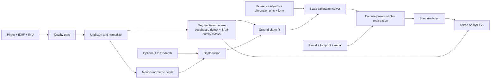

#### AIM-UND-01 Semantic and instance segmentation [MVP]

Classes (version 1 taxonomy): `house_facade`, `roof`, `window`, `door`, `garage_door`, `driveway`, `walkway`, `patio`, `steps`, `wall`, `fence`, `lawn`, `bed_mulch`, `bed_rock`, `shrub`, `tree_canopy`, `tree_trunk`, `groundcover`, `sky`, `vehicle`, `person`, `pet`, `utility_equipment` (AC condenser, meters, pedestals), `downspout`, `water_feature`, `neighbor_property`, `street`, `other`.

- Approach: an open-vocabulary detector (Grounding DINO-class) proposes boxes; a SAM-family model produces masks; a landscape-specific classification head (fine-tuned on tenant-opted-in and licensed data) assigns final labels. Rationale: SAM-family models give high-quality masks; landscape semantics need fine-tuning ([SAM paper](https://arxiv.org/abs/2304.02643); [SAM 2 paper](https://arxiv.org/abs/2408.00714); [Grounding DINO paper](https://arxiv.org/abs/2303.05499)).
- **Protected masks:** `house_facade`, `roof`, `window`, `door`, `garage_door`, `vehicle`, `person`, `neighbor_property`, `street` are protected by default. Generators may not change pixels inside protected masks (enforced by compositing the original pixels back, not by prompt).
- **Editable masks:** users can brush to add or subtract, or tap "this is a bed" to relabel. Corrections are stored and (with opt-in) become training data.
- **Privacy:** faces and license plates are auto-detected and blurred in any image leaving the tenant (portal shares, social exports, training sets).

#### AIM-UND-02 Depth estimation [MVP]

A monocular metric-depth model (Depth Anything V2 or Depth Pro class) produces a per-pixel depth map ([Depth Anything V2](https://arxiv.org/abs/2406.09414); [Depth Pro](https://arxiv.org/abs/2410.02073)). Monocular metric depth is approximate; it becomes trustworthy only after calibration against at least one known length (AIM-UND-03). LiDAR depth, when present, overrides monocular depth within its valid range and is used to rescale the far field.

#### AIM-UND-03 Scale calibration [MVP]

Solves for a single global scale factor `s` (and, when the ground-plane fit is uncertain, a small correction to camera pitch) that best explains all known lengths:

- Inputs: dimension pins (weight 1.0), calibration card (weight 2.0), tape measure (weight 2.0), confirmed standard objects (weight 0.5), form dimensions that are visible in the photo, for example "yard width 62 ft" between two tapped property corners (weight 0.75), LiDAR (weight 3.0 within 5 m).
- Method: robust weighted least squares (Huber loss) over measured vs predicted lengths in metric 3D after back-projection onto the ground plane.
- Output: `scale_factor`, `scale_confidence` (plus-or-minus percent at 1 sigma), and per-measurement residuals.
- **Conflict rule:** if any measurement's residual exceeds 15% after fitting, the UI flags it: "Your 32 ft bed length disagrees with the door height by about 22%. Which is right?" The user can fix or drop the measurement. If no references exist, the system falls back to EXIF focal length plus monocular depth and shows "Scale: rough (+/- 20%)"; such scenes cannot be used for plan-to-photo or AI layout until a reference is added.
- Targets (proposed): median error of 10% or less with one pin; 5% or less with the calibration card; under 5% with LiDAR.

#### AIM-UND-04 Camera pose, perspective and plan registration [MVP basic, V1 full]

- Intrinsics from EXIF (focal length, sensor), refined by vanishing-point detection on facade lines.
- Extrinsics: camera height and pitch from ground-plane fit; yaw from compass.
- **Registration to plan coordinates:** the user (or auto-matcher in V1) identifies at least 3 correspondences between the photo and the plan or aerial (house corners, driveway corners, walkway ends). A PnP solve with RANSAC produces the photo-to-plan transform. Registration quality is the reprojection error in plan units (target under 0.5 ft median).
- MVP ships manual 3-4 point registration with snapping to footprint corners; V1 adds automatic correspondence using footprint geometry and facade detection.

#### AIM-UND-05 Sun orientation and sun-hours [MVP orientation, V1 sun-hours simulation]

Combines compass, GPS and timestamp with a solar position algorithm. Cross-checks against detected shadow directions; if they disagree by more than 30 degrees, the compass reading is distrusted (phones near cars and metal are unreliable) and the shadow-derived azimuth is used. V1 simulates sun-hours per zone across the growing season using the house footprint, tree canopies (heights from LiDAR, 3DEP or user entry) and the date range April-September (Southern-hemisphere-ready for later markets).

#### AIM-UND-06 Existing plant identification [V1]

Detects existing shrubs and trees, proposes species with confidence (top 3), and links to KB records. Uses: "keep" checkboxes, pruning/removal line items, and better restyles that preserve real plants. Low-confidence IDs are shown as "unidentified shrub, about 4 ft" rather than guessed.

#### AIM-UND-07 Scene Analysis artifact [MVP]

A versioned, immutable record containing all of the above, with model versions recorded. Re-analysis creates a new version (for example when a better depth model ships) without breaking existing mockups.

### 4.3 Generation modes

Six modes share the same Scene Analysis, the same plant-fidelity system (4.4), the same render queue and the same provenance stamping.

| Mode | Input | Output | Primary audience | Priority |
|---|---|---|---|---|
| A. Photo restyle / inpaint | Photo + masks + style preset (+ optional text) | 4 photoreal variants, labeled with likely plants from the regional palette | Homeowner widget, estimator in the field | [MVP] |
| B. Plan-to-photo | Photo + registered Design Version | Photoreal render that matches the to-scale plan, with clickable plant labels | Designer, proposal | [V1] (MVP: flat overlay preview) |
| C. AI layout generation | Base map + constraints | 3 to-scale Design drafts (Good/Better/Best tiers, shown here as Essential, Signature, Showcase) with plant schedule and takeoff | Designer, estimator | [V1] |
| D. Conversational design assistant | Chat or voice + current Design and mockup | Plan edits + targeted re-render + estimate delta | Designer, estimator | [V1] |
| E. Seasonal, growth and night renders | Mockup or plan-to-photo render + KB phenology/growth + lighting layer | Season set, growth timeline, night scene | Proposal, portal | [V1] seasonal and growth, [V2] physically based night lighting |
| F. 3D walkthrough via Gaussian splatting | Walk-around video + Design | Navigable 3D scene with proposed planting | Premium design-build | [V3] |

#### AIM-GEN-A Photo restyle and inpaint mockups [MVP]

**Behavior**

1. User selects a photo and an edit region: "whole yard" (all editable masks), "beds only", "lawn only", or a brushed region.
2. User picks a **style preset** and intensity: Refresh (keep layout, swap plants and mulch), Redesign (new bed lines inside the region), Transform (hardscape changes allowed).
3. Before any pixel is generated, the **palette resolver** maps the preset to candidate KB plants for the property's Region (see 4.4). The image prompt names only those plants and attaches their reference images.
4. Generator produces 4 variants at preview resolution (about 1 MP) in parallel. Protected masks are composited back from the original.
5. A vision QA pass (VLM + plant classifier) labels each visible new plant region with its most likely palette plant, scores fidelity (V1) and flags hallucinated vegetation.
6. User can favorite, discard, "more like this" (re-seed around a variant), or upscale to HD final (2-4 MP, plus 2x super-resolution for print).
7. "Use this as a starting point" converts the variant into a Mode C layout request using the variant's labeled plants as preferences.

**Style presets** (operator-managed in [Platform Admin](19-platform-admin-portal.md); tenants may clone and customize in V1):

| Preset | Plant program rules (resolved against the regional KB) | Hardscape and materials | Negative constraints |
|---|---|---|---|
| Modern | Limited palette of 3-5 species, massed in rectilinear drifts; ornamental grasses, clipped evergreens, architectural accents | Large-format pavers, steel edging, black or charcoal mulch, horizontal slat fence | No cottage clutter, no curvy "kidney" beds |
| Cottage | 7-12 species, layered perennials, roses where region-appropriate, self-seeding annuals implied | Brick or flagstone paths, picket or wattle accents | No rigid geometry |
| Xeriscape | Low-water rated plants only (KB water need low), succulents and grasses where hardy, 50%+ of area in gravel/decomposed granite or mulch | DG paths, boulders, dry creek bed | No turf, no high-water plants |
| Native pollinator | 70%+ native to the Region's ecoregion (KB native flag), bloom sequence across at least 3 seasons, host plants | Natural stone, simple mulch | No invasive or non-native-invasive plants (hard block) |
| Japanese | Restrained palette: Japanese maple where hardy, mosses/groundcovers, clipped evergreens, bamboo only if non-running and permitted | Raked gravel, stepping stones, lantern, water basin | No bright mixed annuals |
| Mediterranean | Silver foliage, lavender, rosemary, olive where hardy, else regional analogs (KB "Mediterranean look-alike" tag) | Terracotta, gravel, stucco tones | No lush tropical foliage in cold regions |
| Low-maintenance | KB maintenance level low, no deadheading, evergreen structure, fewer species | Wide mulched beds, clean edges, drip irrigation implied | No hedges needing 3+ shearings/year |
| Edible | Raised beds, fruiting shrubs (blueberry, currant) where adapted, herbs, espaliered fruit | Cedar raised beds, gravel paths | No toxic ornamentals near edibles |

Each preset stores: palette query (KB filters and tags), layout heuristics (species count, massing rules), material swatches, prompt fragments, negative prompt fragments, and per-model parameter overrides (strength, guidance, control weights). Presets are versioned; mockups record the preset version used.

**Rules**

- If the Region's palette yields fewer than 5 eligible plants for a preset (for example "Mediterranean" in USDA zone 4), the preset displays "Adapted for your region" and uses look-alike tags; if still under 5, the preset is hidden for that property.
- Free-text additions ("add a birdbath", "more purple") are parsed into structured intents by an LLM. Plant-related phrases are resolved to KB candidates ("more purple" becomes a color filter over the palette). Unsupported or unsafe requests are refused with an explanation.
- The house must not change. Paint, roof and window edits are refused in MVP; V2 adds an explicit "exterior refresh" option with a separate badge.
- Each variant stores seed, model, preset version and palette snapshot so it can be reproduced.

> **Competitive edge:** consumer restyle apps (Neighborbrite, Renovate AI and others) let the model decide the plants. Rootline decides the plants first, from the operator-curated regional palette, then asks the model to draw them, so the homeowner never falls for a plant the Company cannot sell or that will not survive the winter.

#### AIM-GEN-B Plan-to-photo [V1; MVP ships a flat overlay preview]

Projects a to-scale Design Version from the [Design Studio](10-design-studio.md) into the photo so the mockup matches the plan.

**MVP "overlay preview":** plan beds, edging, hardscape outlines and plant symbols are projected onto the photo as semi-transparent shapes and circles sized to mature spread. Not photoreal, but instantly checks that bed lines and spacing make sense in perspective. Cost: negligible (client-side render).

**V1 photoreal pipeline:**

1. **Projection.** Using the photo-to-plan transform (AIM-UND-04) and depth, each plan object is rasterized into the camera view: bed polygons, edging lines, hardscape surfaces, and each plant instance as a 3D proxy (ellipsoid or KB-provided habit silhouette) sized by its height and spread at the selected **plant age** (install day, year 1, year 3, mature).
2. **Control maps.** Generate per-pixel control images: instance ID map (every pixel knows its plan item), semantic map, depth map (existing scene depth merged with proxy depth), edge map. Occlusion is resolved by depth (a front shrub hides part of a back tree).
3. **Composite-then-harmonize (default) or generate-with-controls (alternative).**
   - *Composite-then-harmonize:* each plant instance is drawn from the plant's **render asset** (curated cutout sprites at several ages and angles, or generated once per plant and approved by curators), scaled to projected size, lit to match the sun azimuth, and composited. Hardscape and mulch textures come from material swatches. A low-strength image-to-image pass (diffusion with depth and edge ControlNet) harmonizes lighting, shadows and edges. This keeps plant identity high because the pixels started as the right plant.
   - *Generate-with-controls:* a diffusion model conditioned on depth + segmentation + edge ControlNets ([ControlNet paper](https://arxiv.org/abs/2302.05543)) and per-plant reference images via IP-Adapter-style adapters ([IP-Adapter paper](https://arxiv.org/abs/2308.06721)) or multi-reference editing models. Better global realism, weaker identity; used when render assets are missing.
   - Route choice is per plant: instances whose plant has an approved render asset use composite; others use generate. Mixed scenes are harmonized together.
4. **QA and labels.** Fidelity scoring (4.4) and hallucination cleanup. Every pixel region is linked to its plan item; the viewer shows numbered tags that match the plan's plant key.
5. **Stamping.** Visible badge plus C2PA manifest (Section 11).

**Rules**

- Requires: scale confidence of +/- 10% or better and registration error under 1 ft median. Otherwise the UI explains what to add.
- Plan items outside the camera frustum are listed as "not visible in this photo."
- Plants placed behind protected masks (for example behind the house) are skipped, not drawn over the house.
- When the plan changes, only affected regions re-render (region-level cache keyed by instance IDs and their properties); unchanged regions are reused.

#### AIM-GEN-C AI layout generation [V1]

Proposes 3 to-scale planting/hardscape layouts as editable Design drafts, using an **LLM planner** for design intent and a **geometric and combinatorial solver** for everything that must be exact.

**Inputs:** base geometry (house footprint, hardscape, lawn, property line, setbacks, keep features and root zones, utilities, easements), sun map, soil and wet spots, slope, the full constraint set from the dimension form (budget, maintenance, pets, deer, water, HOA, style), the Region and its palettes, tenant Price Book (plant and material prices, labor production rates from [Estimating](03-crm-sales-estimating-proposals.md)), and optional nursery availability ([12](12-plant-knowledge-base.md)).

**Stage 1 - Constraint compilation (deterministic + LLM):**

- HOA free text and notes are parsed by the LLM into structured constraints, each with a quote of the source text for traceability: for example `{type: "max_height", value_ft: 3, applies_to: "front_yard_hedges", source: "Hedges along front property lines shall not exceed 36 inches"}`. The user reviews parsed constraints before generation.
- Hard constraints (never violated): setbacks, protected root zones, utility clearances, hardiness (KB zone range covers the property's USDA zone with a 1-zone safety margin for "plant warranty eligible" mode), toxicity filters, invasive status for the Region (hard block), HOA approved lists, budget ceiling of the "best" tier.
- Soft constraints (weighted objective): style fit, maintenance level, water use, bloom-season coverage, species diversity, nursery availability, repetition/unity, cost.

**Stage 2 - Design intent (LLM planner):** a Claude-family model (Sonnet tier by default) receives the compiled constraints, a compact site description, and a **candidate list** of KB plants pre-filtered by hard constraints and ranked by embedding similarity to the style (typically 40-120 candidates). It returns a structured `DesignIntent` (schema-validated JSON), for example:

```text
DesignIntent
  zones: [ {zone_id: "front_foundation", purpose: "frame entry, year-round structure",
            bed_program: {target_depth_ft: 6, edge_style: "smooth curve", min_radius_ft: 4},
            layers: [ {role: "anchor", count_hint: 2, height_band_ft: [6, 10], candidates: [kb ids]},
                      {role: "structure", count_hint: 5, height_band_ft: [3, 4], evergreen: true},
                      {role: "seasonal", drifts: 3, drift_size: [3, 5, 7]},
                      {role: "groundcover", coverage_pct: 30} ] } ]
  focal_points: ["entry walk", "corner of garage"]
  hardscape_program: [ {type: "paver_landing", target_sqft: 48, location_hint: "front step"} ]
  budget_split: {plants: 0.45, materials: 0.20, labor: 0.35}
  rationale_by_zone: {...}
```

The planner **can only reference candidate IDs**. Any unknown ID fails schema validation and triggers a retry with the error message. The planner never outputs coordinates.

**Stage 3 - Geometry solver (Python service):**

- **Bed shapes:** offset curves from the foundation and hardscape edges to the target depth; smoothing with a minimum radius of 3-4 ft so a 48-60 in mower deck can follow the edge (configurable); avoids setbacks and root zones; snaps ends to walkways and driveways; generates 2-3 shape variants per zone (straight-modern, gentle curve, bold curve).
- **Plant placement:** back-to-front layering by mature height; anchor plants placed at focal points; structure shrubs spaced at 0.8-1.0 x mature spread on center (style-dependent); perennial drifts in odd numbers (3, 5, 7) placed as clustered Poisson-disc samples; groundcover filled on a triangular grid at KB on-center spacing; minimum distance from foundation of half mature spread; plants under windows limited to mature height below sill height (from facade detection or user entry); no plant within the AC condenser clearance.
- **Selection and quantities:** a CP-SAT model (OR-Tools, already in the platform stack for routing) chooses which candidates fill which roles to maximize the soft objective subject to hard constraints and tier budgets. Example objective weights (tunable per preset): style fit 0.25, year-3 coverage 0.20 (target 80-90% of bed area), bloom coverage across months 0.15, maintenance fit 0.15, cost efficiency 0.15, nursery availability 0.10. Species count limits per preset (for example Modern: 3-5 per zone; Cottage: 7-12).
- **Takeoff:** bed area, edging linear feet, mulch volume (area x depth; for example, a 240 sq ft bed at 3 in depth needs 240 x 0.25 / 27 = 2.2 cu yd, rounded up to 2.5 cu yd per tenant rounding rule), soil amendment, landscape fabric (if the tenant uses it), plant counts by container size, boulders, hardscape square footage and base material volume. Passed to the [Design Studio takeoff](10-design-studio.md) engine, not computed separately, so numbers match.

**Stage 4 - Validation and repair:** a deterministic validator checks every hard constraint and computes soft scores. Violations go back to the solver (geometry issues) or the planner (intent issues, with a structured error) for at most 2 repair rounds. If still failing, the option is returned with explicit warnings rather than silently dropped.

**Stage 5 - Tiering and output:** three options mapped to the Good/Better/Best proposal option model (PROP-03 in [03](03-crm-sales-estimating-proposals.md)). Display names can be edited per tenant; this doc uses the AI defaults **Essential** (Good: low end of the budget band, smaller containers, more groundcover), **Signature** (Better, marked recommended: target budget) and **Showcase** (Best: larger specimens, a hardscape accent, lighting suggestions). Each option is a Design draft with layers, a plant schedule, a takeoff, an estimate preview (from the tenant's Price Book and production rates), a design rationale written for the homeowner, and an automatic overlay preview. Plan-to-photo renders are generated on request (credits).

**Rules and edge cases**

- If the plant candidate list after hard filtering has fewer than 8 plants, the generator asks to relax a constraint ("Heavy deer pressure plus full shade plus 'low water' leaves only 6 plants in your Region. Relax water?").
- Every option carries a "why" panel: which constraints shaped it, which soft goals were traded off.
- Generated options are **drafts** owned by the requesting user; they never auto-send to clients.

> **Competitive edge:** none of the FSM platforms we researched or the consumer apps generate a to-scale planting plan with quantities. The combination of an LLM for taste and intent plus a solver for geometry and budget is what makes the output buildable, and it lands in the same Design file the estimator prices.

#### AIM-GEN-C2 Site rule packs: water, wildfire, sight lines and utilities [V1 framework and default rules; V2 curated jurisdiction packs]

Layouts that look great but break a local rule cost a Company a redo, a fine or a failed HOA review. Rule packs are versioned, operator-curated sets of hard and soft constraints, managed with the Plant KB: jurisdiction packs (water budgets, nonfunctional turf, defensible space, HOA lists) are specified in [12](12-plant-knowledge-base.md) KB-RGN-11 (`jurisdiction_rule_pack`), this section shows how the AI applies them and adds the site-geometry defaults such as hydrant, sight-triangle and utility clearances (`site_rule_pack`), and both kinds are published through the KB release pipeline and evaluated through one rule interface. They attach automatically by property location (Region, state or province, county, water utility, fire-hazard map) and by Client type (residential, commercial, HOA common area). The layout solver (Stage 1), the design assistant's `check_constraints` tool and the Design Studio validator ([10](10-design-studio.md)) all evaluate the same packs, so the AI cannot propose what the Studio would flag.

| Rule (default pack) | Applies when | Constraint | Type | Priority |
|---|---|---|---|---|
| Fire hydrant clearance | Hydrant detected in photo, on aerial or entered | No plants, boulders or structures within 3 ft of a hydrant (the clear-space rule in International Fire Code 507.5.5; local amendments vary) | Hard | [V1] |
| Driveway and corner sight triangle | Bed within the sight triangle at a driveway or street corner | Plants at mature height no taller than 30 in (typical municipal limit; tenant or jurisdiction can override, often 30-36 in) | Hard with override | [V1] |
| Utility clearances | Utility pedestal, transformer, meter or AC condenser | Pedestals and condensers keep 3 ft of service clearance. Pad-mount transformers default to 10 ft in front of the doors and 3 ft on the other sides (common utility guidance; verify per utility) | Hard | [V1] |
| Call-before-you-dig | Any excavation over 12 in or tree planting | 811 (US) or Click Before You Dig (Canada) task added to the Job; never a design blocker | Advisory | [V1] |
| Nonfunctional turf restrictions | California commercial, industrial, institutional and HOA common-area properties; Southern Nevada Water Authority service area | Proposed turf must be "functional" (play, events, sports) or the option shows a compliance warning. California [AB 1572](https://leginfo.legislature.ca.gov/faces/billNavClient.xhtml?bill_id=202320240AB1572) phases out potable-water irrigation of nonfunctional turf on these property classes starting in 2027. Nevada AB 356 (2021) bans Colorado River water for nonfunctional turf in the Las Vegas valley from 2027 (verify dates per property class) | Hard for commercial and HOA common areas; advisory for residential | [V1] |
| Wildfire defensible space | Property in a mapped high fire-hazard zone (CAL FIRE Fire Hazard Severity Zones in California; provincial and state equivalents later) | Ember-resistant "Zone 0" (0-5 ft from the structure): no wood mulch, no woody plants or combustible materials. Zone 1 (5-30 ft) and Zone 2 (30-100 ft) spacing and pruning rules feed placement. California's Zone 0 regulations under [AB 3074](https://leginfo.legislature.ca.gov/faces/billNavClient.xhtml?bill_id=201920200AB3074) are being phased in by the Board of Forestry and Fire Protection (verify final text and effective dates) | Hard inside Zone 0; soft beyond | [V2] |
| Municipal watering restrictions | Property's water utility has day or season rules | Prefer low-water plants; drip in new beds; the proposal shows the watering schedule the design needs | Soft | [V2] |
| HOA architectural rules | Client is in an HOA with parsed rules (Stage 1) | Approved-list, height and front-yard-turf-percentage rules from the parsed document | Hard | [V1] |

**Rules of rule packs.** Every pack has a source citation, an effective date, a jurisdiction polygon and a version. A rule change is published through the KB release pipeline as `kb.rule_pack_published` ([12](12-plant-knowledge-base.md)), which re-validates open Design drafts (not sold versions). Tenants can add their own rules (for example "never plant Bradford pear") but cannot loosen operator-marked statutory rules; they can only add an override with a reason, which is logged and printed on the internal plan, never hidden. When rules conflict (a sight triangle against an HOA hedge requirement), the stricter height wins and the "why" panel explains it.

> **Competitive edge:** consumer AI apps happily put a lawn on a Las Vegas HOA common area or a mulched juniper hedge against a house in a wildfire zone. Rootline's layouts arrive compliance-checked, which matters most to commercial and HOA clients (`client_commercial`) who face the fines.

#### AIM-GEN-D Conversational design assistant [V1]

A chat (and push-to-talk voice, en/es) panel in the Design Studio and mockup viewer that edits **plan and mockup together**. It is a scoped agent of the platform [Copilot](17-ai-copilot-automation.md) with design-specific tools.

**Tool surface (function calling, all operations go through the Design command bus so they are undoable and audited):**

| Tool | Effect |
|---|---|
| `get_design_context` | Returns current Design Version summary: zones, beds, plant schedule, constraints, budget, Region |
| `select_objects(query)` | Resolves references like "the bed by the garage", "the boxwoods", "plants 3-7" to object IDs; asks if ambiguous |
| `resize_bed(bed_id, edge, delta)` | Offsets a bed edge (for example the lawn-side edge) by a distance, clipped by setbacks and hardscape |
| `reshape_bed(bed_id, style)` | Straight, gentle curve or bold curve |
| `swap_plants(object_ids, criteria)` | Queries KB candidates matching the role (height band, evergreen, form) plus new criteria; returns 3 options with reasons |
| `add_plants / remove_plants / respace(bed_id, spacing)` | Placement changes through the solver |
| `set_material(surface_id, material_sku)` | Mulch color, paver style, edging type from Price Book |
| `add_feature(type, location_hint)` | Boulder, birdbath, bench, path light, dry creek |
| `check_constraints` | Runs the validator; reports violations |
| `estimate_delta` | Returns price difference vs the last proposal-locked version |
| `fit_budget(option_id, target_total or delta)` | Re-runs the CP-SAT selection with a new budget ceiling. It may only use same-role substitutions, container down-sizing, quantity changes within coverage limits, or dropping optional features. It returns the cheapest version that keeps year-3 coverage at 80% or more, or explains why it cannot |
| `set_view(season, plant_age, time_of_day)` | Changes the mockup view; queues a render only if no cached render exists |
| `rerender(region_ids, quality)` | Queues targeted mockup re-render for affected regions |

**Example:** "Make the bed 2 ft deeper and swap the boxwoods for something deer resistant."

1. `select_objects` resolves "the bed" to the only bed in view (or asks "front foundation bed or the mailbox bed?").
2. `resize_bed` offsets the lawn-side edge by 2 ft; the lawn polygon shrinks by the same area; the lawn mowing area on any Service Agreement is flagged for update.
3. The assistant knows the KB marks boxwood (Buxus) as rarely browsed by deer in most regional profiles, so it checks before acting: "Boxwoods are already rated deer resistant in your Region. Do you want to replace them anyway (for example to avoid boxwood blight), or did you mean the arborvitae, which deer browse heavily?" This is the moment the assistant earns trust.
4. After the user answers, `swap_plants` proposes 3 KB candidates in the same role (evergreen, 3-4 ft, formal habit, sun to part shade, region rating 4/5 or higher, `deer_resistance` A or B, "rarely damaged" or "seldom severely damaged" on the [12](12-plant-knowledge-base.md) scale), each with price and availability. The user picks one, or says "you choose."
5. Solver re-places plants in the deeper bed (adds 2 more structure shrubs and one 5-plant perennial drift to keep coverage), the takeoff updates (mulch +0.6 cu yd, edging unchanged, plants +7), and `estimate_delta` reports "+$684 (Signature option)."
6. `rerender` re-renders only the bed region of the mockup (about 10-15 s). The chat shows the before/after thumbnail inline.

**Rules**

- Every edit shows a **diff card** (what changed in plan, quantities and price) with Undo. Multi-step edits are grouped as one undo unit.
- The assistant never edits a proposal-locked Design Version; it branches a new version and says so.
- It refuses to invent plants not in the KB; it may say "not in our Region list; ask your curator to add it" and offers to file a KB request ([12](12-plant-knowledge-base.md)).
- Ambiguity threshold: if reference resolution confidence is under 0.8 or more than one object matches, it asks a clarifying question with thumbnails.
- Voice mode in the field works offline for capture (audio stored) and executes on reconnect.
- **Credits are quoted before work starts.** A turn that will trigger a re-render says so ("This will re-render the front bed: 8 credits. Go?") unless the user has turned on "auto re-render under 20 credits" for the session.

**Intent catalog (what the assistant must handle at V1 GA; the eval set holds 50+ phrasings per intent in English and Spanish):**

| Intent | Example utterance | Tools invoked | Notes |
|---|---|---|---|
| Resize or reshape | "Make the bed 2 ft deeper", "hazlo 60 cm mas profundo", "curvier edge by the walk" | `select_objects`, `resize_bed` / `reshape_bed` | Units parsed in either language and system |
| Swap by attribute | "Swap the boxwoods for something deer resistant", "all natives in the back bed" | `select_objects`, `swap_plants` | KB contradiction check first (boxwood example) |
| Budget fit | "Cut $2,000 from Signature", "what can we do for $8k?" | `fit_budget`, `estimate_delta` | Shows what was given up, in plain language |
| Maintenance tune | "Make it lower maintenance" | `swap_plants` with a maintenance filter, `respace` | Flags any plants that need shearing more than twice a year |
| Add a feature | "Add a birdbath left of the walk", "path lights every 8 ft" | `add_feature`, `check_constraints` | Lighting adds fixtures to the lighting layer and the estimate |
| View change | "Show it in fall", "what does it look like in 5 years?" | `set_view`, `rerender` | Uses cached renders when available |
| Explain | "Why did you pick serviceberry?", "is this safe for dogs?" | `get_design_context`, KB lookup | Answers cite KB fields (toxicity flag, deer rating) |
| Undo or compare | "Go back to before the swap", "compare with v5" | Command bus undo, version diff | No credits |

**Implementation notes for engineers.** Tools are defined with strict JSON schemas (`strict: true`) so arguments always validate. `DesignIntent` and diff cards use structured outputs. Current Claude Sonnet and Opus generations reject forced `tool_choice` (`any` or a named tool), so the agent runs with `tool_choice: auto` and the system prompt steers it to the right tool. The stable prefix (system prompt, tool definitions, compiled KB candidate block, Design summary) is prompt-cached, and the turn-specific message goes after the last cache breakpoint. Reference resolution ("the bed by the garage") runs first on the Haiku tier and escalates to Sonnet only when confidence is under 0.8 (AI Gateway route `chat.intent_fast`, section 8.2).

#### AIM-GEN-E Seasonal, growth-over-time and night-lighting renders [V1 seasonal and growth; V2 physical night lighting; V1 basic night mood]

- **Seasons:** spring, summer, fall, winter. Uses KB phenology per plant per Region (bloom months, fall color, evergreen vs deciduous, winter interest such as red-twig dogwood stems, dried grass plumes). The renderer composes per-plant seasonal render assets and adjusts lawn color, sun elevation (lower in winter), deciduous canopy and optional snow cover for snow regions. Output: a 4-up season strip and a slider in the portal.
- **Growth over time:** install day, year 1, year 3, year 5 or mature. Plant size at time t uses KB install size (container: #1, #3, #5, #7, #15; trees by caliper, for example 2-2.5 in B&B) and a logistic growth curve to mature height/spread parameterized by KB growth rate (slow, moderate, fast) and years-to-maturity. Every growth render carries an age label ("Shown at about 3 years after planting"). Install-day renders are mandatory in proposals in "Honest mode" (tenant default on) so customers see the sparse reality of new plantings.
- **Night lighting:** basic V1 "night mood" relights the photo to dusk and adds warm glows at fixture positions from the plan's lighting layer (path lights, uplights, wall washers, step lights). V2 physically based: fixture photometrics (lumens, beam angle, color temperature 2700-3000K typical for landscape lighting), inverse-square falloff on depth-derived geometry, and shadows. Links to the lighting service line in [14](14-service-line-modules.md) and to the fixture schedule in the estimate.

#### AIM-GEN-F 3D walkthroughs via Gaussian splatting [V3; V2 groundwork]

- **V2 groundwork:** the [Design Studio](10-design-studio.md) 3D view (massing with plant proxies) and best-frame extraction from walk-around videos.
- **V3:** a 60-120 s phone video is reconstructed into a 3D Gaussian splat of the existing site ([3D Gaussian Splatting paper](https://arxiv.org/abs/2308.04079)). The scene is scaled and registered to plan coordinates using the same calibration inputs, then the proposed Design is inserted as 3D plant assets (from KB 3D models where available, or generated billboards). Output: a browser viewer (WebGL/WebGPU) with a fly-through path, "stand here" viewpoints (front door, kitchen window), and a phone AR mode. Processing is asynchronous (target 30 minutes or less on a single data-center GPU; estimate).
- Rationale for V3: reconstruction quality outdoors (moving foliage, sky, large depth range) and editing splats with new objects are still maturing; the business value is highest for $40k+ design-build projects.

### 4.4 The plant-fidelity system

**The problem.** General image models have seen countless garden photos, but they are not trained to keep track of which species is which. Ask for "a deer-resistant foundation planting in zone 5" and you get attractive, generic green blobs, tropical foliage in Minnesota, or a hydrangea with rose leaves. Homeowners fall in love with plants that do not exist, will not survive, or are not what the plan says. Reviewers already notice: Penn State Extension found a popular tool weak on plants ([Penn State Extension](https://extension.psu.edu/ai-garden-design-intelligent-choices)). For a design-build Company this is a sales-quality and warranty-dispute risk, not a cosmetic one.

**The approach: constrain, condition, verify, label, disclose.**

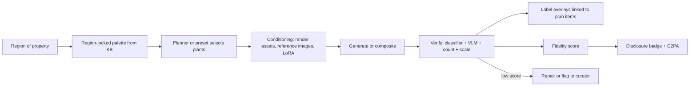

#### AIM-FID-01 Region-locked palettes [MVP]

- Every property resolves to a Region through its Site Context: the leaf operator-curated Region containing the Property, built from USDA or Canadian hardiness zone, EPA Level III/IV ecoregion, state/province, county/metro and climate layers, with a fallback to the macro-region ([12](12-plant-knowledge-base.md) KB-RGN-02 and KB-RGN-04).
- Eligible plants for AI use: KB Plants with an effective Plant Region Profile for that Region rated 3/5 or higher (tenant can raise the threshold; rating-3 plants only where their profile conditions are met by the bed context), not flagged `do_not_use`, not invasive or regulated in that state/province, and with status `render_ready` (AIM-FID-02) for photoreal modes. This is the same rule as [12](12-plant-knowledge-base.md) KB-PRP-01.
- Tenants can narrow further with their own **Company palette** ("plants we stock and warranty"), which is the default for pros. The homeowner widget uses the Company palette when one exists, else the operator's curated Plant Palette for the Region and style.
- Free-text plant mentions are resolved by fuzzy and semantic search over the palette (pgvector embeddings of names, common names and traits). If the requested plant is not eligible, the user sees why ("Bird of paradise is not hardy in your Region (USDA 6b)") and the nearest eligible look-alikes.

#### AIM-FID-02 KB render assets and reference image packs [MVP for top plants, V1 broad coverage]

Each KB Plant can carry a **render pack**, curated by `platform_curator`:

| Asset | Minimum for `render_ready` | Notes |
|---|---|---|
| Reference photos: whole-plant habit at maturity | 3 | Different angles, outdoor light, licensed (see 11.3) |
| Reference photos: young/installed size | 1 | Container-size look for install-day renders |
| Foliage close-up | 1 | Leaf shape and color |
| Bloom / fruit close-up (if ornamental) | 1 | With bloom months |
| Fall and winter appearance (deciduous or notable) | 1 each | Drives seasonal renders |
| Cutout sprites (transparent PNG) at 3 ages and 2-3 view angles | V1: 6 | Used by composite-then-harmonize; curator-approved, may be AI-generated then edited |
| Habit silhouette / proxy shape | 1 | Ellipsoid parameters or simple mesh for projection and occlusion |
| Text descriptor for prompts | 1 | Short, visual ("upright vase form, blue-green needles, 3-4 ft") |

Coverage strategy: the top 300 plants by usage across tenants in each country get full packs before V1 GA; the long tail renders via reference conditioning with a lower expected fidelity (the score reflects it).

#### AIM-FID-03 Per-plant conditioning [MVP reference images, V1 adapters and LoRA]

Four techniques, chosen per plant and per model route:

1. **Reference-image editing (MVP).** Current editing models accept several reference images alongside the source photo and instruction (for example Google's Gemini image models and FLUX.1 Kontext-class editors). We pass the plant's 1-3 best references with a per-plant visual descriptor. Fast, no training, decent identity for distinctive plants (Japanese maple, blue spruce, ornamental grasses), weaker for look-alike shrubs.
2. **Adapter conditioning (V1).** For self-hosted diffusion pipelines, IP-Adapter-style image prompt adapters inject reference features per masked instance ([IP-Adapter](https://arxiv.org/abs/2308.06721)), combined with depth/segmentation ControlNets ([ControlNet](https://arxiv.org/abs/2302.05543)). Regional prompting ensures each instance mask gets its own plant reference.
3. **Per-plant LoRA (V1, top plants).** Lightweight fine-tuned adapters ([LoRA](https://arxiv.org/abs/2106.09685); subject-driven tuning per [DreamBooth](https://arxiv.org/abs/2208.12242)) trained by the platform on licensed reference sets for the 300 most-used plants, then the long tail as usage grows. Training cost is borne by the platform; LoRAs are platform assets (not tenant data). Evaluated by the plant-accuracy benchmark before activation.
4. **Composite-then-harmonize (V1 default for plan-to-photo).** Described in AIM-GEN-B. Highest identity, because the pixels start as the right plant.

#### AIM-FID-04 Label overlays linking mockup regions to plan items [MVP]

- Every generated or composited plant region stores a `mockup_region` record: polygon mask, linked `design_object_id` (plan-to-photo) or `kb_plant_id` + confidence (restyle), and display label.
- Viewer: numbered tags on hover/tap ("4 - Little Lime hydrangea, #5 container, 4 ft o.c."), legend panel matching the plan's plant key, and a toggle "Show labels" (on by default in proposals and portal; off for marketing exports).
- Tap a label to open the KB plant card (photos, mature size, care, deer/pet notes) and the Price Book line.
- For restyle mode (no plan yet), labels say "Likely: Little Lime hydrangea (82%)" and are marked as suggestions until a plan exists.

#### AIM-FID-05 Fidelity score [V1; MVP shows hallucination flags only]

A 0-100 score per mockup and per region, shown to pros (not to homeowners by default; tenant can choose to show "Fidelity: High/Medium").

| Component | Weight | How measured |
|---|---|---|
| Plant identity match | 35% | Plant classifier top-k agreement with intended species/genus + embedding similarity to the KB reference set |
| Count and placement match | 20% | Detected instances vs plan instances inside each bed (Hungarian matching on projected centers) |
| Scale match | 20% | Rendered height/spread in pixels vs projected expected size at the labeled plant age (via depth and calibration) |
| Protected-region preservation | 10% | Pixel difference inside protected masks (should be near zero after compositing) |
| Hallucination penalty | 15% | Share of new vegetation pixels not mapped to any plan item or palette plant |

Grades: **A (85-100) "Proposal-ready"**, **B (70-84) "Review recommended"**, **C (under 70) "Concept only"**. Grade C mockups cannot be attached to a proposal unless a `designer` or `owner` overrides with a reason (logged). Restyle mockups (no plan) are capped at grade B by definition, since nothing is guaranteed.

**Look-alike tolerance.** Many landscape plants are hard to tell apart even for people at photo resolution: boxwood, dwarf yaupon holly and Japanese holly; one dwarf fountain grass cultivar and another; most green arborvitae cultivars. The KB keeps curator-defined **look-alike groups** ([12](12-plant-knowledge-base.md)). Identity scoring gives full credit when the rendered plant falls in the intended look-alike group with the correct form, size and foliage color. Cultivar-level accuracy is required only for plants flagged `visually_distinct` (for example a red-leaf Japanese maple, a variegated cultivar, a weeping form). Labels for look-alike renders say "Representative appearance" in the plant card, so a client is never told a blob is exactly 'Green Velvet'.

#### AIM-FID-06 Hallucination cleanup [MVP basic, V1 automatic]

Vegetation pixels not linked to any intended instance are either (a) repainted as the surrounding mulch or lawn via a targeted inpaint, or (b) flagged with a dotted outline "Not in plan" for the designer to accept as "artistic fill" (which then shows as unlabeled and lowers the score). Default: (a) for plan-to-photo; (b) for restyle.

#### AIM-FID-07 "Artist rendering" disclosure [MVP]

- Visible badge on every AI image in-app, in the portal and in PDFs. This doc owns the **canonical badge string** for all surfaces and all docs: "AI artist rendering" (es: "Representación artística con IA"; fr-CA when French ships: "Rendu artistique par IA"). Other docs' wording ("AI visualization", "Concept rendering") should converge on this string. Position bottom-left, 3-5% of image height, with a text-to-background contrast ratio of at least 4.5:1 (WCAG AA) on light and dark images, achieved with a semi-opaque backing chip.
- **Accessibility:** every mockup has generated alt text that names the view, the season and plant age, and the labeled plants ("AI artist rendering of the front yard in summer, about 3 years after planting: 2 serviceberry, 5 boxwood, 9 catmint along a curved bed"). Plant labels can be reached by keyboard and read by screen readers in legend order ([21](21-ux-design-system-sitemaps.md)).
- Default disclaimer text in proposals (tenant can edit wording but not remove it, and the edited text is checked to still contain the required elements: AI-generated, approximate, plan governs):

  > "This image is an AI-assisted artist rendering based on your photo and our design. Plants are shown at about [3 years] of growth. Actual plants, colors, sizes and site conditions will vary. The written plan and plant list in this proposal are what we will install."

- Content Credentials (C2PA) manifest and invisible watermark on every export (Section 11.4).

#### AIM-FID-08 Curator feedback loop [MVP]

- "This plant looks wrong" button on any label. Captures the region crop, intended plant, model route and user comment.
- Routes to the `platform_curator` render-issue queue in [Platform Admin](19-platform-admin-portal.md), grouped by plant. Curators can: add or replace reference images, mark a plant "not render-ready" (removes it from photoreal modes until fixed), approve new sprites, or request LoRA retraining.
- Aggregate dashboards: worst-rendering plants by complaint rate and fidelity score; this is the curators' weekly to-do list.

### 4.5 Bidirectional sync: mockup <-> plan <-> plant list <-> estimate

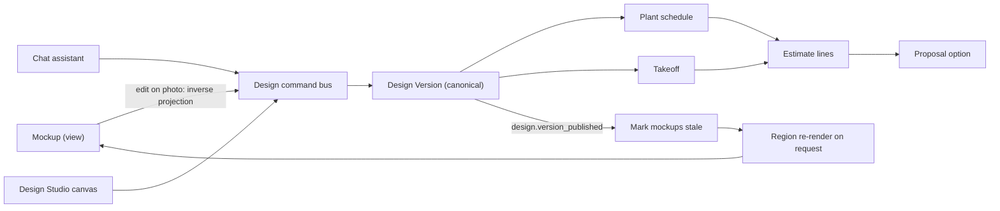

#### AIM-SYNC-01 Plan is canonical [MVP]

All geometry, plant identity and quantities live in the Design Version. Mockups store `design_version_id` and a hash of the visible design subset. Plant schedule, takeoff and estimate are always derived from the Design; never from pixels.

#### AIM-SYNC-02 Edit on the photo [V1]

In plan-to-photo mockups, users can act directly on the image:

- **Tap a plant -> swap / remove / resize age.** Maps through `mockup_region.design_object_id` to a Design command.
- **Drag a bed edge on the photo.** The 2D drag is inverse-projected to the ground plane via the homography and depth, producing a plan edit (offset of that edge segment). Precision is limited by calibration; the plan shows the resulting dimension ("bed depth now 7 ft 6 in") and snaps to 3 in (or 5 cm) increments.
- **Brush "add plants here".** Creates a region request; the solver fills it from the zone's palette and role rules.

In restyle mockups (no plan), photo edits are pure image edits; a banner offers "Make this real: convert to a plan" (Mode C seeded by the labeled plants).

#### AIM-SYNC-03 Staleness and targeted re-render [V1]

- On `design.version_published`, mockups whose visible subset hash changed become **stale**: a yellow banner "Plan changed since this image was made" with a "Re-render changed areas (8 credits)" button. Stale mockups cannot be newly attached to a proposal.
- Region-level re-render: only instances whose plant, age, position or material changed are re-rendered, then harmonized at the boundary. Typical edit cost is 20-40% of a full render (estimate).

#### AIM-SYNC-04 Estimate sync and proposal locking [V1]

- Takeoff deltas flow to the Estimate as line changes (quantities, new SKUs) using the tenant's Price Book and production rates ([03](03-crm-sales-estimating-proposals.md)). Manual price overrides on lines are preserved; a conflict marker appears if the underlying quantity changed.
- Design Versions are already immutable snapshots ([10](10-design-studio.md), states `draft` -> `in_review` -> `approved` -> `shared` -> `client_approved` -> `locked` -> `sold`). When a Proposal is **sent**, the proposal pins the exact Design Version, the mockup set and the estimate snapshot together. Edits after sending create a new Design Version. The proposal then shows "Revised design available" and must be re-sent; the client never sees a picture that does not match the plan they are signing. When the Proposal is **signed** (`proposal.signed`), the version becomes `locked`; when it is **executed** (`proposal.executed`, signature plus any required deposit, [03](03-crm-sales-estimating-proposals.md)), it becomes `sold`, and any later change routes through a **Change Order** ([03](03-crm-sales-estimating-proposals.md)), with a new mockup rendered only for the changed regions.
- The signed proposal stores mockup hashes and C2PA manifests, so a later dispute can prove exactly what the client saw.

#### AIM-SYNC-05 Downstream handoff [V1]

On Job creation, the crew app receives the plan, the mockup with labels, and a per-bed planting sheet ([05](05-field-crew-mobile-app.md)). Purchasing receives the plant schedule as a draft PO ([13](13-operations-inventory-equipment.md)). Plant warranties ([13](13-operations-inventory-equipment.md) 4.17) and the portal care guide ([06](06-customer-portal.md) 4.12.1) reference the installed plant list from the as-built ([10](10-design-studio.md) DS-CON-04), not the image.

### 4.6 Two audiences

#### AIM-AUD-01 Homeowner self-serve lead magnet: "Dream Yard Visualizer" [MVP website widget; V1 portal-hosted page and Rootline Home]

A white-label widget, branded as the Company's "Dream Yard Visualizer" with the CTA "Visualize your yard". It can be embedded on the Company's website (the Rootline site builder, or any site via a script tag; see [16](16-marketing-growth-communications.md)), opened from ads and yard-sign QR codes, and served on the Company's portal domain at `/visualize` ([06](06-customer-portal.md), section 4.17, which owns the portal-hosted experience). It is one component with one rendering engine (this doc) and one lead pipeline ([03](03-crm-sales-estimating-proposals.md)).

**Flow:** pick area -> enter address (service-area check) -> guided capture (or upload) -> 5 quick questions (style, budget band, maintenance, deer, pets) and optional real dimensions -> results according to the tenant's **verification gate** (below) -> favorites -> "Get a real design and quote" CTA -> Lead created in [CRM](03-crm-sales-estimating-proposals.md) with photos, masks, dimensions, style picks, favorites, budget, and a pre-filled site assessment request.

**Verification gate** (tenant setting; reconciles conversion against credit protection):

| Mode | What an anonymous visitor gets | What a verified visitor gets (email or SMS one-time code) | When to use |
|---|---|---|---|
| `teaser_then_verify` (**default**) | 1 teaser set: 2 variants at preview resolution with a large badge, no download | Full 4-variant sets in up to 3 more styles, HD download of one favorite, plant list and ballpark price range | Most Companies: the "wow" lands before any form, and credits are protected |
| `verify_first` | Mask preview only ("we found your lawn and 2 beds") | Same as above | Companies with tight credit budgets; matches the strict flow in [06](06-customer-portal.md) 4.17 |
| `open` | Up to 3 full sets per device per 24 h | +3 sets | High-volume marketing pushes (spring campaigns) where volume matters more than cost |

**Rules**

- **Credit policy** (tenant-configurable within operator limits): widget renders draw from the Company's credit pool at the website visualizer preview set price in 4.7 (24 credits per set, per [22](22-business-model-pricing-gtm.md) 4.4.1). Widget spending has its own monthly cap, default 600 credits ([22](22-business-model-pricing-gtm.md)), which owners raise and fund with packs for spring campaigns. On Starter (300 included credits) the setup wizard recommends restricting the widget to purchased packs, so it cannot quietly use up the credits the office relies on. Section 8.6 has the cost-per-lead math.
- **Abuse controls:** invisible bot check (Turnstile or reCAPTCHA class), per-IP and per-device rate limits, NSFW and non-landscape image refusal. The address must fall inside the Company's service-area polygon before any render. Out-of-area visitors get a polite message, consume no credits, and (when Rootline Match is live and the visitor consents) can be offered other Companies.
- **Consent:** email and SMS opt-in checkboxes compliant with TCPA and CASL (separate, unchecked by default); one-time-code verification messages are transactional and do not count as marketing consent. Photo-use consent text: "[Company] and Rootline will use your photos to prepare your design." Training use is **off** for widget uploads unless the visitor explicitly opts in.
- **Lead quality signals:** render count, favorites, budget band, address match, verified contact, response speed. These feed lead scoring in [03](03-crm-sales-estimating-proposals.md).
- **Branding:** Company logo, colors, fonts and domain. The "Powered by Rootline" footnote is removable on higher tiers (see [22](22-business-model-pricing-gtm.md)).
- **Family share:** a verified visitor can send a "help me pick" link to a spouse or partner, who votes on favorites without verifying. Votes appear on the Lead ("both picked Native pollinator B").

**Rootline Home and Rootline Match [V1, owned by [22](22-business-model-pricing-gtm.md)]:** the same engine powers **Rootline Home**, a Rootline-branded free homeowner app (3 AI mockups per month on the free tier). Its "Get it installed" requests are routed through **Rootline Match** to at most 3 subscribing Companies whose service area covers the address. The lead arrives with the mockups, measurements and a draft Design. Rootline Home renders are paid by Rootline from marketplace revenue, never from a Company's credits. Companies opt in to Match; the white-label widget never sends a visitor to Match without the visitor's consent and the hosting Company's setting.

> **Competitive edge:** consumer apps keep the homeowner in their own app and monetize subscriptions. FSM platforms such as Jobber, Granum (LMN) and Aspire offer request and booking forms, not visual hooks. Rootline gives every Company its own branded AI visualizer that pays for itself in leads. The lead arrives with photos and dimensions that shorten the site visit.

#### AIM-AUD-02 Pro designer and estimator workflow [MVP restyle in field; V1 full]

- **Field quick-mock (MVP):** estimator captures, restyles and shows on the tablet in the driveway; favorites attach to the Opportunity.
- **Studio workflow (V1):** designer opens the Opportunity's Site, sees all captures and scene analyses, generates AI layouts, edits in the Design Studio, renders plan-to-photo per camera, creates seasonal and growth sets, and composes a **presentation board** (cover, before/after per view, plan, plant palette page with photos, options comparison).
- **Batch actions:** render all registered photos for a Design Version; re-render stale ones overnight with batch-priced models (cheaper, see 8.6).
- **Presentation mode:** full-screen before/after slider, option carousel, season and age toggles, label toggle; works offline on a tablet once cached.

#### AIM-AUD-03 Commercial and HOA [V1]

- Multi-property: one request covers several Properties (for example 3 community entrances); renders grouped by Property.
- **Board pack PDF:** renders, plan, plant list, water-use comparison (turf vs proposed, using KB water-need classes and regional ET data where available; labeled estimate), maintenance-cost delta, phasing.
- Approval workflow in the [Customer Portal](06-customer-portal.md): multiple approvers, comments pinned to image regions, vote capture.
- **Compliance strip on every option:** the site rule packs (AIM-GEN-C2) that applied, for example "Nonfunctional turf: compliant (0 sq ft irrigated ornamental turf)" or "Sight triangle: plants under 30 in". Boards and property managers can forward this to their own counsel or water district.
- **Portfolio refresh mode:** one style preset and one Company palette applied across many Properties (for example 14 retail pad sites), with per-site renders produced overnight in the `batch` queue class and one consolidated proposal ([07](07-invoicing-billing-contracts.md) consolidated billing).

#### AIM-AUD-04 Paid design packages and AI deliverables [V1]

Many design-build Companies charge for design and credit the fee toward the install if the client signs. Yardzen-style services show homeowners will pay for a visual plan (2.1 E). Rootline packages AI output as a sellable product so design stops being a free giveaway:

- **Design package catalog** (Price Book items of type `design_service`, tenant-priced). Example defaults: *Concept* (free with consultation: field restyle set in the driveway); *Design Plan* (to-scale plan, plant list, 2 plan-to-photo views, 1 revision round); *Design Plus* (adds seasons, a growth strip, night mood and a presentation board). Prices are the Company's; Rootline only suggests ranges from anonymized Rootline Pulse benchmarks ([18](18-reporting-analytics.md)) where the cohort is large enough.
- **Collection:** the design fee is collected from the proposal or from the visualizer ("Book a design consultation, $250, credited to your project") through the **Company's own Stripe account** (Connect direct charge on the connected account; card data only in Stripe Elements; see [08](08-payments-stripe.md)). Rootline never touches the funds; an application fee applies only if the Company opted into the fee-based plan in [22](22-business-model-pricing-gtm.md).
- **Accounting:** the fee is billed as a design-fee invoice (or a Deposit Request, per Company setting) and posts in the built-in double-entry [Ledger](09-accounting-ledger-integrations.md) per [07](07-invoicing-billing-contracts.md) 4.2.5. The default "credit design fee toward installation if install is signed within 90 days" rule adds an automatic credit line to the first install invoice. QuickBooks or Xero sync carries the same entries when enabled.
- **Job costing:** AI credits consumed on the Opportunity (renders, layouts, chat edits) are recorded at the tenant's effective credit cost as a design cost on the Opportunity and, on conversion, on the Job. Owners see true design cost vs design-fee revenue per project in [Reporting](18-reporting-analytics.md).
- **Deliverable rules:** the package defines which modes and how many renders are included; going over the limit warns the designer before more credits are spent ("This package includes 2 photo views; you are rendering a 3rd").

### 4.7 AI credits for this module [MVP]

Credits are the platform-wide AI metering unit ([17](17-ai-copilot-automation.md)). The **credit unit, pack prices, plan allotments, expiry and refund rules are owned by [22](22-business-model-pricing-gtm.md) section 4.4** and are not redefined here. As of that doc: packs of 1,000 credits for $25, 5,000 for $100 and 20,000 for $340 (so **1 credit is about $0.017-$0.025**). Included credits are 300 (Starter), 2,000 (Grow) and 6,000 (Pro) per month, with no rollover of included credits. The price of an action is committed for at least 12 months, and changes need 60 days' notice. This section maps each design action to that rate card. Rows marked "Yes" use the published price and priority tag in [22](22-business-model-pricing-gtm.md) 4.4.1, which wins any conflict; every billable action in this module is now on that list. Any new action this module proposes later is not billable until 22 lists it. Costs are shown before every action, and owners set monthly caps and per-user and per-role limits.

| Action | Credits | In 22's list? | Notes |
|---|---|---|---|
| Scene analysis (per photo) | 0 | - | Bundled; cheap and needed for everything |
| Plan overlay preview (Mode B lite) | 0 | - | Client-side render |
| Restyle preview set (4 variants, about 1 MP) | 40 | Yes ("Photo mockup set") | Pro restyles in the field and in the office |
| Website visualizer preview set (widget: a 2-variant teaser for anonymous visitors, 4-variant sets after verification) | 24 | Yes ("Website visualizer preview set") | [MVP]. Drawn from the Company's pool under the widget cap (AIM-AUD-01); economy route first (8.2) |
| Restyle "more like this" (2 variants) | 20 | Yes (Restyle "more like this") | [MVP]. Part of the photo restyle flow (Mode A) |
| Mockup refinement (inpaint or edit one area) | 10 | Yes ("Mockup refinement") | |
| Re-render of changed areas after a plan edit (plan-to-photo) | 8 | Yes (plan-to-photo re-render) | Targeted region re-render (AIM-SYNC-03) |
| HD final (single image, 2-4 MP via upscale and detail pass) | 20 | Yes ("High-resolution render or upscale") | [MVP]; needed for the field restyle flow. Self-hosted upscale route by default (`restyle.hd`) |
| Presentation 4K re-render (vendor 4K tier) | 40 | Yes ("Presentation 4K re-render") | [V1]. Optional; print boards and large screens. A separate line from the HD final because the vendor 4K route breaches the 22 7.4 cost guardrail at 20 credits; the 20-credit HD final keeps the self-hosted upscale route |
| Plan-to-photo render (per photo, preview) | 20 | Yes ("Plan-to-photo render") | Cheaper than a restyle set, so pros never avoid the more accurate mode because of cost |
| Plan-to-photo HD | 40 | Composite (plan-to-photo 20 + high-resolution render 20) | |
| AI layout generation (3 options with overlay previews) | 60 | Yes ("Dimension-aware AI layout") | Includes LLM planning, HOA parsing, solver, validation and up to 2 repairs |
| Plant palette recommendation for a bed | 3 | Yes | |
| Design assistant chat turn | 1 (question or clarification), 2 (turn that commits a plan edit) | Yes ("Design assistant chat turn"; aligns with Copilot Q&A = 1) | [V1]. Re-renders charged separately and quoted first |
| Seasonal set (4 seasons) | 30 | Yes ("Seasonal or growth-over-time set") | |
| Growth set (install day, 1, 3, 5 years) | 30 | Yes ("Seasonal or growth-over-time set") | |
| Night mood (V1) / physically based night lighting (V2) | 20 / 40 | Yes ("Night mood render" / physically based night lighting) | [V1] / [V2] (AIM-GEN-E) |
| 3D splat walkthrough (V3) | 600 | Yes ("Immersive 3D walkthrough capture") | [V3] (AIM-GEN-F). Async; GPU-heavy; quoted before run |

**Refunds and fairness** (rules from [22](22-business-model-pricing-gtm.md) 4.4.1, applied here): the hold is released in full on provider error, timeout or safety refusal, and when automatic QA retries are exhausted (repeated refusals of a user's uploads are handled by the abuse controls in 11.2, not by charging credits). If a user marks a mockup or layout "unusable" within 10 minutes with a reason code, 50% of its credits are refunded, up to 10 such refunds per user per month. The reason codes feed the eval set (8.7). Duplicate submissions within 10 s are deduplicated, not double charged.

**Plan entitlements** (from the [22](22-business-model-pricing-gtm.md) feature matrix): restyle mockups on every plan (Starter within its limited credits); plan-to-photo and the design assistant need a Design Studio designer seat (included from Grow, an add-on on Starter); AI layout generation on Grow, Pro and Enterprise; 3D walkthroughs proposed for Pro and Enterprise when they ship.

**How credits reach the books.** Credit packs and overages are billed by Rootline to the Company through **Rootline's own Stripe Billing account**, never through the Company's connected Stripe account, which carries only the Company's client money ([08](08-payments-stripe.md)). If the Company uses the built-in [Ledger](09-accounting-ledger-integrations.md), the Rootline invoice arrives as a vendor bill coded by default to "Software and subscriptions" (editable). Credits consumed on Opportunities and Jobs can also be allocated as design cost (AIM-AUD-04).

### 4.8 Presentation, export and sharing [MVP basics, V1 full]

- Before/after slider, side-by-side, option carousel, season/age toggles (V1), label toggle.
- Exports: JPEG/PNG (with badge and C2PA), PDF presentation board, share link (expiring, tokenized, portal-branded), embed in proposal (auto), social-ready square/vertical crops with badge (V1).
- Watermark policy: in-app and proposal images always carry the AI badge; Company logo watermark optional.
- Print: 300 dpi output at up to 11 x 17 in via the HD + upscale route (V1).
- Time-lapse "reveal" video (before -> install day -> year 3) for marketing (V2), clearly labeled.

### 4.9 Operator and tenant controls [MVP core, V1 advanced]

| Control | Who | Notes |
|---|---|---|
| Model routes per task, fallbacks, canary percentages | `platform_engineer` with `platform_owner` approval | Versioned configs in [19](19-platform-admin-portal.md) |
| Style presets (create, version, retire) | `platform_curator`, `platform_owner` | Tenants can clone (V1) |
| Render-ready status, reference packs, sprites, LoRA training | `platform_curator` | |
| Credit prices and free-credit limits | `platform_finance`, `platform_owner` | |
| Safety policies and blocklists | `platform_owner`, `platform_engineer` | |
| Tenant AI policy: enable/disable modes, caps, honest mode, disclaimer wording, training opt-in, widget settings | `owner` (and `office_manager` if delegated) | |
| Company palette | `owner`, `designer` | Subset of Region palette plus Price Book links |
| Site rule packs (AIM-GEN-C2) | `platform_curator` authors, `platform_owner` approves statutory packs | Tenants add local rules and log overrides of overridable rules |
| Widget verification gate and widget credit cap | `owner` (and `office_manager` if delegated) | Defaults in AIM-AUD-01 |
| Design packages and design-fee credit rule | `owner`, `office_manager` | Price Book items; credit-back rule per [07](07-invoicing-billing-contracts.md) |

---

## 5. Key user flows

### 5.1 Homeowner widget to qualified lead [MVP]

1. Visitor clicks "See your new yard" on the Company site (or scans the yard-sign QR).
2. Enters the address; the service-area check passes (out-of-area visitors stop here, at no credit cost).
3. Chooses "Front yard"; the capture assistant guides 1-3 photos (or the visitor uploads existing ones).
4. Answers 5 quick questions; optionally taps two points on the walkway and types "4 ft".
5. Scene analysis runs (about 3-6 s); a mask preview appears ("we found your lawn and 2 beds") with a "fix" option.
6. Picks a style. Under the default `teaser_then_verify` gate, 2 teaser variants appear within about 10 s (one website visualizer preview set, 24 credits).
7. To unlock full sets, the plant list, the price range and an HD download, the visitor verifies email or phone with a one-time code (consent checkboxes shown, unticked).
8. Favorites a variant (optionally sends the "help me pick" link to a partner); taps "Get my design and quote"; picks preferred assessment windows or books a paid design consultation (AIM-AUD-04).
9. A Lead is created with all artifacts; `office_manager` gets a notification; the visitor gets a branded email with their favorites and a portal link.
10. Automation ([17](17-ai-copilot-automation.md)) can auto-book the site assessment or send a "your designer will call" text (only to visitors who gave SMS consent).

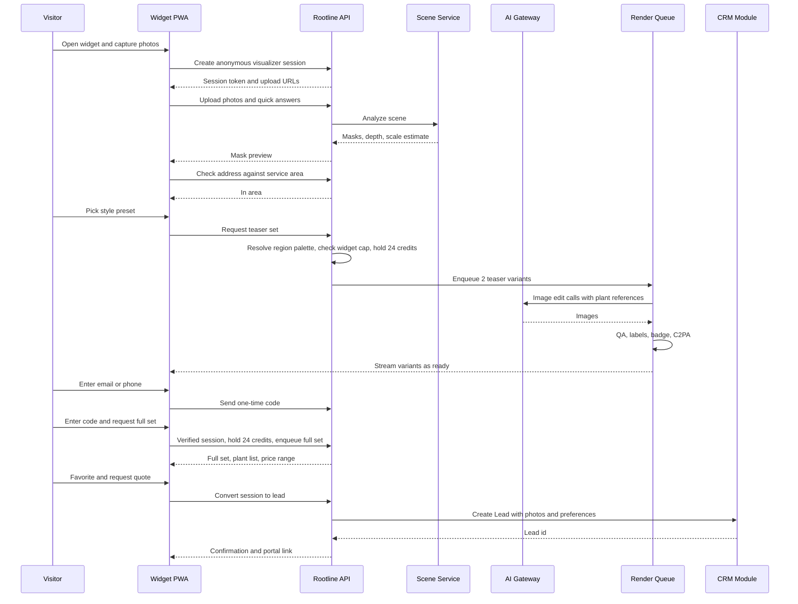

### 5.2 Mode A - photo restyle (pro in the field) [MVP]

1. Estimator opens the Opportunity on the crew app or tablet, taps "Visualize".
2. Captures with the calibration card on the lawn (optional) and two dimension pins.
3. Selects region "beds only", preset "Native pollinator", intensity "Redesign".
4. Reviews 4 variants with labels; favorites 2; upscales 1 to HD; attaches to the Opportunity and texts it to the homeowner via the unified inbox ([16](16-marketing-growth-communications.md)).

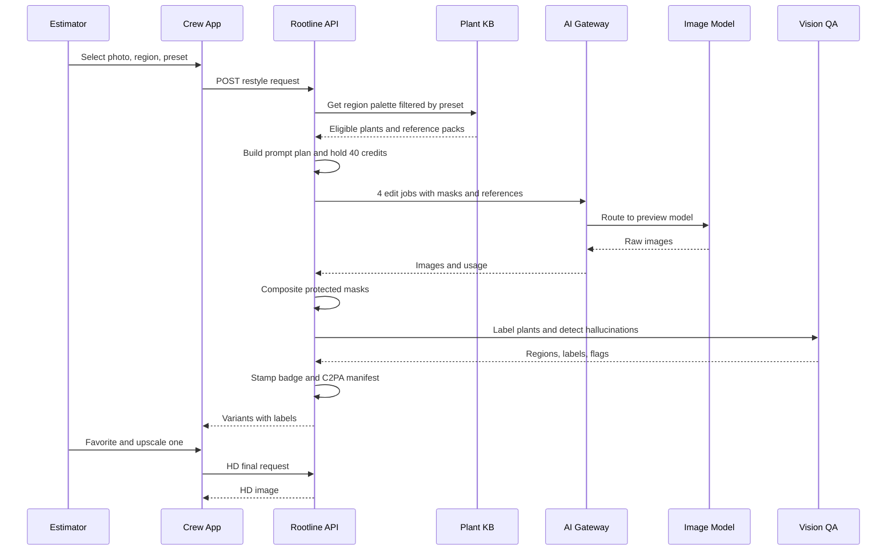

### 5.3 Mode B - plan-to-photo [V1]

1. Designer finishes a Signature option in the Design Studio.
2. Opens the client's street-facing photo; registration wizard asks for 3-4 correspondences (auto-suggested corners).
3. Chooses plant age "year 3", season "summer", quality "preview".
4. Reviews render with numbered labels matching the plan key and a fidelity grade; fixes one low-score region by swapping to a render-ready cultivar or accepting the flag.
5. Renders HD, adds to the proposal option.

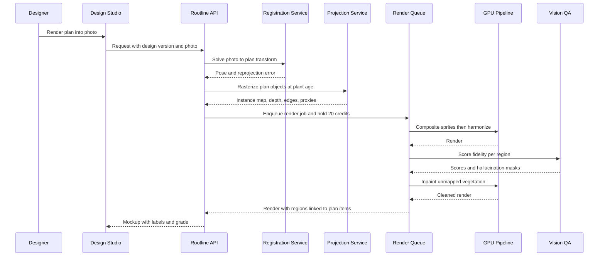

### 5.4 Mode C - AI layout generation [V1]

1. Designer opens a Site with base map, sun map and captures; clicks "Generate layouts".
2. Confirms constraints (parsed HOA rules shown with quoted sources), budget band and style.
3. System returns 3 options in about 30-60 s with progress streaming ("Selecting plants", "Shaping beds", "Placing 47 plants", "Pricing").
4. Designer compares, picks Signature, edits in the Studio, then renders plan-to-photo.

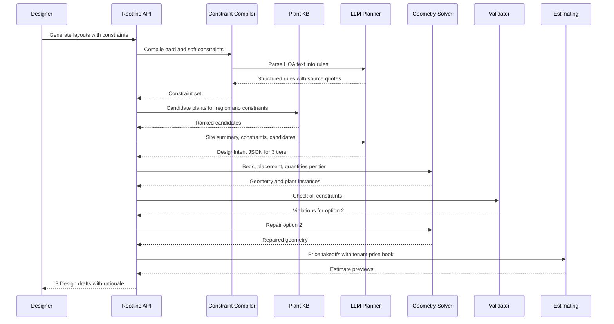

### 5.5 Mode D - conversational edit [V1]

1. Designer (or estimator on a tablet) types or speaks an instruction in the assistant panel.
2. The agent resolves references to plan objects, checks the KB, and asks a clarifying question when intent is ambiguous or contradicts KB data (the boxwood example in AIM-GEN-D).
3. Edits are applied through the Design command bus as one undoable unit, creating a new Design Version.
4. The estimate delta and a targeted re-render come back in the same thread with a diff card.

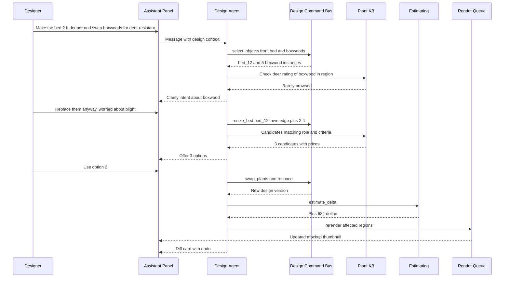

### 5.6 Mode E - seasonal, growth and night set [V1]

1. From an approved plan-to-photo mockup, designer clicks "Seasons" and "Growth".
2. System reuses the projection and control maps and swaps per-plant assets by season and age.
3. Results appear as a 4-up strip and a timeline slider; added to the proposal and portal.

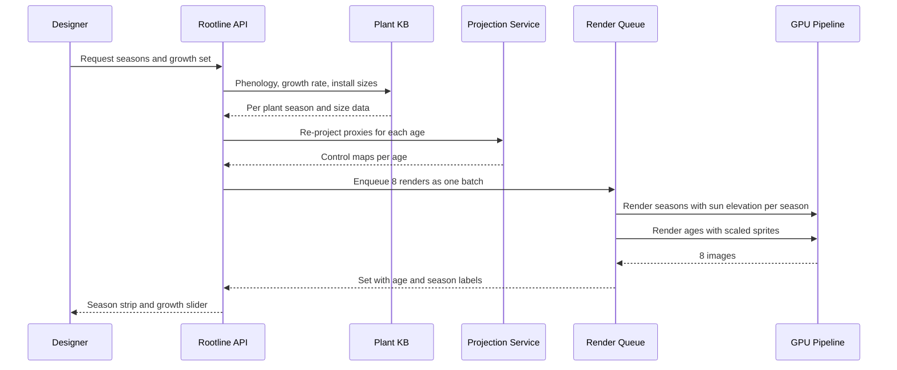

Night lighting (V1 mood, V2 physical) follows the same path with the lighting layer: fixture positions and photometrics come from the Design; the GPU pipeline relights the scene at dusk. The V2 physically based path differs enough to show separately:

1. Designer places fixtures in the Design Studio lighting layer ([10](10-design-studio.md) DS-LITE); each fixture links to a Price Book item with photometrics (lumens, beam angle, color temperature).
2. "Night view" projects fixtures into the registered photo, computes light pools on the depth-derived surfaces (inverse-square falloff, beam cone, occlusion by depth), and renders a dusk base plate.
3. A harmonize pass blends the computed light map with the dusk plate. QA checks that every fixture produced a visible pool and that no light appears where no fixture exists.
4. The fixture schedule and transformer load are added to the estimate. Load is the sum of fixture wattage against the transformer rating, with a default warning above 80% loading (a common installer practice; tenant-editable). The lighting layer later seeds the lighting system inventory in [14](14-service-line-modules.md); a lighting subcontractor (`subcontractor`) sees only this layer and the night render.

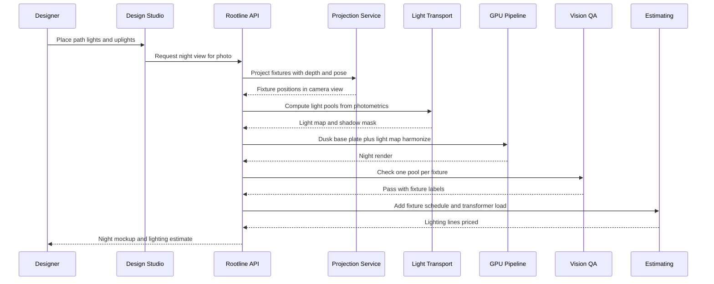

### 5.7 Mode F - 3D walkthrough from video [V3]

1. Designer or crew lead records a guided 60-120 s walk-around video with the calibration card visible in at least one segment.
2. Upload waits for Wi-Fi by default; reconstruction runs asynchronously.
3. The splat is scaled and registered to the plan; the proposed Design is inserted as 3D assets.
4. Designer reviews viewpoints, then shares a portal link; the client explores in a browser or in AR on a phone.

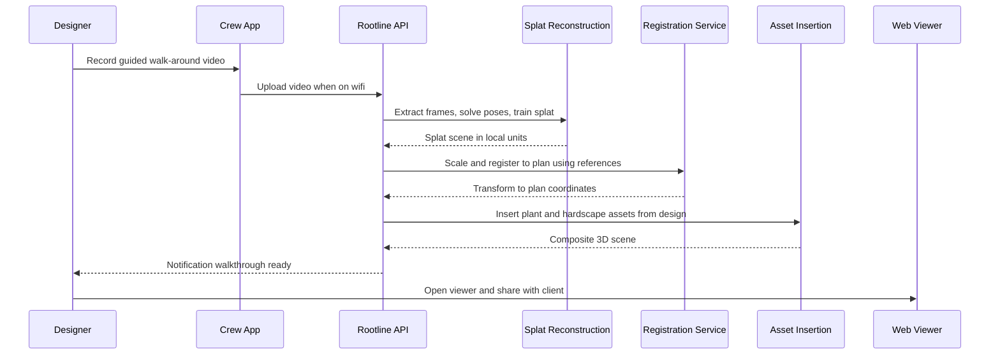

### 5.8 Lifecycle states

**Render job**

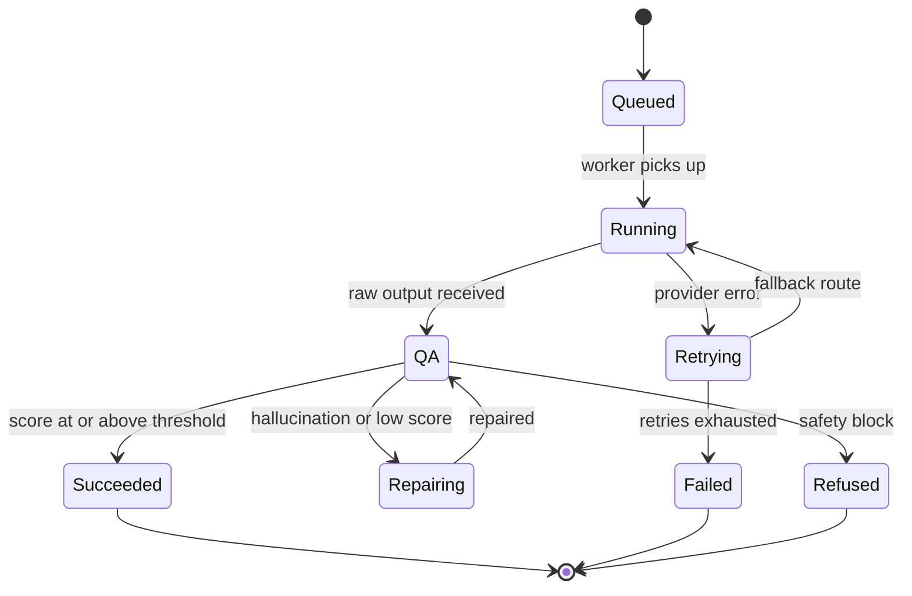

**Mockup**

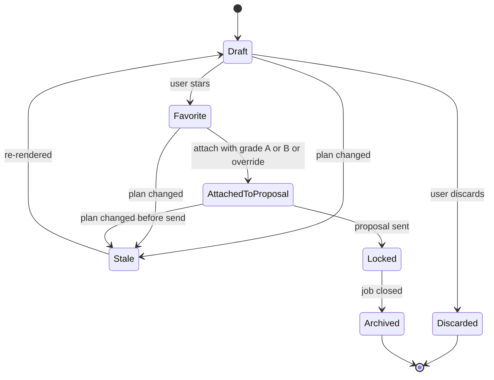

### 5.9 Upsell flow for maintenance clients [V1]

1. During a spring cleanup Visit, the `crew_lead` captures the standard "property photo" (already part of the visit checklist in [05](05-field-crew-mobile-app.md)).
2. The `ops_manager`'s weekly AI digest ([17](17-ai-copilot-automation.md)) flags properties with thin beds, dead shrubs or bare mulch (vision model on visit photos).
3. One click (by the `estimator`, or by an `ops_manager` who holds `mockup.generate`) creates a "bed refresh" restyle and a pre-priced enhancement Proposal; sent through the portal.
4. Client accepts in the portal; it becomes a Work Order on the next maintenance Route ([04](04-scheduling-dispatch-routing.md)).

---

## 6. Screens and wireframes

### 6.1 Screen inventory

| # | Screen | Surface | Primary roles | Priority |
|---|---|---|---|---|
| S1 | Guided capture | Crew app, mobile web, widget PWA | technician, crew_lead, estimator, prospect | [MVP] |
| S2 | Dimensions and pins | Crew app, web, widget (lite) | estimator, designer, prospect | [MVP] |
| S3 | Mask review and fix | Web, crew app, widget (lite) | estimator, designer | [MVP] |
| S4 | Restyle studio (preset picker, variants grid) | Web, tablet | estimator, designer, office_manager (ops_manager if granted) | [MVP] |
| S5 | Visualizer widget (homeowner) | Embedded PWA on Company site | prospect | [MVP] |
| S6 | Mockup viewer (labels, slider, fidelity) | Web, portal, tablet | all with access | [MVP] |
| S7 | Plan-to-photo registration wizard | Web | designer | [V1] (manual MVP) |
| S8 | Layout generator (constraints, options compare) | Web | designer, estimator | [V1] |
| S9 | Design assistant panel (chat/voice) | Web, tablet | designer, estimator | [V1] |
| S10 | Seasons and growth viewer | Web, portal | designer, clients | [V1] |
| S11 | Presentation board builder | Web | designer | [V1] |
| S12 | AI credits and usage | Web settings | owner, office_manager, bookkeeper | [MVP] |
| S13 | Tenant AI policy settings | Web settings | owner | [MVP] |
| S14 | Render inspector (support) | Platform Admin | platform_support, platform_engineer | [MVP] |
| S15 | Render-issue queue and render packs | Platform Admin | platform_curator | [MVP] |
| S16 | AI ops dashboard (cost, latency, quality, routes) | Platform Admin | platform_owner, platform_engineer, platform_finance | [MVP] |
| S17 | 3D walkthrough viewer | Web, portal | designer, clients | [V3] |
| S18 | Site rule packs (author, version, jurisdiction map, test against sample sites) | Platform Admin | platform_curator, platform_owner | [V1] |
| S19 | Design package catalog and design-fee settings | Web settings | owner, office_manager | [V1] |

UX conventions (component library, a11y, i18n) follow [21](21-ux-design-system-sitemaps.md).

### 6.2 S1 Guided capture (crew app / widget, portrait)

```text
+------------------------------------------+
| <  Front yard - Shot 1 of 3     [ES|EN]  |
+------------------------------------------+
|                                          |
|   .------------------------------.       |
|   :      [ house outline guide ] :       |
|   :     ______/\______           :       |
|   :    |  []  |  |  []  |        :       |
|   :    |______|__|______|        :       |
|   :  ~~~~~~~~ lawn ~~~~~~~~~     :       |
|   '------------------------------'       |
|  ---------------- horizon OK ----------  |
|                                          |
|  [!] Sun behind house - try other side   |
|      or wait for cloud cover             |
|                                          |
|  Lens: 1x OK    Blur: OK    Light: Fair  |
+------------------------------------------+
|  Tip: lay the Rootline card on the lawn  |
|  about 10 ft in front of you.            |
|                                          |
|  [ Gallery ]      ( O )      [ Skip ]    |
+------------------------------------------+
| Quality 78/100  ######## __  Good to go  |
+------------------------------------------+
```

### 6.3 S2 Dimensions and pins (tablet, landscape)

```text
+--------------------------------------------------------------------------------+
| Smith - 14 Oak Ln   >  Site  >  Dimensions                     Units: [ft | m] |
+---------------------------------------------+----------------------------------+
|  PHOTO (tap two points to measure)          |  SITE DIMENSIONS                 |
|                                             |  Area type   [Front yard     v]  |
|     ______/\________                        |  Yard width  [ 62 ] ft  [ 0 ] in |
|    |  []  |  |  []  |___                    |  Yard depth  [ 38 ] ft           |
|    |______|__|______|   |                   |  Slope       ( ) flat (o) gentle |
|  A*-------- 4 ft --------*B  (walk width)   |                                  |
|   bed  ......... 32 ft .........  bed       |  EXISTING BEDS                   |
|  C*-----------------------------*D          |  Foundation  L [32] D [ 4 ] ft   |
|                                             |  Mailbox     L [ 6] D [ 6 ] ft   |
|   [card detected: OK]                       |  + Add bed                       |
|                                             |                                  |
|  Scale: +/- 4%  (2 pins + card)             |  KEEP                            |
|  Residuals: A-B 1%  C-D 3%  card 2%         |  [x] Red maple (tap on photo)    |
|                                             |  [x] AC unit  clearance [3] ft   |
|  [ Add pin ] [ Vertical pin ] [ Undo ]      |  + Add feature                   |
|                                             |                                  |
|                                             |  CONSTRAINTS                     |
|                                             |  Deer [Heavy v] Pets [Dog v]     |
|                                             |  Water [Watering days v]         |
|                                             |  HOA  [Paste rules...]           |
+---------------------------------------------+----------------------------------+
| [ Back ]                                   [ Save ]   [ Continue to design > ] |
+--------------------------------------------------------------------------------+
```

### 6.4 S4 + S9 Mockup studio with plan, mockup and assistant (desktop)

```text
+-------------------------------------------------------------------------------------------+
| Smith - Front yard   Design v7 (Signature)   [Plan | Split | Photo]   Credits: 812  [Share] |
+------------------------------+---------------------------------+--------------------------+
| PLAN (to scale, 1 in = 8 ft) | PHOTO MOCKUP  Year 3 - Summer   | ASSISTANT                |
|                              | [Before |====|> After]          |                          |
|  +----------------------+    |                                 | You: make the bed 2 ft   |
|  |      HOUSE           |    |    ______/\________             | deeper and swap the      |
|  +----------------------+    |   |  []  |  |  []  |            | boxwoods for something   |
|  (1)(1) (2)(2)(2) (3)(3)     |   |______|__|______|            | deer resistant           |
|  ~ ~ (4)(4)(4)(4)(4) ~ ~     |   (1) (2)(2)(2)  (3)            |                          |
|  ..... bed edge .........    |  ~(4)(4)(4)(4)(4)~              | Assistant: Boxwoods are  |
|                              |  ...... lawn ......             | already rated deer       |
|  KEY                         |                                 | resistant here. Replace  |
|  1 Serviceberry  x2  15gal   | Fidelity: A (88)  [details]     | anyway (blight), or did  |
|  2 Boxwood 'GV'  x5  #5      | Badge: AI artist rendering      | you mean the arborvitae? |
|  3 Panicle hyd.  x2  #5      |                                 |                          |
|  4 Catmint       x9  #1      | Seasons: [Sp][Su][Fa][Wi]       | [Replace boxwoods]       |
|                              | Age: [Install][1][3][5]         | [Arborvitae]             |
|  Bed 12: 32 x 6 ft = 192 sf  | Labels: [on]                    |                          |
|  Mulch 1.8 cu yd             |                                 | Diff: bed +64 sf, mulch  |
|                              |  ! Stale region: none           | +0.6 cy, plants +7       |
|                              |                                 | Price +$684   [Undo]     |
+------------------------------+---------------------------------+--------------------------+
| Options: [Essential $6,920] [Signature $11,480 *] [Showcase $18,750]   [Add to proposal]  |
+-------------------------------------------------------------------------------------------+
```

### 6.5 S8 Layout generator: constraints review and options compare (desktop) [V1]

The screen a designer sees after "Generate layouts". Parsed constraints are confirmed on the left before generation. The three options stream in as they finish, and the "why" panel explains the trade-offs.

```text
+---------------------------------------------------------------------------------------------+
| Smith - Front yard  >  Generate layouts       Region: Central Ohio 6a   Credits: 60 (quoted) |
+-------------------------------+-------------------------------------------------------------+
| CONSTRAINTS (confirm)         |  OPTIONS                       stage: Pricing  [###### 90%] |
|                               |  +-----------------+ +-----------------+ +-----------------+ |
| Budget band  $7.5k - $15k     |  | ESSENTIAL (Good)| | SIGNATURE *     | | SHOWCASE (Best) | |
| Style        Native pollinator|  | [plan thumb]    | | (Better)        | | [plan thumb]    | |
| Maintenance  Low              |  |                 | | [plan thumb]    | |                 | |
| Deer         Heavy            |  | 31 plants       | | 47 plants       | | 58 plants       | |
| Pets         Dog              |  | 8 species       | | 11 species      | | 14 species      | |
| Water        Watering days    |  | Beds 410 sf     | | Beds 520 sf     | | Beds 520 sf     | |
| Sun          N face: shade    |  | Mulch 3.5 cy    | | Mulch 4.5 cy    | | + 48 sf paver   | |
|              S face: full     |  | $6,920          | | $11,480         | | $18,750         | |
| HOA (parsed, 3 rules):        |  | Coverage y3 82% | | Coverage y3 88% | | Coverage y3 91% | |
|  [x] Hedges <= 36 in          |  | Natives 74%     | | Natives 81%     | | Natives 78%     | |
|      "Hedges along front ...  |  | Bloom 6 months  | | Bloom 7 months  | | Bloom 8 months  | |
|       shall not exceed 36 in" |  | Rules: OK       | | Rules: OK       | | ! 1 warning     | |
|  [x] Lawn >= 40% of front     |  +-----------------+ +-----------------+ +-----------------+ |
|  [ ] No gravel front yards    |                                                             |
|      (unchecked: not in doc)  |  WHY SIGNATURE LOOKS LIKE THIS                              |
| Site rules (auto):            |  - North foundation is shade: oakleaf hydrangea, sedges     |
|  Sight triangle at drive 30in |  - Heavy deer: no hostas or arborvitae; 0 plants rated      |
|  AC clearance 3 ft            |    "frequently browsed"                                     |
| Keep: red maple, root zone    |  - Traded: 2 fewer shrubs to hold the $11.5k target          |
|       14 ft radius            |  Showcase warning: boulder within 3 ft of hydrant [Fix]     |
|                               |                                                             |
| [ Edit constraints ]          |  [ Open in Studio ]  [ Overlay on photo ]  [ Render (40) ]  |
| [ Regenerate (60 credits) ]   |  [ Send all 3 to proposal as Good/Better/Best ]             |
+-------------------------------+-------------------------------------------------------------+
```

### 6.6 S5 Homeowner visualizer result and lead capture (mobile)

Shown after one-time-code verification under the default `teaser_then_verify` gate. Before verification, the same screen shows the 2 teaser variants with the plant list, price range and download hidden behind "Verify to unlock".

```text
+------------------------------------------+
| [GreenEdge logo]   Your new front yard   |
+------------------------------------------+
|  [ Before |=====|> After ]               |
|                                          |
|        ______/\________                  |
|       |  []  |  |  []  |                 |
|       |______|__|______|                 |
|     (a)  (b)(b)(b)  (c)                  |
|    ~(d)(d)(d)(d)(d)~                     |
|                                AI artist |
|                                rendering |
+------------------------------------------+
|  Style: Native pollinator   2 styles left|
|  (a) Serviceberry  (b) Little bluestem   |
|  (c) Coneflower    (d) Catmint           |
|  Plants chosen for your area (zone 6b)   |
+------------------------------------------+
|  Typical range for a design like this:   |
|  $7,500 - $15,000 (estimate)             |
+------------------------------------------+
|  [ <3 Save ]   [ Try another style ]     |
|  [ Ask my partner to vote ]  [ HD (1) ]  |
|                                          |
|  [  Get my free design consultation  ]   |
|  [  Book full design: $250, credited  ]  |
|  [  to your project if you build      ]  |
|                                          |
|  Verified: j***@email.com                |
|  [ ] Text me about my project (opt-in)   |
+------------------------------------------+
```

### 6.7 S16 Platform AI ops dashboard (excerpt)

```text
+--------------------------------------------------------------------------------------+
| Platform Admin > AI Ops > Design and Mockups          Last 7 days   [Export] [Alerts] |
+--------------------------------------------------------------------------------------+
| Renders 41,882 | Cost $1,966 | Credit rev $6,480 | AI COGS 30% | Refunds 1.2%         |
+--------------------------------------------------------------------------------------+
| ROUTE                     CALLS   p50   p95   $/img   FAIL   FIDELITY  CANARY       |
| restyle.preview  gemini   30,110  9.8s  21s   0.039   0.6%   B 79      100%         |
| restyle.preview  kontext   3,340  8.1s  17s   0.040   0.4%   B 81      10% [edit]   |
| p2p.harmonize    selfhost  5,902  14s   29s   0.012   1.1%   A 87      100%         |
| layout.planner   sonnet      977  22s   48s   0.064   0.3%   n/a       100%         |
+--------------------------------------------------------------------------------------+
| WORST PLANTS (complaints / fidelity)    | SAFETY                                   |
| Ilex glabra 'Shamrock'   14   61        | Non-landscape refusals 212               |
| Hydrangea 'Bobo'          9   66        | Person-edit attempts 3   [review]        |
| [Open curator queue]                    | Widget abuse blocks 1,904                |
+--------------------------------------------------------------------------------------+
```

The dashboard figures above are illustrative placeholders for layout, not data.

---
## 7. Data model

All tables carry `tenant_id` and are protected by Postgres row-level security per [20](20-architecture-security.md), except platform-owned assets (style presets, plant render packs, LoRAs, model routes), which live in platform schemas readable by tenants through views. Binary artifacts (photos, masks, depth maps, renders, splats) live in S3 under tenant-prefixed keys with KMS encryption; rows hold keys and content hashes.

### 7.1 Entities

| Entity | Purpose | Key fields |
|---|---|---|
| `site_capture` | A capture session for a Property (or anonymous visualizer session) | id, tenant_id, property_id (nullable for anonymous), visualizer_session_id, area_type, captured_by_user_id, source (crew_app, web, widget, portal), status, created_at |
| `capture_photo` | One photo | id, site_capture_id, s3_key, content_sha256, width, height, focal_length_35mm, lens, device_model, heading_deg, pitch_deg, roll_deg, gps_point (PostGIS, internal), taken_at, quality_score, quality_flags |
| `reference_measurement` | Dimension pin, tape, card or confirmed object | id, capture_photo_id, kind, point_a_px, point_b_px, value_m, original_value, original_unit, is_vertical, weight, residual_pct |
| `dimension_set` | Structured form answers | id, site_capture_id, version, payload (jsonb, schema-versioned), unit_system, completed_by |
| `scene_analysis` | Immutable analysis of one photo | id, capture_photo_id, version, seg_model, depth_model, scale_factor, scale_confidence_pct, ground_plane, intrinsics, sun_azimuth_deg, sun_elevation_deg, status |
| `scene_mask` | Segmentation instance | id, scene_analysis_id, class, s3_key_rle, is_protected, area_px, user_edited |
| `plan_registration` | Photo-to-plan transform | id, scene_analysis_id, design_id, correspondences (jsonb), transform, reprojection_error_m |
| `mockup` | A rendered image (any mode) | id, tenant_id, mode, capture_photo_id, design_version_id (nullable), preset_version_id, plant_age_years, season, time_of_day, status, fidelity_score, fidelity_grade, is_stale, visible_subset_hash, s3_key, c2pa_manifest_id, created_by |
| `mockup_region` | A labeled region in a mockup | id, mockup_id, mask_key, design_object_id (nullable), kb_plant_id (nullable), label, confidence, region_score, is_hallucination |
| `mockup_job` | Queue unit | id, mockup_id, task, route_id, model_version, params (jsonb), seed, input_hash, status, attempts, credits_reserved, credits_charged, provider_cost_usd, latency_ms, error_code |
| `style_preset` / `style_preset_version` | Platform or tenant preset | id, scope (platform or tenant), name, version, palette_query (jsonb), layout_rules (jsonb), prompt_fragments, negative_fragments, model_overrides, status |
| `plant_render_pack` | Platform-owned per-plant render assets | id, kb_plant_id, status (draft, render_ready, suspended), reference_image_ids, sprite_keys, proxy_shape, descriptor_text, lora_id, license_summary |
| `plant_lora` | Trained adapter | id, kb_plant_id, base_model, training_set_hash, eval_score, status, s3_key |
| `layout_request` | Mode C request | id, design_id, constraints (jsonb), compiled_constraints (jsonb), candidate_plant_ids, status, llm_route_id, cost_usd |
| `layout_option` | One generated option | id, layout_request_id, tier, design_version_id, scores (jsonb), violations (jsonb), rationale_text |
| `design_chat_session` / `design_chat_turn` | Mode D conversation | session: id, design_id, user_id, locale; turn: id, session_id, role, content, tool_calls (jsonb), design_version_before, design_version_after, estimate_delta |
| `fidelity_report` | Score breakdown | id, mockup_id, identity, count_placement, scale, preservation, hallucination, model_versions |
| `provenance_manifest` | C2PA record | id, mockup_id, manifest_key, signer_cert_id, assertions (jsonb), watermark_id, created_at |
| `ai_credit_entry` | Credit ledger row (owned by the platform credit ledger in [22](22-business-model-pricing-gtm.md); shown for linkage) | id, tenant_id, user_id, action_key, mockup_job_id, credits, entry_type (hold, settle, release, refund, grant), idempotency_key, balance_after |
| `visualizer_session` | Anonymous widget session | id, tenant_id, gate_mode (teaser_then_verify, verify_first, open), address_point, in_service_area, device_fingerprint_hash, ip_hash, credits_used, teaser_used, verified_contact_id, verified_at, lead_id, consent_flags, expires_at |
| `visualizer_vote` | "Help me pick" partner votes | id, visualizer_session_id, voter_token_hash, mockup_id, vote (up, down), created_at |
| `tenant_ai_policy` | Tenant AI settings for this module (one current row per tenant, versioned) | id, tenant_id, version, enabled_modes, monthly_cap_credits, role_caps (jsonb), widget_cap_credits, verification_gate, honest_mode, disclaimer_text, show_fidelity_to_clients, auto_rerender_limit, training_opt_in_level (none, improvements, full), updated_by, updated_at |
| `site_rule_pack` / `site_rule` | Platform-owned site-geometry rule packs (AIM-GEN-C2); jurisdiction packs are `jurisdiction_rule_pack` in [12](12-plant-knowledge-base.md) | pack: id, code, version, jurisdiction_geom (PostGIS multipolygon), client_types, effective_from, effective_to, source_citation, status; rule: id, pack_id, rule_code, rule_type, params (jsonb), severity (hard, soft, advisory), tenant_overridable. Violations are written to `design_validation_issue` in [10](10-design-studio.md), not to a separate table |
| `data_use_consent` | Training and sharing consent | id, tenant_id, subject_type (tenant, client, prospect), subject_id, scope (training, marketing, network), granted, granted_at, revoked_at |
| `eval_sample` | Golden-set item | id, scene_ref, ground_truth (jsonb), region_id, tags |

### 7.2 Entity relationship diagram

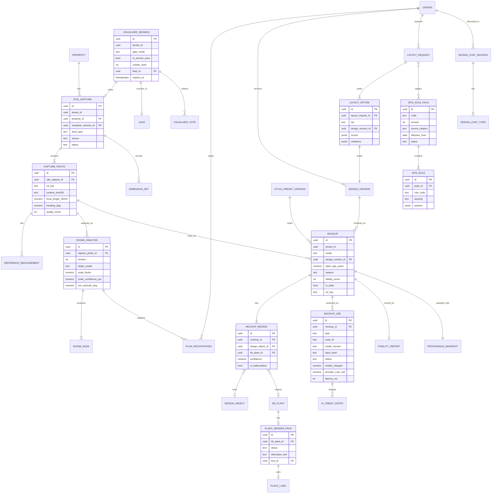

`PROPERTY`, `DESIGN`, `DESIGN_VERSION`, `DESIGN_OBJECT`, `KB_PLANT` and `LEAD` are owned by [CRM](03-crm-sales-estimating-proposals.md), [Design Studio](10-design-studio.md) and [Plant KB](12-plant-knowledge-base.md); they are shown for relationships only.

### 7.3 Retention defaults (tenant-configurable within limits)

| Artifact | Default retention | Notes |
|---|---|---|
| Photos and mockups attached to a Proposal or Job | Life of the tenant account + 7 years | Supports warranty and dispute evidence |
| Unattached pro mockups and drafts | 24 months, then archived to cold storage | Restorable |
| Anonymous widget sessions without lead conversion | 30 days, then hard-deleted | Includes photos |
| Depth maps, masks, control maps | Regenerable; 90 days hot, then deleted | Re-derived on demand |
| Render job logs (prompts, params, costs) | 18 months | For support, billing audits, eval |

---

## 8. Architecture, integrations, APIs and events

This section specifies the module's slice of the platform architecture; platform-wide decisions (modular monolith, Temporal, outbox, RLS) are in [20](20-architecture-security.md), and the AI Gateway as a shared platform service is in [17](17-ai-copilot-automation.md).

### 8.1 System overview

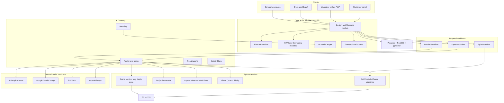

### 8.2 AI Gateway and model routing

All model calls (LLM, image, vision, embeddings, self-hosted GPU) go through the provider-agnostic AI Gateway. Responsibilities for this module:

- **Routing by task** with ordered fallbacks, per-tenant overrides (enterprise "no third-party image providers" option routes to self-hosted only), and canary percentages.
- **Policy:** input safety checks before spending, output safety checks before returning, tenant AI policy enforcement (disabled modes, caps).
- **Metering:** provider cost captured per call (tokens, images, GPU-seconds). Credits are quoted (`credits.quote`), held at enqueue (`credits.hold`) and settled or released at completion, through the platform credit ledger API in [22](22-business-model-pricing-gtm.md) 11.2. Holds release automatically after 30 minutes if a job never settles.
- **Caching:** content-addressed results (8.4).
- **Observability:** traces per render job (OpenTelemetry), latency and cost histograms per route and model version.

**Route table (initial proposal; the operator can change routes in [19](19-platform-admin-portal.md) without a deploy):**

| Task key | Primary | Fallback | Why |
|---|---|---|---|
| `scene.segment` | Self-hosted Grounding DINO-class detector + SAM-family masks + landscape head | Vendor VLM bounding boxes + SAM | Fast, cheap, controllable; license-checked weights |
| `scene.depth` | Self-hosted Depth Anything V2 metric or Depth Pro class | Alternative depth model | Commodity GPU inference |
| `restyle.preview` | Google Gemini image editing (Flash tier) with multi-image references | FLUX.1 Kontext [pro] via BFL API; then self-hosted SDXL/FLUX inpaint + ControlNet | Low latency and cost, strong instruction following, accepts reference images |
| `restyle.economy` | Self-hosted open-weight instruction-editing model with a permissive license (Qwen-Image-Edit class, released under Apache-2.0 as of 2025, verify) + SAM masks + reference images | `restyle.preview` | Widget teaser sets and `batch` renders at a fraction of vendor per-image prices; promoted only if it matches `restyle.preview` on the golden set for house preservation and plant identity |
| `restyle.hd` | Self-hosted super-resolution of the chosen preview plus a low-strength detail pass (the 20-credit HD final) | Gemini image (higher-resolution tier) or FLUX Kontext [max] | Keeps the variant the user picked (no re-roll) and costs a few cents |
| `restyle.4k` | Gemini image 4K tier or FLUX Kontext [max] | OpenAI image editing | Presentation 4K re-render (40 credits on its own [V1] line; see 4.7) |
| `p2p.harmonize` | Self-hosted diffusion img2img with depth + edge ControlNet and IP-Adapter | Gemini image editing with control images as references | Needs pixel-level control of masks and IDs |
| `p2p.generate` | Self-hosted ControlNet + IP-Adapter + regional prompts, per-plant LoRA | Vendor editing model | Identity control for plants without sprites |
| `upscale` | Self-hosted super-resolution | Vendor upscaler | Cheap |
| `layout.plan` | Claude (Sonnet tier) with structured outputs | Claude (Opus tier) on repeated validation failure | Strong reasoning with schema adherence; escalate only when needed |
| `layout.hoa_parse` | Claude (Sonnet tier) | Claude (Opus tier) | Legal-ish text to rules with quotes |
| `chat.design_agent` | Claude (Haiku tier) for single-step edits with resolved targets; Claude (Sonnet tier) for multi-step, ambiguous or `fit_budget` turns | Claude (Opus tier) after a failed validation on a multi-step edit | Tool use and clarifying questions at a cost that fits a 1-2 credit turn (8.6) |
| `chat.intent_fast` | Claude (Haiku tier) | Sonnet tier | Cheap reference resolution, classification |
| `qa.vision` | Self-hosted plant classifier + embedding similarity; Claude vision for adjudication of disputed regions | Vendor VLM | Plant identity scoring at scale |
| `relight.night` | Self-hosted relighting diffusion pipeline | Vendor editing model | V1 mood; V2 physical uses depth-based light transport + harmonize |
| `splat.reconstruct` | Self-hosted 3D Gaussian splatting training on GPU | Vendor capture API (evaluate) | V3 |

Model names are examples as of November 2026; the route registry stores exact model IDs and versions. Current Claude tiers are the Opus, Sonnet and Haiku families (Claude Opus 5.5, Claude Sonnet 5.5 and Claude Haiku 5.5 as of November 2026), with the higher-priced Claude Fable tier kept off this module's routes unless evals justify it. Two API behaviors shape the design: structured outputs and `strict` tool schemas guarantee schema-valid `DesignIntent` and tool arguments, and forced `tool_choice` is not supported on these generations, so agents run with `auto` (see AIM-GEN-D).

**Licensing check before self-hosting:** some open-weight image models restrict commercial use (for example, FLUX.1 [dev] ships under a non-commercial license with commercial licensing available from Black Forest Labs, while FLUX.1 [schnell] is Apache-2.0; SDXL uses an OpenRAIL++ license that permits commercial use with use restrictions). The newer FLUX.2 family follows the same split, with hosted [pro]/[flex] tiers and an open-weight [dev] model under a non-commercial license (as of late 2025, verify). Qwen-Image-Edit-class models were published under Apache-2.0 (verify per release). Every self-hosted model in the route registry must have a recorded license review by `platform_engineer` and approval by `platform_owner` (verify current license terms at adoption time).

### 8.3 Job queue and GPU providers

- **Orchestration:** each render is a Temporal `RenderWorkflow` (idempotent activities: hold credits -> analyze if needed -> build controls -> generate -> QA -> repair -> stamp -> settle credits -> emit events). Layouts use `LayoutWorkflow`; splats use `SplatWorkflow` (long-running, hours-tolerant).
- **Queues by priority class:** `interactive` (widget and field restyle; target start within 1 s), `studio` (designer renders; within 5 s), `batch` (overnight re-renders, seasonal sets for proposals not yet sent; best effort, discounted models), `long` (splats).
- **Fairness:** per-tenant concurrency limits (default 8 interactive jobs per tenant, 2 per anonymous widget session) so one large tenant's batch cannot starve others.
- **GPU capacity:** a baseline of reserved GPUs in the primary cloud region (for predictable cost and data residency) plus burst to serverless GPU providers (for example Modal, Baseten, Replicate or fal-class platforms; chosen by benchmark and DPA terms). Models are packaged as containers with pinned weights; cold-start mitigation by keeping warm pools for `interactive` routes during North American business hours (6 am-9 pm local, adjusting seasonally since spring is peak).
- **Seasonality:** landscape demand peaks March-June. Capacity plan assumes peak weekly render volume of about 3x the winter trough (estimate); vendor APIs absorb peaks while self-hosted handles the base.
- **Data residency:** Canadian tenants can pin storage to a Canadian region (V1); third-party model calls disclose processing locations in the DPA (see [20](20-architecture-security.md)).

### 8.4 Caching

| Cache | Key | Hit scenario | TTL |
|---|---|---|---|
| Scene analysis | sha256(photo) + pipeline version | Same photo used in many mockups | Until pipeline version changes |
| Palette resolution | region_id + preset_version + company_palette_version + KB snapshot | Every widget render in a Region | Invalidated on `kb.release_published` or `kb.profile_updated` |
| Render result | sha256(photo, masks, params, model version, seed, plant refs) | Double-clicks, repeated presets, presentation reloads | 90 days |
| Region render | instance properties hash + neighborhood context hash | Targeted re-render after small plan edits | 30 days |
| Plant reference embeddings | kb_plant_id + image ids | QA scoring | Until pack changes |
| LLM prompt cache | Stable prefix: system prompt, tools, compiled KB candidate block | Layout repairs and chat turns in one session | Provider-managed (minutes) |
| CDN | Signed URL per output | Portal and proposal views | Per URL expiry (default 7 days for shares) |

Seeded determinism: preview sets reuse seeds per (photo, preset) so "regenerate" gives new seeds explicitly while reloads show the same images.

### 8.5 Latency targets

| Operation | p50 target | p95 target | UX pattern |
|---|---|---|---|
| Capture quality check (on device) | 150 ms | 400 ms | Live |
| Scene analysis per photo | 4 s | 8 s | Mask preview animates in |
| Widget teaser set (2 variants, economy route) | 10 s | 20 s | Both variants stream; mask preview shown while waiting |
| Restyle preview set (4 variants, ~1 MP) | 12 s | 25 s | Variants stream as each finishes; first within 8 s p50 |
| HD final | 20 s | 45 s | Progress bar |
| Plan-to-photo preview | 20 s | 40 s | Overlay shown instantly, photoreal replaces it |
| Region re-render after edit | 10 s | 20 s | Inline thumbnail in chat |
| AI layout (3 options) | 35 s | 75 s | Streamed stage progress; first option early |
| Chat turn without render | 2.5 s | 6 s | Streaming text and diff card |
| Seasonal + growth set (8 images, 4 each) | 45 s | 90 s | Fills in progressively |
| Splat walkthrough (V3) | 20 min | 45 min | Async notification |

Targets are proposals; they gate GA for each mode and are monitored per route.

### 8.6 Cost model and credit economics

**Provider unit costs gathered in research (all as of the dates shown; verify before committing):**

| Model / resource | Unit cost | Source |
|---|---|---|
| Gemini 2.5 Flash Image ("Nano Banana"), about 1 MP | About $0.039 per image; about $0.0195 in batch | [BenchLM](https://benchlm.ai/media-pricing/nano-banana); [MyArchitectAI](https://www.myarchitectai.com/blog/nano-banana-api-pricing) (as of 2026, verify) |
| Gemini 3.1 Flash Image ("Nano Banana 2") | About $0.045 (0.5K), $0.067 (1K), $0.101 (2K), $0.151 (4K) | [BenchLM](https://benchlm.ai/media-pricing/nano-banana) (as of 2026, verify) |
| Gemini 3 Pro Image ("Nano Banana Pro") | About $0.134 (1K-2K), $0.24 (4K) | [BenchLM](https://benchlm.ai/media-pricing/nano-banana) (as of 2026, verify) |
| FLUX.1 Kontext [pro] / [max] | About $0.04 / $0.08 per image; FLUX.2 priced per megapixel | [BFL help](https://help.bfl.ai/articles/7424166364-wip-welcome-to-the-forest); [Puter FLUX pricing](https://developer.puter.com/tutorials/flux-api-pricing/); [PricePerToken](https://pricepertoken.com/flux-pricing) (as of Sep-Nov 2026, verify) |
| Claude Sonnet tier (Sonnet 5.5) | $2 per million input tokens, $10 per million output tokens; cache reads $0.20 per million; batch 50% off | Anthropic pricing as of November 2026 (verify) |
| Claude Haiku tier (Haiku 5.5) | $0.10 input / $0.50 output per million tokens for prompts up to 100K tokens ($0.50 / $2.50 beyond) | Anthropic pricing as of November 2026 (verify) |
| Claude Opus tier (Opus 5.5) | $4 input / $20 output per million tokens; cache reads $0.20 per million | Anthropic pricing as of November 2026 (verify) |
| Self-hosted data-center GPU | Estimate $2-4 per GPU-hour depending on provider, commitment and GPU class | Estimate; benchmark during build |

**Estimated cost per action (engineering estimates, to be replaced by measured telemetry).** Revenue uses the credit unit in [22](22-business-model-pricing-gtm.md): $0.017 per credit at the largest pack, $0.025 at the smallest. Margins are shown as a range across that span. Included plan credits are valued at the same rates for margin purposes.

| Action | Cost build-up (estimate) | Est. raw cost | Credits | Revenue at $0.017-$0.025 | Est. gross margin |
|---|---|---|---|---|---|
| Scene analysis | Seg + depth on GPU, about 1.5 GPU-seconds at $3/h | $0.002 | 0 | $0 | Bundled |
| Website visualizer preview set: anonymous teaser (2 variants) | Economy route: 2 self-hosted edits at about 4-6 GPU-s each + QA $0.005 | about $0.01-0.02 (vendor fallback about $0.08) | 24 | $0.41-$0.60 | 95-98% (vendor fallback 80-87%) |
| Website visualizer preview set: verified set (4 variants) | Economy route first; vendor route 4 x $0.039 + QA $0.01 when quality requires it | about $0.02-0.04 (vendor about $0.17) | 24 | $0.41-$0.60 | 90-97% (vendor 58-72%) |
| Restyle preview set (4 variants) | 4 x $0.039 + QA (classifier + occasional VLM) $0.01 | about $0.17 | 40 | $0.68-$1.00 | 75-83% |
| "More like this" (2 variants) | 2 x $0.039 + QA | about $0.09 | 20 | $0.34-$0.50 | 74-82% |
| Mockup refinement (inpaint one area) | 1 masked edit $0.04-0.045 + QA, or self-hosted about $0.01 | about $0.01-0.05 | 10 | $0.17-$0.25 | 71-96% |
| HD final | Self-hosted super-resolution + low-strength detail pass, about 5 GPU-s + QA | about $0.01 (vendor 2K fallback $0.10-0.13) | 20 | $0.34-$0.50 | about 97% (fallback 62-80%; fallback only during outages) |
| Presentation 4K re-render | Vendor 4K tier $0.15-0.24 + QA $0.01 | about $0.16-0.25 | 40 | $0.68-$1.00 | 63-84%. Priced at 40 because at 20 credits the vendor 4K route was above the 45% cost guardrail in [22](22-business-model-pricing-gtm.md) 7.4; at 40 the worst case is about 37% |
| Plan-to-photo preview | Projection CPU + harmonize about 8 GPU-s ($0.007) + sprites + QA $0.02 + repair inpaint 30% of the time | about $0.04-0.10 | 20 | $0.34-$0.50 | 71-92% |
| Plan-to-photo changed-area re-render | Region re-render of changed instances + boundary harmonize + QA | about $0.01-0.05 | 8 | $0.14-$0.20 | 63-95% |
| Plan-to-photo HD | Preview path at higher resolution + super-resolution | about $0.06-0.15 | 40 (20 + 20) | $0.68-$1.00 | 78-94% |
| AI layout (3 options) | Planner about 25K input (candidates, cached across repairs) + 6K output on the Sonnet tier, about $0.11; HOA parse $0.02; solver CPU $0.005; validation and 1 repair $0.05. Opus escalation on repeated failure brings the worst case to about $0.50 ([22](22-business-model-pricing-gtm.md) uses this conservative figure) | about $0.20 typical, $0.50 worst case | 60 | $1.02-$1.50 | 51-87% |
| Chat turn | Single-step edits on the Haiku tier (about $0.002-0.005); multi-step edits on the Sonnet tier with about 10K cached context, 1K new input, 500-1,500 output and thinking tokens over 1-3 calls (about $0.015-0.04) | blended about $0.005-0.02 | 1 (question) / 2 (edit) | $0.017-$0.05 | about 0-70%. **Watch item:** if the median cost of an edit turn exceeds $0.015, raise edit turns to 3 credits (60 days' notice) or move more intents to the Haiku tier |
| Seasonal or growth set (4 images) | 4 harmonize renders self-hosted + QA | about $0.06-0.15 | 30 | $0.51-$0.75 | 71-92% |
| Night mood (V1) | 1 self-hosted relight render + QA | about $0.02-0.05 | 20 | $0.34-$0.50 | 85-96% |
| Splat walkthrough (V3) | About 20-40 GPU-minutes training + insertion | about $1-3 | 600 | $10.20-$15.00 | 71-93% |

**Blended check against G8 (estimate).** Assume this mix of credits consumed: restyle sets 40%, widget preview sets 10%, refinements 10%, HD/4K 5%, plan-to-photo 10%, layouts 10%, chat 5%, seasonal/growth/night 10%. At a mid pack price of about $0.021 per credit, the weighted raw cost is about 18-19% of credit revenue. Adding about 10 points for reserved-GPU idle time in the off-season gives roughly 28-29%, inside the 35% G8 target. The two levers that most affect the result are the economy route's share of widget traffic and the Opus-escalation rate on layouts. Both appear on the AI ops dashboard ([19](19-platform-admin-portal.md)).

**Homeowner widget economics (estimate, default `teaser_then_verify` gate).** Take 100 visitors who reach a teaser (one 24-credit preview set each, 2,400 credits). If 35% verify and run an average of 1.5 more sets (about 1,260 credits), and 20 download one HD image (400 credits), the total is about 4,060 credits, or about 41 per visitor. At the G6 target of 8% visitor-to-lead conversion, that is 8 leads for about 510 credits each, or **about $9-$13 of credits per lead** at pack prices. Provider cost is about $1.30 per lead. For comparison, [22](22-business-model-pricing-gtm.md) proposes $35-$60 for a small-install lead bought through Rootline Match. A 5,000-credit pack ($100) funds about 120 visitors, or roughly 10 leads at these assumptions, while the default 600-credit widget cap covers only about 15 visitors a month, so owners running campaigns raise it. Tenants see "cost per lead from the visualizer" in [Reporting](18-reporting-analytics.md) next to their other lead sources. Every input above is an assumption to be replaced by beta telemetry.

**COGS guardrails:** the gateway enforces a per-route `max_raw_cost` per call. Following [22](22-business-model-pricing-gtm.md) 7.4, an alert goes to `platform_finance` and `platform_engineer` when an action's trailing 7-day median raw cost exceeds 45% of its credit revenue at the lowest pack price. The fix is a re-route (preferred, no tenant impact) or a re-price with 60 days' notice, and each action's credit price is held for at least 12 months.

### 8.7 Evaluation

Quality is measured continuously and before any route or model change.

**Offline golden set (MVP: 300 scenes; V1: 1,000+):**

- Properties across at least 12 Regions in the US and Canada (cold continental, humid subtropical, arid Southwest, Pacific Northwest, Prairie, Atlantic Canada and others), front and back yards, varied lighting and seasons.
- Ground truth: tape-measured distances (5-10 per scene), calibration card presence, plan drawn by a designer, expected plant list, protected-region masks.
- Sources: Rootline staff captures, paid homeowner panels with explicit release, and opted-in tenant data.

| Eval | Method | Target (proposed) |
|---|---|---|
| **Scale accuracy** | Compare calibrated distances against tape measures; and in plan-to-photo, measure rendered bed depth via the homography vs plan value | Median error 10% or less with one pin; 5% or less with card; 90th percentile 15% or less |
| **Plant accuracy (identity)** | Blind identification by 3 horticulturists from crops of rendered plants (genus and species/cultivar group) vs intended plant; plus automated classifier agreement | Genus-level 85%+ and species-level 70%+ for render-ready top-300 plants in plan-to-photo (V1 GA gate) |
| **Count and placement** | Detected vs planned instances | 95%+ instance recall, under 5% extra vegetation area |
| **Structure preservation** | Pixel difference in protected masks | Under 0.5% changed pixels after compositing |
| **Human preference** | Pairwise A/B (Bradley-Terry / Elo) by designers and a homeowner panel on realism, appeal and "matches the plan" | New route must not lose to incumbent at 95% confidence on "matches the plan" |
| **Layout validity** | Validator pass rate; designer edit distance (share of plants changed before sending) | 100% hard-constraint pass; median 30% or fewer plants changed by V1 GA |
| **Site-rule compliance** | Synthetic test sites seeded with hydrants, driveway sight triangles, AC pads, Zone 0 houses and HOA-common-area turf; check every generated option and every assistant edit | 0 hard-rule violations; every warning cites its rule and source |
| **Economy-route parity** | `restyle.economy` vs `restyle.preview` on the golden set: house preservation, plant identity, pairwise preference | Not worse than the incumbent at 95% confidence on preservation and identity before it serves any widget traffic |
| **Latency and cost** | Per route | Within 8.5 and 8.6 targets |
| **Safety** | Red-team set (people edits, non-landscape, unsafe text, prompt injection in HOA text) | 0 harmful outputs on the red-team set |

**Online:** fidelity score distributions, "this plant looks wrong" rate per 1,000 renders, discard and regenerate rates, favorite rate, attach-to-proposal rate, proposal win rate with mockups vs holdout, refund rate. Canary routes (5-10% traffic) must match or beat the incumbent on these for 7 days before promotion.

**Regression CI:** any change to presets, prompts, routes or model versions triggers the offline suite; results post to the release ticket and the AI ops dashboard.

### 8.8 External services

| Service | Use | Notes |
|---|---|---|
| Anthropic Claude API | Planner, HOA parsing, design agent, vision adjudication, document understanding | Via AI Gateway; zero-retention and no-training terms per enterprise agreement (verify) |
| Google Gemini API (image models) | Restyle preview and HD | Outputs carry Google's SynthID watermark (verify current behavior); data terms reviewed |
| Black Forest Labs API (FLUX Kontext/FLUX.2) | Restyle fallback, HD | Commercial terms reviewed |
| OpenAI Images API | HD fallback | Outputs include C2PA metadata per vendor (verify) |
| Serverless GPU providers | Burst capacity for self-hosted pipelines | DPA, region pinning |
| Mapbox / Google Maps, Regrid, USGS 3DEP, Nearmap/EagleView | Base map, parcel, elevation, aerials | Shared with [10](10-design-studio.md) |
| Turnstile/reCAPTCHA-class bot protection | Widget abuse control | |
| C2PA signing (internal service with HSM/KMS-held certificate) | Content Credentials | Certificate from a C2PA trust list CA (V1) |

### 8.9 Domain events

Published via the transactional outbox to the event bus ([20](20-architecture-security.md)).

| Event | Emitted when | Key payload | Consumers |
|---|---|---|---|
| `capture.created` | Capture session started | capture_id, property_id, source | Activity timeline |
| `capture.photo_uploaded` | Photo stored | photo_id, quality_score | Scene service |
| `scene.analyzed` | Analysis completed | scene_analysis_id, scale_confidence | UI, render workflows |
| `mockup.render_requested` | Job enqueued (after `credits.hold` succeeds) | mockup_id, mode, credits_held, hold_id | AI ops, analytics |
| `mockup.generated` | Job succeeded | mockup_id, fidelity_grade, cost | CRM timeline, portal, notifications, analytics |
| `mockup.failed` / `mockup.refused` | Job failed or blocked | reason_code, hold_id | Credit ledger (`credits.release`), support |
| `mockup.marked_stale` | Plan changed | mockup_ids, design_version_id | UI banners |
| `mockup.attached_to_proposal` | Attached | mockup_id, proposal_option_id | Proposals |
| `layout.generated` | Options ready | layout_request_id, option ids | Design Studio, notifications |
| `layout.option_selected` | Designer adopts option | option_id, design_version_id | Analytics (learning signal) |
| `design.chat_edit_applied` | Agent edit committed | session_id, version_before, version_after, estimate_delta | Design Studio, Estimating |
| `fidelity.scored` | QA done | mockup_id, score breakdown | Curator dashboards |
| `plant.render_issue_flagged` | User flags a plant | kb_plant_id, mockup_region_id | Curator queue |
| `visualizer.session_converted` | Widget visitor became a Lead | session_id, lead_id | CRM, automations, marketing attribution |
| (consumed from the credit ledger, not emitted here) `ai_credits.settled` / `ai_credits.released` / `ai_credits.low_balance` | Credit movements, per [22](22-business-model-pricing-gtm.md) 11.3 | action_key, credits, raw_cost_usd | AI ops margin dashboards, owner notifications |
| `provenance.manifest_signed` | C2PA stamped | mockup_id, manifest_id | Audit |
| `visualizer.session_verified` | Widget visitor verified a contact | session_id, channel, consent_flags | CRM (pre-lead), marketing attribution |
| `kb.rule_pack_published` (emitted by the KB release pipeline in [12](12-plant-knowledge-base.md); listed because site rule packs ride on it) | Operator publishes a new rule pack version | pack_id, version, effective_from | Design Studio validator (re-validate open drafts), layout service caches |

**Consumed:** `design.version_published` and `design.takeoff_updated` (from [10](10-design-studio.md)); `proposal.sent`, `proposal.accepted`, `change_order.created` (from [03](03-crm-sales-estimating-proposals.md)); `kb.release_published` (changed plants, palettes and render packs), `kb.profile_updated`, `kb.regulatory_status_changed` and `kb.media_taken_down` (from [12](12-plant-knowledge-base.md)) to invalidate caches and re-check render readiness; `tenant.ai_policy_changed`, `ai_route.updated` (from [19](19-platform-admin-portal.md)); `privacy.deletion_requested` (from [20](20-architecture-security.md)).

### 8.10 API surface (REST, versioned; GraphQL read models per [20](20-architecture-security.md))

| Method and path | Purpose | Notes |
|---|---|---|
| `POST /v1/sites/{propertyId}/captures` | Start capture | Returns presigned upload URLs |
| `POST /v1/captures/{id}/photos` | Register uploaded photo | Triggers analysis |
| `PUT /v1/captures/{id}/dimensions` | Save dimension set | Schema-validated; returns validation warnings |
| `POST /v1/photos/{id}/measurements` | Add pin / reference | Recomputes calibration |
| `GET /v1/photos/{id}/scene` | Get latest scene analysis | |
| `POST /v1/photos/{id}/registrations` | Register to a Design | Correspondences in body |
| `POST /v1/mockups` | Create mockup job (mode A/B/E) | Idempotency-Key header required; returns job id and credit estimate |
| `GET /v1/render-jobs/{id}` | Poll status | SSE stream at `/events` |
| `POST /v1/designs/{id}/layouts` | Mode C | Returns layout_request id |
| `POST /v1/layout-options/{id}/adopt` | Adopt an option as the working Design Version | Emits `layout.option_selected` |
| `POST /v1/mockups/{id}/rerender` | Region re-render after plan edits | Body lists region or object IDs; credit quote returned with `dry_run=true` |
| `GET /v1/properties/{id}/rule-packs` | Rule packs that apply to a Property | Includes versions and source citations |
| `POST /v1/designs/{id}/walkthroughs` | Mode F (V3) | Long-running; webhook or SSE on completion |
| `POST /v1/designs/{id}/chat` | Mode D message | Server-sent events stream; tool results and diff cards |
| `POST /v1/mockups/{id}/regions/{rid}/flag` | Flag wrong plant | |
| `GET /v1/mockups/{id}/provenance` | C2PA manifest and verification | Public verify page uses this |
| `POST /public/v1/visualizer/sessions` | Anonymous widget session | Bot token required; tenant public key |
| `POST /public/v1/visualizer/sessions/{id}/verify` | Send a one-time code to email or phone | Rate-limited per contact and IP; transactional message, not marketing |
| `POST /public/v1/visualizer/sessions/{id}/verify/confirm` | Confirm code; unlocks full sets per gate mode | |
| `POST /public/v1/visualizer/sessions/{id}/votes` | Partner vote via share token | No verification required; one vote per token per mockup |
| `POST /public/v1/visualizer/sessions/{id}/convert` | Convert to lead | Consent fields required |

### 8.11 Outbound webhooks (tenant-configurable, see [20](20-architecture-security.md))

`mockup.generated`, `layout.generated`, `visualizer.session_converted` (useful for Companies piping leads into other tools). Payloads exclude raw images; they include signed, expiring URLs.

---
## 9. Permissions

Role keys per [02](02-personas-roles-permissions.md), whose master matrix sets the defaults (`mockup.generate` for `owner`, `office_manager`, `estimator` and `designer`; `design` read-only for `ops_manager`). Custom roles compose these capabilities; "grantable" marks a capability an `owner` commonly adds to an `ops_manager` per user or through a custom role (for example an account manager who sells enhancements, 5.9). Legend: **F** full, **C** create and edit own, **V** view, **A** approve/override, **S** scoped (own Jobs or assigned Properties only), **-** none.

### 9.1 Tenant roles

| Capability | owner | office_manager | estimator | designer | ops_manager | crew_lead | technician | bookkeeper | subcontractor |
|---|---|---|---|---|---|---|---|---|---|
| Capture photos and dimensions | F | F | F | F | F | S | S | - | S |
| Edit masks, pins, registration | F | C | C | F | C | S | - | - | - |
| Create restyle mockups (Mode A) | F | C | C | F | - (grantable) | - | - | - | - |
| Plan-to-photo, seasonal, growth, night renders (B, E) | F | V | C | F | V | V (S) | - | - | V (S) |
| Generate AI layouts (Mode C) | F | - | C | F | - | - | - | - | - |
| Use design assistant to edit Designs (Mode D) | F | - | C | F | - | - | - | - | - |
| Attach mockup to proposal | F | C | C | F | C | - | - | - | - |
| Override fidelity grade C for proposal use | A | - | - | A | - | - | - | - | - |
| Override a tenant-overridable site rule (reason logged; statutory rules cannot be overridden) | A | - | - | A | - | - | - | - | - |
| Configure design packages and design-fee credit rules (AIM-AUD-04) | F | C | V | V | V | - | - | V | - |
| Edit disclaimer wording (cannot remove) | F | - | - | - | - | - | - | - | - |
| View mockups and labels on assigned Jobs | F | V | V | V | V | S | S | - | S |
| Flag wrong plant to curator | F | C | C | C | C | C | C | - | - |
| Configure visualizer widget, verification gate and widget credit cap | F | C (if delegated) | - | - | - | - | - | - | - |
| Manage Company palette | F | - | V | F | V | - | - | - | - |
| View AI credit usage | F | V | own | own | own | - | - | V | - |
| Buy credits, set caps | F | - | - | - | - | - | - | V | - |
| Training data opt-in setting | F | - | - | - | - | - | - | - | - |
| Delete captures and mockups (subject to retention locks) | F | C | own drafts | own drafts | own drafts | - | - | - | - |

### 9.2 Client roles

| Capability | client_residential | client_commercial | Additional contact (scoped) | Prospect (anonymous widget) |
|---|---|---|---|---|
| Use visualizer and create restyles | Allowance set by Company | Allowance set by Company | If granted | Teaser per gate mode; full sets after verification (AIM-AUD-01) |
| View mockups shared in portal and proposals | V | V (per Property) | V if scoped | Own session only |
| Toggle seasons, growth, labels | V | V | V | - |
| Comment on image regions and request changes | C | C (multi-approver) | If scoped | - |
| Approve proposal option containing mockups | A | A (per approval workflow) | If designated approver | - |
| Download images (with badge and C2PA) | V | V | V | Own previews |
| Grant or revoke training consent for own photos | F | F | - | F (at upload) |

### 9.3 Platform roles

| Capability | platform_owner | platform_support | platform_curator | platform_finance | platform_engineer |
|---|---|---|---|---|---|
| Model routes, canaries, fallbacks | A | V | - | V | F (approval by owner for primary route changes) |
| Style presets | A | V | F | - | V |
| Plant render packs, sprites, LoRA training | A | V | F | - | C (pipelines) |
| Render inspector on tenant data | F (audited) | V with tenant consent or support ticket, time-boxed, audited | V for flagged regions only | - | V with incident ticket, audited |
| Credit prices, allowances, refunds | A | Refund up to a set limit | - | F | - |
| Safety policies and incident review | F | V | - | - | F |
| Eval suite and golden set | V | - | C (labels) | - | F |
| Site rule packs (author, version, publish) | A | V | F | - | C (rule engine) |
| Training dataset assembly from opted-in data | A | - | C | - | F |

All access to tenant images by platform staff is logged with reason codes and visible to the tenant `owner` in their audit log ([19](19-platform-admin-portal.md), [20](20-architecture-security.md)).

---

## 10. AI opportunities in this module

The whole module is AI; this section lists the adjacent opportunities that compound its value.

| Opportunity | Description | Priority |
|---|---|---|
| Capture coach | On-device model scores composition live and speaks tips in Spanish or English for crews | [MVP] |
| Design rationale writer | LLM writes a homeowner-friendly "why this design" paragraph per option, citing site facts (north-facing, heavy deer, clay soil) | [V1] |
| Proposal narrative and plant cards | Auto-generated plant pages with care tips and photos for the proposal ([03](03-crm-sales-estimating-proposals.md)) | [V1] |
| Upsell spotter | From maintenance visit photos, detect thin beds, dead shrubs, bare soil, failing edging; propose a priced refresh with a mockup | [V1] |
| Lighting and irrigation add-on prompts | After a plan is drafted, suggest a lighting package with a night render and a drip conversion; priced from the Price Book | [V1] |
| Nursery-aware substitution | When a selected plant is out of stock at the tenant's suppliers ([12](12-plant-knowledge-base.md), [13](13-operations-inventory-equipment.md)), propose same-role substitutes and re-render only those regions | [V1] |
| Win/loss learning | Learn which presets, tiers and render types correlate with won proposals per Region and price band; recommend per Opportunity | [V2] |
| Tenant "house style" adapter | Train a tenant-private style adapter on the Company's own approved past renders and installed-project photos (opt-in, tenant-owned) | [V2] |
| Install QA vision | Crew photographs the finished bed; AI compares to the plan (counts, spacing, species) and flags deviations before the client walk-through | [V2] |
| Warranty triage | Client photographs a dying plant in the portal; AI identifies the plant from the installed plan, suggests causes (water, deer, disease), and opens a warranty claim if eligible | [V2] |
| Regional trend intelligence | Aggregate (opted-in, anonymized) style and plant demand by Region for the operator and for nursery partners | [V2] |
| Voice-first design in the field | Estimator walks the property describing intent; agent builds a draft plan from speech plus photos | [V2] |
| Rule-pack drafting from ordinance text | An LLM reads municipal codes, water-district rules and HOA templates and drafts site rules (with quoted sources) for `platform_curator` review; never auto-published | [V2] |
| Interest heatmap summaries | Turns portal interaction data on mockups into a one-line follow-up hint for the estimator (section 13) | [V1] |

---

## 11. Edge cases, compliance and risks

### 11.1 Edge cases and required behaviors

| Case | Behavior |
|---|---|
| Snow-covered or dormant yard in winter (common: design sales happen in winter) | Scene analysis detects snow/dormant lawn; restyle renders a growing-season scene and labels it "Shown in summer"; lawn mask confidence lowered and user asked to confirm bed lines |
| Dusk or night photo | Quality gate warns; night photos are allowed only for night-lighting mode |
| Ultra-wide (0.5x) lens or panorama | Undistort using lens profile; panoramas (V1) use cylindrical projection and are excluded from plan-to-photo until registration supports them |
| No compass (desktop upload, stripped EXIF) | Ask "Which way does this side of the house face?" with a map pin and arrow; or infer from shadows with date |
| Conflicting dimensions | Calibration conflict rule (AIM-UND-03) asks the user to resolve |
| Very steep slope or terraces | Slope over 33% suggests groundcover/terracing; walls over 4 ft show the engineering disclaimer; plan-to-photo uses LiDAR or 3DEP terrain where available |
| Tiny spaces (townhouse 10 x 12 ft patio) | Presets switch to container and small-space rules; minimum bed depth reduced to 18 in with a warning |
| Large commercial campus | Photo modes limited to selected views; layout generation runs on aerial base map per zone |
| Client insists on a plant not in the KB or not hardy | Allowed in the plan as a custom item with a hardiness warning and no warranty flag; rendered as a labeled generic symbol, not photoreal |
| Plant in KB but not render-ready | Plan-to-photo uses reference conditioning (lower expected fidelity) or a labeled proxy if the tenant chose "strict" mode |
| People, pets, cars in photo | Protected; blurred faces and plates on any export outside the tenant |
| Neighbor's house or yard in frame | Protected mask; never restyled |
| Street View or third-party copyrighted photos uploaded | Detected watermarks trigger a warning; Street View import is not offered because map-provider terms typically restrict derivative use (verify per provider) |
| Property GPS more than 1 km from photo GPS | Warn "These photos may not be of this property"; block Region auto-assignment until confirmed |
| Offline crew app | Capture works offline; renders queue until online; overlay preview works offline if the Design is cached |
| Credits exhausted mid-widget session | Visitor sees a "Talk to a designer" CTA instead of an error; owner notified |
| Provider outage | Fallback route; if all image routes fail, show the overlay preview and retry later automatically (no charge) |
| Spanish-language chat, code-switching ("hazlo 2 ft mas profundo") | Agent handles mixed language; units parsed in either language |
| Proposal already signed and plan edited | Branch and route through Change Order; signed artifacts immutable |
| Tenant deletes a client | Mockups follow tenant data deletion rules; C2PA manifests retain only hashes in the audit log |
| Widget visitor is not the owner (renter, curious neighbor, realtor) | Allowed to render; the Lead records "ownership not confirmed". Rootline Match requires ownership attestation plus a parcel match before routing ([22](22-business-model-pricing-gtm.md)) |
| Signed plant becomes unavailable before install (nursery shortage) | Substitution follows the proposal's substitution clause (same role, same or larger size, KB rating at least as high). The crew sheet and as-built list update, a mockup region re-render is optional, and no Change Order is needed if the price does not rise (see section 13, substitution-ready proposals) |
| Photo season differs from install season (fall photo, spring install) | Default render season is the first full growing season after install; label shows it ("Shown: next June") |
| Same property, multiple Companies (homeowner shops around with Rootline Home renders) | Each Company sees only its own Lead and renders; Rootline Home designs shared by the homeowner arrive as a read-only import, never as another tenant's data |
| Rule pack changes after a proposal is sent | Sent proposals keep the rule-pack version they were checked against. A banner tells the designer if the new version would fail; sold versions are never re-validated automatically |
| Very large widget traffic spike (viral social post) | Widget cap holds; over-cap visitors get the consultation CTA. The owner gets a one-tap "raise cap by 1,000 credits" push |

### 11.2 Safety and guardrails

- **Scope guard:** input classifier refuses non-landscape scenes (interiors, people-centric photos, vehicles as subject) and anything sexual or violent. Refusals are not charged.
- **No editing of people:** masks for people are protected; prompts that ask to add, remove or alter people are refused.
- **House integrity:** structure, windows and doors unchanged in MVP; V2 exterior refresh is a separate, badged mode.
- **Plant safety rules:** hard block on Region-invasive and legally regulated plants; warnings for pet-toxic and child-toxic plants when the dimension form indicates pets or toddlers; Edible preset excludes toxic ornamentals within edible beds.
- **Construction safety notes:** excavation-related plans include "Call 811 before you dig" (US) / "Click Before You Dig" (Canada) reminders; retaining walls over 4 ft and grading toward foundations trigger warnings. The AI never claims a structure is code compliant.
- **Prompt injection:** HOA documents, client messages and uploaded PDFs are untrusted data. The design agent's tools cannot send messages, change prices outside the Design, or access other Properties; tool calls are scoped to the current Design and validated server-side. Extracted HOA rules always show their quoted source for human review.
- **Output checks:** NSFW and logo/text-artifact detection (fake signage, garbled text on house numbers gets repaired or flagged); protected-region diff check.
- **Rate and abuse limits:** per tenant, per user, per widget session; anomaly alerts (for example, a widget burning 500 renders in an hour).
- **Human in the loop:** nothing AI-generated is sent to a client automatically; a tenant user must attach and send. (Automation rules in [17](17-ai-copilot-automation.md) may send restyle previews only to the requesting widget visitor.)

### 11.3 Image IP and licensing

- **Who owns outputs.** Under typical provider terms, the customer owns outputs (verify each vendor's current terms). Rootline's terms assign mockups to the tenant, with a license to the client for personal use and to Rootline for service operation. Note that the U.S. Copyright Office has taken the position that purely AI-generated material lacks human authorship for copyright purposes; the human-authored Design and its selection and arrangement are the stronger IP. Tenants are told this plainly.
- **Reference images in the KB.** Every image has a license record (source, license type, attribution, permitted uses: display, AI conditioning, training). Allowed sources: Rootline-commissioned photography, licensed stock with AI-use rights, nursery and grower partner images under written agreements, and public-domain images. Share-alike and non-commercial licensed images are display-only and excluded from conditioning and training. Details in [12](12-plant-knowledge-base.md).
- **Trade names and patented cultivars.** Many cultivars are sold under trademarked trade names and some are protected by plant patents. Labels use names nominatively for identification. Brand-specific LoRAs or brand imagery require a grower partnership license (V2 partner program).
- **Style presets** describe styles, never living designers or named firms; prompts "in the style of [person]" are refused.
- **Uploader warranties.** Users confirm they have the right to use uploaded photos; the widget's terms say so in plain language.
- **Marketing misuse guard.** AI renders cannot be published in the website builder's "Our work" portfolio gallery ([16](16-marketing-growth-communications.md)) unless labeled as concepts. Presenting renderings as completed projects risks deceptive-advertising claims under the FTC Act Section 5 and Canada's Competition Act. Review and testimonial tools ([16](16-marketing-growth-communications.md)) never attach AI renders to reviews. The FTC's rule on consumer reviews and testimonials ([16 CFR Part 465](https://www.ecfr.gov/current/title-16/chapter-I/subchapter-D/part-465), in force since October 2024) prohibits fake or misrepresentative reviews, and a review illustrated with an AI image of a project that was never built is exactly the kind of content that invites scrutiny.

### 11.4 Watermarking, provenance and C2PA

- **Content Credentials (C2PA)** on every exported mockup ([C2PA specifications](https://c2pa.org/specifications/)): signed manifest with the original photo as ingredient, actions (edited), IPTC digital source type (`trainedAlgorithmicMedia` for full generations, `compositeWithTrainedAlgorithmicMedia` for plan-to-photo composites), generator "Rootline", tenant name, creation time and model route ID (not prompts or client data). Signed with a Rootline certificate held in KMS/HSM.
- **Invisible watermark** robust to resize, crop and recompression, because social platforms and messaging apps often strip metadata. Vendor watermarks (for example Google SynthID on Gemini outputs) remain in place; we do not remove third-party watermarks.
- **Visible badge** (AIM-FID-07).
- **Public verification page** (`verify.rootline.app`, V1): upload an image or scan its QR to see whether it is a Rootline rendering, which Company made it and when.
- **Proposal evidence:** the signed proposal stores hashes of the exact mockups shown; disputes can be resolved against them.

### 11.5 Data rights, privacy and training opt-in

- **Default: no training on tenant or client content.** Tenants opt in at one of two levels in settings: *Improvements* (corrections, masks, de-identified crops for segmentation and plant QA) or *Full* (also photos and renders for generative fine-tuning). Optional incentive: bonus monthly credits for opt-in (decision in [22](22-business-model-pricing-gtm.md)).
- **Clients and prospects:** training use requires their own consent (widget checkbox, portal setting). The tenant's opt-in alone does not cover client photos unless the tenant's client terms include it and the client has not objected.
- **De-identification for any training set:** strip EXIF GPS, blur faces, license plates and house numbers, remove addresses and names.
- **Revocation:** data is excluded from future training runs within 30 days of revocation; already trained models are not retrained solely for removal (disclosed in terms).
- **Vendor terms:** providers must contractually not train on Rootline API data, with retention minimized (zero-retention where offered).
- **Privacy law alignment:** CCPA/CPRA (California), PIPEDA (Canada), Quebec Law 25 when French-Canadian support ships, and GDPR-readiness for later markets. Precise geolocation and photos of a home are personal information; access and deletion requests cascade to captures and mockups (except legally retained proposal records).
- **Biometrics:** we perform face *detection* for blurring only, never face recognition, and store no face templates or geometry; legal review against Illinois BIPA and Texas CUBI before launch.
- **Disclosure laws:** design to the strictest likely regime. California's AI Transparency Act ([SB 942](https://leginfo.legislature.ca.gov/faces/billNavClient.xhtml?bill_id=202320240SB942)) imposes latent-disclosure, manifest-disclosure and free detection-tool duties on covered GenAI providers with more than 1,000,000 monthly users. A 2025 amendment ([AB 853](https://leginfo.legislature.ca.gov/faces/billNavClient.xhtml?bill_id=202520260AB853)) moved its operative date to August 2026 and added provenance duties for large online platforms and capture-device makers in later years (verify dates and thresholds). Rootline is unlikely to be a covered provider at launch, but its upstream vendors may be. Our C2PA manifests, latent watermark and verification page already follow the pattern, so coverage later is a configuration change, not a rebuild. The EU AI Act's Article 50 transparency obligations (machine-readable marking of synthetic images; applicable from August 2026) matter if Rootline expands to the EU ([Article 50 text](https://artificialintelligenceact.eu/article/50/)).
- **Marketing consent:** widget SMS/email opt-ins follow TCPA/10DLC and CASL ([16](16-marketing-growth-communications.md)).

### 11.6 Risk register

| Risk | Likelihood | Impact | Mitigation |
|---|---|---|---|
| Plants render wrong; client disputes install | Medium | High | Closed-world palettes, render packs, fidelity gating, labels, install-day renders, disclaimer, proposal hashing |
| Provider price increases or model deprecation | High | Medium | Multi-provider routing, self-hosted fallbacks, eval-gated swaps, credit price review clause |
| Spring capacity crunch (GPU scarcity, vendor rate limits) | Medium | High | Reserved baseline, multi-vendor burst, batch class, pre-warm in March |
| Quality regression after a model upgrade | Medium | Medium | Offline suite, canaries, instant rollback |
| Widget abuse drains tenant credits | Medium | Medium | Bot checks, service-area gating, caps, anomaly alerts, refunds for proven abuse |
| Scale errors lead to wrong quantities | Low (plan governs) | High | Quantities only from the plan; calibration confidence gating for plan-to-photo; site verification step before final proposal for large jobs |
| IP claim over reference images | Low | Medium | License registry, takedown workflow, no share-alike or non-commercial in conditioning |
| Privacy incident (home photos, location) | Low | High | Encryption, RLS, tenant-prefixed storage, staff access audit, de-identification pipeline |
| Regulatory change on AI disclosure | Medium | Low-Medium | Provenance by default; config-driven badge and disclaimer rules per jurisdiction |
| LLM planner produces plausible but bad designs | Medium | Medium | Solver enforces geometry; validator; designer review required; win/loss learning |
| Over-promising AI to tenants | Medium | Medium | Honest marketing: "AI drafts, your designer decides"; transparent fidelity score |
| Stale or wrong site rule packs (a water rule changes, a fire-zone map is redrawn) | Medium | High (commercial fines, failed HOA reviews) | Every rule carries a source citation, effective dates and an owner; quarterly curator review; `rule_pack.updated` re-validates drafts; rules are labeled "guidance, verify locally" in client-facing text, and Rootline never certifies compliance |
| Widget cost per lead disappoints (low verification or conversion) | Medium | Medium | Gate modes, economy route for teasers, cost-per-lead reporting next to other sources, owner caps; tune defaults from beta telemetry |
| Cross-doc drift on credit prices | Medium | Low | Credit unit and list owned by [22](22-business-model-pricing-gtm.md); this doc only proposes action prices; `credits.quote` reads one catalog |

---

## 12. Metrics and KPIs

Definitions feed [Reporting and Analytics](18-reporting-analytics.md) and the platform AI ops dashboard ([19](19-platform-admin-portal.md)).

### 12.1 Adoption and engagement

| KPI | Definition | Target (proposed) |
|---|---|---|
| Tenant AI design activation | Share of tenants with 10+ mockups in their first 30 days | 50% of design-build tenants |
| Mockups per design-build Opportunity | Mockups created / Opportunities with a design | 4+ |
| Attach rate | Proposals with at least one mockup / design-build proposals sent | 70% by V1 |
| Layout adoption | Layout options selected as the base of a sent proposal / layouts generated | 35% by V1 + 6 months |
| Designer edit distance | Median share of AI-placed plants changed before sending | 30% or less |

### 12.2 Commercial impact

| KPI | Definition | Target (proposed) |
|---|---|---|
| Win-rate lift | Win rate of proposals with mockups minus matched proposals without (tenant-level holdout or matched cohorts by price band and Region); builds on `design_led_close_rate` in [18](18-reporting-analytics.md) | +10 percentage points (estimate to validate) |
| Time to proposal | Median hours from site assessment to proposal sent, design-build jobs | 50% reduction vs tenant baseline |
| Widget conversion | Leads / unique widget visitors with at least one render | 8%+ |
| Widget verification rate | Verified sessions / sessions that saw a teaser (default gate) | 30%+ (estimate; tune gate defaults on it) |
| Design-fee attach and credit-back rate | Design-build Opportunities with a paid design package; share of those converting to an install within 90 days | Tracked from V1; benchmark per Region |
| Widget lead-to-proposal and lead-to-win | Funnel conversion by source | Tracked vs other lead sources |
| Visualizer cost per lead | Credits consumed by widget / leads created | Reported to owner; benchmark per Region |
| Upsell revenue from AI enhancements | Revenue of proposals originating from upsell spotter mockups | Tracked from V1 |

### 12.3 Quality

| KPI | Definition | Target (proposed) |
|---|---|---|
| Fidelity grade distribution | Share of plan-to-photo renders graded A | 70%+ by V1 GA |
| Plant complaint rate | "Looks wrong" flags per 1,000 rendered plant instances | Under 5 |
| Scale accuracy | Median error vs tape on golden set | 10% or less (1 pin), 5% or less (card) |
| Regenerate rate | Share of preview sets followed by a regenerate with the same preset | Under 40% |
| Post-install expectation disputes | Disputes referencing renderings per 100 installed design-build Jobs | Trend down; baseline in V1 |
| Rule-pack escapes | Sent proposals later found to violate an applicable hard site rule | 0 |

### 12.4 Operations and economics

| KPI | Definition | Target (proposed) |
|---|---|---|
| Latency SLO attainment | Share of jobs within p95 targets (8.5) | 95%+ |
| Failure and refund rate | Failed or refunded jobs / total | Under 2% |
| AI COGS ratio | Provider + GPU cost / credit revenue for this module | 35% or less |
| Cost per render by route | Provider cost / successful renders | Within 8.6 estimates +/- 25% |
| Cache hit rate | Render results served from cache | 10%+ (reloads, presentations) |

---

## 13. Beyond the brief: extra ideas

| Idea | Why it matters | Priority |
|---|---|---|
| **Yard-sign visualizer** | Every install site gets a QR yard sign ("See what we could do with YOUR yard"). Neighbors scan, photograph their own yard, and get a restyle in the installer's style. Turns every job into a local lead engine. | [V1] |
| **Neighborhood lookbook** | With client consent, show real before/after installs within a mile as inspiration inside the widget, alongside AI renders, clearly separated as "real projects". Social proof beats pure AI. | [V1] |
| **Honest growth contract** | Proposals include a "what to expect" strip (install day, year 1, year 3) signed with the proposal. Converts the biggest post-install complaint into a sales trust signal. | [V1] |
| **HOA submission pack generator** | One click produces the architectural review packet many HOAs require: plan, plant list with mature sizes, elevations, renders, material samples, and a cover letter citing the parsed HOA rules. | [V1] |
| **Turf-conversion rebate visualizer** | Many water utilities offer turf-replacement rebates; the visualizer shows the xeriscape result, the water savings estimate and a rebate checklist. Rebate data per utility is curated by the operator (verify per program). | [V2] |
| **Biodiversity and pollinator score** | Each layout gets a score (native share, bloom-month coverage, host plants), marketable to eco-minded clients and HOAs. | [V1] |
| **Shade-over-time simulation** | Shows how a newly planted shade tree changes sun hours on beds and the patio over 10 years, avoiding future plant failures. | [V2] |
| **AR stake-out for crews** | On install day, the crew lead sees bed lines and plant spots in AR over the real yard (from the registered plan), replacing paint marking for simple jobs. | [V2] |
| **Install QA "match the mockup"** | After install, a photo from the same viewpoint is compared to the approved render; a side-by-side becomes the final client hand-off and a marketing asset. | [V2] |
| **Seasonal re-engagement renders** | Each February, past clients receive "your yard this spring" renders with suggested enhancements (seasonal color, mulch refresh, lighting). | [V1] |
| **Curb-appeal storyboard for realtors** | Partner mode for real-estate agents to visualize quick curb-appeal upgrades before listing; leads routed to Rootline Companies (network). | [V2] |
| **Snow-season visualization** | For snow tenants ([14](14-service-line-modules.md)), show where snow piles will go relative to new beds and where salt-tolerant plants are needed. | [V2] |
| **Plant passport** | Every installed plant from a rendered design gets a QR-linked care page in the portal (watering schedule for the establishment period, pruning months), reducing warranty claims. | [V1] |
| **Grower partnership program** | Growers pay to supply certified render packs and availability feeds for their trademarked plants, improving fidelity and creating a revenue line. | [V2] |
| **Live co-design session** | Designer and homeowner on a video call, both seeing the mockup update as the designer speaks. | [V2] |
| **Digital-twin handoff** | The registered plan, photos and splat become the starting point for the property digital twin in [Innovation Moonshots](23-innovation-moonshots.md). | [V3] |
| **Growth-curve calibration from maintenance photos (data moat)** | Rootline Companies photograph the same maintained beds every season. With consent, the platform registers those photos to the installed plan and measures how big each plant actually got, by Region, exposure and year. That turns the KB's generic "moderate growth" into measured curves ("'Little Lime' in Central Ohio full sun: about 3.5 ft at year 3"), so growth renders and spacing get more honest every year. No consumer app or CAD vendor has this longitudinal ground truth. | [V2] |
| **Substitution-ready proposals** | Nursery shortages cause change orders and angry calls. Each proposal lists pre-approved substitutes for every plant: same role, same or larger size, KB rating at least as high, and price within the line's tolerance. The client signs once, the crew can substitute without a Change Order, and the as-built list and plant passport update automatically. | [V1] |
| **Wildfire-ready certificate pack** | In fire-prone Regions, a "defensible space" option renders the house with a compliant ember-resistant Zone 0 and Zone 1 plan, then produces a homeowner packet (before/after renders, plant list with fire-resistance notes, as-built photos) that can support insurer inspections and mitigation-discount programs where they exist (for example California's "Safer from Wildfires" framework; verify program rules). It sells a high-intent upgrade with a clear financial reason. | [V2] |
| **Rain garden and downspout sizing mode** | The homeowner taps downspouts on the photo, and the roof area each one drains comes from the building footprint. The layout engine sizes a rain garden (area as a fraction of drainage area, by soil infiltration class, per extension guidance; varies by soil and depth) and fills it from the KB's wet-dry tolerant natives. It ties into municipal stormwater-credit programs where they exist. | [V2] |
| **Interest heatmap for estimators** | The portal records (with notice in the privacy policy) which mockup regions and plant labels a client taps, zooms or comments on, and which option they revisit. The estimator's follow-up card says "spent most time on the patio in Showcase and tapped coneflower 4 times". That turns a vague "we're thinking about it" into a targeted call. | [V1] |

---

## 14. Open questions

1. **Widget subsidy (action prices resolved):** every action in 4.7 now uses the [22](22-business-model-pricing-gtm.md) 4.4.1 rate card. 22 adopted restyle "more like this" (20), design assistant chat turns (1/2), night renders (20/40) and a separate vendor 4K line (40, [V1]), and tags the website visualizer preview set and the HD final [MVP] and the 3D walkthrough [V3], matching this module's phasing. Still open: should Rootline subsidize the first 500 widget credits a month for Grow tenants as a growth investment, since widget leads also feed Rootline Match? (Owner: [22](22-business-model-pricing-gtm.md).)
2. **Default image route:** benchmark Gemini image editing vs FLUX Kontext vs self-hosted pipelines on the golden set for plant identity and house preservation before MVP; decide whether MVP plan-to-photo should ship earlier using vendor editing with control images.
3. **Render-pack production:** in-house photography vs grower partnerships vs AI-generated sprites curated by horticulturists. What mix gets 300 plants render-ready before V1, and at what cost?
4. **Fidelity score visibility:** should homeowners see the fidelity grade, or is the badge plus disclaimer enough? Showing it is more honest but may confuse.
5. **Training incentive:** bonus credits for data opt-in could be seen as pressure; legal and brand review needed.
6. **Service-area gating for the widget:** does strict gating reduce lead volume too much for Companies in fringe areas? Option: allow out-of-area renders but tag the lead.
7. **Rootline Home and Match channel conflict:** do Companies welcome a Rootline-branded consumer app that routes leads to up to 3 Companies, or see it as channel conflict with their own white-label widget? Pilot with opt-in tenants only; never route a visitor from a Company's own widget without that Company's setting.
8. **On-device generation:** when will phone-class image models be good enough for offline restyle previews in the field? Revisit annually.
9. **Copyright posture:** how strongly should we encourage Companies to register their human-authored plans, and should the board PDF include an authorship statement?
10. **Liability language:** do we need jurisdiction-specific disclaimer text (for example Quebec French requirements) by launch?
11. **3D path:** invest in Gaussian splatting (V3) or in a stylized real-time 3D view from the Design Studio first? Depends on V2 customer research among $40k+ design-build tenants.
12. **Exterior refresh (paint, trim, doors):** high demand from homeowners, but outside the landscape core and higher misuse risk. Partner, build, or skip?
13. **Widget launch timing (tags resolved):** this doc ships the website widget at [MVP] (it is the same engine as the field restyle), while [06](06-customer-portal.md) 4.17 tags the portal-hosted visualizer [V1] with an MVP photo-quote form. [Roadmap](24-roadmap-feature-catalog.md#46-cross-doc-tag-reconciliations) section 4.6 #14 adopts this doc's recommendation: the embeddable widget ships at MVP behind the `verify_first` gate for design partners, the portal-hosted visualizer at V1.1 and Rootline Home at V1.3. Still open: the quality bar and date for moving to `teaser_then_verify` as the default once economy-route quality passes the golden set.
14. **Rule-pack liability:** how far should Rootline go in encoding statutes (turf bans, fire zones)? Recommendation: ship a small, cited default set, label it "guidance, verify locally", and let tenants add local rules. Counsel to review the wording before V1.
15. **Interest-heatmap privacy:** is tracking which plants a client taps acceptable under the portal's privacy notice in all launch jurisdictions (CCPA/CPRA, PIPEDA)? Default off for Quebec until Law 25 review.

---

## Sources

Verification note: items marked "verify" are from secondary sources or general knowledge and need first-hand confirmation before build; treat prices and plan names as "as of November 2026, verify". Sibling-doc and statute sources are listed separately below.

**Field-service and landscape business platforms**

- Jobber AI announcements: [finanzen.net press release](https://www.finanzen.net/nachricht/aktien/industry-leader-jobber-unveils-exciting-new-ai-offerings-for-home-service-businesses-14894227); [Jobber AI Receptionist](https://www.getjobber.com/ai-receptionist/); [PM Magazine](https://www.pmmag.com/articles/106754-jobber-launches-ai-powered-receptionist)
- Third-party AI tool roundups for landscapers: [Carly](https://www.usecarly.com/blog/best-ai-tools-for-landscapers/); [AISO Tools](https://aisotools.com/blog/best-ai-tools-for-landscapers-2026)
- LMN and Attentive.ai partnership: [Attentive.ai](https://attentive.ai/blog/lmn-and-attentive-ai-announce-strategic-partnership); [Landscape Management](https://www.landscapemanagement.net/lmn-and-attentive-partner-to-integrate-products/); [Horttrades](https://horttrades.com/lmn-and-attentiveai-announce-strategic-partnership)
- Competitor characterization of LMN: [QuoteIQ help center](https://intercom.help/quoteiq/en/articles/14462688-quoteiq-vs-lmn)
- Capterra landscape software pricing guide (feature ratings): [Capterra](https://www.capterra.com/landscape-software/pricing-guide/)
- Aspire vs LMN comparison: [Software Advice](https://www.softwareadvice.com/field-service/aspire-profile/vs/lmn/)
- SynkedUP: [Estimating](https://synkedup.com/features/estimating/); [Features](https://synkedup.com/features/); [Landscaping](https://synkedup.com/industries/landscaping/); [GetApp listing](https://www.getapp.com/industries-software/a/synkedup/); [Capterra listing](https://www.capterra.ie/software/1011779/synkedup)

**Pro landscape design software**

- PRO Landscape+ AI: [Green Industry Pros, AI designer suite](https://www.greenindustrypros.com/business-management/software/product/22961404/pro-landscape-pro-landscape-launches-aibased-designer-suite); [Green Industry Pros, AI upgrade](https://www.greenindustrypros.com/design-installation/design/product/22945469/pro-landscape-pro-landscape-upgrades-design-software-with-ai); [Lawn and Landscape, AI Outdoor Living Designer](https://www.lawnandlandscape.com/pro-landscape-plus-releases-ai-outdoor-living-designer); [Lawn and Landscape, AI update](https://www.lawnandlandscape.com/news/pro-landscape-updates-design-software-with-artificial-intelligence); [Turf Magazine](https://turfmagazine.com/ai-meets-design-prolandscape-unveils-next-gen-tools); [Turf, December 2025](https://turfmag.mydigitalpublication.com/december-2025/page-13)
- iScape reviews: [AI Tools Bakery](https://aitoolsbakery.com/blog/iscape-review/); [TapSmart](https://www.tapsmart.com/apps/iscape-review/)

**Consumer AI yard design apps and press**

- [Fast.io, Best AI tools for landscape design 2026](https://www.fast.io/resources/best-ai-for-landscape-design-2026.md)
- [Penn State Extension, AI garden design](https://extension.psu.edu/ai-garden-design-intelligent-choices)
- [Cognitive Future, Best AI tools for landscape design (2026)](https://cognitivefuture.ai/best-ai-tools-for-landscape-design/)
- [Genroom, Best AI landscape design apps 2026](https://genroom.io/blog/best-ai-landscape-design-apps-2026); [Genroom, AI garden design tools](https://genroom.io/blog/ai-garden-design-tools)
- [Gendo](https://gendo.ai/ai-landscape-design); [Renovate AI](https://renovateai.app/ai-landscape-design); [Visualizee](https://visualizee.ai/blog/ai-landscape-design); [Rendair](https://rendair.ai/blog/5-ways-use-ai-landscape-designer-rendair)
- [Hadaa (Google Play)](https://play.google.com/store/apps/details?id=app.hadaa.android); [Yard Studio (Product Hunt)](https://www.producthunt.com/p/yard-studio); [Neighborbrite (App Store)](https://apps.apple.com/app/id6742585344)
- Reddit comment on AI tools inventing plants (anecdotal): [snapshot](https://reddit.sentinel-team.org/posts/1srelgp/snapshots/2026-04-24T23%3A03%3A08.204571Z)
- Axios, May 2026: [DC newsletter](https://www.axios.com/newsletters/axios-dc-355cf110-4890-11f1-baa8-6fb008c498e3); [Outdoor Living Brief](https://www.axios.com/local/washington-dc/2026/05/08/landscape-design-ai); [How to vibe code your way to a better yard](https://www.axios.com/local/washington-dc/2026/05/08/ai-vibecode-yard-landscape)

**Sibling-doc sources and statutes (verify current text)**

- Granum (LMN + SingleOps) and LMN Pay relaunch: [Green Industry Pros](https://www.greenindustrypros.com/business-management/software/product/22963124/granum-granum-launches-lmn-pay-experience) (via [06](06-customer-portal.md) and [R2](research/R2-landscape-specific-platforms.md))
- Aspire PropertyIntel (Go iLawn + LandOne): [Landscape Management](https://www.landscapemanagement.net/aspire-software-launches-new-propertyintel-measuring-and-estimating-tool/); [IGIN](https://igin.com/article-8937-Aspire-Software-announces-intent-to-acquire-Go-iLawn-and-LandOne.html) (via [10](10-design-studio.md))
- Design-as-a-service (Yardzen and peers): [R2, section 11](research/R2-landscape-specific-platforms.md)
- Credit unit, packs, allotments, refund rules and AI cost guardrails: [22 - Business model and pricing](22-business-model-pricing-gtm.md), sections 4.4, 7.4, 11.2-11.3
- Deposits, design retainers and credit-on-conversion: [07 - Invoicing](07-invoicing-billing-contracts.md), section 4.2.5
- California AB 1572 (nonfunctional turf, potable water): [leginfo](https://leginfo.legislature.ca.gov/faces/billNavClient.xhtml?bill_id=202320240AB1572); Nevada AB 356 (2021), Southern Nevada nonfunctional turf (statute citation; verify dates)
- California AB 3074 (ember-resistant Zone 0): [leginfo](https://leginfo.legislature.ca.gov/faces/billNavClient.xhtml?bill_id=201920200AB3074)
- California SB 942 (AI Transparency Act): [leginfo](https://leginfo.legislature.ca.gov/faces/billNavClient.xhtml?bill_id=202320240SB942); AB 853 (2025 amendment): [leginfo](https://leginfo.legislature.ca.gov/faces/billNavClient.xhtml?bill_id=202520260AB853)
- FTC Trade Regulation Rule on the Use of Consumer Reviews and Testimonials: [16 CFR Part 465](https://www.ecfr.gov/current/title-16/chapter-I/subchapter-D/part-465)
- International Fire Code section 507.5.5 (3 ft clear space around fire hydrants; local adoption and amendments vary)
- Anthropic Claude model line-up and list prices (Opus 5.5, Sonnet 5.5, Haiku 5.5; cache reads $0.20 per million tokens on Opus 5.5 and Sonnet 5.5; batch 50% off): Anthropic API documentation as of October-November 2026 (verify on [Anthropic pricing](https://www.anthropic.com/pricing))

**Model pricing (as of 2026, verify)**

- Gemini image ("Nano Banana") pricing: [BenchLM](https://benchlm.ai/media-pricing/nano-banana); [MyArchitectAI](https://www.myarchitectai.com/blog/nano-banana-api-pricing)
- FLUX pricing: [Black Forest Labs help](https://help.bfl.ai/articles/7424166364-wip-welcome-to-the-forest); [Puter FLUX API pricing](https://developer.puter.com/tutorials/flux-api-pricing/); [PricePerToken](https://pricepertoken.com/flux-pricing)
- Anthropic Claude model pricing: Anthropic API pricing as of November 2026 (Opus 5.5 $4/$20, Sonnet 5.5 $2/$10, Haiku 5.5 $0.10/$0.50 per million input/output tokens; verify on Anthropic's pricing page)

**Technical references (well-established papers and specs)**

- Segment Anything (SAM): [arXiv 2304.02643](https://arxiv.org/abs/2304.02643); SAM 2: [arXiv 2408.00714](https://arxiv.org/abs/2408.00714)
- Grounding DINO: [arXiv 2303.05499](https://arxiv.org/abs/2303.05499)
- Depth Anything V2: [arXiv 2406.09414](https://arxiv.org/abs/2406.09414); Depth Pro: [arXiv 2410.02073](https://arxiv.org/abs/2410.02073)
- ControlNet: [arXiv 2302.05543](https://arxiv.org/abs/2302.05543)
- IP-Adapter: [arXiv 2308.06721](https://arxiv.org/abs/2308.06721)
- LoRA: [arXiv 2106.09685](https://arxiv.org/abs/2106.09685); DreamBooth: [arXiv 2208.12242](https://arxiv.org/abs/2208.12242)
- 3D Gaussian Splatting: [arXiv 2308.04079](https://arxiv.org/abs/2308.04079)
- C2PA Content Credentials: [C2PA specifications](https://c2pa.org/specifications/)
- EU AI Act Article 50 (transparency obligations): [artificialintelligenceact.eu](https://artificialintelligenceact.eu/article/50/)
