# 12 - Plant Knowledge Base

> The Plant Knowledge Base (KB) is the operator's crown jewel: a curated, region-aware, fully sourced database of thousands of landscape plants that every other part of Rootline trusts. It holds the taxonomy (family down to cultivar, trade names, patents and synonyms), traits (size, form, bloom, foliage, seasonal color), requirements (hardiness and heat zones, sun, water including WUCOLS, soil, pH, drainage, salt), characteristics (deer resistance, pollinator and host-plant value, native and invasive status by jurisdiction, toxicity, allergenicity, fire-wise, maintenance calendar, pests), commercial data (container sizes, cost bands, nursery availability) and licensed media (seasonal photos, 2D plan symbols, 3D archetypes, AI reference images). On top of the plant records sits a geospatial **Region** model that turns any address into a site context (USDA zone, ecoregion, county, metro, operator-drawn Region) and a **Plant Region Profile** layer where curators say, with evidence, how well each plant actually does there on a 1-5 scale. The KB is what keeps a designer from putting a zone 8 plant in a zone 5 bed, stops the AI from rendering a banned Callery pear in Columbus, tells the crew what that shrub is from a photo, writes the client's care guide, and powers SEO plant pages. Curating thousands of plants across dozens of Regions by hand is impossible, so this document also specifies the curation machine: bulk imports with diff preview, AI enrichment that drafts traits with citations and confidence scores, a review queue, field-level provenance, versioned releases, synonym merging against POWO/WFO, quality dashboards and regional rating sessions. No field-service competitor has any of this; design tools that have plant libraries do not know the region, the law or the price.

**At a glance**

- **What it is:** the operator-curated, region-aware database of landscape plants that every Rootline module trusts: taxonomy, traits with field-level provenance, legal status by jurisdiction, commercial data and licensed media, curated by `platform_curator` staff and shipped to tenants as versioned releases.
- **Decision 1, Regions:** every Property resolves to a Site Context (hardiness zone, ecoregion, jurisdictions and the leaf operator-drawn Region in a country -> macro-region -> Region -> microregion hierarchy), recomputed when a Region is republished ([4.3](#43-region-model-and-geospatial-lookup-kb-rgn)).
- **Decision 2, Plant Region Profiles:** curators rate each Plant 1-5 per Region with evidence, conditions and a `do_not_use` flag. Ratings drive Design Studio validation (1-2 warn, `do_not_use` is an error) and AI eligibility (3 or higher with conditions met) ([4.4](#44-plant-region-profiles-kb-prp)).
- **Decision 3, law beats preference:** regulatory listings (invasive, noxious, sale and planting bans with effective dates) and jurisdiction rule packs override every rating, Plant Palette and tenant setting; no Company role can override a legal error.
- **Decision 4, provenance and releases:** every value carries source, license, citation, method and confidence; AI enrichment (Claude family through the AI Gateway) drafts values with verified citations, critical traits need two human reviewers, and consumers pin a KB release so sold Designs keep the plant data they were sold with.
- **Decision 5, one global KB plus a tenant layer:** Companies add notes, private plants, Company palettes, Price Book links and warranty policies on top of the shared KB without forking it ([4.10](#410-tenant-layer-kb-ten)).
- **MVP:** a seed of about 3,000 plants weighted to Great Lakes needs and the six Wave 1 curated Regions of the single Great Lakes launch cluster ([4.13](#413-seed-strategy-the-first-3000-plants-and-the-first-regions-kb-seed)), Site Context lookup, Plant Region Profiles, complete state and province legal lists, platform and Company Plant Palettes, the curation machine (imports with diff preview, review queue, releases), faceted and natural-language search, and the crew app's offline subset.
- **Later:** heat zones, nursery availability feeds, field plant ID by photo, failure reports, self-serve AI enrichment, full rating sessions, SEO plant pages, water and HOA rule packs [V1]; fire rule packs and the partner Plant API [V2]; bulk data licensing [V3].
- **The plant thread:** KB -> Design Studio picker and validation ([10](10-design-studio.md)) -> region-locked Mockups and AI layouts ([11](11-ai-design-mockups.md)) -> Price Book lines on the Estimate and plant cards on the Proposal ([03](03-crm-sales-estimating-proposals.md)) -> crew install lists and plant ID ([05](05-field-crew-mobile-app.md)) -> as-built installed-plant list -> portal care guide and plant warranty ([06](06-customer-portal.md), [13](13-operations-inventory-equipment.md)).
- **Differentiator and key links:** no field-service competitor has region-curated plant data, and design tools with plant libraries do not know the Region, the law or the price. Operator console in [19](19-platform-admin-portal.md), roles in [02](02-personas-roles-permissions.md), entities and events in [20](20-architecture-security.md).

**Related docs:** [Personas and permissions](02-personas-roles-permissions.md) | [CRM, estimating and proposals](03-crm-sales-estimating-proposals.md) | [Crew app](05-field-crew-mobile-app.md) | [Customer Portal](06-customer-portal.md) | [Design Studio](10-design-studio.md) | [AI design and mockups](11-ai-design-mockups.md) | [Operations, inventory and nurseries](13-operations-inventory-equipment.md) | [Service lines (PHC, tree care, irrigation)](14-service-line-modules.md) | [Marketing and SEO pages](16-marketing-growth-communications.md) | [AI copilot and automation](17-ai-copilot-automation.md) | [Reporting](18-reporting-analytics.md) | [Platform Admin console](19-platform-admin-portal.md) | [Architecture and security](20-architecture-security.md) | [UX and design system](21-ux-design-system-sitemaps.md) | [Business model and GTM](22-business-model-pricing-gtm.md) | [Moonshots](23-innovation-moonshots.md) | [Roadmap](24-roadmap-feature-catalog.md)

**Conventions used in this document**

- Requirement IDs look like `KB-TAX-03`. Each feature carries a priority tag: [MVP], [V1], [V2] or [V3].
- Running examples: **Cedar & Stone Landscapes**, a fictional 38-person design-build-maintain Company in Columbus, Ohio (the same example used in [13](13-operations-inventory-equipment.md)); the curated Region **"Central Ohio"** inside the macro-region **"Great Lakes and Ohio Valley"**, Rootline's single US launch cluster (founder decision; KB-SEED-04 in [4.13](#413-seed-strategy-the-first-3000-plants-and-the-first-regions-kb-seed) and [22](22-business-model-pricing-gtm.md)); plus **"Golden Horseshoe, Ontario"** (a Wave 2 Region) and **"Colorado Front Range"** (a Wave 3 candidate, used only to illustrate a later, dry-climate Region) for contrast.
- People in examples: **Dr. Priya** is the lead horticulturist (the `platform_curator` persona in [02](02-personas-roles-permissions.md)); **Maria Ortiz** is the senior regional curator for Great Lakes and Ohio Valley; **Miguel Hernández** is a Cedar & Stone `crew_lead` and **Luis Ramírez** a `technician` (the crew personas in [02](02-personas-roles-permissions.md)).
- Plant facts used in examples (zones, ratings, prices, availability) are illustrative unless a source is cited. Legal and data facts that can change are marked "verify". Estimates are labeled as estimates.
- Botanical names follow the International Code of Nomenclature for Cultivated Plants style: genus and species in italics in the UI, cultivar epithets in single quotes (`Hydrangea paniculata 'Limelight'`), trade names (selling names) shown separately and never inside quotes (`Endless Summer®` is the trade name for `Hydrangea macrophylla 'Bailmer'`).

---

## 1. Goals and non-goals

### 1.1 Goals

| # | Goal | Measure of success |
|---|---|---|
| G1 | **Right plant, right place, every time.** Every plant shown by default, placed by AI or validated in a design is checked against the property's Region, zones, sun, water and legal status. | 99% or better region-compliance on the plant-recommendation eval set (the release gate in [19](19-platform-admin-portal.md)); zero legally prohibited plants in sent proposals, evaluated at each plant's planned install date (KB-RGN-10) |
| G2 | **Breadth.** Cover the plants North American landscape contractors actually buy. | 3,000 plants at Silver completeness or better at MVP launch; 6,000 by V1; 10,000+ by V2 (targets) |
| G3 | **Regional depth where we sell.** The six Wave 1 Great Lakes Regions (the launch cluster, KB-SEED-04) are "excellent" at MVP: rated profiles and palettes for every common use. | 600 or more rated plants per Wave 1 Region; palettes for foundation, pollinator, shade, rain garden, screening, deer-resistant and salt-tolerant parkway uses (the coverage bar set in [22](22-business-model-pricing-gtm.md), with xeric palettes deferred to a dry-climate Wave 3 cluster) |
| G4 | **Trust through provenance.** Every value can answer "who said so, based on what, when?" | 100% of critical traits carry at least one citation and a second-curator review; field-level provenance on 100% of values |
| G5 | **Curation at scale.** A handful of curators can maintain thousands of plants across dozens of Regions. | Curator throughput doubled by AI enrichment (the KPI in [19](19-platform-admin-portal.md)); median review time per non-critical AI suggestion under 30 seconds |
| G6 | **Search that understands landscapers.** Faceted, semantic and visual search that answers real questions. | p95 latency under 300 ms (faceted) and 1.5 s (natural language); zero-result rate under 3%; 40% or more of searches end in an "add" action |
| G7 | **Licensed, beautiful media.** Seasonal photos and symbols that can be printed in proposals without legal risk. | Zero unlicensed assets served; takedowns complete within 24 hours; 95% or more of palette plants with licensed photos in launch (Wave 1) Regions |
| G8 | **Fresh and lawful.** Regulatory status (invasive and noxious lists) is current. | Regulatory changes published within 72 hours of a curator learning of them, and before the legal effective date when known |
| G9 | **A learning loop.** Real installs make the KB smarter. | Warranty replacement and plant-failure data (aggregated, k of 10 or more Companies) feed every Wave 1 Region's ratings by V1 |
| G10 | **Buyable plants.** Designs specify plants that can actually be sourced. | By V1, 70% or more of plants specified in designs for Wave 1 Regions show availability from at least one vendor within 50 miles (target) |

### 1.2 Non-goals

- **Not a taxonomic authority.** Rootline follows an accepted-name backbone (the World Checklist of Vascular Plants as published through Plants of the World Online, cross-referenced to World Flora Online). We do not publish taxonomic opinions; we decide only what name to *display* to the trade.
- **Not a consumer gardening encyclopedia first.** Public plant pages exist for SEO and lead generation ([16](16-marketing-growth-communications.md)), but the KB is built for professionals who design, price, install and warranty plants.
- **Not a pesticide label library.** Chemical products, EPA/PCP registration numbers and application logs live in [05](05-field-crew-mobile-app.md), [13](13-operations-inventory-equipment.md) and [14](14-service-line-modules.md). The KB links pests and diseases to host plants but does not prescribe products.
- **Not nursery production software.** Growers' crop planning is out of scope; the KB only ingests their availability and price lists ([13](13-operations-inventory-equipment.md)).
- **Not medical, veterinary or legal advice.** Toxicity and regulatory data are compiled references with citations and disclaimers, not determinations.
- **Not an open wiki.** Companies can suggest changes and report failures; only platform curators change the global record.
- **Not a full turfgrass agronomy system.** Turfgrass species and cultivars exist as Plants (so lawn programs and overseeding can reference them), but fertility and pest programs are owned by [14](14-service-line-modules.md).

---

## 2. Market research: what competitors do, what users complain about, the gap we exploit

> **Verification note.** Items marked "verify" are from secondary sources (sibling Rootline documents and the research reports [R2](research/R2-landscape-specific-platforms.md), [R3](research/R3-design-ai-plant-data.md) and [23](23-innovation-moonshots.md)) or domain knowledge of public plant-data sources and need first-hand confirmation before build. See [Sources](#sources).

### 2.1 What competitors do today

| Product (owner) | Plant data today | What that means for a landscaper | Source |
|---|---|---|---|
| Jobber, Housecall Pro, ServiceTitan core, Workiz | Generic product and service catalogs. No plant database, no region model, no plant traits. | A "plant" is a line item with a price. The designer's knowledge lives in their head or a spreadsheet. | [R1 feature matrix](research/R1-field-service-platforms.md) (region-aware plant database: N for every platform reviewed) |
| Service Autopilot (Xplor), Real Green (WorkWave), Yardbook, Copilot CRM | Lawn-care programs and service catalogs. No plant KB. | Good for rounds-based lawn treatments; nothing for design-build. | [R1](research/R1-field-service-platforms.md), [R2](research/R2-landscape-specific-platforms.md) |
| LMN (Granum) | Materials and catalog items for budget-based estimating; SiteOne ordering integration since about 2021. No region-aware plant knowledge. | Plants can be priced and ordered, but nothing says whether they will survive. | [Turf Magazine](https://turfmagazine.com/lmn-integrates-siteone-landscape-supply-in-2021-software/), [LMN blog](https://golmn.com/blog/partner-in-spotlight-siteone-landscape-supply) |
| Aspire (ServiceTitan) | Catalog items with vendor pricing; PropertyIntel measures what exists on a site. No plant KB. | Excellent for measuring and maintaining what is there, not for choosing what should be planted. | [Landscape Management](https://www.landscapemanagement.net/aspire-software-launches-new-propertyintel-measuring-and-estimating-tool/), [R2](research/R2-landscape-specific-platforms.md) |
| SynkedUP | Estimating catalog and kits for landscape quoting. No plant traits. | Fast quotes; plant choice is manual. | [SynkedUP landscaping](https://synkedup.com/industry/landscaping/), [quoting guide](https://synkedup.com/streamline-your-landscape-quoting-process-with-synkedup-a-quick-guide/) |
| SingleOps (Granum) | Tree Inventory (launched March 2025) records trees on a property. | Asset records for arborists; no curated landscape palette, no region ratings. | [SingleOps Tree Inventory](https://singleops.com/features/tree-inventory) |
| Arborgold | GPS-located tree inventory, plant health care programs, a measuring tool. | Tree-focused; species are labels, not a curated KB with regional performance. | [Arborgold blog](https://arborgold.com/blog/tree-care-arborist/the-best-tree-inventory-software-for-tracking-your-trees-and-clients/), [Arborgold help](https://help.arborgold.com/en/articles/4423488-landscape-measuring-tool-basics) |
| PRO Landscape+ (Drafix) | Design software with a plant library and photo imaging. | Reviewers ask for "more native plants suited to their climate zone" and say plant symbols are hard to tell apart. | [Capterra UK](https://www.capterra.co.uk/software/126135/pro-landscape), [Software Advice](https://www.softwareadvice.com/landscaping/pro-landscape-profile) |
| Land F/X, Vectorworks Landmark | CAD plug-ins and BIM tools with plant databases that drive planting schedules. | Professional-grade schedules for landscape architects, but separate from estimating, jobs and invoicing, and not regionally curated. | [Land F/X planting schedules](https://www.landfx.com/docs/planting/schedules.html), [Vectorworks schedules](https://app-help.vectorworks.net/2015/NNA/eng/VW2015_Guide/Worksheets/Creating_Schedules_Automatically.htm) |
| DynaSCAPE, Realtime Landscaping, iScape | Design-build CAD and imaging tools with plant libraries. Per R3 (domain knowledge, verify): DynaSCAPE's library "has to be maintained per region by the user"; Realtime ships a large generic library; iScape's is generic. | The designer becomes the database administrator. Plant data stops at the file; the plant list is re-keyed into the estimating tool. | [R3 section 2.2](research/R3-design-ai-plant-data.md); on Capterra's landscape software pricing guide, "Landscape Design" is among the lowest-rated features in the category at 2.9 ([Capterra](https://www.capterra.com/landscape-software/pricing-guide/)) |
| LMN with Beam AI (plan-set takeoffs, February 2026) | Beam AI reads construction plan sets and its takeoffs map into LMN. | Plant schedules from a general contractor's plan set arrive as text, but nothing checks whether the specified species suit the Region, are legal there, or can be sourced. | [LMN release note](https://support.golmn.com/hc/en-us/articles/46786137574683), [R2 section 8.3](research/R2-landscape-specific-platforms.md) |
| Plant data APIs (Perenual, Trefle) and licensed libraries (Horticopia) | Per R3 (verify): Perenual is a consumer-care API of roughly 10,000 species with uneven sourcing and terms that restrict redistribution; Trefle has been unreliable; Horticopia licenses images and data to design professionals. | No API combines accurate taxonomy, cultivar depth, regional performance and a license that allows redistribution inside a SaaS. R3 calls that absence "the opportunity". | [R3 section 4.5](research/R3-design-ai-plant-data.md) |
| Consumer plant-ID and care apps (PictureThis, Pl@ntNet, Garden Answers, Planta) | Global photo identification plus care reminders, usually by subscription. | They answer "what species?" for the whole planet, and are weaker on cultivars (R3 notes Pl@ntNet is strong for wild flora and weaker for cultivars; verify). The answer is not attached to a Property, a warranty or a crew. | [R3 sections 2.2.11 and 4.5](research/R3-design-ai-plant-data.md) |
| Regional plant selection programs (Plant Select, Great Plant Picks, PHS Gold Medal, Texas Superstar and Earth-Kind, Florida-Friendly Landscaping, MBG Plants of Merit) | Branded lists of plants proven for a region, often backed by trials. | **These are partners, not competitors.** They show that regional curation is valuable and possible, but each covers one region, publishes PDFs or web pages, and connects to nothing. | [R3 section 4.4.9](research/R3-design-ai-plant-data.md) (verify each program) |
| Consumer AI design apps (Neighborbrite and similar) | The image model chooses the plants. | Penn State Extension found a popular tool weak on plants and could not filter to natives without a paid plan; a 2026 guide warns AI tools often suggest plants that will not survive the zone. | [Penn State Extension](https://extension.psu.edu/ai-garden-design-intelligent-choices), [Cognitive Future](https://cognitivefuture.ai/best-ai-tools-for-landscape-design/) |
| Public reference sites (USDA PLANTS, Missouri Botanical Garden Plant Finder, NC State Extension Gardener Plant Toolbox, Lady Bird Johnson Wildflower Center, Calscape) | Deep, authoritative plant data, much of it free to read. | Great for research, but disconnected from design, pricing and jobs; licensing ranges from public domain to all-rights-reserved; regional performance is rarely explicit. | Domain knowledge; see the source registry in 4.6 (verify each source's terms) |

### 2.2 What users complain about

| Pain | Evidence | What it costs a Company |
|---|---|---|
| **Plant libraries that do not know the region.** | PRO Landscape+ reviewers ask for native plants suited to their climate zone ([Capterra UK](https://www.capterra.co.uk/software/126135/pro-landscape)). Design Studio research found generic libraries put zone 8 plants in zone 5 designs ([10](10-design-studio.md)). | Warranty replacements at full cost, lost credibility with clients. |
| **AI that invents or misplaces plants.** | Penn State Extension's review of AI garden tools ([Penn State Extension](https://extension.psu.edu/ai-garden-design-intelligent-choices)); "AI tools regularly suggest plants that will not survive your zone" ([Cognitive Future](https://cognitivefuture.ai/best-ai-tools-for-landscape-design/)); an anecdotal Reddit comment that generic AI invents plants that make no sense for the weather ([Reddit snapshot](https://reddit.sentinel-team.org/posts/1srelgp/snapshots/2026-04-24T23%3A03%3A08.204571Z)). | Clients fall in love with renders the Company cannot build or warranty. |
| **Plant knowledge lives in one person's head.** | Identified as pain P4 in the platform research ([R1](research/R1-field-service-platforms.md), labeled an estimate there). | When the lead designer leaves, quality and margins drop; new estimators guess. |
| **Native filters behind paywalls, symbols that look alike.** | [Penn State Extension](https://extension.psu.edu/ai-garden-design-intelligent-choices), [Software Advice](https://www.softwareadvice.com/landscaping/pro-landscape-profile). | Designers cannot prove "native" or "deer-resistant" claims to clients. |
| **Availability lists arrive as PDFs and spreadsheets.** | Industry practice (domain knowledge): wholesale nurseries send weekly availability lists in PDF or Excel with abbreviated names ("Hyd pan Limelight #5"). Rootline's ops research specifies a parser for exactly this ([13](13-operations-inventory-equipment.md)). | Estimators retype names and sizes; substitutions happen late, on the truck. |
| **Name chaos.** | Domain knowledge: taxonomy changes (Russian sage moved from *Perovskia atriplicifolia* to *Salvia yangii*; many asters to *Symphyotrichum*; *Sedum spectabile* to *Hylotelephium spectabile*), trade names that differ from cultivar names (Knock Out® is `Rosa 'Radrazz'`), and regional common names. | Duplicate items in price books, wrong plants ordered, confused clients. |
| **Legal and safety blind spots.** | Domain knowledge: invasive and noxious lists differ by state and province and change (for example, Ohio's ban on selling Callery pear took effect in 2023, and Pennsylvania listed Callery pear as a noxious weed with a sales prohibition phased in by 2024; verify both, per [R3 section 4.6](research/R3-design-ai-plant-data.md)); toxicity matters to pet owners and daycare clients. | Fines, ripped-out plantings, liability and reputational harm. A ban that takes effect *between* proposal signature and spring install is the costliest case (KB-RGN-10). |
| **Water and fire rules now dictate plant choice.** | Sibling research lists Nevada AB 356 (no Colorado River water for nonfunctional turf in the Las Vegas Valley from 2027), California AB 1572 (phasing out potable irrigation of nonfunctional turf on commercial, institutional and HOA common areas from about 2027), Colorado SB24-005 (nonfunctional turf limits in new commercial development) and California's "Zone 0" ember-resistant rulemaking under AB 3074 ([23](23-innovation-moonshots.md) section 2; verify all scopes and dates). California's MWELO water budgets already use WUCOLS plant factors ([R3 section 4.4.5](research/R3-design-ai-plant-data.md)). | Lawn-to-bed conversions and fire-zone plantings need compliant, regionally proven palettes and paperwork. Generic libraries cannot tell a designer which plants qualify. |
| **Plan-set plant schedules are re-keyed and never checked.** | Commercial bids often start from a general contractor's PDF plan set with a plant schedule; LMN added Beam AI plan takeoffs in February 2026 ([LMN release note](https://support.golmn.com/hc/en-us/articles/46786137574683)); Rootline's estimating doc specifies plan-set takeoff in BID-09 ([03](03-crm-sales-estimating-proposals.md)). | An architect's out-of-region or now-prohibited species goes straight into a bid. The contractor discovers it when the nursery cannot supply it or the inspector rejects it. |

### 2.3 The reference-data landscape (why "just use free data" does not work)

1. **Fragmented by trait.** Hardiness comes from one place, water use from another (WUCOLS covers California only), deer ratings from a handful of extension lists, toxicity from ASPCA and poison-control references, invasive status from dozens of separate state and provincial lists. Nobody joins them.
2. **Not regional performance.** A zone range says a plant *survives* the winter. It does not say it *thrives* in Central Ohio's heavy clay, humid summers and deer pressure. That judgment is what experienced horticulturists add, and it is what the Plant Region Profile captures.
3. **Licensing is a minefield.** Government data (USDA PLANTS, EPA ecoregions, the USDA hardiness map, SSURGO soils) is generally public domain; botanic-garden and extension content is usually copyrighted; community photos carry per-photo licenses, often non-commercial. A commercial product must track license per field and per image (4.6).
4. **No workflow.** None of it links to a Price Book item, a design symbol, a nursery availability line, a warranty or a care guide.

### 2.4 The gap we exploit

Rootline is the only platform that connects **curated regional plant intelligence** to **design, AI rendering, estimating, purchasing, installation, warranty and client care** in one data model. The KB is both product (designers and estimators use it daily) and moat (a curated, provenance-tracked regional dataset improves with every install and is hard to copy).

> **Competitive edge: vs Jobber, Housecall Pro, ServiceTitan, Service Autopilot, Yardbook, Copilot CRM.** They have no plant data at all. Rootline's plant picker knows that the Cedar & Stone client in Upper Arlington has clay soil, deer and a dog, and shows only plants rated 3/5 or better for Central Ohio that are deer-resistant and pet-safe, with this week's availability from two local nurseries.

> **Competitive edge: vs LMN, Aspire, SynkedUP.** They price plants; Rootline also knows whether the plant will live. A plant with a 2/5 Region rating triggers a margin-protecting warning before the estimator adds a one-year warranty to a $14,800 install.

> **Competitive edge: vs PRO Landscape+, Land F/X, Vectorworks.** Their libraries are static and national. Rootline's is curated per Region by named horticulturists, released daily with full version history, legally aware (state and provincial invasive lists with effective dates) and tied to live nursery availability and the Company's own prices.

> **Competitive edge: vs DynaSCAPE, Realtime Landscaping and iScape.** In those tools the designer maintains the regional plant library. In Rootline a named horticulturist maintains it for every Company in the Region, with evidence, and each Company adds only its own notes, prices and favorites. A 6-person design-build firm gets the regional judgment of a botanic-garden trial program without hiring a horticulturist.

> **Competitive edge: vs LMN plus Beam AI plan takeoffs.** Beam AI turns a plan set's plant schedule into quantities. Rootline also resolves every species and cultivar to a KB Plant, flags the ones rated 2 or lower in the Region, prohibited in the jurisdiction on the install date, or unavailable within 50 miles, and offers substitutes for a bid alternates sheet. The estimator wins the bid with an informed value-engineering option instead of finding the problem in April.

> **Competitive edge: vs plant data APIs (Perenual, Trefle).** They sell species pages. Rootline's KB is cultivar-deep, regionally rated, legally current, release-versioned and licensed field by field, so it can be printed in proposals, published on SEO pages and resold through the Plant API ([22](22-business-model-pricing-gtm.md) section 5.2.1) without copyright exposure.

> **Competitive edge: vs consumer AI design apps.** They let the image model pick plants. Rootline picks plants from the regional KB first and only then renders them ([11](11-ai-design-mockups.md)), so a homeowner in Grand Rapids never falls in love with a crape myrtle that a lake-effect winter will kill to the ground.

---

## 3. Personas and jobs-to-be-done

| Persona (role key) | Jobs-to-be-done | What success sounds like |
|---|---|---|
| Platform Operator (`platform_owner`) | Set KB policy (what counts as evidence, rating rubric, coverage bar per Region), choose and fund Regions, approve data licenses and brand partnerships, protect editorial independence. | "All six Great Lakes launch Regions are at Excellent, and the Golden Horseshoe starts from their profiles when Ontario opens." |
| Platform curator (`platform_curator`), levels contributor, curator and senior | Draft and review plant records and Region profiles; run rating sessions; resolve duplicates; manage photos and licenses; publish releases (senior). | "I cleared 140 AI road-salt tolerance suggestions for Lake Erie Shore shrubs before lunch, and every critical trait has two sources." |
| Platform engineer (`platform_engineer`) | Run import profiles, enrichment pipelines, search indexes, embeddings and releases; keep the KB API fast. | "The 2027.04.12 release reindexed in 9 minutes with zero tenant errors." |
| Platform support (`platform_support`) | Answer "why can't I find plant X?" and "why is this plant flagged?" tickets; route suggestions to curators. | "I can see the exact rule and source that flagged burning bush for this Massachusetts property." |
| Business Owner (`owner`) | Standardize what the Company plants and warranties; protect margin; build a Company palette. | "My new estimators pick from our 220 proven plants, and warranty losses are down." |
| Landscape Designer (`designer`) | Find the right plant fast for a bed's sun, soil, size and style; prove claims (native, deer-resistant, pet-safe) to clients; get beautiful symbols and photos. | "I typed 'shade evergreen under 4 ft, clay, deer' and had five good options with availability in ten seconds." |
| Sales Rep / Estimator (`estimator`) | Price plants by size from the Price Book, know availability and substitutes, avoid warranty traps. | "The picker told me 'Green Velvet' boxwood is short this spring and suggested 'Shamrock' inkberry at the same size and price class." |
| Operations / Account Manager (`ops_manager`) | Order the right plants, handle substitutions, plan care in the holding yard, manage warranty replacements. | "The nursery's PDF list became a matched availability table in a minute." |
| Crew Lead (`crew_lead`) and Field Technician (`technician`) | Identify plants on site, install the right plant in the right bed, know care tasks; work offline and in Spanish. | "I snapped a photo of the dead shrub, the app said *Ilex crenata*, likely root rot in wet clay, and logged the warranty claim." |
| Office Manager (`office_manager`) | Generate care guides and plant cards for clients; answer client plant questions. | "The care guide went out automatically after the install closed." |
| Bookkeeper (`bookkeeper`) | Rarely touches the KB; sees plant categories on COGS lines ([09](09-accounting-ledger-integrations.md)). | "Plant purchases map to 'Materials COGS - Plants' automatically." |
| Subcontractor (`subcontractor`) | See the plant list and install specs for assigned work only. | "I knew exactly what went in Bed C." |
| Residential client (`client_residential`) | Understand what is planted, why, and how to care for it; check pet safety. | "Every plant in my yard has a card with watering tips, and the app warned me the lily is toxic to cats." |
| Commercial client (`client_commercial`) | Meet HOA or municipal plant lists, sustainability goals (native share, water use) and budgets across many properties. | "The plan shows 62% native plants and all species on the HOA approved list." |
| Nursery or supplier contact (external, via Nursery Connect in [13](13-operations-inventory-equipment.md)) | Publish availability and prices once and reach every Rootline contractor nearby. | "I upload my weekly list and contractors find my plants in their picker." |
| Public visitor (anonymous) | Learn whether a plant suits their area; find a local pro. | "The page said this plant is rated 5/5 for Central Ohio and linked me to three local designers." |

---

## 4. Feature specification

### 4.0 How the KB is organized

The KB has four layers. Each layer is owned by a different set of people and changes at a different speed.

| Layer | What it holds | Owner | Change cadence | Storage |
|---|---|---|---|---|
| **Global canonical** | Plants, names, traits, media, symbols, pests and diseases | `platform_curator` | Daily releases [MVP] | `kb.*` global tables (no RLS, read-only to tenants) per [20](20-architecture-security.md) |
| **Geographic** | Regions, region layers, jurisdictions, regulatory listings, native ranges, Plant Region Profiles, Plant Palettes | `platform_curator` (Region definitions also `platform_owner`) | Profiles daily; Region geometry rarely, versioned | `kb.*` global tables plus PostGIS |
| **Commercial** | Size specs, nursery listings, availability and price bands | Feeds plus curators | Hourly to weekly | `kb.nursery_*` global plus tenant `vendor_availability` ([13](13-operations-inventory-equipment.md)) |
| **Tenant overlay** | Private plants, favorites, Company palettes, notes, Price Book links, hidden plants, Company ratings | Each Company | Real time | RLS-protected `kb.tenant_*` tables ([20](20-architecture-security.md)) |

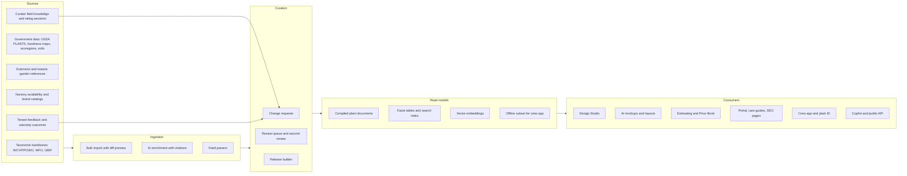

**Design decision (opinionated):** canonical storage is a typed attribute-value model (one row per trait value, each with its own provenance) because field-level provenance, conflicts and per-Region overrides are first-class requirements. Reads never touch that model directly: every release compiles a denormalized **plant document** (JSONB) per plant and per Region, plus facet columns and embeddings. Writers get rigor; readers get speed.

### 4.1 Plant records, taxonomy and names (KB-TAX)

**KB-TAX-01 Plant record grain [MVP]**
- A **Plant** is either a *taxon record* (species, subspecies, variety, forma or named hybrid, for example `Hydrangea paniculata`) or a *cultivar record* (for example `Hydrangea paniculata 'Limelight'`).
- Cultivar records have `parent_plant_id` pointing to the taxon record and **inherit every inheritable trait** they do not override. The editor shows inherited values in grey with "from species", and an override in black with its own provenance. Changing the species value propagates to children that inherit it in the next release.
- Hybrids of uncertain parentage attach to a genus-level parent record (for example `Hosta 'Sum and Substance'` under `Hosta`). Genus-level records are not placeable in designs unless flagged `placeable_generic` (for example "Hosta, assorted cultivars" in commercial bid work, shown with a warning that traits are approximate).
- **Series and seed strains** (for example a color series of *Echinacea* or a seed-grown strain) are modeled as a `plant_series` that groups cultivar records and can carry shared traits.
- Rule: a cultivar record is created only when it is a distinct buyable item or differs in at least one ornamental, size or requirement trait. Pure marketing renames become trade names on the existing record, not new records.

**KB-TAX-02 Name components [MVP]**

| Field | Example | Rules |
|---|---|---|
| `family` | Hydrangeaceae | From backbone; required |
| `genus` | *Hydrangea* | Required; capitalized |
| `hybrid_marker` | × (as in *× Heucherella* or *Calamagrostis* × *acutiflora*) | Enum: none, interspecific, intergeneric, graft-chimaera |
| `specific_epithet` | *paniculata* | Lowercase |
| `infraspecific_rank`, `infraspecific_epithet` | var. *grandiflora*; subsp. *...*; f. *...* | Rank enum: subsp., var., subvar., f. |
| `cultivar_group` | Group names where used | Optional |
| `cultivar_epithet` | 'Limelight' | Stored without quotes; rendered in single quotes; validated against ICNCP-style rules (no rank words such as "var." inside the epithet); Latin-form epithets coined after 1959 raise a warning, not an error |
| `trade_names[]` | Little Lime® on `'Jane'`; Bobo® on `'ILVOBO'`; Endless Summer® on `macrophylla 'Bailmer'`; Knock Out® on `Rosa 'Radrazz'` | Each with mark type (®, ™, none), owner, locale, active dates |
| `breeder`, `introducer`, `introduction_year` | Optional | Used in descriptions and brand partnerships |
| `display_name_botanical` | *Hydrangea paniculata* 'Limelight' | Compiled; never typed by hand |

- Display modes per tenant setting: **botanical-first** ("*Hydrangea paniculata* 'Limelight', Limelight panicle hydrangea"), **common-first** ("Limelight hydrangea (*H. paniculata* 'Limelight')") or **trade-first** ("Endless Summer® hydrangea"). Proposals default to common-first; plant schedules default to botanical-first ([10](10-design-studio.md) DS-PLNT-08).

**KB-TAX-03 Accepted names, synonyms and the trade-name policy [MVP]**
- Every taxon record resolves to an accepted name in the backbone (WCVP via POWO) and stores the POWO/IPNI identifier, plus cross-references to World Flora Online, GBIF, USDA PLANTS symbol (for example `ACRU` for *Acer rubrum*) and ITIS TSN where they exist.
- Synonyms are stored with a type: homotypic, heterotypic, misapplied, orthographic variant, or **trade synonym** (a name the nursery trade uses that is not botanically valid).
- **Policy:** Rootline displays the *accepted* name, and keeps the familiar trade name visible in parentheses until a curator-set `trade_display_until` date (default: 5 years after the change). Example: "*Salvia yangii* (syn. *Perovskia atriplicifolia*), Russian sage". Search matches every synonym forever. Where the backbone itself is unsettled (for example Alaska cedar has moved among *Chamaecyparis*, *Xanthocyparis*, *Callitropsis* and *Cupressus*), a senior curator may pin the displayed name and record the rationale.
- Backbone refresh [V1]: a monthly job diffs our taxa against the latest backbone export and opens change requests for name changes, never applying them automatically.

**KB-TAX-04 Common names in several languages [MVP English and Spanish, V1 French-Canadian]**
- Each common name has `locale` (`en-US`, `en-CA`, `es-US`, `es-MX`, `fr-CA`), optional `region_id` scope (common names vary: "ironwood" means different trees in different places), `is_preferred` per locale and Region, and a source.
- Exactly one preferred name per locale (plus optional Region overrides). If no sourced name exists for a locale, the UI shows the botanical name plus the English common name. **Common names are never machine-translated** without a source; an AI-suggested Spanish name enters the queue as a suggestion like any other value.
- Crew-facing Spanish names [V1]: curators may add "field names" used by Spanish-speaking crews in a Region (sourced to the curator and two tenant confirmations), flagged `informal`.

**KB-TAX-05 Patents, breeders' rights and trademarks [MVP fields, V1 alerts]**
- Fields: US plant patent number (`PP` plus digits), filing date, grant date, computed expected expiry (US plant patents run 20 years from filing; label "estimated, verify"), Canadian Plant Breeders' Rights certificate and term, optional EU Community Plant Variety Rights, trademark text and owner.
- Behaviors: a "Propagation restricted" badge shows for patented or PBR-protected plants to Companies that enable in-house propagation in settings [V1]; proposals render ® and ™ correctly; the trade name is never used as the cultivar epithet in schedules.
- Rootline displays this information as a reference, not legal advice.

**KB-TAX-06 Identifiers [MVP]**
- Internal UUID, a human-readable code (`RL-P-004821`), a stable URL slug (`hydrangea-paniculata-limelight`), and a default schedule key suggestion (`HYD LIM`) that the Design Studio de-duplicates per design ([10](10-design-studio.md) DS-PLNT-08).
- Codes and slugs never change; merges create redirects (KB-CUR-08).

**KB-TAX-07 Plant kinds and categories [MVP]**
- `plant_kind` enum: tree, shrub, perennial, ornamental grass, sedge or rush, groundcover, vine or climber, annual, bulb (including corms and tubers), fern, succulent or cactus, palm or cycad, turfgrass, aquatic or marginal, moss. Edible (fruit tree, berry, herb, vegetable) is a tag, not a kind.
- Subtypes are traits (for example `leaf_persistence = evergreen` plus `foliage_type = needled` for conifers), so facets compose cleanly.

**KB-TAX-08 Record lifecycle [MVP]**
- Plant and Plant Region Profile records move `draft` -> `in_review` -> `approved` -> `published` -> `deprecated`, plus `rejected` and `merged` (the states in [19](19-platform-admin-portal.md) PA-070, with `merged` added for redirects).
- Deprecated plants stay resolvable for existing designs, estimates and warranties but are hidden from search by default, with a reason code: `superseded_by_accepted_name`, `not_in_trade`, `prohibited_in_all_operating_regions`, `data_quality`.

**KB-TAX-09 Turfgrass records [MVP basic]**
- Turfgrass species and major cultivar classes (tall fescue, Kentucky bluegrass, perennial ryegrass, fine fescues, bermudagrass, zoysiagrass, St. Augustinegrass, buffalograss) with turf traits: season type (cool or warm), recommended mowing height range, shade, wear, drought and salt tolerance, and an illustrative seeding-rate field (pounds per 1,000 sq ft, sourced per Region). Lawn programs in [14](14-service-line-modules.md) reference them for overseeding and renovation estimates.

### 4.2 Traits (KB-TRT)

**KB-TRT-01 Trait dictionary [MVP]**
- Traits are defined as data in a registry (`trait_definition`), not as hard-coded columns. Each definition has: key, labels per locale, data type (`enum`, `enum_set`, `num_range`, `number`, `bool`, `month_set`, `color_set`, `text`, `rich_text`, `ref`), unit dimension (length, temperature, depth, volume), allowed values with written definitions, group, **criticality** (`critical` or `standard`), `inheritable` (species to cultivar), `regionalizable` (may be overridden in a Plant Region Profile), `facetable`, `client_visible`, completeness weight and evidence rule.
- Adding a trait is a curator-admin change plus, if facetable, a facet-column migration run by `platform_engineer`. Removing a trait archives values; it never deletes them.

**KB-TRT-02 Value semantics [MVP]**
- Each trait value carries: the value, qualifiers (for example "in cultivated landscapes" vs "in the wild"; "once established" for drought tolerance), and provenance (source, citation with locator, method, confidence, author, reviewer, timestamps).
- Several **candidate** values may exist for one trait (sources disagree); exactly one is **selected** per scope (global or Region). The quality dashboard counts unresolved conflicts.
- Lengths are stored in centimeters and temperatures in Celsius, but the **original value and unit text are preserved** ("3-4 ft") so imperial users never see round-trip drift such as "2.95-3.94 ft". Display rounding: feet to the nearest 0.5 ft under 10 ft and to the nearest 1 ft above; centimeters to the nearest 5 cm under 2 m and to the nearest 0.1 m above.
- **Critical traits** (USDA and Canadian hardiness zones, invasive and noxious status, toxicity, deer-resistance claims, mature size) need at least one Tier 1 citation (4.6) and a second curator's approval before publishing, matching [19](19-platform-admin-portal.md) PA-070.

**Form and ornamental traits**

| Trait key | Type and values | Notes | Priority |
|---|---|---|---|
| `leaf_persistence` | evergreen, semi-evergreen, deciduous, herbaceous (dies back), marcescent | Drives winter rendering and symbols | [MVP] |
| `foliage_type` | broadleaf, needled, scale-like, grass-like, succulent, fern frond | | [MVP] |
| `mature_height`, `mature_spread` | `num_range` (cm) plus typical value | Landscape context by default; "in the wild" stored as a qualifier. Drives symbol size and spacing validation | [MVP] critical |
| `years_to_maturity` | number (years) | Feeds the Design Studio growth slider | [V1] |
| `growth_rate` | slow, moderate, fast | Rootline rubric: trees slow under 30 cm per year, moderate 30-60, fast over 60; shrubs and perennials judged relative to mature size | [MVP] |
| `form` | round, oval, vase, columnar, pyramidal, weeping, spreading, mounding, upright, clumping, fountain, prostrate, climbing, irregular | Same vocabulary as procedural symbols in [10](10-design-studio.md) DS-SYMB-02 | [MVP] |
| `foliage_texture` | fine, medium, coarse | | [MVP] |
| `foliage_color_by_season` | `color_set` for spring, summer, fall, winter (named color plus hex) | Hex used by symbols and 3D archetypes | [MVP] |
| `variegation` | none, margin, center, splash, streak | | [V1] |
| `fall_color_showiness` | 0-3 | 3 = signature fall plant (for example *Nyssa sylvatica*) | [MVP] |
| `bloom_months` | `month_set` with reference Region | Region profiles may shift it (KB-PRP-04) | [MVP] |
| `bloom_colors` | `color_set` | | [MVP] |
| `bloom_showiness` | 0-3 | | [V1] |
| `blooms_on` | old wood, new wood, both, not applicable | Pruning-critical: *Hydrangea macrophylla* (old wood, except reblooming lines) vs *H. paniculata* (new wood) | [MVP] |
| `fruit` | type, months, colors, showiness 0-3, litter 0-3, edible (with caveats) | Litter matters near patios and pools | [V1] |
| `pollinizer_required` | bool plus compatible pollinizers | Dioecious plants, for example winterberry holly (*Ilex verticillata*) needs a compatible male nearby to fruit | [V1] |
| `fragrance` | flowers or foliage, intensity 0-3 | | [V1] |
| `winter_interest` | bark, form, fruit, evergreen foliage (set) | | [V1] |
| `thorns_spines` | none, minor, significant | Play areas, walkways | [MVP] |
| `spread_habit` | clumping, slow-spreading, aggressive (rhizomes, stolons, self-seeding) | Running bamboo, some mints and grasses | [V1] |
| `lifespan` | short-lived (under 3 years), moderate, long-lived | Short-lived perennials hurt warranty margins | [V1] |

**Requirements**

| Trait key | Type and values | Notes | Priority |
|---|---|---|---|
| `usda_zone_min`, `usda_zone_max` | half-zone ordinal (1a=1 through 13b=26) | USDA map is based on average annual extreme minimum temperature in 10°F zones and 5°F half zones (2023 edition uses 1991-2020 data; verify) | [MVP] critical |
| `canada_zone_min`, `canada_zone_max` | Canadian zone ordinal from 0a up to the warmest subzone on the NRCan map edition in use (ordinal range read from the loaded edition, never hard-coded; verify) | Canada's Natural Resources Canada zones use several climate variables, not only extreme minimum temperature, so they are **not** interchangeable with USDA zones (verify current methodology). Stored separately; never converted | [MVP] critical |
| `ahs_heat_zone_min`, `ahs_heat_zone_max` | 1-12 | American Horticultural Society heat zones are based on average days per year above 86°F (30°C); map and data licensing to verify | [V1] |
| `chill_hours` | number range | Fruit trees and some bulbs | [V2] |
| `sun` | set of: full sun (6+ hours direct), part sun (4-6 hours), part shade (2-4 hours or dappled), full shade (under 2 hours) | Maps to the Design Studio sun classes ([10](10-design-studio.md) DS-SUN-02). Region profiles can add "needs afternoon shade here" | [MVP] |
| `water_need` | very low, low, moderate, high | Generic, all Regions | [MVP] |
| `wucols` | per California WUCOLS region 1-6: VL, L, M, H, not appropriate, unknown | WUCOLS classes are percentages of reference evapotranspiration (VL under 10%, L 10-30%, M 40-60%, H 70-90%; verify). Used for California water-budget compliance (plant factor) and hydrozoning ([14](14-service-line-modules.md)) | [MVP] schema, data per license |
| `plant_factor` | 0.0-1.0 | Derived from WUCOLS where available, otherwise curator-set by Region for water budgets | [V1] |
| `soil_texture` | set of: sand, loam, silt, clay, rocky or gravelly, organic | "Tolerates clay" is the most-used filter in glaciated Midwest soils | [MVP] |
| `soil_ph_min`, `soil_ph_max` | number range | Plus `acid_loving` derived flag (max pH under 6.5) | [MVP] |
| `drainage` | set of: requires sharp drainage, well-drained, moist, tolerates periodic flooding, tolerates standing water | Rain-garden zoning uses this | [MVP] |
| `drought_tolerance` | none, low, moderate, high (once established) | | [MVP] |
| `wet_tolerance` | none, low, moderate, high | | [MVP] |
| `salt_tolerance_soil`, `salt_tolerance_spray` | none, low, moderate, high | Road-salt zones: hell strips, parking islands, driveway edges in snow Regions. A Great Lakes seed priority (KB-SEED-03) | [MVP] |
| `snow_ice_breakage` | low, moderate, high susceptibility | Brittle wood, narrow crotch angles and multi-leader evergreens that split or splay under wet snow and ice (for example Callery pear, silver maple, multi-stem arborvitae). Used in lake-effect snow-belt Regions and wherever plowed snow is piled. Regionalizable | [MVP] |
| `urban_tolerance` | set of: compaction, pollution, reflected heat, restricted root zone | Street trees, parking lots | [V1] |
| `wind_tolerance` | low, moderate, high | Coastal, Great Lakes shoreline and other exposed sites | [V1] |
| `juglone_tolerance` | sensitive, tolerant, unknown | Sites under black walnut | [V1] |
| `erosion_control` | bool plus slope rating | | [V1] |

**Characteristics**

| Trait key | Type and values | Notes | Priority |
|---|---|---|---|
| `deer_resistance` | A rarely damaged, B seldom severely damaged, C occasionally severely damaged, D frequently severely damaged | The A-D scale popularized by Rutgers NJAES lists; also used by [10](10-design-studio.md) VAL-DEER-01. Regionalizable because deer browse varies with pressure and season | [MVP] critical |
| `rabbit_resistance` | high, moderate, low | | [MVP] |
| `pollinator_value` | 0-3 per guild: native bees, honey bees, butterflies, moths, hummingbirds | | [MVP] |
| `larval_host` | bool plus notable species (for example monarch on *Asclepias*) | | [V1] |
| `keystone_plant` | bool per ecoregion | From keystone-plant lists by ecoregion (National Wildlife Federation and Tallamy research; licensing to verify) | [V1] |
| `wildlife_value` | set of: bird food (fruit or seed), nesting cover, winter cover | | [V1] |
| `native_status` | computed per jurisdiction and ecoregion: native, introduced, native cultivar ("nativar"), unknown | See KB-RGN-07. Never a single global boolean | [MVP] |
| `regulatory_status` | computed per jurisdiction from listings: prohibited, restricted, regulated, watch list, advisory (invasive council), none | See KB-RGN-08. Cultivar exemptions supported | [MVP] critical |
| `toxicity` | per receptor (dogs, cats, horses, livestock, humans): none known, mild, moderate, severe; toxic parts; principle | Sources such as the ASPCA toxic and non-toxic plant lists and extension toxicity data (verify terms). Disclaimer and poison-control contacts shown | [MVP] critical |
| `skin_irritant` | none, mild, severe | Sap of some *Euphorbia*; *Toxicodendron* | [V1] |
| `pollen_allergenicity` | low, moderate, high | Proprietary scales (for example OPALS) only under license | [V1] |
| `fire_behavior` | regional rating per sourced list: fire-resistant, moderate, high flammability; attributes (volatile oils, retains dead material, fine fuels) | No plant is fireproof; ratings must cite a regional source (for example Oregon State University Extension's fire-resistant plant guide or UC ANR materials; verify). Feeds the defensible-space rule packs in KB-RGN-11 | [V1] |
| `maintenance_level` | low, moderate, high | Rubric: low = 0-2 interventions per year; moderate = 3-5; high = 6 or more or specialist work | [MVP] |
| `care_tasks` | list of task templates (KB-TRT-04) | | [MVP] basic, [V1] regional |
| `pest_disease_links` | list of `pest_disease` with susceptibility: resistant, tolerant, susceptible, highly susceptible | Boxwood blight, emerald ash borer, rose rosette, Japanese beetle, oak wilt | [V1] |
| `infrastructure_risk` | root aggressiveness near pipes and pavement, recommended setback from foundations and hardscape | Willows and silver maple near sewer laterals | [V1] |
| `rain_garden_zone` | set of: bottom (wet), slope, rim (dry) | Palette resolution for rain gardens | [V1] |
| `edible` | bool plus parts and caveats | Edible landscapes | [V1] |
| `green_roof_suitability` | bool plus minimum media depth | | [V2] |

**Commercial traits**

| Trait key | Type and values | Notes | Priority |
|---|---|---|---|
| `size_specs` | list of standard sizes the plant is commonly sold in | Container classes (#1, #2, #3, #5, #7, #10, #15, #25 and larger), quarts, 4.5 in pots, plugs (for example 72-cell), flats, bare root, B&B by caliper (1.5-4 in) for shade trees, by height (4-5 ft, 5-6 ft) for evergreens and multi-stems. Conventions follow ANSI Z60.1 (US) and the Canadian Standards for Nursery Stock (verify current editions), matching [13](13-operations-inventory-equipment.md) | [MVP] |
| `cost_band` | per size, per macro-region: low, median, high wholesale cost with as-of date and sample size | Computed from opted-in nursery list prices (4.11). Always labeled "estimate" | [V1] |
| `availability_index` | 0-100 per Region | Share of reporting vendors in the Region listing it in the last 30 days (4.11) | [V1] |
| `seasonality` | bare-root window, B&B dig seasons | | [V1] |
| `brand_program` | brand name (for example a branded shrub program) | Brand content only under partnership license (4.6) | [V1] |
| `gtin` | list of GTIN/UPC codes from brand tags | Tag scanning in the crew app | [V2] |

**KB-TRT-03 Derived traits [MVP]**
- Computed at release time, never edited: `deer_resistant` (A or B), `pet_safe` (dogs and cats: none known), `drought_tolerant` (moderate or high), `four_season_interest` (bloom, fall color and winter interest present), `size_class` (XS under 1 ft, S 1-3 ft, M 3-6 ft, L 6-15 ft, XL 15-30 ft, XXL over 30 ft by mature height).
- Derived traits are facetable and appear in natural-language search parses.

**KB-TRT-04 Care and installation specifications [MVP basic, V1 regional]**
- **Task templates:** prune, shear, cut back, deadhead, divide, fertilize, mulch refresh, winter protection, dormant oil, rake fruit, monitor for pest X. Timing is expressed **phenologically** ("late winter before bud break", "immediately after bloom") and mapped to reference months per Region (for example "late winter" = mid-February to mid-March in Central Ohio; illustrative). Example: "Prune Limelight hydrangea in late winter; it blooms on new wood."
- **Install specs:** default on-center spacing (feeds Design Studio fill-bed DS-PLNT-04), planting depth notes (root flare at grade for trees), staking guidance, establishment watering template (for example "2-3 times per week for the first 4 weeks, then weekly through the first season", illustrative and regionalizable).
- Consumers: client care guides ([06](06-customer-portal.md) 4.12.1), maintenance task generation and PHC programs ([14](14-service-line-modules.md)), crew install sheets ([05](05-field-crew-mobile-app.md)), holding-yard watering ([13](13-operations-inventory-equipment.md) 4.7).

**KB-TRT-05 Pests and diseases sub-KB [V1]**
- `pest_disease` entity: name (common and scientific), type (insect, mite, fungal, bacterial, viral, nematode, abiotic disorder), host plants with susceptibility, signs and symptoms, seasonal activity windows by Region, regional pressure (none, low, moderate, high) and quarantine status (for example emerald ash borer quarantines historically; verify current federal status).
- Used by plant ID ("likely boxwood blight"), PHC program design and tree inventory ([14](14-service-line-modules.md)), and substitutions ("blight-resistant boxwood alternative").
- The KB names pests and susceptibility; it never prescribes pesticide products or rates.

### 4.3 Region model and geospatial lookup (KB-RGN)

A Region answers "where is this property, horticulturally?" Rootline combines public climate, ecological and administrative layers with **operator-drawn curated Regions** that reflect how plants actually perform.

**KB-RGN-01 Region layers [MVP unless noted]**

| Layer | Coverage | Source (license class, verify) | Used for | Priority |
|---|---|---|---|---|
| USDA Plant Hardiness Zones (2023 edition) | US incl. Alaska, Hawaii, Puerto Rico | USDA ARS with Oregon State PRISM; US government work, generally public domain | Hardiness validation, facets | [MVP] |
| Canadian Plant Hardiness Zones and extreme-minimum-temperature zones | Canada | Natural Resources Canada; Open Government Licence - Canada | Hardiness validation in Canada | [MVP] |
| AHS Plant Heat Zones | US | American Horticultural Society; license required | Heat validation | [V1] |
| EPA ecoregions Level III and IV | Conterminous US (about 105 Level III and nearly 1,000 Level IV units) | US EPA; public domain | Native status, palettes, Region recipes | [MVP] |
| CEC North American ecoregions Level I-III | US, Canada, Mexico | Commission for Environmental Cooperation | Cross-border consistency, Canadian Regions | [MVP] |
| Ecological Framework of Canada (ecozones to ecodistricts) | Canada | Government of Canada | Finer Canadian Regions | [V1] |
| States, counties, metros (CBSAs) | US | US Census TIGER/Line; public domain | Jurisdictions, legal status, benchmarking | [MVP] |
| Provinces, census divisions, CMAs | Canada | Statistics Canada Open Licence | Jurisdictions, legal status | [MVP] |
| WUCOLS regions 1-6 | California | Curator-drawn approximation of the published WUCOLS region descriptions | WUCOLS lookup | [MVP] for California tenants |
| Frost dates and climate normals | US, Canada | NOAA 1991-2020 normals; Environment and Climate Change Canada normals | Care calendars, bloom shifts, season defaults | [V1] |
| Soils | US (SSURGO), Canada (Soil Landscapes of Canada, coarser) | USDA NRCS; Agriculture and Agri-Food Canada | Property soil texture, drainage and pH hints (not Regions) | [V1] |
| Wildfire risk | US | USDA Forest Service Wildfire Risk to Communities | Fire-wise defaults | [V2] |
| Elevation | US | USGS 3DEP (already used by [10](10-design-studio.md)) | Elevation bands in mountain Regions | [V1] |
| Custom polygons | Anywhere | Drawn by curators | Curated Region edges | [MVP] |

**KB-RGN-02 Region kinds and hierarchy [MVP]**
- Region `kind`: `admin` (country, state or province, county, metro), `climate` (USDA zone, Canadian zone, heat zone, WUCOLS region), `eco` (EPA Level III and IV, CEC, Canadian ecozones) and `curated`.
- **Curated hierarchy:** country -> macro-region (for example "Great Lakes and Ohio Valley") -> Region (for example "Central Ohio") -> optional microregion (for example "Lake Erie Shore", the lake-effect snow belt inside Northeast Ohio). The macro-regions are the same ones [18](18-reporting-analytics.md) uses for benchmarking.
- Each curated Region has: name, slug, description, `geom` (MultiPolygon, SRID 4326), definition recipe (KB-RGN-03), parent, coverage tier (KB-RGN-09), lead curator, launch status, climate summary (computed zone mix, heat zone mix, precipitation, frost-free days), reference bloom calendar offset, and priority (tie-breaker).
- Topology rules: curated Regions at the same level may not overlap (checked on publish); a microregion must lie inside its parent within a 50 m tolerance. Until national coverage exists, points outside any curated Region fall back to the macro-region if one contains them, else to `uncurated` with Basic coverage.

**KB-RGN-03 Region definition recipes [MVP]**
- A curated Region is defined as an expression over layers plus manual edits, for example: `(epa_l3 = 55 OR epa_l4 IN [selected units]) AND state = OH AND usda_zone BETWEEN 5b AND 6b`, plus or minus drawn polygons. The recipe is stored, so a Region can be rebuilt when a layer is updated (for example a new hardiness map).
- Geometry is simplified for display (tolerance about 20 m) but lookups use the full-resolution geometry.
- The Region builder map, preview statistics (area, tenants, Properties, plants with profiles, overlaps) and versioned republishing are console features specified in [19](19-platform-admin-portal.md) PA-071.

**KB-RGN-04 Site Context lookup: address to Region [MVP]**
- Input: a geocoded Property point from CRM ([03](03-crm-sales-estimating-proposals.md)), optionally the parcel polygon and building footprint ([10](10-design-studio.md)).
- Algorithm: point-in-polygon against every layer (PostGIS GiST indexes). The primary point is the building-footprint centroid if known, else the parcel centroid, else the geocode. For parcels over 5 acres or multi-building campuses, the service also computes area shares per layer value and sets `spans_multiple = true` when a second value covers more than 15% of the parcel (configurable), so a large HOA common area that straddles 6a and 6b is visible to the designer.
- Leaf curated Region = smallest-area curated Region containing the point; ties are broken by `priority`.
- Results are stored as `property_site_context` (tenant-scoped) with the KB region release id; recomputed on Region republish, map edition change or address change; emits `kb.property_region_changed`.
- Performance target: p95 under 50 ms for a single lookup; batch recompute of 100,000 Properties under 10 minutes.
- Overrides: a Property-level microclimate override (frost pocket, urban heat island, coastal exposure, high elevation) and bed-level overrides in the Design Studio (for example a protected south wall treated half a zone warmer, [10](10-design-studio.md) VAL-ZONE-01). Overrides require a reason and appear in validation messages.
- Edge cases: geocode failure asks the user to drop a pin; points in water (lakefront geocodes) snap to the nearest land polygon within 200 m; points on a boundary use the containing polygon or, if none, the nearest within 100 m and set `boundary_snapped`; PO-box or centroid-of-ZIP geocodes are rejected for Site Context ("needs a street address or a pin").

Example Site Context (illustrative values for a Cedar & Stone client in Upper Arlington, Ohio; verify real values):

```json
{
  "property_id": "prop_7f3c",
  "kb_region_release": "2027.04.12-1",
  "point": { "lat": 40.0256, "lng": -83.0627, "source": "building_centroid" },
  "usda_zone": { "zone": "6b", "edition": "usda_2023", "extreme_min_f": -2.4 },
  "heat_zone": { "zone": 5, "licensed": true },
  "ecoregion": { "epa_l3": "55 Eastern Corn Belt Plains", "epa_l4": "55b" },
  "admin": { "country": "US", "state": "OH", "county": "Franklin", "metro": "Columbus, OH" },
  "curated_region": { "id": "rgn_central_ohio", "name": "Central Ohio", "macro": "Great Lakes and Ohio Valley", "coverage_tier": "excellent" },
  "frost": { "last_spring_median": "04-20", "first_fall_median": "10-21" },
  "soil_hint": { "texture": "silty clay loam", "drainage_class": "somewhat poorly drained", "source": "ssurgo" },
  "flags": { "spans_multiple": false, "boundary_snapped": false },
  "overrides": []
}
```

**KB-RGN-05 Hardiness map editions and transitions [MVP]**
- Every zone value records its map edition (`usda_2012`, `usda_2023`, NRCan edition). The 2023 USDA map moved many locations about half a zone warmer than 2012 (verify the share).
- Adopting a new edition: recompute all Site Contexts, publish a diff report ("1,240 Properties moved from 6a to 6b"), notify affected tenants, re-run validations on **draft** designs only. Sold designs and their warranties are never rewritten.
- Plant zone ranges are not automatically shifted by a map change; curators review plants whose ratings were borderline at the old zone.

**KB-RGN-06 Region climate summaries [V1]**
- Computed per curated Region: frost-free days, median and 90%-probability last spring and first fall frost dates, annual precipitation, July mean maximum, dominant soil textures (aggregated SSURGO), elevation band.
- Used for care-calendar month mapping (KB-TRT-04), default bloom shift (KB-PRP-04), season defaults in scheduling ([04](04-scheduling-dispatch-routing.md)) and Region descriptions.

**KB-RGN-07 Native range model [MVP]**
- Native status is **computed** from `plant_native_range` rows: plant, geography unit (state or province, county where licensed data exists, ecoregion), status (native, introduced, both, absent, unknown) and source.
- Sources: USDA PLANTS state-level native status for the US and Canada (public domain), VASCAN for Canadian provinces (license to verify), curator ecoregion assignments; county-level distribution datasets such as BONAP only under license.
- Display levels, most specific first: "Native to this ecoregion (Eastern Corn Belt Plains)", "Native to Ohio", "Native to North America", "Not native". Cultivars of native species are labeled **nativar** with a short explanation. Tenant setting: whether nativars count toward native-share scorecards (default: counted separately).
- A hybrid with any non-native parent is "not native".

**KB-RGN-08 Regulatory listings: invasive and noxious status [MVP]**
- `jurisdiction` (country, state or province, county or municipality) and `regulatory_listing` rows: taxon scope (applies to all infraspecific taxa and cultivars unless exempted), list name, legal category, effective date, phase-out schedule (for example "sale prohibited after date X"), exemptions (cultivar list or criteria such as "seed-sterile cultivars approved by the state"), citation (statute, regulation or official list), `last_verified_at`.
- Legal effect mapping:

| Listing category | Examples (verify each) | Rootline behavior |
|---|---|---|
| `prohibited` (sale or planting banned) | Ohio's prohibited invasive plant rule added Callery pear (*Pyrus calleryana*, including 'Bradford') with sales banned from 2023; Massachusetts Prohibited Plant List includes Japanese barberry and burning bush | Hidden from picker for Properties in the jurisdiction; validation **error**; cannot be added to proposals or Company palettes for that jurisdiction; only `platform_owner` can grant an exception (for example removal projects) |
| `restricted` or `regulated` | Some states regulate species with permit or cultivar exemptions (for example Oregon's noxious weed rules have allowed approved seed-sterile *Buddleja* cultivars) | Validation error with required override reason, unless the cultivar is exempt |
| `watch` or `advisory` (non-legal invasive council lists) | State invasive plant council lists | Warning with explanation and alternatives |
| `none` | | No message |

- **Jurisdiction levels loaded at MVP:** federal (USDA APHIS Federal Noxious Weed List under 7 CFR 360, rarely a landscape ornamental but checked; CFIA-regulated plants in Canada), every US state and Canadian province, and municipalities only where a Region at Excellent has a municipal ban or street-tree list: at MVP, inside the beachhead states Ohio, Michigan, Indiana, Illinois and Wisconsin, with Ontario added at V1.2 with the Canada launch (KB-SEED-01). USDA PLANTS' compiled state noxious status is a cross-check, never the authority, because it can lag state rule changes ([R3 section 4.6](research/R3-design-ai-plant-data.md); verify).
- **Three statuses, never merged:** *legally prohibited* (hard stop), *legally restricted* (acknowledged override) and *ecologically invasive but legal* (warning with alternatives). Region-level invasiveness judgments, modeled on assessments such as UF/IFAS's per-zone conclusions for Florida (verify), live in the Plant Region Profile as reason code `invasive_tendency`, not in `regulatory_listing`.
- **Alternatives:** each prohibited or advisory listing can carry curated "plant this instead" links, following the "Grow Me Instead" guides published by invasive-plant councils in Ontario and British Columbia (verify). The substitution engine (KB-SRCH-07) ranks those first.
- Matching: a species listing applies to every cultivar and infraspecific taxon unless an exemption names it; a genus-level listing applies to all species (rare).
- Monitoring [V1]: each list has a watcher (weekly content-hash check of the official page or document where stable, plus a quarterly human re-verification task). A detected change opens a high-priority change request.
- **Hotfix releases:** regulatory changes ship outside the daily cadence if needed.
- **Tenant alerts:** when a listing changes, Companies with drafts, open proposals, Company palettes, Price Book items or recurring maintenance programs that include the plant in that jurisdiction receive an alert with suggested substitutes (KB-SRCH-07).

**KB-RGN-09 Coverage tiers [MVP]**

| Tier | Criteria | What tenants see | What AI may do |
|---|---|---|---|
| **Excellent** | 600 or more plants with published Region profiles; palettes for at least 7 core uses; named lead curator; profiles reviewed within 24 months; 95% or more palette plants with licensed photos | Green badge "Curated for Central Ohio by our horticulture team" | Auto-layout and mockups use plants rated 3 or above only |
| **Good** | Validated taxonomy and traits; profiles (own or inherited from macro-region) for 200 or more common plants; palettes for at least 3 uses | Blue badge "Regionally reviewed" | Same rule; falls back to macro-region palettes |
| **Basic** | Zone, sun, water and legal validations only; no ratings | Grey badge "Not yet curated for your area: zone-checked only" | AI layouts allowed only with tenant opt-in, using zone-fit plants with an "unrated" disclosure on every output |

The badge implements the "visible coverage badge, so we never over-promise" commitment in [22](22-business-model-pricing-gtm.md).

**KB-RGN-10 Effective-date-aware legal checks [MVP]**

Legal status is not a property of "today". A Proposal signed in November for an April install, or a three-year phased master plan, must be checked against the law **on the date the plant goes in the ground**.

- **Listing lifecycle:** `regulatory_listing.status` moves `proposed` (rule published for comment; informational only) -> `enacted` (adopted, effective in the future) -> `in_effect` -> optionally `phase_out` (for example sale banned but existing nursery stock may be sold until a date) -> `amended` or `repealed`. Each transition is a change request with a citation to the official text and a second curator's approval.
- **Dates stored separately:** `enacted_on`, `sale_prohibited_from`, `planting_prohibited_from` (if the rule covers planting), `exemption_until` (for existing stock). Rare possession or removal mandates are recorded in the listing's citation notes and handled by curator review, not automated rules. A rule that bans *sale* but not *planting* still blocks a Company from **selling** the plant in a Proposal, because a landscape contractor that supplies and installs the plant is selling it (curator policy; counsel to confirm per jurisdiction).
- **Check date resolution** (the date passed to `validatePlacement`): the earliest scheduled install Visit for the plant's phase if one exists ([04](04-scheduling-dispatch-routing.md)); else the Proposal's expected start date; else the Design phase's target season start (for example "Spring 2027" = April 1 in Central Ohio from the Region climate summary); else today.
- **Severity by distance to the effective date:**

| Situation | Severity | Message example (dates hypothetical unless cited) |
|---|---|---|
| Check date on or after `sale_prohibited_from` | **Error** (same as `prohibited`) | "Callery pear cannot be sold or installed in Ohio (sale ban in effect since 2023; verify date)." |
| Listing `enacted`, effective date within 18 months of today, check date before it | **Warning**, acknowledgment required | "Japanese barberry: sale ban takes effect Oct 1, 2027 in this state. Install is scheduled Sep 12, 2027. If the install slips, the plant cannot be supplied." |
| Listing `proposed` | Info | "A proposed rule would restrict this plant; comment period ends Mar 3." |
| Phased design with a later phase after the effective date | Error on the later phase only | Phase 3 (2028) shows the error; phases 1-2 do not |

- **Schedule slip guard:** when a Visit containing install work is rescheduled across an effective date, the scheduling module receives a validation error from the KB and the dispatcher must swap the plant (substitutes offered) before saving ([04](04-scheduling-dispatch-routing.md)).
- **Already-installed plants are never "made illegal" by Rootline.** Plant-registry entries for existing installs show an informational badge ("Now listed in Ohio") and can feed a removal opportunity (section 13), but the KB never asserts a removal obligation unless the listing text explicitly requires it and a curator has cited it.

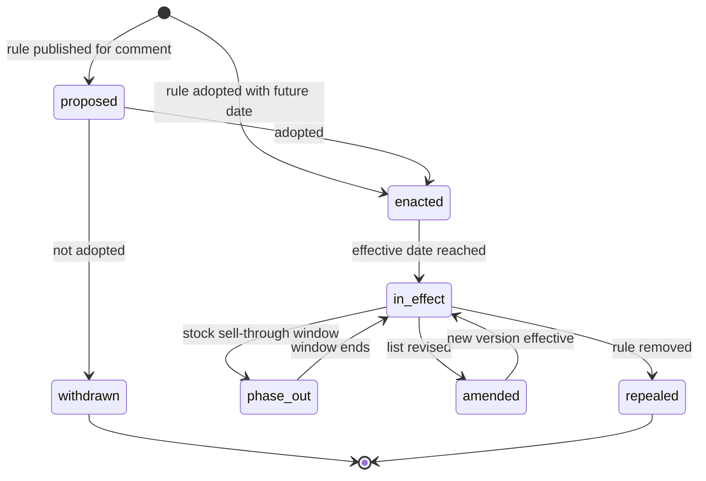

**KB-RGN-11 Jurisdiction rule packs [V1 water and HOA, V2 fire]**

Some jurisdictions regulate *how* plants are combined and where they go, not just *which* plants are allowed. The KB stores these as versioned, cited **rule packs** attached to jurisdictions; the Design Studio validator ([10](10-design-studio.md)), the AI layout solver and the design assistant ([11](11-ai-design-mockups.md) AIM-GEN-C2, which adds site-geometry packs such as hydrant and sight-triangle clearances) evaluate them through one rule interface, and the KB supplies the plant attributes they need. Packs ship through the KB release pipeline and emit `kb.rule_pack_published`.

| Rule pack | What the KB contributes | Evaluated by | Priority |
|---|---|---|---|
| California MWELO-style water budgets | WUCOLS class per California WUCOLS region and a `plant_factor` per plant (WUCOLS Very Low under 10% of reference ET, Low 10-30%, Moderate 40-60%, High 70-90%; verify) | Design Studio hydrozones and the water-budget worksheet ([10](10-design-studio.md) Beyond the brief 4; formula and adjustment factors per jurisdiction, verify) and irrigation water budgets ([14](14-service-line-modules.md) 4.2.7) | [V1] |
| Nonfunctional turf restrictions (for example Nevada AB 356, California AB 1572, Colorado SB24-005; verify scopes and dates) | Turfgrass records flagged by function, low-water bed palettes for lawn-to-bed conversion, rebate-eligible plant lists where a utility publishes them | Design validation on commercial, HOA and new-development Properties; rebate packets ([23](23-innovation-moonshots.md) M-10) | [V1] |
| Defensible space and ember-resistant "Zone 0" (California PRC 4291 and the AB 3074 rulemaking; verify final rule text) | `fire_behavior` by Region; attributes such as `retains_dead_material` and mature size; a "no woody plants within N ft of structure" style placement rule once the final regulation is known | Design Studio placement validation by distance band from the building footprint ([23](23-innovation-moonshots.md) M-27) | [V2] |
| Street-tree and parking-lot planting lists (municipal) | Approved species lists resolved to KB Plants; minimum caliper and spacing | Commercial bid validation | [V2] (sold as ordinance packs, section 13) |
| HOA approved and prohibited lists | Client palettes (KB-PAL-07) | Design validation for the Client's Properties | [V1] |

- **Precedence:** law beats HOA rules beats Company preferences. If an HOA list *requires* a plant that is now prohibited, the legal error wins and the designer sees "HOA list conflicts with state law". Some states limit how far HOAs can prohibit water-wise or drought-tolerant landscaping (for example Texas Property Code section 202.007 and Colorado legislation on water-wise landscaping in common-interest communities; verify both). Where a curator has cited such a statute for the jurisdiction, a client palette that bans water-wise plants shows the info note "This HOA restriction may be limited by state law. This is not legal advice."
- Every rule pack carries citation, effective dates, `last_verified_at` and a watcher, exactly like regulatory listings (KB-RGN-08).

### 4.4 Plant Region Profiles (KB-PRP)

A Plant Region Profile records how well a plant actually does in a Region. It is where the operator's horticultural judgment lives.

**KB-PRP-01 Rating scale [MVP]**

| Rating | Label | Meaning | Evidence rule | Downstream effect |
|---|---|---|---|---|
| 5 | Top performer | Does great here; specify freely | 2 or more evidence items, at least 1 local (regional trial, curator observation, regional extension list) | Boosted in ranking; preferred by AI |
| 4 | Reliable | Does well with normal care | 1 or more evidence items | Normal |
| 3 | Acceptable with conditions | Works if the listed conditions are met | Conditions required | AI allowed (conditions are checked against bed context) |
| 2 | Marginal | Often struggles; specify with care and client disclosure | Reason code required | Design warning ([10](10-design-studio.md) VAL-RGN-01); excluded from AI |
| 1 | Not recommended | Poor results here | Reason code required | Design warning; hidden from default search |
| flag `do_not_use` | Fails or must not be planted | Illegal, consistently fails, or ecological harm | Senior curator approval | Design **error**; hidden; blocked for AI |
| `not_rated` / `insufficient_evidence` | Unknown | No profile or too little evidence | | Shown with "not yet rated here"; zone-fit only |

Reason codes: `cold_damage`, `heat_stress`, `humidity_disease`, `soil_ph`, `poor_drainage`, `drought`, `deer_browse`, `pest_pressure`, `short_lived`, `invasive_tendency`, `legal`.

**KB-PRP-02 Profile fields [MVP]**
- Rating, `do_not_use` flag, reason codes.
- **Conditions** (structured, machine-checkable where possible): `needs_afternoon_shade`, `needs_amended_soil`, `needs_protected_site`, `needs_supplemental_water`, `avoid_wet_sites`, `avoid_road_salt`, `deer_protection_needed`, plus free text.
- **Notes:** client-safe note (shown on plant cards and proposals, for example "Reliable bloomer in Central Ohio; tolerates our clay if not waterlogged") and internal curator note.
- **Local cultivar picks:** recommended cultivars with reasons ("Prefer 'Shamrock' inkberry for a compact, fuller base") and cultivars to avoid ("Avoid species *Buxus sempervirens* in shaded, humid sites: boxwood blight pressure").
- **Trait overrides** for regionalizable traits: mature size ("15-20 ft here vs 30 ft nationally"), bloom months, deer rating, water need, fire behavior.
- Regional pest and disease pressure (links to KB-TRT-05).
- Native status (computed with optional curator note) and legal status (computed, read-only).
- Availability index (computed, 4.11).
- Evidence list, confidence (high, medium, low), curator, reviewer, `last_reviewed_at`, `next_review_due`, status.

**KB-PRP-03 Inheritance and effective profiles [MVP]**
- Profiles may be authored at macro-region, Region or microregion level and at species or cultivar level. The **effective profile** for (plant, Region) is computed field by field: most specific geography first, then cultivar before species.
- **Legal status always wins:** a plant prohibited in Ohio is `do_not_use` in Central Ohio even if the macro-region profile rates it 4.
- The UI shows where each value came from ("inherited from Great Lakes and Ohio Valley, reviewed by M. Ortiz, Mar 2027").

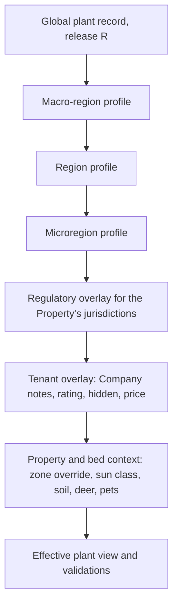

**KB-PRP-04 Bloom timing shift [V1]**
- Bloom months can be shifted per Region by a number of weeks relative to the reference Region, or set explicitly.
- Default shift is computed from the difference in median last-frost dates between Regions (a heuristic labeled "estimated") and corrected by curators and, later, by dated crew and client photos (section 13).

**KB-PRP-05 Evidence model [MVP]**
- Evidence item types: `regional_trial` (for example published trial-garden evaluations such as Mt. Cuba Center or Chicago Botanic Garden plant evaluations; verify availability per plant), `extension_list`, `curator_observation` (date, place, photos), `rating_session`, `warranty_aggregate` (k of 10 or more Companies), `literature`, `nursery_grower_report`, `regional_program` (below).
- `regional_program`: inclusion in a regional selection or award program such as Plant Select (Rocky Mountains and High Plains), Great Plant Picks (Pacific Northwest), PHS Gold Medal (Mid-Atlantic), Texas Superstar or Earth-Kind (Texas), Florida-Friendly Landscaping (Florida) or Missouri Botanical Garden Plants of Merit (Lower Midwest) ([R3 section 4.4.9](research/R3-design-ai-plant-data.md); verify each program's current list and terms). Rules: inclusion counts as one *local* evidence item only for curated Regions inside the program's stated geography; it supports a rating of 4 on its own and a 5 only with a second local item; the program's name is recorded as a fact with citation, and logos or "Recommended by" co-branding require a partnership (KB-SRC-04).
- Each item: citation, date, weight, and whether it supports or contradicts the rating. The profile editor shows evidence for and against.
- **Default weights (tunable by `platform_owner`):** `regional_trial` 1.0, `rating_session` 1.0, `warranty_aggregate` 1.0 (k of 10 or more Companies and 50 or more installs), `regional_program` 0.8, `curator_observation` 0.7, `extension_list` 0.7, `nursery_grower_report` 0.4, `literature` 0.5. Evidence older than 10 years is weighted at half. The editor shows the weighted support and contradiction totals; a rating whose contradiction total exceeds its support total cannot be published without a senior curator's written rationale.

**KB-PRP-06 Review cadence and staleness [MVP]**
- `next_review_due` = last review + 24 months (the staleness rule in [19](19-platform-admin-portal.md) PA-074).
- Early re-review triggers: warranty replacement rate for the plant in the Region more than 2 standard deviations above the plant-group mean (k of 10 or more Companies); 3 or more tenant failure reports in 90 days; a new pest or quarantine affecting the plant; a regulatory change; a source update on a critical trait.

**KB-PRP-07 Company experience ratings [V1]**
- Each Company can privately rate plants ("our experience: 2/5, losses in wet clay") and set a Company warranty policy per plant (for example "no warranty on *Buxus* in shade").
- Aggregates across Companies (k of 10 or more) appear as a signal in the curator's profile editor, never as an automatic rating change.

### 4.5 Curation workflow at scale (KB-CUR)

Thousands of plants times dozens of Regions times 80-plus traits is millions of facts. The curation system turns that into a queue that a small team can clear.

**KB-CUR-01 Change requests are the unit of work [MVP]**
- Every modification (curator edit, import row, AI suggestion, tenant suggestion, feed-derived update, merge, bulk edit) is a `change_request` with one or more field-level `change_item`s: target record, field, old value, new value, provenance.
- States: `draft` -> `in_review` -> `approved` -> `published` (in a release), or `rejected` or `withdrawn`. Critical items require a second reviewer who is not the author (state diagram in 5.3).
- Change requests are batched by origin (an import, an enrichment run, a rating session) so reviewers can work through them in context.

**KB-CUR-02 Bulk CSV and Google Sheets import with validation and diff preview [MVP]**
- **Import profiles:** saved column mappings per source format (for example "Extension landscape plant list", "Curator rating sheet", "Brand catalog export"). Headers are auto-mapped by name and by an AI mapping suggestion that the curator confirms.
- **Normalization:** units ("3-4'" becomes 91-122 cm with original text kept), enum synonyms ("Full Sun", "FS", "sun" become `full sun`), zone strings ("5-9" becomes 5a-9b; "Zone 4 to 8" likewise), month ranges ("Jun-Aug").
- **Name resolution** per row: `matched`, `new_cultivar_of_existing_taxon`, `new_taxon`, `ambiguous` (several candidates shown), `unresolved`. Resolution uses exact, synonym, fuzzy (trigram) and AI-assisted matching against the backbone.
- **Validation:** types and enums; ranges (height min not greater than max, zone min not greater than max, pH between 3.5 and 9.0); sanity checks (a shrub over 15 m, a perennial with zone min warmer than zone max); license present for every source.
- **Diff preview:** per row and per field, classify as new, changed, unchanged, conflicts with selected value, or **would overwrite a curator-verified value** (never applied automatically). Summary counts at the top; downloadable dry-run CSV with row-level errors.
- **Apply policy** per column: fill empty values only; propose as candidates; overwrite unverified values. The result is a batch of change requests, each value tagged with `source_id` and `license_id` (PA-072).
- Limits: 50,000 rows per import; preview paginated at 200 rows; imports are resumable.
- **Google Sheets:** connect a sheet with a read-only OAuth scope; "pull again" re-runs the diff (used by rating sessions); [V1] write validation results back to a new tab.

**KB-CUR-03 AI-assisted enrichment [MVP seed pipeline, V1 continuous agents]**
- **Target:** a set of plants and a trait group (for example "deicing-salt tolerance for 400 Great Lakes shrubs and perennials") or Region profile drafts.
- **Retrieval:** only from sources in the registry (4.6) whose `allowed_uses` include `fact_extraction`, using licensed APIs, licensed dumps or permitted documents; robots rules and terms of use are respected; no tenant data is ever included.
- **Extraction:** a frontier LLM (Claude family through the AI Gateway, task `kb.enrich`) with a strict output schema per trait: value, unit, verbatim supporting snippet (300 characters or less), locator (URL plus section or page), retrieval date. "Unknown" is an allowed and preferred answer over a guess.
- **Normalization** uses the same normalizers as imports; **cross-checking** compares independent sources and flags conflicts.
- **Confidence score (0-1):** a calibrated function of source tier (Tier 1 base 0.9, Tier 2 0.75, Tier 3 0.5), number of agreeing independent sources, extraction self-consistency (three runs agree), recency and a trait-specific prior. Calibrated monthly on curator decisions (isotonic regression) so that 0.9 means about 90% of such suggestions are accepted without edits.
- **Output:** change requests authored by `ai:kb.enrich@<prompt_version>`, landing in the queue (console PA-073).
- **Bulk accept:** allowed only for non-critical traits with confidence above 0.9 and at least two agreeing sources (PA-073). Critical traits are never bulk-accepted.
- **Descriptions:** the AI drafts original 60-120 word descriptions in English and Spanish ([V1] French-Canadian) from *selected trait values*, not from source prose. A copy check rejects drafts with more than 5% 8-gram overlap with any retrieved source text.
- **MVP vs V1:** at MVP the pipeline is run in batches by `platform_engineer` for the seed set (4.13) and reviewed in the same queue; at V1 it becomes self-serve for curators and runs continuously (the KB Curation agent A26 in [17](17-ai-copilot-automation.md)).
- **Evaluation:** a golden set of 300 curator-verified plants; metrics per prompt version: acceptance rate, edit rate, error rate on critical traits (target under 1% before any rejection by the second reviewer), hallucinated-citation rate (target 0; every locator is fetched and the snippet string-matched).

**KB-CUR-04 Curator review queue [MVP]**
- **Priority score** = impact (count of tenant uses of the plant in the last 90 days, weighted 2x in Wave 1 Regions, and in Wave 2 Regions from V1) x severity (legal 5, critical trait 3, conflict 2, standard 1) x age factor.
- Filters: Region, plant group, trait, source, author type (AI, import, tenant, curator), confidence band.
- Keyboard-first: `A` accept, `E` edit and accept, `R` reject with reason (reasons feed prompt evaluation), `S` request second opinion, `J`/`K` next and previous, `Shift+A` bulk accept eligible items.
- Side-by-side: current value, proposed value, source snippets with links, other sources' values, usage count.
- Service levels: legal and takedown items 24 hours; tenant failure reports 5 business days; AI suggestions expire after 60 days unreviewed (and are re-generated if still relevant).
- Assignment by Region and plant group (PA-070); workload balancing across curators.

**KB-CUR-05 Field-level provenance [MVP]**
- Every value stores `source_id`, `license_id`, citation locator, method (`imported`, `ai_extracted`, `curator_entered`, `computed`, `tenant_aggregate`, `rating_session`), confidence, author, reviewer, created, approved and published release.
- An info popover on every field shows this history. Client-visible claims (native status, deer resistance, toxicity) show a short public citation on plant cards ("Source: USDA PLANTS; ASPCA").

**KB-CUR-06 Versioning, releases and changelog [MVP]**
- `kb_release` is cut daily at MVP (PA-070), identified like `2027.04.12-1`. A release contains the approved change requests since the last release and produces immutable plant and profile **version snapshots**.
- Consumers pin a release: sold Design Versions and accepted Proposals keep the plant data they were sold with ([10](10-design-studio.md)).
- Tenant changelog digest: "12 plants updated in your Regions this week, 1 regulatory change (Callery pear), 4 new photos."
- **Rollback:** repoint `current_release` to the previous release within minutes. **Hotfix releases** for legal changes and image takedowns.
- Diff view between any two versions of a plant or profile.

**KB-CUR-07 Duplicate detection [MVP]**
- Candidate pairs from: normalized name keys (genus, epithet and cultivar with quotes, case, diacritics and rank abbreviations normalized), trade-name collisions, identical backbone IDs, embedding similarity of name plus traits above 0.92, and perceptual-hash photo overlap.
- Presented in a duplicate queue with side-by-side records and usage counts.

**KB-CUR-08 Merge and synonym resolution against POWO and WFO [MVP]**
- The curator chooses the surviving record and picks values field by field. The losing record becomes `merged` with `merged_into_id`; its names become synonyms of the survivor.
- All references (designs, Price Book items, palettes, tenant overlays, nursery mappings, warranties) resolve through the redirect at read time. A background job rewrites **mutable** references (draft designs, Price Book links, palettes) and leaves sold and snapshotted records untouched, matching [10](10-design-studio.md).
- Merges can be undone for 30 days.
- Name changes from the backbone (KB-TAX-03) use the same flow: the old accepted name becomes a synonym; the record identity does not change.

**KB-CUR-09 Quality dashboard [MVP]**
- **Completeness score per plant (0-100):** critical traits 40%, core requirements 20%, ornamental traits 15%, media 15%, names and translations 10%. Tiers: **Gold** 90 or more, **Silver** 75-89, **Bronze** 50-74, **Stub** under 50.
- Visibility rules: tenant search shows Bronze and above by default (Stubs behind a "show incomplete" toggle); AI layouts and mockups use Silver and above; public SEO pages require Gold (4.12).
- Dashboard tiles: completeness by Region and plant group; conflicts; stale profiles; missing photos per season; license expiries in the next 60 days; invasive-status coverage by jurisdiction; tenant failure reports; search misses (queries with zero or abandoned results). Console layout in [19](19-platform-admin-portal.md) PA-074.

**KB-CUR-10 Bulk edits [MVP]**
- Query-based edits (for example `genus = Hosta` -> `rabbit_resistance = low`) with preview of affected records, required reason and citation. Edits apply to the species record by default; "also apply to cultivars that override this trait" is an explicit checkbox.
- Produces one batch change request; critical traits still require a second reviewer.

**KB-CUR-11 Regional rating sessions [MVP basic, V1 full]**
- A session = Region + plant list (a palette or a query, for example "all shrubs used by 3 or more Companies in Central Ohio") + raters (curators and invited guests such as extension educators or veteran contractors) + mode.
- **Blind then reconcile:** raters score independently (rating 1-5, `do_not_use`, conditions, note, confidence) in a keyboard-driven grid or a Google Sheet; the facilitator sees the spread; items with a spread of 2 or more go to discussion; the facilitator publishes the median (or the discussed value) as profile change requests with evidence type `rating_session` naming the raters.
- [V1] tablet mode for on-site sessions at trial gardens or nurseries, working offline.
- Guest raters sign a contributor agreement (license to Rootline) and a conflict-of-interest disclosure. Throughput planning assumption: 60-100 plants per hour for experienced raters (estimate to validate in the first session).
- **Guest access:** a guest rater is not a tenant user and not platform staff. The facilitator invites them by email; they sign in with an email one-time code ([02](02-personas-roles-permissions.md)) to a session-scoped account that can see only that session's plant list, current published values and their own votes. Access expires 14 days after the session closes. Guests never see other raters' votes before reconciliation, never see tenant data, and cannot open the review queue. A guest with a nursery or brand affiliation is flagged in the facilitator view, and their votes on that brand's plants are shown but excluded from the median.
- **Reconciliation math:** the published rating is the median of submitted ratings, rounded half down (a 3.5 median publishes 3, because over-rating costs warranty money and under-rating costs only a missed sale). Any `do_not_use` vote from a senior curator forces a discussion item. A session needs at least 3 raters to publish; fewer raters produce evidence items only.

**KB-CUR-12 Tenant suggestions and failure reports [MVP suggestions, V1 failure reports]**
- "Suggest a correction" on any field (optional citation and photo) creates a change request authored by the tenant.
- "This plant failed here" collects photos, install date, size, the Property's Site Context, bed sun class and soil, and probable cause. Before reaching curators it is **de-identified**: no Client name or address; location coarsened to county and Region.
- [V2] contributor reputation: suggestions from Companies with high historical acceptance get priority.

**KB-CUR-13 Curator scopes and editorial independence [MVP]**
- Curators have scopes (Regions, plant groups) and a level (`contributor`, `curator`, `senior`), matching the "senior curator publishes" rule in [02](02-personas-roles-permissions.md).
- Conflict-of-interest registry: a curator affiliated with a nursery or plant brand must disclose it and cannot be the sole approver for that brand's plants.
- **No paid placement, ever.** Brands and nurseries can license media to us and publish availability, but they cannot buy ratings, palette membership or search ranking. This is a published policy, because trust in the ratings is the product.

> **Competitive edge: curation as a system, not a spreadsheet.** Design tools ship plant libraries that change when the vendor gets around to an update, and field-service tools have no plant data to curate. Rootline's change-request model, AI enrichment with verified citations, rating sessions and daily releases let a team of four curators keep thousands of plants and dozens of Regions current, with every value traceable. That operating model, more than any single dataset, is what competitors would have to copy.

### 4.6 Data sources and licensing (KB-SRC)

**KB-SRC-01 Source and license registry [MVP]**
- Every dataset, document family and image source is registered with: publisher, URL, **tier** (Tier 1: government, extension, botanic garden, peer-reviewed; Tier 2: reputable trade sources such as grower and brand catalogs under license, standard reference books under license; Tier 3: general web, used only as weak corroboration), license type, allowed uses, attribution text, contract link, expiry and contact. This is the same registry the console exposes in [19](19-platform-admin-portal.md) PA-075.
- **Allowed uses** are explicit flags: `display_in_app`, `print_in_proposal`, `public_web`, `fact_extraction`, `derived_text`, `ai_reference`, `ai_training`, `api_redistribution`.

**Source plan** (license classes are the author's understanding and must be verified by counsel before use):

| Source | What we take | License class (verify) | Default use policy | Priority |
|---|---|---|---|---|
| World Checklist of Vascular Plants via Plants of the World Online (Kew) | Accepted names, synonyms, native distribution by botanical country | Openly published dataset with attribution | Names, IDs and distributions; attribution in the about page | [MVP] |
| World Flora Online taxonomic backbone | Cross-reference IDs and synonyms | Open data | Cross-reference only | [MVP] |
| GBIF Backbone Taxonomy and occurrence data | Taxon keys; occurrences for range sanity checks | Backbone open with attribution; occurrence data licensed per dataset (CC0, CC BY, CC BY-NC) | Keys and internal checks; no redistribution of non-commercial records | [MVP] |
| ITIS | TSN identifiers | Public domain | IDs | [MVP] |
| USDA PLANTS Database | Symbols, state-level native status (US and Canada), wetland indicator status, growth habit, federal and state noxious listings | Public domain data; images carry individual credits | Facts and IDs; images only per credit terms | [MVP] |
| USDA hardiness map, EPA ecoregions, Census TIGER, NOAA normals, NRCS SSURGO, USGS 3DEP | Region layers and site context | US government works, generally public domain | All uses with courtesy attribution | [MVP] |
| NRCan hardiness zones, Statistics Canada boundaries, ECCC climate normals | Canadian Region layers | Open Government Licence - Canada | All uses with required attribution | [MVP] |
| VASCAN (Database of Vascular Plants of Canada) | Provincial native status | Verify | Facts with citation | [V1] |
| WUCOLS IV (University of California Agriculture and Natural Resources) | Water-use class by California region | Verify terms; seek written permission for bulk use | Facts with citation | [MVP] for California |
| State and provincial regulatory lists | Prohibited, restricted and regulated plants | Public legal records | All uses with citation | [MVP] |
| Invasive plant councils, EDDMapS | Advisory status, distribution | Terms vary | Facts with citation | [V1] |
| ASPCA toxic and non-toxic plant lists; poison-control and extension toxicity references | Pet and human toxicity | Copyrighted pages | Facts with citation and link; pursue partnership | [MVP] |
| Extension publications (for example NC State Extension Gardener Plant Toolbox, state landscape plant lists, Rutgers NJAES deer-resistance ratings, Oregon State fire-resistant plant guides) | Traits, deer ratings, fire behavior, regional notes | Usually copyrighted | Facts with citation; never copy prose; pursue data-sharing agreements with land-grant universities | [MVP] |
| Botanic garden databases and trials (Missouri Botanical Garden Plant Finder, Lady Bird Johnson Wildflower Center, Calscape, Mt. Cuba Center and Chicago Botanic Garden evaluations) | Traits and regional performance evidence | Copyrighted | Facts with citation; partnerships for media | [MVP] facts, [V1] partnerships |
| American Horticultural Society heat zone map | Heat zones | License required | Per license | [V1] |
| Keystone plant lists by ecoregion (National Wildlife Federation with Tallamy research) | Keystone flags | Verify | Facts with citation | [V1] |
| Regional selection programs (Plant Select, Great Plant Picks, PHS Gold Medal, Texas Superstar and Earth-Kind, Florida-Friendly Landscaping, MBG Plants of Merit) | Program membership as `regional_program` evidence (KB-PRP-05) | Copyrighted lists; membership is a fact | Facts with citation; partnership for co-branding and trial data | [MVP] facts for programs whose geography covers a Wave 1 Region, [V1] partnerships |
| NRCS Plant Guides and Fact Sheets; USDA Forest Service FEIS | Species traits, conservation-planting notes, fire ecology and invasiveness background | US government works, generally public domain | Openly reusable text with citation (one of few sources whose *prose* we may adapt) | [MVP] |
| USDA APHIS Federal Noxious Weed List; CFIA regulated plants | Federal legal status | Public law | All uses with citation | [MVP] |
| UF/IFAS Assessment of Non-native Plants; "Grow Me Instead" guides (Ontario, British Columbia invasive councils) | Region-level invasiveness conclusions; non-invasive alternatives | Copyrighted guides | Facts with citation; partnership for alternatives lists | [V1] |
| Xerces Society and Pollinator Partnership regional lists | Pollinator value by region | Copyrighted | Facts with citation; partnership | [V1] |
| i-Tree Species and related tools (USDA Forest Service) | Tree environmental-function rankings for benefit badges | Free USDA tools; underlying data largely public (verify) | Benefit badges with citation (section 13) | [V2] |
| Horticopia | Licensed plant images and horticultural data | Commercial license | License candidate for reference photos and symbols | [V1] evaluate |
| Perenual, Trefle, crowd-sourced plant databases (Garden.org, Dave's Garden) | Species pages, photos | Restrictive ToS, unreliable service, or user-contributed copyright | **Not ingested.** Curators may consult; nothing is copied | Not planned |
| OPALS (Ogren Plant Allergy Scale) | Allergy ratings | Proprietary | Only under license | [V2] |
| Sunset climate zones | Western microclimate zones | Proprietary and trademarked | Only under license | [V2] optional |
| Nursery brands and growers | Trade names, catalog photos, GTINs, availability | Partnership license | Per contract | [V1] |
| Wikimedia Commons | Photos | Per-file free licenses (CC0, CC BY, CC BY-SA share-alike) | Allowed licenses only, with attribution; share-alike images not used in composited AI outputs | [MVP] |
| iNaturalist | Research-grade photos, phenology signals | Per-observation license; many are CC BY-NC (non-commercial) | Only CC0, CC BY and CC BY-SA photos; observations for internal phenology analysis per terms | [V1] |
| Tenant contributions | Photos, failure reports, Company ratings | Rootline contributor terms (opt-in license grant) | Per grant; credit line to the Company | [V1] |
| Rootline-owned | Commissioned photos, curator writing, rating sessions, compiled profiles | Owned | All uses, including licensing | [MVP] |

**KB-SRC-02 Facts-versus-expression policy [MVP]**
- In the US, facts are not protected by copyright (the Supreme Court's *Feist v. Rural Telephone* decision, 1991), but prose, photos and a database's original selection and arrangement can be; the EU adds a separate database right; Canada protects original compilations. Policy, to be confirmed by counsel:
  1. Extract individual facts with citations; write our own descriptions (KB-CUR-03 copy check).
  2. Never copy prose, photos or substantial parts of a restricted source's selection or arrangement.
  3. **Concentration check:** if a single restricted source is the *only* evidence for a trait on more than 20% of plants, the trait goes to legal review and a second source or a license is obtained.
  4. Honor terms of use and robots rules; no scraping where terms prohibit it. Contract terms bind independently of copyright: US scraping litigation such as *hiQ v. LinkedIn* narrowed computer-fraud claims but left contract claims alive ([R3 section 4.9](research/R3-design-ai-plant-data.md); verify).
  5. Prefer written data agreements; budget for licenses on high-value sources.
  6. **Share-alike boundary:** CC BY-SA and ODbL content lives in separate, clearly bounded tables and never flows into compiled plant documents, the Plant API or AI training sets, so the KB as a whole never inherits a share-alike obligation. CC BY-NC content is excluded entirely (incompatible with a paid SaaS).
  7. **Trademarks:** brand series and trade names are used descriptively to identify plants, with the symbol the brand requires (®, ™), and never in a way that implies the brand endorses Rootline or a Company.
  8. **Clean-room curation:** curators may consult any public reference but record facts in Rootline's own fields and write original notes. Every curator acknowledges this policy in onboarding, and the acknowledgment is stored with their curator scope.

**KB-SRC-03 License enforcement at read time [MVP]**
- Every KB API response that contains media or source-derived text includes attribution strings and the allowed uses for the requested context. The KB service filters assets by context: proposal PDFs and the Customer Portal never receive non-commercial or expired assets (PA-075); public SEO pages receive only `public_web` assets; AI rendering receives only `ai_reference` assets.
- Image takedowns complete platform-wide within 24 hours, replacing the asset with the next-best licensed photo (KB-MED-07).
- **`license_class` summary:** the business model doc describes each KB field as `owned`, `cc_by` or `restricted` ([22](22-business-model-pricing-gtm.md) section 5.2.1). That `license_class` is **computed** from the source's `allowed_uses` flags, never stored by hand: `owned` = Rootline-owned source; `cc_by` = open license with attribution that includes `api_redistribution`; `restricted` = everything else. The Plant API and data exports filter on it; all other contexts filter on the full `allowed_uses` set.

**KB-SRC-04 Data partnerships [V1]**
- Land-grant universities and extension services (data license plus optional co-branding: "Ratings informed by [university] Extension"), botanic-garden trial programs, nursery brand programs (photos, trade names, GTINs), state and provincial invasive councils, and the paid regional horticulturist network in [19](19-platform-admin-portal.md).

### 4.7 Photo and media pipeline (KB-MED)

**KB-MED-01 Media types and seasonal sets [MVP]**
- Photo roles: `habit` (whole plant), `in_landscape` (designed setting), `flower`, `foliage`, `fruit`, `bark`, `fall_color`, `winter`, `problem` (pest or disease, used for ID training).
- A plant's **seasonal set** is complete when it has a summer habit photo, a bloom photo (if `bloom_showiness` is 1 or more), a fall photo (if `fall_color_showiness` is 2 or more) and a winter photo (if evergreen or with winter interest).
- Non-photo media: 2D plan symbol (KB-MED-04), 3D archetype mapping (KB-MED-05), AI reference packs (KB-MED-06), illustrations.

**KB-MED-02 Ingestion pipeline [MVP]**
1. **Ingest** from upload, licensed source API, partner feed or tenant contribution.
2. **License gate:** license, author, source URL, attribution text and allowed uses are mandatory. Non-commercial and unknown licenses are rejected.
3. **Privacy scrub:** strip GPS and device EXIF (keep capture date); detect faces, house numbers and license plates and blur them, or reject if central. Mandatory for tenant contributions.
4. **De-duplication:** perceptual hash against the library; near-duplicates linked, best kept.
5. **Taxon check:** a vision model compares the image with the claimed plant's existing photos; mismatches go to a curator ("This looks like *Spiraea*, labeled *Physocarpus*").
6. **Quality scoring:** resolution (1,600 px long edge minimum for hero images, 800 px for gallery), blur (variance of Laplacian), exposure, subject framing, watermark detection (watermarked images rejected).
7. **Tagging:** role, season, organ, background (nursery, studio, landscape), dominant colors; AI suggests, curator confirms for hero images.
8. **Focal point and crops** for 1:1, 4:3, 16:9 and plant-card formats.
9. **Derivatives:** 160, 480, 960 and 1,600 px in AVIF and WebP with JPEG fallback, served through the CDN ([20](20-architecture-security.md)).
10. **Attribution string** compiled ("Photo: J. Smith, CC BY 4.0, via Wikimedia Commons").
11. **Hero selection** per plant, season and Region. Regional photos are preferred: a *Baptisia* in a Columbus front-yard bed sells better in Central Ohio than the same plant in an English border.

**KB-MED-03 Photo commissioning and contributions [V1]**
- Curator field shoots in the six Wave 1 Great Lakes Regions first, then Wave 2 Regions as they are added, scheduled by season gaps from the quality dashboard; photo bounties for gaps. Great Lakes shot lists include winter habit under snow, salt damage on parkway plantings (`problem` role) and established rain gardens on clay, the images that sell Wave 1 palettes.
- Tenant contribution program: opt-in license grant; credit line "Photo: Cedar & Stone Landscapes" (which doubles as marketing for the Company). Contributed photos run through the full pipeline.

**KB-MED-04 2D plan symbols [MVP]**
- Every plant maps to a **symbol family** ([21](21-ux-design-system-sitemaps.md)) with parameters from traits (form, texture, foliage color by season, evergreen, bloom color), producing the procedural symbols specified in [10](10-design-studio.md) DS-SYMB-02. Curators can override with a custom symbol.
- Editor preview at typical plan scales (1 in = 10 ft and 1 in = 20 ft). A **distinctness check** warns when plants commonly used together (same palette) render nearly identically, addressing the "symbols are hard to tell apart" complaint.

**KB-MED-05 3D archetypes and models [MVP mapping, V2 hero models]**
- Each plant maps to one of the parametric 3D archetypes defined in [10](10-design-studio.md) DS-3D-02, parameterized by KB height, spread, leaf color, bloom color and density.
- [V2] hero 3D models (photogrammetry or Gaussian-splat captures) for the top 300 plants by usage.

**KB-MED-06 AI reference images [MVP for top plants, V1 broad]**
- Curated reference packs (1-3 best references per season and growth stage) with `ai_reference` license, consumed by the plant render packs in [11](11-ai-design-mockups.md) AIM-FID-02. Render-readiness status per plant is shown in the curator workbench.
- AI-generated images are **never** stored as plant photos. AI-generated illustrations are allowed only when labeled "Illustration".

**KB-MED-07 Takedown [MVP]**
- Removal platform-wide within 24 hours, logged, with automatic replacement by the next-best licensed asset (PA-075).

### 4.8 Search and discovery (KB-SRCH)

**KB-SRCH-01 Name search [MVP]**
- Matches botanical names, common names in all locales, trade names, synonyms and codes; typo tolerant ("hydrangia", "arborvite"); diacritic-insensitive; parses nursery abbreviations with size ("Hyd pan Limelight #5" returns the plant and the #5 size spec).
- Ranking: exact, then prefix, then synonym, then fuzzy. Results show the accepted name and the matched synonym ("matched: *Perovskia*").

**KB-SRCH-02 Faceted filters [MVP]**
- Facets with counts: plant kind; size class and height and spread sliders (ft or m); sun; water need and WUCOLS (California); zone (pre-filled from the Property); soil texture; pH; drainage; salt; deer A-D; rabbit; bloom month and color; foliage and fall color; leaf persistence; form; native (ecoregion, state or province); pollinator, host and keystone; safe for dogs, cats and children; thorns; fire behavior; maintenance level; Region rating at or above n; availability within N miles [V1]; in Company palette; favorites; Company price range.
- **Context by default:** when the picker opens from a Property or Design, Region and zone filters are pre-applied. Removing them shows a persistent banner: "Showing plants outside Central Ohio recommendations."
- Implementation: Postgres facet tables at MVP, OpenSearch index `kb-plants-{release}` at V1 ([20](20-architecture-security.md)). Target p95 under 300 ms.

**KB-SRCH-03 Natural-language semantic search [MVP]**
1. A fast LLM (AI task `kb.search.parse`) parses the query into **hard filters**, **soft preferences** and residual semantic text, as JSON with confidence.
2. Hard filters run on facet tables; candidates are ranked by a hybrid score.
3. The UI shows **"Interpreted as" chips** that the user can edit or remove, so a wrong parse is one click to fix.
4. If fewer than 3 results, a relaxation ladder runs: drop soft preferences, widen numeric ranges by 20%, relax deer B to C, then show "closest matches" with the failed constraint called out.

Worked example: **"shade-tolerant evergreen shrub under 4 ft for zone 6b clay soil deer won't eat"**

| Phrase | Parsed as | Kind |
|---|---|---|
| shade-tolerant | `sun` includes part shade or full shade | Hard |
| evergreen | `leaf_persistence` in (evergreen, semi-evergreen) | Hard (semi-evergreen shown with a badge) |
| shrub | `plant_kind = shrub` | Hard |
| under 4 ft | `mature_height.max` 122 cm or less | Hard (relaxable to 5 ft) |
| zone 6b | `usda_zone_min` at or below 6b and `usda_zone_max` at or above 6b (from the query; overrides the Property zone if they differ, with a notice) | Hard |
| clay soil | `soil_texture` includes clay | Hard |
| deer won't eat | `deer_resistance` in (A, B) | Hard (relaxable to C) |
| (implicit) | Region rating 3 or above in the Property's Region, legal status not prohibited | Context |

Illustrative results for Central Ohio might include compact inkberry cultivars (*Ilex glabra* 'Shamrock' or similar), dwarf Japanese plum yew (*Cephalotaxus harringtonia* cultivars) and boxleaf-type alternatives, each with its Region rating and availability (example data, not KB facts).

- **Hybrid score** = 0.35 BM25 text score + 0.35 vector similarity + 0.20 normalized Region rating + 0.05 Company favorite or palette membership + 0.05 availability. Weights are tunable and evaluated offline against a labeled query set.
- **Embeddings:** per plant, (a) a names document, (b) a traits-and-description document and (c) one document per Region profile's notes; stored in pgvector with HNSW indexes ([20](20-architecture-security.md)); re-embedded per release only for changed documents. Tenant notes are embedded in RLS-protected tenant tables.
- Parse cache: normalized query to parse, 30 days. Latency budget: parse 700 ms or less, retrieval 300 ms or less, p95 total 1.5 s or less.
- Spanish queries supported ("arbusto siempreverde para sombra, menos de 4 pies").
- Queries never include Client PII; the Property context is passed as Region and zone codes only.

**KB-SRCH-04 Visual search and plant ID by photo [V1 online, V2 on-device]**
1. Photo quality check; ask for a leaf or flower close-up if needed.
2. Segmentation (SAM-family model, [SAM](https://arxiv.org/abs/2304.02643), [SAM 2](https://arxiv.org/abs/2408.00714)) isolates the plant; with several plants, the user taps one.
3. A biology-specialized image embedding model (a BioCLIP-class model; license to verify), fine-tuned on licensed KB photos, retrieves nearest neighbors from the KB photo index.
4. **Regional prior:** candidates are re-weighted by presence in the Property's Region profiles, how often tenants install them in the Region, and season-appropriate appearance.
5. A vision-language model verifies the top 5 with organ-level reasoning ("opposite leaves, panicle inflorescence").
6. Output: top 5 with calibrated confidence; **abstain** when top-1 confidence is below 0.5 ("Not sure. Take a close-up of a leaf and a flower.").
- Optional fallback to a commercial plant-ID API (for example Pl@ntNet or Kindwise plant.id; terms and pricing to verify) for plants outside the KB; results map to a backbone taxon and log a KB search miss.
- Uses: site assessments (existing plant inventory), warranty claims, PHC and tree inventory ([14](14-service-line-modules.md)), the crew app ([05](05-field-crew-mobile-app.md)), and "What's this plant?" in the portal ([06](06-customer-portal.md)).
- Targets: top-1 accuracy 80% or more and top-5 95% or more on a regional landscape-plant test set.

> **Competitive edge: vs generic plant-ID apps.** Consumer identification apps answer "what species is this?" for the whole planet. Rootline's ID is constrained by the Property's Region and the Company's own install history, so the likely answer ranks first, and the result lands on the Property's plant inventory, the warranty record and the PHC program instead of a phone's camera roll.

**KB-SRCH-05 Compare [MVP]**
- Up to 4 plants side by side: traits, Region ratings and notes, seasonal photos, sizes and Company prices.

**KB-SRCH-06 Similar plants [MVP]**
- Similarity = weighted trait distance (form, size class, sun, water, leaf persistence, bloom color and months, texture) blended with embedding similarity, filtered by Region and validations.

**KB-SRCH-07 Substitution engine [MVP basic, V1 availability-aware]**
- Input: plant, context (Region, bed sun class, size spec, price tolerance plus or minus 20%, palette role).
- Hard constraints: zone, sun, legal status, Region rating 3 or above, size class within one class.
- Output: ranked substitutes with a one-line explanation ("Same evergreen mounding form, 3-4 ft, deer A, available at 2 vendors this week").
- Ranking: curated `listing_alternative` links ("plant this instead") first when the original is listed in the jurisdiction, then Company palette members, then the hybrid score.
- Consumers: Design Studio swap ([10](10-design-studio.md) DS-PLNT-06), estimating, purchasing substitutions ([13](13-operations-inventory-equipment.md)), regulatory alerts (KB-RGN-08), warranty replacements.

**KB-SRCH-08 Search analytics [MVP]**
- Log queries (PII-free), zero-result and abandoned searches, reformulations, clicks and add actions. Search misses roll up into the curator gap list ("'Little Henry' sweetspire searched 41 times in Central Ohio, not in KB").

### 4.9 Plant Palettes and collections (KB-PAL)

**KB-PAL-01 Palette entity [MVP]**
- Scope: `platform` (curated by `platform_curator`) or `tenant` (Company palette).
- Geography: one or more curated Regions or a macro-region.
- **Style tags:** modern, cottage, naturalistic or meadow, formal, Japanese-inspired, Mediterranean, xeric, woodland.
- **Uses:** foundation, pollinator, rain garden, hell strip or parkway, privacy screen, shade garden, deer-resistant, fire-wise, water-wise, four-season, native meadow, parking-lot island, slope and erosion control, kid- and pet-safe, edible.
- **Roles** (the same vocabulary as [10](10-design-studio.md) DS-PLNT-11): backbone evergreen, accent shrub, flowering shrub, seasonal color perennial, grass, groundcover, vertical or vine, specimen tree, small tree, shade tree.
- **Sub-zones** where the use needs them (rain garden bottom, slope and rim).
- Constraints (maximum mature height, sun classes covered) and members with role, sun classes, notes and sort order.

**KB-PAL-02 Palette types [MVP]**
- **Curated:** static member list. **Smart:** a saved query ("Central Ohio, native to Ohio, pollinator value 2 or more, rating 4 or more"). **Hybrid:** a query plus pinned and excluded plants.

**KB-PAL-03 Palette health check [MVP]**
- Each role has 3 or more plants per sun class it claims; pollinator palettes cover bloom in at least 6 months (April to October) with no gap longer than 3 weeks; every member is legal and rated 3 or above in every target Region; native share is displayed. Failures show as fix-it items ("Thin in part shade: 1 groundcover").

**KB-PAL-04 Example palettes: Wave 1 launch first, then later Regions [MVP for Wave 1] (illustrative example data, not KB facts)**

| Palette | Uses and context | Sample members by role or zone | Curator notes |
|---|---|---|---|
| Central Ohio Clay Rain Garden, sun to part sun | Rain garden, pollinator, native, heavy clay | Bottom: *Iris virginica*, *Lobelia cardinalis*, *Asclepias incarnata*, *Carex vulpinoidea*. Slope: *Eutrochium maculatum*, *Rudbeckia fulgida*, *Physostegia virginiana*. Rim: *Schizachyrium scoparium*, *Echinacea purpurea*, *Physocarpus opulifolius* (shrub layer) | Bottom-zone plants must tolerate 24-48 hours of standing water; check local stormwater credit rules. *Itea virginica* 'Henry's Garnet' is a popular slope-zone addition but is native to the Southeast, not Ohio (verify range), so the palette health check counts it as non-native if added. On clay over glacial till, test infiltration first and size the garden or add an underdrain where water stands longer than 48 hours (verify the local stormwater manual) |
| Great Lakes Salt-Tolerant Parkway Strip | Hell strip or parkway, full sun, deicing-salt spray and brine, plowed-snow piles, compacted clay | Curb zone (first 3 ft): *Panicum virgatum* 'Shenandoah', *Sporobolus heterolepis*, *Hemerocallis* cultivars, *Rhus aromatica* 'Gro-Low'. Back zone: *Juniperus horizontalis* 'Blue Chip', *Calamagrostis x acutiflora* 'Karl Foerster', *Nepeta x faassenii* 'Walker's Low', *Achillea millefolium* cultivars, *Hylotelephium* 'Matrona' | Put the plants rated high for both soil and spray salt where plow spray lands; keep low junipers out of snow-storage spots (plow piles break them); cut grasses back after the snow season; check municipal right-of-way and tree-lawn rules on plant height near driveways and sight triangles; verify every salt rating against a cited extension list |
| Great Lakes Deer-Resistant Screen | Privacy screen, deer pressure, zones 5b-6b | *Juniperus virginiana* 'Taylor', *Picea omorika*, *Picea abies*, *Viburnum dentatum* (deciduous layer) | Arborvitae (*Thuja occidentalis*) is deliberately excluded: deer browse it heavily in winter |
| Central Ohio Pollinator Sun Border | Pollinator, four-season, native-leaning | *Monarda fistulosa*, *Echinacea purpurea*, *Pycnanthemum muticum*, *Asclepias tuberosa*, *Baptisia australis*, *Symphyotrichum novae-angliae*, *Solidago rugosa* 'Fireworks' | Bloom succession June to October; add early bloomers (*Amsonia*, *Penstemon digitalis*) for May |
| Great Lakes Ash Replacement Street Trees | Street tree or parkway replacing ash lost to emerald ash borer; road salt, compaction, high-pH clay | *Gymnocladus dioicus* 'Espresso', *Celtis occidentalis*, *Quercus macrocarpa*, *Ulmus* 'Morton' (Accolade®), *Ginkgo biloba* 'Princeton Sentry' (male), *Platanus x acerifolia* 'Morton Euclid' (Exclamation!®) | Excludes every *Fraxinus* (rated 1 for new planting, reason `pest_pressure`) and Callery pear (prohibited in Ohio; verify the other Wave 1 states); diversify by the 10-20-30 guideline (no more than 10% of one species, 20% of one genus, 30% of one family); check the city's approved street-tree list (KB-RGN-08); verify cultivar and trade names |
| Golden Horseshoe Dry Shade (Wave 2, V1) | Shade garden, under maples | *Carex pensylvanica*, *Polystichum acrostichoides*, *Eurybia divaricata*, *Geranium maculatum*, *Diervilla lonicera* (shrub layer) | Root competition: plant small sizes (plugs, #1) and irrigate the first season |
| Front Range Hell Strip (Wave 3 candidate, not an MVP palette) | Full sun, reflected heat, road salt, low water | *Bouteloua gracilis* 'Blonde Ambition', *Penstemon pinifolius*, *Agastache rupestris*, *Salvia yangii*, *Eriogonum umbellatum*, *Delosperma* cultivars | Check municipal right-of-way rules on height near driveways and sight triangles |
| Front Range Fire-Wise Foundation (Wave 3 candidate, not an MVP palette) | Wildland-urban interface, 5-30 ft from structures | Low-growing, high-moisture perennials and groundcovers from a cited regional fire-resistant list | No plant is fireproof; maintenance (removing dead material) matters more than species; verify local guidance |

**KB-PAL-05 Style resolution [MVP for AI style presets; V1 for Studio templates]**
- Design templates ([10](10-design-studio.md) DS-TMPL-03) and AI style presets ([11](11-ai-design-mockups.md)) reference palette **roles and tags**, not plants. At use time they resolve to the Property's Region palettes, filtered by bed sun class and validations. Resolution order: Company palette, then platform Region palette, then macro-region palette; if fewer than 5 eligible plants remain, the style is shown as "Adapted for your region" or hidden (the rule in [11](11-ai-design-mockups.md)).

**KB-PAL-06 Company palettes [MVP]**
- A Company palette is a subset of Region palettes plus Company-only plants, linked to Price Book items. It is the default for designers and for AI outputs when it exists ([11](11-ai-design-mockups.md) AIM-FID-01).

**KB-PAL-07 Client and HOA plant lists [V1]**
- Commercial clients, HOAs and municipalities often require approved or prohibited plant lists. A Company uploads the list (PDF, CSV or photo), the parser resolves it to KB plants, and it becomes a **client palette** attached to the Client. Designs for that Client's Properties validate against it ("Not on Willow Creek HOA approved list").

### 4.10 Tenant layer (KB-TEN)

**KB-TEN-01 Effective plant view [MVP]**
- A read-time merge of the global record, the effective Region profile, regulatory overlays and the tenant overlay (diagram in KB-PRP-03). Tenant data never mutates global records.

**KB-TEN-02 Favorites and Company palette [MVP]**
- Personal favorites per user; a shared Company palette managed by `owner` and `designer` (and roles granted the permission).

**KB-TEN-03 Private plants [MVP]**
- A Company can add a plant missing from the global KB. The system first attempts backbone resolution:
  - Resolved to an existing global taxon: a **private cultivar** is created under it and inherits its traits.
  - Unresolved: a **private stub** with required minimum fields (name, plant kind, zone min and max, sun, mature height and spread) so validations still work.
- Badge: "Company-added, unverified". Private plants cannot claim native status, deer resistance or pet safety without a citation note.
- **No legal loopholes:** legal checks run on the resolved taxon, so a private "Bradford pear" still resolves to *Pyrus calleryana* and is blocked in Ohio.
- "Submit to Rootline" sends the plant to the curator queue. On acceptance, the private plant is merged into a global record and the Company's references redirect.
- Default limit 2,000 private plants per Company (configurable by `platform_owner`).

**KB-TEN-04 Company notes, overrides and policies [MVP notes, V1 policies]**
- Internal notes (staff only) and client-facing notes (plant cards, proposals, care guides); custom care-guide text per plant; hidden plants (excluded from the Company's picker); Company experience rating [V1]; **Company warranty policy per plant** [V1] (for example "1-year warranty except no warranty on *Buxus* in shade"), consumed by proposals ([03](03-crm-sales-estimating-proposals.md)) and warranty tracking ([13](13-operations-inventory-equipment.md)).

**KB-TEN-05 Price Book linkage and price overrides [MVP]**
- Price Book items (owned by [03](03-crm-sales-estimating-proposals.md)) can reference `plant_id` plus `size_spec`. The KB supplies the size-spec catalog and, at V1, regional cost bands.
- **Bulk create** Price Book items from a Company palette: choose sizes per role (for example #3 for shrubs, #1 for perennials, 2 in caliper B&B for shade trees), cost from the latest vendor price, sell price from Company pricing rules by size class (for example 2.0x markup on #1-#3, 1.8x on #5-#7, 1.6x on B&B trees; illustrative). Install labor comes from production-rate assemblies in [03](03-crm-sales-estimating-proposals.md).
- **Price precedence:** Company item price, then Company pricing rule, then KB cost band times default markup (shown only as an estimate, never silently used in a sent proposal).
- **Accounting boundary:** the KB never creates journal entries. When plants are bought, the vendor bill goes through AP in the built-in Ledger, and the cost posts to plants inventory or job materials cost ([09](09-accounting-ledger-integrations.md), [13](13-operations-inventory-equipment.md)). The Price Book item's `plant_id` and size spec ride along on the bill line, so job costing and the [18](18-reporting-analytics.md) plant-margin reports can group by plant, plant kind and Region. KB cost bands are reference data and never post anywhere. For Companies that sync to QuickBooks or Xero, the same lines map to the external item list through [09](09-accounting-ledger-integrations.md)'s mapping, with the plant name in the description.

**KB-TEN-06 Local availability view [V1]**
- The Company's own vendor availability ([13](13-operations-inventory-equipment.md) `vendor_availability`) shows first, then the regional aggregate (4.11).

**KB-TEN-07 Company photos [V1]**
- Project photos tagged with plants (from as-built placements) appear on the Company's plant pages and website ([16](16-marketing-growth-communications.md)).

**KB-TEN-08 Company plant list import [MVP]**
- Companies migrating from spreadsheets or other tools import their plant list (CSV). The import engine (KB-CUR-02, tenant scope) resolves names, creates a Company palette and Price Book items, and turns unresolved rows into private plants.

### 4.11 Nursery and supplier availability and price feeds (KB-NUR)

**KB-NUR-01 Inputs [V1]**
- Nursery Connect uploads ([13](13-operations-inventory-equipment.md), free vendor portal), availability lists forwarded by Companies (PDF, XLSX, CSV, email body), partner APIs, punchout and EDI ([13](13-operations-inventory-equipment.md) levels L2-L4, [V2]) and brand availability feeds [V2].

**KB-NUR-02 Line parsing and matching [V1]**
- The parser ([13](13-operations-inventory-equipment.md) agent 3) extracts name text, size text, quantity, price and notes.
- **Name matching:** an abbreviation dictionary (Hyd = *Hydrangea*, pan = *paniculata*, Ju = *Juniperus*), synonyms and trade names, fuzzy matching, then LLM disambiguation constrained to KB candidates.
- **Size normalization:** "#5", "5 gal", "5G" to container class #5; "2 in cal B&B" to caliper 2.0 in B&B; "5-6' B&B" to height 5-6 ft B&B; "1 qt", "4.5 in", "72 cell plug".
- Each line gets a confidence. Unmatched lines go to the uploading Company (or, for Nursery Connect, to the vendor's mapping screen), then to the curator search-miss list. **The parser never creates canonical plants** ([13](13-operations-inventory-equipment.md)).
- **Mapping memory per vendor:** once "Hyd pan Lime #5" is confirmed for a vendor, future lists match automatically.

**KB-NUR-03 Nursery directory and listings [V1]**
- `nursery` (global, for vendors that opt in to a public presence): name, locations, delivery radius, wholesale-only flag.
- `nursery_listing` (global): plant, size spec, quantity band, public list price (only if the vendor opts in), as-of date, location.
- Company-specific **contract prices** stay in the tenant's `vendor_availability` (RLS) and are never shared.

**KB-NUR-04 Regional aggregates [V1]**
- `availability_index` per plant and Region: share of reporting vendors listing the plant in the last 30 days.
- `cost_band` per size and macro-region from public list prices, shown only with 5 or more vendors; freshness label ("as of Nov 3"); listings older than 21 days are stale.

**KB-NUR-05 Availability in workflows [V1]**
- Picker availability chips ("Available: 3 vendors, as of Nov 3"), "within N miles" filter, substitution suggestions when unavailable, an estimator alert when a sold proposal's plants drop out of availability before install, and handoff to purchase orders ([13](13-operations-inventory-equipment.md)).

**KB-NUR-06 Demand signals to growers [V2]**
- Aggregated, anonymized demand ("Specified in 140 Central Ohio designs this winter", shown only with 10 or more Companies) offered to Nursery Connect vendors to plan crops. Anything that leaves the product as a **data product** (Plant API "planted frequency by region" signals, grower forecasts) uses the stricter threshold in [22](22-business-model-pricing-gtm.md) section 5.2.1: k of 20 or more Companies plus `platform_owner` approval, and only Companies that opted in to external aggregated products.

> **Competitive edge: vs LMN's distributor integration.** LMN connects estimators to one national distributor's ordering ([Turf Magazine](https://turfmagazine.com/lmn-integrates-siteone-landscape-supply-in-2021-software/)). Rootline maps every vendor's list, including the local grower who emails a PDF on Monday, to the same canonical plants and sizes the designer chose, so availability, substitutions and purchasing all speak one plant language.

### 4.12 Consumers of the KB, APIs and public plant pages (KB-API)

**KB-API-01 Consumer map [MVP]**

| Consumer | What it uses | Doc |
|---|---|---|
| Design Studio | Picker, validations, symbols, schedules, growth simulation, substitutions, palettes | [10](10-design-studio.md) |
| AI mockups and layouts | Region-locked palettes (rating 3 or above), reference packs, descriptors | [11](11-ai-design-mockups.md) |
| Estimating and proposals | Price Book links, size specs, plant cards (photo, notes, citations), warranty policies | [03](03-crm-sales-estimating-proposals.md) |
| Purchasing, inventory, holding yard | Availability, size specs, watering needs, nursery guarantees | [13](13-operations-inventory-equipment.md) |
| Crew app | Offline subset, install lists, plant ID, care notes in Spanish | [05](05-field-crew-mobile-app.md) |
| Customer Portal | Plant cards, personalized care guides, toxicity warnings, installed-plant registry | [06](06-customer-portal.md) |
| Service lines | PHC targets and pests, tree species data, turfgrass, plant factors for irrigation water budgets | [14](14-service-line-modules.md) |
| Marketing | Tenant plant pages, seasonal "what's blooming" content, lead magnet | [16](16-marketing-growth-communications.md) |
| Copilot and agents | Grounded plant answers with citations | [17](17-ai-copilot-automation.md) |
| Reporting | Plant usage, warranty rates by plant and Region | [18](18-reporting-analytics.md) |
| Ledger | Plant identity on bill and job-cost lines; KB failure data that *suggests* a warranty reserve rate for the `warranty.WR1` accrual (the Company's owner or bookkeeper sets the rate) | [09](09-accounting-ledger-integrations.md) |
| Commercial bid takeoff | Name and size resolution for plan-set plant schedules (BID-09), with Region, legal and availability flags for an alternates sheet | [03](03-crm-sales-estimating-proposals.md) |
| Migrations | Species mapping for imported tree inventories (SingleOps, Arborgold) and Company plant lists (KB-TEN-08) | [R2](research/R2-landscape-specific-platforms.md), [14](14-service-line-modules.md) |
| Rootline Home (homeowner app) and Rootline Match | "What grows here" plant finder and Region-locked palettes for the free homeowner app; designs routed to Companies carry KB plant ids | [11](11-ai-design-mockups.md), [22](22-business-model-pricing-gtm.md) |
| Operator console | Curation, Regions, licenses, feeds | [19](19-platform-admin-portal.md) |

**KB-API-02 Internal module API [MVP]**
- The `kb` module exposes a typed interface inside the modular monolith ([20](20-architecture-security.md)). Core calls:

| Call | Purpose |
|---|---|
| `getPlant(id, { release, regionId, tenantId, locale })` | Effective plant view |
| `searchPlants(query, filters, context)` | Name, faceted and natural-language search |
| `resolveName(text, { sizeHint })` | Name and size resolution for imports, parsers and OCR |
| `getSiteContext(propertyId)` | Region, zones, ecoregion, jurisdictions, overrides |
| `getEffectiveProfile(plantId, regionId)` | Inherited, legally overlaid profile |
| `validatePlacement(plantId, placementContext)` | Returns validation codes (the VAL-* rules in [10](10-design-studio.md)) with severity and source |
| `suggestSubstitutes(plantId, context)` | Substitution engine |
| `getCareCalendar(plantId, regionId, locale)` | Care tasks mapped to months |
| `getPalette(id, context)` | Resolved palette for a Property |

- All reads are release-pinned and cached (Redis keys include the release id); cache invalidation on `kb.release_published`.

**KB-API-03 Offline subset for the crew app [MVP]**
- Per Company, the `reference:{tenant}` bundle ([20](20-architecture-security.md)) contains the Company palette, plants on active jobs, and the top plants for the Company's Regions, up to about 1,500 plants: names (English and Spanish), thumbnails, key care notes and toxicity. Delta-synced per release; size budget 20-30 MB (estimate).

**KB-API-04 Public SEO plant pages [V1]**
- Platform pages at `rootline.com/plants/{slug}` (global) and `rootline.com/plants/{slug}/{region-slug}` (regional), published only for **Gold** plants with a published profile in that Region. Content: curated profile notes, licensed seasonal photos (`public_web` only), care calendar, native status, and a "Find a Rootline pro in Central Ohio" call to action routed per [16](16-marketing-growth-communications.md).
- **Thin-content guard:** a regional page is indexable only if its profile has 80 or more words of Region-specific notes or 3 or more fields that differ from the macro-region; otherwise it canonicalizes to the global page.
- Structured data (schema.org and Bioschemas Taxon markup; verify current vocabulary), breadcrumbs, hreflang for English, Spanish and French-Canadian.
- Tenant website plant pages follow [16](16-marketing-growth-communications.md) 4.1.5 (indexable only with Company-unique content).
- Anti-scraping: rate limits, bot management, no public bulk endpoints, and "canary" facts to detect wholesale copying.

**KB-API-05 Partner API and data licensing [V2, V3 bulk licensing]**
- REST API with OAuth client credentials for nurseries, garden centers, irrigation designers, municipalities and ag-tech partners: `GET /v1/plants`, `GET /v1/plants/{id}`, `GET /v1/regions/lookup?lat=&lng=`, `GET /v1/plants/{id}/profiles/{regionId}`, `POST /v1/search`. Only fields whose sources allow `api_redistribution` are returned, with attribution. Metered and priced per [22](22-business-model-pricing-gtm.md) section 5.2.1 (Developer free and non-commercial; Commercial; Nursery Partner; Enterprise or data license; proposed prices there).
- **Billing:** licensees are `data_customer` accounts billed by **Rootline's own Stripe account (Stripe Billing)**, the same account that bills Company subscriptions. API revenue never touches a Company's connected Stripe account, and no Company data is in the response ([08](08-payments-stripe.md), [19](19-platform-admin-portal.md)).
- **Tier-to-field mapping:** Developer = names, IDs, core traits, zones; Commercial adds Region profiles (rating, client-safe notes, conditions), palettes and care calendars; Enterprise adds profile history, embeddings and internal curator notes only where the curator marked them `licensable`. Fields with `license_class = restricted` are never returned at any tier.
- **Rate limits:** per-key token bucket at the tier's monthly quota divided by 30, burst 10x for 60 seconds; 429 with `Retry-After`. Responses carry `kb_release` so licensees can pin and diff.
- [V3] bulk licensing of owned content (ratings, profiles, owned photos) as a data product.

**KB-API-06 Copilot grounding [MVP]**
- Copilot plant answers cite KB records. When the Copilot uses general knowledge not in the KB, it labels it "not verified for your Region" ([17](17-ai-copilot-automation.md)).

### 4.13 Seed strategy: the first 3,000 plants and the first Regions (KB-SEED)

**KB-SEED-01 Principles [MVP]**
- **Breadth at "Good" for what contractors actually buy;** depth at "Excellent" in the six Wave 1 Great Lakes Regions (KB-SEED-04); **legal coverage complete on day one** for every state and province where a Company can sign up (state- and province-level prohibited and regulated lists). Advisory council lists, municipal bans and street-tree lists (KB-RGN-08), municipal rule packs as they ship (KB-RGN-11) and a second review of every legal list cover the beachhead jurisdictions: Ohio, Michigan, Indiana, Illinois and Wisconsin at MVP, and Ontario at V1.2 with the Canada launch.
- **Seed for the Great Lakes first.** The 3,000-plant mix is weighted to what Wave 1 Companies plant and fight: deicing-salt tolerance, deer and rabbit browse, heavy clay and alkaline glacial till, zone 5 winters, snow and ice breakage, emerald ash borer replacement, Great Lakes-native and pollinator palettes, and rain gardens and bioswales on clay (KB-SEED-03). Xeric, succulent and fire-wise depth waits for a dry-climate Wave 3 cluster.

**KB-SEED-02 Candidate list [MVP]**
- Union of: (a) design-partner Companies' historical plant purchases and estimates (the 5 field-alpha Companies and 20 Season 0 beta design partners in [22](22-business-model-pricing-gtm.md) and [24](24-roadmap-feature-catalog.md), all in Wave 1 Regions, with consent); (b) wholesale availability lists from nurseries serving Wave 1 Regions (frequency of appearance across lists); (c) extension-recommended landscape plant lists for Ohio, Michigan, Indiana, Illinois and Wisconsin, plus street-tree, salt-tolerance and rain-garden lists from Great Lakes extension services, arboreta and stormwater agencies (verify terms per source); (d) USDA PLANTS natives with landscape use in the Wave 1 ecoregions (KB-SEED-04); (e) all regulated species in US states and Canadian provinces; (f) turfgrasses (cool-season first) and common bedding annuals.
- Score = 0.4 contractor usage + 0.3 nursery frequency + 0.2 extension recommendation + 0.1 native-palette need; regulated species are must-include. Within each group, ties and the last 10% of slots go to plants that close a Great Lakes need target below.

**KB-SEED-03 Composition targets (planning estimate) [MVP]**

Weighted for the Great Lakes launch: trees and sedges up, succulents and cacti down to cold-hardy staples, total unchanged at 3,000.

| Group | Records | Notes |
|---|---|---|
| Trees (shade, ornamental, evergreen, conifers) | 480 | Street-tree staples and common cultivars, weighted to salt-, clay- and high-pH-tolerant species with strong wood under snow and ice, and to ash replacements for emerald ash borer losses (*Fraxinus* stays in so ash can be recognized, inventoried and rated 1 for new planting) |
| Shrubs (deciduous, broadleaf evergreen, conifer) | 850 | The core of foundation and screening work; deer- and rabbit-resistant, salt-tolerant (driveway and parkway edges) and snow-load-tolerant forms first |
| Perennials | 900 | Great Lakes natives (the Wave 1 ecoregions in KB-SEED-04), pollinator palettes and trade staples; clay-tolerant and rain-garden species ahead of xeric ones |
| Ornamental grasses, sedges, rushes | 230 | Native *Carex* and *Juncus* for rain gardens and bioswales on clay; salt-tolerant grasses for parkway strips |
| Groundcovers and vines | 180 | |
| Annuals and tropicals for seasonal color | 120 | Bedding programs for commercial maintenance |
| Bulbs | 60 | Rabbit- and deer-resistant bulbs (for example *Allium*, *Narcissus*) emphasized |
| Ferns | 50 | |
| Succulents and cacti | 20 | Cold-hardy only at MVP: *Sedum*, *Hylotelephium*, *Sempervivum*, hardy *Delosperma* and the Great Lakes native *Opuntia humifusa*, for parkway strips and green roofs. The other 40 xeric records move to Wave 3 |
| Turfgrass species and cultivar classes | 20 | Lawn programs ([14](14-service-line-modules.md)); cool-season classes first (Kentucky bluegrass, tall fescue, perennial ryegrass, fine fescues) |
| Regulated and invasive reference records | 90 | Present so they can be recognized and blocked, including Great Lakes landscape escapes such as Callery pear, burning bush, Japanese barberry, bush honeysuckles and common buckthorn (listing status differs by state; verify) |
| **Total** | **3,000** | About 1,100 taxon-level and 1,900 cultivar records (estimate) |

**Great Lakes need targets inside the 3,000** (overlapping: one plant can count toward several rows; planning targets, not extra records)

| Wave 1 need | Seed target | Traits and features that carry it |
|---|---|---|
| Deicing (road) salt tolerance | 700 or more plants with cited soil and spray salt ratings, including every tree and shrub in parkway, parking-island and driveway-edge palettes | `salt_tolerance_soil`, `salt_tolerance_spray`; profile condition `avoid_road_salt` |
| Deer and rabbit resistance | Deer rating on every tree, shrub, perennial and groundcover; rabbit rating on 1,500 or more shrubs, perennials, groundcovers and bulbs | `deer_resistance` (critical), `rabbit_resistance` |
| Heavy clay, glacial till and alkaline soils | 1,200 or more plants with clay tolerance, drainage and pH range cited | `soil_texture`, `soil_ph_min` and `soil_ph_max`, `drainage`; condition `needs_amended_soil` |
| Zone 5 cold hardiness | `usda_zone_min` cited on every record; Wave 1 palettes admit only plants hardy to each Region's coldest half zone (5a in Southeast Wisconsin) | `usda_zone_min` (critical); reason code `cold_damage` |
| Snow load and ice breakage | Every tree and evergreen shrub rated | `snow_ice_breakage` (Requirements traits, 4.2) |
| Emerald ash borer and ash replacement | 60 or more ash-replacement shade and street trees rated in every Wave 1 Region; every *Fraxinus* rated 1 for new planting | Region profiles with reason code `pest_pressure`; emerald ash borer in `pest_disease_links` [V1] |
| Great Lakes-native and pollinator palettes | 900 or more plants native to at least one Wave 1 ecoregion | `native_status` (KB-RGN-07), `pollinator_value` |
| Rain gardens and bioswales on clay | 150 or more plants placed in rain-garden bottom, slope or rim zones, with wet and drought tolerance cited | `drainage`, `wet_tolerance`, `drought_tolerance`; palette sub-zones (KB-PAL-01) |

**KB-SEED-04 First Regions (founder decision: Great Lakes launch) [MVP Wave 1, V1 Wave 2, V2 Wave 3]**
- **Decision.** The founder chose the Great Lakes as Rootline's launch region: a single US launch cluster, replacing the earlier default of two beachhead clusters (Great Lakes and Ohio Valley plus the higher-scoring of Front Range Colorado or Mid-Atlantic Piedmont). The macro-region keeps its name, "Great Lakes and Ohio Valley". This answers the beachhead question in [22](22-business-model-pricing-gtm.md) section 6.2 ("where is the founder's plant knowledge strongest?") and open question 1 in section 14.
- **Wave 1 [MVP]: six curated Regions at Excellent.** Each is built with a KB-RGN-03 recipe from EPA Level III and IV ecoregions intersected with 2023 USDA zones and metro extents. Together they span roughly zones 5a-6b on the 2023 map, with lake-moderated pockets. The ecoregion mapping and zones below are planning assumptions to verify per Region before publishing.

| Wave 1 Region | Anchor metros | EPA Level III basis (verify) | USDA zones, 2023 map (verify) | What shapes the palettes |
|---|---|---|---|---|
| Central Ohio | Columbus | 55 Eastern Corn Belt Plains | 6a-6b | Heavy clay over alkaline glacial till, suburban deer pressure, Ohio's Callery pear ban; this doc's running example |
| Northeast Ohio | Cleveland, Akron | 61 Erie Drift Plain; 57 Huron/Erie Lake Plains near the shore | 5b-6b | Microregion **Lake Erie Shore** (lake-effect snow belt): heavy snow load, plow salt, lake-delayed spring bloom |
| Southeast Michigan and Toledo | Detroit, Ann Arbor, Toledo | 57 Huron/Erie Lake Plains; 56 Southern Michigan/Northern Indiana Drift Plains | 6a-6b | Poorly drained lake-plain clay; emerald ash borer was first found in North America here, so ash replacement is everyday work |
| West Michigan | Grand Rapids, Holland, Kalamazoo | 56 Southern Michigan/Northern Indiana Drift Plains | 5b-6b | Lake-effect snow belt; sandy lakeshore soils beside inland clay; Lake Michigan moderates the shoreline |
| Chicagoland and Northwest Indiana | Chicago suburbs; Lake and Porter counties, Indiana | 54 Central Corn Belt Plains; 56 at the Indiana end | 5b-6b | High-pH clay till, parkway (tree-lawn) rules, stormwater ordinances that drive bioswales |
| Southeast Wisconsin | Milwaukee, Madison | 53 Southeastern Wisconsin Till Plains | 5a-6a | The coldest Wave 1 Region; sets the zone 5 hardiness floor for Great Lakes palettes |

- Outside the six Regions, macro-region profiles for "Great Lakes and Ohio Valley" give Good coverage where Wave 1 profiles generalize; everywhere else starts at Basic (KB-RGN-09).
- **Design partners.** The 5 field-alpha Companies and the 20 Season 0 beta design partners ([22](22-business-model-pricing-gtm.md), [24](24-roadmap-feature-catalog.md)) are all in Wave 1 Regions, so the candidate list, guest raters, search evaluations and early failure reports all come from Great Lakes work.
- **Wave 2 [V1]: extend within the region and across the border.**
  - **Southern Ontario Golden Horseshoe** (Toronto, Hamilton, Kitchener-Waterloo, Niagara) ships with the Canada launch at V1.2, at Excellent. It inherits Great Lakes and Ohio Valley profiles, then adds Ontario legal lists (KB-RGN-08) and Canadian hardiness zones (stored separately, never converted).
  - **Cincinnati-Dayton**, **Indianapolis**, **Western New York** (Buffalo-Rochester) and **Erie/Pittsburgh** sit inside or beside the macro-region (verify boundaries), so they open at Good through inheritance and are raised to Excellent one Region at a time, as Region-level ratings, palettes and photos meet the KB-RGN-09 criteria.
- **Wave 3 [V2]: the second US cluster,** chosen later, based on traction, with the framework in [22](22-business-model-pricing-gtm.md) section 6.2. Front Range Colorado, Mid-Atlantic Piedmont, North Texas and the Pacific Northwest remain candidates. The xeric, succulent and fire-wise depth held back from the MVP seed (KB-SEED-03), and the evidence from that cluster's regional programs (KB-PRP-05), arrive with it.
- **After the waves:** further curated Regions are added cluster by cluster. Until then, macro-region profiles and the Basic tier (zone, sun, water and legal checks) cover every other Property.

**KB-SEED-05 Twenty-week seed plan (plus a prior growing season for photos) [MVP]**

| Weeks | Work | Exit criteria |
|---|---|---|
| Prior summer and fall | Commission photography in the six Wave 1 Great Lakes Regions (summer bloom and fall color cannot be shot in a winter launch window). The shot list leads with Great Lakes-native and pollinator palette plants, ash-replacement and salt-tolerant street trees, and rain-garden plants | Seasonal shot list 60% covered for the top 600 plants |
| 1-3 | Schema, trait dictionary, source and license registry, backbone load (WCVP/POWO, WFO, USDA PLANTS, ITIS IDs), Region layers | Backbone resolves 99% of candidate names |
| 3-6 | Candidate list scored; 3,000 records created with names, kinds, native ranges and USDA PLANTS attributes; regulatory lists entered with second review | Legal coverage complete for all launch jurisdictions |
| 5-11 | AI enrichment in batches of 250 plants; curator review; critical traits dual-reviewed | 100% of critical traits cited and dual-reviewed; Silver or better for 90% of records |
| 8-14 | Rating sessions per Wave 1 Region (for example 8 sessions of 3 hours with 4 raters each); palettes for the 7 core uses | 600 or more rated plants per Wave 1 Region |
| 10-16 | Open-license photo import; gap list; symbol mapping; render packs for the top 300 plants ([11](11-ai-design-mockups.md)) | 95% of palette plants with licensed photos |
| 15-18 | QA: audit sample of 300 plants; evals (500 Region-correct recommendation queries); search eval on design-partner query logs | Audit error rate under 2% non-critical and 0 critical; eval region-compliance 99% or more; zero-result rate under 5% |
| 18-20 | Release candidate; design-partner beta feedback; launch release | Founder sign-off |

**KB-SEED-06 Staffing and effort (estimates) [MVP]**
- People: 1 lead horticulturist (senior curator, full-time); 2 regional contract curators per Wave 1 cluster (about half-time each); 1 data engineer; half an ML engineer; part-time licensing counsel.
- Effort arithmetic (estimate): 3,000 plants x about 70 traits = about 210,000 values. If about 30% need individual review at about 120 values per curator-hour, that is about 525 curator-hours; dual review of about 24,000 critical values (8 per plant) at about 200 values per hour per reviewer adds about 240 hours (two reviewers x 120 hours); rating sessions add about 100 curator-hours per Region, or about 600 hours for 6 Wave 1 Regions. Total: about 1,365 curator-hours, roughly 8.5 curator-months at 160 productive hours per month. Capacity over 20 weeks is about 13-14 curator-months (1 full-time lead plus 4 half-time contract curators, about 3 FTE), leaving about 35% for imports, palettes, duplicates, photo gaps and rework. If the review share is 45% instead of 30%, the hours rise to about 1,630 and the slack shrinks to about 25%, so the plan has headroom but not much (all figures estimates).
- AI enrichment spend for the seed set is expected in the low thousands of US dollars of model usage (estimate; depends on model choice and retrieval volume), metered through the AI Gateway.

**KB-SEED-07 Launch quality gates [MVP]**
- Every Wave 1 Region meets the Excellent criteria (KB-RGN-09); 100% of critical traits cited and dual-reviewed; prohibited and regulated lists complete for all US states and Canadian provinces; plant-recommendation eval at 99% or more region-compliance (the gate in [19](19-platform-admin-portal.md)); 95% or more of palette plants with licensed photos; audit error rates as above.

---

## 5. Key user flows

### 5.1 Curator bulk import with diff preview [MVP]

1. Maria (senior curator, `platform_curator`) uploads "Ohio extension landscape shrubs.csv" (612 rows) or connects a Google Sheet, and picks the import profile "Extension list format A". The source and license are selected from the registry; the upload is blocked if none is chosen.
2. The system auto-maps columns; she confirms "Hardiness" to `usda_zone_min/max`, "Light" to `sun`, "Deer" to `deer_resistance`.
3. Normalization and name resolution run: 571 matched, 22 new cultivars of existing taxa, 6 new taxa, 9 ambiguous, 4 unresolved.
4. The diff preview shows 1,840 field changes: 1,210 fill empty values, 402 change unverified values, 211 conflict with selected values, 17 would overwrite curator-verified values (never auto-applied).
5. She resolves the 9 ambiguous names, sets the apply policy ("fill empty" and "propose as candidates" for conflicts), and submits. The import becomes a batch of change requests grouped as "Ohio extension shrubs, Apr 2027".
6. Non-critical, high-agreement items are eligible for bulk accept; critical items route to a second curator. Approved items ship in the next daily release.

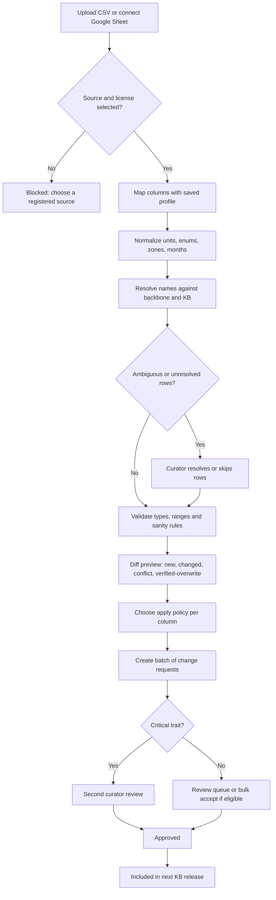

### 5.2 AI enrichment to published release [MVP seed pipeline, V1 self-serve]

1. A curator selects "Lake Erie Shore deicing-salt tolerance, 400 Great Lakes shrubs and perennials, trait group: requirements" and starts an enrichment run (V1 self-serve; at MVP `platform_engineer` launches seed batches).
2. For each plant, the enrichment worker retrieves permitted documents from registered sources and calls the AI Gateway task `kb.enrich`.
3. The model returns values with snippets and locators; the worker verifies every locator (fetch plus exact snippet match), normalizes values, cross-checks sources and computes confidence.
4. Suggestions land in the review queue grouped by plant. Eligible non-critical items can be bulk-accepted; critical items need two humans.
5. Accepted items are published in the next release; rejection reasons feed prompt evaluation in AI Ops ([19](19-platform-admin-portal.md)).

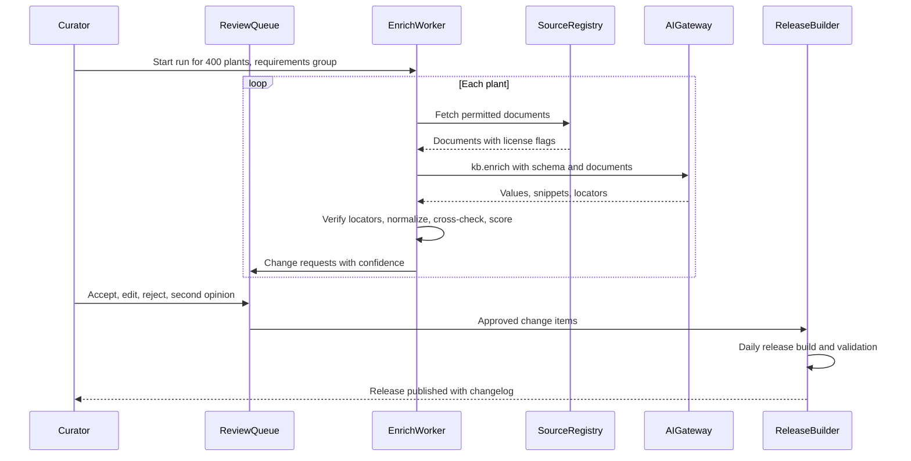

### 5.3 Change request lifecycle [MVP]

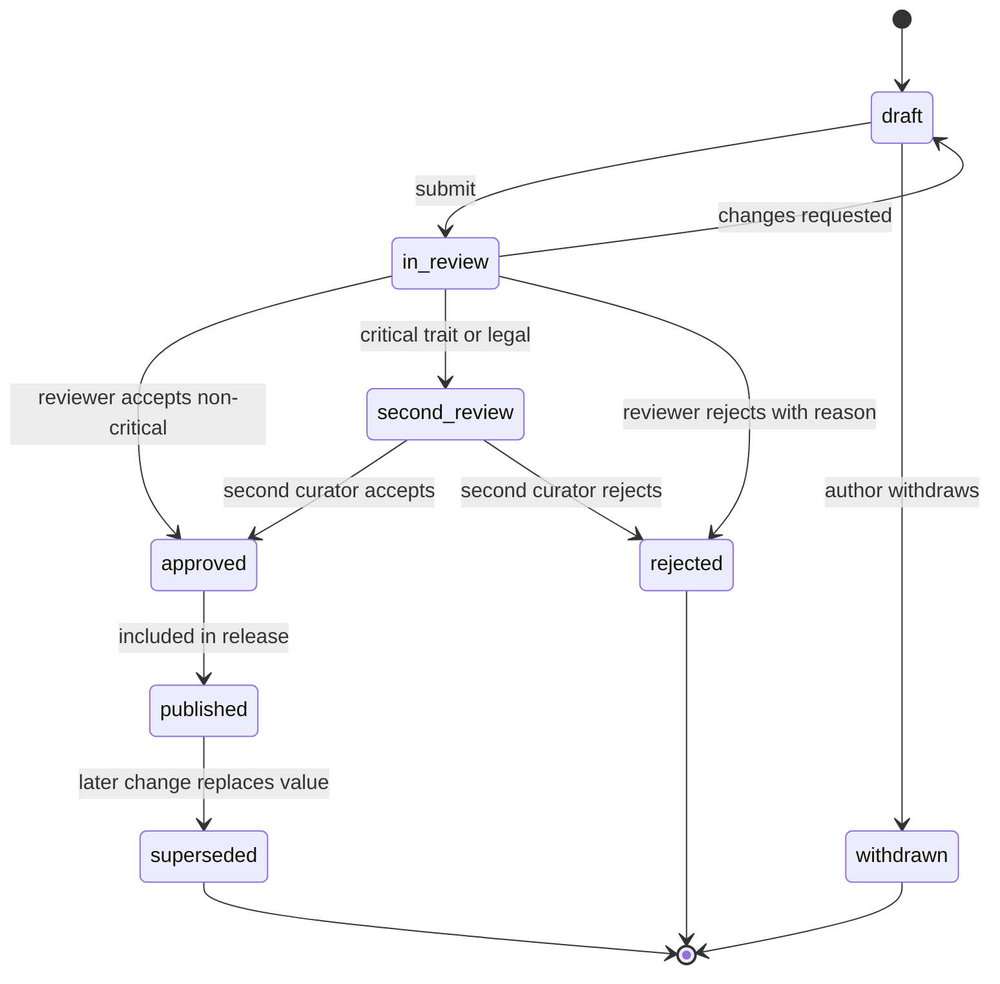

Rules: the author can never approve their own critical item; AI-authored items count as authored by the prompt version, so any human may be first reviewer; `approved` items not released within 7 days alert `platform_engineer` (release pipeline stuck).

### 5.4 Address to Region to a filtered plant picker [MVP]

1. An estimator creates the Property "Johnson, 2210 Tremont Rd, Upper Arlington" in CRM; geocoding returns a rooftop point.
2. The CRM module calls `getSiteContext`; the KB returns zone 6b, Eastern Corn Belt Plains, Franklin County, curated Region Central Ohio (Excellent), soil hint silty clay loam (illustrative).
3. The designer opens the Design Studio; the picker pre-applies Region and zone. The bed is tagged part shade from the sun study.
4. Results show only plants legal in Ohio, hardy to 6b, rated 3 or better for Central Ohio, sorted by hybrid score, with Company favorites first.

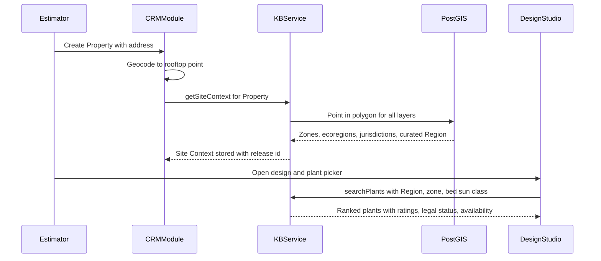

### 5.5 Natural-language search to "add to design" [MVP]

1. In the picker, the designer types "shade-tolerant evergreen shrub under 4 ft, clay, deer won't eat".
2. The parse returns chips: Shrub, Evergreen, Part or full shade, Under 4 ft, Clay, Deer A-B, plus context chips Central Ohio and 6b.
3. Seven results return in 1.1 s; she removes "Evergreen" to see semi-evergreen options, compares three, and clicks "Add to bed B" on one. The Design Studio places it with the KB spacing default and runs validations.

### 5.6 Regional rating session [MVP basic, V1 full]

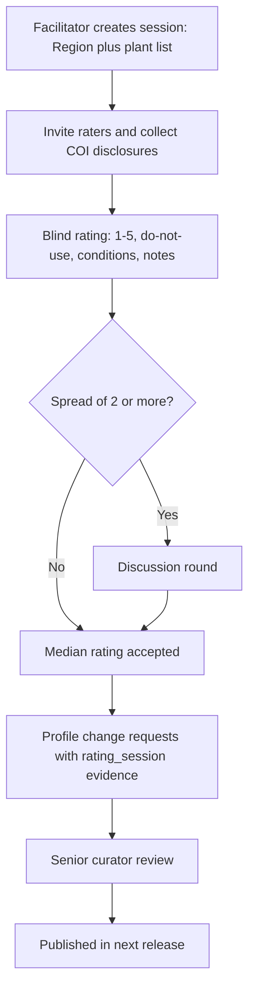

1. Maria creates "Central Ohio shrubs, session 3" with 140 shrubs used by 3 or more Companies in the Region, and invites two contract curators and an extension educator.
2. Raters work blind for 90 minutes in the grid (or a shared Google Sheet).
3. The facilitator view shows 23 items with a spread of 2 or more; the group discusses them (for example boxwood cultivars in shade under current blight pressure) and agrees values.
4. Publishing creates 140 profile change requests with evidence type `rating_session` naming the raters; a senior curator approves them in one batch.

### 5.7 Duplicate detection and merge [MVP]

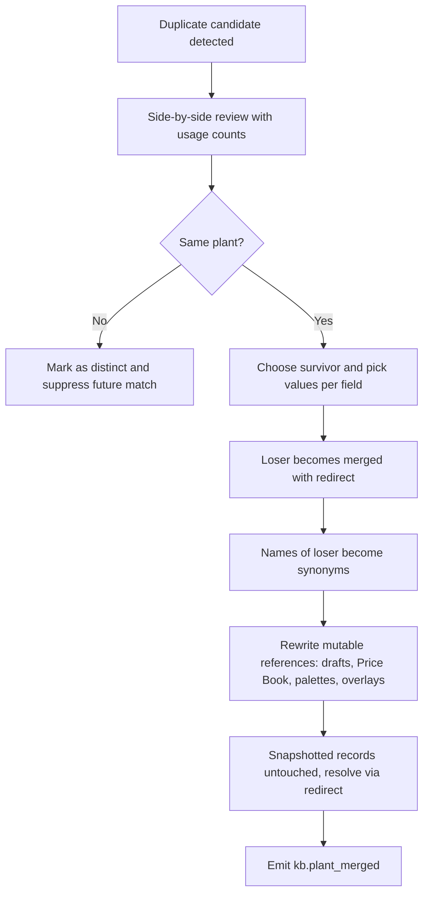

### 5.8 Regulatory change hotfix and tenant alerts [MVP]

1. The list watcher detects that a state's prohibited plant list page changed; a high-priority change request opens.
2. A curator verifies the official text and enters a listing with effective date and phase-out schedule; a second curator approves.
3. A hotfix release publishes within hours; `kb.regulatory_status_changed` is emitted.
4. Each affected Company gets an alert listing draft designs, open proposals, palettes, Price Book items and maintenance programs that include the plant in that jurisdiction, with suggested substitutes.
5. If the listing is `enacted` with a future effective date (the common case: rules are often adopted months before the sale ban starts), `kb.regulatory_listing_enacted` is emitted as well. The notifier schedules reminders at 90 and 30 days before the effective date, and from now on every validation evaluates the planned install date rather than today (KB-RGN-10). Signed Proposals whose install falls after the effective date get an error and a "Substitute and send change order" action ([03](03-crm-sales-estimating-proposals.md)).
6. On the effective date a nightly job moves the listing to `in_effect`. Any install Visit still holding the plant is flagged red on the dispatch board ([04](04-scheduling-dispatch-routing.md)), and rescheduling across the date is blocked until the plant is swapped.

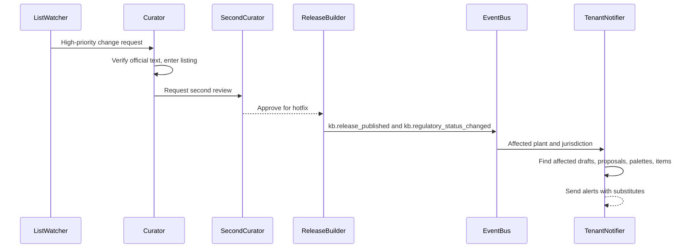

### 5.9 Nursery availability list to matched availability [V1]

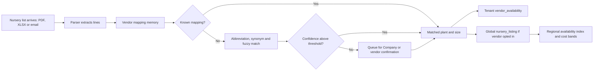

### 5.10 Field plant ID and failure report [V1]

1. Miguel (`crew_lead`) is doing a spring walk-through for a warranty client with Luis (`technician`). He photographs a browned shrub in the crew app.
2. The app segments the plant and calls plant ID; top result "*Ilex crenata*" (0.86) with the regional note "struggles in wet clay in Central Ohio".
3. He confirms the ID, taps "Report problem", picks "dead or dying", adds a second photo of the root zone, and submits.
4. The warranty workflow in [13](13-operations-inventory-equipment.md) opens a replacement task; the de-identified failure report goes to the Central Ohio curator queue.

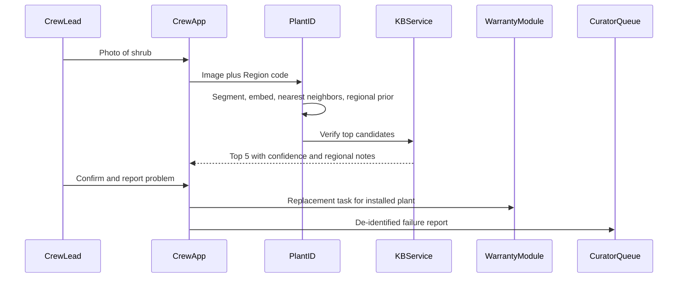

### 5.11 Private plant promoted to the global KB [MVP]

1. A designer adds "*Itea virginica* 'Little Henry'", which is missing from the KB. It resolves to the global taxon *Itea virginica*, so a private cultivar is created and inherits species traits; she overrides mature size to 2-3 ft with a nursery tag photo as citation.
2. She clicks "Submit to Rootline". A curator verifies the cultivar, enriches it and publishes a global record.
3. The private record merges into the global one; the Company's designs and Price Book items redirect automatically.

### 5.12 KB release pipeline [MVP]

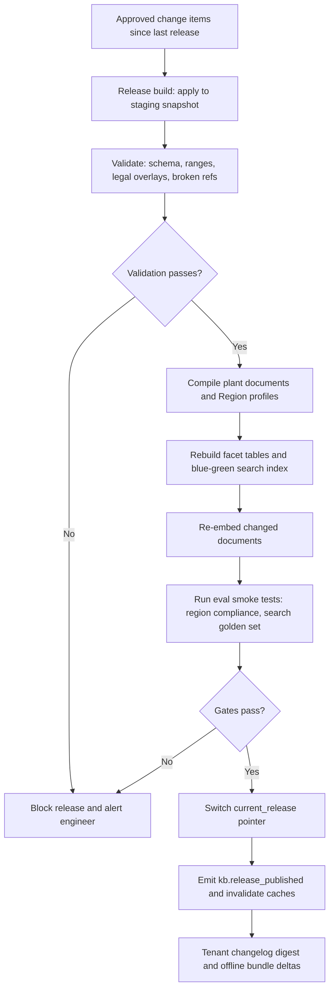

---

## 6. Screens and wireframes

### 6.1 Screen inventory

| # | Screen | Surface | Primary roles | Priority |
|---|---|---|---|---|
| 1 | Curator home (my queue, Region health, releases) | Operator console | `platform_curator`, `platform_owner` | [MVP] |
| 2 | Review queue (AI, imports, tenant suggestions) | Operator console | `platform_curator` | [MVP] |
| 3 | Plant record editor with provenance and inheritance | Operator console | `platform_curator` | [MVP] |
| 4 | Region builder map and Region detail | Operator console | `platform_curator`, `platform_owner` | [MVP] |
| 5 | Region profile grid (all plants for one Region) | Operator console | `platform_curator` | [MVP] |
| 6 | Bulk import wizard and diff preview | Operator console | `platform_curator`, `platform_engineer` | [MVP] |
| 7 | Rating session grid and facilitator view | Operator console, tablet | `platform_curator`, guest raters | [MVP] basic, [V1] |
| 8 | Duplicate and merge queue | Operator console | `platform_curator` | [MVP] |
| 9 | Regulatory listings manager and list watchers | Operator console | `platform_curator` | [MVP] |
| 10 | Media library, license registry, takedowns | Operator console | `platform_curator`, `platform_owner` | [MVP] |
| 11 | Quality dashboard | Operator console | `platform_curator`, `platform_owner` | [MVP] |
| 12 | Release manager and changelog | Operator console | senior `platform_curator`, `platform_engineer` | [MVP] |
| 13 | Palette editor with health check | Operator console and Company app | `platform_curator`, `designer`, `owner` | [MVP] |
| 14 | Plant library (tenant lens) `/plants` | Company web app | `designer`, `estimator`, `owner` | [MVP] |
| 15 | Plant detail (tenant lens) with Region profile, availability, Company notes | Company web app | All Company roles | [MVP] |
| 16 | Design Studio plant picker drawer | Company web app | `designer`, `estimator` | [MVP] |
| 17 | Private plant form and "Submit to Rootline" | Company web app | `designer`, `owner` | [MVP] |
| 18 | Nursery availability view and mapping confirmations | Company web app | `ops_manager`, `estimator` | [V1] |
| 19 | Plant ID camera and results | Crew app | `crew_lead`, `technician` | [V1] |
| 20 | Plant cards and care guide | Customer Portal | `client_residential`, `client_commercial` | [MVP] |
| 21 | Public plant page (global and regional) | Marketing site | Public | [V1] |
| 22 | Legal timeline: enacted bans, effective dates, rule packs, affected work (KB-RGN-10, KB-RGN-11) | Operator console (edit); Company app (read-only alerts view) | `platform_curator`; `owner`, `designer`, `estimator`, `ops_manager` | [MVP] listings, [V1] rule packs |
| 23 | Data licensee keys, tiers and usage (Plant API) | Operator console | `platform_owner`, `platform_finance`, `platform_engineer` | [V2] |

### 6.2 Wireframe: curator review queue

```text
+----------------------------------------------------------------------------------------------------+
| ROOTLINE CONSOLE > Plant KB > Review queue                       [Cmd-K]   Maria O. (senior)       |
+----------------------------------------------------------------------------------------------------+
| Filters: Region [Lake Erie Shore v]  Group [Shrubs v]  Author [AI v]  Conf [>=0.7 v]  Crit. [any]  |
| Queue: 214 items   Eligible for bulk accept: 96   My SLA breaches: 0          [Shift+A bulk accept]|
+------------------------------+---------------------------------------------------------------------+
| > Rhus aromatica       (12)  |  Rhus aromatica (fragrant sumac)                    used by 31 cos  |
|   Aronia melanocarpa   (9)   |  Change request CR-88412  author ai:kb.enrich@v14   run GL-salt-03  |
|   Cornus sericea       (7)   +---------------------------------------------------------------------+
|   Dasiphora fruticosa  (11)  |  FIELD             CURRENT        PROPOSED        CONF   SOURCES    |
|   Diervilla lonicera   (8)   |  usda_zone_min *   (empty)        3a              0.93   T1 x2      |
|   Symphoricarpos albus (4)   |  usda_zone_max *   (empty)        9a              0.88   T1, T2     |
|   ...                        |  salt_tol_spray    (empty)        high            0.95   T1 x3      |
|                              |  salt_tol_soil     moderate       high            0.94   T1 x2      |
| * = critical trait           |  deer_resistance * C              B               0.71   T1 vs T1 ! |
|   (needs 2nd reviewer)       |  soil_ph_max       7.0            8.0             0.82   T1, T3     |
|                              +---------------------------------------------------------------------+
|                              |  SOURCE SNIPPETS for deer_resistance                                |
|                              |  [1] Ext. list (OH): "...rarely damaged by deer..." p.4     open    |
|                              |  [2] Ext. list (NJ): "...occasionally severely..."  row 18  open    |
|                              |  Note: sources from different Regions disagree -> consider Region   |
|                              |  profile override instead of global change.                         |
|                              +---------------------------------------------------------------------+
|                              | [A] Accept [E] Edit+accept [R] Reject [S] 2nd opinion               |
|                              | [P] Propose as Lake Erie Shore override   J/K next/prev  ? help     |
+------------------------------+---------------------------------------------------------------------+
```

### 6.3 Wireframe: plant record editor with provenance and inheritance

```text
+----------------------------------------------------------------------------------------------------+
| Plant KB > Hydrangea paniculata 'Limelight'   RL-P-004821   PUBLISHED  rel 2027.04.12-1   Gold 94  |
| Parent: Hydrangea paniculata (species)   Trade names: none   US PP: on file (expired, verify)      |
| Tabs: [Overview] [Names] [Traits] [Requirements] [Characteristics] [Regions 14] [Media 23]         |
|       [Commercial] [Care] [History] [Duplicates 0]                                                 |
+----------------------------------------------------------------------------------------------------+
| TRAITS (inherited values in grey)                                          [Propose change]        |
|  mature_height     6-8 ft   (183-244 cm)   override   src: T1 extension   cur: M.O.  Mar 2027  (i) |
|  mature_spread     6-8 ft                  override   src: T1 extension   cur: M.O.  Mar 2027  (i) |
|  form              upright, rounded        override   src: curator                             (i) |
|  blooms_on         new wood                inherited from species                              (i) |
|  bloom_months      Jul-Sep  (ref: Great Lakes)  override   src: T1 x2                          (i) |
|  bloom_colors      lime green -> cream -> pink-tinged                                          (i) |
|  usda_zone *       3a-8b                   inherited from species  2 reviewers  Jan 2027       (i) |
|  deer_resistance * C (occasionally severely damaged)  src: Rutgers-style list  2 reviewers     (i) |
|  toxicity *        dogs: mild  cats: mild  humans: mild   src: T1 x2       2 reviewers         (i) |
+----------------------------------------------------------------------------------------------------+
| (i) PROVENANCE: bloom_months                                                                       |
|  v3  Jul-Sep   curator_entered  M. Ortiz   2027-03-02  rel 2027.03.03-1   evidence: 2 citations    |
|  v2  Jul-Aug   ai_extracted     kb.enrich@v9  conf 0.78  2026-11-20  accepted by J. Lee            |
|  v1  (empty)   imported         USDA PLANTS import  2026-10-04                                     |
+----------------------------------------------------------------------------------------------------+
| REGIONS  Central Ohio 5/5  "Top performer; tolerates clay if not waterlogged"  rev Mar 2027        |
|          Chicagoland 4/5   "Needs afternoon shade on west exposures"           rev Jan 2027        |
|          Golden Horseshoe 4/5 (inherited: Great Lakes)                       [Open Region profiles]|
+----------------------------------------------------------------------------------------------------+
```

### 6.4 Wireframe: Region builder map

```text
+----------------------------------------------------------------------------------------------------+
| Plant KB > Regions > Central Ohio (draft v4)        Parent: Great Lakes and Ohio Valley   EXCELLENT|
+-----------------------------------+----------------------------------------------------------------+
| RECIPE                            |  MAP  [Satellite | Streets]  Layers: [x] USDA 2023 [x] EPA L4  |
|  epa_l3 = 55                      |        [ ] Counties [x] Curated [ ] Heat zones [ ] Soils       |
|  AND state = OH                   |   +----------------------------------------------------------+ |
|  AND usda_zone BETWEEN 5b AND 6b  |   |      .....  NE Ohio  .....                               | |
|  + drawn: "Licking Co. east edge" |   |    ..   +----------------+   ..                          | |
|  - drawn: "Hocking Hills"         |   |   .     |  CENTRAL OHIO  |    .    (hatched = overlap)   | |
|  [Edit recipe] [Draw] [Subtract]  |   |   .     |   * Columbus   |    .                          | |
|                                   |   |    ..   +----------------+  ..                           | |
| PREVIEW (vs published v3)         |   |      .....  SW Ohio  .....                               | |
|  Area           11,940 sq mi      |   +----------------------------------------------------------+ |
|  Tenants inside 37 (+2)           |  Click a point to see its Site Context                         |
|  Properties     21,480 (+610)     |  40.0256, -83.0627 -> 6b | 55b | Franklin Co | Central Ohio    |
|  Plants rated   812               +----------------------------------------------------------------+
|  Overlaps       0                 |  [Validate topology]  [Diff vs v3]  [Submit for review]        |
|  Props changing Region: 610       |  Publishing recomputes Site Context for affected Properties.   |
+-----------------------------------+----------------------------------------------------------------+
```

### 6.5 Wireframe: bulk import diff preview

```text
+----------------------------------------------------------------------------------------------------+
| Import: "Ohio extension landscape shrubs.csv"  profile: Extension list A  source: [OSU Ext list v] |
| License: Facts with citation (T1)   Rows 612   Step 4 of 5: Diff preview                           |
+----------------------------------------------------------------------------------------------------+
| SUMMARY  matched 571 | new cultivar 22 | new taxon 6 | ambiguous 9 (!) | unresolved 4              |
|          field changes 1,840: fill-empty 1,210 | change-unverified 402 | conflict 211 |            |
|          VERIFIED-OVERWRITE 17 (never auto-applied)                         [Download dry-run CSV] |
+----------------------------------------------------------------------------------------------------+
| ROW  NAME (as given)            RESOLVED TO                     FIELD          OLD      NEW   ACT  |
| 14   Ilex glabra 'Shamrock'     Ilex glabra 'Shamrock'          sun            FS,PS    FS,PS,SH C |
| 14                                                              wet_tolerance  (empty)  high    F  |
| 37   Perovskia atriplicifolia   Salvia yangii (synonym match)   drought_tol    high     high    =  |
| 52   Euonymus alatus            Euonymus alatus                 deer *         B        A      V!  |
| 88   Viburnum x 'Mohawk'        ? 2 candidates                  [choose v]                     ?   |
| 91   Spirea 'Goldflame'         Spiraea japonica 'Goldflame'    bloom_months   May-Jun  Jun-Jul C  |
+----------------------------------------------------------------------------------------------------+
| Legend: F fill-empty  C conflict  V! overwrites verified  = unchanged  ? ambiguous  * critical     |
| Apply policy: [Fill empty: apply] [Conflicts: propose as candidates] [Unverified: overwrite]       |
|                                                    [Back]  [Create 1,823 change requests ->]       |
+----------------------------------------------------------------------------------------------------+
```

### 6.6 Wireframe: rating session grid

```text
+----------------------------------------------------------------------------------------------------+
| Rating session: Central Ohio shrubs #3   Raters 4 (blind)   Progress 96/140   Time 01:12   [Sheet] |
+----------------------------------------------------------------------------------------------------+
| PLANT                          CURRENT  MY RATING   DNU  CONDITIONS                NOTE      CONF  |
| Aronia melanocarpa 'Viking'    4        [5]         [ ]  -                         heavy... [H]    |
| Buxus sempervirens             3        [2]         [ ]  avoid shade+humid  ...    blight   [M]    |
| Buxus 'Green Velvet'           3        [3]         [ ]  good air flow             ...      [M]    |
| Cornus sericea 'Arctic Fire'   -        [4]         [ ]  -                         ...      [H]    |
| Euonymus alatus                1        [ ]         [x]  legal: check state list   invasive [H]    |
| Ilex crenata                   3        [2]         [ ]  avoid wet clay            rots     [M]    |
| Ilex glabra 'Shamrock'         4        [4]         [ ]  -                         ...      [H]    |
+----------------------------------------------------------------------------------------------------+
| Keys: 1-5 rate  D do-not-use  C conditions  N note  Enter next  Esc skip      [Submit my ratings]  |
| Facilitator only (after submit): spread >= 2 on 23 items -> [Open discussion view]                 |
+----------------------------------------------------------------------------------------------------+
```

### 6.7 Wireframe: tenant plant picker with natural-language search (Design Studio drawer)

```text
+---------------------------------------------------------------------------------------------+
| PLANTS  Johnson front yard / Bed B (part shade, clay)        Central Ohio  Excellent  6b    |
| [ shade-tolerant evergreen shrub under 4 ft clay deer won't eat                      ] (o)  |
| Interpreted as: (Shrub x) (Evergreen x) (Part/full shade x) (Under 4 ft x) (Clay x)         |
|                 (Deer A-B x)  context: (Central Ohio) (6b) (legal in OH)    [Edit filters]  |
+---------------------------------------------------------------------------------------------+
| 7 results  sort: Best match v      [Company palette first: on]   [Availability: 25 mi v]    |
|---------------------------------------------------------------------------------------------|
| [img] Ilex glabra 'Shamrock'      inkberry          4/5 Central Ohio   Deer B   Nativar NA  |
|       3-4 ft, evergreen, tolerates wet clay        #3 $38.00   Avail: 3 vendors (Nov 3)  [+]|
| [img] Cephalotaxus harringtonia 'Duke Gardens'  Japanese plum yew  4/5   Deer A             |
|       3-4 ft, shade-tolerant conifer               #5 $64.00   Avail: 1 vendor           [+]|
| [img] Buxus 'Green Velvet'        boxwood           3/5 (conditions)  Deer A                |
|       ! Needs air flow: blight pressure in shade   #3 $41.00   Avail: 2 vendors          [+]|
|---------------------------------------------------------------------------------------------|
| Compare (0/4)   Similar   Why these?   Not finding it? [Add Company plant]                  |
| Plant ratings, prices and availability in this wireframe are illustrative example data.     |
| "Nativar NA" = cultivar of a species native to North America but not to Ohio (KB-RGN-07).   |
+---------------------------------------------------------------------------------------------+
```

### 6.8 Wireframe: KB quality dashboard (operator console)

Tiles map to KB-CUR-09; console layout and staleness rules are shared with [19](19-platform-admin-portal.md) PA-074. Every number is a link to the filtered queue that fixes it.

```text
+----------------------------------------------------------------------------------------------------+
| ROOTLINE CONSOLE > Plant KB > Quality                Release 2027.04.12-1 (current)   [Export CSV] |
| Scope: Region [All Wave 1 v]   Group [All v]   Compare to: [release 2027.03.01-1 v]                |
+----------------------------------------------------------------------------------------------------+
| COMPLETENESS (published plants)            | REGION COVERAGE (Wave 1)                              |
|  Gold   1,284  ########........   (+61)    |  Central Ohio        EXCELLENT  812 rated  stale 2%   |
|  Silver 1,402  #########.......   (+18)    |  NE Ohio             EXCELLENT  644 rated  stale 3%   |
|  Bronze   251  ##..............   (-54)    |  SE Michigan/Toledo  GOOD  ->   588 rated  (12 to go) |
|  Stub      63  ................   (-25)    |  West Michigan       EXCELLENT  703 rated  stale 1%   |
|  Target: 3,000 Silver+   now 2,686 (90%)   |  Chicagoland/NW Ind. EXCELLENT  676 rated  stale 2%   |
|                                            |  SE Wisconsin        GOOD       401 rated  stale 0%   |
+--------------------------------------------+-------------------------------------------------------+
| CRITICAL-TRAIT INTEGRITY                   | LEGAL AND LICENSING                                   |
|  Critical values cited        100.0%  OK   |  Jurisdictions with complete lists  64/64  OK         |
|  Dual-reviewed                 99.7%  (!)  |  Listings past re-verify date         3   [Open]      |
|    -> 72 values awaiting 2nd reviewer      |  Enacted bans effective < 180 days     2   [Alerts]   |
|  Open conflicts (selected traits)   0.6%   |  Licenses expiring < 60 days           4   [Open]     |
|  Release-blocking anomalies          0     |  Takedowns open > 12 h                 0   OK         |
+--------------------------------------------+-------------------------------------------------------+
| MEDIA                                      | DEMAND SIGNALS (last 30 days)                         |
|  Palette plants w/ seasonal set   93% (!)  |  Search misses:  'Little Henry' sweetspire  41  [Add] |
|    missing: fall 38, winter 21, bloom 9    |                  'Pee Gee' hydrangea        19  [Syn] |
|  Hero images w/o alt text           0      |  Failure reports: Ilex crenata, C. Ohio      7 (!)    |
|  Render-ready (AI packs), top 300  281     |  Private plants resolving to same cultivar:  5 cos    |
+--------------------------------------------+-------------------------------------------------------+
| QUEUE HEALTH   open 1,904 | AI 1,312 | import 402 | tenant 118 | median age 3.1 d | SLA breaches 0 |
+----------------------------------------------------------------------------------------------------+
| All counts illustrative.  (!) = below target and links to the fixing queue.                        |
+----------------------------------------------------------------------------------------------------+
```

### 6.9 Wireframe: plant detail, tenant lens (Company web app)

```text
+----------------------------------------------------------------------------------------------------+
| Plants > Hydrangea paniculata 'Limelight'  (Limelight panicle hydrangea)   [Fav *] [Add to v]      |
| Context: Johnson, 2210 Tremont Rd  |  Central Ohio  EXCELLENT  |  6b  |  legal in OH  [Change]     |
+-------------------------------+--------------------------------------------------------------------+
| [ photo: summer habit     ]   | CENTRAL OHIO: 5/5 Top performer        reviewed Mar 2027 (i)       |
| [spring][summer][fall][wntr]  | "Reliable bloomer in Central Ohio; tolerates our clay if not       |
| Photo: J. Smith, CC BY 4.0    |  waterlogged."  Local pick: prefer 'Little Lime' for beds < 5 ft.  |
|                               | Conditions: none.  Bloom here: Jul-Sep (+0 wk vs reference)        |
| AT A GLANCE                   +--------------------------------------------------------------------+
|  6-8 ft x 6-8 ft  (size M-L)  | OUR COMPANY                                                        |
|  Full sun to part sun         |  In palette: "Cedar & Stone Core" (flowering shrub)                |
|  Zones 3a-8b  (site 6b OK)    |  Our rating: 5/5   Warranty: 1 year standard                       |
|  Deer C  | Rabbit: moderate   |  Internal note: "Cut back to 18 in each March; clients love it."   |
|  Toxic: dogs, cats (mild)     |  Price Book: #3 $46.00 | #5 $68.00 | #7 $96.00  (costs hidden)     |
|  Not native (introduced)      +--------------------------------------------------------------------+
|  Blooms on new wood           | AVAILABILITY (as of Nov 3)                       [Within 25 mi v]  |
|  Maintenance: low             |  Our vendors:  Scioto Valley Nursery  #5  qty 40+   (contract)     |
|                               |  Region:       4 of 6 reporting vendors list it; #3, #5, #7        |
| SOURCES  USDA PLANTS; Ext. x2 +--------------------------------------------------------------------+
| (i) on any value: provenance  | CARE (Central Ohio)  Mar: cut back  Apr: mulch  Jun-Aug: water in  |
|                               | drought  Nov: leave heads for winter interest      [Care guide v]  |
+-------------------------------+--------------------------------------------------------------------+
| [Compare] [Similar] [Substitutes] [Suggest a correction] [Report a failure] [Print plant card]     |
+----------------------------------------------------------------------------------------------------+
| Illustrative values.  Cost columns follow the viewer's cost permission (section 9.2).              |
+----------------------------------------------------------------------------------------------------+
```

### 6.10 Wireframe: client plant card and care guide (Customer Portal, mobile)

```text
+--------------------------------------+
| Cedar & Stone   My yard > Plants     |
+--------------------------------------+
| Front bed (installed May 14, 2027)   |
| 12 plants, 5 kinds        [Map view] |
+--------------------------------------+
| [photo]  Limelight hydrangea  x3     |
|          Warranty until May 14, 2028 |
|          ! Toxic to dogs and cats    |
|            if eaten (mild). Details> |
+--------------------------------------+
| THIS MONTH (June)                    |
|  Water deeply once a week if no      |
|  rain; new plants 2-3x per week.     |
| COMING UP                            |
|  March: we cut these back (included  |
|  in your maintenance plan)           |
+--------------------------------------+
| Why we chose it                      |
|  "Top performer in Central Ohio.     |
|  Blooms July-September on new wood,  |
|  so a hard winter won't cost you     |
|  flowers."                           |
| Sources: USDA PLANTS; Extension      |
+--------------------------------------+
| [Report a problem]  [Ask a question] |
| [Ver en español]                     |
+--------------------------------------+
| Poison help: 1-800-222-1222          |
| ASPCA Animal Poison Control:         |
| (888) 426-4435 (fee may apply)       |
+--------------------------------------+
```

Rules for 6.10: only client-safe notes and `print_in_proposal`-or-wider licensed photos appear ([06](06-customer-portal.md)); toxicity lines appear only when the Property has a pet or child flag or the plant is rated moderate or severe for any receptor; "Report a problem" opens a warranty request routed to the Company, never to Rootline; the warranty date comes from the Company's warranty policy (KB-TEN-04), not from the KB.

---

## 7. Data model

The KB lives in the `kb` domain module ([20](20-architecture-security.md)). Global tables are in schema `kb` with no row-level security (tenants get `SELECT` only); tenant overlays are in RLS-protected `kb.tenant_*` tables keyed by `tenant_id`. Property Site Context is tenant data and lives with the Property.

### 7.1 Entity summary

| Area | Entity | Purpose | Key fields |
|---|---|---|---|
| Taxonomy | `plant` | Canonical plant (taxon or cultivar) | `id`, `code`, `slug`, `parent_plant_id`, `rank` (genus, species, infraspecific, cultivar), `plant_kind`, `family`, `genus`, `hybrid_marker`, `specific_epithet`, `infraspecific_rank`, `infraspecific_epithet`, `cultivar_epithet`, `cultivar_group`, `series_id`, `accepted_backbone_id`, `status`, `completeness_score`, `completeness_tier`, `merged_into_id`, `trade_display_until` |
| Taxonomy | `plant_name` | Common, trade and synonym names | `plant_id`, `name`, `name_kind` (common, trade, synonym, field_name), `synonym_type`, `locale`, `region_id`, `is_preferred`, `mark` (registered, trademark, none), `mark_owner`, `source_id` |
| Taxonomy | `plant_external_id` | Cross-references | `plant_id`, `system` (powo, ipni, wfo, gbif, usda_plants, itis, vascan), `external_id` |
| Taxonomy | `plant_series` | Series and seed strains | `name`, `brand`, `genus` |
| Taxonomy | `plant_patent` | Patents, breeders' rights | `plant_id`, `jurisdiction`, `kind` (us_plant_patent, ca_pbr, eu_cpvr), `number`, `filed_on`, `granted_on`, `expires_on_est` |
| Traits | `trait_definition` | Trait registry | `key`, `data_type`, `unit_dimension`, `group`, `criticality`, `inheritable`, `regionalizable`, `facetable`, `client_visible`, `completeness_weight`, `evidence_rule` |
| Traits | `trait_enum_value` | Allowed values with definitions | `trait_key`, `value`, `label_i18n`, `definition` |
| Traits | `plant_trait_value` | One value with provenance | `plant_id`, `trait_key`, `value_json`, `original_text`, `qualifiers`, `is_selected`, `source_id`, `license_id`, `citation_id`, `method`, `confidence`, `author_id`, `reviewer_id`, `published_release_id` |
| Provenance | `source`, `license`, `citation` | Source registry and citations | tier, license type, `allowed_uses`, attribution, expiry; citation locator, snippet, retrieved_at |
| Geography | `region`, `region_version` | Curated and layer Regions, versioned geometry | `kind`, `layer`, `code`, `name`, `parent_id`, `coverage_tier`, `lead_curator_id`, `recipe`, `geom`, `priority`, `version`, `status` |
| Geography | `jurisdiction`, `regulatory_listing` | Legal status | jurisdiction level and geometry; listing `plant_id` scope, `category`, `status` (proposed, enacted, in_effect, phase_out, amended, repealed, withdrawn), `enacted_on`, `sale_prohibited_from`, `planting_prohibited_from`, `exemption_until`, `phase_out`, `exemptions`, `citation_id`, `last_verified_at` |
| Geography | `listing_alternative` | Curated "plant this instead" links | `regulatory_listing_id`, `alternative_plant_id`, `role_match`, `source_id`, `sort_order` |
| Geography | `jurisdiction_rule_pack` | Water, turf, fire, street-tree and HOA-law rules (KB-RGN-11) | `jurisdiction_id`, `pack_kind`, `version`, `rules_json`, `effective_on`, `citation_id`, `last_verified_at`, `status` |
| Geography | `plant_native_range` | Native status by unit | `plant_id`, `unit_kind`, `unit_code`, `status`, `source_id` |
| Profiles | `plant_region_profile` | Performance in a Region | `plant_id`, `region_id`, `rating`, `do_not_use`, `reason_codes`, `conditions`, `client_note`, `internal_note`, `cultivar_picks`, `confidence`, `curator_id`, `reviewer_id`, `last_reviewed_at`, `next_review_due`, `status` |
| Profiles | `profile_trait_override`, `profile_evidence` | Regional trait values and evidence | override `trait_key`, `value_json`; evidence `kind`, `citation_id`, `supports`, `weight` |
| Palettes | `plant_palette`, `palette_plant` | Platform Plant Palettes (the glossary's Plant Palette) | `scope`, `region_ids`, `style_tags`, `uses`, `kind` (curated, smart, hybrid), `query_json`; member `plant_id`, `role`, `sub_zone`, `sun_classes`, `sort` |
| Media | `media_asset`, `plant_media` | Photos and assets | asset `storage_key`, `phash`, `license_id`, `attribution`, `allowed_uses`, `quality_score`; link `plant_id`, `role`, `season`, `region_id`, `is_hero` |
| Media | `symbol_family`, `plant_symbol_map` | 2D symbol mapping | family `key`, `params_schema`; map `plant_id`, `family_key`, `params_json`, `custom_svg_key` |
| Care and pests | `care_task_template`, `pest_disease`, `plant_pest_link` | Care calendars and pests | task `kind`, `phenophase`, `region_month_map`; pest `type`, `regions_pressure`; link `susceptibility` |
| Commercial | `size_spec`, `plant_size_spec` | Standard sizes | `code` (C3, CAL2_BB, HT5_6_BB, QT, PLUG72), `kind`, `min`, `max`, `unit` |
| Commercial | `nursery`, `nursery_listing`, `region_availability` | Opt-in nursery data and aggregates | listing `plant_id`, `size_spec_code`, `qty_band`, `list_price`, `currency`, `as_of`; aggregate `availability_index`, `cost_low`, `cost_median`, `cost_high`, `sample_n` |
| Curation | `change_request`, `change_item` | Unit of work | request `origin` (curator, import, ai, tenant, feed, merge, bulk), `batch_id`, `status`, `priority_score`; item `target_table`, `target_id`, `field`, `old_json`, `new_json`, `is_critical`, `reviewer1_id`, `reviewer2_id` |
| Curation | `kb_release`, `plant_version` | Releases and snapshots | release `code`, `kind` (daily, hotfix), `published_at`, `stats`; version `plant_id`, `release_id`, `doc_json` |
| Curation | `merge_redirect`, `duplicate_candidate` | Merges | `from_plant_id`, `to_plant_id`, `merged_at`, `undo_until` |
| Curation | `import_job`, `import_row`, `enrichment_run`, `rating_session`, `rating_vote`, `feedback_report`, `list_watcher`, `curator_scope`, `coi_disclosure` | Pipelines and workflows | see sections 4.5 and 4.3 |
| Read models | `plant_compiled`, `plant_facet`, `plant_embedding`, `photo_embedding` | Fast reads per release | `release_id`, `region_id`, `doc_json`; facet columns; `vector` |
| Tenant | `tenant_plant` | Private plants | `tenant_id`, `resolved_plant_id`, `fields_json`, `status`, `submitted_cr_id` |
| Tenant | `tenant_plant_overlay` | Notes, hidden, ratings, policies | `tenant_id`, `plant_id`, `internal_note`, `client_note`, `care_text`, `hidden`, `company_rating`, `warranty_policy` |
| Tenant | `tenant_favorite`, `tenant_palette`, `tenant_palette_member` | Favorites and Company or client palettes | `tenant_id`, `user_id`, `client_id` (client palettes), members as above |
| Tenant | `property_site_context` | Cached Site Context | `tenant_id`, `property_id`, `region_release_id`, `context_json`, `overrides_json`, `computed_at` |
| Tenant | `kb_search_log` | PII-free search analytics | `tenant_id`, `query_hash`, `parse_json`, `result_count`, `action` |
| Licensing | `data_customer`, `api_key`, `api_usage_daily` | Plant API licensees ([22](22-business-model-pricing-gtm.md) 5.2.1) [V2] | customer `tier`, `stripe_customer_id` (Rootline's own Stripe account), `status`; key `hash`, `scopes`, `rate_limit`; usage `calls`, `date` |

### 7.2 Taxonomy, traits and provenance

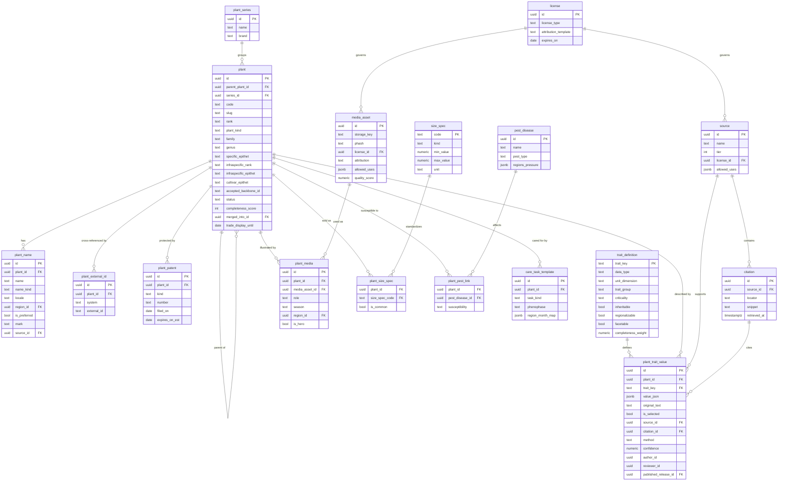

### 7.3 Regions, profiles, palettes and nursery data

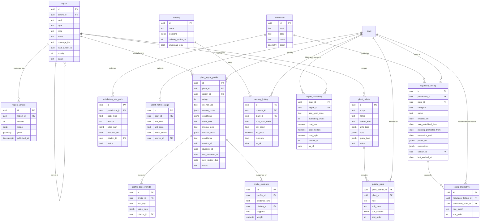

### 7.4 Curation, releases and the tenant layer

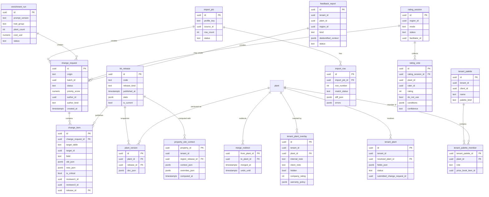

### 7.5 Key integrity rules

- `plant.code` and `plant.slug` are unique and immutable; `merged_into_id` is set only when `status = merged`.
- At most one `plant_trait_value` per (`plant_id`, `trait_key`, scope) has `is_selected = true` (partial unique index).
- `plant_region_profile` is unique per (`plant_id`, `region_id`); `rating` is 1-5 or null; `do_not_use = true` requires a reason code and a senior reviewer.
- A `change_item` with `is_critical = true` cannot reach `approved` unless `reviewer1_id` and `reviewer2_id` are distinct and neither is the author.
- `regulatory_listing` on a species applies to descendants unless an exemption lists the descendant `plant_id`.
- `regulatory_listing.sale_prohibited_from` is required when `status` is `enacted` or `in_effect` and `category = prohibited`; `planting_prohibited_from` defaults to null (sale-only rule), and validations treat a supply-and-install Proposal as a sale (KB-RGN-10). A listing cannot move to `in_effect` before `sale_prohibited_from`; a nightly job advances status on the effective date and emits `kb.regulatory_status_changed`.
- Tenant tables carry `tenant_id` and RLS policies; global tables are read-only to the application role (`rootline_app`) per [20](20-architecture-security.md).
- Snapshots (`plant_version`) are append-only; consumers that sold work store the `release_id`.

---

## 8. Integrations, APIs and events

### 8.1 External integrations

| Integration | Purpose | Mode | Cadence | Priority |
|---|---|---|---|---|
| WCVP/POWO and WFO exports | Accepted names, synonyms, distributions | Bulk download, diffed into change requests | Monthly | [MVP] |
| GBIF API | Taxon keys, occurrence sanity checks | REST | On demand, cached | [MVP] |
| USDA PLANTS, ITIS | Symbols, native status, noxious lists, TSNs | Bulk download | Quarterly | [MVP] |
| Official regulatory sources (APHIS Federal Noxious Weed List, CFIA, state and provincial rules, municipal codes in the beachhead jurisdictions: OH, MI, IN, IL and WI, plus ON at V1.2) | Legal listings and rule packs | List watchers (content hash) plus curator verification | Weekly hash check; quarterly human re-verification | [MVP] watch list, [V1] automated watchers |
| Hardiness maps (USDA, NRCan), EPA and CEC ecoregions, Census TIGER, Statistics Canada boundaries | Region layers | GIS files loaded to PostGIS | On new edition | [MVP] |
| NOAA and ECCC normals, NRCS SSURGO, USFS wildfire risk | Climate summaries, soil hints, fire defaults | GIS and tabular loads | Annual or on new edition | [V1], fire [V2] |
| Google Sheets API | Curator imports and rating sessions | OAuth, read-only scope per sheet | On demand | [MVP] |
| Wikimedia Commons, iNaturalist APIs | Open-license photos (license-filtered) | REST | On demand | [MVP], iNaturalist [V1] |
| Plant ID fallback provider (for example Pl@ntNet, Kindwise) | Out-of-KB identification | REST via AI Gateway | Per request | [V1] optional |
| AI Gateway ([17](17-ai-copilot-automation.md)) | `kb.enrich`, `kb.search.parse`, `kb.describe`, `kb.plant_id.verify`, embeddings | Internal | Per call, metered | [MVP] |
| Nursery Connect, supplier feeds ([13](13-operations-inventory-equipment.md)) | Availability and prices | Upload, email, API, EDI | Hourly to weekly | [V1], partner APIs [V2] |
| Mapbox or Google Maps tiles | Region builder map | JS SDK | Interactive | [MVP] |
| Rootline's own Stripe account (Stripe Billing) | Plant API licensee subscriptions and metered overage, on `data_customer` accounts | Stripe Billing API and webhooks, owned by the SaaS billing module ([19](19-platform-admin-portal.md)) | Monthly | [V2] |

### 8.2 Domain events emitted

All events go through the transactional outbox ([20](20-architecture-security.md)) and carry `release_id` where relevant.

| Event | Payload (summary) | Main consumers |
|---|---|---|
| `kb.release_published` | release code, kind, counts, changed plant ids | Search indexer, caches, Design Studio validation and availability badges ([10](10-design-studio.md)), mockup palette and render-pack caches ([11](11-ai-design-mockups.md)), crew app bundle builder, tenant changelog |
| `kb.plant_merged` | from id, to id | Design, Price Book, palettes, warranties, reporting |
| `kb.plant_deprecated` | plant id, reason | Design validations, Price Book, palettes |
| `kb.regulatory_status_changed` | plant ids, jurisdiction, category, effective date | Tenant notifier, design validations, proposals, service programs |
| `kb.regulatory_listing_enacted` | listing id, plant ids, jurisdiction, `sale_prohibited_from`, `planting_prohibited_from` | Tenant notifier (alerts at enactment, 90 days and 30 days before the effective date), scheduling slip guard ([04](04-scheduling-dispatch-routing.md)), proposals |
| `kb.rule_pack_published` | jurisdiction, pack kind, version, effective date | Design Studio validations, AI layout solver and design assistant ([11](11-ai-design-mockups.md)), water-budget worksheets |
| `kb.region_published` | region id, version, Properties affected count | Site Context recompute job, reporting |
| `kb.property_region_changed` | tenant id, property id, old and new Region and zone | CRM, Design Studio, portal care guides |
| `kb.profile_updated` | plant id, region id, old and new rating | AI palette caches, SEO pages, Company alerts if a palette plant drops below 3 |
| `kb.media_taken_down` | asset id | CDN purge, proposal PDF regeneration queue, portal |
| `kb.change_request_submitted` | origin, priority | Curator notifications |
| `kb.tenant_plant_submitted` | tenant id, private plant id | Curator queue |
| `kb.nursery_listing_updated` | nursery id, plants | Availability aggregates, picker chips |

### 8.3 Events consumed

| Event (owner) | KB reaction |
|---|---|
| `property.geocoded` and `property.address_changed` (CRM, [03](03-crm-sales-estimating-proposals.md)) | Compute Site Context |
| `design.version_published`, `design.plant_placed` ([10](10-design-studio.md)) | Usage counts for priority scoring and analytics |
| `ops.warranty.claim_opened`, `ops.warranty.claim_resolved`, `ops.plant.lost` ([13](13-operations-inventory-equipment.md)) | Aggregate failure signals (k of 10 or more) for profile re-review triggers |
| `ops.vendor.price_list_imported` (price and availability lists, [13](13-operations-inventory-equipment.md)) | Update tenant availability views and, for opted-in vendors, global listings |
| `plant.installed` ([05](05-field-crew-mobile-app.md)) and `design.as_built_published` ([10](10-design-studio.md)) | Installed-plant registry links for care guides ([06](06-customer-portal.md)) and plant warranties ([13](13-operations-inventory-equipment.md)). Each installed plant is a `plant_instance` ([10](10-design-studio.md) section 7.1, rail R-02 in [23](23-innovation-moonshots.md)) that carries the KB `plant_id` and cultivar, so KB merges and deprecations redirect it like a placement |
| `visit.rescheduled` ([04](04-scheduling-dispatch-routing.md)) | Re-run effective-date legal checks for install Visits that crossed a listing's effective date (KB-RGN-10) |
| `proposal.signed` ([03](03-crm-sales-estimating-proposals.md)) | Snapshot the legal check date and pinned release on the sold plant list; watch for enacted listings that affect it |
| `ai.eval_regression` ([19](19-platform-admin-portal.md)) | Block releases that depend on the affected prompt |

### 8.4 Console and tenant APIs

- Console (operator) endpoints are internal and audited: imports, change requests, reviews, releases, Regions, listings, media, sessions. Every write records actor, reason and diff ([19](19-platform-admin-portal.md)).
- Company app endpoints are thin wrappers over the module API (KB-API-02) plus tenant overlay CRUD (`/plants/{id}/overlay`, `/palettes`, `/private-plants`, `/plants/{id}/suggestions`, `/plants/{id}/failure-reports`).
- [V2] partner webhooks: `plant.updated`, `region_profile.updated`, `regulatory_status.changed` for API licensees, signed with HMAC and retried with exponential backoff for 24 hours.

---

## 9. Permissions

Permission keys follow the pattern in [02](02-personas-roles-permissions.md): `plant_kb.legal_timeline.read`, `plant_kb.read`, `plant_kb.tenant_overlay.manage`, `plant_kb.private_plant.manage`, `plant_kb.company_palette.manage`, `plant_kb.suggest`, `plant_kb.failure_report.create`, `plant_kb.validation.override`, `plant_kb.availability.read`, `plant_kb.cost_band.read`, and platform keys `kb.plant.edit`, `kb.review`, `kb.review.critical`, `kb.release.publish`, `kb.region.edit`, `kb.listing.edit`, `kb.media.manage`, `kb.license.manage`, `kb.import.run`, `kb.enrichment.run`, `kb.session.facilitate`, `kb.rule_pack.edit`, `kb.api_licensee.manage`.

### 9.1 Platform staff

Legend: F full, R read, W write (draft), A approve, X execute, - none.

| Capability | `platform_owner` | `platform_curator` contributor | `platform_curator` curator | `platform_curator` senior | `platform_support` | `platform_finance` | `platform_engineer` |
|---|---|---|---|---|---|---|---|
| Read KB, Regions, profiles | F | R (scoped) | R | R | R | - | R |
| Draft plant and profile changes | F | W (scoped Regions and groups) | W | W | - | - | - |
| Approve non-critical changes | A | - | A (not own) | A (not own) | - | - | - |
| Second review of critical traits and legal listings | A | - | - | A (not own) | - | - | - |
| Publish releases, hotfix releases | X | - | - | X | - | - | Operates the pipeline; no publish decision ([02](02-personas-roles-permissions.md)) |
| Region definitions and republish | F | - | W | A | - | - | - |
| Regulatory listings | F | W | W | A | R | - | - |
| Jurisdiction rule packs (KB-RGN-11) | F | W | W | A | R | - | - |
| Plant API licensees, keys, tiers and billing [V2] | F | - | - | R (field licensability) | R | F (billing, invoices, refunds) | W (keys, rate limits) |
| Media and license registry | F | W | W | A | R | R (license costs) | - |
| Takedown (24-hour) | X | - | X | X | X (request) | - | X |
| Run imports | X | - | X | X | - | - | X |
| Run enrichment (seed batches at MVP) | X | - | X ([V1]) | X ([V1]) | - | - | X |
| Facilitate rating sessions | X | Rate only | X | X | - | - | - |
| Merge duplicates | A | - | W | A | - | - | - |
| Curator scopes, COI registry | F | R own | R own | R | - | - | - |
| KB analytics (aggregated, k of 10 or more) | R | R | R | R | R | - | R |
| Tenant business data | Per [02](02-personas-roles-permissions.md) consented access only | - | - | - | Per [02](02-personas-roles-permissions.md) | - | Per [02](02-personas-roles-permissions.md) |

Curators never see tenant business data (Clients, invoices); failure reports and search logs reach them de-identified ([02](02-personas-roles-permissions.md)).

### 9.2 Company roles and Clients

Legend: Y allowed, O own records only, P per Company setting, - none.

| Capability | owner | office_manager | estimator | designer | ops_manager | crew_lead | technician | bookkeeper | subcontractor | client_residential | client_commercial |
|---|---|---|---|---|---|---|---|---|---|---|---|
| Search and view KB (tenant lens) | Y | Y | Y | Y | Y | Y | Y | Y | Assigned jobs | Plant cards on own Properties | Plant cards on own Properties |
| View Region ratings and curator notes | Y | Y | Y | Y | Y | Y | Y | - | - | Client-safe notes | Client-safe notes |
| Favorites (personal) | Y | Y | Y | Y | Y | Y | Y | - | - | Wishlist [V1] | Wishlist [V1] |
| Manage Company palette | Y | P | P | Y | P | - | - | - | - | - | - |
| Create and edit private plants | Y | - | P | Y | P | - | - | - | - | - | - |
| Company notes, care text, hidden plants | Y | Y (client notes) | P | Y | Y | - | - | - | - | - | - |
| Company warranty policy per plant [V1] | Y | - | - | P | Y | - | - | - | - | - | - |
| Link plants to Price Book, bulk create items | Y | P | Y | P | Y | - | - | R | - | - | - |
| View costs and cost bands | Y | P | P | P (default off) | Y | - | - | Y | - | - | - |
| View nursery availability [V1] | Y | Y | Y | Y | Y | Y | - | - | - | - | - |
| Override validation warnings (with reason) | Y | - | Y | Y | Y | - | - | - | - | - | - |
| Override validation errors | - (only legal exceptions via `platform_owner`) | - | - | - | - | - | - | - | - | - | - |
| Suggest corrections to global KB | Y | Y | Y | Y | Y | Y | Y | - | - | - | - |
| File plant failure reports [V1] | Y | Y | Y | Y | Y | Y | Y | - | Assigned jobs | Via warranty request ([06](06-customer-portal.md)) | Via warranty request |
| Plant ID by photo [V1] | Y | Y | Y | Y | Y | Y | Y | - | Assigned jobs | "What's this plant?" [V2] | [V2] |
| Upload client or HOA plant lists [V1] | Y | Y | Y | Y | Y | - | - | - | - | - | Upload for review [V2] |
| Import Company plant list | Y | P | - | Y | P | - | - | - | - | - | - |
| View legal timeline and enacted-ban alerts for own work | Y | Y | Y | Y | Y | Assigned Visits | - | - | - | - | - |

Notes: "P" defaults are set in the role templates in [02](02-personas-roles-permissions.md) and can be changed by the `owner`. Validation **errors** (prohibited species, `do_not_use`) cannot be overridden by any Company role; a `platform_owner` exception (for example a removal or research project) is logged and visible to the Company.

---

## 10. AI opportunities in this module

AI makes curation at scale possible, but in the KB it **drafts and assists; humans publish**. All calls go through the AI Gateway with task routing, metering, evals and prompt versioning ([17](17-ai-copilot-automation.md), [19](19-platform-admin-portal.md)). Curation-side AI (enrichment, profile and palette drafting, media QA, regulatory and rule-pack drafting) is a platform cost; tenant-facing AI actions use AI credits only where the [22](22-business-model-pricing-gtm.md) rate card lists them (for example Copilot plant answers at 1 credit and plant palette recommendations at 3 credits).

| # | Opportunity | What it does | Guardrails | Priority |
|---|---|---|---|---|
| 1 | Trait enrichment agent | Drafts trait values with verified citations and confidence (KB-CUR-03) | Allowlisted sources; snippet verification; critical traits need two humans; bulk accept only for eligible items | [MVP] seed, [V1] continuous |
| 2 | Region profile drafting | Drafts ratings, conditions and notes from evidence: trials, extension lists, warranty aggregates, failure reports (agent A26 in [17](17-ai-copilot-automation.md)) | Draft only; evidence attached; senior approval for `do_not_use` | [V1] |
| 3 | Name and size resolution | Resolves messy names ("Hyd pan Lime #5", "Spirea Goldflame") to KB plants and size specs for imports, nursery lists, invoices and OCR | Constrained to KB candidates; never creates canonical plants | [MVP] imports, [V1] nursery lists |
| 4 | Natural-language search parsing | Turns questions into filters and preferences with editable chips (KB-SRCH-03) | Hard constraints always shown; region and legal filters cannot be dropped silently | [MVP] |
| 5 | Plant ID by photo | Identifies plants with a regional prior and abstains when unsure (KB-SRCH-04) | Calibrated confidence; abstention below 0.5; never auto-files warranty decisions | [V1], on-device [V2] |
| 6 | Pest and disease ID | Suggests likely problems from photos plus host plant and Region | "Likely", never a diagnosis; routes to PHC workflows; no product prescriptions | [V2] |
| 7 | Descriptions and care guides | Writes original descriptions and personalized care guides in English, Spanish and later French-Canadian from selected values | Copy-overlap check; only selected KB values as facts; curator spot checks | [MVP] |
| 8 | Media QA | Taxon check, tagging, quality scoring, privacy blur, watermark detection | Curator confirms hero images; rejections logged | [MVP] |
| 9 | Duplicate and taxonomy triage | Finds duplicates and explains backbone name changes for curators | Human merge only | [MVP] |
| 10 | Conflict explainer | Summarizes why sources disagree ("NJ list reflects higher deer pressure") and proposes a regional override instead of a global change | Suggestion only | [V1] |
| 11 | Anomaly detection | Flags impossible or suspicious values (cultivar taller than species maximum, zone 3 palm, pH 11) | Blocks release on hard anomalies | [MVP] |
| 12 | Palette drafting | Drafts palettes for a new Region from profiles and fills role and bloom gaps | Health check must pass; curator publishes | [V1] |
| 13 | Substitution narratives | Explains why a substitute fits ("same form and size, deer A, in stock") | Built only from KB values | [MVP] |
| 14 | Regulatory watcher summaries | Summarizes what changed on an official list and drafts listings | Two-curator approval; citation to official text | [V1] |
| 15 | HOA and municipal list parsing | Turns approved or prohibited plant lists into client palettes | Unmatched names surfaced; Company confirms | [V1] |
| 16 | Copilot plant answers | "Which maintenance clients have boxwood in shade?", "Give me a deer-proof screen for the Johnson back line" | Grounded in KB and tenant data with citations; labels unverified knowledge ([17](17-ai-copilot-automation.md)) | [MVP] |
| 17 | Phenology learning | Learns bloom timing per Region from dated crew and client photos | Aggregated; curator approves shifts | [V2] |
| 18 | Region split suggestions | Clusters outcomes (ratings, failures, climate) to suggest new curated Region boundaries | Operator decides | [V2] |
| 19 | Plan-set plant schedule resolution | Reads a GC plan set's plant schedule (botanical name, size, quantity) and resolves each line to a KB Plant and size spec, flagging Region rating 2 or lower, prohibited on the install date, unavailable within 50 miles, and offering substitutes for an alternates sheet ([03](03-crm-sales-estimating-proposals.md) BID-09) | Sheet and page citations per line; unmatched lines go to the "Unpriced scope" tray; never silently substitutes a specified plant | [V2] |
| 20 | Invasive plants on site photos | During site assessments and maintenance Visits, flags likely listed or invasive plants already on the Property (for example bush honeysuckle, Callery pear, burning bush) and drafts a removal-and-replace Opportunity with "plant this instead" alternatives (section 13) | Shown to Company staff only; confidence threshold 0.8; a person confirms before anything reaches the Client | [V1] |
| 21 | Rule-pack drafting | Turns official water, turf or fire regulation text into a draft rule pack (KB-RGN-11) with clause citations | Two-curator approval; counsel review for new pack kinds | [V2] |

**Evaluation sets** (owned with AI Ops in [19](19-platform-admin-portal.md)): 300 curator-verified plants for enrichment; 500 plant-recommendation queries with Region-correct answers (99% gate); 400 natural-language search queries with labeled relevant results; a regional plant-ID photo set per Wave 1 Region (Wave 2 Regions added as they launch); 200 nursery list lines with known matches.

---

## 11. Edge cases, compliance and risks

| Area | Edge case or risk | Handling |
|---|---|---|
| Taxonomy | Names change (Russian sage to *Salvia yangii*); backbone itself unsettled for some conifers | Synonyms forever searchable; display policy with `trade_display_until`; senior curator can pin a displayed name with rationale (KB-TAX-03) |
| Names | Trade name vs cultivar confusion (Knock Out® vs 'Radrazz'); one common name for different plants by Region | Separate fields; Region-scoped common names; disambiguation chips in search |
| Legal | Cultivar-level exemptions (seed-sterile cultivars allowed where the species is regulated) | Exemptions on listings; legal checks evaluate the exact cultivar |
| Legal | A plant becomes prohibited after a proposal is signed but before install | Effective-date-aware checks evaluate the install date, not today (KB-RGN-10); alerts at enactment, 90 and 30 days before the effective date; the Company decides with the Client; proposals include a template clause allowing substitution of equal or better plants ([03](03-crm-sales-estimating-proposals.md)) |
| Legal | An install Visit slips past a ban's effective date (rain week in late March, ban effective April 1) | Scheduling slip guard blocks the reschedule until the plant is swapped (KB-RGN-10); substitutes offered at the same size class and price band |
| Legal | An HOA list requires a plant the state now prohibits, or bans water-wise plantings a state statute protects | Law beats HOA rules; conflict message on the client palette; statute note shown only where a curator has cited it; never legal advice (KB-RGN-11) |
| Legal | Multi-year phased master plan (phase 3 in 2029) | Each phase is checked against its own target date; later-phase errors do not block signing earlier phases |
| Legal | A plant already installed becomes listed | Many listings restrict sale and planting rather than existing plants (verify per jurisdiction); Rootline informs and can suggest a removal or replacement opportunity, never asserts a legal obligation |
| Legal | Private plants used to evade bans | Legal checks run on the resolved taxon (KB-TEN-03) |
| Safety | Toxicity data is incomplete; "none known" is not "safe" | Wording "no toxicity reported in our sources"; disclaimer; poison-control contacts on toxicity cards (US Poison Help 1-800-222-1222; ASPCA Animal Poison Control (888) 426-4435, fees may apply; provincial poison centres in Canada; verify numbers) |
| Claims | "Deer-proof", "allergy-free", "fireproof", "native" marketing claims | Controlled vocabulary: "deer-resistant (rarely damaged)", "low allergy potential", "fire-resistant per [source]"; no absolute claims in generated text; nativar labeling |
| Horticulture | Microclimates, containers and raised planters | Property and bed overrides; validation note that plants in above-ground containers are commonly chosen one to two zones hardier (a horticultural rule of thumb, shown as guidance) |
| Climate | Zone shifts and changing pest ranges | Edition-tracked zones; re-review triggers; climate-forward view (section 13) |
| Geography | Border points, lakefront geocodes, huge parcels spanning zones | Snapping rules, `spans_multiple` flag, primary-point rules (KB-RGN-04) |
| Canada | Canadian zones are a different system | Stored separately, never converted; both shown where available |
| Licensing | A source changes terms or revokes permission; image takedown requests | License expiry tracking; 24-hour takedown; concentration check; replacement assets; counsel review of the source plan (KB-SRC-02) |
| Licensing | AI training rights on photos | Separate `ai_training` flag; default off except owned assets |
| Licensing | Share-alike (CC BY-SA, ODbL) content leaks into compiled documents or the Plant API | Bounded tables; release validation fails if a compiled document or API field references a share-alike source (KB-SRC-02 point 6) |
| Trademarks | A brand objects to how its trade name appears | Descriptive use with the brand's required symbol; no implied endorsement; brand contact and correction path in the license registry |
| Data quality | Curator error on a critical trait | Dual review; audit samples (300 plants per quarter); rollback to the previous release in minutes |
| Data quality | Poisoned or low-quality tenant suggestions | Never auto-applied; de-identified; reputation weighting [V2] |
| Media | Misidentified photos | Taxon check at ingest; "report wrong photo" link on every photo |
| Privacy | Site Context is tied to a Client's address (personal information under CCPA and PIPEDA) | Stored as tenant data with RLS in the tenant's home region; Canadian tenants' Site Context stays in the Canadian cell; the global KB holds no Client data ([20](20-architecture-security.md)) |
| Privacy | Failure reports and photos from client properties | De-identification and blur pipeline before curator access |
| Offline | Crew devices hold an old release | Release id shown in the app; legal hotfixes force a priority bundle sync |
| Scale | 10,000 plants x 100 Regions = 1M potential profiles | Profiles exist only where authored; inheritance resolved at compile time; compiled documents only for Regions with profiles |
| Commercial | Brand or nursery pressure on ratings | Editorial independence policy; conflict-of-interest registry; no paid placement (KB-CUR-13) |
| Commercial | Contract price leakage between Companies | Contract prices stay in tenant RLS tables; only opt-in list prices aggregate, with minimum sample sizes |
| Patents | Companies propagating patented plants | Informational badge; not legal advice |
| Pesticides | Users expect product recommendations for pests | KB names pests and susceptibility only; product selection lives in [14](14-service-line-modules.md) with labels and licensing rules |
| Accessibility | Color-coded traits | Color names plus hex, never color alone; alt text for every hero image (AI-drafted, curator-confirmed) ([21](21-ux-design-system-sitemaps.md)) |
| Units | Imperial and metric drift | Original text preserved; display rounding rules (KB-TRT-02) |

---

## 12. Metrics and KPIs

| Category | Metric | Definition | Target |
|---|---|---|---|
| Coverage | Plants at Silver or better | Count of published plants with completeness of 75 or more | 3,000 at MVP; 6,000 at V1 |
| Coverage | Region coverage tier | Regions at Excellent, Good, Basic | All 6 Wave 1 Great Lakes Regions Excellent at MVP; Golden Horseshoe Excellent at the Canada launch (V1); other Wave 2 Regions Good or better in V1 |
| Coverage | Profile coverage of used plants | Share of plant placements in a Region that have a published profile there | 95% or more in Excellent Regions |
| Quality | Audit error rate | Errors found per 100 audited values (quarterly sample of 300 plants) | Under 2 non-critical; 0 critical |
| Quality | Unresolved conflicts | Open conflicting candidates on selected traits | Under 1% of values |
| Freshness | Stale profiles | Profiles past `next_review_due` in Excellent Regions | Under 5% |
| Freshness | Regulatory latency | Time from detected list change to published release | 72 hours or less |
| Legal | Prohibited at install | Installed plants (from as-built) that were legally prohibited in the jurisdiction on the install date | 0 |
| Legal | Ban lead time | Days between the first tenant alert for an enacted listing and its effective date, for listings published at least 90 days ahead | 90 days or more (median) |
| Legal | Listing re-verification | Share of listings and rule packs verified within their quarterly window | 100% for prohibited and restricted; 95% for advisory |
| Curation | Curator throughput | Change items resolved per curator-hour | 2x baseline with AI enrichment |
| Curation | AI acceptance rate | Share of AI suggestions accepted without edit, by trait group and prompt version | 80% or more non-critical (target) |
| Curation | Hallucinated citations | AI suggestions whose locator or snippet fails verification | 0 published; under 1% generated |
| Search | Zero-result rate | Searches with no results after relaxation | Under 3% |
| Search | Search-to-add rate | Searches ending in add to design, palette or estimate | 40% or more |
| Search | Latency | p95 faceted and natural-language | Under 300 ms and under 1.5 s |
| AI fidelity | Region compliance | AI-recommended or AI-placed plants valid for Region (rating 3 or more, legal, hardy) | 99% or more (release gate) |
| Plant ID | Accuracy | Top-1 and top-5 on regional test sets | 80% or more and 95% or more |
| Outcomes | Warranty replacement rate by rating | Replacement rate for plants rated 4-5 vs 2-3 (k of 10 or more) | Rated 4-5 at least 50% lower than rated 2-3 (validates the ratings) |
| Outcomes | Warranty cost share | `plant_warranty_cost_pct` from [18](18-reporting-analytics.md) for Companies using Region-validated designs vs not | Lower for validated designs |
| Media | Licensed photo coverage | Palette plants with complete seasonal sets | 95% or more in launch (Wave 1) Regions |
| Media | License incidents | Unlicensed assets served; takedowns over 24 hours | 0 |
| Commercial | Availability coverage | Specified plants with availability from at least one vendor within 50 miles | 70% or more by V1 |
| Commercial | Nursery match rate | Nursery list lines auto-matched to plant and size | 90% or more after mapping memory |
| Growth | SEO plant page traffic and leads | Organic sessions and routed leads from plant pages | Tracked from V1; target set with [22](22-business-model-pricing-gtm.md) |
| Adoption | Company palette adoption | Companies with a palette of 50 or more plants within 60 days | 60% or more of design-build Companies |
| Evidence | Regional evidence depth | Share of published 5/5 ratings in Excellent Regions with 2 or more local evidence items | 100% (publishing rule); audited quarterly |
| Data business | Plant API | Active licensees, calls per month, revenue, share of responses with zero `restricted` fields leaked | Targets set with [22](22-business-model-pricing-gtm.md); leakage 0 |

---

## 13. Beyond the brief: extra ideas

1. **Climate-forward ratings ("Will it still thrive in 2050?") [V2].** Overlay projected hardiness and heat conditions for mid-century (from published downscaled climate projections; source to select) on each Region profile. Designers of 50-year shade trees see "Zone fit today: good. Projected 2050: marginal heat stress." Nobody in the trade shows this, and commercial clients increasingly ask for it. The full concept is specified as moonshot [M-11, Climate-adaptive planting, in 23](23-innovation-moonshots.md#m-11-climate-adaptive-planting); the KB supplies the per-Region projections and curator judgments it needs.
2. **The Rootline Plant Performance Index [V1].** An annual, publishable report of survival and warranty rates by plant and Region from real installs (aggregated, k of 10 or more). It becomes a press, SEO and trade-show asset ("The 25 most reliable shrubs in Central Ohio, based on 41,000 installed plants") and feeds the ratings.
3. **Habitat and sustainability score per design [V1].** Native share, keystone and host-plant count, pollinator bloom continuity by month, estimated irrigation demand from plant factors, and lawn-to-bed conversion. Commercial clients use it in sustainability reporting ([18](18-reporting-analytics.md)); homeowners can use it toward programs such as wildlife-habitat certifications (verify each program's criteria).
4. **Rebate and incentive finder [V2].** Match designs to local turf-replacement, rain-garden and native-planting incentives where water utilities or municipalities offer them, using WUCOLS and plant factors (program data curated per Region; verify each program).
5. **Plant passports [V2].** A QR tag or a portal link per installed plant (from the as-built) with its care calendar, warranty status and "report a problem" button. Brand nursery tags with GTINs can be scanned at install to log the exact cultivar.
6. **"What's blooming now" Region feed [V1].** Weekly per-Region list of plants in bloom (from profiles plus crew photos) for tenant social posts, newsletters and upsell campaigns ([16](16-marketing-growth-communications.md)).
7. **Safe-yard design modes [V1].** One toggle for "dogs and cats", "toddlers", "allergy-sensitive" or "horse property" that filters palettes and adds client-facing explanations.
8. **Living trials network [V2].** Partner with design-partner Companies, nurseries and universities to run standardized trial plots per Region, with crew-app phenology and survival logging. Rootline becomes a source of original regional evidence, not just a compiler.
9. **Shortage radar and substitution planning [V2].** Watch availability trends across Nursery Connect vendors and warn designers in January that a plant specified in 60 spring installs is getting scarce, with pre-approved substitutes.
10. **Municipal and HOA ordinance packs [V2].** Curated packs of street-tree lists, parking-lot landscaping rules and prohibited species for major municipalities, sold as an add-on for commercial bid work.
11. **"Verified by a local expert" badges and a curator marketplace [V2].** Regional horticulturists (including tenant designers) earn bounties for filling gaps and get public credit on profiles.
12. **Spanish voice field guide [V1].** Crew members ask in Spanish "¿Cómo se poda esta planta?" with a photo and get the KB care answer read aloud, offline for the top plants.
13. **Edible landscape module [V2].** Fruit trees, berries and herbs with chill hours, pollination partners and harvest calendars, for a growing homeowner segment.
14. **Plant "family tree" explorer [V2].** An embedding map of similar plants for inspiration and substitution, browsable by designers and on public pages.
15. **Grower demand forecasts [V2-V3].** Anonymized, aggregated "what contractors will specify next spring" data for growers, one of the data products in [22](22-business-model-pricing-gtm.md).
16. **Digital-twin plant health [V3].** Connect installed-plant registries with drone or satellite vegetation indices and soil moisture sensors to predict failures before the client notices ([23](23-innovation-moonshots.md)).
17. **Invasive-removal opportunity finder [V1].** Every site assessment and maintenance Visit is a survey. When plant ID (or a crew tag) spots a listed or invasive plant already on a Property (bush honeysuckle, Callery pear, burning bush, buckthorn), Rootline drafts a CRM Opportunity: "Remove 3 Callery pears (est. 14-18 in DBH) and replace with 'plant this instead' natives", priced from the Company's removal and planting assemblies ([03](03-crm-sales-estimating-proposals.md)). Where a state or city runs a swap or bounty program for a listed tree, curators attach it to the listing so the proposal can mention it (verify each program). Compliance turns into recurring enhancement revenue, and the Company becomes the neighborhood's invasive-removal expert.
18. **"Right tree, right place" utility clearance check [V1].** The Design Studio already has the parcel, the house footprint and aerial imagery ([10](10-design-studio.md)). Add an overhead-line layer (drawn by the designer or detected from imagery) and a setback rule: a tree whose `mature_height` (Region-overridden) exceeds the clearance under a line, or whose `infrastructure_risk` setback crosses a sewer lateral or foundation, gets a warning, with "small tree under wires" alternatives from a Region palette. Utilities and municipalities publish such lists; curators load them as palettes with citations. This prevents the 20-year-old maple that the utility tops into a "V".
19. **Tree benefits on proposals [V2].** For every tree in a design, show estimated stormwater intercepted, shade and carbon over 20 years, using USDA Forest Service i-Tree methods and species data where licensing allows ([R3 section 4.4.10](research/R3-design-ai-plant-data.md); verify terms and methodology). Commercial clients drop it into sustainability reports ([18](18-reporting-analytics.md)); homeowners see why the $1,100 2.5 in caliper oak is worth it. Every figure is labeled an estimate with its method.
20. **Risk-priced plant warranties [V2].** Region ratings plus aggregated replacement data (k of 10 or more Companies) yield a *suggested* replacement-risk percentage per plant, size and Region (for example "#3 *Buxus* in shade, Central Ohio: 9% first-year replacement; *Ilex glabra* 'Shamrock': 2%", illustrative). It extends plant warranty intelligence in [10](10-design-studio.md) (Beyond the brief 3). Estimating prices a warranty line from it ([03](03-crm-sales-estimating-proposals.md) Beyond the brief 6); the proposal can offer "1-year warranty included on plants rated 4-5; plants rated 3 warrantied only with a maintenance agreement"; and the owner or bookkeeper can adopt the blended rate as the Ledger's warranty reserve accrual rate (`warranty.WR1` in [09](09-accounting-ledger-integrations.md)). The KB suggests; the Company's accounting policy decides; nothing posts automatically.
21. **Planting-window guard [V1].** Store establishment windows per plant kind, root type and Region (bare-root windows, B&B dig seasons, a fall cutoff for broadleaf evergreens in cold Regions, "no new turf seed after the Region's fall seeding cutoff"; dates curated per Region and labeled guidance). Scheduling warns when an install Visit falls outside the window ([04](04-scheduling-dispatch-routing.md)), proposals offer "plant in spring at no extra cost or accept reduced warranty for late-fall planting", and the Company's warranty policy can automatically shorten coverage for out-of-window installs with the Client's acknowledgment.
22. **An open North American plant-product code [V2-V3].** Dutch floriculture standardizes product codes (Floricode) and trades through shared B2B platforms (Floriday), per [R3 section 4.8](research/R3-design-ai-plant-data.md) (verify); North America has no equivalent. Rootline could publish a free, stable identifier for "plant + ANSI Z60.1 size spec" (for example `RL-P-004821/C5`) under an open license, with a lookup endpoint. Nurseries that print it on availability lists and tags get exact matching in every contractor's picker, and the parser problem in KB-NUR-02 shrinks. The code is open; the curated ratings, availability and workflow on top of it stay Rootline's moat.

---

## 14. Open questions

1. **Beachhead Regions (resolved, founder decision):** the launch region is the Great Lakes, a single US launch cluster in the macro-region "Great Lakes and Ohio Valley". Six Wave 1 Regions launch at Excellent [MVP], Wave 2 follows in V1, and the second US cluster (Wave 3, [V2]) is chosen later, based on traction, with the framework in [22](22-business-model-pricing-gtm.md) section 6.2. The 3,000-plant mix is re-weighted for Great Lakes needs (KB-SEED-03, KB-SEED-04).
2. **Data licenses:** which extension services, botanic gardens and brands will license data or photos, at what cost, and with what attribution? Counsel must confirm the facts-versus-expression policy and the source plan in 4.6.
3. **WUCOLS and AHS heat zones:** what are the current terms for commercial use, and do we need written permission?
4. **Backbone choice for display:** WCVP/POWO as primary with WFO cross-reference is assumed; does any partner (for example a Canadian data source) require a different backbone?
5. **Rating scale publication:** should Region ratings be visible to Clients and the public (SEO) or stay professional-only? (Default here: visible, with client-safe notes.)
6. **Brand partnerships:** how do we monetize brand programs (photos, GTINs, availability) without compromising the no-paid-placement policy?
7. **Curator staffing model:** full-time staff vs a contract regional network from day one; compensation for guest raters and bounties.
8. **Toxicity data source:** license ASPCA or another veterinary source directly, or rely on facts with citation?
9. **Public API pricing and terms:** who are the first licensees, and which fields can we redistribute?
10. **Private plants at scale:** should private plants from many Companies that resolve to the same missing cultivar auto-create a curator task (and at what threshold)?
11. **Regulatory exceptions:** what is the process and evidence for `platform_owner` exceptions (for example invasive-removal projects that temporarily list prohibited species)?
12. **French-Canadian timing:** launch fr-CA common names with the Golden Horseshoe (V1) or wait for Quebec?
13. **Plant ID provider:** build-only (KB photos plus a BioCLIP-class model) or keep a commercial fallback, given cost and terms?
14. **"Sale" in supply-and-install work:** KB-RGN-10 treats a Proposal that supplies and installs a plant as a sale under sale-only bans. Counsel must confirm per beachhead jurisdiction (Ohio, Michigan, Indiana, Illinois and Wisconsin first; Ontario at V1.2), including whether a Client-supplied plant installed by the Company is covered.
15. **Rule-pack scope at V1:** which water, turf and HOA-law rule packs ship first for the Wave 1 Regions (where municipal street-tree, parkway and stormwater rules may matter more than water budgets), and who maintains them: curators, a contracted regulatory researcher, or a partner such as an association?
16. **Open plant-product code:** publish the plant-plus-size identifier openly to speed nursery adoption (section 13 idea 22), or keep it proprietary? Opening it helps the network effect but makes it easier for a competitor to map to Rootline's catalog.
17. **Regional program partnerships:** which programs will co-brand (Great Lakes trial gardens and arboreta first, for example Chicago Botanic Garden plant evaluations; Plant Select, PHS Gold Medal or Great Plant Picks only if the Wave 3 cluster falls in their geography), at what cost, and does co-branding create any appearance of paid placement under KB-CUR-13?

---

## Sources

**Verification note.** Items marked "verify" are from secondary sources or general knowledge and need first-hand confirmation before build, starting with the Ohio and Pennsylvania Callery pear rules, the Massachusetts Prohibited Plant List entries, the Canadian zone range, WUCOLS and AHS commercial terms, and the nonfunctional-turf and Zone 0 rules in KB-RGN-11. Sources below are grouped as sources cited by sibling Rootline documents and research reports, then canonical public references.

**Competitors and user sentiment (cited by sibling Rootline documents)**

- Rootline research reports: [R1 Field-service platforms](research/R1-field-service-platforms.md), [R2 Landscape-specific platforms](research/R2-landscape-specific-platforms.md)
- LMN and SiteOne: [Turf Magazine, LMN integrates SiteOne](https://turfmagazine.com/lmn-integrates-siteone-landscape-supply-in-2021-software/), [LMN blog, SiteOne partner spotlight](https://golmn.com/blog/partner-in-spotlight-siteone-landscape-supply)
- Aspire PropertyIntel: [Landscape Management](https://www.landscapemanagement.net/aspire-software-launches-new-propertyintel-measuring-and-estimating-tool/)
- SynkedUP: [SynkedUP landscaping](https://synkedup.com/industry/landscaping/), [quoting guide](https://synkedup.com/streamline-your-landscape-quoting-process-with-synkedup-a-quick-guide/)
- SingleOps: [Tree Inventory](https://singleops.com/features/tree-inventory)
- Arborgold: [tree inventory software blog](https://arborgold.com/blog/tree-care-arborist/the-best-tree-inventory-software-for-tracking-your-trees-and-clients/), [landscape measuring tool help](https://help.arborgold.com/en/articles/4423488-landscape-measuring-tool-basics)
- PRO Landscape+: [Capterra UK](https://www.capterra.co.uk/software/126135/pro-landscape), [Software Advice](https://www.softwareadvice.com/landscaping/pro-landscape-profile)
- Land F/X and Vectorworks: [Land F/X planting schedules](https://www.landfx.com/docs/planting/schedules.html), [Vectorworks automatic schedules](https://app-help.vectorworks.net/2015/NNA/eng/VW2015_Guide/Worksheets/Creating_Schedules_Automatically.htm)
- AI garden design tools: [Penn State Extension, AI garden design](https://extension.psu.edu/ai-garden-design-intelligent-choices), [Cognitive Future, best AI tools for landscape design](https://cognitivefuture.ai/best-ai-tools-for-landscape-design/), [Reddit snapshot (anecdotal)](https://reddit.sentinel-team.org/posts/1srelgp/snapshots/2026-04-24T23%3A03%3A08.204571Z)
- Segmentation models: [Segment Anything (arXiv 2304.02643)](https://arxiv.org/abs/2304.02643), [SAM 2 (arXiv 2408.00714)](https://arxiv.org/abs/2408.00714)
- LMN and Beam AI plan-set takeoffs: [LMN release note (February 2026)](https://support.golmn.com/hc/en-us/articles/46786137574683); Attentive.ai partnership: [Attentive.ai](https://attentive.ai/blog/lmn-and-attentive-ai-announce-strategic-partnership)
- Capterra landscape software pricing guide ("Landscape Design" feature rating 2.9, as cited in R3): [Capterra](https://www.capterra.com/landscape-software/pricing-guide/)
- Rootline research report [R3 Design tools, AI and plant data](research/R3-design-ai-plant-data.md): design-tool plant libraries (2.2), plant data APIs (4.5), regulatory lists (4.6), toxicity (4.7), nursery availability and standards (4.8), licensing framework (4.9). R3's plant-source facts are domain knowledge marked "verify".
- Regulatory and water/fire context compiled in [23 Innovation and moonshots](23-innovation-moonshots.md) section 2 (Nevada AB 356, California AB 1572, Colorado SB24-005, California PRC 4291 and AB 3074; all marked "verify" there)

**Canonical references (verify current content, editions and terms)**

- USDA Plant Hardiness Zone Map: <https://planthardiness.ars.usda.gov/>
- Natural Resources Canada, Plant Hardiness of Canada: <https://planthardiness.gc.ca/>
- American Horticultural Society (heat zone map): <https://ahsgardening.org/>
- US EPA Ecoregions: <https://www.epa.gov/eco-research/ecoregions>
- Commission for Environmental Cooperation (North American ecoregions): <http://www.cec.org/>
- Plants of the World Online (Kew): <https://powo.science.kew.org/>
- World Flora Online: <https://www.worldfloraonline.org/>
- GBIF: <https://www.gbif.org/>
- ITIS: <https://www.itis.gov/>
- USDA PLANTS Database: <https://plants.usda.gov/>
- VASCAN, Database of Vascular Plants of Canada: <https://data.canadensys.net/vascan/>
- WUCOLS IV (UC ANR): <https://ucanr.edu/sites/WUCOLS/>
- NOAA U.S. Climate Normals: <https://www.ncei.noaa.gov/products/land-based-station/us-climate-normals>
- USDA NRCS Web Soil Survey and SSURGO: <https://websoilsurvey.nrcs.usda.gov/>
- Wildfire Risk to Communities (USDA Forest Service): <https://wildfirerisk.org/>
- ASPCA toxic and non-toxic plants: <https://www.aspca.org/pet-care/animal-poison-control/toxic-and-non-toxic-plants>
- Rutgers NJAES, landscape plants rated by deer resistance: <https://njaes.rutgers.edu/deer-resistant-plants/>
- NC State Extension Gardener Plant Toolbox: <https://plants.ces.ncsu.edu/>
- Missouri Botanical Garden Plant Finder: <https://www.missouribotanicalgarden.org/plantfinder/plantfindersearch.aspx>
- Lady Bird Johnson Wildflower Center plant database: <https://www.wildflower.org/plants/>
- Calscape (California Native Plant Society): <https://calscape.org/>
- Mt. Cuba Center (trial garden research): <https://mtcubacenter.org/>
- Chicago Botanic Garden (plant evaluation program): <https://www.chicagobotanic.org/>
- EDDMapS: <https://www.eddmaps.org/>
- National Wildlife Federation (keystone plants by ecoregion): <https://www.nwf.org/>
- Massachusetts Prohibited Plant List: <https://www.mass.gov/info-details/massachusetts-prohibited-plant-list>
- Ohio Department of Agriculture (invasive plants rule, Callery pear): <https://agri.ohio.gov/>
- Oregon Department of Agriculture (noxious weed program): <https://www.oregon.gov/oda/>
- Ontario Invasive Species Act, 2015: <https://www.ontario.ca/laws/statute/15i22>
- *Feist Publications, Inc. v. Rural Telephone Service Co.*, 499 U.S. 340 (1991): <https://supreme.justia.com/cases/federal/us/499/340/>
- AmericanHort (ANSI Z60.1, American Standard for Nursery Stock): <https://www.americanhort.org/>
- Pl@ntNet identification API: <https://my.plantnet.org/>
- Kindwise plant.id API: <https://www.kindwise.com/plant-id>
- iNaturalist: <https://www.inaturalist.org/>
- Wikimedia Commons: <https://commons.wikimedia.org/>
- BioCLIP (arXiv 2311.18803): <https://arxiv.org/abs/2311.18803>
- Bioschemas: <https://bioschemas.org/>
- USDA APHIS, Federal Noxious Weed List (7 CFR 360): <https://www.aphis.usda.gov/>
- Canadian Food Inspection Agency (regulated plants and invasive plants): <https://inspection.canada.ca/>
- Pennsylvania Department of Agriculture (noxious weed control list, Callery pear): <https://www.agriculture.pa.gov/>
- Grow Me Instead (Ontario Invasive Plant Council): <https://www.ontarioinvasiveplants.ca/>
- UF/IFAS Assessment of Non-native Plants in Florida's Natural Areas: <https://assessment.ifas.ufl.edu/>
- Plant Select: <https://plantselect.org/>
- Great Plant Picks: <https://www.greatplantpicks.org/>
- Pennsylvania Horticultural Society Gold Medal Plants: <https://phsonline.org/>
- Texas Superstar (Texas A&M AgriLife): <https://texassuperstar.com/>
- Florida-Friendly Landscaping (UF/IFAS): <https://ffl.ifas.ufl.edu/>
- Missouri Botanical Garden Plants of Merit: <https://www.missouribotanicalgarden.org/>
- Xerces Society: <https://xerces.org/>
- Pollinator Partnership: <https://www.pollinator.org/>
- i-Tree tools (USDA Forest Service): <https://www.itreetools.org/>
- USDA Forest Service Fire Effects Information System (FEIS): <https://www.feis-crs.org/feis/>
- Horticopia: <https://www.horticopia.com/>
- Perenual plant API: <https://perenual.com/>
- Floricode (Dutch floriculture product coding): <https://www.floricode.com/>
- Oregon State University Extension (fire-resistant plants for home landscapes): <https://extension.oregonstate.edu/>
- California Model Water Efficient Landscape Ordinance (Department of Water Resources): <https://water.ca.gov/>
- Texas Property Code section 202.007 (property owners' association restrictions on drought-resistant landscaping): <https://statutes.capitol.texas.gov/>

**Rootline documents this spec depends on:** [02](02-personas-roles-permissions.md), [03](03-crm-sales-estimating-proposals.md), [05](05-field-crew-mobile-app.md), [06](06-customer-portal.md), [10](10-design-studio.md), [11](11-ai-design-mockups.md), [13](13-operations-inventory-equipment.md), [14](14-service-line-modules.md), [16](16-marketing-growth-communications.md), [17](17-ai-copilot-automation.md), [18](18-reporting-analytics.md), [19](19-platform-admin-portal.md), [20](20-architecture-security.md), [21](21-ux-design-system-sitemaps.md), [22](22-business-model-pricing-gtm.md).
