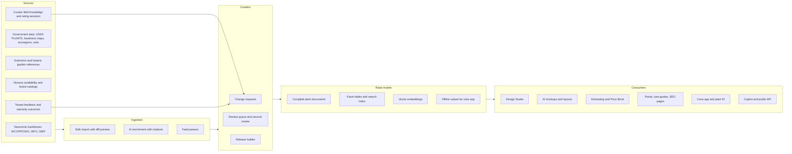
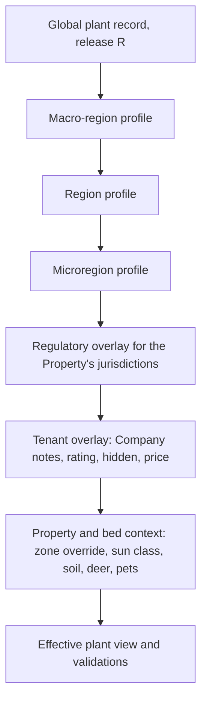

# 12 - Plant Knowledge Base

> The Plant Knowledge Base (KB) is the operator's crown jewel: a curated, region-aware, fully sourced database of thousands of landscape plants that every other part of Rootline trusts. It holds the taxonomy (family down to cultivar, trade names, patents and synonyms), traits (size, form, bloom, foliage, seasonal color), requirements (hardiness and heat zones, sun, water including WUCOLS, soil, pH, drainage, salt), characteristics (deer resistance, pollinator and host-plant value, native and invasive status by jurisdiction, toxicity, allergenicity, fire-wise, maintenance calendar, pests), commercial data (container sizes, cost bands, nursery availability) and licensed media (seasonal photos, 2D plan symbols, 3D archetypes, AI reference images). On top of the plant records sits a geospatial **Region** model that turns any address into a site context (USDA zone, ecoregion, county, metro, operator-drawn Region) and a **Plant Region Profile** layer where curators say, with evidence, how well each plant actually does there on a 1-5 scale. The KB is what keeps a designer from putting a zone 8 plant in a zone 5 bed, stops the AI from rendering a banned Callery pear in Columbus, tells the crew what that shrub is from a photo, writes the client's care guide, and powers SEO plant pages. Curating thousands of plants across dozens of Regions by hand is impossible, so this document also specifies the curation machine: bulk imports with diff preview, AI enrichment that drafts traits with citations and confidence scores, a review queue, field-level provenance, versioned releases, synonym merging against POWO/WFO, quality dashboards and regional rating sessions. No field-service competitor has any of this; design tools that have plant libraries do not know the region, the law or the price.

**Related docs:** [Personas and permissions](02-personas-roles-permissions.md) | [CRM, estimating and proposals](03-crm-sales-estimating-proposals.md) | [Crew app](05-field-crew-mobile-app.md) | [Customer Portal](06-customer-portal.md) | [Design Studio](10-design-studio.md) | [AI design and mockups](11-ai-design-mockups.md) | [Operations, inventory and nurseries](13-operations-inventory-equipment.md) | [Service lines (PHC, tree care, irrigation)](14-service-line-modules.md) | [Marketing and SEO pages](16-marketing-growth-communications.md) | [AI copilot and automation](17-ai-copilot-automation.md) | [Reporting](18-reporting-analytics.md) | [Platform Admin console](19-platform-admin-portal.md) | [Architecture and security](20-architecture-security.md) | [UX and design system](21-ux-design-system-sitemaps.md) | [Business model and GTM](22-business-model-pricing-gtm.md) | [Moonshots](23-innovation-moonshots.md) | [Roadmap](24-roadmap-feature-catalog.md)

**Conventions used in this document**

- Requirement IDs look like `KB-TAX-03`. Each feature carries a priority tag: [MVP], [V1], [V2] or [V3].
- Running examples: **Cedar & Stone Landscapes**, a fictional 38-person design-build-maintain Company in Columbus, Ohio (the same example used in [13](13-operations-inventory-equipment.md)); the curated Region **"Central Ohio"** inside the macro-region **"Great Lakes and Ohio Valley"** (one of the beachhead clusters in [22](22-business-model-pricing-gtm.md)); plus **"Colorado Front Range"** and **"Golden Horseshoe, Ontario"** for contrast.
- Plant facts used in examples (zones, ratings, prices, availability) are illustrative unless a source is cited. Legal and data facts that can change are marked "verify". Estimates are labeled as estimates.
- Botanical names follow the International Code of Nomenclature for Cultivated Plants style: genus and species in italics in the UI, cultivar epithets in single quotes (`Hydrangea paniculata 'Limelight'`), trade names (selling names) shown separately and never inside quotes (`Endless Summer®` is the trade name for `Hydrangea macrophylla 'Bailmer'`).

---

## 1. Goals and non-goals

### 1.1 Goals

| # | Goal | Measure of success |
|---|---|---|
| G1 | **Right plant, right place, every time.** Every plant shown by default, placed by AI or validated in a design is checked against the property's Region, zones, sun, water and legal status. | 99% or better region-compliance on the plant-recommendation eval set (the release gate in [19](19-platform-admin-portal.md)); zero legally prohibited plants in sent proposals |
| G2 | **Breadth.** Cover the plants North American landscape contractors actually buy. | 3,000 plants at Silver completeness or better at MVP launch; 6,000 by V1; 10,000+ by V2 (targets) |
| G3 | **Regional depth where we sell.** Beachhead Regions are "excellent": rated profiles and palettes for every common use. | 600 or more rated plants per beachhead Region; palettes for foundation, pollinator, shade, rain garden, screening, deer-resistant and xeric uses (the coverage bar set in [22](22-business-model-pricing-gtm.md)) |
| G4 | **Trust through provenance.** Every value can answer "who said so, based on what, when?" | 100% of critical traits carry at least one citation and a second-curator review; field-level provenance on 100% of values |
| G5 | **Curation at scale.** A handful of curators can maintain thousands of plants across dozens of Regions. | Curator throughput doubled by AI enrichment (the KPI in [19](19-platform-admin-portal.md)); median review time per non-critical AI suggestion under 30 seconds |
| G6 | **Search that understands landscapers.** Faceted, semantic and visual search that answers real questions. | p95 latency under 300 ms (faceted) and 1.5 s (natural language); zero-result rate under 3%; 40% or more of searches end in an "add" action |
| G7 | **Licensed, beautiful media.** Seasonal photos and symbols that can be printed in proposals without legal risk. | Zero unlicensed assets served; takedowns complete within 24 hours; 95% or more of palette plants with licensed photos in launch Regions |
| G8 | **Fresh and lawful.** Regulatory status (invasive and noxious lists) is current. | Regulatory changes published within 72 hours of a curator learning of them, and before the legal effective date when known |
| G9 | **A learning loop.** Real installs make the KB smarter. | Warranty replacement and plant-failure data (aggregated, k of 10 or more Companies) feed every beachhead Region's ratings by V1 |
| G10 | **Buyable plants.** Designs specify plants that can actually be sourced. | By V1, 70% or more of plants specified in beachhead designs show availability from at least one vendor within 50 miles (target) |

### 1.2 Non-goals

- **Not a taxonomic authority.** Rootline follows an accepted-name backbone (the World Checklist of Vascular Plants as published through Plants of the World Online, cross-referenced to World Flora Online). We do not publish taxonomic opinions; we decide only what name to *display* to the trade.
- **Not a consumer gardening encyclopedia first.** Public plant pages exist for SEO and lead generation ([16](16-marketing-growth-communications.md)), but the KB is built for professionals who design, price, install and warranty plants.
- **Not a pesticide label library.** Chemical products, EPA/PCP registration numbers and application logs live in [05](05-field-crew-mobile-app.md), [13](13-operations-inventory-equipment.md) and [14](14-service-line-modules.md). The KB links pests and diseases to host plants but does not prescribe products.
- **Not nursery production software.** Growers' crop planning is out of scope; the KB only ingests their availability and price lists ([13](13-operations-inventory-equipment.md)).
- **Not medical, veterinary or legal advice.** Toxicity and regulatory data are compiled references with citations and disclaimers, not determinations.
- **Not an open wiki.** Companies can suggest changes and report failures; only platform curators change the global record.
- **Not a full turfgrass agronomy system.** Turfgrass species and cultivars exist as Plants (so lawn programs and overseeding can reference them), but fertility and pest programs are owned by [14](14-service-line-modules.md).

---

## 2. Market research: what competitors do, what users complain about, the gap we exploit

> **Research note.** The run-wide web-search budget was exhausted before this document's research began, and direct fetches to hosts outside the session's network allowlist failed (for example the USDA hardiness map site and Wikipedia). This section therefore relies on (a) sources already gathered and cited by sibling Rootline documents and research reports, and (b) the author's domain knowledge of public plant-data sources, which is clearly marked "verify". See [Sources](#sources).

### 2.1 What competitors do today

| Product (owner) | Plant data today | What that means for a landscaper | Source |
|---|---|---|---|
| Jobber, Housecall Pro, ServiceTitan core, Workiz | Generic product and service catalogs. No plant database, no region model, no plant traits. | A "plant" is a line item with a price. The designer's knowledge lives in their head or a spreadsheet. | [R1 feature matrix](research/R1-field-service-platforms.md) (region-aware plant database: N for every platform reviewed) |
| Service Autopilot (Xplor), Real Green (WorkWave), Yardbook, Copilot CRM | Lawn-care programs and service catalogs. No plant KB. | Good for rounds-based lawn treatments; nothing for design-build. | [R1](research/R1-field-service-platforms.md), [R2](research/R2-landscape-specific-platforms.md) |
| LMN (Granum) | Materials and catalog items for budget-based estimating; SiteOne ordering integration since about 2021. No region-aware plant knowledge. | Plants can be priced and ordered, but nothing says whether they will survive. | [Turf Magazine](https://turfmagazine.com/lmn-integrates-siteone-landscape-supply-in-2021-software/), [LMN blog](https://golmn.com/blog/partner-in-spotlight-siteone-landscape-supply) |
| Aspire (ServiceTitan) | Catalog items with vendor pricing; PropertyIntel measures what exists on a site. No plant KB. | Excellent for measuring and maintaining what is there, not for choosing what should be planted. | [Landscape Management](https://www.landscapemanagement.net/aspire-software-launches-new-propertyintel-measuring-and-estimating-tool/), [R2](research/R2-landscape-specific-platforms.md) |
| SynkedUP | Estimating catalog and kits for landscape quoting. No plant traits. | Fast quotes; plant choice is manual. | [SynkedUP landscaping](https://synkedup.com/industry/landscaping/), [quoting guide](https://synkedup.com/streamline-your-landscape-quoting-process-with-synkedup-a-quick-guide/) |
| SingleOps (Granum) | Tree Inventory (launched March 2025) records trees on a property. | Asset records for arborists; no curated landscape palette, no region ratings. | [SingleOps Tree Inventory](https://singleops.com/features/tree-inventory) |
| Arborgold | GPS-located tree inventory, plant health care programs, a measuring tool. | Tree-focused; species are labels, not a curated KB with regional performance. | [Arborgold blog](https://arborgold.com/blog/tree-care-arborist/the-best-tree-inventory-software-for-tracking-your-trees-and-clients/), [Arborgold help](https://help.arborgold.com/en/articles/4423488-landscape-measuring-tool-basics) |
| PRO Landscape+ (Drafix) | Design software with a plant library and photo imaging. | Reviewers ask for "more native plants suited to their climate zone" and say plant symbols are hard to tell apart. | [Capterra UK](https://www.capterra.co.uk/software/126135/pro-landscape), [Software Advice](https://www.softwareadvice.com/landscaping/pro-landscape-profile) |
| Land F/X, Vectorworks Landmark | CAD plug-ins and BIM tools with plant databases that drive planting schedules. | Professional-grade schedules for landscape architects, but separate from estimating, jobs and invoicing, and not regionally curated. | [Land F/X planting schedules](https://www.landfx.com/docs/planting/schedules.html), [Vectorworks schedules](https://app-help.vectorworks.net/2015/NNA/eng/VW2015_Guide/Worksheets/Creating_Schedules_Automatically.htm) |
| Consumer AI design apps (Neighborbrite and similar) | The image model chooses the plants. | Penn State Extension found a popular tool weak on plants and could not filter to natives without a paid plan; a 2026 guide warns AI tools often suggest plants that will not survive the zone. | [Penn State Extension](https://extension.psu.edu/ai-garden-design-intelligent-choices), [Cognitive Future](https://cognitivefuture.ai/best-ai-tools-for-landscape-design/) |
| Public reference sites (USDA PLANTS, Missouri Botanical Garden Plant Finder, NC State Extension Gardener Plant Toolbox, Lady Bird Johnson Wildflower Center, Calscape) | Deep, authoritative plant data, much of it free to read. | Great for research, but disconnected from design, pricing and jobs; licensing ranges from public domain to all-rights-reserved; regional performance is rarely explicit. | Domain knowledge; see the source registry in 4.6 (verify each source's terms) |

### 2.2 What users complain about

| Pain | Evidence | What it costs a Company |
|---|---|---|
| **Plant libraries that do not know the region.** | PRO Landscape+ reviewers ask for native plants suited to their climate zone ([Capterra UK](https://www.capterra.co.uk/software/126135/pro-landscape)). Design Studio research found generic libraries put zone 8 plants in zone 5 designs ([10](10-design-studio.md)). | Warranty replacements at full cost, lost credibility with clients. |
| **AI that invents or misplaces plants.** | Penn State Extension's review of AI garden tools ([Penn State Extension](https://extension.psu.edu/ai-garden-design-intelligent-choices)); "AI tools regularly suggest plants that will not survive your zone" ([Cognitive Future](https://cognitivefuture.ai/best-ai-tools-for-landscape-design/)); an anecdotal Reddit comment that generic AI invents plants that make no sense for the weather ([Reddit snapshot](https://reddit.sentinel-team.org/posts/1srelgp/snapshots/2026-04-24T23%3A03%3A08.204571Z)). | Clients fall in love with renders the Company cannot build or warranty. |
| **Plant knowledge lives in one person's head.** | Identified as pain P4 in the platform research ([R1](research/R1-field-service-platforms.md), labeled an estimate there). | When the lead designer leaves, quality and margins drop; new estimators guess. |
| **Native filters behind paywalls, symbols that look alike.** | [Penn State Extension](https://extension.psu.edu/ai-garden-design-intelligent-choices), [Software Advice](https://www.softwareadvice.com/landscaping/pro-landscape-profile). | Designers cannot prove "native" or "deer-resistant" claims to clients. |
| **Availability lists arrive as PDFs and spreadsheets.** | Industry practice (domain knowledge): wholesale nurseries send weekly availability lists in PDF or Excel with abbreviated names ("Hyd pan Limelight #5"). Rootline's ops research specifies a parser for exactly this ([13](13-operations-inventory-equipment.md)). | Estimators retype names and sizes; substitutions happen late, on the truck. |
| **Name chaos.** | Domain knowledge: taxonomy changes (Russian sage moved from *Perovskia atriplicifolia* to *Salvia yangii*; many asters to *Symphyotrichum*; *Sedum spectabile* to *Hylotelephium spectabile*), trade names that differ from cultivar names (Knock Out® is `Rosa 'Radrazz'`), and regional common names. | Duplicate items in price books, wrong plants ordered, confused clients. |
| **Legal and safety blind spots.** | Domain knowledge: invasive and noxious lists differ by state and province and change (for example, Ohio's ban on selling Callery pear took effect in 2023, verify); toxicity matters to pet owners and daycare clients. | Fines, ripped-out plantings, liability and reputational harm. |

### 2.3 The reference-data landscape (why "just use free data" does not work)

1. **Fragmented by trait.** Hardiness comes from one place, water use from another (WUCOLS covers California only), deer ratings from a handful of extension lists, toxicity from ASPCA and poison-control references, invasive status from 60+ state and provincial lists. Nobody joins them.
2. **Not regional performance.** A zone range says a plant *survives* the winter. It does not say it *thrives* in Central Ohio's heavy clay, humid summers and deer pressure. That judgment is what experienced horticulturists add, and it is what the Plant Region Profile captures.
3. **Licensing is a minefield.** Government data (USDA PLANTS, EPA ecoregions, the USDA hardiness map, SSURGO soils) is generally public domain; botanic-garden and extension content is usually copyrighted; community photos carry per-photo licenses, often non-commercial. A commercial product must track license per field and per image (4.6).
4. **No workflow.** None of it links to a Price Book item, a design symbol, a nursery availability line, a warranty or a care guide.

### 2.4 The gap we exploit

Rootline is the only platform that connects **curated regional plant intelligence** to **design, AI rendering, estimating, purchasing, installation, warranty and client care** in one data model. The KB is both product (designers and estimators use it daily) and moat (a curated, provenance-tracked regional dataset improves with every install and is hard to copy).

> **Competitive edge: vs Jobber, Housecall Pro, ServiceTitan, Service Autopilot, Yardbook, Copilot CRM.** They have no plant data at all. Rootline's plant picker knows that the Cedar & Stone client in Upper Arlington has clay soil, deer and a dog, and shows only plants rated 3/5 or better for Central Ohio that are deer-resistant and pet-safe, with this week's availability from two local nurseries.

> **Competitive edge: vs LMN, Aspire, SynkedUP.** They price plants; Rootline also knows whether the plant will live. A plant with a 2/5 Region rating triggers a margin-protecting warning before the estimator adds a one-year warranty to a $14,800 install.

> **Competitive edge: vs PRO Landscape+, Land F/X, Vectorworks.** Their libraries are static and national. Rootline's is curated per Region by named horticulturists, versioned weekly, legally aware (state and provincial invasive lists with effective dates) and tied to live nursery availability and the Company's own prices.

> **Competitive edge: vs consumer AI design apps.** They let the image model pick plants. Rootline picks plants from the regional KB first and only then renders them ([11](11-ai-design-mockups.md)), so a homeowner in Denver never falls in love with a hydrangea that will fry on a west-facing hell strip.

---

## 3. Personas and jobs-to-be-done

| Persona (role key) | Jobs-to-be-done | What success sounds like |
|---|---|---|
| Platform Operator (`platform_owner`) | Set KB policy (what counts as evidence, rating rubric, coverage bar per Region), choose and fund Regions, approve data licenses and brand partnerships, protect editorial independence. | "Central Ohio and the Front Range are at Excellent; the Golden Horseshoe hits Excellent before Landscape Ontario Congress." |
| Platform curator (`platform_curator`), levels contributor, curator and senior | Draft and review plant records and Region profiles; run rating sessions; resolve duplicates; manage photos and licenses; publish releases (senior). | "I cleared 140 AI suggestions for xeric perennials before lunch, and every critical trait has two sources." |
| Platform engineer (`platform_engineer`) | Run import profiles, enrichment pipelines, search indexes, embeddings and releases; keep the KB API fast. | "The 2027.04.12 release reindexed in 9 minutes with zero tenant errors." |
| Platform support (`platform_support`) | Answer "why can't I find plant X?" and "why is this plant flagged?" tickets; route suggestions to curators. | "I can see the exact rule and source that flagged burning bush for this Massachusetts property." |
| Business Owner (`owner`) | Standardize what the Company plants and warranties; protect margin; build a Company palette. | "My new estimators pick from our 220 proven plants, and warranty losses are down." |
| Landscape Designer (`designer`) | Find the right plant fast for a bed's sun, soil, size and style; prove claims (native, deer-resistant, pet-safe) to clients; get beautiful symbols and photos. | "I typed 'shade evergreen under 4 ft, clay, deer' and had five good options with availability in ten seconds." |
| Sales Rep / Estimator (`estimator`) | Price plants by size from the Price Book, know availability and substitutes, avoid warranty traps. | "The picker told me 'Green Velvet' boxwood is short this spring and suggested 'Shamrock' inkberry at the same size and price class." |
| Operations / Account Manager (`ops_manager`) | Order the right plants, handle substitutions, plan care in the holding yard, manage warranty replacements. | "The nursery's PDF list became a matched availability table in a minute." |
| Crew Lead (`crew_lead`) and Field Technician (`technician`) | Identify plants on site, install the right plant in the right bed, know care tasks; work offline and in Spanish. | "I snapped a photo of the dead shrub, the app said *Ilex crenata*, likely root rot in wet clay, and logged the warranty claim." |
| Office Manager (`office_manager`) | Generate care guides and plant cards for clients; answer client plant questions. | "The care guide went out automatically after the install closed." |
| Bookkeeper (`bookkeeper`) | Rarely touches the KB; sees plant categories on COGS lines ([09](09-accounting-ledger-integrations.md)). | "Plant purchases map to 'Materials COGS - Plants' automatically." |
| Subcontractor (`subcontractor`) | See the plant list and install specs for assigned work only. | "I knew exactly what went in Bed C." |
| Residential client (`client_residential`) | Understand what is planted, why, and how to care for it; check pet safety. | "Every plant in my yard has a card with watering tips, and the app warned me the lily is toxic to cats." |
| Commercial client (`client_commercial`) | Meet HOA or municipal plant lists, sustainability goals (native share, water use) and budgets across many properties. | "The plan shows 62% native plants and all species on the HOA approved list." |
| Nursery or supplier contact (external, via Nursery Connect in [13](13-operations-inventory-equipment.md)) | Publish availability and prices once and reach every Rootline contractor nearby. | "I upload my weekly list and contractors find my plants in their picker." |
| Public visitor (anonymous) | Learn whether a plant suits their area; find a local pro. | "The page said this plant is rated 5/5 for Central Ohio and linked me to three local designers." |

---

## 4. Feature specification

### 4.0 How the KB is organized

The KB has four layers. Each layer is owned by a different set of people and changes at a different speed.

| Layer | What it holds | Owner | Change cadence | Storage |
|---|---|---|---|---|
| **Global canonical** | Plants, names, traits, media, symbols, pests and diseases | `platform_curator` | Daily releases [MVP] | `kb.*` global tables (no RLS, read-only to tenants) per [20](20-architecture-security.md) |
| **Geographic** | Regions, region layers, jurisdictions, regulatory listings, native ranges, Plant Region Profiles, Plant Palettes | `platform_curator` (Region definitions also `platform_owner`) | Profiles daily; Region geometry rarely, versioned | `kb.*` global tables plus PostGIS |
| **Commercial** | Size specs, nursery listings, availability and price bands | Feeds plus curators | Hourly to weekly | `kb.nursery_*` global plus tenant `vendor_availability` ([13](13-operations-inventory-equipment.md)) |
| **Tenant overlay** | Private plants, favorites, Company palettes, notes, Price Book links, hidden plants, Company ratings | Each Company | Real time | RLS-protected `kb.tenant_*` tables ([20](20-architecture-security.md)) |



**Design decision (opinionated):** canonical storage is a typed attribute-value model (one row per trait value, each with its own provenance) because field-level provenance, conflicts and per-Region overrides are first-class requirements. Reads never touch that model directly: every release compiles a denormalized **plant document** (JSONB) per plant and per Region, plus facet columns and embeddings. Writers get rigor; readers get speed.

### 4.1 Plant records, taxonomy and names (KB-TAX)

**KB-TAX-01 Plant record grain [MVP]**
- A **Plant** is either a *taxon record* (species, subspecies, variety, forma or named hybrid, for example `Hydrangea paniculata`) or a *cultivar record* (for example `Hydrangea paniculata 'Limelight'`).
- Cultivar records have `parent_plant_id` pointing to the taxon record and **inherit every inheritable trait** they do not override. The editor shows inherited values in grey with "from species", and an override in black with its own provenance. Changing the species value propagates to children that inherit it in the next release.
- Hybrids of uncertain parentage attach to a genus-level parent record (for example `Hosta 'Sum and Substance'` under `Hosta`). Genus-level records are not placeable in designs unless flagged `placeable_generic` (for example "Hosta, assorted cultivars" in commercial bid work, shown with a warning that traits are approximate).
- **Series and seed strains** (for example a color series of *Echinacea* or a seed-grown strain) are modeled as a `plant_series` that groups cultivar records and can carry shared traits.
- Rule: a cultivar record is created only when it is a distinct buyable item or differs in at least one ornamental, size or requirement trait. Pure marketing renames become trade names on the existing record, not new records.

**KB-TAX-02 Name components [MVP]**

| Field | Example | Rules |
|---|---|---|
| `family` | Hydrangeaceae | From backbone; required |
| `genus` | *Hydrangea* | Required; capitalized |
| `hybrid_marker` | × (as in *× Heucherella* or *Calamagrostis* × *acutiflora*) | Enum: none, interspecific, intergeneric, graft-chimaera |
| `specific_epithet` | *paniculata* | Lowercase |
| `infraspecific_rank`, `infraspecific_epithet` | var. *grandiflora*; subsp. *...*; f. *...* | Rank enum: subsp., var., subvar., f. |
| `cultivar_group` | Group names where used | Optional |
| `cultivar_epithet` | 'Limelight' | Stored without quotes; rendered in single quotes; validated against an ICNCP-style pattern (no "var.", no Latin-form epithets after 1959 rules are enforced only as warnings) |
| `trade_names[]` | Little Lime® on `'Jane'`; Bobo® on `'ILVOBO'`; Endless Summer® on `macrophylla 'Bailmer'`; Knock Out® on `Rosa 'Radrazz'` | Each with mark type (®, ™, none), owner, locale, active dates |
| `breeder`, `introducer`, `introduction_year` | Optional | Used in descriptions and brand partnerships |
| `display_name_botanical` | *Hydrangea paniculata* 'Limelight' | Compiled; never typed by hand |

- Display modes per tenant setting: **botanical-first** ("*Hydrangea paniculata* 'Limelight', Limelight panicle hydrangea"), **common-first** ("Limelight hydrangea (*H. paniculata* 'Limelight')") or **trade-first** ("Endless Summer® hydrangea"). Proposals default to common-first; plant schedules default to botanical-first ([10](10-design-studio.md) DS-PLNT-08).

**KB-TAX-03 Accepted names, synonyms and the trade-name policy [MVP]**
- Every taxon record resolves to an accepted name in the backbone (WCVP via POWO) and stores the POWO/IPNI identifier, plus cross-references to World Flora Online, GBIF, USDA PLANTS symbol (for example `ACRU` for *Acer rubrum*) and ITIS TSN where they exist.
- Synonyms are stored with a type: homotypic, heterotypic, misapplied, orthographic variant, or **trade synonym** (a name the nursery trade uses that is not botanically valid).
- **Policy:** Rootline displays the *accepted* name, and keeps the familiar trade name visible in parentheses until a curator-set `trade_display_until` date (default: 5 years after the change). Example: "*Salvia yangii* (syn. *Perovskia atriplicifolia*), Russian sage". Search matches every synonym forever. Where the backbone itself is unsettled (for example Alaska cedar has moved among *Chamaecyparis*, *Xanthocyparis*, *Callitropsis* and *Cupressus*), a senior curator may pin the displayed name and record the rationale.
- Backbone refresh [V1]: a monthly job diffs our taxa against the latest backbone export and opens change requests for name changes, never applying them automatically.

**KB-TAX-04 Common names in several languages [MVP English and Spanish, V1 French-Canadian]**
- Each common name has `locale` (`en-US`, `en-CA`, `es-US`, `es-MX`, `fr-CA`), optional `region_id` scope (common names vary: "ironwood" means different trees in different places), `is_preferred` per locale and Region, and a source.
- Exactly one preferred name per locale (plus optional Region overrides). If no sourced name exists for a locale, the UI shows the botanical name plus the English common name. **Common names are never machine-translated** without a source; an AI-suggested Spanish name enters the queue as a suggestion like any other value.
- Crew-facing Spanish names [V1]: curators may add "field names" used by Spanish-speaking crews in a Region (sourced to the curator and two tenant confirmations), flagged `informal`.

**KB-TAX-05 Patents, breeders' rights and trademarks [MVP fields, V1 alerts]**
- Fields: US plant patent number (`PP` plus digits), filing date, grant date, computed expected expiry (US plant patents run 20 years from filing; label "estimated, verify"), Canadian Plant Breeders' Rights certificate and term, optional EU Community Plant Variety Rights, trademark text and owner.
- Behaviors: a "Propagation restricted" badge shows for patented or PBR-protected plants to Companies that enable in-house propagation in settings [V1]; proposals render ® and ™ correctly; the trade name is never used as the cultivar epithet in schedules.
- Rootline displays this information as a reference, not legal advice.

**KB-TAX-06 Identifiers [MVP]**
- Internal UUID, a human-readable code (`RL-P-004821`), a stable URL slug (`hydrangea-paniculata-limelight`), and a default schedule key suggestion (`HYD LIM`) that the Design Studio de-duplicates per design ([10](10-design-studio.md) DS-PLNT-08).
- Codes and slugs never change; merges create redirects (KB-CUR-08).

**KB-TAX-07 Plant kinds and categories [MVP]**
- `plant_kind` enum: tree, shrub, perennial, ornamental grass, sedge or rush, groundcover, vine or climber, annual, bulb (including corms and tubers), fern, succulent or cactus, palm or cycad, turfgrass, aquatic or marginal, moss. Edible (fruit tree, berry, herb, vegetable) is a tag, not a kind.
- Subtypes are traits (for example `leaf_persistence = evergreen` plus `foliage_type = needled` for conifers), so facets compose cleanly.

**KB-TAX-08 Record lifecycle [MVP]**
- Plant and Plant Region Profile records move `draft` -> `in_review` -> `approved` -> `published` -> `deprecated`, plus `rejected` and `merged` (the states in [19](19-platform-admin-portal.md) PA-070, with `merged` added for redirects).
- Deprecated plants stay resolvable for existing designs, estimates and warranties but are hidden from search by default, with a reason code: `superseded_by_accepted_name`, `not_in_trade`, `prohibited_in_all_operating_regions`, `data_quality`.

**KB-TAX-09 Turfgrass records [MVP basic]**
- Turfgrass species and major cultivar classes (tall fescue, Kentucky bluegrass, perennial ryegrass, fine fescues, bermudagrass, zoysiagrass, St. Augustinegrass, buffalograss) with turf traits: season type (cool or warm), recommended mowing height range, shade, wear, drought and salt tolerance, and an illustrative seeding-rate field (pounds per 1,000 sq ft, sourced per Region). Lawn programs in [14](14-service-line-modules.md) reference them for overseeding and renovation estimates.

### 4.2 Traits (KB-TRT)

**KB-TRT-01 Trait dictionary [MVP]**
- Traits are defined as data in a registry (`trait_definition`), not as hard-coded columns. Each definition has: key, labels per locale, data type (`enum`, `enum_set`, `num_range`, `number`, `bool`, `month_set`, `color_set`, `text`, `rich_text`, `ref`), unit dimension (length, temperature, depth, volume), allowed values with written definitions, group, **criticality** (`critical` or `standard`), `inheritable` (species to cultivar), `regionalizable` (may be overridden in a Plant Region Profile), `facetable`, `client_visible`, completeness weight and evidence rule.
- Adding a trait is a curator-admin change plus, if facetable, a facet-column migration run by `platform_engineer`. Removing a trait archives values; it never deletes them.

**KB-TRT-02 Value semantics [MVP]**
- Each trait value carries: the value, qualifiers (for example "in cultivated landscapes" vs "in the wild"; "once established" for drought tolerance), and provenance (source, citation with locator, method, confidence, author, reviewer, timestamps).
- Several **candidate** values may exist for one trait (sources disagree); exactly one is **selected** per scope (global or Region). The quality dashboard counts unresolved conflicts.
- Lengths are stored in centimeters and temperatures in Celsius, but the **original value and unit text are preserved** ("3-4 ft") so imperial users never see round-trip drift such as "2.95-3.94 ft". Display rounding: feet to the nearest 0.5 ft under 10 ft and to the nearest 1 ft above; centimeters to the nearest 5 cm under 2 m and to the nearest 0.1 m above.
- **Critical traits** (USDA and Canadian hardiness zones, invasive and noxious status, toxicity, deer-resistance claims, mature size) need at least one Tier 1 citation (4.6) and a second curator's approval before publishing, matching [19](19-platform-admin-portal.md) PA-070.

**Form and ornamental traits**

| Trait key | Type and values | Notes | Priority |
|---|---|---|---|
| `leaf_persistence` | evergreen, semi-evergreen, deciduous, herbaceous (dies back), marcescent | Drives winter rendering and symbols | [MVP] |
| `foliage_type` | broadleaf, needled, scale-like, grass-like, succulent, fern frond | | [MVP] |
| `mature_height`, `mature_spread` | `num_range` (cm) plus typical value | Landscape context by default; "in the wild" stored as a qualifier. Drives symbol size and spacing validation | [MVP] critical |
| `years_to_maturity` | number (years) | Feeds the Design Studio growth slider | [V1] |
| `growth_rate` | slow, moderate, fast | Rootline rubric: trees slow under 30 cm per year, moderate 30-60, fast over 60; shrubs and perennials judged relative to mature size | [MVP] |
| `form` | round, oval, vase, columnar, pyramidal, weeping, spreading, mounding, upright, clumping, fountain, prostrate, climbing, irregular | Same vocabulary as procedural symbols in [10](10-design-studio.md) DS-SYMB-02 | [MVP] |
| `foliage_texture` | fine, medium, coarse | | [MVP] |
| `foliage_color_by_season` | `color_set` for spring, summer, fall, winter (named color plus hex) | Hex used by symbols and 3D archetypes | [MVP] |
| `variegation` | none, margin, center, splash, streak | | [V1] |
| `fall_color_showiness` | 0-3 | 3 = signature fall plant (for example *Nyssa sylvatica*) | [MVP] |
| `bloom_months` | `month_set` with reference Region | Region profiles may shift it (KB-PRP-04) | [MVP] |
| `bloom_colors` | `color_set` | | [MVP] |
| `bloom_showiness` | 0-3 | | [V1] |
| `blooms_on` | old wood, new wood, both, not applicable | Pruning-critical: *Hydrangea macrophylla* (old wood, except reblooming lines) vs *H. paniculata* (new wood) | [MVP] |
| `fruit` | type, months, colors, showiness 0-3, litter 0-3, edible (with caveats) | Litter matters near patios and pools | [V1] |
| `pollinizer_required` | bool plus compatible pollinizers | Dioecious plants, for example winterberry holly (*Ilex verticillata*) needs a compatible male nearby to fruit | [V1] |
| `fragrance` | flowers or foliage, intensity 0-3 | | [V1] |
| `winter_interest` | bark, form, fruit, evergreen foliage (set) | | [V1] |
| `thorns_spines` | none, minor, significant | Play areas, walkways | [MVP] |
| `spread_habit` | clumping, slow-spreading, aggressive (rhizomes, stolons, self-seeding) | Running bamboo, some mints and grasses | [V1] |
| `lifespan` | short-lived (under 3 years), moderate, long-lived | Short-lived perennials hurt warranty margins | [V1] |

**Requirements**

| Trait key | Type and values | Notes | Priority |
|---|---|---|---|
| `usda_zone_min`, `usda_zone_max` | half-zone ordinal (1a=1 through 13b=26) | USDA map is based on average annual extreme minimum temperature in 10°F zones and 5°F half zones (2023 edition uses 1991-2020 data; verify) | [MVP] critical |
| `canada_zone_min`, `canada_zone_max` | Canadian zone ordinal (0a through 9b) | Canada's Natural Resources Canada zones use several climate variables, not only extreme minimum temperature, so they are **not** interchangeable with USDA zones (verify current methodology). Stored separately; never converted | [MVP] critical |
| `ahs_heat_zone_min`, `ahs_heat_zone_max` | 1-12 | American Horticultural Society heat zones are based on average days per year above 86°F (30°C); map and data licensing to verify | [V1] |
| `chill_hours` | number range | Fruit trees and some bulbs | [V2] |
| `sun` | set of: full sun (6+ hours direct), part sun (4-6 hours), part shade (2-4 hours or dappled), full shade (under 2 hours) | Maps to the Design Studio sun classes ([10](10-design-studio.md) DS-SUN-02). Region profiles can add "needs afternoon shade here" | [MVP] |
| `water_need` | very low, low, moderate, high | Generic, all Regions | [MVP] |
| `wucols` | per California WUCOLS region 1-6: VL, L, M, H, not appropriate, unknown | WUCOLS classes are percentages of reference evapotranspiration (VL under 10%, L 10-30%, M 40-60%, H 70-90%; verify). Used for California water-budget compliance (plant factor) and hydrozoning ([14](14-service-line-modules.md)) | [MVP] schema, data per license |
| `plant_factor` | 0.0-1.0 | Derived from WUCOLS where available, otherwise curator-set by Region for water budgets | [V1] |
| `soil_texture` | set of: sand, loam, silt, clay, rocky or gravelly, organic | "Tolerates clay" is the most-used filter in glaciated Midwest soils | [MVP] |
| `soil_ph_min`, `soil_ph_max` | number range | Plus `acid_loving` derived flag (max pH under 6.5) | [MVP] |
| `drainage` | set of: requires sharp drainage, well-drained, moist, tolerates periodic flooding, tolerates standing water | Rain-garden zoning uses this | [MVP] |
| `drought_tolerance` | none, low, moderate, high (once established) | | [MVP] |
| `wet_tolerance` | none, low, moderate, high | | [MVP] |
| `salt_tolerance_soil`, `salt_tolerance_spray` | none, low, moderate, high | Road-salt zones: hell strips, parking islands, driveway edges in snow Regions | [MVP] |
| `urban_tolerance` | set of: compaction, pollution, reflected heat, restricted root zone | Street trees, parking lots | [V1] |
| `wind_tolerance` | low, moderate, high | Coastal and Front Range sites | [V1] |
| `juglone_tolerance` | sensitive, tolerant, unknown | Sites under black walnut | [V1] |
| `erosion_control` | bool plus slope rating | | [V1] |

**Characteristics**

| Trait key | Type and values | Notes | Priority |
|---|---|---|---|
| `deer_resistance` | A rarely damaged, B seldom severely damaged, C occasionally severely damaged, D frequently severely damaged | The A-D scale popularized by Rutgers NJAES lists; also used by [10](10-design-studio.md) VAL-DEER-01. Regionalizable because deer browse varies with pressure and season | [MVP] critical |
| `rabbit_resistance` | high, moderate, low | | [MVP] |
| `pollinator_value` | 0-3 per guild: native bees, honey bees, butterflies, moths, hummingbirds | | [MVP] |
| `larval_host` | bool plus notable species (for example monarch on *Asclepias*) | | [V1] |
| `keystone_plant` | bool per ecoregion | From keystone-plant lists by ecoregion (National Wildlife Federation and Tallamy research; licensing to verify) | [V1] |
| `wildlife_value` | set of: bird food (fruit or seed), nesting cover, winter cover | | [V1] |
| `native_status` | computed per jurisdiction and ecoregion: native, introduced, native cultivar ("nativar"), unknown | See KB-RGN-07. Never a single global boolean | [MVP] |
| `regulatory_status` | computed per jurisdiction from listings: prohibited, restricted, regulated, watch list, advisory (invasive council), none | See KB-RGN-08. Cultivar exemptions supported | [MVP] critical |
| `toxicity` | per receptor (dogs, cats, horses, livestock, humans): none known, mild, moderate, severe; toxic parts; principle | Sources such as the ASPCA toxic and non-toxic plant lists and extension toxicity data (verify terms). Disclaimer and poison-control contacts shown | [MVP] critical |
| `skin_irritant` | none, mild, severe | Sap of some *Euphorbia*; *Toxicodendron* | [V1] |
| `pollen_allergenicity` | low, moderate, high | Proprietary scales (for example OPALS) only under license | [V1] |
| `fire_behavior` | regional rating per sourced list: fire-resistant, moderate, high flammability; attributes (volatile oils, retains dead material, fine fuels) | No plant is fireproof; ratings must cite a regional source | [V1] |
| `maintenance_level` | low, moderate, high | Rubric: low = 0-2 interventions per year; moderate = 3-5; high = 6 or more or specialist work | [MVP] |
| `care_tasks` | list of task templates (KB-TRT-04) | | [MVP] basic, [V1] regional |
| `pest_disease_links` | list of `pest_disease` with susceptibility: resistant, tolerant, susceptible, highly susceptible | Boxwood blight, emerald ash borer, rose rosette, Japanese beetle, oak wilt | [V1] |
| `infrastructure_risk` | root aggressiveness near pipes and pavement, recommended setback from foundations and hardscape | Willows and silver maple near sewer laterals | [V1] |
| `rain_garden_zone` | set of: bottom (wet), slope, rim (dry) | Palette resolution for rain gardens | [V1] |
| `edible` | bool plus parts and caveats | Edible landscapes | [V1] |
| `green_roof_suitability` | bool plus minimum media depth | | [V2] |

**Commercial traits**

| Trait key | Type and values | Notes | Priority |
|---|---|---|---|
| `size_specs` | list of standard sizes the plant is commonly sold in | Container classes (#1, #2, #3, #5, #7, #10, #15, #25 and larger), quarts, 4.5 in pots, plugs (for example 72-cell), flats, bare root, B&B by caliper (1.5-4 in) for shade trees, by height (4-5 ft, 5-6 ft) for evergreens and multi-stems. Conventions follow ANSI Z60.1 (US) and the Canadian Standards for Nursery Stock (verify current editions), matching [13](13-operations-inventory-equipment.md) | [MVP] |
| `cost_band` | per size, per macro-region: low, median, high wholesale cost with as-of date and sample size | Computed from opted-in nursery list prices (4.11). Always labeled "estimate" | [V1] |
| `availability_index` | 0-100 per Region | Share of reporting vendors in the Region listing it in the last 30 days (4.11) | [V1] |
| `seasonality` | bare-root window, B&B dig seasons | | [V1] |
| `brand_program` | brand name (for example a branded shrub program) | Brand content only under partnership license (4.6) | [V1] |
| `gtin` | list of GTIN/UPC codes from brand tags | Tag scanning in the crew app | [V2] |

**KB-TRT-03 Derived traits [MVP]**
- Computed at release time, never edited: `deer_resistant` (A or B), `pet_safe` (dogs and cats: none known), `drought_tolerant` (moderate or high), `four_season_interest` (bloom, fall color and winter interest present), `size_class` (XS under 1 ft, S 1-3 ft, M 3-6 ft, L 6-15 ft, XL 15-30 ft, XXL over 30 ft by mature height).
- Derived traits are facetable and appear in natural-language search parses.

**KB-TRT-04 Care and installation specifications [MVP basic, V1 regional]**
- **Task templates:** prune, shear, cut back, deadhead, divide, fertilize, mulch refresh, winter protection, dormant oil, rake fruit, monitor for pest X. Timing is expressed **phenologically** ("late winter before bud break", "immediately after bloom") and mapped to reference months per Region (for example "late winter" = mid-February to mid-March in Central Ohio; illustrative). Example: "Prune Limelight hydrangea in late winter; it blooms on new wood."
- **Install specs:** default on-center spacing (feeds Design Studio fill-bed DS-PLNT-04), planting depth notes (root flare at grade for trees), staking guidance, establishment watering template (for example "2-3 times per week for the first 4 weeks, then weekly through the first season", illustrative and regionalizable).
- Consumers: client care guides ([06](06-customer-portal.md) 4.12.1), maintenance task generation and PHC programs ([14](14-service-line-modules.md)), crew install sheets ([05](05-field-crew-mobile-app.md)), holding-yard watering ([13](13-operations-inventory-equipment.md) 4.7).

**KB-TRT-05 Pests and diseases sub-KB [V1]**
- `pest_disease` entity: name (common and scientific), type (insect, mite, fungal, bacterial, viral, nematode, abiotic disorder), host plants with susceptibility, signs and symptoms, seasonal activity windows by Region, regional pressure (none, low, moderate, high) and quarantine status (for example emerald ash borer quarantines historically; verify current federal status).
- Used by plant ID ("likely boxwood blight"), PHC program design and tree inventory ([14](14-service-line-modules.md)), and substitutions ("blight-resistant boxwood alternative").
- The KB names pests and susceptibility; it never prescribes pesticide products or rates.

### 4.3 Region model and geospatial lookup (KB-RGN)

A Region answers "where is this property, horticulturally?" Rootline combines public climate, ecological and administrative layers with **operator-drawn curated Regions** that reflect how plants actually perform.

**KB-RGN-01 Region layers [MVP unless noted]**

| Layer | Coverage | Source (license class, verify) | Used for | Priority |
|---|---|---|---|---|
| USDA Plant Hardiness Zones (2023 edition) | US incl. Alaska, Hawaii, Puerto Rico | USDA ARS with Oregon State PRISM; US government work, generally public domain | Hardiness validation, facets | [MVP] |
| Canadian Plant Hardiness Zones and extreme-minimum-temperature zones | Canada | Natural Resources Canada; Open Government Licence - Canada | Hardiness validation in Canada | [MVP] |
| AHS Plant Heat Zones | US | American Horticultural Society; license required | Heat validation | [V1] |
| EPA ecoregions Level III and IV | Conterminous US (about 105 Level III and nearly 1,000 Level IV units) | US EPA; public domain | Native status, palettes, Region recipes | [MVP] |
| CEC North American ecoregions Level I-III | US, Canada, Mexico | Commission for Environmental Cooperation | Cross-border consistency, Canadian Regions | [MVP] |
| Ecological Framework of Canada (ecozones to ecodistricts) | Canada | Government of Canada | Finer Canadian Regions | [V1] |
| States, counties, metros (CBSAs) | US | US Census TIGER/Line; public domain | Jurisdictions, legal status, benchmarking | [MVP] |
| Provinces, census divisions, CMAs | Canada | Statistics Canada Open Licence | Jurisdictions, legal status | [MVP] |
| WUCOLS regions 1-6 | California | Curator-drawn approximation of the published WUCOLS region descriptions | WUCOLS lookup | [MVP] for California tenants |
| Frost dates and climate normals | US, Canada | NOAA 1991-2020 normals; Environment and Climate Change Canada normals | Care calendars, bloom shifts, season defaults | [V1] |
| Soils | US (SSURGO), Canada (Soil Landscapes of Canada, coarser) | USDA NRCS; Agriculture and Agri-Food Canada | Property soil texture, drainage and pH hints (not Regions) | [V1] |
| Wildfire risk | US | USDA Forest Service Wildfire Risk to Communities | Fire-wise defaults | [V2] |
| Elevation | US | USGS 3DEP (already used by [10](10-design-studio.md)) | Elevation bands in mountain Regions | [V1] |
| Custom polygons | Anywhere | Drawn by curators | Curated Region edges | [MVP] |

**KB-RGN-02 Region kinds and hierarchy [MVP]**
- Region `kind`: `admin` (country, state or province, county, metro), `climate` (USDA zone, Canadian zone, heat zone, WUCOLS region), `eco` (EPA Level III and IV, CEC, Canadian ecozones) and `curated`.
- **Curated hierarchy:** country -> macro-region (for example "Great Lakes and Ohio Valley") -> Region (for example "Central Ohio") -> optional microregion (for example "Lake Erie Shore"). The macro-regions are the same ones [18](18-reporting-analytics.md) uses for benchmarking.
- Each curated Region has: name, slug, description, `geom` (MultiPolygon, SRID 4326), definition recipe (KB-RGN-03), parent, coverage tier (KB-RGN-09), lead curator, launch status, climate summary (computed zone mix, heat zone mix, precipitation, frost-free days), reference bloom calendar offset, and priority (tie-breaker).
- Topology rules: curated Regions at the same level may not overlap (checked on publish); a microregion must lie inside its parent within a 50 m tolerance. Until national coverage exists, points outside any curated Region fall back to the macro-region if one contains them, else to `uncurated` with Basic coverage.

**KB-RGN-03 Region definition recipes [MVP]**
- A curated Region is defined as an expression over layers plus manual edits, for example: `(epa_l3 = 55 OR epa_l4 IN [selected units]) AND state = OH AND usda_zone BETWEEN 5b AND 6b`, plus or minus drawn polygons. The recipe is stored, so a Region can be rebuilt when a layer is updated (for example a new hardiness map).
- Geometry is simplified for display (tolerance about 20 m) but lookups use the full-resolution geometry.
- The Region builder map, preview statistics (area, tenants, Properties, plants with profiles, overlaps) and versioned republishing are console features specified in [19](19-platform-admin-portal.md) PA-071.

**KB-RGN-04 Site Context lookup: address to Region [MVP]**
- Input: a geocoded Property point from CRM ([03](03-crm-sales-estimating-proposals.md)), optionally the parcel polygon and building footprint ([10](10-design-studio.md)).
- Algorithm: point-in-polygon against every layer (PostGIS GiST indexes). The primary point is the building-footprint centroid if known, else the parcel centroid, else the geocode. For parcels over 5 acres or multi-building campuses, the service also computes area shares per layer value and sets `spans_multiple = true` when a second value covers more than 15% of the parcel (configurable), so a large HOA common area that straddles 6a and 6b is visible to the designer.
- Leaf curated Region = smallest-area curated Region containing the point; ties are broken by `priority`.
- Results are stored as `property_site_context` (tenant-scoped) with the KB region release id; recomputed on Region republish, map edition change or address change; emits `kb.property_region_changed`.
- Performance target: p95 under 50 ms for a single lookup; batch recompute of 100,000 Properties under 10 minutes.
- Overrides: a Property-level microclimate override (frost pocket, urban heat island, coastal exposure, high elevation) and bed-level overrides in the Design Studio (for example a protected south wall treated half a zone warmer, [10](10-design-studio.md) VAL-ZONE-01). Overrides require a reason and appear in validation messages.
- Edge cases: geocode failure asks the user to drop a pin; points in water (lakefront geocodes) snap to the nearest land polygon within 200 m; points on a boundary use the containing polygon or, if none, the nearest within 100 m and set `boundary_snapped`; PO-box or centroid-of-ZIP geocodes are rejected for Site Context ("needs a street address or a pin").

Example Site Context (illustrative values for a Cedar & Stone client in Upper Arlington, Ohio; verify real values):

```json
{
  "property_id": "prop_7f3c",
  "kb_region_release": "2027.04.12-1",
  "point": { "lat": 40.0256, "lng": -83.0627, "source": "building_centroid" },
  "usda_zone": { "zone": "6b", "edition": "usda_2023", "extreme_min_f": -2.4 },
  "heat_zone": { "zone": 5, "licensed": true },
  "ecoregion": { "epa_l3": "55 Eastern Corn Belt Plains", "epa_l4": "55b" },
  "admin": { "country": "US", "state": "OH", "county": "Franklin", "metro": "Columbus, OH" },
  "curated_region": { "id": "rgn_central_ohio", "name": "Central Ohio", "macro": "Great Lakes and Ohio Valley", "coverage_tier": "excellent" },
  "frost": { "last_spring_median": "04-20", "first_fall_median": "10-21" },
  "soil_hint": { "texture": "silty clay loam", "drainage_class": "somewhat poorly drained", "source": "ssurgo" },
  "flags": { "spans_multiple": false, "boundary_snapped": false },
  "overrides": []
}
```

**KB-RGN-05 Hardiness map editions and transitions [MVP]**
- Every zone value records its map edition (`usda_2012`, `usda_2023`, NRCan edition). The 2023 USDA map moved many locations about half a zone warmer than 2012 (verify the share).
- Adopting a new edition: recompute all Site Contexts, publish a diff report ("1,240 Properties moved from 6a to 6b"), notify affected tenants, re-run validations on **draft** designs only. Sold designs and their warranties are never rewritten.
- Plant zone ranges are not automatically shifted by a map change; curators review plants whose ratings were borderline at the old zone.

**KB-RGN-06 Region climate summaries [V1]**
- Computed per curated Region: frost-free days, median and 90%-probability last spring and first fall frost dates, annual precipitation, July mean maximum, dominant soil textures (aggregated SSURGO), elevation band.
- Used for care-calendar month mapping (KB-TRT-04), default bloom shift (KB-PRP-04), season defaults in scheduling ([04](04-scheduling-dispatch-routing.md)) and Region descriptions.

**KB-RGN-07 Native range model [MVP]**
- Native status is **computed** from `plant_native_range` rows: plant, geography unit (state or province, county where licensed data exists, ecoregion), status (native, introduced, both, absent, unknown) and source.
- Sources: USDA PLANTS state-level native status for the US and Canada (public domain), VASCAN for Canadian provinces (license to verify), curator ecoregion assignments; county-level distribution datasets such as BONAP only under license.
- Display levels, most specific first: "Native to this ecoregion (Eastern Corn Belt Plains)", "Native to Ohio", "Native to North America", "Not native". Cultivars of native species are labeled **nativar** with a short explanation. Tenant setting: whether nativars count toward native-share scorecards (default: counted separately).
- A hybrid with any non-native parent is "not native".

**KB-RGN-08 Regulatory listings: invasive and noxious status [MVP]**
- `jurisdiction` (country, state or province, county or municipality) and `regulatory_listing` rows: taxon scope (applies to all infraspecific taxa and cultivars unless exempted), list name, legal category, effective date, phase-out schedule (for example "sale prohibited after date X"), exemptions (cultivar list or criteria such as "seed-sterile cultivars approved by the state"), citation (statute, regulation or official list), `last_verified_at`.
- Legal effect mapping:

| Listing category | Examples (verify each) | Rootline behavior |
|---|---|---|
| `prohibited` (sale or planting banned) | Ohio's prohibited invasive plant rule added Callery pear (*Pyrus calleryana*, including 'Bradford') with sales banned from 2023; Massachusetts Prohibited Plant List includes Japanese barberry and burning bush | Hidden from picker for Properties in the jurisdiction; validation **error**; cannot be added to proposals or Company palettes for that jurisdiction; only `platform_owner` can grant an exception (for example removal projects) |
| `restricted` or `regulated` | Some states regulate species with permit or cultivar exemptions (for example Oregon's noxious weed rules have allowed approved seed-sterile *Buddleja* cultivars) | Validation error with required override reason, unless the cultivar is exempt |
| `watch` or `advisory` (non-legal invasive council lists) | State invasive plant council lists | Warning with explanation and alternatives |
| `none` | | No message |

- Matching: a species listing applies to every cultivar and infraspecific taxon unless an exemption names it; a genus-level listing applies to all species (rare).
- Monitoring [V1]: each list has a watcher (weekly content-hash check of the official page or document where stable, plus a quarterly human re-verification task). A detected change opens a high-priority change request.
- **Hotfix releases:** regulatory changes ship outside the daily cadence if needed.
- **Tenant alerts:** when a listing changes, Companies with drafts, open proposals, Company palettes, Price Book items or recurring maintenance programs that include the plant in that jurisdiction receive an alert with suggested substitutes (KB-SRCH-07).

**KB-RGN-09 Coverage tiers [MVP]**

| Tier | Criteria | What tenants see | What AI may do |
|---|---|---|---|
| **Excellent** | 600 or more plants with published Region profiles; palettes for at least 7 core uses; named lead curator; profiles reviewed within 24 months; 95% or more palette plants with licensed photos | Green badge "Curated for Central Ohio by our horticulture team" | Auto-layout and mockups use plants rated 3 or above only |
| **Good** | Validated taxonomy and traits; profiles (own or inherited from macro-region) for 200 or more common plants; palettes for at least 3 uses | Blue badge "Regionally reviewed" | Same rule; falls back to macro-region palettes |
| **Basic** | Zone, sun, water and legal validations only; no ratings | Grey badge "Not yet curated for your area: zone-checked only" | AI layouts allowed only with tenant opt-in, using zone-fit plants with an "unrated" disclosure on every output |

The badge implements the "visible coverage badge, so we never over-promise" commitment in [22](22-business-model-pricing-gtm.md).

### 4.4 Plant Region Profiles (KB-PRP)

A Plant Region Profile records how well a plant actually does in a Region. It is where the operator's horticultural judgment lives.

**KB-PRP-01 Rating scale [MVP]**

| Rating | Label | Meaning | Evidence rule | Downstream effect |
|---|---|---|---|---|
| 5 | Top performer | Does great here; specify freely | 2 or more evidence items, at least 1 local (regional trial, curator observation, regional extension list) | Boosted in ranking; preferred by AI |
| 4 | Reliable | Does well with normal care | 1 or more evidence items | Normal |
| 3 | Acceptable with conditions | Works if the listed conditions are met | Conditions required | AI allowed (conditions are checked against bed context) |
| 2 | Marginal | Often struggles; specify with care and client disclosure | Reason code required | Design warning ([10](10-design-studio.md) VAL-RGN-01); excluded from AI |
| 1 | Not recommended | Poor results here | Reason code required | Design warning; hidden from default search |
| flag `do_not_use` | Fails or must not be planted | Illegal, consistently fails, or ecological harm | Senior curator approval | Design **error**; hidden; blocked for AI |
| `not_rated` / `insufficient_evidence` | Unknown | No profile or too little evidence | | Shown with "not yet rated here"; zone-fit only |

Reason codes: `cold_damage`, `heat_stress`, `humidity_disease`, `soil_ph`, `poor_drainage`, `drought`, `deer_browse`, `pest_pressure`, `short_lived`, `invasive_tendency`, `legal`.

**KB-PRP-02 Profile fields [MVP]**
- Rating, `do_not_use` flag, reason codes.
- **Conditions** (structured, machine-checkable where possible): `needs_afternoon_shade`, `needs_amended_soil`, `needs_protected_site`, `needs_supplemental_water`, `avoid_wet_sites`, `avoid_road_salt`, `deer_protection_needed`, plus free text.
- **Notes:** client-safe note (shown on plant cards and proposals, for example "Reliable bloomer in Central Ohio; tolerates our clay if not waterlogged") and internal curator note.
- **Local cultivar picks:** recommended cultivars with reasons ("Prefer 'Shamrock' inkberry for a compact, fuller base") and cultivars to avoid ("Avoid species *Buxus sempervirens* in shaded, humid sites: boxwood blight pressure").
- **Trait overrides** for regionalizable traits: mature size ("15-20 ft here vs 30 ft nationally"), bloom months, deer rating, water need, fire behavior.
- Regional pest and disease pressure (links to KB-TRT-05).
- Native status (computed with optional curator note) and legal status (computed, read-only).
- Availability index (computed, 4.11).
- Evidence list, confidence (high, medium, low), curator, reviewer, `last_reviewed_at`, `next_review_due`, status.

**KB-PRP-03 Inheritance and effective profiles [MVP]**
- Profiles may be authored at macro-region, Region or microregion level and at species or cultivar level. The **effective profile** for (plant, Region) is computed field by field: most specific geography first, then cultivar before species.
- **Legal status always wins:** a plant prohibited in Ohio is `do_not_use` in Central Ohio even if the macro-region profile rates it 4.
- The UI shows where each value came from ("inherited from Great Lakes and Ohio Valley, reviewed by M. Ortiz, Mar 2027").



**KB-PRP-04 Bloom timing shift [V1]**
- Bloom months can be shifted per Region by a number of weeks relative to the reference Region, or set explicitly.
- Default shift is computed from the difference in median last-frost dates between Regions (a heuristic labeled "estimated") and corrected by curators and, later, by dated crew and client photos (section 13).

**KB-PRP-05 Evidence model [MVP]**
- Evidence item types: `regional_trial` (for example published trial-garden evaluations such as Mt. Cuba Center or Chicago Botanic Garden plant evaluations; verify availability per plant), `extension_list`, `curator_observation` (date, place, photos), `rating_session`, `warranty_aggregate` (k of 10 or more Companies), `literature`, `nursery_grower_report`.
- Each item: citation, date, weight, and whether it supports or contradicts the rating. The profile editor shows evidence for and against.

**KB-PRP-06 Review cadence and staleness [MVP]**
- `next_review_due` = last review + 24 months (the staleness rule in [19](19-platform-admin-portal.md) PA-074).
- Early re-review triggers: warranty replacement rate for the plant in the Region more than 2 standard deviations above the plant-group mean (k of 10 or more Companies); 3 or more tenant failure reports in 90 days; a new pest or quarantine affecting the plant; a regulatory change; a source update on a critical trait.

**KB-PRP-07 Company experience ratings [V1]**
- Each Company can privately rate plants ("our experience: 2/5, losses in wet clay") and set a Company warranty policy per plant (for example "no warranty on *Buxus* in shade").
- Aggregates across Companies (k of 10 or more) appear as a signal in the curator's profile editor, never as an automatic rating change.

### 4.5 Curation workflow at scale (KB-CUR)

Thousands of plants times dozens of Regions times 80-plus traits is millions of facts. The curation system turns that into a queue that a small team can clear.

**KB-CUR-01 Change requests are the unit of work [MVP]**
- Every modification (curator edit, import row, AI suggestion, tenant suggestion, feed-derived update, merge, bulk edit) is a `change_request` with one or more field-level `change_item`s: target record, field, old value, new value, provenance.
- States: `draft` -> `in_review` -> `approved` -> `published` (in a release), or `rejected` or `withdrawn`. Critical items require a second reviewer who is not the author (state diagram in 5.3).
- Change requests are batched by origin (an import, an enrichment run, a rating session) so reviewers can work through them in context.

**KB-CUR-02 Bulk CSV and Google Sheets import with validation and diff preview [MVP]**
- **Import profiles:** saved column mappings per source format (for example "Extension landscape plant list", "Curator rating sheet", "Brand catalog export"). Headers are auto-mapped by name and by an AI mapping suggestion that the curator confirms.
- **Normalization:** units ("3-4'" becomes 91-122 cm with original text kept), enum synonyms ("Full Sun", "FS", "sun" become `full sun`), zone strings ("5-9" becomes 5a-9b; "Zone 4 to 8" likewise), month ranges ("Jun-Aug").
- **Name resolution** per row: `matched`, `new_cultivar_of_existing_taxon`, `new_taxon`, `ambiguous` (several candidates shown), `unresolved`. Resolution uses exact, synonym, fuzzy (trigram) and AI-assisted matching against the backbone.
- **Validation:** types and enums; ranges (height min not greater than max, zone min not greater than max, pH between 3.5 and 9.0); sanity checks (a shrub over 15 m, a perennial with zone min warmer than zone max); license present for every source.
- **Diff preview:** per row and per field, classify as new, changed, unchanged, conflicts with selected value, or **would overwrite a curator-verified value** (never applied automatically). Summary counts at the top; downloadable dry-run CSV with row-level errors.
- **Apply policy** per column: fill empty values only; propose as candidates; overwrite unverified values. The result is a batch of change requests, each value tagged with `source_id` and `license_id` (PA-072).
- Limits: 50,000 rows per import; preview paginated at 200 rows; imports are resumable.
- **Google Sheets:** connect a sheet with a read-only OAuth scope; "pull again" re-runs the diff (used by rating sessions); [V1] write validation results back to a new tab.

**KB-CUR-03 AI-assisted enrichment [MVP seed pipeline, V1 continuous agents]**
- **Target:** a set of plants and a trait group (for example "requirements for 400 xeric perennials for the Front Range") or Region profile drafts.
- **Retrieval:** only from sources in the registry (4.6) whose `allowed_uses` include `fact_extraction`, using licensed APIs, licensed dumps or permitted documents; robots rules and terms of use are respected; no tenant data is ever included.
- **Extraction:** a frontier LLM (Claude family through the AI Gateway, task `kb.enrich`) with a strict output schema per trait: value, unit, verbatim supporting snippet (300 characters or less), locator (URL plus section or page), retrieval date. "Unknown" is an allowed and preferred answer over a guess.
- **Normalization** uses the same normalizers as imports; **cross-checking** compares independent sources and flags conflicts.
- **Confidence score (0-1):** a calibrated function of source tier (Tier 1 base 0.9, Tier 2 0.75, Tier 3 0.5), number of agreeing independent sources, extraction self-consistency (three runs agree), recency and a trait-specific prior. Calibrated monthly on curator decisions (isotonic regression) so that 0.9 means about 90% of such suggestions are accepted without edits.
- **Output:** change requests authored by `ai:kb.enrich@<prompt_version>`, landing in the queue (console PA-073).
- **Bulk accept:** allowed only for non-critical traits with confidence above 0.9 and at least two agreeing sources (PA-073). Critical traits are never bulk-accepted.
- **Descriptions:** the AI drafts original 60-120 word descriptions in English and Spanish ([V1] French-Canadian) from *selected trait values*, not from source prose. A copy check rejects drafts with more than 5% 8-gram overlap with any retrieved source text.
- **MVP vs V1:** at MVP the pipeline is run in batches by `platform_engineer` for the seed set (4.13) and reviewed in the same queue; at V1 it becomes self-serve for curators and runs continuously (the KB Curation agent A26 in [17](17-ai-copilot-automation.md)).
- **Evaluation:** a golden set of 300 curator-verified plants; metrics per prompt version: acceptance rate, edit rate, error rate on critical traits (target under 1% before any rejection by the second reviewer), hallucinated-citation rate (target 0; every locator is fetched and the snippet string-matched).

**KB-CUR-04 Curator review queue [MVP]**
- **Priority score** = impact (count of tenant uses of the plant in the last 90 days, weighted 2x in beachhead Regions) x severity (legal 5, critical trait 3, conflict 2, standard 1) x age factor.
- Filters: Region, plant group, trait, source, author type (AI, import, tenant, curator), confidence band.
- Keyboard-first: `A` accept, `E` edit and accept, `R` reject with reason (reasons feed prompt evaluation), `S` request second opinion, `J`/`K` next and previous, `Shift+A` bulk accept eligible items.
- Side-by-side: current value, proposed value, source snippets with links, other sources' values, usage count.
- Service levels: legal and takedown items 24 hours; tenant failure reports 5 business days; AI suggestions expire after 60 days unreviewed (and are re-generated if still relevant).
- Assignment by Region and plant group (PA-070); workload balancing across curators.

**KB-CUR-05 Field-level provenance [MVP]**
- Every value stores `source_id`, `license_id`, citation locator, method (`imported`, `ai_extracted`, `curator_entered`, `computed`, `tenant_aggregate`, `rating_session`), confidence, author, reviewer, created, approved and published release.
- An info popover on every field shows this history. Client-visible claims (native status, deer resistance, toxicity) show a short public citation on plant cards ("Source: USDA PLANTS; ASPCA").

**KB-CUR-06 Versioning, releases and changelog [MVP]**
- `kb_release` is cut daily at MVP (PA-070), identified like `2027.04.12-1`. A release contains the approved change requests since the last release and produces immutable plant and profile **version snapshots**.
- Consumers pin a release: sold Design Versions and accepted Proposals keep the plant data they were sold with ([10](10-design-studio.md)).
- Tenant changelog digest: "12 plants updated in your Regions this week, 1 regulatory change (Callery pear), 4 new photos."
- **Rollback:** repoint `current_release` to the previous release within minutes. **Hotfix releases** for legal changes and image takedowns.
- Diff view between any two versions of a plant or profile.

**KB-CUR-07 Duplicate detection [MVP]**
- Candidate pairs from: normalized name keys (genus, epithet and cultivar with quotes, case, diacritics and rank abbreviations normalized), trade-name collisions, identical backbone IDs, embedding similarity of name plus traits above 0.92, and perceptual-hash photo overlap.
- Presented in a duplicate queue with side-by-side records and usage counts.

**KB-CUR-08 Merge and synonym resolution against POWO and WFO [MVP]**
- The curator chooses the surviving record and picks values field by field. The losing record becomes `merged` with `merged_into_id`; its names become synonyms of the survivor.
- All references (designs, Price Book items, palettes, tenant overlays, nursery mappings, warranties) resolve through the redirect at read time. A background job rewrites **mutable** references (draft designs, Price Book links, palettes) and leaves sold and snapshotted records untouched, matching [10](10-design-studio.md).
- Merges can be undone for 30 days.
- Name changes from the backbone (KB-TAX-03) use the same flow: the old accepted name becomes a synonym; the record identity does not change.

**KB-CUR-09 Quality dashboard [MVP]**
- **Completeness score per plant (0-100):** critical traits 40%, core requirements 20%, ornamental traits 15%, media 15%, names and translations 10%. Tiers: **Gold** 90 or more, **Silver** 75-89, **Bronze** 50-74, **Stub** under 50.
- Visibility rules: tenant search shows Bronze and above by default (Stubs behind a "show incomplete" toggle); AI layouts and mockups use Silver and above; public SEO pages require Gold (4.12).
- Dashboard tiles: completeness by Region and plant group; conflicts; stale profiles; missing photos per season; license expiries in the next 60 days; invasive-status coverage by jurisdiction; tenant failure reports; search misses (queries with zero or abandoned results). Console layout in [19](19-platform-admin-portal.md) PA-074.

**KB-CUR-10 Bulk edits [MVP]**
- Query-based edits (for example `genus = Hosta` -> `rabbit_resistance = low`) with preview of affected records, required reason and citation. Edits apply to the species record by default; "also apply to cultivars that override this trait" is an explicit checkbox.
- Produces one batch change request; critical traits still require a second reviewer.

**KB-CUR-11 Regional rating sessions [MVP basic, V1 full]**
- A session = Region + plant list (a palette or a query, for example "all shrubs used by 3 or more Companies in Central Ohio") + raters (curators and invited guests such as extension educators or veteran contractors) + mode.
- **Blind then reconcile:** raters score independently (rating 1-5, `do_not_use`, conditions, note, confidence) in a keyboard-driven grid or a Google Sheet; the facilitator sees the spread; items with a spread of 2 or more go to discussion; the facilitator publishes the median (or the discussed value) as profile change requests with evidence type `rating_session` naming the raters.
- [V1] tablet mode for on-site sessions at trial gardens or nurseries, working offline.
- Guest raters sign a contributor agreement (license to Rootline) and a conflict-of-interest disclosure. Throughput planning assumption: 60-100 plants per hour for experienced raters (estimate to validate in the first session).

**KB-CUR-12 Tenant suggestions and failure reports [MVP suggestions, V1 failure reports]**
- "Suggest a correction" on any field (optional citation and photo) creates a change request authored by the tenant.
- "This plant failed here" collects photos, install date, size, the Property's Site Context, bed sun class and soil, and probable cause. Before reaching curators it is **de-identified**: no Client name or address; location coarsened to county and Region.
- [V2] contributor reputation: suggestions from Companies with high historical acceptance get priority.

**KB-CUR-13 Curator scopes and editorial independence [MVP]**
- Curators have scopes (Regions, plant groups) and a level (`contributor`, `curator`, `senior`), matching the "senior curator publishes" rule in [02](02-personas-roles-permissions.md).
- Conflict-of-interest registry: a curator affiliated with a nursery or plant brand must disclose it and cannot be the sole approver for that brand's plants.
- **No paid placement, ever.** Brands and nurseries can license media to us and publish availability, but they cannot buy ratings, palette membership or search ranking. This is a published policy, because trust in the ratings is the product.
