# 13 - Operations: Materials, Inventory, Purchasing, Vendors, Equipment and Fleet

> **Summary.** This module is the "back of the house" of a landscape company: the mulch bunkers, the nursery holding yard, the trailers of mowers, the shop, the fuel cards, the subcontractors and the vendors who deliver 20 tons of 57 stone to a driveway at 7 a.m. Today most small-to-medium landscapers run this side of the business on whiteboards, clipboards, a QuickBooks vendor list and memory. The result is predictable: materials are bought job-by-job at retail-ish prices, crews leave the yard missing a pallet of pavers, plants die in the holding yard, equipment breaks mid-season because nobody tracked hours, and estimators guess at equipment rates. Rootline Operations makes the **estimate the demand signal** (takeoffs from the [Design Studio](10-design-studio.md) and estimates from [Estimating](03-crm-sales-estimating-proposals.md) become buy lists and purchase orders), makes **every physical movement an accounting event** (stock moves post to the built-in [Ledger](09-accounting-ledger-integrations.md) and to job cost), and makes **equipment a costed, maintained, tracked asset** whose real cost per hour flows back into the next bid. It scales down to a two-truck lawn company that never wants to "do inventory" and up to a 150-person design/build/maintenance firm with three branches, a shop mechanic and a nursery yard.

**At a glance**

- **What it is:** the back of the house. Item master with landscape units (yards to tons, coverage at a depth), inventory by mode, purchasing and vendor price lists, receiving and AP matching, subcontractor compliance, equipment and fleet (PM, DVIR, cost per hour), yard load-outs, the chemical SDS library and warranties.
- **Decision 1: the estimate is the demand signal.** Accepted Proposals and [Design Studio](10-design-studio.md) takeoffs become buy lists and POs with no retyping ([Estimating](03-crm-sales-estimating-proposals.md)); non-refundable special orders wait for `proposal.executed`.
- **Decision 2: every movement is an append-only event, and the Ledger owns the posting rules.** Stock moves, receipts, bill matches and equipment usage post through the rules in [Ledger](09-accounting-ledger-integrations.md) section 4.3 (`inventory.IN*`, `ap.AP*`, `equipment.EQ1`). Vendor and client money never touches Rootline ([Payments](08-payments-stripe.md)).
- **Decision 3: inventory is progressive.** Four modes per branch: Off and Light [MVP], Standard and Advanced [V1] (Standard moved to [V1] so it follows the Ledger being proven in production, per [Product Scope](24-roadmap-feature-catalog.md#46-cross-doc-tag-reconciliations) section 4.6 #6). Switching up needs an opening count; switching down archives detail and never loses history.
- **Decision 4: equipment is a costed asset.** The published rate card (calculator [MVP], trailing-12-month actuals [V1]) is the only equipment rate Estimating can use, and usage posts to job cost with an over/under-recovery report.
- **Decision 5: offline-first, scan-first field capture.** Every crew-app action is an idempotent event; DVIRs and signed lien waivers are immutable; load-out sheets are cached 48 hours ahead ([Crew app](05-field-crew-mobile-app.md), [Architecture](20-architecture-security.md)).
- **MVP:** item master and UOM, Off and Light inventory modes, per-job buy lists and POs with budget-fit auto-approval, receiving, 2-way bill match, subcontractor COI/W-9 gate, asset registry, manual meters, rate calculator, DVIR with defect records and repair certification, load-out sheets and the offline SDS library (cut lines in [4.19](#419-release-slicing-and-cut-lines)).
- **Later:** [V1] Standard inventory mode (perpetual, with GL posting) and PM schedules and work orders (both moved to [V1] per [Product Scope](24-roadmap-feature-catalog.md#46-cross-doc-tag-reconciliations) section 4.6 #6 and #7), Advanced mode, purchasing workbench, 3-way match with AI extraction, Nursery Connect, holding-yard care, telematics, fuel cards, actuals-based rates, tools and kits, rentals, sub portal, lien waivers, warranties. [V2] punchout, EDI and distributor APIs, predictive maintenance. [V3] Buying Network, yard twin.
- **Packaging ([Pricing](22-business-model-pricing-gtm.md) section 4.2.1):** Starter runs in Off mode (Price Book materials, receipts to jobs); Grow gets inventory and purchasing for one yard and up to 25 equipment assets; Pro and Enterprise get multi-location inventory and unlimited assets.
- **Differentiators:** the design-to-dump-truck chain, plants as living inventory (holding-yard care, nursery guarantees and client plant warranties tied to the [Plant KB](12-plant-knowledge-base.md)), equipment cost per hour from real data, and subcontractor compliance that actually blocks.
- **Key cross-links:** [Scheduling](04-scheduling-dispatch-routing.md) (resources, delivery gates, load-outs), [Service lines](14-service-line-modules.md) (chemicals, salt, plant warranties), [Team](15-team-hr-payroll.md) (certifications, mechanic time, tool charge-backs), [Reporting](18-reporting-analytics.md) (`equipment_cost_per_hour`, recovery KPIs), [Personas](02-personas-roles-permissions.md) (PO approval limits).

---

## Table of contents

1. [Goals and non-goals](#1-goals-and-non-goals)
2. [Market research](#2-market-research-what-competitors-do-what-users-complain-about-the-gap-we-exploit)
3. [Personas and jobs-to-be-done](#3-personas-and-jobs-to-be-done)
4. [Feature specification](#4-feature-specification)
5. [Key user flows](#5-key-user-flows)
6. [Screens and wireframes](#6-screens-and-wireframes)
7. [Data model](#7-data-model)
8. [Integrations, APIs and events](#8-integrations-apis-and-events)
9. [Permissions](#9-permissions)
10. [AI opportunities in this module](#10-ai-opportunities-in-this-module)
11. [Edge cases, compliance and risks](#11-edge-cases-compliance-and-risks)
12. [Metrics and KPIs](#12-metrics-and-kpis)
13. [Beyond the brief: extra ideas](#13-beyond-the-brief-extra-ideas)
14. [Open questions](#14-open-questions)
15. [Sources](#sources)

Running example used throughout: **Cedar & Stone Landscapes** (Columbus, Ohio), 38 employees, 7 maintenance crews, 2 install crews, 1 irrigation tech, 1 shop mechanic; 14 trucks, 11 trailers, 22 commercial mowers, 2 compact track loaders, 1 mini excavator, about 140 handheld power tools and 60 battery packs; one main yard with 6 bulk bunkers and a 2,000 sq ft nursery holding area. Fictional, used for illustration.

---

## 1. Goals and non-goals

### 1.1 Goals

| # | Goal | How we will know (target, 12 months after the feature ships) |
|---|------|------------------------------------------------------------------|
| G1 | Turn sold work into buying automatically: an approved estimate or design takeoff produces a buy list with zero retyping. | 70% or more of material spend on install jobs flows through a Rootline PO (estimate). |
| G2 | Capture true job cost for materials, equipment, subcontractors and disposal without accountant cleanup. | Job-cost variance between Rootline and the year-end CPA adjustment under 2% of job cost (estimate). |
| G3 | Make inventory optional and progressive. A lawn-only company can run with "expense to job" purchasing; a design/build firm can run perpetual inventory with bins, trucks and lots. | 4 inventory modes (see 4.1.6); mode switch without data migration. |
| G4 | Get crews out of the yard faster and complete. | Median yard departure time reduced by 15 minutes per crew per day for companies using load-out sheets (target, to be validated in pilots). |
| G5 | Keep equipment running in season. | PM compliance (PMs done within 10% of interval) above 85%; unplanned downtime hours tracked for 100% of powered assets. |
| G6 | Know what every machine really costs per hour, and price it into bids. | Equipment rates in Estimating recalculated from actuals at least annually for 80% of active tenants with equipment module on. |
| G7 | Keep the company compliant: DOT inspections, DVIRs, subcontractor insurance, pesticide SDS access, chemical storage. | Zero subcontractor assignments with an expired COI when "hard block" is on; DVIR completion above 95% for DOT-regulated vehicles. |
| G8 | Close the loop with AP. | 60% or more of vendor bills auto-matched (PO + receipt + bill) without human touch, for tenants that receive on PO. |

### 1.2 Non-goals

- **Not a full ERP or warehouse management system.** No wave picking, no slotting optimization, no RF-gun conveyor integration. A landscape yard is not a distribution center.
- **Not nursery grower production software.** We track plants a landscape company holds briefly before install (days to weeks). We do not model propagation, liner potting-up or crop scheduling. Companies that also run a retail garden center get a light POS path (see [Beyond the brief](#13-beyond-the-brief-extra-ideas)), not a full nursery ERP.
- **Not a telematics hardware vendor (at MVP or V1).** We integrate with Samsara, Verizon Connect, Geotab, OneStep GPS, Linxup and others rather than ship our own trackers. A Rootline-branded low-cost tracker for small equipment is a V2 question (see [Open questions](#14-open-questions)).
- **Not a fuel card issuer or AP payment processor.** We ingest fuel card data and we prepare AP payments, but money to vendors moves from the Company's own bank via the methods described in [Accounting](09-accounting-ledger-integrations.md). Client money never touches Rootline ([Payments](08-payments-stripe.md)); vendor money does not either.
- **Not a dealer-grade CMMS.** We cover the 90% of maintenance a landscape shop does (PM, repairs, parts, warranty claims, DVIR). Deep reliability engineering (MTBF modeling per component, oil analysis labs) is out of scope, with an export path to dedicated tools like Fleetio for companies that want it.
- **Not payroll.** Tool loss charge-backs and mechanic labor feed [Team, HR and Payroll](15-team-hr-payroll.md); payroll deductions are governed there because wage-deduction law varies by state and province.

### 1.3 Design principles

1. **The estimate is the demand signal.** Quantities come from takeoffs and estimates; humans adjust, they do not retype.
2. **Every movement is an event and a journal entry.** Stock moves, receipts, issues and adjustments are append-only events; each one with a financial effect posts (or queues) a balanced journal entry in the [Ledger](09-accounting-ledger-integrations.md).
3. **Cost lands on the job.** Material, equipment hours, disposal fees, subcontractor costs and fuel surcharges are allocated to jobs and visits by default, with a clear "unallocated" bucket that someone owns.
4. **Field-first capture.** Every inventory, tool and equipment action a crew member does works offline in the [crew app](05-field-crew-mobile-app.md), with scan-first UX (QR, barcode) and one-thumb interactions with gloves on.
5. **Progressive disclosure.** A 3-person lawn company sees "Materials" and "Equipment" with sensible defaults; the bins, lots, ABC counts and 3-way match tolerances appear only when they turn on the mode that needs them.
6. **Regional and seasonal by default.** Reorder points, watering tasks, PM schedules and pre-buys know that Columbus mows April through November, plows from December to March, and mulches in April.

---

## 2. Market research: what competitors do, what users complain about, the gap we exploit

> **Verification note.** Items marked "verify" are from secondary sources, vendor marketing or general knowledge (including the DOT, tax, HazCom, CARB, recall, rental and fraud-control requirements) and need first-hand confirmation before build: competitor rows against [R1](research/R1-field-service-platforms.md) and [R2](research/R2-landscape-specific-platforms.md), regulatory facts against the official pages listed under "Regulation and public data" in [Sources](#sources), signed off by counsel or the responsible platform role before launch. All prices and plan names are as of November 2026.

### 2.1 What competitors do

| Product | Purchasing / POs | Inventory | Equipment and fleet | Subcontractors | Notes and evidence |
|---|---|---|---|---|---|
| **Aspire** (ServiceTitan-owned, commercial landscape) | Strongest in category. POs generated from the estimate; a "Purchasing Assistant" recommends items to receipt based on opportunity estimates; purchase receipts and credits; pricing updated on approval so the job is costed at what you paid, not catalog price ([Aspire guide](https://guide.youraspire.com/docs/using-the-purchasing-module), [Aspire purchasing](https://www.youraspire.com/features/purchasing)). | Purchases to a job, to "job inventory", or to inventory locations for later allocation ([Aspire job inventory video](https://guide.youraspire.com/docs/es/video-508-purchasing-job-inventory)). | Usage by hours or mileage triggers maintenance alerts; service tickets with mechanic hours and parts; depreciation schedules and disposition ([Aspire equipment](https://www.youraspire.com/features/equipment), [Aspire equipment guide](https://guide.youraspire.com/equipment-management)). | Subs typically handled as vendors and purchase receipts (verify). | Per an Aspire FAQ, Aspire does not maintain its own vendor list; it reads vendors from the accounting system ([Aspire purchasing](https://www.youraspire.com/features/purchasing)). Third-party AP automation (e.g., Vergo) is sold as an add-on for Aspire bills ([Vergo](https://www.getvergo.com/learn/best-ap-automation-software-for-landscape-companies-using-aspire)). A GetApp reviewer wanted mobile forms linked to inventory ([GetApp](https://www.getapp.com/industries-software/a/aspire/)). Has a Motive telematics marketplace listing ([Motive marketplace](https://marketplace.gomotive.com/app/aspire)). |
| **LMN** | Purchasing tracks material orders against job budgets; SiteOne ordering from inside LMN since about 2021 ([Turf Magazine](https://turfmagazine.com/lmn-integrates-siteone-landscape-supply-in-2021-software/), [LMN blog](https://golmn.com/blog/partner-in-spotlight-siteone-landscape-supply)). | Light (verify). | Equipment costs are a pillar of LMN's budgeting and estimating philosophy; the job costing advisor tracks labor, materials, equipment and subs against budget ([Turf Magazine](https://turfmagazine.com/lmn-introduces-job-costing-advisor-for-landscapers)). | A Capterra reviewer asked for POs to extend to subcontractors ([Capterra LMN reviews](https://www.capterra.com/p/142064/LMN/reviews/SoftwareAdvice___5059043/)). | Pricing sources conflict, roughly $297 to $697 per month depending on plan ([CostBench](https://costbench.com/software/lawn-care-software/lmn-landscape/calculator/)); as of Nov 2026, verify. |
| **SingleOps** | POs for job costing or stock; Premier tier only ([SingleOps POs](https://docs.singleops.com/hc/articles/43339572958491)). | Premier tier only; items only appear in inventory once a PO exists; support suggests a placeholder vendor PO to seed counts ([SingleOps inventory](https://docs.singleops.com/hc/articles/43339637494043)). | Basic (verify). | As vendors (verify). | The "inventory exists only via PO" design makes opening balances and count resets awkward, which we explicitly avoid. |
| **Jobber** | Line items on quotes and invoices; no native POs (verify). | Community users report lack of inventory management as a main pain point; a Jobber Ambassador said Jobber is mainly for the service part, not stocking ([Jobber community](https://community.getjobber.com/discussions/operations-forum/inventory-management/4964)). Users bolt on apps like Ply from the Jobber marketplace ([Ply comparison, vendor claim](https://www.getply.com/lp/ply-vs-jobber/)). | Basic (verify). | No. | Competitor marketing describes Jobber materials as existing only as invoice line items ([RestoTracker, vendor claim](https://www.restotracker.com/software/jobber)). Job costing itself is gated to the Grow tier and above per [R1](research/R1-field-service-platforms.md), so a small Jobber shop often has neither stock nor job cost. |
| **ServiceTitan** (HVAC/plumbing core) | Purchasing is part of the core suite per [R1](research/R1-field-service-platforms.md) (depth verify). | Inventory is part of the core suite, aimed at truck stock and warehouses (verify). | A "Fleet Pro" add-on is listed among its Pro add-ons per [R1](research/R1-field-service-platforms.md) (scope verify). | Limited (verify). | Built for parts-heavy trades; the depth exists but is not landscape-shaped (no bulk density, no plants, no holding yard). Owns Aspire, which serves landscapers as a separate product. |
| **Service Autopilot** | Basic (verify). | Inventory and chemical usage tracking (verify). | Basic (verify). | No (verify). | Lawn and maintenance focus. |
| **Real Green** | Basic (verify). | Product and chemical usage for lawn applications (verify). | Equipment maintenance content and basic tracking ([Real Green blog](https://www.realgreen.com/blog/lawn-equipment-maintenance-guide); feature depth verify). | No (verify). | Lawn and pest application focus. |
| **Arborgold** | Yes (verify). | Inventory incl. plant items (verify). | Equipment tracking (verify). | Partial (verify). | Tree care and design/build. |
| **Housecall Pro** | Light (verify). | Price book materials; limited stock (verify). | No (verify). | No. | Generalist home services. |
| **Copilot CRM, Yardbook** | No or minimal (verify). | Minimal (verify). | Minimal (verify). | No. | Small lawn-care operators; low price. |
| **SynkedUP** | Light (verify). | Light (verify). | Equipment cost recovery in budgets and estimating (verify). | No (verify). | Estimating and budget focus. |
| **Fleetio, WhipAround, Samsara, Motive** (horizontal fleet) | n/a | Parts only. | Deep PM, DVIR, fuel, telematics; landscaping is one of many verticals ([Fleetio blog](https://www.fleetio.com/blog/5-landscaping-equipment-maintenance-tips), [WhipAround](https://whiparound.com/blog/best-landscaping-equipment-management-software/)). | No. | Great at fleet, blind to jobs, estimates and plants. |

### 2.2 What users complain about

Evidence gathered so far (plus patterns to validate in customer interviews):

1. **"We have no inventory."** Jobber users explicitly cite missing inventory as their main pain point and resort to marketplace add-ons to track stock per truck or per job ([Jobber community](https://community.getjobber.com/discussions/operations-forum/inventory-management/4964)).
2. **Inventory and purchasing are paywalled or bolted on.** SingleOps restricts POs and inventory to its top tier ([SingleOps POs](https://docs.singleops.com/hc/articles/43339572958491)); Aspire customers buy third-party AP automation for bills ([Vergo](https://www.getvergo.com/learn/best-ap-automation-software-for-landscape-companies-using-aspire)).
3. **Mobile and inventory are disconnected.** An Aspire reviewer wanted mobile forms linked to inventory ([GetApp](https://www.getapp.com/industries-software/a/aspire/)). In practice this means a crew lead who uses 3 extra yards of mulch has no way to record it that hits stock and job cost at once.
4. **POs do not cover subs.** LMN reviewers want POs to extend to subcontractors ([Capterra LMN reviews](https://www.capterra.com/p/142064/LMN/reviews/SoftwareAdvice___5059043/)).
5. **Vendor data lives in the accounting system.** Aspire reads vendors from accounting rather than owning them ([Aspire purchasing](https://www.youraspire.com/features/purchasing)), which makes vendor price lists, vendor scorecards and subcontractor compliance second-class.
6. **Equipment data is hard to get, even with telematics.** Integrators note there is no single engine-hours field for Samsara equipment; there are several parallel readings depending on how the device is wired ([Clue on Samsara engine hours](https://www.getclue.com/blog/how-to-pull-engine-hours-from-the-samsara-api)). Geotab's feed requires per-type version tokens and enforces request limits ([Geotab StatusData](https://developers.geotab.com/myGeotab/apiReference/objects/StatusData/)). Small landscapers will never wire this up themselves.
7. **Fuel card data is gated behind paperwork.** WEX data typically arrives via SFTP files after a data-exchange authorization, not a self-serve API ([Azuga WEX integration](https://fleet-azuga.helpscoutdocs.com/article/1268-wex-fuel-card-integration), [Motive WEX app](https://marketplace.gomotive.com/app/wex-fuel-card.md)).

Patterns we expect to confirm in interviews (hypotheses, not evidence): crews leaving the yard without everything on the job; plants dying in holding because nobody owns watering; tools walking off; owners not knowing what a skid steer really costs per hour; COIs expiring silently.

### 2.3 The supplier ecosystem

| Supplier type | Examples | How they sell to landscapers today | Integration reality |
|---|---|---|---|
| National multi-line distributors | SiteOne Landscape Supply, Ewing Irrigation and Landscape Supply, Horizon Distribution, BFG Supply | Branch counters, contractor accounts with negotiated pricing, phone/text orders, will-call pickup, delivery, online ordering portals | No public contractor-facing ordering API found for SiteOne (verify); SiteOne requires EDI (X12 850 PO, 856 ASN, 810 invoice) from *its own suppliers* ([Stacksync, vendor claim](https://www.stacksync.com/edi/site-one/siteone-landscape-supply)), which proves EDI muscle exists in-house. LMN has a direct SiteOne ordering partnership ([LMN blog](https://golmn.com/blog/partner-in-spotlight-siteone-landscape-supply)). Expect partnership-based APIs, not open ones. |
| Local and regional wholesale nurseries | Hundreds per metro | Weekly availability lists (PDF or Excel), phone/email orders, delivery or pickup, often a plant guarantee window | Essentially none. Email and spreadsheets. Biggest whitespace. |
| Bulk material yards | Stone, soil, mulch yards; quarries | Priced per cubic yard or per ton; delivery charge per load; scale tickets | Paper scale tickets; some yards text photos. |
| Hardscape manufacturers via dealers | Paver and wall-block brands | Through dealers; priced per sq ft, per face sq ft, per pallet | Dealer price sheets (PDF, CSV). |
| Equipment dealers | Mower, compact equipment dealers | Sales, parts counter, service department, warranty work | Parts lookups on OEM portals; no general API. |
| Big-box retail | Home Depot, Lowe's | Pro accounts, emergency purchases | Receipts; pro account exports (verify). |
| Disposal sites | Transfer stations, compost facilities, landfills | Fee per ton, per yard or per load; scale ticket | Paper tickets. |

### 2.4 The gap we exploit

1. **Nobody connects the design to the dump truck.** Rootline is the only platform where a to-scale [Design](10-design-studio.md) produces a takeoff, the takeoff produces an [Estimate](03-crm-sales-estimating-proposals.md), the estimate produces a buy list, and the buy list produces consolidated POs, deliveries to the right pin on the property, receipts, job cost, and a bill matched in the built-in Ledger. Aspire has estimate-to-PO; it does not have the design or the ledger.
2. **Landscape-native physics.** Density conversions (yards to tons), coverage math (square feet at a depth), container sizes, caliper and B&B, pallets of pavers, rolls of poly pipe, chemical lots: competitors model "items with a quantity"; we model landscape materials.
3. **Plants as living inventory.** A holding yard with watering tasks driven by weather, plant loss tracking, nursery guarantees and client plant warranties connected to the [Plant Knowledge Base](12-plant-knowledge-base.md). No competitor found does this.
4. **Equipment cost per hour from real data.** Telematics hours + fuel cards + repair work orders + depreciation from the ledger = an actual cost per hour that updates the estimating rates. LMN teaches the concept; we compute it.
5. **Subcontractor compliance that actually blocks.** COI, W-9, license expiry tracking with a configurable hard block on assignment and payment, a sub portal and lien waivers.
6. **Inventory scaled by mode, not paywalled behind a top plan.** Starter runs in Off mode (Price Book materials and receipts to jobs); Grow gets Light inventory (Standard from V1) and purchasing for one yard and up to 25 equipment assets; Pro and Enterprise get multi-location inventory, Advanced mode and unlimited assets ([Pricing](22-business-model-pricing-gtm.md) section 4.2.1 owns the packaging).

> **Competitive edge: Aspire.** Aspire's estimate-to-PO and job inventory are the bar for commercial landscape purchasing. Rootline matches that, then goes upstream (design takeoffs and AI layouts feed quantities), sideways (plants as living inventory, density-aware bulk materials, delivery pins on a satellite map), and downstream (3-way match into a built-in GL rather than relying on the accounting system's vendor list or a third-party AP add-on).

> **Competitive edge: Jobber, Housecall Pro, Yardbook, Copilot CRM.** These treat materials as invoice line items. Rootline gives the same small company a "Light" mode with truck stock and a load-out sheet, which is the first inventory feature a small landscaper actually feels, without forcing them into warehouse concepts.

> **Competitive edge: Fleetio, WhipAround, Samsara.** Horizontal fleet tools are excellent at PM and DVIR but blind to jobs. Rootline knows which crew used which skid steer on which job for how many hours, so equipment cost lands on the job and the cost per hour lands in the next estimate.

---

## 3. Personas and jobs-to-be-done

The tenant role keys come from [Personas, roles and permissions](02-personas-roles-permissions.md). Two operational personas that are not built-in role keys, **Yard Manager** and **Shop Mechanic**, ship as **custom role templates** composed from granular permissions (see [Permissions](#9-permissions)).

| Persona (role key) | Jobs-to-be-done in this module | Primary surfaces |
|---|---|---|
| Business Owner (`owner`) | "Show me where money leaks: shrink, idle equipment, overpaying vendors, expired sub insurance." "Should I replace or repair this mower?" "What does my skid steer really cost per hour?" | Web dashboards, mobile summary |
| Office / Admin Manager (`office_manager`) | "Send POs, schedule deliveries, chase vendors, enter and match bills, keep COIs current." | Web: Purchasing workbench, Vendor center, AP match queue |
| Sales Rep / Estimator (`estimator`) | "Price materials at today's cost from my preferred vendor; know whether 2-inch caliper Autumn Blaze maples are available; use correct equipment rates." | Web estimator, price book |
| Landscape Designer (`designer`) | "Specify plants that are actually available this season in the client's region; know container sizes and lead times." | Design Studio plant picker with availability |
| Operations / Account Manager (`ops_manager`) | "Consolidate this week's buying across 40 jobs; make sure install crews have materials staged; approve POs; decide which machine goes where; approve sub work orders." | Web: buy list, load-out board, equipment board |
| Crew Lead / Foreman (`crew_lead`) | "Confirm my truck is loaded; receive a delivery on site; log extra materials used; report a broken trimmer; do the DVIR; check out the plate compactor." | Crew app (offline) |
| Field Technician (`technician`) | "Scan the tool I take; log the fuel I put in the mower; see the SDS for the product I am spraying." | Crew app (offline), Spanish UI |
| Bookkeeper / Accountant (`bookkeeper`) | "Match bills to POs and receipts; trust that inventory valuation and equipment depreciation tie to the GL; produce 1099s for subs." | Web: AP match, inventory valuation, fixed asset register |
| Subcontractor (`subcontractor`) | "See the scope I was assigned, upload my COI and W-9 once, mark work complete with photos, submit my invoice, sign lien waivers, get paid." | Sub portal (web and mobile) |
| Yard Manager (custom template) | "Generate tomorrow's load-out sheets, stage material by crew, receive deliveries, run cycle counts, water the holding yard, track dump fees." | Yard tablet kiosk, crew app |
| Shop Mechanic (custom template) | "See what is due for PM this week, open repair work orders from DVIR defects, pull parts, log my hours, file warranty claims." | Shop kiosk, crew app |
| Platform curator (`platform_curator`) | "Maintain the master material catalog (densities, coverage rules, units), the master SDS library and the supplier catalog mappings." | [Platform Admin](19-platform-admin-portal.md) |
| Platform engineer (`platform_engineer`) | "Operate supplier, telematics and fuel-card connectors; monitor sync health." | Platform Admin integration console |
| Platform support (`platform_support`) | "Help a tenant fix a broken inventory balance or a failed telematics connection, with audited impersonation." | Platform Admin |
| Platform finance (`platform_finance`) | "Track distributor partnership revenue and any Buying Network rebates owed to Rootline or passed through to tenants, separately from tenant money." | Platform Admin finance views |
| Platform owner (`platform_owner`) | "Decide which distributors to partner with, approve regulatory content changes, and see module adoption across tenants." | Platform Admin |

---

## 4. Feature specification

Feature groups:

- 4.1 Materials, item master and units of measure
- 4.2 Inventory locations
- 4.3 Stock movements, costing and reservations
- 4.4 Receiving
- 4.5 Cycle counts and physical inventory
- 4.6 Reorder points, par levels and replenishment
- 4.7 Nursery holding yard and plant care
- 4.8 Purchasing
- 4.9 Supplier integrations and vendor catalogs
- 4.10 Delivery scheduling to job sites
- 4.11 Three-way match into AP
- 4.12 Vendor management
- 4.13 Subcontractor management
- 4.14 Equipment and fleet
- 4.15 Yard operations
- 4.16 Chemical inventory and SDS library
- 4.17 Warranties (equipment and plants)
- 4.18 Settings, modes and offline behavior
- 4.19 Release slicing and cut lines

### 4.1 Materials, item master and units of measure

The **Item** is the stockable or purchasable thing. The **Price Book** entry in [Estimating](03-crm-sales-estimating-proposals.md) is the sellable thing (a service, a material, a plant, an assembly). Every material or plant Price Book entry references exactly one Item; assemblies (e.g., "Paver patio per sq ft") reference many Items through their recipe. This split lets the estimator sell "Mulch install, double-shredded hardwood, per cubic yard installed" while purchasing buys "Double-shredded hardwood mulch, bulk, per cubic yard, from Buckeye Mulch Yard".

#### 4.1.1 Item types [MVP]

| Item type | Examples | Key attributes | Default stock unit |
|---|---|---|---|
| `bulk_material` | Hardwood mulch, topsoil, compost, #57 stone, river rock, concrete sand, paver base, bulk salt | Density (lb per cu yd), moisture class, coverage rule, min order increment (e.g., 0.5 cu yd), delivery minimum | cu yd (US) or m³ (CA) |
| `bagged_material` | 2 cu ft bagged mulch, 50 lb polymeric sand, 40 lb fertilizer bag, 50 lb ice melt | Unit weight or volume, bags per pallet, coverage per bag | bag |
| `plant` | Autumn Blaze maple 2 in caliper B&B; Karl Foerster grass #1; boxwood #3; annual flat | `plant_id` link to the [Plant KB](12-plant-knowledge-base.md), size spec (container class, caliper, height, spread), root form (container, B&B, bare root, plug, flat), grade | each (or flat) |
| `hardgood` | Pavers, wall block, caps, edging, steel edging, landscape fabric, boulders | Coverage per unit, units per pallet, color/finish, manufacturer SKU, weight per unit | sq ft, face sq ft, linear ft, each, ton (boulders) |
| `irrigation_part` | Spray heads, rotors, nozzles, valves, controllers, poly pipe, PVC, fittings, wire, drip | Manufacturer part number, size, pressure rating, pack size, roll length | each, ft |
| `lighting_part` | Fixtures, lamps, transformers, wire, connectors | Wattage, voltage, beam angle | each, ft |
| `chemical` | Fertilizer, pre-emergent, herbicide, insecticide, fungicide, adjuvant, ice melt with additives | EPA registration number where applicable, active ingredients, signal word, restricted-use flag, REI hours, PPE, storage class, SDS link (see 4.16) | lb, gal, oz, bag |
| `fuel` | Gasoline, on-road diesel, off-road dyed diesel, 2-cycle premix, propane | Taxable vs exempt use, tank location | gal or L |
| `equipment_part` | Mower blades, belts, filters, spark plugs, trimmer line, hydraulic fluid | Compatible models (see 4.14.6), OEM and aftermarket part numbers | each, qt, ft |
| `consumable` | Marking paint, flags, trash bags, PPE (gloves, glasses), first-aid refills | Low-value, expense-on-issue by default | each, case |
| `non_stock` | Rental equipment, special-order items, one-off services bought | Never held in stock; always job-direct | each |

Rules:

- Items are tenant-scoped. The platform curator maintains a **Master Material Catalog** ([MVP] target: about 3,000 seeded items with densities, coverage rules and common UOMs) that tenants copy from; copied items keep a `master_item_id` so curator corrections can be offered as non-destructive updates [V1].
- An Item can have **variants** (e.g., paver color, mulch color). Variants share costing rules but stock separately. [V1]
- Plant items are always the pair (Plant KB `plant_id`, size spec). Two companies' "boxwood #3" map to the same canonical Plant, which powers availability and pricing intelligence in the [Plant KB](12-plant-knowledge-base.md). [MVP]
- Size specs for plants follow nursery-trade conventions: container class (#1, #2, #3, #5, #7, #10, #15, #25 and larger), caliper for B&B shade trees, height for evergreens and multi-stems. The validation rules mirror the American Standard for Nursery Stock (ANSI Z60.1) conventions on how caliper and height are expressed (verify current edition) so that "2 in cal" means the same thing to estimator, nursery and client. [MVP]

#### 4.1.2 Units of measure and conversions [MVP]

Every Item has a **base UOM** (the unit in which stock is held and costed) and optional **purchase UOM**, **sell UOM** and **issue UOM**, each with a conversion factor to base. Conversions are item-specific (a pallet of Belgard pavers is not a pallet of wall block).

| Conversion kind | Example | Rule |
|---|---|---|
| Fixed pack | 1 pallet = 56 bags; 1 case = 24 nozzles; 1 roll = 100 ft | Integer factor; partial packs allowed only if `allow_break_pack` |
| Volume to weight (density) | #57 stone: 1 cu yd = 2,700 lb = 1.35 short tons (default) | Uses item density; supplier density overrides tenant density, which overrides master default |
| Area at depth to volume (coverage) | Mulch: cu yd = sq ft x depth in / 324 | 1 cu yd covers 324 sq ft at 1 in, 108 sq ft at 3 in |
| Area to units | Pavers: units = sq ft x (1 + waste %) / sq ft per unit | Waste % default 7% for straight patterns, 10-12% for herringbone/curves (tenant-editable estimates) |
| Imperial to metric | 1 cu yd = 0.7646 m³; 1 short ton = 0.9072 tonne; 1 US gal = 3.785 L | Display per tenant locale; base stored in the item's base UOM; reports convertible |

**Default densities (illustrative estimates, loose and moderately moist; suppliers vary widely with moisture and gradation, so every value is overridable and the UI always shows its source):**

| Material | Default lb per cu yd | Short tons per cu yd |
|---|---|---|
| Shredded hardwood mulch | 600 | 0.30 |
| Pine bark nuggets | 500 | 0.25 |
| Leaf compost | 1,000 | 0.50 |
| Screened topsoil | 2,200 | 1.10 |
| #57 crushed limestone | 2,700 | 1.35 |
| Pea gravel | 2,800 | 1.40 |
| River rock 1-3 in | 2,700 | 1.35 |
| Concrete sand | 2,700 | 1.35 |
| Dense-graded paver base (crusher run, e.g., ODOT 304 in Ohio) | 2,800 | 1.40 |
| Bulk rock salt | 2,100 | 1.05 |

Validation rules:

- **"Ton" is ambiguous.** The UI never shows a bare "ton". US tenants default to short ton (2,000 lb); Canadian tenants default to metric tonne (1,000 kg). Vendor price lists must declare which. A vendor bill in tonnes against a PO in short tons triggers an automatic conversion and a visible badge, never a silent match. [MVP]
- Density changes after a PO is sent do not recompute the PO; they apply to new documents only. [MVP]
- Compaction factor for base materials (default 1.25, editable) is an estimating input in [Estimating](03-crm-sales-estimating-proposals.md); purchasing receives the already-compacted quantity. [MVP]
- Rounding: bulk orders round up to the supplier's increment (often 0.5 or 1 cu yd); bagged and pallet items round up to whole units unless break-pack is allowed. The rounding delta is shown as "overage" and is flagged for return or yard stock. [MVP]

Worked example (Cedar & Stone, Patel backyard install, from a Design takeoff):

```text
Takeoff (Design Studio)          Purchasing quantity (after rules)
-------------------------------  -----------------------------------------------
Paver field 480 sq ft            480 x 1.07 = 513.6 sq ft -> 4.3 pallets @ 120 sq ft*
                                 -> 4 full pallets + 34 sq ft break-pack (allowed)
Base 6 in compacted, 480 sq ft   480 x 6 / 324 x 1.25 = 11.1 cu yd x 1.40 = 15.6 t
                                 -> 16 short tons crusher run (round up to 1 t)
Bedding sand 1 in                480 x 1 / 324 = 1.5 cu yd concrete sand
Beds 1,150 sq ft at 3 in mulch   1,150 x 3 / 324 = 10.6 -> 11 cu yd hardwood mulch
Shrubs 36 @ #3, trees 3 @ 2 in   36 ea boxwood #3; 3 ea Autumn Blaze maple 2 in B&B
* sq ft per pallet is SKU-specific; value shown is illustrative.
```

#### 4.1.3 Coverage and yield rules [MVP]

Each Item can carry a **coverage rule** used by Estimating, the Design Studio takeoff and the field "how much do I need" calculator in the crew app:

- `area_depth_volume`: bulk materials (mulch, soil, stone).
- `area_per_unit`: pavers, sod (sq ft per roll or per pallet), seed (lb per 1,000 sq ft), fertilizer (lb of product per 1,000 sq ft derived from analysis and target lb N per 1,000 sq ft; this calculation lives with the application programs in [Service lines](14-service-line-modules.md)).
- `length_per_unit`: edging, pipe, wire.
- `count`: plants, heads, fixtures.

#### 4.1.4 Item costing fields [MVP]

`standard_cost` (estimating default), `last_cost`, `average_cost` (perpetual modes), `preferred_vendor_id`, `vendor_prices[]` (see 4.9), `markup_rule` or `target_margin` (owned by Estimating), GL accounts (inventory asset, COGS/job cost, purchase price variance, shrink). Changing `last_cost` by more than a configurable threshold (default 5%) raises a **price change alert** to estimators who have open proposals containing that Item (see 4.8.7). [V1]

#### 4.1.5 Barcodes and labels [V1]

- Items accept multiple barcodes (UPC, vendor SKU barcode, Rootline-generated QR). Scanning in the crew app resolves Item and default UOM.
- Rootline prints QR labels for bins, bunkers, tool tags, asset tags and plant holding batches on standard label stock (2 x 1 in thermal, Avery sheets) and via Zebra-compatible ZPL [V1].
- Bulk bunkers get a weather-proof QR sign; scanning it opens "issue from bunker" with the bucket-size quick picker (see 4.15.2).

<a id="416-inventory-modes-mvp"></a>

#### 4.1.6 Inventory modes [MVP Off and Light, V1 Standard and Advanced]

A tenant (or a branch) chooses one mode; switching up never loses data, switching down archives detail.

| Mode | Who it is for | What is on | Accounting |
|---|---|---|---|
| **Off** [MVP] | Solo and lawn-only operators | Items as Price Book materials only; receipt capture to jobs; load-out lists from scheduled visits (no stock) | Purchases expensed to job or expense account |
| **Light** [MVP] | 2-15 person companies | Locations (yard, trucks), job-direct POs, receive, issue to job, truck par lists, load-out sheets, tool checkout [V1] (4.14.12); on-hand quantities as memo | Purchases expensed; on-hand is memo only (no inventory asset) |
| **Standard** [V1] | Design/build and maintenance firms with a yard | Perpetual inventory with moving-average cost, reservations, reorder points, cycle counts, holding yard, landed cost | Inventory asset; issues post to job cost; adjustments post to shrink |
| **Advanced** [V1] | Multi-branch, chemical-heavy or nursery-heavy firms | Bins, lots and expiration, serial numbers, multi-branch transfers with in-transit, FIFO option, ABC counting, consignment, per-vendor match tolerances | As Standard, plus in-transit and consignment accounts |

Standard was planned for MVP; it ships at [V1] because perpetual inventory with GL posting depends on the built-in Ledger being proven in production ([Product Scope](24-roadmap-feature-catalog.md#46-cross-doc-tag-reconciliations) section 4.6 #6, using this module's own fallback in 4.19). At MVP a design/build firm with a yard runs Light: truck and yard quantities as memo, job-direct POs, receiving and issue to job, with purchases expensed to the job.

Mode-switch rules [MVP between Off and Light; switches to and from Standard from V1]:

- **Up from Off or Light to Standard** requires an **opening count** per location (full count, 4.5). Posting it creates one opening journal entry per branch: Dr Inventory, Cr the tenant-chosen offset (default "Inventory opening balance" equity-type clearing account, editable by `bookkeeper`), dated the cutover date. Before the count is posted, the branch stays in its old mode; there is no half-perpetual state.
- **Cutover date must fall in an open accounting period** in the [Ledger](09-accounting-ledger-integrations.md). The recommended cutover is the first day of a month in the off-season (for most northern tenants, December to February) when yards are quietest.
- **Down from Standard to Light** posts a write-down of the remaining inventory asset to a tenant-chosen expense account (with `owner` approval and a preview of the amount), then keeps quantities as memo. Movement history is retained read-only.
- **Light to Off** archives locations, par lists and memo balances; nothing posts.
- Mode is per branch, so a design/build branch can run Standard while a lawn-only satellite runs Light. Inter-branch transfers between modes post at the sending branch's average cost and land as an expense at a Light branch.

### 4.2 Inventory locations

#### 4.2.1 Location hierarchy [MVP]

`Company > Branch > Location > Sub-location (bin, bay, shelf)`.

| Location type | Examples | Behaviors |
|---|---|---|
| `yard` | Main yard, satellite yard | Default receiving location; bulk bunkers and bins are sub-locations |
| `bulk_bay` | Mulch bunker 3, stone bay A | Capacity in cu yd; "fill gauge" visualization; issued by bucket count (4.15.2) |
| `bin` | Irrigation parts shelf B-3 | Advanced mode; barcode labelled |
| `truck` | Truck 12 (linked to asset) | Mobile location; par levels; negative stock allowed with flag |
| `trailer` | Enclosed trailer 4 | Often holds tools and small parts |
| `job_site` | Patel residence (linked to Property) | Auto-created when a job-direct PO ships to site or materials are issued to a job; closes when the job closes, forcing a disposition of leftovers |
| `holding_yard` | Nursery holding area | Plant care tasks (4.7) |
| `chemical_storage` | Pesticide storage building | Compliance attributes (4.16): locked, ventilated, spill kit, signage checklist |
| `shop` | Equipment parts room | Parts inventory for maintenance (4.14.6) |
| `vendor_consignment` | Salt at supplier's dome under seasonal contract | Advanced; owned stock held at vendor, or vendor stock held by us |
| `quarantine` | Damaged pallet area, returns cage | Not available for reservation |
| `in_transit` | System location for branch transfers | Advanced |

Rules:

- Every location has an optional geo point (PostGIS) and, for yards and job sites, a polygon. Telematics geofences reuse these polygons (see 4.14.8).
- Truck and trailer locations are 1:1 with an equipment Asset, so moving a trailer between crews moves its contents with it.
- A location can be **inactive** only if its on-hand is zero or dispositioned.

### 4.3 Stock movements, costing and reservations

#### 4.3.1 Movement types [MVP unless tagged]

| Movement | From to | Typical trigger | Ledger effect (Standard mode) |
|---|---|---|---|
| `receipt` | vendor to location | PO receiving (4.4) | Dr Inventory, Cr Goods Received Not Invoiced (GRNI) |
| `receipt_to_job` | vendor to job site | Job-direct PO receiving | Dr Job WIP/Job cost, Cr GRNI |
| `issue_to_job` | location to job | Load-out confirmation, crew "used materials" entry, chemical application record | Dr Job cost, Cr Inventory |
| `return_from_job` | job to location | Leftover returned to yard | Dr Inventory, Cr Job cost (at original issue cost or reduced restock value) |
| `transfer` | location to location | Yard to truck replenishment; truck to truck | None within branch; in-transit between branches [V1] |
| `adjustment` | location to adjustment | Manual correction with reason code | Dr/Cr Inventory vs Shrink or Inventory Adjustment |
| `count_variance` | location to adjustment | Cycle count approval (4.5) | Same as adjustment |
| `plant_loss` | holding yard to loss | Plant died in holding (4.7) | Dr Plant Loss (or Vendor Claim Receivable if under nursery guarantee), Cr Inventory |
| `scrap_damage` | location to loss | Broken pallet, contaminated soil | Dr Shrink, Cr Inventory |
| `vendor_return` [V1] | location to vendor | RTV with return authorization | Dr Vendor Credit Receivable, Cr Inventory |
| `conversion` [V1] | item A to item B | Break a pallet into bags; mix custom soil blend | Value carried over |
| `counter_sale` [V2] | location to customer | Selling mulch or plants to walk-ins (see Beyond the brief) | Dr COGS, Cr Inventory (sale handled by [Invoicing](07-invoicing-billing-contracts.md)) |

The "Ledger effect" column is a summary. The posting rules, account numbers and dimensions are owned by [Ledger](09-accounting-ledger-integrations.md) section 4.3.3 (`inventory.IN1`-`IN10`, `ap.AP1`-`AP11`); if the two ever differ, 09 wins.

Rules:

- Movements are **append-only**. A wrong movement is reversed by a compensating movement with `reverses_movement_id`; the UI shows both struck through together. This is essential for offline sync (see 4.18).
- Each movement records `occurred_at` (when it physically happened, from the device) and `recorded_at` (server receipt). Costing uses `occurred_at`; accounting period locks in the [Ledger](09-accounting-ledger-integrations.md) can force a movement into the next open period with an audit note.
- Every movement that hits a job also records `visit_id` and `cost_code` when known so job costing in [Ledger](09-accounting-ledger-integrations.md) can report by phase (e.g., "Phase 2: hardscape").
- Reason codes are required for `adjustment`, `scrap_damage` and `plant_loss`.

#### 4.3.2 Costing [MVP]

- **Moving weighted average per Item per Branch** is the default. Transfers within a branch do not change cost. Rationale: it is simple to explain to a landscaper and stable with partial receipts. In Light mode (MVP) the average is a memo valuation for reports and estimates; it becomes the inventory asset value when a branch switches to Standard [V1].
- **FIFO by lot** is available in Advanced mode for lot-tracked items (mainly chemicals) [V1].
- **Specific identification** for serialized high-value items (specimen trees, controllers, transformers) [V1].
- **Landed cost** [V1]: delivery fees, fuel surcharges and pallet deposits on a PO can be (a) charged straight to the job when the PO is job-direct, (b) allocated across lines by value, weight or quantity, or (c) expensed. Pallet deposits default to a "Pallet deposits receivable" account and are cleared when pallets are returned for credit.
- **Negative stock policy** per location type: `block`, `warn` (default for yard), `allow` (default for trucks and job sites). Negative balances create a "count needed" task and cost at last known average; the true-up hits the variance when the count is posted.

#### 4.3.3 Reservations and availability [MVP]

- When a job is sold (`proposal.accepted` in [Estimating](03-crm-sales-estimating-proposals.md); non-refundable special orders wait for `proposal.executed`) and its buy list is sourced from stock, Rootline creates **soft reservations** against the branch's stock with a `need_by` date from the job schedule ([Scheduling](04-scheduling-dispatch-routing.md)).
- `available = on_hand - reserved` at each location; reorder logic uses `projected = on_hand + on_order - reserved - forecast_demand`.
- Reservations convert to **hard allocations** when the load-out for the visit is generated, and are consumed by the issue movement.
- At MVP (Off and Light modes) reservations are **memo reservations** against Light's memo quantities; they carry the same `need_by` logic but post nothing. Stock reservations against a perpetual inventory asset arrive with Standard mode [V1].
- Rescheduling a visit moves the reservation's `need_by`. Canceling a job releases reservations and asks what to do with job-direct POs not yet received (cancel, redirect to yard, keep).

### 4.4 Receiving

#### 4.4.1 Receive against PO [MVP]

- Entry points: yard tablet, crew app (job site deliveries and will-call pickups), web.
- The receiver sees PO lines with ordered, previously received and remaining quantity. Default entry is "received all remaining"; adjust per line.
- **Partial receipts** keep the PO open; **over-receipt** beyond tolerance (default 5% or 1 unit, configurable per item type, bulk materials default 10%) requires a reason and approval by `ops_manager`.
- **Damage and quality**: per line, mark quantity damaged/rejected with a reason and photos. Rejected quantity does not enter stock and opens a vendor credit expectation.
- **Delivery ticket and scale ticket capture**: photograph the ticket; AI extracts vendor, ticket number, items, quantities, gross/tare/net weights and links it to the receipt (see [AI opportunities](#10-ai-opportunities-in-this-module)) [V1]. The ticket image is retained as evidence for 3-way match.
- **Bulk weight-to-volume**: if a stone delivery arrives with a scale ticket in tons against a PO in cubic yards, the receiver records tons and Rootline converts with the item density, flagging differences beyond 10% for review (common with wet material).
- **Plant receiving checklist** [V1]: count by size; quick grade check (root ball intact, no girdling at collar, foliage condition, correct cultivar tag); optional photo per batch; reject or accept with note. Accepted plants go to the holding yard (or straight to a job site) as a **holding batch** with the receive date that starts the nursery guarantee clock.
- **Plant pest quarantines** [V1]: state and federal plant-pest quarantines (spotted lanternfly zones in the Mid-Atlantic and Midwest, boxwood blight cleanliness programs, Japanese beetle and imported fire ant rules for interstate nursery stock are commonly cited examples; verify current zones) affect landscapers in two ways. (1) **Inbound stock**: a vendor shipping from another state may need to provide a phytosanitary or compliance certificate; the receiving checklist asks for it when the vendor's origin state and the item's plant family match a curator-maintained rule, and stores the document on the holding batch. (2) **Vehicles and materials leaving a quarantine zone**: some states require businesses that move vehicles, equipment or regulated articles (nursery stock, firewood, outdoor equipment) within or out of a quarantine area to hold a permit and inspect vehicles before leaving (Pennsylvania's spotted lanternfly permit is the commonly cited example; verify). For tenants with properties in a mapped zone, Rootline adds a "quarantine pest check" item to the post-trip DVIR template and to the load-out confirmation, and keeps the permit and trained-employee list as compliance documents. Quarantine zone polygons are platform data maintained by `platform_curator` alongside Regions in the [Plant KB](12-plant-knowledge-base.md).
- **Chemical receiving** [V1, Advanced]: lot number and expiration captured (scan from label), EPA registration number verified against the item, SDS version check (if the label lists a newer formulation, prompt the curator workflow in 4.16).

#### 4.4.2 Blind receiving [V1]

Receiver does not see ordered quantities; enters what arrived; variance computed server-side. Used by companies with shrink problems at the yard.

#### 4.4.3 Receive without PO [MVP]

Allowed with reason (emergency purchase, counter purchase). Creates a "PO-less receipt" that the AP match queue will look for when the bill arrives. Tenants can disallow this per branch.

#### 4.4.4 Field receipts and card purchases [MVP]

A crew lead buys 6 bags of quick-set concrete at a big-box store. In the crew app: "Add expense" -> photo of receipt -> rules-based OCR reads the header (merchant, date, total, tax and card last four; no LLM and no AI credits) [MVP], and AI extraction adds the line items from [V1] (AI2 in [Ledger](09-accounting-ledger-integrations.md), metered per page on the [Pricing](22-business-model-pricing-gtm.md) rate card) -> lead picks job (defaults to current visit) -> submits. The office sees it in the AP queue; when the company card transaction arrives via bank feed ([Ledger](09-accounting-ledger-integrations.md)), Rootline auto-matches by amount, date and merchant. Offline: the receipt is queued with the photo, and OCR runs on sync.

### 4.5 Cycle counts and physical inventory

- **Count plans** [V1]: by location, by item category or by ABC class. Default ABC: A items (top 80% of annual issue value) counted monthly, B (next 15%) quarterly, C (last 5%) twice a year. Seasonal overrides (e.g., count chemical storage before spring applications and after the last fall round).
- **Count execution** [MVP for full count, V1 for cycle counts]: crew app or yard tablet; scan bin or item; enter quantity in any allowed UOM. Blind by default.
- **Snapshot counting** [V1]: instead of freezing a location, the count records a snapshot at start; movements during the count are netted so yard work does not stop.
- **Variance thresholds**: auto-approve variances under both 2% and $50 (defaults); otherwise require recount by a different user, then approval by `ops_manager` or `owner`.
- **Bulk bunkers**: counted as an estimated volume with a tolerance band (default plus or minus 10%) using the bunker's dimensions (length x width x average height) or the AI pile scanner (see [Beyond the brief](#13-beyond-the-brief-extra-ideas)) [V2].
- **Plants**: counted by size spec within the holding yard; dead plants are not "variance", they are recorded as `plant_loss` with a reason.
- **Year-end physical inventory** [V1]: a full count across all locations with a cutoff timestamp; produces the inventory valuation report the CPA needs and posts one consolidated adjustment entry.

### 4.6 Reorder points, par levels and replenishment

- **Min/max per item per location** [V1]: when `projected` falls below min, suggest an order to bring it to max (rounded to purchase pack).
- **Truck par levels** [MVP in Light]: each truck (or truck template, e.g., "Irrigation service truck") has a par list. Example for Cedar & Stone's irrigation truck: 12 x 4 in pop-up spray heads, 24 x assorted nozzles, 4 x 1 in valves, 2 x 100 ft rolls of 1 in poly, 20 x 1 in insert tees, 1 x 9 V battery controller backup. At end of day the crew app shows "Restock for tomorrow" = par minus on-hand minus tomorrow's reserved; the yard manager's replenishment list aggregates all trucks.
- **Demand-aware reorder** [V1]: reorder suggestions include reservations and the scheduled demand for the next N days (default 14) from visits and service-agreement rounds. Example: a 5-step fertilizer program with 420 lawns in round 2 (early May) at 3.5 lb of product per 1,000 sq ft over an average 6,000 sq ft lawn implies about 8,820 lb (176 x 50 lb bags) of product (illustrative). The system proposes the order three weeks ahead using vendor lead time.
- **Fall aeration and overseeding** follows the same logic: 260 September aeration jobs on an average 7,000 sq ft lawn at an illustrative 4 lb of tall fescue blend per 1,000 sq ft is about 7,280 lb of seed (146 x 50 lb bags), plus starter fertilizer, ordered in early August so the seed lot is in the yard before the first aerators go out.
- **Seasonal equipment demand** is planned like materials [V1]: irrigation winterization blowouts (late September to mid-November in Ohio) need towable air compressors on irrigation trucks; Rootline counts scheduled winterizations per day against owned compressors and proposes rental POs for the peak weeks.
- **Seasonal profiles** [V1]: min/max can vary by month (ice melt min 4 tons December to March, zero April to October; pre-emergent stocked February to April).
- **Pre-season buying planner** [V2]: aggregates next season's programs (fertilizer rounds, mulch installs from renewed agreements, snow salt) to support early-order programs and contract pricing negotiations; outputs RFQs (4.8.6).
- **Replenishment execution** [MVP]: suggestions become (a) transfer orders (yard to truck) or (b) draft POs grouped by preferred vendor, both reviewable in one screen.

### 4.7 Nursery holding yard and plant care

Plants are living inventory. A B&B tree that sits in a hot yard for 10 days without water becomes a warranty claim six months later.

#### 4.7.1 Holding batches [V1]

- Each receipt of plants into a `holding_yard` creates a **holding batch**: Item (plant + size), quantity, vendor, PO, receive date, guarantee end date (from vendor terms, e.g., 30 days after receipt for some nurseries; vendor-specific), reserved job(s), status (`holding`, `partially_installed`, `installed`, `lost`, `returned`).
- **Days in holding** is shown on every batch and aggregated on the holding yard board with aging buckets (0-3, 4-7, 8-14, over 14 days). Over 14 days triggers an alert to `ops_manager` (configurable).
- Batches can be **labelled** with a QR stake tag printed at receiving; scanning a stake in the crew app shows job, client, intended bed (from the Design) and care instructions.

#### 4.7.2 Weather-driven care tasks [V1]

- A care-plan engine generates **watering and care tasks** each morning per holding yard, using the forecast and observed weather already consumed by [Scheduling](04-scheduling-dispatch-routing.md) and plant traits from the [Plant KB](12-plant-knowledge-base.md).
- Default rule set (tenant-editable; values are horticultural starting points, not guarantees):

| Condition | Containers up to #5 | Containers #7 and larger | B&B |
|---|---|---|---|
| Forecast high at or above 85 F and under 0.25 in rain in last 24 h | Water twice (AM and PM) | Water once (AM) | Check root ball moisture; water if dry 2 in down |
| Forecast high 70-84 F, under 0.25 in rain | Water once | Check, water if dry | Check every other day |
| Rain at or above 0.5 in in last 24 h | Skip, check drainage | Skip | Skip |
| Wind over 20 mph forecast | Lay tall containers on their sides or group | Group and stake | Ensure balls are heeled in |
| Forecast low at or below 28 F (spring/fall) | Group, cover with frost cloth | Group, cover | Heel in with mulch |

- B&B stock held more than 3 days gets a one-time **heel-in** task (cover root balls with mulch or soil).
- Tasks appear in the yard manager's task list and the crew app; completion is a one-tap check with optional photo; missed tasks escalate to `ops_manager` by 11 a.m.
- **Holding yard irrigation zones** [V2]: if the holding area is on a smart irrigation controller already integrated for [irrigation service](14-service-line-modules.md), the care engine can run the zone directly and record it as the watering task.

#### 4.7.3 Plant health checks and losses [V1]

- Weekly health check task per batch older than 7 days: photo plus a 3-level rating (good, stressed, failing). AI health scoring on the photo is [V2] (see [AI](#10-ai-opportunities-in-this-module)).
- Recording a loss: quantity, reason (`heat_drought`, `cold`, `mechanical`, `disease_pest`, `theft`, `arrived_defective`, `other`), photo required. If within the vendor guarantee window and reason is not `mechanical` or `theft`, Rootline drafts a **vendor guarantee claim** (4.17.3) automatically.
- If the lost plant is reserved for a job, a **substitution workflow** starts: Rootline proposes alternatives from current holding stock and from vendor availability, ranked by the Plant KB's similarity (same region performance rating, similar mature size, form, bloom time, light and water needs) with a price delta. If the plant was explicitly named in the signed proposal, client approval is requested through the [Customer Portal](06-customer-portal.md) when the substitution changes the cultivar or the price by more than the tenant's threshold (default: any cultivar change for residential; per-contract rules for commercial).

> **Competitive edge: everyone.** No competitor reviewed models the holding yard. Landscapers lose real money here: dead plants are replaced at full cost, then warranted again after install. Weather-driven care tasks plus guarantee claims are a feature an owner can understand in one sentence: "Rootline tells the yard guy what to water, and gets us credit when the nursery's plants die."

### 4.8 Purchasing

#### 4.8.1 Buy lists from estimates and takeoffs [MVP]

- When a proposal is signed and the Job is created, Rootline creates a **buy list** per job from the estimate's material and plant lines (which in design/build jobs came from the [Design Studio](10-design-studio.md) takeoff). Each buy line carries item, quantity in purchase UOM, need-by date (from the visit or phase schedule), cost code and the estimated unit cost.
- **Sourcing decision** per line (auto, editable):
  1. If unreserved stock exists at the job's branch and the item is stocked: reserve stock ("pull from yard").
  2. Else if a blanket PO exists for the item with remaining balance: create a release.
  3. Else buy from the preferred vendor at the current price list price (or the best price among approved vendors if `best_price` sourcing is on).
  4. Plants: check vendor availability feeds (4.9.4) and propose the vendor that has the size in stock; if none, flag "not available" to the `estimator` and `designer` with substitution suggestions.
- If the Design changes after sale (change order), the takeoff delta flows through the change order in [Estimating](03-crm-sales-estimating-proposals.md) to the buy list as add or remove lines; POs already sent get a revision prompt.
- Buy lists are also created from **service agreement rounds** (e.g., spring mulch on 180 maintenance properties) and from **replenishment** (4.6).

#### 4.8.2 Purchasing workbench and consolidated buying [V1]

The workbench aggregates open buy lines across jobs and shows them grouped by vendor and by delivery destination and week. The buyer chooses a consolidation strategy per group:

| Strategy | When | Result |
|---|---|---|
| Consolidate to yard | Many small jobs, crews pick up from yard | One PO to the yard; lines keep job tags; receipts post to yard stock with **job allocations** that become reservations |
| Drop-ship per job | Large single-job quantities (16 tons of base, 4 pallets of pavers) | One PO per job with ship-to job site; delivery scheduled per site |
| Multi-drop PO | Vendor delivers to several sites in one run | One PO, multiple ship-to lines with per-line delivery windows |
| Will-call | Crew picks up at the branch counter on the way | PO marked will-call; crew lead receives in app at pickup |

Workbench helpers:

- **Price-break nudges**: "Add 2 more pallets of 2 cu ft bagged mulch to reach the 10-pallet tier (save $0.35 per bag)" based on vendor price tiers.
- **Delivery fee optimization**: shows delivery fee per PO and suggests merging deliveries that land on the same day within a radius (uses route data from [Scheduling](04-scheduling-dispatch-routing.md)).
- **Budget guardrail**: per job, committed (open POs) plus actual versus estimated material budget, with red if over by more than 10% (configurable).

Example: in the first week of April, Cedar & Stone has 63 jobs needing double-shredded hardwood mulch totaling 412 cu yd. The workbench proposes: 3 multi-drop POs to Buckeye Mulch Yard for the 9 jobs with 15 cu yd or more (direct dump on site), and one consolidated PO for 280 cu yd to the yard bunkers for the 54 smaller maintenance jobs that will load from the bunker by skid steer.

#### 4.8.3 Purchase orders [MVP]

- **Fields**: number (branch prefix + sequence, e.g., `COL-PO-004213`), vendor, vendor branch, ship-to (yard location, job site Property, or will-call), delivery window, buyer, terms, currency, lines (item, vendor item code, description, qty, UOM, unit price, job, cost code, need-by, tax code), freight/delivery charge lines, notes to vendor, internal notes, attachments (e.g., plan sheet with drop location).
- **Statuses**: see the state diagram in [5.2](#52-purchase-order-lifecycle).
- **Approval rules** [MVP basic, V1 matrix]: approval authority is the per-role limit `purchase_order.approve_max` defined in [Personas, roles and permissions](02-personas-roles-permissions.md) (defaults: `owner` unlimited, `office_manager` $5,000, `ops_manager` $2,500, `crew_lead` $300 for field purchases, `estimator` and `technician` $0; tenant-editable). On top of the role limit:
  - **Budget-fit auto-approval** [MVP]: a job-direct PO generated from a buy list auto-approves when every line is within the job's estimated material budget plus 10% and the PO total is under $2,500 (both tenant-editable). Rationale: the client already approved this spend when they signed the proposal, so a second human approval is waste. The audit log records "auto-approved: budget fit" with the budget snapshot.
  - **Escalation**: a PO above the creator's limit routes to the lowest-limit approver who can cover it in the creator's branch, then to `owner`. Stock (non-job) POs never budget-fit auto-approve.
  - **Matrix** [V1]: additional conditions by vendor (new vendor's first PO always needs approval), item type (chemicals marked restricted-use need an approver holding the applicator credential flag) and branch.
  - **Approver unavailable**: pending approvals older than 4 working hours escalate one level; a PO with a need-by inside 48 hours shows "urgent" on the approver's mobile home screen.
- **Purchase tax treatment** [MVP]: each PO line carries a `purchase_tax_treatment` derived from the job's tax classification and the Company's contractor model per jurisdiction in [Invoicing](07-invoicing-billing-contracts.md): `tax_paid_to_vendor` (contractor-as-consumer: the Company pays sales tax on materials it installs into real property), `resale_exempt` (contractor-as-retailer or `tangible_sale` jobs: buy under the resale certificate in 4.12), or `use_tax_accrue` (bought tax-free, for example from an out-of-state vendor, but consumed by the Company). `use_tax_accrue` lines create a use-tax accrual in the [Ledger](09-accounting-ledger-integrations.md) on receipt. Stock bought for the yard before its use is known defaults to the branch's most common treatment, and the true-up happens on issue to a job.
- **Sending**: PDF by email with a secure **vendor confirmation link** (no login) where the vendor can acknowledge, propose a different delivery date, flag substitutions or out-of-stock lines, and later upload the invoice. SMS link option for vendors who live on their phones. [MVP]
- **Revisions**: any change after sending increments the revision and re-sends with a highlighted diff. [MVP]
- **Cancellation**: allowed until first receipt; after that, remaining quantity can be short-closed with reason.
- **Blanket POs** [V1]: a not-to-exceed quantity or amount, price and date range (e.g., 1,200 cu yd of hardwood mulch at $28.00 per cu yd through December 31; numbers illustrative). Releases draw down; alerts at 80% consumed.
- **Subcontractor POs** are Sub Work Orders (4.13.2), not material POs, but share approval rules and appear on the same commitments report.

#### 4.8.4 Purchase requests from the field [V1]

Crew leads and technicians submit a **purchase request** ("need 2 replacement valves for the Morgan HOA, 1 in, Hunter PGV") from the crew app, linked to the visit. The office converts it to a PO or a will-call in two taps; the requester is notified when it is ready for pickup.

#### 4.8.5 Returns to vendor [V1]

Leftover sealed pallets, wrong items and rejected plants go back through a **return authorization**: lines, reason, expected credit, restocking fee percent. On pickup or drop-off, the `vendor_return` movement posts and an expected vendor credit is created; the match engine pairs it with the vendor's credit memo.

#### 4.8.6 Requests for quote [V1]

For large buys (40 tons of boulders, 300 arborvitae, the season's salt), the buyer sends an **RFQ** to up to 10 vendors through the vendor link; vendors enter prices, availability and lead times; Rootline shows a comparison grid and converts the winner to a PO. Vendors without a login can respond by replying to the email with a spreadsheet, which AI parses into the grid [V2].

#### 4.8.7 Price capture and price change alerts [V1]

- When a PO is received and billed, actual unit prices update the vendor price history. If the new price differs from the vendor's price list by more than 5%, the buyer confirms whether it is a one-off or a new list price.
- New list prices propagate to the Item's `last_cost`; Estimating decides whether price book costs update automatically (default: suggest, do not auto-change sell prices).
- Estimators get an alert listing open proposals where the margin falls below target because of the change, with one-click "re-price proposal" in [Estimating](03-crm-sales-estimating-proposals.md).

#### 4.8.8 Commitments [MVP]

Every approved PO line and sub work order tagged to a job is a **commitment**. Job cost reports in [Ledger](09-accounting-ledger-integrations.md) show Estimate, Committed, Actual and Projected-at-completion; WIP calculations can use committed cost for percent-complete if the tenant chooses cost-to-cost.

### 4.9 Supplier integrations and vendor catalogs

#### 4.9.1 Integration levels [MVP L0-L1, V2 L2-L4]

| Level | Mechanism | What it gives | Priority |
|---|---|---|---|
| L0 | Price list import (CSV, XLSX) with mapping templates; AI-assisted mapping of PDF price sheets | Vendor item codes, descriptions, UOM, price tiers, effective dates | [MVP] CSV, [V1] AI PDF |
| L1 | PO by email/SMS with vendor confirmation link; invoice upload by vendor; delivery confirmation with photo | Acknowledgments, date changes, substitutions, invoices without EDI | [MVP] |
| L2 | Punchout (cXML or OCI) where a distributor's e-commerce site supports it: buyer shops the vendor site with their contract pricing, cart returns to Rootline as a requisition | Live contract pricing and availability for the shopped items | [V2] |
| L3 | EDI X12 via a managed EDI provider: 850 (PO), 855 (PO acknowledgment), 856 (advance ship notice), 810 (invoice) | Machine-to-machine POs and invoices for high-volume distributors | [V2] |
| L4 | Partner REST API: price and availability lookup, order submit, order status, invoices, account statements | Real-time pricing during estimating, not just purchasing | [V2] per partner |

#### 4.9.2 Target suppliers and strategy [V1 Nursery Connect, V2 distributor integrations]

- **SiteOne Landscape Supply, Ewing, Horizon, BFG Supply**: pursue partnership integrations (L4, or L2/L3 where that is the distributor's standard). LMN's SiteOne ordering partnership shows distributors will integrate with landscape software ([Turf Magazine](https://turfmagazine.com/lmn-integrates-siteone-landscape-supply-in-2021-software/)), and SiteOne's own EDI requirements for its upstream suppliers show the capability exists in-house ([Stacksync, vendor claim](https://www.stacksync.com/edi/site-one/siteone-landscape-supply)). Until a partnership lands, L0 and L1 work on day one for every supplier. See [Go-to-market](22-business-model-pricing-gtm.md) for distributor partnerships and co-marketing.
- **Local nurseries and bulk yards**: **Nursery Connect** [V1], a free, lightweight vendor portal (no subscription) where a nursery can upload its weekly availability list (any format), confirm POs, post invoices and see which Rootline contractors buy from it. Availability uploads are parsed and mapped to the [Plant KB](12-plant-knowledge-base.md), which feeds regional availability signals back into the KB (aggregated and anonymized; see 12 for the data policy).
- **Equipment dealers**: parts price lists via L0; warranty claims via the vendor link (4.17.2).

#### 4.9.3 Vendor price lists [MVP]

- Price list = vendor + effective date range + currency + lines (vendor item code, item mapping, UOM, unit price, quantity break tiers, minimum order quantity, lead time days, ton type for weight-priced items).
- Multiple concurrent lists per vendor (e.g., "2026 contract pricing", "spring promo April 1-30"); the engine picks the lowest valid price for the order date and quantity unless a contract list is marked mandatory.
- Item mapping assistant: fuzzy match vendor descriptions to Items; for plants, parse botanical names, cultivars and sizes and map to Plant KB records (AI-assisted, curator-reviewed mappings shared across tenants for the master catalog when vendors opt in) [V1].
- Expiring price lists alert the buyer 14 days before end date.

#### 4.9.4 Availability [V1]

- Nursery availability (from Nursery Connect or parsed emailed lists) is stored per vendor, plant, size, quantity and "as of" date. The Design Studio plant picker and the estimator show an availability chip ("Available: 3 vendors, as of Nov 3") and lead time.
- Availability older than 14 days is shown as stale.

### 4.10 Delivery scheduling to job sites [V1]

- A **Delivery** is a first-class schedule object linked to a PO (or PO lines), a destination (yard or Property), a window (date plus start and end time), status (`requested`, `confirmed`, `en_route`, `delivered`, `failed`, `rescheduled`) and a site plan.
- **Drop pin**: the buyer places a drop pin on the satellite or Design view of the Property ("dump mulch on tarp at the left edge of the driveway, avoid the irrigation valve box"); the pin, a photo and instructions go to the vendor via the confirmation link and print on the PO PDF.
- **Dependencies**: a visit that requires delivered materials shows a warning on the [dispatch board](04-scheduling-dispatch-routing.md) if its delivery is not `delivered` by the visit start; rescheduling a weather-delayed install offers to move dependent deliveries and notifies vendors.
- **Client notification**: optional SMS or email to the client ("Your 11 cubic yards of mulch arrive Tuesday 7-9 a.m.; please keep the left side of the driveway clear") via [Marketing and communications](16-marketing-growth-communications.md) templates and the [Customer Portal](06-customer-portal.md) timeline.
- **Proof of delivery**: vendor uploads a photo through the link, or the crew lead confirms receipt in the app; GPS and timestamp recorded.
- **Delivery calendar** view per branch shows all inbound deliveries by day, with weight totals per site (useful for residential driveways and HOA rules on truck weights).

### 4.11 Three-way match into AP

Vendor bills are recorded in the built-in [Ledger](09-accounting-ledger-integrations.md) AP subledger. This module supplies the PO and receipt sides and the match engine.

#### 4.11.1 Bill intake [MVP basic, V1 AI]

- Channels: dedicated inbox (`bills@<company-slug>.rootline.app`, illustrative), upload, vendor confirmation link, Nursery Connect, EDI 810 [V2].
- Extraction: [MVP] rules-based OCR of the header (vendor, invoice number, date, totals, tax and PO number) through deterministic rules and per-vendor templates, with no LLM and no AI credits; the `bookkeeper` confirms or keys the rest, including lines. [V1] AI extraction of header (vendor, invoice number, date, due date, terms, totals, tax) and lines, run by the A9 AP Agent ([AI copilot and automation](17-ai-copilot-automation.md)) and metered at 2 credits per page (AI2 in [Ledger](09-accounting-ledger-integrations.md)). Vendor identified by sender, remit-to and tax ID; PO number detected from the document.
- Duplicate detection: same vendor plus invoice number, or same vendor plus amount within 30 days plus similar lines, blocks posting until reviewed.

#### 4.11.2 Match rules [MVP 2-way, V1 3-way with tolerances]

- **3-way match** compares each bill line to PO line (price) and receipt lines (quantity). A bill line matches when billed qty is at or below received-not-yet-billed qty and unit price variance is within tolerance.
- **Default tolerances** (tenant and per-vendor overrides): price within the lesser of 2% or $25 per line; quantity must not exceed received, except **weight-billed bulk lines** (stone, soil, salt billed from scale tickets), where billed quantity may exceed received by up to 2% to absorb scale rounding; freight and fuel surcharge lines accepted up to $75 per bill unless the PO had a delivery line. The same defaults are used by the A9 AP Agent in [AI copilot and automation](17-ai-copilot-automation.md); this section is the source of truth for the rule set.
- **Tolerance stacking guard**: accepted variances are summed per PO; once cumulative accepted price variance exceeds 5% of the PO value (or $250), every further variance on that PO goes to the queue even if each line is inside tolerance. This blocks the slow-drip overbilling pattern that per-line tolerances let through.
- **2-way match** for services and non-stock purchases where receiving is not required (e.g., equipment rental by the day): bill versus PO.
- Fully matched bills move to `approved_for_payment` automatically; exceptions go to the **match queue** with a reason: `price_variance`, `qty_exceeds_received`, `no_receipt`, `no_po`, `duplicate_suspected`, `tax_mismatch`, `uom_mismatch`, `vendor_mismatch`.
- Resolution actions: accept variance (posted to job cost for job lines or to Purchase Price Variance for stock lines), request credit from vendor (sends a templated email with evidence), short-pay, wait for receipt, re-assign PO.
- GRNI accrual: receipts not yet billed sit in GRNI; an aging report lists them; month-end close in [Ledger](09-accounting-ledger-integrations.md) shows GRNI as a review item.

#### 4.11.3 Vendor statements and early-pay discounts [V1]

- Monthly vendor statements (upload or email) are reconciled against open AP and recent payments; mismatches listed by invoice.
- Early-pay terms (e.g., 2/10 net 30) are parsed from bills and price lists; the AP payment run in [Ledger](09-accounting-ledger-integrations.md) highlights discounts expiring this week with the annualized return (2/10 net 30 is roughly a 37% annualized return, a standard finance calculation).

### 4.12 Vendor management

Rootline owns the vendor master (unlike tools that read it from the accounting system). The vendor record is shared with the AP subledger in [Ledger](09-accounting-ledger-integrations.md) and synced to QuickBooks or Xero when that integration is on.

| Capability | Behavior | Priority |
|---|---|---|
| Vendor master | Legal name, DBA, type (`supplier`, `nursery`, `bulk_yard`, `equipment_dealer`, `rental`, `subcontractor`, `disposal_site`, `fuel`, `service`, `utility`, `other`), branches/locations with addresses and hours, contacts with roles (sales rep, AR, dispatch), our account number at the vendor, payment terms, default currency, remit-to, tax ID (stored encrypted, last 4 shown), 1099 eligibility | [MVP] |
| Tax and exemption documents | W-9 (US) on file with date; resale or exemption certificates we have given the vendor (with expiry), so purchases for resale are not taxed where that applies; sales and use tax handling is in [Invoicing](07-invoicing-billing-contracts.md) and [Ledger](09-accounting-ledger-integrations.md) | [V1] |
| Preferred vendors | Per item, per item category and per branch; with sourcing rules (preferred, best price, round-robin for fairness to local suppliers) | [MVP] preferred, [V1] rules |
| Vendor documents | Credit applications, contracts, price agreements, insurance (for service vendors on site) | [MVP] |
| Credit limits and balances | Our credit limit at the vendor vs open AP plus open POs; warn before a PO would exceed it | [V1] |
| Vendor scorecard | On-time delivery % (delivered within window), fill rate (received qty / ordered qty on first delivery), price variance % (billed vs PO), quality issues (rejected qty, plant losses within guarantee), invoice accuracy (match exception rate), average days to credit | [V2] |
| Vendor portal and Nursery Connect | See 4.9.2; vendors see only their own POs, RFQs, deliveries, invoices and payment status (remittance advice) | [V1] |
| 1099 reporting | 1099-NEC and 1099-MISC eligibility flags and totals feed the year-end process in [Ledger](09-accounting-ledger-integrations.md). The reporting threshold is a dated setting, not a constant: it was $600 through payments made in 2025 and is reported to rise to $2,000 for payments made after December 31, 2025 (One Big Beautiful Bill Act, with inflation indexing in later years; as of Nov 2026, verify against current IRS instructions for [Form 1099-NEC](https://www.irs.gov/forms-pubs/about-form-1099-nec)). Rootline applies the threshold for the payment year and still collects W-9s from every sub regardless of expected spend | [V1] |
| TIN check and backup withholding | Before the first payment, the W-9 name/TIN pair can be checked through the IRS TIN Matching program (the Company's own e-Services credentials; Rootline prepares the bulk file) [V2]. A sub with a missing or mismatched TIN is flagged; the AP payment run can withhold at the backup-withholding rate (24%, verify) and track it for remittance, configured by the `bookkeeper` | [V2] |
| Canadian contractor reporting | Business number captured for Canadian subs; companies whose primary activity is construction (which can include design/build and hardscape firms) may need T5018 contract-payment slips; Rootline tracks eligible payments per sub per year and leaves the filing decision to the `bookkeeper` (verify with a Canadian CPA) | [V1] |
| Vendor banking changes | Bank details are field class `vendor_banking` (readable only by `owner` and `bookkeeper` per [Personas](02-personas-roles-permissions.md)). Any change requires dual control [V1] and a **call-back verification** to a phone number already on file (never the number in the change request) before the next payment to the new account; payments to a vendor whose bank details changed in the last 10 days show a red banner in the payment run. Business-email-compromise "please update our remittance details" fraud targets exactly this step | [MVP] call-back flag, [V1] dual control |
| Vendor merge and dedupe | Detect duplicates from bill intake and integrations; merge with audit | [V1] |

### 4.13 Subcontractor management

Landscapers sub out concrete flatwork, electrical for lighting transformers, large tree removals, fencing, pool-adjacent work, snow sidewalks on large commercial sites and sometimes whole maintenance routes. The subcontractor is a vendor (for money) and a limited external user (for work), persona `subcontractor`.

#### 4.13.1 Onboarding and compliance file [MVP basic, V1 full]

- Invite a sub by email or SMS; they complete a profile in the **sub portal**: company info, trades, service area, crew size, W-9 (e-signed form, TIN masked), certificate of insurance (COI) upload, licenses and certifications, banking for ACH remittance (handled by the AP payment method in [Ledger](09-accounting-ledger-integrations.md); Rootline stores bank details tokenized or not at all depending on the payment rail).
- **Compliance requirements** are configured by the Company per trade and per client contract. Example defaults:

| Requirement | Default rule (editable) |
|---|---|
| General liability | At least $1M per occurrence / $2M aggregate (illustrative; set by the Company or by commercial client contracts) |
| Auto liability | At least $1M combined single limit if the sub drives to sites |
| Workers' compensation | Statutory limits, or a state-specific exemption document where the sub has no employees (rules vary by state and province, verify locally) |
| Umbrella | Optional; often required by commercial property managers |
| Additional insured endorsement | Company (and, per contract, the property owner or HOA) named as additional insured |
| Licenses | Trade-specific, e.g., state pesticide applicator license for spray subs, irrigation license where the state requires one (Texas licenses irrigators, verify), electrical license for lighting line-voltage work, tree care credentials (e.g., ISA Certified Arborist) where clients require |
| W-9 | Required before first payment (US); Canadian subs record business number instead |

- **AI COI reading** [V1]: upload the ACORD 25 certificate PDF; AI extracts insurer, policy numbers, coverage types, limits, effective and expiry dates and additional insured wording; the office confirms. Flags: limits below requirement, expiry within 30 days, missing additional insured, certificate holder mismatch.
- **License verification** [V2]: where a state publishes a lookup, Rootline checks license status by number on a schedule; otherwise it tracks the expiry and a human verification date.
- **Expiry automation** [MVP]: reminders to the sub at 30, 14 and 3 days before expiry with an upload link; reminders to `office_manager` at 14 days and on expiry.
- **Compliance gate** [MVP]: per Company setting, `warn` or `block`. With `block`, a sub with any expired required document cannot be assigned new sub work orders, cannot start assigned work in the portal and cannot be paid (the AP payment run excludes their bills with reason "compliance hold") until resolved. `owner` can override per assignment with a recorded reason.

#### 4.13.2 Scope assignment and sub work orders [V1]

- From a Job (phase or task) or a Visit, create a **Sub Work Order (SWO)** (the permission resource is `subcontract_order` in [Personas, roles and permissions](02-personas-roles-permissions.md); a subcontractor is a vendor with `vendor_type = subcontractor`, which that doc exposes as `is_subcontractor`): scope description, drawings/Design sheets attached, location, schedule window, pricing type (`lump_sum`, `unit_price` with quantities and unit rates, `time_and_materials` with not-to-exceed), retainage percent, required documents for this job (e.g., client-specific additional insured), and acceptance deadline.
- SWO statuses: `draft`, `offered`, `accepted`, `declined`, `scheduled`, `in_progress`, `submitted_complete`, `approved`, `disputed`, `closed`, `canceled`.
- SWOs are commitments on the job (4.8.8) and appear on the [dispatch board](04-scheduling-dispatch-routing.md) as sub-held visits so the schedule is complete.
- Change orders to an SWO follow the same pattern as client change orders: priced, approved by `ops_manager`, accepted by the sub.

#### 4.13.3 Sub portal [V1]

What the sub sees: invitations and accepted SWOs, schedule, site address with map pin and access notes, Design sheets for their scope, a checklist, photo upload (before/after), completion submission, invoice submission (against the SWO lines; partial billing for progress), lien waiver signing, payment status and remittance, compliance documents with expiry status. No access to client pricing, other subs, or the Company's internal notes. Site details (address, access codes, site contact) disappear 7 days after SWO completion by default, per the subcontractor access rules in [Personas](02-personas-roles-permissions.md); the SWO, its photos and payment history stay visible to the sub. One sub identity can serve several Rootline Companies through separate memberships and a tenant switcher, and uploads its COI once per Company (a shared "compliance wallet" across Companies is a V2 idea that needs explicit sub consent). Spanish UI available.

#### 4.13.4 Sub invoices, payments and retainage [V1]

- Sub invoices enter AP with 2-way match to the SWO (amounts, unit quantities approved by the `crew_lead` or `ops_manager` on completion).
- **Retainage** withheld per SWO (e.g., 10% until final acceptance) is tracked as Retainage Payable in [Ledger](09-accounting-ledger-integrations.md); release requires final completion approval and a final lien waiver. Client-side retainage receivable is in [Invoicing](07-invoicing-billing-contracts.md).
- Pay-when-paid and pay-if-paid terms can be recorded per SWO; Rootline shows the linked client invoice status but does not enforce legal interpretation (enforceability varies by state).
- **Payment rails**: sub and vendor payments are AP bill payments from the Company's own bank account (ACH, printed check or virtual card, as provided by the AP payment features in [Ledger](09-accounting-ledger-integrations.md)). They never flow through the Company's Stripe account or through Rootline: Stripe Connect is only for client money coming in ([Payments](08-payments-stripe.md)). Rootline prepares the payment run, enforces the compliance and lien-waiver holds, and records the remittance the sub sees in the portal.
- **Payment hold reasons** shown to the sub (plain language, Spanish available): `compliance_hold` (expired document), `waiver_required`, `completion_not_approved`, `retainage_held`, `disputed`. A hold reason is always visible; "pending" with no reason is not allowed, because unexplained holds are the top complaint subs have about general contractors.

#### 4.13.5 Lien waivers [V1]

- Waiver types: conditional progress, unconditional progress, conditional final, unconditional final.
- **State-specific statutory forms**: roughly a dozen states prescribe statutory waiver forms whose wording must be followed (lists commonly cited by construction-payment publishers include Arizona, California, Florida, Georgia, Massachusetts, Michigan, Mississippi, Missouri, Nevada, Texas, Utah and Wyoming; the list, scope and form text change, so verify with counsel before launch). Rootline ships a form library maintained by `platform_curator` with counsel review, keyed by the **property's** state (not the Company's), with an effective-date per form version; generic forms elsewhere. Some statutory forms (Texas is a commonly cited example) require notarization; the library flags that and offers remote online notarization where the state permits it [V2].
- **Waiver validation rules**: amount and through-date must equal the payment being released; a conditional waiver cannot be generated for an amount above the approved SWO billing; an unconditional final waiver cannot be requested until the final payment's status is `cleared` in the Ledger (not merely `sent`); signed waivers are immutable PDFs with the form version hash.
- Flow: when a sub payment is prepared, Rootline generates the conditional waiver for the amount and through-date, the sub e-signs in the portal; after payment clears, the unconditional waiver is requested automatically. Payment can be configured to require a signed conditional waiver before release.
- Waivers from material suppliers on large commercial jobs (supplier lien rights) are also tracked against vendors [V2].
- Waivers we give to our clients (as the contractor) are in [Invoicing](07-invoicing-billing-contracts.md).

#### 4.13.6 Sub performance [V2]

Ratings per SWO (quality, timeliness, communication, safety incidents), callback rate, average days from SWO offer to acceptance, and compliance lapses form a sub scorecard used when offering future scopes.

> **Competitive edge: LMN, Aspire, Jobber.** LMN reviewers have asked for subcontractor POs ([Capterra](https://www.capterra.com/p/142064/LMN/reviews/SoftwareAdvice___5059043/)); field service tools treat subs as vendors who get paid, not as partners who get scheduled, checked for insurance, and asked for lien waivers. Rootline's sub portal plus a compliance gate that blocks payment on an expired COI protects the Company from the uninsured-sub claim that can wipe out a season's profit.

### 4.14 Equipment and fleet

#### 4.14.1 Asset registry [MVP]

Every powered machine, vehicle, trailer, attachment, battery pack and tracked tool is an **Asset**.

| Asset class | Examples | Default meters | Notable fields |
|---|---|---|---|
| `vehicle` | 3/4-ton and 1-ton pickups, dump trucks, box trucks | miles (or km), engine hours | VIN, plate, registration expiry, GVWR, curb weight (for payload), USDOT applicability, fuel type, annual inspection date, insurance card |
| `trailer` | Open landscape trailers, enclosed trailers, dump trailers, equipment trailers | none or miles | VIN, plate, registration expiry, GVWR, brakes type, breakaway test date |
| `mower` | Stand-on and zero-turn mowers, walk-behinds | engine hours | Deck size, engine model, blade part numbers |
| `heavy_equipment` | Compact track loaders, skid steers, mini excavators, compact tractors | engine hours | Serial, attachments, operator certification requirement (links to [Team](15-team-hr-payroll.md)) |
| `attachment` | Buckets, augers, trenchers, grapples, plows, spreaders | cycles or none | Compatible hosts |
| `snow_equipment` | Truck plows, V-plows, tailgate and V-box spreaders, sidewalk machines | hours or none | Mounting vehicle, pre-season prep checklist |
| `handheld` | Trimmers, blowers, edgers, hedge trimmers, chainsaws | none (optional hours) | Gas or battery |
| `battery_pack` | Commercial battery packs | charge cycles | Capacity Wh, state of health (if available) |
| `charger` | Yard and trailer chargers | none | Ports, kW |
| `small_tool` | Plate compactors, laser levels, wheelbarrows, saws | none | QR tag, kit membership |
| `other` | Generators, pressure washers, sprayers, aerators, sod cutters | hours | |

Fields common to all: asset number, name, make, model, year, serial/VIN, status (`active`, `down`, `in_shop`, `reserved`, `retired`, `sold`, `lost_stolen`), branch, home location, assigned crew or person, photo, acquisition (date, vendor, cost, financing or lease reference), in-service date, useful life (years and hours), salvage value, depreciation method (synced to the fixed asset register in [Ledger](09-accounting-ledger-integrations.md)), warranty (4.17), telematics device link, fuel card link, parent asset (rig composition).

- **Rigs** [V1]: a truck plus trailer plus mowers plus kit can be grouped as a "rig" assigned to a crew; moving a rig moves all member assignments.
- **Asset tags**: QR asset tags printed by Rootline; scanning in the crew app opens the asset card (meter entry, report a problem, DVIR, manuals, last service).
- **Documents**: manuals, warranty cards, titles, registrations, insurance cards (offline-available for vehicles: a driver stopped by police can show registration and insurance from the app, subject to state acceptance of electronic documents; verify).
- **Import**: CSV import and an AI-assisted import from a photo of a spreadsheet or an insurance schedule of equipment [V1].
- **VIN decode** [MVP]: entering or scanning a 17-character VIN (barcode on the door jamb) calls NHTSA's free vPIC decoding API ([NHTSA vPIC API](https://vpic.nhtsa.dot.gov/api/)) to fill make, model, model year, body class, fuel type and GVWR class. The check digit (position 9) is validated locally first, so a mistyped VIN is caught offline. GVWR class is a range (for example Class 3 = 10,001-14,000 lb), so the exact GVWR from the door-jamb label is still requested because DOT applicability (4.14.10) and payload checks depend on it. Off-road equipment uses manufacturer serial numbers (PINs), which vPIC does not decode; those stay manual.
- **Recall watch** [V1]: a weekly job checks on-road vehicles against NHTSA recall data by VIN or by make, model and year ([NHTSA datasets and APIs](https://www.nhtsa.gov/nhtsa-datasets-and-apis)) and opens a `recall` work order with the campaign number and remedy text when a match appears. Outdoor power equipment and compact equipment recalls (CPSC and OEM bulletins) are matched by make, model and serial range when a feed is available [V2]. Each recall WO links to the dealer as the outside vendor, so the free repair is booked before it becomes a breakdown in July.
- **Insurance schedule sync** [V1]: most landscapers insure mowers and compact equipment on a scheduled inland-marine (contractor's equipment) policy, and autos on a commercial auto schedule. Rootline flags new assets above a tenant threshold (default $2,500) that are not yet marked "on insurance schedule", and sold or retired assets still on it, and produces an add/remove letter for the agent. An unscheduled $60,000 track loader stolen in its first month is the failure this prevents.

#### 4.14.2 Meters [MVP manual, V1 telematics]

- Meter types: `engine_hours`, `odometer`, `cycles`, `pto_hours` (where reported).
- Sources: manual (crew app, shop kiosk), telematics (4.14.8), fuel card odometer prompts (4.14.9), work orders.
- Validation: readings must be monotonic per meter; a reading lower than the last requires a "meter replaced or reset" event with an offset; implausible jumps (more than 14 engine hours per calendar day, matching the crew-app prompt in [Crew app](05-field-crew-mobile-app.md) 4.13.2, or more than 800 miles per day; defaults) are flagged and excluded from PM triggers until confirmed.
- Daily "hours estimate" for assets without telematics: if a mower is assigned to a crew with 7.5 clock hours on mowing visits, Rootline estimates engine hours using a utilization factor (default 70% for mowers, editable), clearly labelled "estimated" until a manual reading reconciles it.

<a id="4143-preventive-maintenance-schedules-mvp"></a>

#### 4.14.3 Preventive maintenance schedules [V1]

PM schedules and maintenance work orders (4.14.4) ship at [V1] ([Product Scope](24-roadmap-feature-catalog.md#46-cross-doc-tag-reconciliations) section 4.6 #7). The asset registry, manual meters, DVIR with defect records and repair certification (4.14.10) and the rate calculator stay MVP, so an MVP tenant already has the meter history PM triggers need on day one of [V1].


- **PM templates** per asset class or model with tasks, parts kits and labor estimates, triggered by hours, miles, calendar interval, season, or "whichever comes first". Templates are seeded with illustrative intervals and must be checked against the manufacturer's manual. Example template for a commercial zero-turn mower (illustrative):

| Task | Trigger | Parts kit |
|---|---|---|
| Sharpen or swap blades | Every 8-10 engine hours or daily in heavy use | Blade set |
| Engine oil and filter | Every 100 hours (first at break-in per manual) | Oil, oil filter |
| Air filter inspect / replace | Inspect 50 h, replace 200 h or when dirty | Air filter elements |
| Hydraulic fluid and filters | Per manual, e.g., 500 h | Hydraulic filters, fluid |
| Belt and spindle inspection | 100 h | |
| Winterization | Season: first week of December in Ohio | Fuel stabilizer, battery tender |
| Pre-season service | Season: first week of March | Kit per manual |

- Snow equipment gets an **October pre-season prep** template (plow hydraulics, cutting edges, spreader conveyors and spinners, lights, salt-corrosion inspection) so a 2-inch-trigger storm in November does not find a dead plow.
- **Due logic**: each PM schedule computes `next_due` per trigger; status `ok`, `due_soon` (within 10% of interval or 7 days, configurable), `due`, `overdue`. Overdue critical PMs can set the asset to `down` automatically if the tenant enables "lockout on overdue critical PM".
- **PM board**: a weekly shop view of everything due, grouped by when the asset is off-route (Rootline knows the schedule, so it proposes servicing mowers on rain days or on the crew's lighter day).
- **Rain-day shop planning** [V1]: when [Scheduling](04-scheduling-dispatch-routing.md) moves a route because of rain, the PM board suggests pulling that crew's due PMs into the gap.

<a id="4144-maintenance-work-orders-and-repair-logs-mvp"></a>

#### 4.14.4 Maintenance work orders and repair logs [V1]

At MVP, DVIR defects and crew problem reports are tracked as **defect records** on the asset (problem, photos, status, repair certification) per 4.14.10; when work orders ship, open defect records convert to `defect` work orders with their history.


- Types: `pm`, `repair`, `inspection`, `defect` (from DVIR or crew report), `recall`, `warranty`.
- Sources: PM due, DVIR defect, crew "report a problem" (photo, voice note auto-transcribed in Spanish or English, asset scan), telematics fault code (4.14.8), manual.
- Fields: asset, problem, priority, status (`open`, `scheduled`, `in_progress`, `waiting_parts`, `waiting_vendor`, `completed`, `canceled`), assigned mechanic or outside vendor, meter at service, labor lines (mechanic, hours, rate), parts lines (from shop inventory or purchased), outside vendor bill link, downtime start and end, root cause code, warranty flag and claim link (4.17.2).
- **Downtime**: an asset is `down` from report to completion; downtime hours during scheduled work hours are tracked separately (they are what costs money).
- **Loaner and substitution**: marking an asset down prompts the ops manager to assign a substitute from the pool for affected visits on the [dispatch board](04-scheduling-dispatch-routing.md), or to schedule a rental (non-stock PO with daily rate).
- **Repair history** per asset: timeline of all WOs, costs, meter readings and photos. Exportable for resale ("service records available" adds resale value).

#### 4.14.5 Mechanic time [V1]

The shop mechanic clocks into WOs on the shop kiosk or crew app. Punches are the same append-only events as crew time ([Crew app](05-field-crew-mobile-app.md) 4.5): shop work is a `shop` segment and field repairs an `equipment_repair` segment, each with the WO as cost object. Approved time flows to payroll in [Team, HR and Payroll](15-team-hr-payroll.md) and to WO labor cost at the mechanic's burdened rate (burden profile per [Team](15-team-hr-payroll.md) BURD-02).

#### 4.14.6 Parts inventory [V1]

Parts are `equipment_part` Items stocked in the `shop` location with min/max. Each part has compatible asset models; the WO parts picker filters to compatible parts and shows on-hand. PM templates reserve their parts kits when a PM WO is scheduled, so the reorder engine buys oil filters before the 100-hour service, not after.

#### 4.14.7 Equipment cost per hour [MVP calculator, V1 actuals]

This is the bridge between the shop and the estimate. Each asset (or asset class, if the tenant prefers class rates) has an **equipment rate card**:

```text
Ownership cost per year  = depreciation + cost of capital + insurance + registration/licensing + storage
Operating cost per hour  = fuel or energy + maintenance and repairs + wear parts (blades, tires, tracks, teeth)
Cost per hour            = ownership cost per year / expected annual hours + operating cost per hour
Billing (estimating) rate = cost per hour x (1 + equipment markup) or cost per hour / (1 - target margin)
```

Worked example (illustrative numbers, 60 in commercial zero-turn mower):

| Component | Assumption | Per year | Per hour at 800 h | Per hour at 600 h |
|---|---|---|---|---|
| Depreciation | $14,000 cost, $3,000 salvage, 4 seasons | $2,750 | $3.44 | $4.58 |
| Cost of capital | 7% on average investment of $8,500 | $595 | $0.74 | $0.99 |
| Insurance and storage | | $300 | $0.38 | $0.50 |
| Fuel | 1.2 gal/h x $3.60/gal | | $4.32 | $4.32 |
| Maintenance and repairs | $2.00/h from history | | $2.00 | $2.00 |
| Blades and tires | $0.50/h | | $0.50 | $0.50 |
| **Cost per hour** | | | **$11.38** | **$12.89** |

The last two columns are the point: the same mower costs about 13% more per hour when it runs 600 hours instead of 800, which is why utilization belongs on the owner dashboard.

**Depreciation basis.** The rate card supports two bases, chosen per asset class: `years_x_annual_hours` (above: cost minus salvage over 4 seasons at the expected annual hours) and `life_hours` (cost minus salvage over total expected life hours, for example 2,500 h). The simpler `life_hours` version of the same mower appears in [Estimating](03-crm-sales-estimating-proposals.md) at $10.00/h with no cost-of-capital line; both examples are illustrative, and whichever basis the tenant picks here is what Estimating reads. Equipment rates used in estimates are always this module's published rate card, never a number typed into an estimate.

**Cost of capital vs interest.** The calculator uses a tenant cost-of-capital rate on the average investment (an opportunity cost, so owned-outright machines are not "free"). In actuals mode (below), a financed asset uses the interest actually booked in the [Ledger](09-accounting-ledger-integrations.md) for its loan or lease, and the KPI definition `equipment_cost_per_hour` in [Reporting](18-reporting-analytics.md) uses the same inputs (depreciation, financing interest, insurance, registration and licensing, repairs and maintenance, fuel, allocated storage). Leased assets on operating leases use the lease payment in place of depreciation plus interest.

Rules:

- **MVP**: the calculator with tenant inputs; the resulting rates publish to the Estimating equipment rates in [Estimating](03-crm-sales-estimating-proposals.md) (the estimator never types a mower rate again).
- **V1 actuals**: Rootline recomputes the rate from actual data over a trailing 12 months: depreciation and insurance from the [Ledger](09-accounting-ledger-integrations.md) fixed asset register and expense accounts tagged to the asset; fuel from fuel card transactions and yard fuel issues (4.14.9); repairs from WOs (labor plus parts plus outside vendor bills); hours from meters. It shows **budgeted vs actual rate** and suggests a new rate at annual budget time; changes are versioned with effective dates so old estimates keep their rates.
- **Usage to job cost** [V1]: equipment usage records are created per visit from the best available source, in this order: (1) telematics engine hours inside the job's geofence, (2) equipment assigned to the crew times the crew's on-site clock time times the class utilization factor, (3) manual entry by the crew lead. Each usage posts an internal charge through [Ledger](09-accounting-ledger-integrations.md) rule `equipment.EQ1`: Dr 5310 Equipment Charged to Jobs (job dimension), Cr 5390 Equipment Cost Recovery (a contra-expense). The **over/under-recovery report** compares recovered equipment cost to actual equipment cost in the GL by asset and class; persistent under-recovery means rates are too low or machines sit idle.
- Trucks are usually recovered per crew hour (the truck rides along all day) rather than per engine hour; the rate card supports `per_crew_hour`, `per_engine_hour`, `per_mile` and `per_day` bases.

> **Competitive edge: LMN and SynkedUP.** Both teach landscapers to recover equipment cost in their budgets and estimates. Rootline closes the loop with actuals: the rate the estimator uses next spring is computed from this season's fuel cards, work orders, telematics hours and depreciation, and the over/under-recovery report shows whether bids actually paid for the iron.

#### 4.14.8 Telematics integrations [V1]

| Provider | Data we ingest | Mechanism (verify per provider) | Priority |
|---|---|---|---|
| Samsara | Vehicle and equipment GPS, odometer, engine hours, fault codes, idle time; equipment stats via dedicated equipment endpoints | REST API with bearer token; snapshot and history endpoints for vehicle and equipment stats ([Samsara API overview](https://developers.samsara.com/docs/rest-api-overview), [Nexla connector notes](https://docs.nexla.com/user-guides/connectors/samsara_api)) | [V1] |
| Geotab | GPS (LogRecord), odometer and engine hours (StatusData by diagnostic), faults | MyGeotab API GetFeed with per-type version tokens; about 60 requests per minute and 50,000 results per call on StatusData feeds ([Geotab StatusData](https://developers.geotab.com/myGeotab/apiReference/objects/StatusData/), [Geotab forum](https://support.geotab.com/community/sdk-api/2641/getfeed-statusdata-doesn-t-return-diagnosticenginehoursadjustmentid)); engine-hour and odometer offsets on the device ([CustomVehicleDevice](https://developers.geotab.com/myGeotab/apiReference/objects/CustomVehicleDevice/)) | [V1] |
| Verizon Connect | GPS, odometer, engine hours, geofence events | Partner API (verify) | [V1] |
| OneStep GPS | GPS, odometer, engine hours | REST API with API key (verify) | [V1] |
| Linxup | GPS, odometer, engine hours | API (verify) | [V1] |
| Motive | GPS, engine hours, DVIR, faults | Marketplace app (verify); Motive already lists landscape software in its marketplace ([Motive marketplace](https://marketplace.gomotive.com/app/aspire)) | [V2] |
| Mixed-fleet OEM telematics | Compact equipment hours and location from OEM portals | ISO 15143-3 (AEMP 2.0) mixed-fleet API where the OEM supports it (verify per OEM) | [V2] |
| Handheld and mower connectivity | Runtime, location, service alerts for connected outdoor power equipment | OEM fleet platforms (verify availability) | [V2] |

Behaviors:

- **Connection**: `owner` or `ops_manager` connects a provider (OAuth where offered; API key otherwise, stored encrypted with KMS per [Architecture](20-architecture-security.md)); Rootline lists provider devices and proposes matches to Assets by VIN, serial or name.
- **Engine-hours normalization**: providers expose several hour readings depending on wiring (OBD, J1939, synthetic from ignition); integrators report up to three parallel Samsara readings for the same machine ([Clue](https://www.getclue.com/blog/how-to-pull-engine-hours-from-the-samsara-api)). Rootline stores the raw source per reading, picks a primary source per asset (admin-overridable), and applies offsets so the Rootline meter matches the physical hour meter.
- **Geofence events**: arrival and departure at Property geofences feed **actual visit times** in [Scheduling](04-scheduling-dispatch-routing.md) (with crew confirmation in the app as a cross-check) and equipment usage per job (4.14.7).
- **Fault codes**: diagnostic trouble codes open a draft `defect` WO with the code description; repeated codes within 7 days escalate.
- **Driver safety events** (harsh braking, speeding) are optional, off by default, and governed by [Team](15-team-hr-payroll.md) policies; Rootline is not a driver-surveillance product.
- **Yard gate log**: geofence exits from the yard produce "first truck out" and "last truck in" times per day, a simple, powerful ops KPI.
- **Sync cadence**: near-real-time where webhooks exist; otherwise polling every 2-5 minutes for location during work hours and hourly for meters; backoff on rate limits; sync health surfaced to `platform_engineer` in [Platform Admin](19-platform-admin-portal.md).

#### 4.14.9 Fuel cards and fuel management [V1]

- **Providers**: WEX and Fleetcor (which rebranded as Corpay in 2024; its fuel products such as Fuelman continue under their own names, verify) and fleet-focused bank cards. Common integration pattern for WEX is a signed data-exchange authorization followed by daily transaction files over SFTP rather than a self-serve API ([Azuga](https://fleet-azuga.helpscoutdocs.com/article/1268-wex-fuel-card-integration), [Motive WEX app](https://marketplace.gomotive.com/app/wex-fuel-card.md)). Rootline supports SFTP file ingestion with per-provider parsers and a CSV fallback [V1]; direct APIs per provider as available [V2].
- **Matching**: transaction to Asset (by card-to-vehicle assignment or driver ID plus the vehicle the driver is assigned to that day), to driver (employee), to branch; odometer from the pump prompt stored as a meter reading candidate.
- **Anomaly rules** (defaults, editable):

| Rule | Example trigger |
|---|---|
| Over-capacity fill | Gallons more than 105% of the tank capacity of the matched vehicle |
| Wrong fuel | Diesel purchased for a gasoline vehicle or vice versa |
| Location mismatch | Telematics shows the vehicle more than 1 mile from the station at transaction time |
| Frequency | More than 2 fills for the same vehicle in a day |
| Off-hours | Purchases outside scheduled work hours for non-on-call crews (snow season on-call excluded) |
| Efficiency drop | Fleet MPG more than 25% below the vehicle's trailing 90-day average |

- **Yard fuel tank** [V1]: a bulk tank is a location holding a `fuel` Item; dispensing to mowers and equipment is logged in the crew app (asset scan plus gallons) or via a pump controller integration [V2], which feeds fuel cost per hour for equipment without cards.
- **Off-road (dyed) diesel**: flagged Items can only be issued to off-road assets; issuing to an on-road vehicle is blocked, since dyed diesel use in on-road vehicles is a tax violation (verify jurisdiction rules).
- **Fuel cost allocation**: fuel flows into the asset's operating cost (4.14.7) and, through equipment usage, to jobs. Fuel surcharge pricing on client invoices, if a tenant uses it, is configured in [Invoicing](07-invoicing-billing-contracts.md) and can reference the fuel price index Rootline computes from the tenant's own transactions.
- **Off-highway fuel use report** [V1]: gasoline (and undyed diesel) bought with road taxes included but burned in mowers, skid steers, aerators and other equipment that is not a registered highway vehicle can qualify for a federal fuel-tax credit as "off-highway business use" on IRS Form 4136, and many states run their own off-road fuel tax refund programs ([IRS Instructions for Form 4136](https://www.irs.gov/instructions/i4136), [IRS Publication 510](https://www.irs.gov/publications/p510); eligibility, rates and state programs as of Nov 2026, verify with the Company's tax preparer). Rootline already knows which gallons went into which asset (yard tank issues by asset scan, fuel card transactions matched to off-road assets, cans filled for mowers), so it produces a quarterly and annual worksheet: gallons by fuel type, by asset class, by state, with the evidence trail. Rootline does not file; the `bookkeeper` or CPA does. Example (illustrative): 22 mowers at about 1.2 gal/h for 800 h each is roughly 21,000 gallons of gasoline a year; at a federal rate in the high teens of cents per gallon, that is several thousand dollars a year that many small operators never claim.

#### 4.14.10 DOT and vehicle compliance [MVP DVIR, V1 rest]

Landscape companies often run trucks and trailer combinations that cross federal commercial motor vehicle thresholds (commonly cited as over 10,000 lb GVWR or GCWR for interstate operation; many states apply similar rules intrastate; verify per state). Rootline treats compliance as data plus reminders plus evidence.

- **DVIR** [MVP]: pre-trip and post-trip inspection checklists in the [crew app](05-field-crew-mobile-app.md), templated per asset class (truck, trailer, truck-trailer combination), with the parts and accessories enumerated by 49 CFR 396.11 (service brakes including trailer brake connections, parking brake, steering mechanism, lighting devices and reflectors, tires, horn, windshield wipers, rear-vision mirrors, coupling devices, wheels and rims, emergency equipment) ([eCFR 396.11](https://www.ecfr.gov/current/title-49/subtitle-B/chapter-III/subchapter-B/part-396/section-396.11)). Rules:
  - The regulation requires a written report at the end of each day's work for each vehicle operated, covering defects discovered by or reported to the driver ([FMCSA guidance](https://www.fmcsa.dot.gov/safety/question-25-section-39611-requires-driver-completion-each-days-work-prepare-written-report)). Since FMCSA's 2014 rule change, drivers of **property-carrying** CMVs (which is what landscape trucks are) do not have to prepare or submit a report when no defect was found or reported; passenger-carrying vehicles still must (verify current text of 396.11(a)). Rootline therefore makes the post-trip report **mandatory when a defect exists**, prompts a one-tap "no defects" post-trip for flagged vehicles as a tenant policy (default on, because insurers and plaintiffs' lawyers both ask for it), and leaves it optional for unflagged vehicles.
  - **Pre-trip** follows 396.13: before driving, the driver must be satisfied the vehicle is in safe condition, review the last DVIR, and sign it if defects were noted and the repair was certified (verify). The crew app shows the last DVIR and any certification before it allows "Start route" on a flagged vehicle ([Crew app](05-field-crew-mobile-app.md) 4.12.3 owns the capture UI).
  - Electronic DVIRs are permitted by the regulation ([eCFR 396.11](https://www.ecfr.gov/current/title-49/subtitle-B/chapter-III/subchapter-B/part-396/section-396.11)); Rootline captures signature, timestamp, GPS and photos of each defect.
  - Defects create a **defect record** on the asset [MVP] (problem, photos, status, and the mechanic's repair certification with name and date), which becomes a `defect` WO once work orders ship [V1] (4.14.4); safety-critical defects (brakes, lights, tires, coupling) set the asset to `down` and block assignment until a mechanic certifies the repair (or certifies that repair is unnecessary, which the rule allows) and the next driver acknowledges it at pre-trip.
  - Retention: the federal minimum for the DVIR and its repair certification is 3 months from the report date (verify). Rootline applies the tenant's retention policy (default 1 year, aligned with the [Crew app](05-field-crew-mobile-app.md)) and refuses any policy shorter than the regulatory floor for flagged vehicles.
- **Registrations and plates** [MVP]: expiry reminders at 60, 30 and 7 days for trucks and trailers.
- **Annual inspections** [V1]: each CMV (including trailers that are part of a CMV combination) needs a periodic inspection at least once every 12 months under 396.17, with the inspection record kept for 14 months (verify). Rootline stores date, inspector and qualification, result and the report document; reminds at 30 and 7 days; and blocks assignment when overdue if the tenant enables it. States with their own periodic inspection programs can be accepted as equivalent per state setting.
- **USDOT and operating authority data** [V1]: USDOT number, MCS-150 biennial update reminder (every 24 months, with the filing month set by the second-to-last digit of the USDOT number and odd or even years by the last digit; verify), state intrastate numbers where required.
- **DOT applicability engine** [V1]: Rootline computes, per vehicle and per rig, which rules apply instead of making the owner memorize thresholds. Thresholds below are the commonly cited federal figures (verify; many states apply their own intrastate thresholds, configured per state by `platform_curator`):

| Configuration (example) | Weight test | What applies | Rootline behavior |
|---|---|---|---|
| 3/4-ton pickup alone, 9,900 lb GVWR | Under 10,001 lb | Generally not a CMV federally | DVIR optional; registrations and insurance reminders only |
| 1-ton dump, 14,000 lb GVWR, interstate (Cincinnati crews crossing into Kentucky) | 10,001 lb or more GVWR | CMV: USDOT number, driver medical certificate, DVIR rules, annual inspection | Flags vehicle; requires driver med card on file in [Team](15-team-hr-payroll.md) before assignment |
| 1-ton dump plus 14,000 lb equipment trailer carrying a track loader | GCWR 26,001 lb or more with a towed unit over 10,000 lb GVWR | Class A CDL territory | Blocks the rig for drivers without the right license class; warns when building the rig (4.14.1) |
| Single-unit 26,001 lb dump truck (mulch deliveries) | 26,001 lb or more GVWR | Class B CDL; drug and alcohol testing program applies to CDL drivers | Requires CDL and testing-program enrollment flag before assignment |

- **Short-haul hours-of-service monitor** [V1]: most landscape drivers rely on the short-haul exception from logbooks and ELDs (commonly cited as staying within 150 air-miles of the normal work reporting location and returning within 14 hours; verify). Rootline uses crew clock times from the [Crew app](05-field-crew-mobile-app.md) and telematics breadcrumbs to warn the `ops_manager` when a driver's day is approaching 14 hours or a route leaves the radius (a far-away commercial install or a storm-recovery job), because losing the exception that day means a full record of duty status is required. Time records themselves are owned by [Team, HR and Payroll](15-team-hr-payroll.md).
- **Driver records** [V1] (license class, CDL where combinations exceed CDL thresholds, medical certificates, MVR checks) live in [Team, HR and Payroll](15-team-hr-payroll.md); this module consumes them to block assigning a vehicle to an unqualified driver.
- **Trailer checks** [MVP]: breakaway battery test, safety chains, lights, tire pressure in the trailer DVIR template; trailer-to-truck rated towing capacity check when building a rig (truck towing capacity vs trailer GVWR).
- **Payload check for bulk loads** [V1]: before a crew loads 3 cu yd of #57 stone (about 8,100 lb at default density) into a 1-ton dump with an assumed 6,500 lb payload, Rootline warns at load-out: "Over payload by about 1,600 lb; split into 2 trips or use the dump trailer." Payload = GVWR minus curb weight from the asset record.

#### 4.14.11 Electric equipment and charging management [V1 basic, V2 smart]

- **Battery registry**: each commercial battery pack is a `battery_pack` asset with QR tag, capacity (Wh), compatible tools, cycle count (manual or OEM-reported), purchase date and state of health if available.
- **Charging infrastructure**: chargers at the yard and on trailers (with solar or inverter systems) as `charger` assets with port counts and power.
- **Daily energy plan** [V1]: for tomorrow's route, Rootline estimates runtime per tool type from visit service templates (for example, trimming 12 minutes and blowing 8 minutes per average residential property; tenant-calibrated), converts to Wh with tool consumption profiles, adds a 20% buffer and recommends batteries per crew. The load-out sheet lists battery count; the crew lead scans packs out and back.
- **Charge scheduling** [V2]: if the tenant enters its utility time-of-use rates and charger power, Rootline schedules overnight charging to finish by the first departure while staggering start times to limit peak demand.
- **Battery health and retirement** [V1]: flag packs whose reported state of health falls below a tenant threshold (default 70%) or whose cycle count exceeds the OEM rating; retirement records a recycling disposal (4.15.4).
- **Regulatory driver**: California's small off-road engine (SORE) rules, adopted by CARB after AB 1346 (2021), require most newly manufactured small off-road engines sold in California (mowers, blowers, trimmers, chainsaws and similar) to be zero-emission from model year 2024, with portable generators on a later schedule; existing gas equipment can still be used and repaired ([CARB SORE program](https://ww2.arb.ca.gov/our-work/programs/small-off-road-engines-sore); scope and dates as of Nov 2026, verify). Practically, a California tenant's replacement purchases are battery by default. California tenants therefore get electrification reporting on by default (share of runtime electric, fuel avoided, battery count needed per crew at current runtimes), and the replace-vs-repair advisor (section 10) prices replacements as battery equivalents for them [V2]. Several cities and states outside California have passed or proposed gas leaf-blower restrictions; these are tracked as region rules by `platform_curator` (verify per jurisdiction).

#### 4.14.12 Small tools checkout and kits [V1]

- Tools carry durable QR tags (laminated or metal, Rootline-printed or bulk-ordered).
- **Check-out**: scan tool, scan or select holder (person, crew, truck, job site), optional due-back (default end of day). **Check-in**: scan, condition (`good`, `needs_service` -> opens a WO, `damaged`, `missing_parts`).
- **Kit templates**: e.g., "Install crew kit" (2 flat shovels, 2 round-point shovels, 1 steel rake, 1 hand tamper, 1 plate compactor, 1 rotary laser level and rod, 1 wet saw); "Irrigation tech kit"; "Snow sidewalk kit". Kits are checked out as one scan with per-item verification.
- **End-of-day verification**: the crew lead confirms kit completeness at day end (scan all or "all present" with photo). Missing items open a 24-hour grace period, then a `loss_event`.
- **Bluetooth presence** [V2]: low-cost BLE tags on high-value tools; the crew phone or a truck gateway detects presence, enabling "you left the laser level at the Morgan HOA" alerts when the truck leaves a geofence without it.
- **Offboarding**: when an employee is terminated in [Team](15-team-hr-payroll.md), Rootline lists tools, keys, fuel cards and batteries still checked out to them.

#### 4.14.13 Loss tracking [V1]

A single **loss ledger** across materials (shrink), plants (holding losses), tools (lost, stolen, damaged), equipment (theft, total loss) and fuel (anomalies confirmed as misuse), with value at cost (materials) or replacement cost (tools), attribution (location, crew, person, job), police report or insurance claim number, and recovery amount. Loss events post through [Ledger](09-accounting-ledger-integrations.md). Charge-backs to employees are **recorded only**; any payroll deduction is handled under the rules in [Team, HR and Payroll](15-team-hr-payroll.md), because many jurisdictions restrict deductions for lost or damaged equipment (verify by state and province).

**Theft kit** [V1]: one click exports an asset's serial, photos, purchase record, last known telematics location and recent check-out history as a PDF for police and insurance.

#### 4.14.14 Rented-in equipment and off-rent control [V1]

Design/build and snow operations rent constantly: a mini excavator for a 3-day pond install, a 35 ft boom lift for tree work, a stump grinder, sod cutters for a renovation week, extra towable compressors for winterization peak, loaders for a big storm. The money leak is well known to anyone who has read a rental invoice: equipment sits on a job site for 4 days after the work ends because nobody called it off-rent.

- **Rental contract** object: rental vendor (vendor type `rental`), contract number, asset description and the rental house's unit number, rate basis (`day`, `week`, `4_week`, with the rental house's day/week/4-week rate ladder), delivery and pickup fees, damage waiver percent, environmental or fuel fees, job(s) and cost codes, on-rent date and time, expected off-rent date, off-rent call date and time, off-rent confirmation number, pickup date. Rentals appear as temporary Assets (`ownership = rented`) on the dispatch board so they can be assigned to crews and visits like owned equipment.
- **Created from**: a rental PO (non-stock PO with daily rate, 4.8.3), a down-asset substitution (4.14.4) or the seasonal equipment demand planner (4.6).
- **Off-rent watchdog**: when the last visit using the rental is completed (or the phase ends in [Scheduling](04-scheduling-dispatch-routing.md)), Rootline prompts the `crew_lead` and `ops_manager` "Call off-rent now?" with the rental house's phone and contract number; if no off-rent call is logged by the end of the next business day, it escalates. If a telematics or BLE tag is on the rental (some rental houses expose their own telematics in customer portals; integrations per vendor, verify), zero engine hours for 2 consecutive working days also triggers the prompt.
- **Rate-ladder optimizer**: on extension requests, Rootline compares the remaining days against the vendor's day, week and 4-week rates ("Keeping it 2 more days costs $780 at day rate; the weekly rate is $1,150 for 5 more days and you have 3 more visits next week that could use it").
- **Invoice check**: the rental bill is matched 2-way against the rental contract and the logged off-rent time; billed days beyond the confirmed off-rent call are flagged as `qty_exceeds_received` with the confirmation number as evidence for the credit request.
- **Rent vs buy**: rental spend per equipment class over 12 months is shown next to the owned-equipment cost per hour (4.14.7); a class rented more than about 60 days a year (tenant-editable threshold) appears in the replace-vs-repair advisor as a "consider buying" candidate.
- **Rented-out equipment** (a Company renting its own machine to another contractor) is out of scope; it can be invoiced as an `equipment_rental` line in [Invoicing](07-invoicing-billing-contracts.md).

### 4.15 Yard operations

#### 4.15.1 Daily load-out sheets [MVP]

The load-out sheet is the most-used yard document. One per crew per day.

- **Generated** when the next day's route is published in [Scheduling](04-scheduling-dispatch-routing.md) (`route.published`; auto-publish default 3 p.m. tenant-local, 4.6.7 there), or at a tenant-set time for routes published manually; regenerated on changes (`route.changed_after_publish`) until **locked** (default 5 a.m.), after which changes appear as highlighted "late adds".
- **Contents**, in route order:
  - Per visit: job-allocated materials (from buy list allocations and reservations), service-template materials (e.g., spring cleanup: 10 contractor bags; mulch refresh: cu yd from the Property's bed area at 2 in depth), plants (holding batch, size, quantity, stake QR), chemicals (product, quantity of concentrate, SDS link, required PPE).
  - Per crew: equipment (from the rig plus visit requirements such as "aerator" or "skid steer"), tools and kits, batteries (4.14.11), fuel check, disposal plan (which disposal site after which visit; 4.15.3).
  - Totals: weight of bulk and bagged materials vs payload (4.14.10).
- **Pick list view** for the yard: the same lines grouped by yard location and bin, with staging lane per crew.
- **Confirmation**: crew lead checks lines or scans; shortages trigger an immediate purchase request or transfer; optional photo of the loaded truck. Confirmation posts `issue_to_job` (for job-allocated materials) or `transfer` to the truck (for truck stock to be consumed across visits, reconciled at visit completion).
- **Return reconciliation**: at day end, the crew app asks only about lines likely to have leftovers (bulk and bagged materials, plants); returns post `return_from_job`.
- **Phasing**: the MVP sheet contains materials, plants, chemicals and equipment from the route; battery, tool-kit, payload and disposal-plan lines appear automatically once those V1 features (4.14.11, 4.14.12, 4.14.10, 4.15.3) are switched on. In inventory mode Off, the sheet is a checklist with no movements; in Light, confirmation moves memo quantities; in Standard and Advanced, it posts movements and journal entries. The crew-app capture UI is the "Loadout list" in [Crew app](05-field-crew-mobile-app.md) 4.1.5; this section owns generation, locking and posting rules.
- **Load-out accuracy score**: per crew, the share of visits that needed no mid-day run back to the yard or supply house (detected from a telematics stop at the yard or at a vendor branch geofence between visits, or a purchase request during the day). This becomes the "First-time-complete load" KPI in section 12.

> **Competitive edge: Aspire, LMN and Jobber.** Aspire and LMN connect purchasing to the estimate, and Jobber users bolt on marketplace apps for stock, but none of the products reviewed generates a per-crew, route-ordered load-out from tomorrow's schedule with bunker bucket counts, payload checks and battery counts, and posts the issue to job cost when the crew lead taps "Confirm load" (verify against current product versions). The load-out sheet is the inventory feature crews use every day without thinking of it as inventory, which is why perpetual inventory stays accurate in Rootline without nagging.

#### 4.15.2 Material staging and bunker issues [V1]

- **Staging lanes** are sub-locations; evening staging lists for the yard crew show what to stage where; statuses `not_staged`, `staged`, `loaded`.
- **Bunker issues by bucket**: each loader asset has a bucket volume (e.g., 0.5 cu yd); the yard tablet offers "3 buckets to Truck 7" which converts to cu yd. Bunkers show a fill gauge from the perpetual balance and capacity; low-level alerts drive bulk reorders.

#### 4.15.3 Dump, green waste and disposal fees [V1]

- **Disposal sites** are vendors of type `disposal_site` with a geofence, hours, accepted materials (`grass_clippings`, `leaves`, `brush`, `logs`, `soil`, `sod`, `concrete_rubble`, `mixed_debris`) and a fee schedule (per ton, per cu yd, per load, minimum charge, by vehicle type).
- **Disposal tickets**: crew captures the scale ticket photo (AI extracts gross, tare, net, material and fee) or enters the load estimate; telematics geofence entry at the site auto-prompts the capture.
- **Allocation to jobs**: fee and haul time are allocated to the visits served since the last dump, by estimated debris volume per visit (from service type and property size), equally, or manually. Allocated disposal cost lands in job cost and, if the agreement says so, a billable "disposal fee" line in [Invoicing](07-invoicing-billing-contracts.md) (common on fall leaf cleanups).
- **Yard green-waste pile**: green waste stored at the yard is a location with estimated volume; periodic haul-off tickets are allocated to the period's jobs or overhead.
- **Diversion metrics**: tons to compost or mulch facilities vs landfill per client and per property, exportable for commercial clients' sustainability reports (see [Beyond the brief](#13-beyond-the-brief-extra-ideas)).

#### 4.15.4 Disposal manifests [V1]

For regulated or tracked waste streams: pesticide containers (triple-rinse and container-recycling records), rinsate, used oil and filters, lead-acid and lithium batteries, contaminated soil, treated lumber. Each manifest records waste type, quantity, generator location, hauler, destination facility, manifest or tracking number, signatures and dates, with documents attached. Hazardous waste rules depend on generator status and jurisdiction (most landscapers are very small quantity generators; verify); where a federal or state electronic manifest system applies, Rootline stores the manifest number and document, it does not file it.

#### 4.15.5 Yard tablet kiosk [V1]

A locked-down tablet mode for the yard and shop: receive deliveries, run staging, issue by bucket, check tools in and out, log yard fuel, complete watering tasks, start WOs, log mechanic time. Employees authenticate with a PIN or badge scan ([Personas](02-personas-roles-permissions.md) covers shared-device auth).

### 4.16 Chemical inventory and SDS library

- **Chemical product master** [MVP]: curated by `platform_curator` in [Platform Admin](19-platform-admin-portal.md): product name, registrant, US EPA registration number and Canadian PCP registration number where applicable, active ingredients and percentages, formulation, signal word, restricted-use flag, re-entry interval, required PPE, label sites (turf, ornamentals), storage requirements, label PDF. Tenants copy products into their Items; product-specific application rates and program logic live in [Service lines](14-service-line-modules.md).
- **SDS library** [MVP]: master SDS documents (16-section GHS format) with revision dates and language versions (English, Spanish, French where available). Tenants can upload their own; superseded versions are retained with dates. All SDS for chemicals on a crew's truck are **cached offline** in the crew app, because OSHA's Hazard Communication Standard requires SDS to be readily accessible to employees during each work shift (29 CFR 1910.1200(g)(8); verify current text and state-plan variations).
- **Chemical stock** [V1]: lot and expiration per receipt (Advanced mode); FIFO by lot; quantities by storage location and truck.
- **Usage deduction** [MVP by item, V1 by lot]: sealed application records captured in the crew app ([Crew app](05-field-crew-mobile-app.md), [Service lines](14-service-line-modules.md)) post `issue_to_job` for the concentrate used, by item and truck or storage location at MVP (Light and Standard modes; memo quantities in Light), and by lot once Advanced mode lot stock ships [V1]. Mixed-but-unused tank remainder is recorded as carried over (not returned to stock) and must be applied or disposed of per label.
- **Restricted-use gate** [V1]: restricted-use products can only be issued to employees with a valid certified applicator credential (or recorded as under direct supervision where state rules allow), checked against certifications in [Team](15-team-hr-payroll.md).
- **Storage compliance** [V1]: `chemical_storage` locations carry a monthly inspection checklist (locked, signage, spill kit stocked, fire extinguisher charged, secondary containment intact, no food or drink, ventilation) with photo evidence.
- **Annual chemical inventory report** [V2]: maximum and average quantities by product and location, useful for fire department and emergency-planning filings when thresholds apply (federal EPCRA Tier II reporting thresholds and state rules vary; verify).
- **HazCom 2024 transition** [MVP]: OSHA's 2024 update to the Hazard Communication Standard (aligned to a newer GHS revision) phases in new SDS and label content, with manufacturer compliance dates in 2026 for substances and 2027 for mixtures and later dates for employers to update workplace labels and training ([OSHA Hazard Communication](https://www.osha.gov/hazcom); dates as of Nov 2026, verify). For a landscaper, that means a wave of revised SDSs for the same EPA-registered products over 2026-2028. The SDS library therefore keys documents by product and revision date, keeps the superseded version, shows "SDS updated: review PPE" on the crew app's product card when the PPE or hazard statements change between revisions, and logs which employees viewed the new version (training evidence in [Team](15-team-hr-payroll.md)).
- **Secondary-container labels** [V1]: when a technician mixes product into a backpack sprayer or spray tank, the crew app can print or display a workplace label (product, signal word, hazard pictograms, mix ratio, date) from the SDS data. This matters when a mix is handed to another worker or kept past the shift, where HazCom's immediate-use exemption for portable containers stops applying, and in states whose pesticide rules require labeled service containers (verify per state and state OSHA plan).

> **Competitive edge: Real Green and Service Autopilot.** Lawn-care platforms are strong at the application record (product, EPA number, rate, area, applicator), which is a long-standing Real Green strength per our [R2 research](research/R2-landscape-specific-platforms.md). The record usually stops there. In Rootline the same application decrements a specific lot on a specific truck, the SDS for that lot's revision is already cached offline on that truck, a restricted-use product cannot leave the yard with an uncertified technician, and the storage building has a monthly inspection with photos. The applicator does one thing and five compliance artifacts exist.

### 4.17 Warranties (equipment and plants)

#### 4.17.1 Warranty records [V1]

A generic warranty object attaches to an Asset, an installed plant line, a hardscape installation, or an irrigation or lighting component. Fields: type (`manufacturer`, `extended`, `vendor_guarantee`, `client_warranty`), provider, start date, end date and/or meter limit ("3 years or 1,500 hours, whichever first", illustrative), coverage (parts, labor, replacement), conditions and exclusions, documents.

#### 4.17.2 Equipment warranty claims [V1]

Opening a repair WO on an asset under warranty shows a banner with remaining coverage. The WO can be marked `warranty`, routed to the dealer as an outside vendor, and a **warranty claim** tracks claim number, parts and labor reimbursed, status (`submitted`, `approved`, `partially_approved`, `denied`, `paid`), and the credit posted.

#### 4.17.3 Plant guarantees and client plant warranties [V1]

Ownership: the Warranty Engine in [Service lines](14-service-line-modules.md) 4.5.7 owns client warranty terms, claim states, replacement rules and the reserve postings (`warranty.WR1` and `WR2` in [Ledger](09-accounting-ledger-integrations.md)); warranty terms and certificates ship with install projects at [MVP]. This module owns the vendor guarantee, replacement sourcing and the nursery pass-back, all [V1].

Two separate relationships:

1. **Vendor guarantee** (nursery to Company): terms per vendor (e.g., replacement within 30 days of receipt for defective stock; vendor-specific). Losses in holding (4.7.3) or shortly after install with an eligible reason create a draft **vendor claim** with photos, receipt and PO references, sent via the vendor link. Approved claims produce a vendor credit or replacement receipt.
2. **Client plant warranty** (Company to Client): defined in proposal terms in [Estimating](03-crm-sales-estimating-proposals.md), for example "one-year, one-time replacement on trees and shrubs installed by us; excludes annuals, transplanted client plants, and losses from drought where the client declined irrigation, animal damage, storms and vandalism". At job completion, Rootline creates a warranty record per installed plant line (quantity, plant, location in the Design, install date, expiry), keyed to the `plant_instance` that keeps the placed plant's stable object ID ([Design Studio](10-design-studio.md) section 7.1, rail R-02 in [23](23-innovation-moonshots.md)).
   - Clients report a failing plant in the [Customer Portal](06-customer-portal.md) with a photo; the claim pre-checks eligibility (in term, not excluded, watering condition data if Rootline manages the client's irrigation) and creates a **warranty replacement job** at zero price after `ops_manager` approval.
   - The replacement plant is sourced through purchasing (a vendor claim is drafted too if the vendor guarantee still applies); costs post to the warranty reserve.
   - **Warranty reserve**: the [Ledger](09-accounting-ledger-integrations.md) accrues a reserve as a percentage of install revenue (tenant default, e.g., 2%, illustrative) and charges replacements against it; Rootline reports reserve adequacy.
   - **Learning loop**: anonymized plant failure rates by plant, size, region and season feed the [Plant KB](12-plant-knowledge-base.md) Region Profiles (subject to the data policy there), so a cultivar that fails often in central Ohio clay drops in the designer's recommendations.

> **Competitive edge: everyone.** Plant warranties are usually a paragraph on a proposal and a spreadsheet nobody keeps. Rootline turns them into a tracked liability with a reserve, client self-service claims, vendor recovery and data that makes the next design better.

### 4.18 Settings, modes and offline behavior

- **Settings by branch** [MVP]: inventory mode, negative stock policy per location type, receiving tolerances, match tolerances, PO numbering, approval matrix, default GL accounts per item type, density and ton defaults, load-out generation and lock times, holding-yard care rules, compliance gate mode for subs, DVIR requirements per vehicle class.
- **Offline-first** [MVP] (sync engine described in [Architecture](20-architecture-security.md)): every crew-app action in this module (receive, issue, return, count line, tool check-out/in, DVIR, meter reading, fuel log, disposal ticket, watering task, report a problem) is an event with a client-generated id, applied idempotently on sync.
  - Movements merge (append-only).
  - Count lines: if two users count the same bin offline, both are kept and the count goes to recount.
  - Tool check-out conflicts (two people "own" the same tool): both kept, flagged to the yard manager; the later check-in resolves.
  - DVIRs and signed lien waivers are immutable after signature; corrections are addenda.
  - Load-out sheets are cached for 48 hours ahead so a crew without signal at 5:45 a.m. still has the list.

### 4.19 Release slicing and cut lines

The MVP surface of this module is large, so the cut lines below are explicit. They feed the master feature catalog in [Product Scope](24-roadmap-feature-catalog.md), which wins if the two disagree.

| Area | [MVP] (first sellable release) | [V1] (next scope wave) | [V2] (later wave) | [V3] (moonshot or long-term) |
|---|---|---|---|---|
| Item master and UOM | Item types, UOM and density conversions, coverage rules, Master Material Catalog copy, VIN decode | Variants, barcodes and labels, curator update offers | Pile scanner | |
| Inventory | Modes Off and Light; locations; movements; moving average (memo); memo reservations; full counts; truck pars | Standard mode (perpetual inventory with GL posting, 24 section 4.6 #6); Advanced mode (bins, lots, FIFO, serials, in-transit), cycle counts, min/max, demand-aware reorder, landed cost | Pre-season buying planner, demand forecasting | Yard twin |
| Holding yard | Holding location and receiving into it | Holding batches, weather-driven care tasks, health checks, substitution workflow | Smart-controller watering, AI plant health | |
| Purchasing | Per-job buy lists, POs with budget-fit auto-approval, vendor confirmation link, commitments, CSV price lists, purchase tax treatment | Workbench and consolidation, blanket POs, RFQs, returns, price alerts, delivery scheduling with drop pins, Nursery Connect, AI PDF price lists | Punchout, EDI, distributor APIs | Buying Network |
| AP | Bill intake, 2-way match, PO-less receipts, duplicate detection, call-back flag on bank changes | 3-way match with tolerances, AI extraction (A9 agent), vendor statements, dual control | EDI 810 invoices | |
| Subcontractors | Profile, COI and W-9 upload, expiry reminders, compliance gate | SWOs, sub portal, AI COI reading, retainage, lien waivers, 1099 and T5018 totals | License lookups, TIN matching, sub scorecard, supplier waivers | |
| Equipment | Registry, manual meters, rate calculator, DVIR with defect records and repair certification, registration reminders | PM schedules and work orders (24 section 4.6 #7), telematics, fuel cards, actuals-based rates, usage to job cost, rentals, recalls, DOT engine, tools, batteries, losses, insurance sync, off-highway fuel report | Predictive maintenance, smart charging, BLE tags, OEM mixed-fleet | Resale marketplace, parts vending |
| Yard | Load-out sheets | Staging, bunker issues, disposal tickets and manifests, kiosk | | |
| Chemicals | Product master, SDS library offline, HazCom revision tracking, usage deduction by item from application records | Lot stock and lot-level usage deduction, RUP gate, storage inspections, container labels | Tier II inventory report | |
| Warranties | | Warranty records, equipment claims, vendor guarantees, client plant warranties with reserve | | |

**MVP risk call-out (resolved).** Standard (perpetual) inventory with GL posting was the riskiest MVP item, because it depends on the built-in [Ledger](09-accounting-ledger-integrations.md) being solid on day one. [Product Scope](24-roadmap-feature-catalog.md#46-cross-doc-tag-reconciliations) section 4.6 #6 adopts this module's fallback: MVP ships Off and Light only (no inventory asset, purchases expensed to job), and Standard moves to [V1]. Reservations degrade gracefully to memo reservations against Light's memo quantities. Section 4.6 #7 likewise moves PM schedules and work orders to [V1], keeping the registry, meters, DVIR and the rate calculator at MVP.

---

## 5. Key user flows

### 5.1 Design to dump truck: takeoff, buy list, consolidated POs, delivery, receipt, job cost

1. Designer finalizes the Patel backyard Design; the takeoff (pavers, base, sand, mulch, 36 shrubs, 3 trees) feeds the estimate ([Design Studio](10-design-studio.md), [Estimating](03-crm-sales-estimating-proposals.md)).
2. Client signs the proposal and pays the deposit in the portal ([Payments](08-payments-stripe.md)); the Job is created with phases and a target install week.
3. Rootline creates the job's buy list, applies UOM rules (4.1.2) and sourcing rules (4.8.1): mulch reserved from the yard bunker; base, sand and pavers to buy; plants checked against nursery availability.
4. On Monday the ops manager opens the purchasing workbench; Patel's 16 tons of base and 4 pallets of pavers are grouped into a multi-drop PO with two other installs the same week; plants go on one PO to the nursery for delivery to the holding yard.
5. POs auto-approve within budget; vendors receive email/SMS links, acknowledge and confirm delivery windows; the drop pin and instructions travel with the PO.
6. Deliveries show on the dispatch board; the client gets an SMS the day before.
7. The crew lead receives the stone on site (scale ticket photo) and the yard manager receives plants into holding (holding batch, guarantee clock starts).
8. Receipts post to job cost (job-direct) or inventory (yard); load-out issues reserved stock to the job.
9. Bills arrive at the bills inbox, auto-match 3 ways and post to AP; job cost shows estimate vs committed vs actual.

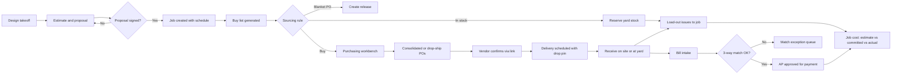

### 5.2 Purchase order lifecycle

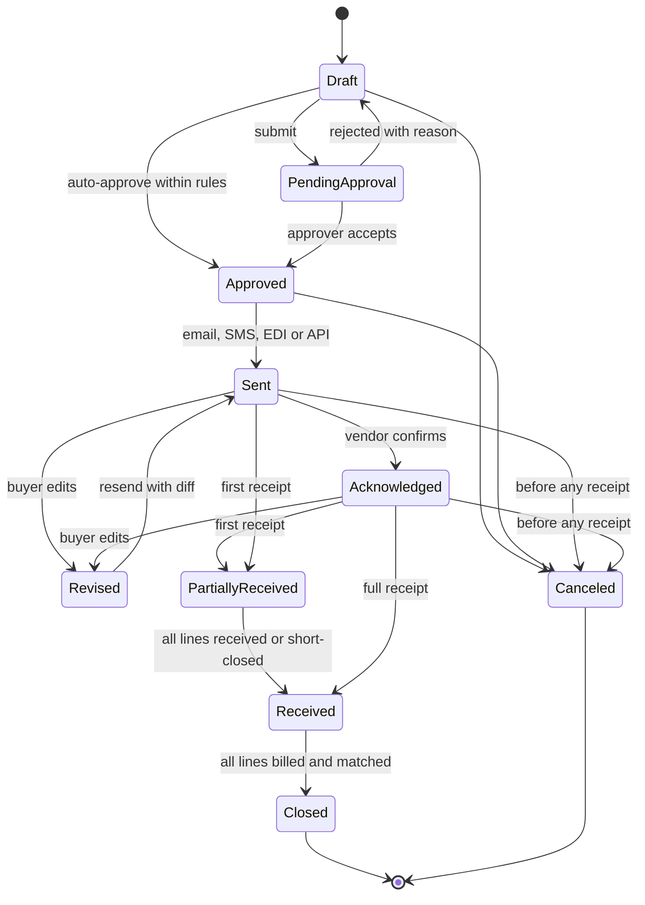

Rules: stored status keys are snake_case (`draft`, `pending_approval`, `approved`, `sent`, `acknowledged`, `revised`, `partially_received`, `received`, `closed`, `canceled`); the "Materials available" scheduling gate in [Scheduling](04-scheduling-dispatch-routing.md) 4.1.2 reads `received` PO lines and `confirmed` deliveries. `OnHold` (`on_hold`) is a flag, not a state, so a held PO keeps its position in the lifecycle. A PO can be reopened from `Closed` only by `owner` or `bookkeeper` and only if the accounting period is open.

### 5.3 Three-way match

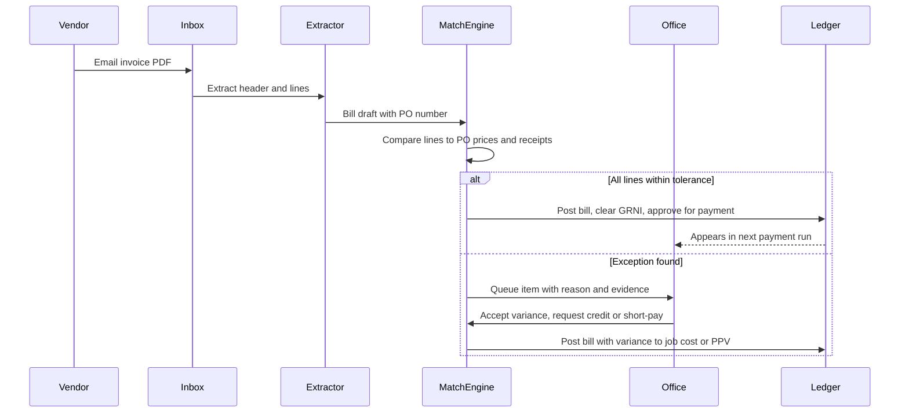

### 5.4 Daily load-out

1. At 3 p.m. tomorrow's routes auto-publish and Rootline generates the load-out sheets from them; the yard manager sees seven maintenance crews and two install crews on the load-out board.
2. Yard crew stages materials into lanes using the pick list (bin order); bunker issues are recorded by bucket count.
3. Late changes (a rescheduled install) regenerate affected sheets until 5 a.m. lock.
4. At 6:15 a.m. crew leads open the sheet in the crew app (offline-cached), check or scan lines, scan kits and batteries, and confirm. Shortages create purchase requests or transfers.
5. Confirmation posts issues and transfers; the yard gate log records departure via telematics.
6. At day end, crew leads report leftovers; returns post; missing tools open a grace timer.

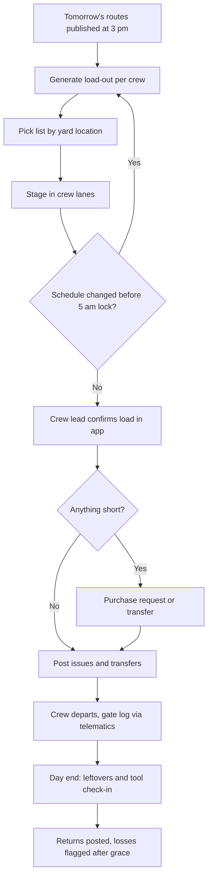

### 5.5 Holding yard care and plant loss

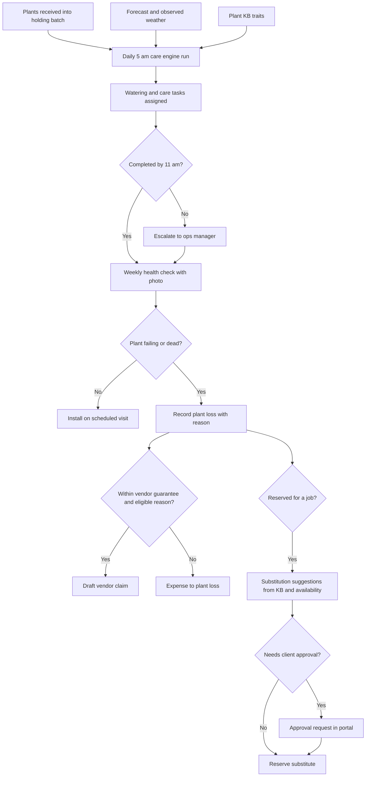

### 5.6 DVIR defect to certified repair

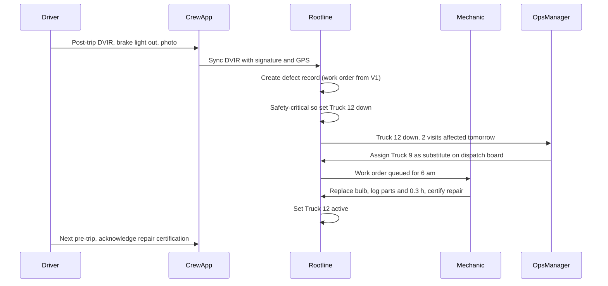

### 5.7 Equipment cost per hour from actuals into the next estimate

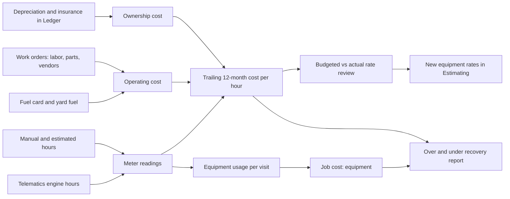

### 5.8 Subcontractor onboarding and the compliance gate

1. Office invites "Rivera Concrete" from the vendor list; Rivera receives an SMS link and completes the sub portal profile.
2. Rivera uploads the COI; AI reads limits and dates; office confirms. W-9 e-signed.
3. Requirements for "concrete flatwork" are met; status `compliant`.
4. Ops manager creates an SWO for the Patel patio steps (lump sum, 10% retainage); Rivera accepts in the portal.
5. Thirty days before the general liability policy expires, reminders begin. If it lapses, status becomes `non_compliant`: new SWOs blocked, payment held.
6. Rivera completes the work, uploads photos, submits an invoice; the crew lead approves completion; Rivera e-signs the conditional waiver; payment is released in the AP run; the unconditional waiver is requested after payment clears.

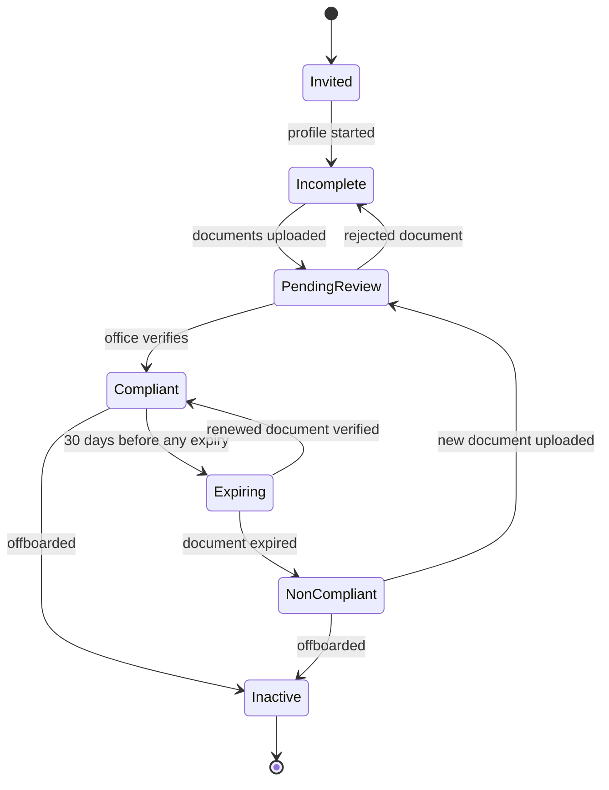

### 5.9 Tool checkout (crew app)

1. Technician taps "Tools", scans the plate compactor QR; Rootline shows its status (in yard, last service, condition).
2. Selects holder (self, crew, truck) and due-back (default end of day); confirms. Works offline.
3. At day end, the crew lead runs kit verification; the plate compactor is scanned back in with condition "needs_service" (vibration), which opens a WO.
4. A laser level not scanned back starts a 24-hour grace; after grace, a `loss_event` is created and the yard manager is notified; if BLE tags are in use [V2], the last-seen location is shown.

### 5.10 Client plant warranty claim

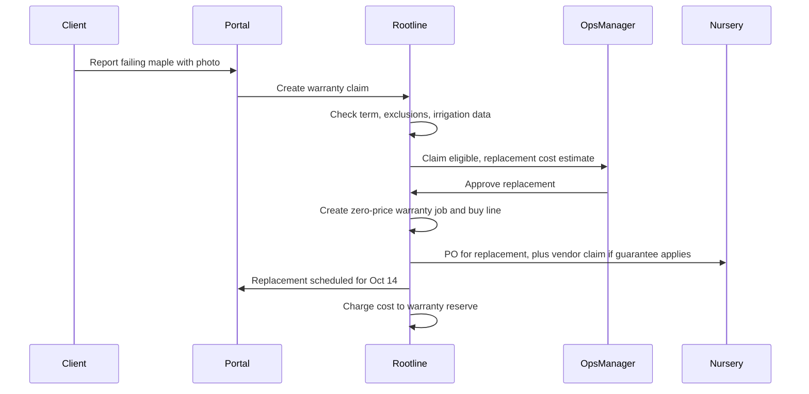

### 5.11 Vendor bank-change verification

1. An email arrives at the bills inbox from "Buckeye Mulch AR": "We changed banks; please send future payments to the attached account."
2. The AI reader classifies it as a bank-change request and marks it high-risk; nothing is changed. A `vendor_bank_change` record is created in `requested` status and all scheduled payments to Buckeye are held.
3. The `bookkeeper` calls Buckeye at the phone number already on the vendor record (the UI hides any phone number from the request itself), confirms with a named person, and records who confirmed.
4. A second approver (`owner`, or the outside approver for single-owner Companies, per the dual-control rules in [Personas](02-personas-roles-permissions.md)) approves.
5. The new account becomes active; payments to it carry a red "bank changed 10 days ago or less" banner in the next payment runs.

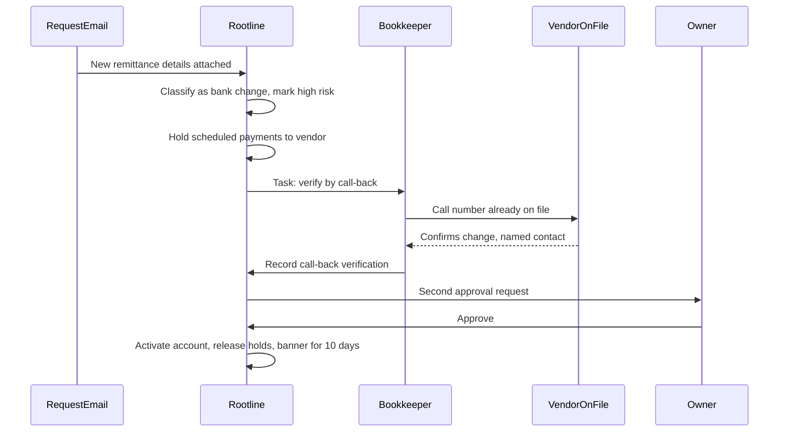

### 5.12 Rental contract lifecycle

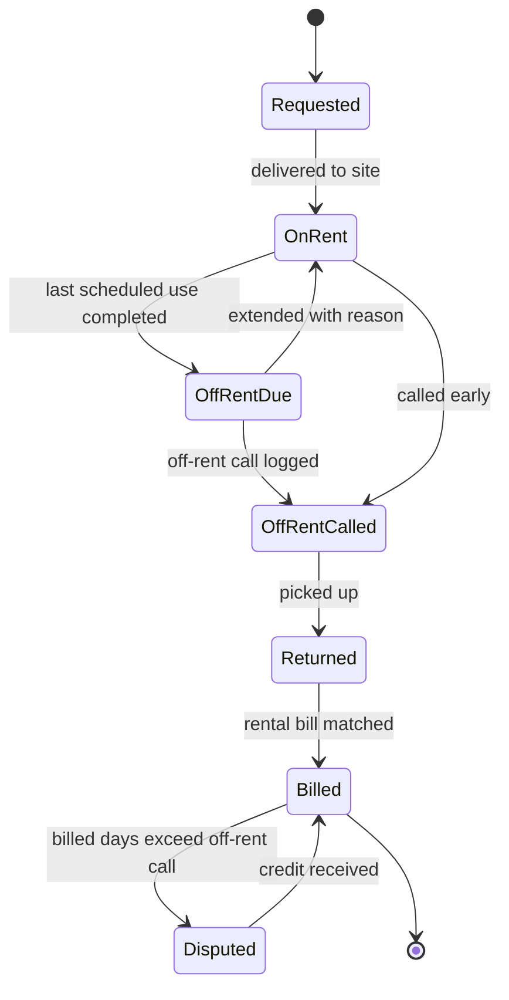

---

## 6. Screens and wireframes

### 6.1 Screen inventory

| # | Screen | Surface | Primary roles | Priority |
|---|---|---|---|---|
| 1 | Items list and item detail (UOM, density, coverage, vendors, stock by location) | Web | `office_manager`, `ops_manager`, `estimator` | [MVP] |
| 2 | Locations and bunkers map (yard layout with fill gauges) | Web, tablet | Yard Manager, `ops_manager` | [V1] |
| 3 | Stock on hand and movements ledger | Web | `ops_manager`, `bookkeeper` | [MVP] |
| 4 | Purchasing workbench (buy lines across jobs) | Web | `ops_manager`, `office_manager` | [V1] (MVP: per-job buy list) |
| 5 | Purchase order editor and PO detail with timeline | Web | `office_manager`, `ops_manager` | [MVP] |
| 6 | Vendor confirmation page (no login) | Public web | Vendor | [MVP] |
| 7 | Delivery calendar and delivery detail with drop pin | Web | `ops_manager` | [V1] |
| 8 | Receiving (PO receive, scale ticket capture, plant checklist) | Tablet, crew app | Yard Manager, `crew_lead` | [MVP] |
| 9 | AP match queue | Web | `bookkeeper`, `office_manager` | [MVP] 2-way, [V1] 3-way |
| 10 | Cycle count planner and count entry | Web, crew app | Yard Manager, `ops_manager` | [V1] |
| 11 | Replenishment (truck pars, reorder suggestions) | Web, tablet | Yard Manager | [MVP] pars, [V1] reorder |
| 12 | Holding yard board (batches, aging, care tasks) | Tablet, web | Yard Manager, `ops_manager` | [V1] |
| 13 | Vendor center (vendor detail, price lists, documents, scorecard) | Web | `office_manager` | [MVP], scorecard [V2] |
| 14 | Subcontractor compliance dashboard | Web | `office_manager`, `owner` | [MVP] basic |
| 15 | Sub work order and sub portal | Web, mobile web | `ops_manager`, `subcontractor` | [V1] |
| 16 | Equipment registry (list, map, status) | Web | `ops_manager`, Shop Mechanic | [MVP] |
| 17 | Asset detail (meters, PM, WOs, cost per hour, warranty, documents) | Web | `ops_manager`, `owner` | [MVP] meters, defects, rate, documents; [V1] PM, WOs, warranty |
| 18 | PM board and shop work order queue | Web, shop kiosk | Shop Mechanic | [V1] |
| 19 | Equipment rate cards and over/under recovery | Web | `owner`, `bookkeeper` | [MVP] calculator, [V1] actuals |
| 20 | Telematics and fuel card connections | Web | `owner`, `ops_manager` | [V1] |
| 21 | Fuel transactions and anomalies | Web | `ops_manager`, `bookkeeper` | [V1] |
| 22 | DVIR (crew app) and DVIR review | Crew app, web | `crew_lead`, Shop Mechanic | [MVP] |
| 23 | Tools and kits (checkout, kit verification) | Crew app, kiosk | `technician`, `crew_lead` | [V1] |
| 24 | Load-out board (yard) and load-out sheet (crew app) | Tablet, crew app | Yard Manager, `crew_lead` | [MVP] |
| 25 | Disposal tickets and sites | Crew app, web | `crew_lead`, `ops_manager` | [V1] |
| 26 | Chemical products, SDS library, storage inspections | Web, crew app | `ops_manager`, `technician` | [MVP] SDS, [V1] rest |
| 27 | Warranties and claims | Web, portal | `ops_manager`, client | [V1] |
| 28 | Loss ledger | Web | `owner`, `ops_manager` | [V1] |
| 29 | Operations dashboard (KPIs in section 12) | Web, mobile | `owner`, `ops_manager` | [V1] |
| 30 | Rentals board (on-rent, off-rent due, billed vs used days) | Web, crew app prompt | `ops_manager`, `crew_lead` | [V1] |
| 31 | DOT compliance center (vehicle applicability, inspections, MCS-150, driver qualification gaps) | Web | `owner`, `office_manager`, `ops_manager` | [V1] |
| 32 | Fuel tax and off-highway use worksheet | Web | `bookkeeper`, `owner` | [V1] |

### 6.2 Purchasing workbench (web)

```text
+----------------------------------------------------------------------------------------------+
| Rootline  > Operations > Purchasing workbench            Branch: Columbus v   Week: Apr 6 v  |
+----------------------------------------------------------------------------------------------+
| Filters: [Vendor: All v] [Category: All v] [Job: All v] [Need-by: next 14 days v] [Search ]  |
| Group by: (o) Vendor + destination  ( ) Job  ( ) Item                       Copilot: [ Ask ] |
+----------------------------------------------------------------------------------------------+
| BUCKEYE MULCH YARD (preferred)                                    412.0 cu yd   $11,536.00   |
|   Strategy: [ Consolidate to yard v ]  Delivery: Tue Apr 7, 7-9am  Fee: $85/load x 4         |
|   [x] Double-shred hardwood   280.0 cu yd  -> Yard bunker 3   54 jobs   $28.00   $7,840.00   |
|   [x] Double-shred hardwood    15.0 cu yd  -> Patel res.      drop pin  $28.00     $420.00   |
|   [x] Double-shred hardwood    22.0 cu yd  -> Morgan HOA      drop pin  $28.00     $616.00   |
|   ... 6 more drop-ship lines                                                                 |
|   ! Tip: merge Patel + Kline deliveries (1.2 mi apart, same day) and save $85               |
|----------------------------------------------------------------------------------------------|
| SITEONE - Columbus North (contract list 2026)                     38 lines      $9,214.40    |
|   Strategy: [ Multi-drop PO v ]                                                              |
|   [x] Crusher run base        16.0 t     -> Patel res.     Thu  $24.50/t     $392.00         |
|   [x] Paver, 60mm, Sandstone  4 pal + 34 sq ft -> Patel    Thu  $4.95/sqft  $2,544.30        |
|   [ ] Polymeric sand 50 lb    11 bag     -> Yard           Wed  $32.00        $352.00        |
|   ! Price break: +2 pallets of bagged mulch reaches tier 2 (save $0.35/bag)                 |
|----------------------------------------------------------------------------------------------|
| GREEN ACRES NURSERY (availability as of Apr 3)                    39 plants     $2,376.00    |
|   [x] Buxus 'Green Velvet' #3     36 ea  -> Holding yard   Mon  $27.50      $990.00          |
|   [x] Acer x freemanii 'Jeffersred' 2in B&B 3 ea -> Holding  Mon $462.00   $1,386.00         |
|   ! 'Jeffersred' 2in: only 3 left at vendor. Reserve now?  [Reserve]                         |
+----------------------------------------------------------------------------------------------+
| Budget check: 3 jobs over material budget by >10%  [Review]                                   |
| Selected: 49 lines  $22,350.70        [ Save drafts ]  [ Create 6 POs ]  [ Send RFQ ]          |
+----------------------------------------------------------------------------------------------+
```

### 6.3 Yard load-out board (tablet, landscape)

```text
+-----------------------------------------------------------------------------------------+
| LOAD-OUT  Wed Apr 8   Locks 5:00 AM   [Late adds: 2]          Yard: Columbus Main       |
+-----------------+-----------------+-----------------+-----------------+-----------------+
| CREW M1 (Luis)  | CREW M2 (Ana)   | CREW I1 (Mark)  | CREW I2 (Deb)   | IRR-1 (Sam)     |
| Lane 1  STAGED  | Lane 2  PARTIAL | Lane 5  STAGED  | Lane 6  NOT     | Truck stock     |
| Truck 7+Trl 3   | Truck 9+Trl 4   | Truck 12+Dump 2 | Truck 14+Trl 8  | Truck 5         |
|-----------------|-----------------|-----------------|-----------------|-----------------|
| 14 visits       | 12 visits       | Patel install   | Kline install   | 9 visits        |
| Mulch 6.0 yd    | Mulch 4.5 yd    | Pavers 4p+34sf  | Boulders 3 ea   | Restock: 8 noz  |
|  (bunker 3,     |  (bunker 3,     | Sand 1.5 yd     | Plants 18       |  2 valves 1in   |
|   12 buckets)   |   9 buckets) !  | Plants 39 (QR)  | Fabric 2 rolls  |  1 roll poly    |
| Bags 40         | Bags 30         | Plate compactor | Skid steer      |                 |
| Mowers 2        | Mowers 2        | Laser level kit | Install kit     | Irr kit         |
| Batteries 10    | Batteries 8 !   | Wet saw         |                 |                 |
| Payload OK      | Payload OK      | ! Payload: base |                 |                 |
|                 | ! 2 batteries   |   delivered on  |                 |                 |
|                 |   short (chg)   |   site, OK      |                 |                 |
|-----------------|-----------------|-----------------|-----------------|-----------------|
| [Open] [Print]  | [Open] [Print]  | [Open] [Print]  | [Open] [Print]  | [Open] [Print]  |
+-----------------+-----------------+-----------------+-----------------+-----------------+
| Bunker 3 hardwood: 31.5 yd after staging (cap 60)  Reorder point 25 yd   [Order now]      |
+-----------------------------------------------------------------------------------------+
```

### 6.4 Asset detail with cost per hour (web)

```text
+----------------------------------------------------------------------------------------------+
| Equipment > MOW-014  60in zero-turn (Make/Model)   Status: ACTIVE   Crew: M2   [Report issue]|
+----------------------------------------------------------------------------------------------+
| Hours 1,912.4 (Samsara, 2h ago)  | Next PM: Oil+filter at 1,950 h (DUE SOON, ~5 days)        |
| Warranty: 3y/1,500h  EXPIRED    | Open WOs: 1 (deck belt squeal, waiting parts)             |
+----------------------------------+-----------------------------------------------------------+
| COST PER HOUR (trailing 12 mo)   | PM SCHEDULE                                               |
|  Ownership      $4.21  budget $4.56   Blades       every 8 h    last 1,906 h   OK            |
|  Fuel           $4.65  budget $4.32   Oil+filter   every 100 h  last 1,850 h   DUE SOON      |
|  Repairs+maint  $2.88  budget $2.00   Air filter   every 200 h  last 1,800 h   OK            |
|  Wear parts     $0.61  budget $0.50   Hydraulics   every 500 h  last 1,500 h   OK            |
|  TOTAL         $12.35  budget $11.38  Winterize    Dec 1        last Dec 2     OK            |
|  Hours/yr 812 (budget 800)        |                                                         |
|  Recovered via jobs: $9,241       | UTILIZATION (scheduled days in use)                      |
|  Actual cost:        $10,028      |  Apr ######### 92%   Jul ######## 84%                    |
|  Under-recovery:       -$787      |  May ########## 97%  Aug ####### 76%                     |
|  [Update estimating rate]         |  Jun ######### 90%   Sep ######## 81%                    |
+----------------------------------+-----------------------------------------------------------+
| HISTORY  [All] [WOs] [Meters] [Fuel] [Assignments] [Documents]                               |
|  Oct 28  WO-2291  Deck belt replaced (parts $64.20, 0.8 h)                                   |
|  Oct 12  Fuel  11.4 gal  Yard tank  (Ana R.)                                                 |
|  Sep 30  WO-2240  Spindle bearing (warranty denied: over hours)                              |
|  Replace vs repair advisor: repairs last 12 mo = 21% of replacement cost  [See analysis]     |
+----------------------------------------------------------------------------------------------+
```

### 6.5 Crew app: load-out confirmation and tool scan (mobile, Spanish available)

```text
+--------------------------------+     +--------------------------------+
| < Load-out  Wed Apr 8   M2     |     | < Tools                        |
| Truck 9 + Trailer 4  Lane 2    |     | [ Scan QR ]   [ My tools (6) ] |
|--------------------------------|     |--------------------------------|
| MATERIALS                      |     | Plate compactor PC-03          |
| [x] Mulch hardwood 4.5 yd      |     | In yard - last service Mar 30  |
|     bunker 3 - 9 buckets       |     |                                |
| [x] Contractor bags 30         |     | Check out to:                  |
| [ ] Pre-emergent 2 bags  SDS > |     | (o) Me - Ana R.                |
|                                |     | ( ) Crew M2                    |
| EQUIPMENT                      |     | ( ) Truck 9                    |
| [x] MOW-014  [x] MOW-015       |     | Due back: Today 6:00 PM  v     |
| [x] Trimmers 2  [x] Blowers 2  |     |                                |
| BATTERIES  6 of 8 scanned  !   |     | [   CHECK OUT   ]              |
| [ Scan battery ]               |     |                                |
|                                |     | Offline - will sync            |
| [ Report shortage ]            |     |                                |
| [   CONFIRM LOAD   ]           |     |                                |
+--------------------------------+     +--------------------------------+
```

### 6.6 Holding yard board (tablet and web)

The yard manager's morning screen in May: what to water, what is aging, what is about to lose its nursery guarantee.

```text
+------------------------------------------------------------------------------------------+
| HOLDING YARD  Columbus Main      Thu May 14   Forecast 88 F, 0.0 in rain, wind 8 mph     |
| Care plan: HOT DAY (water containers <= #5 twice)                 [Print]  [Copilot: Ask] |
+------------------------------------------------------------------------------------------+
| TODAY'S TASKS                         | AGING            0-3d  4-7d  8-14d  >14d          |
| [ ] 06:30 Water bay A (#1-#5, 212 ea)  | Batches            6     4      2      1  !        |
| [ ] 06:45 Check B&B balls, bay C (9)   | Value          $3,410 $2,180  $940   $615          |
| [x] 06:20 Heel in Kline maples (3)     |---------------------------------------------------|
| [ ] 14:30 Water bay A second round     | GUARANTEE ENDING (vendor claims still possible)   |
|  Missed task escalates to ops at 11:00 |  Green Acres  Buxus #3 x 36   ends May 18 (4 d)   |
+----------------------------------------+  Maple Ridge  Hydrangea #5 x 8 ends May 16 (2 d) !|
| BATCHES                                                                                  |
| Stake  Plant / size               Qty  Days  Job (install date)        Health  Action    |
| H-118  Buxus 'Green Velvet' #3     36    6   Patel (May 19)            Good    [Open]    |
| H-121  Acer 'Jeffersred' 2in B&B    3    9   Patel (May 19)            Stressed[Photo]   |
| H-109  Hydrangea 'Annabelle' #5     8   16   UNRESERVED !              Good    [Offer] * |
| H-124  Nepeta 'Walker's Low' #1    48    2   Morgan HOA (May 15)       Good    [Open]    |
|  * Offer = list as "yard special" to clients near upcoming visits (Beyond the brief #6)   |
+------------------------------------------------------------------------------------------+
| [ Record loss ]   [ Health check (5 due) ]   [ Receive plants ]   [ Move batch ]          |
+------------------------------------------------------------------------------------------+
```

### 6.7 AP match exception (web)

```text
+------------------------------------------------------------------------------------------+
| AP > Match queue (14)  > Bill SO-88231  SiteOne Columbus North        Exception: PRICE   |
+------------------------------------------------------------------------------------------+
| Bill: $9,388.12  due Jun 10 (2/10 net 30: pay by May 21 to save $187.76)                  |
| PO: COL-PO-004213 rev 2   Receipts: RCV-7781 (Patel site, Thu), RCV-7790 (Yard, Wed)      |
+------------------------------------------------------------------------------------------+
| Line                         PO price   Billed     Var     Rcvd    Billed qty  Status     |
| Crusher run base             $24.50/t   $24.50/t   0.0%    16.2 t  16.4 t      OK (scale)|
| Paver 60mm Sandstone         $4.95/sf   $5.19/sf  +4.8%   514 sf   514 sf      PRICE  !   |
| Polymeric sand 50 lb         $32.00     $32.00     0.0%    11       11         OK         |
| Fuel surcharge               --         $42.00     --      --       --         OK (<$75)  |
| Delivery                     $85.00     $85.00     0.0%    --       --         OK         |
| ... 33 more lines            all within tolerance                               OK         |
+------------------------------------------------------------------------------------------+
| Evidence: PO rev 2 PDF | vendor ack May 4 (price $4.95 confirmed) | ticket photo | bill PDF |
| Paver line variance: $123.36   Job: Patel (material budget remaining $1,104)              |
+------------------------------------------------------------------------------------------+
| ( ) Accept variance -> job cost Patel     ( ) Accept -> PPV (stock line)                  |
| (o) Request credit: email SiteOne AR with PO ack + bill, short-pay $123.36                |
| ( ) Wait (vendor said corrected bill coming)                                              |
| [ Resolve ]                                         A9 AP Agent note: vendor acknowledged  |
|                                                     $4.95 on May 4; likely list-price     |
|                                                     update not applied to this contract.  |
+------------------------------------------------------------------------------------------+
```

### 6.8 Subcontractor compliance dashboard (web)

```text
+------------------------------------------------------------------------------------------+
| Subcontractors > Compliance        Gate mode: BLOCK      12 active subs   2 on hold  !    |
+------------------------------------------------------------------------------------------+
| Sub                 Trade          GL     Auto   WC        W-9   License   Status        |
| Rivera Concrete     Flatwork       OK     OK     OK        OK    n/a       COMPLIANT     |
| Bright Line Elec.   Lighting LV    Jun 2  OK     OK        OK    OK        EXPIRING 19d  |
| Oak & Ax Tree       Removals       EXP!   OK     Exempt*   OK    ISA OK    ON HOLD       |
|                                                                 2 SWOs blocked, $3,850  |
| Summit Snow         Sidewalks      OK     OK     OK        MISS  n/a       ON HOLD       |
|                                                                 1 bill held: $1,240     |
| * WC exemption certificate on file, verify state acceptance                              |
+------------------------------------------------------------------------------------------+
| Reminders sent this week: 6   COIs read by AI awaiting verification: 2  [Review]          |
| Owner overrides (last 90 days): 1 (Oak & Ax, emergency storm removal, reason logged)      |
+------------------------------------------------------------------------------------------+
```

---

## 7. Data model

All tables carry `tenant_id` (row-level security per [Architecture](20-architecture-security.md)), `branch_id` where relevant, `created_at`, `created_by`, `updated_at`, and soft-delete `archived_at`. Money is stored as integer minor units with an ISO currency code; quantities as `numeric(18,4)` with an explicit UOM. Geo fields use PostGIS. Shared entities owned by other modules are referenced, not duplicated: `job`, `visit`, `property`, `client` ([Scheduling](04-scheduling-dispatch-routing.md)), `estimate_line` and `price_book_item` ([Estimating](03-crm-sales-estimating-proposals.md)), `takeoff_line` and `plant_instance` ([Design Studio](10-design-studio.md)), `plant` ([Plant KB](12-plant-knowledge-base.md)), `vendor_bill` and `journal_entry` ([Ledger](09-accounting-ledger-integrations.md)), `employee` and `credential` ([Team](15-team-hr-payroll.md); `certification` is a registered alias in [Architecture](20-architecture-security.md#43-bounded-contexts-and-modules-mvp) section 4.3).

### 7.1 Key entities

These tables live in the `inventory` module of the [Architecture](20-architecture-security.md#43-bounded-contexts-and-modules-mvp) module map, which uses the names in this section (`item`, `stock_balance` as the on-hand projection of `stock_movement`, `purchase_order`, `vendor`, `asset`, `tool_checkout`, `maintenance_work_order`). The earlier summary names `equipment`, `item_stock`, `maintenance_record` and `equipment_assignment` stay registered aliases in its schema registry.

| Entity | Key fields | Notes |
|---|---|---|
| `item` | id, item_type, sku, name, base_uom, purchase_uom, sell_uom, density_lb_per_cuyd, density_source, coverage_rule, is_stocked, tracking (`none`, `lot`, `serial`), plant_id, size_spec (jsonb: container_class, caliper_in, height_ft, root_form), chemical_product_id, master_item_id, preferred_vendor_id, gl_inventory_account_id, gl_cost_account_id | Plant items unique on (tenant, plant_id, size_spec hash) |
| `uom_conversion` | item_id, from_uom, to_uom, factor, kind (`pack`, `density`, `coverage`) | Item-specific overrides of global conversions |
| `location` | id, branch_id, parent_id, type, name, code, geo_point, geo_polygon, capacity_qty, capacity_uom, asset_id (truck/trailer), property_id (job site), job_id, negative_policy, is_active | Hierarchical via parent_id |
| `stock_balance` | item_id, location_id, lot_id, qty_on_hand, qty_reserved, qty_allocated, avg_cost_minor, last_movement_at | Materialized from movements; rebuildable |
| `lot` | id, item_id, lot_number, expires_on, vendor_id, received_at | Chemicals mostly |
| `stock_movement` | id, movement_type, item_id, from_location_id, to_location_id, lot_id, qty, uom, qty_base, unit_cost_minor, job_id, visit_id, cost_code, po_line_id, receipt_line_id, count_line_id, reason_code, reverses_movement_id, occurred_at, recorded_at, device_id, client_mutation_id, journal_entry_id | Append-only; unique (tenant, client_mutation_id) |
| `reservation` | id, item_id, location_id, job_id, visit_id, qty, need_by, status (`soft`, `hard`, `consumed`, `released`) | |
| `cycle_count` / `count_line` | count: id, plan_id, location_id, status, snapshot_at, approved_by; line: item_id, lot_id, expected_qty, counted_qty, counted_by, recount_of_id, variance_value_minor | Expected hidden in blind mode |
| `reorder_rule` | item_id, location_id, min_qty, max_qty, par_qty, reorder_multiple, lead_time_days, season_profile (jsonb), preferred_vendor_id | |
| `holding_batch` | id, location_id, item_id, qty_received, qty_on_hand, vendor_id, po_id, received_at, guarantee_ends_on, status, stake_qr | |
| `care_task` | id, holding_batch_id or location_id, task_type (`water`, `heel_in`, `frost_protect`, `health_check`), due_at, assigned_to, completed_at, weather_snapshot (jsonb), photo_ids | Generated daily |
| `vendor` | id, vendor_type, legal_name, dba, terms_code, currency, tax_id_enc, tax_id_last4, is_1099, account_number_at_vendor, compliance_status, ledger_vendor_id | Shared with AP |
| `vendor_branch` | id, vendor_id, name, address, geo_point, hours, contacts | |
| `price_list` / `vendor_price` | list: vendor_id, name, effective_from, effective_to, currency, is_contract; price: item_id, vendor_item_code, uom, ton_type, unit_price_minor, min_qty, tier_breaks (jsonb), lead_time_days | |
| `vendor_availability` | vendor_id, item_id or plant_id plus size_spec, qty_available, as_of, source (`nursery_connect`, `parsed_email`, `api`) | Feeds Plant KB signals |
| `buy_line` | id, source_type (`estimate_line`, `takeoff_line`, `replenishment`, `agreement_round`, `request`), source_id, job_id, item_id, qty, uom, need_by, sourcing_decision, status, po_line_id, reservation_id | |
| `purchase_order` | id, number, vendor_id, vendor_branch_id, status, on_hold, revision, ship_to_type, ship_to_location_id, ship_to_property_id, will_call, currency, subtotal_minor, freight_minor, tax_minor, total_minor, approved_by, approved_at, sent_via, acknowledged_at, blanket_parent_id | |
| `po_line` | id, po_id, item_id, vendor_item_code, description, qty, uom, unit_price_minor, job_id, cost_code, need_by, ship_to_override, qty_received, qty_billed, short_closed_qty | |
| `delivery` | id, po_id, destination_type, location_id, property_id, window_start, window_end, status, drop_pin geo_point, instructions, site_contact, proof_photo_ids, notified_client_at | |
| `receipt` / `receipt_line` | receipt: id, po_id (nullable), location_id, received_by, received_at, ticket_photo_ids, extracted_ticket (jsonb); line: po_line_id, item_id, qty_received, qty_rejected, reject_reason, lot_id, net_weight, weight_uom | |
| `match_result` | id, vendor_bill_line_id, po_line_id, receipt_line_ids, price_variance_minor, qty_variance, status (`matched`, `exception`, `accepted_variance`, `credit_requested`), exception_reason, resolved_by | Bill and bill lines live in the Ledger module |
| `subcontractor_profile` | vendor_id, trades (text array), service_area geo_polygon, crew_size, portal_user_ids, rating_avg | 1:1 with vendor of type subcontractor |
| `compliance_requirement` | id, scope (`trade`, `client_contract`, `company`), doc_type, min_limits (jsonb), requires_additional_insured, applies_to | |
| `compliance_document` | id, vendor_id, doc_type (`coi`, `w9`, `license`, `certification`, `wc_exemption`), issuer, number, coverage (jsonb), effective_on, expires_on, verified_by, verified_at, status, file_id, extracted (jsonb) | |
| `sub_work_order` | id, job_id, visit_id, vendor_id, scope, pricing_type, amount_minor, nte_minor, retainage_pct, status, accepted_at, completed_at, approved_by | Commitment |
| `lien_waiver` | id, vendor_id, sub_work_order_id, waiver_type, jurisdiction, amount_minor, through_date, form_version, signed_at, signer_name, file_id | Immutable after signature |
| `asset` | id, asset_number, asset_class, make, model, year, serial_vin, plate, plate_state, registration_expires_on, gvwr_lb, curb_weight_lb, towing_capacity_lb, fuel_type, status, branch_id, home_location_id, assigned_crew_id, assigned_employee_id, parent_asset_id, acquired_on, acquisition_cost_minor, salvage_minor, useful_life_hours, useful_life_years, ledger_fixed_asset_id, qr_code | |
| `meter` / `meter_reading` | meter: asset_id, meter_type, primary_source, offset; reading: meter_id, value, source (`manual`, `telematics`, `fuel_card`, `work_order`, `estimated`), raw_source_field, read_at, is_flagged | |
| `pm_template` / `pm_schedule` | template: asset_class or model, tasks (jsonb), parts_kit (jsonb), interval_hours, interval_miles, interval_days, season_rule; schedule: asset_id, template_id, last_done_at, last_done_meter, next_due_at, next_due_meter, status | |
| `maintenance_work_order` | id, number, asset_id, wo_type, priority, status, source_type, source_id, assigned_to, vendor_id, meter_at_service, downtime_start, downtime_end, root_cause_code, is_warranty, warranty_claim_id, total_cost_minor | |
| `wo_labor_line` / `wo_part_line` | labor: wo_id, employee_id, hours, rate_minor; part: wo_id, item_id, qty, unit_cost_minor, stock_movement_id | |
| `dvir` / `dvir_defect` | dvir: id, asset_id, driver_employee_id, inspection_type (`pre_trip`, `post_trip`), occurred_at, geo_point, signature_file_id, no_defects, reviewed_by, repair_certified_by, repair_certified_at, next_driver_ack_at; defect: dvir_id, component, description, severity, photo_ids, work_order_id | Immutable after signature |
| `equipment_rate_card` | id, asset_id or asset_class, effective_from, basis (`per_engine_hour`, `per_crew_hour`, `per_mile`, `per_day`), ownership_cost_minor, operating_cost_minor, billing_rate_minor, method (`manual`, `actuals`), inputs (jsonb) | Versioned |
| `equipment_usage` | id, asset_id, job_id, visit_id, usage_date, quantity, basis, source (`telematics`, `crew_assignment`, `manual`), rate_card_id, cost_minor, journal_entry_id | |
| `telematics_connection` / `telematics_device` | connection: provider, auth_ref (KMS), status, last_sync_at, cursor; device: connection_id, external_id, asset_id, match_confidence | |
| `fuel_transaction` | id, provider, external_id, card_last4, asset_id, employee_id, occurred_at, merchant, geo_point, fuel_type, quantity, uom, unit_price_minor, total_minor, odometer, anomaly_codes (text array), status | |
| `battery_pack` / `charge_session` | battery is an asset; session: battery_asset_id, charger_asset_id, started_at, ended_at, energy_wh | |
| `tool_checkout` | id, asset_id, holder_type, holder_id, checked_out_at, due_at, checked_in_at, condition_in, kit_checkout_id | |
| `kit_template` / `kit_checkout` | template: name, asset_class_counts (jsonb), specific_asset_ids; checkout: template_id, holder, verified_at | |
| `loss_event` | id, subject_type (`item`, `asset`, `plant_batch`, `fuel`), subject_id, qty, value_minor, reason, attributed_to (jsonb), police_report_no, insurance_claim_no, recovered_minor, journal_entry_id | |
| `load_out_sheet` / `load_out_line` | sheet: id, crew_id, work_date, status (`draft`, `locked`, `staged`, `confirmed`), staging_location_id, generated_at, locked_at, confirmed_by; line: sheet_id, visit_id, line_type (`material`, `plant`, `chemical`, `equipment`, `tool_kit`, `battery`), item_id or asset_id, qty, uom, source_location_id, status | |
| `disposal_ticket` / `disposal_allocation` | ticket: id, vendor_id (disposal site), asset_id, employee_id, occurred_at, material_type, gross, tare, net, weight_uom, volume_cuyd, fee_minor, photo_id, extracted (jsonb); allocation: ticket_id, visit_id, job_id, share_pct, amount_minor, billable | |
| `disposal_manifest` | id, waste_type, quantity, uom, generator_location_id, hauler_vendor_id, facility_name, manifest_number, shipped_on, signatures (jsonb), file_ids | |
| `chemical_product` / `sds_document` | product: master_id, name, registrant, epa_reg_no, pcp_reg_no, actives (jsonb), signal_word, is_rup, rei_hours, ppe (text array), storage_class, label_file_id; sds: product_id, language, revision_date, file_id, superseded_by_id | Master curated by platform |
| `warranty` / `warranty_claim` | warranty: subject_type, subject_id, warranty_type, provider_vendor_id, client_id, starts_on, ends_on, meter_limit, terms (jsonb); claim: warranty_id, opened_by_type (`client`, `staff`), status, evidence_file_ids, replacement_job_id, vendor_claim_id, cost_minor, credit_minor | |
| `rental_contract` | id, vendor_id, contract_number, asset_id (temporary asset with ownership `rented`), vendor_unit_number, rate_basis, day_rate_minor, week_rate_minor, four_week_rate_minor, damage_waiver_pct, on_rent_at, expected_off_rent_on, off_rent_called_at, off_rent_confirmation, picked_up_at, job_ids (uuid array), po_id, status (`on_rent`, `off_rent_due`, `off_rent_called`, `returned`, `billed`, `disputed`) | 4.14.14 |
| `recall_notice` | id, asset_id, source (`nhtsa`, `cpsc`, `oem`), campaign_number, component, summary, remedy, published_on, matched_by (`vin`, `make_model_year`, `serial_range`), work_order_id, status (`open`, `scheduled`, `remedied`, `not_applicable`) | Unique (asset_id, source, campaign_number) |
| `dot_profile` | asset_id or rig_id, is_cmv, cmv_basis (`gvwr`, `gcwr`), requires_usdot, cdl_class_required (`none`, `B`, `A`), dvir_policy, annual_inspection_due_on, state_rules (jsonb), computed_at | Recomputed on asset or rig change |
| `vendor_bank_change` | id, vendor_id, requested_via, requested_at, old_account_ref, new_account_ref (tokenized), callback_phone_used, callback_verified_by, callback_verified_at, second_approver_id, status | Payments to the new account blocked until `verified` |
| `fuel_use_worksheet` | id, period_start, period_end, jurisdiction (`federal`, state code), fuel_type, off_highway_gallons, on_highway_gallons, evidence_query (jsonb), generated_by, generated_at, file_id | Snapshot; never auto-filed |
| `quarantine_rule` | id (platform-level), pest, zone_polygon, regulated_articles (text array), required_documents (text array), vehicle_check_required, effective_from, source_url | Curated by `platform_curator` |

### 7.2 Inventory and purchasing (ER)

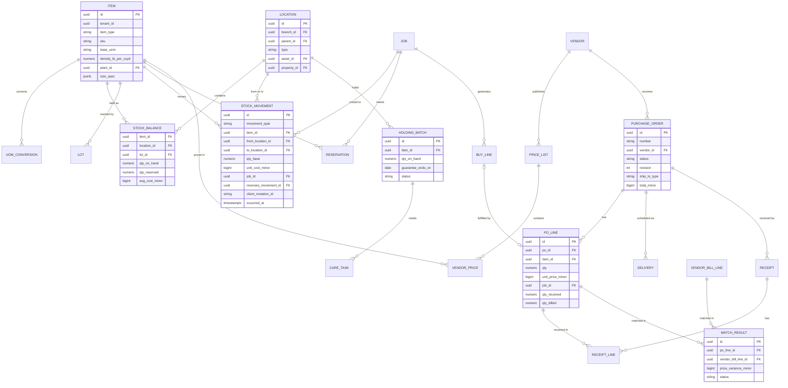

### 7.3 Equipment and fleet (ER)

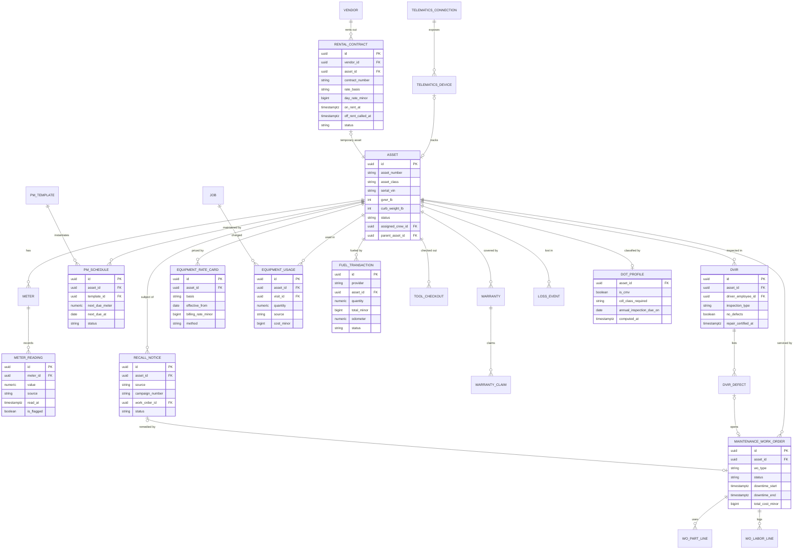

### 7.4 Subcontractors, yard, chemicals (ER)

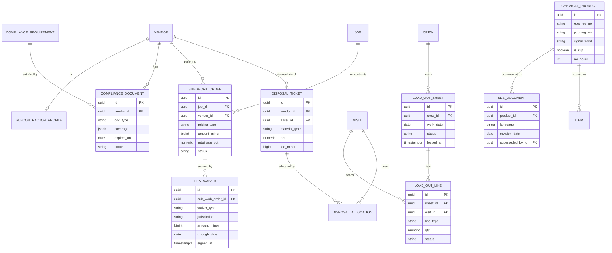

### 7.5 Derived data and performance notes

- `stock_balance` is a projection of `stock_movement` maintained transactionally in the same database transaction as the movement insert (with row-level locks on the balance row), and rebuildable from the movement log for audits.
- Average cost recalculation happens on receipt; issues read the current average. A nightly job verifies that inventory GL balances equal the sum of `stock_balance` valuations per branch and raises a reconciliation alert on drift.
- `meter_reading` and `fuel_transaction` are high-volume (telematics); they are partitioned by month and summarized into daily rollups for cost-per-hour and utilization.
- Plant availability and density master data are platform-level tables (no `tenant_id`) with tenant overrides, matching the master/override pattern used by the [Plant KB](12-plant-knowledge-base.md).

---

## 8. Integrations, APIs and events

### 8.1 External integrations

| Integration | Purpose | Pattern | Priority |
|---|---|---|---|
| Supplier price lists (any vendor) | Prices, codes, tiers | CSV/XLSX import with saved mappings; AI PDF parsing | [MVP] CSV, [V1] AI |
| Vendor email/SMS links | PO acknowledgment, delivery confirmation, invoice upload | Signed, expiring links; no vendor account required | [MVP] |
| Nursery Connect | Availability, PO confirmation, invoices from nurseries | Free vendor portal | [V1] |
| SiteOne, Ewing, Horizon, BFG | Pricing, availability, ordering, invoices | Partner API, punchout (cXML/OCI) or EDI per partner | [V2] |
| EDI provider | X12 850, 855, 856, 810 | Managed EDI/VAN partner, mapped to our PO and bill models | [V2] |
| Samsara, Geotab, Verizon Connect, OneStep GPS, Linxup | Location, meters, faults, geofences | REST or JSON-RPC polling and webhooks where available | [V1] |
| Motive; OEM mixed-fleet (ISO 15143-3) | Same | Marketplace app; AEMP endpoints | [V2] |
| WEX, Fleetcor/Corpay, other fuel cards | Fuel transactions | SFTP file feeds after data-exchange authorization; APIs where offered | [V1] |
| Plaid (via [Ledger](09-accounting-ledger-integrations.md)) | Company card transactions for receipt matching | Bank feed | [MVP] |
| QuickBooks Online / Desktop, Xero (via [Ledger](09-accounting-ledger-integrations.md)) | Vendors, bills, items (optional sync) | Ledger-owned connector; this module never syncs directly | [MVP] |
| Weather (shared with [Scheduling](04-scheduling-dispatch-routing.md)) | Holding yard care tasks, rain-day PM planning | Internal weather service | [V1] |
| Label printers | QR and barcode labels | PDF sheets; ZPL for Zebra | [V1] |
| E-signature (shared platform service) | W-9, lien waivers, SWO acceptance | Internal e-sign with audit trail | [V1] |
| State license lookups | Sub license verification | Per-state scrapers or APIs where permitted | [V2] |
| NHTSA vPIC and recalls | VIN decode on asset creation; weekly recall check | Public REST APIs, cached; no PII sent | [MVP] decode, [V1] recalls |
| IRS TIN Matching (via the Company's e-Services account) | W-9 name/TIN validation | Bulk file prepared by Rootline, submitted by the Company | [V2] |
| Rental houses | Rental contracts, off-rent confirmations, rental telematics | Email/PDF parsing at first; customer-portal APIs per rental company where offered (verify) | [V1] parsing, [V2] APIs |

### 8.2 Domain events emitted

Events go through the transactional outbox to the event bus ([Architecture](20-architecture-security.md)); names are `module.entity.verb`.

| Event | Key payload | Main consumers |
|---|---|---|
| `ops.stock.moved` | movement id, type, item, qty_base, cost, job, visit | Ledger (journal), Reporting, Copilot |
| `ops.stock.below_reorder` | item, location, projected qty, suggested qty | Purchasing workbench, notifications |
| `ops.stock.count_posted` | count id, variance value | Ledger, Reporting |
| `ops.po.approved` / `ops.po.sent` / `ops.po.acknowledged` / `ops.po.revised` / `ops.po.closed` | po id, vendor, totals, job ids | Ledger (commitments), Scheduling (deliveries), Notifications |
| `ops.delivery.scheduled` / `ops.delivery.status_changed` / `ops.delivery.delivered` / `ops.delivery.failed` | delivery id, status (`requested`, `confirmed`, `en_route`, `delivered`, `failed`, `rescheduled`), window, property | Scheduling (materials gate, dispatch dependencies), Customer Portal timeline, Comms |
| `ops.receipt.posted` | receipt id, lines, rejected qty | Ledger (GRNI), Match engine, Holding yard |
| `ops.bill.matched` / `ops.bill.match_exception` | bill id, variances, reason | Ledger AP, office tasks |
| `ops.holding.task_due` / `ops.holding.task_missed` | task, batch, due_at | Notifications |
| `ops.plant.lost` | batch, qty, reason, reserved job | Substitution workflow, Vendor claims, Plant KB signals |
| `ops.vendor.compliance_changed` | vendor, old and new status, documents | Scheduling (assignment block), Ledger (payment hold), Notifications |
| `ops.swo.status_changed` | swo id, status | Scheduling, Job costing |
| `ops.lien_waiver.signed` | waiver id, type, amount | Ledger (payment release) |
| `ops.asset.status_changed` | asset, old and new status, reason | Scheduling (dispatch board substitution) |
| `ops.asset.placed_in_service` / `ops.asset.disposed` | asset, cost or proceeds, date, financing reference | Ledger fixed asset register (`assets.FA1`, `FA3`) |
| `ops.asset.meter_recorded` | asset, meter, value, source | PM engine, Cost per hour |
| `ops.pm.due` / `ops.pm.overdue` | asset, schedule, due meter | Shop board, Notifications |
| `ops.dvir.submitted` / `ops.dvir.defect_reported` | dvir id, defects, severity | Work orders, Safety reporting in Team |
| `ops.equipment.usage_recorded` | asset, visit, qty, cost | Ledger job cost |
| `ops.fuel.anomaly_detected` | transaction, rule codes | Owner and ops notifications |
| `ops.tool.checked_out` / `ops.tool.checked_in` | asset or kit, holder, condition | Team onboarding and offboarding checklists |
| `ops.tool.overdue` / `ops.tool.lost` | asset, holder | Yard manager, Team offboarding |
| `ops.loadout.locked` / `ops.loadout.confirmed` | sheet, crew, shortages | Yard board, Purchasing |
| `ops.disposal.recorded` | ticket, allocations, billable | Ledger job cost, Invoicing (billable fees) |
| `ops.warranty.claim_opened` / `ops.warranty.claim_resolved` | claim, subject, cost | Customer Portal, Ledger reserve, Plant KB signals |
| `ops.vendor.price_list_imported` | vendor, list id, items changed, average change % | Estimating (cost update and margin impact report) |
| `ops.vendor.bank_change_requested` / `ops.vendor.bank_change_verified` | vendor, requester, channel | Ledger (payment block and release), owner notification |
| `ops.rental.off_rent_due` / `ops.rental.off_rent_called` | contract, asset, job, idle days | Ops notifications, AP match (rental bill check) |
| `ops.asset.recall_found` | asset, source, campaign number | Shop board, owner notification |
| `ops.dot.profile_changed` | asset or rig, is_cmv, CDL class | Scheduling (driver assignment checks), Team (driver qualification gaps) |

**Name aliases.** The canonical names are the `ops.*` names above (the namespace [Ledger](09-accounting-ledger-integrations.md) consumes); they belong to the `inventory` module in the [Architecture](20-architecture-security.md) module map. Shorter spellings used elsewhere are registered as aliases on the bus:

| Spelling elsewhere | Canonical event here | Where it appears |
|---|---|---|
| `vendor.price_list_imported` | `ops.vendor.price_list_imported` | [Estimating](03-crm-sales-estimating-proposals.md) |
| `delivery.status_changed` | `ops.delivery.status_changed` | [Scheduling](04-scheduling-dispatch-routing.md) 8.4 |
| `equipment.status_changed` | `ops.asset.status_changed` | [Scheduling](04-scheduling-dispatch-routing.md) 8.4 |
| `asset.placed_in_service`, `asset.disposed` | `ops.asset.placed_in_service`, `ops.asset.disposed` | [Ledger](09-accounting-ledger-integrations.md) 8.2 |
| `purchase_order.sent`, `purchase_order.received` | `ops.po.sent`, `ops.receipt.posted` | [Architecture](20-architecture-security.md) event catalog |
| `equipment.maintenance_due` | `ops.pm.due` | [Architecture](20-architecture-security.md) event catalog |

### 8.3 Events consumed

Consumed events use the producer's registered name.

| Event (owner) | Reaction in this module |
|---|---|
| `proposal.accepted` ([Estimating](03-crm-sales-estimating-proposals.md)) | Create buy list, soft reservations and plant availability checks |
| `proposal.executed` ([Estimating](03-crm-sales-estimating-proposals.md)), `design.sold` ([Design Studio](10-design-studio.md)) | Release held POs, including non-refundable special orders (deposit condition met) |
| `change_order.approved` ([Estimating](03-crm-sales-estimating-proposals.md)) | Adjust buy list; prompt PO revisions |
| `design.takeoff_updated` ([Design Studio](10-design-studio.md)) | Recompute pending buy lines for unsold or change-order scopes |
| `visit.scheduled` / `visit.rescheduled` ([Scheduling](04-scheduling-dispatch-routing.md)) | Move need-by dates, reservations and dependent deliveries; regenerate load-outs |
| `route.published` / `route.changed_after_publish` ([Scheduling](04-scheduling-dispatch-routing.md)) | Generate or regenerate load-out sheets; energy plans |
| `visit.completed` ([Scheduling](04-scheduling-dispatch-routing.md), [Crew app](05-field-crew-mobile-app.md)), `material.used` ([Crew app](05-field-crew-mobile-app.md)) | Post material usage, equipment usage, returns |
| `chemical_application.recorded` ([Crew app](05-field-crew-mobile-app.md); sealed by [Service lines](14-service-line-modules.md) 4.1.4) | Issue chemical concentrate by lot |
| `snow_service_log.recorded` ([Service lines](14-service-line-modules.md)) | Issue salt and deicer from the depot or truck location |
| `dvir.defect_reported`, `equipment.meter_recorded`, `equipment.reported_down` ([Crew app](05-field-crew-mobile-app.md)) | Open a defect record (a defect work order from V1), update meters (and PM due dates from V1), set asset status `down` |
| `weather.alert_raised` ([Scheduling](04-scheduling-dispatch-routing.md) weather service) | Recompute care tasks; rain-day PM suggestions |
| `ledger.bill.received` ([Ledger](09-accounting-ledger-integrations.md)) | Run match engine |
| `ledger.period.closed` ([Ledger](09-accounting-ledger-integrations.md)) | Block back-dated movements; force next-period posting |
| `ledger.bill_payment.released` ([Ledger](09-accounting-ledger-integrations.md)) | Request the unconditional lien waiver once the payment's bank line is matched (`ledger.bank_transaction.matched`); update sub portal remittance |
| `employee.terminated` / `offboarding.started` ([Team](15-team-hr-payroll.md)) | Outstanding tools, cards, batteries checklist |
| `employee.certification_expired` ([Team](15-team-hr-payroll.md)) | Block RUP issue, heavy equipment assignment where required |
| `warranty_claim.submitted` ([Customer Portal](06-customer-portal.md)) | Open warranty claim |

### 8.4 Public API and webhooks [V1]

REST resources under `/v1/` (tenant-scoped OAuth apps, per [Architecture](20-architecture-security.md)): `items`, `locations`, `stock-balances` (read), `stock-movements` (create with idempotency key), `purchase-orders`, `receipts`, `vendors`, `vendor-prices`, `assets`, `meter-readings` (create; for third-party telematics or IoT not natively supported), `work-orders`, `fuel-transactions` (create; for unsupported card providers), `disposal-tickets`. Webhooks mirror the emitted events above for tenant-registered endpoints, signed with HMAC and retried with exponential backoff for 24 hours.

---

## 9. Permissions

Legend: **F** full (create, edit, delete/void, configure); **C** create and edit; **A** approve; **V** view; **O** own or assigned records only; **L** limited by threshold or scope noted; **-** none. Custom roles are composed from the granular permissions behind each row ([Personas, roles and permissions](02-personas-roles-permissions.md)).

| Capability | owner | office_manager | estimator | designer | ops_manager | crew_lead | technician | bookkeeper | subcontractor |
|---|---|---|---|---|---|---|---|---|---|
| View items, prices and stock | F | V | V | V (no cost) | V | V (no cost) | V (no cost) | V | - |
| Create and edit items, UOM, densities | F | C | C | - | C | - | - | V | - |
| Inventory settings, modes, GL accounts | F | - | - | - | V | - | - | C | - |
| Stock adjustments and scrap | F | C | - | - | C | L (truck only, reason required) | - | V | - |
| Approve count variances | F | - | - | - | A | - | - | V | - |
| Receive against PO | F | C | - | - | C | C | L (job site only) | V | - |
| Issue and return materials to jobs | F | C | - | - | C | C | C | V | - |
| Create buy lists and POs | F | C | L (own jobs) | - | C | L (requests only) | L (requests only) | V | - |
| Approve POs (`purchase_order.approve_max`) | F (unlimited) | L ($5,000) | - (budget-fit auto-approval only) | - | L ($2,500) | L ($300 field purchases) | - | V | - |
| Manage vendors and price lists | F | C | V | V | C | - | - | C | - |
| Bill match and exception resolution | F | C | - | - | V | - | - | F | - |
| Subcontractor compliance documents | F | C | - | - | V | - | - | V | O (own documents) |
| Create and approve sub work orders | F | V | - | - | A | V | - | V | O (accept, complete) |
| Approve sub completion | F | - | - | - | A | L (assigned jobs) | - | - | - |
| Lien waivers | F | C | - | - | V | - | - | C | O (sign own) |
| Asset registry | F | C | V | - | C | V | V | V | - |
| Meter entry, report a problem, DVIR | F | C | - | - | C | C | C | - | - |
| Maintenance work orders | F | V | - | - | C | L (create defect WOs) | L (create defect WOs) | V | - |
| Equipment rate cards | F | - | V | - | C | - | - | C | - |
| Connect telematics and fuel cards | F | - | - | - | C | - | - | - | - |
| View fuel transactions and anomalies | F | V | - | - | V | O | O | V | - |
| Tool checkout and kit verification | F | C | - | - | C | C | O | - | - |
| Load-out generate, stage, lock | F | V | - | - | C | V | V | - | - |
| Load-out confirm | F | - | - | - | C | C | - | - | - |
| Holding yard tasks and plant loss | F | V | V | V | C | C | C | V | - |
| Chemical products and storage inspections | F | V | - | - | C | V | V | - | - |
| View SDS (always available offline) | V | V | V | V | V | V | V | V | V (for products on their SWO) |
| Issue restricted-use products | F (if certified) | - | - | - | L (certified) | L (certified) | L (certified) | - | - |
| Warranty claims approve | F | V | V | - | A | - | - | V | - |
| Loss ledger | F | V | - | - | V | O | O | V | - |
| Inventory valuation and equipment depreciation reports | F | V | - | - | V | - | - | F | - |
| Vendor bank details (`vendor_banking` field class; change needs dual control) | F | - | - | - | - | - | - | C | O (submit own change request) |
| Rentals: create, extend, log off-rent call | F | C | - | - | C | L (log off-rent call) | - | V | - |
| DOT compliance center and driver-qualification gaps | F | C | - | - | C | V (own vehicles) | - | - | - |
| Fuel tax worksheet | F | V | - | - | V | - | - | F | - |

PO approval limits are the defaults from the limit table in [Personas, roles and permissions](02-personas-roles-permissions.md); tenants edit them there, and budget-fit auto-approval (4.8.3) applies on top. `owner` keeps the overall F column, but owner-only actions in this module are limited to overriding the subcontractor compliance gate and approving inventory write-downs on a mode downgrade.

**Custom role templates shipped with this module** (added to the role gallery in [Personas](02-personas-roles-permissions.md); Shop Mechanic is the gallery's "Mechanic" starter role, extended here):

- **Yard Manager**: `ops_manager` rights for locations, stock, receiving, counts (no variance approval above $500), load-outs, holding yard, tools, disposal; PO creation up to a threshold; no rate cards, no bill match.
- **Shop Mechanic**: asset registry (edit meters, documents), PM schedules, maintenance work orders (full), parts stock in `shop` locations, DVIR review and repair certification, warranty claims for equipment; no purchasing approval above a threshold; no financial reports.

**Platform roles** (in [Platform Admin](19-platform-admin-portal.md)):

| Capability | platform_owner | platform_curator | platform_support | platform_engineer | platform_finance |
|---|---|---|---|---|---|
| Master material catalog and densities | F | C | V | V | - |
| Master chemical products and SDS library | F | C | V | V | - |
| Lien waiver form library | F | C | V | - | - |
| Regulatory rule data (DOT thresholds, 1099 and T5018 thresholds, HazCom dates, quarantine zones), dated with sources | A (publish) | C | V | V | V |
| Supplier, telematics, fuel connectors (config, health) | F | - | V | F | - |
| Tenant inventory data (support impersonation, audited, time-boxed) | A | - | L (with tenant consent) | L (incident only) | - |
| Distributor partnership revenue reporting | F | - | - | - | C |

---

## 10. AI opportunities in this module

All AI calls go through the AI Gateway and are metered as AI credits ([AI copilot and automation](17-ai-copilot-automation.md)). Every AI output that changes money or stock is a **proposal a human confirms**, except where a tenant explicitly enables auto-apply with thresholds.

| # | Opportunity | What it does | Model class | Guardrails | Priority |
|---|---|---|---|---|---|
| 1 | Document extraction: bills, delivery tickets, scale tickets, receipts | Extracts header, lines, weights and totals; detects PO numbers; proposes matches. Bill-side work runs as the A9 AP Agent in [AI copilot and automation](17-ai-copilot-automation.md) using the match rules in 4.11. At MVP, receipts and bills get rules-based header OCR only (no LLM, no AI credits; 4.4.4, 4.11.1, AI2 in [Ledger](09-accounting-ledger-integrations.md)) | Frontier LLM with vision (Claude family); MVP header OCR is a dedicated OCR pass with deterministic rules | Confidence per field; low confidence forces review; original image always attached | [V1] (MVP: rules-based header OCR) |
| 2 | COI and license reader | Reads ACORD 25 certificates and license cards; compares to requirements | Frontier LLM with vision | Human verification required before `compliant` | [V1] |
| 3 | Price list and availability parser | Turns nursery PDFs and spreadsheets into structured availability mapped to Plant KB and Items | Frontier LLM plus botanical-name matcher from the Plant KB | Unmapped lines queued for curator or tenant; never auto-creates canonical Plants | [V1] |
| 4 | Purchasing copilot | "Buy everything for next week's installs from the cheapest approved vendor and keep deliveries under 3 per day" produces draft POs with explanations. Runs as the A21 Procurement Agent defined in [AI copilot and automation](17-ai-copilot-automation.md) | Frontier LLM agent with tool calls to the workbench | Drafts only; approval rules unchanged; sending a PO to a vendor is a T3 action (explicit human confirm) | [V1] |
| 5 | Demand forecasting | Projects material, chemical and plant demand from schedules, agreements, renewals and seasonality | Classical time-series plus rules (Python service) | Shows drivers; editable | [V2] |
| 6 | Pile scanner | Estimates bunker or pile volume from a phone walk-around video | Monocular depth and segmentation models | Tolerance band shown; count approval unchanged | [V2] |
| 7 | Plant health scoring | Scores holding-yard and warranty-claim photos for stress, disease and death | Vision model fine-tuned on landscape plant imagery, with KB context | Advisory; human decides loss or claim | [V2] |
| 8 | Substitution recommender | Ranks substitutes for unavailable or dead plants by regional performance, form, size, bloom and price | KB similarity (pgvector) plus LLM explanation | Client approval rules enforced | [V1] |
| 9 | Predictive maintenance | Flags assets likely to fail from fault code patterns, meter trends and repair history | Gradient-boosted models on fleet-wide anonymized data (opt-in) | Advisory; creates draft WOs only | [V2] |
| 10 | Replace vs repair advisor | Compares cumulative repairs, downtime and residual value to replacement cost; explains in plain language | Rules plus LLM narrative | Shows inputs; finance decision stays human | [V1] |
| 11 | Fuel and shrink anomaly explanations | Converts anomaly rule hits into a short narrative with evidence | LLM summarization | No accusations; neutral language; no automatic HR actions | [V1] |
| 12 | Voice problem reports | Crew member says "el trimmer no arranca, huele a gasolina"; Rootline transcribes, translates, classifies and opens a defect WO on the scanned asset | Speech-to-text plus LLM | Original audio retained | [V1] |
| 13 | Copilot Q&A over operations data | "What did we spend on mulch for the Morgan HOA this year?" "Which trucks are due for annual inspection in March?" | Frontier LLM with tool calls to reporting APIs | Row-level security enforced on every tool call | [V1] |
| 14 | Rental and vendor document reader | Reads rental contracts and off-rent confirmations from email, vendor bank-change requests and remittance letters; flags bank-change emails as high-risk and never applies them | Frontier LLM with vision | Bank changes always go to the call-back workflow (4.12); the agent cannot write `vendor_banking` | [V1] |
| 15 | Bunker and delivery photo check | Compares a delivery photo against the PO (pallet count, material type such as "this looks like red mulch, PO says brown") and against the drop pin location | Vision model plus LLM | Advisory flag on the receipt; receiver decides | [V2] |

---

## 11. Edge cases, compliance and risks

### 11.1 Edge cases

| Case | Handling |
|---|---|
| Wet stone weighs 12% more than the density predicts | Receiving converts tons to cu yd using density and flags variance over 10%; buyer can update supplier density with history |
| Vendor bills in tonnes, PO in short tons | Automatic conversion with a visible badge; match tolerance applied after conversion |
| Bulk delivery left on the wrong side of a property or on a neighbor's lawn | Delivery marked `delivered` with issue; photo evidence; vendor claim for re-handling; client communication template |
| Plants delivered with the wrong cultivar tag | Receive as rejected or accept as substitute; substitution workflow if reserved for a signed job |
| A crew uses 3 cu yd more mulch than estimated | Crew lead logs extra usage; job cost reflects it; if the agreement allows, an "additional materials" invoice line is suggested to the office ([Invoicing](07-invoicing-billing-contracts.md)) |
| Partial pallet returns after install | Return movement at cost; restock value can be reduced (e.g., opened bags at 0%) with the difference to job cost |
| Job canceled after PO sent | Prompt per PO: cancel (vendor link notifies), redirect to yard stock, or keep for another job |
| Offline count and online movement on the same bin | Snapshot counting nets movements recorded before the count line's `occurred_at` |
| Negative truck stock after a busy day | Allowed; truck flagged for count; cost true-up at count |
| Asset sold mid-year with open PMs | Disposition closes PMs and telematics link; fixed asset disposal in [Ledger](09-accounting-ledger-integrations.md); history retained |
| Telematics engine hours disagree with the physical hour meter | Primary-source selection plus offsets; disagreement over 5% raises a meter review task |
| Fuel card used in a personal vehicle | Anomaly rules flag; evidence pack for the manager; no automated discipline |
| Sub's COI expires the day before a scheduled SWO | Compliance gate blocks start in the portal; ops manager notified at 7 days and 1 day; override requires owner reason |
| Same tool checked out by two people offline | Both records kept, flagged; later check-in resolves |
| Mid-season price increase from a distributor | Price change alerts to estimators with impacted open proposals; existing POs keep their price unless revised |
| Branch transfer of materials across the US-Canada border | Not supported as a transfer; modeled as a sale and purchase between legal entities, because customs and tax apply |
| Multi-currency vendors (Canadian tenant buying in USD) | PO and bill in vendor currency; Ledger handles FX ([Ledger](09-accounting-ledger-integrations.md)) |
| Snow season salt stored at the vendor's dome under contract | `vendor_consignment` location; draws recorded per pickup ticket; billing per contract |
| Vendor emails "we changed banks, please update remittance" | Never applied from email; call-back to the number on file, dual control, 10-day red banner on payments (4.12); AI reader flags the email as high-risk |
| Rental kept 3 days past the last visit because nobody called it off | Off-rent watchdog prompts at job completion and escalates next business day; billed days after the logged off-rent call are disputed with the confirmation number (4.14.14) |
| A 1-ton truck gets paired with a heavier equipment trailer for one job | Rig change recomputes the DOT profile; drivers without the required CDL class are blocked from that rig for that day only; the change is logged |
| A sub is paid twice from a duplicate invoice with a new invoice number | Duplicate detection on vendor plus amount plus SWO line within 30 days; SWO lines cannot be billed beyond 100% of the approved quantity or amount |
| Nursery guarantee expires while plants are still in holding for a delayed job | Guarantee-ending panel (6.6) warns 3 days ahead; ops can install early, move to another job, or accept the risk with a note |
| Year-end 1099 threshold differs by payment year | Threshold is a dated setting; totals are computed per payment date, so a December 2025 payment and a January 2026 payment to the same sub fall under different thresholds |

### 11.2 Compliance

| Area | Requirement summary (verify with counsel and current regulations) | Rootline support |
|---|---|---|
| DOT vehicle inspections (FMCSA Part 396) | Written post-trip DVIR when defects are found or reported (no-defect reports not required for property-carrying CMVs since 2014), repair certification, pre-trip review of the last DVIR (396.13), electronic reports permitted ([eCFR 396.11](https://www.ecfr.gov/current/title-49/subtitle-B/chapter-III/subchapter-B/part-396/section-396.11), [FMCSA guidance](https://www.fmcsa.dot.gov/safety/question-25-section-39611-requires-driver-completion-each-days-work-prepare-written-report)); annual inspection every 12 months with 14-month record retention ([eCFR 396.17](https://www.ecfr.gov/current/title-49/subtitle-B/chapter-III/subchapter-B/part-396/section-396.17)); DVIR retention 3 months minimum | DVIR templates, defect WOs, repair certification, driver acknowledgment, retention floors, inspection reminders and blocks |
| CDL, medical certification, hours of service | CDL class by GVWR/GCWR ([eCFR 383.91](https://www.ecfr.gov/current/title-49/section-383.91)); medical certificate for CMV drivers; short-haul exception from logs within the air-mile radius and duty-hour limit | DOT applicability engine (4.14.10); driver qualification data in [Team](15-team-hr-payroll.md); short-haul monitor |
| State intrastate rules | Many states adopt federal rules with different thresholds | Per-state settings on which vehicles require DVIR and USDOT data |
| OSHA Hazard Communication | SDS accessible to employees during each shift; labels; training; 2024 revision phasing in new SDS and label content through 2026-2028 ([OSHA HazCom](https://www.osha.gov/hazcom); verify dates) | Offline SDS on trucks; SDS revision tracking with "review PPE" alerts; container labels; training records in [Team](15-team-hr-payroll.md) |
| Pesticide recordkeeping and restricted-use products | State applicator licensing; federal RUP recordkeeping for certified applicators; state use reporting | RUP issue gate; lot-level usage; application records in [Service lines](14-service-line-modules.md) |
| Chemical storage and community right-to-know | Storage requirements by state; EPCRA reporting thresholds | Storage inspection checklists; annual inventory report [V2] |
| Hazardous and special waste | Generator status, manifests where applicable, container recycling | Disposal manifests, document retention |
| Contractor and sub compliance | Insurance requirements by contract; workers' compensation rules by state; lien law with statutory forms in some states | Compliance gate, AI COI reading, lien waiver library with jurisdiction rules |
| 1099 and Canadian contractor reporting | 1099-NEC for US subs, with the reporting threshold reported to rise from $600 to $2,000 for payments made after Dec 31, 2025 (verify); backup withholding when TIN is missing; T5018 for construction-sector payers in Canada, T4A in other cases (verify) | Vendor tax data, dated thresholds, TIN check [V2], totals to [Ledger](09-accounting-ledger-integrations.md) |
| Plant pest quarantines | State and federal quarantines on nursery stock and on vehicles leaving zones (for example spotted lanternfly permits in some states; verify) | Quarantine rules and zones curated by platform; receiving document checks; quarantine pest check on DVIR and load-out (4.4.1) |
| Federal and state fuel tax on off-road use | Credit or refund of fuel taxes for off-highway business use (IRS Form 4136; state programs vary; verify) | Off-highway fuel use worksheet (4.14.9); Rootline does not file |
| Vendor payment fraud | Business-email-compromise bank-change fraud; SOC 2 change-management expectations | Call-back verification, dual control, payment banners, audit log (4.12) |
| Employee privacy (telematics, BLE tags) | Monitoring disclosure and consent rules vary by state and province; union agreements | Driver safety events off by default; disclosure templates; data retention limits; employees can see their own data |
| Wage deductions for lost tools | Many jurisdictions restrict deductions | Loss ledger records only; payroll rules in [Team](15-team-hr-payroll.md) |
| Small off-road engine rules in California | Zero-emission requirements for most newly manufactured small off-road engines from model year 2024, generators later ([CARB SORE](https://ww2.arb.ca.gov/our-work/programs/small-off-road-engines-sore); verify scope) | Electrification reporting, battery management, battery-equivalent replacement pricing |
| Data security | SOC 2 controls; encrypted tax IDs and API keys | KMS-encrypted secrets, field-level encryption, audit logs ([Architecture](20-architecture-security.md)) |

### 11.3 Risks

| Risk | Likelihood | Impact | Mitigation |
|---|---|---|---|
| Inventory complexity scares small customers | High | High | Inventory modes; Light mode default for small tenants; progressive onboarding; templates by business type |
| Perpetual inventory accuracy erodes (crews do not log usage) | High | High | Load-out-driven issues (usage is the default, not an extra step); end-of-day leftover prompts; cycle counts; shrink dashboards that make the cost visible |
| Distributor partnerships slow or exclusive (a competitor already integrated with SiteOne) | Medium | Medium | L0/L1 work for every vendor; Nursery Connect builds our own network; partnership pitch based on aggregated demand data and co-marketing |
| Telematics API changes and per-provider quirks | Medium | Medium | Connector abstraction, contract tests, sync health monitoring, provider-specific owners on the integration team |
| Fuel card data agreements are slow to set up | High | Low | CSV fallback; onboarding concierge; partner with providers' integration teams |
| AI extraction errors post wrong costs | Medium | High | Confidence thresholds, human confirmation, match tolerances, full audit trail with source images |
| Legal exposure from lien waiver forms | Low | High | Counsel-reviewed library, jurisdiction disclaimers, versioning, "use your own form" option |
| Over-building CMMS depth | Medium | Medium | Scope to landscape needs; export to Fleetio-class tools for deeper needs |
| Employee pushback on tracking | Medium | Medium | Transparency features, off-by-default safety scoring, focus on equipment not people |
| Regulatory content goes stale (DOT thresholds, 1099 thresholds, HazCom dates, lien forms, quarantine zones) and a tenant relies on it | Medium | High | Every regulatory rule is dated platform data with a source URL, an owner (`platform_curator`), a review-by date and a "last verified" stamp in the UI; quarterly review job; in-product wording is "reminder and evidence", never "you are compliant" |
| MVP scope too large (perpetual inventory plus purchasing plus fleet) | High | High | Cut lines in 4.19; Standard mode and PM/work orders already moved to [V1] ([Product Scope](24-roadmap-feature-catalog.md#46-cross-doc-tag-reconciliations) section 4.6 #6 and #7) |

---

## 12. Metrics and KPIs

Definitions are shared with [Reporting and analytics](18-reporting-analytics.md); targets are internal product goals or illustrative benchmarks, not industry statistics.

### 12.1 Customer-facing operational KPIs (shown on the Operations dashboard)

| KPI | Definition | Why it matters |
|---|---|---|
| Material cost variance | (Actual material cost minus estimated) / estimated, per job and rolled up | Bid accuracy and waste |
| Inventory turns | Annual cost of issues / average inventory value | Cash tied up in the yard |
| Shrink rate | (Adjustments + scrap + unexplained losses) / annual issues at cost | Theft, waste, sloppy logging |
| Count accuracy | Lines counted within tolerance / lines counted | Trust in on-hand numbers |
| Holding yard loss rate | Plants lost in holding / plants received into holding (by value) | Care discipline |
| Days in holding (median) | Receipt to install | Ordering timing |
| PO coverage | Material spend on POs / total material spend | Purchasing discipline |
| Auto-match rate | Bills matched without human touch / bills | AP efficiency |
| Purchase price variance | (Billed price minus PO price) x qty / PO value | Vendor price discipline |
| Vendor on-time delivery | Deliveries within window / deliveries | Schedule reliability |
| Equipment utilization | Hours used / hours available in scheduled days (per asset and class) | Right-sizing the fleet |
| Unplanned downtime hours | Downtime during scheduled work hours from repair and defect WOs | Lost production |
| PM compliance | PMs completed within 10% of interval / PMs due | Prevents breakdowns |
| Cost per hour actual vs budget | From 4.14.7 | Bid accuracy |
| Equipment recovery ratio | Equipment cost recovered via jobs / actual equipment cost | Whether bids pay for the iron |
| Fuel cost per revenue hour | Fuel cost / billable crew hours | Route and equipment efficiency |
| DVIR completion rate | Required DVIRs completed / required | Compliance |
| Sub compliance rate | Active subs fully compliant / active subs | Risk exposure |
| Tool loss value | Replacement value of lost tools per month | Accountability |
| First truck out time | Median time first vehicle leaves the yard | Morning efficiency |
| Disposal cost per job | Allocated disposal fees / jobs | Pricing cleanups correctly |
| Warranty claim rate and reserve adequacy | Claims / plants under warranty; reserve balance / expected claims | Install quality and liability |
| First-time-complete load | Visits served without a mid-day trip back to the yard or a supply house / visits (4.15.1) | Load-out quality; a single mid-day supply run costs a crew 30-60 minutes (estimate) |
| Rental leakage | Billed rental days after the last day of use / total billed rental days | Off-rent discipline (4.14.14) |
| Idle cost per vehicle | Telematics idle hours x fleet fuel burn rate at idle x fuel price, per month | Fuel waste that crews can control |
| Open recall count | Assets with an open, unremedied recall | Safety and free repairs left on the table |
| Bank-change verification rate | Vendor bank changes verified by call-back before first payment / bank changes | Fraud exposure (target 100%) |

### 12.2 Product KPIs (Rootline internal)

| KPI | Target (12 months after the module ships) |
|---|---|
| Tenants with at least one PO per week (of tenants with module enabled) | 60% |
| Share of install estimates that generate a buy list used for purchasing | 70% |
| Crew app load-out confirmations per active crew per working day | 0.9 |
| Telematics connections per tenant with 10 or more vehicles | 40% |
| AI extraction field accuracy on bills (sampled) | 97% header, 92% lines |
| Nursery Connect vendors active in a metro with 25 or more Rootline tenants | 15 |
| Module-attributable churn reduction (tenants using purchasing vs not) | Measured, goal: lower churn |

---

## 13. Beyond the brief: extra ideas

1. **Load planner with payload physics** [V1]. Before loading, Rootline computes weight from density and checks it against the truck or trailer's payload and tongue weight; suggests splitting loads or swapping to the dump trailer. Safety and DOT exposure reduced, and fewer broken leaf springs.
2. **Pile scanner** [V2]. Walk around the mulch bunker with a phone; depth and segmentation models estimate volume within a tolerance band. Counts of bulk material go from guesswork to 2 minutes.
3. **Nursery Connect network** [V1-V2]. A free portal for local nurseries becomes the largest structured, regional plant availability dataset in the industry, feeding the [Plant KB](12-plant-knowledge-base.md) ("available within 30 miles this week") and making Rootline the default way contractors order from local growers.
4. **Rootline Buying Network** [V3]. Opt-in group purchasing across tenants for commodities (salt, fertilizer, mulch, fuel) with negotiated programs; transparent rebate disclosure; antitrust-reviewed. Revenue line explored in [Business model](22-business-model-pricing-gtm.md).
5. **Salt dome and snow material tracking** [V1]. Bulk salt and liquid brine inventory by dome and tank, per-push usage from spreader telematics where available, pre-season fill contracts and "days of salt left at forecast intensity", connected to snow operations in [Service lines](14-service-line-modules.md).
6. **Leftover plant marketplace** [V2]. Extra plants in holding become "yard specials" offered to existing clients in the [Customer Portal](06-customer-portal.md) at a discount ("We have 4 extra 'Annabelle' hydrangeas; add them to your bed for $45 each installed"), turning shrink into revenue.
7. **Counter sales and retail POS** [V2]. Companies that sell mulch and stone to the public get a simple point-of-sale flow (bulk by the scoop, pay via the Company's own Stripe and Terminal readers per [Payments](08-payments-stripe.md)) without a separate POS system.
8. **Equipment resale and residual value** [V3]. Service history exports and resale value estimates from fleet-wide data; optional listing to equipment marketplaces when the replace-vs-repair advisor says sell.
9. **Electrification planner** [V2]. TCO comparison of gas vs battery by crew, with runtime data, charging infrastructure needs and a rebate finder (incentive programs change often; verify per program). Fully specified as [M-06 Fleet electrification planner in 23](23-innovation-moonshots.md#m-06-fleet-electrification-planner), which builds on the [V1] battery and charging slice in 4.14.11.
10. **Shop kiosk with parts vending** [V3]. Smart lockers or vending for high-shrink consumables (blades, line, PPE) with badge access and automatic issue to asset or job.
11. **Sustainability ledger for commercial clients** [V2]. Green-waste diversion, fuel avoided by electric equipment and compost applied, per property, in a client-facing report for HOAs and property managers with ESG targets.
12. **Theft deterrence pack** [V1]. Serialized asset register, QR "property of" tags, last-seen telematics, and a one-click theft report for police and insurers; optional integration with a stolen-equipment registry where one exists in the region.
13. **Insurance savings dossier** [V2]. Export DVIR completion, PM compliance and telematics safety summaries to share with the Company's insurance agent at renewal to argue for better fleet premiums.
14. **Seasonal readiness checklists** [V1]. Opinionated, region-aware checklists: snow equipment readiness by October 15, irrigation truck stock before spring start-ups, winterization of mowers and blowers after the last mowing round, pre-emergent stock before soil temperatures trigger applications.
15. **"Yard twin" layout** [V3]. A to-scale map of the yard (bunkers, racks, holding area, chargers, staging lanes) drawn in the [Design Studio](10-design-studio.md) engine, with live fill levels and where every staged load is; links to [moonshots](23-innovation-moonshots.md) such as robotic loading.
16. **Fuel tax refund finder** [V1]. The off-highway fuel use worksheet (4.14.9) becomes a yearly "money you left on the table" card on the owner dashboard: "Your mowers, skid steers and aerators burned about 21,000 gallons of road-taxed gasoline this year. Estimated federal credit: about $3,800 (estimate at roughly 18 cents per gallon). State: ask your CPA whether Ohio refunds fuel tax for this use." It is a feature an owner shows other owners, which is the best kind of marketing. (Estimates only; the CPA decides and files.)
17. **Unbilled materials catcher** [V1]. Every night, compare materials issued to time-and-materials and "plus materials" jobs (load-out issues, field usage, extra mulch logged by the crew) with what has been invoiced in [Invoicing](07-invoicing-billing-contracts.md). "The Morgan HOA irrigation repair used 2 Hunter PGV valves and 40 ft of 1 in poly from Truck 5; none of it is on the draft invoice ($186 at list)." For small companies, forgotten parts on repair tickets are pure margin leakage, and Rootline is the only system that sees both the truck stock and the invoice.
18. **Off-season shop planner** [V1]. Landscape fleets are idle December to February in the north while mechanics and crew members still need hours. Rootline builds a winter shop plan from PM due-by-spring, open defect WOs, repair-vs-replace decisions and parts lead times, schedules it against the winter crew roster in [Team](15-team-hr-payroll.md), and pre-orders parts in January when dealers run early-order discounts. The output is a fleet that is 100% ready on April 1 instead of 70% ready on April 15.
19. **Vendor rebate and loyalty tracker** [V2]. Distributors and manufacturers run loyalty points, volume rebates and early-order programs (SiteOne's Partners Program is a commonly cited example; terms change, verify). Rootline tracks qualifying purchases from PO and bill data, accrues expected rebates as a receivable in the [Ledger](09-accounting-ledger-integrations.md), alerts when the Company is close to the next tier ("$4,200 more in irrigation parts by December 31 reaches the 3% tier"), and reconciles the rebate check when it arrives. Rebates are often uncollected or booked to the wrong period; this makes them a real number in job cost.
20. **Crew-proof drop zones** [V2]. The delivery drop pin (4.10) becomes a reusable property attribute: the best place to dump material at each Property, with a photo, max truck size (a 30-yd tractor-trailer vs a tandem dump), overhead wires and septic or irrigation hazards from the Property's site map. Every future PO to that Property pre-fills it, and vendors get the same pin every time. Fewer driveway cracks and fewer damage claims, which is a selling point to commercial property managers in the [Customer Portal](06-customer-portal.md).

---

## 14. Open questions

1. **Default inventory mode for new tenants.** At MVP every tenant starts in Off or Light. Once Standard ships at [V1]: Light for under 15 employees and Standard above, or ask during onboarding with a business-type questionnaire?
2. **Costing method.** Is moving average per branch sufficient for chemical-heavy lawn companies whose CPAs prefer FIFO, or should FIFO by lot be available in Standard mode?
3. **Distributor partnerships.** Which of SiteOne, Ewing, Horizon and BFG will partner first, on what terms (API, punchout, EDI), and is there exclusivity with an incumbent (LMN's SiteOne partnership)?
4. **EDI provider choice.** Build mappings on a managed EDI provider or partner with an integration platform; per-transaction cost vs volume?
5. **Rootline-branded trackers.** Should we offer low-cost GPS and BLE tags for small equipment and tools (hardware margin, support burden) or stay integration-only?
6. **Telematics data ownership and retention.** How long do we keep raw location breadcrumbs (cost and privacy) vs daily rollups?
7. **Equipment rate scope.** Per-asset rates (precise but noisy) or per-class rates (stable) as the default for estimating?
8. **Negative stock default for yards.** `warn` or `block`? Customer interviews needed.
9. **Lien waiver forms.** Build and maintain a jurisdiction library in-house with counsel, or license one?
10. **Plant warranty data sharing.** What consent model lets anonymized plant failure data improve the Plant KB without exposing a tenant's install quality?
11. **Fleetio-class integration.** Should we offer a two-way integration for large fleets that already run a dedicated fleet tool, and which system is the system of record for PM?
12. **Canadian specifics.** Metric defaults, PCP numbers, provincial vehicle inspection rules and T4A handling need a Canadian advisor before Canada support ships at [V1].
13. **Regulatory content ownership.** Who on the platform side signs off on DOT thresholds, 1099 thresholds, lien waiver forms, HazCom dates and pest quarantine zones: `platform_curator` with outside counsel on retainer, or a licensed compliance-content provider? The answer drives the cost of the "dated platform data" mitigation in 11.3.
14. **Rental house integrations.** Do the large national rental companies expose customer APIs for contracts, off-rent requests and rental telematics that a third-party platform can use, or is email parsing the durable path?
15. **Fuel-tax worksheet liability.** Is a worksheet that estimates a federal credit "tax advice"? Default position: present it as a data export with gallons and evidence, and leave rates and eligibility to the CPA.
16. **Research follow-up.** Several competitor capabilities in section 2 are marked "verify"; follow-up research (help centers and demos for ServiceTitan, Service Autopilot, Real Green, Arborgold, SynkedUP, Copilot CRM, Yardbook) and customer interviews on yard and holding-yard pain are needed before final prioritization.

---

## Sources

Verification note: items marked "verify" in the text are from secondary sources, vendor marketing or general domain knowledge and need first-hand confirmation before build. Prices and plan names are as of November 2026, verify.

**Competitors and user feedback**

- Aspire, using the purchasing module: <https://guide.youraspire.com/docs/using-the-purchasing-module>
- Aspire, purchasing features: <https://www.youraspire.com/features/purchasing>
- Aspire, purchase order management: <https://www.youraspire.com/industries/landscape-business-software/purchase-order-management>
- Aspire, purchasing overview of concepts: <https://care.youraspire.com/en/articles/5880802-501-purchasing-an-overview-of-concepts-and-navigation>
- Aspire, job inventory video: <https://guide.youraspire.com/docs/es/video-508-purchasing-job-inventory>
- Aspire, equipment features: <https://www.youraspire.com/features/equipment>
- Aspire, equipment management guide: <https://guide.youraspire.com/equipment-management>
- Aspire, equipment management software page: <https://youraspire.com/industries/landscape-business-software/equipment-management>
- Aspire on Motive marketplace: <https://marketplace.gomotive.com/app/aspire>
- GetApp, Aspire reviews: <https://www.getapp.com/industries-software/a/aspire/>
- Vergo, AP automation for Aspire users: <https://www.getvergo.com/learn/best-ap-automation-software-for-landscape-companies-using-aspire>
- Turf Magazine, LMN job costing advisor: <https://turfmagazine.com/lmn-introduces-job-costing-advisor-for-landscapers>
- Turf Magazine, LMN integrates SiteOne: <https://turfmagazine.com/lmn-integrates-siteone-landscape-supply-in-2021-software/>
- LMN blog, partner spotlight SiteOne: <https://golmn.com/blog/partner-in-spotlight-siteone-landscape-supply>
- Capterra, LMN reviews: <https://www.capterra.com/p/142064/LMN/reviews/SoftwareAdvice___5059043/>
- CostBench, LMN pricing calculator: <https://costbench.com/software/lawn-care-software/lmn-landscape/calculator/>
- SingleOps, create and approve purchase orders: <https://docs.singleops.com/hc/articles/43339572958491>
- SingleOps, inventory: <https://docs.singleops.com/hc/articles/43339637494043>
- Jobber community, inventory management thread: <https://community.getjobber.com/discussions/operations-forum/inventory-management/4964>
- Ply vs Jobber (vendor comparison): <https://www.getply.com/lp/ply-vs-jobber/>
- RestoTracker on Jobber (vendor comparison): <https://www.restotracker.com/software/jobber>
- Real Green, lawn equipment maintenance guide: <https://www.realgreen.com/blog/lawn-equipment-maintenance-guide>
- Fleetio, landscaping equipment maintenance tips: <https://www.fleetio.com/blog/5-landscaping-equipment-maintenance-tips>
- WhipAround, landscaping equipment management software: <https://whiparound.com/blog/best-landscaping-equipment-management-software/>

**Suppliers, telematics and fuel**

- Stacksync, SiteOne EDI requirements (vendor claim): <https://www.stacksync.com/edi/site-one/siteone-landscape-supply>
- Samsara, REST API overview: <https://developers.samsara.com/docs/rest-api-overview>
- Nexla, Samsara API connector: <https://docs.nexla.com/user-guides/connectors/samsara_api>
- Clue, pulling engine hours from the Samsara API: <https://www.getclue.com/blog/how-to-pull-engine-hours-from-the-samsara-api>
- Geotab, StatusData API reference: <https://developers.geotab.com/myGeotab/apiReference/objects/StatusData/>
- Geotab, CustomVehicleDevice API reference: <https://developers.geotab.com/myGeotab/apiReference/objects/CustomVehicleDevice/>
- Geotab community, GetFeed StatusData engine hours adjustment: <https://support.geotab.com/community/sdk-api/2641/getfeed-statusdata-doesn-t-return-diagnosticenginehoursadjustmentid>
- Azuga, WEX fuel card integration: <https://fleet-azuga.helpscoutdocs.com/article/1268-wex-fuel-card-integration>
- Motive marketplace, WEX fuel card app: <https://marketplace.gomotive.com/app/wex-fuel-card.md>

**Regulation**

- eCFR, 49 CFR 396.11 Driver vehicle inspection reports: <https://www.ecfr.gov/current/title-49/subtitle-B/chapter-III/subchapter-B/part-396/section-396.11>
- FMCSA guidance, section 396.11 end-of-day written report: <https://www.fmcsa.dot.gov/safety/question-25-section-39611-requires-driver-completion-each-days-work-prepare-written-report>

**Regulation and public data (official pages; verify)**

- eCFR, 49 CFR 396.17 Periodic inspection: <https://www.ecfr.gov/current/title-49/subtitle-B/chapter-III/subchapter-B/part-396/section-396.17>
- eCFR, 49 CFR 383.91 Commercial motor vehicle groups (CDL classes): <https://www.ecfr.gov/current/title-49/section-383.91>
- IRS, About Form 1099-NEC (check current-year threshold): <https://www.irs.gov/forms-pubs/about-form-1099-nec>
- IRS, Instructions for Form 4136, Credit for Federal Tax Paid on Fuels: <https://www.irs.gov/instructions/i4136>
- IRS, Publication 510, Excise Taxes: <https://www.irs.gov/publications/p510>
- OSHA, Hazard Communication (including the 2024 update): <https://www.osha.gov/hazcom>
- California Air Resources Board, Small Off-Road Engines (SORE): <https://ww2.arb.ca.gov/our-work/programs/small-off-road-engines-sore>
- NHTSA, vPIC vehicle API (VIN decoding): <https://vpic.nhtsa.dot.gov/api/>
- NHTSA, datasets and APIs (recalls): <https://www.nhtsa.gov/nhtsa-datasets-and-apis>

**Internal research reports**

- [R2 - Landscape-specific platforms](research/R2-landscape-specific-platforms.md): Aspire purchasing depth, SingleOps Premier-only POs and inventory, Real Green chemical records, competitor feature matrix.
- [R1 - Field service platforms](research/R1-field-service-platforms.md): ServiceTitan suite scope (inventory, purchasing, Fleet Pro add-on), Jobber tier gating of job costing.

Related Rootline documents: [Market landscape](01-market-landscape.md), [Personas and permissions](02-personas-roles-permissions.md), [Estimating](03-crm-sales-estimating-proposals.md), [Scheduling](04-scheduling-dispatch-routing.md), [Crew app](05-field-crew-mobile-app.md), [Customer Portal](06-customer-portal.md), [Invoicing](07-invoicing-billing-contracts.md), [Payments](08-payments-stripe.md), [Ledger](09-accounting-ledger-integrations.md), [Design Studio](10-design-studio.md), [AI design](11-ai-design-mockups.md), [Plant KB](12-plant-knowledge-base.md), [Service lines](14-service-line-modules.md), [Team and payroll](15-team-hr-payroll.md), [Marketing and comms](16-marketing-growth-communications.md), [AI copilot](17-ai-copilot-automation.md), [Reporting](18-reporting-analytics.md), [Platform Admin](19-platform-admin-portal.md), [Architecture](20-architecture-security.md), [UX](21-ux-design-system-sitemaps.md), [Business model](22-business-model-pricing-gtm.md), [Moonshots](23-innovation-moonshots.md), [Product scope and feature catalog](24-roadmap-feature-catalog.md).
