# 14 - Service-Line Modules

> Landscape companies do not sell "jobs"; they sell **service lines** with very different physics. A 5-round fertilizer program lives by soil temperature and state pesticide law. Irrigation lives by frost dates, zone maps and municipal backflow deadlines. Snow lives by storm events at 2 a.m., trigger depths and slip-and-fall lawsuits filed two years later. Tree work lives by ISA risk ratings, permits and crane picks. Design-build lives by phases, 811 tickets and plant warranties. Commercial maintenance lives by scope-of-work specs, quality audits and enhancement upsells. Generic field-service tools (Jobber, Housecall Pro) flatten all of this into "recurring visit + invoice", and niche tools (Real Green for lawn, Yeti for snow, Arborgold for trees) each own one slice, which forces multi-line companies to run 2-4 systems. Rootline's Service-Line Modules are a set of **toggleable, deeply specialized modules built on shared engines** (Program Engine, Application Compliance Engine, Property Asset Registry, Storm Event Engine, Inspection Engine, Project Engine, Warranty Engine) so that a Company can switch on exactly the lines it sells and get specialist-grade depth in each, while every line still flows through one CRM, one schedule, one crew app, one portal and one ledger.

**Related docs:** [CRM, estimating and proposals](03-crm-sales-estimating-proposals.md) | [Scheduling, dispatch and routing](04-scheduling-dispatch-routing.md) | [Field crew mobile app](05-field-crew-mobile-app.md) | [Customer portal](06-customer-portal.md) | [Invoicing and billing](07-invoicing-billing-contracts.md) | [Payments](08-payments-stripe.md) | [Accounting and ledger](09-accounting-ledger-integrations.md) | [Design Studio](10-design-studio.md) | [AI design and mockups](11-ai-design-mockups.md) | [Plant Knowledge Base](12-plant-knowledge-base.md) | [Operations, inventory and equipment](13-operations-inventory-equipment.md) | [Team, HR and payroll](15-team-hr-payroll.md) | [Marketing and growth](16-marketing-growth-communications.md) | [AI copilot and automation](17-ai-copilot-automation.md) | [Reporting and analytics](18-reporting-analytics.md) | [Platform admin](19-platform-admin-portal.md) | [Architecture and security](20-architecture-security.md) | [Pricing and GTM](22-business-model-pricing-gtm.md) | [Moonshots](23-innovation-moonshots.md) | [Roadmap](24-roadmap-feature-catalog.md)

**Scope boundary.** This doc owns the *domain rules* of each service line: what data exists, which rules gate scheduling, what compliance records must be produced, how each line is priced and billed. Generic mechanics live elsewhere and are only summarized here: the visit/route engine ([04](04-scheduling-dispatch-routing.md)), the mobile capture UX ([05](05-field-crew-mobile-app.md)), invoice generation and tax ([07](07-invoicing-billing-contracts.md)), revenue recognition and job costing ([09](09-accounting-ledger-integrations.md)), materials and subcontractor master data ([13](13-operations-inventory-equipment.md)), licenses and certifications of employees ([15](15-team-hr-payroll.md)).

---

## 1. Goals and non-goals

### 1.1 Goals

| # | Goal | Measurable target (estimate, to validate in beta) |
|---|------|-----------------------------------------------|
| G1 | A Company can switch on any combination of service lines in minutes, with region-appropriate templates pre-loaded. | Median time from toggle-on to first scheduled visit in that line under 30 minutes. |
| G2 | Each module is deep enough that a specialist company (lawn-only, snow-heavy, tree-only) would not need a second niche tool. | Fewer than 10% of tenants using a given module also pay for a niche competitor for that line after 6 months (survey-based). |
| G3 | Compliance is produced as a by-product of doing the work: pesticide records, sign posting, registry notifications, backflow reports, snow proof-of-service, 811 tickets. | 100% of chemical applications completed in the crew app produce a state-compliant record with zero extra office data entry. |
| G4 | Every line bills itself correctly: rounds, prepay, per push, per event, seasonal with caps, per device, per tree, progress billing, storage fees. | Storm-event invoices generated within 2 hours of event closure; under 2% of event invoices disputed (estimate). |
| G5 | Service lines cross-sell each other through shared property data (an irrigation zone map protects heads during aeration; an audit finding becomes an enhancement proposal; a tree inventory seeds a PHC program). | Multi-line clients (2+ lines) grow as a share of revenue quarter over quarter. |
| G6 | The platform operator (platform_owner) and curators (platform_curator) maintain shared rule packs (state pesticide rules, product label library, backflow jurisdiction rules) once, for every tenant. | Rule pack coverage for all US states plus the Canadian provinces where tenants operate before GA of each compliance feature. |

### 1.2 Non-goals

- **Not a legal advisor.** Rootline ships curated regulatory rule packs and enforces them in workflows, but the Company remains the regulated party. Every rule pack shows its source, effective date and "last verified" date, and the UI says so.
- **Not a full ERP for municipal urban forestry.** Tree inventory targets private and commercial clients and HOAs; city-wide forestry programs (tens of thousands of street trees, public work-order portals) are a possible V3 vertical, not a goal.
- **Not a central irrigation control system.** Rootline reads and lightly controls smart controllers through vendor APIs; it does not replace Rain Bird IQ4 or similar central control for golf courses or campuses.
- **Not a snow weather service.** Rootline consumes weather feeds and certified observations; it does not forecast weather itself.
- **Not a construction ERP for large GCs.** Install projects are sized for residential and light-commercial design-build (USD 5k to 2M); AIA G702/G703 pay applications are supported as an export in V1 but subcontract bid leveling, RFIs and submittals at GC scale are out of scope.
- **Not a pest-control-first product.** Mosquito and perimeter pest are supported as add-on lines for landscape companies; structural pest control (termites, WDI reports, bait stations inside buildings) is out of scope.

---

## 2. Market research: what competitors do, what users complain about, the gap we exploit

> **Research note.** Competitor capabilities below come from public product pages, review sites and trade-press coverage reachable as of November 2026. Several vendor sites could not be fetched directly during this research pass, so feature claims marked "verify" must be confirmed with the vendor (demo or documentation) before they are used in sales or investor material. No statistic in this doc is invented; estimates are labeled as estimates.

### 2.1 The fragmentation problem

The landscape software market splits along service lines:

| Service line | Who owns it today | What they do well | Where they stop |
|---|---|---|---|
| Lawn care and PHC programs | **Real Green (WorkWave)**; Service Autopilot; some use Jobber with workarounds | Real Green is the incumbent for lawn programs: listings describe a CRM plus scheduling, routing, measurement ("Measurement Assistant"), a customer website ("Customer Assistant"), automated marketing and referral tools ([Lawn & Landscape product listing](https://www.lawnandlandscape.com/product/real-green-systems-service-assistant), [IronPros listing](https://www.ironpros.com/product-categories/technology-and-software/business-financial-tools/field-service-management-software/product/22904391/realgreen-systems-real-green)). | Reviews flag support quality and a rocky cloud migration; Capterra showed 3.9/5 across 148 reviews when checked ([Capterra](https://www.capterra.com/p/78106/Service-Assistant/reviews/?page=5), as of Nov 2026, verify). Design-build, snow and commercial audits are not its center of gravity. |
| Snow and ice | **Yeti Software**, **Aspire** (snow module), generic FSM with workarounds | Yeti markets GPS-verified service history, timestamped before/after photos, a subcontractor portal and site maps ([Yeti](https://yetisoftware.com/)). Aspire's snow module is described as handling weather-triggered dispatch, per-push and per-event billing and event booking back into the contract ([Pulse comparison](https://pulserevops.com/tech-stacks/tk0100)), plus snow material kits from the catalog and a subcontractor portal ([SIMA on Aspire](https://resources.sima.org/snow-and-ice-resource-center/unlock-profitability-and-efficiency-with-aspire)). | Snow-only tools force a second system for the 8 green months. Generic tools handle per-push by duplicating job templates and batch invoicing, but gaps appear "around seasonal contract structuring and storm-scale batch processing" ([ContractorApps comparison](https://contractorapps.pages.dev/comparisons/best-field-service-software-snow-removal), a competitor-written page, treat with caution), and companies fall back to "manual job creation during snow events and spreadsheets for per-inch pricing" ([Agiled](https://agiled.app/blog/best-client-management-software-for-snow-removal)). |
| Tree care | **Arborgold**, **SingleOps**, ArboStar; municipal tools like TreePlotter | Arborgold describes GPS-located tree inventory, a QR-code mobile app with unlimited photos, and lists tree risk assessments among features ([Arborgold blog](https://arborgold.com/blog/tree-care-arborist/the-best-tree-inventory-software-for-tracking-your-trees-and-clients/)). Tools such as Arbor Dash claim ISA-standard risk methodology and TreePlotter offers risk assessment plus work orders ([SourceForge arborist category](https://sourceforge.net/software/arborist)). | Public material did not confirm full ISA TRAQ matrix logic in Arborgold (verify). None of these tools couple the inventory to a curated, region-aware plant knowledge base or to design-build. |
| Install / design-build projects | **SynkedUP**, **LMN**, **Aspire**, Jobber (light) | Estimating, job costing and crew scheduling for installs. | LMN's measuring for large commercial sites is criticized ("would take literal days" in one G2 review; LMN averaged 3.7/5 across 13 G2 reviews when checked) ([G2](https://www.g2.com/products/lmn), as of Nov 2026, verify). No one integrates 811 ticket gating, private-utility as-builts and plant warranty claims end to end. |
| Commercial grounds | **Aspire**, **LMN**, BOSS LM; bolt-ons for audits | Contract-based maintenance, crew budgets. | Site audits and enhancement capture often live in bolt-on tools: SiteDNA markets itself as working "alongside your current tools like Aspire, LMN, Service Autopilot, and Jobber to capture site issues and drive enhancement sales" ([SiteDNA](https://sitedna-marketing-site.pages.dev/)); SiteRecon sells geolocated site quality audit reports ([SourceForge LMN vs SiteRecon](https://www.sourceforge.net/software/compare/LMN-vs-SiteRecon)). The existence of these bolt-ons is the gap. |
| Irrigation and backflow | Generic FSM + vendor apps (Hydrawise, Rachio, Rain Bird) + municipal portals (BSI Online, SwiftComply, Tokay) | Smart-controller vendors expose APIs: Hunter Hydrawise offers a REST API and a GraphQL/OAuth 2.0 API ([Hunter](https://www.hunterirrigation.com/support/hydrawise-api-information)); Rachio exposes devices, zones, schedules and webhooks ([Rachio community](https://community.rachio.com/t/api-capability-for-weather-skips/23624)); Rain Bird IQ4 supports third-party API calls for flow, alarms, events and run times ([Rain Bird](https://www.rainbird.com/professionals/iq4-product-development-update-new-bms-Integration)). | Contractors re-key controller data, keep zone maps on paper and re-type backflow test results into municipal portals, each with its own deadline and fee. |
| Landscape lighting, holiday lighting, mosquito | Generic FSM, spreadsheets, franchise systems; pest tools (PestPac, FieldRoutes) | Recurring visits. | No fixture-level inventory, no night-window scheduling, no holiday storage-bin tracking, no shared pesticide compliance with the lawn program. |

### 2.2 What users complain about (pattern summary)

| Complaint pattern | Evidence | Rootline response |
|---|---|---|
| "I need two or three systems because my main tool doesn't do snow / lawn programs / trees." | Snow workarounds in generic tools ([Agiled](https://agiled.app/blog/best-client-management-software-for-snow-removal), [ContractorApps](https://contractorapps.pages.dev/comparisons/best-field-service-software-snow-removal)); audit bolt-ons sold "alongside" Aspire/LMN/Jobber ([SiteDNA](https://sitedna-marketing-site.pages.dev/)). | Toggleable modules on one data model (section 4.0). |
| Support and migration pain with the lawn incumbent. | Capterra reviews of Real Green criticizing support and the cloud move ([Capterra](https://www.capterra.com/p/78106/Service-Assistant/reviews/?page=5)). | Guided program import (CSV + AI mapping) and in-app copilot support ([17](17-ai-copilot-automation.md)). |
| Measuring large properties is slow. | LMN G2 review ([G2](https://www.g2.com/products/lmn)). | Measurements come from Design Studio, parcel data and AI takeoffs ([10](10-design-studio.md), [11](11-ai-design-mockups.md)); every module reads the same measured areas. |
| Snow claims are lost for lack of documentation. | SIMA describes logs, checklists and archives as "a legal shield" ([SIMA in-season documentation](https://resources.sima.org/snow-and-ice-resource-center/effective-in-season-documentation)); a 2015 conference handout citing Zurich claims data reported that 73% of snow and ice claims settle for under USD 20k and attributes 50% to lack of verified or documented service ([NFMT 2015 handout](https://www.nfmt.com/handouts/orlando/2015/T5_2C.pdf), dated and secondhand, verify before external use). Vendors argue GPS alone is disputable ("might have just driven past the lot") and must be paired with photos and timestamps ([Aspire blog](https://www.youraspire.com/blog/prove-service-delivery-data-ends-disputes)). | Tamper-evident Proof-of-Service Packets combining GPS geofence, breadcrumbs, photos, weather and material logs (section 4.3). |
| Pesticide records and notifications are manual. | State rules differ: e.g., Maine requires commercial applicators to keep application records for two years ([Maine BPC document](https://www.maine.gov/dacf/php/pesticides/documents2/bd_mtgs/Jun22/6-CA-Caribou-CC.pdf)); roughly 21-23 states plus DC have lawn notification laws using signs, registries or neighbor notice, and about 16 states run registries ([Beyond Pesticides factsheet](https://beyondpesticides.org/assets/media/documents/lawn/factsheets/STATE%20NOTFICATION%20LAWS%20-%20LAWN.pdf), [Mother Earth News](https://www.motherearthnews.com/sustainable-living/nature-and-environment/pesticide-application-signs-zm0z16jjzsor/); counts vary by source and date, verify per state). | Application Compliance Engine with platform-curated state rule packs (section 4.1.4). |
| Backflow paperwork is per-city chaos. | Vancouver (BSI Online) requires submission within 15 days with a USD 20 fee per report; Wilton Manors charges USD 28 per report; Sugar Land requires submission within 48 hours ([Vancouver](https://vancouver.ca/files/cov/backflow-assembly-test-report.pdf), [Wilton Manors](https://wiltonmanors.gov/DocumentCenter/View/9253/BSI-Online-Instructions), [Sugar Land](https://sugarlandtx.gov/627/Backflow-Testing-Program); fees as of Nov 2026, verify). Other cities use SwiftComply ([Virginia Beach](https://pu.virginiabeach.gov/regulatory-programs/backflow-prevention/annual-testing), [Colorado Springs](https://www.csu.org/Pages/BackflowTesters.aspx), [Gig Harbor](https://gigharborwa.gov/856/Tester-Resources)) or Tokay ([Yakima](https://www.yakimawa.gov/services/water-irrigation/files/Tokay-User-Guide.pdf)). | Jurisdiction rule packs with due dates, fee pass-through and submission assist (section 4.2.5). |

### 2.3 The gap we exploit

1. **One property graph, many lines.** Every module reads and writes the same Property: measured turf and bed areas, zone polygons, irrigation heads, trees, lighting fixtures, snow priority areas, parcel boundaries. Niche tools cannot cross-sell because they do not share this graph.
2. **Compliance as a by-product.** The crew does the work in the app; the record, the sign photo, the registry notification log and the municipal backflow submission are generated automatically.
3. **Season-native billing.** Rounds, prepay credits, level-pay, per push, per event with accumulation bands, seasonal with caps and floors, T&M snow, per-device test fees, holiday storage fees, progress billing with retainage, all posting to a real double-entry ledger ([09](09-accounting-ledger-integrations.md)).
4. **Plant intelligence everywhere.** Tree species, PHC targets, warranty claims and plant replacements resolve against the curated region-aware [Plant Knowledge Base](12-plant-knowledge-base.md).
5. **AI that knows the domain.** Round timing from growing degree days, storm staffing from forecasts, audit scoring from photos, enhancement proposals from findings, holiday-light mockups from a house photo ([11](11-ai-design-mockups.md)).

> **Competitive edge.** Real Green is deep on lawn programs but not on design-build or snow; Yeti is deep on snow but idle eight months a year; Arborgold is deep on trees but not on commercial audits; Aspire covers commercial maintenance and snow but leans on partners for audits and measurement. Rootline is the only platform where a 25-person, 3-line company (maintenance + lawn programs + snow) runs every line on one property graph, one crew app and one ledger, with compliance rule packs maintained centrally by the platform's curators instead of by each Company's office manager.

---

## 3. Personas and jobs-to-be-done

| Persona (role key) | Jobs-to-be-done in service-line modules |
|---|---|
| Business Owner (`owner`) | Decide which lines to run; see profitability per line; set pricing models (per push vs seasonal), prepay discounts and warranty policy; sign off on compliance posture. |
| Office / Admin Manager (`office_manager`) | Run renewals and prepay campaigns; manage registries and notification letters; file backflow reports; chase COIs from snow subs; send monthly property reports. |
| Sales Rep / Estimator (`estimator`) | Sell programs and seasonal campaigns; price snow sites by area and priority; convert audit findings into enhancement proposals; quote tree prescriptions. |
| Landscape Designer (`designer`) | Produce install designs whose takeoffs become project phases and material orders; mark private utilities (irrigation, lighting) on as-builts; design lighting and holiday displays. |
| Operations / Account Manager (`ops_manager`) | Plan rounds within application windows; run the Storm Command Center; manage commercial SOWs and audits; manage projects, Gantt, punch lists; approve snow event billing. |
| Crew Lead / Foreman (`crew_lead`) | Execute visits; capture application records, sign photos, backflow readings, snow logs, punch items; brief crane jobs; check 811 ticket validity before digging. |
| Field Technician (`technician`) | Follow product mix and rate instructions in Spanish or English; run zones remotely from the phone; log salt bags; scan holiday storage bins. |
| Bookkeeper (`bookkeeper`) | Reconcile prepay liabilities, seasonal deferred revenue, warranty reserves, subcontractor payables from snow logs, municipal filing fee pass-throughs. |
| Subcontractor (`subcontractor`) | See assigned snow sites and site maps; log pushes with GPS and photos; see their payable statement; upload COI. Also: crane operators, hardscape subs, backflow testers. |
| Residential client (`client_residential`) | Enroll in programs, prepay, see what was applied and when it is safe for pets, request a re-treat, approve a repair, book holiday lights, file a plant warranty claim. |
| Commercial client (`client_commercial`) | Approve SOWs and enhancements against POs, view audit scores and monthly reports across a portfolio, download snow proof packets for their insurer, see backflow compliance status across sites. |
| Platform Curator (`platform_curator`) | Maintain the product label library, state/provincial pesticide rule packs, backflow jurisdiction packs, program templates per region, tree species failure profiles. |
| Platform Operator (`platform_owner`) | Decide module entitlements per plan, grant trials, approve rule pack publication, monitor compliance feature health. |

**Jobs-to-be-done statements (selected):**

- *When* soil temperatures approach 55 F in early spring, *I want* my pre-emergent round to be scheduled across 1,400 lawns in the right order, *so that* crabgrass control works and my crews are fully loaded.
- *When* a storm is forecast for 3-6 inches overnight, *I want* to see which sites trigger, which crews and subs are available and what salt I have, *so that* I can commit staff by 6 p.m. and invoice everything by Monday.
- *When* I'm sued for a slip-and-fall 22 months after an ice event, *I want* to produce a tamper-evident record showing when we serviced the site, what we applied and what the weather was, *so that* the claim is dismissed.
- *When* I walk a commercial site with the property manager, *I want* to score it, pin issues with photos and generate enhancement proposals before I leave the parking lot.
- *When* a client says the new Japanese maple died, *I want* the system to tell me whether it is under warranty, whether the irrigation ran, and to schedule the replacement.

---

## 4. Feature specification

Feature tags: **[MVP]** first sellable release, **[V1]** within ~12 months of MVP, **[V2]** 12-24 months, **[V3]** moonshot 2+ years.

### 4.0 Service-Line Framework and configuration model

The framework is the kernel every module plugs into. It is what lets a Company toggle modules on and off without fragmenting the data model.

#### 4.0.1 Module catalog [MVP]

| Module key | Name | Depends on | Default plan availability (see [22](22-business-model-pricing-gtm.md)) | First release |
|---|---|---|---|---|
| `core_maintenance` | General maintenance (mowing, pruning, cleanups) | none, always on | All plans | MVP |
| `lawn_phc` | Lawn care and Plant Health Care programs | Application Compliance Engine | All plans | MVP |
| `irrigation` | Irrigation systems, seasonal services, repairs | Property Asset Registry | All plans | MVP |
| `backflow` | Backflow testing and municipal submission | `irrigation` | Add-on or Pro+ | V1 |
| `smart_irrigation` | Smart controller integrations, water budgets, leak alerts | `irrigation` | Pro+ | V1 |
| `snow_ice` | Snow and ice management | Storm Event Engine | Add-on or Pro+ | MVP |
| `tree_care` | Tree inventory, ISA risk, prescriptions, permits, crane jobs | Plant KB, Inspection Engine | Add-on or Pro+ | V1 |
| `install_projects` | Installation and hardscape project management | Project Engine, Warranty Engine | All plans (Gantt view Pro+; 811 gating on every plan because it is a safety control) | MVP |
| `commercial_grounds` | SOW specs, quality audits, enhancement pipeline, property reports | Inspection Engine | Pro+ | MVP |
| `landscape_lighting` | Lighting system inventory and service plans | Property Asset Registry | All plans | V1 |
| `holiday_lighting` | Holiday lighting install, takedown and storage | Property Asset Registry, Inventory | Add-on | V1 |
| `mosquito_pest` | Mosquito, tick and perimeter pest programs | Program Engine, Application Compliance Engine | Add-on | V1 |
| `seasonal_campaigns` | Aeration/overseeding, cleanups, mulch season campaigns | Program Engine, Marketing ([16](16-marketing-growth-communications.md)) | All plans | MVP |

Plan availability shown is the proposed default; the operator can change entitlements per plan or per tenant from the [Platform admin console](19-platform-admin-portal.md).

#### 4.0.2 Module manifest [MVP]

Each module is declared by a versioned manifest in code. The manifest is the single source of truth for what turning a module on adds to a tenant.

```json
{
  "module_key": "snow_ice",
  "version": "1.4.0",
  "depends_on": ["core_maintenance"],
  "engines": ["storm_event_engine", "proof_of_service"],
  "nav": [{"surface": "company_web", "path": "/snow", "label_key": "nav.snow"}],
  "settings_pages": ["snow.season", "snow.triggers", "snow.pricing_models", "snow.weather_sources"],
  "asset_types": ["snow_site_map", "snow_site_feature"],
  "pricing_models": ["per_push", "per_event_band", "seasonal", "seasonal_capped", "seasonal_floor", "per_inch_seasonal", "time_and_materials", "per_application"],
  "form_templates": ["snow_service_log", "pre_season_site_inspection", "post_event_inspection"],
  "price_book_starters": ["snow_us_north_midwest", "snow_ca_ontario"],
  "automation_recipes": ["storm_watch_alert", "event_close_billing", "sub_payable_from_logs"],
  "portal_widgets": ["snow_event_status", "proof_packet_download"],
  "report_packs": ["snow_event_profitability", "salt_usage", "sub_performance"],
  "permissions": ["snow.event.manage", "snow.event.bill", "snow.proof.export", "snow.sub.dispatch"],
  "events_emitted": ["storm_event.opened", "storm_event.closed", "snow_service_log.recorded"],
  "copilot_tools": ["snow.forecast_brief", "snow.staffing_plan", "snow.proof_packet"]
}
```

Rules:
- Manifests are versioned with semantic versioning. A minor version can add settings, forms or reports; a major version that changes data shape ships with a migration and is rolled out by feature flag per tenant ([19](19-platform-admin-portal.md)).
- Module code lives in the modular monolith as a domain module (`modules/snow_ice`) that may only call other modules through their public service interfaces and events ([20](20-architecture-security.md)).

#### 4.0.3 Toggle model and states [MVP]

Module state per Company (and optionally per Branch for multi-branch tenants):

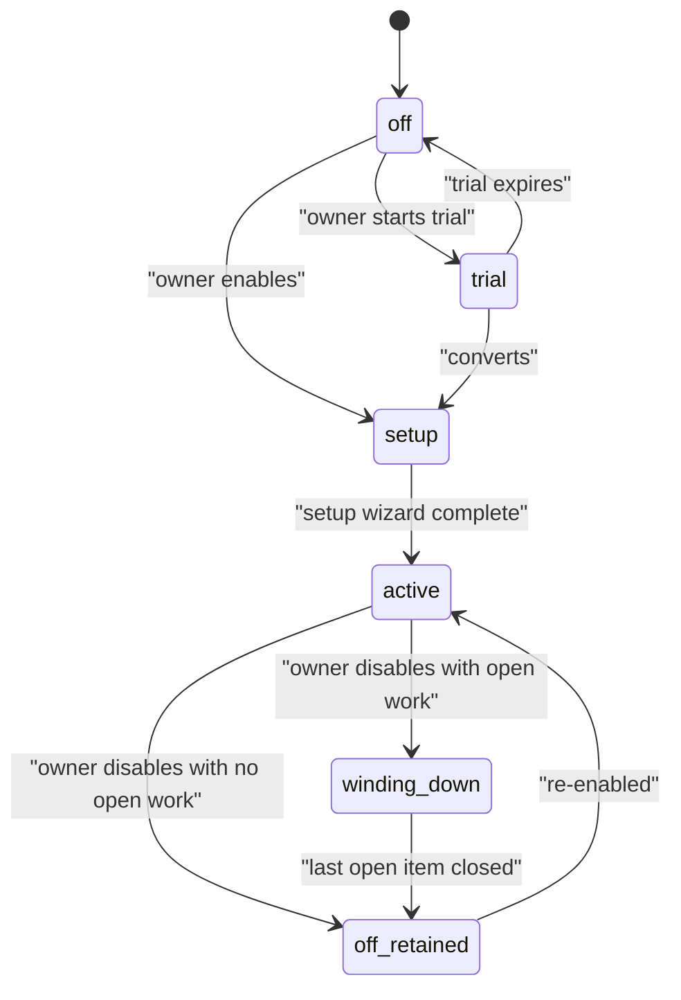

| State | Meaning | Behavior |
|---|---|---|
| `off` | Never enabled. | No nav, no templates; module data tables empty for tenant. |
| `trial` | 30-day trial (operator-configurable). | Full functionality; banner shows days left; billing entitlement flagged as trial. |
| `setup` | Enabled but wizard incomplete. | Nav visible with setup checklist; cannot sell or schedule module-specific services until required steps done (e.g., snow season dates, lawn states of operation). |
| `active` | Live. | Full functionality. |
| `winding_down` | Disabled with open commitments. | No new sales (proposal options for this line hidden, booking widgets removed); existing enrollments, open storm events, open projects continue to completion. |
| `off_retained` | Disabled, data kept. | Read-only access to historical records (compliance records must stay retrievable for their retention period regardless of module state); re-enable restores everything. |

Validation rules:
- Only `owner` (or a custom role with `company.modules.manage`) can change module state. Every change is audit-logged with actor, timestamp, reason.
- Enabling a module checks plan entitlement; if not entitled, the owner sees an upgrade or add-on prompt (Stripe Billing on Rootline's own account; see [22](22-business-model-pricing-gtm.md)).
- Disabling `irrigation` is blocked while `backflow` or `smart_irrigation` is active (dependency rule); the UI offers to disable dependents first.
- Compliance records (application records, proof packets, backflow tests, risk assessments) are never deleted by a module toggle. Deletion follows the retention policy in section 11.

#### 4.0.4 Setup wizards [MVP]

Each module has a 3-7 step wizard that loads region-aware defaults based on the Company's service-area Regions (the same Regions curated for the [Plant KB](12-plant-knowledge-base.md)):

| Module | Wizard steps (required in bold) |
|---|---|
| `lawn_phc` | **States/provinces of operation** (auto-attach rule packs) -> **applicator licenses** (link to employee certifications in [15](15-team-hr-payroll.md)) -> turf types served -> program templates (pick from regional library) -> product library selection -> prepay and renewal policy |
| `irrigation` | Brands serviced -> **seasonal service windows** (start-up, winterization) -> flat-rate repair price book -> zone map defaults |
| `snow_ice` | **Season dates** -> **default trigger depth** -> **pricing models offered** -> **weather sources and stations** -> salt and material units -> subcontractor rate cards |
| `install_projects` | Phase templates -> **811 one-call states** -> warranty policies -> permit jurisdictions |
| `commercial_grounds` | Audit scorecard template -> SOW spec library -> monthly report template |
| `tree_care` | Assessor credentials -> risk form template -> protected-tree jurisdictions -> crane vendors |
| `holiday_lighting` | Ownership model (lease/purchase/both) -> storage locations -> install and takedown windows |
| `mosquito_pest` | **States of operation** -> treatment interval -> no-spray rules |
| `seasonal_campaigns` | Pick campaigns (aeration, cleanups, mulch) -> capacity per day -> early-bird rules |

#### 4.0.5 Shared engines [MVP unless noted]

| Engine | Used by | Responsibility |
|---|---|---|
| **Program Engine** | lawn_phc, mosquito_pest, irrigation (seasonal services), landscape_lighting, holiday_lighting, seasonal_campaigns, commercial_grounds | Multi-round templates with windows, enrollment per Property, round instance generation, window-aware scheduling handoff to [04](04-scheduling-dispatch-routing.md), renewals. |
| **Application Compliance Engine** | lawn_phc, mosquito_pest, tree_care (injections, PHC), snow_ice (material logs only) | Product label library, mix recipes, rate math, application records, weather guardrails, sign posting, registry notifications, retention. |
| **Property Asset Registry** | irrigation, backflow, tree_care, landscape_lighting, holiday_lighting, snow_ice | Typed, geolocated assets on a Property (point/line/polygon via PostGIS), QR tags, photo history, service history per asset. |
| **Storm Event Engine** | snow_ice; reusable for storm cleanup (hurricanes, derechos) [V2] | Event lifecycle from weather feed, site trigger evaluation, dispatch waves, logs, event-close billing. |
| **Inspection Engine** | commercial_grounds, tree_care, irrigation audits, backflow tests, landscape_lighting, snow pre-season inspections, install inspections | Configurable form templates with scoring, computed fields (risk matrices, pass/fail rules), photos, geo-pins, findings that spawn tasks or opportunities. |
| **Project Engine** | install_projects; also large tree and commercial enhancement jobs | Phases, tasks, dependencies, Gantt, milestones, punch lists, permits, dig tickets, budgets. |
| **Warranty Engine** | install_projects, irrigation repairs, landscape_lighting, tree_care (transplants) | Warranty terms, coverage periods, conditions, claims, replacements, reserve accounting. |

#### 4.0.6 Year-at-a-glance season calendar (example: Columbus, Ohio, USDA zone 6)

The calendar below is an illustrative default loaded for a Midwest Region; every window is editable per Company and shifts by Region.

| Month | lawn_phc | irrigation | snow_ice | seasonal_campaigns | lighting | holiday_lighting | mosquito_pest |
|---|---|---|---|---|---|---|---|
| Jan | Renewal letters, prepay push | - | Events | - | - | Takedowns, storage check-in | - |
| Feb | Prepay deadline | - | Events | Spring cleanup pre-sell | - | Renewals for next season | Pre-sell |
| Mar | Round 1 (pre-emergent + fert) | Backflow reminders | Events tapering, season close-out | Spring cleanups | Spring service visit | - | - |
| Apr | Round 1-2 | Start-ups, backflow tests | Season billing true-up | Cleanups, mulch season | - | - | Season start |
| May | Round 2 (broadleaf + fert) | Repairs | Contract renewals | Mulch season | - | - | Treatments every ~21 days |
| Jun | Round 3 (grub preventive + fert) | Mid-season audits | Pre-season sales | - | - | - | Treatments |
| Jul | Round 3-4 | Audits, leak alerts | Pre-season sales | Aeration pre-sell | - | - | Treatments |
| Aug | Round 4 | Repairs | Site maps, sub recruiting | Aeration/overseed booking | - | Pre-sell, mockups | Treatments |
| Sep | Round 4, aeration/overseed | - | Pre-season site inspections | Aeration/overseed | Fall service visit, DST timers | Booking | Treatments |
| Oct | Round 5 (winterizer) | Winterization blowouts | Staking, equipment prep | Fall cleanups | - | Installs begin | Season end |
| Nov | Round 5, renewal pricing | Winterizations | Season opens (Nov 1 default) | Leaf cleanups | DST timer adjust | Installs | - |
| Dec | Renewal campaign | - | Events | - | - | Service calls (outages) | - |

### 4.1 Lawn care and Plant Health Care (PHC) programs (`lawn_phc`)

Lawn and PHC companies sell a **season-long program** of rounds (typically 5-8 for lawn, 3-6 for tree and shrub PHC), each with an application window, a product mix and a rate, priced by measured area or plant count. Revenue depends on route density inside narrow windows; risk depends on getting labels, weather limits and state recordkeeping right.

#### 4.1.1 Program templates and rounds [MVP]

A **Program Template** is an ordered list of **Round Templates**. Example default for cool-season turf in a zone 5-6 Region:

| Round | Name | Default window | Products (example mix per 1,000 sq ft) | Targets |
|---|---|---|---|---|
| 1 | Early spring | Mar 15 - Apr 30 | Granular fertilizer with pre-emergent (e.g., 0.5 lb N + prodiamine at label rate) | Crabgrass prevention, green-up |
| 2 | Late spring | May 1 - Jun 15 | Liquid fertilizer + broadleaf herbicide (spot or blanket per program) | Dandelion, clover |
| 3 | Early summer | Jun 15 - Jul 31 | Slow-release fertilizer + preventive grub control | Grubs |
| 4 | Late summer | Aug 1 - Sep 15 | Fertilizer + spot weed control | Recovery, weeds |
| 5 | Fall | Oct 1 - Nov 30 | Winterizer fertilizer (higher N/K) | Root growth, spring green-up |

Add-on rounds: core aeration, overseeding, lime (driven by soil test), fungicide, surface insect control.

Rules and behaviors:
- Round templates carry: sequence number, window start and end (month-day, Region-shiftable), minimum days since previous round (default 28), maximum days (warning only), product mix reference, pricing rule, required compliance steps (sign posting, notifications), weather guardrails (inherited from products, overridable only to be stricter).
- **Regional shifting:** windows are stored relative to a Region baseline. When the Company operates in multiple Regions, each Region gets its own window offsets (e.g., Round 1 starts Mar 1 in zone 7a, Apr 1 in zone 5a).
- **Turf type awareness:** templates are tagged cool-season or warm-season (Bermuda, zoysia, St. Augustine, centipede). The enrollment wizard reads turf type from the Property (set by estimator, design, or AI photo classification) and only offers compatible programs.
- **Dynamic windows (V1):** windows can be bound to agronomic triggers instead of fixed dates: soil temperature thresholds (the classic crabgrass pre-emergent timing heuristic is soil at about 55 F at a 4-inch depth for several days, verify per Region with extension guidance), or growing degree day (GDD) accumulations from weather data. The engine computes "window opens" per Region daily and notifies ops.
- **PHC programs:** same engine with plant-level targets: dormant oil (late winter), insect and disease rounds (spring/summer), deep-root fertilization (fall), trunk injections (e.g., emerald ash borer protection on ash trees). PHC pricing can be per plant, per inch of DBH (diameter at breast height) or per visit. PHC enrollment reads plants from the tree inventory (4.4) and from installed Designs ([10](10-design-studio.md)), with species resolved against the [Plant KB](12-plant-knowledge-base.md) so pest and disease targets are suggested automatically.

#### 4.1.2 Enrollment and round instance generation [MVP]

- A **Program Enrollment** links Client + Property + Program Template + Season (year) + pricing snapshot + billing mode.
- On enrollment (or renewal), the engine generates one **Round Instance** per round template with state `planned`, a computed window, and a price.
- Round instances become **Visits** only when the ops manager runs the **Round Planner** (or auto-scheduling is on): the planner groups eligible instances by geography and window and hands them to the routing engine in [04](04-scheduling-dispatch-routing.md).
- Mid-season enrollment: rounds whose window has fully passed are marked `not_applicable` and not billed; the round whose window is open is offered as "start now"; pricing is recomputed with an optional "late start" adjustment.

Round instance lifecycle:

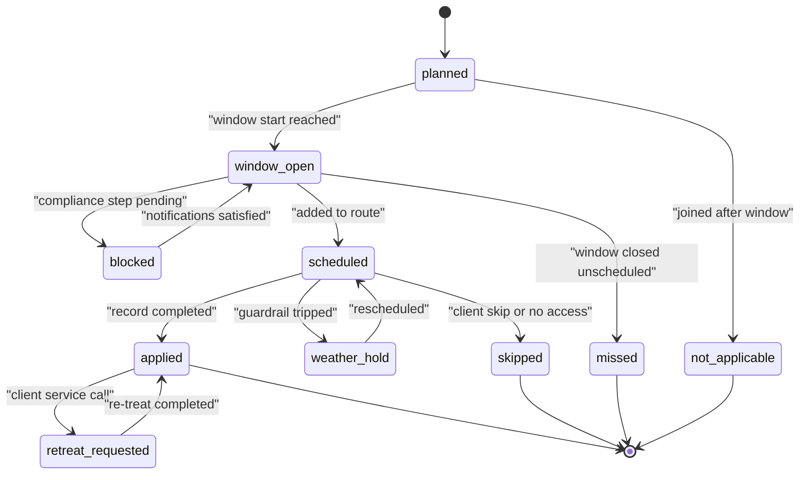

Validation rules:
- An instance cannot move to `scheduled` if any required compliance step is incomplete (registry notification not yet sent, minimum notice hours not elapsed, applicator license for the product category missing on the assigned crew).
- `missed` instances raise an ops alert 7 days before window close (configurable) and appear in the Round Planner's "at risk" lane.
- `skipped` requires a reason code (client request, gate locked, dog in yard, unsafe weather, other) and photo when "no access".

#### 4.1.3 Product library, mixes and rates [MVP]

- **Product label library (platform-curated):** `platform_curator` maintains canonical product records: brand name, registrant, EPA Registration Number (US) or PCP Registration Number (Canada, Pest Control Products Act), active ingredients with percentages, formulation (granular, liquid concentrate, ready-to-use), signal word, restricted-use flag (RUP), re-entry and "keep off until dry" guidance, label and SDS PDF links, jurisdiction eligibility flags (e.g., products not permitted for cosmetic use under provincial rules in Ontario and Quebec, verify per product), and **label-derived guardrails** (max wind speed, rainfast period, temperature range, max rate per application and per year, minimum interval). Tenants pick from this library or create private products (private products require the tenant to enter label fields and attach the label PDF).
- **Fertilizer specifics:** N-P-K analysis, slow-release percentage, phosphorus flag (for jurisdictions restricting phosphorus on established turf), and jurisdictional blackout dates (e.g., several Florida counties restrict nitrogen and phosphorus application in summer months; New Jersey restricts professional fertilizer application in winter months; verify current dates per jurisdiction rule pack).
- **Mix recipes:** a Mix is a list of products with rate per 1,000 sq ft (or per acre, per gallon of carrier, per plant, per inch DBH). The rate engine computes, for each Visit: product quantity = rate x treated area / 1,000. For liquids it also computes total spray volume from carrier rate (e.g., 1 gal water per 1,000 sq ft) and tank loads.
- **Load sheets [MVP]:** for a day's route, the crew app shows total product to load per truck (e.g., "Route 4, 38 lawns, 214,000 sq ft at 3.1 lb per 1,000 sq ft: 663 lb of 24-0-11 with prodiamine, about 13.3 bags of 50 lb; truck stock 9 bags, load 5 more"). Inventory is decremented on completion ([13](13-operations-inventory-equipment.md)).
- **Measured area source of truth:** treated area comes from the Property's measured turf polygons (Design Studio, AI measurement, or manual). If the area changes by more than 10% vs the enrollment snapshot, the price change rule (absorb, reprice next season, reprice now with notice) is applied per Company policy.

#### 4.1.4 Application records and state compliance [MVP]

Every completed application produces an immutable **Application Record**. Required fields are the union of the rule packs attached to the jurisdiction of the Property:

| Field | Source | Notes |
|---|---|---|
| Property address and treated area (sq ft or acres) | Property + Visit | Geometry snapshot stored. |
| Date, start time, end time | Crew app timestamps | Device time plus server receipt time. |
| Applicator name and license/certification number and category | Employee certifications ([15](15-team-hr-payroll.md)) | Validated not expired on date of application. Supervisor of uncertified technician recorded where state allows supervised application. |
| Product brand name, EPA/PCP registration number, active ingredients | Product library | Snapshot, not a live reference. |
| Rate applied and total amount of product (and total mix volume) | Rate engine + crew confirmation | Crew can adjust actual amount; deviation over 15% from planned requires a note. |
| Target pest(s) or purpose | Round template | Editable. |
| Application method and equipment | Visit equipment ([13](13-operations-inventory-equipment.md)) | E.g., ride-on spreader-sprayer, backpack, hose reel. |
| Weather at application: wind speed and direction, temperature, sky/precipitation | Device sensor not available, so from weather API at geo/time, plus crew confirmation | Guardrail evaluation stored with result. |
| Sign posting proof | Crew app photo | If required by rule pack. |
| Customer pre-notification and post-application notice proof | Notification log | If required. |
| Registry notification proof for abutting properties | Notification log | If required. |
| Restricted-use flag and any RUP-specific fields | Product library | RUP fields per state rule pack. |

Rules:
- **Rule packs** are curated per jurisdiction (state, province, and county or municipality where local ordinances exist) by `platform_curator`, versioned, with effective dates and a "last verified" date. Each pack declares: required record fields, retention period (e.g., two years for Maine commercial applicators per the [Maine BPC document](https://www.maine.gov/dacf/php/pesticides/documents2/bd_mtgs/Jun22/6-CA-Caribou-CC.pdf); other states differ), sign posting rules, registry rules, customer notice rules, reporting obligations (some states require annual use reports), and fertilizer blackout dates. Tenants cannot edit a platform pack but can add stricter Company rules.
- Records are append-only after the Visit is closed. Corrections create a new **record revision** with reason, author and timestamp; the original remains visible in the audit trail. This matches how regulators expect corrections to be made (no silent edits).
- **Export formats:** state-specific CSV/PDF where agencies publish a format; a generic "regulator view" PDF per date range, applicator or product; annual use summaries by active ingredient.
- **Federal note:** USDA's recordkeeping program for restricted-use pesticides applies to private (agricultural) applicators; commercial lawn applicators are generally governed by state rules (verify per state). Rootline's RUP handling therefore lives in state rule packs.

#### 4.1.5 Notification registries and neighbor notice [V1]

Approximately half of US states have some form of lawn pesticide notification law, using signs, registries and/or notice to abutting owners ([Beyond Pesticides](https://beyondpesticides.org/assets/media/documents/lawn/factsheets/STATE%20NOTFICATION%20LAWS%20-%20LAWN.pdf), [GAO](https://gao.justia.com/environmental-protection-agency/1991/9/lawn-care-pesticides-rced-91-208)). Michigan, for example, requires a commercial applicator to notify a registry contact before applying certain lawn or ornamental pesticides to a listed address ([Mich. Admin. Code R 285.637.5](https://www.law.cornell.edu/regulations/michigan/Mich-Admin-Code-R-285-637-5)); Wisconsin and Connecticut have long-running registries ([Landscape Architect](https://landscapearchitect.com/landscape-articles/wisconsin-requires-spraying-notificationwisconsin-requires-spraying-notification-4892)).

Spec:
- **Registry lists:** imported per jurisdiction (CSV upload by `office_manager`, or platform-provided feed where the state publishes one, curated by `platform_curator`). Each entry: name, address, geocode, parcel ID, contact methods, notification preference, valid-from/valid-to, source.
- **Abutting detection:** using parcel polygons (Regrid or equivalent, see [20](20-architecture-security.md)), the engine finds registry parcels that touch or are within the rule pack's distance of the target Property's parcel (PostGIS `ST_DWithin`). Results cached per Property and refreshed when the registry list changes.
- **Notice generation:** for each scheduled Visit with a triggering product, the engine creates Notification Tasks with the window required by the rule pack (e.g., "at least 24 hours and no more than 14 days before application", values per pack). Channels: SMS, email, phone script for call, mail-merge letter. Each send is logged with content hash, channel, recipient, timestamp and delivery status.
- **Gating:** the Round Instance stays `blocked` until required notices are sent and the minimum lead time has elapsed. If a Visit is rescheduled outside the notified window, notices are re-issued automatically.
- **Customer notice:** pre-application notices to the client themselves ("We plan to treat your lawn Tuesday or Wednesday") and post-application leave-behind info (products, precautions, re-entry guidance) are generated per rule pack and delivered via door-hanger print, SMS link and the [Customer Portal](06-customer-portal.md).

#### 4.1.6 Lawn sign posting [MVP]

- Rule pack defines whether signs are required, sign size and wording, placement (commonly a conspicuous point of access) and minimum display period (commonly 24 hours; [Mother Earth News summary](https://www.motherearthnews.com/sustainable-living/nature-and-environment/pesticide-application-signs-zm0z16jjzsor/), verify per jurisdiction).
- Crew app requires a **sign photo** before the Visit can be completed when signs are required; the photo is geotagged and attached to the Application Record. Missing photo blocks completion unless a crew lead overrides with reason (override audited and flagged in the compliance dashboard).
- Sign inventory is tracked as a consumable in [13](13-operations-inventory-equipment.md).

#### 4.1.7 Soil tests [V1]

- **Soil test visit type:** collect cores (e.g., 10-15 cores per sample area at a set depth), bag and label with QR code linking to Property and sample area polygon.
- **Lab submission:** printable submission form per lab; labs configured per Company (university extension labs or commercial labs).
- **Result ingestion:** upload PDF or CSV; AI document understanding ([17](17-ai-copilot-automation.md)) extracts pH, buffer pH, P, K, Ca, Mg, organic matter, CEC and lab recommendations into structured fields; a human confirms before saving.
- **Recommendations:** rule-based lime/sulfur and fertilizer adjustments (Company-configurable tables), plus a proposed add-on (e.g., "Lime at 50 lb per 1,000 sq ft, 6,800 sq ft, USD 142") pushed to the client as a one-click portal approval.
- **Trend view:** pH and OM over years per sample area.

#### 4.1.8 Weather limits and guardrails [MVP]

- Each product and mix carries guardrails: max wind (e.g., 10 mph for liquid broadcast), rain-free hours after application, min/max air temperature, soil temperature (for pre-emergents), "do not apply to frozen or saturated soil", heat-stress cutoffs for some herbicides.
- **Planning-time check:** the Round Planner overlays hourly forecast for each route day; routes with expected violations are flagged amber (risk) or red (violation).
- **Execution-time check:** when the crew starts a Visit, the app pulls current conditions for the location (weather API) and blocks liquid applications above the wind limit; the technician can switch to a granular alternative mix if the round template allows, or mark `weather_hold`.
- Every guardrail evaluation (inputs, rule, outcome, override) is stored on the Application Record.

#### 4.1.9 Program pricing, prepay, level-pay and renewals [MVP]

**Pricing rules** (see [03](03-crm-sales-estimating-proposals.md) for the estimating engine):
- Area-tier pricing: e.g., Round price = USD 49 for up to 5,000 sq ft + USD 6.50 per additional 1,000 sq ft (example values). Minimum charge per round.
- Per-plant / per-DBH for PHC; per-visit for add-ons.
- Program price = sum of rounds. Price snapshot stored on the enrollment.

**Billing modes** (generation mechanics in [07](07-invoicing-billing-contracts.md)):

| Mode | Behavior | Accounting (see [09](09-accounting-ledger-integrations.md)) |
|---|---|---|
| Pay per round | Invoice generated on round completion (immediate or batched nightly); autopay charges card/ACH on file via the Company's own Stripe ([08](08-payments-stripe.md)). | Revenue at completion. |
| Prepay season | Client pays the full program up front (discount, e.g., 5% if paid by Mar 1). | Payment posts to a customer prepayment (unearned revenue) liability; each completed round draws down the liability and recognizes revenue. |
| Level-pay (budget billing) | Program total / N monthly charges (e.g., 10 months Feb-Nov). | Running receivable/prepayment balance per enrollment; year-end true-up rules. |
| Hybrid | Deposit + per round. | Combination. |

Rules:
- **Prepay discount clawback:** if a prepaid client cancels, refund = prepaid amount - value of completed rounds at **undiscounted** price (Company option: at discounted price). Refund issues through the Company's Stripe as a refund or credit memo.
- **Skipped rounds** on prepay: credit carries forward to the next round or season (Company policy).
- **Re-treat guarantee:** service calls between rounds are free to the client but tracked as cost (labor + product) against the enrollment for profitability reporting.

**Renewals [MVP, automation V1]:**
- Renewal run (typically December-January): creates next-season enrollments for active clients with a configurable price increase (e.g., +4%, rounded to the nearest USD 1 per round), sends renewal notice through portal/email/SMS with a prepay offer and an early-bird deadline.
- **Auto-renew vs opt-in** is a Company setting per program, with disclosures generated per jurisdiction rule (several US states have automatic renewal laws requiring clear disclosure and easy cancellation; rule content curated, verify per state). Cancel link always one click in the portal.
- Renewal dashboard: renewed, pending, declined (with reason), at-risk (no response 21 days before Round 1 window).

#### 4.1.10 Lawn and PHC scheduling specifics [MVP]

- **Round Planner** board: rows = Regions/territories, columns = weeks; cards = counts of eligible round instances with total sq ft and product needs. Drag a block into a week to create route-ready Visits.
- **Production rate per technician:** sq ft per hour by equipment type (e.g., 40,000-60,000 sq ft per hour on a stand-on spreader-sprayer for open lawns, estimate) drives capacity.
- **Sequencing:** lawns in the same subdivision are batched; the router respects the minimum days since previous round per Property.
- **Rain makeup:** a weather hold on a day automatically re-flows unstarted Visits into the next available days inside the window, preserving notification validity or re-issuing notices.

> **Competitive edge.** Real Green pioneered rounds-and-programs, but its program logic is not tied to a curated label library with guardrails, parcel-based registry detection, or a Plant KB that knows which ornamental pests belong to which species in which Region. Jobber and Housecall Pro model lawn programs as generic recurring jobs and leave chemical records to custom fields and forms (as of Nov 2026, verify). Rootline makes the compliant record the only way to complete the Visit.

### 4.2 Irrigation (`irrigation`, `backflow`, `smart_irrigation`)

Irrigation is high-margin, highly seasonal (start-ups and winterizations are compressed into a few weeks) and knowledge-heavy (which zone covers the side yard, where the valve box is buried). The module turns tribal knowledge into a per-property **Irrigation System Inventory** with a zone map, then uses it for seasonal services, repairs, backflow compliance, smart-controller integration and water management.

#### 4.2.1 Per-property system inventory [MVP]

Hierarchy: **Irrigation System** (one per point of connection) -> **Controllers** -> **Zones** -> **Components**; plus **Backflow Device**, **Water Source**, sensors.

| Entity | Key fields |
|---|---|
| Irrigation System | water source (municipal, well, reclaimed, pond), point of connection location (geo point), meter size, static pressure (psi), flow capacity (gpm), shutoff location (geo point + photo), master valve (yes/no), flow sensor (model), rain/freeze sensor (model), install year, installer, as-built Design reference |
| Controller | brand, model, station count, location (geo + photo), power, firmware, smart link (vendor, external ID, connection status), program settings snapshot |
| Zone | number, name ("Front beds drip"), area polygon, plant type (turf, shrubs, annuals, trees), emission type (spray, rotor, MP rotator, drip, bubbler), nozzle/precip rate (in/hr), head count, valve location (geo + photo), valve brand/size, wire color, sun exposure, soil type, slope, current run time and days, notes |
| Component | type (head, valve, drip line, filter, pressure regulator, valve box, splice), brand/model, location (optional geo point), status, last serviced |
| Backflow Device | type (RP, DCVA, PVB, SVB, AVB), manufacturer, model, size, serial, location (geo + photo), install date, last test date and result, next due date, jurisdiction, water purveyor account |

Rules:
- Inventory can be built incrementally: a crew lead can add a zone during a start-up with a name, photo and type in under 30 seconds; geometry can be sketched later by the office.
- Zone count on the controller must match zone records; a mismatch raises a data-quality task.
- Inventory edits from the field are versioned; office can review a diff ("Zone 7 changed from spray to drip").

#### 4.2.2 Zone maps [MVP basic, V1 full]

- **[MVP]** Zones drawn as polygons on the property map (satellite + parcel), valves and controller as pins, mainline as a polyline. Crews see the zone map in the app; tapping a zone shows heads, valve photo and history.
- **[V1]** Zone map as a layer of the [Design Studio](10-design-studio.md) plan for installed systems, so as-built irrigation is exactly the design (heads, laterals, mainline, sleeves). AI-assisted zone mapping: technician walks the property while running each zone; the app records a path and photos per zone, and AI proposes zone polygons for office confirmation.
- **Private utility value:** zone maps double as private-line locates, because public 811 locating does not mark privately owned lines such as irrigation and landscape lighting (one-call centers typically locate only member utility facilities, verify per state). Aeration, fence and planting crews see a warning layer before digging (cross-module, see 4.5.6 and 4.10).

#### 4.2.3 Seasonal services: start-ups, mid-season audits, winterizations [MVP]

Seasonal services are a Program (Program Engine) with three default rounds:

| Round | Default window (zone 6 example) | Gate | Checklist highlights |
|---|---|---|---|
| Spring start-up | Apr 1 - May 15 | Earliest date after Region's average last hard freeze plus Company buffer; forecast shows no lows below 28 F for 5 days (configurable) | Open main slowly, check backflow (and schedule test if due), pressurize, run each zone, adjust heads, replace broken parts (per pre-authorized limit), set controller schedule by season, test rain/freeze sensor, record pressure |
| Mid-season audit | Jun 15 - Aug 15 | none | Run each zone, check coverage, adjust run times, optional catch-can test for distribution uniformity, leak check, client walk-through report |
| Winterization (blowout) | Oct 1 - Nov 20 | Ordered by first-freeze risk per micro-region; urgent wave triggered by forecast lows below a configured threshold | Shut off and drain, blow out zone by zone with compressor (record CFM and psi used and cycles per zone), drain backflow, set controller to off/rain mode, photo of shutoff |

Scheduling specifics:
- **Rush planning:** winterization windows are compressed; the planner offers "freeze wave" scheduling: when a hard freeze is forecast within 7 days, unserved systems in affected areas are ranked by risk (above-ground backflow exposure, client history) and offered in a dispatch wave.
- **Duration model:** visit duration = base (e.g., 20 min) + per-zone time (e.g., 4 min/zone) + per backflow device (e.g., 10 min); learned from actual times per Company (V1).
- **Client prep notices:** automated reminders (e.g., "We'll need access to your basement shutoff and garage controller on Tuesday") with portal confirmation of access instructions.
- **Pre-authorized repair limit:** enrollment stores a not-to-exceed amount for repairs found during start-up (e.g., USD 150) so crews can fix broken heads without a callback; anything over creates a repair ticket requiring approval.

#### 4.2.4 Repair tickets [MVP]

- Created by: crew during service, client request in portal ("zone 4 isn't coming on" with photo/video), smart-controller alert (4.2.7), or office.
- Fields: system, zone(s), symptom (no water, low pressure, geyser, won't shut off, controller fault, wire fault), priority, diagnosed cause, parts used (price book), labor time, photos before/after, warranty applicability (4.5.7), approval status.
- Pricing: flat-rate repair items (e.g., "Replace 4-inch spray head: USD 45 installed") or T&M; pre-authorized amount honored automatically.
- **Zone history:** every repair links to the zone; a zone with 3+ repairs in a season is flagged for a renovation proposal.
- **Remote zone run (V1):** technician starts/stops a zone from the phone through the smart-controller integration while standing at the head.

#### 4.2.5 Backflow testing, certification and municipal submission [V1]

Backflow prevention assemblies on irrigation lines are commonly required to be tested annually by a certified tester and reported to the water purveyor, often through an online portal (BSI Online, SwiftComply, Tokay) with filing fees and deadlines that differ by city (see section 2.2 evidence).

Spec:
- **Tester credentials:** employee certification (certifying body, number, expiration), test gauge (make, serial, last calibration date). A test cannot be recorded with an expired certification or an out-of-calibration gauge (Company sets calibration interval, commonly annual, verify per jurisdiction).
- **Test form per device type** with field-test readings and automatic pass/fail evaluation using the jurisdiction's thresholds. Default thresholds follow common field test procedures (e.g., for an RP assembly: check valve 1 differential and relief valve opening point; for a DCVA: each check holding at least 1.0 psid; for a PVB: air inlet opening and check valve holding at least 1.0 psid). Thresholds are configurable in the jurisdiction pack because local procedures differ (verify per jurisdiction).
- **Repair and retest:** failed test -> repair record (parts: rubber kit, springs, seats) -> retest; both submitted if the jurisdiction requires.
- **Jurisdiction packs (platform-curated, tenant-extendable):** purveyor name, portal type (BSI Online, SwiftComply, Tokay, email PDF, paper), submission deadline (e.g., within 15 days or within 48 hours of the test), filing fee and whether it is passed through, required form layout, whether a customer confirmation number is required before filing (BSI Online terms require testers to obtain a Customer Confirmation Number from the customer, [BSI Online terms](https://bsionlinetracking.com/default/terms-conditions)), test cycle (annual default).
- **Submission assist:** Rootline generates the jurisdiction's PDF and a structured data sheet; for portals without public APIs (the common case, verify per vendor), the office sees a "file now" queue with copy-ready fields and a checkbox + confirmation number capture. Where a portal offers an integration or bulk upload, a connector posts directly (V2).
- **Due-date engine:** each device's next test date and the purveyor's notice letters (clients often receive a city letter) can be entered; reminders go to the client 30/14/3 days before due with one-click booking in the portal.
- **Billing:** per-device test fee (e.g., USD 85 first device, USD 60 each additional at the same address, example values) + pass-through filing fee line item (non-taxable where applicable, mapped to a pass-through liability or revenue account per [09](09-accounting-ledger-integrations.md)) + repair lines.
- **Commercial portfolio view:** client_commercial sees compliance status across all sites (due, overdue, passed, failed, filed) in the portal.

#### 4.2.6 Smart controller integrations [V1 Hydrawise and Rachio, V2 Rain Bird IQ4 and Weathermatic]

| Vendor | Integration surface (public info, verify before build) | Rootline use |
|---|---|---|
| Hunter Hydrawise | REST API and GraphQL API with OAuth 2.0; rate limits include 3 start/stop/suspend zone calls per 30 seconds and 30 calls per 5 minutes per user on the REST API ([Hunter](https://www.hunterirrigation.com/support/hydrawise-api-information)); Python client exposes controllers and zones ([pydrawise](https://pydrawise.readthedocs.io/en/latest/reference/)). | Read controllers, zones, schedules, run history, flow (where metered); start/stop/suspend zones; apply rain delays. |
| Rachio | OAuth 2.0; devices, zones, schedule rules, flex schedules, webhooks for run and skip events; zone run durations 0-10,800 seconds ([rachiopy](https://rachiopy.readthedocs.io/en/latest/zone.html)); a secondary index lists a 3,500 requests/day per token limit ([API Evangelist index](https://raw.githubusercontent.com/api-evangelist/rachio/refs/heads/main/llms/rachio-llms.txt)); future watering times are not directly exposed ([Rachio community](https://community.rachio.com/t/api-capability-for-weather-skips/23624)). | Webhook-driven run/skip ingestion, zone start for troubleshooting, schedule summary for client reports. |
| Rain Bird IQ4 | Third-party API for flow, alarms, events, run times and weather; requires the Owner role and company authorization for third-party API access, historically via a paid subscription ([Rain Bird](https://www.rainbird.com/professionals/iq4-product-development-update-new-bms-Integration)). | Commercial sites: alarm ingestion into repair tickets, run-time and flow reporting in monthly property reports. |
| Weathermatic (SmartLink) | Commercial cellular smart controller platform; API availability not confirmed in this research pass (verify, likely partnership-based). | Same as Rain Bird for commercial portfolios. |

Integration rules:
- **Ownership:** the controller account usually belongs to the client (residential) or the property owner (commercial). Connection is by OAuth consent from the account holder (sent as a portal link) or via a contractor/pro account where the vendor supports multi-site management. Tokens are stored encrypted (KMS) per [20](20-architecture-security.md).
- **Rate-limit budget:** a per-vendor scheduler allocates polling within published limits; webhooks preferred where available; manual "refresh now" is throttled.
- **Write actions** (start zone, rain delay, schedule change) require the `irrigation.controller.control` permission, are logged with actor and reason, and are disabled for a property when the client revokes "allow contractor control" in the portal.
- **Mapping:** controller stations map to Rootline zones (auto-match by station number, confirm by name).

#### 4.2.7 Water budget, ET and leak alerts [V1 basic, V2 advanced]

- **Water budget:** monthly budget per zone = ETo x Kc (plant factor) x area x 0.623 / irrigation efficiency, in gallons (0.623 converts inches over a square foot area to gallons). ETo source: weather provider reference ET; OpenET or Spatial CIMIS in regions where they are available (verify coverage and terms). Kc defaults by plant type (turf cool-season, turf warm-season, shrubs, drip beds) and can be refined from the Plant KB's water-use rating per species ([12](12-plant-knowledge-base.md)).
- **Actual use:** from controller flow sensors, smart water meters, or run time x zone flow rate estimate.
- **Variance alerts:** zone using more than 125% of budget for 2 consecutive weeks (configurable) -> advisory to ops and optional client message.
- **Leak and fault alerts:** high-flow and low-flow alarms from controllers, unscheduled flow, short/open circuit faults, offline controllers. Each alert maps to a property, zone and symptom; rules decide: notify only, create repair ticket (draft), or create and auto-schedule if within the pre-authorized limit.
- **Water restrictions:** jurisdictional watering-day rules (e.g., odd/even, specific weekdays) stored per municipality (tenant-maintained in V1, curated in V2); schedule suggestions respect them.
- **Client water report [V2]:** seasonal summary of gallons used vs budget, estimated savings, rain-skip days, with a CTA for upgrades (smart controller, drip conversion, MP rotator retrofit).

> **Competitive edge.** Generic FSM tools treat irrigation as free-text notes; vendor apps (Hydrawise, Rachio, IQ4) know controllers but not the contractor's billing, crew or zone repair history. Rootline joins both: an alarm becomes a priced, pre-authorized repair visit for the right zone with the valve photo already on the technician's phone, and the same zone map protects heads during aeration and gives designers a true as-built.

### 4.3 Snow and ice management (`snow_ice`)

Snow is a different business: revenue arrives in unpredictable bursts, work happens at night in hazardous conditions, crews and subcontractors must be committed hours before the first flake, and the documentation produced during a storm decides lawsuits years later. The module is built around the **Storm Event Engine** and **Proof-of-Service Packets**, aligned with the documentation themes of the SIMA procurement standard (service documentation and reporting, billing requirements, technology requirements, service controls and communication; [SIMA standards](https://sima.org/standards)) and the ASCA A1000 standard (pre-season site inspection reports, in-event documentation, post-event processes, weather service reporting; [ANSI webstore](https://webstore.ansi.org/standards/ansi/ansiascaa10002014)).

#### 4.3.1 Snow contracts and pricing models [MVP]

A snow contract is a Service Agreement ([07](07-invoicing-billing-contracts.md)) with a **Snow Terms** block per site. Supported models:

| Model key | Definition | Key parameters | Example (illustrative values) |
|---|---|---|---|
| `per_push` | Each plow visit billed. | Trigger depth; per-push price by accumulation band; minimum hours between billable pushes; whether de-icing is separate | 2 in trigger; 2-4 in USD 165, 4-8 in USD 220, 8-12 in USD 310 per push for a 40-space lot |
| `per_event_band` | One price per storm event by total accumulation band; includes defined services. | Event definition; bands; included pushes and applications; overage rules | 2-4 in event USD 390 incl. 1 push + 1 salt application; 4-8 in USD 640 incl. 2 pushes + 1 salt |
| `seasonal` | Fixed fee for the season regardless of events. | Season dates; installments; included services; exclusions (hauling, relocation) | USD 9,600 Nov 1 - Apr 15, 6 monthly installments of USD 1,600 |
| `seasonal_capped` | Seasonal with a cap on events or inches; overage billed per event/inch. | Cap count or inches; overage price | Covers up to 18 events; events 19+ at USD 480 each |
| `seasonal_floor` | Per-event pricing with a minimum seasonal fee (protects the contractor in light winters). | Floor amount; per-event price | Minimum USD 4,000; per-event pricing applied until exceeded |
| `per_inch_seasonal` | Seasonal price indexed to total season snowfall (from an agreed station). | Base inches; price per inch over/under; station | Base 30 in; USD 120 per inch above base |
| `time_and_materials` | Hourly equipment/labor + materials. | Rates per equipment class (pickup with plow, loader, skid steer with pusher box, sidewalk crew per person); material prices (bulk salt per ton, bagged per bag, liquid per gallon); minimum charge | Pickup USD 125/hr, loader USD 210/hr, salt USD 165/ton applied |
| `per_application` | De-icing priced per application. | Price by site size or material quantity | Salt application USD 195 per application; walks USD 65 |

Common contract parameters:
- **Trigger depth** (e.g., 2 inches for lots, 0.5 inch or "any accumulation" for walks; "zero tolerance" sites such as hospitals service continuously).
- **Service level / time to open:** e.g., lot open by 7 a.m., walks clear within 2 hours of snowfall end, re-service every 4 inches during the event.
- **Not-to-exceed caps:** per event and per month; work beyond the cap needs client approval (portal one-tap for client_commercial approvers).
- **Priority areas and no-service areas** (from the site map).
- **Hauling/relocation and standby** priced separately.
- **Weather station of record** for billing disputes (named station or provider).

Validation rules:
- A site cannot be dispatched without a Snow Terms block, an approved site map (V1: warning only in MVP) and, for subcontracted sites, a valid subcontractor COI on file ([13](13-operations-inventory-equipment.md)).
- Contracts with seasonal models must define installments; installments are invoiced regardless of events; event logs still record work for proof and job costing.

#### 4.3.2 Site maps with priorities [MVP basic, V1 full]

Snow site maps are a typed layer on the Property map (shared with the Design Studio basemap):
- **Polygons:** plow areas (with priority 1-3), sidewalks/walk zones (with shovel/blower/ice-melt method), no-plow areas, snow stacking/pile zones (approved and prohibited), loading docks, fire lanes.
- **Points:** hydrants, drains, curbs and islands to stake, light poles, speed bumps, hazards (e.g., "decorative boulder, 3 ft tall"), staging location, salt storage, building entrances (priority 1 walks).
- **Lines:** curb lines, delineator/stake lines, route path for sidewalk machines.
- Each feature has photos (pre-season, summer view so crews know what's under the snow), notes and an "approved by client" timestamp.
- **Pre-season site inspection [MVP]:** checklist (existing damage photos to defend against later damage claims, staking complete, hazards marked, contact list, gate codes, salt storage) signed by crew lead; client acknowledgment of the site map via portal (stored as signed artifact). SIMA resource-center guidance also recommends confirming client instructions such as "do not service this area" in writing ([SIMA slip-and-fall pitfalls](https://resources.sima.org/snow-and-ice-resource-center/slip-and-fall-pitfalls), [SIMA protect others, protect yourself](https://resources.sima.org/snow-and-ice-resource-center/protect-others-protect-yourself)); Rootline auto-generates that confirmation email whenever a no-service area is added or changed.
- **Area metrics:** plowable sq ft, walk linear ft and sq ft, computed from polygons; drives pricing and salt estimates.
- **Import:** site maps from Design Studio, AI measurement, or partner measurement (e.g., Go iLawn style exports) via GeoJSON/KML/DXF.

#### 4.3.3 Storm event creation from weather feeds [MVP manual + forecast alerts, V1 automated]

**Weather inputs** (provider-agnostic weather adapter; see [04](04-scheduling-dispatch-routing.md)):
- Forecasts: hourly snowfall, ice accretion, temperature, wind (commercial weather API; US NWS API for public forecasts; Environment and Climate Change Canada data in Canada).
- Observations: nearest stations, community observations (e.g., CoCoRaHS reports, verify licensing for commercial use), radar-derived accumulation, and **crew-measured depth** (photo of a snow ruler at the site's measuring point, required on first arrival).
- Optional certified weather reports from third-party providers for disputes (provider configured per Company).

**Event lifecycle:**

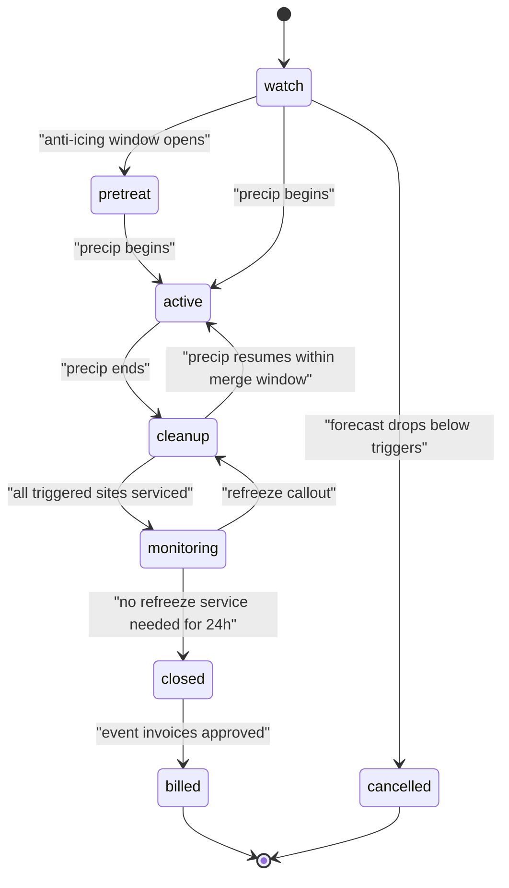

Rules:
- **Auto-creation (V1):** when forecast accumulation for any served Region exceeds the lowest trigger among active contracts with probability above a Company threshold (e.g., 60%) within 48 hours, the engine creates a `watch` event, notifies ops and the owner, and pre-computes the impact (sites likely to trigger, crew hours, salt tons).
- **Event boundaries:** an event starts at precipitation start (observed) and ends at precipitation end; if precipitation resumes within the **merge window** (default 6 hours, contract-overridable), it is the same event. Event definition text is copied into contracts so billing disputes reference the same rule.
- **Per-site trigger evaluation:** each site gets an Event Site record with status: `not_triggered`, `triggered`, `dispatched`, `in_progress`, `serviced`, `re_service_due`, `complete`, `exception`. Trigger evaluation uses the site's nearest observation grid cell, overridden by crew-measured depth when available.
- **Manual events** are always possible (ops creates an event for a localized squall or an ice-only event).

#### 4.3.4 Dispatch and plow routes [MVP]

- **Storm Command Center** (wireframe in section 6): live map of sites colored by status and priority, crew/sub positions, salt inventory, open exceptions, ETA to "all priority 1 open".
- **Route templates:** each crew/truck/sub has a seasonal route template (ordered sites by priority, e.g., hospitals and 24-hour retail first). For each event the engine instantiates routes from templates, filtered to triggered sites.
- **Re-optimization:** when a truck goes down or a site calls in, the ops manager drags a site to another route or runs re-optimization (OR-Tools VRP with priorities and time windows, see [04](04-scheduling-dispatch-routing.md)).
- **Re-service loops:** for long events, sites with "re-service every N inches" automatically re-enter the queue as accumulation increases.
- **Staffing commitments:** at `watch`, the engine sends shift call-outs to employees and subs (accept/decline in app); ops sees committed capacity vs required capacity.
- **Driver safety:** hours-on-shift counter per driver with warnings at configurable thresholds (e.g., 12 and 16 hours) and forced break prompts; links to [15](15-team-hr-payroll.md) for timesheets.

#### 4.3.5 Salt and material usage logging [MVP]

- Each service log records material type (bulk rock salt, treated salt, bagged ice melt, calcium chloride, liquid brine, sand), quantity and unit (tons, lbs, bags, gallons), method (spreader, hand, sprayer), spreader setting/calibration ID, and area treated.
- **Application rate check:** quantity / area compared to the Company's target rate table by temperature and condition; out-of-range rates (over 50% above target) prompt a note. This supports sustainability programs such as Ontario's Smart About Salt and similar certifications (verify current program names and requirements) and limits waste.
- **Inventory:** salt depots and truck loads decrement inventory ([13](13-operations-inventory-equipment.md)); low-stock alerts during `watch` events consider forecast needs.
- **Liquid program:** pre-treatment (anti-icing) logs include brine concentration (salt brine is typically mixed near 23% sodium chloride, verify Company standard) and gallons per 1,000 sq ft.

#### 4.3.6 Timestamped GPS proof-of-service for slip-and-fall defense [MVP]

Slip-and-fall claims are the existential risk of commercial snow work. Industry guidance stresses complete in-season documentation ([SIMA](https://resources.sima.org/snow-and-ice-resource-center/effective-in-season-documentation)), and vendors note that GPS alone or photos alone can each be challenged, which is why they must be combined ([Aspire blog](https://www.youraspire.com/blog/prove-service-delivery-data-ends-disputes); [Yeti](https://yetisoftware.com/)).

**Proof-of-Service Packet** (one per Event Site, generated automatically):

| Component | Capture | Integrity |
|---|---|---|
| Arrival and departure | Geofence entry/exit on the site polygon (crew app or vehicle telematics), plus manual "start/finish" taps | Device time, GPS time and server receipt time all stored; discrepancies over 2 minutes flagged |
| Breadcrumb trail | GPS points every 10-15 seconds while on site (adaptive to battery) | Rendered over the site map with coverage heat |
| Photos | Required: arrival "before" at the measuring point with snow ruler, "after" of each priority-1 area, salt applied evidence; optional video | EXIF + app-stamped overlay (time, coordinates, site, crew); original file hash |
| Measured depth | Value entered + photo | Compared with weather observation |
| Services performed | Plow, shovel, blow, salt, liquid, haul, relocation | Linked to contract services |
| Materials | Type, quantity, rate, spreader setting | Inventory reconciled |
| Weather context | Observed temp, precip type and intensity at arrival and departure (provider), plus event-level summary | Provider name and observation IDs stored |
| Crew/sub identity and equipment | Logged-in user, vehicle/equipment ID | Device ID |
| Client communications | Approvals, no-service instructions, complaints and responses | Message IDs |
| Exceptions | Blocked access, parked cars, unsafe conditions, equipment breakdown | Required photo and note |

Integrity spec:
- Logs and media are written to append-only storage; each record carries a SHA-256 hash and the event packet carries a **signed manifest** (hash of all record hashes) stored in object storage with retention lock (S3 Object Lock in compliance mode, see [20](20-architecture-security.md)). V1 adds an RFC 3161 trusted timestamp on the manifest for third-party verifiability.
- Offline capture is the default: the crew app stores logs locally with device time and syncs when connected ([05](05-field-crew-mobile-app.md)); server receipt time is added on sync and both are shown.
- **Retention:** default 7 years after event close (Company-configurable upward; never below the jurisdiction minimum in the rule pack). Limitation periods for personal injury claims vary by state/province and can be extended (e.g., for minors), so the default is deliberately long. **Legal hold** freezes deletion for selected sites/events.
- **Export:** "Court-ready packet" PDF (site map with trails, timeline table, photos, weather, materials, signatures) + ZIP of originals + manifest and hash verification instructions. Client_commercial users can download packets for their own sites (permissioned), and insurers can be given time-boxed share links.
- **Slip-and-fall incident intake [V1]:** when a client or insurer reports an incident (date, time, location on site map), the system auto-assembles the relevant packet(s) for the 72 hours before the incident, shows coverage around the pinned location and drafts a factual timeline for the owner and counsel.

#### 4.3.7 Subcontractor plowers [MVP basic, V1 full]

- **Sub onboarding:** company profile, COI (general liability, auto, workers' comp) with expiry and additional insured endorsement, W-9/tax info ([09](09-accounting-ledger-integrations.md)), equipment list, service area, rate card.
- **Dispatch:** subs receive site assignments in the Rootline crew app with the `subcontractor` role (site maps, priorities, contacts, gate codes) and must capture the same proof as employees. Subs cannot see contract prices to the client.
- **Pay models:** per push, per event, hourly by equipment class, per application; with optional performance holdbacks (e.g., 10% held until post-event inspection passes).
- **Payables automation [V1]:** at event close, verified sub logs generate draft vendor bills (AP) per sub at their rate card, matched to the client-side billing; ops approves; payment via the Company's AP process ([09](09-accounting-ledger-integrations.md)). Logs missing required proof go to an exception queue and are not payable until resolved.
- **COI gate:** dispatch to a sub with an expired COI is blocked; automated reminders 30/14/7 days before expiry.

#### 4.3.8 Event billing automation [MVP]

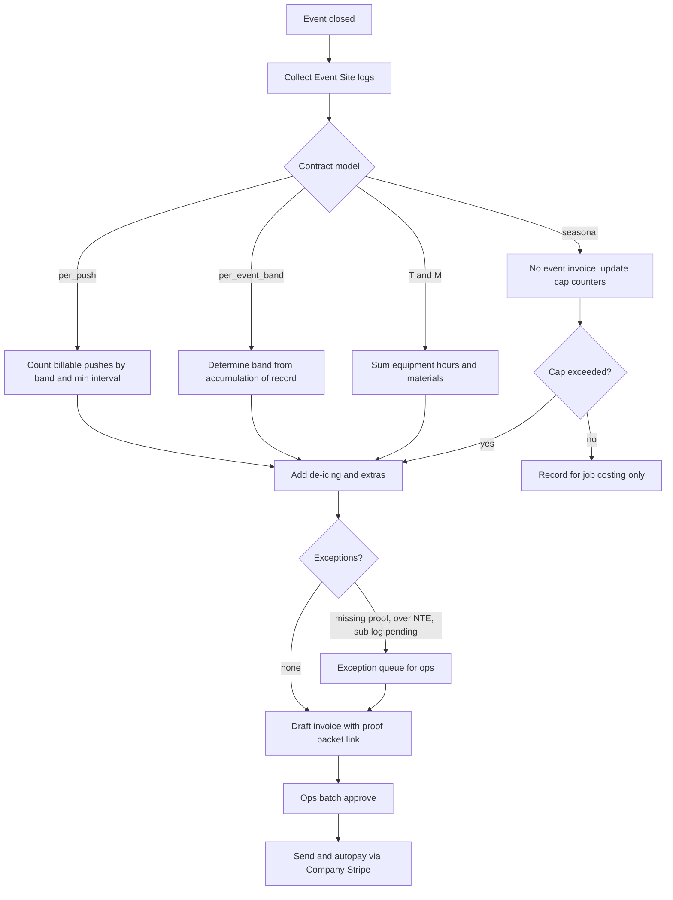

The diagram shows the four most common paths; `per_application` follows the T&M path (count applications), `seasonal_floor` follows the per-event path and adds a season-end true-up invoice if the floor was not reached, and `per_inch_seasonal` produces a season-end true-up from the station of record's season total.

Rules:
- **Accumulation of record:** the contract's weather station of record; if unavailable, the Company's default provider; crew-measured depth used only if the contract says so. The value and source print on the invoice.
- **Billable push rule:** a push counts if the site was triggered, the log has arrival/departure inside the event window, and the minimum interval since the previous billable push is met (default 3 hours, contract-overridable).
- **Batch invoicing:** one invoice per client per event (with per-site lines) or monthly consolidated invoices for portfolio clients; PO numbers carried per site.
- **Seasonal revenue recognition** (deferred revenue and recognition pattern) is handled by the ledger per [09](09-accounting-ledger-integrations.md); this module supplies event counts and service logs as recognition inputs.
- **Event profitability:** revenue vs labor (timesheets), equipment hours, salt and sub cost per event and per site, available the morning after.

> **Competitive edge.** Yeti and Aspire both offer GPS-verified service history and subcontractor portals; Jobber-style tools need template duplication and spreadsheets for per-inch pricing. Rootline's edge is (1) a tamper-evident, hash-manifested packet designed for court, (2) one-click incident packets pinned to the exact location of a fall, (3) all eight pricing models evaluated automatically against a named weather station of record, and (4) the same crews, subs, clients and ledger used for the other eight months of the year.

### 4.4 Tree care (`tree_care`)

Tree care combines consulting (inventories, risk assessments), high-hazard work (climbing, cranes, near utilities) and regulated activity (protected-tree permits, nesting season, PHC treatments).

#### 4.4.1 GPS tree inventory [V1]

- **Tree asset** fields: tag number (optional aluminum or QR tag), location (GPS point; accuracy captured; office can nudge on the map), species (Plant KB `plant_id`; common and botanical names displayed), DBH (inches at 4.5 ft; multi-stem handling: record each stem and compute equivalent DBH), height (ft), crown spread (ft), condition rating (excellent/good/fair/poor/dead/critical, Company-configurable scale), structural defects (codominant stems with included bark, cavities, cracks, decay fungi, dead limbs, lean, root plate heaving), targets nearby (structures, driveway, play area), utilities proximity (within 10 ft of overhead lines flag), photos (whole tree, defects), notes, last assessed date, status (standing, removed, stump remaining).
- **Species from KB:** selecting a species pulls Region-specific info from the [Plant KB](12-plant-knowledge-base.md): mature size, wood weight per cubic foot (for crane picks), common pests/diseases in the Region (e.g., emerald ash borer for Fraxinus), failure profile notes curated by `platform_curator` (e.g., "Bradford pear: weak branch attachments, high failure frequency in ice storms"), and whether the species is invasive or protected in the Region.
- **AI species assist [V1]:** photo of leaf/bark/form -> top-3 species suggestions constrained to species plausible in the Region; arborist confirms.
- **Bulk inventory mode:** for HOAs and commercial campuses, a walk mode with fast entry (species picker with Regional favorites, DBH by caliper/tape input, condition chips), offline, with automatic numbering.
- **Inventory as a product:** inventory reports (PDF + CSV + GeoJSON) sold as a consulting service, priced per tree or hourly.

#### 4.4.2 ISA-aligned risk assessment [V1]

The Inspection Engine ships a risk assessment template aligned with ANSI A300 Part 9 and the ISA Tree Risk Assessment Best Management Practices (verify current editions before release):

- **Levels:** Level 1 limited visual, Level 2 basic, Level 3 advanced (with sub-forms for resistance drilling, sonic tomography, aerial inspection, root collar excavation; results attachable).
- **Header:** assessor, ISA Tree Risk Assessment Qualification (TRAQ) status and expiry (from [15](15-team-hr-payroll.md)), date, time frame (e.g., 1 year), tree reference.
- **Target assessment:** target zones (within drip line, within 1x height, within 1.5x height), target descriptions, occupancy rate (rare, occasional, frequent, constant), practical to move/restrict.
- **Site factors, tree health and species profile, load factors, crown/branches, trunk, roots and root collar** sections with condition checklists.
- **Risk categorization per failure mode** (e.g., "15-inch codominant stem over driveway"): part size, fall distance, target, likelihood of failure (improbable, possible, probable, imminent), likelihood of impact (very low, low, medium, high) -> combined likelihood via matrix (unlikely, somewhat likely, likely, very likely); consequences (negligible, minor, significant, severe) -> **risk rating** (low, moderate, high, extreme) via the second matrix.
- **Engine behavior:** matrices computed automatically; the assessor may override with a required justification; overall tree risk = highest failure-mode rating; mitigation options each with residual risk; recommended reinspection interval; data-limitation notes.
- **Output:** client-facing report PDF with photos, map, ratings, mitigation recommendations, limitations and assessor credentials; risk ratings also feed a portfolio heat map for commercial and HOA clients.
- **Liability guardrail:** the report template includes the Company's limitations statement; reports cannot be issued by a user without an active TRAQ (or Company-defined equivalent) when the template is marked "qualified assessor required".

#### 4.4.3 Work prescriptions [V1]

- Per tree, one or more **Prescriptions**: prune (A300 objectives such as clean, thin, raise, reduce, structural), remove, stump grind, cable/brace, PHC treatment (links to 4.1), plant replacement, monitor/reinspect.
- Fields: priority (1 immediate safety, 2 within 30 days, 3 within the year, 4 when convenient), method (climb, bucket truck, crane, rigging required), estimated hours (production rates by DBH class and method), crew size, equipment, debris handling (chip and haul, leave wood, log length cut), access notes, permit required flag.
- **Estimate conversion:** selected prescriptions roll into an Estimate and Proposal in [03](03-crm-sales-estimating-proposals.md), grouped by priority with options ("Safety work now", "Health and structure", "Optional"), shown on a map in the portal so the client sees which tree is which.

#### 4.4.4 Permits [V1]

- **Protected tree rules** (tenant-maintained in V1, curated packs for top metros in V2): jurisdiction, protected species list, DBH threshold, heritage tree rules, replacement requirements, permit fee, review time.
- Prescriptions that match a rule auto-create a **Permit** record (type: tree removal, right-of-way/street tree, traffic control/lane closure, crane/road occupancy) with status (`not_started`, `submitted`, `approved`, `denied`, `expired`), attachments, fee and expiry. Removal Visits cannot be scheduled until the permit is `approved` (override by owner with reason).
- **Nesting season check:** removal or heavy pruning scheduled during the configured nesting season prompts a pre-work nest inspection checklist (federal Migratory Bird Treaty Act protections apply to active nests of covered species; verify Company procedures with counsel).

#### 4.4.5 Crane jobs [V2]

- **Lift plan:** crane type and capacity, setup location (map pin, ground conditions, outrigger pads), max radius, estimated heaviest pick weight (species wood weight from KB x estimated piece volume), rigging plan, landing zone, overhead hazards, utility clearance, road closure permit link.
- **Resources:** crane (owned or rented via vendor in [13](13-operations-inventory-equipment.md)), qualified operator and signal person (certifications from [15](15-team-hr-payroll.md)), climber, ground crew, grapple saw truck, chipper, loader.
- **Go/no-go:** forecast wind limit per crane spec; morning-of checklist; job hazard analysis (JHA) tailgate briefing signed by all crew in the app.
- **Scheduling:** crane is a constrained resource with its own calendar; multi-day jobs reserve it as one block; rental cost accrues per day to job costing.
- **Client prep notice:** cars moved, pets inside, neighbor notice for road closures.

#### 4.4.6 Tree care scheduling and billing [V1]

- Removal and pruning are one-off Work Orders or multi-day Projects; PHC is a Program (4.1); inventories and assessments are consulting jobs.
- Billing: fixed price per prescription, T&M, per-tree inventory fees, hourly consulting; deposits for large removals; stump grinding priced per inch of stump diameter.
- Utility proximity flag requires line-clearance-qualified staff for work within 10 ft of energized lines (aligned with ANSI Z133 and OSHA practices; verify with Company safety program).

> **Competitive edge.** Arborgold and SingleOps serve arborists well, but their species data is not a curated, region-aware knowledge base, and their inventories do not flow into PHC programs, design-build replacements, warranty claims and commercial audit reports. In Rootline, the tree in the inventory is the same object the designer sees in the plan and the same plant the warranty engine covers.

### 4.5 Installation and hardscape projects (`install_projects`)

Design-build revenue comes in larger tickets (a USD 38,000 paver patio with seat walls, a USD 120,000 backyard renovation) with multi-week schedules, many material deliveries, subcontractors, permits, utility locates and long warranty tails. The module is the Project Engine plus landscape-specific gates.

#### 4.5.1 Project creation from a sold Proposal [MVP]

- When a Proposal with install scope is accepted (and the deposit paid, if required; see [03](03-crm-sales-estimating-proposals.md) and [08](08-payments-stripe.md)), a **Project** Job is created with phases generated from the Estimate's assemblies and the Company's phase templates.
- Default phase template for a residential renovation: Design finalization -> Permits and locates -> Demolition and excavation -> Drainage and base -> Hardscape -> Irrigation rough-in -> Lighting rough-in -> Planting -> Final grade, mulch and sod -> Walkthrough and punch list -> Closeout and warranty.
- Each phase holds: budget (labor hours, materials, equipment, subs) copied from the Estimate, planned dates, crew, status (`not_started`, `ready`, `in_progress`, `blocked`, `complete`), entry gates (e.g., "811 ticket valid", "permit approved", "materials delivered") and exit checklist.
- **Tasks** inside phases have durations from production rates (e.g., a 3-person crew installing 120-180 sq ft of pavers per day on prepared base; estimate, Company-calibrated), dependencies, assignee crew or sub.

#### 4.5.2 Scheduling and Gantt [MVP list + calendar, V1 Gantt]

- **Dependencies:** finish-to-start (default), start-to-start, finish-to-finish, with lag days (e.g., "Polymeric sand: finish-to-start + 1 day no rain").
- **Gantt [V1]:** drag bars, auto-shift dependents, critical path highlight, weather risk overlay (rain days shown), crew and equipment conflicts flagged (a mini-excavator booked on two projects).
- **Weather-sensitive tasks:** tasks tagged rain-sensitive (base compaction, polymeric sand, concrete pours, sod) show forecast risk; the scheduler proposes moves.
- **Client view:** portal shows a simplified timeline (phases and milestones only) with "what to expect this week" messages ([06](06-customer-portal.md)).

Example project timeline as rendered in the client-facing summary:

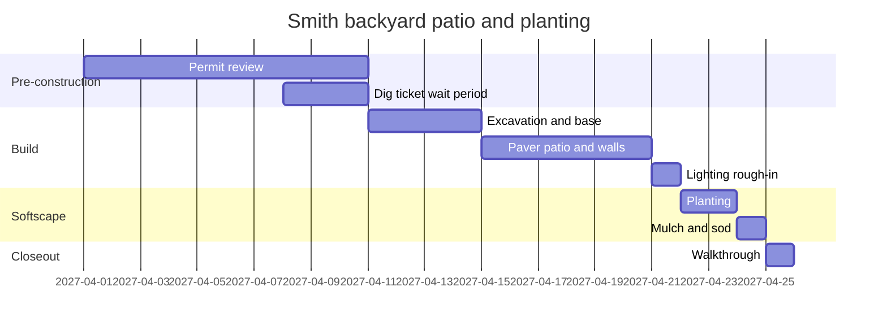

#### 4.5.3 Material orders [MVP]

- The Estimate's bill of materials (from Design takeoffs, [10](10-design-studio.md)) generates **material requirements per phase**: e.g., 22 tons of 3/4-inch clean crushed stone base, 4 tons of bedding sand, 640 sq ft of pavers plus 8% waste, 14 cu yd of hardwood mulch, 46 shrubs (3-gallon), 3 trees (2-inch caliper B&B).
- Purchase orders are created per vendor ([13](13-operations-inventory-equipment.md)) with **need-by dates** computed from phase start minus lead time (plants: nursery availability from [12](12-plant-knowledge-base.md); pavers: supplier lead time; bulk aggregates: 1-2 days).
- Delivery logistics: site access notes (driveway width, where pallets go, protect lawn with plywood), delivery photo confirmation; partial deliveries tracked.
- Gate: a phase cannot move to `in_progress` with critical materials undelivered unless overridden.

#### 4.5.4 Change orders [MVP]

Change order mechanics live in [03](03-crm-sales-estimating-proposals.md). Project-specific behavior:
- Field-originated change order from the crew app (e.g., "Unexpected buried concrete slab, 120 sq ft removal, 6 hrs + disposal") with photos -> office prices it -> client e-signs in the portal.
- Approved change orders update phase budgets, the Gantt (added tasks), the contract value and the progress billing schedule ([07](07-invoicing-billing-contracts.md)).
- Unapproved change work is tracked separately as "at risk" cost.

#### 4.5.5 Inspections and permits [V1]

- Permit records (same entity as tree permits) for building/zoning (e.g., retaining walls above a local height threshold often need engineered plans and permits, verify per jurisdiction), electrical (line-voltage lighting), plumbing (backflow device installation), pool barrier, grading/drainage, HOA architectural approval.
- **Inspections:** scheduled inspection dates linked to tasks (e.g., "Footing inspection before wall build"), results (pass, fail, corrections), inspector notes, photos; failed inspection blocks the dependent tasks.
- **HOA approvals** are tracked like permits with document uploads and approval letters.

#### 4.5.6 811 dig-safe ticket tracking [MVP]

Every excavation in the US and Canada is governed by one-call ("call before you dig") laws; notice periods (commonly two to three business days), ticket validity and re-mark rules vary by state/province (verify per one-call center).

- **Dig Ticket** entity: one-call center, ticket number, ticket type (normal, emergency, re-mark, update), request date/time, **legal start date/time** (computed from the one-call rule pack's wait period, business days and holidays), **expiration date** (per pack), work area description, white-lining required flag and photo, excavation methods, status (`requested`, `waiting`, `clear_to_dig`, `expired`, `cancelled`), positive response per utility (marked, clear/no conflict, not yet responded), locate mark photos.
- **Hard gate:** any task tagged `excavation` (planting trees, footing digs, irrigation trenching, lighting cable trenching, fence posts, post-hole augering) on a Visit cannot be started in the crew app unless a valid ticket covers the property and date. Override only by `owner` or `ops_manager` with reason; overrides are audited and reported.
- **Expiry handling:** reminders before expiry; one-click "renew/update ticket" instructions; multi-week projects show ticket coverage on the Gantt.
- **Positive response parsing [V1]:** one-call positive response emails are forwarded to a Company inbox address; AI extracts utility responses into the ticket ([17](17-ai-copilot-automation.md)). Direct one-call center integrations where APIs exist (V2, verify per center).
- **Private lines:** the crew sees Rootline's own as-built layers (irrigation, lighting cables, drainage) because one-call centers generally do not locate privately owned lines (verify per state). This is a safety and margin win unique to an integrated platform.

#### 4.5.7 Punch lists, closeout, warranties and plant replacement guarantees [MVP punch list, V1 warranty claims]

- **Punch list:** created during the walkthrough with the client (client can add items in the portal); each item: description, photo, location pin on the plan, assignee, due date, status; client signs off on completion; final invoice can be gated on punch-list completion (Company option).
- **Closeout package:** as-built plan, plant list with species and sizes (from the Design and KB), care guide per plant (auto-generated from the KB in the client's language), irrigation zone map and controller schedule, lighting fixture map, warranty certificate, maintenance program offer.
- **Warranty terms (Warranty Engine):** per item category: e.g., trees and shrubs 1 year, perennials 1 growing season, annuals and bulbs none, sod 30 days with watering compliance, hardscape workmanship 3-5 years, manufacturer warranties referenced (pavers, lighting fixtures, controllers). Conditions: client watering compliance, no damage by animals/vehicles/acts of nature, drought restrictions exclusion, maintenance by the Company (optional extended warranty when on a maintenance program).
- **Warranty claim flow:** client submits a claim in the portal (photo, plant pinned on the plan) -> system checks coverage period and conditions -> **evidence assist**: if a smart controller is linked, the claim shows irrigation run history for that zone; AI suggests probable causes using the KB (e.g., "Japanese maple leaf scorch, likely heat/wind exposure; site is full sun south wall") -> ops decides approve/deny/partial -> replacement Visit scheduled (in the right planting window) -> plant ordered -> cost posted against the warranty reserve ([09](09-accounting-ledger-integrations.md)).
- **Warranty reserve:** configurable percentage of install revenue accrued to a warranty reserve; claims draw it down; reports compare actual vs reserve by plant species and crew (feeds plant palette decisions back to the KB curators as anonymized aggregate signals, opt-in).
- **Expiry reminders:** 30 days before plant warranty expiry, the client gets a "last chance to report" check-in (a delight and trust feature) and an upsell to a maintenance program.

#### 4.5.8 Project billing [MVP]

Progress billing schedules (deposit, milestones, percent complete), retainage for commercial projects, and AIA-style pay application export (V1) are specified in [07](07-invoicing-billing-contracts.md); WIP and over/under billing in [09](09-accounting-ledger-integrations.md). This module supplies phase completion percentages and milestone events.

> **Competitive edge.** SynkedUP, LMN and Aspire handle estimating and job costing for installs, but none of them gate excavation on a valid 811 ticket, show the crew the Company's own as-built private lines, or adjudicate a plant warranty claim with irrigation run history and species knowledge. Those three features turn into fewer cut cables, fewer disputed warranty replacements and better plant choices.

### 4.6 Commercial grounds maintenance (`commercial_grounds`)

Commercial maintenance is won by bids against a scope of work, retained by quality and relationships, and made profitable by enhancements. The module makes the SOW, the audit and the enhancement pipeline first-class.

#### 4.6.1 Scope-of-work specs per zone [MVP]

- **Service zones:** the property is divided into polygons on the map (front entrance, parking islands, building perimeter beds, turf areas, retention pond banks, slopes, rear service areas). Zones carry measured quantities (sq ft turf, sq ft beds, linear ft edging, count of shrubs/trees) from the Design Studio or AI measurement.
- **Spec items** per zone: task (mow, string-trim, edge hard surfaces, edge beds, blow off, weed beds, prune shrubs, prune ornamental trees, leaf removal, seasonal color install, mulch, irrigation inspection, litter pickup, pond bank mow), frequency (e.g., weekly Apr-Nov = 32 visits; bed weeding every 2 weeks; shrub pruning 3x per season), standard (mow height 3.5 inches, no clippings on hard surfaces, shrubs pruned to natural form, no more than 10% bed weed coverage), included vs extra, quantity, production rate, labor hours.
- **SOW document:** generated per property from spec items with versioning; client approval via portal (client_commercial approver); changes create a new SOW version with effective date and price impact.
- **Bid mode [V1]:** respond to an RFP by importing the client's bid sheet (PDF/Excel) where AI extracts required tasks and frequencies into spec items; produce a priced response in the client's format.
- **Crew-facing:** each Visit shows the zone-by-zone checklist for that visit's frequency mix (week 1 might include edging + bed weeding; week 2 only mow/trim/blow).

#### 4.6.2 Site inspections and quality audits with scores [MVP]

- **Scorecard templates** (Inspection Engine): categories with weights, e.g., Turf (25%), Beds (20%), Shrubs and trees (15%), Hard surfaces and litter (15%), Irrigation (10%), Seasonal color (10%), Safety/hazards (5%). Each category scored 1-5 (or pass/fail items), producing a **site score 0-100**.
- **Audit types:** internal QA audit (account manager, monthly), client joint walk (with property manager), pre-renewal audit, post-storm audit, new-account baseline.
- **Issue capture:** each low score requires at least one issue: photo, geo-pin, zone, category, severity, type (`corrective` = within SOW, the crew must fix; `enhancement` = outside SOW, sales opportunity; `client_responsibility` = e.g., vehicle damage).
- **Corrective issues** auto-create tasks on the next Visit (or a dedicated corrective Visit within the SLA, e.g., 72 hours); closure requires an after-photo.
- **Trends:** site score history, category trends, crew comparisons, portfolio heat map for multi-property clients.

#### 4.6.3 Enhancement pipeline [MVP capture, V1 full pipeline]

- Enhancement issues become **Enhancement Opportunities**: description, photos, zone, estimated value (AI-suggested from price book + area), priority, season fit (e.g., "install in fall planting window").
- **Pipeline stages:** `identified` -> `estimated` -> `proposed` -> `approved` (PO captured) -> `scheduled` -> `completed` -> `invoiced`; or `declined` (reason) / `deferred` (re-surface date, e.g., next budget year).
- **Proposal generation:** one or several opportunities bundled into a Proposal with before photos and AI mockups ([11](11-ai-design-mockups.md)) of the proposed improvement (e.g., dead boxwoods replaced with a Region-appropriate alternative from the KB).
- **Commercial approvals:** multi-step approval in the portal (property manager -> regional manager above a threshold), PO number required, not-to-exceed amounts; approvals logged ([06](06-customer-portal.md)).
- **Budget-cycle awareness:** opportunities can be tagged to the client's fiscal year so the account manager presents a prioritized "capital wish list" at budget season.

#### 4.6.4 Monthly property reports [V1]

- Auto-generated per property (and per portfolio) on the 1st of each month, reviewed by the account manager before sending (or auto-send):
  - Services performed vs SOW (e.g., "4 of 4 mowings, 2 of 2 bed weedings, 1 shrub pruning; 1 visit rain-delayed by 1 day").
  - Photos (curated best-of from crew uploads, AI-selected for quality and coverage).
  - Audit score and trend, open corrective items and closure times.
  - Irrigation status (zones, alarms, repairs, water use vs budget if smart_irrigation is on).
  - Snow summary in winter (events, services, salt used, proof packets).
  - Upcoming work (seasonal color change, aeration) and open enhancement proposals.
  - Weather impacts.
- Delivered as portal page + PDF; read receipts tracked; AI-written executive summary (3-5 sentences) in the property manager's language.

#### 4.6.5 Commercial billing [MVP]

- Annual contracts billed in 12 equal monthly installments (common in commercial maintenance) or per visit; enhancements billed separately on completion; consolidated portfolio invoices with per-property lines and PO numbers; credit for missed services per contract terms (automatic credit memo suggestions when a SOW-required visit is missed and not made up).

> **Competitive edge.** Aspire and LMN customers bolt on SiteDNA or SiteRecon for audits and enhancement capture ([SiteDNA](https://sitedna-marketing-site.pages.dev/), [SiteRecon](https://www.sourceforge.net/software/compare/LMN-vs-SiteRecon)). Rootline has the audit, the SOW, the zone geometry, the AI mockup and the approval workflow in the same object graph, so an issue pinned at 9:05 a.m. can be a priced, illustrated, PO-ready proposal by 9:15 a.m.

### 4.7 Landscape lighting service plans (`landscape_lighting`)

- **Lighting system inventory [V1]:** transformers (brand, model, wattage, taps, timer/photocell/astronomical clock, smart/zoned controller, location photo), runs/cables (gauge, length, hub or daisy chain), fixtures (type: path, up, down, well, wall wash, spot, step, underwater; brand/model; lamp type and wattage; color temperature such as 2700 K or 3000 K; beam angle; location on the plan from the Design Studio lighting layer; photo by night).
- **Voltage records:** measured voltage at the transformer and at representative fixtures per visit; out-of-range values (Company-configured target range for its fixture types) flagged.
- **Service plan tiers:** e.g., Basic (1 visit/year: clean lenses, re-aim, check timer), Plus (2 visits: spring/fall, includes lamp replacements up to N), Premium (quarterly + priority outage response). Priced per fixture per visit with a minimum.
- **Night-window scheduling:** lighting visits get a time window starting at local sunset + 20 minutes (computed per property location and date), so the scheduler ([04](04-scheduling-dispatch-routing.md)) builds evening routes.
- **DST adjustments:** automated reminders/visits around daylight saving changes for non-astronomical timers; smart transformer integrations (V2, vendors such as FX Luminaire and Kichler offer app-controlled systems; API availability to verify) allow remote timer and zone changes.
- **Outage tickets:** client reports "path lights out on left side" in the portal; ticket references the run; technicians see fixture map.
- **Upsell:** AI night mockups from a daytime photo ([11](11-ai-design-mockups.md)) to sell expansions.
- **Data and billing:** fixtures and transformers are Property Asset Registry entries (data model 7.6); service plans run on the Program Engine (one round per plan visit); billing is an annual plan fee (charged up front or monthly) plus lamp/part lines beyond the plan allowance; installs themselves are `install_projects` jobs whose Design lighting layer seeds the inventory automatically.

> **Competitive edge.** Lighting service plans are usually run as generic recurring jobs with no fixture inventory (as of Nov 2026, verify per competitor). Rootline inherits the fixture map from the Design Studio, schedules visits after dusk automatically, and turns a low-voltage reading into an upgrade proposal, so a one-time install becomes a recurring revenue line.

### 4.8 Holiday lighting install, takedown and storage (`holiday_lighting`)

- **Display design [V1]:** measured rooflines, ridges, windows and trees (linear ft and tree heights from photos/aerial or on-site measure); items: C9 or C7 LED strands, mini-light tree wraps (priced by height and canopy), wreaths, garland, stakes, timers; **AI holiday mockup** from a house photo to sell the display (powered by [11](11-ai-design-mockups.md)).
- **Ownership model:** `lease` (Company-owned, reused across seasons, installed for the client), `purchase` (client-owned after first season), `client_supplied` (Company installs client's lights, higher liability waiver). Tracked per item.
- **Custom-cut runs:** strands cut to fit a specific roofline segment are labeled ("Front gable A, 38 ft, 12-inch spacing") and stay assigned to that property.
- **Storage [V1]:** storage bins with QR labels; each bin linked to a client and property; contents list; storage location (warehouse, aisle, shelf); check-in/check-out by scan; condition notes; storage fee per bin or flat per season.
- **Seasonal scheduling:** install window (e.g., Oct 15 - Dec 10), takedown window (e.g., Jan 2 - Jan 31); capacity-based booking (sell-out when capacity reached, waitlist); priority by booking date and prepayment; crews with lifts/ladders scheduled as resources; weather (ice, wind) holds.
- **Service calls:** outage requests during the season with an SLA (e.g., 48 hours), included or billable by plan.
- **Billing:** deposit at booking (e.g., 50%), balance on install; takedown and storage bundled or separate; multi-year agreements with renewal reminders in August; commercial displays as Projects.

> **Competitive edge.** Holiday lighting businesses commonly juggle a booking spreadsheet, a separate storage system and a generic FSM. Rootline connects the AI mockup that sells the display, the measured rooflines that price it, the capacity calendar that books it and the QR-tracked bins that store it, inside the same platform that runs the Company's green-season work, which turns idle Q4 crews into revenue.

### 4.9 Mosquito and pest (`mosquito_pest`)

- **Programs [V1]:** barrier treatments on a recurring interval (commonly about every 21 days during the season, Company-configurable), tick treatments, larvicide for standing water, event sprays (one-time before a party), perimeter pest treatments, organic/botanical program variants.
- **Shared compliance:** uses the Application Compliance Engine (product library, records, weather guardrails, sign posting and registry rules where they apply to the product category and jurisdiction).
- **No-spray zones:** per property map polygons for ponds/streams, vegetable gardens, pollinator plantings, children's play areas, neighbor hives; buffer distances from label; crew app warns when the technician's position enters a no-spray zone during an active application.
- **Pollinator protection:** guardrail "do not apply to blooming plants" for products whose label requires it; optional integration with apiary registries where available (e.g., FieldWatch BeeCheck/DriftWatch; API availability and coverage to verify).
- **Licensing:** applicator license categories per state may differ from turf categories (e.g., public health or mosquito categories); assignment validation uses the product's required category.
- **Re-treat guarantee:** service calls between treatments tracked like lawn re-treats.
- **Rain rules:** if rain exceeds a threshold within N hours after application (label rainfast), the system proposes a re-treat Visit.
- **Scheduling specifics:** treatments are Program Engine rounds with an interval rule (e.g., 21 days +/- 3) instead of fixed windows; the next treatment re-anchors to the actual completion date; event sprays are one-off Visits with a must-finish-by time (e.g., 24-48 hours before the party).
- **Billing:** per treatment, season prepay with discount, monthly autopay.

> **Competitive edge.** Pest-first tools such as PestPac and FieldRoutes are built for structural pest companies, and lawn tools rarely model mosquito intervals or no-spray zones (as of Nov 2026, verify). Rootline lets a landscape company add mosquito as a high-margin add-on that reuses the same product library, applicator licenses, compliance records, registry notices and client portal it already runs for lawn programs.

### 4.10 Seasonal campaigns (`seasonal_campaigns`)

Seasonal campaigns are high-volume, short-window offers sold to the existing client base and new leads: core aeration and overseeding, spring and fall cleanups, mulch season, leaf removal.

#### 4.10.1 Campaign object [MVP]

- Fields: service(s), Region(s), sale window, service window, target segment, pricing rule, offer (early-bird discount, bundle such as aeration + overseed + starter fertilizer), capacity (e.g., 2 aerators x 28 lawns/day x 30 working days = 1,680 lawn slots, estimate), booking channel (portal 1-click, SMS reply "YES", web booking widget from [16](16-marketing-growth-communications.md)), waitlist rule.
- **Target segments** query the property graph: e.g., cool-season turf > 2,000 sq ft, not enrolled in aeration this year, client tags exclude "do not market", properties within existing route areas (density-first).
- **Pricing from measurements:**
  - Aeration: lawn sq ft tiers.
  - Mulch: cubic yards = bed sq ft x depth inches / 324 (e.g., 1,620 sq ft at 2 inches = 10 cu yd), priced per installed yard with color options; edging and pre-emergent in beds as add-ons.
  - Cleanups: estimated hours from property size, bed area, tree count and last year's actuals; disposal fees per load.
- **One-click acceptance:** clients receive a personalized offer with their price; accepting creates a Job and Visit request; payment can be captured or authorized at booking via the Company's Stripe ([08](08-payments-stripe.md)).

#### 4.10.2 Campaign scheduling specifics [MVP]

- **Route-dense scheduling:** booked campaign jobs are clustered by neighborhood and slotted into "campaign days" per crew; the scheduler fills gaps with nearby bookings first.
- **Cross-module safety:** before aeration, the crew app shows irrigation heads and shallow lines from the zone map (4.2.2) and requires "heads flagged" confirmation for properties with irrigation; lighting cable runs are shown too.
- **Agronomic gating:** aeration days are blocked when soil is frozen, saturated or too dry (rule-based on recent precipitation; crew can override with photo); overseeding windows follow Region and turf type (fall for cool-season in most northern Regions).
- **Mulch logistics:** total cubic yards needed per day per depot aggregated into bulk delivery orders (e.g., 30-yd loads) with yard/truck allocation ([13](13-operations-inventory-equipment.md)).

#### 4.10.3 Campaign analytics [MVP]

Offer sent, opened, accepted, revenue booked, capacity utilization, revenue per crew-day, acceptance by segment, and next-year predicted demand.

> **Competitive edge.** Most FSM tools treat a campaign as a mass email plus manual job creation. Rootline prices every offer from real measured areas, books into capacity-aware route-dense days, and protects irrigation heads using the zone map, which no lawn-only or marketing-only tool can do.

---

## 5. Key user flows

### 5.1 Enable a service-line module

1. Owner opens **Settings > Service Lines** and toggles `snow_ice`.
2. Entitlement check: if the plan lacks it, the owner can start a 30-day trial or add the add-on (billing on Rootline's own Stripe account).
3. Setup wizard loads Region defaults (season dates, trigger depth, price book starter for the Region).
4. Owner completes required steps; module moves `setup` -> `active`.
5. Nav, crew forms, portal widgets, automations and reports appear; copilot learns the new tools.

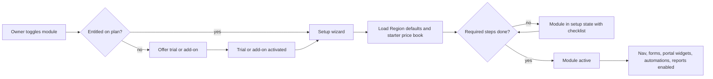

### 5.2 Lawn round: plan, notify, apply, record, bill

1. On Mar 12, the Region's soil-temperature model opens the Round 1 window; ops opens the Round Planner and sees 1,412 eligible instances.
2. Ops drags the North territory (212 lawns) into the week of Mar 15; the router builds 9 routes.
3. The compliance engine finds 37 properties with abutting registry members and 212 properties requiring customer pre-notice; notices go out automatically; instances stay `blocked` until the lead time passes.
4. The night before, load sheets go to crew leads; inventory shortfalls flagged.
5. On site, the technician starts the visit; the app pulls live wind (6 mph, under the 10 mph limit) and shows the mix and rate for 7,850 sq ft.
6. Technician applies, posts the sign, takes the sign photo, confirms actual product used, completes.
7. The Application Record is sealed; the client gets a post-application notice with re-entry guidance; the invoice is generated (or the prepay balance drawn down).

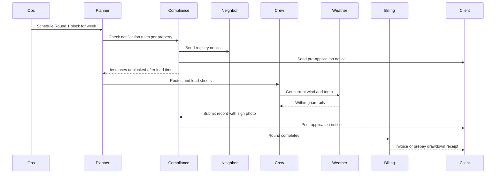

### 5.3 Storm event end to end

1. 36 hours ahead, the forecast shows 4-7 inches overnight Tuesday; the engine opens a `watch` event: 84 sites likely to trigger, 61 crew hours, 38 tons salt needed (estimate), 4 subs required.
2. Ops sends call-outs; 11 employees and 4 subs accept; salt depot shows 52 tons available.
3. Pre-treatment window: liquid crews apply brine to priority-1 sites; logs captured.
4. Snow begins at 11:40 p.m.; event goes `active`; triggered sites populate routes; crews and subs log arrival (geofence), depth photo, pushes, salt.
5. Re-service loops trigger at 4-inch increments on 24-hour sites.
6. Snow ends at 6:10 a.m.; `cleanup`; all priority-1 sites open by 7:00 a.m.; walks re-salted.
7. Event `monitoring` for refreeze; a refreeze callout on 6 sites the next night.
8. Event closed; billing automation drafts 63 invoices and 4 sub bills; ops resolves 3 exceptions (missing after-photos); batch approves; invoices send with proof packet links; autopay runs.

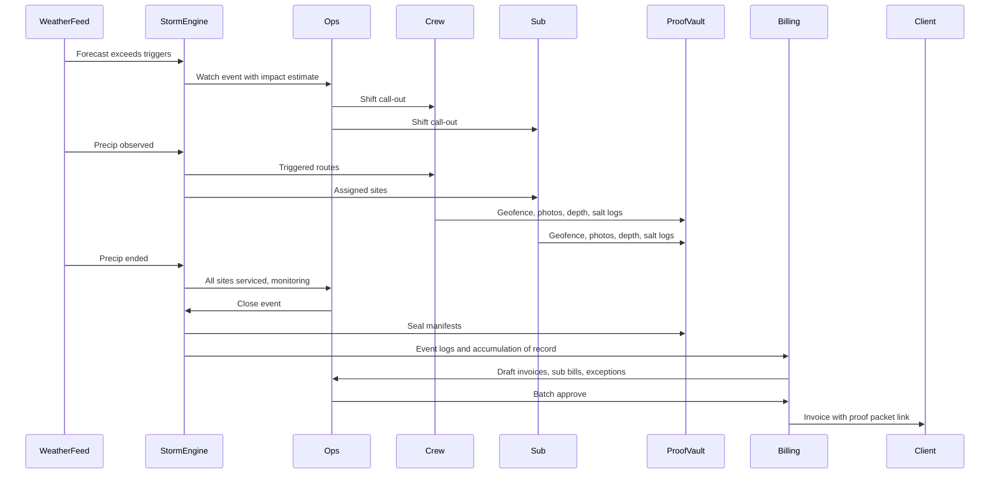

### 5.4 Backflow test to municipal filing

1. Device due date is May 1; client reminder at 30 days; client books in portal.
2. Certified tester arrives; app validates certification and gauge calibration.
3. Tester enters readings; engine evaluates pass/fail for the device type and jurisdiction.
4. If fail: repair with parts, retest.
5. Jurisdiction pack says "BSI Online, within 15 days, fee USD 20, customer confirmation number required".
6. Office sees the item in the filing queue with copy-ready fields; files; records confirmation number; fee pass-through invoiced.

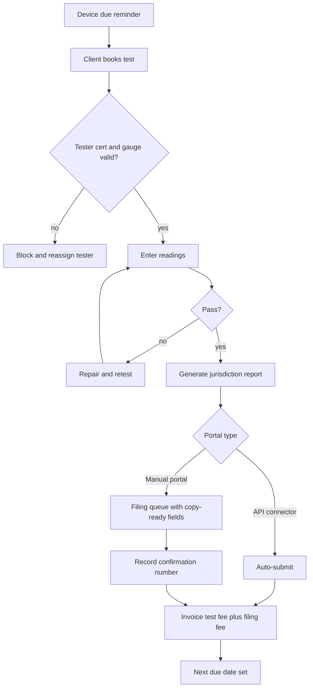

### 5.5 Smart-controller leak alert to repair

1. Hydrawise reports a high-flow alarm on zone 6 at a commercial property at 5:12 a.m.
2. Rootline ingests the alert, maps it to zone 6 "Parking island rotors", and checks the client's pre-authorized repair limit (USD 300).
3. A draft repair ticket is created with the zone map, valve photo and last repair history; the controller zone is suspended via API (if the client allowed contractor control) to stop water loss.
4. The ticket is auto-scheduled into today's route of the irrigation tech nearest the site.
5. The tech fixes a broken lateral, logs parts and photos; the zone is resumed; the client receives a summary with estimated gallons saved.

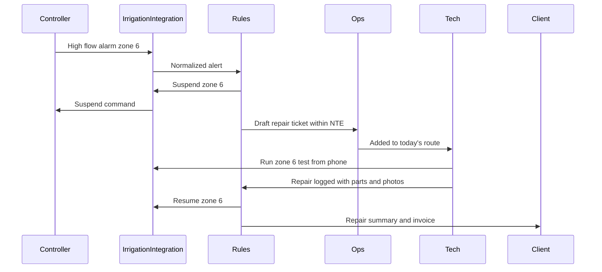

### 5.6 Tree risk assessment to proposal

1. HOA requests a risk assessment for 62 trees along a common-area path.
2. TRAQ-qualified arborist runs bulk inventory mode, then Level 2 assessments on 9 trees with defects.
3. Engine computes risk ratings; 2 trees rate high (one with a codominant stem over the path).
4. Prescriptions created (removal with permit check, reduction pruning, cabling, reinspect in 12 months).
5. Permit check flags one oak above the city's protected-DBH threshold; permit record created.
6. Prescriptions roll into a proposal with a map; the HOA board approves in the portal; permit approved; work scheduled.

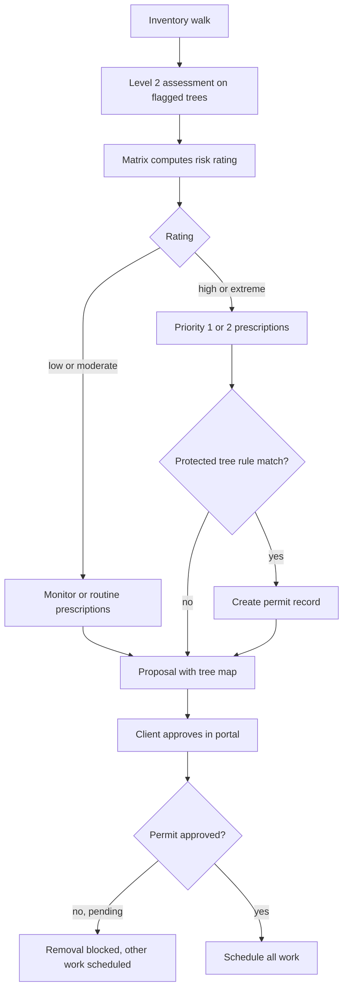

### 5.7 Install project with 811 and material gates

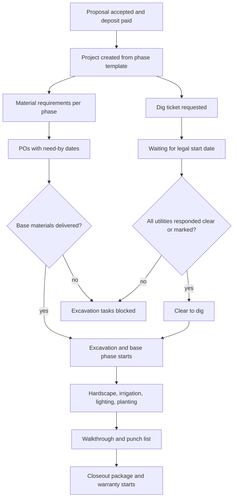

Steps:
1. Accepted proposal creates the project, phases, tasks, budgets.
2. Office submits the dig ticket (or crew lead does from the app); the ticket's legal start date is computed by the one-call rule pack.
3. Material POs go to vendors with need-by dates.
4. Excavation tasks remain blocked in the crew app until the ticket is `clear_to_dig` and the ticket covers the date.
5. Crew sees public utility marks (photos) and the Company's private-line as-builts.
6. Work proceeds through phases with change orders as needed; punch list; closeout; warranty clock starts on the substantial completion date.

### 5.8 Commercial audit to enhancement

1. Account manager starts a monthly audit at "Maple Ridge Office Park" on the tablet.
2. Scores categories; pins 6 issues: 4 corrective (weeds in island beds, missed edging), 2 enhancements (dead boxwoods at entrance, eroded slope).
3. Corrective items create tasks on Thursday's maintenance visit.
4. Enhancement opportunities are priced by AI from price book and measured areas; the AM picks a KB-recommended replacement shrub for the Region; an AI mockup shows the entrance after.
5. Proposal sent; the property manager approves USD 3,450 with PO; regional manager approval required above USD 2,500 is captured; work scheduled in the fall planting window.
6. Monthly report on the 1st includes the audit score (88, up from 81) and the enhancement status.

### 5.9 Plant warranty claim

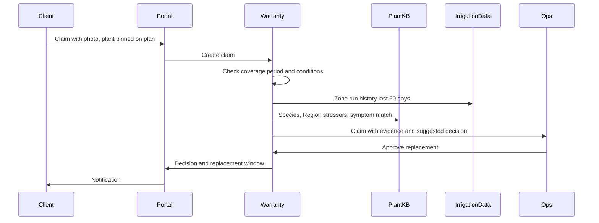

1. Client files a claim for a dead 'Bloodgood' Japanese maple installed 7 months ago.
2. Coverage: 1-year tree warranty, conditions require irrigation compliance.
3. Evidence: zone 3 drip ran 3x/week all summer; KB notes leaf scorch risk in full sun with reflected heat in this Region.
4. Ops approves replacement but, with the client, swaps to a better-suited cultivar recommended by the KB for that exposure; replacement scheduled in the fall planting window; cost charged to warranty reserve.


### 5.10 Holiday lighting season

1. August: renewal reminders go to last season's clients with last year's display photo and price; new leads get an AI mockup on their house photo.
2. Client books; 50% deposit captured via the Company's Stripe; the install slot is reserved against capacity (sell-out switches to waitlist).
3. October: bins for returning clients are pulled by scanning QR codes; missing or damaged items trigger reorders.
4. Install visit: crew installs labeled custom-cut runs, tests, photographs the lit display at dusk; balance invoiced on completion.
5. Season: outage requests within the SLA.
6. January: takedown visit; every item scanned into its bin; bin scanned into its warehouse location; storage fee invoiced or included.

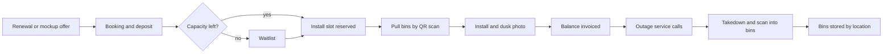

### 5.11 Mosquito treatment cycle with rain re-treat

1. Enrollment generates treatments every 21 days (Company interval) from May through September.
2. The planner builds routes; registry or sign rules apply where the jurisdiction pack covers the product.
3. On site, the app shows no-spray zones (pond, vegetable garden, neighbor's hives) and warns if the technician's position enters a buffer during application.
4. The record is sealed with weather and products; the client gets a post-treatment notice.
5. If more than the label's rainfast threshold of rain falls within the window after treatment, the system proposes a re-treat visit (free under guarantee, cost tracked).
6. Next treatment is re-anchored to the actual completion date to keep the interval.

### 5.12 Seasonal aeration and overseeding campaign

1. In late July, the owner opens the "Fall aeration + overseed" campaign: segment = cool-season turf above 2,000 sq ft within current routes, not already booked.
2. Prices are computed from each property's measured turf area; early-bird 10% off through Aug 20.
3. Offers go out by email/SMS (consent-checked) with a one-click accept page in the portal.
4. Acceptances fill capacity-aware "campaign days" clustered by neighborhood.
5. The day before each visit, crews receive irrigation head maps and the client receives a "please flag or let us flag heads" message.
6. Visit completion triggers the invoice and a follow-up watering guide in the client's language.

### 5.13 Landscape lighting night service visit

1. A Plus-plan client is due for the fall service; the scheduler places the visit in an evening route starting at sunset + 20 minutes.
2. The technician opens the fixture map from the Design Studio lighting layer, cleans lenses, re-aims, and records voltage at the transformer and the farthest fixtures.
3. Two failed lamps are replaced (included in plan up to 4 per year; counter decremented).
4. Timer is set for the upcoming DST change; a night photo set is attached.
5. The client gets a visit summary; if the voltage at the far end is below target, an upgrade proposal (re-wire or hub conversion) is drafted for review.

---

## 6. Screens and wireframes

### 6.1 Screen inventory

| # | Screen | Surface | Module | Primary roles | Priority |
|---|---|---|---|---|---|
| S1 | Settings > Service Lines (module toggles, wizards) | Company web | Framework | owner | MVP |
| S2 | Program Templates editor (rounds, windows, mixes, pricing) | Company web | lawn_phc, mosquito_pest | owner, ops_manager | MVP |
| S3 | Round Planner board | Company web | lawn_phc, mosquito_pest | ops_manager | MVP |
| S4 | Compliance dashboard (records, overrides, notices, expiring licenses) | Company web | lawn_phc, mosquito_pest | owner, office_manager | MVP |
| S5 | Registry manager (lists, abutting matches, notice log) | Company web | lawn_phc | office_manager | V1 |
| S6 | Application capture | Crew app | lawn_phc, mosquito_pest, tree_care | crew_lead, technician | MVP |
| S7 | Property > Irrigation tab (system, zones, map, devices, alerts) | Company web + crew app | irrigation | ops_manager, crew_lead | MVP |
| S8 | Backflow test form and filing queue | Crew app + Company web | backflow | technician, office_manager | V1 |
| S9 | Smart controller connections and alerts inbox | Company web | smart_irrigation | ops_manager | V1 |
| S10 | Snow site map editor | Company web | snow_ice | estimator, ops_manager | MVP |
| S11 | Storm Command Center | Company web (wall display mode) | snow_ice | ops_manager, owner | MVP |
| S12 | Snow service log (geofence, depth, photos, salt) | Crew app | snow_ice | crew_lead, technician, subcontractor | MVP |
| S13 | Event billing review | Company web | snow_ice | ops_manager, bookkeeper | MVP |
| S14 | Proof packet viewer and export | Company web + portal | snow_ice | owner, client_commercial | MVP |
| S15 | Tree inventory map and bulk walk mode | Company web + crew app | tree_care | estimator, crew_lead | V1 |
| S16 | Risk assessment form and report | Crew app + web | tree_care | estimator (arborist) | V1 |
| S17 | Project workspace (phases, Gantt, materials, permits, dig tickets, punch list) | Company web | install_projects | ops_manager, crew_lead | MVP (Gantt V1) |
| S18 | Dig ticket gate | Crew app | install_projects | crew_lead | MVP |
| S19 | Warranty claims queue | Company web + portal | install_projects | ops_manager, client_residential | V1 |
| S20 | SOW builder per zone | Company web | commercial_grounds | estimator, ops_manager | MVP |
| S21 | Site audit (scoring + issue pins) | Crew app (tablet) | commercial_grounds | ops_manager | MVP |
| S22 | Enhancement pipeline (kanban) | Company web | commercial_grounds | estimator, ops_manager | V1 |
| S23 | Monthly property report editor | Company web + portal | commercial_grounds | ops_manager, client_commercial | V1 |
| S24 | Lighting system inventory | Company web + crew app | landscape_lighting | crew_lead | V1 |
| S25 | Holiday booking board and storage bin scanner | Company web + crew app | holiday_lighting | office_manager, technician | V1 |
| S26 | Campaign builder and capacity view | Company web | seasonal_campaigns | owner, office_manager | MVP |
| S27 | Client portal: My programs, Treatments log, Snow events, Warranty | Portal | multiple | client_residential, client_commercial | MVP to V1 |

### 6.2 Wireframe: Settings > Service Lines (S1)

```text
+--------------------------------------------------------------------------------------+
| Settings > Service Lines                                    Plan: Pro (2 add-ons)    |
+--------------------------------------------------------------------------------------+
| Turn on the lines you sell. Data is never deleted when you turn a line off.          |
|                                                                                      |
|  [ON ] General maintenance        Always on                                         |
|  [ON ] Lawn care & PHC            Active  - OH, KY, IN rule packs   [Configure]      |
|  [ON ] Irrigation                 Active                            [Configure]      |
|        [ON ] Backflow testing     Setup 3/5 - add tester certs      [Resume setup]   |
|        [OFF] Smart controllers    Pro+ feature                      [Try 30 days]    |
|  [ON ] Snow & ice                 Active  - Season Nov 1 - Apr 15   [Configure]      |
|  [OFF] Tree care                  Add-on  $                         [Start trial]    |
|  [ON ] Install projects           Active  - 811: OH                 [Configure]      |
|  [ON ] Commercial grounds         Active  - 14 properties           [Configure]      |
|  [OFF] Landscape lighting                                           [Turn on]        |
|  [~  ] Holiday lighting           Winding down - 23 open takedowns  [Details]        |
|  [OFF] Mosquito & pest            Add-on                            [Start trial]    |
|  [ON ] Seasonal campaigns         Active  - 3 campaigns             [Configure]      |
|                                                                                      |
|  Branch overrides: [Columbus v]  Lines enabled here differ from company: Snow OFF     |
+--------------------------------------------------------------------------------------+
```

### 6.3 Wireframe: Round Planner (S3)

```text
+--------------------------------------------------------------------------------------------+
| Round Planner  Program: [5-Step Cool Season v]  Round: [1 Early spring v]  Season 2027     |
| Window: Mar 15 - Apr 30 (Region OH-Central opened Mar 12 by soil temp model)               |
+--------------------------------------------------------------------------------------------+
| Lanes            | Wk Mar 15      | Wk Mar 22      | Wk Mar 29      | Wk Apr 5   | At risk  |
|------------------+----------------+----------------+----------------+------------+----------|
| North (412)      | [212 lawns    ]| [200 lawns    ]|                |            |          |
|                  |  1.6M sqft     |  1.4M sqft     |                |            |          |
|                  |  4 blocked !   |                |                |            |          |
| East (388)       |                | [190]          | [198]          |            |          |
| South (366)      |                |                | [180]          | [186]      | 12 lawns |
| West (246)       |                |                |                | [246]      |          |
+--------------------------------------------------------------------------------------------+
| Capacity wk Mar 15: 6 techs x 34 lawns/day x 5 days = 1,020 | Planned 212 | 21% loaded     |
| Weather: Tue wind 18 mph (liquid hold risk)  Thu rain 0.6 in (rainfast risk)               |
| Product needs wk Mar 15: 24-0-11 + prodiamine 4,960 lb (on hand 4,100 -> order 860)        |
| Compliance: 37 registry notices queued (min 24h lead) | 212 client pre-notices sent        |
| [Auto-plan remaining]   [Send load sheets]   [Export notices]                              |
+--------------------------------------------------------------------------------------------+
```

### 6.4 Wireframe: Crew app application capture (S6)

```text
+------------------------------------+
| < Visit 7 of 31        EN | ES     |
| 1482 Elm St - Round 1              |
| Turf: 7,850 sqft (Kentucky blue)   |
+------------------------------------+
| WEATHER NOW  Wind 6 mph SW  52 F   |
| Guardrails: OK (max wind 10 mph)   |
+------------------------------------+
| MIX: Early Spring Granular         |
|  24-0-11 + prodiamine              |
|  Rate 3.1 lb / 1,000 sqft          |
|  Planned 24.3 lb                   |
|  Actual [ 24.0 ] lb                |
|  EPA Reg No 12345-67 (snapshot)    |
+------------------------------------+
| Areas  [x] Front  [x] Back  [ ] Side (gate locked) |
| Target: crabgrass (pre-emergent)   |
| Equipment: Stand-on #4             |
+------------------------------------+
| SIGN POSTING (required by rule pack)|
| [ Take sign photo ]  [thumb ok]    |
+------------------------------------+
| Applicator: J. Ramirez  Lic 1234567|
| Turf/ornamental cat. - valid 2028-03|
+------------------------------------+
| Notes: Dog in yard - client notified|
| [ Complete application ]           |
+------------------------------------+
```

### 6.5 Wireframe: Storm Command Center (S11)

```text
+------------------------------------------------------------------------------------------------+
| STORM 2027-01-14 "Tue overnight"   State: ACTIVE   Started 23:40   Snow on ground 3.8 in (KCMH)|
| Forecast remaining 1-3 in, ends ~06:00  | Temp 24 F falling | Next re-service wave at 4 in     |
+-----------------------------------------------+------------------------------------------------+
|  MAP                                          | SITES (84 triggered / 91)                      |
|   [P1 red]   [P1 green]  truck T4 ->          |  P1  Mercy Clinic       In progress  T2  03:12 |
|      [P2 amber]     [P2 grey]                 |  P1  Kroger #512        Serviced     T4  02:40 |
|  sub S3 ->   [P3 grey]   [P1 green]           |  P1  Oak Senior Living  Not started  S1  ETA 25m|
|                                               |  P2  Maple Ridge OP     Serviced     T3  01:55 |
|   Legend: green done / amber in progress /    |  ...                                           |
|   red overdue / grey queued                   |  [Filter: overdue] [Reassign] [Re-optimize]    |
+-----------------------------------------------+------------------------------------------------+
| CREWS & SUBS         on shift  hrs   sites   | SALT            | EXCEPTIONS (3)               |
|  T2 Ramirez          yes      3.4   5/9      | Depot A 41 t    | Kroger #512 no after-photo   |
|  T4 Chen             yes      3.4   7/11     | Trucks 9.5 t    | Oak SL gate code wrong       |
|  S1 Northside Plow   yes      2.9   2/8      | Used 11.3 t     | S3 GPS gap 14 min            |
|  S3 Ace Snow         yes      3.0   4/6      | Need ~17 t more |                              |
+-----------------------------------------------+------------------------------------------------+
| P1 open by 07:00 target: on track (ETA 06:35)   [Send client status update]  [Close event]  |
+------------------------------------------------------------------------------------------------+
```

### 6.6 Wireframe: Property > Irrigation tab (S7)

```text
+------------------------------------------------------------------------------------------+
| 1482 Elm St > Irrigation    System 1 (municipal, 1" meter, 62 psi static)                |
+---------------------------------------------+--------------------------------------------+
| ZONE MAP                                    | ZONES (8)       Controller: Hydrawise HC 12|
|  +---------------------------+              |  1 Front turf rotors   18 min  M W F  OK   |
|  |  [1 front turf]  (V1)     |  [C] ctrl    |  2 Front beds drip     30 min  M Th   OK   |
|  |  [2 beds]  (V2)           |  [B] backflow|  3 Side yard spray     10 min  M W F  !    |
|  |      house                |              |    2 repairs this season - [Renovate?]     |
|  |  [5 back turf] [6 back]   |              |  4 Back turf rotors    20 min  M W F  OK   |
|  +---------------------------+              |  ...                                       |
|  Show: [x] zones [x] valves [x] mainline    |  [Run zone 3 for 2 min]  (contractor ctrl) |
|        [x] lighting cables (private lines)  |                                            |
+---------------------------------------------+--------------------------------------------+
| BACKFLOW  PVB 1" Febco 765  SN 1234  Last test 2026-04-22 PASS  Next due 2027-05-01      |
|           Jurisdiction pack: Purveyor X sample (BSI Online, 15 days)  [Schedule test]     |
| SEASONAL  Start-up 2026-04-09 done | Mid audit 2026-07-15 done | Winterize 2026-10-28 done|
| ALERTS    2026-08-03 high flow zone 3 -> ticket #4471 repaired                            |
| WATER     Season 2026: 61,200 gal vs budget 54,000 gal (+13%)   [View report]            |
+------------------------------------------------------------------------------------------+
```

### 6.7 Wireframe: Commercial site audit on tablet (S21)

```text
+---------------------------------------------------------------+
| Audit: Maple Ridge Office Park   Monthly QA   2027-06-03      |
| Score so far: 86 / 100   (last: 81)                           |
+---------------------------------------------------------------+
| Category            Weight  Score (1-5)      Issues            |
| Turf                 25%    [4]              0                 |
| Beds                 20%    [3]              2  (+ pin)        |
| Shrubs & trees       15%    [3]              1  (+ pin)        |
| Hard surfaces/litter 15%    [5]              0                 |
| Irrigation           10%    [4]              0                 |
| Seasonal color       10%    [4]              1  (+ pin)        |
| Safety               5%     [5]              0                 |
+---------------------------------------------------------------+
| PIN ISSUE  [photo]  Zone: Entrance beds                        |
|  Type: ( ) Corrective  (x) Enhancement  ( ) Client resp.       |
|  "6 boxwoods dead/declining at monument sign"                  |
|  AI estimate: $1,180 replace w/ 'Green Velvet' boxwood (KB OK) |
|  [Generate mockup]  [Add to proposal draft]                    |
+---------------------------------------------------------------+
| [Invite property manager to sign]       [Finish audit]         |
+---------------------------------------------------------------+
```

---

## 7. Data model

All tables carry `company_id` (tenant) and are protected by Postgres row-level security; geometry columns use PostGIS (SRID 4326 storage, projected on the fly for area math); audit columns (`created_at`, `created_by`, `updated_at`, `version`) omitted below for brevity. Platform-curated tables (product label library, rule packs, jurisdiction packs) have no `company_id` and are read-only to tenants. Core entities (`company`, `client`, `property`, `job`, `visit`, `invoice`, `employee`, `price_book_item`, `design`) are owned by other docs ([20](20-architecture-security.md)).

### 7.1 Framework and Program Engine

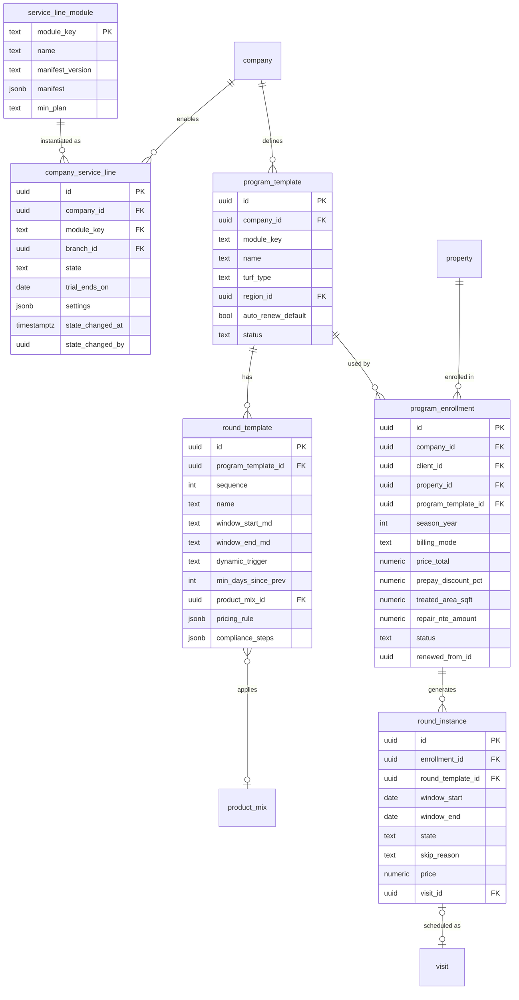

### 7.2 Application Compliance Engine

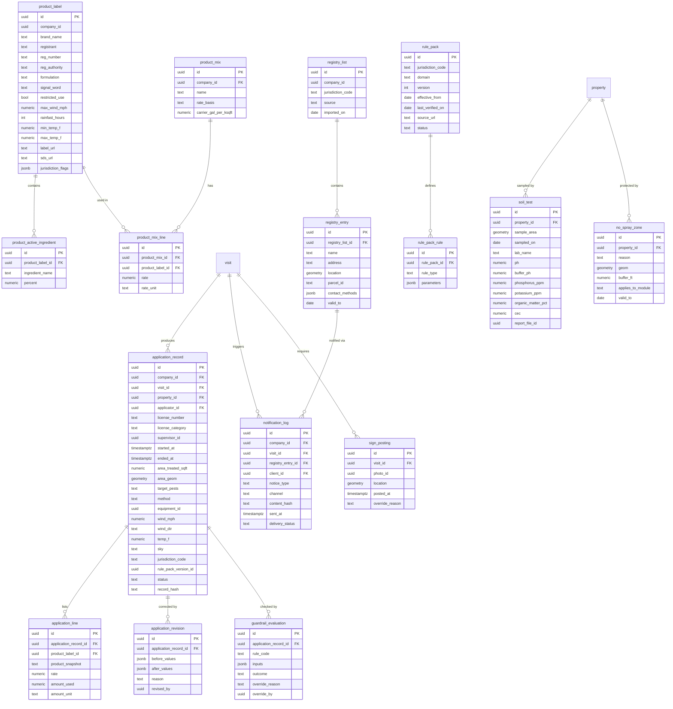

### 7.3 Property Asset Registry: irrigation and backflow

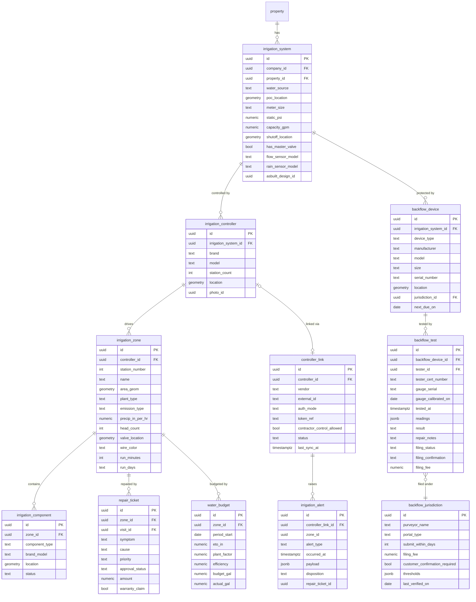

### 7.4 Storm Event Engine and snow

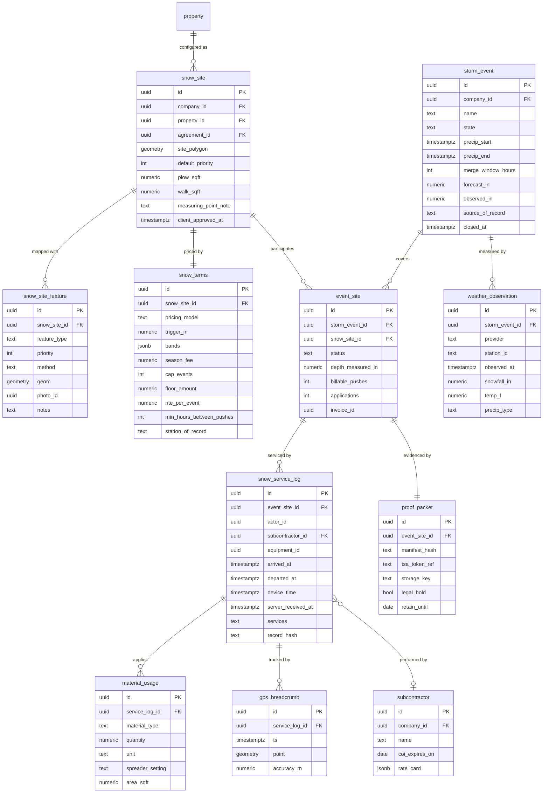

### 7.5 Trees, projects, dig tickets, permits and warranties

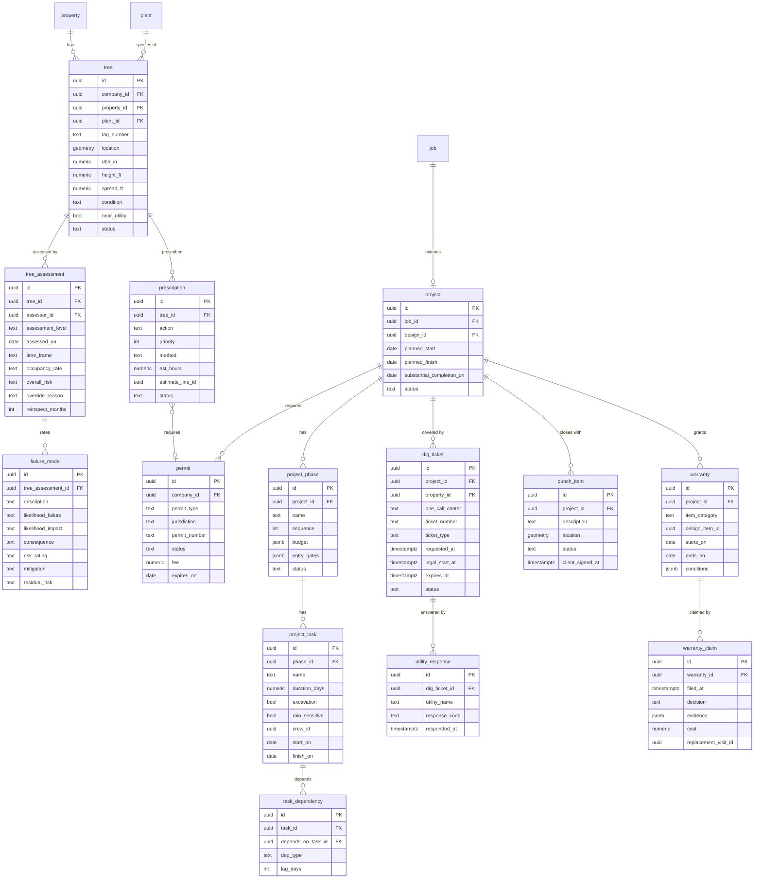

### 7.6 Commercial grounds, lighting, holiday lighting and campaigns

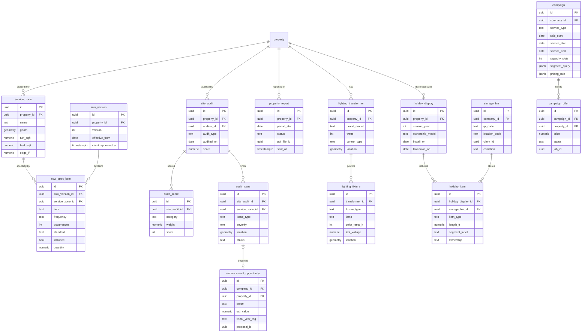

### 7.7 Key modeling decisions

| Decision | Rationale |
|---|---|
| Programs generate `round_instance` rows up front; Visits are created later by planning. | Lets ops see the whole season (and prepay liabilities) before routes exist; avoids thousands of premature Visits that would churn on every reschedule. |
| Compliance records snapshot product and rule pack versions. | Records must reflect what was true at application time, even if the label library or rule pack changes later. |
| `event_site` is the billing and proof unit for snow, not the Visit. | A site can get multiple pushes by multiple crews/subs in one event; billing and proof aggregate at site-event level. |
| Trees reference `plant_id` from the Plant KB. | Species intelligence (failure profiles, pests, wood weight, Region suitability) stays curated once, used everywhere. |
| Assets are typed geometry on the Property, not free text. | Enables private-line warnings, zone maps, snow features and audit pins to be overlaid and queried spatially. |
| Rule packs are platform-curated, versioned, with `last_verified_on`. | Centralizes regulatory upkeep for every tenant; the operator can see stale packs in the admin console ([19](19-platform-admin-portal.md)). |

---

## 8. Integrations, APIs and events

### 8.1 External services

| Integration | Module | Direction | Mechanism | Priority | Notes |
|---|---|---|---|---|---|
| Weather forecast and observations (commercial provider; NWS API for US public data; Environment and Climate Change Canada data) | snow_ice, lawn_phc, irrigation, install_projects, campaigns | Inbound | Weather adapter in the AI/integration layer ([04](04-scheduling-dispatch-routing.md)); hourly polling + event-driven refresh during `watch`/`active` | MVP | Provider-agnostic; observation IDs stored for proof packets. |
| Certified weather reports | snow_ice | Inbound | PDF/CSV upload or provider API (verify vendors) | V1 | Used for disputes and per-inch seasonal contracts. |
| Reference ET (OpenET, Spatial CIMIS, or provider ETo) | smart_irrigation | Inbound | API polling daily | V1 | Coverage varies by region; verify terms. |
| Hunter Hydrawise | smart_irrigation | Bi-directional | GraphQL/REST with OAuth 2.0; respect rate limits ([Hunter](https://www.hunterirrigation.com/support/hydrawise-api-information)) | V1 | Read zones, runs, alerts; start/stop/suspend zones. |
| Rachio | smart_irrigation | Bi-directional | OAuth 2.0 REST + webhooks ([Rachio community](https://community.rachio.com/t/api-capability-for-weather-skips/23624)) | V1 | Webhook endpoint per tenant with signature verification. |
| Rain Bird IQ4 | smart_irrigation | Inbound (alarms, flow, runtimes) | Third-party API with owner authorization and subscription ([Rain Bird](https://www.rainbird.com/professionals/iq4-product-development-update-new-bms-Integration)) | V2 | Commercial sites. |
| Weathermatic SmartLink | smart_irrigation | Inbound | Partnership to be negotiated (verify) | V2 | Commercial sites. |
| Municipal backflow portals (BSI Online, SwiftComply, Tokay) | backflow | Outbound | Generated reports + manual filing queue; connectors where portals provide bulk upload or APIs (verify) | V1 manual, V2 connectors | Jurisdiction packs curated by platform_curator. |
| Parcel data (Regrid or equivalent) | lawn_phc registries, all asset maps | Inbound | Bulk parcel tiles + API lookups ([20](20-architecture-security.md)) | V1 | Abutting registry detection. |
| One-call (811) centers | install_projects, tree_care, irrigation | Inbound | Email ingestion of ticket confirmations and positive responses with AI extraction; direct APIs where available (verify per center) | MVP manual, V1 email AI, V2 APIs | Ticket gating is MVP even with manual entry. |
| Soil testing labs | lawn_phc | Inbound | PDF/CSV upload + AI extraction | V1 | Lab-specific parsers added over time. |
| Apiary registries (e.g., FieldWatch BeeCheck) | mosquito_pest, lawn_phc | Inbound | API or periodic import (verify availability) | V2 | Buffer warnings. |
| Vehicle telematics (Samsara, Geotab, Verizon Connect) | snow_ice, all | Inbound | APIs/webhooks via [13](13-operations-inventory-equipment.md) | V1 | Alternative GPS source for proof packets when phones are not used. |
| Smart lighting transformers (FX Luminaire, Kichler and others) | landscape_lighting | Bi-directional | Vendor APIs (verify) | V2 | Remote diagnostics and timers. |
| Trusted timestamp authority (RFC 3161) | snow_ice | Outbound | Timestamp manifest hashes | V1 | Third-party verifiable proof. |

### 8.2 Domain events emitted

All events go through the transactional outbox to the event bus ([20](20-architecture-security.md)) and are available to the Automation builder ([17](17-ai-copilot-automation.md)) and to tenant webhooks.

| Event | Payload highlights | Typical consumers |
|---|---|---|
| `service_line.state_changed` | module_key, from, to, branch_id, actor | Billing entitlements, nav cache, analytics |
| `program_enrollment.created` / `.renewed` / `.cancelled` | enrollment, billing mode, price | Billing, ledger (prepay liability), marketing |
| `round_instance.window_opened` | round, region, count | Round Planner alerts, copilot brief |
| `round_instance.blocked` / `.unblocked` | reasons (notices, license) | Ops dashboard |
| `application_record.sealed` | record id, jurisdiction, products, applicator | Compliance reports, client notice, inventory decrement, invoicing |
| `guardrail.overridden` | rule, inputs, actor, reason | Compliance dashboard, owner alert |
| `registry_notice.sent` / `.failed` | channel, recipient, visit | Compliance log, retry |
| `soil_test.results_ingested` | values, recommendation | Proposal automation |
| `irrigation.alert_received` | vendor, zone, alert type | Repair ticket rules, client notification |
| `irrigation.zone_controlled` | action, actor, duration | Audit log |
| `backflow_test.recorded` / `.filed` | result, jurisdiction, confirmation | Billing (fees), due-date engine, portal |
| `storm_event.opened` / `.state_changed` / `.closed` | event, forecast/observed, sites | Command center, staffing, billing automation, client status updates |
| `event_site.status_changed` | site, status, timestamps | Portal live status for client_commercial |
| `snow_service_log.recorded` | site, actor, services, materials | Proof vault, inventory, sub payables, timesheets |
| `proof_packet.sealed` | manifest hash, storage key | Retention, export |
| `tree_assessment.completed` | ratings, prescriptions | Proposals, portfolio heat map |
| `dig_ticket.status_changed` | ticket, clear_to_dig, expires_at | Crew app gate, Gantt |
| `project_phase.completed` | phase, percent | Progress billing ([07](07-invoicing-billing-contracts.md)), client update |
| `punch_list.signed_off` | project | Final invoice gate, warranty start |
| `warranty_claim.decided` | decision, cost | Replacement scheduling, warranty reserve posting |
| `site_audit.completed` | score, issues | Corrective tasks, enhancement pipeline, monthly report |
| `enhancement.stage_changed` | stage, value | Sales pipeline ([03](03-crm-sales-estimating-proposals.md)) |
| `holiday_bin.scanned` | bin, direction, location | Storage inventory |
| `campaign_offer.accepted` | campaign, property, price | Job creation, capacity counter |

### 8.3 Events consumed

`proposal.accepted` (creates projects, enrollments, snow terms), `visit.completed` (round instance and record sealing), `invoice.paid` (prepay balances, holiday deposit confirmations), `employee.certification_expiring` ([15](15-team-hr-payroll.md); gates applicators, testers, assessors), `inventory.low_stock` ([13](13-operations-inventory-equipment.md); salt, products), `weather.alert` (adapter), `design.version_approved` ([10](10-design-studio.md); as-builts, takeoffs).

### 8.4 Public API and tenant webhooks [V1]

REST/GraphQL resources for programs, enrollments, application records (read-only, export), irrigation systems, snow events and event sites, proof packets (signed URL), projects and dig tickets, audits. Typical use: a commercial client's facilities system pulls snow event status and proof links per site; a franchise group pulls application records for central compliance review. Rate limits and scopes per [20](20-architecture-security.md).

---

## 9. Permissions

Legend: **F** full (create, edit, delete/void, configure), **E** edit/create, **A** approve, **V** view, **O** own/assigned records only, **P** portal view of own properties, **-** none. Custom roles compose these capabilities ([02](02-personas-roles-permissions.md)).

| Capability | platform_owner | platform_curator | platform_support | owner | office_manager | estimator | designer | ops_manager | crew_lead | technician | bookkeeper | subcontractor | client_residential | client_commercial |
|---|---|---|---|---|---|---|---|---|---|---|---|---|---|---|
| Toggle service-line modules | F (entitlements) | - | V | F | V | - | - | V | - | - | - | - | - | - |
| Edit platform rule packs and product label library | A (publish) | F | V | - | - | - | - | - | - | - | - | - | - | - |
| Tenant private products and stricter rules | - | - | V | F | E | - | - | E | - | - | - | - | - | - |
| Program templates and pricing | - | - | V | F | E | E | - | E | V | - | V | - | - | - |
| Enroll, renew, cancel programs | - | - | V | F | F | E | - | E | V | - | V | - | E (own, cancel) | A (own) |
| Round Planner and scheduling | - | - | V | F | E | - | - | F | V | - | - | - | - | - |
| Complete application records | - | - | - | E | - | - | - | E | E | E | - | O (if licensed) | - | - |
| Revise sealed application records | - | - | - | A | E (with reason) | - | - | E (with reason) | - | - | - | - | - | - |
| Override weather or sign guardrail | - | - | - | F | - | - | - | E | E (with reason) | - | - | - | - | - |
| View application records | - | - | V (support session) | V | V | V | - | V | V | O | V | O | P | P |
| Registry lists and notices | - | E (platform feeds) | V | F | F | - | - | E | - | - | - | - | - | - |
| Irrigation inventory and zone maps | - | - | V | F | E | E | E | F | E | E | - | O | P | P |
| Control smart controllers | - | - | - | F | - | - | - | E | E | E | - | - | Grant/revoke | Grant/revoke |
| Backflow tests and filings | - | E (jurisdiction packs) | V | F | E | - | - | E | E | E (if certified) | V | O (if certified) | P | P |
| Snow site maps and terms | - | - | V | F | E | E | V | F | V | V | V | O (assigned sites, no prices) | A (site map) | A (site map) |
| Storm Command Center | - | - | V | F | V | - | - | F | V | - | - | - | - | - |
| Snow service logs | - | - | - | E | - | - | - | E | E | E | - | O | - | - |
| Event billing approve | - | - | - | A | E | - | - | A | - | - | E | - | - | - |
| Export proof packets / legal hold | - | - | - | F | E (export) | - | - | E (export) | - | - | - | - | P (export) | P (export) |
| Sub payables from logs | - | - | - | A | E | - | - | E | - | - | F | O (statement) | - | - |
| Tree inventory and assessments | - | E (species failure profiles) | V | F | V | E | V | E | E | O | - | O | P | P |
| Issue risk reports | - | - | - | A | - | E (if TRAQ) | - | E (if TRAQ) | - | - | - | - | - | - |
| Projects, phases, Gantt | - | - | V | F | E | E | E | F | E (assigned) | V (assigned) | V | O | P (timeline) | P (timeline) |
| Dig tickets and override gate | - | E (one-call packs) | V | F (override) | E | - | - | F (override) | E (request) | V | - | V | - | - |
| Permits and inspections | - | - | V | F | E | E | E | E | V | - | - | - | P | P |
| Punch list | - | - | - | F | E | E | E | F | E | E | - | O | E (add, sign off) | E (add, sign off) |
| Warranty claims decide | - | - | V | F | E | V | V | A | V | - | V | - | E (file) | E (file) |
| SOW builder and versions | - | - | V | F | E | E | V | F | V | V | V | - | P | A |
| Site audits | - | - | V | F | V | E | - | F | E | - | - | - | P (shared audits) | P (shared audits) |
| Enhancement pipeline | - | - | V | F | E | F | E | F | E (capture) | E (capture) | V | - | - | A |
| Monthly property reports | - | - | V | F | E | V | - | F | - | - | - | - | - | P |
| Lighting and holiday inventories, storage bins | - | - | V | F | E | E | E | F | E | E | - | O | P | P |
| Campaign builder | - | - | V | F | F | E | - | E | - | - | V | - | Accept offers | Accept offers |
| Module reports and profitability | V (aggregate, anonymized) | - | - | F | V | V (own pipeline) | - | V | - | - | V | - | - | - |

Rules:
- "if licensed / if certified / if TRAQ" means the action is permitted only when the actor's current credential (from [15](15-team-hr-payroll.md)) matches the required category and is unexpired on the action date.
- platform_support access to tenant records requires a tenant-granted, time-boxed support session, audit-logged ([19](19-platform-admin-portal.md)).
- client_commercial approvals honor the client's own approval chain and thresholds (configured in the portal, [06](06-customer-portal.md)).

---

## 10. AI opportunities in this module

All AI runs through the provider-agnostic AI Gateway, is metered as AI credits, and proposes rather than silently acts on anything regulated ([17](17-ai-copilot-automation.md)).

| # | Opportunity | Module | How it works | Guardrail | Priority |
|---|---|---|---|---|---|
| AI1 | Agronomic window prediction | lawn_phc | Soil temperature and GDD models per Region from weather data; predicts window open dates 7-14 days ahead and recommends round start per territory. | Advisory; ops confirms. | V1 |
| AI2 | Round plan optimizer | lawn_phc, mosquito_pest | Assigns round instances to weeks maximizing density while respecting windows, notices, weather risk and capacity. | Human approves plan. | V1 |
| AI3 | Label reader for private products | lawn_phc | LLM document understanding extracts EPA/PCP reg number, actives, rates and restrictions from a label PDF into a draft product. | Curator or owner must verify every field before use. | V1 |
| AI4 | Soil test extraction and recommendations | lawn_phc | Reads lab PDFs; maps values; drafts lime and fertility add-on proposals. | Human confirms values. | V1 |
| AI5 | Turf and weed diagnosis from photos | lawn_phc | Classifies common weeds, turf diseases and insect damage; suggests program adjustments or a service call. | Shows confidence; never auto-applies products. | V2 |
| AI6 | AI zone mapping | irrigation | Walk-and-run capture + photos -> proposed zone polygons and head counts. | Office confirms. | V1 |
| AI7 | Irrigation anomaly detection | smart_irrigation | Detects flow drift and runtime anomalies vs ET-adjusted expectations; predicts leaks before alarms. | Draft tickets only. | V2 |
| AI8 | Storm brief and staffing plan | snow_ice | Converts forecast + triggered-site model into a plain-language brief ("Expect 71-88 sites, 58-66 crew hours, 31-40 t salt; call 3 subs") and a call-out list. | Ranges, not points; ops decides. | V1 |
| AI9 | Proof packet narrative and incident timeline | snow_ice | Drafts a factual timeline from logs for counsel; flags gaps (GPS dropout, missing photos). | Strictly derived from records with citations to record IDs; no speculation. | V1 |
| AI10 | Event billing exception triage | snow_ice | Explains why an invoice is in the exception queue and proposes resolution. | Ops approves. | V1 |
| AI11 | Tree species ID and defect spotting | tree_care | Photo -> top-3 Region-plausible species from the Plant KB; highlights visible defects for the assessor. | Assessor confirms; risk ratings never auto-assigned. | V1 |
| AI12 | Crane pick weight estimator | tree_care | Species wood weight from KB x piece dimensions estimated from photos/measurements. | Shown as estimate with safety margin; lift plan sign-off required. | V2 |
| AI13 | Project schedule assistant | install_projects | Builds a phase/task schedule from the estimate; re-plans around rain forecasts and crew conflicts. | Human approves changes. | V1 |
| AI14 | 811 response parsing | install_projects | Extracts utility responses from one-call emails into tickets. | Unknown responses keep the gate closed. | V1 |
| AI15 | Warranty claim evidence assist | install_projects | Combines photos, irrigation run history, weather and KB stressors into a suggested decision. | Ops decides; client sees decision rationale. | V1 |
| AI16 | Audit photo scoring | commercial_grounds | Vision model suggests category scores and detects issues (weeds in beds, unedged walks, litter) from audit photos. | Suggestions only; auditor signs. | V2 |
| AI17 | Enhancement proposal generator | commercial_grounds | Issue -> priced scope, KB-appropriate plant substitutions, AI mockup, proposal draft. | Estimator reviews. | V1 |
| AI18 | Monthly report writer | commercial_grounds | Executive summary + best-photo selection. | AM reviews before send (auto-send optional). | V1 |
| AI19 | Night lighting and holiday mockups | lighting, holiday | Generates night scenes or holiday displays on a client's house photo, sized from measured rooflines. | Labeled "concept image". | V1 |
| AI20 | Campaign targeting | seasonal_campaigns | Propensity model ranks clients by likelihood to buy aeration/cleanup/mulch; optimizes offer timing. | Respect marketing consent ([16](16-marketing-growth-communications.md)). | V1 |
| AI21 | Copilot service-line tools | all | Natural-language: "Which lawns in Dublin still need Round 2 and have a registry neighbor?", "Show me sites we salted more than 2x the target rate last event." | Read tools free; write tools require confirmation. | MVP (read) / V1 (write) |

---

## 11. Edge cases, compliance and risks

### 11.1 Edge cases (selected, by module)

| Module | Edge case | Required behavior |
|---|---|---|
| Framework | Owner disables `snow_ice` mid-season with seasonal contracts active. | State `winding_down`; installments continue; storm events still creatable for those sites; banner explains. |
| Framework | Multi-branch company: Snow on for Columbus branch only. | Branch-level module state; clients served by multiple branches see only lines enabled for the servicing branch. |
| lawn_phc | Client's lawn area changes after a fence/patio install. | Area change detected from the new Design version; repricing policy applied; client notified if price changes. |
| lawn_phc | Technician's license expires mid-route. | Remaining visits requiring the license are blocked; ops prompted to reassign; supervised-application rules applied if the state pack allows. |
| lawn_phc | Visit rescheduled after registry notices were sent. | If the new date falls outside the notified window, notices are re-sent and the instance re-blocked until lead time passes. |
| lawn_phc | Property straddles two jurisdictions (county ordinance stricter than state). | Union of rules applied; strictest wins. |
| lawn_phc | Product removed from a jurisdiction's allowed list mid-season. | Rule pack version update flags affected mixes and future round instances; ops must select an alternative before scheduling. |
| lawn_phc | Prepaid client moves; new owner wants service. | Enrollment cannot transfer funds between clients automatically; refund old client per policy; new enrollment for new client. |
| irrigation | Client revokes smart-controller access in the vendor app, not in Rootline. | Token failure marks link `revoked`; remote control disabled; office task to reconnect. |
| irrigation | Freeze arrives before winterization completes. | Freeze wave triggered; clients not yet served get a proactive message with self-shutoff instructions and an option for emergency service. |
| backflow | Purveyor changes its portal vendor. | Jurisdiction pack updated by curator; in-flight filings stay on the old method if submitted. |
| snow_ice | GPS unavailable on site (dead zone, phone dies). | Manual start/finish with photo required; telematics fallback; packet marks the gap explicitly rather than interpolating. |
| snow_ice | Event spans midnight across month end on a monthly invoicing client. | Event belongs to the month of precipitation start (configurable); single invoice line per site-event. |
| snow_ice | Weather station of record goes offline. | Fallback chain (secondary station -> provider gridded data -> crew-measured depth) defined in contract; invoice shows source used. |
| snow_ice | Sub logs service at a site not assigned to them. | Log accepted into exception queue; not payable or billable until ops resolves. |
| tree_care | Species unknown or hybrid not in KB. | Genus-level record allowed with "species unconfirmed" flag; curator request auto-created ([12](12-plant-knowledge-base.md)). |
| install_projects | Dig ticket expires during a rain delay. | Gate closes automatically; crew lead prompted to request update; Gantt shows gap. |
| install_projects | Client waters plants poorly and files a warranty claim. | Evidence assist shows run history; policy-based partial coverage; decision rationale visible to client. |
| commercial_grounds | Property manager disputes audit score. | Audit comments thread; re-audit option; score history retains both versions. |
| holiday_lighting | Client cancels after custom-cut strands were made. | Cancellation fee per agreement; custom runs stay assigned to property for future season or are written off to inventory. |
| mosquito_pest | Neighbor complaint about drift. | Incident record linking the application record, weather at the time, no-spray zones and technician path; owner alert. |
| seasonal_campaigns | Capacity sells out. | Offers switch to waitlist; accepted waitlist offers auto-scheduled when cancellations open slots. |

### 11.2 Compliance obligations

| Area | Obligation | How Rootline supports it |
|---|---|---|
| Pesticide recordkeeping (state/provincial) | Records with required fields, retained for the jurisdiction's period (e.g., two years in Maine for commercial applicators; varies). | Application Compliance Engine; rule packs; immutable records with revisions; export. |
| Applicator licensing | Only certified applicators (or supervised, where allowed) apply regulated products in the right category. | Credential validation at assignment and at completion. |
| Notification registries, signs, customer notices | State-specific (roughly half of US states have some lawn notification law; verify per state). | Registry engine, sign photo gate, notice logs. |
| Fertilizer ordinances | Blackout dates, phosphorus restrictions, setbacks from water (local and state). | Rule packs as guardrails. |
| Canadian cosmetic pesticide rules | Provincial restrictions on cosmetic use (e.g., Ontario, Quebec; verify current lists). | Product jurisdiction flags; blocked mixes. |
| Backflow testing | Certified tester, calibrated gauge, deadline-bound submission with fees. | Credential and gauge checks; jurisdiction packs; filing queue. |
| One-call (811) | Notice before excavation, wait periods, ticket validity, respect marks. | Dig ticket entity and hard gate. |
| Tree work safety | ANSI Z133 practices, line clearance qualification near energized lines, crane rules (OSHA crane standards for construction apply to some crane work; verify applicability). | Credential checks, JHA briefings, utility proximity flags, lift plans. |
| Protected trees and wildlife | Municipal tree ordinances; Migratory Bird Treaty Act protections for active nests. | Permit gating; nesting-season checklist. |
| Snow documentation | Contractual and legal defensibility; industry standards (SIMA procurement standard; ASCA A1000). | Proof packets, retention, legal hold. |
| Employee GPS privacy | Location tracking disclosures and limits (varies by state/province; some jurisdictions require notice or consent). | Tracking only while clocked in on shift; disclosure acknowledgment at onboarding ([15](15-team-hr-payroll.md)); breadcrumb access restricted. |
| Automatic renewal laws | Clear disclosure, consent and easy cancellation for auto-renewing programs (state-specific; verify). | Renewal disclosures generated per jurisdiction; one-click cancel in portal. |
| SMS consent | TCPA/10DLC for notices and campaign texts. | Consent flags per contact; transactional vs marketing separation ([16](16-marketing-growth-communications.md)). |
| Data retention and privacy | GDPR/CCPA/PIPEDA data subject rights vs legal retention duties. | Retention policies per record type; legal hold overrides deletion; DSR workflow masks non-required PII where law allows ([20](20-architecture-security.md)). |

### 11.3 Risks and mitigations

| Risk | Impact | Mitigation |
|---|---|---|
| Rule packs out of date or wrong | Tenant violates law believing the software was correct. | `last_verified_on` displayed; curator SLAs (each pack re-verified at least annually and on known law changes); disclaimers; tenant can add stricter rules; legal review of top-10 states before GA; pack change notifications to affected tenants. |
| Over-blocking operations (gates too strict) | Crews idle on a clear day because of a data issue. | Every gate has an audited override path for owner/ops; gate health dashboard; offline cached gate state. |
| Proof packets challenged in court | Lost claims, reputational damage. | Hashing, object lock, trusted timestamps, explicit gap disclosure, chain-of-custody export; engage a snow-litigation attorney to review the packet format before launch. |
| Smart-controller API changes or rate limits | Broken integrations, silent data gaps. | Adapter pattern, contract tests, vendor relationship, link health monitoring visible in the admin console. |
| Module sprawl slows the core product | Engineering spread thin. | Shared engines first; modules are configuration + thin domain logic; strict MVP scope (section 4 tags). |
| AI misidentifies species or risk | Unsafe tree work or wrong treatment. | AI never assigns risk or applies products; assessor/applicator confirmation is mandatory. |
| Snow-season load spikes | Thousands of tenants hit the platform at 3 a.m. in the same storm. | Regional autoscaling, offline-first crew app, queue-based log ingestion, load tests simulating a Northeast storm ([20](20-architecture-security.md)). |

---

## 12. Metrics and KPIs

KPI definitions are canonical in [18](18-reporting-analytics.md); module-specific KPIs below.

| Module | KPI | Definition |
|---|---|---|
| Framework | Module adoption | % of active tenants with each module `active`; average modules per tenant. |
| Framework | Time to first value | Hours from module `active` to first completed Visit in that line. |
| lawn_phc | Round completion in window | Completed round instances / scheduled instances whose window closed. Target above 97% (estimate). |
| lawn_phc | Revenue per production hour | Program revenue recognized / technician hours on program visits. |
| lawn_phc | Renewal rate | Renewed enrollments / eligible enrollments. |
| lawn_phc | Prepay share | Prepaid program revenue / total program revenue. |
| lawn_phc | Service call rate | Re-treat service calls per 100 completed rounds. |
| lawn_phc | Compliance completeness | Records with all required fields and proofs / records. Target 100%. |
| lawn_phc | Guardrail override rate | Overrides / applications; trend should fall. |
| irrigation | Seasonal service throughput | Start-ups or winterizations per tech-day. |
| irrigation | Repair attach rate | Repair revenue per seasonal service visit. |
| backflow | On-time filing rate | Filings submitted within jurisdiction deadline / tests. |
| smart_irrigation | Connected controller share | Properties with linked controllers / irrigation properties. |
| smart_irrigation | Alert-to-fix time | Median hours from alert to repair completion. |
| snow_ice | Priority-1 open-by-target rate | P1 sites serviced by contract time / P1 triggered sites. |
| snow_ice | Proof completeness | Event sites with complete packets (geofence, required photos, materials) / serviced event sites. Target above 99%. |
| snow_ice | Event invoice latency | Hours from event close to invoices sent. Target under 24 h (goal G4 stretch: 2 h). |
| snow_ice | Salt efficiency | Actual salt per 1,000 sq ft vs target rate by temperature band. |
| snow_ice | Event gross margin | (Event revenue - labor - equipment - materials - subs) / event revenue, per site and per event. |
| snow_ice | Claims defended | Incidents with packet produced within 24 h; claim outcomes (tenant-reported). |
| tree_care | Assessment-to-work conversion | Prescriptions sold / prescriptions issued. |
| tree_care | High-risk backlog age | Days open for priority-1 prescriptions. |
| install_projects | Schedule variance | Actual vs planned finish date per project. |
| install_projects | Budget variance by phase | Actual vs estimated labor hours and material cost. |
| install_projects | Dig gate overrides | Overrides per 100 excavation tasks. Target near zero. |
| install_projects | Warranty cost ratio | Warranty claim cost / install revenue; by species and crew. |
| commercial_grounds | Average site score | Mean audit score; trend by property and crew. |
| commercial_grounds | Corrective SLA | % corrective issues closed within SLA. |
| commercial_grounds | Enhancement ratio | Enhancement revenue / maintenance contract revenue per account. |
| commercial_grounds | Report open rate | Monthly reports opened by client_commercial users. |
| landscape_lighting | Plan attach rate | Lighting installs with a service plan within 90 days. |
| holiday_lighting | Capacity sell-through | Booked install slots / available slots by date. |
| holiday_lighting | Bin accuracy | Takedowns with all items scanned into the correct bin. |
| mosquito_pest | Interval adherence | Treatments within interval tolerance (e.g., 21 days +/- 3). |
| seasonal_campaigns | Offer acceptance | Accepted offers / delivered offers by segment. |
| seasonal_campaigns | Revenue per crew-day | Campaign revenue / crew-days used. |

---

## 13. Beyond the brief: extra ideas

1. **Property Health Score [V1].** A single 0-100 score per property combining turf program status, irrigation efficiency, tree risk, audit scores, open warranty items and lighting outages, shown in the portal with "what would raise it" suggestions (each one a one-click proposal). It gives residential clients a reason to open the portal and gives account managers a renewal story.
2. **Digital As-Built Passport [V1].** Every property gets a QR plate (on the controller, the transformer or the utility box) that opens a permissioned page: irrigation zones, private lines, lighting runs, plant list with care guides, warranty status. Future crews (and future homeowners when the house sells, with client consent) stop cutting lines. This plugs directly into the homeowner network idea in [23](23-innovation-moonshots.md).
3. **Neighbor Density Offers [V1].** When a lawn program or aeration job is sold, Rootline identifies adjacent parcels and generates a "your neighbor just joined" offer with a density discount that the Company can afford because drive time is near zero. Respects marketing consent and any registry opt-outs.
4. **Salt Sustainability Report [V2].** For commercial clients with ESG goals: chloride applied per season vs target rates, reductions from liquid pre-treatment, and certification status (e.g., Smart About Salt-style programs). Turns good practice into a sales asset.
5. **Liability Vault with insurer access [V2].** Snow proof packets plus pesticide application records available to the Company's insurer via a read-only, time-boxed link; negotiate premium credits with partner insurers for Companies with above-99% proof completeness (business model hook in [22](22-business-model-pricing-gtm.md)).
6. **Storm Surge Subcontractor Marketplace [V3].** Rootline tenants opt in to offer spare plow capacity to other tenants during big storms; the platform matches by geography, equipment and COI status, with proof standards enforced by the same app. A genuine network effect no single-tenant tool can build.
7. **Weather-indexed snow contracts [V3].** Offer clients a "budget certainty" seasonal price while the Company hedges low-snow risk through a partner weather-derivative or parametric insurance product, settled against the same station of record (see fintech ideas in [23](23-innovation-moonshots.md)).
8. **Water Savings Statements and rebate filing [V2].** Many utilities offer rebates for smart controllers and efficient nozzles; Rootline pre-fills rebate applications from installed equipment and water data, and shows clients gallons saved per season.
9. **Tree ecosystem benefits estimate [V2].** Estimate carbon storage, stormwater interception and energy savings for inventoried trees (exploring integration with USDA Forest Service i-Tree methodologies; verify licensing). HOAs and campuses love this in board reports, and it reframes tree care from cost to asset.
10. **IPM mode for lawn programs [V2].** Threshold-based integrated pest management: crews log weed/insect counts per area; products are applied only above thresholds; the client gets a "chemical reduction" report. Opens the eco-conscious segment that rejects blanket programs.
11. **Pollinator-friendly certification badge [V2].** Properties whose design and program meet a curated checklist (native plant share from the KB, no neonicotinoids, bloom succession) earn a portal badge and yard sign; marketing flywheel via [16](16-marketing-growth-communications.md).
12. **Lawn time-lapse report card [V1].** Crews take a fixed-angle photo at each round; the portal shows a season time-lapse with AI captions ("Weed coverage down from ~20% to under 5%"). Retention gold at renewal time.
13. **Holiday "light show" scheduler [V2].** For smart transformers and smart holiday controllers: client picks themes and schedules in the portal; Company sells premium animated displays.
14. **Post-storm cleanup event mode [V2].** Reuse the Storm Event Engine for hurricanes and derechos: debris triage per property, tree emergency prioritization from the inventory's risk ratings, insurance documentation packets for homeowners.
15. **Drone and satellite monitoring [V3].** NDVI from satellite or drone flights to detect turf stress and irrigation failures across commercial portfolios before audits; integrates with audit scoring and irrigation alerts.
16. **Autonomous equipment orchestration [V3].** Robotic mowers and autonomous spreaders as schedulable "crew members" with geofenced work areas drawn from service zones and no-go zones from snow/irrigation/tree maps ([23](23-innovation-moonshots.md)).

---

## 14. Open questions

1. **Rule pack liability and staffing:** how many `platform_curator` hours per state per year are needed to keep pesticide, fertilizer, registry and auto-renew rule packs current, and should packs be sold as a premium "Compliance+" add-on or included? (Recommendation: include basic packs; charge for registry automation and regulator export formats.)
2. **Which states first?** Proposed: the 10 states with the highest density of target customers plus all states with registries, validated with counsel before GA.
3. **Snow proof format review:** which snow-litigation defense attorneys and insurers will review the packet format, and do we need an expert-witness-ready affidavit template?
4. **Seasonal snow revenue recognition:** confirm with the accounting advisor the default recognition pattern for seasonal contracts (ratably over the season vs by expected events) and how caps/overages affect it ([09](09-accounting-ledger-integrations.md)).
5. **Smart controller partnerships:** do Hunter, Rachio, Rain Bird and Weathermatic offer contractor-partner API programs with higher rate limits and multi-site tokens, and on what commercial terms?
6. **Backflow portal connectors:** will BSI Online, SwiftComply or Tokay offer partner submission APIs, or must we stay with assisted manual filing?
7. **One-call center integrations:** which state one-call centers expose ticket APIs to software vendors, and what certification is needed?
8. **TRAQ dependency:** should risk reports be hard-blocked for non-TRAQ users, or should the Company define its own qualification policy? (Current spec: template-level flag set by the Company.)
9. **Module pricing:** which modules are plan-included vs paid add-ons ([22](22-business-model-pricing-gtm.md))? Snow is the most valuable add-on candidate; lawn compliance may be a wedge that should be included.
10. **Franchise systems:** mosquito and holiday lighting are heavily franchised; do we need franchisor-level rollups (central product mixes, brand-standard programs) in V1 or V2?
11. **Canada at launch:** which provinces' pesticide and one-call rules are in the launch set, and is French-language content required for rule-pack notices in Quebec before French UI ships?
12. **Employee location data:** what is the default breadcrumb retention for employees (separate from proof packets) that balances privacy law and claim defense?

---

## Sources

Research note: sources reflect public information available as of November 2026. Several vendor pages could not be fetched directly during this research pass; claims sourced from secondary listings or competitor-written comparison pages are labeled in the text and should be verified. Industry practices stated without a citation (e.g., typical round windows, example prices, production rates) are illustrative defaults or estimates, not market statistics.

**Competitors and market**
- Lawn & Landscape, "Service Assistant Software" product listing (Real Green): https://www.lawnandlandscape.com/product/real-green-systems-service-assistant
- IronPros, RealGreen Systems product listing: [IronPros](https://www.ironpros.com/product-categories/technology-and-software/business-financial-tools/field-service-management-software/product/22904391/realgreen-systems-real-green)
- Capterra, RealGreen (Service Assistant) reviews: [Capterra RealGreen reviews](https://www.capterra.com/p/78106/Service-Assistant/reviews/?page=5)
- Yeti Software home page (snow and ice management): [Yeti Software](https://yetisoftware.com/)
- Pulse RevOps tech stack page referencing Aspire snow module: [Pulse](https://pulserevops.com/tech-stacks/tk0100)
- SIMA, "Unlock profitability and efficiency with Aspire": [SIMA resource](https://resources.sima.org/snow-and-ice-resource-center/unlock-profitability-and-efficiency-with-aspire)
- SIMA, "Streamline snow ops with Go iLawn and Aspire": [SIMA product page](https://sima.org/products/streamline-snow-ops-with-go-ilawn-aspire)
- Aspire, "Prove Service Delivery with Photo, GPS, and Time Data": [Aspire blog](https://www.youraspire.com/blog/prove-service-delivery-data-ends-disputes)
- Jobber Academy, "How to bid snow removal": [Jobber](https://www.getjobber.com/academy/snow-removal/how-to-bid-snow-removal/)
- ContractorApps, "Best Field Service Software for Snow Removal Companies (2026)" (competitor-written comparison): [ContractorApps](https://contractorapps.pages.dev/comparisons/best-field-service-software-snow-removal)
- Agiled, "Best Client Management Software for Snow Removal": [Agiled](https://agiled.app/blog/best-client-management-software-for-snow-removal)
- Arborgold, "The Best Tree Inventory Software for Tracking Your Trees and Clients": [Arborgold blog](https://arborgold.com/blog/tree-care-arborist/the-best-tree-inventory-software-for-tracking-your-trees-and-clients/)
- SourceForge, arborist software category: [SourceForge arborist](https://sourceforge.net/software/arborist)
- G2, LMN reviews: [G2 LMN](https://www.g2.com/products/lmn)
- SiteDNA site inspection app: [SiteDNA](https://sitedna-marketing-site.pages.dev/)
- SourceForge, LMN vs SiteRecon: [SourceForge comparison](https://www.sourceforge.net/software/compare/LMN-vs-SiteRecon)

**Snow and ice standards and documentation**
- SIMA, "Effective in-season documentation": [SIMA](https://resources.sima.org/snow-and-ice-resource-center/effective-in-season-documentation)
- SIMA, "Slip and fall pitfalls": [SIMA](https://resources.sima.org/snow-and-ice-resource-center/slip-and-fall-pitfalls)
- SIMA, "Protect others, protect yourself": [SIMA](https://resources.sima.org/snow-and-ice-resource-center/protect-others-protect-yourself)
- SIMA standards page: [SIMA standards](https://sima.org/standards)
- ANSI webstore, ANSI/ASCA A1000-2014: [ANSI](https://webstore.ansi.org/standards/ansi/ansiascaa10002014)
- NFMT 2015 conference handout (Zurich-cited claims figures; dated, secondhand): [NFMT handout](https://www.nfmt.com/handouts/orlando/2015/T5_2C.pdf)
- Beancount.io, snow removal contractor bookkeeping (ASC 606 seasonal deferred revenue discussion): [Beancount](https://beancount.io/blog/2026/06/03/snow-removal-plowing-ice-management-contractor-bookkeeping-asc-606-seasonal-deferred-revenue-per-push-trigger-section-179-plow-truck-salt-spreader-sima-asca-revenue-per-truck-hour-kpi-guide)

**Pesticide recordkeeping and notification**
- Maine Board of Pesticides Control meeting document (two-year record retention for commercial applicators): [Maine BPC](https://www.maine.gov/dacf/php/pesticides/documents2/bd_mtgs/Jun22/6-CA-Caribou-CC.pdf)
- Mississippi State University Extension, pesticide record keeping and lawn management: [MSU Extension](https://extension.msstate.edu/newsletters/turf-tips-newsletter/2005/pesticide-record-keeping-improves-lawn-management-06-13-2005)
- Beyond Pesticides, state lawn notification laws factsheet: [Beyond Pesticides](https://beyondpesticides.org/assets/media/documents/lawn/factsheets/STATE%20NOTFICATION%20LAWS%20-%20LAWN.pdf)
- Mother Earth News, pesticide application signs: [Mother Earth News](https://www.motherearthnews.com/sustainable-living/nature-and-environment/pesticide-application-signs-zm0z16jjzsor/)
- US GAO, "Lawn Care Pesticides" (1991): [GAO via Justia](https://gao.justia.com/environmental-protection-agency/1991/9/lawn-care-pesticides-rced-91-208)
- Michigan Admin. Code R 285.637.5 (registry notification): [Cornell LII](https://www.law.cornell.edu/regulations/michigan/Mich-Admin-Code-R-285-637-5)
- Landscape Architect, Wisconsin spraying notification registry: [Landscape Architect](https://landscapearchitect.com/landscape-articles/wisconsin-requires-spraying-notificationwisconsin-requires-spraying-notification-4892)

**Irrigation and smart controllers**
- Hunter Industries, Hydrawise API information: [Hunter](https://www.hunterirrigation.com/support/hydrawise-api-information)
- pydrawise reference documentation: [pydrawise](https://pydrawise.readthedocs.io/en/latest/reference/)
- Rachio community, API capability for weather skips: [Rachio community](https://community.rachio.com/t/api-capability-for-weather-skips/23624)
- RachioPy zone module documentation: [rachiopy](https://rachiopy.readthedocs.io/en/latest/zone.html)
- API Evangelist Rachio index (secondary): [API Evangelist](https://raw.githubusercontent.com/api-evangelist/rachio/refs/heads/main/llms/rachio-llms.txt)
- Rain Bird, IQ4 central control and BMS integration capabilities: [Rain Bird](https://www.rainbird.com/professionals/iq4-product-development-update-new-bms-Integration)

**Backflow testing and municipal submission**
- City of Vancouver backflow assembly test report: [Vancouver](https://vancouver.ca/files/cov/backflow-assembly-test-report.pdf)
- City of Wilton Manors, BSI Online instructions: [Wilton Manors](https://wiltonmanors.gov/DocumentCenter/View/9253/BSI-Online-Instructions)
- City of Sugar Land, Backflow Testing Program: [Sugar Land](https://sugarlandtx.gov/627/Backflow-Testing-Program)
- BSI Online user agreement / terms: [BSI Online](https://bsionlinetracking.com/default/terms-conditions)
- Virginia Beach Public Utilities, online backflow test submittal (SwiftComply): [Virginia Beach](https://pu.virginiabeach.gov/regulatory-programs/backflow-prevention/annual-testing)
- Colorado Springs Utilities, backflow prevention professionals: [CSU](https://www.csu.org/Pages/BackflowTesters.aspx)
- City of Gig Harbor, tester resources: [Gig Harbor](https://gigharborwa.gov/856/Tester-Resources)
- City of Yakima, Tokay user guide: [Yakima](https://www.yakimawa.gov/services/water-irrigation/files/Tokay-User-Guide.pdf)
