# 15 - Team, HR, Time and Payroll

> Labor is the biggest cost line in a landscape company and the hardest thing to manage. Benchmark studies put burdened direct labor at about 43% of net revenue for mid-size firms ([Lawn & Landscape, Wilson 360 2024 benchmark](https://www.lawnandlandscape.com/article/wilson-360-2024-landscape-industry-benchmark)). Headcount doubles or triples between February and May, much of the workforce prefers Spanish, and many companies depend on the H-2B visa program. Crews also run equipment that needs a license (pesticide applicator, CDL, backflow tester, ISA arborist). The Team module gives Rootline one people system for the whole lifecycle: recruit in Spanish from a phone, onboard with e-signatures, track H-2B milestones, enforce certifications in the schedule, train with bilingual micro-videos, approve timesheets, apply the right overtime and break rules for each state, compute piece-rate, production and commission pay, build certified payroll, export clean pay data to Gusto, ADP, Paychex or QuickBooks Payroll (embedded payroll comes later), keep the OSHA logs and workers' comp claim clocks, run heat and wildfire smoke plans, tag federally qualified overtime and tips for W-2 reporting, recognize good work and offboard cleanly. Because every hour is tied to a Visit, a Job and a cost code, the same data that pays people also costs jobs, prices estimates and forecasts hiring. No landscape-specific competitor runs this whole loop in one product.

**Document status:** Design proposal v1.0 (2026-11-07). Owner: People and Time domain team (`people` module in [Architecture](20-architecture-security.md)).

**Related docs:** [Personas and permissions](02-personas-roles-permissions.md) · [Estimating and commissions](03-crm-sales-estimating-proposals.md) · [Scheduling and dispatch](04-scheduling-dispatch-routing.md) · [Crew app (punches, attestations, safety capture)](05-field-crew-mobile-app.md) · [Customer portal (ratings, tips)](06-customer-portal.md) · [Invoicing (T&M, certified jobs)](07-invoicing-billing-contracts.md) · [Payments (tips)](08-payments-stripe.md) · [Ledger and job costing](09-accounting-ledger-integrations.md) · [Operations, equipment custody](13-operations-inventory-equipment.md) · [Service lines (chem, tree, snow)](14-service-line-modules.md) · [Marketing and inbox](16-marketing-growth-communications.md) · [AI copilot and agents](17-ai-copilot-automation.md) · [Reporting and KPIs](18-reporting-analytics.md) · [Platform admin](19-platform-admin-portal.md) · [Architecture and security](20-architecture-security.md) · [UX and sitemaps](21-ux-design-system-sitemaps.md) · [Pricing](22-business-model-pricing-gtm.md) · [Moonshots](23-innovation-moonshots.md) · [Roadmap](24-roadmap-feature-catalog.md)

> **Legal posture (applies to the whole document).** Rootline is software, not a law firm, a PEO, an immigration agent or a payroll tax filer (until the embedded payroll option, and even then the licensed partner files). Every jurisdiction rule here is a starting configuration for legal review. The rules are marked "verify" where this document could not confirm current text. Rule packs ship versioned and reviewed by employment counsel before each season ([section 4.9](#49-pay-rules-engine-and-jurisdiction-policy-packs)), and the product says "this is not legal advice" wherever it shows a compliance hint.

> **Verification note.** Items marked "verify" are from secondary sources or general knowledge and need first-hand confirmation before build; competitor capabilities marked [B] are analyst belief to confirm in a hands-on teardown. Facts come from research cited elsewhere in this proposal ([05](05-field-crew-mobile-app.md), [02](02-personas-roles-permissions.md), [18](18-reporting-analytics.md), [R1](research/R1-field-service-platforms.md), [R2](research/R2-landscape-specific-platforms.md)), primary regulations cited by section number, and general domain knowledge; the research backlog in [section 14](#14-open-questions) must close the open items before this spec turns into tickets.

---

## Table of contents

1. [Goals and non-goals](#1-goals-and-non-goals)
2. [Market research](#2-market-research-what-competitors-do-what-users-complain-about-the-gap-we-exploit)
3. [Personas and jobs-to-be-done](#3-personas-and-jobs-to-be-done)
4. [Feature specification](#4-feature-specification)
5. [Key user flows](#5-key-user-flows)
6. [Screens and wireframes](#6-screens-and-wireframes)
7. [Data model](#7-data-model)
8. [Integrations, APIs and events](#8-integrations-apis-and-events)
9. [Permissions](#9-permissions)
10. [AI opportunities](#10-ai-opportunities-in-this-module)
11. [Edge cases, compliance and risks](#11-edge-cases-compliance-and-risks)
12. [Metrics and KPIs](#12-metrics-and-kpis)
13. [Beyond the brief](#13-beyond-the-brief-extra-ideas)
14. [Open questions](#14-open-questions)
15. [Sources](#sources)

---

## 1. Goals and non-goals

### 1.1 Goals

1. **One people record per human, many stints.** A person hired in 2024, hibernated each winter and rehired each spring keeps one Employee record with a history of Employment stints, pay rates, certifications and training. Spring rehiring takes minutes, not a stack of paper ([02 section 5.18](02-personas-roles-permissions.md)).
2. **Hire faster than the competitor down the road during the March-April rush.** A job post goes live in English and Spanish in under 5 minutes. An applicant applies from a phone in under 3 minutes with no account or résumé. An interview gets booked by SMS the same day.
3. **Make compliance a byproduct of work.** Overtime, California daily overtime, meal and rest premiums, piece-rate rest pay, prevailing wage, sick leave accrual, OSHA 300 logs, heat plans and certification expiry all come from data the crews already create in the [crew app](05-field-crew-mobile-app.md). Nobody re-keys anything.
4. **Payroll-ready by Monday 10 a.m.** Weekly timesheets are approved, exceptions resolved and pay data pushed to the payroll provider without a spreadsheet. Target: the office manager spends 15 minutes or less per pay period for a 30-person company. That is a goal to validate, not a measured result.
5. **Labor cost truth for every job.** Every hour carries a burdened cost (wages + taxes + workers' comp by class code + benefits + PTO). Job costing ([09](09-accounting-ledger-integrations.md)) and estimates ([03](03-crm-sales-estimating-proposals.md)) use the same burden numbers, and actual payroll journals true them up.
6. **Qualified crews only.** A visit that needs a licensed applicator, a CDL driver or a certified backflow tester cannot be dispatched to a crew without one, unless an authorized manager overrides it with a reason that gets logged.
7. **Bilingual by default.** Spanish is a first-class language in the crew app, applicant flow, onboarding documents, training, announcements and pay explanations at launch. French-Canadian comes next ([21](21-ux-design-system-sitemaps.md)).
8. **Retention as a product feature.** Visible pay, earned recognition, a career ladder and an early-warning view of flight risk help the owner keep good people. In this industry, losing a trained crew lead in June costs more than any software.
9. **Payroll-provider agnostic.** Rootline works with what the Company already uses (Gusto, ADP, Paychex, QuickBooks Payroll and, in Canada, Wagepoint, ADP Canada and others) through APIs or files. Later it offers an embedded payroll option for Companies that want everything in one place.
10. **Safety is managed.** Incident reports become OSHA-recordability decisions, logs, 300A summaries and corrective actions. Heat plans run automatically from the forecast.

### 1.2 Non-goals

- **Not a PEO or employer of record.** Rootline never becomes a co-employer.
- **No payroll tax filing or wage money movement at MVP.** Payroll providers compute net pay, withhold taxes, file and pay. With embedded payroll ([V2 GA](#414-embedded-payroll-option)), the licensed partner moves money and files taxes. Rootline never holds wage funds, which matches the "never hold client funds" principle in [08](08-payments-stripe.md). Rootline also never pays wages, tips, bonuses or reimbursements from the Company's connected Stripe account. Stripe Connect handles client payments only, and every dollar owed to an employee moves through the payroll provider so taxes, withholding and wage statements stay correct.
- **Not an immigration law firm or H-2B agent.** The H-2B workspace tracks milestones, documents, housing and transport and keeps the records the program requires. Filings are prepared by the Company's agent or attorney. Rootline does not give legal advice or tell anyone how to answer a government form.
- **Not the I-9 / W-4 / TD1 system of record at MVP.** Those forms are completed in the payroll provider's onboarding (the hand-off is defined in [02](02-personas-roles-permissions.md)). Rootline stores the completion status only.
- **No automated hiring decisions.** AI may draft, translate, summarize and schedule. It never ranks, scores, rejects or advances applicants ([17, agent A25](17-ai-copilot-automation.md)).
- **No biometric templates.** Photo-at-punch is a plain photo for human review. Rootline does no face matching, which avoids biometric privacy statutes such as Illinois BIPA (verify scope with counsel).
- **Not a general-purpose LMS marketplace.** The training library is built for landscape, safety and the Company's own SOPs. SCORM import is [V2] for Companies that bring their own content.
- **No minute-level productivity surveillance.** GPS and time data serve pay, safety and job costing. No "idle score" exists ([05 section 4.23](05-field-crew-mobile-app.md), [18](18-reporting-analytics.md)).

### 1.3 Scope boundaries with sibling documents

| Topic | Owner doc | This doc's role |
|---|---|---|
| Punch capture, segments, crew punch, geofences, break reminders, attestations, tailgate talks, incident capture, heat checks in the field | [05 Crew app](05-field-crew-mobile-app.md) | Consumes those events. Turns them into timesheets, pay items, OSHA cases and compliance reports |
| Roles, membership lifecycle (invite, hibernate, rehire, offboard), PII field rules | [02 Personas and permissions](02-personas-roles-permissions.md) | Adds HR-specific capabilities and the HR workflows behind the lifecycle |
| Commission plans and commission events | [03 Estimating](03-crm-sales-estimating-proposals.md) (`COMM-01..03`) | Receives commission earnings as pay items. Applies payroll timing and regular-rate effects |
| Crew assignment, capacity, skills-based dispatch | [04 Scheduling](04-scheduling-dispatch-routing.md) | Supplies availability, time off, qualifications and labor-hour rules (max hours, rest windows, minors) |
| Tips collected from clients | [06](06-customer-portal.md), [08](08-payments-stripe.md) | Allocates tips to employees and exports them as tip earnings |
| Labor cost in job costing, payroll journal posting, WIP | [09 Ledger](09-accounting-ledger-integrations.md) | Supplies burdened rates and pay data. Imports payroll journals |
| Equipment and tool custody, PPE inventory | [13 Operations](13-operations-inventory-equipment.md) | Triggers issuance at onboarding and return at offboarding. Owns wage-deduction guardrails |
| Pesticide records, tree work, snow operations | [14 Service lines](14-service-line-modules.md) | Owns the credentials those records require |
| Recruiting campaigns on the Company website | [16 Marketing](16-marketing-growth-communications.md) | Owns job posts, careers page widget and applicant pipeline. The website builder renders them |
| People KPIs (turnover, TRIR, certification compliance) | [18 Reporting](18-reporting-analytics.md) | Supplies the data and adds HR-specific operational dashboards |
| Platform-curated content (training library, credential catalog, rule packs) | [19 Platform admin](19-platform-admin-portal.md) | Defines the content model. Platform staff curate it |

---

## 2. Market research: what competitors do, what users complain about, the gap we exploit

### 2.1 The labor reality this module serves

| Fact | Evidence | Design implication |
|---|---|---|
| Labor is the largest cost. Burdened direct labor is about 43% of net revenue for firms with $3M-$54M revenue in one benchmark study, while other sources quote 25-30% for unburdened labor | [Lawn & Landscape on Wilson 360](https://www.lawnandlandscape.com/article/wilson-360-2024-landscape-industry-benchmark), [Aspire blog](https://www.youraspire.com/blog/landscaping-labor-percentage-of-revenue) (definitions differ, see [18](18-reporting-analytics.md)) | Burden must be explicit, configurable and reconciled to actual payroll ([4.12](#412-labor-burden-and-costing)) |
| About 44.5% of US landscaping and groundskeeping workers were Hispanic in 2024 | [Data USA](https://datausa.io/profile/soc/landscaping-and-groundskeeping-workers) (cited in [21](21-ux-design-system-sitemaps.md)) | Spanish-first applicant flow, documents, training and pay explanations at MVP |
| Headcount is seasonal. Winter headcount in reference Companies is roughly a third to two-fifths of peak (illustrative), and crews ramp to full strength by April | [02 section 5.18](02-personas-roles-permissions.md), [DOL H-2B program](https://www.dol.gov/agencies/whd/immigration/h2b) | Hibernate and rehire, bulk onboarding, seasonal burden curves, H-2B workspace |
| H-2B visas are capped by statute at 66,000 per fiscal year, split between the two halves of the year. Landscaping is commonly reported as the largest H-2B occupation, and supplemental visas have been released in recent years | [USCIS H-2B cap count](https://www.uscis.gov/working-in-the-united-states/temporary-workers/h-2b-non-agricultural-workers/cap-count-for-h-2b-nonimmigrants) (verify current fiscal year figures and supplemental allocations) | Milestone tracker, document checklist, corresponding-employment wage checks, housing and transport ([4.4](#44-h-2b-and-seasonal-worker-program-support)) |
| California daily overtime, meal/rest premiums and PAGA exposure make timekeeping a legal risk | [California Employment Law Report: electronic timekeeping](https://www.californiaemploymentlawreport.com/2021/10/essential-elements-of-electronic-timekeeping-systems-for-california-employers/), [Donohue v. AMN summary](https://www.californiaemploymentlawreport.com/2021/04/california-supreme-court-provides-guidance-on-meal-breaks-donohue-v-amn-services/), [Ogletree California Break Book](https://ogletree.com/app/uploads/solutions/templates/California-Break-Book.pdf), [2026 wage-hour pitfalls](https://www.californiaemploymentlawreport.com/2026/05/scheduling-smarter-five-california-wage-and-hour-pitfalls-employers-should-address-in-2026/) | Versioned jurisdiction rule packs, minute-precision meal punches, attestations, premium pay automation |
| Landscaping is listed among the industries subject to Cal/OSHA's high-heat procedures | [Ogletree on Cal/OSHA heat](https://ogletree.com/insights/the-heat-is-on-in-california-cal-oshas-heat-illness-prevention-requirements-for-outdoor-work-sites/), [DIR 2023-43](https://dir.ca.gov/DIRNews/2023/2023-43.html), [DIR 2026-53](https://dir.ca.gov/DIRNews/2026/2026-53.html) | Written heat illness prevention plan builder plus forecast-driven procedures ([4.15](#415-safety-management)) |
| Pesticide applicators must be certified under EPA standards and state programs | [EPA certification standards](https://www.epa.gov/pesticide-worker-safety/certification-standards-pesticide-applicators) | Certification gates on chemical steps and on dispatch ([4.5](#45-certifications-licenses-and-qualification-enforcement)) |

### 2.2 What competitors ship in this module

Legend: [S] sourced in this repo's research; [B] analyst belief to confirm in a hands-on teardown (see the verification note at the top of this doc).

| Product | Time and timesheets | Payroll connection | HR, hiring, training, safety | Notes |
|---|---|---|---|---|
| **Jobber** | Clock in/out, job timers, timesheets; automatic time tracking on Grow+ [S3P via [R1](research/R1-field-service-platforms.md)] | Timesheet data reaches payroll through QuickBooks Online and partner integrations [B] | Team permission toggles for timesheets, expenses and chemical tracking ([Jobber permissions help](https://help.getjobber.com/hc/en-us/articles/115009568687), via [02](02-personas-roles-permissions.md)). No ATS, LMS, certification enforcement or OSHA logs [B] | Users say permissions "need to be more robust" ([Jobber community](https://community.getjobber.com/discussions/team-management/how-can-teams-manage-user-permissions-and-admin-access-in-jobber/7631)) |
| **Aspire** (ServiceTitan) | PIN clock-in, geofencing, crew leaders punch for members and clock lunches, shared or own device ([Aspire crew management](https://www.youraspire.com/industries/landscape-business-software/crew-management), [Aspire time reporting guide](https://guide.youraspire.com/docs/time-reporting-in-the-crew-mobile-app)) [S] | Payroll export to common providers [B] | Work-ticket hours drive job costing [B]. No native ATS or LMS [B] | The legacy Crew Mobile iOS app averaged 2.28 stars ([AppGoblin](https://appgoblin.info/apps/1392810365), verify) |
| **LMN** (Granum) | LMN Time app. Timesheets feed the Job Costing Advisor ([Turf Magazine](https://turfmagazine.com/lmn-introduces-job-costing-advisor-for-landscapers)) [S] | Payroll export [B] | Budget-based labor burden math ([LMN help](https://intercom.help/lmn/en/articles/15939065-how-lmn-calculates-overhead-labor-burden-and-profit-in-estimates)) [S] | Time tracking "awesome, though sometimes clunky" ([Capterra](https://www.capterra.com/p/142064/LMN/reviews/)). The legacy Crew Member seat could not punch in ([LMN permissions](https://intercom.help/lmn/en/articles/17699017-lmn-user-permissions)) [S] |
| **SynkedUP** | Time tracking tied to estimating and job costing ([SynkedUP features](https://synkedup.com/features/)) [S] | QuickBooks-oriented [B] | Labor burden in pricing [B] | Per-user pricing listed at $297-$399 (as of Nov 2026, verify) ([Capterra](https://www.capterra.com/p/228695/SynkedUP/pricing/)) |
| **SingleOps / Arborgold** | Crew time tracking [B] | Export [B] | Tree-care credentials tracked loosely if at all [B] | Arborgold picks a role at user creation; staff show up in crew pick-lists ([02](02-personas-roles-permissions.md)) |
| **Real Green, Service Autopilot, Copilot CRM** | Timesheets and production reports for route-based lawn work [B] | Production- or commission-style pay reports [B] | Applicator license fields tied to chemical records [B] | Lawn treatment companies often pay technicians on production. That needs regular-rate overtime math ([4.10](#410-compensation-types)) |
| **ServiceTitan** (core) | Timesheets with job, travel and idle codes [B] | Payroll module with performance pay and spiffs, exports to large providers [B] | Built for HVAC/plumbing technician commission culture [B] | The model for "pay drives behavior" but not landscape-aware |
| **Housecall Pro** | Time tracking [B] | Payroll offering or integration [B] | Light | Residential trades focus |
| **Yardbook** | Basic time [B] | None [B] | None | Free tier |
| **Horizontal time clocks** (Workyard, ClockShark, Connecteam) | Offline GPS clock-in that syncs later, geofences, crew punch ([Workyard](https://www.workyard.com/compare/best-gps-time-clocks-offline-remote-areas), [ClockShark](https://clockshark.com/blog/best-lawn-care-time-tracking-apps)) [S] | Strong exports [B] | Connecteam adds training, chat and onboarding [B] | Not connected to estimates, routes, chemical records or invoicing. Companies double-enter |
| **Payroll suites** (Gusto, ADP, Paychex, QuickBooks Payroll) | Basic time add-ons [B] | They are the payroll | Onboarding, I-9/W-4, PTO policies, some ATS and LMS add-ons [B] | No idea what a Visit, a crew, a spray license or a 2-inch snow trigger is |
| **Hourly-hiring platforms** (Workstream, Homebase) | Homebase: scheduling and time clock for hourly teams [B] | Homebase offers payroll [B] | Text-to-apply and mobile hiring flows, onboarding paperwork, multilingual messaging aimed at restaurants and retail [B] | The closest analog to ATS-04. They do not understand H-2B, credentials, crews or seasonal rehire, and the hire lands in a system that is not the one dispatching the work |
| **Safety inspection apps** (SafetyCulture and similar) | None | None | Configurable checklists, inspections, incident forms, training content [B] | Strong capture, no hours, crews or payroll, so the OSHA 300A hours denominator, heat compliance by route and retraining from corrective actions all need manual work |

> **Competitive edge:** Aspire and LMN treat time as an input to job costing. Gusto and ADP treat it as an input to paychecks. Connecteam treats it as an HR feature. Rootline treats one punch as the shared source of truth for paychecks, job cost, invoices (T&M), compliance evidence (meal attestations, heat checks, chemical applicator identity), estimates (production-rate calibration) and hiring forecasts. A landscape Company today needs about four products to get that, and those products disagree with each other.

### 2.3 What users complain about (themes)

| # | Complaint theme | Evidence | Rootline answer |
|---|---|---|---|
| C1 | Field time apps are clunky or crash, so crews revert to paper and the office re-keys | LMN reviews "clunky", crashes after updates ([Capterra](https://www.capterra.com/p/142064/LMN/reviews/), [App Store: LMN Time](https://apps.apple.com/us/app/id1012359605)) [S] | Offline-first crew punch with sync engine ([05](05-field-crew-mobile-app.md)). Timesheets derived from punches |
| C2 | Seat models that make field workers expensive, so owners share logins (which destroys audit trails) | LMN legacy Crew Member seat could not punch in [S]. Shared PIN abuse called out in [02](02-personas-roles-permissions.md) | Seasonal hibernation with no seat charge, kiosk/PIN mode for laborers ([22](22-business-model-pricing-gtm.md)) |
| C3 | Payroll prep is a Monday spreadsheet marathon: missed clock-outs, double entry into the payroll tool, bonus math by hand | Office manager persona goal "Clean timesheets by Monday 10 am" ([02](02-personas-roles-permissions.md)) [B for prevalence] | Exception-first approval board, rule engine, one-click export with validation, bonus engine |
| C4 | Certifications live in a spreadsheet or a binder in the truck. An expired applicator license is discovered by the state inspector | [B] (common forum theme; teardown to confirm) | Credential registry, OCR of license cards, expiry alerts, scheduling enforcement |
| C5 | Spanish-speaking applicants drop out of English-only, résumé-required applications | [B] (industry interviews to confirm) | Mobile apply in Spanish via SMS link or QR code, no résumé, voice answers |
| C6 | H-2B season is a binder of PDFs, a shared calendar and constant calls to the agent | [B] | H-2B workspace with milestone tracker, document checklist, housing and transport boards, agent portal access |
| C7 | Bonus and commission programs are distrusted because crews cannot see how they are calculated | [B]; scorecard guardrails in [05 section 4.15](05-field-crew-mobile-app.md) | Plain-language bonus rules visible to the crew, "Today I earned", pay explainer |
| C8 | Safety paperwork exists only after an incident, so insurance and OSHA documentation is thin | [B] | Tailgate attendance, JHAs, heat logs and incident reports flow into a safety record that exports for insurers and OSHA |

### 2.4 Regulatory map (what the module must support)

All rows are summaries for product design, not legal advice. Verify current text before each season's rule-pack release.

| Area | Rule (summary) | Product feature |
|---|---|---|
| Federal overtime (FLSA) | 1.5x the regular rate for hours over 40 in a workweek. The regular rate includes nondiscretionary bonuses, production pay and shift differentials (29 CFR Part 778) | Rule engine computes regular rate per workweek including bonuses, and recomputes OT when a bonus is earned later ([4.10](#410-compensation-types)) |
| Hours worked | Travel between job sites during the day is compensable; ordinary home-to-work commute generally is not ([DOL Fact Sheet 22](https://www.dol.gov/agencies/whd/fact-sheets/22-flsa-hours-worked)) | Segment pay treatment per policy pack ([05 section 4.5.1](05-field-crew-mobile-app.md)) |
| California | Daily OT over 8 hours (1.5x) and over 12 hours (2x). Seventh consecutive workday: first 8 hours at 1.5x and over 8 at 2x. Meal before the end of the 5th hour, second before the end of the 10th. Rest 10 minutes per 4 hours or major fraction. Premium of one additional hour at the regular rate of compensation per day for each type ([DLSE OT FAQ](https://www.dir.ca.gov/dlse/faq_overtime.htm), [DLSE meal FAQ](https://www.dir.ca.gov/dlse/faq_mealperiods.htm), [DLSE rest FAQ](https://www.dir.ca.gov/dlse/faq_restperiods.htm)) | CA policy pack (reference implementation), premium pay items, attestation evidence |
| California piece rate | Labor Code 226.2: piece-rate workers must be paid separately for rest and recovery periods (at the average hourly rate) and for other nonproductive time (at least minimum wage), with specific pay-stub lines ([Lab. Code 226.2](https://leginfo.legislature.ca.gov/faces/codes_displaySection.xhtml?lawCode=LAB&sectionNum=226.2)) | Piece-rate engine splits productive, rest and nonproductive time from punch segments |
| Other daily-OT jurisdictions | Alaska, Nevada (for workers below a wage threshold) and Colorado (over 12 hours) have daily OT rules. British Columbia has daily OT at 8 and 12 hours, Alberta uses 8/day or 44/week, Ontario 44/week, Quebec 40/week (all verify; Ontario has special rules for landscape gardeners, verify scope) | Rule packs per state and province; Canadian packs [V1] |
| Paid sick leave | Many states and cities mandate accrual (for example California's 40 hours / 5 days minimum since 2024, Washington 1 hour per 40 worked; verify each) | PTO engine with statutory policy templates and reinstatement on rehire ([4.7](#47-availability-time-off-and-pto-accrual)) |
| Prevailing wage | Davis-Bacon and related acts plus state prevailing wage laws. Weekly certified payroll (federal form WH-347 or equivalent; California eCPR) ([DOL WH-347](https://www.dol.gov/agencies/whd/forms/wh347)) | Classification per segment, fringe handling, certified payroll generation ([4.11](#411-prevailing-wage-and-certified-payroll)) |
| H-2B | 20 CFR 655 Subpart A: offered wage at least the prevailing wage, three-fourths hours guarantee, corresponding employment, reimbursement of inbound travel and visa costs, earnings statements, 3-year record retention ([eCFR 20 CFR 655 Subpart A](https://www.ecfr.gov/current/title-20/chapter-V/part-655/subpart-A), [DOL WHD H-2B](https://www.dol.gov/agencies/whd/immigration/h2b)) | H-2B workspace, three-fourths guarantee tracker, wage parity checks |
| OSHA recordkeeping | 29 CFR 1904: OSHA 300 log, 301 incident report within 7 calendar days, 300A summary posted Feb 1-Apr 30. Electronic submission for covered establishments. Severe injury reporting (fatality 8 hours; inpatient hospitalization, amputation, eye loss 24 hours) ([eCFR 29 CFR 1904](https://www.ecfr.gov/current/title-29/subtitle-B/chapter-XVII/part-1904), [OSHA ITA](https://www.osha.gov/injuryreporting)) | OSHA case management, log, 300A generator, ITA CSV export, severe-injury clock |
| Heat | Cal/OSHA 8 CCR 3395 (outdoor). Washington WAC 296-62-095 (outdoor heat exposure). Oregon OAR 437-002-0156. Maryland and Nevada heat rules. Cal/OSHA 8 CCR 3396 covers indoor workplaces, such as shops, mechanic bays and greenhouses, from 82 F (verify). A federal OSHA heat injury and illness prevention rule has been in rulemaking since the 2024 proposal, with informal public hearings held in 2025 (status as of Nov 2026, verify) ([Cal/OSHA 3395](https://www.dir.ca.gov/title8/3395.html), [WAC 296-62-095](https://app.leg.wa.gov/wac/default.aspx?cite=296-62-095), [OSHA heat rulemaking](https://www.osha.gov/heat-exposure/rulemaking)) | Heat illness prevention plan builder, forecast triggers, acclimatization schedules, training records |
| Youth employment | Under-18 workers may not operate chain saws, wood chippers or abrasive cutting discs (Hazardous Occupations Order 14), and driving is restricted. 14-15-year-olds face broader power-machinery limits ([29 CFR 570.65](https://www.ecfr.gov/current/title-29/subtitle-B/chapter-V/subchapter-A/part-570/subpart-E/section-570.65), [YouthRules](https://www.youthrules.gov)) | Age-gated equipment and task restrictions in dispatch and the crew app |
| Pesticides | EPA 40 CFR Part 171 certification standards (including a minimum age of 18 for certified applicators and those under their direct supervision, verify) plus state licensing categories and recertification credits ([EPA](https://www.epa.gov/pesticide-worker-safety/certification-standards-pesticide-applicators)) | Credential categories, CEU tracking, chemical step gates ([14](14-service-line-modules.md)) |
| CDL and DOT | Drug and alcohol Clearinghouse queries (pre-employment full query, annual limited query), DOT medical certificates for CMV drivers ([FMCSA Clearinghouse](https://clearinghouse.fmcsa.dot.gov)) | Driver qualification file checklist, medical card expiry, trailer-combo GVWR checks with [13](13-operations-inventory-equipment.md) |
| Hiring | Pay transparency in job posts (CA, CO, WA, NY, IL, MN, NJ, VT, MA, HI, MD, DC and some cities such as Cleveland; BC; Ontario from Jan 1, 2026, including disclosure of AI use in screening; the list grows every year, verify each). Fair-chance and ban-the-box laws. FCRA for background checks. NYC Local Law 144 for automated employment decision tools ([NYC AEDT](https://www.nyc.gov/site/dca/about/automated-employment-decision-tools.page)) | Posting validator, background-check partner with adverse-action workflow, no automated ranking |
| Electronic monitoring notices | New York Civil Rights Law 52-c; Ontario written electronic monitoring policy for employers with 25+ employees (verify) ([NY CVR 52-C](https://www.nysenate.gov/legislation/laws/CVR/52-C), [Ontario ESA guide](https://www.ontario.ca/document/your-guide-employment-standards-act-0/written-policy-electronic-monitoring)) | Notice templates and acknowledgment capture at onboarding ([4.3](#43-onboarding)) |
| Federal tax reporting of overtime and tips | The One Big Beautiful Bill Act (Public Law 119-21, July 2025) created temporary federal income tax deductions for tax years 2025-2028. One covers "qualified overtime compensation", which is only the premium portion of overtime required by FLSA section 7, capped at $12,500 per return ($25,000 joint). The other covers "qualified tips" received in occupations that customarily received tips, capped at $25,000. Both phase out above set income levels. Employers must report the amounts separately on Form W-2, with transition relief for 2025 (verify current IRS forms, codes and guidance) ([Congress.gov: H.R. 1, 119th Congress](https://www.congress.gov/bill/119th-congress/house-bill/1)) | A federal-only shadow calculation tags the FLSA-required overtime premium separately from state-only overtime (California daily OT on a week under 40 hours, the extra half of double time) and exports it to the payroll provider. Tip pay items carry a tipped-occupation code ([RULE-09](#49-pay-rules-engine-and-jurisdiction-policy-packs)) |
| Workplace violence and harassment training | California SB 553 (Labor Code 6401.9) has required most employers to keep a written workplace violence prevention plan, a violent incident log and annual training since July 1, 2024. California harassment prevention training (Gov. Code 12950.1) requires 2 hours for supervisors and 1 hour for other employees every two years at employers with 5+ employees, with a shorter deadline for seasonal and temporary workers. New York and Illinois require annual training (all verify) | Plan template and incident log (SAFE-01), mandated-training deadline engine ([LMS-09](#46-training-and-lms)) |
| Wildfire smoke | Cal/OSHA 8 CCR 5141.1 requires communication, training, exposure controls and N95 respirators for voluntary use when the current PM2.5 AQI reaches 151, and mandatory respirator use under a respiratory protection program above 500. Oregon (OAR 437-002-1081) and Washington (WAC 296-820) set their own, lower action levels (verify) | AQI-triggered smoke procedures, respirator issue and records ([SAFE-14](#415-safety-management)) |
| Workers' compensation claims | Each state sets claim-form and employer-report deadlines. California, for example, requires giving the employee a DWC-1 claim form within one working day of learning of an injury that needs more than first aid, and reporting to the insurer within 5 days (Labor Code 5401 and 6409.1; verify). Other states set their own first-report deadlines | Claim intake clocks on the safety case ([SAFE-13](#415-safety-management)) |

### 2.5 The gap we exploit

1. **Nobody connects the people lifecycle to landscape operations.** Competitors either stop at the timesheet (FSM tools) or know nothing about the work (HR suites). Rootline knows that Luis holds a California Qualified Applicator Certificate in the landscape maintenance category (Category B; verify current DPR category names) that expires July 29, that Crew 4's July 30 route includes three weed-control applications, and that the nearest certified applicator is Ana on Crew 2. It can fix the problem before Thursday.
2. **Seasonality is first-class.** Hibernate, rehire, H-2B dates, seasonal burden curves (wage-base caps make FUTA and SUTA front-loaded in spring), seasonal PTO rules and "coming back next season?" signals. Horizontal HR software treats a 60% winter layoff as an edge case.
3. **Spanish is not a translation afterthought.** The applicant flow, onboarding packet, SOP videos, quizzes, pay explanations and announcements are authored bilingually and reviewed by humans.
4. **Pay rules are a product, not a services engagement.** Regular-rate OT with production bonuses, California piece-rate rest pay, prevailing-wage classifications by segment and premium pay from attestations are hard to compute correctly. Rootline ships them as tested, versioned rule packs.
5. **Payroll-provider neutrality, then embedded payroll.** Companies keep their provider at first. Later they can switch on embedded payroll for one fewer login, without losing data.

> **Competitive edge:** ServiceTitan has the deepest technician pay engine in trades but is built for HVAC commissions. Aspire has strong crew time but no hiring, training or H-2B tooling. Connecteam has HR breadth with no job costing. Gusto runs payroll well but has no visits. Rootline is the only design where a single `time_segment` row feeds payroll, job cost, the prevailing-wage report, the OSHA hours denominator, the workers' comp class-code allocation and the H-2B three-fourths guarantee at the same time.

---

## 3. Personas and jobs-to-be-done

### 3.1 Personas for this module

| Persona (role key) | Jobs-to-be-done in Team/HR/Payroll | Pains today | What Rootline gives them |
|---|---|---|---|
| Business Owner (`owner`) | "Staff up for spring without overpaying, keep my best people, stay out of court and keep labor at budget." | Spreadsheets, distrust of bonus math, surprise workers' comp audits, H-2B anxiety | Hiring funnel, labor budget vs actual, burden truth, retention risk, compliance health score |
| Office / Admin Manager (`office_manager`) | "Clean payroll by Monday 10 a.m., new hires onboarded without chasing paper, nothing expires on my watch." | Missed punches, paper onboarding in two languages, expiring licenses | Exception-first approval, onboarding checklists with e-sign, credential alerts, one-click export |
| Operations / Account Manager (`ops_manager`) | "Right people with the right licenses on the right crews; overtime under control." | Discovering certification gaps at dispatch time; crews over hours on Friday | Qualification-aware scheduling, OT forecast, branch timesheet approval |
| Crew Lead / Foreman (`crew_lead`) | "Get my crew paid right, know who is new, keep everyone safe in the heat, and see my bonus." | Fixing teammates' punches, unclear bonus, paperwork in English | Crew time approvals (first level), heat checklists, crew-lead pay and bonus visibility, announcements in Spanish |
| Field Technician / Crew Member (`technician`) | "Know my schedule, my hours and my pay; ask for a day off; learn the job; get recognized." | Pay surprises, no PTO visibility, English-only paperwork | Employee self-service app in Spanish, "Today I earned", PTO requests, micro-training, kudos |
| Bookkeeper / Accountant (`bookkeeper`) | "Payroll journal posts correctly; labor burden matches reality; certified payroll is right." | Re-keying payroll journals, burden guesses | Payroll journal import with GL mapping, burden reconciliation, certified payroll reports |
| Estimator (`estimator`) | "My labor rates in estimates match what labor actually costs." | Stale burden percentages | Burdened labor rates by labor class feed the estimate engine ([03](03-crm-sales-estimating-proposals.md)) |
| Designer (`designer`) | Mostly a self-service user (own time, PTO, training) | | Same ESS |
| Subcontractor (`subcontractor`) | "Upload my COI and licenses once; get onto the job." | Duplicate paperwork | Credential upload for the subcontractor's organization (COI, licenses); no payroll |
| Applicant (no role; external, no login) | "Apply in Spanish from my phone in 3 minutes and hear back fast." | Long English forms, résumé required, silence | SMS/QR apply, voice answers, status texts |
| Platform Operator (`platform_owner`) | "Every tenant gets correct, current rule packs and good training content; payroll partners are healthy." | | Rule-pack release management, content library, partner health ([19](19-platform-admin-portal.md)) |
| Platform staff (`platform_curator`, `platform_engineer`, `platform_support`, `platform_finance`) | Curate the training library and credential catalog (curator); maintain rule packs and payroll connectors (engineer); help tenants without seeing pay or PII unless granted (support); reconcile embedded payroll revenue share (finance) | | Admin tooling in [19](19-platform-admin-portal.md) |

### 3.2 A season in the life (narrative used to test the design)

**Company:** "Green Valley Landscapes", Sacramento, CA. 42 employees at peak, 15 in winter. 12 H-2B workers. Maintenance, enhancements, installs and a lawn-care division. Payroll is on Gusto.

- **Early January.** The owner, Dana, opens the **Season Plan**. Rootline's forecast (from contracted maintenance hours plus the sales pipeline, [18](18-reporting-analytics.md)) shows peak labor demand of 1,760 crew-hours per week in May against 600 hours of winter staff capacity. The plan suggests: rehire 10 returning workers (12 answered "coming back" in the hibernation app, and history says about 85% follow through), hire 5 new, and bring back 12 H-2B workers, for 42 at peak. The **H-2B tracker** shows the Company's agent filed the labor certification and is waiting on DOL. The next milestone is the USCIS petition.
- **Late February.** The office manager, Rosa, clicks **Post job** and picks "Landscape Laborer - Maintenance". The AI drafts the post in English and Spanish with the pay range California requires. The post publishes to the careers page, Indeed and Facebook and generates a QR flyer for the truck windows. Within a week, 63 people apply from phones. 41 apply in Spanish, and 12 leave voice answers.
- **March.** Rosa runs screening calls from the pipeline board. The scheduler texts interview slots and applicants reply "2" to pick Tuesday at 10 a.m. Offers go out by SMS and are e-signed on phones. Onboarding packets (handbook acknowledgment, heat illness plan training, electronic monitoring notice, uniform sizes, emergency contact) complete in Spanish. The Gusto onboarding link handles the W-4 and I-9 steps. Day 1, each hire picks up a uniform, PPE and a fob, all checked out to them in [13](13-operations-inventory-equipment.md).
- **April 6.** Returning crew members rehire with one tap. Two pesticide licenses expire in April. Rootline flagged them 90 days ago, one renewed, and the other technician is blocked from spray visits until the new card is uploaded. The H-2B workers arrive April 1. Their housing assignments and van routes are on the **Housing board**, and their visa and inbound travel reimbursements are queued in the first payroll ([4.4](#44-h-2b-and-seasonal-worker-program-support)).
- **July 14.** The forecast high is 104 F. The heat plan auto-activates high-heat procedures. Start times shift 1 hour earlier for routes the Company tagged "heat-flex". New hires in their first two weeks get acclimatization check-ins. A technician reports dizziness. The crew lead logs the cool-down and first aid, and the safety admin later determines it is **not recordable** (first aid only), with the rationale saved.
- **August 19.** Wildfire smoke drifts in from the foothills, and the PM2.5 AQI crosses 151 at 11 a.m. Rootline alerts crew leads in Spanish and English, logs an N95 issue for each crew member from the truck kits, and moves two heavy install visits to the reschedule queue under the Company's smoke plan ([SAFE-14](#415-safety-management)). The day appears on the smoke compliance report next to the heat days.
- **Every Monday.** Rosa opens the **Timesheet approval board**. 38 of 42 timesheets are green (crew-lead approved, no exceptions). Four have exceptions: two missed clock-outs (AI proposes 3:42 p.m. and 4:05 p.m. from geofence exits; crew leads confirm), one CA meal premium flag (attested "too busy", premium auto-added), one 13.2-hour Thursday (double time applied). She approves, reviews the pay preview (regular, OT, DT, premiums, production bonus for the install crew, commission for the estimator) and pushes to Gusto. Rootline imports Gusto's payroll journal Tuesday and trues up job cost.
- **October.** Rootline runs the **Season retrospective**: first-90-day retention 81% (illustrative), top quit reason "found year-round work", and the crews with the highest kudos counts had the lowest turnover. Dana sets a "winter bridge" plan: snow crew and holiday lighting work for 8 of the best seasonal workers ([14](14-service-line-modules.md)).
- **November 22.** Bulk hibernation of 15 seasonal workers (the 12 H-2B workers depart at the end of their period). Each hibernated worker gets a "See you in spring" SMS and a link to their hours history. Equipment returns are checked off. The H-2B workers' return transportation is reimbursed in the final pay, and their departure is logged in the H-2B workspace.

---

## 4. Feature specification

Feature IDs use module prefixes (`HR-`, `ATS-`, `ONB-`, `H2B-`, `CRED-`, `LMS-`, `PTO-`, `TIME-`, `RULE-`, `COMP-`, `PW-`, `BURD-`, `PAY-`, `EMB-`, `SAFE-`, `PERF-`, `ANN-`, `ESS-`, `RET-`, `OFF-`, `I18N-`, `DOC-`) so the roadmap ([24](24-roadmap-feature-catalog.md)) can reference them. Every feature carries a priority tag.

### 4.1 People records and organization structure

**HR-01 Employee record [MVP].** One `employee` per human per Company, separate from a login `membership` (an employee may have no login, and an external CPA may have a login with no employee record; [02](02-personas-roles-permissions.md)). Fields:

| Group | Fields | Rules |
|---|---|---|
| Identity | legal first/last name, preferred name, pronouns (optional), photo, employee number (auto, editable, unique per Company) | Preferred name shows in the crew app and on crew rosters. Legal name shows on payroll, certified payroll and OSHA logs |
| Contact | mobile (E.164, unique per Company among active employees), email (optional), preferred language (`en`, `es`, later `fr-CA`), preferred channel (SMS, WhatsApp [V1], push, email) | Mobile is the primary identifier for field staff. Language drives every message, document and training assignment |
| Employment | status (`onboarding`, `active`, `on_leave`, `hibernated`, `terminated`, `withdrawn`, `archived`), hire date, original hire date, seniority date, worker type (`w2_employee`, `t4_employee`, `contractor_1099` [V1]), FLSA status (`non_exempt`, `exempt`), employment class (`full_time`, `part_time`, `seasonal`, `temporary`, `h2b`), branch, division, home crew, manager, job title (from position catalog), labor class (for burden and estimates) | Status transitions follow [7.3](#73-employee-and-employment-state-machine). Exempt status requires a salary at or above the jurisdiction threshold (validator warns; verify current federal and state thresholds) |
| Work authorization meta | payroll-provider onboarding status, I-9 completion status (yes/no/date from provider), E-Verify case status (from provider, if any), H-2B flag with visa validity dates and petition reference | Rootline stores status only, not I-9 documents. H-2B fields visible to `owner`, `office_manager` only |
| Sensitive (Restricted class, [20](20-architecture-security.md)) | date of birth, SSN/SIN (only if a file-based payroll export needs it; prefer the provider's employee ID), home address, driver's license number and state, bank details (never stored when a payroll provider is connected) | Field-level encryption. Step-up auth on every read session ([02](02-personas-roles-permissions.md)). DOB is stored to enforce youth rules, but the UI shows only "Under 18: yes/no" to non-HR roles |
| Safety | emergency contacts (2), medical notes the employee chooses to share (allergies such as bee-sting anaphylaxis, carries epinephrine) | Crew leads see emergency contacts and voluntarily shared allergy flags for their own crew ([02](02-personas-roles-permissions.md) safety exception). Medical notes are stored separately from the personnel file (ADA confidentiality; verify) |
| Sizing | shirt, pants, boot, glove, rain gear, hat | Feeds uniform and PPE issuance in [13](13-operations-inventory-equipment.md) |
| Skills | skills with levels (mowing, zero-turn, skid steer, paver install, irrigation troubleshooting, plant ID, Spanish/English fluency), languages spoken | Skills feed scheduling constraints ([04](04-scheduling-dispatch-routing.md)) and the career ladder ([PERF-05](#416-performance-recognition-and-gamification)) |

Validation: duplicate detection on mobile number, or legal name plus DOB, offers to **rehire** the existing record instead of creating a new one. Name changes keep history. Terminated employees cannot be assigned to Visits.

**HR-02 Employment stints and rehire history [MVP].** Each hire creates an `employment` row (start, end, reason, eligible-for-rehire, pay rate at end, employment class). Seniority rules (for PTO tiers, raises, ladder eligibility) are configurable: "cumulative seasons", "continuous since last hire" or "original hire date if rehired within N months" (default 12). California requires previously accrued, unused paid sick leave to be reinstated when an employee is rehired within one year (verify). The PTO engine reads this.

**HR-03 Org structure [MVP].** Company -> Branches -> Divisions (maintenance, enhancements, installation, lawn care, irrigation, snow, tree) -> Crews. Positions catalog with default labor class, default pay band, required credentials and required training. Reporting lines (`manager_employee_id`) feed approval routing. An employee has one home branch and division but can work across them. Hours are costed to the Visit's branch and division, not the employee's home ([09](09-accounting-ledger-integrations.md)).

**HR-04 Personnel file [V1].** A per-employee document vault with folders: Hiring, Onboarding, Pay changes, Credentials, Training, Performance, Discipline, Safety, Separation. Documents can be uploaded, generated (offer letter, pay change notice), or signed in Rootline. Access per folder by role ([9](#9-permissions)). Discipline and medical documents are hidden from crew leads. Every view is logged.

**HR-05 Pay change workflow [MVP].** Pay rate changes are effective-dated and need approval (requester -> `owner` or delegate, configurable threshold such as "raises above $2.00/hour need owner approval"). They generate a pay change notice in the employee's language. Several states require written notice of pay rate changes. California's Wage Theft Prevention Act notice is the reference (verify which states require notice and timing). Changes in a pay period that is already exported go to the next period with a retro adjustment line.

**HR-06 Bulk actions and seasonal lifecycle [MVP].** Bulk import (CSV, payroll-provider pull, last season's roster), bulk rehire, bulk hibernate, bulk pay raise ("+4% for all returning crew members"), bulk credential assignment. The membership lifecycle (invite, hibernate, rehire, offboard) is specified in [02 section 5.18](02-personas-roles-permissions.md). This module adds the HR artifacts (checklists, notices, records) for each transition.

**HR-07 Employee directory and org chart [V1].** Searchable directory with photo, preferred name, crew, phone (masked for technicians unless the Company allows peer phone visibility), languages and skills. Auto-generated org chart.

### 4.2 Recruiting and applicant tracking (spring hiring rush)

**ATS-01 Job requisitions and headcount plan [V1].** Requisitions created from the Season Plan ([RET-04](#419-retention-analytics-and-workforce-planning)) or manually: position, branch, count needed, target start date, pay range, employment class (seasonal, full-time, H-2B corresponding position), hiring manager, approval (owner). A requisition can be "evergreen" (always open for laborers).

**ATS-02 Job post builder, bilingual [V1].** Template library per position (laborer, crew member, crew lead, irrigation tech, lawn applicator, mechanic, account manager, estimator, designer, office). The AI drafts English and Spanish versions from the position and Company profile. A human reviews before publishing, and a translation-reviewed checkbox is required for the Spanish version. Fields: title, pay range (required where the work location's jurisdiction requires it), schedule ("Mon-Fri 7:00-3:30, some Saturdays, Apr-Nov"), benefits, physical requirements, license requirements (for example "CDL Class B preferred", "must obtain a pesticide applicator license within 90 days"), driver's license requirement (only if the job truly requires driving, a fair-chance consideration), "No résumé needed", "Se habla español".

Validation rules (the **posting validator**, part of rule packs):
- Pay range present and within the allowed spread where required. California, Colorado, Washington, New York, Illinois and others require ranges, and Ontario (from Jan 1, 2026) requires compensation information plus disclosure of AI use in screening and whether the vacancy exists (verify each).
- Blocks phrases flagged as potentially discriminatory (age: "young", "recent grads"; national origin: "must be US citizen" unless legally required; "native English speaker").
- Blocks criminal-history screening language where fair-chance laws prohibit it in postings (California, NYC, others; verify).
- If the requisition is tied to an H-2B job order, the post must match the job order's terms (wage, duties, hours) for corresponding employment ([H2B-07](#44-h-2b-and-seasonal-worker-program-support)).

**ATS-03 Distribution [V1].** Publish to: the Company careers page (rendered by the website builder in [16](16-marketing-growth-communications.md)), Indeed (via XML feed or partner API, verify program terms), Google for Jobs (JobPosting structured data on the careers page), Facebook (link post), ZipRecruiter [V2], Craigslist (copy-paste helper), state job banks (copy helper). Also **QR code flyers** (printable PDF in English and Spanish for truck windows, nursery and supply-house bulletin boards, laundromats and churches) and **SMS keyword** ("Text TRABAJO to (916) 555-0100") using the Company's 10DLC number with a separate recruiting campaign registration ([16](16-marketing-growth-communications.md)). Each source has a tracking code for cost-per-hire analytics.

**ATS-04 Mobile apply, Spanish-first [V1].** A no-account, no-résumé, 3-minute flow:
1. Language picker (English / Español) remembered by device.
2. Name, mobile (verified by SMS code), and optionally email.
3. Position-specific knock-out questions, 3 to 6 maximum, written by the Company with templates, for example: "¿Tiene licencia de conducir válida?" / "¿Puede levantar 50 lb?" / "¿Está disponible de abril a noviembre?" / "¿Tiene experiencia con podadoras zero-turn?". Answers can be tap, text or **voice** (30-second recording, transcribed and translated for the reviewer with the original audio kept).
4. Availability grid (days and earliest start date).
5. Optional: upload photos of licenses or certificates, work-history text, referral ("¿Quién le recomendó?").
6. Consents: SMS consent for hiring messages (TCPA), privacy notice (CCPA notice at collection for California applicants; verify), and an EEO voluntary self-identification step only where the Company chooses to collect it. That data is stored separately and never shown to reviewers.
7. Confirmation text with the Company name and the next step.

Rules: no date of birth, SSN, photo of person, immigration status or criminal history questions in the application (blocked in the template builder; "are you authorized to work in the US/Canada?" yes/no is allowed). Questions shown to the applicant are in the selected language. Reviewers see the original plus a machine translation labeled as such. Accessibility: WCAG 2.2 AA, large tap targets, works on low-end Android over 3G, under 300 KB initial load (target).

**ATS-05 Pipeline board [V1].** Kanban per requisition with stages configurable from defaults: `applied -> contacted -> screening -> interview_scheduled -> interviewed -> offer_sent -> offer_accepted -> onboarding -> hired`, plus `withdrawn`, `not_selected`, `no_show`. Card shows name, language, source, knock-out answers (with any failure highlighted but **not auto-rejected** unless the Company enables "auto-decline on failed required knock-out" for objective requirements such as a driver's license, with a templated message), days in stage and last contact. Bulk actions: text a group, move stage, schedule. Duplicate detection merges applicants who apply twice or are former employees (shows "Rehire eligible: yes / no / review").

**ATS-06 Two-way SMS and WhatsApp messaging [V1].** Conversations live in the unified inbox ([16](16-marketing-growth-communications.md)) tagged "Recruiting", visible only to roles with ATS access. Templates in English and Spanish: "Thanks for applying", "Can you talk today?", "Interview confirmation with map", "Bring your driver's license", "Offer", "Not selected" (respectful, optional "keep me in mind for next season"). STOP and opt-out handling per TCPA and carrier rules. WhatsApp [V1] through the Business API for workers who prefer it, which is common among recent immigrants (verify per-market demand).

**ATS-07 Interview scheduling [V1].** Interviewers publish availability blocks ("Tuesdays 9-12 at the yard"). The applicant gets numbered slots by SMS ("Reply 1, 2 or 3"). Confirmations and reminders go out 24 hours and 2 hours before, with a map link to the yard. Group "hiring day" events are supported ("Saturday March 14, 8-12, walk-ins welcome"), with QR check-in at the yard on a kiosk tablet. No-shows are tracked.

**ATS-08 Structured interview kits [V1].** Position-specific question sets with a rubric (1-4 per competency: reliability, safety awareness, equipment experience, teamwork, customer manner for crew leads). The same questions for every candidate in a requisition reduce bias. Interviewer notes support voice dictation. A "working interview" option (paid trial shift) creates a temporary employee record and a time entry so the trial is paid. Unpaid trial shifts are blocked by default because they usually count as hours worked (verify).

**ATS-09 Background checks and MVR [V2].** Partner integration (for example Checkr or a similar FCRA-compliant consumer reporting agency; vendor choice open). Order only **after a conditional offer** where fair-chance laws require it (the default everywhere). The workflow has standalone disclosure and authorization, a pre-adverse action notice with copy of report and summary of rights, a waiting period (default 5 business days, configurable per jurisdiction), and a final adverse action notice. Motor vehicle record (MVR) checks for driving positions, plus continuous MVR monitoring [V2] with consent. Results are Restricted data, visible only to `owner` and `office_manager`.

**ATS-10 Offers [V1].** Offer letter templates (English and Spanish) merged from the requisition: position, pay rate, start date, schedule, employment class, at-will statement (US), seasonal end-date expectation, benefits summary, contingencies. E-signed on phone. The offer expires after N days (default 3). Accept moves the applicant to `onboarding`, creates the Employee record (status `onboarding`) and starts the onboarding checklist. California and New York pay notices (Labor Code 2810.5 and NY Labor Law 195.1; verify) generate at hire in the employee's language.

**ATS-11 Referral program [V1].** Employees share a personal referral link or QR from the self-service app. Referral bonus rules: "$200 after referred hire works 90 days, $100 more after 500 hours" (configurable). Rootline tracks eligibility automatically from hours and exports bonuses to payroll as a supplemental earning when earned. The referral leaderboard is opt-in.

**ATS-12 Talent pool and seasonal re-engagement [V1].** Silver-medalist applicants and "keep me in mind" applicants go into a pool tagged by skills and language. Each January the pool and hibernated workers get a "We're hiring for spring" campaign. Pool records are purged after a retention period (default 2 years) unless the person re-consents.

**ATS-13 Hiring analytics [V1].** Applicants by source, cost per applicant and per hire (source costs entered), stage conversion, time-to-hire, offer acceptance rate, no-show rate, 90-day retention by source ([12](#12-metrics-and-kpis)).

> **Competitive edge:** None of the landscape suites in [R2](research/R2-landscape-specific-platforms.md) documents a native applicant pipeline [B]. Owners use Indeed's dashboard, texts on a personal phone and a paper application at the yard. Rootline's Spanish voice-answer apply flow and SMS slot booking target the real labor market: people who own a smartphone, have no résumé and will take the first job that texts them back.

### 4.3 Onboarding

**ONB-01 Onboarding checklist templates [V1] (basic checklist [MVP] per [02](02-personas-roles-permissions.md)).** Per position and employment class. Default seasonal laborer template:

| # | Task | Owner | Due | Blocking for first shift? |
|---|---|---|---|---|
| 1 | Offer e-signed | Applicant | Before start | Yes |
| 2 | Payroll provider onboarding (W-4/state forms or TD1, direct deposit, I-9 Section 1) via provider link | Employee | Before or on day 1 | No (I-9 Section 1 by first day; status synced) |
| 3 | I-9 Section 2 document examination (in provider, or in person) | `office_manager` | Within 3 business days of start (verify) | No, but escalates on day 2 |
| 4 | Handbook acknowledgment (EN/ES) | Employee | Day 1 | Yes |
| 5 | Safety policy, injury and illness prevention program (IIPP in CA) acknowledgment | Employee | Day 1 | Yes |
| 6 | Heat illness prevention training (CA/WA/OR and where the Company enables it) | Employee | Before outdoor work | Yes in CA during heat season (configurable) |
| 7 | Electronic monitoring and location tracking notice acknowledgment | Employee | Before first punch | Yes where required (NY; Ontario policy distribution; Company setting elsewhere) |
| 8 | Emergency contacts, sizes | Employee | Day 1 | Emergency contact: yes |
| 9 | Equipment issuance: uniforms, PPE (safety glasses, hearing protection, gloves, chaps for saw users), fob, phone or tablet if Company-owned | `office_manager` / yard | Day 1 | PPE: yes |
| 10 | Equipment training modules: mower, trimmer, blower, zero-turn (slope limits), trailer hitching | Employee + crew lead sign-off | First week | Per equipment: blocks operating that equipment |
| 11 | Credential upload (driver's license for drivers, pesticide license, CDL medical card) | Employee | Before relevant work | Blocks relevant tasks only |
| 12 | Buddy assignment (first 2 weeks) | Crew lead | Day 1 | No |
| 13 | 7-day and 30-day check-in | Manager | Day 7, day 30 | No |

Rules: checklist progress is visible to the employee in the self-service app. Overdue items notify the owner of the task and then escalate. Items can be completed by the employee, by staff on the employee's behalf (with attestation), or by the system (training completion).

**ONB-02 E-signature [MVP for handbook acknowledgment, V1 for all documents].** Built-in signature (draw or type, with timestamp, IP or device ID, geolocation if permitted, and a document hash) meeting ESIGN and UETA expectations. Signed PDFs are stored immutably in the personnel file. Bilingual documents carry both language versions or a "language of signature" record. When a translation exists, the PDF states which version controls (default: English controls, configurable; verify with counsel per jurisdiction).

**ONB-03 Payroll-provider onboarding hand-off [MVP].** For Gusto, ADP, Paychex and QuickBooks Payroll, Rootline creates the employee in the provider (where the API allows) or presents the provider's self-onboarding link. It then polls or receives webhooks to mark tax forms, direct deposit and I-9 Section 1 complete. For providers without APIs, the checklist item is manual. Rootline never collects W-4 data itself in MVP, which keeps tax data in the system that files it.

**ONB-04 Handbook builder [V1].** A template handbook (EN/ES) with sections common to landscape companies: attendance and call-in, rain days and weather pay policy, vehicle and equipment use, cell phone use while driving, PPE, drug and alcohol, harassment, timekeeping (no off-the-clock work, how to fix missed punches), meal and rest breaks, heat illness, chemical safety, uniforms, tool loss, social media, client property and photo rules, tips. State supplements are flagged for counsel review. Version control: a new version triggers re-acknowledgment for affected employees. The AI can explain a policy in plain Spanish in the self-service app, quoting the section ([10](#10-ai-opportunities-in-this-module)).

**ONB-05 Equipment and uniform issuance [MVP].** One click issues the position's default kit from inventory ([13](13-operations-inventory-equipment.md)). Custody is recorded per item (serial or quantity) with a signed receipt. Wage-deduction guardrails: Rootline never creates payroll deductions for unreturned or damaged equipment automatically. Where a Company enables a deduction policy, the system requires the employee's signed written authorization and blocks deductions that would reduce pay below minimum wage or overtime due. Several jurisdictions, California among them, largely prohibit such deductions (verify).

**ONB-06 Pre-start welcome [V1].** A welcome SMS with the yard map, start time, what to bring (boots, water bottle, lunch), the crew lead's name and photo, and a 60-second welcome video from the owner in Spanish and English.

**ONB-07 Contractor onboarding [V1].** For 1099 / independent contractors (rare in crews; more common for designers or consultants): W-9 collection, COI upload, contract e-sign, classification checklist (ABC test warning for California and similar states, verify). Subcontractor companies are onboarded in [13](13-operations-inventory-equipment.md).

### 4.4 H-2B and seasonal worker program support

> **Scope and legal guardrail.** The H-2B workspace is an organizer, calendar and record keeper. It does not prepare, file or advise on DOL or USCIS forms, and it does not decide eligibility. Every screen has a persistent banner: "Rootline helps you track your H-2B process. It is not legal advice. Confirm all filings and obligations with your immigration attorney or agent." Agents and attorneys can be invited as **external collaborators** with access limited to the H-2B workspace ([9](#9-permissions)).

**H2B-01 Season program record [V1].** One `h2b_program` per Company per season (for example "2027 Season - date of need April 1, 2027"). Fields: date of need, end date, number of workers requested, job title(s), SOC code, worksite addresses, offered wage per position, agent/attorney contact, DOL case number, USCIS receipt number, cap half (first half Oct 1 or second half Apr 1), status.

**H2B-02 Milestone tracker [V1].** A Gantt-style timeline generated from the date of need, using the program's standard sequence (offsets are defaults the user edits to match the agent's plan; verify current DOL and USCIS timing each season):

| Milestone | Default timing (relative to date of need) | Basis (verify) |
|---|---|---|
| Decide headcount and positions | -150 days | Company planning |
| Prevailing wage request (ETA-9141) submitted | -150 to -120 days | Must be obtained before filing the labor certification |
| Prevailing wage determination received | -90 days | Processing times vary |
| H-2B registration or job order to State Workforce Agency | -90 to -75 days | 20 CFR 655 Subpart A |
| Labor certification application (ETA-9142B) filed | 90 to 75 days before date of need | 20 CFR 655.15 filing window |
| Recruitment (SWA job order, SeasonalJobs.dol.gov posting, contact former US workers, required ads) | After Notice of Acceptance | 20 CFR 655 Subpart A |
| Recruitment report submitted | Per Notice of Acceptance | |
| Labor certification decision | -45 to -30 days | |
| USCIS I-129 petition filed (premium processing optional) | After certification | USCIS cap rules |
| Petition approved | | |
| Consular appointments (DS-160, interview) per worker | -30 to -7 days | Consulate scheduling |
| Worker travel and arrival | Date of need | |
| Mid-season: three-fourths guarantee checkpoints | Every 12 weeks (6 weeks if period under 120 days) | 20 CFR 655.20 |
| Departure and return transport | End date | |
| Records retained | 3 years after certification period | 20 CFR 655.56 (verify section) |

Each milestone has an owner (Company, agent, worker), status, due date, documents and reminders (30/14/7/1 days). The tracker shows risk: "Labor certification filed 3 days before the window closes" turns amber. Copilot can answer "Where are we on H-2B?" from the tracker.

**Cap reality for April 1 dates of need (verify each season).** In recent years, demand for second-half visas (April-September start dates) has far exceeded the 33,000 half-year cap. DOL has received a flood of labor certification applications in the first minutes of January 1 for April 1 start dates and has randomized the processing order of applications filed in the first days of the window. USCIS has run random selections when the second-half petitions it received in the first days exceeded the cap. Supplemental visas, when released, have come in tranches tied to start dates, returning-worker status and country of nationality ([USCIS cap count](https://www.uscis.gov/working-in-the-united-states/temporary-workers/h-2b-non-agricultural-workers/cap-count-for-h-2b-nonimmigrants)). The tracker therefore models four program outcomes from day one: `selected_under_cap`, `awaiting_supplemental` (the agent handles the tranche's own attestation requirements), `not_selected` and `withdrawn`. Each outcome links to a prepared contingency in the Season Plan (H2B-14). Rootline never tells a Company which filing tactic to use; that is the agent's call.

**H2B-03 Worker roster and case files [V1].** Each H-2B worker has a case: name, returning or new, consulate, appointment date, visa issued date, visa validity, entry date, I-94 end date, petition reference, housing assignment, transport assignments, inbound reimbursement status, document checklist (passport copy, visa, I-94, signed job order copy in the worker's language). Document storage is Restricted class, with access limited to `owner`, `office_manager` and invited agents.

**H2B-04 Job order and disclosure delivery [V1].** Stores the certified job order and tracks delivery to each worker in a language the worker understands, no later than the time the worker applies for the visa (20 CFR 655.20, verify). The worker e-acknowledges receipt in the self-service app or on paper (scanned).

**H2B-05 Reimbursements engine [V1].** Creates pay items the payroll export carries:
- Visa, visa-processing, border-crossing and related fees: reimbursed in the first workweek (default; verify).
- Inbound transportation and daily subsistence: tracked per worker. Reimbursement is due by the time the worker completes 50% of the period of employment, or earlier to the extent the FLSA requires (costs that bring first-week wages below the minimum wage must be covered in week 1; verify).
- Return transportation and subsistence: due if the worker completes the period or is dismissed early (verify).

Each item lists the amount, receipt, earning code (non-taxable reimbursement vs taxable, set by the provider mapping) and the date due. The **first-week minimum wage check** computes `(gross wages - worker-borne inbound costs not yet reimbursed) / hours >= applicable minimum wage` and creates the needed reimbursement amount automatically.

**H2B-06 Three-fourths guarantee tracker [V1].** Computes hours offered (scheduled plus worked) against 3/4 of the workdays times the job order's daily hours for each 12-week period (6 weeks for short periods). Weather days count as offered only if the Company offered the hours (rule per program terms; verify). The dashboard shows "Period 2: 312 of 360 guaranteed hours offered, 6 weeks left" and warns when it is projected short. At period end, a shortfall creates a "guarantee pay" pay item for review.

**H2B-07 Corresponding employment and wage parity [V1].** US workers doing substantially the same work as H-2B workers must get at least the same wage and terms (verify scope under the current rule). The rule engine flags any employee in the same position and worksite paid below the H-2B offered wage, and blocks a pay change that would create such a gap unless the owner overrides it with a reason.

**H2B-08 Earnings statement and records [V1].** Validates that payroll exports include the data H-2B earnings statements need (hours offered, hours worked, rate, piece-rate details, deductions). Rootline cannot control the provider's pay stub, but it generates a **supplementary hours statement** per pay period in the worker's language. Retention is locked for the required period.

**H2B-09 Abandonment and early separation notices [V1].** If an H-2B worker misses 5 consecutive working days without consent, the tracker starts the clock for the required notice to DOL and DHS (within 2 working days after the 5th day, verify) and drafts the notice for the agent. Terminations of H-2B workers prompt the same review.

**H2B-10 Housing board [V1].** H-2B does not generally require employer-provided housing (unlike H-2A), but many landscape Companies arrange it (verify obligations if provided). The board covers units (address, landlord, beds, rent, lease dates), bed assignments, move-in and move-out dates, house rules acknowledgment (EN/ES), inspections with photos, maintenance requests from residents, and charges. A housing charge that is deducted from pay requires written authorization. It is checked against the minimum wage floor and flagged for review because deductions primarily benefiting the employer are restricted (verify).

**H2B-11 Transport board [V1].** Arrival logistics (airport or border crossing pickups by flight or bus), and daily transport from housing to the yard: vans, drivers (must hold valid credentials, [4.5](#45-certifications-licenses-and-qualification-enforcement)), seats, pickup times. Optional route optimization for multi-house pickups using the same routing service as [04](04-scheduling-dispatch-routing.md) [V2]. Whether transport time is compensable depends on the facts (verify). Rootline lets the Company choose a segment type for it.

**H2B-12 Season retrospective and next-season start [V1].** Exports a season summary for the agent: headcount by month, hours, wages paid vs offered, guarantee met, departures. One click clones the program for next season.

**H2B-13 Other programs [V2].** The same workspace pattern is generalized for Canada's Temporary Foreign Worker Program (LMIA-based; verify) and for J-1 or other seasonal programs where relevant.

**H2B-14 Cap-miss contingency planner [V1].** When the program is at risk (filed late, `not_selected`, or `awaiting_supplemental` past a Company-set date), the Season Plan ([RET-04](#419-retention-analytics-and-workforce-planning)) recomputes the weekly labor gap without the H-2B workers and prices the fallbacks side by side:
- Domestic requisitions at a higher pay band (with the wage-parity effect on existing staff from H2B-07 shown, if any H-2B workers do arrive later).
- An overtime budget for current crews, capped by RULE-06 fatigue limits.
- Subcontracted mowing routes ([13](13-operations-inventory-equipment.md)).
- Deferring enhancement and install work, with revenue moved to later weeks.
- Pausing or repricing new maintenance contracts that start before the expected arrival ([03](03-crm-sales-estimating-proposals.md)).

Example (illustrative): 12 missing workers is about 480 crew-hours per week. Current crews can absorb about 120 of those hours as overtime before hitting fatigue limits. The remaining 360 hours need 9 domestic hires or about 3 subcontracted mowing routes. The planner shows the cost per week of delay for each mix, and the owner chooses. Housing leases and arrival transport bookings tied to the program are flagged for review so the Company does not pay for empty beds.

H-2B rules also change with federal rulemaking. DHS's H-2 modernization rule (effective January 2025; verify) changed worker grace periods and employer notification duties. Milestone templates, notice templates and reimbursement rules are therefore versioned like policy packs ([RULE-01](#49-pay-rules-engine-and-jurisdiction-policy-packs)), and every program records the template version it was created with.

> **Competitive edge:** We found no landscape FSM that tracks H-2B milestones, guarantees and reimbursements [B]. Employers rely on their agent's emails plus spreadsheets. Combining program milestones with live hours (three-fourths guarantee), payroll (reimbursements, wage parity) and housing is something only an operations-plus-payroll platform can do.

### 4.5 Certifications, licenses and qualification enforcement

**CRED-01 Credential catalog [MVP].** Platform-curated catalog (`platform_curator` maintains it, [19](19-platform-admin-portal.md)) with Company-defined additions. Each `credential_type` has an issuing authority, jurisdiction, categories, validity rules, renewal requirements (CEUs), document requirements and verification method. Launch catalog (US and Canada; all details verify per jurisdiction):

| Credential | Typical rules to model | Gates |
|---|---|---|
| Pesticide applicator license (commercial/certified, by state or province and category; for example, turf and ornamental) | Expiry date, category list, recertification credits per cycle, "under supervision" status for non-certified technicians where the state allows | Chemical application step in the crew app, restricted-use product issue ([13](13-operations-inventory-equipment.md)), dispatch of chem visits ([14](14-service-line-modules.md)) |
| Pesticide business license (Company-level) | Expiry; required to offer the service | Lawn-care program sales and visits |
| Driver's license (class, endorsements, restrictions) | Expiry, state, class | Assigning as driver of any vehicle |
| CDL (Class A/B, endorsements) + DOT medical certificate | Expiry of both, Clearinghouse pre-employment and annual queries, drug and alcohol testing program enrollment | Assigning CMV vehicles or trailer combos over thresholds ([13](13-operations-inventory-equipment.md) checks GVWR) |
| ICPI / CMHA Concrete Paver Installer (ICPI is now part of the Concrete Masonry and Hardscapes Association; verify program name) | Certification date, recert requirements | Optional required-for on paver patio jobs (Company setting; some manufacturer warranties require it, verify) |
| ISA Certified Arborist (and TRAQ, Utility Specialist) | Expiry, CEU count (ISA recertification commonly cited as 30 CEUs every 3 years; verify) | Tree risk assessments, arborist reports in [14](14-service-line-modules.md) |
| TCIA CTSP, EHAP (electrical hazards awareness for tree workers) | Expiry | Line-clearance-adjacent tree work |
| Backflow prevention assembly tester (state or municipal, for example ASSE 5110-based) | Expiry, test-gauge calibration date (often annual) | Backflow test visits and test report signing ([14](14-service-line-modules.md)) |
| Irrigation licenses (for example Texas Licensed Irrigator / Irrigation Technician; New Jersey certified irrigation contractor; Irrigation Association CIT/CLIA/CIC) | Expiry, CEUs, license number printed on permits | Irrigation installs in licensing states |
| Landscape Industry Certified (NALP) | Expiry | Optional, ladder progression |
| First Aid / CPR / AED | Expiry (commonly 2 years) | Each crew must have at least one current holder (Company rule) |
| Forklift / powered industrial truck | Evaluation every 3 years (29 CFR 1910.178, verify) | Yard forklift use |
| Skid steer, mini excavator, aerial lift, crane (NCCCO for cranes) | Company-defined or third-party | Equipment assignment |
| Chainsaw / chipper operator (Company competency sign-off) | Annual re-check (Company) | Tree and storm cleanup tasks |
| Low-voltage lighting contractor license (where required, verify state) | Expiry | Lighting installs ([14](14-service-line-modules.md)) |
| Snow: SIMA Advanced Snow Manager (optional) | Expiry | None by default |
| Contractor license (Company-level, for example California C-27 Landscaping Contractor; verify) | Expiry, bond, classification | Project proposals above thresholds |
| Subcontractor COI and licenses | Expiry, coverage limits, additional insured | Sub assignment ([13](13-operations-inventory-equipment.md)) |

**CRED-02 Credential records [MVP].** Holder (employee, subcontractor org, or Company), type, number (Restricted if a driver's license), jurisdiction, categories, issue date, expiry date, status (`pending_verification`, `active`, `expiring`, `expired`, `suspended`, `revoked`), document images (front and back), verification (method, verifier, date), CEUs earned toward renewal. Employees can upload their own from the self-service app by photographing the card. **OCR + AI extraction** [V1] reads the name, number, category and expiry and asks the employee to confirm. A manager verifies before status becomes `active`. Optional lookup against public state license databases where available [V2] (scraping is not used where terms forbid it; official APIs or manual verification otherwise).

**CRED-03 Expiry alerts [MVP].** Configurable lead times (default 90, 60, 30, 14, 7, 1 days) to the holder (SMS/push in their language) and to `office_manager` and `ops_manager`. Weekly digest: "4 credentials expire in the next 30 days." Copilot shows renewal steps for common credentials (links to the issuing authority, CEU count needed) [V1].

**CRED-04 Requirement rules [MVP].** Rules map work to credentials:
- `service` or Price Book item requires credential (for example "Pre-emergent application requires pesticide applicator, category Turf & Ornamental, in the Property's state").
- `equipment` or vehicle class requires credential (for example "Truck + 14k trailer combo requires Class A CDL or non-CDL if under threshold, with medical card if CMV").
- `task type` requires a minimum age (18 for chain saws, chippers, abrasive cutting discs under HO 14; 18 for certified pesticide application; driving restrictions under 18; verify).
- `crew composition` rule: "Each crew needs at least one current First Aid/CPR holder", "Chem visit crew needs at least one certified applicator on site when non-certified technicians apply under supervision" (state permitting).
- `job` requires credential (customer- or contract-mandated, for example a municipal contract requiring ISA arborist on site).

**CRED-05 Scheduling enforcement [MVP].** In dispatch ([04](04-scheduling-dispatch-routing.md)) and the crew app ([05](05-field-crew-mobile-app.md)):

| Enforcement level | Behavior | Default for |
|---|---|---|
| `hard_block` | Cannot assign. No override except `owner` with reason (logged and reported) | Legal requirements: pesticide application by uncertified person where supervision not allowed, CDL-required vehicle, under-18 hazardous tasks |
| `override_with_reason` | Assignment allowed by `ops_manager`/`office_manager` with reason picker ("renewal submitted - receipt on file", "supervisor present") | Credentials in grace period, Company policy requirements |
| `warn` | Visible warning chip on the visit and the crew | Recommended credentials |

Checks run on assignment, on route publish, at punch-in (the crew app re-checks offline against cached credential status), and at the chemical step. An expiring credential that will lapse before a scheduled visit date creates a **future conflict** list for dispatchers: "3 visits on May 2 need an applicator; Luis's license expires April 30."

**CRED-06 CEU tracking [V1].** Training completions and external CEU certificates (uploaded) count toward the renewal requirements of credentials. Progress bar: "Pesticide recert (California QAC): 14 of 20 CE hours, 2 more laws-and-regulations hours needed, due Dec 31" (illustrative; California DPR has required 20 hours per two-year cycle including laws and regulations hours, verify). Other states count credits by category, for example a core credit plus category credits, so `ceu_rules` on the `credential_type` stores per-category minimums. Copilot suggests approved courses (from a curated list, not invented).

**CRED-07 Company credential wallet and bid packet [V1].** Company-level licenses, COIs, safety program documents and employee credential summaries can be packaged into a bid compliance packet ([03](03-crm-sales-estimating-proposals.md) `BID-05`) or a commercial client's vendor onboarding portal.

**CRED-08 Driver qualification file [V1].** For CMV drivers: application for employment, MVR at hire and annually, road test or equivalent, medical certificate, Clearinghouse queries, annual review (49 CFR 391, verify applicability). Checklist with expiry tracking. For non-CMV drivers: Company policy (MVR annually, insurance carrier approval).

> **Competitive edge:** Real Green and lawn-care tools tie applicator license fields to chemical records [B], and Aspire, Jobber and LMN rely on custom fields [B]. Rootline enforces credentials where the risk happens (dispatch, punch-in and the chemical step) and works offline. It looks ahead to scheduled dates, so an expiring license is a planning problem in March instead of a fine in May.

### 4.6 Training and LMS

**LMS-01 Content library [V1] (tailgate talks [MVP] in [05](05-field-crew-mobile-app.md)).** Three tiers:
1. **Platform library** (curated by `platform_curator` with safety and horticulture SMEs, EN/ES at launch): equipment safety (mower slopes, zero-turn rollover, trimmer, blower, hedge trimmer, chainsaw, chipper, skid steer basics, trailer hitching and load securement), heat illness, cold stress, lightning, lifting, PPE, chemical handling and label reading, spill response, silica dust when cutting pavers, traffic safety in roadside work, bees and wasps, poison ivy, customer property etiquette (gates, pets, photos), plant ID basics (by region, linked to the Plant KB in [12](12-plant-knowledge-base.md)), pruning basics, mulching standards (2-3 inches, no volcano mulching), mowing standards (one-third rule, stripe patterns), irrigation start-up and winterization procedures, snow plowing safety.
2. **Company SOPs:** the Company records its own videos ("How we edge beds at Green Valley") on a phone. Rootline transcribes, subtitles in both languages, cuts to under 3 minutes with AI-suggested chapters and lets the author add a quiz.
3. **Partner content** [V2]: manufacturer equipment training, association courses (NALP, state associations), SCORM 1.2/xAPI import.

**LMS-02 Micro-lessons [V1].** Format: vertical video of 60-180 seconds, captions in EN/ES, audio track per language (human voice preferred, or AI voice dubbing reviewed by a bilingual human before publish), 1-3 question quiz, offline download on Wi-Fi. Each lesson has tags (equipment, task, service line, hazard, credential CEU eligibility).

**LMS-03 Quizzes and competency sign-offs [V1].** Question types: picture choice ("¿Cuál es el EPP correcto?" with photos), true/false, ordering steps, and "show me" practical sign-off where the crew lead observes and signs ("Luis hitched trailer correctly: chains crossed, breakaway connected, lights checked"). Pass threshold per lesson (default 80%) with unlimited retries and spaced-repetition review prompts at 7 and 30 days [V2]. Quiz results never feed automated discipline.

**LMS-04 Assignment rules [V1].** Auto-assign by position, equipment authorization, credential renewal, onboarding stage, season ("Snow safety refresher" on Nov 1), incident follow-up ("Trailer backing" after a backing incident), language. Due dates and reminders. Training time is paid working time. Each lesson start and finish creates a `training` time segment in the crew app (with the employee clocked in) or a manual time entry for review if completed off the clock. The app warns: "Training must be done on the clock."

**LMS-05 Equipment authorization matrix [V1].** Each equipment class (from [13](13-operations-inventory-equipment.md)) has required lessons and a practical sign-off. The matrix shows people x equipment with authorized / in training / not authorized. Assigning an unauthorized operator to equipment in dispatch is a `warn` or `override_with_reason` per Company setting. Underage workers are hard-blocked for HO-restricted equipment.

**LMS-06 Safety training records [MVP for tailgate attendance export, V1 full].** Every tailgate talk, lesson, quiz, sign-off and external training certificate is stored with date, trainer, language, attendees, duration and content version. Exports cover OSHA documentation, insurer loss-control reviews, Cal/OSHA IIPP and heat training records, and pesticide CEU submissions.

**LMS-07 Career ladder learning paths [V2].** Paths per ladder step ("Crew Member II -> Crew Lead: leading a tailgate talk, client communication, timesheet approval, basic estimating") with progress tied to [PERF-05](#416-performance-recognition-and-gamification).

**LMS-08 English and Spanish language learning [V2].** Optional micro-lessons in "Job-site English" and "Spanish for supervisors", both of which help promotions. Partner content or AI-generated lessons reviewed by humans.

**LMS-09 Mandated HR and safety trainings [V1].** Assignment rules for legally required courses, driven by each employee's work locations, hire date, promotion date and hours worked:
- California harassment prevention: 2 hours for supervisors and 1 hour for other employees, every two years, within 6 months of hire or promotion. Seasonal and temporary workers hired for less than 6 months must be trained within 30 calendar days or 100 hours worked, whichever comes first (Gov. Code 12950.1; verify). The deadline engine counts approved hours, so an April hire working 50-hour weeks is due by about the 10th workday, not in October.
- New York and Illinois annual harassment training (verify current content and frequency rules).
- California workplace violence prevention training (annual, SB 553) and the plan acknowledgment (SAFE-01).
- Heat illness and wildfire smoke training before exposure (SAFE-05, SAFE-14), Hazard Communication before chemical work, and equipment-specific training before authorization (LMS-05).

Courses are delivered in the worker's language. The platform library ships English and Spanish versions, and a Company can attach a free state-provided course instead where one exists (California's Civil Rights Department has published free online courses; verify). Training time is paid working time (LMS-04). Certificates go to the personnel file, and the compliance view lists who is outside their legal window, by deadline. Because supervisors include crew leads in most Companies, promoting someone to `crew_lead` automatically assigns the supervisor course.

> **Competitive edge:** Connecteam and similar crew apps ship generic course builders [B], and the landscape suites in [R2](research/R2-landscape-specific-platforms.md) ship none [B]. Rootline's lessons are tied to the places where risk turns into cost: an equipment authorization gates the zero-turn assignment in dispatch, a renewal lesson counts toward the pesticide CE requirement, a trailer-backing incident auto-assigns the refresher, and the California 30-day or 100-hour deadline for seasonal hires is computed from real hours. Training stops being a binder in the truck and starts preventing the next claim.

### 4.7 Availability, time off and PTO accrual

**PTO-01 Availability [MVP].** Employees set recurring availability (days, earliest start, latest end) and exceptions ("Saturdays only after May 15"). Students and part-timers can set a max hours per week. Availability feeds scheduling ([04](04-scheduling-dispatch-routing.md)) as soft constraints, or hard ones for minors (school-hour limits for 14-15-year-olds under federal rules; verify state rules).

**PTO-02 Time-off requests [MVP].** From the self-service app: type (vacation/PTO, sick, unpaid, bereavement, jury duty, voting, other), dates or partial day, note (sick reason is optional and never required where laws prohibit requiring it, verify). Routing goes to the manager, then optionally to `office_manager`. Approval checks crew coverage ("Crew 3 would be at 2 of 4 on May 8"), blackout dates (for example "No vacation April 1-May 31 except approved exceptions" with an override path, and never applied to statutory sick leave), and the balance. Approved time off removes the person from schedules and notifies dispatch.

**PTO-03 Balances from payroll provider [MVP].** When the payroll provider owns accrual policies (common with Gusto, ADP and Paychex), Rootline reads balances where the API allows and shows them in the self-service app with a "last synced" time. Approved PTO hours export as PTO earnings so the provider deducts the balance.

**PTO-04 Native accrual engine [V1].** For Companies that want Rootline as the system of record (and required for embedded payroll). Policy definitions:

| Parameter | Options |
|---|---|
| Method | per hour worked (e.g., 1 hour per 30 hours), per pay period, annual frontload, frontload with proration for seasonal start |
| Eligible hours | all hours, excluding OT, excluding training (configurable; statutory sick leave usually counts all hours, verify) |
| Waiting period | days before use (e.g., 90 days) |
| Caps | accrual cap (balance), annual usage cap, carryover cap, max balance |
| Year | calendar, anniversary, fiscal |
| Payout | on termination (required in some states for vacation, for example California treats vested vacation as wages; verify), not paid, or per policy |
| Rehire | reinstate unused balance if rehired within N months (California sick leave: 1 year, verify) |
| Tenure tiers | 0-1 seasons: 40 h; 2-4 seasons: 60 h; 5+: 80 h |
| Holidays | Company holiday calendar (paid / unpaid, eligibility after N days, holiday pay rules if worked) |

**Statutory templates** (platform-maintained, versioned with rule packs): California paid sick leave, Washington paid sick leave, Oregon sick time, New York paid sick leave, Colorado HFWA, New Jersey earned sick leave, Illinois Paid Leave for All Workers Act, Minnesota ESST, and city ordinances such as NYC, Chicago and Seattle. Canadian provincial vacation pay (4% or 6% of wages paid per period or accrued) and personal emergency leave are also covered. All are verify-before-release. These laws move every year: Alaska and Nebraska voters adopted paid sick leave in November 2024, and Missouri repealed its voter-approved sick leave law in 2025 (verify). That churn is why templates are versioned with effective dates and released through the policy pack console instead of being hard-coded. Each template locks fields that the law requires and lets the Company be more generous.

The ledger of PTO transactions (`accrual`, `usage`, `adjustment`, `payout`, `forfeit`, `reinstatement`) is append-only. The balance is a derived sum. Each pay period's accrual is computed from approved timesheets at period close.

**PTO-05 PTO liability [V1].** The accrued unused PTO balance x current rate (+ burden option) gives the liability report and a monthly journal entry suggestion for the Ledger ([09](09-accounting-ledger-integrations.md)).

**PTO-06 Rain days and weather call-offs [MVP].** "Rain day" bulk action from dispatch sends a call-off message in each employee's language and records whether the Company pays show-up or reporting-time pay. California reporting time pay (half the scheduled day, minimum 2 hours, maximum 4, at the regular rate, when an employee reports but is given less than half the usual work; verify, with exceptions for acts of God) and similar rules in other states are evaluated by the rule pack from punches (shop-arrival punch with less than the threshold of work). Optional "rain day PTO" lets employees elect to use PTO for the lost hours. This is never forced where law prohibits it.

### 4.8 Time and attendance: timesheets and approvals

Punch capture is owned by the crew app ([05 section 4.5](05-field-crew-mobile-app.md)). Punches are append-only events and timesheets are derived server-side ([20](20-architecture-security.md)). This module owns the approval workflow, the pay calculation and the exports.

**TIME-01 Timesheet derivation [MVP].** For each employee and workweek, the server builds `time_segment` rows from punch events. Segment types are `shop`, `drive`, `job`, `meal_break`, `rest_break`, `training`, `equipment_repair` and others, each with: cost object (Visit, Job phase/task, overhead bucket, equipment WO), branch, division, work location (address and tax jurisdiction), pay classification (for prevailing wage), piece-rate units (if any), and source (punch, crew punch, manual, kiosk, AI-suggested). Rules:
- Overlaps are impossible for one employee. If two devices produce overlapping segments, the later-received is flagged `conflict` for review, never silently dropped.
- Gaps between clock-in and clock-out without a segment become `unallocated` (paid, flagged).
- Rounding: optional per Company for non-meal punches only (nearest 5, 6 or 15 minutes, neutral), never for meal segments, and disabled entirely in California by default given case law skepticism of rounding (verify).
- Work location per segment drives multi-state and local tax allocation ([PAY-06](#413-payroll-integrations-and-pay-period-close)).

**TIME-02 Exception detection [MVP].** Each timesheet is scored for exceptions before approval:

| Exception | Rule | Severity |
|---|---|---|
| Missing clock-out | Open shift > 14 h or clock-out absent at day end | Blocking |
| Long shift | > 12 h in a day (configurable) | Warning |
| Short or missing meal (jurisdiction) | Per rule pack (CA: meal start after 5:00 of work, meal < 30 min, second meal after 10:00) | Blocking until attested or premium accepted |
| Attestation "No" (meal or rest not provided) | From [05 section 4.5.7](05-field-crew-mobile-app.md) `premium_pay.flagged` | Auto-premium, requires approver acknowledgement |
| Punch far from any geofence | > 500 m from any scheduled property, shop, dump or supplier | Warning with map |
| Edited after crew approval | Any edit with reason | Info, audit trail |
| Overtime threshold crossed | Daily or weekly per rule pack | Info, cost visibility |
| Unallocated time > 15 min | Gaps between segments | Warning |
| Job time without a Visit | Segment of type `job` with no Visit | Warning, assign before approval |
| Minor working beyond allowed hours | Youth hours rules | Blocking |
| Training off the clock | Training completion with no time segment | Warning, add entry |
| H-2B guarantee risk | Projected shortfall | Info |
| Prevailing wage classification missing | Segment on a certified job without a classification | Blocking for certified jobs |

**TIME-03 Multi-level approval [MVP].** Level 1: crew lead approves daily at end of day (from [05](05-field-crew-mobile-app.md)). Level 2: `ops_manager` (branch) or `office_manager` approves weekly. Level 3 (optional): `owner` for timesheets with blocking exceptions overridden. The employee **acknowledges** their weekly timesheet in the self-service app (optional by Company; recommended in CA). A dispute opens a comment thread instead of blocking payroll. Approved timesheets lock. Post-approval changes require `timesheet.edit_approved` (owner, office_manager), create a correction record with reason, and flow as an adjustment to the next export if the period is already exported ([02](02-personas-roles-permissions.md) limits on edit hours apply).

**TIME-04 Approval board [MVP].** The web screen ([6.2](#62-wireframe-timesheet-approval-board)) is exception-first. It shows green timesheets collapsed and supports a bulk "approve all clean". The exception queue has suggested fixes (AI anomaly agent A17 from [17](17-ai-copilot-automation.md) proposes clock-out times from geofence exits and visit completions, and a supervisor accepts or edits every suggestion). Per-row hours split (REG/OT/DT/premiums/PTO) and an estimated gross preview appear for roles allowed to see pay rates.

**TIME-05 Manual time entries [MVP].** For people without devices or for missed days: entered by staff with a required reason, attributed to the enterer, and visible to the employee for acknowledgment. Manual entries above a threshold (default 4 hours per week per employee) are flagged in compliance reports.

**TIME-06 Kiosk and shop clock [V1].** Wall tablet at the yard ([05](05-field-crew-mobile-app.md) kiosk mode) for clock-in by PIN with an optional photo (no face matching). Also shows announcements, daily crew assignments and safety talk sign-ins.

**TIME-07 Shop, drive and job time policy [MVP].** Company settings define how shop and drive segments are paid (always paid by default) and costed (overhead, allocated to the next visit, or spread across the day's visits; [05](05-field-crew-mobile-app.md) and [09](09-accounting-ledger-integrations.md)). Prevailing wage jobs may require travel at a specific rate (rule per contract).

**TIME-08 Weekly timesheet acknowledgment and pay explainer [V1].** The employee sees a bilingual breakdown that uses the same method as RULE-02 (worked for a week of 46.5 hours, all overtime over 40 in the workweek): "Regular 40.0 h x $21.00 = $840.00; Overtime 6.5 h x $31.50 = $204.75; Bonus overtime adjustment 6.5 h x $0.30 = $1.95 (your production bonus raises your regular rate: $27.90 / 46.5 h = $0.60 per hour, so your regular rate is $21.60, and each overtime hour earns half of that $0.60 again); Production bonus $27.90; Meal premium 1 x $21.60 = $21.60; Tips $35.00 (from 3 clients). Total $1,131.20." Check: straight time $976.50 + bonus $27.90 + overtime premium 0.5 x $21.60 x 6.5 = $70.20 gives the same $1,074.60 before premium and tips. Paying the 6.5 hours at 1.5 x $21.60 = $32.40 on top of the full bonus would count the bonus twice on overtime hours, so the explainer never shows that line. The explainer also shows the week's federal "qualified overtime" premium ($70.20 here) as information, not tax advice (RULE-09). The employee can tap any line for an explanation in Spanish (Copilot, grounded in the rule pack text). Disputes route to the office. Wireframe in [6.8](#68-wireframe-pay-explainer-spanish-crew-app).

### 4.9 Pay rules engine and jurisdiction policy packs

**RULE-01 Policy packs [MVP: Federal baseline + California + Washington + Oregon + Colorado + New York; V1: all US states + DC, Ontario, British Columbia, Alberta, Quebec; V2: city ordinances beyond sick leave].** A policy pack is a versioned, platform-maintained bundle (`platform_engineer` maintains the code, counsel-reviewed content is released through [19](19-platform-admin-portal.md)). It contains:
- Workweek and overtime rules (weekly thresholds, daily thresholds, 7th-day rules, double time, alternative workweek schedules where adopted with proof of a valid election).
- Meal and rest rules (windows, durations, waivers, premiums, on-duty meal agreements).
- Reporting-time, split-shift and call-in pay.
- Minimum wages (state, county, city; effective-dated, with scheduled increases loaded in advance).
- Exempt salary thresholds.
- Piece-rate rules (California Labor Code 226.2 separate pay).
- Paid sick leave templates ([PTO-04](#47-availability-time-off-and-pto-accrual)).
- Youth hour and task limits.
- Final pay timing rules.
- Pay-stub and notice requirements (used for validations and templates).
- Heat rule thresholds ([SAFE-05](#415-safety-management)).

Packs are evaluated by **work location of each segment** (a Nevada crew working a Lake Tahoe property in California gets California rules for those hours; verify multi-state rules with counsel). Each pack version has an effective date range, so recalculating an old week uses the pack in force that week. Companies can be **more generous** (e.g., OT after 8 hours in all states), never less, for locked statutory fields. A Company override of an unlocked field records who changed it and why.

**RULE-02 Overtime calculation [MVP].** Per employee per workweek:
1. Sum hours worked by day from approved segments (excluding unpaid meals).
2. Apply daily thresholds first (where the pack has them), then weekly, then 7th-day rules, without double-counting hours (hours already paid as daily OT do not count again toward weekly OT; verify per state).
3. Compute the **regular rate** for the week: `(sum of straight-time earnings for all hours at their rates + nondiscretionary bonuses allocated to the week + piece-rate earnings + shift differentials + commissions allocated to the week + other includable pay) / total hours worked`. Excludable items (expense reimbursements, discretionary bonuses, PTO pay for hours not worked, premiums already at 1.5x) are excluded per 29 CFR Part 778 (verify specifics).
4. OT premium = `0.5 x regular rate x OT hours` for hours already paid at straight time (or `1.5 x` when straight time was not paid for those hours). Double time is handled analogously.
5. **Multiple rates in a week** (e.g., $20/hour mowing and $24/hour irrigation): weighted average regular rate by default. "Rate in effect when OT was worked" is offered only where permitted by agreement (verify).

Worked example (illustrative): a crew member paid $20.00/hour works 46 hours in a federal-only state and earns a $92 production bonus that week.
- Straight time: 46 x $20.00 = $920.00. Bonus: $92.00.
- Regular rate: ($920 + $92) / 46 = $22.00.
- OT premium: 0.5 x $22.00 x 6 = $66.00.
- Total: $1,078.00. A naive calculation (40 x $20 + 6 x $30 + $92 = $1,072) underpays by $6.00. Across 30 workers and 30 weeks that is about $5,400 of back wages plus potential liquidated damages. Rootline never makes this mistake.

**RULE-03 Retroactive bonus OT true-up [V1].** A nondiscretionary bonus earned over several weeks (monthly production bonus, end-of-season retention bonus promised in April) is allocated to the workweeks in which it was earned (evenly per week or proportionally to hours; Company choice where permitted). An additional OT premium is computed for each week with OT hours: `bonus_allocated_to_week / hours_in_week x 0.5 x OT_hours_in_week`. California flat-sum bonuses follow the formula in *Alvarado v. Dart Container* (bonus divided by non-overtime hours, times 1.5 for OT hours; verify). Output: a `bonus_ot_trueup` pay item with a week-by-week audit table attached to the export.

**RULE-04 Meal and rest premiums [MVP for CA].** Premium triggers come from timesheet evaluation (late, short or missed meals not validly waived) and from attestations ([05](05-field-crew-mobile-app.md)). At most one meal premium and one rest premium per workday (California; verify). Premium rate = regular rate of compensation for the workweek (*Ferra v. Loews Hollywood Hotel*, 2021; verify). Premiums are wages, so they appear on the export as distinct earnings codes and are excluded from regular-rate computation.

**RULE-05 Minimum wage floor checks [MVP].** For each workweek (and each day where state law evaluates per hour or per day, verify), check that pay for all hours meets the applicable minimum for each work location. That matters for piece-rate, production pay, deductions and H-2B reimbursements. A shortfall creates a `min_wage_makeup` pay item and alerts the office.

**RULE-06 Max hours, rest between shifts and fatigue [V1].** Company rules (e.g., no more than 14 hours in a day, 10 hours rest between shifts; for snow events "max 16 hours on, 8 off") plus legal limits (minors, CMV hours-of-service for CDL drivers in interstate commerce; verify applicability). Scheduling warnings when a planned route would breach them ([04](04-scheduling-dispatch-routing.md), [17](17-ai-copilot-automation.md) scheduling agent).

**RULE-07 Rule pack test harness [MVP, platform-side].** Every pack ships with at least 50 fixture timesheets per jurisdiction with expected outputs. The fixtures include split weeks across pack versions, multi-state weeks, 7th-day scenarios, piece-rate weeks, bonus true-ups, meal waivers and minors. A release cannot publish if any fixture fails. Diffs between versions are shown to `platform_owner` with plain-language release notes that tenants see ("California minimum wage increase effective Jan 1 loaded").

**RULE-08 Calculation pipeline and order of evaluation [MVP].** The order matters: regular rate cannot be computed before piece-rate splits, and minimum-wage floors cannot be checked before premiums. Every step writes its inputs and outputs to the pay item's audit trail, so the pay explainer (TIME-08) and an auditor see the same derivation.

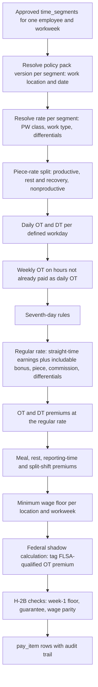

Rules: a recomputation of a closed week replays the same pipeline with the pack versions in force that week and emits only the difference as adjustment pay items. Steps D, J and M are skipped when the pack or the employee has nothing to evaluate. Each step is a pure function of its inputs, which is what makes the RULE-07 fixtures possible.

**RULE-09 Federal qualified overtime and tips tagging [MVP].** The 2025 federal deductions for qualified overtime and qualified tips ([2.4](#24-regulatory-map-what-the-module-must-support)) make the payroll provider report new amounts on each W-2. Generic payroll cannot tell which part of a California employee's overtime the FLSA actually required. Rootline can:
- For every workweek, the engine runs a **federal-only shadow calculation** on the same segments: hours over 40, the FLSA regular rate (including bonuses and piece earnings), and the required premium of 0.5 x regular rate x FLSA overtime hours, plus any bonus OT true-up (RULE-03) allocated to the week.
- The FLSA-qualified amount is the lower of the premium actually paid and the shadow premium. State-only overtime is excluded: California daily OT in a week under 40 hours, the second half-time of double time, seventh-day premiums beyond FLSA, and overtime promised by Company policy.
- Example: a California employee works four 9-hour days (36 hours). Four hours of daily OT are paid at 1.5x, but the federal tag is $0.00 because no hours exceed 40. In the TIME-08 week (46.5 hours), the tag is 0.5 x $21.60 x 6.5 = $70.20.
- The tag travels as `pay_item.tax_reporting_tag = flsa_qualified_ot_premium`. It is exported as a separate earning code or a memo field, depending on what each provider accepts (open question 16), and it is summarized per employee per year for reconciliation in January.
- Tips (`TIP_CC`, `TIP_CASH`) carry the tipped-occupation code mapped from the employee's `position`. Treasury's proposed list of tipped occupations (September 2025) included a home landscaping and groundskeeping category (verify against the final regulations before relying on it). Mandatory service charges are revenue, not tips, so the portal and card tip prompts ([06](06-customer-portal.md), [08](08-payments-stripe.md)) always offer "No tip".
- Rootline shows these amounts to employees as information, never as tax advice ([Beyond the brief](#13-beyond-the-brief-extra-ideas), idea 20).

### 4.10 Compensation types

**COMP-01 Pay rates [MVP].** Effective-dated pay rates per employee with dimensions: default rate, rate by labor class or work type (mowing $19, irrigation $23, chemical application $22, snow plowing $26), crew-lead differential, shift differential (night snow +$3), and prevailing-wage classification overrides. Resolution order for a segment: prevailing-wage classification rate (if certified job) -> work-type rate -> role differential added -> default rate.

**COMP-02 Salary [MVP].** Exempt salary (annual amount, pay frequency, exempt classification test checklist: salary threshold, duties). Warning when a salaried crew lead is marked exempt, because manual-work-heavy crew leads rarely meet duties tests (verify). Non-exempt salaried with OT supported (fixed salary for a regular schedule, OT on the derived rate). The fluctuating workweek method is available only where permitted (not in California; verify). Thresholds in the packs as of Nov 2026 (verify): federal $684 per week ($35,568 per year), because a federal court vacated the 2024 increase in November 2024; California $70,304 per year in 2026 (2 x the $16.90 state minimum wage x 2,080 hours). State thresholds tied to the minimum wage update automatically when the pack loads the new minimum wage, and salaried exempt employees below a new threshold are flagged 60 days before it takes effect.

**COMP-03 Hourly [MVP].** Standard.

**COMP-04 Piece rate [V1].** Piece definitions linked to Price Book services or production units: per lawn mowed by size band, per aeration, per lawn application, per bed edged (linear feet), per cubic yard of mulch installed, per tree planted by caliper, per snow push. Units come from completed Visits and crew-app quantities ([05](05-field-crew-mobile-app.md)). For crews, units are split among members by hours on the Visit (default) or equally. Rules:
- FLSA: regular rate = total earnings / total hours, OT premium at 0.5x regular rate.
- California Labor Code 226.2: rest and recovery periods paid separately at the average hourly rate, other nonproductive time (drive, shop, loading, waiting for parts) paid at no less than minimum wage, with separate pay-stub lines for each. Rootline derives productive vs nonproductive time from segment types automatically, which is the hardest part of piece-rate compliance in practice.

Worked California example (illustrative; uses $16.90 as the minimum wage for illustration, verify current rate): an aeration technician completes 60 aerations at $12.00 = $720.00 in a week with 48 hours worked, of which 3.0 hours are rest periods and 5.0 hours are nonproductive (shop and loading, not drive between jobs if the Company treats drive as productive for that piece plan; configurable).
- Nonproductive pay: 5.0 x $16.90 = $84.50.
- Average hourly rate for rest pay: ($720.00 + $84.50) / (48 - 3) = $17.88.
- Rest and recovery pay: 3.0 x $17.88 = $53.63.
- Straight-time total: $858.13. Regular rate: $858.13 / 48 = $17.88. Weekly OT premium for 8 hours: 0.5 x $17.88 x 8 = $71.51 (daily OT evaluated per day in the real calculation).
- Gross: $929.64, with stub lines "Piece earnings", "Nonproductive time", "Rest and recovery periods", "Overtime premium".

**COMP-05 Production and efficiency bonuses (gain share) [V1].** The landscape-classic crew incentive: the crew shares the value of hours saved against the estimate budget.
- Pool per Visit or per Job phase: `max(0, budgeted_hours - actual_hours) x pool_rate x share_pct`. Example: budget 6.0 crew-hours, actual 5.0, pool rate $30, share 30% gives $9.00.
- **Quality gates** (all must pass): QA score at or above the threshold (e.g., 85; [05](05-field-crew-mobile-app.md)), no callback or redo within 7 days, no client complaint, required photos present. A later callback reverses the bonus with a visible reason, but only before payout.
- **Safety and break neutrality (hard-coded):** legally required rest breaks and the meal period are **added to the budget** before comparison. Taking a break can never reduce a bonus, and skipping one can never increase it. Hours on Visits with an open safety incident or a heat procedure violation are excluded from the pool.
- Caps: per Visit, per week, per person (e.g., max 20% of base pay).
- Distribution: by hours worked on qualifying Visits (default), by role weight (crew lead 1.25x), or equal.
- Visibility: the crew sees the rule in plain language and a live tally ("This week: $46 earned, $12 pending QA").
- Payroll: weekly or per pay period as a nondiscretionary bonus, included in the regular rate (RULE-02/03).

**COMP-06 Crew-lead pay [MVP].** Modes: higher base rate as a position; differential added only for segments where the employee is the acting crew lead that day (from crew assignment in [04](04-scheduling-dispatch-routing.md)); weekly lead stipend; crew-lead share of the production pool. Acting-lead detection is automatic, so a crew member who leads Crew 7 on Friday gets the differential for Friday's hours.

**COMP-07 Sales commissions [V1].** Commission plans and events are defined in [03](03-crm-sales-estimating-proposals.md) (`COMM-01..03`). This module:
- Receives `commission.earned` and `commission.clawed_back` events as pay items, timed by the plan's payout schedule (e.g., paid in the pay period after the client's payment clears).
- Allocates commissions to workweeks for regular-rate purposes when the earner is non-exempt (inside sales reps who also run crews; verify allocation method).
- Handles draws against commission (recoverable or non-recoverable), with balance tracking and minimum wage checks per workweek.
- Requires a written, signed commission agreement for California employees (Labor Code 2751; verify), generated from the plan with e-signature.

**COMP-08 Tips [MVP].** Tips from client payments ([08](08-payments-stripe.md)) and the portal ([06](06-customer-portal.md)) arrive as `payments.tip.allocated` with Visit and employees. Default allocation is by hours on the Visit. Rootline exports tips as credit-card tips (paid through payroll) and lets crew members report cash tips in the app. Rootline never applies a tip credit against minimum wage by default. Tips belong to the employees, and managers and owners cannot share in them where law prohibits it (FLSA tip retention rules; verify). Tips are paid only through payroll, never from the Company's connected Stripe account, and they carry the tipped-occupation code for federal reporting (RULE-09).

**COMP-09 Reimbursements, allowances and stipends [MVP].** BYOD phone stipend (prompted in California setup per [05](05-field-crew-mobile-app.md)), mileage (rate configurable; the IRS standard rate is a common default; verify each year), boot allowance, tool allowance, per diem for out-of-town installs, H-2B reimbursements ([H2B-05](#44-h-2b-and-seasonal-worker-program-support)). Each maps to a provider earning code that marks taxable or non-taxable treatment (the provider is the tax authority of record).

**COMP-10 On-call and snow event pay [V1].** Snow season standby: on-call stipend per night or per week. If on-call restrictions are heavy enough that the time counts as hours worked, the Company must pay it as such (fact-specific; verify). Rootline records the on-call roster and restrictions so the policy is explicit. Event call-out minimums (e.g., guaranteed 4 hours when called out for a 2-inch trigger push) are configurable pay rules. Night differential applies automatically by segment clock time.

**COMP-11 Spot bonuses and recognition rewards [V1].** Manager-initiated bonuses ("$50 for staying late to finish the Patel patio before the storm"), referral bonuses, safety-reporting rewards ([SAFE-09](#415-safety-management)) and kudos-based rewards. Each needs an approver and a reason, and is flagged as discretionary or nondiscretionary. The UI explains the regular-rate impact, because promised bonuses are nondiscretionary.

**COMP-12 Earning codes registry [MVP].**

| Code | Description | Regular-rate inclusion | Typical provider mapping |
|---|---|---|---|
| `REG` | Regular hourly | Yes | Regular |
| `OT` | Overtime 1.5x | Premium excluded | Overtime |
| `DT` | Double time 2x | Premium excluded | Double overtime |
| `PIECE` | Piece earnings | Yes | Piecework / custom |
| `NONPROD` | CA piece-rate nonproductive time | Yes | Custom |
| `RESTREC` | CA piece-rate rest and recovery | Yes (verify) | Custom |
| `MEAL_PREM` / `REST_PREM` | Meal / rest premium | No | Custom |
| `RPT_TIME` | Reporting-time pay | Verify | Custom |
| `BONUS_PROD` | Production bonus (nondiscretionary) | Yes | Bonus (nondiscretionary) |
| `BONUS_DISC` | Discretionary bonus | No | Bonus |
| `BONUS_OT_TRUEUP` | Retro OT on bonus | Premium excluded | Overtime adjustment |
| `COMM` | Commission | Yes (non-exempt) | Commission |
| `LEAD_DIFF` / `SHIFT_DIFF` | Differentials | Yes | Custom |
| `PW_DIFF` | Prevailing wage differential | Yes | Custom |
| `PW_FRINGE_CASH` | Fringe paid in cash | Excluded for DBA OT (verify) | Custom |
| `PTO` / `SICK` / `HOL` | Paid time off types | No | Provider PTO policies |
| `TIP_CC` / `TIP_CASH` | Tips | No | Tips |
| `REIMB_*` | Reimbursements | No | Reimbursement |
| `H2B_VISA` / `H2B_INBOUND` / `H2B_RETURN` | H-2B reimbursements | No | Reimbursement (provider decides taxability) |
| `GUARANTEE` | H-2B three-fourths shortfall | Verify | Custom |
| `MIN_WAGE_MAKEUP` | Minimum wage make-up | Yes (verify) | Custom |
| `QOT_MEMO` | FLSA-qualified OT premium (memo for W-2 reporting, not an additional payment) | n/a | Provider's qualified-overtime field or memo earning (verify per provider) |

> **Competitive edge:** ServiceTitan's performance pay is built around technician commissions and spiffs [B]. LMN and Aspire budget hours per job but leave crew bonus math to spreadsheets [B]. Payroll providers accept a bonus amount but do not spread its regular-rate effect across the weeks it was earned [B]. Rootline computes gain-share bonuses from the same budget the estimator sold, applies break neutrality and quality gates, pays them with correct regular-rate overtime and tags the FLSA-qualified premium for W-2 reporting. Owners can run production pay, the oldest retention tool in landscaping, without creating a back-wage liability.

### 4.11 Prevailing wage and certified payroll

**PW-01 Prevailing wage projects [V1].** A Job ([03](03-crm-sales-estimating-proposals.md)) is flagged as prevailing wage with: governing law (federal Davis-Bacon and Related Acts for construction such as a park or school landscape install; federal Service Contract Act for grounds maintenance contracts with federal agencies; state prevailing wage laws; verify classification of maintenance work per state), wage determination number and date, classifications with base hourly rate and fringe rate per hour (e.g., "Landscape Laborer $28.40 + $9.15 fringe", illustrative), apprentice ratios [V2], certified payroll submission method, prime contractor contact.

**PW-02 Segment classification [V1].** Segments on a PW job must carry a classification. The crew app asks the crew lead at segment start ("¿Clasificación? Laborer / Operator / Irrigation Fitter") with a default per employee and per task. Office corrects before approval. Mixed-classification days are split by segment. Without a classification the timesheet cannot be approved (TIME-02).

**PW-03 Pay computation [V1].** For PW segments: pay at least the classification base rate. The fringe obligation is met by bona fide benefit contributions (credit computed per hour, with annualization of plan contributions across all hours worked including private work; verify DOL guidance) and/or a cash fringe. OT on DBA-covered work is 1.5x the basic rate plus straight fringe (fringe is not multiplied; verify). Differences from the employee's normal rate become `PW_DIFF` pay items.

**PW-04 Certified payroll reports [V1].** Weekly per project: WH-347 format (PDF and data) with employee identifiers (last four of SSN only as the form permits; verify current form version), classification, hours per day, rates, gross, deductions (from payroll journal import), net, and the statement of compliance e-signed by the authorized signer. "No work performed" weeks are generated automatically. State formats: California DIR eCPR XML export (verify current schema), LCPtracker and similar CSV templates [V2]. Deductions and net pay come from the payroll provider's register import (PAY-08). Until that import arrives, the report shows "Draft - awaiting payroll register".

**PW-05 Fringe benefit statements and apprentice tracking [V2].** Apprentice registration numbers, ratios per classification, and fringe statements for audits.

> **Competitive edge:** Public-works landscaping (parks, schools, highway medians, federal grounds) pays well but is avoided by small firms because certified payroll is painful. Rootline makes it a weekly button. This is a revenue unlocker that sales can pitch ("bid public work with confidence"), and we found no landscape FSM that documents it [B].

### 4.12 Labor burden and costing

**BURD-01 Burden profiles [MVP].** A burden profile per labor class and state or province (e.g., "Maintenance Laborer - CA", "Irrigation Tech - CA", "Office - CA") with components:

| Component | Input | Basis |
|---|---|---|
| Employer Social Security | 6.2% up to the annual wage base | Statutory (verify annual base) |
| Employer Medicare | 1.45% | Statutory |
| FUTA | 0.6% on first $7,000 per employee, plus credit reduction where applicable | Statutory. California has been a credit-reduction state for years because of its outstanding federal unemployment loan (0.9% added for 2024, 1.2% for 2025; verify the current year), which triples FUTA cost for California Companies |
| SUTA | Company rate x state taxable wage base | Company's assigned rate |
| Canada: CPP/QPP, EI (employer 1.4x employee premium), provincial health taxes (e.g., Ontario EHT above threshold) | Rates and maximums | Statutory (verify yearly) |
| Workers' comp | Rate per $100 of payroll by class code x experience mod (or per hour worked in Washington's system) | Policy declarations |
| General liability rated on payroll | % of payroll | Policy |
| Health, dental, retirement match | $ per hour, per month or % | Plan |
| Paid non-productive time | PTO, sick, holidays, paid training, rain-day reporting pay | Policies + history |
| Uniforms, PPE, recruiting, H-2B program costs | $ per employee per season, amortized over expected hours | Actuals from Ledger and H-2B workspace |
| Payroll service fees | $ per employee per month + base | Provider invoice |

**BURD-02 Burden calculation [MVP].** Rootline computes burden **per productive hour** (the unit estimates and job costing use):

Illustrative calculation (all rates are examples, not advice): a $20.00/hour laborer in California with 1,500 paid hours per season, of which 80 are non-productive (40 sick/PTO, 24 holiday, 16 training), so 1,420 productive hours.

| Line | Amount |
|---|---|
| Productive wages (1,420 x $20) | $28,400 |
| Non-productive paid time (80 x $20) | $1,600 |
| Social Security 6.2% of $30,000 | $1,860 |
| Medicare 1.45% | $435 |
| FUTA 1.8% x $7,000 (0.6% net rate + 1.2% California credit reduction for 2025; verify the current year) | $126 |
| SUTA 3.4% x $7,000 (California new-employer rate and wage base, illustrative) | $238 |
| California Employment Training Tax 0.1% x $7,000 | $7 |
| Workers' comp, landscape gardening class at $5.50 per $100 (illustrative) | $1,650 |
| General liability at 1.0% of payroll (illustrative) | $300 |
| Uniforms and PPE | $250 |
| Payroll service fees (allocated) | $54 |
| **Total labor cost** | **$34,920** |
| **Burden on productive wages** | **23.0%** ($6,520 / $28,400) |
| **Burdened cost per productive hour** | **$24.59** ($34,920 / 1,420) |

Add H-2B program costs (fees, agent, transport, recruiting) amortized over a worker's season hours, and burden for an H-2B worker can be several dollars per hour higher. The burden profile makes that visible instead of hiding it in overhead.

**BURD-03 Seasonal burden curve [V1].** Wage-base caps front-load FUTA and SUTA. A $20/hour worker reaches a $7,000 base after 350 hours, about 8 weeks into the season. Rootline shows actual-period burden by month and offers job-costing modes: `annualized` (smoothed, default for estimates and job costing) or `actual_period` (true monthly cost, for cash and P&L analysis). The difference is posted to 5195 Labor Burden Variance in the Ledger ([09](09-accounting-ledger-integrations.md)). FUTA credit reductions are assessed after year-end with the fourth-quarter deposit, so the profile accrues them during the season instead of letting January absorb a surprise.

**BURD-04 Workers' comp class allocation [V1].** Each service or task type maps to a workers' comp class code per state (e.g., landscape gardening and tree trimming are distinct classes in NCCI states, commonly 0042 and 0106; verify per state and bureau, including California WCIRB codes). Hours by segment are allocated to classes. The **WC audit report** shows payroll by class with supporting hours, which the premium auditor needs before payroll can be split across classes for one employee (rules vary by state; verify). Where the state excludes the overtime premium from WC payroll (common under NCCI rules; verify), the report excludes it. Washington: quarterly hours by risk class export for L&I reporting (verify format).

**BURD-05 Burdened labor rates to estimating [MVP].** Labor classes publish a burdened cost rate to the estimating engine ([03](03-crm-sales-estimating-proposals.md)). When a burden profile changes, estimators see "Labor cost rate updated from $24.10 to $24.59 on Mar 1" and open estimates are flagged for repricing if margin falls below target. This matches LMN's budget order: wage, then burden, then overhead, then profit ([LMN help](https://intercom.help/lmn/en/articles/15939065-how-lmn-calculates-overhead-labor-burden-and-profit-in-estimates)).

**BURD-06 Actual-vs-estimated burden reconciliation [V1].** After payroll journal import, Rootline compares actual employer taxes, WC accruals and benefits to the burden applied in job costing for the period and shows the variance by labor class. If variance stays above 2 points for two months, the Copilot suggests updating the profile.

**BURD-07 Labor cost simulator [V1].** "What if we raise all laborers $1.50/hour?" shows the effect on burdened cost, required price increase on maintenance contracts to hold margin, and the renewal letter draft for [07](07-invoicing-billing-contracts.md). See also [Beyond the brief](#13-beyond-the-brief-extra-ideas).

### 4.13 Payroll integrations and pay period close

**PAY-01 Pay calendars [MVP].** Multiple calendars per Company (weekly for field, biweekly or semi-monthly for office). Each has a workweek definition (FLSA fixed 168-hour period, e.g., Sunday 00:00 to Saturday 23:59 in the Company time zone), period start/end, timesheet cutoff (e.g., Monday 10:00), provider submission deadline (e.g., Tuesday 17:00 for Friday pay date with direct deposit lead time), and holiday shifts.

**PAY-02 Pay period close wizard [MVP].** Steps with progress bar ([6.6](#66-wireframe-pay-period-close-wizard)):
1. **Lock check:** all timesheets in the period approved at the required level, or listed as blockers.
2. **Compute:** rule engine produces `pay_item` rows per employee: hours by earnings code and work location, plus rates and amounts where Rootline computes them (bonuses, premiums, piece-rate, reimbursements).
3. **Validate:** unmapped employees, unmapped earnings codes, terminated employees with hours, missing work locations, H-2B minimum-wage week-1 check, minors' hours, prevailing-wage classifications, FLSA-qualified OT tags present (RULE-09), negative values, period overlaps, duplicate submissions.
4. **Preview:** totals by earnings code, by employee and by division, with comparison to the last period and to the forecast ("Gross +18% vs last week, expected: season ramp").
5. **Approve:** by `owner`, `office_manager` or `bookkeeper` (`payroll_export.run`). Optional two-person rule for gross above a threshold.
6. **Push / export:** API push or file. Idempotency key per batch. Partial failures are listed per employee with retry.
7. **Confirm:** provider confirmation (API status or manual "Submitted in provider").
8. **Post:** payroll journal import (PAY-08) closes the loop.

**PAY-03 Connectors [MVP/V1/V2].**

| Provider | Method | Data pushed | Data pulled | Priority |
|---|---|---|---|---|
| Gusto | Partner API (OAuth). Payroll hours and earnings per employee per payroll; employee create for onboarding hand-off ([Gusto developer docs](https://docs.gusto.com)) | Hours by earning type, bonuses, reimbursements, work address per employee (verify support for multiple work locations per period) | Employees, job/pay rates, PTO balances (verify), payroll totals for journal | [MVP] |
| QuickBooks Online Payroll | QBO Accounting API **TimeActivity** entities (employee, customer/job, service item, hours, billable flag), which QBO Payroll can pull into paychecks; bonuses and other earnings entered in QBO Payroll or via file (verify) ([Intuit TimeActivity reference](https://developer.intuit.com/app/developer/qbo/docs/api/accounting/all-entities/timeactivity)) | Hours per employee per job per day | Employees, payroll JEs in QBO | [MVP] |
| QuickBooks Desktop Payroll | Web Connector time-tracking transactions ([09](09-accounting-ledger-integrations.md) connector) | Time data | Employees | [V1] |
| ADP Workforce Now | ADP Marketplace partner API for pay data input (verify program and endpoints) ([ADP developer portal](https://developers.adp.com)) | Pay data batch | Workers, rates | [V1] |
| ADP RUN | Time import file (provider template) | Hours and earnings | Manual | [MVP] |
| Paychex Flex | Paychex API (pay components / checks; verify) ([Paychex developer portal](https://developer.paychex.com)); file import fallback | Hours and earnings | Workers | [MVP] file, [V1] API |
| Paylocity, Paycom, Paycor, isolved | Provider file templates; API via partner programs later | Hours and earnings | Optional via unified API | [V1] file, [V2] API |
| Unified employment API (for example Finch) | Read roster, pay rates, pay statements across many providers (verify write capabilities) ([Finch developer docs](https://developer.tryfinch.com)) | Limited | Roster, rates, pay statements | [V1] evaluate |
| Canada: Wagepoint, ADP Canada, Payworks, Ceridian Dayforce, QBO Payroll Canada | File templates first | Hours, earnings, vacation pay | Manual | [V1] |
| Generic CSV builder | Column mapper with saved templates | Anything | n/a | [MVP] |

**PAY-04 Mapping [MVP].** Employee mapping (provider employee ID, auto-match by email, phone or name with confirmation). Earnings code mapping (Rootline code -> provider earning type). Department or division mapping (for providers that support labor allocation). Work location mapping. Unmapped items block export with a fix-it link.

**PAY-05 Corrections and off-cycle [MVP].** After export, corrections create an adjustment batch for the next period. Final pay: termination triggers an off-cycle export option with jurisdiction timing guidance. For example, California requires final wages immediately at involuntary termination and within 72 hours for a quit without notice (verify). The UI shows the deadline countdown and a "not legal advice" note. Retro pay (late-approved raises) is computed per affected week, including regular-rate effects.

**PAY-06 Multi-state and local work-location allocation [V1].** Hours and earnings per work location (state, county, municipality) for each employee. This feeds providers that support per-location wages and produces a report for those that do not. Relevant for crews crossing state lines (e.g., Kansas City metro, the New York-New Jersey area, Lake Tahoe) and for local income taxes based on work location (e.g., Ohio municipalities, Pennsylvania local earned income tax; verify rules).

**PAY-07 Payroll data quality guardrails [MVP].** Never export an employee whose rate in Rootline differs from the provider's rate by more than $0.01 without confirmation (where the provider exposes rates). Block hours for a hibernated or terminated employee outside their final period. Flag any employee with more than 80 hours in a weekly period. Detect duplicate batches by content hash.

**PAY-08 Payroll journal import and labor true-up [MVP file import; V1 API].** The accounting is owned by [09 section 4.5.7](09-accounting-ledger-integrations.md) and its posting rules (`labor.LB1`-`LB3`, `payroll.PR1`-`PR5`, `prepaid.PP2`). This module supplies the inputs and the HR-side validations, so the two docs describe one loop:
1. **During the period (applied labor).** Each approved timesheet posts applied labor: job-coded hours x base rate to 5110 Field Wages on the Job, standard burden from the burden profile (BURD-02) to 5120 Field Labor Burden, with credits to 2310 Accrued Wages and 2390 Applied Labor Burden Clearing. Yard, rain and training time goes to 5180 Non-billable Field Time with a cost code. Job cost is live before payroll runs.
2. **After the provider runs payroll (import).** Rootline imports the register or GL export (API where available, the provider's standard file otherwise): gross by earnings code, employee withholdings, employer taxes, deductions, net pay and employer benefit costs.
3. **HR validations before posting.** Paid hours vs approved hours per employee (tolerance 0.25 hours), exported pay items vs paid amounts by earnings code (a `BONUS_PROD` or `MEAL_PREM` the provider dropped is caught here, not by an employee complaint), tips paid vs 2160 Tips Payable allocations ([08](08-payments-stripe.md)), H-2B reimbursements paid vs due (H2B-05), and qualified-overtime tags received vs sent (RULE-09).
4. **Posting.** The payroll clears 2310 for applied field wages. The difference (overtime premium, bonuses, premiums, PTO paid in season) goes to 5190 Field Labor Variance or, at [V1], is re-allocated to Jobs pro rata to hours so job cost carries real overtime. Employer taxes and burden bills clear 2390, and the month-end true-up posts the over- or under-applied amount to 5195 Labor Burden Variance. H-2B program costs amortize from 1420 Prepaid H-2B per hour worked.
5. **QuickBooks Payroll in external mode.** When QBO stays the book of record, Rootline does not post the journal. It reconciles applied labor to QBO payroll totals monthly and shows the difference without posting it ([09](09-accounting-ledger-integrations.md)).

Manual journal entry stays available as a fallback for providers with no usable export.

**PAY-09 Year-end and records [V1].** Hours and earnings history per employee per year (for the employee's "My records" view, [02](02-personas-roles-permissions.md)). Links to W-2 or T4 in the provider. ACA hours tracking for Applicable Large Employers (measurement periods, variable-hour seasonal employees; verify) [V2]. In January, a **year-end reconciliation report** [V1] compares Rootline's annual totals per employee (FLSA-qualified OT premium, tips by occupation code, reimbursements, H-2B reimbursements) with the provider's W-2 data and lists every mismatch before W-2s are filed.

> **Competitive edge:** Most FSM tools stop at a CSV of hours [B]. Rootline sends earnings already split into the codes generic payroll cannot compute (California meal premiums, piece-rate rest pay, bonus OT true-ups, the FLSA-qualified OT premium) and then brings the journal back to explain labor variance by Job in the built-in Ledger. The Monday payroll marathon becomes a validation screen, and the January W-2 scramble becomes a reconciliation report.

### 4.14 Embedded payroll option

**EMB-01 Embedded payroll (US) [V1 pilot, V2 GA].** For Companies that want one less system, Rootline offers payroll inside the app through a licensed embedded payroll partner. Candidates named in the brief are **Check** and **Gusto Embedded** ([Check](https://www.checkhq.com), [Gusto Embedded](https://embedded.gusto.com)). The partner computes taxes, moves money (debits the Company, pays employees and tax agencies), files payroll taxes and issues W-2s. Rootline provides the UI, time, pay rules, PTO and onboarding. **Rootline never holds wage funds** ([08](08-payments-stripe.md)).

Scope:
- Company onboarding (KYB) in the partner's hosted or embedded components: legal entity, EIN, state tax accounts, bank verification, signatory.
- Employee onboarding: W-4 and state forms, direct deposit, I-9 Section 1 (if the partner supports it), in English and Spanish.
- Payroll run: Rootline-computed pay items go straight into the partner's payroll draft. Partner computes taxes and net. Preview and approve in Rootline. Funding deadline countdown.
- Off-cycle runs (final pay, bonuses, corrections).
- Contractor payments (1099) for designers and consultants, if the partner supports it.
- Pay stubs in the self-service app (bilingual rendering where the partner allows), tax forms, year-end.
- Mid-year migration: prior YTD import from the old provider (quarter-start go-lives recommended).
- Journal entries posted natively to the Ledger.

**EMB-02 Partner selection criteria [V1 decision].** To be decided with diligence. Rootline will not publish a choice before contracts are signed.

| Criterion | Why it matters |
|---|---|
| State coverage, local taxes, and multi-state support | Crews cross state and municipal lines |
| White-label depth (APIs vs hosted components) | Bilingual, on-brand experience |
| Piece-rate, CA premium and custom earning code support | Landscape pay is not standard hourly |
| Same-day or next-day direct deposit and funding timelines | Seasonal workers live paycheck to paycheck |
| Support model (who answers the tax notice call) | Office managers need one number |
| Canada roadmap | US + Canada launch markets ([22](22-business-model-pricing-gtm.md)) |
| Economics (per employee per month, revenue share) | Add-on pricing in [22](22-business-model-pricing-gtm.md) |
| Liability allocation for tax errors and penalties | Must sit with the licensed partner |

**EMB-03 Embedded payroll in Canada [V2-V3].** Depends on partner availability (verify). File-based exports until then.

**EMB-04 Earned wage access [V2].** Through a partner, employees can access a portion of earned, approved wages before payday. Rootline supplies verified earned amounts from approved time (not unapproved punches). Fees are transparent and a no-fee option is preferred. Regulatory treatment of EWA varies by state (verify), so it is off by default.

> **Competitive edge:** Horizontal FSMs mostly bolt on a payroll provider [B]. Rootline's embedded option is fed by a landscape-aware rules engine. Piece-rate rest pay, regular-rate bonus true-ups, H-2B reimbursements and prevailing-wage differentials arrive at the partner already computed. Neither generic payroll nor generic FSM software can do that.

### 4.15 Safety management

Capture in the field (tailgate talks, JHAs, incident reports, heat checks, DVIRs) is owned by [05 section 4.12](05-field-crew-mobile-app.md). This module owns programs, case management, logs, analytics and exports.

**SAFE-01 Safety program hub [V1].** Written programs with owner, version, review date and acknowledgment tracking. Templates (EN/ES; counsel and safety-professional review flagged): California Injury and Illness Prevention Program (IIPP, 8 CCR 3203; verify), Heat Illness Prevention Plan, Hazard Communication (with the SDS library linked to products in [14](14-service-line-modules.md)), Emergency Action Plan (yard), PPE hazard assessment per task, vehicle and trailer safety, chainsaw and chipper program, drug and alcohol policy (with a DOT section for CDL drivers), California Workplace Violence Prevention Plan (SB 553, Labor Code 6401.9) with its violent incident log and annual training, and a Wildfire Smoke Protection Plan for CA, OR and WA (SAFE-14). Annual review reminders. The violent incident log is a separate record type from the OSHA log because its content, retention (5 years for logs under SB 553; verify) and privacy rules differ.

**SAFE-02 Incident case management [MVP].** Incident reports from the crew app ([05 section 4.12.4](05-field-crew-mobile-app.md)) arrive as `incident.reported`. Case workflow: `reported -> triaged -> investigating -> corrective_actions -> closed`. Investigation tools: timeline, photos, witness statements (voice, translated), root-cause prompts (5 whys with options such as equipment, training, procedure, environment, supervision), contributing factors. Corrective actions have owners and due dates (e.g., "Add slope warning to 14 Pine property notes", "Retrain Crew 5 on trailer backing", "Replace mower deflector"). Training assignments auto-create from corrective actions (LMS-04). Property-damage incidents can trigger the client communication and claim workflow in [06](06-customer-portal.md). Vehicle incidents link to the asset in [13](13-operations-inventory-equipment.md).

**SAFE-03 OSHA recordability determination [MVP guided; V1 AI-suggested].** A guided decision tree based on 29 CFR 1904.4-1904.7 ([eCFR Part 1904](https://www.ecfr.gov/current/title-29/subtitle-B/chapter-XVII/part-1904)):
1. Is it work-related (presumption in the work environment, with listed exceptions)?
2. Is it a new case?
3. Does it meet general recording criteria: death, days away from work, restricted work or job transfer, medical treatment beyond first aid, loss of consciousness, or a significant injury or illness diagnosed by a licensed health care professional?

The **first-aid list** (e.g., non-prescription medication at non-prescription strength, cleaning and bandaging wounds, hot or cold therapy, eye flushing, removal of splinters by simple means) is built in as a picker, so "ice pack and bandage" is clearly first aid and "stitches" is medical treatment. Day counting follows calendar days with the 180-day cap. **Privacy concern cases** (e.g., sexual assault, certain illnesses) hide the name on the log ("privacy case"). The safety admin makes the decision and records the rationale. AI may suggest a determination with cited rule text, but never decides ([10](#10-ai-opportunities-in-this-module)).

**SAFE-04 OSHA 300, 301 and 300A [MVP].**
- Log per **establishment** (each yard or branch that operates for a year or more is typically its own establishment; verify).
- The Form 301-equivalent incident record must be completed within 7 calendar days of learning of a recordable case. A countdown appears on the case.
- **300A annual summary** is generated in January with case totals, the **annual average number of employees** and **total hours worked by all employees** computed from Rootline payroll hours (a step owners usually estimate). The owner e-certifies as company executive. A reminder covers posting from **February 1 to April 30**.
- **Electronic submission**: export in OSHA Injury Tracking Application CSV format for establishments that must submit (thresholds and industry lists changed in 2024; landscaping, NAICS 561730, is believed to be covered for 20-249 employee establishments, verify) by the March 2 deadline ([OSHA ITA](https://www.osha.gov/injuryreporting)).
- **Severe injury reporting clock**: fatality within 8 hours, in-patient hospitalization, amputation or loss of an eye within 24 hours. The case shows a red countdown plus OSHA reporting instructions.
- Employee access: employees and representatives may request copies of the 300 log. Rootline generates the copy with privacy cases masked and tracks the response deadline (end of next business day, verify).
- Retention: 5 years after the end of the calendar year. Records are locked.
- Partially exempt employers and small employers (10 or fewer employees all year) can turn logs off, with the reason saved (verify current partial exemption list).

**SAFE-05 Heat illness prevention [MVP CA; V1 WA, OR, MD, NV and federal-ready].** Builds on the field workflow in [05 section 4.12.5](05-field-crew-mobile-app.md):
- **Plan builder:** a written Heat Illness Prevention Plan in English and Spanish with Company-specific sections (water sources and quantities on trucks, shade method such as pop-up canopies on trailers, high-heat procedures, emergency response with each property's address, closest hospital lookup [V1], acclimatization method, training schedule). Exports as a signed PDF and is available offline in the crew app.
- **Thresholds per jurisdiction pack** (verify all): California outdoor 3395 (shade at 80 F; high-heat procedures at 95 F for listed industries including landscaping); Washington outdoor heat exposure rule (WAC 296-62-095, with action levels starting at 80 F (lower for non-breathable clothing) and mandatory cool-down rest at higher levels); Oregon (OAR 437-002-0156, triggers based on heat index); Maryland heat stress standard (heat index based); Nevada heat illness requirements. If a federal OSHA heat rule is finalized, the pack updates (rulemaking status as of Nov 2026: verify) ([OSHA heat rulemaking](https://www.osha.gov/heat-exposure/rulemaking)).
- **Acclimatization schedules:** new and returning workers get a ramp (a common reference is starting at no more than 20% of the usual exposure on day 1 and increasing by no more than 20% per day; verify the guidance referenced by each jurisdiction). Scheduling shows them on lighter tasks or shaded work where possible ([04](04-scheduling-dispatch-routing.md)).
- **Heat-flex start times [V1]:** routes tagged as heat-flexible automatically shift earlier on forecast days above a threshold, with client notifications through [04](04-scheduling-dispatch-routing.md). Noise-ordinance windows per municipality are respected (e.g., no blowers before 8 a.m.).
- **Indoor heat [V1]:** Cal/OSHA 8 CCR 3396 applies to indoor work areas at 82 F or more (verify). Yards with shops, mechanic bays, potting sheds or greenhouses get an indoor temperature log (manual entry or a Bluetooth sensor [V2]) and the indoor section of the plan.
- **Training records:** annual heat training before exposure, for both employees and supervisors (supervisor content differs).
- **Compliance report:** days at each heat level, procedures activated, checks logged, gaps.

**SAFE-06 JHA and property hazards [V1].** JHA templates per task (tree removal, slope mowing, roadside work, paver cutting with silica controls, chemical mixing) completed in the crew app. Property hazard register (slopes over 3:1, overhead lines, wasp nests, aggressive dogs, pools) with photos, linked to the Property and shown on visit cards ([05](05-field-crew-mobile-app.md), [03](03-crm-sales-estimating-proposals.md) slope flag).

**SAFE-07 Safety observations and anonymous hazard reports [V1].** Crew leads log positive and corrective observations ("Wearing chaps on saw work: 4/4"). Any employee can file an anonymous hazard report (no user ID stored; the server strips identifiers; photos are EXIF-stripped). Rootline shows an anti-retaliation notice explaining that employees have the right to report injuries and hazards without retaliation (29 CFR 1904.35 and OSH Act section 11(c); verify).

**SAFE-08 Chemical safety [V1].** SDS library per product, PPE per label (from the product library in [14](14-service-line-modules.md)), mixing and loading logs, exposure incidents, and Hazard Communication training records. Applicator credential checks come from [CRED-05](#45-certifications-licenses-and-qualification-enforcement).

**SAFE-09 Safety incentives that do not suppress reporting [V1].** Rewards attach only to **leading indicators**: near-miss reports, hazard fixes, observations, tailgate participation and training completion. Rootline will not offer "zero injuries" or "no recordables" rewards as a template, because incentive programs that discourage injury reporting can violate OSHA's anti-retaliation provisions (verify current OSHA interpretation). Cross-doc note: the crew-app safety streak in [05 section 4.15](05-field-crew-mobile-app.md) includes "zero recordable incidents". This module recommends that rewards tied to that streak use only its leading-indicator components ([14 open question](#14-open-questions)).

**SAFE-10 Return-to-work and transitional duty [V2].** Work restrictions (no lifting over 20 lb, no ladder use) captured from provider notes the employee chooses to share. Transitional duty task list (yard organization, nursery watering, plant inventory counts, training content recording). Dispatch respects restrictions. Restricted days are counted automatically for the OSHA log.

**SAFE-11 Insurance and loss-control packet [V1].** One-click export for workers' comp and liability insurers: programs, training completion, incident history, TRIR and DART, corrective actions closed, vehicle program, heat program. It supports renewal negotiations and experience-mod discussions. Optional insurer integrations [V2].

**SAFE-12 Canada [V1].** Provincial workplace injury reporting (e.g., Ontario WSIB Form 7 within 3 days of learning of an injury that requires health care or lost time; WorkSafeBC employer reports; verify), joint health and safety committee or representative records where required, and WHMIS for chemical hazard communication.

**SAFE-13 Workers' compensation claim intake [V1].** When an incident involves an injury, the safety case opens a claim checklist for the state of the work location:
- Give the employee the claim form in their language. In California, the DWC-1 is due within one working day of learning of an injury that needs more than first aid or causes lost time (Labor Code 5401; verify). The form can be e-delivered in the self-service app with a paper fallback, and delivery is logged.
- Send the employer's report to the carrier or third-party administrator. In California, Form 5020 is due within 5 days (Labor Code 6409.1; verify). Other states set their own first-report forms and deadlines, which live in the policy pack.
- Record the medical provider network or panel-physician rules the Company's policy uses, so the crew lead knows which clinic to drive to. The address is part of the heat plan's emergency section (SAFE-05).
- Track claim number, carrier, adjuster, status, work restrictions and return-to-work date (SAFE-10). Restrictions sync to dispatch as task limits.

Claim data is Restricted (medical). The OSHA case (SAFE-03) and the claim are linked but decided separately: a compensable claim is not automatically OSHA-recordable, and a recordable case may never become a claim. Carrier portal and EDI first-report-of-injury integrations are [V2]. Claim lag (injury to carrier report) is a KPI ([12](#12-metrics-and-kpis)) because carriers ask for prompt reporting and late reports can breach the statutory deadlines above. Any cost effect of lag should be confirmed with the Company's carrier, not assumed.

**SAFE-14 Wildfire smoke protection [V1 CA, OR, WA].** The air-quality feed (EPA AirNow or a commercial provider bundled with the weather API) is checked hourly for each branch and for the day's scheduled properties:
- At the jurisdiction's trigger (California: current PM2.5 AQI of 151 or more; Oregon and Washington have lower action levels; verify), Rootline sends a bilingual alert to affected crews, prompts N95 issue from PPE inventory ([13](13-operations-inventory-equipment.md)) with a per-employee record, and suggests lower-exposure tasks or rescheduling ([04](04-scheduling-dispatch-routing.md)).
- Above California's mandatory-respirator level (AQI over 500), outdoor work requires a full respiratory protection program, including fit testing and medical evaluation. Rootline treats that level as a hard stop unless the Company has documented such a program (verify).
- Exemptions in the rules (for example, enclosed vehicles with filtered air, or short exposure; verify) are selectable reasons on the crew record, not free text.
- Smoke days, alerts, respirator offers and training completions roll into the safety compliance report next to heat days.

> **Competitive edge:** Inspection apps such as SafetyCulture capture checklists well but know nothing about hours, crews or payroll [B]. Landscape suites capture an incident form and stop [B]. Rootline computes the OSHA 300A hours denominator from payroll, starts the severe-injury, OSHA 301 and workers' comp clocks the moment an injury is reported, ties heat and smoke procedures to the forecast for each route, and assigns retraining from corrective actions. The safety record exists before the insurer or the inspector asks for it.

### 4.16 Performance, recognition and gamification

**PERF-01 Reviews [V1].** Templates: 90-day new-hire review, end-of-season review for seasonal crew (5 minutes, mobile-first, used to decide rehire eligibility and raise), mid-season check, annual review for year-round staff. Competencies have behavioral anchors in English and Spanish ("Seguridad: usa EPP siempre sin recordatorio"). The **context panel** shows attendance and punctuality, scorecards ([05 section 4.15](05-field-crew-mobile-app.md)), training completion, credentials, kudos received and safety observations. This is context for the manager, never an automatic score. Self-review by voice in Spanish is transcribed. The employee acknowledges with e-signature and may add comments.

**PERF-02 Goals [V1].** Individual and crew goals ("Get pesticide license by June 1", "Crew 3: 95% photo compliance in July") with progress tied to system data where possible.

**PERF-03 Check-ins and 1:1s [V1].** New-hire check-ins at days 7, 30, 60 and 90 with scripted questions in the employee's language ("¿Tienes el equipo y la capacitación que necesitas?"). Early-tenure turnover is where seasonal companies lose the most.

**PERF-04 Coaching and discipline [V1].** Documented coaching and progressive discipline with bilingual templates (verbal warning record, written warning, final warning). The employee acknowledges, or a witness acknowledges if the employee refuses. Records are visible to HR roles only. AI may help with neutral wording but never drafts discipline from GPS or productivity data on its own ([1.2](#12-non-goals)).

**PERF-05 Career ladder and pay bands [V1].** Ladder steps per Company, from a template: Laborer I -> Laborer II -> Crew Member -> Specialist (Irrigation Tech, Applicator, Hardscape Installer) -> Crew Lead -> Foreman/Supervisor -> Account or Production Manager. Each step has requirements (seasons of tenure, credentials, LMS paths, practical sign-offs, scorecard thresholds) and a pay band. The employee sees "Next step: Crew Lead - 3 of 5 done (missing: First Aid/CPR, Lead a tailgate talk)". A promotion triggers the pay change workflow (HR-05) and credential and role updates.

**PERF-06 Recognition and kudos [V1].** Peer-to-peer kudos tagged with Company values ("Safety first", "Above and beyond", "Team player"), manager shout-outs, client kudos from ratings and reviews ([06](06-customer-portal.md), [16](16-marketing-growth-communications.md)), birthdays and work anniversaries (opt-in), "Crew of the Month" with the photo posted on the kiosk and in announcements. Kudos feed the recognition analytics in RET-01.

**PERF-07 Gamification [V1 basics per [05 section 4.15](05-field-crew-mobile-app.md); V2 seasons and rewards].** Badges and challenges defined in 05. V2 adds seasons (spring, summer and fall leagues between crews), a points wallet redeemable for rewards (Company swag store, gift cards via partner, extra paid hours off where lawful), and team goals ("All crews 100% heat checks in July = Company BBQ"). Guardrails from 05 are hard-coded: no ranking on speed alone, no reward for fewer breaks, safety never traded against productivity. Rewards with cash value go through payroll as taxable earnings where required (verify).

**PERF-08 Pulse surveys and eNPS [V1].** Monthly 3-question pulse in English and Spanish by push/SMS ("How likely are you to recommend working here?", "Do you have what you need to do your job safely?", open comment by voice). Anonymous with a minimum group size of 5 for any breakdown. Results by branch, never by person.

### 4.17 Announcements and crew communication

**ANN-01 Announcements [MVP].** Compose once, target by branch, crew, role, employment class, language or individual. Channels: crew-app push, SMS (for people without the app), kiosk, in-app feed, email for office. Auto-translation with an optional "review translation" step (required for policy announcements). Read receipts and **acknowledgment-required** mode for policy changes, which logs who acknowledged when. Scheduling and expiry. Urgent safety and weather announcements bypass quiet hours. Attachments (PDF policy, video).

**ANN-02 Off-hours messaging guard [V1].** Non-urgent messages to hourly non-exempt employees outside their shift are queued until the next shift start. Requests that imply work ("Can you check the Smith job photos tonight?") trigger a warning to the sender about off-the-clock work. Where jurisdictions require a disconnecting-from-work policy (Ontario for employers with 25+ employees; verify), Rootline provides the policy template and acknowledgment.

**ANN-03 Crew chat governance [V1].** Crew chat is owned by [05 section 4.14](05-field-crew-mobile-app.md). This module sets HR policy: retention period, export for investigations (HR roles only, logged), moderation of reported messages, and harassment reporting from a message ("Report this message" goes to the HR inbox, not the crew lead).

**ANN-04 Polls and quick surveys [V1].** "Which Saturday for the company cookout?", "Coming back next season?" ([02](02-personas-roles-permissions.md)), "Interested in snow shifts this winter?"

**ANN-05 Company calendar [V1].** Holidays, paydays, training days, events, open enrollment. Synced to the self-service app.

### 4.18 Employee self-service app

The self-service experience lives inside the crew app for field staff (a "Me / Yo" tab) and in the web app for office staff. It works offline for read-only views and queues requests.

| ID | Feature | Priority |
|---|---|---|
| ESS-01 | **Home:** today's schedule and crew, clock status, hours this week, next payday, PTO balance, to-dos (sign handbook v4, training due, license expiring), announcements | [MVP] |
| ESS-02 | **My time:** daily and weekly hours by segment, approval status, weekly acknowledgment, dispute a day | [MVP] |
| ESS-03 | **My pay:** "Today I earned" estimate ([05](05-field-crew-mobile-app.md)), pay explainer per period (TIME-08), pay stubs (provider link at V1, native with embedded payroll), year-end forms | [V1] |
| ESS-04 | **Time off and availability:** request, see status, see balances and accrual history | [MVP] |
| ESS-05 | **My documents and credentials:** signed documents, upload license photos (OCR in V1), expiry dates, CEU progress | [MVP] upload; [V1] full |
| ESS-06 | **Training:** assigned lessons, offline downloads, quizzes, certificates | [V1] |
| ESS-07 | **Profile:** phone, address, emergency contacts, sizes, language; changes requiring payroll update are pushed to the provider or routed for approval | [V1] |
| ESS-08 | **Ask HR (Copilot):** answers grounded in the Company handbook, policies and the employee's own data ("¿Cuántas horas de vacaciones tengo?", "¿Por qué me pagaron overtime el jueves?"), in Spanish by voice; escalates to a human with one tap; never answers immigration-status or legal questions beyond pointing to the policy and a human | [V1] |
| ESS-09 | **Open shifts and swaps:** sign up for Saturday cleanups, snow roster volunteer, swap a day with manager approval and qualification checks | [V2] |
| ESS-10 | **Referrals:** share link, track referred applicants and bonus status | [V1] |
| ESS-11 | **Kudos and recognition:** give and receive, badges | [V1] |
| ESS-12 | **Career:** ladder step, requirements, learning path | [V1] |
| ESS-13 | **Hibernated "My records":** hours history, tax forms, "coming back?" response ([02](02-personas-roles-permissions.md)) | [V1] |
| ESS-14 | **Accessibility:** read-aloud for every screen, voice input, icon-first navigation for low literacy, large text, high-contrast outdoor theme | [MVP] |

### 4.19 Retention analytics and workforce planning

**RET-01 People dashboard [V1].** Headcount by status and branch; hires and separations by month; annualized turnover and 90-day retention (metric definitions owned by [18 section 4.3.9](18-reporting-analytics.md)); **season return rate** (hibernated workers who returned / hibernated workers invited); tenure distribution; overtime share of hours; PTO liability; certification compliance; training completion; TRIR and DART; kudos per person; pulse eNPS. Filters: branch, division, crew, manager, position, language, employment class, hire source.

**RET-02 Quit-reason analytics [V1].** Exit survey and termination reason codes, with free-text themes clustered by AI (in English and Spanish) and reviewed by a human: "found year-round work", "pay", "commute", "manager", "heat or workload", "school". Linked to the Beyond-the-brief winter bridge ([13](#13-beyond-the-brief-extra-ideas)).

**RET-03 Check-in suggestions (flight-risk signals) [V2].** Managers see "Suggested check-ins this week" with plain-language reasons from explainable signals: hours cut more than 20% for 3 weeks, no raise in 18 months while peers got one, sustained OT above 10 hours a week, pulse drop, crew change, no kudos in 60 days. Guardrails:
- No protected characteristics or proxies (age, national origin, language, immigration status, family status, ZIP code as a proxy) are inputs.
- Signals are shown only as suggestions to talk, never as scores attached to the employee record. They cannot trigger any adverse action or automation.
- Companies can disable the feature. A fairness review across language groups runs before GA.

**RET-04 Season Plan and workforce forecast [V1].** Demand: contracted recurring work hours by week (from Service Agreements and visit plans, [04](04-scheduling-dispatch-routing.md)), weighted pipeline from [03](03-crm-sales-estimating-proposals.md), and seasonal patterns (spring cleanups, mulch season, fall cleanups, leaf season, snow). Capacity: active employees x availability, plus expected returners (hibernated "coming back" responses x historic return rate), plus H-2B arrivals, minus planned PTO. Output: weekly gap by position and skill (e.g., "Need 2 more licensed applicators by April 20 for the pre-emergent round"), suggested requisitions, overtime-vs-hire trade-off ("Covering the May gap with OT costs $11,800 more than hiring 2 seasonal laborers", illustrative). Feeds the cash forecast in [18](18-reporting-analytics.md).

**RET-05 Pay competitiveness [V2].** Compare Company rates to public wage data (BLS Occupational Employment and Wage Statistics for landscaping and groundskeeping workers by metro; verify data availability) and, opt-in, to anonymized Rootline benchmarks with k-anonymity (minimum 10 Companies per cell) ([18](18-reporting-analytics.md) benchmarking rules).

**RET-06 Stay interviews [V1].** Prompts managers to hold structured stay conversations with top performers mid-season ("What would make you come back next year?"), with notes and follow-up tasks.

### 4.20 Offboarding

**OFF-01 Separation workflow [MVP].** Specified in [02 section 5.18.4](02-personas-roles-permissions.md) (access revocation, assignment removal, approvals reassignment). This module adds:
- Reason codes: voluntary (other job, year-round work, moved, school, personal, no-call/no-show abandonment) and involuntary (attendance, performance, conduct, policy violation, end of season layoff, position eliminated). Eligible-for-rehire flag with a required note when "No".
- **Seasonal layoff with expected recall** uses hibernation ([02 section 5.18.2](02-personas-roles-permissions.md)), not termination, but still generates the state separation notices that apply to layoffs (verify per state).

**OFF-02 Offboarding checklist [MVP].**

| Task | Rules |
|---|---|
| Equipment, keys, fuel card, uniforms, tablet return | From custody records in [13](13-operations-inventory-equipment.md). Outstanding items listed. No automatic deduction (ONB-05 guardrails) |
| Final timesheet approval | Blocks final pay export |
| Final pay export | Off-cycle option with jurisdiction deadline countdown (PAY-05) |
| PTO payout | Per policy and state rules (California treats earned vacation as wages payable at separation; verify) |
| Final commissions, bonuses, tips | Computed per plan; clawback rules from [03](03-crm-sales-estimating-proposals.md) |
| Separation notices | State templates (e.g., California EDD notice to employees and written notice of change in employment relationship; New York Record of Employment; verify), benefits continuation notice handled by provider (verify) |
| H-2B notices | H2B-09 |
| Gate-code rotation prompt | [02](02-personas-roles-permissions.md) |
| Exit survey | OFF-03 |
| Reference policy | Company policy note (dates and title only, default) |

**OFF-03 Exit survey [V1].** 5 questions plus voice comment in the employee's language, sent by SMS link on the last day. Optional anonymity.

**OFF-04 Unemployment claim tracking [V1].** Log state UI claim notices, response deadlines and documents (separation reason, attendance records). Manual entry first. Automated responder services integration [V2].

**OFF-05 Records retention and minimization [MVP].** Retention schedule per record type (configurable upward, never below legal minimums; all verify per jurisdiction):

| Record | Default minimum retention |
|---|---|
| Payroll records (FLSA) | 3 years |
| Time cards and wage-rate tables (FLSA) | 2 years (California: longer for some records; Rootline default 4 years) |
| OSHA 300, 300A, 301 | 5 years after the year |
| H-2B program records | 3 years after the labor certification period |
| Pesticide application records | Per state (commonly 2-3 years; [14](14-service-line-modules.md)) |
| Training and safety records | 5 years (Company policy default) |
| Applicant records | 2 years (federal contractor rules may require more; verify) |
| Personnel file after separation | 4 years default, then minimize |
| I-9 | Held by payroll provider (3 years after hire or 1 year after separation, whichever is later; verify) |

After retention ends, PII is minimized (SSN/SIN purged, address and DOB removed, name retained only where aggregate records require it) and the employee becomes `archived` ([02](02-personas-roles-permissions.md)).

**OFF-06 Rehire and boomerang [V1].** "Not eligible" rehire flags show up during ATS duplicate detection with the note visible to HR roles only. Boomerang hires restore seniority per Company policy (HR-02).

### 4.21 Multilingual and accessibility

**I18N-01 Languages [MVP: en-US, es-US for crew app, self-service, applicant flow, onboarding documents, training and announcements; V1: office web app Spanish per [21](21-ux-design-system-sitemaps.md); V1-V2: fr-CA].** Quebec employment documents and communications are subject to the Charter of the French Language as amended by Bill 96 (verify), so Quebec tenants are gated until fr-CA ships. Additional languages for crews (for example Portuguese or Haitian Creole in some metros) are possible as AI-translated, human-reviewed content packs [V2] when demand is proven.

**I18N-02 Translation workflow [MVP].** Translation memory per Company and platform glossary of landscape and HR terms (`platform_curator` maintains it; e.g., edging, string trimmer, pre-emergent, backflow, three-fourths guarantee). Machine translation is labeled until reviewed. Legal documents (offer letters, handbooks, policies, warnings) require human review before they can be sent and show which language version controls.

**I18N-03 Units, currency and formats [MVP].** Piece-rate units in imperial or metric (per cubic yard or per cubic meter of mulch), USD or CAD, local date and number formats, 12/24-hour time by locale.

**I18N-04 Low-literacy and accessibility [MVP].** Icon-first navigation, read-aloud on every screen, voice input for forms, short sentences (plain-language target: grade 6 reading level for crew-facing text), WCAG 2.2 AA ([21](21-ux-design-system-sitemaps.md)).

### 4.22 Documents, e-signature and records

**DOC-01 Template engine [V1].** Merge fields from employee, position, pay, schedule and Company. Templates include offer letter, pay change notice, wage notices (CA 2810.5, NY 195.1; verify), commission agreement, handbook acknowledgment, policy acknowledgment, PPE issuance receipt, equipment authorization, housing rules (H-2B), warning notices, separation letters, reference letter, employment verification letter.

**DOC-02 E-signature [MVP for acknowledgments; V1 full].** See ONB-02. Bulk send ("all field staff sign Heat Plan 2027"), reminders, completion dashboards.

**DOC-03 Legal hold [V1].** `owner` can place a legal hold on an employee, incident or date range, which suspends retention purges and edits. The hold is logged.

**DOC-04 Employee data rights [V1].** Employee access and deletion requests where applicable (for example CCPA rights apply to California employee data; PIPEDA and provincial laws in Canada; verify), with exceptions for legally required records. Export in a readable format in the employee's language.

---

## 5. Key user flows

### 5.1 Spring hiring: from requisition to first shift

1. The Season Plan (RET-04) shows a gap of 9 laborers and 2 applicators by April 6. The owner approves requisitions (ATS-01).
2. The office manager opens **Post job**. The AI drafts English and Spanish posts with the pay range, and the posting validator checks pay transparency, discriminatory language and fair-chance language (ATS-02). A bilingual staff member reviews the Spanish version.
3. Publishing pushes the post to the careers page, Google for Jobs, Indeed and Facebook and generates the QR flyer and SMS keyword (ATS-03).
4. Applicants apply on their phones in Spanish with voice answers (ATS-04). Each applicant gets an instant confirmation text.
5. The pipeline board shows new applicants. Knock-out flags are highlighted but not auto-rejected unless the Company enabled objective auto-decline (ATS-05).
6. The office texts interview slots, applicants reply with a number, and reminders go out (ATS-07).
7. Structured interview with a rubric. An optional paid working interview creates a temporary time entry (ATS-08).
8. Offer by SMS, e-signed. Background or MVR checks run after the conditional offer where used (ATS-09, ATS-10).
9. Offer accepted: the Employee record is created, the onboarding checklist starts and the payroll-provider onboarding link is sent (ONB-01, ONB-03).
10. Day 1: handbook and safety acknowledgments, heat training, monitoring notice, PPE and uniform issuance, buddy assignment. Credentials work from the start date ([02](02-personas-roles-permissions.md)).

```mermaid
flowchart LR
    A["Season Plan gap detected"] --> B["Requisition approved"]
    B --> C["AI drafts EN and ES post"]
    C --> D{"Posting validator passes?"}
    D -- "No" --> C
    D -- "Yes" --> E["Publish: careers page, Indeed, Google, Facebook, QR flyer, SMS keyword"]
    E --> F["Mobile apply in Spanish or English"]
    F --> G["Pipeline board"]
    G --> H["SMS interview slot booking"]
    H --> I["Structured interview"]
    I --> J{"Offer?"}
    J -- "Not selected" --> K["Respectful SMS and talent pool"]
    J -- "Yes" --> L["Offer e-signed on phone"]
    L --> M["Employee record created"]
    M --> N["Onboarding checklist and payroll provider link"]
    N --> O["Day 1: acknowledgments, PPE issued, heat training"]
    O --> P["First shift: crew app clock-in"]
```

### 5.2 Applicant lifecycle

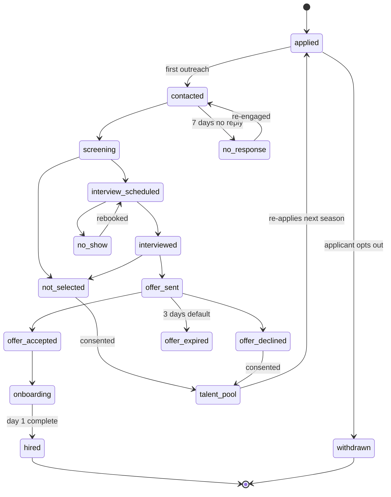

Rules: every transition logs actor and timestamp. `not_selected` sends the template message only after a human confirms. Records in `talent_pool` expire after the retention period (OFF-05).

### 5.3 Time to pay: daily punches to the payroll journal

1. Crew members punch in the crew app. Segments, breaks and attestations are captured offline and synced ([05](05-field-crew-mobile-app.md)).
2. At end of day, the crew lead reviews and approves the crew's day (level 1).
3. The server derives timesheets, evaluates the policy pack, and flags exceptions and premiums (TIME-01, TIME-02, RULE-04).
4. Monday morning, the office manager or ops manager works the exception queue with AI-suggested fixes, then bulk-approves clean timesheets (level 2).
5. Employees acknowledge their weekly hours in the self-service app (optional) and can dispute.
6. The pay period close wizard computes pay items (OT with regular-rate inclusion, premiums, bonuses, piece-rate, tips, reimbursements), validates and previews (PAY-02).
7. An authorized user approves and pushes to the payroll provider (PAY-03).
8. The provider runs payroll and pays employees. Rootline imports the payroll journal and posts it to the Ledger, then trues up job costs (PAY-08).

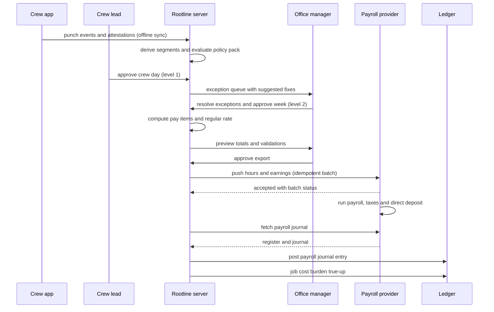

### 5.4 Timesheet lifecycle

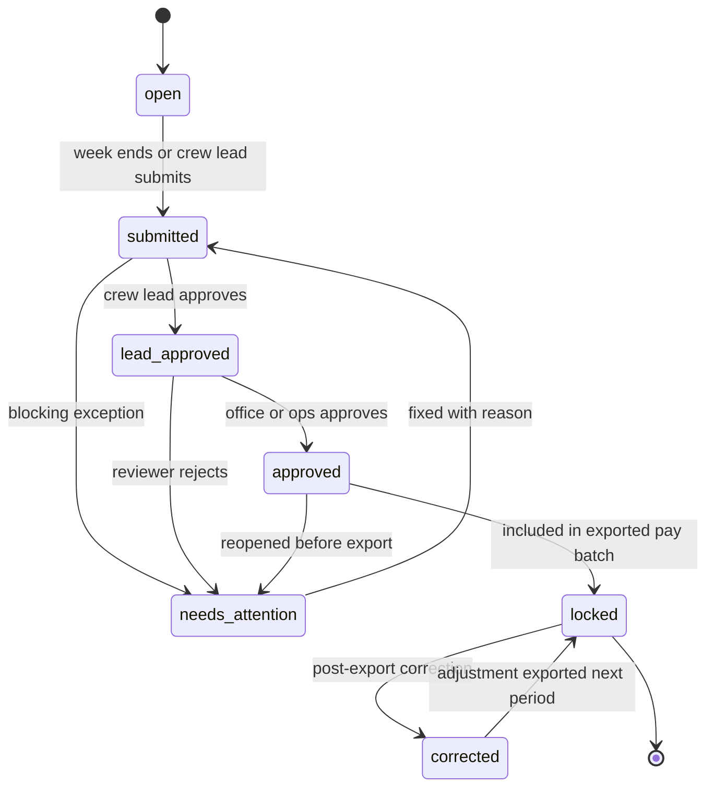

Rules: `locked` timesheets never change in place. Corrections create a `timesheet_correction` and an adjustment pay item in the next batch. Employee acknowledgment is a flag, not a state, so a dispute never blocks payroll. The dispute thread is resolved separately.

### 5.5 Credential expiry and scheduling enforcement

1. A credential record is uploaded and OCR extracts the fields. A manager verifies it, and it becomes `active`.
2. Expiry alerts go out at 90, 60, 30, 14, 7 and 1 days (CRED-03).
3. The dispatcher's future-conflict list shows scheduled Visits after the expiry date that need the credential (CRED-05).
4. If the employee uploads a renewal, verification restores `active` and conflicts clear.
5. If the credential expires, `employee.certification_expired` fires. The crew app blocks chemical steps ([05](05-field-crew-mobile-app.md)), dispatch blocks assignment per enforcement level, and restricted-use product issue is blocked ([13](13-operations-inventory-equipment.md)).

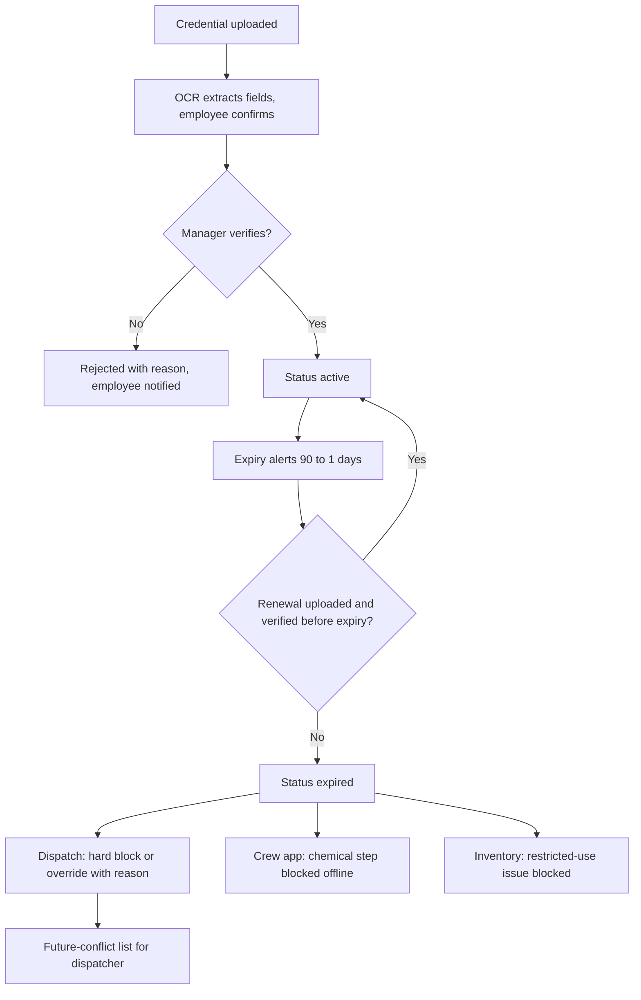

### 5.6 H-2B season (illustrative timeline, date of need April 1, 2027)

The dates below are defaults for illustration. Actual timing comes from the Company's agent and current DOL and USCIS processing (verify every season).

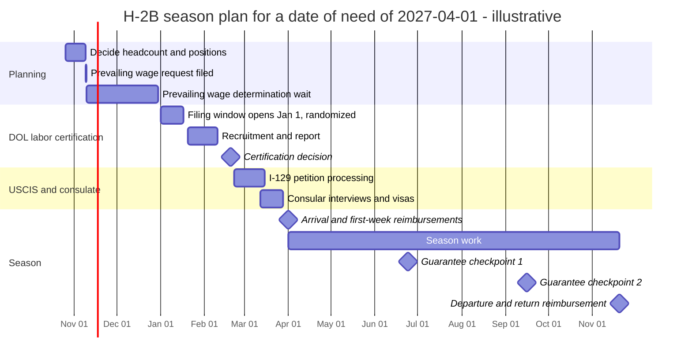

Steps in Rootline:
1. Clone last season's program (H2B-12) and set the date of need. The tracker generates milestones with owners (H2B-02).
2. Invite the agent as an external collaborator. The agent updates milestone status and uploads documents.
3. Build the worker roster: returning workers from last season are prefilled (H2B-03).
4. Deliver the job order to each worker in their language and capture acknowledgment (H2B-04).
5. Arrange housing and transport (H2B-10, H2B-11).
6. On arrival: create Employee records via bulk rehire. Week-1 reimbursements and the minimum wage check are queued (H2B-05).
7. During the season: the three-fourths guarantee tracker and wage-parity checks run continuously (H2B-06, H2B-07).
8. At season end: return transport reimbursement, departure logging and season summary export (H2B-12).

### 5.7 Incident to OSHA log

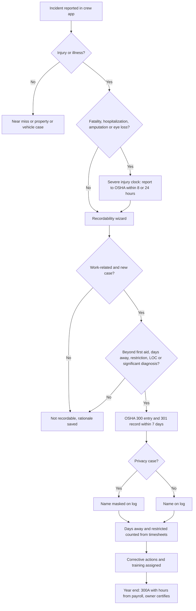

### 5.8 Production bonus with regular-rate true-up

1. Visits complete. Crew-app quantities and actual hours sync.
2. The bonus engine computes each Visit's pool after adding required breaks to the budget (COMP-05).
3. Quality gates evaluate QA score, photos and callbacks over a 7-day window. Pending amounts show in the crew's live tally.
4. At period close, qualifying pools are distributed by hours to crew members.
5. The rule engine includes the bonus in each member's regular rate for the workweeks earned and computes the OT premium on it (RULE-02, RULE-03).
6. The pay items `BONUS_PROD` and `BONUS_OT_TRUEUP` export to payroll with an audit table. Crew members see the explanation in Spanish in their pay explainer.

### 5.9 Time-off request

1. A technician requests Friday off in the self-service app ("Viernes 14 de mayo, personal").
2. Rootline checks the balance (or provider balance), blackout rules (statutory sick leave bypasses blackouts), and crew coverage for that day.
3. The crew lead or ops manager gets a push with coverage impact and approves or denies with a reason.
4. Approved time off removes the employee from Friday's crew in dispatch and notifies the dispatcher about the coverage gap ([04](04-scheduling-dispatch-routing.md)).
5. At period close the PTO hours export as `PTO` or `SICK` earnings. The accrual ledger records the usage.

### 5.10 Certified payroll week

1. A prevailing wage Job (a school landscape renovation) has classifications loaded from the wage determination (PW-01).
2. Crew leads tag segment classifications in the crew app (PW-02). The office fixes any gaps before approval.
3. Pay computation applies base plus fringe obligations and creates `PW_DIFF` and fringe items (PW-03).
4. After payroll runs, the register import supplies deductions and net pay (PAY-08).
5. Rootline generates the WH-347-format report for the week, plus "no work" weeks, for e-signature by the authorized signer and submission to the prime contractor or agency portal (PW-04).

### 5.11 Offboarding

Access revocation and the sequence are specified in [02 section 5.18.4](02-personas-roles-permissions.md). This module adds the HR checklist (OFF-02): equipment return from custody records, final timesheet, final pay deadline countdown, PTO payout per policy, final commissions and tips, separation notices, H-2B notices if applicable, exit survey and records retention scheduling.

---

## 6. Screens and wireframes

### 6.1 Screen inventory

| # | Screen | Surface | Primary roles | Priority |
|---|---|---|---|---|
| T1 | People list and directory | Web | owner, office_manager, ops_manager | [MVP] |
| T2 | Employee profile (tabs: Overview, Employment, Pay, Time, Credentials, Training, Documents, Safety, Performance, Equipment) | Web | owner, office_manager, ops_manager (limited) | [MVP] (tabs phase in V1) |
| T3 | Bulk rehire / hibernate wizard | Web | office_manager | [MVP] |
| T4 | Season Plan (workforce forecast) | Web | owner, ops_manager | [V1] |
| T5 | Requisitions and job post builder | Web | owner, office_manager | [V1] |
| T6 | Applicant pipeline board | Web, tablet | office_manager, ops_manager | [V1] |
| T7 | Mobile apply flow | Public mobile web | Applicant | [V1] |
| T8 | Interview kit and scorecard | Web, tablet | Interviewers | [V1] |
| T9 | Onboarding tracker | Web | office_manager | [V1] (basic checklist [MVP]) |
| T10 | H-2B workspace (tracker, roster, housing, transport) | Web | owner, office_manager, agent collaborator | [V1] |
| T11 | Credentials and qualification matrix | Web | office_manager, ops_manager | [MVP] |
| T12 | Training library, assignments and authoring | Web | office_manager, ops_manager, platform_curator | [V1] |
| T13 | Timesheet approval board | Web | office_manager, ops_manager | [MVP] |
| T14 | Timesheet detail (map, segments, audit trail) | Web | office_manager, ops_manager, crew_lead (own crew) | [MVP] |
| T15 | Pay period close wizard | Web | owner, office_manager, bookkeeper | [MVP] |
| T16 | Payroll connections and mappings | Web | owner, bookkeeper | [MVP] |
| T17 | Pay rules and policy pack settings | Web | owner | [MVP] |
| T18 | Compensation plans (piece, bonus, lead pay) | Web | owner | [V1] |
| T19 | Prevailing wage projects and certified payroll | Web | owner, office_manager, bookkeeper | [V1] |
| T20 | Burden profiles and burden reconciliation | Web | owner, bookkeeper | [MVP] profiles, [V1] reconciliation |
| T21 | PTO policies and balances | Web | owner, office_manager | [MVP] requests, [V1] engine |
| T22 | Safety: incidents, OSHA logs, 300A, programs, heat plan | Web | owner, office_manager, ops_manager | [MVP] |
| T23 | Reviews, goals, career ladder | Web, app | owner, managers, employees | [V1] |
| T24 | Announcements composer and acknowledgments | Web, app | owner, office_manager, ops_manager | [MVP] |
| T25 | People dashboard and retention | Web | owner | [V1] |
| T26 | Offboarding checklist | Web | office_manager | [MVP] |
| T27 | Self-service: Home, My time, My pay, Time off, Docs, Training, Career, Ask HR | Crew app, web | All employees | [MVP]/[V1] per ESS table |
| T28 | Kiosk: clock, sign-ins, announcements | Shop tablet | All field employees | [V1] |
| T29 | Workers' comp claims, heat and smoke compliance report | Web | owner, office_manager, ops_manager (status only) | [V1] |
| T30 | Mandated training compliance (who is outside their legal window) | Web | owner, office_manager, ops_manager | [V1] |
| T31 | Pay explainer ([6.8](#68-wireframe-pay-explainer-spanish-crew-app)) | Crew app, web | All employees | [V1] |
| P1 | Policy pack release console | Platform admin | platform_owner, platform_engineer | [MVP] |
| P2 | Training library and credential catalog curation | Platform admin | platform_curator | [V1] |
| P3 | Payroll connector health | Platform admin | platform_engineer, platform_support | [MVP] |

### 6.2 Wireframe: Timesheet approval board

```text
+--------------------------------------------------------------------------------------------------+
| Team > Timesheets            Week: Sun Jul 12 - Sat Jul 18, 2026   Branch: Sacramento  [v]       |
| Pay calendar: Weekly field   Cutoff: Mon 10:00 (in 1h 42m)        [ Approve all clean (38) ]     |
+--------------------------------------------------------------------------------------------------+
| EXCEPTIONS (4)                                    | Filter: [All crews v] [Exceptions only (x)]  |
+---------------------------------------------------+----------------------------------------------+
| ! Luis Hernandez  Crew 4   Tue Jul 14             | MISSING CLOCK-OUT                            |
|   Clock-in 6:52  Last segment: job @ 88 Elm 14:51 | AI suggestion: 15:42 (left 88 Elm geofence   |
|   [Map] [Segments]                                | 15:31 + drive 11 min to yard, yard entry)    |
|                                                   | [Accept 15:42] [Edit] [Ask crew lead]        |
+---------------------------------------------------+----------------------------------------------+
| ! Ana Ruiz  Crew 2   Wed Jul 15                   | CA MEAL PREMIUM                              |
|   Meal started 11:41 after 5h08m worked           | Attestation: "No pude - mucho trabajo"       |
|   [Attestation] [Segments]                        | Premium: 1 h at regular rate ($21.45)        |
|                                                   | [Acknowledge premium] [Add note]             |
+---------------------------------------------------+----------------------------------------------+
| ! Marco Diaz  Crew 7 (acting lead)  Thu Jul 16    | 13.2 HOURS - DOUBLE TIME 1.2 h               |
|   Storm cleanup, approved by ops                  | Rest gap before Fri shift: 9h10m (< 10h rule)|
|                                                   | [Approve] [Add reason]                       |
+---------------------------------------------------+----------------------------------------------+
| ! Pedro Soto  Crew 3   Fri Jul 17                 | JOB TIME WITHOUT VISIT (0.8 h)               |
|                                                   | Near: 14 Pine (Mendez) unscheduled           |
|                                                   | [Assign to visit...] [Mark overhead]         |
+---------------------------------------------------+----------------------------------------------+
| CLEAN (38)  collapsed   Crew 1 (4)  Crew 2 (3)  Crew 3 (4) ...         [Expand]                  |
+--------------------------------------------------------------------------------------------------+
| WEEK TOTALS   REG 1,512.0  OT 96.5  DT 1.2  MEAL PREM 3  REST PREM 0  PTO 24.0  SICK 8.0         |
| Est. gross $41,780 (pay rates visible to owner/office)   vs last week +6%   Labor budget: 97%    |
+--------------------------------------------------------------------------------------------------+
```

Behaviors: keyboard shortcuts (J/K to move, A to accept a suggestion). Every accepted AI suggestion stores the evidence (geofence exit, visit completion) and the approver. Rows for employees in an H-2B program show a guarantee indicator. Crew leads see the same board limited to their crew and without pay amounts.

### 6.3 Wireframe: Credentials and qualification matrix

```text
+--------------------------------------------------------------------------------------------------+
| Team > Credentials       Branch: Sacramento [v]   View: (o) Matrix  ( ) Expiring list  ( ) Gaps  |
+--------------------------------------------------------------------------------------------------+
| Employee        | Driver Lic | CDL-B+Med  | Pest. QAC B | Backflow | First Aid | Zero-turn | Saw |
|-----------------|------------|------------|-------------|----------|-----------|-----------|-----|
| Ana Ruiz (L)    | OK 2029    | --         | OK Dec 2027 | --       | OK 2027   | AUTH      | --  |
| Luis Hernandez  | OK 2028    | OK / 47d ! | EXP 12d !!  | --       | --        | AUTH      | AUTH|
| Marco Diaz (L)  | OK 2027    | --         | Under supv. | OK 2027  | OK 2026 ! | AUTH      | TRN |
| Pedro Soto (17) | --         | --         | n/a (<18)   | --       | --        | TRN       | BLK |
| Jose Luna H-2B  | OK 2027    | --         | --          | --       | OK 2027   | AUTH      | --  |
+--------------------------------------------------------------------------------------------------+
| FUTURE CONFLICTS                                                                                 |
|  !! Jul 30  3 weed-control visits on Crew 4 need QAC B; Luis expires Jul 29                      |
|     [Reassign to Ana (Crew 2)]  [Request renewal proof]  [Override with reason...]               |
|  !  Aug 12  Truck 9 + trailer (CMV) needs med card; Luis med card expires Aug 11                 |
+--------------------------------------------------------------------------------------------------+
| Legend: OK active | ! expiring <60d | !! <14d | EXP expired | AUTH authorized | TRN in training  |
|         BLK blocked by law (minor) | Under supv. = may apply under licensed supervision (state)  |
+--------------------------------------------------------------------------------------------------+
```

### 6.4 Wireframe: Mobile apply in Spanish

```text
+----------------------------------+   +----------------------------------+   +----------------------------------+
| Green Valley Landscapes          |   | Pregunta 2 de 4                  |   | Listo, Jose!                     |
| Trabajador de Paisajismo         |   |                                  |   |                                  |
| $19 - $23 / hora                 |   | Tiene experiencia con podadoras  |   | Recibimos su solicitud para      |
| Lun-Vie 7:00-3:30, abr-nov       |   | zero-turn?                       |   | Trabajador de Paisajismo.        |
|                                  |   |                                  |   |                                  |
| No necesita curriculum.          |   | [ Si, mas de 1 temporada ]       |   | Le enviaremos un texto para      |
| Toma 3 minutos.                  |   | [ Si, menos de 1 temporada ]     |   | una entrevista, normalmente      |
|                                  |   | [ No, pero quiero aprender ]     |   | en 1-2 dias.                     |
| [ English ]  [ ESPANOL (x) ]     |   |                                  |   |                                  |
|                                  |   | o responda con su voz:           |   | Quien le recomendo? (opcional)   |
| Nombre: [ Jose Luna          ]   |   |       ( (  MIC  ) )  0:00/0:30   |   | [ Marco Diaz               ]     |
| Celular:[ (916) 555-0142     ]   |   |                                  |   |                                  |
| [ Enviar codigo por texto ]      |   | [ < Atras ]       [ Siguiente > ]|   | [ Ver el estado ]                |
+----------------------------------+   +----------------------------------+   +----------------------------------+
```

(Accents are omitted in the ASCII sketch. The product renders full Spanish orthography.)

### 6.5 Wireframe: H-2B season workspace

```text
+--------------------------------------------------------------------------------------------------+
| Team > H-2B > 2027 Season (date of need Apr 1, 2027)   Agent: (external collaborator)  [Invite]  |
| Not legal advice. Confirm all filings and obligations with your attorney or agent.               |
+--------------------------------------------------------------------------------------------------+
| [Tracker]  [Workers (14)]  [Housing]  [Transport]  [Reimbursements]  [Guarantee]  [Documents]    |
+--------------------------------------------------------------------------------------------------+
| MILESTONE                                   OWNER     DUE         STATUS                         |
| Prevailing wage determination received      Agent     Jan 05      DONE  Dec 28                   |
| Labor certification filed (window Jan 1-16) Agent     Jan 02      DONE  Jan 02                   |
| Recruitment report submitted                Agent     Feb 05      DONE                           |
| Labor certification decision                DOL       Feb 19      WAITING  (amber: 6 days late)  |
| I-129 petition filed                        Agent     Feb 26      NOT STARTED                    |
| Consular appointments (14 workers)          Workers   Mar 12-28   3 of 14 booked                 |
| Housing ready (2 units, 14 beds)            Office    Mar 25      Unit B lease unsigned  !       |
| Arrival transport plan                      Office    Mar 28      Draft                          |
+--------------------------------------------------------------------------------------------------+
| GUARANTEE (period 1, Apr 1 - Jun 23)   offered 0 / 360 h req.   | WAGE PARITY   0 conflicts      |
| REIMBURSEMENTS queued: visa fees 14 x $___ (enter receipts)     | Corresponding employees: 6     |
+--------------------------------------------------------------------------------------------------+
```

### 6.6 Wireframe: Pay period close wizard

```text
+--------------------------------------------------------------------------------------------------+
| Payroll > Close period   Weekly field  Jul 12 - Jul 18   Pay date Fri Jul 24   Provider: Gusto   |
| (1) Lock > (2) Compute > (3) Validate > [4] Preview > (5) Approve > (6) Push > (7) Post          |
+--------------------------------------------------------------------------------------------------+
| VALIDATION   OK 41   Warnings 2   Info 1   Blocking 0                                            |
|  ! Jose Luna (H-2B): week-1 min wage check needs inbound travel reimbursement $186.40 [Added]    |
|  ! Pedro Soto (17): 31.5 h this week, within youth limits for summer (verify) [OK]               |
|  i FLSA-qualified OT premium tagged for W-2: $968.10 of $1,047.03 (CA daily-only OT excluded)    |
+--------------------------------------------------------------------------------------------------+
| EARNINGS SUMMARY          Hours      Amount       | BY DIVISION           Gross     vs forecast  |
| REG                       1,512.0    $31,890.20   | Maintenance          $24,250    +2%          |
| OT (reg. rate incl bonus)    96.5     $3,141.08   | Enhancements          $7,900    -4%          |
| DT                            1.2        $52.18   | Installation          $6,860    +9%          |
| MEAL_PREM / REST_PREM      3 / 0         $63.10   | Lawn care             $2,767    0%           |
| BONUS_PROD                            $1,214.00   |                                              |
| BONUS_OT_TRUEUP                          $48.37   | Tips payable cleared   $412.00               |
| PIECE + NONPROD + RESTREC             $2,286.40   | Reimbursements         $918.60               |
| PTO / SICK                 24.0 / 8.0   $672.00   |                                              |
| COMM (2 estimators)                   $2,410.00   |                                              |
| TOTAL GROSS (excl. tips, reimb.)     $41,777.33   | [Download audit workbook]                    |
+--------------------------------------------------------------------------------------------------+
| [ < Back ]                          Two-person approval required above $40,000   [ Approve > ]   |
+--------------------------------------------------------------------------------------------------+
```

### 6.7 Wireframe: Self-service home (Spanish, crew app "Yo" tab)

```text
+----------------------------------+
| Hola, Ana                    [ES]|
| Jueves 16 de julio               |
+----------------------------------+
| HOY  Cuadrilla 2 (lider)         |
| En turno: 6:48 - ahora  7h12m    |
| Hoy gane (estimado): $168.40     |
|   incluye bono producc. $9.00    |
+----------------------------------+
| ESTA SEMANA   38.5 h  OT 0.0     |
| Dia de pago: viernes 24 (8 dias) |
| Vacaciones: 22.5 h  Enferm.: 31h |
+----------------------------------+
| PENDIENTE                        |
| [!] Firmar: Plan de calor 2026   |
| [>] Leccion: Remolques (2 min)   |
| [!] Licencia QAL vence en 140 d  |
+----------------------------------+
| AVISOS                           |
| Calor extremo manana: entrada    |
| 5:30 a.m. Traigan agua extra.    |
| [Leido]                          |
+----------------------------------+
| [Hoy] [Tiempo] [Pago] [Pedir dia]|
| [Aprender] [Pregunta a RH (mic)] |
+----------------------------------+
```


### 6.8 Wireframe: Pay explainer (Spanish, crew app)

The TIME-08 week, as the employee sees it. Every line opens a plain-language explanation generated from the RULE-08 audit trail. The LLM narrates numbers it is given and never computes them.

```text
+------------------------------------+
| < Mi pago  Semana 12-18 jul   [ES] |
+------------------------------------+
| TOTAL BRUTO (estimado)   $1,131.20 |
| Pago: viernes 24 de julio          |
+------------------------------------+
| Regular  40.0 h x $21.00   $840.00 |
| Overtime  6.5 h x $31.50   $204.75 |
| Ajuste OT por bono                 |
|   6.5 h x $0.30              $1.95 |
|   (?) Por que?                     |
| Bono de produccion          $27.90 |
| Prima de comida 1 x $21.60  $21.60 |
| Propinas (3 clientes)       $35.00 |
+------------------------------------+
| (?) "Su bono sube su tarifa        |
| regular a $21.60 ($0.60 mas). Cada |
| hora extra paga la mitad de esos   |
| $0.60 otra vez: 6.5 x $0.30."      |
| [Escuchar] [Hablar con oficina]    |
+------------------------------------+
| Overtime calificado (federal):     |
| $70.20 esta semana. Informacion,   |
| no es consejo fiscal.              |
+------------------------------------+
| [Ver dias] [Disputar] [Confirmar]  |
+------------------------------------+
```

### 6.9 Wireframe: OSHA recordability and claim clocks (web)

```text
+--------------------------------------------------------------------------------------------------+
| Safety > Case SC-2027-014   Luis Hernandez   Crew 4   Jul 14, 2027 10:20   Branch: Sacramento    |
| Hand laceration while changing a trimmer head      Reported in Spanish by voice (translated)     |
+--------------------------------------------------------------------------------------------------+
| CLOCKS  Severe injury: n/a    OSHA 301 record: 3d 22h left    WC claim form (DWC-1): GIVEN 7/14  |
|         Carrier report (CA, 5 days): 1d 22h left   Restricted days so far: 2 (from timesheets)   |
+--------------------------------------------------------------------------------------------------+
| RECORDABILITY (29 CFR 1904)                          | EVIDENCE                                  |
| 1 Work-related?        (o) Yes  ( ) No               | Photos (2)   Witness: Marco Diaz (voice)  |
| 2 New case?            (o) Yes  ( ) No               | Clinic note shared by employee: yes       |
| 3 Treatment given:                                   |                                           |
|   [x] Cleaning and bandaging (first aid)             | AI SUGGESTION (not a decision):           |
|   [x] Sutures (medical treatment)                    | Recordable. Sutures are medical           |
| 4 Days away: 0   Restricted: 2                       | treatment beyond first aid,               |
|   (light duty Jul 15-16, SAFE-10)                    | 1904.7(b)(5).          [Show rule text]   |
| 5 Privacy case?        ( ) Yes  (o) No               |                                           |
+--------------------------------------------------------------------------------------------------+
| DECISION  (o) Recordable: job transfer or restriction   ( ) Not recordable                       |
| Rationale: [ Sutures = medical treatment; 2 restricted days        ]                             |
| Decided by: Rosa Medina (office_manager)  [ Save decision ]  [ Add corrective action ]           |
+--------------------------------------------------------------------------------------------------+
```

Behaviors: the decision is never prefilled from the AI suggestion; the safety admin must pick it. Restricted days count automatically from the employee's light-duty segments and stop at the 180-day cap. If the employee did not share the clinic note, the treatment picker still works from the incident report, and the case shows "medical detail not shared" instead of asking the crew lead.

---

## 7. Data model

All tables live in the `people` domain module ([20](20-architecture-security.md)). Every table carries `tenant_id` (the Company) and is protected by Postgres row-level security. Restricted fields (SSN/SIN, DOB, driver's license number, immigration documents, medical notes, background-check results, bank details) use application-layer envelope encryption and are excluded from AI context by default ([20](20-architecture-security.md)). Time punches remain append-only events owned by the crew-app sync domain. `time_segment` and `timesheet` are derived projections that can be rebuilt.

### 7.1 Entity catalog

| Group | Entity | Purpose and key fields |
|---|---|---|
| People | `employee` | One per human per Company: names, preferred_language, mobile, status, worker_type, flsa_status, employment_class, home_branch_id, home_crew_id, manager_employee_id, position_id, labor_class_id, membership_id (nullable), provider_employee_ref |
| | `employee_sensitive` | 1:1 Restricted record: dob, ssn_or_sin_enc, home_address_enc, dl_number_enc, medical_notes_enc |
| | `employment` | Stints: start_date, end_date, separation_reason, rehire_eligible, employment_class, h2b_program_id |
| | `position` | Catalog: title, default_labor_class_id, pay_band_min/max, required_credential_type_ids, required_training_ids |
| | `pay_rate` | Effective-dated: employee_id, rate_type (default, work_type, differential, salary), work_type_key, amount, currency, effective_from/to, approved_by |
| | `comp_plan` / `comp_plan_assignment` | Piece, production bonus, lead pay, commission link, on-call: plan_type, rules jsonb (versioned), effective dates |
| Hiring | `requisition`, `job_post`, `job_post_channel` | Headcount request, bilingual post content, distribution status and source codes |
| | `applicant`, `application`, `application_answer` | Person (dedupe by phone), application per requisition, answers with audio_url and transcript per language |
| | `interview`, `interview_scorecard` | Slot, interviewers, rubric scores |
| | `offer` | Terms snapshot, document_id, status, expires_at |
| | `background_check` | Partner ref, status, adverse action steps (Restricted) |
| | `referral` | Referrer employee, applicant, bonus milestones |
| Onboarding and documents | `checklist_template`, `checklist_instance`, `checklist_task` | Onboarding and offboarding checklists |
| | `document`, `document_signature` | Generated or uploaded documents, language, hash, signer, signed_at, controlling_language |
| H-2B | `h2b_program` | Season record, date_of_need, end_date, case numbers, offered wages, cap_outcome (`selected_under_cap`, `awaiting_supplemental`, `not_selected`, `withdrawn`), template_version |
| | `h2b_milestone` | Generated from template, owner, due, status |
| | `h2b_worker_case` | Worker-level visa and travel data (Restricted) |
| | `h2b_reimbursement` | Type, amount, due_by, paid_in_batch_id |
| | `h2b_guarantee_period` | Period dates, hours_required, hours_offered, shortfall |
| | `housing_unit`, `housing_assignment`, `transport_trip`, `transport_assignment` | Housing and transport boards |
| Credentials and training | `credential_type` | Platform or Company catalog: authority, jurisdiction, categories, validity rules, ceu_rules |
| | `credential` | Holder (employee or subcontractor org or Company), number_enc, categories, issued/expires, status, verified_by |
| | `credential_requirement` | Rule: subject (service, equipment_class, task_type, job, crew_composition), credential_type, categories, enforcement_level, min_age |
| | `training_module`, `training_lesson`, `quiz`, `quiz_question` | Content (versioned, multilingual) |
| | `training_assignment`, `training_completion`, `quiz_attempt`, `skill_signoff` | Assignment and evidence |
| | `mandated_training_rule` | Platform-maintained, per jurisdiction: audience (all, supervisors), frequency, first deadline (days or hours worked, whichever first), pack version |
| | `equipment_authorization` | Employee x equipment class status |
| Time and pay | `time_segment` | Derived: employee_id, start/end, segment_type, visit_id, job_id, cost_code, branch_id, division_id, work_location_id, pw_classification_id, piece_units, source |
| | `timesheet` | Employee x workweek: state, approvals, exceptions_count, acknowledged_at |
| | `timesheet_exception`, `timesheet_approval`, `timesheet_correction` | Exceptions, approvals by level, post-lock corrections |
| | `policy_pack`, `policy_pack_version` | Jurisdiction rule bundles (platform-owned, versioned) |
| | `pay_calendar`, `pay_period` | Calendars, workweek definition, cutoff |
| | `pay_item` | Computed earning lines: employee_id, pay_period_id, workweek, earning_code, hours, rate, amount, work_location_id, regular_rate_included, tax_reporting_tag (`flsa_qualified_ot_premium`, `qualified_tip`, null), tipped_occupation_code, source_ref, audit_trail jsonb (RULE-08 step outputs) |
| | `payroll_batch`, `payroll_batch_line` | Export batch, idempotency_key, status, provider response |
| | `payroll_connection` | Provider, auth (OAuth tokens encrypted), mappings |
| | `earning_code_map`, `employee_provider_map` | Mappings |
| | `payroll_journal_import` | Register totals, ledger_journal_entry_id |
| | `pto_policy`, `pto_enrollment`, `pto_ledger_entry`, `time_off_request` | Leave policies, append-only balance ledger, requests |
| | `availability_rule` | Recurring availability and exceptions |
| | `pw_project`, `pw_classification`, `certified_payroll_report` | Prevailing wage |
| | `burden_profile`, `burden_component`, `wc_class_code`, `service_wc_class_map` | Burden and workers' comp |
| Safety | `safety_case` | Extends `incident` from [05](05-field-crew-mobile-app.md): recordable, classification, days_away, days_restricted, privacy_case, rationale, establishment_id |
| | `osha_establishment`, `osha_annual_summary` | 300A data, certification |
| | `corrective_action` | Owner, due, status |
| | `safety_program`, `heat_plan` | Written programs, versions, acknowledgments |
| | `safety_observation`, `hazard_report` | Observations, anonymous reports (no user ref) |
| | `wc_claim` | Restricted: safety_case_id, state, claim_number, carrier, adjuster, claim_form_given_at, carrier_reported_at, status, restrictions, return_to_work_date |
| | `air_quality_observation` | branch_id or property_id, observed_at, pm25_aqi, source, triggered_level |
| | `violent_incident_log_entry` | California SB 553 log entry, separate from OSHA cases, with its own retention and privacy rules |
| Engagement | `review_cycle`, `review`, `goal`, `career_ladder`, `ladder_step`, `ladder_progress` | Performance and career |
| | `kudos`, `badge_award`, `pulse_survey`, `pulse_response` | Recognition and listening (responses stored without employee ref when anonymous) |
| | `announcement`, `announcement_target`, `announcement_receipt` | Comms and acknowledgments |
| | `offboarding_case` | Separation details, checklist_instance_id, final_pay_due_at |

### 7.2 Entity relationship diagrams

**Core people, time and pay**

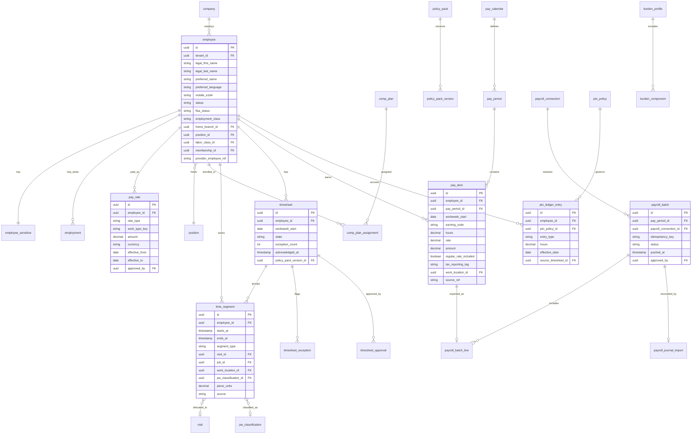

**Hiring, credentials, H-2B and safety**

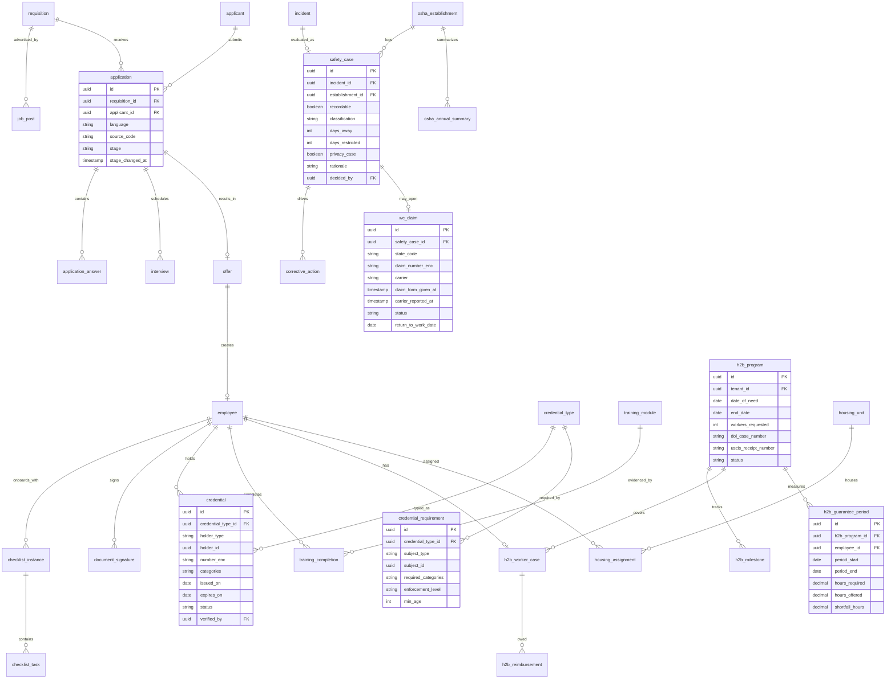

### 7.3 Employee and employment state machine

This extends the membership lifecycle in [02](02-personas-roles-permissions.md). Employee status and membership status are synchronized but distinct: an employee without a login still moves through these states.

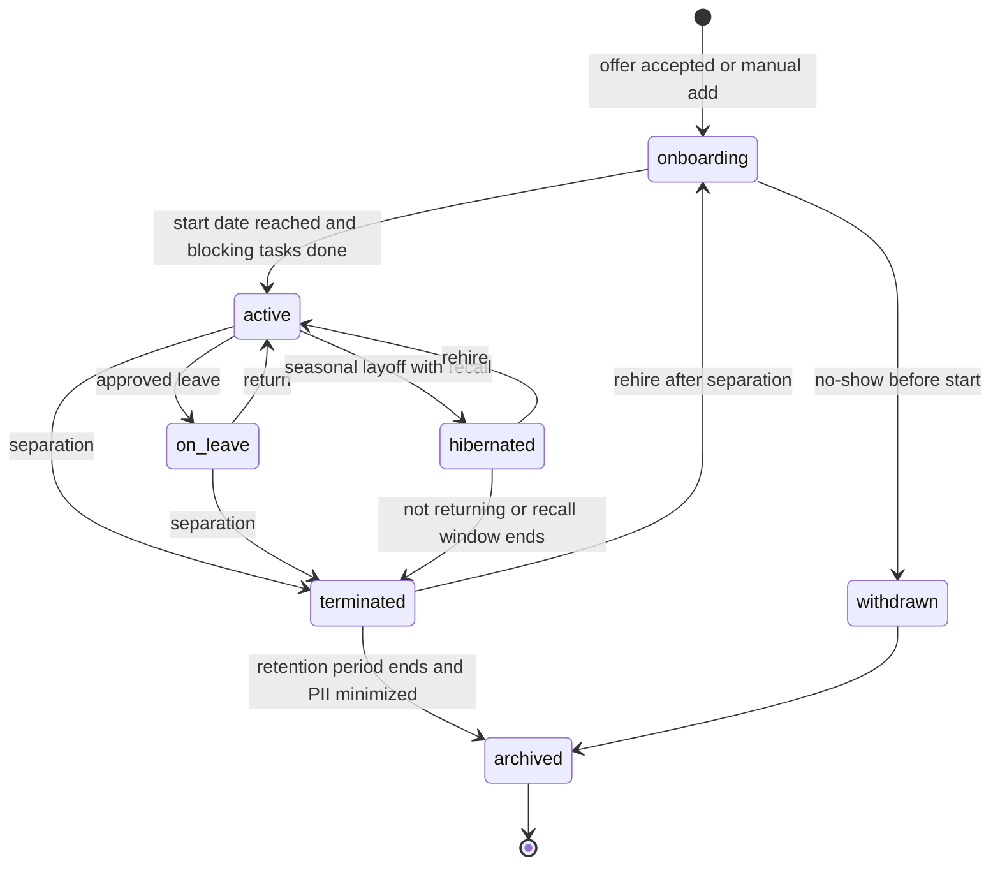

Rules:
- `active` requires: start date reached, all checklist tasks marked "blocking for first shift" complete, and no hard-block credential gaps for the position's mandatory credentials.
- `hibernated` keeps pay rates, credentials, training and PIN hash ([02 section 5.18.2](02-personas-roles-permissions.md)). No seat charge.
- `terminated -> onboarding` (rehire after a real separation) creates a new `employment` stint and re-runs onboarding items whose validity lapsed (e.g., handbook version changed).
- `archived` is terminal for PII. Statistical records remain with minimized identity.

### 7.4 Key constraints and indexes

- `employee`: unique (`tenant_id`, `mobile_e164`) where status not in (`terminated`, `archived`). Unique (`tenant_id`, `employee_number`).
- `time_segment`: exclusion constraint preventing overlapping ranges per employee (`tstzrange(starts_at, ends_at)` with GiST). Conflicts from sync are recorded as exceptions, not inserted.
- `pay_rate`: no overlapping effective ranges per (`employee_id`, `rate_type`, `work_type_key`).
- `pay_item`: unique (`pay_period_id`, `employee_id`, `earning_code`, `workweek_start`, `work_location_id`, `source_ref`) to make recomputation idempotent.
- `payroll_batch`: unique `idempotency_key`. A batch's content hash is stored to detect duplicate pushes.
- `pto_ledger_entry`: append-only (no update or delete grants). Balance via materialized view refreshed at period close and on request.
- `credential`: index on (`tenant_id`, `expires_on`, `status`) for the daily expiry job.
- Retention jobs respect `legal_hold` flags on employee, case and document.

---

## 8. Integrations, APIs and events

### 8.1 External services

| Service category | Candidates (verify terms, capabilities and pricing before contracting) | Use | Priority |
|---|---|---|---|
| Payroll providers | Gusto, QuickBooks Online Payroll, QuickBooks Desktop Payroll, ADP (Workforce Now, RUN), Paychex Flex, Paylocity, Paycom, Paycor, isolved; Canada: Wagepoint, ADP Canada, Payworks, Ceridian Dayforce | Hours and earnings export, employee onboarding hand-off, roster and rate sync, journal import | [MVP]-[V2] per PAY-03 |
| Embedded payroll partner | Check, Gusto Embedded | Payroll inside Rootline | [V1] pilot, [V2] GA |
| Unified employment API | For example Finch | Roster, rates and pay statement reads across long-tail providers | [V1] evaluate |
| Job boards | Indeed (feeds or partner program), Google for Jobs (structured data), Facebook (links), ZipRecruiter | Distribution and applicant source tracking | [V1]/[V2] |
| SMS and WhatsApp | Twilio (10DLC registration with a recruiting or HR campaign use case, WhatsApp Business API) | Applicant and employee messaging | [MVP] employees, [V1] applicants |
| Background checks and MVR | FCRA-compliant CRA partner (for example Checkr; selection open) | Post-offer checks, MVR, continuous monitoring | [V2] |
| E-signature | Built in (ESIGN/UETA); optional DocuSign import [V2] | Offers, acknowledgments, warnings | [MVP]/[V1] |
| OCR and document AI | AI Gateway document understanding ([17](17-ai-copilot-automation.md)) | License card extraction, receipt reading | [V1] |
| Speech and translation | AI Gateway speech-to-text and translation | Voice answers, voice self-reviews, Ask HR | [V1] |
| Weather | Same provider as [04](04-scheduling-dispatch-routing.md) and [05](05-field-crew-mobile-app.md) | Heat triggers, rain-day pay | [MVP] |
| Air quality | EPA AirNow API (free; verify rate limits and terms) or a commercial AQI feed bundled with the weather provider | Wildfire smoke triggers (SAFE-14) | [V1] |
| Workers' comp carriers and TPAs | Carrier portals first; EDI first report of injury through a partner later (selection open) | Claim reporting (SAFE-13) | [V1] manual, [V2] EDI |
| OSHA ITA | CSV export for upload (API use to be evaluated, verify) | 300A and case data submission | [MVP] export |
| FMCSA Clearinghouse | Manual workflow with links; no API integration planned | Query tracking | [V1] |
| Learning content | SCORM 1.2 / xAPI import | Partner courses | [V2] |
| Earned wage access | Partner (selection open) | Early wage access | [V2] |
| Rewards | Gift card partner (selection open) | Recognition rewards | [V2] |

### 8.2 API surface (summary)

The public API ([20](20-architecture-security.md)) exposes HR resources with granular OAuth scopes. Restricted fields are never returned through the public API, with no exceptions.

| Resource | Operations | Scope |
|---|---|---|
| `/employees` | list, get, create, update, hibernate, rehire, terminate | `people:read`, `people:write` |
| `/employees/{id}/pay-rates` | list, create (effective-dated) | `pay:read`, `pay:write` |
| `/time-segments`, `/timesheets` | list, get, approve (with user context), export | `time:read`, `time:approve` |
| `/pay-periods/{id}/pay-items` | list (computed), recompute | `payroll:read` |
| `/payroll-batches` | create, get status | `payroll:export` |
| `/credentials` | list, create, verify | `credentials:read`, `credentials:write` |
| `/training/completions` | list, create (external LMS) | `training:write` |
| `/applicants`, `/applications` | list, get, create (external careers site), stage update | `recruiting:read`, `recruiting:write` |
| `/safety/cases` | list, get | `safety:read` |

### 8.3 Domain events emitted (outbox -> event bus)

| Event | Payload highlights | Consumers |
|---|---|---|
| `employee.hired`, `employee.rehired`, `employee.hibernated`, `employee.terminated`, `employee.archived` | employee_id, effective_at, reason, employment_class | Membership ([02](02-personas-roles-permissions.md)), Scheduling ([04](04-scheduling-dispatch-routing.md)), Crew app device revocation ([05](05-field-crew-mobile-app.md)), Equipment custody ([13](13-operations-inventory-equipment.md)), SaaS seat billing ([19](19-platform-admin-portal.md)) |
| `employee.pay_rate_changed` | employee_id, effective_from, rate_type | Burden recompute, estimating labor rates ([03](03-crm-sales-estimating-proposals.md)) |
| `employee.certification_expiring`, `employee.certification_expired`, `credential.verified` | credential_type, categories, expires_on | Dispatch ([04](04-scheduling-dispatch-routing.md)), Crew app chem gate ([05](05-field-crew-mobile-app.md)), Inventory restricted-use gate ([13](13-operations-inventory-equipment.md)), Service lines ([14](14-service-line-modules.md)) |
| `training.assigned`, `training.completed`, `equipment_authorization.changed` | module, employee, equipment_class | Crew app, Dispatch |
| `timesheet.submitted`, `timesheet.approved`, `timesheet.reopened`, `timesheet.corrected` | employee, workweek, hours by type | Ledger job costing ([09](09-accounting-ledger-integrations.md)), Invoicing T&M ([07](07-invoicing-billing-contracts.md)), Reporting ([18](18-reporting-analytics.md)) |
| `pay_period.closed`, `payroll_batch.exported`, `payroll_batch.confirmed`, `payroll_batch.failed` | period, totals, provider | Ledger, Copilot alerts, Platform connector health ([19](19-platform-admin-portal.md)) |
| `payroll_journal.imported` | totals by account | Ledger posting and burden true-up ([09](09-accounting-ledger-integrations.md)) |
| `pto.requested`, `pto.approved`, `pto.denied`, `availability.changed` | employee, dates | Scheduling ([04](04-scheduling-dispatch-routing.md)) |
| `applicant.applied`, `application.stage_changed`, `offer.accepted` | requisition, source | Recruiting analytics, inbox tagging ([16](16-marketing-growth-communications.md)) |
| `h2b.milestone_due`, `h2b.guarantee_at_risk`, `h2b.abandonment_clock_started` | program, worker | Notifications, Copilot |
| `safety_case.recordable_determined`, `osha.severe_injury_clock_started`, `osha.annual_summary_ready` | case, deadlines | Owner alerts, Reporting |
| `heat_plan.activated` (Company-level) | date, branch, level | Crew app ([05](05-field-crew-mobile-app.md)), Scheduling heat-flex ([04](04-scheduling-dispatch-routing.md)) |
| `smoke_procedure.activated`, `wc_claim.opened`, `wc_claim.deadline_missed` | branch, AQI level; case, state, deadlines | Crew app alerts, PPE issue in [13](13-operations-inventory-equipment.md), Scheduling, owner alerts |
| `training.mandated_due`, `training.mandated_overdue` | employee, rule, deadline | Self-service to-dos, manager digest, compliance report |
| `h2b.cap_outcome_changed` | program, outcome | Season Plan contingency (H2B-14), Copilot |
| `kudos.given`, `badge.awarded`, `review.completed`, `ladder.step_achieved` | employee | Crew app feed, Retention analytics |
| `announcement.published`, `announcement.acknowledged` | targets | Crew app, kiosk |
| `offboarding.started`, `offboarding.completed`, `final_pay.due` | deadlines | Payroll, Equipment, Access |

### 8.4 Events consumed

| Event | Producer | Effect here |
|---|---|---|
| `time.punched`, `time.segment_changed`, `time.clocked_out`, `timesheet.crew_approved` | [05](05-field-crew-mobile-app.md) | Rebuild segments and timesheets; level-1 approval |
| `attestation.signed`, `premium_pay.flagged` | [05](05-field-crew-mobile-app.md) | Premium pay items, exception resolution |
| `incident.reported`, `heat.procedure_activated`, `heat.check_logged`, `safety_meeting.held` | [05](05-field-crew-mobile-app.md) | Safety cases, heat compliance, training records |
| `visit.completed` (with quantities, QA score) | [04](04-scheduling-dispatch-routing.md), [05](05-field-crew-mobile-app.md) | Piece-rate units, production bonus pools |
| `visit.rated` | [06](06-customer-portal.md) | Kudos, quality gates for bonuses |
| `commission.earned`, `commission.clawed_back` | [03](03-crm-sales-estimating-proposals.md) | Commission pay items |
| `payments.tip.allocated` | [08](08-payments-stripe.md) | Tip pay items, Tips Payable clearing on journal import |
| `asset.checked_out`, `asset.returned` | [13](13-operations-inventory-equipment.md) | Onboarding and offboarding checklist status |
| `membership.*` | [02](02-personas-roles-permissions.md) | Employee status sync |
| `job.created` with prevailing wage flag | [03](03-crm-sales-estimating-proposals.md) | Creates `pw_project` stub |
| `crew.assignment_changed` | [04](04-scheduling-dispatch-routing.md) | Acting crew-lead detection for lead pay |

### 8.5 Outbound webhooks for tenants

Companies can subscribe to `employee.*`, `timesheet.approved`, `payroll_batch.*`, `credential.*` and `safety_case.recordable_determined` (payloads without Restricted fields). That supports custom integrations such as an existing HRIS or a union fund portal.


### 8.6 Durable workflows and timers

Long-running, deadline-driven processes in this module run as durable workflows (Temporal, per [20](20-architecture-security.md)) instead of cron jobs, so a deploy, an outage or a provider timeout never loses a legal deadline. Each workflow is keyed by tenant and subject, is idempotent on retry, and writes every state change to the outbox. Human steps (approve, decide, sign) are workflow signals with their own timeouts and escalations.

| Workflow | Started by | Timers and steps | Failure and escalation |
|---|---|---|---|
| Credential expiry | `credential.verified` | Alerts at 90/60/30/14/7/1 days; `expiring` then `expired` at 00:00 local on the expiry date; future-conflict scan on every schedule change | If SMS or push fails, fall back to email and the office digest |
| Pay period close | Pay calendar cutoff | Lock check, compute, validate, await approval, push, await provider confirmation, await journal import | Provider outage: file fallback with the same batch ID (E18). Escalation 4 hours before the provider deadline |
| Final pay | `offboarding.started` | Deadline from the policy pack (immediate for a California discharge, 72 hours for a quit without notice; verify); off-cycle export; confirmation | Escalates to `owner` at 50% and 90% of the deadline |
| Injury case | `incident.reported` with an injury | Severe-injury 8 or 24-hour clock; OSHA 301 7-day clock; claim form and carrier-report clocks (SAFE-13) | Clocks keep running across retries. Missed deadlines are recorded with reasons, never hidden |
| H-2B program | `h2b_program` created | Milestone reminders; guarantee period close every 12 (or 6) weeks; abandonment 5-day and 2-working-day notice clocks; reimbursement due dates | Agent and `owner` both notified. Dates are editable, never hard-coded |
| Onboarding | `offer.accepted` | Checklist due dates; I-9 Section 2 escalation on day 2; 7/30/60/90-day check-ins | Overdue tasks escalate to the task owner's manager |
| Mandated training | Hire, promotion, work-location change | Deadline per rule, recomputed as approved hours accrue (California seasonal: 30 days or 100 hours) | Alert at 75% of the window, then daily |
| Smoke and heat procedures | Forecast or AQI threshold crossed | Hourly re-check, crew alerts, PPE issue prompts, end-of-day compliance summary | If the data feed is down for 2 hours, crew leads get a "check conditions manually" prompt |
| Retention purge | Retention end date per record type | Minimization job unless a `legal_hold` applies | Dry-run report to `owner` 30 days before |

---

## 9. Permissions

Notation follows [02](02-personas-roles-permissions.md): R read, W write, D delete or deactivate, X execute or approve. Scope: /a all Company, /b own branches, /c own crew(s), /o own records. "step-up" means step-up authentication per session. A dash means no access. Custom roles ([02](02-personas-roles-permissions.md)) compose these capabilities, for example a "Payroll Clerk" or "Safety Coordinator" role.

### 9.1 Tenant roles

| Capability | owner | office_manager | estimator | designer | ops_manager | crew_lead | technician | bookkeeper | subcontractor |
|---|---|---|---|---|---|---|---|---|---|
| `employee` directory (names, crews, phones per setting) | RWD/a | RWD/a | R/a limited | R/a limited | R/b | R/c | R/c names | R/a | - |
| `employee_pii` (Restricted) | RW/a step-up | RW/a step-up | R/o self | R/o self | - | emergency contacts /c | R/o self | R/a step-up (payroll) | - |
| `pay_rate` | RWX/a | RW/a (raises above threshold need owner) | R/o | R/o | R/b if Company enables | - | R/o | R/a | - |
| `comp_plan` (piece, bonus, lead pay) | RWD/a | R/a | R/o assigned | R/o assigned | R/b | R/c plan text | R/o plan text | R/a | - |
| `requisition` | RWX/a | RW/a | - | - | RW/b (request) | - | - | - | - |
| `job_post` publish | X/a | X/a | - | - | X/b if delegated | - | - | - | - |
| `applicant` and `application` | RWD/a | RWD/a | - | - | RW/b (own reqs) | R interviews assigned | - | - | - |
| `interview_scorecard` | RW/a | RW/a | - | - | RW/b | W assigned | - | - | - |
| `offer` send | X/a | X/a (within band) | - | - | - | - | - | - | - |
| `background_check` results | R/a step-up | R/a step-up | - | - | - | - | - | - | - |
| `onboarding` checklists | RWX/a | RWX/a | - | - | RW/b | W/c buddy, sign-offs | W/o own tasks | R/a | - |
| `h2b_program` and cases | RWX/a | RWX/a | - | - | R/b roster only | - | R/o own case docs | R/a reimbursements | - |
| `housing` and `transport` boards | RW/a | RW/a | - | - | R/b | R/c transport | R/o own | - | - |
| `credential` | RWD/a | RWDX/a verify | R/o | R/o | RWX/b verify | R/c | W/o upload, R/o | R/a | RW/o own org |
| `credential_requirement` rules | RWD/a | RW/a | - | - | RW/b | - | - | - | - |
| Credential override (`override_with_reason`) | X/a | X/a | - | - | X/b | - | - | - | - |
| Credential override (`hard_block`) | X/a with reason | - | - | - | - | - | - | - | - |
| `training` content authoring | RWD/a | RW/a | - | - | RW/b | W/c record SOP drafts | - | - | - |
| `training_assignment` | X/a | X/a | - | - | X/b | X/c | R/o | - | - |
| `skill_signoff` | X/a | X/a | - | - | X/b | X/c | - | - | - |
| `availability`, `time_off_request` | RWX/a | RWX/a | RW/o | RW/o | RWX/b | X/c first level (cfg) | RW/o | R/a | - |
| `pto_policy`, balances | RWD/a | RW/a | R/o | R/o | R/b | R/c balances only if enabled | R/o | R/a | - |
| `timesheet.approve` | X/a | X/a | - | - | X/b | X/c level 1 | - | - | - |
| `timesheet.edit_approved` | X/a | X/a | - | - | - | - | - | - | - |
| `pay_period.close` and `payroll_export.run` | X/a | X/a | - | - | - | - | - | X/a | - |
| `payroll_connection` settings | RWD/a | R/a | - | - | - | - | - | RW/a | - |
| `policy_pack` Company overrides | RW/a | R/a | - | - | R/b | - | - | R/a | - |
| `pw_project`, certified payroll sign | RWX/a sign | RW/a | R/a flag | - | R/b | W/c classification | - | RW/a | - |
| `burden_profile` | RWD/a | R/a | R/a rates only | - | R/b | - | - | RW/a | - |
| `safety_case`, OSHA logs | RWX/a certify 300A | RW/a | - | - | RW/b | W/c report, R/c own crew cases summary | W/o report | R/a | W/o report on own work |
| `safety_program`, `heat_plan` | RWD/a | RW/a | R | R | RW/b | R | R | R | R relevant |
| `hazard_report` (anonymous) | R/a | R/a | W | W | R/b | W | W | - | W |
| `wc_claim` (Restricted, medical) | RWX/a step-up | RW/a step-up | - | - | R/b status only | - | R/o own claim | R/a cost totals | - |
| `violent_incident_log_entry` | RW/a | RW/a | W report | W report | RW/b | W report | W report | - | W report |
| Mandated training compliance view | R/a | R/a | R/o | R/o | R/b | R/c | R/o | - | - |
| `review`, `goal`, coaching and discipline | RWD/a | RW/a | R/o | R/o | RW/b | W/c reviews (no discipline) | R/o, W/o self-review | - | - |
| `kudos` | RW/a | RW/a | RW | RW | RW | RW | RW | RW | - |
| `announcement` | RWX/a | RWX/a | - | - | RWX/b | RWX/c | R | R | R targeted |
| People dashboard and retention | R/a | R/a | - | - | R/b | - | - | R/a cost views | - |
| Check-in suggestions (V2) | R/a | R/a | - | - | R/b | - | - | - | - |
| `offboarding_case` | RWX/a | RWX/a | - | - | RW/b | W/c equipment check | - | R/a final pay | - |
| Legal hold | X/a | - | - | - | - | - | - | - | - |

Notes:
- Pay amounts on the timesheet board are hidden from `ops_manager` and `crew_lead` unless the Company enables them. Hours are always visible.
- `crew_lead` level-1 approvals and edits are bounded by `timesheet.edit_max_hours` ([02](02-personas-roles-permissions.md)).
- Self-service rights: every employee can read their own time, pay items, PTO, documents, credentials, training and reviews (after release), and can update their own profile fields, subject to approval for payroll-relevant changes.

### 9.2 External and platform roles

| Role | Access in this module |
|---|---|
| H-2B agent or attorney (external collaborator, per-program invite) | R/W milestones and documents of the invited `h2b_program` only. R worker case fields the Company shares. No pay, no other employees, no timesheets. All access logged. Revocable instantly |
| Applicant (no login) | Their own application status via magic link. Withdraw. Update contact info |
| `platform_owner` | Approves policy pack and training library releases. No tenant pay or PII access by default. Break-glass access requires tenant consent and is logged ([19](19-platform-admin-portal.md)) |
| `platform_engineer` | Maintains policy pack engine, payroll connectors and rule fixtures. Tenant data only through break-glass with consent |
| `platform_curator` | Curates training library, credential catalog, glossary and position templates. No tenant data |
| `platform_support` | Can view connector status, sync errors and configuration (no pay amounts, no PII) with tenant-granted support access. Can never view Restricted fields |
| `platform_finance` | Embedded payroll revenue share and partner invoices. No tenant employee data |

---

## 10. AI opportunities in this module

All AI runs through the AI Gateway with tenant isolation and credit metering ([17](17-ai-copilot-automation.md)). Restricted fields are never sent to models. Employment decisions stay with humans. Where AI is used in screening, jurisdictions such as Ontario (from 2026) require disclosure in job postings, and New York City regulates automated employment decision tools (verify). Rootline's design avoids AEDT scope by not scoring or ranking. It still discloses AI-assisted drafting and translation in postings where required.

| # | Capability | What it does | Guardrails | Priority |
|---|---|---|---|---|
| AI-1 | Job post drafting and translation | Drafts English and Spanish posts from position, pay band and Company profile; suggests inclusive wording | Human review required; posting validator runs after AI | [V1] |
| AI-2 | Hiring assistant (agent A25 in [17](17-ai-copilot-automation.md)) | Summarizes applications, transcribes and translates voice answers, schedules interviews, drafts messages | **No ranking, scoring or rejection.** Summaries exclude protected characteristics. Audit log of every AI output shown to reviewers | [V2] (summaries and translation [V1]) |
| AI-3 | Timesheet anomaly agent (A17 in [17](17-ai-copilot-automation.md)) | Flags missing clock-outs, long shifts, far-away punches, overlapping punches, break violations; proposes fixes with evidence | Supervisor approves every change; never edits approved time | [V1] |
| AI-4 | Credential OCR | Reads license and certificate cards and fills fields | Employee confirms; manager verifies | [V1] |
| AI-5 | Ask HR | Answers employee questions in Spanish or English, by voice, grounded in the handbook, policies, rule packs and the employee's own data, with citations | No legal advice; immigration questions routed to a human; refuses to discuss other employees | [V1] |
| AI-6 | Pay explainer | Explains each pay line in plain Spanish ("¿Por qué tengo un ajuste de overtime de $1.95?" -> the production bonus raised the regular rate by $0.60, and each overtime hour pays half of that again) | Deterministic numbers from the rule engine; the LLM only narrates | [V1] |
| AI-7 | SOP video to micro-lesson | Transcribes a phone video, generates subtitles in both languages, suggests chapters, cuts and drafts quiz questions | Human author approves; voice dubbing reviewed by bilingual human | [V1] |
| AI-8 | Daily tailgate talk generator | Generates a 3-minute bilingual talk from tomorrow's weather, scheduled tasks and recent incidents ("High heat + 3 tree removals + last week's trailer near miss") | Drawn from the curated library; safety-reviewed templates | [V1] |
| AI-9 | OSHA recordability suggestion | Suggests recordable or not with cited 29 CFR 1904 text and the first-aid list | Decision is human, rationale saved | [V1] |
| AI-10 | Incident narrative cleanup | Turns voice notes (Spanish or English) into a neutral, structured incident narrative | Original audio and transcript retained; injury notes always routed as incidents ([17](17-ai-copilot-automation.md)) | [V1] |
| AI-11 | Season Plan forecasting | Projects weekly labor demand and recommends hiring targets and dates | Explainable inputs; owner adjusts | [V1] |
| AI-12 | Exit and pulse theme clustering | Clusters free-text reasons across languages | Minimum group size; no individual attribution in anonymous surveys | [V1] |
| AI-13 | Check-in suggestions | Explainable signals for manager check-ins | No protected traits or proxies; no adverse action; disable switch | [V2] |
| AI-14 | Policy and handbook drafting | Drafts policy sections from templates and Company answers | Marked "draft, review with counsel"; jurisdiction flags | [V1] |
| AI-15 | Copilot queries | "Who can spray on Thursday?", "What's our OT this week by crew?", "Which H-2B milestones are late?", "Show labor burden variance for June" | Permission-scoped retrieval | [V1] |

---

## 11. Edge cases, compliance and risks

### 11.1 Edge cases

| # | Scenario | Handling |
|---|---|---|
| E1 | A crew works a Nevada property Monday and a California property Tuesday | Segments carry work location. Each day's hours are evaluated under that location's pack. Weekly OT is computed per the governing rules (multi-state treatment flagged for counsel review; verify). Work-location allocation goes to the provider (PAY-06) |
| E2 | Two pay rates in one day (mowing $19, irrigation repair $23) | Segment-level rate resolution. OT uses the weighted-average regular rate (RULE-02) |
| E3 | Offline punches from a dead-zone property sync after the period was exported | Segments rebuild, the locked timesheet gets a correction and the adjustment flows in the next batch. Employee and approver are notified. Never silently changed |
| E4 | Daylight saving time: 25-hour night during a fall snow event, 23-hour spring day | Durations computed from UTC instants. Workday boundaries follow the Company's defined workday in local time. Fixtures cover both transitions |
| E5 | Overnight snow shift 22:00-08:00 across two workdays | Company defines the workday start (e.g., 00:00 or 06:00). Daily OT is evaluated per defined workday (CA allows the employer to define a fixed 24-hour workday; verify). Night differential by clock time |
| E6 | A 17-year-old turns 18 mid-season | Age restrictions lift automatically at 00:00 on the birthday. Pending blocked assignments are re-evaluated |
| E7 | Rehire within 12 months in California | Unused sick leave reinstated, with a waiting period that is already satisfied (verify) (PTO-04) |
| E8 | The office manager also mows on Saturdays | Two pay rates or a non-exempt classification. If marked exempt, the duties checklist warns about mixed duties. Saturday segments use the mowing work type |
| E9 | Crew lead tries to approve their own day | Not allowed. Own timesheet routes to level 2 |
| E10 | Involuntary termination on a Wednesday in California | Off-cycle final pay export with immediate-deadline banner. If the provider cannot run same day, the UI suggests a manual check workflow in the provider (verify obligations) |
| E11 | Raise approved late, effective three weeks ago | Retro pay per workweek including OT effects, exported as an adjustment |
| E12 | Production bonus reversed by a callback after payout | No automatic wage deduction. The reversal offsets only future bonus accruals where the written plan says so (verify legality per state). Otherwise it is absorbed and logged |
| E13 | Client disputes a card payment that included a tip already paid out | Tip stays paid to employees. The Company absorbs the loss in the Ledger ([08](08-payments-stripe.md)) |
| E14 | H-2B worker leaves voluntarily in week 9 | Abandonment clock (H2B-09). Return transport may not be owed (verify). Guarantee calculation adjusts per rule. Notices drafted for the agent |
| E15 | Employee without a smartphone | Kiosk punches, crew-lead punches, printed bilingual documents with a witness acknowledgment workflow, SMS-only announcements |
| E16 | Employee name differs between Rootline and the payroll provider | Matching by provider ID first. Name mismatch is a warning, not a block |
| E17 | Same employee on a prevailing-wage job and a private job on the same day | Segment-level classification. PW rates apply only to PW segments. Fringe credit annualization considers all hours (verify) |
| E18 | Payroll provider API outage at the submission deadline | Automatic fallback to the provider's import file with the same batch ID. Status page and alert. A retry later is idempotent and cannot double-submit |
| E19 | Rain day where crews reported to the yard then were sent home | Reporting-time pay evaluated by pack. Optional PTO election never forced |
| E20 | Canadian public holiday pay | Province formulas (e.g., Ontario public holiday pay based on regular wages over a prior period; verify) in the provincial pack. Vacation pay per period or accrued per Company setting |
| E21 | 53-pay-week years for weekly payroll | Salaried annual amounts are divided per the Company's method (per period amount fixed vs annual / periods). A warning appears in November of the prior year |
| E22 | Union employees (rare, larger commercial firms) | Union classifications and fringe remittance reports are [V2]. Until then, custom earning codes and exports |
| E23 | Employees paid in cash off the books | Not supported. Rootline will not generate cash payrolls without tax treatment and shows a compliance warning if a Company tries to mark wages as "paid outside payroll" |
| E24 | Seasonal worker is also a student with school-hour limits | Minor hour rules plus availability rules. Schedule warnings |
| E25 | Kiosk PIN used by a coworker (buddy punching) | Optional photo-at-punch, geofence and device anomaly flags, PIN lockout ([02](02-personas-roles-permissions.md)). Never biometric matching |
| E26 | H-2B petition not selected in the USCIS random selection | `cap_outcome = not_selected`. H2B-14 recomputes the Season Plan and prices fallbacks. Housing leases and arrival transport are flagged. No worker Employee records are created. The agent advises on any supplemental tranche |
| E27 | California employee works four 9-hour days (36 hours) | 4 hours of daily OT paid at 1.5x, but the FLSA-qualified OT tag is $0.00 because no hours exceed 40 (RULE-09). The pay explainer says so in plain Spanish, so the worker is not surprised in January |
| E28 | PM2.5 AQI rises from 140 to 175 at 1 p.m. while crews are mid-route | The hourly check fires SAFE-14 for crews in the affected area. N95 issue is logged in the app, and the dispatcher sees affected visits. If the Company's smoke plan stops heavy outdoor work at that level, the remaining visits move to the reschedule queue ([04](04-scheduling-dispatch-routing.md)) |
| E29 | A crew member is promoted to `crew_lead` in June in California | LMS-09 assigns the 2-hour supervisor harassment course with a 6-month deadline, and the acting-lead differential starts the same day (COMP-06) |
| E30 | Injury is OSHA-recordable but the employee declines to file a workers' comp claim | Both decisions stand separately. The claim form delivery is still logged (SAFE-13), and the OSHA case is recorded |

### 11.2 Compliance controls summary

| Area | Risk | Controls in Rootline |
|---|---|---|
| Wage and hour | Miscalculated OT, regular rate, premiums, piece-rate, minimum wage | Versioned packs with fixtures (RULE-07), counsel review, explainable pay items, immutable audit trail, attestations |
| Recordkeeping | Missing or altered time records | Append-only punches, correction records with reasons, retention locks, legal hold |
| Employee privacy | PII exposure (SSN, DOB, immigration docs, medical) | Restricted class encryption, step-up auth, access logs, minimization at archive, no AI on Restricted data ([20](20-architecture-security.md)). Employee privacy notices (CCPA notice at collection for California employees, PIPEDA and Quebec Law 25 where applicable; verify) |
| Electronic monitoring | GPS and time tracking without notice | Notice templates and acknowledgments at onboarding, tracking only while clocked in ([05](05-field-crew-mobile-app.md)), no idle scoring |
| Biometrics | BIPA-style claims | No biometric templates. Photos only |
| Hiring | Discriminatory postings, pay transparency, fair-chance, AI in hiring, FCRA | Posting validator, post-offer checks, adverse-action workflow, no automated scoring, disclosures |
| Immigration-related discrimination | Over-documentation or document abuse in I-9 practices | I-9 lives in payroll provider. Rootline never asks for specific documents and never asks citizenship questions beyond work authorization yes/no |
| H-2B | Missed obligations (guarantee, reimbursements, parity, notices) | Tracker, guarantee monitor, reimbursement engine, parity checks, legal-advice banner, agent collaboration |
| Safety | Unrecorded injuries, retaliation, heat illness | Recordability wizard, severe-injury clocks, anti-retaliation notice, leading-indicator incentives only, heat plan automation |
| Child labor | Minors on hazardous equipment or excessive hours | Age-gated credential rules (hard block), hour limits, training gates |
| SMS (TCPA, 10DLC) | Messaging applicants and employees without consent | Consent capture in apply flow and onboarding, STOP handling, separate registered campaigns ([16](16-marketing-growth-communications.md)) |
| Money transmission | Holding wage funds | Never. Embedded payroll partner moves money ([08](08-payments-stripe.md)). No wages or tips paid through the Company's connected Stripe account |
| Federal tax reporting | Wrong or missing qualified-overtime and tip amounts on W-2s | Federal shadow calculation, separate tags and codes, tipped-occupation mapping, January reconciliation report (RULE-09, PAY-09) |
| Workplace violence and harassment training | Missing plans, logs or mandated training | SB 553 plan template and incident log (SAFE-01), deadline engine counting real hours (LMS-09) |
| Workers' comp | Late claim forms or carrier reports | Claim clocks per state, durable-workflow escalation ([8.6](#86-durable-workflows-and-timers)) |
| Legal advice | Users relying on hints as legal advice | "Not legal advice" labels, counsel-reviewed content, citations, ToS language ([19](19-platform-admin-portal.md)) |

### 11.3 Risks

| Risk | Likelihood | Impact | Mitigation |
|---|---|---|---|
| Rule packs contain an error that underpays employees across many tenants | Medium | High (tenant liability, reputational) | Counsel review per release, 50+ fixtures per jurisdiction, staged rollout (10% of tenants for one pay period), diff alerts, ability to recompute and generate correction batches, E&O insurance ([19](19-platform-admin-portal.md)) |
| Payroll provider API changes or partner programs restrict access | Medium | Medium | File fallbacks for every provider, connector health monitoring, partnership agreements |
| H-2B rules, caps or processing change mid-season | High | Medium | Milestone template versioning, agent collaboration, no hard-coded legal timing (defaults editable) |
| Crews resist GPS and app time tracking | Medium | High | Transparent notices, "Today I earned" and pay explainer (benefit to worker), kiosk alternative, Spanish-first UX |
| Scope creep into a full HRIS (benefits admin, performance calibration, compensation planning) | High | Medium | Non-goals enforced. Integrate with HRIS for benefits. Focus on field workforce |
| Embedded payroll partner fails or exits | Low | High | Contractual data portability, provider-agnostic data model, export to file connectors in under 1 pay period |
| AI Ask HR gives wrong policy answer | Medium | Medium | Retrieval with citations, refusal outside sources, human escalation, answers logged and reviewable |
| Seasonal support spikes (Feb-Apr hiring, onboarding, rule changes on Jan 1) | High | Medium | In-app guided setup, templates, staffed peak support ([19](19-platform-admin-portal.md)) |
| Data breach exposing employee PII | Low | Very high | Encryption, least privilege, SOC 2 controls, minimization, breach response plan ([20](20-architecture-security.md)) |

---

## 12. Metrics and KPIs

People KPI definitions (turnover, 90-day retention, TRIR, certification compliance, training completion) are certified metrics owned by [18 section 4.3.9](18-reporting-analytics.md). This module adds operational and product metrics. Targets are hypotheses to validate with design partners, not measured results.

### 12.1 Customer outcome metrics (shown to Companies)

| Metric | Definition | Target hypothesis |
|---|---|---|
| Time to fill | Requisition open to offer accepted, median days | < 10 days in season |
| Applicant completion rate | Started applications / submitted | > 70% on mobile |
| Speed to first contact | Application to first human or SMS contact, median | < 4 business hours |
| Offer acceptance rate | Accepted / sent | Tracked |
| Season return rate | Returned hibernated workers / invited | Tracked; goal +10 points year over year |
| 90-day retention | Per [18](18-reporting-analytics.md) | Tracked by source and crew |
| Timesheet on-time approval | Timesheets approved by cutoff / total | > 95% |
| Exceptions per 100 timesheets | Blocking + warning exceptions | Decreasing month over month |
| Missed punch rate | Missing clock-outs / shifts | < 2% |
| Payroll prep time | Time from period end to export (median) | < 15 minutes for 30 employees |
| Payroll correction rate | Adjustment lines / total pay lines next period | < 1% |
| OT share of hours | OT + DT hours / total hours | Company-defined budget |
| Labor burden accuracy | abs(applied burden - actual burden) / actual | < 2 points after reconciliation |
| Certification compliance | Per [18](18-reporting-analytics.md) | 100% for hard-block credentials |
| Credential-related dispatch overrides | Overrides / credential checks | Trending down |
| Training completion | Per [18](18-reporting-analytics.md) | > 90% on time |
| TRIR and DART | OSHA formulas | Tracked vs industry |
| Near-miss reporting rate | Near misses per 100 employees per month (leading) | Increasing early, then stable |
| Heat procedure compliance | High-heat days with all required checks / high-heat days | 100% |
| Smoke procedure compliance | Days over the AQI trigger with alerts and respirator offers logged / days over the trigger | 100% |
| Workers' comp report lag | Median hours from injury report to carrier report | < 24 hours (California's deadline is 5 days) |
| Mandated training compliance | Employees inside their legal training window / employees subject to a mandated course | 100% |
| eNPS | Pulse | Tracked |
| H-2B milestone on-time rate | Milestones done by due date / total | > 90% |
| Guarantee compliance | Workers meeting three-fourths offered hours / H-2B workers | 100% |

### 12.2 Product metrics (Rootline internal)

| Metric | Definition |
|---|---|
| Payroll connector adoption | Companies with an active payroll connection / Companies with employees |
| Export first-pass success | Batches accepted without errors / batches pushed |
| Rule-pack defect rate | Confirmed calculation defects per 10,000 timesheets |
| Self-service weekly active | Field employees opening the "Me" tab weekly / active field employees |
| Spanish usage share | Sessions in es-US / field sessions |
| ATS attach | Companies posting at least one job per season / Companies in the hiring tier |
| Embedded payroll attach (V2) | Companies on embedded payroll / eligible Companies |
| Time to first payroll export (new tenant) | Days from signup to first successful export |
| W-2 reconciliation mismatches | Employees with a qualified-OT or tip mismatch vs provider data in January / employees paid | Trending to zero |

---

## 13. Beyond the brief: extra ideas

1. **Winter bridge program [V1].** Keep the best seasonal workers through winter by matching them to snow routes, holiday lighting installs, tree work, equipment refurbishment and nursery jobs. The Season Plan shows "8 workers could be kept with 26 hours/week of winter work" and the margin effect. Better retention means less spring hiring and training cost.
2. **Portable skills passport [V3].** With the worker's consent, verified training completions and credentials become a worker-owned record they can share with a future employer ("Ana: Zero-turn authorized, Heat training 2026, QAL 3A license verified"). It gives workers something to keep and could seed a Rootline talent network ([23](23-innovation-moonshots.md)).
3. **Workers' comp class-code optimizer [V1].** Hours by class code with supporting records (BURD-04) can lower premiums at audit when high-rate work (tree trimming) is not misclassified onto everyone. Rootline produces the audit packet the day the auditor calls.
4. **"What raises cost" simulator for owners [V1].** BURD-07 plus renewal-letter drafting: "A $1.50/hour raise for 30 laborers costs about $77,000 burdened this season (30 x 1,500 hours x $1.50, plus about 14% in payroll taxes and workers' comp). On $2.4M of maintenance revenue, a 3.2% price increase covers it." (Illustrative numbers.) Pricing and people decisions in one screen.
5. **Payday clarity in Spanish by voice [V1].** Each payday, a 20-second audio summary in the worker's language: hours, OT, bonus, tips and any adjustment, with "tap to ask". Pay confusion drives turnover and complaints.
6. **Heat-smart scheduling [V1].** On forecast heat days, the scheduler reorders routes so shaded properties and lighter tasks fall in the afternoon, puts new hires in acclimatization on lighter tasks, and moves heavy installs to 5:30 a.m. starts where noise ordinances allow ([04](04-scheduling-dispatch-routing.md)).
7. **Crew housing and carpool router [V2].** Optimize van pickups from multiple houses to the yard and track vehicle seats and driver credentials. It also helps non-H-2B workers without cars, which widens the hiring pool.
8. **Referral flywheel with family-friendly incentives [V1].** Referral bonuses paid in stages, plus a "bring your cousin" hiring day kit with a QR, Spanish flyer and an SMS keyword.
9. **Certified public-works mode as a sales unlock [V1].** A "Public works ready" badge in the Company profile once certified payroll, safety programs and credential packets are complete. It pairs with the bid compliance packet in [03](03-crm-sales-estimating-proposals.md).
10. **Career ladder with visible pay bands [V1].** A big retention lever in a high-turnover industry: people stay when they can see "3 of 5 to Crew Lead, +$3/hour".
11. **Safety reporting that pays [V1].** Small rewards for near-miss reports and hazard fixes, never for "zero injuries" (SAFE-09). The near-miss rate becomes a leading indicator owners can manage.
12. **Language exchange micro-lessons [V2].** "Job-site English" for crew members and "Spanish for supervisors" for office staff, earned as LMS badges and tied to the ladder. Communication gaps are a common cause of safety incidents and missed upsells.
13. **Earned wage access without predatory fees [V2].** Partner-based, opt-in, with a free tier funded by the Company as a benefit. Workers living paycheck to paycheck often choose the employer that offers it.
14. **Insurance broker share [V2].** With Company consent, share the safety packet (SAFE-11) with the broker before renewal to support better rates. Possible partner revenue ([22](22-business-model-pricing-gtm.md)).
15. **Anonymous benchmarks for pay and turnover [V2].** "Your laborer pay is at the 40th percentile for Sacramento landscape companies on Rootline" (k-anonymous, opt-in), next to BLS data ([18](18-reporting-analytics.md)).
16. **Crew culture moments [V1].** Automatic celebrations: first season completed, 1,000th mow, a client's thank-you note read aloud in the morning tailgate, "Crew of the Month" on the kiosk. Cheap to build, and good for morale.
17. **Uniform and PPE auto-reorder [V1].** Sizes captured at onboarding plus hiring forecasts produce a pre-season uniform PO ([13](13-operations-inventory-equipment.md)), so 25 new hires do not show up to a shelf of XL shirts only.
18. **Paid sick leave autopilot for multi-jurisdiction Companies [V1].** One click applies the right statutory template per employee work location, including city ordinances, and keeps them updated as laws change.
19. **Predictable-pay guarantee designer [V1].** In the reference season ([3.2](#32-a-season-in-the-life-narrative-used-to-test-the-design)) the top quit reason is "found year-round work", and RET-02 shows whether that holds for a given Company. The owner designs an in-season weekly minimum, for example "32 paid hours per week, April to October, for returning crew members", in the Season Plan. Rootline prices it against the Company's own rain-day history ("Last season this guarantee would have cost about $5,000", illustrative), prints it in offer letters, and pays any shortfall automatically as a `GUARANTEE` earning with the same engine that runs the H-2B three-fourths guarantee (H2B-06). It is a retention lever competitors cannot offer because they do not know the hours.
20. **"Mi resumen del año" for workers [V1].** Each January, every worker gets a bilingual, read-aloud summary built from Rootline pay items: overtime premium tagged as FLSA-qualified, tips reported, reimbursements, hours by month and a link to the W-2 in the provider, plus a pointer to free tax-preparation help such as IRS VITA sites. It is labeled "information, not tax advice". It turns the new federal deductions (RULE-09) into a reason to trust the Company's time records, and it costs almost nothing to build once RULE-09 exists.
21. **Bilingual teach-back safety checks [V2].** After a safety lesson, the worker explains the key point back by voice in their language ("¿Qué hace si un compañero se marea con el calor?"). AI compares the answer with the lesson's key points and flags misses for the crew lead to review in person. It never grades or disciplines. OSHA expects training to be understood by the workers who receive it, not just attended (verify the exact standard language), and teach-back is evidence of comprehension that an insurer or inspector can see.
22. **Spring readiness drip for hibernated workers [V1].** Four weeks before the planned rehire date, hibernated workers get a short Spanish sequence by SMS: confirm the start date, update sizes and address, photograph renewed licenses, and preview the first-week schedule. Refresher lessons unlock on rehire (paid as training time, LMS-04) rather than over the winter, so no unpaid work happens while hibernated. Day 1 becomes a productive crew day instead of a paperwork day.
23. **Crew exchange for winter work [V3].** With worker consent, a landscaper with no winter work and a non-competing Rootline Company that peaks in winter (a snow contractor, a holiday-lighting installer, a tree-care firm in storm season) can offer each other's seasonal workers a winter stint. The worker keeps one skills passport (idea 2) and returns in spring. Each stint is a separate employment with its own payroll, and the design needs counsel review for joint-employment risk before it ships. It extends the winter bridge (idea 1) beyond a single Company's work and links to the talent network in [23](23-innovation-moonshots.md).

---

## 14. Open questions

1. **Embedded payroll partner:** Check vs Gusto Embedded (or both) for the V1 pilot. What are the white-label depth, state and local coverage, piece-rate and CA premium earning support, Canadian roadmap, economics and liability terms? Decision needed by the start of V1 planning.
2. **MVP policy pack list:** Is Federal + CA + WA + OR + CO + NY the right MVP set given design-partner locations? Should Texas, Florida, Illinois, Ontario or BC move up?
3. **Rule-pack legal review model:** Retained employment law firm with per-release sign-off, or a compliance-data vendor feed (minimum wages, sick leave laws) plus counsel review? What are the cost and liability allocation?
4. **Workday definition defaults:** What default workday start minimizes surprises for snow crews (00:00 vs 06:00)?
5. **Safety streak harmonization:** Should the crew-app "safety streak" ([05 section 4.15](05-field-crew-mobile-app.md)) drop "zero recordable incidents" as a component when tied to rewards (SAFE-09)?
6. **H-2B collaborator access:** Do agents need API or bulk document access, or is the invited workspace enough? Which agencies would partner on a pilot?
7. **Canadian temporary foreign workers:** Is the TFWP worth supporting at V2, given landscaping use in Ontario and BC (to verify)?
8. **ATS distribution:** Which job-board programs (Indeed partner program terms, ZipRecruiter) are accessible for a startup, and at what cost per applicant?
9. **Background checks:** Ship at V1 for CDL and driving roles only (MVR), with full criminal checks at V2?
10. **Piece-rate demand:** How many design partners pay piece-rate or production pay today? Does it justify V1 or can it move to V2?
11. **Certified payroll demand:** Is public-works certified payroll a V1 must for early commercial customers ([05 open question 11](05-field-crew-mobile-app.md))? Does SCA grounds maintenance on federal properties matter?
12. **Employee app identity:** Should hibernated workers keep a lightweight login all winter for "My records" and referrals, and does that affect seat pricing ([22](22-business-model-pricing-gtm.md))?
13. **Minimum age policy:** Do we allow Companies to employ 14-15-year-olds at all in Rootline workflows, or require 16+ with hard-coded restrictions ([02 open question 10](02-personas-roles-permissions.md))?
14. **ACA tracking:** Is tracking Applicable Large Employer status and variable-hour employee measurement needed before V2 for 50+ FTE seasonal Companies?
15. **Research backlog:** Before ticketing, run the competitor teardown on Jobber, Aspire, LMN, SingleOps, Service Autopilot, Real Green, ServiceTitan, Housecall Pro, Workstream and Homebase time, hiring and payroll features (items marked [B]). Also confirm: the current federal OSHA heat rule status; current H-2B supplemental visa allocations and the DOL and USCIS randomization procedures; OSHA electronic submission coverage for NAICS 561730; each pay transparency law in launch markets; this year's FUTA credit-reduction states; IRS reporting codes and guidance for qualified overtime and tips, and whether landscaping occupations are on Treasury's final tipped-occupation list; Oregon and Washington wildfire smoke action levels; workers' comp first-report deadlines in launch states; and Ontario's exemptions for landscape gardeners.
16. **Qualified-overtime hand-off:** Several payroll providers may compute qualified overtime themselves from their own overtime codes. For each MVP provider, should Rootline send a memo field, a separate earning code or nothing (when the provider's own calculation is right because there is no state daily OT)? Who owns the number if they disagree?
17. **Air-quality source:** Is the free EPA AirNow API enough for hourly checks across thousands of properties, or should the AQI feed come bundled with the weather provider used in [04](04-scheduling-dispatch-routing.md)?
18. **Workers' comp EDI:** Should Rootline partner with a TPA or carrier network for electronic first reports at V2, or stay with carrier portals and PDF forms? Is there a revenue-share model with insurers (see Beyond the brief idea 14)?

---

## Sources

Verification note: sources below are either (a) research captured elsewhere in this repository, (b) primary regulations and official program pages cited by section number, or (c) vendor developer portals named for integration planning. Statements marked "verify" or [B] are from secondary sources or general knowledge and need first-hand confirmation before build.

**Industry and labor market**
- [Lawn & Landscape: Wilson 360 2024 landscape industry benchmark](https://www.lawnandlandscape.com/article/wilson-360-2024-landscape-industry-benchmark)
- [Aspire blog: landscaping labor percentage of revenue](https://www.youraspire.com/blog/landscaping-labor-percentage-of-revenue)
- [Data USA: landscaping and groundskeeping workers](https://datausa.io/profile/soc/landscaping-and-groundskeeping-workers)

**Competitors and tools**
- [Jobber help: user permissions](https://help.getjobber.com/hc/en-us/articles/115009568687)
- [Jobber community: user permissions thread](https://community.getjobber.com/discussions/team-management/how-can-teams-manage-user-permissions-and-admin-access-in-jobber/7631)
- [Aspire: crew management](https://www.youraspire.com/industries/landscape-business-software/crew-management)
- [Aspire guide: time reporting in the crew mobile app](https://guide.youraspire.com/docs/time-reporting-in-the-crew-mobile-app)
- [AppGoblin: Aspire Crew Mobile listing](https://appgoblin.info/apps/1392810365)
- [Turf Magazine: LMN introduces Job Costing Advisor](https://turfmagazine.com/lmn-introduces-job-costing-advisor-for-landscapers)
- [LMN help: how LMN calculates overhead, labor burden and profit](https://intercom.help/lmn/en/articles/15939065-how-lmn-calculates-overhead-labor-burden-and-profit-in-estimates)
- [LMN help: user permissions](https://intercom.help/lmn/en/articles/17699017-lmn-user-permissions)
- [Capterra: LMN reviews](https://www.capterra.com/p/142064/LMN/reviews/)
- [App Store: LMN Time](https://apps.apple.com/us/app/id1012359605)
- [SynkedUP features](https://synkedup.com/features/)
- [Capterra: SynkedUP pricing](https://www.capterra.com/p/228695/SynkedUP/pricing/)
- [Workyard: GPS time clocks that work offline](https://www.workyard.com/compare/best-gps-time-clocks-offline-remote-areas)
- [ClockShark: lawn care time tracking apps](https://clockshark.com/blog/best-lawn-care-time-tracking-apps)
- Internal research: [R1 field service platforms](research/R1-field-service-platforms.md), [R2 landscape-specific platforms](research/R2-landscape-specific-platforms.md)

**Wage and hour**
- [U.S. DOL Fact Sheet 22: Hours worked under the FLSA](https://www.dol.gov/agencies/whd/fact-sheets/22-flsa-hours-worked)
- [California DLSE: overtime FAQ](https://www.dir.ca.gov/dlse/faq_overtime.htm)
- [California DLSE: meal periods FAQ](https://www.dir.ca.gov/dlse/faq_mealperiods.htm)
- [California DLSE: rest periods FAQ](https://www.dir.ca.gov/dlse/faq_restperiods.htm)
- [California Labor Code section 226.2 (piece-rate compensation)](https://leginfo.legislature.ca.gov/faces/codes_displaySection.xhtml?lawCode=LAB&sectionNum=226.2)
- [California Employment Law Report: essential elements of electronic timekeeping](https://www.californiaemploymentlawreport.com/2021/10/essential-elements-of-electronic-timekeeping-systems-for-california-employers/)
- [California Employment Law Report: Donohue v. AMN Services](https://www.californiaemploymentlawreport.com/2021/04/california-supreme-court-provides-guidance-on-meal-breaks-donohue-v-amn-services/)
- [California Employment Law Report: five wage and hour pitfalls for 2026](https://www.californiaemploymentlawreport.com/2026/05/scheduling-smarter-five-california-wage-and-hour-pitfalls-employers-should-address-in-2026/)
- [Ogletree: California Break Book](https://ogletree.com/app/uploads/solutions/templates/California-Break-Book.pdf)
- [U.S. DOL: Form WH-347 certified payroll](https://www.dol.gov/agencies/whd/forms/wh347)

**H-2B**
- [U.S. DOL WHD: H-2B program](https://www.dol.gov/agencies/whd/immigration/h2b)
- [eCFR: 20 CFR Part 655 Subpart A (H-2B labor certification and employer obligations)](https://www.ecfr.gov/current/title-20/chapter-V/part-655/subpart-A)
- [USCIS: H-2B cap count](https://www.uscis.gov/working-in-the-united-states/temporary-workers/h-2b-non-agricultural-workers/cap-count-for-h-2b-nonimmigrants)

**Safety and health**
- [eCFR: 29 CFR Part 1904 (OSHA recordkeeping)](https://www.ecfr.gov/current/title-29/subtitle-B/chapter-XVII/part-1904)
- [OSHA Injury Tracking Application](https://www.osha.gov/injuryreporting)
- [OSHA: heat injury and illness prevention rulemaking](https://www.osha.gov/heat-exposure/rulemaking)
- [Cal/OSHA: 8 CCR 3395 heat illness prevention in outdoor places of employment](https://www.dir.ca.gov/title8/3395.html)
- [Ogletree: Cal/OSHA heat illness prevention requirements for outdoor work sites](https://ogletree.com/insights/the-heat-is-on-in-california-cal-oshas-heat-illness-prevention-requirements-for-outdoor-work-sites/)
- [California DIR news release 2023-43](https://dir.ca.gov/DIRNews/2023/2023-43.html)
- [California DIR news release 2026-53](https://dir.ca.gov/DIRNews/2026/2026-53.html)
- [Washington WAC 296-62-095: outdoor heat exposure](https://app.leg.wa.gov/wac/default.aspx?cite=296-62-095)

**Youth employment, pesticides and drivers**
- [eCFR: 29 CFR 570.65 (Hazardous Occupations Order 14)](https://www.ecfr.gov/current/title-29/subtitle-B/chapter-V/subchapter-A/part-570/subpart-E/section-570.65)
- [YouthRules (U.S. DOL)](https://www.youthrules.gov)
- [U.S. EPA: certification standards for pesticide applicators](https://www.epa.gov/pesticide-worker-safety/certification-standards-pesticide-applicators)
- [FMCSA Drug and Alcohol Clearinghouse](https://clearinghouse.fmcsa.dot.gov)

**Hiring and monitoring**
- [NYC: Automated Employment Decision Tools (Local Law 144)](https://www.nyc.gov/site/dca/about/automated-employment-decision-tools.page)
- [New York Civil Rights Law section 52-C (electronic monitoring notice)](https://www.nysenate.gov/legislation/laws/CVR/52-C)
- [Ontario: Your guide to the Employment Standards Act, written policy on electronic monitoring](https://www.ontario.ca/document/your-guide-employment-standards-act-0/written-policy-electronic-monitoring)

**Primary law and official pages (verify before relying on them)**
- [Congress.gov: H.R. 1, 119th Congress (One Big Beautiful Bill Act, Public Law 119-21)](https://www.congress.gov/bill/119th-congress/house-bill/1)
- [U.S. DOL: FUTA credit reduction states](https://oui.doleta.gov/unemploy/futa_credit.asp)
- [California Labor Code section 6401.9 (workplace violence prevention plan, SB 553)](https://leginfo.legislature.ca.gov/faces/codes_displaySection.xhtml?lawCode=LAB&sectionNum=6401.9)
- [California Government Code section 12950.1 (harassment prevention training)](https://leginfo.legislature.ca.gov/faces/codes_displaySection.xhtml?lawCode=GOV&sectionNum=12950.1)
- [California Labor Code section 5401 (workers' compensation claim form)](https://leginfo.legislature.ca.gov/faces/codes_displaySection.xhtml?lawCode=LAB&sectionNum=5401)
- [California Labor Code section 6409.1 (employer report of occupational injury)](https://leginfo.legislature.ca.gov/faces/codes_displaySection.xhtml?lawCode=LAB&sectionNum=6409.1)
- [Cal/OSHA: 8 CCR 5141.1 protection from wildfire smoke](https://www.dir.ca.gov/title8/5141_1.html)
- [Cal/OSHA: 8 CCR 3396 heat illness prevention in indoor places of employment](https://www.dir.ca.gov/title8/3396.html)
- [Washington WAC 296-820: wildfire smoke](https://app.leg.wa.gov/wac/default.aspx?cite=296-820)
- [EPA AirNow API documentation](https://docs.airnowapi.org)

**Payroll and integration platforms (developer portals for integration planning; capabilities to verify)**
- [Gusto developer documentation](https://docs.gusto.com)
- [Gusto Embedded](https://embedded.gusto.com)
- [Check (embedded payroll)](https://www.checkhq.com)
- [Intuit: QuickBooks Online TimeActivity API reference](https://developer.intuit.com/app/developer/qbo/docs/api/accounting/all-entities/timeactivity)
- [ADP developer portal](https://developers.adp.com)
- [Paychex developer portal](https://developer.paychex.com)
- [Finch developer documentation](https://developer.tryfinch.com)
