# 18 - Reporting, Analytics and Benchmarking

> Rootline's analytics layer turns the data that the rest of the platform already captures (every clock-in, mulch yard, mowing visit, proposal view, invoice, Stripe payout and journal entry) into answers a landscape owner can act on before the season gets away from them. It ships role-specific dashboards (owner, ops, sales, crew, bookkeeper, commercial client), a governed **KPI Dictionary** with exact formulas so "gross margin" means one thing everywhere, a landscape-native report library (job costing, property profitability, production rates vs. estimates), a custom report builder, scheduled and burst reports, goals, alerts and anomaly detection, cash/capacity/seasonal forecasting, and natural-language questions through the Copilot. Under it sits a real data platform (transactional outbox and CDC into a columnar warehouse, a semantic layer and metrics store, BI connectors and data shares, embedded analytics for commercial client portals). On top of all of it sits the moat: **opt-in, privacy-protected industry benchmarking** (marketed as **Rootline Pulse**, packaged in [Pricing and GTM](22-business-model-pricing-gtm.md)) computed from anonymized cross-tenant data, segmented by region, company size and service mix. Today a landscaper can only get that by paying a consultant or joining a peer group. Because Rootline owns the whole chain from estimate to ledger, its numbers are reconciled to the books rather than guessed from invoices. Competitors whose reporting stops at "revenue by month" cannot match that.

**At a glance**

- **What it is:** Rootline's analytics layer and the owner of every KPI formula: role dashboards, the **KPI Dictionary**, a landscape report library, the custom report builder, scheduled and burst reports, goals and alerts, forecasting, Copilot analytics, embedded client analytics and opt-in industry benchmarking (Rootline Pulse).
- **Decision 1, one number, one definition:** every KPI is a versioned `metric_key` in one semantic layer. The Dictionary in [4.3](#43-kpi-dictionary-canonical-definitions) is canonical for formulas used anywhere in Rootline: dashboards, Copilot answers, the client portal, benchmarks and other module docs.
- **Decision 2, landscape-correct definitions:** five revenue views (booked, earned, billed, recognized, collected) are never conflated ([4.1.5](#415-revenue-views-mvp)); labor is always burdened; `dso_countback` is the default DSO; client churn is measured season over season, so winter is not false churn.
- **Decision 3, data platform phasing:** MVP runs the semantic layer over Postgres analytics schemas fed by outbox events; V1 adds CDC into a ClickHouse-class warehouse, the metrics store and BI connectors, matching [Architecture](20-architecture-security.md) ([4.12](#412-data-platform-architecture)).
- **Decision 4, benchmarking privacy:** opt-in give-to-get with two consent scopes (`peer_benchmarks`, `external_aggregates`), at least 10 companies per cell, dominance limits of 25% (one company) and 40% (top two), a fixed cohort lattice, quarterly releases, clean-room computation and differential-privacy noise for public products. Price and wage benchmarks are counsel-gated ([4.11.4](#4114-privacy-and-disclosure-control-rules-non-negotiable)).
- **Decision 5, grounded AI answers:** the Copilot compiles questions into semantic queries through `metrics.query` ([AI Copilot](17-ai-copilot-automation.md)). Numbers come only from query results, and the release gate is 98% numeric match with zero ungrounded numbers.
- **MVP:** owner, operations, sales and office dashboards, the KPI Dictionary and Data Health, the standard report library (job costing, profitability by client, property and service), exports, scheduled delivery of standard reports (Grow and above), the rules-based Monday digest and Copilot certified answers.
- **Later:** [V1] custom report builder, goals, alerts and anomaly detection, crew "My Stats", the Close Cockpit, the production-rate feedback loop, 13-week cash and capacity forecasts, Pulse peer benchmarks (beta, then GA), commercial property scorecards and the metrics API; [V2] scenario planner, ML seasonal forecast, data shares, external Pulse Indices and the "State of the Landscape Industry" report; [V3] an autonomous analyst agent.
- **Differentiators:** numbers reconciled to a built-in Ledger rather than guessed from invoices; landscape-native KPIs (RPMH, revenue per crew-day, CARR, backlog weeks, overhead recovery); production rates fed back into estimating; peer benchmarks by climate Region, size band and service mix.
- **Key cross-links:** costs and GL from [09](09-accounting-ledger-integrations.md), labor burden from [15](15-team-hr-payroll.md), Stripe data from [08](08-payments-stripe.md), predictive models and agents in [17](17-ai-copilot-automation.md), Pulse packaging and tier gates in [22](22-business-model-pricing-gtm.md) (tiers mapped in [4.18](#418-packaging-by-tier)), operator analytics in [19](19-platform-admin-portal.md), ESG reporting (M-09) in [23](23-innovation-moonshots.md).

**Related docs:** [Personas and permissions](02-personas-roles-permissions.md) | [Estimating](03-crm-sales-estimating-proposals.md) | [Scheduling](04-scheduling-dispatch-routing.md) | [Crew app](05-field-crew-mobile-app.md) | [Customer portal](06-customer-portal.md) | [Invoicing](07-invoicing-billing-contracts.md) | [Payments](08-payments-stripe.md) | [Ledger](09-accounting-ledger-integrations.md) | [Operations and equipment](13-operations-inventory-equipment.md) | [Service lines](14-service-line-modules.md) | [Team and payroll](15-team-hr-payroll.md) | [Marketing](16-marketing-growth-communications.md) | [AI Copilot](17-ai-copilot-automation.md) | [Platform admin](19-platform-admin-portal.md) | [Architecture](20-architecture-security.md) | [UX and design system](21-ux-design-system-sitemaps.md) | [Pricing and GTM](22-business-model-pricing-gtm.md) | [Moonshots](23-innovation-moonshots.md) | [Roadmap](24-roadmap-feature-catalog.md)

---

## 1. Goals and non-goals

### 1.1 Goals

| # | Goal | Measurable target |
|---|------|-------------------|
| G1 | **One number, one definition.** Every KPI anywhere in Rootline (dashboard tile, report, Copilot answer, portal, export, benchmark) is computed by a single versioned definition in the semantic layer. | 100% of dashboard tiles and Copilot answers resolve to a certified `metric_key`; zero "two different gross margins" support tickets. |
| G2 | **Answer the owner's five questions in under 60 seconds:** Am I making money? Where is my cash? Is my crew productive? Is my pipeline full enough? What will next month look like? | Owner Command Center loads in under 2 s (p95); the Monday Weekly Insight Digest is opened by at least 70% of active owners. |
| G3 | **Close the estimating loop.** Actual production rates and job costs flow back into the estimating engine so the next bid is better than the last. | Estimate hours WAPE improves by at least 20% relative within 12 months for companies that accept production-rate suggestions (estimate, to be validated). |
| G4 | **Landscape-native, not generic.** Seasonality, recurring agreements billed evenly while work peaks April-November, snow events, chemical programs, divisions (maintenance, enhancements, install, snow, irrigation) and crews are first-class dimensions. | Every standard report supports division, crew, service line, property and season filters. |
| G5 | **Ledger-reconciled financials.** Financial KPIs come from the built-in double-entry ledger (see [Ledger](09-accounting-ledger-integrations.md)) or from synced QuickBooks/Xero data, and every dashboard shows whether the period is closed and reconciled. | Financial tiles display a reconciliation badge; gross profit in job costing ties to the GL within a documented tolerance. |
| G6 | **Industry benchmarking as a moat.** Opt-in peers by region, size and service mix with k-anonymity and dominance thresholds. | 60% opt-in among eligible companies by 18 months after V1 launch (target); no cell published with fewer than 10 companies. |
| G7 | **Self-serve depth without a data team.** Custom report builder, natural-language questions, scheduled delivery, exports, BI connectors. | At least 40% of paid companies have one or more custom or scheduled reports by month 6 of use (target). |
| G8 | **Analytics as a client-retention tool.** Commercial property managers and HOA boards receive branded service reports and an embedded portfolio dashboard that justifies renewing the contract. | Commercial clients with portal analytics renew at a higher rate than those without (tracked as a cohort comparison, not assumed). |

### 1.2 Non-goals

- **Not a general-purpose BI tool.** We do not try to out-feature Power BI, Tableau or Looker for analysts. We give 95% of landscape owners what they need natively and export cleanly to those tools for the other 5% ([section 4.13](#413-bi-connectors-data-shares-and-the-metrics-api)).
- **Not statutory financial reporting or tax filing.** Financial statements (P&L, balance sheet, cash flow statement), 1099s, sales-tax returns and period close mechanics live in [Ledger](09-accounting-ledger-integrations.md) and [Invoicing](07-invoicing-billing-contracts.md). This module consumes their outputs and presents management views on top.
- **Not payroll.** Labor cost data comes from timesheets and payroll exports in [Team and payroll](15-team-hr-payroll.md).
- **Not platform SaaS metrics in depth.** Rootline's own MRR, tenant health and AI-credit analytics for the founder are specified in [Platform admin](19-platform-admin-portal.md). This doc covers the shared data platform they run on and summarizes the operator views.
- **No per-employee surveillance scoring.** Crew stats are for coaching and recognition; we explicitly avoid minute-by-minute "idle shaming" dashboards (see [section 11](#11-edge-cases-compliance-and-risks)).

### 1.3 Design principles

1. **Every number is clickable.** Every tile drills to the rows that produced it (visits, time entries, invoice lines, journal entries) in at most three clicks.
2. **Every number shows its freshness and trust level.** A small badge reads "live", "5 min", "as of last night" or "period closed", plus a data-quality warning when inputs are incomplete (for example, "14 visits this week have no clock-out").
3. **Booked vs. earned vs. billed vs. recognized vs. collected are never conflated.** Landscape companies routinely bill a 12-month maintenance agreement in equal installments while, in northern climates, nearly all of the field work happens between April and November. Rootline reports all five views and labels which one is shown.
4. **Benchmarks are relative, never punitive.** We show percentiles with the peer count (n) and the cohort definition, and suppress anything that could identify a competitor.
5. **Insight leads to action.** Each alert or insight links to the action that fixes it: re-price an agreement, adjust a production rate, chase an invoice, rebalance a route.

---

## 2. Market research: what competitors do, what users complain about, the gap we exploit

> Verification note: this section draws on vendor pages, help-center listings, review aggregators (Capterra, G2, Software Advice) and LawnSite forum threads, plus evidence consolidated in [R1](research/R1-field-service-platforms.md) and [R2](research/R2-landscape-specific-platforms.md) (Jobber Copilot, ServiceTitan Atlas, the LMN-SingleOps merger into Granum, SynkedUP, Arborgold, Copilot CRM and Yardbook). Items marked "verify" are from secondary sources (search-result excerpts or the research reports' citations) or general knowledge and need first-hand confirmation before build. Prices and plan names change often; all are "as of November 2026, verify".

### 2.1 Competitor capability matrix (reporting and analytics)

| Vendor | Dashboards | Job costing / budget vs. actual | Custom report builder | Scheduled reports | Benchmarking | BI / data export | Notes |
|--------|-----------|-------------------------------|----------------------|-------------------|--------------|------------------|-------|
| **Jobber** | Insights pages (revenue, lead conversion, job insights) | Job costing and Job Profitability report on Grow and above ([Jobber product update](https://productupdates.getjobber.com/30097-see-revenue-and-cost-trends-with-job-insights)); third-party pricing trackers list "custom reports" and "profit alerts" on the top Plus tier ([Fieldproxy](https://www.fieldproxy.ai/fsm-software-pricing/jobber), [OneCrew](https://www.getonecrew.com/post/jobber-pricing), as of 2026, verify) | Limited on lower tiers. Reviewers describe "basic reporting, no custom report builder" ([FieldCamp review](https://fieldcamp.ai/reviews/jobber/), a competitor-authored source) | Basic | None found | CSV exports; third-party analytics vendors market Jobber add-ons ([Inzata](https://www.inzata.ai/blog/jobber-job-profitability-tracking)) | **Jobber Copilot** (launched 2024) is positioned as business coach and "data analyst" over the Company's Jobber history ([PR Newswire](https://prnewswire.com/news-releases/jobber-launches-copilot-the-first-of-several-ai-powered-products-aimed-at-making-home-service-business-ownership-simpler-than-ever-before-302264047.html)). Profitability depends on crews logging time to jobs and materials entered on the job ([Jobber community](https://community.getjobber.com/discussions/finances-forum/how-do-you-actually-track-job-profitability-not-just-revenue/15674/replies/15706)) |
| **LMN** (Granum, merged with SingleOps Nov 2024) | Analytics dashboards (verify) | Strong budgeting and estimating heritage; "Job Costing Advisor" adds real-time cost tracking with labor from timesheets and materials from vendor bills ([Turf](https://turfmagazine.com/lmn-introduces-job-costing-advisor-for-landscapers)) | Limited per a competitor's comparison ([Aspire blog](https://youraspire.com/blog/lmn-alternatives), competitor claim) | Verify | None found | A third-party API report card says LMN has **no public REST API**, with Zapier as the main integration path ([Supergood](https://supergood.ai/api-report-card/lmn)), so BI access is effectively export-only | G2 rating 3.7/5 on a small sample ([G2](https://www.g2.com/products/lmn)); Capterra lists a Starter price around $297/month (as of March 2026, verify) ([Capterra](https://www.capterra.com/p/142064/LMN/reviews/Capterra___2691146/)) |
| **Aspire** (ServiceTitan since 2021) | Data-visualization dashboard, "company-wide visibility" ([Aspire reporting](https://www.youraspire.com/features/reporting)) | Yes, deep job costing for commercial maintenance and install | "Web Report Designer" noted by Capterra; reviewers still ask for pivot functions and custom formulas ([Capterra](https://www.capterra.com/p/161544/Aspire/reviews/)) | Yes (verify) | Not native in Aspire; partners such as Wilson360 appear in Aspire's marketplace ([Aspire marketplace](https://marketplace.youraspire.com/partners/wilson360.md)) | Exports (verify) | Breadth of reports praised; learning curve and inconsistent search across modules criticized. No landscape-specific AI analyst found; Aspire's own 2026 survey found 43% of commercial landscape leaders believe in AI but 15% use it daily ([Finviz summary of the Aspire report](https://finviz.com/news/401821/aspire-report-finds-commercial-landscapers-prioritizing-growth-as-businesses-navigate-operational-complexity), vendor-run survey) |
| **ServiceTitan** (trades) | Built-in Business, Call and CSR metric modules, ZIP heat map; custom dashboards by role (package-dependent) ([ServiceTitan docs](https://help.servicetitan.com/docs/measure-performance-make-decisions)) | Yes | Yes | Yes | **Quarterly Benchmark Report** powered by Titan Intelligence; opt-in via "Industry Publications" data preference; requires at least 100 jobs in the period; not available in Alaska or Puerto Rico ([ServiceTitan docs](https://help.servicetitan.com/docs/access-benchmark-reports)) | Yes | The only FSM vendor found with productized peer benchmarks. **Atlas**, a conversational agent over Titan Intelligence, was announced at Pantheon 2025 ([ServiceTitan press](https://www.servicetitan.com/press/servicetitan-introducing-the-next-evolution-of-ai-at-pantheon-2025-keynote)). Built for HVAC/plumbing/electrical, not landscape |
| **SingleOps** (Granum) | Reporting dashboards | Estimated vs. actual "visit profit margin" under Reports > Expenses and Job Costing; labor budget vs. actual ([SingleOps](https://singleops.com/?p=1677)) | Custom reporting claimed | Verify | None found | Third-party BI dashboard integration claimed on vendor comparison pages | Tree care and landscape focus; roadmap convergence with LMN after the Granum merger is a switching window ([R2](research/R2-landscape-specific-platforms.md)) |
| **Service Autopilot** (Xplor) | Dashboards and reports | Basic job costing (verify) | Report filters (verify) | Verify | None found | Exports | Capterra 4.1 from 139 reviews; reviewers cite automation difficulty and post-acquisition support problems ([Capterra](https://www.capterra.com/p/122075/Service-Autopilot/reviews/?page=3), [blog review](https://mowbosshq.pages.dev/guides/service-autopilot-review), low-authority source) |
| **Housecall Pro** | Reporting tab; leaderboards on external monitors ([HCP advanced reporting](https://housecallpro.com/features/advanced-reporting)) | Job costing on higher tiers (verify) | Filter, sort, change metrics, save to a "Custom" page ([HCP help](https://help.housecallpro.com/en/articles/5946748-how-do-i-view-customize-and-save-reports-on-the-reporting-tab)) | Verify | None found | Exports; third-party add-ons target the gap ([Inzata](https://inzata.ai/blog/housecall-pro-data-analytics-beyond-built-in-reports)) | Generalist home services; markets AI-assisted analytics (names and packaging changed through 2025, verify) |
| **Real Green** (WorkWave) | SA5 report categories: Sales, Cancels, Customers, Estimates, Scheduling and others ([WorkWave training deck](https://documents.workwave.com/workwave/beyond-service/2026/realgreen-making-the-most-of-your-reports-report-options-101.pdf)) | Program-level, lawn-care oriented | Report options | Yes (verify) | None found | Exports | Strong on cancellations and program sales for lawn/PHC operators |
| **SynkedUP** | Verify | Production rates, overhead recovery and job costing are core to its "automatically priced for profit" pitch ([SynkedUP estimating](https://synkedup.com/features/estimating/)) | Verify | Verify | None found; publishes benchmark-style content on man-hour rates ([SynkedUP](https://synkedup.com/average-man-hour-rate-for-landscape-jobs/)) | QuickBooks Online sync commonly cited (background, verify) | Very high Capterra value scores alongside a high listed price suggest owners pay for profit certainty plus coaching ([Capterra](https://www.capterra.com/p/228695/SynkedUP/), as of Oct 2026, verify) |
| **Arborgold** | Verify | Job costing commonly cited (background, verify) | Verify | Verify | None found | QuickBooks sync commonly cited (background, verify) | Tree-care focus; per-crew app permissions; no AI features documented ([R2](research/R2-landscape-specific-platforms.md)) |
| **Copilot CRM** | Verify | Not documented | Verify | Verify | None found | QuickBooks Online sync commonly cited (background, verify) | Lawn-care focus; no AI documented; reporting not publicly documented ([Copilot CRM overview](https://help.copilotcrm.com/en/articles/12141481-what-is-copilot-crm)) |
| **Yardbook** | Basic reports (background, verify) | None documented | No | Verify | None found | Verify | Free core product with paid tiers around $15-$60/month (as of Nov 2026, verify) ([Toolradar](https://toolradar.com/tools/yardbook/pricing)) |

### 2.2 What users complain about

1. **"It tracks the data but does nothing with it."** A LawnSite reviewer said Jobber records time and expenses per job but does not turn them into usable insight. Another noted that a lead-source custom field exists, but there is no reporting tied to it ([LawnSite thread](https://www.lawnsite.com/threads/jobber-business-management-software-review.392517/), [LawnSite comparison thread](https://www.lawnsite.com/threads/jobber-vs-clip-vs-service-autopilot.463784/)). *Lesson:* CAC by lead source and job profitability must work out of the box, not as a custom field plus a spreadsheet.
2. **Good reporting is tier-gated.** Reviewers point out that Jobber's stronger reporting sits on its higher plan ([Capterra LawnPro vs. Jobber](https://www.capterra.com/compare/105508-127994/LawnPro-vs-Jobber)), and Jobber's own update confirms job costing is Grow-only ([Jobber](https://productupdates.getjobber.com/30097-see-revenue-and-cost-trends-with-job-insights)). *Lesson:* job profitability is table stakes. Rootline puts it in every tier and monetizes advanced analytics (benchmarks, data shares, embedded client analytics) instead (see [Pricing](22-business-model-pricing-gtm.md)).
3. **Reports are hard to read and hard to compare.** Aspire users praise breadth but report that pivot tables are hard to read, pivot functions are missing, it "takes a while to learn what is most helpful", and each module has different search, which makes comparable reports hard ([Capterra Aspire reviews](https://www.capterra.com/p/161544/Aspire/reviews/), [page 4](https://www.capterra.com/p/161544/Aspire/reviews/?page=4), [page 5](https://www.capterra.com/p/161544/Aspire/reviews/?page=5)). One reviewer asked for custom formulas. *Lesson:* one consistent query surface (semantic layer), opinionated default dashboards, calculated fields, and natural-language questions for people who will never build a pivot.
4. **Profitability is only as good as time capture.** Jobber's community explains that the Job Profitability report only works if crews log time against jobs and materials are entered ([Jobber community](https://community.getjobber.com/discussions/finances-forum/how-do-you-actually-track-job-profitability-not-just-revenue/15674/replies/15706)). *Lesson:* data completeness must be visible (data-quality badges) and capture must be automatic (geofenced visit clock-in in [Crew app](05-field-crew-mobile-app.md)).
5. **Loaded cost and overhead are missing.** Analytics vendors selling add-ons argue that Jobber does not show loaded crew cost, overhead allocation per job or service-type profitability after costs ([Inzata](https://www.inzata.ai/blog/jobber-job-profitability-tracking), a vendor claim). A cottage industry of add-ons for Jobber and Housecall Pro is evidence of unmet demand.
6. **Benchmarks cost extra and come late.** Landscape owners get benchmarks from consultants and annual studies. Wilson 360's 2024 study of firms between $3 million and $54 million in revenue reported gross margin at about 53% of net revenue and burdened direct labor at about 43% ([Lawn & Landscape](https://www.lawnandlandscape.com/article/wilson-360-2024-landscape-industry-benchmark)). These are excellent but annual, not personalized, and not tied to the owner's own live numbers. Smaller companies (under $3 million, the bulk of the market) are often not represented at all.
7. **Definitions vary wildly.** Published figures for "labor as a percent of revenue" range from 25-30% ([Aspire blog](https://www.youraspire.com/blog/landscaping-labor-percentage-of-revenue)) to about 43% burdened ([Wilson 360](https://www.lawnandlandscape.com/article/wilson-360-2024-landscape-industry-benchmark)), because some sources use unburdened wages, gross rather than net revenue, or maintenance-only data. "Sales per man-hour" is quoted both as a billing rate and as an output rate ([Lawn & Landscape](https://www.lawnandlandscape.com/article/ll0314-business-useful-benchmarks), [SynkedUP](https://synkedup.com/average-man-hour-rate-for-landscape-jobs/)). *Lesson:* a published, exact KPI Dictionary is a product feature and a trust builder.
8. **The data is locked in.** A third-party API report card says LMN offers no public REST API and relies on Zapier ([Supergood](https://supergood.ai/api-report-card/lmn)), and the add-on vendors above exist because owners cannot get their own data into a BI tool cleanly. *Lesson:* a documented metrics API, a semantic SQL endpoint for Power BI/Excel and data shares (section 4.13) are part of the product, and they make Rootline the easiest system to analyze, not the hardest to leave.
9. **Owners believe in AI but do not use it.** Aspire's 2026 survey of 1,020 commercial landscape leaders reported 43% believing in AI but only 15% using it daily ([Finviz summary](https://finviz.com/news/401821/aspire-report-finds-commercial-landscapers-prioritizing-growth-as-businesses-navigate-operational-complexity), vendor-run survey). Horizontal assistants such as Jobber Copilot and ServiceTitan Atlas answer questions over generic data. *Lesson:* AI analytics earns daily use only if every number is verifiably the same as the dashboard's, and if the answer ends in an action (section 4.10).

### 2.3 Benchmarking today

| Source | What it offers | Limitation Rootline fixes |
|--------|---------------|---------------------------|
| ServiceTitan Benchmark Report | Quarterly, opt-in, anonymized industry averages for "similar businesses"; 100-job minimum ([docs](https://help.servicetitan.com/docs/access-benchmark-reports), [webinar recap](https://servicetitan.com/blog/webinar-recap-benchmark-report)) | Trades-focused (HVAC, plumbing); not landscape service mix, seasonality or regions |
| Consultant studies and benchmarking columns (for example Wilson 360's annual study and Landscape Management's "Grow Your Green" column) | Deep financial benchmarks for mid-to-large firms ([Lawn & Landscape](https://www.lawnandlandscape.com/article/wilson-360-2024-landscape-industry-benchmark), [Landscape Management](https://www.landscapemanagement.net/grow-your-green-the-haves-and-the-have-nots/)) | Annual, paid, manual data submission, skewed to larger firms |
| Government statistics, e.g. Statistics Canada / ISED financial performance data for NAICS 56173 Landscaping Services ([ISED](https://ised-isde.canada.ca/app/ixb/cis/performance/56173)) | Free, broad, statistically sound | Lagging (years), coarse, not operational (no RPMH, no production rates) |
| Trade press KPI articles ([TaskEasy](https://www.taskeasy.com/blog/recent-clippings/landscape-benchmarks), vendor blogs) | Rules of thumb | Inconsistent definitions, sometimes unsourced |

### 2.4 The gap we exploit

1. **Reconciled, end-to-end data.** Rootline captures estimate, design takeoff, schedule, time, materials, equipment hours, invoice, Stripe payment and ledger entry in one schema. Job costing can tie to the GL rather than being approximated.
2. **Landscape-specific semantics.** Earned vs. billed for seasonal agreements, snow events, chemical programs, crews and divisions, and production rates per task (mowing per 1,000 sq ft, mulch per cubic yard, pavers per square foot).
3. **A closed estimating loop.** No competitor we found automatically proposes production-rate updates from actuals with statistical confidence.
4. **Continuous, landscape-native benchmarking** across thousands of small companies by region (using the same platform Regions as the [Plant Knowledge Base](12-plant-knowledge-base.md)), size and service mix.
5. **AI-native analytics.** Natural-language questions answered from the semantic layer with shown definitions, plus variance explanations ("why did May margin drop?").
6. **Client-facing analytics.** Commercial clients get branded, embedded service and SLA reporting that helps the landscaper win renewals.

> **Competitive edge:** Jobber and Housecall Pro gate job profitability behind higher tiers and leave lead-source ROI to custom fields; Jobber's Copilot can talk about the data, but its numbers rest on whatever time and materials happened to be logged and on QuickBooks for the books. Aspire and LMN (Granum) have deep costing but steep learning curves, limited self-serve flexibility and, for LMN, no public API. ServiceTitan has benchmarking and the Atlas agent, but for HVAC and plumbing. Rootline ships ledger-reconciled job costing in every tier, a published KPI Dictionary that the Copilot, dashboards and benchmarks all compile from, and landscape-native peer benchmarks in one product. Copying that requires owning the ledger, the field app and the estimating engine at the same time, and then accumulating a few thousand landscape companies' worth of clean, comparable data.

---

## 3. Personas and jobs-to-be-done

| Persona (role key) | Primary questions | Jobs-to-be-done | Cadence | Default home |
|--------------------|-------------------|-----------------|---------|--------------|
| Business Owner (`owner`) | Am I profitable? Where's my cash? Is the pipeline full? How do I compare to peers? | "When I start my week, I want one screen that tells me whether we're on plan and what's on fire, so I can spend Monday fixing the right thing." | Daily glance, weekly review, monthly deep dive | Owner Command Center |
| Office / Admin Manager (`office_manager`) | What's overdue? Which invoices bounced? Which agreements renew this month? | "When I sit down in the morning, I want a worklist of exceptions (unbilled visits, failed payments, expiring agreements) so nothing slips." | Daily | Office dashboard |
| Sales Rep / Estimator (`estimator`) | What's my close rate? Where are deals stuck? Are my estimates accurate? | "When I build a bid, I want to know how my last 20 similar jobs actually ran, so I price to win and still make margin." | Daily/weekly | Sales dashboard |
| Landscape Designer (`designer`) | How many designs convert? Which plant palettes sell? How long do designs take? | "When I finish a design, I want to see whether design-led proposals close better, so I can justify design fees." | Weekly/monthly | Design performance |
| Ops / Account Manager (`ops_manager`) | Are crews utilized? Are jobs over budget? Are we on time? Is the route dense? | "When a job starts burning hours faster than planned, I want to know on day 2, not after the invoice, so I can intervene." | Real-time/daily | Ops dashboard |
| Crew Lead (`crew_lead`) | Did my crew beat budget today? How's our week? | "At the end of the day, I want to see our hours vs. budget and our streak, so my crew knows they did well (and earns the bonus)." | Daily | My Crew stats (mobile) |
| Technician (`technician`) | My hours, my certifications, my on-time %, my bonus progress | "I want to see my hours and bonus progress so payday holds no surprises." | Daily/weekly | My Stats (mobile) |
| Bookkeeper (`bookkeeper`) | Is the month closed? Do the subledgers tie out? What's unreconciled? | "At month end, I want a checklist that shows what's blocking close, so I close in days, not weeks." | Weekly/month-end | Close Cockpit |
| Subcontractor (`subcontractor`) | My assigned work, my completion, my payables | "I want to see what I've completed and what I'm owed." | Ad hoc | Sub portal summary (no company financials) |
| Commercial client (`client_commercial`) | Did they do what the contract says? SLA met? Spend vs. budget? | "Before the HOA board meeting, I want a property report with visits, photos, snow response times and spend vs. budget, so I can show the board we're getting value." | Monthly/quarterly | Portal Property Scorecard |
| Residential client (`client_residential`) | What did they do this season? What did I pay? | "I want a simple season summary for my yard." | Seasonal | Portal "Your Season" summary |
| Platform Owner (`platform_owner`) | Which tenants are healthy? Is benchmarking working? AI cost per tenant? | "I want to see platform health and the benchmark program's coverage, so I know where to invest." | Daily/weekly | Admin analytics ([19](19-platform-admin-portal.md)) |
| Platform Finance (`platform_finance`) | SaaS MRR, churn, AI credit revenue | "I want accurate SaaS metrics for the board and investors." | Monthly | Admin finance analytics |
| Platform Engineer (`platform_engineer`) | Pipeline lag, query latency, failed refreshes | "I want to know before tenants do when data is stale." | Real-time | Data platform health |
| Platform Support (`platform_support`) | Why does this tenant's number look wrong? | "I want to trace a KPI back to source rows with tenant consent." | Ad hoc | Metric lineage viewer (impersonation-audited) |
| Platform Curator (`platform_curator`) | Which plants are specified and warrantied most per region? | "I want plant performance analytics (warranty replacements by plant and region) to refine regional ratings." | Monthly | KB analytics ([12](12-plant-knowledge-base.md)) |

---

## 4. Feature specification

Features are grouped as: foundations (4.1), dashboards (4.2), KPI Dictionary (4.3), report library (4.4), builder (4.5), delivery and export (4.6), goals (4.7), alerts and anomalies (4.8), forecasting (4.9), natural-language analytics (4.10), benchmarking (4.11), data platform (4.12), connectors and shares (4.13), embedded client analytics (4.14), operator analytics (4.15), mobile analytics (4.16), data quality and trust (4.17), and packaging by tier (4.18).

### 4.1 Analytics foundations

#### 4.1.1 Semantic layer and certified metrics [MVP]

- Every metric is defined once as a **Metric Definition** with: `metric_key` (for example `gross_margin_pct`), display name (English, Spanish; French-Canadian later), formula expressed over semantic-layer measures, unit (currency, percent, hours, count, ratio, days), default aggregation and time grain, allowed dimensions, "higher is better" flag, format, owner, certification status (`draft`, `certified`, `deprecated`), version and changelog.
- Dashboards, reports, alerts, goals, Copilot answers, exports, the client portal and benchmarks reference `metric_key@version`. A widget can pin a version or follow `latest-certified`.
- Changing a certified metric creates a new version. Tenants see a "definition changed on 2027-03-01" annotation on charts that cross the change date, and old snapshots keep their original version.
- Tenants can create **tenant metrics** (V1) from certified measures, for example "Mowing revenue per mower-hour", which are labeled "custom" and are never benchmarked.

#### 4.1.2 Time intelligence [MVP]

- Calendars: calendar year, **fiscal year with any start month** (many landscapers run a November-October or a March-February year so the snow season sits in one year), and **season** as a first-class dimension (`spring` Mar-May, `summer` Jun-Aug, `fall` Sep-Nov, `winter` Dec-Feb by default; boundaries editable per Company and per Region, because "spring" in Zone 9 Texas starts in February).
- Standard comparisons: previous period, same period last year (aligned by ISO week for operational metrics and by calendar date for financial metrics), year-to-date, trailing 12 months, season-to-date vs. last season-to-date, budget/goal.
- **Weather-adjusted comparisons** [V1]: weeks with at least 2 rain-out days (from the weather service in [Scheduling](04-scheduling-dispatch-routing.md)) are flagged, and "weather-normalized" comparison excludes or reweights them.
- All timestamps are stored in UTC and reported in the Company's time zone. Visits crossing midnight (snow routes) are attributed to the **service date** of the visit, not the clock date.

#### 4.1.3 Core dimensions [MVP]

| Dimension | Notes |
|-----------|-------|
| Division / service line | Maintenance, Enhancements, Install/Construction, Irrigation, Lawn/PHC, Snow and Ice, Tree Care, Lighting (configurable). Derived from the Price Book item's service line, so mixed jobs split correctly. |
| Branch / location | Multi-branch companies; consolidations roll up. |
| Crew, crew lead, employee | SCD Type 2 history, so a technician's move from Crew 3 to Crew 5 in June keeps May results with Crew 3. |
| Client, client type, property, property type | Residential, commercial, HOA, municipal; property size bands (lawn sq ft, bed sq ft). |
| Job, job type, phase | Work Order, Project, Service Agreement. |
| Service / Price Book item / assembly | Mowing, mulch install, aeration, spring cleanup, paver patio and so on. |
| Lead source and campaign | From [Marketing](16-marketing-growth-communications.md). |
| Sales rep, estimator, designer | Attribution at proposal level with split percentages. |
| Equipment / vehicle | From [Operations](13-operations-inventory-equipment.md). |
| Geography | Platform Region (ecoregion/zone), state/province, county, metro, ZIP/postal code, and the custom territories used in routing. |
| Currency | USD/CAD. Multi-currency companies report in the functional currency, with transaction currency available. |

#### 4.1.4 Data freshness tiers [MVP]

| Tier | Latency target | Source | Used for |
|------|----------------|--------|----------|
| Live | Under 1 minute | OLTP read replica (Postgres) via operational APIs | Today's visits, who's clocked in, crews en route, today's completed revenue |
| Near-real-time | Under 5 minutes (p95) | MVP: outbox-fed rollup tables in Postgres; V1: ClickHouse via CDC | Week-to-date labor, job budget burn, pipeline, AR |
| Daily | Rebuilt nightly by 05:00 Company local time | Warehouse snapshots | Backlog, AR aging snapshots, retention, LTV, forecasts |
| Period | When an accounting period is closed | Ledger | Certified financial statements, benchmark submissions |
| Quarterly | After quarter close plus 15 days | Benchmark clean room | Peer benchmarks |

Each tile shows its tier and its last refresh time. If a near-real-time pipeline lags more than 15 minutes, tiles show an amber "delayed" badge and the platform engineer gets an alert ([section 4.12](#412-data-platform-architecture)).

#### 4.1.5 Revenue views [MVP]

Rootline always distinguishes five revenue views. The KPI Dictionary names which one each metric uses.

| View | Definition | Example: $3,000/year residential maintenance agreement billed $250/month; 30 mows, 2 cleanups, 4 fertilizer applications and 2 bed visits, Apr-Nov |
|------|-----------|------|
| **Booked** | Value of signed proposals and agreements by signing date | $3,000 booked in March when signed |
| **Earned (work performed)** | Value of work completed, allocated to visits by standalone selling price (see 4.4.3) | $0 in January; $732.20 in May (5 mows + spring cleanup + 1 fertilizer application) |
| **Billed** | Invoice line amounts by invoice date, net of credits, excluding sales tax | $250 every month |
| **Recognized (GL)** | Revenue posted to the ledger per the Company's revenue policy | Per policy: as-performed (equals earned) or straight-line |
| **Collected** | Cash receipts applied, by deposit date | When the Stripe payment settles |

The gap between billed and earned is shown as **over/under-billing** (a contract asset or liability), which is crucial for seasonal agreements and for install projects billed on milestones. See [Invoicing](07-invoicing-billing-contracts.md) and [Ledger](09-accounting-ledger-integrations.md).

#### 4.1.6 Cost allocation rules [MVP]

Profitability by job, property and client depends on allocation rules. Rootline ships opinionated defaults that the owner can change (changes are versioned and restate history only on request).

| Cost | Default rule | Alternatives |
|------|-------------|--------------|
| On-site labor | Actual clocked time per visit (geofenced clock-in/out or crew-lead visit start/stop in [Crew app](05-field-crew-mobile-app.md)) × employee **burdened rate** | Crew-average burdened rate (hides individual wages from crew leads) |
| Drive time between stops | Allocated to the **destination** visit | Spread across the day's visits proportional to on-site hours; or overhead |
| Shop / load / yard time | Overhead (not allocated) | Spread across the day's visits proportional to on-site hours |
| Burden | Payroll taxes + workers' comp by class code + benefits + PTO accrual, as a % of wages, configured in [Team](15-team-hr-payroll.md) | Actual burden from payroll journal (V1, once payroll integration posts actual burden) |
| Materials | Actual cost from inventory issue or vendor bill line linked to job (FIFO or moving average per [Operations](13-operations-inventory-equipment.md)) | Price Book standard cost (when actual is missing, flagged) |
| Equipment | Equipment **internal rate per hour** × hours assigned to the visit (from crew equipment assignment or telematics) | Actual equipment cost per hour (V1, see KPI `equipment_cost_per_hour`) |
| Subcontractors | Vendor bill lines linked to job | Purchase order commitments for in-progress jobs |
| Disposal / dump fees, permits | Expense lines linked to job | |
| Overhead | Not allocated in gross margin; allocated per man-hour in **net profit by job** views using `overhead_rate_per_man_hour` | Allocated per revenue dollar |

### 4.2 Per-persona dashboards

All dashboards share common behaviors [MVP]:

- Global filters: date range, comparison, division, branch, crew, client type, region/territory. Filter state is in the URL and shareable.
- Tiles show value, comparison delta (absolute and %), sparkline, target band, freshness badge and data-quality badge. Click to drill down.
- Each user can **pin, hide or reorder** tiles. Owners can publish a **company default layout per role**.
- Annotations [V1]: users can annotate a date ("Hail storm, 3 days lost", "Price increase 6% effective"). Annotations appear on all charts of that Company.
- Responsive: dashboards collapse to a single-column card stack on mobile; owners get an "Owner Snapshot" card stack on the phone ([section 4.16](#416-mobile-analytics)).
- Dashboards are permission-aware. A tile whose metric needs a permission the viewer lacks (for example wages) is not rendered rather than shown blank.
- Empty and low-data states [MVP]: a tile whose metric has fewer observations than its minimum (for example close rate with fewer than 10 decided proposals) shows "Not enough data yet (6 of 10 proposals decided)" instead of a misleading percentage; new tenants see their cohort's target band (when benchmarks are available) as a placeholder.

**Relationship to the Today home.** [UX and design system](21-ux-design-system-sitemaps.md) defines a role-aware **Today** home ("what needs me now": approvals, exceptions, inline actions). The dashboards in this section are the **analytical** views ("how are we doing, and why"). Today's KPI widgets (Cash and AR, Pipeline this week, Today's operations) are rendered from the same certified `metric_key`s and drill into these dashboards, so a number on Today always equals the same number on a dashboard. Today is owned by doc 21; tile definitions, metric logic and freshness rules are owned here.

#### 4.2.1 Owner Command Center [MVP]

Default tiles (metric keys in brackets, defined in [section 4.3](#43-kpi-dictionary-canonical-definitions)):

| Section | Tiles | Priority |
|---------|-------|----------|
| Profit | Revenue MTD/YTD vs. goal and vs. last year [`revenue_earned`, `revenue_recognized`]; Gross margin % with division breakdown [`gross_margin_pct`]; Net operating profit % (when ledger in use) [`net_operating_margin_pct`]; Labor % of revenue [`labor_pct_revenue`] | MVP |
| Cash | Cash on hand across connected bank accounts (Plaid) and the available balance of the Company's **own** connected Stripe account, read through Stripe Connect (Rootline never holds the funds) [`cash_on_hand`]; 13-week cash forecast low point [`cash_forecast_min_13w`] (V1); cash runway in off-season months [`cash_runway_months`] | MVP (forecast V1) |
| Receivables | AR total and aging buckets [`ar_total`, `ar_aging_pct_over_60`]; DSO (countback) [`dso_countback`]; failed autopays this week | MVP |
| Backlog | Backlog $ and backlog weeks by division [`backlog_value`, `backlog_weeks`] | MVP |
| Pipeline | Open pipeline $, weighted pipeline, close rate trailing 90 days [`pipeline_value_open`, `pipeline_value_weighted`, `close_rate_value`] | MVP |
| Recurring | Contracted annual recurring revenue (CARR) and renewal rate for this season [`carr`, `agreement_renewal_rate_value`] | MVP |
| Productivity | Revenue per man-hour (RPMH) [`rpmh`]; budget vs. actual hours this week [`hours_variance_pct`] | MVP |
| Peers | 3 benchmark comparisons (for example "Your gross margin is at the 61st percentile of 23 peers in your region, size band and service mix") | V1 |
| Insights | Top 3 Copilot insights and alerts ("3 install jobs are trending over budget", "Agreement renewals are 9 points behind last year") | V1 |

#### 4.2.2 Operations dashboard [MVP]

For `ops_manager` (and `owner`). Focus: today, this week, and jobs at risk.

- **Crew utilization** by crew and day [`crew_utilization`, `capacity_utilization`] as a crew × day heatmap.
- **Budgeted vs. actual hours** for active jobs and this week's visits [`hours_variance_pct`, `job_hours_burn_vs_progress`], with a "jobs at risk" list. A job is at risk when its hours burn ratio exceeds its progress ratio by more than 15 points (configurable).
- **On-time %** [`on_time_visit_pct`] and **visit completion rate** [`visit_completion_rate`], with missed-visit reasons (weather, equipment, client cancel, crew shortage).
- **Route density** [`route_density_onsite_ratio`, `revenue_per_drive_hour`, `drive_time_pct`] per crew with a map of today's routes. Low-density outliers (for example a single $45 mow 22 miles from the rest of the route) are highlighted as candidates for re-pricing or swapping, linking to [Scheduling](04-scheduling-dispatch-routing.md).
- **Callbacks and rework** [`callback_rate`].
- **Equipment** downtime and cost per hour outliers [`equipment_cost_per_hour`] (V1).
- **Snow mode** [V1]: when a snow event is active, the dashboard swaps to event KPIs: sites serviced vs. committed, average time-to-arrival after trigger, pushes per site, salt tons applied vs. contract, crew hours vs. event budget. See [Service lines](14-service-line-modules.md).

#### 4.2.3 Sales dashboard [MVP]

For `estimator` (own data by default) and `owner`/`office_manager` (all reps). Wireframe: 6.9.

- **Close rate** by count and by value, by rep, service line and lead source [`close_rate_count`, `close_rate_value`].
- **Average ticket** [`average_ticket_won`] and **average agreement value** [`average_agreement_value`].
- **Pipeline** by stage with stage aging; **pipeline velocity** [`pipeline_velocity`]; **sales cycle length** [`sales_cycle_days_median`].
- **Lead response time** [`lead_response_minutes_median`] (speed-to-lead strongly influences conversion in home services; we measure it rather than assert an industry figure).
- **Estimate accuracy** on jobs this rep estimated and that are now complete [`estimate_hours_wape`, `estimate_margin_variance_pp`] (V1).
- **Proposal engagement:** views, time to first view, option chosen (Good/Better/Best tier mix), deposit conversion.
- **Renewal desk** (for account managers): agreements expiring in the next 60/90 days with renewal probability (V1 uses rules; V2 uses a model).
- **Commission and goal progress** (V1, links to [Team](15-team-hr-payroll.md)).

#### 4.2.4 Crew lead and technician "My Stats" [V1]

Mobile-first in the [Crew app](05-field-crew-mobile-app.md), in English and Spanish.

- **Crew lead:** today's hours vs. budget per visit, week-to-date efficiency [`hours_efficiency_ratio`], visits completed, on-time %, callbacks, photo/checklist completion, safety streak (days without incident), bonus or gain-share progress (when the owner enables it).
- **Technician:** my hours this pay period (regular and overtime), my certifications and expiry dates, my training completion, my on-time %, recognitions ("Crew 4 beat budget 9 of 10 days").
- **Visibility rules:** crew members never see company revenue, margins, other employees' pay, or client contract values unless granted. Efficiency is shown as hours and ratios, not dollars, by default.
- **Fairness guardrails:** comparisons are crew vs. its own history and vs. budget, not ranked public leaderboards by default. Owners can enable leaderboards (team-level only by default).

#### 4.2.5 Bookkeeper Close Cockpit [V1]

For `bookkeeper` and `owner`. Shows month-end readiness and data integrity (wireframe 6.10):

- **Close status** per accounting period: `open`, `in_close`, `ready_for_review`, `closed`, `reopened` (state machine in [section 5.7](#57-month-end-close-status-bookkeeper)).
- **Checklist with auto-checks:** all bank and credit card accounts reconciled through period end; Stripe payouts matched to deposits ([Payments](08-payments-stripe.md)); AR subledger ties to GL control account; AP subledger ties to GL; payroll journal posted for all pay dates in period; inventory valuation adjustment posted; WIP / over-under-billing adjustment posted; deferred revenue for prepaid programs adjusted; depreciation posted; sales tax liability reconciled to tax report; no unposted or draft transactions dated in period; no uncategorized transactions.
- **Exceptions list:** unapplied payments, negative inventory, time entries without job, vendor bills without job on job-costed accounts, invoices with zero tax in taxable jurisdictions.
- **Sync health** (when QuickBooks/Xero is the system of record): last sync, failed records, mapping gaps ([Ledger](09-accounting-ledger-integrations.md)).
- Multi-client view for external CPAs who serve several Rootline companies (V2), subject to each Company granting access.

#### 4.2.6 Office / admin dashboard [MVP]

Exception worklists: completed visits not yet invoiced (count and $), invoices due but unsent, failed autopay charges, expiring cards, agreements expiring in 30/60/90 days, proposals viewed but unsigned for more than 7 days, client requests open over 48 hours, certificates of insurance expiring for subcontractors, and today's unconfirmed appointments.

#### 4.2.7 Designer dashboard [V1]

Designs created and in progress, design-to-proposal conversion, design-led close rate vs. non-design proposals, average design turnaround days, design fee revenue and credits applied, AI mockup usage and credits, top plants specified, and plant warranty replacements on designs (feedback for [Plant Knowledge Base](12-plant-knowledge-base.md) and [AI design](11-ai-design-mockups.md)).

#### 4.2.8 Client-facing service reports and commercial scorecards [V1]

Covered in depth in [section 4.14](#414-embedded-analytics-for-client-portals). In short: monthly service reports per property (visits performed vs. contracted, photos, issues, chemical applications, irrigation inspections, snow events with response times), portfolio rollups for multi-property managers, spend vs. budget, SLA compliance, all white-labeled in the [Customer portal](06-customer-portal.md).

#### 4.2.9 TV / shop display mode [V1]

A kiosk view for a shop TV: today's routes progress, crews checked in, weekly goal thermometer, safety streak, top reviews this week, weather. Uses a device token with read-only access to a whitelisted set of tiles and no financial detail unless the owner opts in. Housecall Pro offers a comparable external-monitor leaderboard ([HCP](https://housecallpro.com/features/advanced-reporting)); ours is crew-centric and bilingual.

### 4.3 KPI Dictionary (canonical definitions)

The KPI Dictionary [MVP] is published in-app (searchable, with examples) and in the public help center. Each entry carries its `metric_key`, formula, unit, grain, source tables, default target band (editable per Company) and notes. Benchmarkable metrics are marked **(B)**.

**Availability rule (for estimation).** The Dictionary, its governance and the metrics whose inputs exist at MVP ship at MVP. A metric inherits the priority of the module that produces its inputs and appears in the Dictionary as "coming with <module>" until then:

| Metric group | Earliest availability | Why |
|--------------|----------------------|-----|
| Base measures, financial KPIs on earned/billed/collected views, AR and DSO, labor productivity, operations (visits, on-time, callbacks), sales funnel, CARR and renewal, backlog | [MVP] | Inputs come from MVP modules: estimating, scheduling, crew app time capture, invoicing, BYO Stripe, Ledger Essentials |
| `revenue_recognized`, `overhead_pct_revenue`, `net_operating_margin_pct`, `overhead_recovery_rate`, `dpo`, `operating_cash_flow` | [MVP] for Companies on the built-in Ledger or a reconciled QuickBooks/Xero sync; hidden otherwise | Need GL data |
| Equipment and fleet metrics (4.3.8), materials usage vs. estimate | [V1] | Equipment, telematics and inventory issue tracking are V1 in [Operations](13-operations-inventory-equipment.md) |
| Snow metrics, `cac_by_lead_source`, `ltv`, `ltv_to_cac`, retention cohorts (GRR, NRR), people and safety (4.3.9), estimate accuracy | [V1] | Snow module, campaign cost capture, 2+ seasons of history, HR records and closed jobs |
| `ebitda_adjusted`, empirical cohort LTV | [V2] | Need add-back workflow and 3+ seasons of cohorts |

#### 4.3.1 Base measures

These measures are building blocks. They are not shown as KPIs on their own.

| Measure key | Definition |
|-------------|-----------|
| `net_revenue` | Revenue in the chosen revenue view (default: earned for operational dashboards, recognized for financial dashboards), net of discounts, credit memos and refunds. Excludes sales tax, pass-through deposits not yet earned, and tips. |
| `field_hours_paid` | All hours paid to field employees in the period (on-site + drive + shop + training + idle), excluding PTO. |
| `man_hours_onsite` | Clocked hours of each crew member while at a property on a visit (summed per person: a 3-person crew on site 2 hours = 6 man-hours). |
| `man_hours_billable` | `man_hours_onsite` on billable visits (excludes warranty and callback visits marked non-billable, and internal jobs). |
| `man_hours_drive` | Field hours in transit between yard and properties or between properties. |
| `man_hours_budgeted` | Budgeted man-hours from the estimate or agreement service template for the visits and tasks in scope. |
| `burdened_labor_cost` | Σ (hours × hourly wage × (1 + burden %)) + overtime premium, for direct field labor. Salaried field staff use an hourly equivalent (annual salary ÷ 2,080, configurable). |
| `materials_cost` | Actual cost of materials issued or billed to jobs. |
| `equipment_cost_allocated` | Σ (equipment hours on job × internal hourly rate). |
| `subcontractor_cost` | Vendor bill lines from subcontractors linked to jobs. |
| `other_direct_cost` | Dump fees, permits, rentals and other direct expenses linked to jobs. |
| `direct_cost` | `burdened_labor_cost + materials_cost + equipment_cost_allocated + subcontractor_cost + other_direct_cost` |
| `overhead_expense` | GL expense accounts flagged as overhead (office wages, rent, insurance not in burden, software, marketing, admin vehicles, unallocated equipment cost). |
| `available_hours` | Σ scheduled shift hours of field employees on the roster for the period, excluding approved time off. |

#### 4.3.2 Financial KPIs

| metric_key | Name | Formula | Unit | Notes |
|------------|------|---------|------|-------|
| `revenue_earned` | Earned revenue | Σ value of completed visits and project progress in period (4.1.5) | $ | Default for ops dashboards |
| `revenue_recognized` | Recognized revenue | Σ credits to revenue GL accounts in period − debits (returns, allowances) | $ | Requires built-in ledger or synced ledger |
| `gross_profit` | Gross profit | `net_revenue − direct_cost` | $ | |
| `gross_margin_pct` **(B)** | Gross margin % | `gross_profit / net_revenue` | % | By job, property, client, division, service. Division GM uses the service-line split of each invoice line and cost line. |
| `gross_profit_per_man_hour` **(B)** | GP per man-hour | `gross_profit / man_hours_billable` | $/hr | Normalizes margin across job sizes |
| `labor_pct_revenue` **(B)** | Labor % of revenue | `burdened_labor_cost / net_revenue` | % | Always burdened. The unburdened variant `labor_pct_revenue_unburdened` exists for comparison with sources that use wages only. |
| `materials_pct_revenue` | Materials % of revenue | `materials_cost / net_revenue` | % | |
| `overhead_pct_revenue` **(B)** | Overhead % of revenue | `overhead_expense / net_revenue` | % | Ledger required |
| `net_operating_margin_pct` **(B)** | Net operating margin | `(gross_profit − overhead_expense) / net_revenue` | % | Before interest, taxes, owner add-backs |
| `ebitda_adjusted` | Adjusted EBITDA | Net income + interest + taxes + depreciation + amortization + owner-flagged add-backs | $ | Add-backs are explicit, labeled entries (V2, for valuation reports) |
| `overhead_rate_per_man_hour` | Overhead rate per man-hour | `budgeted_overhead_annual / budgeted_billable_man_hours_annual` | $/hr | From the annual budget: the Company Budget wizard and FLH rate in [Estimating](03-crm-sales-estimating-proposals.md) EST-01 and EST-02 at MVP, and pinned budget versions in [Ledger](09-accounting-ledger-integrations.md) section 4.9.1 from V1. Feeds estimating. |
| `overhead_recovery_rate` **(B)** | Overhead recovery rate | `overhead_recovered / overhead_expense` for the same period, where `overhead_recovered` = `man_hours_billable × overhead_rate_per_man_hour` for the FLH method (default), or the SORS or MORS equivalents when the Company prices with those methods ([Ledger](09-accounting-ledger-integrations.md) section 4.9.2, which owns the tracker screen) | % | Over 100% means work sold and performed has covered overhead; under 100% means overhead is not being absorbed (usually too few billable hours or overhead overspend). Shown YTD with a seasonal pacing line, since recovery is naturally low in Jan-Mar. |
| `break_even_revenue` | Break-even revenue | `overhead_expense / gross_margin_pct` | $ | Monthly and annual |
| `cash_on_hand` | Cash on hand | Σ balances of bank accounts (Plaid) + Stripe available balance | $ | Live where feeds allow |
| `cash_forecast_min_13w` | 13-week cash low point | Minimum weekly P50 ending cash balance in the 13-week forecast (4.9.1), with its week; the P10 low point is shown alongside | $ | V1 |
| `cash_runway_months` | Cash runway | `cash_on_hand / average monthly net cash outflow over trailing 3 months` (shown only when outflow is net negative) | months | Matters in winter for non-snow companies |
| `operating_cash_flow` | Operating cash flow | Cash receipts from clients − cash paid for operating costs (direct method), period | $ | |
| `ar_total` | Accounts receivable | Σ open invoice balances (excluding unapplied credits, shown separately) | $ | |
| `ar_aging_pct_over_60` **(B)** | AR over 60 days % | AR with due date more than 60 days ago / `ar_total` | % | Buckets: current, 1-30, 31-60, 61-90, 90+ |
| `dso_countback` **(B)** | DSO (countback method) | Starting from period end, subtract each prior month's billed revenue from ending AR until AR is exhausted. DSO = full months' days + (remaining AR / that month's billed revenue × that month's days) | days | **Default DSO.** The simple method distorts badly for seasonal businesses: AR in April is compared to a low-revenue March. |
| `dso_simple` | DSO (simple) | `ending_ar / billed_revenue_in_period × days_in_period` | days | Available for comparison |
| `collection_effectiveness_index` | CEI | `(beginning_ar + billed_revenue − ending_ar) / (beginning_ar + billed_revenue − ending_current_ar) × 100` | % | 100% = all collectible collected |
| `bad_debt_pct` | Bad debt % | write-offs in trailing 12 months / billed revenue in trailing 12 months | % | |
| `autopay_penetration` **(B)** | Autopay penetration | Recurring clients with an active saved payment method on autopay / recurring clients | % | Links to [Payments](08-payments-stripe.md) |
| `payment_fees_pct` | Processing cost % | Stripe fees (from balance transactions) / collected via Stripe | % | ACH vs. card mix drives this |
| `dpo` | DPO | `ending_ap / cost_of_goods_and_services_purchased_in_period × days` | days | |
| `over_under_billing` | Over/(under) billing | `billed_to_date − earned_to_date` per job/agreement | $ | Positive = contract liability (billed ahead), negative = contract asset |
| `unbilled_completed_value` | Unbilled completed work | Σ value of completed visits, approved T&M time and materials, and reached milestones not yet on a posted invoice (excludes work covered by a flat-fee agreement's installment schedule) | $ | The office manager's #1 leak; aged 0-3, 4-7, 8-30, 30+ days |
| `days_completion_to_invoice_median` | Billing lag | Median days from visit or milestone completion to invoice posting | days | Target set by billing mode: same day for per-visit work, cycle date for monthly batch billing |
| `price_realization_pct` **(B)** | Price realization | Σ invoiced price of Price Book items / Σ current list price of the same items and quantities | % | Below 100% = discounts and stale agreement prices; drill by user, service and client. Ratio only; no absolute prices leave the tenant, and benchmark inclusion follows the price-benchmark rules (4.11.4, rule 10) |
| `material_markup_realized_pct` | Realized materials markup | `(materials_billed − materials_cost) / materials_cost` on jobs that bill materials | % | Compared with the Price Book target markup (for example 35% on mulch and stone) |
| `dispute_rate` | Card dispute rate | Stripe disputes opened / successful card charges, trailing 90 days, by count | % | Read from the Company's own connected Stripe account; excessive dispute ratios put that account at risk, so the alert threshold is conservative ([Payments](08-payments-stripe.md)) |

**Worked example (gross margin and overhead recovery).** A three-division company in Ohio. In June: earned revenue $312,000; burdened labor $121,700; materials $54,300; equipment allocated $18,900; subcontractors $9,200; dump fees $1,600. Direct cost = $205,700. Gross profit = $106,300. `gross_margin_pct` = 34.1%. Field billable man-hours = 4,180, so `rpmh` = $74.64 and `gross_profit_per_man_hour` = $25.43. Budgeted overhead is $540,000/year over 21,600 budgeted billable man-hours, so `overhead_rate_per_man_hour` = $25.00. June overhead recovered = 4,180 × $25.00 = $104,500 vs. actual June overhead of $47,800: recovery 219% in June. YTD (Jan-Jun) recovery is 84% because January-March produced few billable hours, which is expected; the pacing line shows whether the company is on track to exceed 100% by fiscal year end. (All figures are illustrative.)

#### 4.3.3 Labor productivity KPIs

| metric_key | Name | Formula | Unit | Notes |
|------------|------|---------|------|-------|
| `rpmh` **(B)** | Revenue per man-hour | `net_revenue (earned, self-performed work only) / man_hours_billable` | $/hr | Primary productivity KPI. Variant `rpmh_all_field_hours` = earned revenue / `field_hours_paid`, which penalizes drive and shop time. Always state which one is shown, because published "sales per man-hour" figures mix definitions ([Lawn & Landscape](https://www.lawnandlandscape.com/article/ll0314-business-useful-benchmarks)). |
| `revenue_per_crew_day` **(B)** | Revenue per crew-day | Earned revenue of routed crews / crew-days worked, where a crew-day is a crew with at least 4 clocked on-site or drive hours on a service date | $/crew-day | The number mowing operators actually talk in ("Crew 2 needs $1,400 a day"). Always shown with average crew size, because a 2-person and a 4-person crew are not comparable; target band set by the owner, not asserted as an industry figure |
| `hours_variance_pct` | Budget vs. actual hours variance | `(actual_man_hours − man_hours_budgeted) / man_hours_budgeted` | % | Negative is good (under budget). Shown by visit, job, crew, service. |
| `hours_efficiency_ratio` | Hours efficiency | `man_hours_budgeted / actual_man_hours` | ratio | Crew-friendly framing: 1.10 means "you beat budget by 10%". |
| `job_hours_burn_vs_progress` | Burn vs. progress | `(actual_hours_to_date / budgeted_hours_total) − percent_complete` | points | For projects; percent complete from task completion weighted by budgeted hours |
| `crew_utilization` **(B)** | Crew utilization (productive) | `man_hours_onsite / field_hours_paid` | % | On-site share of paid time. Maintenance crews with dense routes often target 75%+ (target is configurable, not an industry claim). |
| `capacity_utilization` | Capacity utilization (scheduled) | `scheduled_man_hours / available_hours` | % | Forward-looking: are we over- or under-booked next week |
| `drive_time_pct` **(B)** | Drive time % | `man_hours_drive / field_hours_paid` | % | |
| `overtime_pct` **(B)** | Overtime % | `overtime_hours / field_hours_paid` | % | |
| `burdened_labor_rate_avg` | Average burdened labor rate | `burdened_labor_cost / field_hours_paid` | $/hr | Restricted to wage-viewing roles |
| `production_rate_actual` | Actual production rate | `quantity_completed / actual_man_hours` per task code (for example sq ft mowed, cubic yards of mulch, sq ft of pavers, linear ft of edging) | units/hr | Feeds the estimating loop (4.4.4) |
| `production_rate_variance_pct` | Production rate variance | `(production_rate_actual − production_rate_standard) / production_rate_standard` | % | Positive = faster than the standard |

#### 4.3.4 Operations KPIs

| metric_key | Name | Formula | Unit | Notes |
|------------|------|---------|------|-------|
| `on_time_visit_pct` **(B)** | On-time visits | Visits started within their arrival window (or on the scheduled date if no window) / visits with a window or date in period | % | Excludes client-requested reschedules; weather reschedules reported separately |
| `visit_completion_rate` | Visit completion | Visits completed / visits scheduled (as of the start of the service date) | % | |
| `schedule_adherence_pct` | Schedule adherence | Visits completed on originally scheduled date / visits completed | % | |
| `route_density_onsite_ratio` **(B)** | Route density (time) | `man_hours_onsite / (man_hours_onsite + man_hours_drive)` for routed crews | % | |
| `revenue_per_drive_hour` | Revenue per drive hour | `revenue_earned on routed visits / crew_drive_hours` | $/hr | Crew-hours, not man-hours, to avoid rewarding bigger trucks |
| `stops_per_route_mile` | Stop density | `visits / route_miles` | stops/mi | Imperial or metric per Company setting |
| `callback_rate` **(B)** | Callback / rework rate | Non-billable callback or warranty visits / completed billable visits | % | |
| `weather_days_lost` | Weather days lost | Crew-days cancelled for weather | days | |
| `snow_time_to_arrival_median` | Snow response time | Median minutes from trigger time (event threshold reached, for example 2 inches) to first service at site | min | Per contract SLA (see [Service lines](14-service-line-modules.md)) |
| `snow_sla_compliance_pct` | Snow SLA compliance | Sites serviced within contracted response window / sites requiring service | % | |
| `salt_per_1000_sqft` | Salt application rate | Pounds applied / (paved area in sq ft ÷ 1,000), per event | lb/1,000 sq ft (metric: kg/100 m²) | Shown vs. the target rate per surface type (parking lot, sidewalk) set in the snow contract |
| `chemical_rate_vs_label` | Application rate vs. label | Product applied per 1,000 sq ft / label rate per 1,000 sq ft | ratio | Over 1.0 flags a compliance review ([Crew app](05-field-crew-mobile-app.md)) |
| `plant_warranty_cost_pct` | Plant warranty cost % | Cost of warranty plant replacements / install revenue with plant warranty, trailing 12 months | % | By plant and region feeds [Plant KB](12-plant-knowledge-base.md) curation |

#### 4.3.5 Sales KPIs

| metric_key | Name | Formula | Unit | Notes |
|------------|------|---------|------|-------|
| `lead_response_minutes_median` **(B)** | Lead response time | Median minutes from lead created to first outbound human or AI-receptionist contact | min | Business-hours-adjusted variant available |
| `lead_to_opportunity_rate` | Lead conversion | Leads converted to opportunity / leads created (cohort by lead created date) | % | |
| `close_rate_count` **(B)** | Close rate (count) | Proposals won / (proposals won + proposals lost) where decision date in period | % | Expired proposals count as lost after the expiry date; open proposals excluded |
| `close_rate_value` **(B)** | Close rate (value) | Won value / (won value + lost value) | % | For tiered (Good/Better/Best) proposals, won value is the option signed; lost value is the recommended option (configurable, "Better" by default) |
| `average_ticket_won` **(B)** | Average ticket | Won value of one-off and project proposals / count won | $ | Excludes recurring agreements (see below) |
| `average_agreement_value` **(B)** | Average agreement value | Annualized value of new agreements / count | $ | |
| `pipeline_value_open` | Open pipeline | Σ value of open opportunities and sent proposals | $ | |
| `pipeline_value_weighted` | Weighted pipeline | Σ (value × stage probability). Stage probability defaults to the Company's trailing 12-month historical win rate from that stage (minimum 30 observations; otherwise platform default) | $ | |
| `pipeline_velocity` | Pipeline velocity | `(open_opportunities × close_rate_count × average_deal_value) / sales_cycle_days_median` | $/day | `average_deal_value` = mean won value (one-off, project and first-year agreement value) over the trailing 12 months |
| `sales_cycle_days_median` | Sales cycle length | Median days from lead created to proposal won | days | Split by service line: a maintenance agreement may close in days, a $60,000 patio and pool surround in weeks |
| `proposal_view_to_sign_rate` | View-to-sign | Signed / viewed proposals | % | |
| `upsell_attach_rate` **(B)** | Enhancement attach rate | Enhancement revenue from agreement clients / maintenance revenue from the same clients, trailing 12 months | % | Mulch, annual flowers, aeration and overseeding, drainage fixes sold into the maintenance base |
| `estimate_hours_wape` | Estimate accuracy (hours) | `Σ abs(actual_hours − estimated_hours) / Σ estimated_hours` over completed jobs | % | Lower is better. Weighted so a 400-hour install matters more than a 2-hour fix. |
| `estimate_hours_bias_pct` | Estimate bias | `Σ (actual_hours − estimated_hours) / Σ estimated_hours` | % | Positive = systematic under-estimating |
| `estimate_margin_variance_pp` | Margin accuracy | `actual_gross_margin_pct − estimated_gross_margin_pct` (job-weighted by revenue) | pp | Negative = profit leakage |
| `design_led_close_rate` | Design-led close rate | Close rate of proposals with a linked Design or Mockup | % | Compared with proposals without |
| `change_order_rate` **(B)** | Change order rate | Approved change order value / original contract value, on Projects completed in the period | % | High on install work with an "unknown subsurface" history; very low can mean crews are doing extra work for free (see Profit Leak Finder, section 13) |
| `change_order_margin_pct` | Change order margin | Gross profit on change orders / change order revenue | % | Change orders should carry at least the base job margin; below it means rushed pricing in the field |

#### 4.3.6 Recurring revenue, retention and unit economics

| metric_key | Name | Formula | Unit | Notes |
|------------|------|---------|------|-------|
| `carr` **(B)** | Contracted annual recurring revenue | Σ over active service agreements of `total_contract_value / term_months × 12` (term capped at 12 months for multi-year contracts; auto-renewing agreements use current-term value) | $ | The landscaper's ARR. Snow seasonal contracts included; per-push snow excluded (shown as `snow_per_event_revenue_ttm`). |
| `mrr_billed` | Monthly recurring billings | Σ recurring invoice amounts scheduled for the month | $ | Cash planning, not a growth metric |
| `agreement_renewal_rate_count` **(B)** | Agreement renewal rate (count) | Agreements renewed / agreements reaching term end in the period (cohort by term end date) | % | Cancellations before term end counted separately as `agreement_early_cancel_rate` |
| `agreement_renewal_rate_value` **(B)** | Renewal rate (value) | Renewed annualized value / expiring annualized value | % | Price increases at renewal show here |
| `grr` **(B)** | Gross revenue retention | `(carr_start − churned_carr − contraction_carr) / carr_start` over 12 months | % | Never exceeds 100% |
| `nrr` **(B)** | Net revenue retention | `(carr_start − churned_carr − contraction_carr + expansion_carr) / carr_start` | % | Expansion = price increases and added services on retained agreements |
| `nrr_total_revenue` | Net revenue retention (total revenue) | Trailing 12-month total earned revenue (recurring + enhancements) from clients active at the start / their prior 12-month total | % | Captures enhancement upsell, the landscaper's real growth engine |
| `client_churn_rate` **(B)** | Client (logo) churn | Clients with active recurring service at the start of the season-year who have no active agreement and no revenue in the following season-year / clients active at start | % | Measured **season-over-season**, not month-over-month, so winter dormancy is not false churn. A rolling 12-month version is available. |
| `revenue_churn_rate` | Revenue churn | `churned_carr / carr_start` | % | |
| `arpc` | Average revenue per client | Trailing 12-month earned revenue / active clients | $ | Split residential/commercial |
| `ltv` **(B)** | Client lifetime value (gross profit) | `(arpc × gross_margin_pct) / annual_client_churn_rate`, capped at 10 years of lifetime. When at least 3 seasons of cohort history exist, the **empirical** cohort LTV (sum of gross profit per cohort client to date, extrapolated with the cohort's retention curve) replaces the formula. | $ | Segment by client type, lead source, acquisition service |
| `cac_by_lead_source` **(B)** | Customer acquisition cost by source | `(marketing_spend_source + sales_cost_allocated_source) / new_clients_won_source` | $ | Marketing spend from campaign costs and GL accounts mapped to a source (Google Ads, door hangers, Angi, Thumbtack, yard signs, referrals). Sales cost allocates estimator time and wages by opportunity count. Variant `cac_media_only` excludes sales cost. |
| `ltv_to_cac` | LTV:CAC | `ltv / cac_by_lead_source` | ratio | By source. Under 1.0 flags a source to cut. |
| `cac_payback_months` | CAC payback | `cac / (arpc × gross_margin_pct / 12)` | months | |
| `referral_rate` | Referral share | New clients with referral source / new clients | % | |
| `nps` | Net Promoter Score | % promoters (9-10) − % detractors (0-6) from post-visit or seasonal surveys | score | From [Marketing](16-marketing-growth-communications.md) |
| `review_rating_avg` | Average review rating | Mean star rating of reviews collected in period (Google and others via integration) | stars | |

#### 4.3.7 Backlog and capacity

| metric_key | Name | Formula | Unit | Notes |
|------------|------|---------|------|-------|
| `backlog_value` **(B)** | Backlog $ | Σ contract value of sold (signed) work not yet earned: unperformed project value + remaining scheduled one-off work. Recurring agreements are excluded by default (they appear in CARR); a toggle includes remaining-season agreement value. | $ | Snapshotted daily for trend lines |
| `backlog_hours` | Backlog hours | Σ remaining budgeted man-hours on sold, unperformed work | hrs | |
| `backlog_weeks` **(B)** | Backlog weeks | `backlog_hours / weekly_production_capacity_hours` where capacity = average weekly available man-hours of crews assigned to the division over the next 4 weeks × the division's trailing 8-week crew utilization | weeks | Install divisions typically want a healthy multi-week backlog; the target band is set by the owner. Example: 3,360 backlog hours ÷ (3 crews × 4 people × 50 hrs × 0.70 utilization = 420 hrs/week) = 8.0 weeks. |
| `sold_vs_capacity_next_8w` | Booked capacity | Scheduled + backlog hours due in the next 8 weeks / available hours in the next 8 weeks | % | Over 100% = hire, sub out, or push dates |

#### 4.3.8 Equipment and fleet

| metric_key | Name | Formula | Unit | Notes |
|------------|------|---------|------|-------|
| `equipment_cost_per_hour` **(B)** | Equipment cost per hour | `(depreciation + financing_interest + insurance + registration_and_licensing + repairs_and_maintenance + fuel + allocated_storage) / operating_hours` for the asset or class, trailing 12 months | $/hr | Hours from hour meters, telematics or crew equipment assignment ([Operations](13-operations-inventory-equipment.md)). Compare with the internal charge rate used in estimates. |
| `equipment_recovery_pct` | Equipment cost recovery | `equipment_cost_allocated / actual_equipment_cost` | % | Under 100% = estimates under-charge for equipment |
| `equipment_utilization_pct` | Equipment utilization | `operating_hours / available_hours` (available = working days × shift hours in season) | % | Identifies a third zero-turn sitting idle |
| `vehicle_cost_per_mile` | Vehicle cost per mile | Total vehicle costs / miles driven | $/mi | Metric: $/km |
| `fuel_per_route_hour` | Fuel per route hour | Fuel gallons (liters) / crew route hours | gal/hr | Anomaly detection target (4.8) |
| `downtime_hours` | Equipment downtime | Hours an asset was out of service in season | hrs | |

#### 4.3.9 People and safety

| metric_key | Name | Formula | Unit |
|------------|------|---------|------|
| `employee_turnover_annualized` **(B)** | Turnover | `separations / average_headcount × (12 / months_in_period)` | % |
| `retention_90_day` | 90-day new-hire retention | Hires still employed 90 days after start / hires | % |
| `trir` **(B)** | Total recordable incident rate | `recordable_incidents × 200,000 / total_hours_worked` (the OSHA standard formula) | rate |
| `certification_compliance_pct` | Certification compliance | Required certifications current / required | % |
| `training_completion_pct` | Training completion | Assigned modules completed / assigned | % |

#### 4.3.10 Metric governance rules [MVP]

1. Only `platform_owner` and delegated `platform_engineer`/`platform_curator` staff (the analytics curation function) can create or change **certified** metrics; every change needs a reviewer and a changelog entry.
2. A metric cannot be certified unless it has a unit test suite: at least 10 fixture scenarios with expected values, including seasonal edge cases (agreement billed Jan-Dec, work Apr-Nov), credit memos, partial payments, retainage, deposits, multi-currency and a reopened period.
3. Each certified metric declares its **completeness preconditions** (for example `rpmh` requires at least 90% of visits in period with clock-out times). Below threshold, the tile shows a data-quality warning, and the metric is excluded from benchmarks for that period.
4. Tenant metrics are namespaced `t_<tenant>_<name>`, cannot shadow certified keys, and are excluded from benchmarks and from Copilot's "certified answer" mode unless the user opts in.

### 4.4 Report library

Standard reports ship pre-built, are permission-aware, support every global filter, and can be saved as a copy into the custom report builder for modification.

#### 4.4.1 Catalog

| Category | Report | What it answers | Priority |
|----------|--------|-----------------|----------|
| Financial | Management P&L by division | Revenue, direct costs, GP, overhead and NOI by division and month (ledger-based) | MVP |
| Financial | Earned vs. billed vs. collected | Over/under-billing by agreement and project; seasonal cash timing | MVP |
| Financial | AR aging (detail and summary) | Who owes what, by bucket, with last contact and promise-to-pay | MVP |
| Financial | Cash receipts and Stripe payouts | Payments by method, fees, payout reconciliation status | MVP |
| Financial | Sales tax collected by jurisdiction (management view) | Ties to [Invoicing](07-invoicing-billing-contracts.md) tax engine | MVP |
| Financial | Budget vs. actual (annual operating budget) | Monthly P&L vs. the owner's budget | V1 |
| Financial | 13-week cash forecast | See 4.9 | V1 |
| Job costing | Job cost detail | Estimated vs. actual by cost type (labor hours and $, materials, equipment, subs, other) with variance and drill-down to time entries and bills | MVP |
| Job costing | Job cost summary (all jobs) | Sortable list with estimated vs. actual GM%, hours variance, status, percent complete | MVP |
| Job costing | WIP schedule | Contract value, cost to date, estimated cost at completion, percent complete (cost-to-cost or hours-based), earned revenue, billed, over/under-billing | V1 |
| Job costing | Change order impact | Original vs. revised contract and budget, margin on change orders | V1 |
| Profitability | Profitability by client | GP, GM%, GP per man-hour per client; flags clients below the margin floor | MVP |
| Profitability | Profitability by property | Same at property level, mapped (property P&L heatmap) | MVP (map V1) |
| Profitability | Profitability by service | Mowing vs. cleanups vs. mulch vs. aeration etc.; contribution after direct costs | MVP |
| Profitability | Profitability by crew | GP and efficiency by crew, normalized by mix | V1 |
| Profitability | Agreement profitability and re-price candidates | Agreements whose actual GM% is below target, with suggested renewal price to reach target | V1 |
| Production | Production rates: actual vs. standard | By task code, crew, property type, season; suggestions for the estimating engine (4.4.4) | V1 |
| Production | Budget vs. actual hours by visit/service | Recurring visits running long, by property | MVP |
| Production | Estimate accuracy by estimator | WAPE, bias, margin variance by estimator and service line | V1 |
| Sales | Pipeline by stage and aging | Stuck deals, stage conversion, velocity | MVP |
| Sales | Close rate analysis | By rep, source, service line, price band, proposal tier | MVP |
| Sales | Lead source ROI (CAC, LTV:CAC) | Which sources produce profitable, retained clients | V1 |
| Sales | Proposal engagement | View time, option mix, deposit conversion | V1 |
| Recurring | Agreement renewal report | Renewals due, renewed, lost, price change at renewal | MVP |
| Recurring | Retention cohorts | Season cohorts × retention curve; GRR, NRR | V1 |
| Recurring | Churn reasons | Cancellation reasons (price, quality, moved, DIY, competitor), by crew and property type | MVP |
| Operations | Crew utilization and timesheet analysis | Paid vs. on-site vs. drive vs. shop vs. overtime | MVP |
| Operations | On-time and completion | By crew, day, service, with missed reasons | MVP |
| Operations | Route density and drive time | Outlier properties for re-pricing or re-routing | V1 |
| Operations | Callback and quality | Callbacks by crew, service, property | MVP |
| Operations | Snow event report | Per event and season: sites, response times, pushes, salt, hours, revenue, margin by contract type (seasonal vs. per-push vs. per-event) | V1 |
| Compliance | Pesticide / fertilizer application log | Product, EPA registration number, rate, area, applicator license, weather at application; exportable for state recordkeeping ([Crew app](05-field-crew-mobile-app.md), [Service lines](14-service-line-modules.md)) | MVP |
| Compliance | Certification and license expiry | Applicator licenses, CDL, ISA certifications, crew training | V1 |
| Equipment | Equipment cost per hour and recovery | Asset and class level | V1 |
| Equipment | Maintenance due and downtime | From [Operations](13-operations-inventory-equipment.md) | V1 |
| Inventory | Materials usage vs. estimate | Mulch yards, stone tons, plants: estimated vs. issued vs. returned | V1 |
| Plants | Plant warranty replacements | By plant, nursery, region, crew, install month | V1 |
| People | Turnover, overtime, safety (TRIR) | | V1 |
| Marketing | Campaign performance | Leads, opportunities, revenue by campaign | V1 |
| Client | Client statement of service | Visits, photos, applications by property (client-facing) | V1 |

#### 4.4.2 Job costing report: detailed behavior [MVP]

- **Columns per cost type:** estimated qty, estimated cost, actual qty, actual cost, variance $, variance %, committed (open POs and scheduled sub work) and forecast at completion (V1).
- **Labor section** shows estimated vs. actual man-hours per task/phase (for example "Excavation and base prep: 48 est / 61 act"), with drill-down to every time entry (employee, date, hours, crew, cost code).
- **Materials section** shows estimated vs. issued vs. returned, for example "Mulch (double-shredded hardwood): 18 yd³ est, 21 yd³ issued, 1 yd³ returned".
- **Revenue section:** contract value, change orders, billed to date, collected, retainage held.
- **Status rules:** a job is "costing complete" only when all visits are complete, all time is approved, and all vendor bills linked to the job's POs are entered. Until then the report shows a "provisional" badge with the list of missing items.
- **Margin waterfall chart:** estimated GP → labor variance → materials variance → equipment variance → subs variance → change orders → actual GP.
- **Copilot summary** (V1): "This patio is forecast 19% over on labor, mostly excavation (+13 hours) on 2 days with photos tagged 'buried concrete'. A debris-removal change order recovered most of it. Consider an 'unknown subsurface' allowance on similar bids."

#### 4.4.3 Profitability by client, property and service: revenue allocation [MVP]

Flat-fee agreements do not price each visit, so Rootline allocates agreement revenue to visits using **relative standalone selling price**, which mirrors ASC 606 / IFRS 15 logic. Each service in the agreement template carries a standalone price from the Price Book; the agreement's total is distributed proportionally.

Example: a $3,000 agreement includes 30 mows (standalone $55 each = $1,650), spring cleanup ($380), fall cleanup ($420), 4 fertilizer applications ($65 each = $260) and 2 bed maintenance visits ($120 each = $240), for a standalone total of $2,950. The allocation factor is 3,000 / 2,950 = 1.017, so each mow earns $55.93, the spring cleanup earns $386.44 and each fertilizer application earns $66.10. If the same bundle had been sold for $4,800, the factor would be 1.63. Factors outside 0.7-1.4 are flagged for review ("This agreement is priced 63% above standalone list prices"), because they usually mean stale Price Book prices, a premium property, or a deep bundle discount that is eroding margin.

Visits that are skipped (for example a mow skipped in drought) reallocate per the agreement's skip policy: credit the client, or keep the price and redistribute across remaining visits (configured in [Invoicing](07-invoicing-billing-contracts.md)).

Property profitability adds a **property P&L heatmap** (V1): every property plotted on the map colored by GP per man-hour, with hover for revenue, man-hours, drive time and GM%. Owners use it to spot the cul-de-sac of under-priced lawns, or the commercial site where the crew spends 40% longer than budget every week.

#### 4.4.4 Production-rate feedback loop into the estimating engine [V1]

This is the "closed loop" differentiator. The estimating engine in [Estimating](03-crm-sales-estimating-proposals.md) prices labor using **production rates** per task code (for example "Mow, 52-inch stand-on, open lawn: 0.85 acres per man-hour"; "Hand-spread mulch, wheelbarrow access: 1.0 yd³ per man-hour"; "Install 2-inch paver field, after base: 25 sq ft per man-hour"; illustrative values, not industry standards).

**Observation capture.** When a visit or project task completes, Rootline records a `production_rate_observation`: task code, quantity (from the estimate line, the Design takeoff in [Design Studio](10-design-studio.md), or the crew lead's as-built quantity), actual man-hours attributed to the task (time entries with that cost code, or the visit's time split by budgeted share when crews do not clock per task), crew size, and condition tags (slope, access, soil, weather, property type, first-visit-of-season).

**Statistical method.**

1. Only observations from the last 18 months (configurable), with approved time and quantity confidence "measured" or "takeoff", are used.
2. Outliers are removed with a robust rule: observations more than 3 median absolute deviations from the median rate are excluded and listed for review.
3. A minimum of **8 observations across at least 4 distinct jobs** is required for a task code to produce a suggestion. Sparse task codes borrow strength from the parent task family.
4. The suggested rate uses **empirical Bayes shrinkage** toward the current standard: `suggested = (n × observed_median + k × current_standard) / (n + k)` with prior weight `k = 5` observations by default. This prevents one bad week from rewriting the rate.
5. A suggestion is raised only when the change is greater than 10% **and** the bootstrap 80% confidence interval of the observed median excludes the current standard.
6. Rates are segmented by condition modifiers when a modifier explains at least 15% of variance (for example "clay/rock soil" or "slope over 3:1"), creating modifier suggestions instead of changing the base rate.
7. Seasonal factors (spring mows take longer: taller grass, first-cut cleanup) produce **seasonal multipliers** rather than base-rate changes.

**Workflow.** Suggestions appear in the estimator's "Production rate review" queue with evidence (a chart of observations, n, CI, crews involved). An `owner` or user with `estimating.manage_rates` can accept (a new rate version with an effective date), modify, or dismiss with a reason. Accepted rates apply only to **new** estimates; sent proposals are never repriced. Each rate version records its source ("accepted from 23 observations, 2026-04 to 2026-10").

**Network prior** [V2]: for companies with too little history, the prior is the opt-in benchmark median rate for the task code in the same region and property type (using the privacy rules in 4.11), which gives new tenants credible rates on day one.

> **Competitive edge:** LMN is known for budget-based estimating and Aspire for deep job costing, but in both, turning actuals into new production rates is a manual analyst exercise. Rootline proposes statistically defensible rate updates with evidence, one click to accept, and network priors for new companies.

### 4.5 Custom report builder [V1]

A drag-and-drop builder over semantic-layer **explores** (curated, joined data models), not raw tables, so users cannot build wrong joins.

**Explores at launch:** Visits and Labor; Jobs and Job Costing; Invoices and Payments; Clients and Properties; Agreements and Retention; Pipeline and Proposals; Inventory and Materials; Equipment; Employees and Timesheets (wage fields restricted); Ledger (journal lines, restricted); Chemical Applications; Snow Events; Plants Installed.

**Capabilities:**

- Pick dimensions and measures from a searchable field list with descriptions taken from the KPI Dictionary.
- Filters with AND/OR groups, relative dates ("last full season", "this fiscal year"), "is in my crews", and top-N.
- Grouping, subtotals, **pivot tables** with up to 2 column dimensions, and sorting on any column.
- **Calculated fields** using a safe expression language: arithmetic, `IF`, `CASE`, `COALESCE`, `ROUND`, date functions, ratio-of-sums (the builder warns when a user averages percentages instead of dividing sums). Expressions compile to semantic-layer SQL; there is no arbitrary SQL in the builder. An analyst SQL mode is available for exploration in V2, read-only, tenant-scoped and capped.
- Visualizations: table, pivot, bar, stacked bar, line, area, combo (bar plus line), KPI tile, gauge, scatter, map (points and heat), funnel, cohort grid, waterfall.
- Conditional formatting (thresholds, color scales, icons).
- Limits: 50 columns, 100,000 rows rendered in-app with virtual scrolling, 1,000,000 rows for export (larger exports go to data shares). Query timeout 30 s interactive, 5 min for scheduled.
- Every result is filtered by the viewer's row-level permissions (tenant, branch, own records) and field-level permissions (wages, margins, client contract values).
- **Report templates gallery** [V2]: platform-curated and community-shared templates (no data, only definitions) such as "Fall cleanup profitability" or "Irrigation start-up crew efficiency".

### 4.6 Saved reports, scheduling, subscriptions and exports

| Feature | Behavior | Priority |
|---------|----------|----------|
| Save report | Private, shared with roles, or shared with named users. Ownership transfers when a user is deactivated. | MVP |
| Folders and favorites | Company folders ("Weekly ops", "Month-end") | MVP |
| Export | CSV, XLSX (formatted, with a definitions sheet listing metric formulas), PDF (branded), PNG of chart | MVP |
| Scheduled email delivery | Daily, weekly (choose weekday), monthly (day N or last business day), seasonal (for example every Monday April-November). Time zone-aware. Recipients must be users with access or explicit external email addresses (owner/office_manager only). Grow and above (4.18); Starter receives only the Monday digest. | MVP |
| Conditional delivery | "Send only if" a condition is met (for example AR over 90 days exceeds $5,000; jobs at risk exist) | V1 |
| Report bursting | One schedule, many personalized outputs: each crew lead gets their crew's report; each commercial client gets their properties' service report; each estimator gets their pipeline | V1 |
| Delivery channels | Email (Postmark/SendGrid), in-app inbox, push, Slack and Microsoft Teams (V1), SFTP and S3 (V2, for lenders and franchise groups) | MVP/V1/V2 |
| Google Sheets and Excel live links | A report published to a Google Sheet or Excel workbook refreshes on schedule | V1 |
| Delivery log and audit | Every delivery is logged with recipients, row counts, and a hash of the file | MVP |
| Unsubscribe and expiry | External recipients get one-click unsubscribe; external schedules expire after 12 months unless renewed | MVP |

Scheduling runs as durable Temporal workflows with retry and idempotency keys, so a report is never sent twice and a failed render is retried with exponential backoff and surfaced to the owner after 3 failures.

### 4.7 Goals and targets [V1]

- Goals attach to any certified metric at company, division, branch, crew, rep or employee level, for a period (month, quarter, season, fiscal year).
- **Seasonal phasing:** an annual revenue goal of $2.4M is phased by month using last year's earned-revenue curve (default), the budget, or a custom curve. Pacing compares actual vs. phased target, not a straight line, so April is not judged against 1/12 of the year.
- **Goal trees:** company revenue → division revenue → crew revenue, with roll-up validation (children must sum to parent ± 2%, or show the gap as "unallocated").
- **Status:** `on_track` (≥ 98% of phased target), `at_risk` (90-98%), `off_track` (< 90%), `achieved`, thresholds configurable.
- **Scorecards and bonuses:** crew scorecards combine efficiency, callbacks, safety and on-time goals into a weighted score that can feed a gain-share or bonus calculation exported to payroll ([Team](15-team-hr-payroll.md)). The bonus rule is always visible to the crew in plain language.
- **Budget import:** owners can import an annual budget (XLSX template or from [Ledger](09-accounting-ledger-integrations.md)) which also feeds `overhead_rate_per_man_hour`.

### 4.8 Alerts and anomaly detection [V1]

**Threshold alerts** (rule-based, user-configured): metric, scope, comparison operator, threshold, evaluation frequency, quiet hours, recipients and channels, plus a cooldown (default 24 h) to avoid alert storms.

**Built-in alert pack** (enabled by default, editable):

| Alert | Rule (default) |
|-------|----------------|
| Job at risk | `job_hours_burn_vs_progress` above +15 points once at least 25% of budgeted hours are burned, or projected GM% more than 8 points below the estimate |
| Recurring visit running long | A property's visit duration exceeds budget by 25%+ for 3 consecutive visits |
| Margin floor breach | Client or agreement trailing 90-day GM% below the Company's floor (for example 35%) |
| AR spike | AR over 60 days grows 25%+ week over week, or a single client exceeds $X over 60 days |
| Failed payments | 3+ failed autopay charges in a day, or Stripe dispute opened ([Payments](08-payments-stripe.md)) |
| Unbilled work | Completed visits not invoiced after N days (default 3) |
| Overtime creep | Crew overtime % exceeds 10% for the pay period to date |
| Renewal risk | Agreement renewal pace 5+ points behind last season at the same date |
| Chemical rate | Application exceeds label rate × 1.05 |
| Cash low point | 13-week forecast dips below the owner's minimum cash threshold |
| Data quality | More than 5% of visits yesterday missing clock-out or completion |
| Unbilled work aging | `unbilled_completed_value` older than 7 days exceeds $2,500 (default) |
| Dispute ratio | `dispute_rate` above 0.5% trailing 90 days (internal default, conservative by design) |

**Alert lifecycle and deduplication rules** [V1]:

1. One open `alert_event` per (rule, scope member). Re-evaluations while it is open update `value` and `last_evaluated_at` instead of creating new events, so a job at risk for 9 days is one alert, not 9.
2. `acknowledged` silences notifications but keeps evaluating. `monitoring` is set when a user records an intervention (for example a change order or re-forecast) and auto-resolves when the condition has been false for 2 consecutive evaluations.
3. `snoozed` has a mandatory wake date (max 30 days). `suppressed` is system-set during a restatement window (4.12.3) or when the input metric fails its completeness preconditions, so a crew forgetting to clock out never fires a "productivity collapse" alert.
4. Escalation: an unacknowledged alert of severity "high" (job at risk over $10,000 contract value, cash low point, dispute ratio) re-notifies after 24 h and then notifies the `owner` after 48 h.
5. Every transition is written to the alert's history with the actor, so section 12's "alerts acted on" metric is measurable.

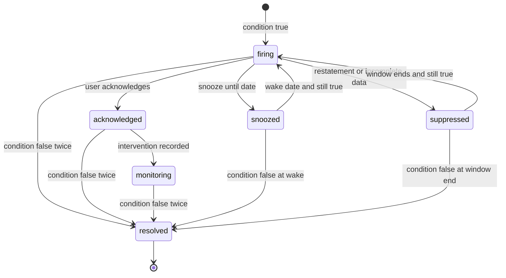

**Anomaly detection** (automatic, no configuration):

- Daily metrics per Company (revenue earned, man-hours, fuel purchases, materials issued, payments, refunds, discounts given, time edits) are modeled with **seasonal-trend decomposition (STL)** using weekly and yearly seasonality where at least 13 months of history exist; otherwise a robust rolling median with day-of-week effects.
- A residual beyond 3.5 robust z-scores (median absolute deviation-based) for 2 consecutive evaluations, or 5+ for a single one, raises an anomaly.
- Each anomaly carries a **contribution analysis**: which dimension members (crew, service, client) explain most of the deviation, computed by comparing each member's share of the change.
- **Fraud and leakage signals** (owner-only): unusual discount rates by a user, time-entry edits after approval, refunds outside normal patterns, fuel card purchases on non-working days, inventory shrink. These are framed as "worth a look", never as accusations.
- Feedback: users mark anomalies as "expected" (with an optional annotation, for example "Hailstorm cleanup surge"), "useful" or "noise". Feedback tunes per-Company sensitivity.
- **Weekly Insight Digest:** a Monday email/push with the top 5 changes, generated by Copilot from the anomaly and variance engine with links into the dashboards.

### 4.9 Forecasting

All forecasts show a range (P10-P50-P90), their inputs, the model used, and the accuracy of past forecasts (backtest MAPE), so owners learn how much to trust them.

#### 4.9.1 13-week cash flow forecast [V1]

This is the same forecast engine as the Ledger's cash forecast in [Ledger](09-accounting-ledger-integrations.md) section 4.9.4, which also owns the seasonal 12-month view and the ledger-side scenarios; this section specifies the analytics behavior (P10-P50-P90 ranges, backtest, alerting and the dashboard). Predicted payment dates come from one payment-timing model ([Ledger](09-accounting-ledger-integrations.md) AI9, the payment-propensity model in [AI Copilot](17-ai-copilot-automation.md) section 4.7.5).

Direct method, week by week:

- **Inflows:** open AR scheduled by each client's **predicted payment date** (a per-client model using historical days-late distribution; autopay clients on their charge date with a failure probability); recurring agreement billings scheduled in [Invoicing](07-invoicing-billing-contracts.md) with collection lag; project milestone billings from the schedule; deposits from proposals weighted by close probability and expected sign date. Cash lands in the bank on the **payout** date, not the charge date, so each inflow is shifted by the payment method's settlement lag read from the Company's own connected Stripe account: about 2 business days for card payouts, up to about 4 business days for US ACH Direct Debit to confirm before payout, and several business days for Canadian pre-authorized debit (figures from [Payments](08-payments-stripe.md), as of November 2026, verify per account, because each Company controls its own payout schedule in its Stripe dashboard). Checks and other manual payments use the Company's historical deposit lag.
- **Outflows:** payroll by pay calendar (from [Team](15-team-hr-payroll.md), forecast hours × burdened rates for scheduled work), AP bills by due date, recurring expenses (rent, insurance, loan payments, equipment financing) from the ledger's recurring templates, sales tax remittances by filing frequency, planned purchases (POs) and owner draws.
- **Scenarios:** "lose 2 weeks to rain in April", "biggest commercial client pays 30 days late", "buy a $68,000 skid steer in May". Each scenario is a saved overlay.
- **Low-point alert:** when P10 cash dips below the owner's threshold, the owner is alerted with levers (accelerate collections, move a purchase, draw on the line of credit).
- **Rules:** the forecast re-runs nightly and on material events (`invoice.posted` over $5,000, `payment.failed` on autopay, `bill.posted`, `period.closed`). Week 1 starts on the Company's week-start day; the opening balance is the latest reconciled bank balance plus in-transit Stripe payouts. Each week's actual vs. forecast is stored, so backtest accuracy (shown as MAPE of weekly ending cash over the last 13 closed weeks) is visible on the screen (wireframe 6.11). A Company without a bank feed sees a "manual opening balance" warning and no P10 band.

#### 4.9.2 Capacity forecast [V1]

- Next 1-16 weeks: available crew hours (roster, approved time off, seasonal hires starting dates) vs. demand hours (scheduled recurring visits + backlog + weighted pipeline hours + historical average of unscheduled enhancements sold-and-performed within the window).
- Output by division and skill (for example licensed applicator hours, irrigation tech hours, hardscape crew hours). Snow capacity is planned in equipment-route units (trucks, sidewalk crews) rather than hours.
- Recommendations: hire N seasonal technicians by a date, add a Saturday shift, sub out, or push start dates. Links to [Scheduling](04-scheduling-dispatch-routing.md) and [Team](15-team-hr-payroll.md).

#### 4.9.3 Seasonal revenue forecast [V1 baseline, V2 ML]

- **V1 (bottom-up, explainable):** contracted recurring (agreement schedules) + backlog by scheduled date + weighted pipeline × historical sales-cycle timing + run-rate of enhancement and one-off work from the trailing 2 seasons, phased by the Company's own seasonal curve.
- **V2 (model-based):** hierarchical time-series forecasting (division → service line) with reconciliation, weather covariates (regional growing-degree days, precipitation from the weather provider) and snow-season expectations (regional snowfall climatology), trained per Company with pooled priors from similar companies in the benchmark cohort.
- **Snow scenarios** [V2]: revenue and cost range for a light, average and heavy season based on historical event counts in the Company's region; shows how seasonal contracts vs. per-push contracts hedge the risk.

#### 4.9.4 Scenario planner [V2]

What-if sliders on a driver-based model: price increase % by service line (with churn elasticity estimated from the Company's own past renewals and, if opted in, a cohort-level elasticity prior), crew count, wage rate change, overtime policy, fuel price, new service line launch. **Antitrust guardrail:** the cohort prior is a historical, aggregated response curve (renewal rate vs. the Company's *own* percentage price change); it never contains or reveals other Companies' prices, and no pricing feature in Rootline uses other Companies' non-public prices as inputs (same rule as [Pricing and GTM](22-business-model-pricing-gtm.md), see 11.2). Outputs: revenue, GP, NOI, cash low point, capacity utilization. Owners save scenarios and compare side by side, for example "6% maintenance price increase plus one added crew" vs. "status quo".

### 4.10 Natural-language analytics via Copilot [MVP certified answers, V1 exploratory mode and "why" analysis]

The Copilot ([AI Copilot](17-ai-copilot-automation.md)) answers questions such as "What was our gross margin on mulch jobs last spring vs. this spring?", "Which commercial properties lost money in October?", or "Why is RPMH down this month?".

**Phasing.** Certified answers over the metrics available at MVP (4.3 availability rule) ship with the Copilot at MVP, because "What's my gross margin on installs this year?" is an MVP acceptance scenario in [AI Copilot](17-ai-copilot-automation.md) section 4.2.3. They run on the MVP semantic layer over Postgres analytics schemas (4.12.1). Exploratory mode (rule 1), "why" variance decomposition (rule 5), Copilot-written digests and metrics-store speedups arrive at V1.

**How it works (rules):**

1. **Semantic grounding (certified mode, default):** the LLM (Claude family via the AI Gateway) produces a structured **semantic query** (metrics, dimensions, filters, time range, comparison) through the `metrics.query` tool defined in [AI Copilot](17-ai-copilot-automation.md). The semantic layer compiles it to warehouse SQL with tenant and permission filters injected server-side. The LLM never writes SQL against OLTP tables.
   **Exploratory mode [V1]:** for questions the catalog cannot express ("which properties had more than 3 callbacks after a crew change?"), [AI Copilot](17-ai-copilot-automation.md) allows generated read-only SQL against **tenant-scoped analytics views** (warehouse row policies, separate read role, 10 s timeout, 10,000-row cap, columns classified `restricted` excluded). Answers are badged "Exploratory, not a certified metric", always show the SQL, cannot be benchmarked or used by goals and alerts, and can be pinned only after an analyst converts them into a saved report on a semantic explore. This mode is off for roles without `analytics.reports.create`.
2. **Metric resolution:** user phrases are mapped to certified metrics using a synonyms table plus pgvector semantic search over metric descriptions ("labor percentage" → `labor_pct_revenue`; "how fast we get paid" → `dso_countback`). If two metrics are plausible (earned vs. recognized revenue), Copilot asks a clarifying question or states its assumption explicitly.
3. **Numbers come only from query results.** The response renders numbers from the result set; the LLM writes the narrative around placeholders bound to result values. A post-generation check verifies every number in the text exists in the results (within rounding).
4. **Show your work:** every answer includes the chart or table, the metric definitions used (linked to the KPI Dictionary), filters, freshness, and an "Open in report builder" button that turns the answer into an editable saved report.
5. **Why questions [V1]:** "why" triggers the variance decomposition engine (mix vs. rate vs. volume, contribution by dimension), and the narrative cites the top contributors with values.
6. **Permissions:** Copilot can only query what the user could query in the builder. A crew lead asking "what's our profit this month?" gets a polite explanation that this needs owner-level access.
7. **Follow-ups** keep context ("now just commercial", "break it down by crew").
8. **Saved questions and pinned answers** can be added to a dashboard as live tiles.
9. **Evaluation:** the metrics questions suite of 500+ landscape analytics questions across 5 demo tenants of different shapes (owned jointly with [AI Copilot](17-ai-copilot-automation.md)) runs on every model, prompt, metric-version or semantic-model change. Release gate: at least **98% of answers match SQL ground truth numerically** and **zero ungrounded numbers** (the gate in doc 17); exact semantic-query match (target 95%+) is tracked as a diagnostic, because two different queries can legitimately produce the same correct answer.
10. **Cost metering:** each question consumes AI credits per the AI Gateway metering ([Pricing](22-business-model-pricing-gtm.md)); cached identical questions within the freshness window are free.

**Spanish support:** questions in Spanish are answered in Spanish with the same metric definitions (the Dictionary carries Spanish names and synonyms).

Wireframe: 6.12 shows a certified answer with its assumptions, freshness, provisional-period warning and follow-up actions.

> **Competitive edge:** Jobber Copilot and ServiceTitan's Atlas show that owners want to ask their software questions in plain language. But an assistant over generic field-service data can only report what was logged, with definitions it chooses on the fly. Rootline's Copilot compiles every certified answer from the same KPI Dictionary that drives dashboards and benchmarks. "Gross margin on mulch" therefore means burdened labor, issued materials and allocated equipment, reconciled to the ledger, whether it appears in the answer, the report or the peer comparison. Every number is traceable, uncertified exploration is labeled as such, and the answer ends in an action (accept a production rate, open a re-price list).

### 4.11 Industry benchmarking (the moat) [V1 beta, V2 full]

Benchmarking is the feature competitors without a large, structured, landscape-specific dataset cannot copy. ServiceTitan proves the demand in the trades with its quarterly, opt-in Benchmark Report, which requires at least 100 jobs in the period and an "Industry Publications" data preference ([ServiceTitan docs](https://help.servicetitan.com/docs/access-benchmark-reports)). Rootline does this for landscaping, with finer segmentation and stronger, documented privacy guarantees.

#### 4.11.1 Participation and consent

- **Opt-in, give-to-get.** Only participating Companies see peer benchmarks. The `owner` opts in from Settings > Benchmarking (or during onboarding at V1) after reading a plain-language disclosure: what is shared (company-level aggregates of the **(B)** metrics only), what is never shared (client names, addresses, prices on individual proposals, employee data, property-level data), how it is protected, and that opting out stops future contributions.
- Opt-out takes effect at the next computation. Previously published aggregates are not recalled, because they contain no identifiable company data.
- **Two separate, revocable scopes** (aligned with the `benchmark_consent` record in [Pricing and GTM](22-business-model-pricing-gtm.md)): `peer_benchmarks` (contribute to and see in-app peer comparisons; required to see peers) and `external_aggregates` (inclusion in external products such as the public industry report and Pulse Indices, 4.11.7). A Company can hold the first without the second. Both are granted only by `owner`.
- Consent is versioned. A material change to the program (for example adding price benchmarks) requires re-consent; non-responders are treated as opted out of the new scope.
- Benchmarks are a Grow-tier-and-above entitlement ([22](22-business-model-pricing-gtm.md)). A Company that downgrades below Grow stops seeing peers at the next release; its past contributions stay in published aggregates, which contain no identifiable data.
- The program is described in the Terms of Service and Data Processing Addendum ([Architecture](20-architecture-security.md)). Contributions are aggregated, de-identified company-level statistics, not personal data of clients.

#### 4.11.2 Contribution eligibility (per company, per metric, per quarter)

| Rule | Default |
|------|---------|
| Tenure on Rootline | At least 6 months of operational data |
| Activity floor | At least 150 completed visits **or** $50,000 earned revenue in the quarter |
| Completeness | The metric's completeness preconditions are met (4.3.10), for example 90% of visits have clock-out times |
| Financial metrics | Accounting period closed in the built-in ledger (or synced and reconciled QuickBooks/Xero) and Data Health score ≥ 70 |
| Exclusions | Demo, sandbox and test tenants; companies flagged by the anomaly engine for data corruption; companies under platform investigation |
| One contributor per ownership group | Companies under common ownership (multi-company rollups, franchise units of one franchisee, linked Stripe or tax IDs, same billing account) are merged into **one contributor** before thresholds are applied, so a 6-brand owner cannot count as 6 peers or slip under the dominance rule |
| Anti-Sybil | A contributor must be a paying subscriber with a connected Stripe account and real collected volume in the quarter. Combined with the 6-month tenure rule, this makes "create 9 fake tenants to isolate a competitor" slow, expensive and detectable; the clean room also flags cells whose membership changed by more than 30% between releases for manual review before publishing |

#### 4.11.3 Peer cohorts (fixed lattice)

Cohorts are built from a **fixed lattice** of dimensions. Users cannot query arbitrary filter combinations, which blocks differencing attacks.

| Dimension | Values |
|-----------|--------|
| Geography | Platform Regions in tiers: country (US, CA) → macro-region (for example Northeast, Great Lakes/Midwest, Southeast, Gulf/South Central, Mountain West, Pacific Northwest, California/Southwest, Atlantic Canada, Central Canada, Prairies, BC) → state/province → metro. These are the same operator-curated Region objects used in the [Plant Knowledge Base](12-plant-knowledge-base.md), so climate-driven season length is respected. |
| Size band | Trailing-12-month revenue: under $500k, $500k-1M, $1-2.5M, $2.5-5M, $5-10M, $10M+ |
| Service mix archetype | Maintenance-led (≥ 60% maintenance revenue), Design/build-led (≥ 50% install), Lawn/PHC applicator (≥ 50% applications), Snow-heavy (≥ 25% snow), Full-service mixed (none of the above) |
| Client mix | Residential-led (≥ 70%), Commercial-led (≥ 70%), Mixed |

A published cell combines at most 3 dimensions. When the viewer's most specific cell fails the thresholds, the UI **falls back** to the next broader cell and labels it: "Peers: Great Lakes/Midwest, $1-2.5M, all service mixes (n = 34)".

#### 4.11.4 Privacy and disclosure-control rules (non-negotiable)

1. **k-anonymity threshold:** a cell is published only if at least **10 distinct companies** contribute to that metric for that period. The floor is configurable upward only; no one, including `platform_owner`, can set it below 10 in production.
2. **Dominance rule:** for any additive statistic, no single company may contribute more than 25% of the cell total, and the top two no more than 40%. Rootline mostly publishes ratios and percentiles, but the rule also governs derived totals.
3. **Percentiles, not extremes:** publish P25, P50 and P75; P10 and P90 only when n ≥ 30. Never publish minimum, maximum, or a mean for cells under 30.
4. **Winsorization and weighting:** contributions are winsorized at P5/P95 within the cell before computing statistics, which limits the influence of any one outlier. Every contributor carries equal weight (one company, one observation), never revenue weighting, so a $9M company cannot pull the median. Percentiles use linear interpolation between order statistics (the common "type 7" definition), documented in the methodology page so results are reproducible.
5. **Complementary suppression:** if two published cells are nested (one is a subset of the other) and their memberships differ by fewer than 5 companies, the finer cell is suppressed for that metric.
6. **Release cadence:** statistics are computed once per quarter (published 15 days after quarter end) in a batch; there is no on-demand recomputation, so a company cannot opt in and out repeatedly to isolate others.
7. **Noise for public releases:** public and marketing reports (4.11.7) and any cross-cohort "insights" add calibrated differential-privacy noise to counts and quantiles. The privacy budget (epsilon) per release is set by the platform with legal review; an initial working value of ε = 1 per metric per release is a starting point to be tuned, not a guarantee.
8. **Clean-room computation:** per-company, per-metric aggregates are computed inside each tenant's scope, pseudonymized with a per-release random identifier, and exported to an isolated benchmark pipeline. No person (including platform staff) queries raw cross-tenant contributions; break-glass access requires `platform_owner` approval plus a second approver and is logged in the audit trail ([Platform admin](19-platform-admin-portal.md)).
9. **No property, client, employee or individual-transaction data** ever enters the benchmark pipeline.
10. **Price benchmarks get extra rules** ([section 11](#11-edge-cases-compliance-and-risks)): historical data only (at least 3 months old, stricter than the 60-day lag that [Pricing and GTM](22-business-model-pricing-gtm.md) sets for external indices in general), metro level or wider, n ≥ 15, presented as P25-P75 ranges, and launched only after antitrust counsel review. This applies to the price metrics [22](22-business-model-pricing-gtm.md) lists for Rootline Pulse (for example mowing price per 1,000 sq ft and mulch install price per cubic yard): they are designed for V1 but switch on only behind a counsel-approved feature flag. Rootline never shares forward-looking pricing or capacity plans between companies, and wage data follows the same rules as prices.

#### 4.11.5 What companies see

- Each **(B)** metric shows: own value, cohort P25/P50/P75, percentile rank, n, cohort definition, period, and a 4-quarter trend of own value vs. cohort median.
- **Benchmark Scorecard:** a single page with a quartile badge per metric grouped by Profit, Productivity, Cash, Growth, Retention and Safety, plus "biggest gaps to median" and "biggest strengths".
- **Insights** [V2]: aggregated statements computed only within cells passing the thresholds, for example "In your cohort, companies in the top quartile for RPMH have a median drive time % of 14% vs. 21% for the bottom quartile". These are cohort-level correlations, never claims about any company.
- **Goal seeding:** "Set my goal to cohort P75" is one click from any benchmark.
- **Production-rate priors** [V2]: cohort median production rates per task code (4.4.4).

#### 4.11.6 Cold start

Benchmarks need density. Until a Region tier has enough contributors, cells fall back to macro-region or country. The UI can also show **public reference data** (for example Canadian government financial-performance data for NAICS 56173 ([ISED](https://ised-isde.canada.ca/app/ixb/cis/performance/56173)) or published industry study figures with citation), always visually separated from Rootline peer data and never blended into it. The founder's admin console shows a **coverage map** of cells meeting thresholds, to direct go-to-market efforts toward regions where adding 5 more customers unlocks benchmarks ([Pricing and GTM](22-business-model-pricing-gtm.md)).

#### 4.11.7 External products: "State of the Landscape Industry" report and Pulse Indices [V2]

Commercial packaging and pricing are owned by [Pricing and GTM](22-business-model-pricing-gtm.md) (section 5.2.2, Rootline Pulse). This module owns the computation and the privacy controls:

- **State of the Landscape Industry report:** an annual public report, with quarterly updates (DP-protected, national and macro-region level), on labor %, RPMH trends, wage and pricing trends, retention and seasonality. It doubles as a marketing asset and a press magnet, can be co-branded with associations, and is free for participants with their own position overlaid.
- **Pulse Indices** (for example a regional maintenance price index, install backlog weeks, a labor rate index, materials price indices for mulch, stone and sod, snow event volume): computed only from `external_aggregates` contributors, at macro-region level or wider, with the 4.11.4 rules plus DP noise, and lagged at least 60 days (at least 3 months for any price or wage index). `platform_owner` approves every release; licensees contractually agree not to re-identify. Indices follow the quarterly release cadence of rule 6 in 4.11.4. [Pricing and GTM](22-business-model-pricing-gtm.md) section 5.2.2 describes them as monthly; a monthly cadence is allowed only after privacy and counsel review, because more frequent releases make differencing attacks easier.
- Indices are always historical. They are never fed back into any Company's pricing suggestions.

#### 4.11.8 Benchmark metric catalog by phase

| Phase | Metrics benchmarked | Notes |
|-------|--------------------|-------|
| [V1] beta (first 2-3 quarterly releases; macro-region and country cells while density builds) | `gross_margin_pct`, `labor_pct_revenue`, `rpmh`, `revenue_per_crew_day`, `crew_utilization`, `drive_time_pct`, `overtime_pct`, `on_time_visit_pct`, `callback_rate`, `close_rate_count`, `close_rate_value`, `lead_response_minutes_median`, `dso_countback`, `ar_aging_pct_over_60`, `autopay_penetration`, `agreement_renewal_rate_value`, `client_churn_rate`, `backlog_weeks` (install-led cohorts only) | Operational and ratio metrics with the strongest completeness checks; no absolute dollars |
| [V1] general availability | Adds `overhead_pct_revenue`, `net_operating_margin_pct`, `overhead_recovery_rate`, `average_ticket_won`, `average_agreement_value`, `upsell_attach_rate`, `change_order_rate`, `nrr`, `grr`, `trir` | Financial metrics require a closed, reconciled period (4.11.2) |
| [V1] counsel-gated | Price metrics (mowing price per 1,000 sq ft, mulch install price per cubic yard), `price_realization_pct`, wage ranges | Off until antitrust counsel approves (rule 10) |
| [V2] | Production-rate priors by task code (4.4.4), `equipment_cost_per_hour` by asset class, `cac_by_lead_source` by channel, `ltv`, snow response metrics | Need 2+ seasons of comparable data |

A metric enters the catalog only when its certified definition is stable for 2 quarters; a definition change resets its benchmark trend line with an annotation.

> **Competitive edge:** Landscape owners pay consultants and join peer groups to learn whether a 34% gross margin is good. Rootline answers that continuously, for free inside the product, segmented by the owner's own climate region, size and service mix, with privacy rules published in plain language. Each new customer improves the benchmarks for every other customer: a data network effect that standalone field-service tools and accounting add-ons cannot reproduce.

### 4.12 Data platform architecture

#### 4.12.1 Overview [MVP: semantic layer over Postgres analytics schemas; V1: CDC into ClickHouse, lakehouse and metrics store]

The diagram shows the V1 target. At MVP the same semantic layer and Analytics API run over Postgres analytics schemas on a read replica (incrementally maintained rollup tables fed by outbox events), which matches [Architecture](20-architecture-security.md), where the ClickHouse-class serving store and the lakehouse are V1. Because every consumer talks to the semantic layer, the V1 switch is invisible to dashboards, Copilot and the API.

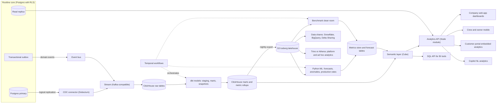

**Why both CDC and events?** CDC captures the full current state of every table (including edits and deletes) reliably, without application code. Outbox domain events (for example `visit.completed`, `invoice.posted`, `proposal.signed`) carry business meaning and timestamps that CDC row diffs lack, such as "who approved" or "the status transition time". Facts are built from CDC state and enriched with event timestamps. See [Architecture](20-architecture-security.md) for the outbox design.

#### 4.12.2 Warehouse choice

| Option | Strengths | Weaknesses | Decision |
|--------|-----------|-----------|----------|
| Postgres only (read replica + rollup tables) | Cheapest, no new tech | Large scans and concurrent dashboards degrade OLTP-like replicas; cross-tenant benchmarking heavy | **All tiers at MVP**; the **live** tier only from V1 |
| **ClickHouse** (managed cloud or self-hosted) | Sub-second aggregations over billions of rows, low cost per query, row policies, materialized views for incremental rollups, good fit for multi-tenant user-facing analytics | Updates and deletes are asynchronous (handled with ReplacingMergeTree and versioned rows); operational expertise required | **Primary analytics serving warehouse from V1** |
| BigQuery | Serverless, strong ML and sharing (Analytics Hub) | Per-query pricing is unpredictable for thousands of tenants refreshing dashboards; higher latency for interactive tiles | **Share destination** for customers who use it |
| Snowflake | Strong data sharing and governance | Cost for always-on user-facing workloads | **Share destination** |

**Phasing decision (aligned with [Architecture](20-architecture-security.md)).** MVP serves dashboards from Postgres analytics schemas behind the semantic layer: a read replica plus rollup tables (`agg_*`) maintained incrementally from outbox events, which is enough for MVP-scale tenants and near-real-time job costing. The **analytics event history is captured from day one** (outbox events are retained in S3 as the future lake's raw layer), because backfilling history later is the expensive part. V1 adds CDC into ClickHouse, the Iceberg lakehouse, Trino/Athena for platform and ad hoc analytics, and the metrics store. Trigger to pull ClickHouse forward: dashboard p95 above 1.5 s for more than 5% of tenants, or replica CPU above 60% at Monday-morning peak.

#### 4.12.3 Modeling standards

- **Layers:** `raw_*` (CDC rows with LSN and operation), `stg_*` (typed, deduplicated, latest version per id), `int_*` (business logic: allocations, revenue views), `fct_*` and `dim_*` marts (star schema), `agg_*` rollups (daily per tenant per metric per key dimension), and `snap_*` daily snapshots.
- **Snapshots** (daily at 02:00 Company local time): backlog, AR aging, pipeline by stage, active agreements and CARR, inventory on hand, open POs. Snapshots make "backlog on May 1 last year" answerable, which state tables cannot do.
- **Slowly changing dimensions:** Type 2 for crew membership, employee wage rates (restricted), client type, property attributes, price book prices, and division mapping.
- **Tenant isolation:** `tenant_id` is the first column of every table's sort key; ClickHouse row policies filter by a tenant setting injected per session; the semantic layer injects `tenant_id` from the authenticated security context; dedicated-database tenants get dedicated ClickHouse databases. CI runs cross-tenant read tests on every model change.
- **Restatements:** reopening a ledger period, changing an allocation rule, or approving late time entries triggers a scoped recomputation (affected tenant and date window). Metric snapshots keep a `computed_at` and `version`, alerts for restated windows are suppressed, and dashboards show a "restated" annotation.
- **Imported history** [MVP]: invoices, visits, clients and agreements migrated from Jobber, LMN, Aspire, Service Autopilot or QuickBooks ([Platform admin](19-platform-admin-portal.md) migrations) land with `source_system` and `trust_level = imported`. Imported periods power year-over-year comparisons on day one but are badged "imported" and never feed benchmarks, production-rate suggestions or certified financial tiles unless their totals reconcile to the imported GL within 1%.
- **Tenant offboarding** [MVP]: on cancellation the Company can download a full analytics export (star schema as Parquet plus CSV, KPI Dictionary as JSON). After the retention window set in [Architecture](20-architecture-security.md), tenant marts, snapshots and lake partitions are hard-deleted. Already-published benchmark aggregates remain, because they contain no identifiable data.
- **PII handling:** client and employee names, emails and phones live only in restricted dims; facts carry surrogate keys. Erasure requests (GDPR, CCPA, PIPEDA) propagate as CDC deletes plus tombstones, and the lakehouse applies Iceberg row-level deletes within 30 days. Benchmark aggregates contain no personal data and are unaffected.
- **Residency:** Canadian tenants who require Canadian data residency get warehouse and lake storage in a Canadian region (V2, aligned with the dedicated-DB option in [Architecture](20-architecture-security.md)).

#### 4.12.4 Semantic layer and metrics store

- **Source of truth:** a git-managed metrics catalog (YAML) defines measures, dimensions, metrics, synonyms (English/Spanish), tests and certification. CI generates Cube data models, KPI Dictionary docs, Copilot synonym tables and benchmark eligibility from it.
- **Cube** serves queries through REST/GraphQL for the app and a Postgres-wire SQL API for BI tools, with pre-aggregations for the heaviest dashboards and caching (Redis-backed). Security context carries `tenant_id`, `branch_ids`, `role`, `field_restrictions`, and, for portal users, `client_id` and `property_ids`.
- **Metrics store** [V1]: `metric_value_daily` holds computed values per tenant × metric × key dimension × day (and per week/month/season). It powers fast tiles, goal pacing, alerts, anomaly detection, benchmark contributions, and Copilot "what changed" queries.

#### 4.12.5 Service levels and scale

| SLO | Target |
|-----|--------|
| CDC lag (commit to ClickHouse raw) [V1] | p95 under 60 s |
| Near-real-time marts freshness | p95 under 5 min |
| Dashboard tile query latency | MVP (Postgres): p95 under 1.5 s, p99 under 4 s. V1 (ClickHouse): p95 under 1 s on 3 years of history, matching [Architecture](20-architecture-security.md) |
| Nightly snapshot completion | 100% of tenants by 05:00 local time |
| Scheduled report on-time delivery | 99.5% within 10 min of schedule |

Scale planning (estimate): 5,000 tenants averaging 2-3 million analytic rows per year each is on the order of 10-15 billion rows per year, which is well within a modest ClickHouse cluster. Per-tenant query quotas and pre-aggregations prevent noisy neighbors.

### 4.13 BI connectors, data shares and the metrics API

| Capability | Description | Tier/priority |
|------------|-------------|---------------|
| Exports | CSV/XLSX/PDF from any report (4.6) | All tiers, MVP |
| Google Sheets / Excel live links | Scheduled refresh into a sheet | V1, Grow and above |
| Metrics API | REST/GraphQL: query certified metrics with dimensions, filters and time grains; OAuth2 client credentials scoped to a tenant and role; 60 requests/min default rate limit; counts against the tier's public API call quota in [Pricing and GTM](22-business-model-pricing-gtm.md) | V1, Pro and Enterprise |
| SQL API (semantic) | Postgres-wire endpoint exposing semantic views, not raw tables, for Power BI, Tableau, Looker Studio, Metabase and Excel; row-level and field-level security enforced | V1, Pro and Enterprise |
| Power BI and Tableau templates | Prebuilt template reports (owner pack, ops pack) connecting to the SQL API | V2 |
| Data shares | Nightly (or hourly) share of the documented star schema to the customer's Snowflake account (secure data sharing), BigQuery (Analytics Hub listing), Databricks (Delta Sharing) or an S3 Parquet/Iceberg drop | V2, Enterprise (Pro as a paid add-on; pricing open, see section 14) |
| Multi-company rollup | Consolidated analytics across multiple Rootline Companies owned by one group (franchises, multi-brand owners, private-equity consolidators). ServiceTitan offers a comparable "rollup reporting" for multi-tenant customers ([ServiceTitan docs](https://help.servicetitan.com/construction/docs/access-benchmark-reports-in-rollup-reporting)). Owner-level consolidated dashboards for an Organization (standard KPIs recomputed across its Companies, no cross-tenant record access) ship at V1 with Organizations ([Personas and permissions](02-personas-roles-permissions.md) section 5.9, [Platform admin](19-platform-admin-portal.md) PA-015). The warehouse rollup with intercompany eliminations, franchise KPI rollups and custom cross-Company reports is V2. | V1 dashboards; V2 full rollup, Enterprise |
| Schema contract | Versioned schema docs; breaking changes announced 6 months ahead with parallel old and new views | V2 |

### 4.14 Embedded analytics for client portals

The [Customer portal](06-customer-portal.md) is a white-label Rootline surface, so "embedded analytics" means client-scoped analytics components rendered inside it (and optionally embeddable elsewhere through signed URLs).

#### 4.14.1 Commercial Property Scorecard and portfolio view [V1]

For `client_commercial` users (property managers, HOA board members, facilities managers):

- **Contract compliance:** visits performed vs. contracted by service (for example "Mowing: 28 of 28 performed; Bed weeding: 13 of 14, 1 rescheduled for rain on Jul 9"), with photo evidence.
- **SLA compliance:** request response times, issue resolution times, and for snow, each event's trigger depth and time, arrival time per site, pushes, salt/ice-melt applied and whether the contracted response window was met.
- **Quality:** site audit scores (from quality inspections in [Service lines](14-service-line-modules.md)), open issues and resolutions.
- **Applications:** fertilizer and pesticide applications with product, EPA registration number, rate, area, applicator and weather, for clients who must keep their own records or post notifications.
- **Irrigation:** inspections and repairs, controller schedules, and water usage where smart controllers or meters are connected (V2).
- **Spend vs. budget:** the client enters an annual budget per property (or per GL code). The scorecard shows contract spend, approved enhancements and pending proposals against it ("$38,200 of $45,000 enhancement budget committed").
- **Portfolio view:** all properties on a map and in a sortable table with compliance %, spend vs. budget, open requests and scorecard grade; filter by region or property manager.
- **Board packet export:** a branded PDF/XLSX packet per property or portfolio, scheduled monthly to board members and contacts with scoped access.

#### 4.14.2 Residential "Your Season" [V1]

A simple, delightful summary: visits completed, a photo timeline (before and after), treatments applied, plants installed with warranty dates and care tips (from the [Plant KB](12-plant-knowledge-base.md)), invoices and payments, and a shareable year-end **Season in Review** card ("31 mows, 2 cleanups, 14 yards of mulch, 120 tulips planted").

#### 4.14.3 Rules [V1]

- **Client-safe data layer only:** client explores expose no costs, margins, wages, crew hours (unless the landscaper enables "show labor hours" for time-and-materials contracts), or internal notes. Only photos flagged client-visible appear.
- **Per-client visibility settings:** the landscaper chooses which widgets each client (or client type) sees, and can preview "view as client".
- **Security context:** a signed, short-lived token carries `tenant_id`, `client_id`, the contact's allowed `property_ids` and widget permissions. All queries are filtered server-side.
- **Branding:** inherits the Company's portal theme, logo and custom domain.
- **External embedding** [V2]: signed-URL iframes so a property management company can embed a Rootline scorecard in its own owner portal. Integration targets among property-management and facilities platforms are to be validated with customers.

> **Competitive edge:** Commercial maintenance contracts are won and kept on proof of performance. Most field-service tools stop at emailing a visit summary; our research found no multi-property dashboard or HOA-board approval routing in Jobber's client hub, and Aspire lists a client portal but publishes no detail on what a property manager can see there ([R1](research/R1-field-service-platforms.md), [R2](research/R2-landscape-specific-platforms.md); verify in a demo). Rootline gives the property manager a live, branded portfolio scorecard with snow SLA evidence and spend-vs-budget tracking, so the landscaper looks like the most professional vendor the board has.

### 4.15 Platform operator analytics [MVP basics, V1 full]

Specified in [Platform admin](19-platform-admin-portal.md) (PA-140 to PA-145 and the operator Copilot, PA-190); summarized here because it runs on the same data platform. Operator metrics share the metric-definition format of 4.1.1, so board-deck numbers and console numbers match:

- **Tenant health score** (usage depth, Data Health, payments connected, seats active, support tickets, NPS) and churn risk.
- **Adoption funnels:** onboarding steps, first proposal, first invoice paid, first design, first AI mockup, first benchmark view.
- **SaaS metrics** for `platform_finance`: MRR, net revenue retention, logo churn, ARPA, AI credit revenue and cost per tenant (AI Gateway metering).
- **Benchmark program:** opt-in rate, eligible contributors per cell, coverage map, suppression counts.
- **Plant KB analytics** for `platform_curator`: most-searched plants per Region, specification rates, warranty replacement rates by plant and Region (from 4.3.4 `plant_warranty_cost_pct`, aggregated with the same k ≥ 10 rule across companies).
- **Data platform health** for `platform_engineer`: CDC lag, failed models, query latency, cost per tenant.
- Platform staff see aggregate tenant metrics. Viewing a tenant's detailed financial dashboards requires support access granted by the tenant (time-boxed and audited).

### 4.16 Mobile analytics

- **Owner Snapshot** [MVP as a responsive web/PWA card stack; V1 inside the native app's manager mode per [UX](21-ux-design-system-sitemaps.md)]: today's revenue earned, crews on the clock, jobs at risk, cash, AR, and this week vs. last week, plus the Monday digest push. (Named "Snapshot" rather than "Pulse" so it is not confused with Rootline Pulse, the benchmark program.)
- **Crew stats** [V1]: as in 4.2.4, cached offline from the last sync with an "as of" stamp ([Crew app](05-field-crew-mobile-app.md)).
- **Estimator pipeline** [V1]: pipeline, follow-ups due, close rate, and "similar past jobs" actuals while on site.
- **Push alerts** [V1]: any alert rule can target push.

### 4.17 Data quality and trust

- **Data Health score** [MVP] per Company (0-100), weighted: visits with clock times (30%), time entries assigned to jobs (20%), vendor bills linked to jobs (15%), materials issued to jobs (15%), bank accounts reconciled within 30 days (10%), Price Book cost completeness (10%). Each component has a fix-it link. The score gates benchmark eligibility (4.11.2).
- **"How is this calculated?"** panel on every tile [MVP]: formula, inputs, filters, row counts, freshness, metric version, and a link to the source rows.
- **Reconciliation checks** [V1]: job-costed labor vs. payroll journal labor (tolerance 2%); earned revenue vs. GL revenue with explained differences (deferral, timing); AR subledger vs. GL control; Stripe charges vs. payments recorded. Breaks appear in the Close Cockpit.
- **Metric tests** [MVP]: fixture-based unit tests per certified metric run in CI, plus nightly data tests (uniqueness, referential integrity, freshness) on marts.
- **Metric lineage for support** [V1]: with a tenant-granted, time-boxed support session ([Platform admin](19-platform-admin-portal.md)), `platform_support` can open the lineage view of any tile (metric version, compiled query, source row counts, last pipeline run) without seeing wage or client-contact fields, which answers "why does this number look wrong?" in minutes instead of a screen-share.

### 4.18 Packaging by tier

Tier names and commercial terms are owned by [Pricing and GTM](22-business-model-pricing-gtm.md) (Starter, Grow, Pro, Enterprise). This table maps every analytics capability in this doc to a tier so entitlement flags can be built; doc 22 and the roadmap in [24](24-roadmap-feature-catalog.md) win if they differ.

| Capability | Starter | Grow | Pro | Enterprise | Priority |
|-----------|---------|------|-----|------------|----------|
| Role dashboards (owner, ops, sales, office), Owner Snapshot, KPI Dictionary, Data Health, "How is this calculated?" | Y | Y | Y | Y | [MVP] |
| Standard report library incl. job costing and profitability by client/property/service | Y | Y | Y | Y | [MVP] |
| Exports (CSV, XLSX with definitions sheet, PDF) | Y | Y | Y | Y | [MVP] |
| Monday Weekly Insight Digest | Y (rules-based) | Y | Y | Y | [MVP] rules, [V1] Copilot-written |
| Scheduled and conditional delivery, bursting | - | Y | Y | Y | [MVP] scheduling, [V1] conditional and bursting |
| Custom report builder, calculated fields | - | Y | Y | Y | [V1] |
| Goals, alerts, anomaly detection | L (built-in alert pack only) | Y | Y | Y | [V1] |
| Natural-language analytics (certified mode) | Y (AI credits) | Y (credits) | Y (credits) | Y (pooled credits) | [MVP] certified answers; [V1] exploratory mode and "why" analysis |
| Peer benchmarks (Rootline Pulse, opt-in) | - | Y | Y | Y | [V1] |
| Production-rate feedback loop | - | Y | Y | Y | [V1] |
| Crew "My Stats", TV display, Close Cockpit | Y | Y | Y | Y | [V1] |
| Commercial Property Scorecard, board packets | - | L (5 commercial clients, matching the portal limit) | Y | Y | [V1] |
| 13-week cash and capacity forecasts | - | - | Y | Y | [V1] here; doc 22 lists forecasting at [V2], see section 14 |
| Metrics API, semantic SQL API for BI tools | - | - | Y | Y | [V1] |
| WIP schedule | - | - | Y | Y | [V1] (requires Ledger Advanced) |
| Scenario planner, seasonal ML forecast | - | - | Y | Y | [V2] |
| Organization consolidated dashboards (multi-company owners) | - | - | Y | Y | [V1] |
| Data shares, full multi-company rollup, external embedding | - | - | A | Y | [V2] |

Legend: Y = included, L = limited, A = paid add-on, - = not available. Downgrades never delete saved reports or history; gated features become read-only with an upgrade prompt.

---

## 5. Key user flows

### 5.1 Owner's Monday review

1. At 06:30 Monday (Company local time), a Temporal workflow assembles the **Weekly Insight Digest**: last week's earned revenue vs. phased goal, GM%, RPMH, AR changes, top 5 anomalies with contribution analysis, jobs at risk, renewals at risk, and cash low point.
2. The owner gets a push and email. Tapping opens Owner Snapshot on mobile or the Command Center on desktop, pre-filtered to last week.
3. The owner taps "Gross margin 31.8% (−4.2 pts vs. plan)". The drill-down shows the Enhancements division at 22% vs. 38% planned.
4. Copilot's explanation panel: "Two mulch jobs (Hendricks HOA, Oakmont Commons) used 34% more labor than estimated; both are tagged 'wheelbarrow access/slope'."
5. The owner clicks "Review production rate", sees the pending suggestion for "Hand-spread mulch, wheelbarrow access" (from 1.0 to 0.82 yd³ per man-hour, n = 19), and accepts it with an effective date of today.
6. The owner assigns a follow-up task to the `ops_manager`: "Review crew assignments on slope jobs". The digest records which insights were acted on (a feedback signal for ranking future insights).

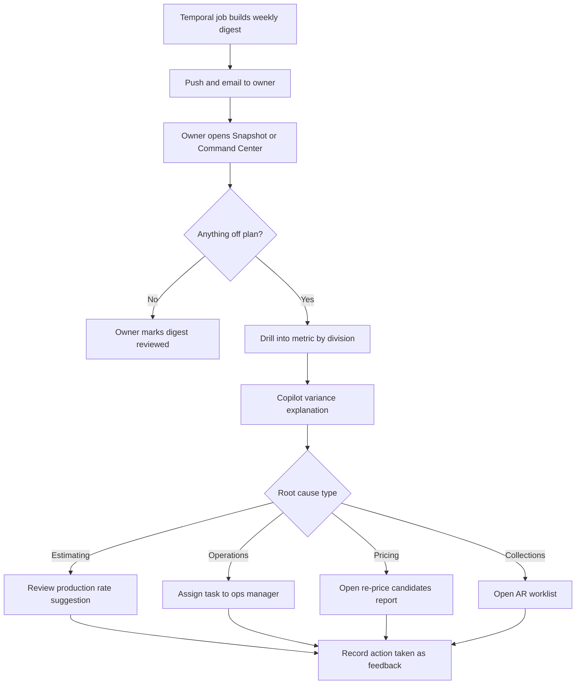

### 5.2 Job-at-risk alert to intervention

1. A paver patio project (estimated 186 man-hours, $41,500 contract) is 40% complete by budgeted hours of tasks finished, but 112 hours have been burned (60% of budget).
2. The near-real-time pipeline updates `job_hours_burn_vs_progress` = 0.60 − 0.40 = +20 points, which exceeds the 15-point threshold. The alert engine fires "Job at risk".
3. The `ops_manager` and the job's `estimator` get an in-app and push alert with a link to the Job Cost Detail.
4. The ops manager sees that excavation ran 13 hours over, with photos showing buried concrete. They create a change order request ([Estimating](03-crm-sales-estimating-proposals.md)) for debris removal and re-forecast the remaining hours.
5. When the client approves the change order in the portal, the job budget and contract update and the projected margin recovers. The ops manager re-forecasts the remaining hours, which moves the alert to "acknowledged, monitoring". It auto-resolves when neither trigger condition holds.

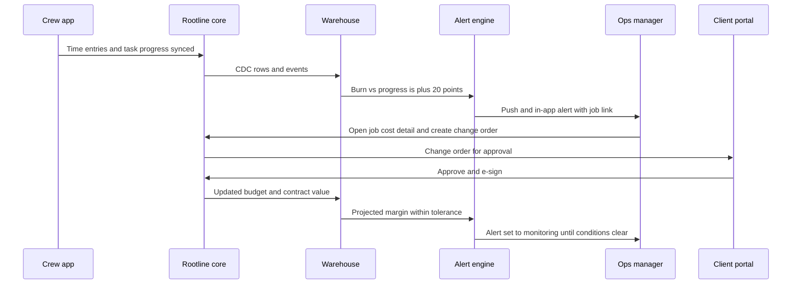

### 5.3 Production-rate feedback loop

1. Visits and project tasks complete with quantities and actual man-hours.
2. Nightly, the ML service computes observations per task code, removes outliers, and evaluates suggestion criteria (4.4.4).
3. Suggestions go to the estimator's review queue with evidence.
4. An authorized user accepts, edits or dismisses. Accepted rates create a new production-rate version used by new estimates only.
5. Estimate accuracy (`estimate_hours_wape`, `estimate_hours_bias_pct`) is tracked before and after to measure the impact.

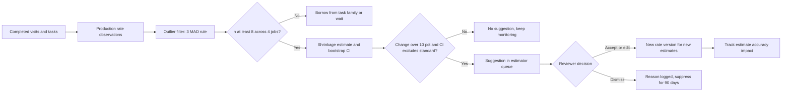

### 5.4 Quarterly benchmark release

1. On quarter end + 10 days, a Temporal workflow checks each opted-in Company's eligibility per metric (4.11.2).
2. Inside each tenant scope, company-level metric values are computed and written with a per-release pseudonym to the clean-room input.
3. The clean room assigns each pseudonym to its lattice cells, applies winsorization, computes percentiles, and runs the k, dominance and complementary-suppression checks.
4. Passing cells are published to `benchmark_value`. Suppressed cells are logged with reason codes (counts only).
5. On quarter end + 15 days, Companies are notified ("Your Q3 benchmarks are ready"), and Benchmark Scorecards update.

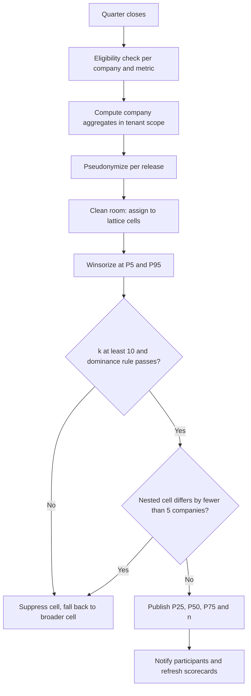

### 5.5 Natural-language question through Copilot

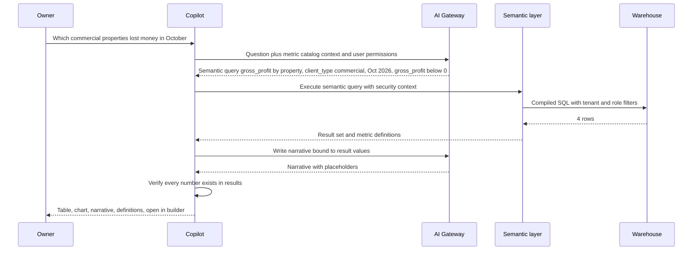

### 5.6 Monthly commercial service report (bursting)

1. The `office_manager` creates a schedule: "Commercial service report, 1st business day monthly, burst by client, recipients = each client's billing and board contacts".
2. On the 1st, Temporal starts one child workflow per commercial client.
3. Each child renders the client's Property Scorecard PDF (client-safe data layer, Company branding) and posts it to the client's portal documents.
4. The portal notifies the client's contacts by email with a secure link (no attachments containing data for contacts without portal accounts unless the Company allows attachments).
5. The delivery log records each send. Failures retry 3 times, then alert the office manager.

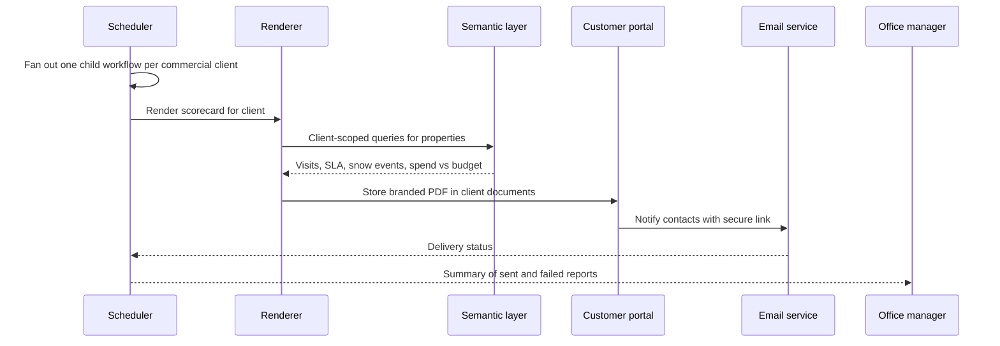

### 5.7 Month-end close status (bookkeeper)

1. On the first day after period end, the period moves from `open` to `in_close` and auto-checks run nightly.
2. The bookkeeper works the checklist; each auto-check turns green when its condition holds.
3. When all required checks pass, the bookkeeper marks `ready_for_review`. The owner (or the bookkeeper, if permitted) closes the period, which locks posting ([Ledger](09-accounting-ledger-integrations.md)) and stamps financial metrics for that period as "period closed".
4. Reopening requires `ledger.reopen_period` permission and a reason. It triggers a scoped analytics restatement (4.12.3), and benchmark contributions for that period are recomputed at the next release.

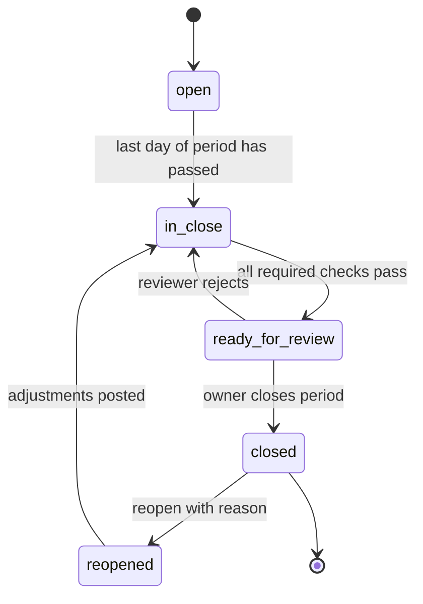

---

## 6. Screens and wireframes

### 6.1 Screen inventory

| Screen | Surface | Primary personas | Priority |
|--------|---------|------------------|----------|
| Owner Command Center | Web | owner | MVP |
| Owner Snapshot | Mobile (PWA at MVP, manager mode V1) | owner | MVP |
| Operations dashboard | Web, tablet | ops_manager, owner | MVP |
| Sales dashboard | Web | estimator, owner, office_manager | MVP |
| Office exceptions dashboard | Web | office_manager | MVP |
| Report library | Web | all internal (permission-filtered) | MVP |
| Job Cost Detail | Web, tablet | ops_manager, estimator, owner | MVP |
| Profitability explorer (client, property, service) with map | Web | owner, ops_manager | MVP (map V1) |
| KPI Dictionary | Web, help center | all | MVP |
| Saved reports and schedules | Web | owner, office_manager, bookkeeper | MVP |
| Data Health | Web | owner, office_manager | MVP |
| Custom report builder | Web | owner, office_manager, bookkeeper, ops_manager | V1 |
| Goals and scorecards | Web, mobile | owner, ops_manager, crew_lead | V1 |
| Alerts and anomalies inbox | Web, mobile | owner, ops_manager, office_manager | V1 |
| Production rate review queue | Web | estimator, owner | V1 |
| Cash forecast (13-week) | Web | owner, bookkeeper | V1 |
| Capacity forecast | Web | ops_manager, owner | V1 |
| Close Cockpit | Web | bookkeeper, owner | V1 |
| Benchmark Scorecard | Web | owner | V1 |
| Crew "My Stats" | Mobile (crew app) | crew_lead, technician | V1 |
| TV / shop display | Web kiosk | all crew | V1 |
| Copilot analytics panel | Web, mobile | all internal (permission-filtered) | MVP (certified answers), V1 (exploratory, "why") |
| Commercial Property Scorecard and portfolio | Customer portal | client_commercial | V1 |
| Residential "Your Season" | Customer portal | client_residential | V1 |
| Scenario planner | Web | owner | V2 |
| Data shares and API keys | Web | owner | V2 |
| Platform analytics (tenants, benchmarks, data health) | Admin console | platform_owner, platform_finance, platform_engineer | MVP/V1 |

### 6.2 Owner Command Center (desktop)

```text
+----------------------------------------------------------------------------------------------+
| Rootline   Dashboards v  Reports  Goals  Benchmarks          [Ask Copilot...]   (?)  [JM]    |
+----------------------------------------------------------------------------------------------+
| Owner Command Center      Period: [Oct 2026 v]  vs [Last year v]  Division: [All v]          |
| Freshness: live / 5 min    Period status: Sep CLOSED  Oct IN CLOSE   Data Health: 86 /100    |
+----------------------------------------------------------------------------------------------+
| EARNED REVENUE          | GROSS MARGIN           | NET OP. MARGIN        | RPMH                |
| $284,300  +9% vs LY     | 36.4%  -1.2 pts vs LY  | 11.8% (Sep, closed)   | $71.20  +$3.10      |
| Goal $270k  [=====>105%]| Target 38% [====>  ]   | Peer P50 9.4% (n=23)  | Peer P50 $67 (n=23) |
| ~~~~~^~~~~ sparkline    | Maint 42% Enh 31%      |                       | ~~~~^~~~            |
|                         | Inst 24% Snow --       |                       |                     |
+-------------------------+------------------------+-----------------------+---------------------+
| CASH                    | RECEIVABLES            | BACKLOG               | PIPELINE            |
| $212,900 on hand        | AR $164,200            | Install  6.8 weeks    | Open    $612,000    |
| 13-wk low: $88k (Jan 9) | Over 60d: 14% (amber)  | Enhance  2.1 weeks    | Weighted $236,000   |
| Runway (winter): 5.2 mo | DSO (countback): 38 d  | Irrig.   1.4 weeks    | Close rate 90d: 41% |
+-------------------------+------------------------+-----------------------+---------------------+
| RECURRING                                         | INSIGHTS (Copilot)                         |
| CARR $1,148,000   Renewals for 2027: 61% done     | ! 3 jobs trending over budget              |
| Renewal pace -6 pts vs last year (amber)          |   (Hendricks HOA, 7 Birch Ct, Elm Plaza)   |
| GRR 91%   NRR (total revenue) 106%                | ! Maintenance labor % up 3.1 pts: Crew 4   |
| [View renewal desk]                               |   visits running 22% long since Sep 15     |
|                                                   | i Google Ads CAC $412 vs referral $96      |
+---------------------------------------------------+--------------------------------------------+
| Revenue by division, earned vs billed (monthly, fiscal year)                                 |
|  $ |      ##                                                                                  |
|    |   ## ## ##                         Legend: ## earned  -- billed  .. last year           |
|    |## ## ## ## ##  -- -- -- -- -- --                                                         |
|    +--Mar-Apr-May-Jun-Jul-Aug-Sep-Oct-Nov-Dec-Jan-Feb----------------------------------------- |
+----------------------------------------------------------------------------------------------+
```

### 6.3 Operations dashboard (desktop/tablet)

```text
+----------------------------------------------------------------------------------------------+
| Operations   Week of Oct 26  [< >]   Branch: [Main v]   Division: [Maintenance v]   (live)  |
+----------------------------------------------------------------------------------------------+
| CREW UTILIZATION (on-site / paid)        | BUDGET VS ACTUAL HOURS (week to date)             |
|           Mon  Tue  Wed  Thu  Fri        | Crew     Budget  Actual  Var    Efficiency         |
| Crew 1    81%  78%  84%  --   --         | Crew 1    96.0    91.5   -4.7%  1.05  OK           |
| Crew 2    74%  69%  77%  --   --         | Crew 2    88.0    90.2   +2.5%  0.98  OK           |
| Crew 4    62%  58%  65%  --   --  (red)  | Crew 4    92.0   112.4  +22.2%  0.82  (red)        |
| Crew 7    79%  83%  80%  --   --         | Crew 7    64.0    61.0   -4.7%  1.05  OK           |
+------------------------------------------+---------------------------------------------------+
| ON-TIME 94.2% (target 95)  COMPLETION 97.8%  CALLBACKS 1.9%   WEATHER DAYS LOST: 0.5        |
+----------------------------------------------------------------------------------------------+
| JOBS AT RISK                                                                                  |
| Job                    Type     Budget hrs  Burned  Progress  Proj. GM   Est. GM   Action     |
| Hendricks HOA mulch    Enhance     64        58      62%       21%       38%     [Open]      |
| 7 Birch Ct patio       Install    186       112      40%       41%       45%     [Open] CO   |
| Elm Plaza re-sod       Install     48        41      70%       33%       40%     [Open]      |
+----------------------------------------------------------------------------------------------+
| ROUTE DENSITY (today)                      | MAP                                              |
| Crew  Stops  On-site%  Rev/drive-hr        |   [map: crew routes colored by crew; red dots =  |
| C1     14     82%       $410               |    properties with GP/man-hr below floor;        |
| C2     11     71%       $305               |    dashed line = 22 mi detour to 1 property]     |
| C4      9     58%       $190  (red)        |                                                  |
| [Show re-price/swap candidates]            |                                                  |
+----------------------------------------------------------------------------------------------+
```

### 6.4 Job Cost Detail

```text
+----------------------------------------------------------------------------------------------+
| Job #2291  7 Birch Ct - Paver patio and seat wall     Status: In progress (40%)  PROVISIONAL  |
| Client: R. Alvarez   Estimator: K. Patel   Crew: Hardscape A   Contract: $41,500 (+CO $2,850) |
+----------------------------------------------------------------------------------------------+
| Cost type     Est qty     Est cost    Actual qty   Actual cost  Committed  Forecast  Var     |
| Labor (hrs)   186 hrs     $8,370      112 hrs      $5,152       --         $9,960   +19%     |
| Materials     --          $11,940     --           $9,870       $1,420     $12,100   +1%     |
|   Pavers      620 sq ft   $4,960      640 sq ft    $5,120       --                           |
|   Base stone  24 tons     $1,080      27 tons      $1,215       --                           |
| Equipment     38 hrs      $2,280      29 hrs       $1,740       --         $2,460    +8%     |
| Subs          --          $0          --           $0           --         $0        --      |
| Dump fees     2 loads     $300        3 loads      $450         --         $450     +50%     |
+----------------------------------------------------------------------------------------------+
| Margin waterfall:  Est GP $18,610 -> Labor -$1,590 -> Equip -$180 -> Dump -$150 ->           |
|                    Materials -$160 -> Change order +$1,710 -> Projected GP $18,240 (41.1%)   |
+----------------------------------------------------------------------------------------------+
| Missing for final costing: 2 vendor bills (PO 8812, PO 8817); 1 unapproved time entry        |
| Copilot: Excavation ran +13 hrs on Oct 14-15 (photos tagged 'buried concrete'). Debris       |
| removal change order approved Oct 16. Consider 'unknown subsurface' allowance on similar bids.|
| [Time entries] [Bills] [Photos] [Change orders] [Export PDF]                                 |
+----------------------------------------------------------------------------------------------+
```

### 6.5 Benchmark Scorecard

```text
+----------------------------------------------------------------------------------------------+
| Benchmarks  Q3 2026 (published Oct 15)     Your peers: Great Lakes/Midwest, $1-2.5M,         |
| Maintenance-led, Mixed clients (n = 23)    [Change cohort view v]  Privacy: how this works   |
+----------------------------------------------------------------------------------------------+
| PROFIT                       You      P25     P50     P75     Rank (higher = better)         |
| Gross margin %               36.4%    31.0%   34.2%   38.9%   [-----|--o--|-----] 61st       |
| Labor % of revenue           38.1%    35.2%   39.6%   44.0%   [-----|-o---|-----] 58th (good)|
| Net operating margin %       11.8%     6.1%    9.4%   13.2%   [-----|---o-|-----] 68th       |
| PRODUCTIVITY                                                                                  |
| RPMH (billable)              $71.20   $61     $67     $74     [-----|----o|-----] 70th       |
| Drive time %                 19%      15%     18%     22%     [-----|--o--|-----] 45th       |
| CASH                                                                                          |
| DSO (countback)              38 d     27 d    33 d    44 d    [-----|----o|-----] 35th (low) |
| RETENTION                                                                                     |
| Agreement renewal (value)    88%      84%     89%     93%     [-----|--o--|-----] 47th       |
+----------------------------------------------------------------------------------------------+
| Biggest gap: DSO is 5 days slower than median. Peer note: in this cohort, top-quartile DSO    |
| companies have a median autopay penetration of 71% vs. your 44%.  [Set goal to P50] [How?]   |
+----------------------------------------------------------------------------------------------+
```

(Values are illustrative.)

### 6.6 Custom report builder

```text
+----------------------------------------------------------------------------------------------+
| New report: "Fall cleanup profitability by crew"        [Save v] [Schedule] [Export v]       |
+----------------------+-----------------------------------------------------------------------+
| EXPLORE              | Filters: Service = Fall cleanup  AND  Date = Last full season         |
| [Jobs and Job Costing]|         AND  Division = Maintenance                    [+ filter]    |
| Search fields...     +-----------------------------------------------------------------------+
| DIMENSIONS           | Rows: Crew v     Columns: Property size band v     Values: GM%, RPMH  |
|  > Crew              +-----------------------------------------------------------------------+
|  > Property          | Crew    | < 10k sq ft    | 10-20k sq ft   | 20k+ sq ft     | Total      |
|  > Service           |         | GM%    RPMH    | GM%    RPMH    | GM%    RPMH    | GM%  RPMH  |
| MEASURES             | Crew 1  | 44%    $78     | 39%    $71     | 31%    $62     | 39%  $71   |
|  # Gross margin %    | Crew 2  | 41%    $74     | 36%    $66     | 28%    $57 (r) | 36%  $67   |
|  # RPMH              | Crew 4  | 35%    $66     | 30%    $60     | 22%    $51 (r) | 29%  $59   |
|  # Man-hours         +-----------------------------------------------------------------------+
| CALCULATED           | Chart: [bar] [line] [pivot*] [map]     Conditional format: GM% < 30% red|
|  + New field         | Warning: "GM%" is computed as sum(GP)/sum(revenue), not avg of GM%.  |
+----------------------+-----------------------------------------------------------------------+
```

### 6.7 Crew "My Stats" (mobile, Spanish shown)

```text
+--------------------------------+
| Mis estadisticas   Cuadrilla 4 |
| Semana: 26 oct - 1 nov         |
+--------------------------------+
| HORAS vs PRESUPUESTO (hoy)     |
|  Presup. 31.5   Real 29.0      |
|  Eficiencia 1.09  [verde]      |
+--------------------------------+
| SEMANA                         |
|  Visitas 46/48   A tiempo 96%  |
|  Reclamos (callbacks) 0        |
|  Fotos/checklists 100%         |
+--------------------------------+
| BONO DE EQUIPO (oct)           |
|  [==========>    ] 72%         |
|  Meta: eficiencia >= 1.05      |
|  y 0 accidentes                |
+--------------------------------+
| SEGURIDAD: 41 dias sin         |
| incidentes                     |
+--------------------------------+
| Mis horas (periodo): 38.5      |
| Certificaciones: Aplicador     |
| vence 2027-03-31               |
| as of 07:42 (sin conexion)     |
+--------------------------------+
```

### 6.8 Commercial Property Scorecard (customer portal)

```text
+----------------------------------------------------------------------------------------------+
| [Company logo]  Client portal     Willow Creek HOA (12 properties)    [Export board packet]  |
+----------------------------------------------------------------------------------------------+
| Portfolio | Properties | Requests | Proposals | Invoices | Reports                           |
+----------------------------------------------------------------------------------------------+
| Property: Willow Creek Clubhouse         Period: Oct 2026   Grade: A- (92)                    |
+----------------------------------------------------------------------------------------------+
| CONTRACT COMPLIANCE                       | SNOW (season to date)                            |
| Mowing          4/4 performed             | Events: 0    Contract trigger: 2 in              |
| Bed weeding     2/2 performed             | SLA: arrive within 4 h of trigger                |
| Leaf removal    2/3 (1 sched. Nov 3)      | (Season starts Nov 15)                           |
| Irrigation      Winterized Oct 21 [photo] |                                                  |
+-------------------------------------------+--------------------------------------------------+
| SPEND VS BUDGET (FY Jan-Dec)              | REQUESTS                                         |
| Contract     $54,000 of $54,000           | Opened 3   Closed 3   Median response 3.1 h      |
| Enhancements $38,200 of $45,000 (85%)     |                                                  |
| Pending proposals: $4,950 (2)  [Review]   | APPLICATIONS                                     |
+-------------------------------------------+ Oct 8 Fall fertilizer 24-0-10, 3.0 lb/1,000 sqft |
| PHOTO LOG  [Oct 3] [Oct 10] [Oct 17] [Oct 24]  (before/after)                                |
+----------------------------------------------------------------------------------------------+
```

### 6.9 Sales dashboard (desktop)

```text
+----------------------------------------------------------------------------------------------+
| Sales    Period: [Last 90 days v]  vs [Prior 90 days v]  Rep: [All v]  Service line: [All v] |
+----------------------------------------------------------------------------------------------+
| CLOSE RATE           | AVERAGE TICKET       | PIPELINE VELOCITY    | LEAD RESPONSE (median)  |
| Value 41%  Count 46% | One-off/project      | $4,120 / day         | 47 min (biz hours)      |
| +3 pts vs prior      | $6,840  +$410        | Cycle: maint 6 d,    | Target 30 min (amber)   |
| n = 118 decided      | Agreements $3,420/yr | projects 34 d        | AI receptionist: 2 min  |
+----------------------+----------------------+----------------------+-------------------------+
| PIPELINE BY STAGE                         Count    Value      Avg days   Stuck (> 2x median) |
| Site assessment                             14   $148,000       6.2        2  [View]         |
| Estimating                                   9    $96,500       4.8        1                 |
| Proposal sent                               22   $236,400       9.1        5  (amber)        |
| Negotiation / revision                       6   $131,100      12.4        1                 |
| Open total                                  51   $612,000    Weighted $236,000               |
+----------------------------------------------------------------------------------------------+
| BY REP           Won $     Close (value)  Avg ticket  Hours WAPE  Bias    Design-led close   |
| K. Patel        $214,300       44%          $7,140       14%       +6%       --              |
| M. Ortiz        $162,800       38%          $5,920       21%      +11% (!)   --              |
| J. Lee (design)  $96,400       52%         $12,050       17%       +4%       58% vs 39%      |
+----------------------------------------------------------------------------------------------+
| LEAD SOURCE ROI (trailing 12 mo)  Leads  Won  Close  CAC    LTV:CAC | PROPOSAL ENGAGEMENT    |
| Referral                            38   21   55%    $96    14.2    | Tier mix G 18% B 57%   |
| Google Ads                         112   24   21%   $412     3.1    |          Best 25%      |
| Angi                                64    7   11%   $688     1.4 (!)| Viewed, unsigned > 7 d |
| Yard signs                          19    6   32%    $55    18.9    |   9 proposals [Nudge]  |
+----------------------------------------------------------------------------------------------+
| RENEWAL DESK: 2027 renewals 61% done (-6 pts vs last year)  14 at risk  [Open renewal desk]  |
+----------------------------------------------------------------------------------------------+
```

Behavior notes: an `estimator` sees only their own row and their own leads unless granted all-rep visibility; "(!)" marks values outside the owner's target band; the bias column links to the rep's estimate accuracy report (V1); CAC and LTV:CAC show "not enough data" until a source has at least 5 won clients. (Values are illustrative.)

### 6.10 Bookkeeper Close Cockpit

```text
+----------------------------------------------------------------------------------------------+
| Close Cockpit   Period: [Oct 2026 v]   Status: IN CLOSE (day 5 of 10)   Ledger: built-in     |
+----------------------------------------------------------------------------------------------+
| REQUIRED CHECKS                                                     Status     Detail        |
| [x] Operating account reconciled through Oct 31                    PASS                      |
| [x] Payroll account reconciled through Oct 31                      PASS                      |
| [!] Amex Business card: 14 uncategorized transactions              FAIL       [Categorize]   |
| [x] Stripe payouts matched to bank deposits (22 of 22)             PASS                      |
| [x] AR subledger = GL 1200 ($164,200.00 = $164,200.00)             PASS                      |
| [!] AP subledger vs GL 2000: difference $1,214.50                  FAIL       2 bills dated  |
|                                                                               Nov 1 [Fix]    |
| [x] Payroll journals posted (4 of 4 pay dates)                     PASS                      |
| [ ] WIP / over-under billing adjustment                            READY      Draft JE [Post]|
| [ ] Deferred revenue on prepaid lawn programs                      READY      Draft JE [Post]|
| [x] Depreciation posted                                            PASS                      |
| [x] Sales tax liability = tax report (3 jurisdictions)             PASS                      |
| [!] 3 draft invoices dated in period                               FAIL       [Review]       |
+----------------------------------------------------------------------------------------------+
| EXCEPTIONS (non-blocking)                     | RECONCILIATION CHECKS (4.17)                 |
| Unapplied payments          2    $1,180.00    | Job-costed labor vs payroll   -0.8%  OK      |
| Time entries without job    6    14.5 h       | Earned vs GL revenue  $3,940 explained       |
| Vendor bills without job    3    $2,615.40    |   (deferral of prepaid programs)             |
| Zero-tax invoice, taxable   1    [Review]     | Stripe charges vs payments recorded  OK      |
+-----------------------------------------------+----------------------------------------------+
| 7 of 12 required checks pass   [Mark ready for review] (disabled until all required pass)    |
+----------------------------------------------------------------------------------------------+
```

Behavior notes: checks re-run nightly and on demand; a check can be waived only by `owner` with a reason (logged); when QuickBooks or Xero is the system of record, the ledger checks are replaced by sync-health checks (last sync, failed records, unmapped items) and the header reads "Ledger: QuickBooks Online (synced 06:12)".

### 6.11 13-week cash forecast

```text
+----------------------------------------------------------------------------------------------+
| Cash forecast (13 weeks)   Opening: $212,900 (reconciled Nov 6 + $4,180 Stripe in transit)   |
| Minimum cash threshold: $75,000 [edit]   Scenario: [Base v]  [+ Rain 2 wks] [+ Skid steer]   |
| Backtest: weekly ending-cash MAPE 6.8% over the last 13 closed weeks                         |
+----------------------------------------------------------------------------------------------+
| Week ending   Inflows    Outflows   Ending P50   Ending P10   Notes                          |
| Nov 14        $61,200    $48,300    $225,800     $214,000                                    |
| Nov 21        $44,800    $71,900    $198,700     $183,500     Payroll + equipment loan       |
| Nov 28        $38,100    $46,200    $190,600     $171,900                                    |
| Dec 05        $52,400    $73,800    $169,200     $146,300     Sales tax + insurance          |
| Dec 12        $29,700    $41,900    $157,000     $131,800                                    |
| Dec 19        $26,300    $58,400    $124,900      $98,200     Year-end crew bonuses          |
| Dec 26        $14,800    $31,600    $108,100      $80,400                                    |
| Jan 02        $31,900    $39,500    $100,500      $71,600 (!) Jan agreement autopay batch    |
| Jan 09        $12,600    $25,100     $88,000      $61,000 (!) LOW POINT                      |
| Jan 16        $18,400    $16,900     $89,500      $63,700 (!)                                |
| Jan 23        $22,300    $15,800     $96,000      $70,100 (!)                                |
| Jan 30        $19,900    $21,700     $94,200      $69,400 (!)                                |
| Feb 06        $34,600    $19,300    $109,500      $81,900     Early-spring deposits          |
+----------------------------------------------------------------------------------------------+
| P10 dips below $75,000 for 5 weeks. Levers:                                                  |
|  [Collect: 9 clients > 30 days, $18,420]  [Move skid steer purchase to Mar]                  |
|  [Offer prepay discount on 2027 programs]  [Show line-of-credit headroom]                    |
| Inflows: drill to invoices with predicted pay dates | Outflows: payroll, AP, recurring, tax  |
+----------------------------------------------------------------------------------------------+
```

The low point matches the Owner Command Center tile ("13-wk low: $88k (Jan 9)"). Weeks run Sunday to Saturday because that is this Company's configured week start. (Values are illustrative.)

### 6.12 Copilot analytics answer (side panel)

```text
+----------------------------------------------------------+
| Copilot                                        [x]       |
+----------------------------------------------------------+
| You: Which commercial properties lost money in October?  |
+----------------------------------------------------------+
| Assumptions: "lost money" = gross_profit < 0 (v3,        |
| certified); earned revenue view; Oct 1-31, 2026;         |
| client type = commercial.            [Change]            |
|                                                          |
| 4 of 37 commercial properties had negative gross profit  |
| in October, totaling -$854. Elm Plaza is 50% of it:      |
| crews logged 61 man-hours vs 44 budgeted, mostly leaf    |
| removal (+12 h).                                         |
|                                                          |
| Property              Revenue   Direct cost   GP         |
| Elm Plaza             $3,180    $3,610       -$430       |
| Oakmont Commons       $5,240    $5,515       -$275       |
| Ridgeview HOA ph. 2   $2,960    $3,071       -$111       |
| Lakeside Office Park  $4,100    $4,138        -$38       |
|                                                          |
| Freshness: 4 min ago. October is IN CLOSE: figures are   |
| provisional until the period closes.                     |
| (seedling) AI-generated from certified metrics           |
+----------------------------------------------------------+
| [Open in report builder] [Pin to dashboard] [Show query] |
| [Create re-price task for Elm Plaza]                     |
| Follow up: "Break it down by crew" | "Compare to Sept"   |
+----------------------------------------------------------+
```

Every number in the narrative is bound to a result cell and verified before display (4.10, rule 3). If the user lacked `analytics.margins.view`, Copilot would answer with man-hours vs. budget only and say why.

---

## 7. Data model

**Naming map to the module catalog in [Architecture](20-architecture-security.md):** the `reporting` module's `report_definition` is `saved_report` here, `kpi_snapshot` is `metric_value_daily`, and `export_job` is the asynchronous report run in 8.4 that emits `export.ready`. Doc 20's names are the code-level module names; this doc's names are the table names.

The analytics module owns two kinds of data: **configuration and outputs in Postgres** (metric catalog mirror, dashboards, reports, schedules, goals, alerts, benchmark participation, suggestions) and **analytical facts in the warehouse** (star schema marts and snapshots). Both carry `tenant_id`; Postgres tables use row-level security as described in [Architecture](20-architecture-security.md).

### 7.1 Application entities (Postgres)

| Entity | Key fields | Notes |
|--------|-----------|-------|
| `metric_definition` | `metric_key`, `name_en`, `name_es`, `unit`, `direction`, `certification_status`, `benchmarkable`, `owner_team` | Platform-level (no tenant_id) for certified metrics; tenant metrics carry `tenant_id` |
| `metric_version` | `metric_definition_id`, `version`, `formula_spec` (jsonb), `completeness_rules` (jsonb), `effective_at`, `changelog` | Immutable once certified |
| `dashboard` | `tenant_id`, `owner_user_id`, `role_default_for`, `layout` (jsonb), `visibility` | Company default layouts per role |
| `dashboard_widget` | `dashboard_id`, `metric_version_id` or `saved_report_id` or `question_id`, `viz_type`, `filters` (jsonb), `position` | |
| `saved_report` | `tenant_id`, `explore_key`, `query_spec` (jsonb), `viz_spec` (jsonb), `visibility`, `folder_id`, `created_by` | `query_spec` is a semantic query, never SQL |
| `report_schedule` | `saved_report_id`, `cron`, `timezone`, `season_window`, `condition_spec`, `burst_by`, `channels`, `recipients`, `expires_at` | |
| `report_delivery` | `report_schedule_id`, `run_at`, `status`, `recipient_count`, `row_count`, `file_hash`, `error` | Audit log |
| `goal` | `tenant_id`, `metric_key`, `scope_type`, `scope_id`, `period_type`, `target_value`, `phasing_method` | |
| `goal_period_target` | `goal_id`, `period_start`, `target_value` | Phased targets |
| `alert_rule` | `tenant_id`, `metric_key`, `scope`, `operator`, `threshold`, `frequency`, `cooldown_minutes`, `channels`, `recipients`, `is_builtin` | |
| `alert_event` | `alert_rule_id`, `scope_member_id`, `fired_at`, `last_evaluated_at`, `value`, `context` (jsonb), `status` (`firing`, `acknowledged`, `monitoring`, `snoozed`, `suppressed`, `resolved`), `snooze_until`, `severity`, `resolved_at`, `acknowledged_by`, `history` (jsonb) | Unique open event per (rule, scope member), see 4.8 |
| `anomaly_event` | `tenant_id`, `metric_key`, `event_date`, `expected`, `actual`, `score`, `contributors` (jsonb), `feedback` | |
| `annotation` | `tenant_id`, `date_start`, `date_end`, `text`, `scope`, `created_by` | |
| `forecast_run` | `tenant_id`, `forecast_type`, `model_version`, `inputs_hash`, `backtest_mape`, `created_at` | Cash, capacity, revenue, snow |
| `forecast_point` | `forecast_run_id`, `period_start`, `series_key`, `p10`, `p50`, `p90` | |
| `scenario` | `tenant_id`, `name`, `driver_overrides` (jsonb), `base_forecast_run_id` | V2 |
| `production_rate_observation` | `tenant_id`, `task_code`, `job_id`, `visit_id`, `quantity`, `unit`, `man_hours`, `crew_size`, `condition_tags`, `quantity_source`, `observed_on` | |
| `production_rate_suggestion` | `tenant_id`, `task_code`, `current_rate`, `suggested_rate`, `n_obs`, `n_jobs`, `ci_low`, `ci_high`, `status`, `decided_by`, `decision_reason` | Accepted suggestion creates a rate version in Estimating |
| `benchmark_consent` | `company_id` (= `tenant_id`), `consent_version`, `peer_benchmarks`, `external_aggregates`, `consented_by`, `consented_at`, `revoked_at` | Single source of truth shared with [Pricing and GTM](22-business-model-pricing-gtm.md) (same entity and field names); changes emit `benchmark_consent.changed` and take effect at the next release |
| `benchmark_contributor_group` | `id`, `member_tenant_ids`, `basis` (`common_owner`, `shared_tax_id`, `shared_stripe_account`, `franchise_unit`), `reviewed_by` | Platform-level; merges related companies into one contributor (4.11.2) |
| `benchmark_release` | `period`, `computed_at`, `published_at`, `config_hash` | Platform-level |
| `benchmark_cell` | `geo_region_id`, `size_band`, `service_mix`, `client_mix` | Fixed lattice |
| `benchmark_value` | `benchmark_release_id`, `benchmark_cell_id`, `metric_key`, `n_companies`, `p10`, `p25`, `p50`, `p75`, `p90`, `suppressed`, `suppression_reason` | No tenant identifiers |
| `client_report_config` | `tenant_id`, `client_id` or `client_type`, `visible_widgets`, `show_labor_hours`, `budget_by_property` (jsonb) | Embedded portal analytics |
| `data_share` | `tenant_id`, `destination_type`, `destination_ref`, `schema_version`, `frequency`, `status` | V2 |
| `analytics_api_client` | `tenant_id`, `name`, `scopes`, `created_by`, `last_used_at` | Secrets in KMS |
| `data_health_snapshot` | `tenant_id`, `date`, `score`, `components` (jsonb) | |
| `close_checklist_item` | `tenant_id`, `period_id`, `check_key`, `status`, `detail`, `checked_at` | Close Cockpit |

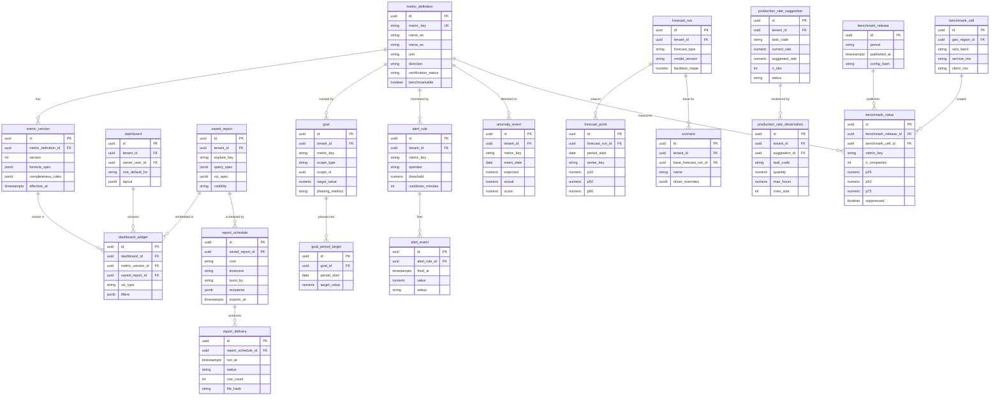

### 7.2 Warehouse star schema (ClickHouse marts)

| Fact table | Grain | Key measures |
|-----------|-------|-------------|
| `fct_labor_entry` | One time entry segment (employee × visit/task × category) | hours by category, burdened cost, overtime flag |
| `fct_visit` | One visit | scheduled/actual start, on-time flag, budgeted man-hours, actual man-hours, drive hours, allocated earned revenue, status |
| `fct_job_cost_line` | One cost line (labor, material, equipment, sub, other) per job/phase/task | estimated qty/cost, actual qty/cost, committed |
| `fct_revenue_line` | One invoice line or earned-revenue allocation | billed, earned, recognized amounts by view, service line |
| `fct_payment` | One payment or refund | amount, method, fee, payout id, days to pay |
| `fct_gl_line` | One journal entry line | debit, credit, account, class/division, period |
| `fct_opportunity_event` | One stage transition | from/to stage, value, days in stage |
| `fct_equipment_usage` | Asset × day | hours, fuel, cost allocations |
| `fct_chemical_application` | One application record | product, rate, area, applicator |
| `fct_snow_service` | Site × event | trigger time, arrival time, pushes, salt |
| `snap_backlog_daily` | Job × day | remaining value, remaining hours |
| `snap_ar_daily` | Invoice × day | open balance, aging bucket |
| `snap_agreement_daily` | Agreement × day | status, annualized value |
| `snap_pipeline_daily` | Opportunity × day | stage, value, probability |
| `metric_value_daily` | Tenant × metric × dimension member × day | value, numerator, denominator, completeness |

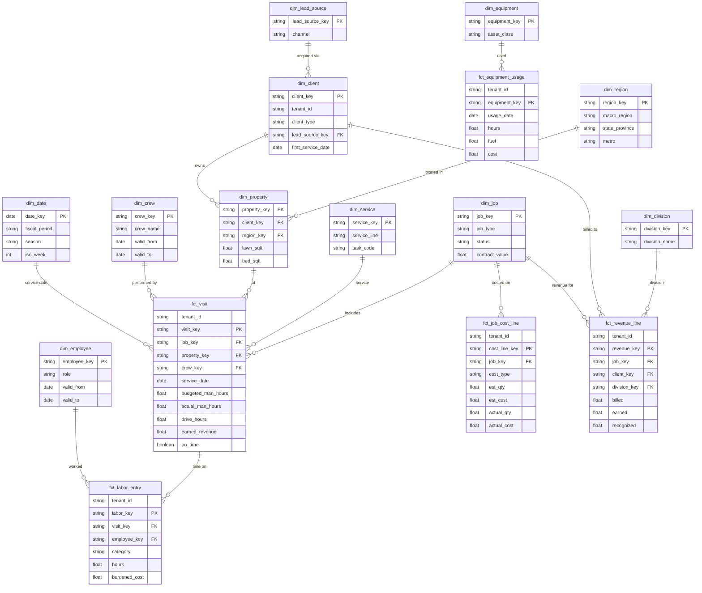

---

## 8. Integrations, APIs and events

### 8.1 External services

| Service | Purpose in analytics | Notes |
|---------|---------------------|-------|
| Stripe (each Company's connected account) | Payment fees, payout timing, disputes, cash in transit | Via [Payments](08-payments-stripe.md) balance transaction sync; Rootline reads data, never holds funds |
| Plaid (or similar aggregator) | Bank balances for cash tiles and forecasts | Via [Ledger](09-accounting-ledger-integrations.md) bank feeds |
| QuickBooks Online / Desktop, Xero | GL data when an external ledger is the system of record | Financial metrics flagged "source: QuickBooks sync" with last-sync time |
| Mapbox / Google Routes | Route miles and drive times | From [Scheduling](04-scheduling-dispatch-routing.md) |
| Telematics and hour meters | Equipment and vehicle hours, fuel | From [Operations](13-operations-inventory-equipment.md) |
| Weather provider | Rain days, growing-degree days, snowfall for weather-normalized metrics and forecasts | Shared with Scheduling |
| AI Gateway (Claude family) | NL analytics, narratives, digests | Metered as AI credits ([AI Copilot](17-ai-copilot-automation.md)) |
| Postmark/SendGrid, Twilio, push | Report delivery and alerts | |
| Slack, Microsoft Teams | Alert and report delivery | V1 |
| Google Sheets, Microsoft Excel | Live report links | V1 |
| Power BI, Tableau, Looker Studio, Metabase | Via semantic SQL API | V1/V2 |
| Snowflake, BigQuery, Databricks (Delta Sharing), S3 | Data shares | V2 |

### 8.2 Domain events consumed

`lead.created`, `lead.first_response`, `opportunity.stage_changed`, `proposal.sent`, `proposal.viewed`, `proposal.signed`, `proposal.lost`, `proposal.expired`, `change_order.approved`, `agreement.activated`, `agreement.renewed`, `agreement.cancelled`, `job.created`, `job.status_changed`, `visit.scheduled`, `visit.rescheduled`, `visit.started`, `visit.completed`, `visit.skipped`, `time_entry.approved`, `time_entry.edited`, `invoice.posted`, `invoice.voided`, `credit_memo.posted`, `payment.succeeded`, `payment.failed`, `payment.refunded`, `dispute.created`, `payout.paid`, `bill.posted`, `journal_entry.posted`, `period.closed`, `period.reopened`, `inventory.issued`, `equipment.usage_logged`, `chemical_application.recorded`, `snow_event.started`, `snow_event.ended`, `plant_warranty.claimed`, `review.received`, `survey.responded`, `employee.hired`, `employee.terminated`, `incident.reported`, `design.created`, `mockup.generated`, `benchmark_consent.changed` and `subscription.plan_changed` (from [Pricing and GTM](22-business-model-pricing-gtm.md): consent scopes and tier entitlements for 4.18), and the migration-project cutover event from [Platform admin](19-platform-admin-portal.md) (imported history, 4.12.3; event name owned by doc 19).

### 8.3 Domain events emitted

| Event | Payload highlights | Consumers |
|-------|-------------------|-----------|
| `analytics.alert.triggered` / `.resolved` | rule id, metric, value, threshold, scope, link | Notifications, Automations ([AI Copilot](17-ai-copilot-automation.md)), webhooks |
| `analytics.anomaly.detected` | metric, expected, actual, score, contributors | Digest, Copilot |
| `analytics.goal.status_changed` / `.achieved` | goal, status, pacing | Notifications, crew app celebrations, payroll bonus export |
| `analytics.report.delivered` / `.delivery_failed` | schedule id, recipients, row count | Audit, office manager |
| `export.ready` | export job id, format, row count, signed URL expiry | Requesting user, API clients (name from the `reporting` module in [Architecture](20-architecture-security.md)) |
| `analytics.forecast.completed` | forecast type, low point, ranges | Cash alerts |
| `analytics.cash.low_point_predicted` | week, P10 amount, threshold | Owner alert, Automations |
| `estimating.production_rate.suggested` | task code, current, suggested, evidence | Estimating queue |
| `analytics.restatement.completed` | tenant, window, reason | Dashboards annotation, alert suppression |
| `benchmark.release.published` | period, coverage stats (no tenant data) | Notifications, admin console |
| `analytics.data_health.changed` | score, components | Owner nudges, benchmark eligibility |

Automations can use analytics events as triggers, for example "When `analytics.alert.triggered` for Margin floor breach on an agreement, create a renewal re-price task for the account manager and draft a price-increase letter".

### 8.4 Public API (V1) and webhooks

| Endpoint | Purpose |
|----------|---------|
| `GET /v1/analytics/metrics` | Metric catalog with definitions and versions |
| `POST /v1/analytics/query` | Execute a semantic query: `{ "metrics": ["gross_margin_pct"], "dimensions": ["division"], "time": {"grain": "month", "range": "last_12_months"}, "filters": [...] }` |
| `GET /v1/analytics/metrics/{metric_key}/values` | Time series for a metric with grain and dimension parameters |
| `GET /v1/analytics/reports` / `POST /v1/analytics/reports/{id}/run` | Saved reports; async run returns a job id and a signed download URL |
| `GET /v1/analytics/benchmarks?period=2026-Q3` | Own benchmark comparisons (participants only) |
| `GET /v1/analytics/goals` | Goals and pacing |
| Webhooks | `analytics.alert.triggered`, `analytics.goal.achieved`, `analytics.report.delivered`, signed with HMAC-SHA256, retried with exponential backoff for 24 h |

All endpoints enforce tenant scope, role and field-level restrictions identical to the UI, and are rate limited (default 60 requests/min per client, burst 120).

---

## 9. Permissions

Granular permission keys (composable into custom roles, see [Personas and permissions](02-personas-roles-permissions.md)): `analytics.dashboards.view`, `analytics.financials.view`, `analytics.margins.view`, `analytics.wages.view`, `analytics.reports.run`, `analytics.reports.create`, `analytics.reports.schedule_internal`, `analytics.reports.schedule_external`, `analytics.export`, `analytics.goals.manage`, `analytics.alerts.manage`, `analytics.benchmarks.view`, `analytics.benchmarks.manage_participation`, `analytics.forecasts.view`, `analytics.metrics.manage_tenant`, `analytics.sql_explore` (Copilot exploratory mode, 4.10), `analytics.settings.manage` (allocation rules, fiscal calendar, targets), `analytics.api.manage`, `analytics.client_reports.configure`, `estimating.manage_rates`, `ledger.close_period`, `ledger.reopen_period`.

### 9.1 Tenant and client roles

Legend: **F** = full; **R** = read all; **O** = own or assigned scope only (own deals, own crew, own jobs); **L** = limited (hours and counts, no dollars); **C** = client-scoped (own properties); **cfg** = off by default, owner can grant; **-** = none.

| Capability | owner | office_manager | estimator | designer | ops_manager | crew_lead | technician | bookkeeper | subcontractor | client_commercial | client_residential |
|-----------|-------|----------------|-----------|----------|-------------|-----------|------------|------------|---------------|-------------------|--------------------|
| Owner Command Center | F | cfg | - | - | cfg | - | - | R | - | - | - |
| Company financial KPIs (revenue, GM, NOI, cash) | F | R | O | - | R (no NOI, cash) | - | - | R | - | - | - |
| Margins on jobs and clients | F | R | O | O (design jobs) | R | - | - | R | - | - | - |
| Wages and burdened rates | F | cfg | - | - | cfg | - | O (own pay) | R | - | - | - |
| Operations dashboard | F | R | - | - | F | O | - | - | - | - | - |
| Sales dashboard | F | R | O | O (design metrics) | - | - | - | - | - | - | - |
| Job Cost Detail | F | R | O | O | R | L (own jobs) | - | R | - | - | - |
| Crew "My Stats" | R (all crews) | - | - | - | R | O | O | - | - | - | - |
| Run standard reports | F | R | O | O | R | L | - | R | O (own work) | - | - |
| Custom report builder | F | F | O (sales explores) | - | F (ops explores) | - | - | F | - | - | - |
| Schedule reports to internal users | F | F | O | - | F | - | - | F | - | - | - |
| Schedule or burst to external recipients and clients | F | F | - | - | - | - | - | cfg | - | - | - |
| Export data (CSV/XLSX/PDF) | F | F | O | O | F | - | - | F | O | C | C |
| Goals: manage | F | cfg | - | - | O (division, crews) | - | - | - | - | - | - |
| Goals: view | F | R | O | O | R | O | O | R | - | - | - |
| Alerts: configure | F | F (office, AR) | O | - | F (ops) | - | - | F (close, AR) | - | - | - |
| Benchmarks: view | F | cfg | - | - | cfg | - | - | cfg | - | - | - |
| Benchmarks: opt in or out | F | - | - | - | - | - | - | - | - | - | - |
| Production rate suggestions: accept | F | - | cfg (`estimating.manage_rates`) | - | cfg | - | - | - | - | - | - |
| Close Cockpit | F | R | - | - | - | - | - | F | - | - | - |
| Cash and capacity forecasts | F | cfg | - | - | R (capacity) | - | - | R (cash) | - | - | - |
| Scenario planner | F | - | - | - | - | - | - | cfg | - | - | - |
| Copilot analytics | F | per underlying permissions | per | per | per | per | per | per | - | - | - |
| Copilot exploratory SQL mode (V1) | F | cfg | - | - | cfg | - | - | cfg | - | - | - |
| Analytics settings (allocation rules, fiscal calendar, targets) | F | - | - | - | - | - | - | cfg (fiscal calendar) | - | - | - |
| Tenant metrics: create | F | cfg | - | - | - | - | - | F | - | - | - |
| Metrics API, SQL API, data shares | F | - | - | - | - | - | - | cfg | - | - | - |
| Configure client-visible report widgets | F | F | - | - | F | - | - | - | - | - | - |
| Property Scorecard and portfolio | F (preview) | R (preview) | - | - | R (preview) | - | - | - | - | C | - |
| "Your Season" summary | F (preview) | R (preview) | - | - | - | - | - | - | - | - | C |

Additional client contacts (spouse, tenant, billing contact, board member) see only the properties and widgets granted to their contact record ([Customer portal](06-customer-portal.md)).

### 9.2 Platform roles

| Capability | platform_owner | platform_support | platform_curator | platform_finance | platform_engineer |
|-----------|----------------|------------------|------------------|------------------|-------------------|
| Certify or deprecate platform metrics | Approve | - | Propose (plant metrics) | Propose (financial review) | Propose and implement |
| Aggregate tenant analytics (health, adoption) | F | R | - | R | R |
| View a tenant's dashboards | With tenant-granted, time-boxed access (audited) | With tenant-granted, time-boxed access (audited) | - | - | With tenant-granted access for incidents |
| Benchmark thresholds and lattice config | F (can raise floors, never lower below 10) | - | - | - | Propose |
| Break-glass raw benchmark contributions | Approve with second approver | - | - | - | Execute under approval (audited) |
| Publish public industry report | Approve | - | Review plant content | Review | Prepare |
| SaaS metrics (MRR, churn, AI credit margin) | F | - | - | F | R |
| Data platform health | F | R | - | - | F |
| Plant KB analytics | F | - | F | - | R |

All access by platform staff to tenant-level analytics is logged in the immutable audit log and visible to the tenant's `owner` ([Platform admin](19-platform-admin-portal.md)).

---

## 10. AI opportunities in this module

| Opportunity | Description | Priority |
|-------------|-------------|----------|
| Natural-language analytics | Questions to semantic queries with verified numbers (4.10) | MVP (certified) / V1 (exploratory) |
| Variance explanation | "Why did X change?" via mix/rate/volume decomposition and contribution analysis, narrated by Copilot with cited values | V1 |
| Weekly Insight Digest | Ranked anomalies and variances turned into a 5-bullet owner brief with action links; ranking learns from which insights owners act on | V1 |
| Data Health agent | Runs on the agent runtime in [AI Copilot](17-ai-copilot-automation.md) next to A19 Data Hygiene (which owns duplicates, addresses, tax codes and unmapped items). Finds time entries without jobs, bills without jobs, visits without clock-out; proposes fixes using GPS breadcrumbs, crew schedules and vendor bill text (for example matching "Hendricks" on a nursery invoice to the Hendricks HOA job). A human approves each batch. | V1 |
| Report from description | "Build me a monthly report of mulch jobs by crew with GM% and yards installed" generates a builder spec the user can edit and save | V1 |
| Payment-date prediction | Per-client probability distribution of payment timing for the cash forecast | V1 |
| Production-rate learning | Statistical suggestions (4.4.4); V3 adds photo-based quantity verification (for example estimating installed mulch area from before/after photos using segmentation models from the [AI design](11-ai-design-mockups.md) stack) | V1 / V3 |
| Agreement churn risk | Model using price change at renewal, callbacks, complaints, request response times, payment failures, NPS, tenure and crew changes; feeds the renewal desk with reasons. The model is owned by [AI Copilot](17-ai-copilot-automation.md) section 4.7.1; this module displays it and measures it against `client_churn_rate` and `agreement_renewal_rate_count` | V1 |
| Renewal price optimization | Suggested renewal price per agreement balancing target margin and churn risk, with an explanation. Inputs are the Company's own costs, prices and renewal history only; never other Companies' prices (11.2). Rule-based renewal recommendations ship first ([Estimating](03-crm-sales-estimating-proposals.md) AI-12 and the A13 Renewal agent in [AI Copilot](17-ai-copilot-automation.md)); the churn-balanced optimizer is the renewal optimizer of M-22 in [Moonshots](23-innovation-moonshots.md) | V1 rule-based / V2 optimizer |
| Commercial board-packet narrative | Auto-written monthly summary for HOA boards ("All 28 mows completed; 1 irrigation leak repaired within 24 h; enhancement budget 85% committed") | V1 |
| Estimator coaching | Monthly note per estimator: bias by service line, accuracy trend, the 3 jobs with largest variance and why | V2 |
| Benchmark narratives | Plain-language explanation of where the Company sits and the levers top-quartile cohorts tend to pull (cohort-level only) | V2 |
| Autonomous analyst agent | A scheduled agent that investigates a question end-to-end (for example "Is the irrigation division worth keeping?"), runs queries, and writes a memo with charts and confidence | V3 |

**Guardrails** (detailed in [AI Copilot](17-ai-copilot-automation.md)): numbers only from query results; the same permissions as the UI; tenant data never leaves the tenant's context except as published benchmark aggregates; prompts and outputs logged for audit (with PII minimization); every AI answer labeled as AI-generated with a "show query" option; AI credits metered per question, with cached answers free.

---

## 11. Edge cases, compliance and risks

### 11.1 Calculation edge cases

| Case | Handling |
|------|----------|
| Seasonal agreements billed evenly over 12 months | Earned vs. billed views; over/under-billing tracked per agreement; profitability uses earned revenue |
| Prepaid annual lawn programs (prepay discount) | Cash is a deposit/deferred revenue until applications are performed; earned per application at allocated value |
| Snow seasonal contract in a low-snow winter | Revenue earned per contract terms (typically straight-line over contract months), so margin per event looks high; event-level reports show both "contract revenue per event" and "cost per event", and the snow forecast shows the hedge value |
| Per-push snow billing | Earned per push at service time; trigger depth and timestamps stored for SLA metrics |
| Retainage | Retainage receivable is shown separately and excluded from DSO by default (toggle to include) |
| Deposits | Not revenue until earned; appear as customer deposits liability |
| Credit memos and refunds in later periods | Posted in the period issued for financial views; attributed to the original job for job profitability |
| Fully subcontracted work | Excluded from the RPMH numerator (no internal man-hours), reported separately as sub revenue and sub margin |
| Owner-operator unpaid labor | Optional "owner labor imputation" at a market rate per hour so job margins are not overstated; required for benchmark financial comparability (companies not imputing are excluded from labor and margin benchmarks) |
| Cash-basis books | Financial KPIs labeled "cash basis"; accrual-dependent metrics (recognized revenue, over/under-billing) are hidden; operational metrics unaffected; cash-basis companies are excluded from financial benchmarks |
| Late-syncing offline crew devices | Near-real-time metrics update when data lands; the current and previous day are labeled "provisional" until the time-approval cutoff |
| Reopened periods and allocation rule changes | Scoped restatement, "restated" annotations, alert suppression for the window (4.12.3) |
| USD/CAD multi-currency | Functional currency reporting with ledger FX rates; benchmarks never mix currencies: dollar metrics compare only within a country cohort, ratio metrics can compare across countries |
| Imperial/metric | Canonical storage units; conversion in the semantic layer; production rates convertible both ways |
| Fiscal year change | Historical periods re-bucketed for comparisons; a one-time annotation on charts |
| Merged clients or properties | History follows the surviving record via SCD mapping |
| Division reorganization | Versioned division mapping; owners choose whether to restate history |
| Tiny companies (1-2 crews) | Small-sample badges when fewer than 20 observations underlie a percentage; anomaly detection uses wider thresholds |
| DST and midnight-spanning snow routes | Attribution to the visit's service date in Company local time |
| Visits with no budget | Excluded from budget-vs-actual metrics and counted in Data Health |
| Built-in Ledger and QuickBooks/Xero sync both active | Exactly one ledger is the financial system of record per Company (setting in [Ledger](09-accounting-ledger-integrations.md)); financial tiles read only from it and show the source badge. Switching the source restates financial metrics from the switch date and annotates charts |
| Companies under common ownership | Each Company reports separately; the V2 multi-company rollup consolidates with intercompany sub work eliminated (branch-to-branch or sister-company subcontracting would otherwise double-count revenue); for benchmarks the group is one contributor (4.11.2) |
| Tier downgrade mid-season | Saved reports, goals and history are kept; gated features become read-only (4.18); scheduled deliveries of gated reports pause with a notice to the owner rather than failing silently |
| Seasonal hibernation of technicians in winter | Hibernated technicians keep their history and SCD crew membership; `available_hours` excludes them, so winter capacity utilization is not falsely low |
| Stripe account disconnected or restricted | Payment-derived metrics (fees, dispute rate, payouts in transit) show "source unavailable since <date>" rather than zero; cash forecast inflows fall back to historical deposit lags |

### 11.2 Compliance

- **Privacy (GDPR, CCPA/CPRA, PIPEDA; Quebec Law 25 for Quebec residents, verify):** analytics marts minimize PII; erasure propagates within 30 days (4.12.3); client-facing analytics show only the client's own data; benchmark data is company-level and contains no personal information. Data processing terms cover analytics and benchmarking ([Architecture](20-architecture-security.md)).
- **Employee monitoring notices:** crew stats derived from GPS and time data can count as electronic monitoring. Some jurisdictions require written notice or policies (for example New York's electronic monitoring notice law and Ontario's written electronic monitoring policy requirement for larger employers; verify current requirements with counsel). Rootline provides notice templates and acknowledgment tracking in [Team and payroll](15-team-hr-payroll.md) and avoids minute-level idle scoring.
- **Antitrust in benchmarking:** exchanging competitively sensitive information (prices, wages, capacity plans) among competitors can raise antitrust risk. In 2023 the US DOJ and FTC withdrew older health-care policy statements whose information-exchange "safety zone" (third-party managed, data at least 3 months old, at least 5 participants, no participant over 25% weight) many benchmarking programs used as a rule of thumb (verify). Rootline's design (neutral third-party aggregation, historical data, k ≥ 10, dominance limits, no forward-looking data, no company identities) is intended to keep the program well clear of that risk. Price and wage benchmarks launch only after antitrust counsel review, and Canada's Competition Act is reviewed for Canadian cohorts. Two further developments shape the rules (general knowledge; verify current status with counsel): the US DOJ's 2024 civil suit against RealPage alleged that pricing software built on competitors' non-public data facilitated coordination, which is why **no Rootline pricing suggestion ever uses other Companies' non-public prices, or data derived from them, as an input** (4.9.4, matching [Pricing and GTM](22-business-model-pricing-gtm.md)); the V2 network production-rate priors in 4.4.4 describe labor productivity, not prices, and are still reviewed by counsel; and the FTC/DOJ antitrust guidelines on business practices affecting workers (January 2025) flag wage information exchanges, which is why wage benchmarks follow the price rules (n ≥ 15, metro or wider, at least 3 months old, ranges only).
- **Pesticide recordkeeping:** the application log report supports state and provincial recordkeeping and annual reporting where required (requirements vary by state; for example New York requires annual reporting by commercial applicators, verify). Retention periods are configured per jurisdiction in [Crew app](05-field-crew-mobile-app.md) and [Service lines](14-service-line-modules.md).
- **PCI DSS (SAQ-A scope):** no card data in the warehouse. Only Stripe object IDs, card brand and last-4 digits at most.
- **SOC 2:** analytics access, exports, API keys, shares and platform-staff access are logged; secrets in KMS; data shares encrypted in transit and at rest.
- **Accessibility:** every chart has an accessible data-table alternative, keyboard navigation and colorblind-safe palettes, meeting WCAG 2.2 AA ([UX and design system](21-ux-design-system-sitemaps.md)).

### 11.3 Risks and mitigations

| Risk | Mitigation |
|------|------------|
| A wrong number destroys trust | Certified metrics with fixture tests, reconciliation checks, lineage panel, "provisional" and "restated" labels |
| Goodhart's law: crews beat hour budgets by skipping work | Efficiency is always paired with callbacks and quality audit scores; bonus rules require quality gates; anomaly checks on visit durations far below budget |
| Surveillance culture alienates crews | Coaching framing, team-level stats by default, no idle-minute tracking, transparent bonus rules, bilingual explanations |
| Warehouse or AI cost overruns | Pre-aggregations, result caching, per-tenant query quotas, AI credit metering, cached Copilot answers |
| Benchmark cold start | Fallback cells, public reference data, coverage map guiding go-to-market |
| Benchmark re-identification | Fixed lattice, k ≥ 10, dominance, complementary suppression, quarterly batch release, DP noise for public reports |
| Low data completeness in small companies | Data Health score with fix-it links, automatic geofenced time capture, Data Health agent |
| Peak load (Monday mornings in April) | Autoscaling, pre-warmed caches for default dashboards, digest generation staggered from 05:00 |
| Scope creep into a general BI tool | Explores limited to curated models; power users directed to the SQL API and data shares |

---

## 12. Metrics and KPIs (for this module)

| Metric | Target (initial, to be validated) |
|--------|----------------------------------|
| Owners viewing the Command Center or Owner Snapshot weekly | ≥ 70% of active Companies |
| Companies with at least one custom or scheduled report by month 6 | ≥ 40% |
| Copilot analytics: answers rated helpful | ≥ 80% |
| Copilot metrics questions suite: numeric match with SQL ground truth | ≥ 98%, with 0 ungrounded numbers (release gate shared with [AI Copilot](17-ai-copilot-automation.md)) |
| Golden-set exact semantic-query match (diagnostic) | ≥ 95% |
| Benchmark opt-in among eligible Companies | ≥ 60% by 18 months after V1 |
| Benchmark coverage: eligible Companies with a cell at macro-region level or finer | ≥ 80% |
| Production-rate suggestions accepted or edited | ≥ 50% |
| Estimate hours WAPE improvement for adopters (relative, 12 months) | ≥ 20% |
| Alerts acted on within 72 hours | ≥ 30%; alerts marked "noise" under 15% |
| Median Data Health score | ≥ 80 |
| Freshness SLO attainment (near-real-time tier) | ≥ 99% of 5-minute windows |
| Dashboard p95 latency | Under 1.5 s at MVP; under 1 s from V1 (ClickHouse) |
| Scheduled report delivery success | ≥ 99.5% |
| Commercial clients viewing a scorecard monthly | ≥ 50% of commercial clients with portal access |
| Support tickets about "wrong numbers" | Under 2 per 100 Companies per month |
| Outcome (measured, not promised): YoY gross margin change for Companies using job costing and production-rate suggestions vs. those that do not | Tracked quarterly as a cohort comparison |

---

## 13. Beyond the brief: extra ideas

1. **Profit Leak Finder** [V1]. A ranked list of the top 10 dollar leaks with fix buttons: under-priced agreements (actual GM below floor), recurring visits running long, extra work logged by crews but never billed (no change order), materials over-issued vs. estimate, equipment under-recovery, discount creep by user, chronic late payers. Each leak is quantified in annualized dollars.
2. **Route Profit Atlas and territory densifier** [V2]. A map of GP per man-hour by property and street, combined with parcel data, that recommends where to drop door hangers or run geo-targeted ads to fill the gaps in profitable routes ([Marketing](16-marketing-growth-communications.md)). It answers "where should my next 50 clients come from?".
3. **Season Wrapped** [V1]. A shareable year-in-review for owners ("You mowed 41 million square feet, installed 2,310 plants and kept 93% of your clients") and for clients ("Your yard's 2026"), designed for social sharing with the Company's branding. It is a delight feature and free marketing. The client version is the Season in Review card of "Your Season" (4.14.2); the AI-written narrative and renewal hook are idea 7 in [AI Copilot](17-ai-copilot-automation.md) section 13, and its December send is the "Yard Report Card" in [Marketing](16-marketing-growth-communications.md).
4. **Valuation and exit-readiness report** [V2]. Adjusted EBITDA with documented add-backs, CARR quality (GRR, NRR, contract terms), client concentration (top 10 clients % of revenue), owner dependency indicators, equipment age, and a trend pack formatted for buyers, brokers and lenders. Landscape is an active acquisition market, so owners care about this number.
5. **Lender and insurer data room** [V3]. With owner consent, share certified metrics with equipment lenders or insurers for better terms, linking to the fintech ideas in [Moonshots](23-innovation-moonshots.md).
6. **Weather impact ledger** [V2]. Quantifies revenue and margin lost to weather each season by comparing planned vs. performed work on weather-flagged days, and models a parametric "rain-day" cover a partner could underwrite (V3).
7. **Sustainability scorecard for commercial clients** [V1 Snapshot, V2 full report]. Fuel burned and estimated CO2e from fuel (using published emission factors), battery-equipment hours share, irrigation water saved from smart controllers, IPM-driven pesticide reductions, and native or regionally adapted plant share from the [Plant KB](12-plant-knowledge-base.md). This is a hypothesis to validate with commercial and municipal clients whose RFPs ask for sustainability data. The product is specified as M-09 in [Moonshots](23-innovation-moonshots.md#m-09-esg-and-sustainability-reporting-for-commercial-clients) (V1 Sustainability Snapshot, V2 methodology-grade report); this module supplies the certified metrics and the portal widget (4.14).
8. **Crew gain-share builder** [V1]. A transparent bonus program: a share of the hours saved vs. budget, gated by callbacks and safety, previewed in plain English and Spanish and exported to payroll.
9. **Morning audio brief** [MVP, in [AI Copilot](17-ai-copilot-automation.md)]. A short spoken summary of yesterday and today for owners driving to the yard. This ships as the audio version of the A1 Daily Owner Briefing ([AI Copilot](17-ai-copilot-automation.md) section 4.5.2); this module supplies its certified numbers and the anomaly and variance content of the digest, so no separate feature is built here.
10. **Risk-adjusted estimates** [V2]. P50 and P80 hours on every estimate line, derived from the Company's actuals distribution, so the estimator sees "this patio has a 20% chance of exceeding 210 hours" and can price contingency deliberately.
11. **Plant performance loop** [V1]. Warranty replacement rates by plant, nursery and Region feed the platform curators' ratings in the [Plant KB](12-plant-knowledge-base.md) (aggregated with k ≥ 10 across companies). Each install season makes the KB smarter.
12. **Client concentration and dependency alerts** [V1]. Warns when one client exceeds 15% of revenue or one estimator owns more than 40% of the pipeline.
13. **"Companies like you" onboarding targets** [V1]. New tenants get suggested target bands for their goals from their benchmark cohort on day one, instead of a blank goals page.
14. **Daily field-to-finance tie-out** [V2]. Every evening, completed visits → invoices → payments → deposits reconcile automatically, and breaks are listed for the office manager. Unbilled work becomes structurally impossible to miss.
15. **In-app wage and price ranges for tenants** [V1 build, launch counsel-gated]. Aggregated, historical, privacy-protected ranges for crew wages and common service prices by metro, shown to participating Companies (the external Pulse Indices in 4.11.7 are a separate, macro-region-level product). This is highly valuable for hiring and pricing, but launches only if antitrust counsel approves (see 11.2). These are the counsel-gated row of the benchmark catalog (4.11.8) and follow rule 10 of 4.11.4 (metro level or wider, n ≥ 15, at least 3 months old, P25-P75 ranges only).
16. **Should-cost property audit** [V1]. For every recurring property, compute the expected man-hours per visit from its measured turf, bed and edge quantities (parcel and aerial measurement in [Design Studio](10-design-studio.md)) multiplied by the Company's own production rates, then compare with the price charged and the hours actually spent. The output is a "price-to-measure gap" list before renewal season: "Lot 14 Birch Ct: measured 11,900 sq ft of turf, priced as if it were 7,500; crews take 52 minutes vs. 34 expected." It turns the measurement stack into money in the existing book of business, not just in new bids.
17. **Loan covenant monitor** [V1 in the Ledger, V2 analytics extensions]. Owners with equipment loans and lines of credit enter their covenants (debt service coverage ratio, current ratio, debt to EBITDA, minimum liquidity). Rootline computes them monthly from the Ledger, projects them from the 13-week cash forecast and the budget, and warns 60 days before a projected breach, with the lever that fixes it. The covenant calculations and the early warning ship at V1 as the Covenant monitor in [Ledger](09-accounting-ledger-integrations.md) (loan records section and idea 5 there); this module adds the V2 dashboard tile, scenario overlays and the certified covenant certificate that lenders can receive directly (with owner consent), which also serves idea 5.
18. **Job flight recorder** [V2]. A scrubbable timeline replay of any job: hours burned vs. plan, GPS-confirmed crew presence, photos, weather, materials deliveries and change orders on one time axis. Used for post-mortems on over-budget installs, estimator coaching and, when needed, defending a disputed invoice with a commercial client.
19. **Public KPI Dictionary and "Know Your Numbers" calculator** [V1]. Publish the KPI Dictionary as an ungated, SEO-indexed site with worked landscape examples, plus a free calculator (enter last year's revenue, labor, materials and overhead; get labor %, overhead recovery, break-even and a rough peer quartile from public reference data). LMN grew partly on free budgeting education ([R2](research/R2-landscape-specific-platforms.md)); this does the same for analytics, and every calculator user is a qualified lead for [Marketing](16-marketing-growth-communications.md).
20. **Seasonal staffing planner** [V2]. Extend the capacity forecast to a 12-month horizon by month and skill (mowing operators, licensed applicators, hardscape installers, snow drivers), so the owner decides seasonal headcount early enough for recruiting lead times and H-2B program timelines handled in [Team and payroll](15-team-hr-payroll.md). It shows the revenue at risk if a role is not filled by April 1 and the overtime cost of covering the gap.

---

## 14. Open questions

1. **Warehouse operations:** ClickHouse Cloud (managed) vs. self-managed ClickHouse on Kubernetes, and Canadian-region availability for residency-sensitive tenants.
2. **Semantic layer:** Cube (self-hosted open source vs. commercial) vs. dbt Semantic Layer vs. a thin in-house layer. Decision drivers: row-level security model, SQL API quality for BI tools, pre-aggregation cost, license terms at 5,000+ tenants.
3. **Default revenue recognition for service agreements:** as-performed vs. straight-line. This needs CPA advisory input and affects comparability of benchmark financial metrics, which may force benchmark financials onto the earned (operational) view.
4. **Benchmark access by tier:** [Pricing](22-business-model-pricing-gtm.md) places peer benchmarks at Grow and above (reflected in 4.18). Still open: should Starter Companies be allowed to contribute (improving density in thin regions) in exchange for a teaser view (own quartile only), and should deep cohort insights and network production-rate priors be Pro-only?
5. **Privacy parameters:** confirm k = 10, the dominance thresholds and the DP epsilon with privacy counsel; decide whether in-app percentiles also get DP noise at V2.
6. **Owner labor imputation:** default market rate source per region, and whether imputation should be mandatory for any benchmark participation.
7. **Crew leaderboards:** default off or team-only? Gather feedback from crews (including Spanish-speaking crews) during beta.
8. **Commercial client transparency:** should fixed-price commercial clients ever see crew hours? Current default: no, with an owner override.
9. **Historical import:** how many years of history to import from Jobber, LMN, Aspire or QuickBooks during migration so year-over-year comparisons work on day one (recommendation: 2 seasons of invoices and visits where available; see [Roadmap](24-roadmap-feature-catalog.md)).
10. **Metric governance body:** who sits on the metrics council (founder, a landscape CPA advisor, a veteran operations consultant) and how tenants propose new certified metrics.
11. **Data share pricing:** flat Enterprise add-on vs. usage-based on rows or refresh frequency.
12. **Forecasting timing and tier (cross-doc):** this doc ships the 13-week cash and capacity forecasts at V1 in Pro and Enterprise, because winter cash is the owner's most acute pain; [Pricing](22-business-model-pricing-gtm.md) currently lists "Forecasting, data warehouse export" at V2. Proposed resolution: V1 for the explainable cash and capacity forecasts, V2 for ML seasonal forecasting, scenarios and data shares. The roadmap ([24](24-roadmap-feature-catalog.md)) decides.
13. **Scheduled delivery at MVP:** scheduled email delivery of standard reports is specified as MVP here (the Monday digest and month-end packs depend on it), while doc 22 lists "Report builder, scheduled reports" together at V1. Proposed resolution: scheduling of standard reports at MVP for Grow and above; builder at V1.
14. **ClickHouse timing:** the MVP runs on Postgres analytics schemas (4.12.2). Decide the go/no-go trigger owner and whether to pre-provision ClickHouse for the first large commercial tenants (for example 3-branch companies with 100+ field staff) before general V1.
15. **Price benchmarks:** confirm with antitrust counsel whether mowing price per 1,000 sq ft and mulch price per cubic yard can be shown in-app at all, and at what geography, lag and n. Until then they stay behind a flag (4.11.8).

---

## Sources

Competitors and user feedback (prices and plan names as of November 2026; verify):

- [Jobber, "See revenue and cost trends with Job Insights" (product update)](https://productupdates.getjobber.com/30097-see-revenue-and-cost-trends-with-job-insights)
- [Jobber Community, "How do you actually track job profitability, not just revenue?"](https://community.getjobber.com/discussions/finances-forum/how-do-you-actually-track-job-profitability-not-just-revenue/15674/replies/15706)
- [Jobber Community, "How do you utilize reports in your business?"](https://community.getjobber.com/discussions/insights-reporting/how-do-you-utilize-reports-in-your-business/1466)
- [LawnSite, "Jobber Business Management Software Review"](https://www.lawnsite.com/threads/jobber-business-management-software-review.392517/)
- [LawnSite, "Jobber vs. CLIP vs. Service AutoPilot"](https://www.lawnsite.com/threads/jobber-vs-clip-vs-service-autopilot.463784/)
- [FieldCamp, "Jobber Review 2026" (competitor-authored)](https://fieldcamp.ai/reviews/jobber/)
- [Capterra, "LawnPro vs. Jobber"](https://www.capterra.com/compare/105508-127994/LawnPro-vs-Jobber)
- [Inzata, "Jobber Job Profitability Tracking: What Jobber Reports Cannot Show" (vendor claim)](https://www.inzata.ai/blog/jobber-job-profitability-tracking)
- [Inzata, "Housecall Pro Data Analytics Beyond Built-in Reports" (vendor claim)](https://inzata.ai/blog/housecall-pro-data-analytics-beyond-built-in-reports)
- [Turf Magazine, "LMN introduces Job Costing Advisor for landscapers"](https://turfmagazine.com/lmn-introduces-job-costing-advisor-for-landscapers)
- [Capterra, LMN reviews and pricing](https://www.capterra.com/p/142064/LMN/reviews/Capterra___2691146/)
- [G2, LMN reviews](https://www.g2.com/products/lmn)
- [Aspire, "Best LMN Alternatives" (competitor claim)](https://youraspire.com/blog/lmn-alternatives)
- [LMN Help Center, "Analytics: a guide" (search-result excerpt; verify)](https://intercom.help/lmn/en/articles/15938869-analytics-a-guide)
- [Aspire, Reporting features](https://www.youraspire.com/features/reporting)
- Capterra, Aspire reviews: [page 1](https://www.capterra.com/p/161544/Aspire/reviews/), [page 4](https://www.capterra.com/p/161544/Aspire/reviews/?page=4), [page 5](https://www.capterra.com/p/161544/Aspire/reviews/?page=5)
- [Aspire Marketplace, Wilson360 partner listing](https://marketplace.youraspire.com/partners/wilson360.md)
- [ServiceTitan Help, "Access Benchmark Reports"](https://help.servicetitan.com/docs/access-benchmark-reports)
- [ServiceTitan Help, "Measure Performance and Make Decisions"](https://help.servicetitan.com/docs/measure-performance-make-decisions)
- [ServiceTitan Help, "Access Benchmark Reports in Rollup Reporting"](https://help.servicetitan.com/construction/docs/access-benchmark-reports-in-rollup-reporting)
- [ServiceTitan blog, "Webinar recap: Benchmark Report"](https://servicetitan.com/blog/webinar-recap-benchmark-report)
- SingleOps, job costing and reporting: [job costing page](https://singleops.com/?p=1677), [tree care page](https://try.singleops.com/tree-care-software/)
- [Capterra, Service Autopilot reviews](https://www.capterra.com/p/122075/Service-Autopilot/reviews/?page=3)
- [Software Advice, Service Autopilot profile](https://www.softwareadvice.com/landscaping/service-autopilot-profile/)
- [MowBoss HQ, "Service Autopilot Review 2026" (low-authority blog)](https://mowbosshq.pages.dev/guides/service-autopilot-review)
- [Housecall Pro Help, "How do I view, customize and save reports on the Reporting tab"](https://help.housecallpro.com/en/articles/5946748-how-do-i-view-customize-and-save-reports-on-the-reporting-tab)
- [Housecall Pro, Advanced Reporting](https://housecallpro.com/features/advanced-reporting)
- [WorkWave, "RealGreen: Making the most of your reports, Report Options 101" (2026 training deck)](https://documents.workwave.com/workwave/beyond-service/2026/realgreen-making-the-most-of-your-reports-report-options-101.pdf)
- [SynkedUP, "Average man-hour rate for landscape jobs"](https://synkedup.com/average-man-hour-rate-for-landscape-jobs/)

From the consolidated research reports [R1](research/R1-field-service-platforms.md) and [R2](research/R2-landscape-specific-platforms.md) (sources as cited there; verify before external use):

- [PR Newswire, "Jobber launches Copilot, the first of several AI-powered products..." (2024)](https://prnewswire.com/news-releases/jobber-launches-copilot-the-first-of-several-ai-powered-products-aimed-at-making-home-service-business-ownership-simpler-than-ever-before-302264047.html)
- [Fieldproxy, Jobber pricing tracker](https://www.fieldproxy.ai/fsm-software-pricing/jobber) and [OneCrew, Jobber pricing](https://www.getonecrew.com/post/jobber-pricing) (third-party; Plus tier "custom reports" and "profit alerts")
- [ServiceTitan press, "Introducing the next evolution of AI at Pantheon 2025" (Atlas)](https://www.servicetitan.com/press/servicetitan-introducing-the-next-evolution-of-ai-at-pantheon-2025-keynote)
- [Supergood, "API report card: LMN" (third-party)](https://supergood.ai/api-report-card/lmn)
- [Finviz, "Aspire report finds commercial landscapers prioritizing growth..." (2026 survey of 1,020 leaders; vendor-run)](https://finviz.com/news/401821/aspire-report-finds-commercial-landscapers-prioritizing-growth-as-businesses-navigate-operational-complexity)
- [Attentive.ai, "LMN and Attentive.ai announce strategic partnership" (also documents the LMN-SingleOps merger)](https://attentive.ai/blog/lmn-and-attentive-ai-announce-strategic-partnership)
- [SynkedUP, Estimating features](https://synkedup.com/features/estimating/) and [Capterra, SynkedUP](https://www.capterra.com/p/228695/SynkedUP/)
- [Copilot CRM Help, "What is Copilot CRM?"](https://help.copilotcrm.com/en/articles/12141481-what-is-copilot-crm)
- [Toolradar, Yardbook pricing (third-party)](https://toolradar.com/tools/yardbook/pricing)

Industry benchmarks and definitions:

- [Lawn & Landscape, "Wilson 360: 2024 landscape industry benchmark"](https://www.lawnandlandscape.com/article/wilson-360-2024-landscape-industry-benchmark)
- [Lawn & Landscape, "At the mercy of data" (useful benchmarks, sales per man-hour definition)](https://www.lawnandlandscape.com/article/ll0314-business-useful-benchmarks)
- [Landscape Management, "Grow your green: The haves and the have-nots"](https://www.landscapemanagement.net/grow-your-green-the-haves-and-the-have-nots/)
- [Aspire blog, "Landscaping labor percentage of revenue"](https://www.youraspire.com/blog/landscaping-labor-percentage-of-revenue)
- [TaskEasy, "Landscape Business Benchmarks 2020"](https://www.taskeasy.com/blog/recent-clippings/landscape-benchmarks)
- [Innovation, Science and Economic Development Canada, Financial performance data, NAICS 56173 Landscaping Services](https://ised-isde.canada.ca/app/ixb/cis/performance/56173)

Standards and regulatory references (verify current text):

- [OSHA, recordable incident rate formula (incidents × 200,000 / hours worked)](https://www.osha.gov/)
- [US Department of Justice, withdrawal of health-care antitrust policy statements (February 2023)](https://www.justice.gov/opa/pr/justice-department-withdraws-outdated-enforcement-policy-statements)

Background references from general knowledge (verify current text and status with counsel before relying on them):

- US DOJ civil antitrust suit against RealPage (filed August 2024) concerning pricing software built on competitors' non-public data, and any subsequent settlement.
- FTC and DOJ, "Antitrust Guidelines for Business Activities Affecting Workers" (January 2025), including the discussion of wage and benefit information exchanges.
- FTC withdrawal of its health-care enforcement policy statements (July 2023), following the DOJ withdrawal listed above.

Sibling Rootline docs relied on for consistency: [Payments](08-payments-stripe.md) (card and ACH settlement timing), [AI Copilot](17-ai-copilot-automation.md) (`metrics.query`, exploratory SQL, release gates), [Architecture](20-architecture-security.md) (data platform phasing and module names), [UX and design system](21-ux-design-system-sitemaps.md) (Today home, manager mode) and [Pricing and GTM](22-business-model-pricing-gtm.md) (tiers, Rootline Pulse, `benchmark_consent`).

**Verification note:** items marked "verify" are from secondary sources or general knowledge and need first-hand confirmation before build. Statements about ServiceTitan, Aspire and LMN help centers rely on search-result excerpts of those pages; the remaining competitor cells (SynkedUP, Arborgold, Copilot CRM, Yardbook, AI analytics at Jobber and ServiceTitan) come from evidence already cited in [R1](research/R1-field-service-platforms.md) and [R2](research/R2-landscape-specific-platforms.md).
