# 19 - Platform Admin Portal (Operator Console)

> The Operator Console is the cockpit the founder (role `platform_owner`) and a small platform staff use to run Rootline as a business: every Company (tenant), every subscription dollar, every feature flag, every plant in the Knowledge Base, every AI prompt, every SMS brand registration, every support session and every compliance obligation is visible and controllable from one place. It matters because Rootline's economics depend on **operator leverage**: a five-person platform team must be able to support thousands of landscape Companies through a brutal April spring rush, migrate them off Jobber, LMN and Service Autopilot during the winter, keep AI costs below what the AI credits earn, and pass a SOC 2 Type II audit, all without ever holding client funds or casually browsing tenant data. The design principle is **"glass box, not god mode"**: operators see health, metadata and aggregates by default; touching a tenant's actual data requires the tenant's consent (or a documented break-glass), a reason code, and a tamper-evident audit trail the tenant can read.

**Related docs:** [Personas and RBAC](02-personas-roles-permissions.md) - [Payments (bring-your-own Stripe)](08-payments-stripe.md) - [Ledger and integrations](09-accounting-ledger-integrations.md) - [Plant Knowledge Base](12-plant-knowledge-base.md) - [Marketing and comms](16-marketing-growth-communications.md) - [AI copilot and automation](17-ai-copilot-automation.md) - [Reporting and analytics](18-reporting-analytics.md) - [Architecture and security](20-architecture-security.md) - [UX and sitemaps](21-ux-design-system-sitemaps.md) - [Business model and pricing](22-business-model-pricing-gtm.md) - [Roadmap](24-roadmap-feature-catalog.md)

---

## Contents

1. [Goals and non-goals](#1-goals-and-non-goals)
2. [Market research](#2-market-research-what-competitors-do-what-users-complain-about-the-gap-we-exploit)
3. [Personas and jobs-to-be-done](#3-personas-and-jobs-to-be-done)
4. [Feature specification](#4-feature-specification)
5. [Key user flows](#5-key-user-flows)
6. [Screens and wireframes](#6-screens-and-wireframes)
7. [Data model](#7-data-model)
8. [Integrations, APIs and events](#8-integrations-apis-and-events)
9. [Permissions](#9-permissions)
10. [AI opportunities](#10-ai-opportunities-in-this-module)
11. [Edge cases, compliance and risks](#11-edge-cases-compliance-and-risks)
12. [Metrics and KPIs](#12-metrics-and-kpis)
13. [Beyond the brief](#13-beyond-the-brief-extra-ideas)
14. [Open questions](#14-open-questions)
15. [Sources](#sources)

---

## 1. Goals and non-goals

### 1.1 Goals

| # | Goal | What "done" looks like |
|---|------|------------------------|
| G1 | **One console to run the platform business** | The founder can answer "how is Rootline doing today?" (MRR, trials converting, incidents, AI spend, support backlog, at-risk tenants) from a single home screen in under 30 seconds, on desktop or phone. |
| G2 | **Operator leverage** | Target (not a benchmark): 1 support FTE per 400+ paying Companies by end of V1, achieved through self-serve tooling, macros, safe one-click "support actions" and AI triage rather than heroic humans. |
| G3 | **Least privilege and tenant consent** | No staff member can read a tenant's clients, invoices, designs or ledger without an active, scoped, time-boxed Support Access Grant approved by the tenant (or a two-person break-glass with a legal or security reason code). Tenants can see every access in their own Support Access Log. |
| G4 | **Everything audited, nothing deleted silently** | Every staff write action produces an append-only, hash-chained audit record with actor, tenant, reason code, before/after diff and request context. Retained 7 years. |
| G5 | **Oversight of money without custody** | The console shows connected-account health, webhook health, dispute and fraud rates across tenants, but no staff member and no code path in the console can move, refund, pay out or view bank details of a Company's Stripe funds. See [08 - Payments](08-payments-stripe.md). |
| G6 | **Migration as a product** | A landscaper switching from Jobber, LMN, Service Autopilot, Yardbook or QuickBooks is live in days, not the ~90-day implementations common at the high end of the market (see section 2). Self-serve import for small Companies; a tracked white-glove queue for larger ones. |
| G7 | **Safe change at scale** | Every risky change (feature, prompt, model, template, plan price) ships behind an entitlement or flag, can be rolled out by percentage or cohort, and has a kill switch that takes effect in under 60 seconds. |
| G8 | **Audit-ready by default** | SOC 2 Type II evidence (access reviews, change logs, incident records, DSAR logs, backup tests) is generated as a side effect of using the console, not assembled by hand before the audit window. |
| G9 | **Season-aware operations** | The console understands that landscaping is seasonal: health scores, churn alerts, capacity planning, SMS surge forecasts (snow events), maintenance windows and migration programs adapt to the Company's region and the calendar. |

### 1.2 Non-goals

- **Not a tenant-facing app.** The Company web app, crew app and Customer Portal are specified in other docs. The console only manipulates them through supported, audited actions.
- **Not a replacement for each Company's Stripe Dashboard.** Companies own their Stripe accounts; disputes, payouts, Radar rules and refunds live there (or in the Company app via API on their behalf). The console never offers "refund this charge" or "pause payouts".
- **No raw production SQL from the console.** Data repair happens through versioned, parameterized, dry-run-first **Runbook Actions**, never an ad-hoc query box against production. The only path to raw SQL is the engineer break-glass session through an audited bastion defined in [02 - Personas and RBAC](02-personas-roles-permissions.md) section 5.13 (one tenant, 30-120 minutes, `platform_owner` approval, recorded, tenant notified). The console requests, approves and records that session, but does not host it.
- **Not a general BI tool.** Platform analytics are opinionated, pre-defined dashboards; deep ad-hoc analysis happens in the data warehouse described in [18 - Reporting and analytics](18-reporting-analytics.md).
- **Not a homegrown helpdesk at MVP.** We integrate a ticketing/chat vendor (Intercom, Zendesk, Help Scout or Plain) and embed tenant context into it rather than building tickets from scratch. A native inbox is a V2 consideration only.
- **Not the Plant KB editor's full spec.** The curator workflow is summarized here; the data model, trait taxonomy and search live in [12 - Plant Knowledge Base](12-plant-knowledge-base.md).

### 1.3 Design principles

1. **Glass box, not god mode.** Default views show metadata, counts, health and aggregates. Tenant content is redacted until a grant exists.
2. **Every write has a reason.** Mutating actions require a reason code (pick-list) plus optional free text and, where relevant, a ticket link.
3. **Two keys for the dangerous stuff.** Destructive or high-blast-radius actions (delete tenant, break-glass access, global kill switch, plan price change, legal hold release) require a second approver.
4. **API first.** Every console screen is a client of the Admin API; anything a human can do, an approved script can do, with the same audit trail.
5. **Dogfood the product.** Rootline runs its own books on the Rootline Ledger, sends its own notices through its own comms stack and uses its own automation builder for internal workflows.
6. **Calm under load.** The console must stay usable during an incident: it reads from replicas, degrades gracefully when the primary is impaired, and the status page and incident tooling run on separate infrastructure.

---

## 2. Market research: what competitors do, what users complain about, the gap we exploit

Operator consoles are internal tools, so competitors rarely document them publicly. We therefore studied the parts that leak into the customer experience: **migration and onboarding, support access, billing behavior, API openness and messaging compliance**, plus the vendor platforms Rootline must operate on (Stripe Connect and Billing, Twilio A2P 10DLC, mailbox-provider sender rules).

> **Research note:** web research for this doc was cut short by a shared search budget, and several vendor documentation hosts (Stripe docs, Twilio docs, Aspire's site) could not be fetched from the research environment. The editorial review pass hit the same limits (no further searches were possible, and docs.stripe.com was unreachable), so it cross-checked this doc against the project's own raw research ([R1](research/R1-field-service-platforms.md), [R2](research/R2-landscape-specific-platforms.md)) and the sibling specs instead. Claims below are tied to retrieved sources; facts drawn from general industry or regulatory knowledge are labeled "verify" and listed separately in the Sources section.

### 2.1 Onboarding and migration in the landscape/field-service market

| Vendor | What is publicly visible about onboarding/migration | Implication for Rootline |
|--------|------------------------------------------------------|--------------------------|
| **Jobber** | Self-serve CSV/TSV/PSV import for clients, quotes and invoices; column headers must match Jobber's sample file exactly; only admin users can import/export; files over 2.5 MB (roughly 5,000 rows) must be split; QuickBooks users are advised to sync QuickBooks first to avoid duplicates ([Jobber help: import clients](https://help.getjobber.com/es/articles/import-clients/), [import quotes](https://help.getjobber.com/en/articles/import-quotes/), [import invoices](https://help.getjobber.com/es/articles/import-invoices/)). Exporting out of Jobber is a data-export request that emails a download link, usually within about 30 minutes, per a competitor's migration guide ([FieldCamp migration guide](https://docs.fieldcamp.ai/getting-started/migration-from-other-platforms)). | Jobber is likely to be a frequent "from" system for small and mid-size lawn/landscape Companies (assumption to validate against sales-call data). A **Jobber importer that accepts Jobber's own export files as-is** (no re-formatting) removes the biggest switching friction. |
| **LMN** | Reviewers praise onboarding specialists and LMN Academy training videos ([Capterra LMN reviews](https://www.capterra.com/p/142064/LMN/reviews/)). A third-party API report card states LMN has no public REST API or developer portal and that Zapier is the main integration option, and cites reviewer complaints that LMN Pay onboarding is slow ([Supergood API report card: LMN](https://supergood.ai/api-report-card/lmn)). | LMN migrations will be **file-based** (exports of customers, estimates, price/production-rate data). Our estimating importer must translate LMN-style budgets and production rates into Rootline Price Book items (see [03](03-crm-sales-estimating-proposals.md)). |
| **Aspire** (ServiceTitan) | A customer case study describes a **90-day implementation** that began in September 2020 ([Landscape Management, Sept 2020](https://editions.mydigitalpublication.com/article/Aspire+Software/3753265/671715/article.html)); Aspire's partner marketplace lists third-party implementation services ([Aspire marketplace: implementation services](https://marketplace.youraspire.com/partners/implementation-services?taxon_id=8)); Aspire publishes guidance on "keeping implementation on track" ([Aspire blog](https://www.youraspire.com/blog/how-one-landscape-company-kept-their-software-implementation-on-track)). Third-party cost aggregators disagree on whether implementation is bundled into the subscription or billed separately, and publish widely varying implementation-fee estimates (unverified, as of Nov 2026, verify) ([CostBench Aspire hidden costs](https://costbench.com/software/lawn-care-software/aspire-landscape/hidden-costs/)). | Enterprise-grade tools treat implementation as a months-long services project. Rootline's bet: **productized migration** (validation, dry runs, diff review, rollback) compresses this to days for most Companies and weeks for the largest. |
| **Challenger tools** (QuoteIQ, Rebolt, FieldCamp, Trade2Base, Service Box) | Several challengers market migration as a wedge: "AI Smart Import" from any CRM ([QuoteIQ](https://intercom.help/quoteiq/en/articles/14442924-ai-smart-import-migrate-your-data-from-any-crm-in-minutes)), free migration support ([Trade2Base](https://www.trade2base.com/migrate)), staff-performed imports from Jobber files ([Rebolt](https://help.rebolthq.com/en/articles/14063025-jobber-migration-guide), [Service Box](https://jobbox.freshdesk.com/support/solutions/articles/19000158412-importing-data-into-service-box-from-jobber)). Rebolt notes that **clients must re-enter payment details** after switching. | AI-assisted mapping is table stakes by 2026. Our differentiators must be **validation depth** (addresses geocoded to Properties, recurring schedules rebuilt as Service Agreements, AR balances and opening balances reconciled to the penny) and **cards-on-file continuity** where Stripe allows it (open question, section 14). |
| **Payments-bundled incumbents** (Service Autopilot, LMN, Real Green) | Service Autopilot reviewers write that "the company was bought by a credit card processor so you no longer have a choice of processor" and report rate increases and slower support ([GetApp Service Autopilot reviews](https://www.getapp.com/operations-management-software/a/service-autopilot/reviews/), [Capterra comparison](https://www.capterra.com/compare/105508-122075/LawnPro-vs-Service-Autopilot)). LMN relaunched LMN Pay "powered by Stripe" in March 2026 and says most customers onboard in under 15 minutes (vendor claim) ([Landscape Management](https://www.landscapemanagement.net/lmn-by-granum-launches-new-financial-infrastructure-platform-in-partnership-with-stripe/)); a third-party processing consultant says those accounts are "NOT Stripe accounts you control" and cannot move with the customer (single third-party opinion) ([Merchant Cost Consulting](https://merchantcostconsulting.com/lower-credit-card-processing-fees/lmn-pay-stripe-migration/)). Real Green reviewers describe a rocky desktop-to-cloud move ([Capterra RealGreen reviews](https://www.capterra.com/p/78106/Service-Assistant/reviews/?page=5)). Implementation fees of about $797-$1,497 (LMN) and $995 (Real Green) are reported by third-party cost sites (as of Nov 2026, verify; see [R2](research/R2-landscape-specific-platforms.md)). | Consolidation creates **switching windows**: a forced processor change or cloud migration is when a Company re-evaluates its stack. The console needs a "migration source" cohort view and capacity planning for those windows (section 13, idea 22), and the migration product must rebuild autopay through a card re-collection campaign because saved cards in a vendor-controlled account rarely move (PA-023). |

> **Competitive edge - migration:** Jobber's importer asks the landscaper to reshape data into Jobber's template, and a published Aspire customer case study describes a 90-day implementation. Rootline accepts the competitor's native export, maps it with AI, shows a dry-run diff ("1,214 clients, 1,388 properties, 312 weekly mowing agreements, $48,210.55 open AR"), and commits with a 72-hour rollback window. The concierge is free on annual Grow and Pro plans ([22](22-business-model-pricing-gtm.md)), where LMN and Real Green reportedly charge implementation fees. And because the Company's Stripe account is its own, a Company that ever leaves Rootline keeps its customers' saved cards, which makes "no lock-in" a credible sales line at the exact moment Service Autopilot and LMN Pay customers are feeling processor lock-in.

### 2.2 Support, training and pricing complaints

- **Training gaps.** A TrustRadius reviewer describes Jobber as "lacking in training new customers" ([TrustRadius Jobber reviews](https://www.trustradius.com/products/jobber/reviews/all)), even though Jobber's support ratings are generally strong. Takeaway: in-app guides and role-specific onboarding (office vs crew) matter as much as ticket response time.
- **Bulk changes.** A competitor's review of Jobber claims the most common forum complaint is having to edit per-visit prices one recurring account at a time ([Mowboss Jobber review](https://mowbosshq.pages.dev/guides/jobber-review)); treat the "most common" claim as competitor marketing, but the pain is plausible and recurs every spring when Companies raise mowing prices. The operator console's equivalent is **bulk, audited support actions** (for example "apply 4% price increase to all active weekly-mowing agreements for this tenant, dry run first") so support can help a Company in one step.
- **Payments friction.** Older third-party summaries describe LMN Pay onboarding as slow ([Supergood](https://supergood.ai/api-report-card/lmn)); LMN's March 2026 Stripe relaunch claims most customers now onboard in under 15 minutes (vendor claim, see 2.1). Fast onboarding is therefore table stakes. What incumbents do not offer is **ongoing** health: Rootline's console must make Stripe connection health obvious and proactively nudge Companies with `requirements.currently_due` items before they block charges in the middle of a spring billing run.
- **Lock-in resentment.** Service Autopilot reviewers' complaint about losing their choice of processor (2.1) is a support-and-trust problem, not just a payments one: when customers feel trapped, every ticket gets angrier. Rootline's console should make the opposite visible: export history, Stripe ownership and the tenant-readable Support Access Log are all one click from the Company's Settings.

### 2.3 Patterns borrowed from best-in-class platforms

| Pattern | Reference | How Rootline adapts it |
|---------|-----------|------------------------|
| **Customer-granted, time-boxed support login** | Salesforce lets users grant support or partner representatives login access for a selected duration and revoke it at any time; changes made while logged in are recorded in the subscriber org's audit trail ([Salesforce: request login access](https://developer.salesforce.com/docs/atlas.en-us.pkg1_dev.meta/pkg1_dev/lma_requesting_login_access.htm), [Talkdesk guide](https://support.talkdesk.com/hc/en-us/articles/360045100931-Granting-Login-Access-in-Salesforce)). One vendor caps such access at 14 continuous days per case ([OwnBackup](https://kb.ownbackup.com/articles/knowledgebase/Granting-Login-Access-For-OwnBackup-17-5-2023)). | Support Access Grants with scope (read-only vs read-write, module list), duration (1 hour to 14 days max), reason code, ticket link, and a tenant-visible access log. |
| **Connected-account monitoring** | Stripe recommends platforms listen for `account.updated` and track `charges_enabled`, `payouts_enabled` and the `requirements` hash (including `disabled_reason` and `current_deadline`) ([Stripe: handling verification](https://docs.stripe.com/connect/handling-api-verification)). | A cross-tenant Connected Account Health board with deadlines, blocked accounts and nudges. |
| **Metered, credit-based SaaS billing** | Stripe Billing meters aggregate usage events (sum, count, last value) and attach to prices; billing credits provide a prepaid monetary allowance applied across metered prices and are labeled public preview ([Stripe meters](https://docs.stripe.com/billing/subscriptions/usage-based/meters/configure), [billing credits guide](https://edge-docs.stripe.com/billing/subscriptions/usage-based/billing-credits/implementation-guide)). | AI credits and SMS are metered internally (our credit ledger is the source of truth) and mirrored to Stripe meters for invoicing. |
| **ISV messaging compliance** | Twilio's ISV model uses one Secondary Customer Profile per end customer, with Brands and Campaigns registered per customer, optionally in per-customer subaccounts ([Twilio ISV onboarding](https://www.twilio.com/docs/messaging/compliance/a2p-10dlc/onboarding-isv), [ISV API overview](https://www.twilio.com/docs/sms/a2p-10dlc/isv-api-registration-overview)). Third-party guidance says campaigns must not be shared across customers and estimates 13-20 business days end to end ([third-party ISV guide](https://tessl.io/registry/skills/github/openai/plugins/twilio-isv-sms-best-practices), verify). | A 10DLC Registration Center that registers each Company as its own brand, tracks status and rejections, and starts the clock during the trial so texting works by go-live. |
| **Mailbox-provider sender rules** | Gmail and Yahoo require SPF, DKIM and DMARC authentication, one-click unsubscribe (RFC 8058) for marketing mail, and spam complaint rates below 0.3% for bulk senders, with many practitioners targeting under 0.1% ([Bird](https://bird.com/docs/knowledge-base/deliverability/gmail-yahoo-requirements), [Customer.io](https://customer.io/learn/deliverability/email-sending-requirements-gmail-yahoo), [Resend](https://www.resend.com/blog/gmail-and-yahoo-bulk-sending-requirements-for-2024)). | Sender-domain wizard per Company, separate transactional and broadcast streams, and complaint-rate alarms at 0.1% (warn) and 0.2% (auto-throttle broadcasts). |

### 2.4 Regulatory and network changes the console must track

These rules move every year and they land on the operator, not on the Company. Each row is drawn from general regulatory knowledge (the search budget was exhausted during review); treat every figure as **as of Nov 2026, verify with counsel or the official source** before it becomes a hard-coded threshold. The console stores each one as an effective-dated rule (PA-115, PA-135) so a change is a data edit, not a deploy.

| Rule set | What changed (verify) | Console feature that absorbs it |
|----------|----------------------|---------------------------------|
| **Card-network dispute monitoring** | Visa replaced its separate dispute and fraud monitoring programs with the **Visa Acquirer Monitoring Program (VAMP)** in 2025, using a combined fraud-plus-dispute ratio with thresholds scheduled to tighten; Mastercard's Excessive Chargeback Program uses a ratio-plus-count test (commonly cited as 1.5% and 100 chargebacks per month). | PA-113 internal thresholds sit well below network thresholds; network thresholds are a versioned rule table, not constants |
| **Mailbox-provider sender rules** | Gmail and Yahoo bulk-sender rules (2024, sourced in 2.3); Microsoft announced similar SPF/DKIM/DMARC requirements for Outlook.com senders above 5,000 messages per day, enforced from May 2025. | PA-102 sender-domain wizard checks all three providers' rules |
| **US A2P 10DLC** | Carriers block unregistered 10DLC traffic (full blocking reported from February 2025); campaign vetting increasingly real-time. | PA-100 starts registration on day 1 of the trial; SMS stays off until `live` |
| **TCPA opt-out (US)** | FCC rules require honoring a consumer's revocation of consent made by **any reasonable means** (e.g., replying "stop", "quit", "end", "revoke", "opt out", "cancel" or "unsubscribe") within a fixed window (10 business days); a related "revoke all" provision was delayed. | PA-101 keyword list and free-text revocation detection; Rootline applies opt-outs immediately, far inside the legal window |
| **CASL (Canada)** | Commercial electronic messages (email and SMS) need express or implied consent, sender identification and a working unsubscribe that takes effect within 10 business days; implied consent from a purchase lapses after 2 years and from an inquiry after 6 months. | PA-101/PA-102 consent records carry `consent_basis` and `implied_consent_expires_at` for Canadian recipients |
| **Breach notification** | GDPR Art. 33 (72 hours to the authority for controllers; processors notify controllers without undue delay); PIPEDA mandatory breach reporting plus a 24-month record of every breach of security safeguards; Quebec Law 25 confidentiality-incident register; US state laws with differing clocks. | PA-136 breach register and notification clocks |

### 2.5 The gap we exploit

1. **Migration is a services cost center for incumbents; for us it is a product.** Purpose-built importers per source system, staged validation and a reversible commit.
2. **Support access is opaque elsewhere; ours is consent-based and visible.** Landscapers are protective of their client lists (their most valuable asset). A tenant-readable access log is a trust feature that sales can demo.
3. **Comms compliance is pushed onto the customer elsewhere.** Small landscapers do not know what 10DLC is. Rootline registers them as a managed service and explains rejections in plain language.
4. **AI economics need an operator.** Competitors bolting on AI rarely expose per-tenant AI cost. Our console tracks cost, credits and margin per tenant, per feature, per model, with kill switches.
5. **Seasonality is ignored by generic SaaS tooling.** A Minnesota lawn Company that logs in twice in January is not churning. Our health score compares each tenant to its own prior season and its regional cohort.

---

## 3. Personas and jobs-to-be-done

### 3.1 Platform staff personas

| Persona | Role key | Typical person | Top jobs-to-be-done |
|---------|----------|----------------|---------------------|
| Platform Operator / Super Admin | `platform_owner` | The founder; later a COO | "Tell me every morning what changed and what needs me." "Approve risky changes." "Price, package and discount the product." "Make sure we are never the reason a landscaper misses payroll." |
| Platform Support | `platform_support` | Support and success reps, migration specialists, onboarding coaches (bilingual EN/ES preferred) | "Find the tenant and the problem from a phone number or invoice number in 10 seconds." "Fix it without needing an engineer." "Get the Company migrated and live before their first spring cleanup." |
| Platform Curator | `platform_curator` | Horticulturists, regional plant experts, contract curators | "Keep the plant KB accurate for each Region." "Review AI-proposed traits quickly with sources." "Track image licenses so we never get a takedown." |
| Platform Finance | `platform_finance` | Finance lead, fractional CFO, outside accountant | "Know MRR, deferred revenue and churn to the dollar." "Run dunning, refunds and credits on Rootline subscriptions." "Pay partners." "Keep sales tax and GST/HST filings right." |
| Platform Engineer | `platform_engineer` | Backend/SRE/ML engineers on call | "See queue depth, integration errors and SLO burn." "Roll out a flag to 10% of tenants." "Hit the kill switch on a misbehaving model." "Run an approved runbook to repair data." |

Custom staff roles can be composed from granular platform permissions (for example a "Migration Specialist" built from `platform_support` minus billing actions plus migration commit rights, or a "Compliance Officer" with DSAR and legal-hold rights). The five role keys above remain the canonical base roles referenced elsewhere in the doc set ([02 - Personas and RBAC](02-personas-roles-permissions.md)).

**External partner users** (affiliates, resellers, implementation partners) do not use the Operator Console. They use a separate **Partner Portal** (section 4.16) with role keys `partner_admin` and `partner_member`, defined here because they exist only in the platform context.

### 3.2 Tenant-side personas who interact with operator features

| Persona | Role key | Touchpoints with operator features |
|---------|----------|------------------------------------|
| Business Owner | `owner` | Approves Support Access Grants, sees the Support Access Log, manages the Rootline subscription and seats, accepts DPA, receives incident and dunning notices, opts into beta programs and session replay. |
| Office / Admin Manager | `office_manager` | Can request and approve support access if the owner delegates it; runs self-serve imports; submits 10DLC business details. |
| Bookkeeper | `bookkeeper` | Imports opening balances and chart of accounts; may be a partner-firm user managing several Companies. |
| Others (`estimator`, `designer`, `ops_manager`, `crew_lead`, `technician`, `subcontractor`) | as listed | Receive in-app announcements and guides targeted by role; can open support chats; cannot grant data access. |
| Clients (`client_residential`, `client_commercial`) | as listed | Never see the console. Their DSARs and opt-outs are routed to the Company (the controller) with operator assistance (section 4.13). |

### 3.3 A day in the life (illustrative: Monday, April 12, 2027)

- **6:10 am, founder (`platform_owner`)** opens the Morning Brief on her phone: 41 trials started over the weekend (spring signup spike), 3 Companies moved to `past_due`, AI mockup spend is 18% above forecast because a Texas design-build Company generated 2,300 mockups in 48 hours, and one SEV3 incident overnight (QuickBooks Online sync backlog) is resolved. She taps "Review" on the AI anomaly.
- **7:45 am, support (`platform_support`)** gets a chat from a crew lead whose app shows "sync pending" for 37 visits. Global search by phone number finds the tenant; the Tenant 360 shows the crew app version is three releases behind the minimum supported version. She sends the "force-update instructions" macro in Spanish. No data access needed.
- **10:00 am, curator (`platform_curator`)** works the AI Enrichment Queue for the "Front Range, CO" Region: 60 proposed trait changes for xeric perennials, each with cited sources and confidence. She accepts 52, edits 6, rejects 2.
- **1:30 pm, engineer (`platform_engineer`)** rolls the new route-optimizer v2 flag from 10% to 25% of tenants in the Southeast, watching the "route minutes saved" and "dispatcher overrides" guardrail metrics.
- **4:00 pm, finance (`platform_finance`)** reviews the dunning queue, grants a 14-day extension to a Company whose card was stolen, and approves partner commissions for March.

---
## 4. Feature specification

Feature IDs use the prefix `PA-` (Platform Admin). Every feature carries a priority tag: [MVP], [V1], [V2] or [V3].

### 4.1 Console foundations

**PA-001 Console shell and navigation [MVP]**
- Separate web app at `console.rootline.app` (never on a tenant custom domain), built on the shared Next.js/Radix design system ([21](21-ux-design-system-sitemaps.md)) with a denser "operator" theme.
- Left nav: Home, Tenants, Migrations, Billing, Entitlements and Flags, Support, Plant KB, Content, AI Ops, Comms, Payments Oversight, Risk and Trust, Compliance, Analytics, System Health, Partners, Staff and Audit, Settings.
- Global command palette (Cmd/Ctrl-K) searching tenants, staff, flags, prompts, plants, articles and runbooks; actions are invokable from the palette ("extend trial for Greenway Lawn by 7 days").
- Persistent "context bar": when a tenant is selected, its name, plan, lifecycle state, health band, region and current Support Access Grant status (none / read-only until 3:40 pm / read-write) are pinned at the top.
- Mobile-responsive for the Home, Incidents, Approvals and Tenant 360 summary screens (the founder approves things from a truck or a trade show floor).

**PA-002 Staff authentication [MVP]**
- SSO only (Google Workspace at MVP; Okta/Entra in V1) with SCIM deprovisioning in V1. No password logins for staff.
- Phishing-resistant MFA required: WebAuthn security keys or platform passkeys; SMS OTP is not allowed for staff.
- Session lifetime 8 hours, idle timeout 30 minutes; step-up re-authentication (WebAuthn tap) required for sensitive actions: starting impersonation, break-glass, changing prices, toggling global kill switches, exporting data, approving DSAR deletions.
- Network controls: console reachable only through the corporate identity-aware proxy / ZTNA (V1); MVP uses IP allowlisting plus device posture check via SSO provider.
- Staff accounts are distinct from any tenant account; a staff member who also owns a test Company uses a separate login.

**PA-003 Reason codes and ticket linkage [MVP]**
- Every mutating action presents a reason-code picker. Seed list: `customer_request`, `bug_remediation`, `billing_adjustment`, `migration`, `fraud_investigation`, `legal_request`, `security_incident`, `compliance_obligation`, `internal_testing`, `goodwill`.
- Reason codes in the `legal_request`, `security_incident` and `fraud_investigation` family require free-text justification (min 20 characters) and are flagged for weekly review.
- Optional (required for `customer_request`) ticket reference that deep-links to the helpdesk.

**PA-004 Two-person approval ("four-eyes") [MVP]**
- Configurable per action. Default list requiring a second approver: break-glass data access, tenant hard delete, legal hold release, global AI kill switch (except during a declared SEV1, where the incident commander alone may toggle and approval is retroactive), plan price changes, AI credit rate-card changes, bulk credit grants over $1,000 equivalent, refunds of Rootline subscription charges over $1,000 (per [02](02-personas-roles-permissions.md) section 10.4), payments compliance rule-set publication (PA-115), staff role elevation to `platform_owner`, retention-policy changes, breach notifications to regulators (PA-136).
- Approval request shows the diff, reason, blast radius (number of tenants/users affected) and expires after 4 hours.
- The requester cannot approve their own request; `platform_owner` can approve anything but cannot self-approve. During the solo-founder phase, a designated **trusted second approver** (e.g., co-founder, fractional CTO or outside counsel with a scoped console account) is configured; see section 11 for the bus-factor plan.

**PA-005 Platform audit log [MVP]**
- Append-only table plus streaming copy to WORM object storage (S3 Object Lock, compliance mode) and the SIEM.
- Fields: `id`, `occurred_at`, `actor_type` (staff, system, api_token, tenant_user), `actor_id`, `on_behalf_of_user_id` (during impersonation), `tenant_id` (nullable), `action` (dotted verb, e.g., `tenant.lifecycle.suspend`), `target_type`, `target_id`, `reason_code`, `reason_text`, `ticket_ref`, `before` and `after` JSON diffs (with secrets and PII redacted per field policy), `ip`, `user_agent`, `session_id`, `approval_id`, `prev_hash`, `hash`.
- Hash chain: each record stores `SHA-256(prev_hash || canonical_json(record))`; a daily anchor hash is written to WORM storage and to the SOC 2 evidence store. A nightly verifier job alerts `platform_engineer` and `platform_owner` on any break.
- Retention: 7 years. Searchable in the console by actor, tenant, action, date range, reason code.
- Tenants see a filtered projection of events about their own tenant (section 4.6, PA-054).

**PA-006 Staff RBAC [MVP]** - see section 4.17 and the matrix in section 9.

**PA-007 Admin API [MVP internal, V1 external tokens]** - see section 4.18.

**PA-008 Operator Morning Brief [V1]**
- A daily (6 am operator local time) digest by email, Slack and console Home: MRR movement yesterday, trials started/converted, lifecycle changes, new incidents, top 5 at-risk tenants with "why", AI spend vs forecast, 10DLC approvals/rejections, DSARs due within 7 days, approvals waiting.
- Generated by the Operator Copilot (section 10) from structured metrics; every number links to its source dashboard. No free-form hallucinated numbers: the LLM only narrates values it is handed.

### 4.2 Tenant management

**PA-010 Tenant directory [MVP]**
- Server-paginated table, 50 rows default, virtualized. Default columns: Company name, legal name, tenant ID (short form `TNT-48213`), plan, lifecycle state, health score and band, MRR, seats used/purchased (office and field), Region (primary), country, signup date, last active, CSM owner, tags.
- Optional columns: AI credits used this period, SMS segments this period, 10DLC status, Stripe connection status, accounting mode (Rootline Ledger / QBO sync / Xero sync / none), migration source, partner, billing owner (`direct` or `reseller`, PA-163), Winter Mode months used in the trailing 12, Spring-Ready Guarantee status (PA-022), data residency, cell and dedicated-cell flag ([20](20-architecture-security.md) section 4.4.5), app versions in use.
- Filters: any column; saved views ("Trials ending this week", "Past due over $500 MRR", "Ledger users with bank feed errors", "Snow tenants in Zone 5 with no snow agreements by Nov 1").
- Bulk actions (with reason code and dry-run count): add tag, assign CSM, enroll in beta program, send announcement, extend trial (max +30 days in bulk), export list (CSV, staff with export permission only; export itself is audited).
- Search is typo-tolerant on names and exact on IDs, emails, phone numbers (E.164 normalized), domains and Stripe IDs (`acct_`, `cus_`).

**PA-011 Tenant 360 profile [MVP]**
- Header: name, logo, plan and add-ons, lifecycle state with time-in-state, health score with sparkline (last 26 weeks), MRR, region, primary owner contact, CSM, partner, quick actions.
- Tabs:
  - **Overview:** key facts, active alerts (Stripe requirements due, 10DLC rejected, sync errors, low AI credits, failed payment), activation checklist progress, seasonality chart (visits per week this year vs last year).
  - **Timeline:** unified chronological feed of lifecycle events, subscription changes, support tickets, notes, staff actions, incidents affecting the tenant, NPS responses, migrations, announcements seen. Filterable by type.
  - **Notes:** rich-text staff notes with @mentions, pinned notes (e.g., "Owner prefers texts, Spanish-speaking crew leads"), and note visibility levels (all staff / finance only / owner only).
  - **Subscription:** plan, items, seats, add-ons, usage meters, invoices, payment method status (brand and last 4 from Rootline's own Stripe only), coupons, credits, scheduled changes.
  - **Usage:** modules used, weekly active users by role, visits completed, invoices issued, proposals sent, designs created, AI credits by feature, storage, API calls.
  - **Integrations:** Stripe connection health (from `account.updated`), QBO/Xero sync status and last error, Plaid bank feed status, Twilio brand/campaign status, sender domain status, Regrid/maps quota usage, custom domain TLS status.
  - **Users:** list of users with roles, last login, MFA status, app version; actions: resend invite, force logout, reset MFA (requires owner confirmation via email link), unlock account. No password viewing ever (we do not have them).
  - **Support:** tickets, CSAT, Support Access Grants history, impersonation sessions with replay links (if recorded), session-replay opt-in status.
  - **Data and compliance:** data residency, retention overrides, legal holds, DSARs, DPA status, export history, deletion schedule.
  - **Risk:** risk score, signals, enforcement history.
- Redaction: client names, addresses, invoice line items and designs are never shown here; counts and statuses only. Viewing actual records requires an active grant and happens through impersonation (section 4.6).

**PA-012 Tenant lifecycle state machine [MVP]**

The lifecycle below is the **platform-level tenant state**. Timings and entitlements per state follow the dunning and packaging policy owned by [22 - Business model](22-business-model-pricing-gtm.md) sections 4.6-4.7 and 8.2; access behavior per state is enforced by the tenancy module in [20 - Architecture](20-architecture-security.md) section 4.4.7. If those docs change a timing, the console's lifecycle engine reads it from the versioned billing policy, not from code.

| State | Meaning | Entry trigger | Product behavior | Exit |
|-------|---------|---------------|------------------|------|
| `provisioning` | Tenant record being created | Signup or sales-created | Not yet accessible | Seeding completes (target < 20 s) -> `trial` or `active` |
| `trial` | Free trial: 14 days of Grow features by default; **30 days for trials started Nov 1-Feb 28** (Winter trial) and for partner-referred or white-glove migrations; **+14 days earned** when 4 of 6 onboarding milestones are done ([22](22-business-model-pricing-gtm.md) 4.6) | Signup | Grow entitlements, unlimited field seats, 500 AI credits with no top-up, SMS off until 10DLC is `live` (email and push work immediately), client payments live once the Company's Stripe is connected | Plan chosen and first Rootline invoice paid -> `active`; trial ends without a plan -> `trial_expired` |
| `trial_expired` | Trial over, not converted | Trial end | **Read-only for 60 days**, exports allowed, banner "Choose a plan" | Subscribes -> `active`; day 60 -> `pending_deletion` (never-paid trial, no 90-day churn window) |
| `active` | Paying and in good standing | First successful invoice payment or sales-assisted activation | Full entitlements | Payment failure -> `past_due`; owner cancels -> `pending_cancellation`; owner schedules Winter Mode -> `winter_mode` |
| `past_due` | Rootline subscription invoice unpaid, days 0-13 | `invoice.payment_failed` on Rootline's own Stripe Billing account | Nothing restricted; banners to `owner`, `office_manager` and the billing contact only (crew never see billing banners) | Paid -> `active`; day 14 unpaid -> `restricted` |
| `restricted` | Still unpaid, days 14-29 | Dunning day 14 | New AI generations, new campaigns, adding seats or add-ons and new Rootline Match leads are blocked. Scheduling, crew app, invoicing, Customer Portal, **client payments**, Ledger and exports keep working | Paid -> `active`; day 30 unpaid -> `suspended` |
| `suspended` | Access restricted for non-payment (days 30-59), risk or terms violation | Dunning day 30, risk enforcement, or staff action (two-person for non-billing reasons) | Office users read-only **except invoicing, payments and AR**; crew app read-only after the current visit (unsynced field data still uploads); Customer Portal stays up so clients can still **pay open invoices into the Company's own Stripe** (we never block a Company's revenue for our own collection); automations, campaigns and outbound marketing SMS paused; transactional receipts still send; exports allowed | Paid or resolved -> `active`; day 60 unpaid -> `churned` |
| `winter_mode` | Seasonal pause ("Winter Mode", [22](22-business-model-pricing-gtm.md) 4.7), e.g., Dec-Feb for maintenance-only Companies with no snow work | Owner schedules Winter Mode (monthly plans only) [V1] | Base price 25% of plan list; 2 editable office users (others read-only); field app off except Snow module users; **invoicing, autopay, portal, client payments, Ledger, CRM read and inbox stay on**; no new proposals, designs or AI generation (included credits pause) | Resume (manual or scheduled date) -> `active`; auto-resume when 4 months in any rolling 12 are used |
| `pending_cancellation` | Cancel requested, runs to end of paid period | Owner cancels online (same number of steps as signup or fewer) | Full access until period end; exit survey; the cancel flow always offers Winter Mode (if eligible) and the Archive plan | Period end -> `churned`; owner reverses -> `active` |
| `churned` | No longer a customer | Period end after cancel, day 60 of dunning, or termination | Login shows the export center only; data retained for a **90-day export window**. When reached through non-payment, the Customer Portal remains in **payments-only mode** until at least day 90 after the first failed Rootline payment ([08](08-payments-stripe.md) principle), then shows "Contact the Company to pay" | Reactivates within 90 days -> `active` (data intact); buys Archive plan -> `archived` [V1]; day 90 -> `pending_deletion` |
| `archived` | Paid read-only records retention ($9/mo Archive plan, [22](22-business-model-pricing-gtm.md) 4.5) [V1] | Owner buys the Archive plan | Read-only invoices, Ledger, chemical application records and photos; no users except `owner` and `bookkeeper`; no portal, SMS, AI or automations | Reactivates -> `active`; Archive plan canceled or unpaid 30 days -> `pending_deletion` |
| `pending_deletion` | Scheduled for deletion | End of export window, never-paid trial expiry, or DSAR/contract-driven deletion | No access; final notice emailed to `owner` and `bookkeeper` 14 days before deletion, with a last export link | Legal hold blocks -> stays; deletion job completes -> `deleted` |
| `deleted` | Tenant data purged | Deletion workflow | Tombstone record (tenant ID, dates, reason, deletion certificate) retained; backups age out per backup retention (35 days); legally retained financial records pseudonymized per [20](20-architecture-security.md) | Terminal |

**State-name mapping across docs.** The console shows the platform state; billing reports show the subscription status. They must stay joinable:

| Platform tenant state (this doc) | SaaS subscription status ([22](22-business-model-pricing-gtm.md) 8.2) | Access state ([20](20-architecture-security.md) 4.4.7) |
|----------------------------------|-----------------------------------------|------------------------------|
| `trial`, `trial_expired` | `trialing`, `trial_expired` | Trial, Expired |
| `active` | `active` | Active |
| `past_due`, `restricted` | `past_due`, `restricted` | PastDue |
| `suspended` | `suspended` | Suspended |
| `winter_mode` | `winter_mode` | Active (reduced entitlements) |
| `pending_cancellation` | `cancel_pending` | Active |
| `churned` | `canceled` | Offboarding |
| `archived` | `archive_plan` | Offboarding (records only) |
| `pending_deletion`, `deleted` | `archived` (subscription closed) | Purged |

Rules:
- Every transition writes a `tenant_lifecycle_event` with actor, reason and source (system/staff/tenant).
- Staff-initiated transitions to `suspended` or `pending_deletion` require a reason code; non-billing suspensions require two-person approval. `platform_support` may apply an immediate **feature restriction** (for example, disable SMS broadcasts during an active spam run) without a second approver; full suspension still needs one (PA-122).
- An ACH return after a Rootline invoice was marked paid returns the tenant to `past_due` with the dunning clock restarted from the return date and one courtesy re-attempt ([22](22-business-model-pricing-gtm.md)).
- Financial records required by law (Rootline Ledger journals, invoices, pesticide application logs) are handled by the retention policy engine (section 4.13): on deletion, the Company receives a final archive export and certifies receipt; Rootline does not keep tenant financial data beyond its own legal needs unless a legal hold applies.
- The crew app must never strand a crew mid-job: any restriction takes effect at the next visit boundary, with a 24-hour grace for clock-outs and chemical application logs (state recordkeeping cannot be lost because of our billing).
- **Snow carve-out:** a tenant in `restricted` or `suspended` with an active snow agreement during a forecast event (PA-104) keeps crew dispatch and per-push logging for the duration of the event, because blocking plowing on a commercial lot creates slip-and-fall liability for the Company's client. The carve-out is automatic, logged and capped at 72 hours per event.

**PA-013 Tenant health score [MVP basic, V1 seasonal model]**
- Score 0-100, bands: green (70-100), yellow (40-69), red (0-39). Recomputed nightly and on key events.
- MVP components and default weights (configurable in the console, versioned):

| Component | Weight | Signal |
|-----------|--------|--------|
| Engagement | 25 | Weekly active users / paid seats, by role; office roles weighted higher than field in winter |
| Core workflow throughput | 25 | Visits completed, invoices issued, payments collected through the Company's Stripe, proposals sent, versus the tenant's trailing baseline |
| Breadth | 10 | Number of modules used out of those entitled (scheduling, invoicing, design, ledger, portal, campaigns) |
| Billing health | 15 | Rootline subscription payment failures, downgrades, coupon dependence |
| Integration health | 10 | Stripe `charges_enabled`, QBO/Xero sync error rate, bank feed connected, 10DLC approved |
| Support sentiment | 10 | Ticket volume trend, CSAT, open escalations, negative NPS |
| Growth | 5 | Seat and client count trend |

- **Seasonality adjustment [V1]:** throughput and engagement are compared to the same ISO weeks of the prior season for tenants older than 12 months, and to the tenant's **regional cohort curve** (Companies in the same Region and segment, e.g., "maintenance-heavy, USDA zone 5") for newer tenants. A Minneapolis mowing Company with 80% fewer visits in January than in July is "normal"; one with 40% fewer visits than last May is a red flag.
- Every score shows its top three contributing factors in plain language ("Invoices sent down 62% vs. same weeks last year"; "QuickBooks sync failing for 9 days").
- Score history retained; model version stamped on each snapshot so changes in weights do not rewrite history.
- V2: ML churn-probability model trained on lifecycle outcomes, shown alongside the rules-based score; it never replaces the rules-based score without a documented back-test and sign-off by `platform_owner`.

**PA-014 Tenant tags, segments and CSM assignment [MVP]**
- Free tags plus system segments: `segment:solo_lawn` (1-3 users, mowing-heavy), `segment:maintenance`, `segment:design_build`, `segment:commercial_maintenance`, `segment:snow`, `segment:tree_care`, `segment:irrigation`, `segment:multi_branch`. Derived from usage and onboarding answers; overridable.
- CSM assignment rules: by MRR band and region; round-robin within team; reassignment audited.

**PA-015 Organizations (multi-tenant parents) [V1]**
- An `organization` groups multiple tenants: franchise systems, holding companies with several brands, or branches that the customer wants kept as separate books.
- Consolidated billing option (one Rootline invoice), organization admins (tenant-side role `owner` at org level), cross-tenant reporting for the organization (in [18](18-reporting-analytics.md)).
- Operator actions: link/unlink tenants (two-person), transfer billing responsibility.

**PA-016 Tenant merge, split and ownership transfer [V1]**
- **Ownership transfer:** when a business is sold or the owner leaves, the transfer requires (a) request by current owner, or (b) if unreachable, documentary evidence (bill of sale, state business filing, notarized letter) reviewed by two staff, a 7-day notice to the current owner's email and phone, and audit. Never done on a phone call alone.
- **Merge (acquisition):** Company A acquires Company B; migration tooling (section 4.3) imports B into A as a new branch with duplicate detection on clients/properties. B's tenant is moved to `pending_cancellation`.
- **Split (divestiture):** select a branch or a set of Properties/Clients to carve into a new tenant; Rootline Ledger carve-out produces opening balances. Requires both parties' signatures (in-app e-sign) and legal review flag.

**PA-017 Per-tenant limits and overrides [MVP]**
- Overridable limits with expiry date and reason: seats, storage GB, AI credit monthly cap, AI hard-stop behavior (block vs allow overage), SMS daily cap, email daily cap, API rate limit, file upload size, number of custom domains, number of Properties geocoded per day (cost control on parcel/geocoding APIs).
- Every override shows who set it, when it expires and what the plan default is; expired overrides revert automatically, with a notification to the CSM 7 days before.

**PA-018 Data residency, cells and dedicated database [V1 residency and cell tools, V2 dedicated cell and tenant moves]**
- Residency attribute per tenant: `us` (default) or `ca` (the `prod-ca` stack for PIPEDA/Quebec Law 25-sensitive customers; verify legal need per customer). Set at signup from the billing address and **immutable without a migration case** opened by `platform_support` and approved by `platform_owner` ([20](20-architecture-security.md) section 4.4.6). The actual tenant move uses the freeze-copy-verify-flip tooling in [20](20-architecture-security.md) (V2).
- **Cell placement view [V1]:** every tenant lives in a cell (an Aurora cluster plus worker pools; about 2,500 tenants per US cell is the planning estimate in [20](20-architecture-security.md)). The console shows tenants per cell, the hottest tenants by DB time and queue load, replica lag and connection-pool health, and offers a manual "rebalance" request that engineering executes (V1 manual, V2 assisted).
- Dedicated cell tier for large Enterprise tenants (more than 150 users, contractual isolation or customer-managed keys); console shows placement and health per dedicated cluster.
- Schema migrations roll out **cell by cell, canary cell first**; the console's deploy panel shows which cells are on which schema version so support knows whether a bug report is cell-specific.

**PA-019 Sandbox and demo tenants [MVP]**
- One-click creation of a **demo tenant** using the same seed generator as the in-trial sample Company "Greenleaf Landscape Co." ([22](22-business-model-pricing-gtm.md) section 4.6), at a selectable scale: `standard` (120 clients, the trial sample) or `large` for sales demos to commercial prospects (180 residential and 22 commercial clients including two HOAs with multi-board approvals, 260 Properties with real-looking synthetic addresses in a chosen metro), weekly mowing agreements April-November, a 5-step fertilizer program, three paver patio projects, a snow agreement set with 2-inch triggers, a seeded price book, two designs and a populated ledger. Used for sales demos, training and QA.
- Demo tenants are flagged `is_demo`, excluded from all revenue and health metrics, cannot send real SMS or email (sinks to a test inbox) and auto-delete after 30 days of inactivity.
- **Customer sandbox [V1]:** paying Companies on higher plans can request a sandbox copy of their own configuration (price book, templates, automations; no client PII) to test automations safely.

### 4.3 Onboarding and migration tooling

**PA-020 Onboarding tracker [MVP]**
- Each tenant has an activation checklist with system-detected milestones: company profile complete; Stripe connected with `charges_enabled`; logo and portal branding; price book seeded (template or import); first client/property; first Estimate or Proposal; first Visit scheduled; crew app installed by at least one `crew_lead`; first Invoice sent; first Payment collected; accounting mode chosen (Rootline Ledger or QBO/Xero sync); 10DLC submitted.
- **Activated** definition (MVP, revisable): within 30 days of signup, the tenant has (a) at least one Visit completed in the crew app and (b) at least one Invoice paid through the Company's connected Stripe. This is the activation event used in analytics (section 4.14).
- Console view: funnel by cohort; tenants stuck at a step for more than 5 days get a CSM task and an in-app nudge (section 4.8).

**PA-021 Migration Center: self-serve importers [MVP for CSV, Jobber, QuickBooks Online; V1 for the rest]**

| Source | Method | Objects | Priority |
|--------|--------|---------|----------|
| Generic CSV/XLSX | Upload; AI-assisted column mapping | Clients, contacts, properties, price book, recurring services, open invoices, employees, equipment, vendors | [MVP] |
| Jobber | Jobber's own data-export files as-is (clients, quotes, jobs, invoices); optional API connector with tenant OAuth if/when available to us (verify Jobber developer program terms) | Clients, properties, quotes -> Proposals (archived), jobs/visits -> history and recurring Service Agreements, invoices (open -> AR, paid -> history), products/services -> Price Book | [MVP] |
| QuickBooks Online | OAuth API connection | Customers, items, chart of accounts, open invoices, credit memos, vendors, opening balances (trial balance as of cutover) | [MVP] |
| QuickBooks Desktop | IIF/CSV exports or Web Connector | Customers, items, chart of accounts, open AR/AP, trial balance | [V1] |
| LMN | LMN exports (customers, estimates, price/cost data, production rates) | Clients, properties, Price Book items with production rates, estimate templates | [V1] |
| Service Autopilot | Report exports (customers, recurring schedules, invoices) | Clients, properties, recurring Service Agreements, open AR | [V1] |
| Yardbook | Customer and invoice exports | Clients, properties, recurring jobs, open AR | [V1] |
| Xero | OAuth API | Contacts, items, chart of accounts, open invoices, trial balance | [V1] |
| Aspire, SingleOps, Real Green, Arborgold, Copilot CRM, Housecall Pro, ServiceTitan | File-based mapping profiles built from first white-glove migrations | Varies | [V2] |

Pipeline (all importers share it):
1. **Upload / connect.** Files stored in an isolated, encrypted migration bucket (auto-deleted 30 days after commit). Source auto-detected from header signatures (e.g., Jobber export column sets).
2. **Map.** AI proposes field mappings with confidence; low-confidence mappings (< 0.8) are highlighted for human confirmation. Saved as a reusable **mapping profile** per source system and version.
3. **Stage.** Rows land in a per-migration staging schema, never directly in live tables.
4. **Validate.** Rule engine (below) produces errors (block commit), warnings (allow with acknowledgement) and auto-fixes (applied and listed).
5. **Dry run and diff.** Summary ("will create 1,214 Clients, 1,388 Properties, 312 Service Agreements, 87 open Invoices totaling $48,210.55; will skip 14 duplicates") plus row-level drill-down.
6. **Review and approve.** Tenant `owner` or `office_manager` approves (and `bookkeeper` for financial objects). For white-glove migrations, staff prepare and the tenant approves.
7. **Commit.** Idempotent, batched (1,000 rows per batch) Temporal workflow; each created record carries `import_batch_id` and `source_external_id`.
8. **Reconcile.** Post-commit checks: counts by object, AR total equals source AR total to the cent, trial balance debits equal credits, every Property geocoded or flagged.
9. **Rollback window.** 72 hours: one-click rollback deletes records created by the batch, provided they have not been modified or referenced by new transactions (otherwise rollback lists blockers).

Validation rules (examples, all configurable per importer):
- Clients: name required; email RFC 5322 valid; phone normalized to E.164 with country inferred from address; duplicates detected by normalized email, phone, or name+address similarity (Jaro-Winkler > 0.92), presented for merge.
- Properties: address geocoded (rooftop or parcel precision required for routing; interpolated precision is a warning); lot size pulled from parcel data where available ([10](10-design-studio.md)); service area check against Company territories.
- Recurring work: source schedules (e.g., "weekly, Mondays, Apr 1-Nov 30, $45 per visit") converted into Service Agreements with recurrence rules ([04](04-scheduling-dispatch-routing.md)); schedules with ambiguous frequency ("every 7-10 days") flagged; per-visit vs. flat monthly billing preserved ([07](07-invoicing-billing-contracts.md)).
- Financials: open invoice balances must be non-negative unless marked as credits; invoice dates cannot be after the cutover date; tax amounts preserved but not recalculated; opening trial balance must balance; AR subledger total must equal AR control account.
- Price Book: units normalized (cu yd, sq ft, ea, hr, flat); duplicate SKUs merged; cost greater than price flagged as a warning.
- Employees: no SSN/SIN imported (blocked by rule); pay rates allowed only for `owner`-approved imports.

**PA-022 White-glove migration queue [MVP]**
- Kanban board with states: `requested` -> `scoping` -> `awaiting_files` -> `mapping` -> `validating` -> `tenant_review` -> `committing` -> `reconciling` -> `live` -> `closed` (plus `blocked` and `cancelled`).
- Each migration project has: source systems, object scope, cutover date, go-live target, assigned specialist, SLA clock, file checklist, mapping profile, validation report, tenant approvals, reconciliation report, hours logged.
- SLA targets (targets, not benchmarks): scoping call within 2 business days; files-to-dry-run within 5 business days for up to 5,000 clients; go-live within 15 business days for standard scope.
- Entitlement (owned by [22](22-business-model-pricing-gtm.md) sections 4.2 and 6.8): the migration concierge is free for **one source system on annual Grow** and **up to three on Pro**; Enterprise gets a scoped project; Starter is self-serve; monthly plans pay **$499 per source system**, credited back automatically if the tenant switches to annual within 60 days. The console enforces the count (a "source system" is one of the importer rows in PA-021) and posts the one-time charge or credit to the platform Stripe account. Specialist hours are still logged per project for cost-to-serve analysis.
- **Spring-Ready Guarantee tracking [V1]:** tenants that sign an annual Grow or Pro plan by **Feb 15** and complete the onboarding checklist are guaranteed live (imported, crews on the app, first invoices sent) by **Mar 31**, or their first 3 months are free ([22](22-business-model-pricing-gtm.md) 4.6). The console flags each eligible tenant, shows a countdown and a "guarantee at risk" state when any milestone is more than 5 business days behind plan, routes at-risk projects to the top of the queue, and on Apr 1 computes misses. A miss caused by the tenant (files never supplied, checklist incomplete) is recorded with evidence; a miss caused by Rootline auto-applies the 3-month credit through PA-034 with reason code `goodwill` and a link to the project.
- **Cutover planning:** recommended cutover dates are tied to the season: maintenance Companies are steered to November-February ("Winter Switch" program); snow Companies are steered away from November-March unless they have no snow agreements; mid-season migrations get a **parallel-run mode** where Rootline is used for new work while the old system finishes in-flight invoices.
- Data access: white-glove migration requires a Support Access Grant with scope `migration` (section 4.6), which the tenant grants during the scoping call.

**PA-023 Payment method continuity [V1, depends on Stripe processes]**
- Three cases, detected from the onboarding questionnaire and the migration source:
  1. **The Company already owns a Stripe account** that held its saved cards (for example, it used Stripe directly or through an app that connected to the Company's own account). Connecting that account to Rootline via OAuth ([08](08-payments-stripe.md)) means the saved payment methods are already there; the importer maps source customer IDs to the existing Stripe `cus_` IDs. No data copy needed.
  2. **Saved cards sit in a vendor-controlled account** (for example, an incumbent's embedded payments product, where a third party says the accounts are "NOT Stripe accounts you control" for LMN Pay; see 2.1). The console tracks a **card-data migration request** through Stripe's account-to-account payment-data copy process or a PCI-compliant processor export, which needs the cooperation of whoever controls the source account (verify current Stripe process, eligibility and turnaround). Status: `requested`, `source_vendor_contacted`, `in_progress`, `completed`, `refused`.
  3. **No portable data.** Go straight to the fallback.
- Fallback: "Update your payment method" campaign through the Customer Portal with a pre-filled, per-client link, sent in the client's language, timed before the first autopay run of the season (for example, 10 days before the first April mowing invoice), and tracked as a migration sub-task with a re-collection rate KPI (section 12).
- Autopay mandates (ACH debit authorizations, Canadian pre-authorized debit agreements) are re-collected, never assumed; the portal stores the new mandate text and timestamp ([08](08-payments-stripe.md)).

### 4.4 SaaS billing on the platform's own Stripe account

Rootline bills Companies through **its own** Stripe account (Stripe Billing), completely separate from the Companies' connected accounts used for client payments ([08](08-payments-stripe.md), which assigns it a separate webhook endpoint, keys and service). Plan names, prices, allowances and discount policy are owned by [22 - Business model and pricing](22-business-model-pricing-gtm.md). This section specifies the **operator tooling** that enforces them. Plan keys: `starter`, `grow`, `pro`, `enterprise` (22 section 4.2). Figures quoted below are 22's proposed values and are read from the catalog, never hard-coded.

**PA-030 Product catalog manager [MVP]**
- Console manages **Rootline catalog objects** and syncs them to Stripe Products/Prices (Rootline is source of truth; Stripe IDs stored as references). Catalog objects: Plan, Seat type, Add-on, Usage meter, Credit pack, One-time service (e.g., migration concierge per source system, on-site training day).
- Plans define: base price per interval (monthly; annual prepaid; annual commitment billed monthly at annual price + 5%), included seats by type (office, active field, designer), included usage allotments, entitlement set (section 4.5), trial length, availability (country, partner-only, grandfathered). USD and CAD are separate price points (for example Grow at $289/mo or C$395/mo), reviewed twice a year by `platform_finance`, never live-FX converted.
- Versioning: price changes create a new price version; existing subscribers stay on their version until a migration is scheduled. A **price migration tool** schedules existing subscribers to a new version and enforces the **Price Lock Promise** ([22](22-business-model-pricing-gtm.md) 4.7): annual and annual-commit customers keep list price for 24 months from first subscription; after that, increases are capped at 7% per year with at least 90 days' notice; monthly customers get at least 60 days' notice. The tool refuses to schedule a migration that would violate any of these for any tenant and lists the excluded tenants.
- Price changes require two-person approval and show projected MRR impact per segment, plus the count of tenants who would be excluded by the Price Lock Promise.

**PA-031 Seats [MVP]**
- Seat types follow [22](22-business-model-pricing-gtm.md) section 4.3: **Office seat** (`owner`, `office_manager`, `estimator`, `ops_manager`, `designer` and custom roles with any office write permission), **Designer entitlement** (Design Studio edit, add-on on top of an office seat), **Field seat** (`crew_lead`, `technician`). Free: one `bookkeeper` per Company (more when linked to a verified Accountant Partner firm), unlimited `subcontractor` and client users, up to 3 read-only "Observer" users.
- **Active field seat billing [MVP]:** a field user counts in a billing period if they authenticate in the crew app (a token refresh counts; background sync alone does not), have a clock-in dated in the period, or are on the crew of a Visit that moved to `in_progress` or `completed` in the period. Billed field seats = `max(0, distinct_active_field_users - included_field_seats)`, billed in arrears. Field activity is **never blocked** for seat reasons; the owner is notified at 80% and 100% of included field seats. Field seats are unlimited during trials.
- **Office seats:** billed on the peak number of enabled office-seat users in the period, prorated on add; removal takes effect at the next renewal (monthly) or becomes a seat-bank credit (annual, V1).
- **Console tooling:** per-tenant seat ledger (who counted and why, with the triggering event), a dispute action for support ("technician Jose R. counted only because of a stale token refresh on Nov 3": remove from count with reason code `billing_adjustment`), and the shared-login heuristic from 22 (one field user on more than 2 devices more than 15 km apart on the same day) shown as a CSM signal, never auto-billed.

> **Competitive edge - pricing that follows the season:** seat-capped plans (Jobber, Housecall Pro) and per-user pricing (SynkedUP, SingleOps add-on users) charge for the same users all year ([22](22-business-model-pricing-gtm.md)). Rootline bills field seats only in the months they work and offers Winter Mode, so a 25-person summer crew that shrinks to 4 in winter pays for 4 in winter. The operator side is what makes this credible: a seat ledger that support can explain line by line, so "why was I billed for 14 field seats in October?" is answered in one screen instead of an engineering ticket.

**PA-032 Add-ons [MVP]**
- Catalog per [22](22-business-model-pricing-gtm.md) section 4.5, for example: Design Studio seat, Design Studio 3D [V1], AI Receptionist [V1], Website + Online Booking [V1], Ledger Plus, Ledger Advanced [V1], QuickBooks Desktop connector [V1], Snow and Ice module, Tree Care module [V2], Advanced Marketing [V1], Premium aerial imagery (cost + 20% per pull) [V1], Sandbox tenant [V1], Premium Success [V1], Archive plan [V1]. Each add-on grants entitlements and can carry its own included usage.
- **Seasonal add-ons:** an add-on can declare `billable_months` (the Snow and Ice module is billed only November-March). The billing engine skips the line in other months without the tenant doing anything, and the console shows "dormant until Nov 1" rather than "canceled".
- An add-on that a higher tier includes is removed automatically on upgrade with prorated credit; removing an add-on makes its data read-only, never deleted.

**PA-033 Usage-based billing: AI credits, SMS, voice, email, storage [MVP]**
- Internal **usage ledger** (append-only) is the source of truth: every billable unit (AI operation, SMS segment where MMS counts as 3, voice and AI receptionist minutes, campaign email above allowance, GB-month storage above quota, parcel lookups) writes a `usage_event` with tenant, meter, quantity, unit cost (our COGS) and idempotency key. Meter keys and allowances are those in [22](22-business-model-pricing-gtm.md) section 4.4.
- **AI credits** are Rootline's universal AI currency ([17](17-ai-copilot-automation.md)). The console's **Credit Rate Card** holds the published price list from [22](22-business-model-pricing-gtm.md) 4.4.1 (proposed values: Copilot answer 1 credit, estimate or proposal draft 8, photo mockup set of 4 variants 40, mockup refinement 10, dimension-aware AI layout with 3 to-scale options 60, plant palette recommendation 3, document page 2), versioned and effective-dated. Rules enforced by the console: a published action price is held for at least 12 months; an increase needs 60 days' notice and two-person approval; the AI Gateway's `max_raw_cost` circuit breaker per action is configured alongside the price so margin alerts (PA-093) and pricing stay consistent.
- **Credit ledger rules (from 22, enforced here):** included monthly credits are consumed first and expire at period end with no rollover; then purchased packs and promotional grants in FIFO order by expiry (packs expire 12 months after purchase; grants carry their own expiry). Starting an action places a **hold** for the quoted credits; success settles it, and a provider failure, safety refusal or timeout releases it in full. "Unusable" mockup or layout feedback within 10 minutes refunds 50% (max 10 per user per month). Trials get 500 credits with no top-up.
- **No surprise AI overage.** At zero balance the tenant hits a soft stop with a one-click pack purchase (1,000 / 5,000 / 20,000 credits); the owner may enable **auto top-up** with a monthly ceiling (default at most 2 top-ups per month). Packs are one-time invoice items on Rootline's Stripe account. Enterprise contracts may use pooled credits.
- **Metered overage for non-AI meters:** SMS ($0.02 per segment above allowance, hard cap at the owner's ceiling, default 3x included), voice minutes, campaign email, storage and parcel lookups aggregate hourly to Stripe meter events. Promotional AI grants are kept in Rootline's credit ledger; mirroring them as Stripe billing credits is an open question (section 14) because that Stripe feature was in public preview when researched (verify).
- **Reconciliation:** a daily job compares the usage and credit ledgers with Stripe's draft invoice line items. Any mismatch opens a `platform_finance` alert (22 rule 9); a mismatch that changes a billed amount **holds invoice finalization** (using Stripe's draft-invoice window after `invoice.created`) until finance resolves it.
- Carrier fees for 10DLC brand and campaign registration are passed through as one-time items or absorbed by plan, per [22](22-business-model-pricing-gtm.md) (amounts as of Nov 2026, verify with Twilio).
- Budget alerts: tenant-configurable per-user and per-role caps; alerts at 50/80/100% of included credits; operator alerts on anomalies (sections 4.9, 4.12).

**PA-034 Coupons, promotions and credits [MVP]**
- Coupons (percent or amount; once, repeating N months, forever or "while subscribed"), promotion codes (partner-specific, campaign-specific, expiry, max redemptions, first-time only), account credits (goodwill, SLA credits, Spring-Ready Guarantee credits) applied to the next invoice.
- Programs from [22](22-business-model-pricing-gtm.md) 4.8 configured as catalog promotions: Founding Customer (25% off base plan while subscribed, first 100 paying Companies in beachhead Regions, automatic), association member and Accountant Partner client (10% off base in year 1, via partner code), switching credit (up to 3 months free with proof of a competitor contract).
- **Discount authority ladder:** `platform_support` may apply the switching credit (up to 3 months) and goodwill account credits up to $200 per tenant per quarter; sales-negotiated discounts up to 10% (rep) or 20% (sales lead) are recorded in the deal-desk record and applied by `platform_finance`; anything above 20%, or any discount without an expiry or "while subscribed" flag, requires `platform_owner`. All audited.
- **Hard rules:** discounts never apply to usage meters (credits, SMS, minutes) except in Enterprise contracts; every discount is visible on the Company's invoice; no "secret" price without a recorded reason. "Coupon dependence" feeds the health score.

**PA-035 Trials [MVP]**
- Trial types: no-card trial (default: 14 days of Grow features, 500 AI credits, unlimited field seats), Winter trial (30 days for trials started Nov 1-Feb 28), partner-referred and white-glove migration trials (30 days), card-required trial (for paid acquisition channels where fraud is higher), and a Pro-feature **reverse trial** [V1] run only as an experiment flag (PA-041) against the default.
- **Earned extension:** +14 days, applied automatically when the tenant completes 4 of 6 milestones (import clients, connect Stripe, send a proposal, schedule a Visit, invite a crew member, connect a bank feed).
- Manual extension by `platform_support` up to +14 days once; further extensions need `platform_owner`.
- Trial-to-paid: tenant picks plan in-app (Stripe Checkout or embedded Payment Element on Rootline's own Stripe), or sales sends a quote (Stripe Quotes) for annual and Enterprise deals.

**PA-036 Dunning [MVP]**
- Retry schedule: Stripe Smart Retries on Rootline's Billing account (or a fixed retry on days 1, 3, 5 and 7). Payment methods: card, ACH debit (US) and pre-authorized debit (Canada); card updater on.
- Comms ladder to `owner` and billing contacts, aligned with [22](22-business-model-pricing-gtm.md) 8.2: day 0 email + in-app banner; day 3 email; day 7 email + SMS (if the owner opted in) + CSM task when MRR > $300; day 12 "features restrict in 2 days" notice; day 14 `restricted`; day 25 "account suspends in 5 days" notice by email and SMS; day 30 `suspended`; day 55 final notice with export link; day 60 `churned`. "Pay now" link in every message; no message ever reaches crew or clients.
- **Seasonal sensitivity:** monthly-plan tenants flagged `segment:snow` or `segment:maintenance` in their off-season months get an automatic offer to switch to Winter Mode (if eligible) on day 7, which clears the arrears into a smaller invoice instead of pushing the tenant toward suspension.
- Dunning never affects the Company's own clients or the Customer Portal's ability to collect payments (PA-012 payments-only mode).

**PA-037 Sales tax, GST/HST and invoices [MVP]**
- Tax calculation on Rootline subscriptions via Stripe Tax (or equivalent): SaaS taxability varies by US state and Canadian province (GST/HST, QST, PST), so the console holds registration records per jurisdiction, nexus/threshold monitoring, tax-exempt certificates for exempt customers, and tax ID collection (GST/HST number) for Canadian businesses. Specific rules: verify with tax advisor; as of Nov 2026, verify.
- Invoice templates for Rootline's own invoices (branding, legal entity, tax IDs), credit notes and refunds. Refund policy from [22](22-business-model-pricing-gtm.md) 4.7: monthly plans are not refunded (cancel any time, effective end of period); annual plans carry a 30-day money-back guarantee from the first annual charge; otherwise only where law requires. Refunds are `platform_finance` only, with reason code; refunds over $1,000 need a second approver. Refunds of Rootline subscription charges are the only refunds the console can issue.
- Currency: USD for US-addressed tenants, CAD for Canadian tenants, fixed at subscription creation; a currency change is a `platform_finance` action (cancel and recreate with credit transfer).

**PA-038 Revenue reporting [MVP basic, V1 full]**
- MRR and ARR with movements: new, expansion, contraction, churn, reactivation; by plan, segment, region, partner, acquisition channel.
- Usage revenue reported separately from recurring (AI credits overage and packs, SMS overage).
- Deferred revenue schedule for annual prepaid plans; recognized revenue by month (ASC 606 / IFRS 15 ratable recognition for subscriptions; usage recognized as consumed).
- **Dogfooding:** Rootline's own books run on the Rootline Ledger ([09](09-accounting-ledger-integrations.md)) in an internal tenant; Stripe payouts and invoices post journal entries automatically. This doubles as continuous QA of the Ledger.
- Optional Connect application fees (if Rootline charges them on Company payments) reported as their own revenue line, broken out by tenant.

### 4.5 Entitlements and feature flags

Entitlements answer **"has this tenant paid for it?"**; flags answer **"is this code path turned on for them right now?"** They share an evaluation service but are managed and audited separately.

**PA-040 Entitlement model [MVP]**
- Entitlement types: `boolean` (feature on/off, e.g., `design_studio.3d`), `limit` (numeric cap, e.g., `seats.office = 5`, `properties.max = 2000`), `quota` (metered per period, e.g., `ai_credits.monthly = 500`), `tier` (enumerated level, e.g., `support.level = priority`).
- Resolution order: global default -> plan -> add-ons (additive) -> organization override -> tenant override (with expiry) -> kill switch (can only remove).
- Downgrade behavior defined per entitlement: `hide`, `read_only` (default for data-bearing features, e.g., designs stay viewable but not editable), or `grace_days` (e.g., 30 days to export).
- Every entitlement change emits `entitlement.changed` with tenant, key, old and new value; the tenant app subscribes to update UI without reload.

**PA-041 Feature flag service [MVP]**
- Flag types: `release` (temporary, gate new code), `experiment` (A/B with variants and metrics), `ops` (operational toggles like "use fallback geocoder"), `kill_switch` (permanent safety valve), `permission` (beta access).
- Targeting rules evaluated in order: explicit tenant include/exclude lists -> beta program membership -> attributes (plan, segment, region, country, data residency, tenant age, user role, app platform and version, locale) -> percentage rollout with sticky hashing on `tenant_id` (so all users in a Company see the same behavior, which matters when an office manager and a crew lead are on the phone together) -> default.
- SDKs for web, Node services and React Native, OpenFeature-compatible interface (verify fit); local evaluation with streaming updates; p99 evaluation latency < 5 ms; offline crew app caches the last flag set and defaults safe (new features off) if never fetched.
- Change propagation: < 60 seconds to all online clients; kill switches < 15 seconds.
- Flag hygiene: owner and expiry required for `release` flags; stale-flag report (fully rolled out or untouched for 90 days); flags cannot be deleted while referenced in code (CI check against the code index).

**PA-042 Percentage rollouts and guardrails [V1]**
- Rollout plans: e.g., internal tenants -> 5% -> 25% -> 50% -> 100% with minimum soak times; each step can require guardrail metrics to be healthy (error rate, latency, support tickets tagged with the feature, a business metric like "proposal acceptance rate").
- Auto-rollback when a guardrail breaches its threshold for 15 minutes.
- **Peak-season change freeze**: risky rollouts are blocked by default during configurable windows (e.g., the first two weeks of April in each Region's spring start, the morning dispatch window 5-9 am local on weekdays), overridable by `platform_owner`.

**PA-043 Beta programs [V1]**
- Named programs ("AI Layout Generator beta", "Snow Ops 2027"), with eligibility, capacity, NDA/terms acceptance, feedback form, Slack/Discord community link, and graduation date.
- Tenant `owner` can opt in from Settings > Labs; operators can invite. Beta participants get a "Beta" pill in the UI and a direct feedback widget.

**PA-044 Mobile app version control [MVP]**
- Minimum supported crew app version per platform; soft prompt (update recommended) and hard block (update required) thresholds; over-the-air update channel selection (Expo updates) per flag cohort.
- Hard blocks never fire during an active clock-in: the crew app defers the block until the next clock-out.

### 4.6 Support console

**PA-050 Global search across tenants [MVP]**
- One search box, results grouped by type: Tenants, Tenant users, Clients (metadata only), Invoices/Payments (number, status, amount; no line items), Phone numbers, Email addresses, Stripe IDs, Jobs/Visits (number and status), Designs (ID and status), Tickets, Migration projects.
- Without an active Support Access Grant, client-level results show **redacted** values (e.g., "Client C-10293, Tenant Greenway Lawn, matched on phone ending 4471") so support can route the conversation without viewing PII. Matching uses hashed normalized phone/email indexes so full values never need to be displayed.
- Search queries themselves are audited (who searched for which phone number), because search over PII is itself a sensitive act.

**PA-051 Support Access Grants (tenant consent) [MVP]**
- A grant is a record of **who** (specific staff member, a named partner user, or "any support agent"), **what scope** (`read_only`, `read_write`, `migration`, `billing_setup`, `ledger` and a module allowlist such as scheduling, invoicing, design, settings), **how long**, **why** (ticket reference and reason) and **who approved**. The modes map to [02 - Personas and RBAC](02-personas-roles-permissions.md) section 5.13 ("view as user" = `read_only`, "act as user" = `read_write`).

| Scope | Who can approve | Default duration | Maximum | Session cap inside the grant |
|-------|-----------------|------------------|---------|------------------------------|
| `read_only` | `owner`, or `office_manager` (holds `support_access.grant` by default; owner can remove it) | 72 hours | 7 days | 60 minutes per session, renewable with one click while the agent is active |
| `read_write` | `owner` only, per ticket | 24 hours | 72 hours | 30 minutes per session |
| `billing_setup` | `owner` only | 24 hours | 72 hours | 30 minutes |
| `ledger` | `owner` only, explicit opt-in | 24 hours | 7 days (month-end close help) | 60 minutes |
| `migration` | `owner` (plus `bookkeeper` co-sign for financial objects) | 14 days | 14 days, renewable once by the owner | 60 minutes |
| Standing read-only consent (opt-in) | `owner` toggles in Settings > Security | Until revoked | Reviewed by the owner every 90 days (auto-expires if not reconfirmed) | 60 minutes |

- The standing read-only consent is the low-friction option for solo operators: every access is still logged and summarized to the owner by email, it never covers `read_write`, `ledger` or `migration`, and it can be turned off in one tap.
- Request paths:
  1. **Tenant-initiated:** in the Company app, Help > "Let Rootline support access my account" with scope and duration pickers.
  2. **Staff-initiated:** support clicks "Request access" in the Tenant 360; tenant approver receives in-app notification, email and (if opted in) SMS with Approve/Deny; approval requires the approver to be logged in with MFA.
  3. **Chat-initiated:** the helpdesk widget shows an "Allow access for this conversation" button that creates a 4-hour read-only grant tied to the conversation.
- Grants are revocable at any time by the tenant; revocation ends active sessions within 10 seconds. A grant also ends early if the approving user is deactivated or loses `support_access.grant`.
- **Role ceiling:** support can impersonate only users whose role is equal to or lower than the approver's (an `office_manager` cannot grant "view as `owner`"), per [02](02-personas-roles-permissions.md).
- Financial scopes: `ledger` scope (journal entries, bank rec) and payroll data require explicit opt-in and are excluded from "full access" shortcuts; payment and bank account details are never viewable even with a grant (they live in Stripe and are tokenized).

**PA-052 Impersonation ("view as user") sessions [MVP]**
- Staff with an active grant can start a session **as a specific tenant user** (to reproduce role-specific issues, e.g., what a `crew_lead` sees) or as a synthetic "Rootline Support" user with the grant's scope.
- UI: persistent orange banner "Rootline Support (Maria G.) is viewing as Jose R. (crew_lead) - read-only - ends 3:40 pm - [End session]" on the support side; tenant users see a subtle indicator in the app header and the event appears in the Support Access Log.
- Hard restrictions during impersonation regardless of scope: cannot change login email, password, MFA, owner, Stripe connection, bank feed connections or API keys; cannot send messages to clients (SMS/email) unless scope `read_write` **and** the action is explicitly confirmed with a second dialog; cannot sign proposals or approve on behalf of clients; cannot create charges or refunds; cannot export bulk client data.
- Every request made in the session is tagged `actor=staff:<id>`, `on_behalf_of=user:<id>`, `grant_id` in the tenant's own domain audit log ([20](20-architecture-security.md)), so tenant-side history shows "Changed by Rootline Support on behalf of Jose R.".
- Blocked in addition, per [02](02-personas-roles-permissions.md): reading `employee_pii` (SSN/SIN, pay details) and `vendor_banking` fields, and hard deletes (any delete in a session is a soft delete flagged "deleted by Rootline Support").
- The tenant Copilot is disabled inside impersonation sessions so AI actions are never attributed to the wrong principal.
- Sessions auto-end at grant expiry, the session cap in PA-051, 15 minutes idle, or staff logout. When a session ends, the `owner` receives an email summary (who, duration, pages viewed, records changed, ticket).
- **Crew app impersonation [V1]:** a web-based emulator renders the crew app UI for the impersonated `technician` or `crew_lead` with their synced data snapshot, so support can see what the crew sees without touching a device.

**PA-053 Break-glass access [MVP]**
- For security incidents, legal process (subpoena, court order), suspected fraud or a tenant locked out with urgent need and identity verified out-of-band.
- Requires: reason code from the restricted list, free-text justification, second approver (`platform_owner`, or a second senior engineer if the founder is unavailable, per [02](02-personas-roles-permissions.md)), duration 30-120 minutes with automatic revocation, read-only by default, one tenant per session.
- Two forms: **console break-glass** (impersonation without tenant consent, for a locked-out owner whose identity was verified out-of-band or for fraud investigation) and **engineer break-glass** (audited bastion SQL for incident response or data repair). Both are requested and approved in the console's Approvals inbox.
- Tenant notification is sent within 24 hours unless legal counsel records a documented non-disclosure obligation (e.g., court order), which itself is logged and reviewed monthly.
- All break-glass sessions are recorded (screen-level session recording of the console session) and reviewed within 5 business days by someone other than the user.

**PA-054 Tenant-visible Support Access Log [MVP]**
- In the Company app (Settings > Security > Support access), owners see every grant, session, staff first name and last initial, duration, scope, actions taken (summarized: "viewed 14 pages, edited 2 Visits") and a link to the ticket. Exportable CSV.
- Trust feature for sales: "You can see every time we touched your account."

> **Competitive edge - visible, consent-based support:** in the public help content we reviewed for landscape tools (Jobber, LMN, Aspire and Service Autopilot; limited review, verify), we did not find a documented, tenant-visible log of vendor support access. Enterprise software buyers already expect customer-granted, time-boxed login access (the Salesforce model in section 2.3). Rootline gives that to a six-person lawn company, and gives commercial property managers who vet their landscaper's vendors a concrete answer to "who can see our data?"

**PA-055 Session replay (opt-in) [V1]**
- Product session replay (PostHog-style or equivalent) is **off by default**. The tenant `owner` can enable it for the whole Company or for a single user for 7 days to help debug an issue.
- Masking: all input fields masked by default, text in elements tagged `data-pii` masked, images of client properties blurred, payment elements never recorded (Stripe Elements iframes are excluded by design).
- Replays retained 30 days, then deleted; access to replays requires an active grant or the tenant's ticket link.
- Never enabled in the Customer Portal for end clients at MVP/V1 (clients did not consent to Rootline directly).

**PA-056 Helpdesk integration [MVP]**
- Integrate one vendor at MVP (Intercom or Plain recommended for in-app chat with user identity verification; Zendesk if phone support scale demands). Identity verification via signed user hash so chat users cannot spoof another tenant user.
- Sidebar app inside the helpdesk shows: tenant name, plan, lifecycle, health, region, user role, app version, open incidents affecting the tenant, recent errors for this user (last 24 h), Stripe/QBO/10DLC status, and buttons for common support actions.
- Conversations link back to the Tenant 360 timeline.
- Languages: English and Spanish agents at launch (crew leads and technicians frequently prefer Spanish); routing by user locale. French support for Quebec in V2.

**PA-057 Macros and support actions [MVP]**
- **Macros** = canned reply text (EN/ES), optionally bundled with one or more **support actions** that run with the agent's permissions and the conversation's grant.
- Safe support actions (no grant required, operate on metadata): resend user invite, force logout all sessions, unlock user after failed logins, resend tenant-owner verification email, extend trial (within limit), apply goodwill credit (within limit), re-trigger QBO/Xero sync, re-send a failed webhook to the tenant's endpoint, regenerate custom-domain TLS certificate, clear crew app sync cursor for a device (forces full resync), re-run 10DLC submission with corrected fields.
- Data-touching support actions (grant required): bulk price update on Service Agreements (dry run first), re-generate a month of recurring Visits, re-compute an Invoice batch, merge duplicate Clients, re-import a failed migration batch.
- Each action has a dry-run mode, a blast-radius preview and an undo where technically possible.

**PA-058 Runbook actions (engineer-grade data repair) [V1]**
- Parameterized, code-reviewed repair functions registered in the console (e.g., "rebuild route geometry cache for tenant X on date Y", "replay outbox events from offset A to B for tenant X", "recompute Ledger balances for period P").
- Require `platform_engineer`, an active grant if tenant data is touched, a ticket, dry-run output review and (for writes over 1,000 rows) second approval.
- No free-form SQL console against production. Read-only, PII-masked analytics queries run in the warehouse ([18](18-reporting-analytics.md)).

**PA-059 Tenant diagnostics [MVP]**
- Per tenant: recent errors by surface (web, crew app, portal, API), slow requests, failed background jobs, webhook delivery logs (tenant's outbound webhooks), email bounces and spam complaints for the tenant's sending domain, SMS delivery failures with carrier error codes, crew device list with last sync time, pending mutations count and app version.
- "Explain this error" button runs the Operator Copilot over logs and known-issue articles (section 10).

**PA-060 Support SLAs and queues [MVP]**
- Support channels per plan come from [22](22-business-model-pricing-gtm.md) 4.2 (Starter: help center and business-hours chat; Grow: chat and phone plus onboarding webinars; Pro: named onboarding specialist and priority phone; Enterprise: CSM and contractual SLA). Proposed first-response targets the console measures against: `starter` 1 business day; `grow` 4 business hours; `pro` 1 business hour; `enterprise` 30 minutes for SEV1 and 4 business hours otherwise. Targets, not promises, until written into contracts.
- **Peak-hours routing:** from April through June, tickets tagged `crew_app` or `routing` that arrive between 5 and 9 am in the tenant's time zone jump the queue, because a crew stuck at the yard costs the Company more than any billing question.
- Seasonal staffing plan: the console forecasts ticket volume from tenant count, season and signup trend (spring spike in March-May; snow-event spikes in winter for snow Companies).

**PA-061 Caller verification and support PIN [MVP]**
- Social engineering of support is the cheapest way to take over a small business's account ("I'm the owner, I lost my phone, move the login to my new email"). Every tenant user has a rotating 6-digit **support PIN** shown in the Company app (Help > Contact support) and in the crew app profile; it rotates every 24 hours and after each use.
- Phone and email requests that change identity or access (owner email change, MFA reset, ownership transfer, adding an `owner`) require: the PIN, **or** an in-app confirmation from another `owner`, **or** the documentary process in PA-016. Agents cannot override this; the attempt is logged.
- Chat inside the authenticated app is already identity-verified (signed user hash, PA-056) and does not need the PIN.
- Failed PIN attempts (3 in 24 hours) flag the tenant for a Trust and Safety review and notify the owner.

### 4.7 Plant Knowledge Base operations console

The Plant KB is specified in [12 - Plant Knowledge Base](12-plant-knowledge-base.md). The console provides the operational tooling for `platform_curator` and `platform_owner`.

**PA-070 Curator workflow [MVP]**
- Record states for Plant and Plant Region Profile: `draft` -> `in_review` -> `approved` -> `published` -> `deprecated` (plus `rejected`). Published changes are versioned; tenants see changes at the next KB release (daily at MVP).
- Assignment by Region and plant group; review requires a curator other than the author for traits flagged critical (invasiveness, toxicity to pets/children, deer resistance claims, hardiness zone).
- Diff view between versions; comment threads per field; source citations required for critical traits.

**PA-071 Region builder map [MVP]**
- Map editor (Mapbox GL) to define a Region by union/intersection of layers: USDA hardiness zones (2023 map), EPA Level III/IV ecoregions, states/provinces, counties, metros/CBSAs, and custom polygons; optional climate filters (annual precipitation, elevation band).
- Preview: area, number of tenants and Properties inside, number of plants with profiles, overlap with existing Regions.
- Regions are versioned; republishing a Region triggers recomputation of Property -> Region assignments (async, with a report of how many Properties changed Region).

**PA-072 Bulk imports [MVP]**
- CSV/JSON import of plants, synonyms, traits and region profiles; source datasets mapped through import profiles; every imported field carries `source_id` and `license_id`.
- Validation: taxonomy name resolution against the accepted-name backbone, unit normalization (feet/meters for height/spread), enum validation for traits.

**PA-073 AI enrichment queue [V1]**
- LLM agents propose trait values, regional notes and descriptions with citations; each suggestion lands in a queue with confidence, cited sources, and diff to current value.
- Curator actions: accept, edit and accept, reject (with reason that is fed back into prompt evaluation), request second opinion. Bulk accept allowed only for non-critical traits with confidence above 0.9 and at least two agreeing sources.
- Throughput and acceptance rate tracked per prompt version (feeds AI Ops evals, section 4.9).

**PA-074 Quality dashboard [MVP]**
- Completeness by Region (percent of palette plants with full trait sets, images, region profiles), conflicts (sources disagree), stale records (not reviewed in 24 months), missing images, invasive-status coverage by state/province, tenant feedback ("this plant failed in my area" reports), and search-miss reports (tenant searched for a plant not in KB).

**PA-075 Licensing and attribution tracking [MVP]**
- License registry: each dataset and image has license type (public domain, CC BY, CC BY-SA, CC BY-NC, commercial license, owned), attribution text, allowed uses (display, derivative, AI training, print in proposals), expiry date and contract link.
- Enforcement: the KB API returns attribution strings for any image displayed; images with non-commercial or expired licenses are blocked from proposal PDFs and the Customer Portal; a takedown workflow removes an asset platform-wide within 24 hours and logs it.

**PA-076 Nursery availability feed operations [V2]**
- Monitor nursery and distributor availability feed ingestion (freshness, error rates, SKU match rate to KB plants) and manage partner nurseries' feed credentials; details in [12](12-plant-knowledge-base.md) and [13](13-operations-inventory-equipment.md).

### 4.8 Global content and templates

**PA-080 Template library with versioning [MVP]**
- Template types: Proposal templates (residential maintenance, design-build install, commercial maintenance RFP response, snow contract), email and SMS templates (appointment reminders, "on our way", invoice, payment receipt, review request, seasonal upsell for aeration/overseeding), Chart of Accounts templates (US landscape COA, Canadian COA with GST/HST accounts, see [09](09-accounting-ledger-integrations.md)), Automation recipes ([17](17-ai-copilot-automation.md)), Design templates (front foundation bed, pollinator border, paver patio with seat wall) ([10](10-design-studio.md)), Checklists (irrigation spring start-up, irrigation winterization, pre-trip vehicle inspection, mower daily maintenance, pesticide application pre-check), Price Book starter kits by segment and region, Service Agreement templates (weekly mowing April-November, 5-step fertilizer program, seasonal snow per-push and per-season).
- Each template has: key, version, locale variants (en-US, es-US, en-CA, fr-CA later), applicable segments/regions/plans, preview with sample data, changelog.

**PA-081 Distribution model: fork vs subscribe [V1]**
- **Forked** templates (default for proposals, emails and price books): copied into the tenant at onboarding or on demand; tenant edits are theirs; Rootline updates appear as "Update available" with a three-way diff (original, Rootline's new version, tenant's edits) and one-click merge.
- **Subscribed** templates (default for legal/compliance text, e.g., TCPA consent language, chemical-application notification wording by state): tenant can append but not remove required clauses; updates propagate automatically with notification.
- Publishing a template update shows the number of tenants who will see "update available" vs. auto-receive it, and requires review by a second staff member for subscribed templates.

**PA-082 Help center and knowledge base CMS [MVP]**
- Articles (Markdown + embeds), videos, GIF walkthroughs; EN/ES at launch; versioned; audience tags by role (`technician` articles are short, mobile-first, Spanish-first); contextual mapping from app routes to articles (the "?" panel in each screen shows the right articles).
- AI-assisted drafting and translation with human review; feedback ("Was this helpful?") and search-miss analytics feed content backlog.
- Article content is also the retrieval corpus for the in-app Copilot's help answers ([17](17-ai-copilot-automation.md)), with publish state respected (drafts never retrievable).

**PA-083 Release notes and changelog [MVP]**
- Release note entries linked to flags/entitlements: the in-app "What's new" panel shows only what that tenant actually has (no announcing a Design Studio feature to a `starter` tenant without it, unless marked as an upsell).
- Public changelog page on the marketing site; RSS and email digest.

**PA-084 In-app announcements and guides [MVP banners, V1 guides]**
- Announcement types: banner (info, warning, critical), modal, toast, product tour (multi-step tooltips), checklist, NPS/CSAT survey.
- Targeting: plan, segment, region, role, locale, tenant age, feature usage, lifecycle state, platform (web/crew app/portal). Scheduling with start/end and local-time windows.
- Frequency caps (max one modal per user per day; never show modals in the crew app while a Visit is in progress; never interrupt the dispatch board between 5 and 9 am local).
- Critical banners (e.g., incident) bypass caps; content requires second review.

### 4.9 AI operations

AI strategy is defined in [17](17-ai-copilot-automation.md) and the AI Gateway in [20](20-architecture-security.md). The console gives operators control over it.

**PA-090 Model routing configuration [MVP]**
- Routing table keyed by **AI task** (e.g., `copilot.chat`, `proposal.draft`, `estimate.takeoff_assist`, `mockup.render`, `mockup.inpaint`, `layout.generate`, `plant.recommend`, `kb.enrich`, `doc.extract_invoice`, `support.triage`, `receptionist.voice`).
- Per task: primary provider/model, fallback chain, max tokens/resolution, timeout, temperature, safety settings, data-handling constraints (e.g., `no_training`, `zero_retention_required`, `region=us|ca`), cost ceiling per call, plan-based quality tier (e.g., `business` gets higher-resolution mockups).
- Changes are versioned, flag-gated and can be rolled out by percentage (section 4.5) with eval gates (PA-092).
- Provider health panel: latency, error rate, rate-limit headroom, and automatic failover status per provider.

**PA-091 Prompt registry and versioning [MVP]**
- Prompts (system prompts, tool definitions, output schemas, few-shot examples) stored as versioned artifacts with semantic versions, author, change description, linked eval suite and deployment state per environment (`dev`, `staging`, `prod-canary`, `prod`).
- Prompts are referenced by key from code; no prompt text hardcoded in services (CI check).
- Diff view; rollback to any previous version in one click (audited); per-tenant pinning for debugging.
- Tenant-specific prompt customizations (e.g., Company tone of voice for proposals) are stored in the tenant's settings, not in the registry; the registry stores the platform templates they plug into.

**PA-092 Evaluation suites and dashboards [MVP basic release gates, V1 full dashboards]**
- Eval suites per task with golden datasets (e.g., 300 annotated property photos for mockup fidelity; 500 plant-recommendation queries with region-correct answers; 200 handwritten site-measurement notes for extraction; 150 proposals with known-correct scopes).
- Metrics: task-specific accuracy, schema-validity rate, hallucination rate (e.g., recommending a plant not hardy in the Property's zone, or not in the Company's Region palette), safety violations, latency p50/p95, cost per call.
- Methods: deterministic checks, LLM-as-judge with calibrated rubrics, and human review samples (curators review plant outputs; designers review mockups).
- **Release gates:** a prompt or model change cannot reach `prod` if any gating metric regresses beyond tolerance (e.g., region-compliance of plant recommendations must stay at or above 99%).
- Online metrics: user acceptance rate (proposal drafts accepted with < 20% edits), thumbs up/down, regeneration rate.

**PA-093 Cost per tenant and AI margin [MVP]**
- Every AI call records tenant, user, task, model, input/output tokens or image units, provider cost, credits charged.
- Dashboards: cost by task/model/day, credits vs. cost (gross margin per credit), top 50 tenants by AI cost, tenants whose AI cost exceeds their subscription revenue, forecast vs. actual.
- Alerts: tenant AI spend > 3x its trailing 7-day average; platform AI spend > 120% of daily forecast; any single call over the per-call cost ceiling.

> **Competitive edge - AI that does not sink the margin:** image generation and agentic layout work have real per-call costs. Bolting AI onto a flat subscription without per-tenant cost visibility lets a handful of heavy users erase the margin. Rootline meters every call against a versioned credit rate card, shows margin per tenant and per task, and can degrade or cut off a model in seconds. That lets the founder price AI aggressively without guessing.

**PA-094 Abuse monitoring and AI content moderation [MVP]**
- Input and output moderation on image generation (no people-focused edits, no explicit content, no logos/trademarks of third parties in mockups, no faces in uploaded property photos beyond incidental, which are auto-blurred before storage in shared contexts).
- Prompt-injection and jailbreak detection on Copilot and agent tool calls (especially agents that can send messages or create invoices); flagged sessions land in a review queue.
- Volume anomalies (scripted mockup generation, credit-farming from repeated trials) feed Risk and Trust (section 4.12).

**PA-095 AI kill switches [MVP]**
- Levels: global (all AI), per provider, per model, per task, per tenant, per user. Kill switch states: `on`, `degraded` (route to cheaper/fallback model or disable non-essential tasks), `off` (feature hidden with friendly message).
- Effect within 15 seconds; in-flight durable workflows (e.g., batch mockup jobs) are paused, not lost, and resume when re-enabled.
- Two-person approval for global switches except during a declared SEV1/SEV2 incident.

**PA-096 AI data governance [MVP]**
- Settings recorded per provider contract: retention, training use, regions; tenant-level opt-in for using their anonymized data to improve Rootline models (off by default); per-tenant "no AI" mode for customers who refuse AI processing (all AI features disabled and entitlements adjusted).
- AI incident log: harmful output reports, wrong-plant recommendations that caused tenant losses, with remediation and eval additions.

### 4.10 Communications operations

**PA-100 10DLC Registration Center [MVP]**
- Rootline operates as an ISV. Each Company is registered as its own brand under a Secondary Customer Profile, with campaigns registered per Company (no shared campaigns), and **one Twilio subaccount per tenant** for isolation and per-tenant usage metering, as decided in [16](16-marketing-growth-communications.md) ([Twilio ISV onboarding](https://www.twilio.com/docs/messaging/compliance/a2p-10dlc/onboarding-isv)). Companies without an EIN use the Sole Proprietor brand path, which has lower limits; the console flags them for an upgrade once they obtain an EIN.
- Intake during onboarding: legal business name exactly as on IRS/CRA records, EIN (US) or Business Number (Canada), business type, address, website (Rootline can auto-provision a simple website from the Website builder for Companies without one, see [16](16-marketing-growth-communications.md)), contact, use-case selection (customer care, account notifications, marketing), sample messages and opt-in flow description generated from Rootline's actual templates.
- Status board across tenants: `not_started`, `profile_submitted`, `brand_pending`, `brand_approved`, `brand_failed`, `campaign_pending`, `campaign_approved`, `campaign_rejected`, `numbers_attached`, `live`. Ages and SLA flags per state.
- Rejection assistant: maps carrier/TCR rejection reasons to plain-language fixes ("Your website does not show an SMS opt-in or privacy policy. We added one to your Rootline site; click Resubmit."), with AI drafting of corrected campaign descriptions.
- Fallbacks while pending: email-only notifications, or toll-free number with toll-free verification (V1) if that path is faster; texting UI shows "Texting activates after carrier approval (typical 2-4 weeks, estimate)".
- Low-volume vs standard brand selection based on expected monthly volume, with upgrade path. Snow tenants are sized on **storm-day peak**, not monthly average: a 300-lot snow contractor sends "pushed at 4:10 am" proof-of-service texts in a burst, so the console recommends a standard brand when forecast peak-day volume exceeds the low-volume brand's daily cap (verify current caps).
- **Trial gating:** SMS stays off for trial tenants until the campaign is `live` and the risk score allows it (PA-120); email, push and portal notifications work from minute one ([22](22-business-model-pricing-gtm.md) 4.6).

> **Competitive edge - texting that works on day one:** small landscapers do not know what 10DLC is, and unregistered traffic is blocked by carriers. LMN reportedly sells SMS as an add-on (about $75 one-time plus $30/mo per third-party cost data, as of Nov 2026, verify; [R2](research/R2-landscape-specific-platforms.md)), which leaves registration as the customer's problem. Rootline includes SMS allowances in every plan ([22](22-business-model-pricing-gtm.md)), starts registration at signup, pre-fills it from data the Company already entered, generates compliant sample messages from its real templates, and turns carrier rejections into one-click fixes, so the "crew on the way" text works by the first spring route.

**PA-101 Number management [MVP]**
- Provision local numbers by area code near the Company's office; port-in workflow for Companies bringing an existing business number (LOA collection, port status tracking, FOC date); release numbers 30 days after churn (with option for Company to port out).
- STOP/HELP/START handling enforced at the platform level; global and per-tenant opt-out lists; quiet hours default 8 pm-8 am recipient local time for non-urgent messages (urgent operational texts like "crew arriving in 15 minutes" allowed per configuration); per-tenant consent records stored with source (portal checkbox, signed proposal, verbal with staff attestation).
- **Revocation by any reasonable means (US) [MVP]:** besides STOP/END/CANCEL/UNSUBSCRIBE/QUIT/REVOKE/OPT OUT keywords, inbound replies are classified for free-text revocation ("please stop texting me", "no more messages", in English and Spanish); a high-confidence match opts the number out immediately, a medium-confidence match goes to the tenant's inbox with a one-tap "Treat as opt-out" and auto-applies after 24 hours if untouched. This keeps every tenant far inside the FCC's 10-business-day window (section 2.4, verify).
- **CASL for Canadian recipients [MVP]:** each consent record carries `consent_basis` (`express`, `implied_purchase`, `implied_inquiry`, `transactional_exempt`) and `implied_consent_expires_at` (2 years after the last purchase, 6 months after an inquiry, verify). Marketing sends to Canadian recipients whose implied consent has lapsed are blocked at the comms layer, and the tenant sees a "re-permission" campaign suggestion before the lapse. Every commercial message carries sender identification and an unsubscribe that takes effect immediately.
- **Opt-out and consent audit [V1]:** the console reports per tenant the opt-out rate, consent coverage of recipients (share of SMS recipients with a stored consent record) and messages blocked by consent rules; tenants below 95% consent coverage on marketing sends get a guided fix.

**PA-102 Email deliverability and sender domains [MVP]**
- Default sending from a Rootline-managed subdomain per tenant (e.g., `greenway.mail.rootline.app`) with Rootline-managed SPF/DKIM/DMARC; custom domain wizard for Companies sending from `@greenwaylandscapes.com`: DNS records to add, live verification, DMARC policy guidance, and Entri-style automatic DNS setup for common registrars (V1).
- Separate streams: transactional (invoices, reminders, receipts) vs broadcast (campaigns, newsletters), with separate IP pools/reputation and one-click unsubscribe headers on broadcast only ([Gmail/Yahoo rules](https://bird.com/docs/knowledge-base/deliverability/gmail-yahoo-requirements)). The domain wizard validates against Gmail, Yahoo and Microsoft Outlook.com bulk-sender requirements (section 2.4) and shows a single pass/fail per provider.
- Dashboard: delivery rate, bounce rate (hard/soft), spam complaint rate per tenant and platform-wide (warn at 0.1%, auto-throttle broadcasts at 0.2%, hard pause at 0.3%), blocklist monitoring, DMARC aggregate report summaries.
- Suppression management: global hard-bounce suppression, per-tenant unsubscribe lists, complaint suppression; support action to remove a suppression with reason (e.g., client fixed their mailbox).

**PA-103 Voice and push [V1]**
- Voice: CNAM registration, STIR/SHAKEN attestation status, call recording consent settings by state/province (two-party consent states), AI receptionist health ([16](16-marketing-growth-communications.md)).
- Push: APNs/FCM credential expiry tracking, delivery success rates by app version.

**PA-104 Comms surge planning [V1]**
- Forecasts SMS and email volume by day from scheduled reminders, recurring invoice runs and weather: a forecast 4-inch snowfall across the Upper Midwest triggers expected "snow push scheduled/completed" messages for all snow tenants in affected Regions. The console pre-checks throughput limits per brand and warns operators 24 hours ahead.

### 4.11 Payments oversight (no access to funds)

Bring-your-own-Stripe architecture is defined in [08](08-payments-stripe.md). The console observes; it never moves money.

**PA-110 Connected Account Health board [MVP]**
- Rows per tenant: connection method (`oauth`, `account_link`, `embedded`, `restricted_key`) and API generation (`v1_controller` or `v2_config`, since [08](08-payments-stripe.md) plans a move to Stripe Accounts v2), Stripe account ID, country, `charges_enabled`, `payouts_enabled`, `requirements.currently_due` count, `past_due` count, `disabled_reason`, `current_deadline`, last `account.updated` received, capabilities (card, ACH debit, Apple Pay/Google Pay, pre-authorized debit in Canada) ([Stripe verification handling](https://docs.stripe.com/connect/handling-api-verification)).
- Saved views: "Deadline within 7 days", "Charges disabled", "Payouts disabled but charges enabled", "Restricted-key mode with failing key check".
- Automated nudges to `owner` and `office_manager` (in-app + email) when requirements appear, at 7 and 2 days before `current_deadline`, and immediately on `charges_enabled=false`, with a deep link to Stripe's hosted onboarding/update flow.
- Handling `account.application.deauthorized` (tenant disconnected Rootline in Stripe): tenant alert, portal payment buttons switched to "Contact us to pay" until reconnected, CSM task, and the tenant joins the **"Payments disconnected" cohort** that [08](08-payments-stripe.md) relies on for proactive outreach.
- **Seasonal pre-flight [V1]:** on Mar 1 (and Oct 15 for snow tenants) the board runs a readiness sweep: every active tenant with recurring Service Agreements must have `charges_enabled=true`, no `requirements.eventually_due` with a deadline inside the season, and a successful test of autopay mandates; failures become CSM tasks ranked by the tenant's autopay volume last season.

**PA-111 What the console can and cannot see [MVP]**

| Visible to authorized staff | Never visible or actionable |
|-----------------------------|-----------------------------|
| Connection status, capabilities, requirements metadata | Bank account numbers, routing numbers, full card numbers |
| Aggregate counts and volumes of charges created through Rootline (daily/monthly), success rate, average ticket | Ability to create, capture, refund or cancel charges for a tenant |
| Dispute count, dispute rate, dispute reasons (aggregate), win rate | Ability to respond to disputes on the tenant's behalf (tenant does that in their app or Stripe) |
| Application fee amounts (if enabled) | Payout schedules or ability to pause payouts |
| Webhook delivery health | Stripe Dashboard login for tenants' accounts |

- Restricted-key mode: keys stored KMS-encrypted; console shows only key prefix, permissions scope check result, last successful use and rotation age; staff can never reveal a key; rotation reminders at 180 days.

> **Competitive edge - the Company keeps its money and its cards:** when payments run through a software vendor's own platform account, saved client cards stay behind if the Company switches; one competitor's Jobber migration guide notes that clients must re-enter payment details after switching ([Rebolt](https://help.rebolthq.com/en/articles/14063025-jobber-migration-guide)). With bring-your-own Stripe, the Company owns the account, the payouts, the disputes and the saved payment methods. The Operator Console still gives Rootline enough oversight (health, webhooks, dispute rates) to prevent problems before they hit the Company's cash flow.

**PA-112 Webhook health [MVP]**
- One panel per Stripe endpoint defined in [08](08-payments-stripe.md): `/webhooks/stripe/connect` (all connected-account money events), `/webhooks/stripe/platform` (application fees and platform-level account events), `/webhooks/stripe/v2` (Accounts v2 thin events, always re-fetched), `/webhooks/stripe/rak/{endpoint_id}` (advanced restricted-key accounts, per-account secrets) and `/webhooks/stripe/billing` (Rootline's own SaaS billing account, a separate service). Metrics per endpoint: events received per minute, processing lag (p95), failures by event type, signature verification failures (possible attack or misconfiguration), duplicate deliveries absorbed by idempotency, dead-letter queue size.
- Tools: replay a Stripe event by ID for a tenant (re-fetch from Stripe API, never trust stored payload), reprocess dead-lettered events after a fix, backfill a tenant's account state.

**PA-113 Dispute and fraud rate monitoring [V1]**
- Per tenant: dispute rate (disputes / successful card charges, 30-day and 90-day), refund rate, failed payment rate, card-testing patterns on the tenant's portal (many small failed attempts), sudden volume spikes vs. history (e.g., a new tenant processes $40,000 in its first week).
- Internal policy thresholds (our choice, not network rules): watch at 0.5% dispute rate, alert CSM at 0.75%, risk review at 1.0%, plus a count floor (no alert below 5 disputes in 30 days, so a 40-invoice landscaper with one angry client is not flagged). Network programs (Visa VAMP, Mastercard's Excessive Chargeback Program, section 2.4) use different formulas and counts; the board shows each tenant's position against the **current network thresholds stored as a versioned rule table** and highlights anyone within 50% of a network threshold. Verify current network figures before launch.
- Landscaping-specific dispute patterns the board labels: chargebacks filed after a plant died within the warranty window (route to the plant-warranty workflow in [14](14-service-line-modules.md)), "service not rendered" disputes on per-visit mowing (the Company's best evidence is crew GPS, timestamps and photos from [05](05-field-crew-mobile-app.md)), and snow-removal disputes after a light event (per-push trigger evidence). The console links to the evidence the Company can submit; it never submits it.
- Actions available: contact tenant, add portal friction (CAPTCHA/3DS on portal payments via flag), or as a last resort a **"Rootline payments hold"** that stops Rootline from creating new charges for that tenant (two-person approval). This does not touch funds or Stripe's own controls.

**PA-114 Payments volume analytics [MVP]**
- Platform-visible **Payments Volume via Rootline** (sum of charges created through Rootline on connected accounts), by method (card vs ACH), tenant segment and region; adoption of portal autopay; average days-to-pay. Feeds GTM and partnership metrics in [22](22-business-model-pricing-gtm.md).

**PA-115 Payments compliance rule tables [MVP]**
- [08](08-payments-stripe.md) treats surcharging, convenience fees and related payment rules as **versioned data with effective dates**, maintained by platform staff in this console. Tables: card surcharge allowed or banned per US state and Canadian province, maximum surcharge percentage, debit-card exclusion, required disclosure text per jurisdiction, ACH incentive rules, and the network-program thresholds used by PA-113.
- Workflow: `platform_finance` drafts a rule-set version with a source citation per row; `platform_owner` approves (two-person, PA-004); publication sets an effective date at least 7 days out unless a law is already in force; affected tenants (those with surcharging enabled in the changed jurisdictions) receive an in-app notice and their checkout configuration is revalidated on the effective date.
- An AI compliance watcher [V2] drafts proposed rule changes from monitored legal sources; it never publishes ([08](08-payments-stripe.md) AI10).

### 4.12 Risk and trust

**PA-120 Signup fraud screening [MVP]**
- Signals at signup: disposable email domains, VoIP/non-fixed phone numbers for the owner, IP reputation and proxy/VPN detection, device fingerprint reuse across trials, mismatched geography (US business address, IP from a high-risk region), velocity (many signups from one device/IP), payment-method checks on card-required trials (card-testing protection on Rootline's own checkout).
- Business verification signals (V1): business name matches state/provincial registry or Google Business Profile, website exists and is older than 90 days, EIN/BN provided for 10DLC.
- Outcome: risk score 0-100 with decision `allow`, `allow_with_limits` (no SMS, AI credits capped at 50, no custom domains until verified), `manual_review`, `block`. Decisions and the features behind them are logged for appeal handling.

**PA-121 Abuse detection [MVP]**
- SMS: spam patterns, high opt-out rates (> 2% per campaign triggers review), messages to purchased lists (high invalid-number rate), SMS pumping on OTP or "text me a quote" forms (international or premium-rate number bursts, blocked by geo-permissions).
- Email: complaint spikes, spam-trap hits, broadcasts to never-engaged lists.
- White-label portal and custom domains: phishing detection (portal pages imitating banks, login forms for non-Rootline credentials), newly added custom domains scanned, reports via `abuse@` mailbox and a public report form.
- AI: credit farming, generation of disallowed content, prompt-injection attacks against agents.
- Payments: card testing through portal pay pages (also handled by Stripe Radar on the tenant's account; we add rate limits and CAPTCHA).

**PA-122 Enforcement ladder and appeals [MVP]**
- Ladder: `warning` -> `feature_restriction` (e.g., SMS broadcast disabled) -> `suspension` (two-person) -> `termination` (two-person + `platform_owner`).
- Each enforcement has evidence attachments, policy reference (Acceptable Use Policy clause), notification template, appeal window (14 days) and reviewer other than the enforcer.
- Enforcement actions never delete data; termination moves the tenant to `suspended` with export-only access, then normal churn retention.

**PA-123 Trust and Safety review queue [MVP]**
- Unified queue of flagged items: signups in `manual_review`, AI moderation hits, abuse reports, phishing scans, dispute-rate alerts. SLA: 4 business hours for high severity, 2 business days for low.

### 4.13 Compliance

**PA-130 DSAR workflows [MVP]**
- Two legal roles, two workflows:
  1. **Rootline as controller** (data about tenant users, staff, marketing-site visitors, trial signups): Rootline fulfills directly.
  2. **Rootline as processor** (data about the Company's Clients, Contacts and employees inside the tenant): the Company is the controller. Requests received by Rootline are **routed to the Company** with a ready-made fulfillment kit; Rootline assists under the DPA.
- Intake: web form, `privacy@` mailbox parser, in-app for tenant users; request types: access, deletion, correction, portability, opt-out of sale/sharing (CCPA), limit use of sensitive data, objection.
- Identity verification: email/phone verification for low-risk requests; stronger verification (matching account details, signed declaration) for deletion and access to sensitive data; authorized-agent handling for CCPA.
- Deadline tracking (verify with counsel): GDPR one month extendable by two further months; CCPA/CPRA 45 days extendable once by 45; PIPEDA 30 days extendable by 30. The console computes due dates per jurisdiction and escalates at 7 days and 2 days before due.
- Fulfillment: **data discovery** across all stores via the data catalog (Postgres tables tagged with PII classes, object storage prefixes, search indexes, warehouse, logs with retention, AI prompt logs, helpdesk, email/SMS providers); export package (JSON + CSV + human-readable PDF summary); deletion runs as a durable workflow with per-system confirmation and a deletion certificate.
- Exceptions engine: records needed for legal obligations (e.g., invoices and ledger entries retained for tax law; pesticide application records retained per state law) are **restricted** rather than deleted, with the reason recorded.

**PA-131 Retention policies [MVP]**
- Policy per data class with default and allowed tenant overrides (within legal bounds): e.g., audit logs 7 years; Rootline Ledger and invoices: tenant-controlled, minimum retention shown per jurisdiction (verify: US federal tax record guidance generally ranges 3-7 years; CRA generally 6 years); pesticide application records: per state rule (verify per state, often 2-3 years); GPS breadcrumbs 13 months; session replays 30 days; call recordings 90 days; AI prompt/response logs 30 days (tenant-identifiable) then aggregated; deleted-tenant backups 35 days.
- Retention jobs run nightly with dry-run reports; any policy change is two-person and versioned.

**PA-132 Legal holds [MVP]**
- Scope: tenant, user, client, date range, data classes. A hold suspends deletion (lifecycle, DSAR deletions, retention jobs) for the scope and records custodian, matter name, counsel, start date.
- Holds are visible only to compliance-permissioned staff; tenant notification per counsel's instruction.
- Release requires two-person approval; released holds re-enable pending deletions with a 7-day delay.
- E-discovery export (V1): scoped, hashed export package with chain-of-custody log.

**PA-133 Subprocessor registry and DPA management [MVP]**
- Registry of subprocessors (cloud hosting, Stripe, Twilio, Postmark/SendGrid, AI providers, maps/parcel providers, helpdesk, analytics, error tracking) with purpose, data categories, location, transfer mechanism, DPA link, security review date.
- Public subprocessor page generated from the registry; tenants can subscribe to change notifications; new subprocessors announced at least 30 days before use (commitment configurable in the DPA).
- DPA: click-through DPA at signup for all tenants, countersigned PDFs for enterprise, tracked per tenant.

**PA-134 SOC 2 audit evidence [MVP for evidence capture, V1 for GRC integration]**
- Control library mapped to Trust Services Criteria (Security at MVP; Availability and Confidentiality in V1), each control linked to automated evidence produced by the console: quarterly staff access reviews (generated, signed in-console), offboarding timeliness, approval records for risky changes, change management (deploy logs linked to PRs), incident records and postmortems, backup restore test results, vulnerability scan summaries, DSAR logs, vendor reviews.
- Integration with a GRC platform (Vanta, Drata or Secureframe, V1) via API; evidence export bundle per audit period.
- Policy management: policies with version, owner, staff acknowledgements.

**PA-135 Regulatory records support [V1]**
- Configurable regulatory templates the operator maintains for tenants: state pesticide applicator record fields and retention, Canadian provincial requirements, TCPA consent language, call-recording disclosures, sales-tax templates. Published as subscribed templates (PA-081) so updates reach every tenant.
- Quebec French-language requirements (V2, with fr-CA launch).

**PA-136 Security incident and breach notification [MVP]**
- A **breach case** opens automatically when a SEV1 incident is tagged `security` or `data_integrity` (PA-154), when DLP or anomaly detection fires (PA-173), or manually by `platform_owner` or `platform_engineer`. It is separate from the operational incident because its clocks, audience and confidentiality are different.
- **Breach register:** every confidentiality incident is recorded, including ones that turn out not to require notification. Fields: discovery time, description, data classes, tenants and data subjects affected (computed from access logs and the data catalog), jurisdictions of affected subjects, containment steps, risk-of-harm assessment (for example PIPEDA's "real risk of significant harm" test and Quebec Law 25's "risk of serious injury" test), decision and rationale, notifications sent. Records are retained at least 24 months, matching PIPEDA's record-keeping requirement (verify), and the register itself satisfies Quebec Law 25's confidentiality-incident register (verify).
- **Clocks:** the console starts a timer per obligation as soon as the case is opened: the contractual DPA commitment to notify affected Companies (controllers) **without undue delay and no later than 48 hours** after confirming a breach affecting their data (proposed commitment; confirm with counsel), GDPR Art. 33's 72 hours where Rootline is itself a controller (staff, trial signups, marketing data), and US state and Canadian deadlines from a jurisdiction rule table (verify per jurisdiction). The case view shows the earliest deadline at the top.
- **Affected-tenant computation and kits:** the console lists affected tenants with counts by data class (for example "Greenway Lawn: 1,214 client contacts, names and phone numbers; no payment data") and generates a per-tenant **notification kit**: what happened, what data, what Rootline has done, what the Company must decide as controller (notify its clients? regulators?), and a client-facing notice template in English and Spanish.
- **Approvals:** regulator notifications and the tenant notice text require `platform_owner` plus counsel approval (two-person, PA-004). Every draft, approval and send is audit-logged and linked to SOC 2 evidence (PA-134).
- **What it is not:** card data is out of scope by design (PCI SAQ-A, card data only in Stripe Elements); a suspected payment-data incident is escalated to the affected Companies and Stripe through the Company's own Stripe account relationship.

### 4.14 Platform analytics

Definitions here are platform (operator) metrics; tenant-facing analytics live in [18](18-reporting-analytics.md).

**PA-140 Revenue dashboards [MVP]** - MRR/ARR, movements waterfall, ARPA (average revenue per account), seat and add-on attach rates, usage revenue, revenue by segment/region/partner/channel, deferred revenue.

**PA-141 Retention and churn [MVP]**
- Logo churn, gross revenue retention (GRR), net revenue retention (NRR), involuntary vs voluntary churn split, churn reasons (exit survey + CSM classification: price, missing feature, went out of business, sold business, switched to competitor X, seasonal).
- **Seasonal churn lens:** distinguishes "seasonal pause" from true churn; computes churn on a trailing-12-month basis so winter pauses do not inflate monthly churn.

**PA-142 Cohorts [MVP]**
- Cohort tables by signup month, segment, region, acquisition channel, migration source (e.g., "came from Jobber"), plan: retention, revenue retention, activation rate, time to activation.

**PA-143 Activation funnel [MVP]**
- Steps: visit -> signup -> onboarding questionnaire -> Stripe connected -> first client -> first Proposal sent -> first Visit scheduled -> first Visit completed in crew app -> first Invoice sent -> first Payment collected -> **Activated** (PA-020) -> converted to paid -> 90-day retained.
- Breakdowns by segment and channel; drop-off reasons from in-app micro-surveys.

**PA-144 Feature adoption [MVP]**
- Per feature: % of entitled tenants using it in the last 30 days, depth (uses per active tenant), retention correlation, adoption by role. Feature keys align with entitlement and flag keys so adoption is joinable to rollouts.

**PA-145 NPS and CSAT [V1]**
- In-app NPS by role (owners quarterly; office and field users semi-annually; never during peak dispatch hours), CSAT after tickets; verbatims clustered by AI into themes; links to tenant health.

**PA-146 Unit economics [V1]**
- Per tenant and per segment: revenue, COGS (infra allocation, AI provider cost, SMS/email provider cost, maps/parcel API cost, support time), gross margin, CAC by channel (from marketing data), payback months. Estimates labeled as allocations, not exact costs.

**PA-147 Metric definitions registry [MVP]**
- Every metric has a definition, formula, owner, data source, refresh cadence and change log; the console shows the definition on hover. Shared with [18](18-reporting-analytics.md) and investor reporting so numbers match board decks.

### 4.15 System health

**PA-150 Service health dashboard [MVP]**
- Golden signals per service and surface (latency p50/p95/p99, error rate, throughput, saturation), SLO status and error-budget burn (e.g., API availability 99.9% monthly; crew app sync success 99.5% of mutations within 60 seconds of connectivity), database health (replica lag, connection pool, slow queries, RLS policy violations blocked), Redis, object storage, CDN.
- Data from the observability stack ([20](20-architecture-security.md)); the console embeds summaries and deep-links to the observability tool.

**PA-151 Queues and workflows [MVP]**
- Temporal workflow counts by type and state (running, failed, timed out), outbox lag (oldest unpublished event age), event bus consumer lag per subscriber, scheduled-job health (recurring Visit generation, nightly invoice runs, health-score recompute, retention jobs), mobile sync backlog (pending mutations across devices, conflicts per hour).
- Tools: retry failed workflow, cancel workflow (with reason), pause a consumer, drain a queue to dead-letter.

**PA-152 Integration error console [MVP]**
- Per integration (Stripe, QBO, QBD Web Connector, Xero, Plaid, Twilio, Postmark/SendGrid, Google/Mapbox routing, Regrid, USGS elevation, aerial imagery provider, AI providers, helpdesk): error rate, top error codes, affected tenants, quota usage vs limit, credential expiry (OAuth refresh failures).
- Example: "QBO sync: 214 tenants, 37 with errors in last 24 h, top error 'Duplicate Name Exists' (customer name collision) - 22 tenants - [Open runbook]".

**PA-153 Status page [MVP]**
- Public status page (hosted on independent infrastructure, e.g., a managed status page service) with components: Company web app, Crew app sync, Customer Portal, Payments (Rootline side), Notifications (SMS/email), Design Studio and AI, Integrations (QuickBooks, Xero), API.
- Automated incident creation from SLO burn alerts (draft for human approval within 5 minutes), subscriber notifications (email/SMS/RSS/Slack), per-tenant targeted notices for tenant-specific degradations (e.g., only Canadian residency cluster).
- In-app incident banner synchronized with the status page.

**PA-154 Incident management [MVP]**
- Severity: SEV1 (platform-wide outage or data integrity/security issue), SEV2 (major feature down for many tenants, e.g., crew app sync failing during morning dispatch), SEV3 (degraded or single integration), SEV4 (minor).
- Roles: incident commander, communications lead, ops lead; paging via PagerDuty/Opsgenie; incident channel auto-created; timeline auto-captured from console actions (flags toggled, kill switches, deploys).
- Customer comms templates (EN/ES), affected-tenant list computed from telemetry, SLA credit calculator for enterprise contracts.
- Postmortems: blameless template, action items tracked to completion, linked to SOC 2 evidence.
- **Season-aware on-call**: heavier on-call coverage 5-9 am in each North American time zone during April-June (dispatch rush) and during forecast snow events for snow tenants.

**PA-155 Maintenance windows [MVP]**
- Scheduled maintenance avoids weekday mornings 5-10 am local in all served time zones and the first business days of the month (invoice runs); default window Sunday 1-4 am Eastern (Saturday late night Pacific); advance notice 72 hours via status page and in-app.

### 4.16 Partners, resellers and affiliates

**PA-160 Partner program management [V1]**
- Partner types: **Affiliates** (referral link, cash or credit commission), **Referral partners** (industry coaches, consultants, suppliers who refer Companies), **Resellers** (sell and bill Rootline under contract, possibly with their own pricing), **Implementation partners** (certified migration and setup specialists, bookkeeping firms), **Integration partners** (nurseries, distributors, equipment dealers with data integrations), **Franchisors** (multi-location groups using organizations, PA-015).
- Partner tracks and terms are owned by [22](22-business-model-pricing-gtm.md) section 5.4 (distributors, nurseries, equipment dealers, associations, franchise systems, accountants, consultants, creators, technology partners, schools). The console stores each partner's agreement as data: track, tier, commission rule, discount it unlocks for referred Companies, effective dates and a contract link.
- Partner tiers from 22: **Registered** (0-4 referred paying Companies), **Silver** (5-19), **Gold** (20+). Tier is recomputed monthly; a downgrade takes effect after a 90-day grace so a partner is not punished for one seasonal churn wave.
- **Attribution rules:** first-touch partner link or code valid for 60 days; a registered deal locks attribution for 90 days; conflicts between two partners are resolved by `platform_finance` using the earliest valid registration, with the decision and evidence logged.
- **Commission rules engine:** accrues monthly on **collected** subscription revenue, excluding usage meters, taxes and refunds; supports percentage of first-year revenue (for example 20% for creators and consultants), fixed-term recurring share (for example 15% for 24 months for accountants), flat bounty per activated tenant (activation as defined in PA-020) and per-partner overrides. **Clawback** when the referred Company is refunded within 60 days ([22](22-business-model-pricing-gtm.md) 5.4.2).
- **Neutrality guard:** the partner record has no field that can influence plant recommendations, design suggestions or Price Book defaults; a CI rule blocks any code path that reads partner tier inside recommendation services. Sponsored catalog placements are labeled "Sponsored".

**PA-161 Partner Portal [V1]**
- Separate surface (`partners.rootline.app`) for `partner_admin` and `partner_member`: referral links and codes, deal registration, referred-tenant status (lifecycle state and plan only, never tenant data), commission statements, payout settings, marketing assets, certification courses.
- Implementation partners can request **partner-scoped Support Access Grants** from the tenant (same consent model as staff, PA-051) to perform migrations or setup.
- Accounting partners (bookkeeping/CPA firms) get a **multi-tenant switcher** with the tenant-side `bookkeeper` role in each client Company, granted by each Company's owner; specified in [02](02-personas-roles-permissions.md) and [09](09-accounting-ledger-integrations.md).

**PA-162 Partner payouts [V1]**
- Commissions are Rootline's own money, paid monthly once the partner's balance is at least $100, via ACH/EFT through the platform's AP process on the Rootline Ledger (or Stripe Connect Express accounts for partners, if chosen; open question 13); tax forms collected before the first payout (W-9 and 1099-NEC reporting for US partners; Canadian equivalents verify). Statements and adjustments audited.

**PA-163 Reseller-billed tenants [V2]**
- Some partners (franchisors, regional resellers, association programs) will want to bill their Companies directly. A tenant's `billing_owner` is `direct` (default) or `reseller:<partner_id>`.
- For reseller-billed tenants, Rootline invoices the **reseller** monthly on its own Stripe account at the agreed wholesale price, with one line per tenant (plan, seats, add-ons, usage) so the reseller can rebill. The tenant's Settings > Plan & Billing page shows "Billed by <Reseller>" and hides payment-method screens; usage meters and credit balances still show, because credit transparency is a product promise.
- Dunning targets the reseller, never the tenant: a reseller 30 days past due triggers partner-level escalation, not tenant suspension, for 30 more days. If the reseller agreement ends (termination, insolvency), every affected tenant gets 60 days' notice and a one-click path to direct billing at list price, with any reseller-specific discount honored until the period ends. Tenant data and Stripe connections are untouched throughout, because the Company's client payments never ran through the reseller.
- Two-person approval to set or change `billing_owner`; changes are logged on the Tenant 360 timeline.

### 4.17 Internal staff RBAC and audit

**PA-170 Staff roles and permissions [MVP]**
- Base roles: `platform_owner`, `platform_support`, `platform_curator`, `platform_finance`, `platform_engineer` (matrix in section 9). Permissions are granular verbs (`tenant.read_metadata`, `tenant.lifecycle.suspend`, `support_access.request`, `impersonation.start`, `billing.coupon.apply`, `billing.price.change`, `flag.edit`, `flag.kill_switch.global`, `kb.plant.publish`, `ai.route.edit`, `ai.kill_switch`, `comms.10dlc.submit`, `compliance.dsar.fulfill`, `compliance.legal_hold.apply`, `audit.read`, `staff.manage`, `runbook.execute`, `export.data`).
- Custom roles composed from permissions; role changes two-person.

**PA-171 Just-in-time elevation [V1]**
- Engineers have read-only defaults; elevated permissions (e.g., `runbook.execute`, `flag.kill_switch.global`) are requested for a time window (max 8 hours) with reason, auto-approved during declared incidents for the on-call engineer, otherwise approved by a peer.

**PA-172 Access reviews and offboarding [MVP]**
- Quarterly access review campaign: each manager attests to each staff member's roles; unreviewed access auto-revokes after 14 days; results archived as SOC 2 evidence.
- Offboarding: SSO deprovisioning cascades within 15 minutes (SCIM in V1, manual checklist with timer at MVP); active grants and sessions terminated; API tokens revoked.

**PA-173 Staff audit views [MVP]**
- Per staff member: actions, tenants touched, grants used, exports, search queries over PII; anomaly flags (e.g., a support agent viewing 40 tenants in an hour without tickets; an export outside business hours).
- Weekly digest of sensitive actions to `platform_owner`.

### 4.18 Admin API

**PA-180 Admin API [MVP as the console's own backend; V1 for scripts and service tokens]**
- Private REST API (OpenAPI 3.1 spec) under `admin-api.rootline.app/v1`, same domain model as the console; GraphQL read endpoint optional (V2).
- Auth: staff OAuth (acts as the staff user, inherits their permissions and step-up rules) or **service tokens** (scoped to explicit permissions, IP-restricted, max 90-day lifetime, owner and purpose required).
- Resources: tenants, lifecycle transitions, subscriptions (read, schedule changes), entitlements and overrides, flags, beta programs, support access grants (request only; never approve on the tenant's behalf), announcements, templates, prompts, model routes, kill switches, incidents, DSARs, legal holds, audit log (read), metrics.
- Write calls require `reason_code` and `ticket_ref` fields; idempotency keys required for POST; rate limits per token; all calls audited identically to console actions.
- **Config-as-code [V2]:** plans, entitlements, flags, prompts and templates exportable/importable as versioned YAML in a Git repo, applied via CI with plan/apply diffs (like infrastructure-as-code), giving reviewable history for platform configuration.
- **Outbound platform webhooks** to internal tools (Slack channels, CRM, data warehouse): `tenant.lifecycle_changed`, `trial.started`, `subscription.changed`, `incident.declared`, `risk.enforcement_applied`, etc.

### 4.19 Operator Copilot

**PA-190 Operator Copilot [V1]**
- Natural-language Q&A over platform metrics and metadata (not tenant content): "Which snow tenants in Ohio have not registered 10DLC campaigns yet?", "Why did Greenway's health score drop?", "Summarize this week's churn reasons", "Draft a status page update for the QBO sync incident".
- Tools exposed to the Copilot are read-only by default; write actions (extend a trial, apply a credit) are proposed as **action cards** the staff member must confirm, and they flow through the same permission, reason-code and approval checks.
- Answers cite the dashboards or records used; numeric answers come from the metrics layer, not LLM arithmetic.
- Available in the console, in Slack (approved workspace only) and in the Morning Brief.

---

## 5. Key user flows

### 5.1 Flow A: Trial signup to activated, paying tenant

1. Owner signs up on the marketing site (name, email, phone, Company name, ZIP/postal code, segment questionnaire: mowing/maintenance, design-build, snow, tree, irrigation; crew count).
2. Risk screen (PA-120) scores the signup; `allow` provisions immediately, `allow_with_limits` provisions with restrictions, `manual_review` provisions a locked tenant pending review (SLA 4 business hours).
3. Tenant is provisioned (`provisioning` -> `trial`; 14 days, or 30 days for a Winter trial started Nov 1-Feb 28) with region-matched templates: Price Book starter kit, Plant Palette for the Region, Chart of Accounts, proposal and SMS templates in the owner's locale.
4. Onboarding checklist guides: connect Stripe (OAuth), brand the portal, import or create clients (Migration Center), invite crew, submit 10DLC business details.
5. Operator sees the tenant in "Trials, day 0-3" view; stuck steps for more than 5 days create CSM tasks.
6. Tenant reaches Activated (first Visit completed in crew app and first Invoice paid via their Stripe).
7. Trial converts: plan chosen in-app or annual quote accepted; first Rootline invoice paid on the platform Stripe account; state -> `active`.

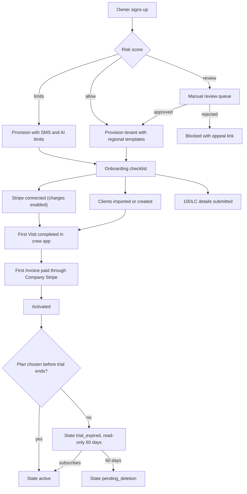

### 5.2 Flow B: Tenant lifecycle

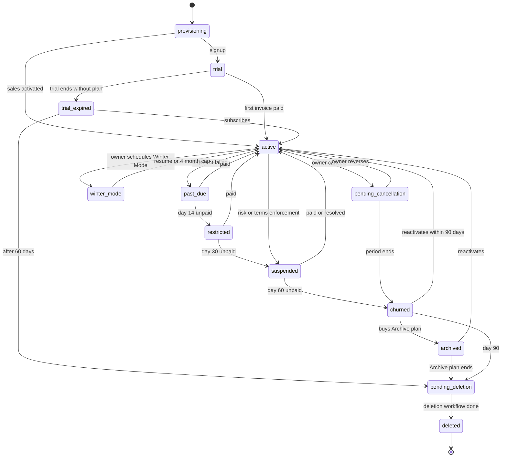

Note: an active legal hold blocks the `pending_deletion -> deleted` transition (PA-132).

### 5.3 Flow C: Consent-based support access and impersonation

1. Office manager chats: "My Thursday route for Crew 2 shows 3 visits missing."
2. Agent finds the tenant via global search (redacted results), opens Tenant 360; diagnostics show no errors.
3. Agent clicks "Request access": scope `read_only`, modules `scheduling`, duration 4 hours, reason `customer_request`, ticket linked.
4. Tenant approver (`owner`, or `office_manager`, who holds `support_access.grant` for read-only scopes by default) approves in-app with MFA.
5. Agent starts an impersonation session as the crew lead (read-only), sees that the 3 visits belong to a Service Agreement whose recurrence ended October 31.
6. Agent asks for `read_write` upgrade to extend the agreement; only the `owner` can approve `read_write`, so the request goes to the owner, who approves it; agent extends the recurrence after the owner confirms in chat (30-minute session cap).
7. Session ends; the owner gets the email summary; tenant's Support Access Log shows the session, pages viewed and the 1 change; audit records are hash-chained.

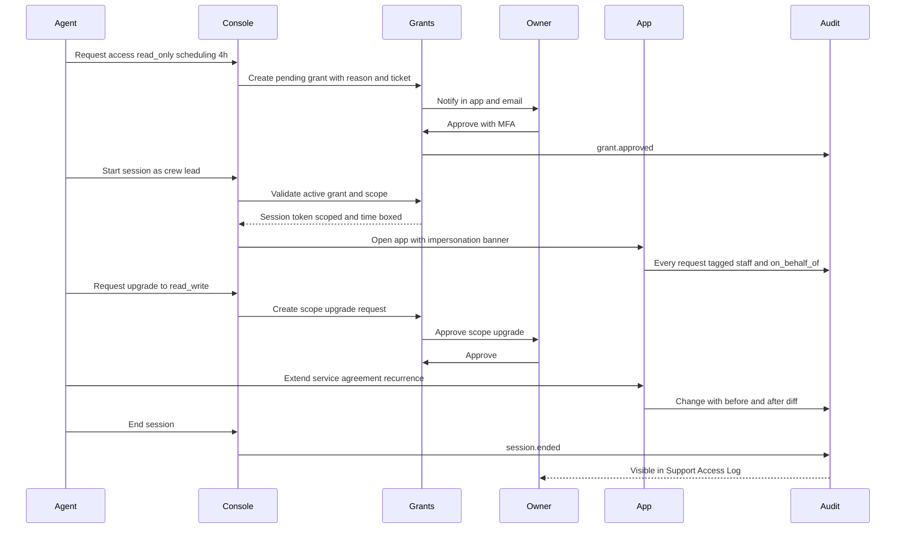

### 5.4 Flow D: Self-serve or white-glove migration

1. Tenant chooses "Import from Jobber" and uploads Jobber's export files (or a specialist does so under a `migration` grant).
2. Source detection matches the Jobber profile; AI mapping fills field mappings; tenant confirms 3 low-confidence fields.
3. Staging and validation: 14 duplicate clients, 22 addresses at interpolated precision, 6 recurring schedules with ambiguous frequency.
4. Tenant resolves warnings (merge duplicates, confirm addresses on a map, pick "weekly" for the ambiguous schedules).
5. Dry-run diff approved by the owner; financial objects approved by the bookkeeper.
6. Commit runs as a durable workflow; reconciliation confirms AR total matches to the cent.
7. 72-hour rollback window; specialist marks the project `live` after the tenant runs its first week of routes.

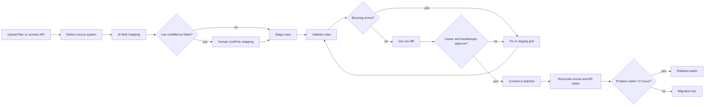

### 5.5 Flow E: Dunning on the Rootline subscription

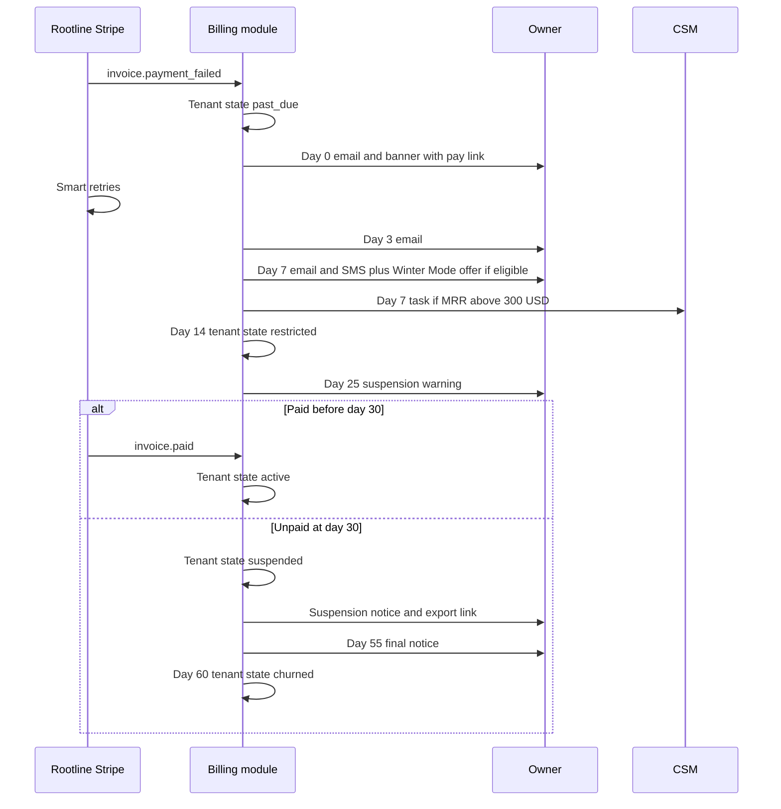

Throughout, the Customer Portal keeps accepting client payments into the Company's own Stripe account, and stays in payments-only mode until at least day 90 after the first failed payment even if the tenant churns at day 60.

### 5.6 Flow F: Safe rollout of a feature, prompt or model change

1. Engineer creates a release flag `route_optimizer_v2` (owner, expiry 90 days) and links guardrail metrics.
2. Prompt/model changes additionally require a passing eval run in the AI Ops eval suite.
3. Rollout plan: internal tenants -> 5% -> 25% -> 50% -> 100% with 48-hour soak per step, blocked during peak-season freeze windows.
4. Guardrail breach for 15 minutes triggers auto-rollback and pages the flag owner.
5. At 100% for 14 days, the stale-flag report asks for code cleanup.

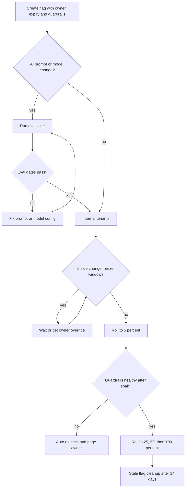

### 5.7 Flow G: DSAR for a Company's client (Rootline as processor)

1. A homeowner emails `privacy@rootline.app` asking for deletion of their data.
2. Intake parser creates a DSAR; data discovery finds matching records in 2 tenants (the homeowner switched landscapers).
3. Because each Company is the controller, Rootline routes the request to each Company's owner with a fulfillment kit and the deadline, and acknowledges receipt to the requester (naming the Companies only if permitted by the DPA and counsel).
4. Each Company approves deletion (or documents an exception: unpaid invoice, tax records).
5. Deletion workflow runs per tenant; ledger and invoice records are restricted rather than deleted; certificate issued.

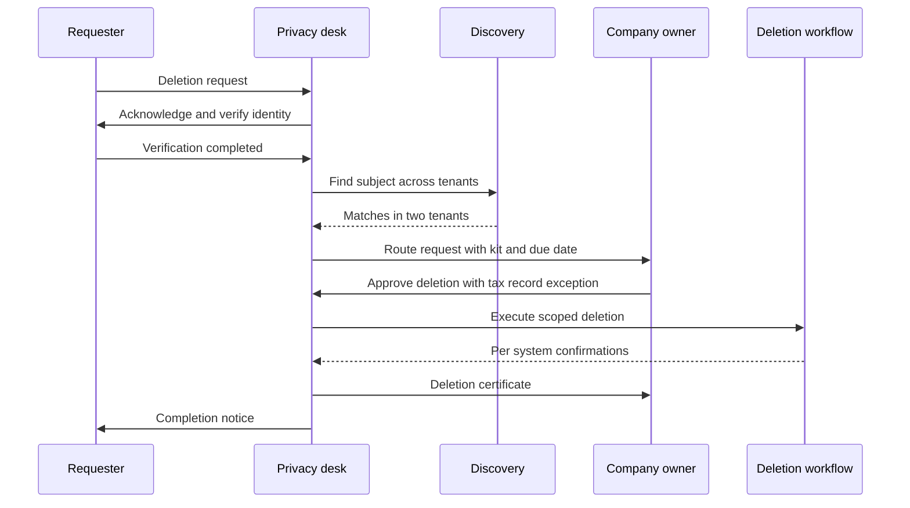

### 5.8 Flow H: 10DLC registration for a new Company

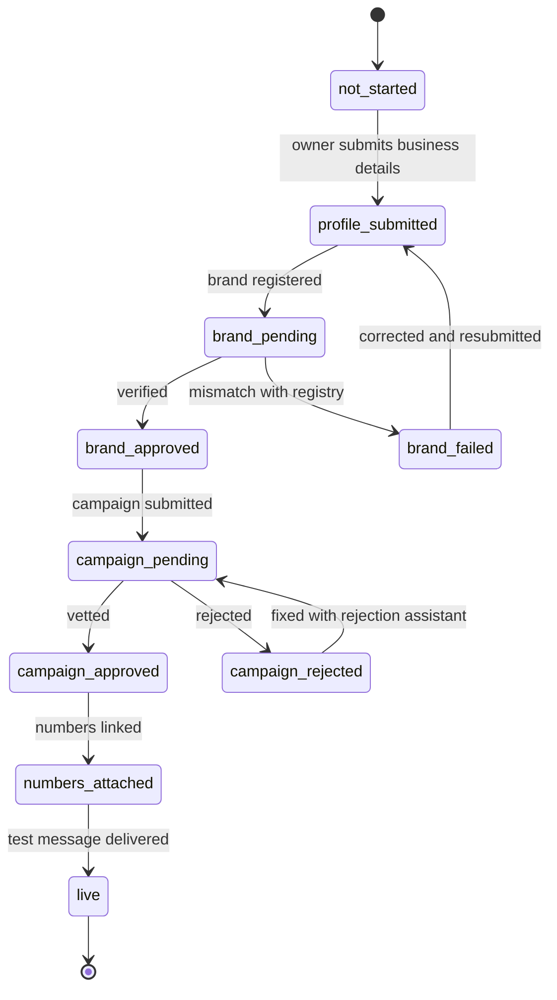

### 5.9 Flow I: Incident from alert to postmortem

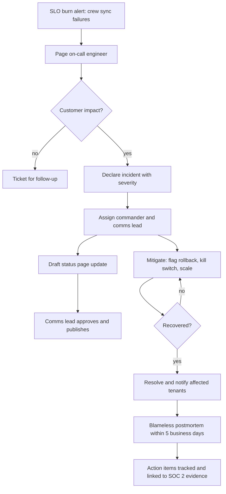

### 5.10 Flow J: Security incident to breach notification

1. A SEV1 incident tagged `security` (for example, a misconfigured export bucket discovered by a scanner) automatically opens a breach case (PA-136) and starts the clocks.
2. Engineering contains the issue; the console computes affected tenants and data classes from access logs and the data catalog.
3. Counsel and `platform_owner` run the risk-of-harm assessment per jurisdiction and record the decision, even when the answer is "no notification required".
4. If notification is required, the console generates per-tenant kits; affected Companies are notified within the DPA window (proposed 48 hours), and regulator notices where Rootline is controller go out within their statutory windows.
5. The case closes with a postmortem; the register entry is retained at least 24 months.

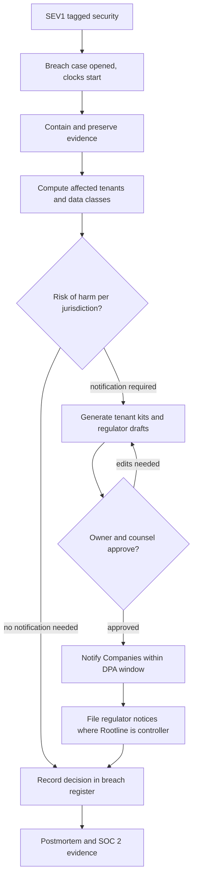

---

## 6. Screens and wireframes

### 6.1 Screen inventory

| # | Screen | Primary roles | Priority |
|---|--------|---------------|----------|
| 1 | Home / Command Center (KPIs, alerts, approvals, incidents; Morning Brief panel in V1) | all staff (content varies by role) | [MVP] |
| 2 | Tenant directory with saved views | support, finance, owner | [MVP] |
| 3 | Tenant 360 (overview, timeline, notes, subscription, usage, integrations, users, support, data and compliance, risk) | support, finance, owner | [MVP] |
| 4 | Lifecycle action dialog (suspend, extend, pause, reactivate) | support, finance, owner | [MVP] |
| 5 | Health score model editor and history | owner | [V1] |
| 6 | Organizations and ownership transfers | support, owner | [V1] |
| 7 | Migration Center: projects board | support | [MVP] |
| 8 | Migration project detail (mapping, validation, diff, reconcile) | support | [MVP] |
| 9 | Catalog: plans, add-ons, meters, credit rate card | finance, owner | [MVP] |
| 10 | Subscriptions and invoices list; dunning queue | finance | [MVP] |
| 11 | Coupons, promotions, credits | finance, support (limited) | [MVP] |
| 12 | Revenue dashboards | finance, owner | [MVP] |
| 13 | Entitlements editor (plan matrix, overrides) | owner, engineer | [MVP] |
| 14 | Feature flags list and flag editor (targeting, rollout, guardrails) | engineer, owner | [MVP] |
| 15 | Beta programs | owner, support | [V1] |
| 16 | Global search results | support | [MVP] |
| 17 | Support access grants and active sessions | support, owner | [MVP] |
| 18 | Impersonation session view (banner, scope, timer) | support, engineer | [MVP] |
| 19 | Macros and support actions library | support | [MVP] |
| 20 | Runbook actions | engineer | [V1] |
| 21 | Plant KB: curator queue, record editor, region builder map, quality dashboard, license registry | curator | [MVP] |
| 22 | Template library and template editor | support, curator, owner | [MVP] |
| 23 | Help center CMS, release notes, announcements and guides builder | support, owner | [MVP] |
| 24 | AI Ops: routing, prompt registry, evals, cost, moderation queue, kill switches | engineer, owner | [MVP] |
| 25 | Comms Ops: 10DLC board, numbers, sender domains, deliverability | support, engineer | [MVP] |
| 26 | Payments oversight: connected account health, webhook health, dispute rates | finance, engineer, owner | [MVP] |
| 27 | Risk and Trust review queue and enforcement | support, owner | [MVP] |
| 28 | Compliance: DSAR queue, retention policies, legal holds, subprocessors, SOC 2 evidence | owner, finance | [MVP] |
| 29 | Platform analytics: churn, cohorts, activation funnel, feature adoption, NPS, unit economics | owner, finance | [MVP] |
| 30 | System health: services, queues, integrations, scheduled jobs | engineer | [MVP] |
| 31 | Incidents and status page management | engineer, support, owner | [MVP] |
| 32 | Partners: directory, commissions, payouts | finance, owner | [V1] |
| 33 | Staff, roles, access reviews, audit log | owner | [MVP] |
| 34 | Approvals inbox (two-person requests) | owner, designated approvers | [MVP] |
| 35 | Admin API tokens | engineer, owner | [V1] |
| 36 | Seat ledger and usage/credit ledger viewer (per tenant) | finance, support | [MVP] |
| 37 | Spring-Ready Guarantee board | support, owner | [V1] |
| 38 | Payments compliance rule tables (surcharge, network thresholds) | finance, owner | [MVP] |
| 39 | Breach register and breach case view | owner, engineer | [MVP] |
| 40 | Cell placement and rebalancing view | engineer, owner | [V1] |
| 41 | Reseller billing (wholesale invoices, billing-owner changes) | finance | [V2] |
| 42 | Partner Portal (separate surface `partners.rootline.app`) | `partner_admin`, `partner_member` | [V1] |

### 6.2 Wireframe: Home / Command Center (founder view, desktop)

```text
+----------------------------------------------------------------------------------------------+
| ROOTLINE CONSOLE   [Cmd-K  Search tenants, flags, prompts, plants...]     SEV: none  (o) Ana |
+------------+---------------------------------------------------------------------------------+
| Home       |  Good morning, Ana.  Mon Apr 12 2027  -  Spring rush week 3                     |
| Tenants    |  +---------------+ +---------------+ +---------------+ +---------------+        |
| Migrations |  | MRR           | | Trials (7d)   | | Activation    | | AI margin     |        |
| Billing    |  | $412,380      | | 163 started   | | 41% (30d coh) | | 63% (wk)      |        |
| Flags      |  | +$6,210 wk    | | 38 converted  | | target 50%    | | v -4 pts      |        |
| Support    |  +---------------+ +---------------+ +---------------+ +---------------+        |
| Plant KB   |  NEEDS YOU (4)                               | MORNING BRIEF                    |
| Content    |  [!] Approve: price version Pro 2027         | - 3 tenants moved to past_due    |
| AI Ops     |  [!] Approve: break-glass TNT-50211          | - Mockup spend +18% vs forecast: |
| Comms      |  [ ] Legal hold release: Matter 2026-07      |   TNT-48877: 2,300 renders/48h   |
| Payments   |  [ ] Beta graduation: AI Layout Gen          |   [Review]                       |
| Risk       |                                              | - 10DLC: 27 approved, 4 rejected |
| Compliance |  AT-RISK (red band, MRR > $300)              | - DSARs due within 7 days: 2     |
| Analytics  |  Name               MRR    Score Why         | - QBO sync incident fixed 3:12a  |
| Health     |  Pine Ridge Grounds $1,140  31  invoices -62%|                                  |
| Partners   |  Hilltop Lawn Co    $  389  36  QBO fail 9d  |                                  |
| Staff/Audit|  Coastal Hardscape  $  720  38  owner NPS 3  | [Ask the Copilot..............]  |
+------------+---------------------------------------------------------------------------------+
```

### 6.3 Wireframe: Tenant 360

```text
+----------------------------------------------------------------------------------------------+
| < Tenants   GREENWAY LAWN & LANDSCAPE  TNT-48213   Pro + Snow + Ledger   [active 806d]       |
| Health 74 (green) /\/\_/\--  MRR $689   Region: Twin Cities MN (USDA 4b-5a)   CSM: Dev P.    |
| Access: NONE  [Request access]  [Actions v]  [Open in helpdesk]                              |
+----------------------------------------------------------------------------------------------+
| Overview |Timeline| Notes |Subscription| Usage |Integrations| Users |Support| Data | Risk    |
+----------------------------------------------------------------------------------------------+
| ALERTS                                          | ACTIVATION                                 |
| (!) Stripe: 1 requirement due by May 2          | [x] Stripe connected  [x] First visit      |
|     "company.tax_id verification" [Nudge owner] | [x] First invoice paid [x] Crew app (6/7)  |
| (i) 10DLC campaign approved Mar 3               | [ ] Ledger bank feed   [x] 10DLC live      |
| (!) Crew app 2.14 on 3 devices (min 2.16)       |                                            |
+-------------------------------------------------+--------------------------------------------+
| SEASONALITY: visits completed per week (this year vs last year)                              |
|  250 |                         ___..--''''--..__                                             |
|  125 |              __..--''''                  ''--..__          snow events: * *           |
|    0 |___..--''''                                         ''--..___*____*______              |
|       Jan   Feb   Mar   Apr   May   Jun   Jul   Aug   Sep   Oct   Nov   Dec                  |
+----------------------------------------------------------------------------------------------+
| TOP HEALTH FACTORS: + Visits on pace with last year  + 9/11 seats active  - 2 tickets open   |
| PINNED NOTE: Owner Mike prefers text. Crew leads Spanish-first. Migrated from Jobber Jan 2025|
+----------------------------------------------------------------------------------------------+
```

### 6.4 Wireframe: Support access request and impersonation banner

```text
+------------------------------- Request access to Greenway Lawn ------------------------------+
| Scope        (o) Read-only   ( ) Read-write   ( ) Migration   ( ) Ledger (requires opt-in)   |
| Modules      [x] Scheduling  [ ] Invoicing  [ ] Design  [ ] Settings  [ ] Portal             |
| Duration     [ 72 hours v ]   (read-only: max 7 days; read-write: owner only, max 72 h)      |
| Reason       [ customer_request v ]   Ticket [ HD-20931 ]                                    |
| Note to owner "Checking why 3 Thursday visits are missing from Crew 2's route."              |
| Approver     Mike T. (owner) - notify via [x] app [x] email [ ] SMS                          |
|                                                      [Cancel]   [Send request]               |
+----------------------------------------------------------------------------------------------+

 ...after approval, inside the session:
+----------------------------------------------------------------------------------------------+
|## ROOTLINE SUPPORT (Maria G.) as Jose R. (crew_lead) | READ-ONLY | ends 3:40 pm | [End] ##   |
+----------------------------------------------------------------------------------------------+
| Schedule > Crew 2 > Thu Apr 15                                                               |
|  07:10  Larson residence     Weekly mow + trim           (Agreement AGR-1182)                |
|  07:55  Oak Hollow HOA       Common area mow             (Agreement AGR-0931)                |
|  ...                                                                                         |
| [Request read-write upgrade]                                                                 |
+----------------------------------------------------------------------------------------------+
```

### 6.5 Wireframe: Migration project detail

```text
+----------------------------------------------------------------------------------------------+
| Migrations > MIG-0412  Hilltop Lawn Co  Source: Jobber export (Jan 2027)   State: validating |
| Specialist: Luis R.   Cutover: Feb 1   Go-live target: Feb 15   SLA: day 6 of 15             |
+----------------------------------------------------------------------------------------------+
| 1 Files > 2 Mapping > [3 Validation] > 4 Dry run > 5 Approve > 6 Commit > 7 Reconcile        |
+----------------------------------------------------------------------------------------------+
| Object            Rows   Ready   Warnings   Errors   Auto-fixed                              |
| Clients           1,228  1,192      22         0         14 (phone format)                   |
| Properties        1,401  1,379      22         0         31 (unit/suite parsed)              |
| Recurring service   318    312       6         0          0                                  |
| Open invoices        87     86       0         1          0                                  |
| Price book          146    146       0         0          9 (unit normalized)                |
+----------------------------------------------------------------------------------------------+
| ERROR  INV-3381  balance -$45.00 not marked as credit   [Mark as credit memo] [Exclude]      |
| WARN   22 addresses geocoded at interpolated precision  [Review on map]                      |
| WARN   6 schedules "every 7-10 days"                     [Set to weekly] [Set to 10-day]     |
| WARN   14 possible duplicate clients                     [Review merges]                     |
+----------------------------------------------------------------------------------------------+
| AR check: source $48,255.55   staged $48,210.55   diff $45.00 (INV-3381)                     |
|                                              [Save]   [Run dry run]  (blocked: 1 error)      |
+----------------------------------------------------------------------------------------------+
```

### 6.6 Wireframe: Feature flag editor

```text
+----------------------------------------------------------------------------------------------+
| Flags > route_optimizer_v2   type: release   owner: Priya S.   expires: Jul 31   ON          |
+----------------------------------------------------------------------------------------------+
| TARGETING (evaluated top to bottom)                                                          |
| 1. Exclude tenants: TNT-50011, TNT-50290 (enterprise change freeze)                          |
| 2. Include beta program: "Routing Labs" (64 tenants)                                         |
| 3. If country = CA -> OFF (metric distance QA pending)                                       |
| 4. Percentage: [====25%=====          ] sticky by tenant_id   segment: maintenance, snow     |
| 5. Default: OFF                                                                              |
+----------------------------------------------------------------------------------------------+
| GUARDRAILS (auto-rollback if breached 15 min)       current      threshold                   |
|  Optimizer error rate                                0.4%         < 2%                       |
|  Dispatcher manual overrides per route               1.3          < 2.5                      |
|  Route drive minutes vs v1 (same tenants)            -11%         < +5%                      |
|  Tickets tagged "routing" per 100 tenants/day        0.7          < 1.5                      |
+----------------------------------------------------------------------------------------------+
| ROLLOUT PLAN: internal [done] > 5% [done] > 25% [now, soak 31h/48h] > 50% > 100%             |
| Freeze windows: Apr 1-14 (Region: Southeast), weekdays 05:00-09:00 local                     |
| [View audit history]                    [Pause rollout]   [Kill]   [Advance to 50%]          |
+----------------------------------------------------------------------------------------------+
```

### 6.7 Wireframe: AI Ops overview

```text
+----------------------------------------------------------------------------------------------+
| AI OPS  Today: 192K credits  Provider cost $1,490  Credit rev. (alloc.) $4,030  Margin 63%   |
+----------------------------------------------------------------------------------------------+
| TASK                 MODEL ROUTE (primary > fallback)     p95     err    cost/call  KILL     |
| copilot.chat         claude-mid > claude-small            3.1s    0.2%   $0.011     [on ]    |
| proposal.draft       claude-frontier                      9.8s    0.4%   $0.042     [on ]    |
| mockup.render        flux-controlnet > gemini-image       21s     1.9%   $0.090     [deg]    |
| layout.generate      claude-frontier + OR solver          34s     0.8%   $0.150     [on ]    |
| plant.recommend      claude-small + KB retrieval          1.4s    0.1%   $0.003     [on ]    |
+----------------------------------------------------------------------------------------------+
| EVALS (last run)            score   gate     | ANOMALIES                                     |
| plant.recommend region-fit  99.4%   >=99%  ok | TNT-48877 mockups 2,300 in 48h (12x norm)    |
| proposal.draft scope match  93.1%   >=92%  ok |   [Throttle] [Contact] [Open risk case]      |
| mockup.fidelity (judge)     4.2/5   >=4.0  ok | Prompt injection attempts: 7 (blocked)       |
| takeoff.extract qty error   3.8%    <=5%   ok |                                              |
| [Prompt registry]  [Routing config]  [Credit rate card]  [Moderation queue (12)]             |
+----------------------------------------------------------------------------------------------+
```

Route labels are tier aliases resolved by the AI Gateway ([20](20-architecture-security.md)): `claude-frontier`, `claude-mid` and `claude-small` map to the current Anthropic Claude models for each tier, and `flux-controlnet` and `gemini-image` to the image models chosen per task, so a model upgrade is a routing change behind an eval gate, not a code change. Credit revenue is allocated at a blended $0.021 per credit, inside the $0.017-$0.025 range in [22](22-business-model-pricing-gtm.md) section 7.4.

### 6.8 Wireframe: Tenant directory (saved view)

```text
+----------------------------------------------------------------------------------------------+
| Tenants   View: [ Trials ending in 7 days v ]  [+ Filter]  [Columns]   47 of 6,212 tenants   |
+----------------------------------------------------------------------------------------------+
| [ ] Name                 Plan  State  Health  Milestones  Region           Source  Ends      |
| [ ] Blue Spruce Lawn     grow  trial  61 Y    4/6 +14d    Front Range CO   Jobber  Nov 10    |
| [ ] Cardinal Outdoor     grow  trial  82 G    6/6         Columbus OH      CSV     Nov 11    |
| [ ] Tres Hermanos Lawn   grow  trial  34 R    1/6         San Antonio TX   none    Nov 12    |
|        why: Stripe not connected 9d; 0 crew logins; owner locale es-US [Assign ES CSM]       |
| [ ] Northfield Snow & L  grow  trial  70 G    5/6         Twin Cities MN   SA      Nov 13    |
|        Winter trial (30 d)  snow tenant  10DLC campaign_pending day 11   [Check 10DLC]       |
| ...                                                                                          |
+----------------------------------------------------------------------------------------------+
| Selected: 3   Bulk: [Add tag] [Assign CSM] [Extend trial (max +30 bulk)] [Enroll beta]       |
|               [Send announcement] [Export CSV (audited, needs export permission)]            |
| Every bulk action asks for a reason code and shows a dry-run count before it runs.           |
+----------------------------------------------------------------------------------------------+
```

### 6.9 Wireframe: Plant KB curator queue and Region builder

```text
+----------------------------------------------------------------------------------------------+
| PLANT KB > Curator queue   Region: [ Front Range, CO (v7) v ]   Assigned to me: 60           |
+----------------------------------------------+-----------------------------------------------+
| QUEUE  source: kb.enrich prompt v3.2         | Penstemon strictus (Rocky Mountain penstemon) |
| [>] Penstemon strictus   drought  0.94       | Field: drought tolerance, Front Range         |
| [ ] Agastache rupestris  deer     0.88       | Current: moderate    Proposed: high           |
| [ ] Ratibida columnifera bloom    0.91       | Sources (2 agree):                            |
| [!] Euphorbia myrsinites invasive 0.97       |  A  state extension xeriscape sheet           |
|     critical trait: 2nd curator needed       |  B  regional native plant society list        |
| [ ] Salvia nemorosa      height   0.83       | Tenant signals: 0 failure reports             |
| ...                                          | [Accept] [Edit + accept] [Reject]             |
| Bulk accept: non-critical, conf > 0.9,       | [2nd opinion]   diff vs v6 [View]             |
|   2+ agreeing sources  (31 eligible)         |                                               |
+----------------------------------------------+-----------------------------------------------+
| REGION BUILDER  Front Range, CO   draft v8 (published v7)                                    |
| Layers: [x] USDA 2023 zones 5b-6b  [x] EPA Level III: High Plains  [x] Elev 4,800-6,500 ft   |
|         [x] Counties: Larimer, Boulder, Jefferson, Denver, Arapahoe, Douglas  [ ] El Paso    |
| Preview: 38 tenants | 21,406 Properties | 612 plants with profiles | overlap 'Pikes Peak' 4% |
| Republishing moves 1,212 Properties to this Region   [Preview diff]  [Submit for approval]   |
+----------------------------------------------------------------------------------------------+
```

Region publication is requested by `platform_curator` and approved by `platform_owner` (section 9). Critical traits (invasiveness, toxicity, deer-resistance claims, hardiness) cannot be bulk-accepted and need a second curator (PA-070, PA-073).

### 6.10 Wireframe: Connected Account Health board

```text
+----------------------------------------------------------------------------------------------+
| PAYMENTS OVERSIGHT > Connected accounts   4,812 connected   97.9% charges enabled            |
| (no charge, refund, payout or dispute-response actions exist on this screen, by design)      |
+----------------------------------------------------------------------------------------------+
| Views: [Deadline <=7d 23] [Charges off 41] [Payouts off 12] [RAK failing 3] [Disconnected 9] |
+----------------------------------------------------------------------------------------------+
| Tenant              Method          Gen Chg Pay Due Deadline Reason                 Action   |
| Pine Ridge Grounds  oauth           v1  on  on  2   Nov 12   -                      [Nudge]  |
| Hilltop Lawn Co     account_link    v2  off off 4   passed   requirements.past_due  [Call]   |
| Coastal Hardscape   restricted_key  -   on  on  -   -        key check failed 2h    [Alert]  |
| Maple & Stone LLC   oauth           v1  off off -   -        deauthorized Nov 6     [CSM]    |
| ...                                                                                          |
+----------------------------------------------------------------------------------------------+
| WEBHOOKS  connect 212/min p95 1.8s DLQ 0 | platform 3/min | v2 41/min | rak 2/min |          |
|           billing 6/min | signature failures 24h: 0     [Replay event by ID] [Reprocess DLQ] |
| DISPUTES (90 d)  platform 0.21% | 3 tenants above 0.75% internal alert | 0 near network limit|
|                  top reason: product_not_received (per-visit mowing)  [Open dispute board]   |
+----------------------------------------------------------------------------------------------+
```

### 6.11 Wireframe: Compliance desk (DSARs and breach case)

```text
+----------------------------------------------------------------------------------------------+
| COMPLIANCE DESK  DSARs open 7 (2 due in 7 d)  Legal holds 3  Breach cases 1  Evidence 96%    |
+------------------------------------------------+---------------------------------------------+
| DSAR QUEUE                                     | BREACH CASE BRC-2027-004  clocks running    |
| DSAR-0193 delete  homeowner  processor         | Opened Apr 14 06:02 from SEV1 INC-311       |
|   routed to 2 tenants  due Apr 21 (CCPA)       | Tenants affected: 14  Data: names, phones   |
|   Greenway: approved, tax exception            | Payment data: none (SAQ-A scope)            |
|   Oak Hollow HOA mgmt: awaiting owner          |                                             |
| DSAR-0197 access  tenant user  controller      | DPA notice to Companies  due 31h  [Kits]    |
|   identity verified   due May 14 (GDPR)        | Risk-of-harm assessment  counsel [Open]     |
| DSAR-0198 opt-out  site visitor  controller    | Regulator notices  per jurisdiction table   |
|   auto-fulfilled (marketing cookies off)       | Register entry retained to Apr 2029         |
+------------------------------------------------+---------------------------------------------+
| [New DSAR]  [Apply legal hold]  [Retention policies]  [Subprocessors]  [SOC 2 evidence pack] |
+----------------------------------------------------------------------------------------------+
```

---

## 7. Data model

All platform-admin entities live in a dedicated `platform` schema that is **not** subject to tenant row-level security (they are cross-tenant by nature) but is only reachable by the console and Admin API services, which enforce staff RBAC. Tenant domain data stays in tenant-scoped tables under RLS ([20](20-architecture-security.md)); impersonation sessions access it through the normal tenant code paths with a grant-scoped token, never via the platform schema.

### 7.1 Tenants, subscriptions and entitlements

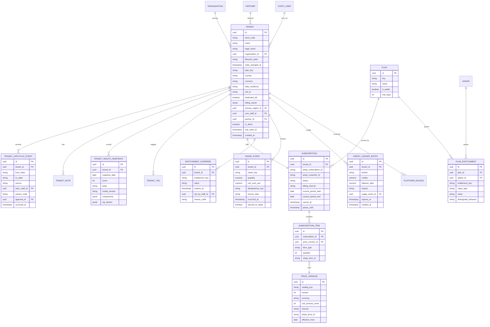

### 7.2 Staff, access, audit, flags and support

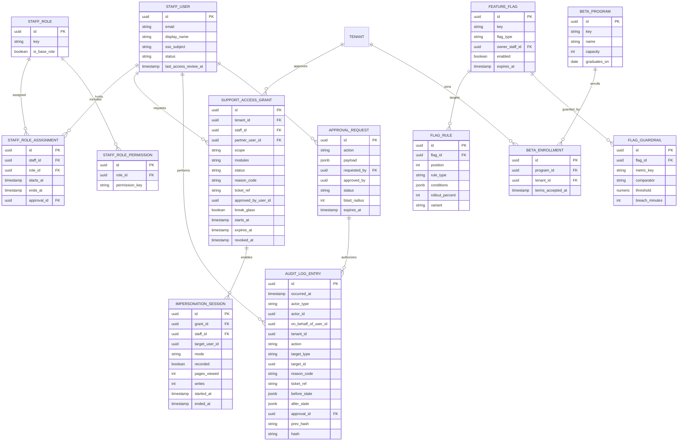

### 7.3 Migration, AI ops, comms, payments oversight, risk and compliance

```mermaid
erDiagram
    TENANT ||--o{ MIGRATION_PROJECT : migrates
    MIGRATION_PROJECT ||--o{ MIGRATION_BATCH : commits
    MIGRATION_BATCH ||--o{ MIGRATION_ISSUE : reports
    MAPPING_PROFILE ||--o{ MIGRATION_PROJECT : maps
    PROMPT_TEMPLATE ||--o{ PROMPT_VERSION : versions
    PROMPT_VERSION ||--o{ EVAL_RUN : evaluated
    EVAL_SUITE ||--o{ EVAL_RUN : runs
    AI_TASK_ROUTE ||--o{ AI_CALL_RECORD : routes
    TENANT ||--o{ AI_CALL_RECORD : consumes
    TENANT ||--o{ MESSAGING_BRAND : registers
    MESSAGING_BRAND ||--o{ MESSAGING_CAMPAIGN : runs
    TENANT ||--o{ SENDER_DOMAIN : sends_from
    TENANT ||--|| CONNECTED_ACCOUNT_STATUS : connects
    TENANT ||--o{ RISK_SIGNAL : flagged
    TENANT ||--o{ ENFORCEMENT_ACTION : enforced
    DSAR_REQUEST ||--o{ DSAR_TASK : splits
    TENANT ||--o{ DSAR_TASK : fulfills
    LEGAL_HOLD ||--o{ LEGAL_HOLD_SCOPE : covers
    INCIDENT ||--o{ INCIDENT_IMPACT : affects

    MIGRATION_PROJECT {
        uuid id PK
        uuid tenant_id FK
        string source_system
        string mode
        string state
        uuid specialist_staff_id FK
        uuid mapping_profile_id FK
        date cutover_date
        date golive_target
        timestamp rollback_until
    }
    MIGRATION_BATCH {
        uuid id PK
        uuid project_id FK
        string object_type
        int rows_staged
        int rows_committed
        string status
        jsonb reconciliation
    }
    MIGRATION_ISSUE {
        uuid id PK
        uuid batch_id FK
        string severity
        string rule_key
        string source_row_ref
        string resolution
    }
    MAPPING_PROFILE {
        uuid id PK
        string source_system
        string source_version
        jsonb field_map
    }
    PROMPT_TEMPLATE {
        uuid id PK
        string key
        string ai_task
    }
    PROMPT_VERSION {
        uuid id PK
        uuid template_id FK
        string semver
        text body
        jsonb output_schema
        string deploy_state
        uuid author_staff_id FK
    }
    EVAL_SUITE {
        uuid id PK
        string key
        string ai_task
        int case_count
    }
    EVAL_RUN {
        uuid id PK
        uuid suite_id FK
        uuid prompt_version_id FK
        string model_key
        jsonb metrics
        boolean gate_passed
        timestamp ran_at
    }
    AI_TASK_ROUTE {
        uuid id PK
        string ai_task
        string primary_model
        string fallback_chain
        string kill_state
        int version
    }
    AI_CALL_RECORD {
        uuid id PK
        uuid tenant_id FK
        uuid route_id FK
        string model_key
        int input_tokens
        int output_tokens
        int image_units
        numeric provider_cost_usd
        numeric credits_charged
        timestamp occurred_at
    }
    MESSAGING_BRAND {
        uuid id PK
        uuid tenant_id FK
        string provider_brand_ref
        string brand_type
        string status
        string failure_reason
    }
    MESSAGING_CAMPAIGN {
        uuid id PK
        uuid brand_id FK
        string use_case
        string status
        string rejection_reason
        timestamp approved_at
    }
    SENDER_DOMAIN {
        uuid id PK
        uuid tenant_id FK
        string domain
        boolean spf_ok
        boolean dkim_ok
        string dmarc_policy
        numeric complaint_rate_30d
    }
    CONNECTED_ACCOUNT_STATUS {
        uuid id PK
        uuid tenant_id FK
        string stripe_account_id
        string connection_mode
        string api_generation
        boolean charges_enabled
        boolean payouts_enabled
        int requirements_due
        string disabled_reason
        timestamp current_deadline
        numeric dispute_rate_90d
        timestamp last_event_at
    }
    RISK_SIGNAL {
        uuid id PK
        uuid tenant_id FK
        string signal_type
        int score_delta
        jsonb evidence
        timestamp detected_at
    }
    ENFORCEMENT_ACTION {
        uuid id PK
        uuid tenant_id FK
        string level
        string policy_ref
        string status
        timestamp appeal_until
    }
    DSAR_REQUEST {
        uuid id PK
        string request_type
        string jurisdiction
        string role_context
        string status
        date due_at
        boolean identity_verified
    }
    DSAR_TASK {
        uuid id PK
        uuid dsar_id FK
        uuid tenant_id FK
        string status
        string exception_reason
    }
    LEGAL_HOLD {
        uuid id PK
        string matter_name
        string counsel
        string status
        timestamp released_at
    }
    LEGAL_HOLD_SCOPE {
        uuid id PK
        uuid hold_id FK
        uuid tenant_id
        string data_class
        date from_date
        date to_date
    }
    INCIDENT {
        uuid id PK
        string severity
        string status
        string title
        uuid commander_staff_id
        timestamp declared_at
        timestamp resolved_at
    }
    INCIDENT_IMPACT {
        uuid id PK
        uuid incident_id FK
        uuid tenant_id
        string component
    }
```

### 7.4 Other entities (not diagrammed)

| Entity | Key fields | Notes |
|--------|-----------|-------|
| `template` / `template_version` / `template_distribution` | key, type, locale, version, distribution_mode (fork/subscribe), applicable segments | Tenant copies track `source_template_version_id` for three-way diff |
| `help_article`, `release_note`, `announcement`, `announcement_view` | audience rules, locale, schedule, frequency cap | Views feed analytics and timeline |
| `plant_kb_change_request` | target record, proposed diff, source citations, confidence, author (staff or AI), review state | Full KB model in [12](12-plant-knowledge-base.md) |
| `region_definition_version` | layer expression, geometry, published_at | Property re-assignment job references version |
| `license_record` | asset/dataset, license type, attribution, allowed uses, expiry | Enforced at KB API |
| `partner`, `partner_user`, `referral`, `commission_line`, `partner_payout` | tier, agreement terms, commission rule, clawback window | Partner Portal |
| `retention_policy`, `retention_run` | data class, period, override bounds, last run report | Two-person changes |
| `subprocessor` | name, purpose, data categories, location, DPA URL, review date | Generates public page |
| `status_component`, `status_update` | component, state, message, published_at | Mirrored to status page vendor |
| `service_token` | scopes, owner, purpose, ip_allowlist, expires_at, last_used_at | Admin API |
| `macro`, `support_action_run` | locale bodies, bundled actions, dry-run output, undo token | Support |
| `seat_count_entry` | tenant_id, period, user_id, seat_type, counted_reason (auth, clock_in, visit_status), source_event_id, disputed_by, dispute_reason | Seat ledger (PA-031); one row per user per period, rebuilt idempotently from events |
| `migration_guarantee` | tenant_id, eligible (bool), signed_at, deadline (Mar 31), milestone_status jsonb, at_risk_since, outcome (met, missed_tenant, missed_rootline), credit_id | Spring-Ready Guarantee (PA-022) |
| `payments_rule_set` / `payments_rule` | version, jurisdiction, rule_key, value, source_url, effective_from, approved_by | Surcharge and network-threshold tables (PA-115); immutable once published |
| `breach_case` | opened_at, source_incident_id, data_classes, tenants_affected, subjects_estimate, harm_assessment jsonb, decision, closed_at, retain_until | Breach register (PA-136); retained at least 24 months |
| `breach_notification` | case_id, audience (tenant, regulator, subject), jurisdiction, due_at, sent_at, template_version, approved_by | One row per obligation clock |
| `support_pin` | user_id, pin_hash, rotated_at, failed_attempts_24h | Caller verification (PA-061); PIN never stored in clear |
| `reseller_agreement` | partner_id, wholesale_price_map, billing_day, notice_days, status | Reseller billing (PA-163) |
| `consent_record` (comms) | tenant_id, recipient_hash, channel, consent_basis, source, captured_at, implied_consent_expires_at, revoked_at, revocation_text | TCPA and CASL handling (PA-101); owned with [16](16-marketing-growth-communications.md) |

---

## 8. Integrations, APIs and events

### 8.1 External services

| Service | Purpose in the console | Notes |
|---------|------------------------|-------|
| **Stripe (Rootline's own account)** - Billing, Tax, Checkout, Quotes, Customer Portal | SaaS subscriptions, usage meters, invoices, dunning, tax, refunds | Separate from Connect; Rootline catalog is source of truth ([Stripe meters](https://docs.stripe.com/billing/subscriptions/usage-based/meters/configure)) |
| **Stripe Connect (platform webhooks)** | Connected account health, application fees, dispute aggregates | `account.updated`, `account.application.deauthorized`, `charge.dispute.*` ([Stripe](https://docs.stripe.com/connect/handling-api-verification)) |
| **Twilio** (Trust Hub, Messaging, Phone Numbers, Voice) | 10DLC brands/campaigns, numbers, ports, delivery health | ISV model with Secondary Customer Profiles ([Twilio](https://www.twilio.com/docs/sms/a2p-10dlc/isv-api-registration-overview)) |
| **Postmark / SendGrid** | Sender domains, streams, bounces, complaints, suppressions | Webhooks for bounce, spam complaint, delivery |
| **Helpdesk** (Intercom / Plain / Zendesk / Help Scout) | Tickets, chat, sidebar app, macros sync | Identity verification for in-app chat |
| **Product analytics and session replay** (PostHog or equivalent) | Feature adoption, funnels, opt-in replay | Self-hosted or US/CA-region cloud, masking defaults |
| **Error tracking and observability** (Sentry, OpenTelemetry stack) | Tenant diagnostics, service health | PII scrubbing at SDK level |
| **Paging** (PagerDuty / Opsgenie) | On-call, escalation | Incident timeline import |
| **Status page** (managed service) | Public status, subscribers | Independent infrastructure |
| **GRC** (Vanta / Drata / Secureframe) | SOC 2 evidence, policy acknowledgements | V1 |
| **Identity** (Google Workspace, Okta/Entra) | Staff SSO, SCIM | WebAuthn enforced |
| **AI providers** via AI Gateway | Routing, cost, moderation | See [17](17-ai-copilot-automation.md), [20](20-architecture-security.md) |
| **Maps/parcel/elevation/imagery providers** | Quota and error monitoring; Region builder layers | Mapbox/Google, Regrid, USGS 3DEP, aerial imagery vendor |
| **QuickBooks Online / Desktop, Xero, Plaid** | Sync health, migration importers | OAuth token health, error code analytics |
| **Data warehouse** | Platform analytics and cohort models | See [18](18-reporting-analytics.md) |
| **Slack** | Morning Brief, alerts, Copilot | Approved workspace only, no tenant PII in messages |

### 8.2 Domain events emitted by the platform-admin module

All events flow through the transactional outbox to the event bus ([20](20-architecture-security.md)); payloads carry IDs and metadata, not tenant PII.

| Event | Key payload | Typical consumers |
|-------|-------------|-------------------|
| `tenant.provisioned` | tenant_id, plan, region, segment | Template seeding, analytics, CRM |
| `tenant.lifecycle_changed` | tenant_id, from, to, reason_code, source | Entitlements, notifications, analytics, partner commissions |
| `tenant.health_scored` | tenant_id, score, band, top_factors | CSM tasks, Morning Brief |
| `subscription.changed` | tenant_id, items, interval, effective_at | Entitlements, revenue reporting |
| `entitlement.changed` | tenant_id, key, old, new | Company app (live UI update), crew app sync |
| `flag.changed` / `flag.rolled_back` | flag key, rule diff, actor | SDK streams, incident timeline |
| `ai.kill_switch_changed` | scope, state, actor | AI Gateway, Copilot UI |
| `ai.route_changed` / `prompt.deployed` | task, version | AI Gateway, eval tracking |
| `support_access.requested/approved/revoked/expired` | grant_id, tenant_id, scope | Tenant notifications, audit, access log |
| `impersonation.started/ended` | session_id, grant_id, target_user | Tenant app banner, audit |
| `migration.committed/rolled_back` | project_id, batch_id, counts | Tenant notification, onboarding tracker |
| `messaging.brand_status_changed` / `messaging.campaign_status_changed` | tenant_id, status, reason | Onboarding tracker, tenant notifications, SMS gate |
| `connected_account.status_changed` | tenant_id, charges_enabled, payouts_enabled, deadline | Tenant nudges, portal payment buttons, health score |
| `risk.enforcement_applied` | tenant_id, level, policy_ref | Entitlements (restrictions), notifications |
| `dsar.received/routed/completed` | dsar_id, due_at, tenants | Compliance dashboard, tenant notifications |
| `legal_hold.applied/released` | hold_id, scope | Retention engine, lifecycle engine |
| `incident.declared/updated/resolved` | incident_id, severity, components | Status page, in-app banners, Morning Brief |
| `announcement.published` | announcement_id, audience | Company app, crew app, portal |
| `migration.guarantee_at_risk` / `migration.guarantee_resolved` | tenant_id, project_id, milestone, outcome | Migration queue priority, CSM tasks, billing credit (PA-022) |
| `payments_rule_set.published` | version, jurisdictions, effective_from | Payments module checkout revalidation ([08](08-payments-stripe.md)), tenant notices |
| `breach.case_opened` / `breach.notification_sent` | case_id, audience, jurisdiction, due_at | Compliance desk, SOC 2 evidence, Morning Brief (no tenant PII in payload) |
| `seat_count.adjusted` | tenant_id, period, user_id, reason_code | Billing (next invoice), audit |
| `billing_owner.changed` | tenant_id, from, to | Billing, Partner Portal, tenant Settings |

### 8.3 Events consumed

| Source | Events | Handling |
|--------|--------|----------|
| Rootline Stripe account | `customer.subscription.created/updated/deleted`, `invoice.created`, `invoice.finalized`, `invoice.paid`, `invoice.payment_failed`, `customer.subscription.trial_will_end`, `charge.dispute.created` (on our own subscription charges) | Lifecycle transitions, dunning, usage reconciliation before finalization |
| Stripe Connect | `account.updated`, `account.application.authorized`, `account.application.deauthorized`, `capability.updated`, `account.external_account.updated` (status only, never the bank details), Accounts v2 thin events for account and requirements updates (verify names; [08](08-payments-stripe.md)), `charge.dispute.created/closed` (aggregated only), `application_fee.created` | Connected Account Health, nudges, dispute rates, Payments disconnected cohort |
| Twilio | Brand/campaign status callbacks, message status callbacks (delivered, failed with error code), port-in status | 10DLC board, deliverability, abuse detection |
| Email provider | Bounce, spam complaint, delivery, open (broadcast only) | Suppressions, complaint-rate alarms |
| Helpdesk | Conversation created/closed, CSAT | Tenant timeline, health score |
| QBO/Xero | Token revocation, sync errors (internal events from [09](09-accounting-ledger-integrations.md)) | Integration error console |
| Observability | SLO burn alerts | Incident drafting, status page drafts |

### 8.4 Webhooks for operators

Outbound platform webhooks (signed, retried with exponential backoff for 24 hours) let Rootline's internal tools (CRM, Slack, warehouse) subscribe to the events in 8.2. Tenants do not receive platform-admin webhooks; their own webhooks are specified in [20](20-architecture-security.md).

---

## 9. Permissions

### 9.1 Platform staff capability matrix

Legend: **F** full, **R** read, **Q** request (needs approval), **A** approve (second key), **L** limited (bounded amounts or scopes), **-** none.

| Capability | `platform_owner` | `platform_support` | `platform_curator` | `platform_finance` | `platform_engineer` |
|-----------|:-:|:-:|:-:|:-:|:-:|
| View tenant directory and metadata | F | F | R (name, region only) | F | R |
| View Tenant 360 health, usage, integrations | F | F | - | R | R |
| Edit notes, tags, CSM assignment | F | F | - | L (finance notes) | - |
| Lifecycle: extend trial | F | L (+14 days once) | - | F | - |
| Lifecycle: suspend for non-payment | F | - | - | F | - |
| Lifecycle: suspend for risk/terms | A | Q | - | - | - |
| Lifecycle: schedule deletion / hard delete | A | - | - | Q | Q |
| Request Support Access Grant | F | F | - | L (billing_setup scope) | F |
| Start impersonation (with grant) | F | F | - | - | F |
| Break-glass access | A | Q | - | - | Q |
| Run safe support actions | F | F | - | L (billing ones) | F |
| Run data-touching support actions | F | F (with grant) | - | - | F (with grant) |
| Runbook actions (data repair) | A | - | - | - | Q / F under 1,000 rows |
| Migration: map, validate, dry run | F | F | - | - | F |
| Migration: commit / rollback | F | F (tenant-approved) | - | - | F |
| Catalog and price changes | A | - | - | Q | - |
| Coupons and credits | F | L (switching credit up to 3 mo; goodwill up to $200 per quarter) | - | L (catalog promotions; deal-desk discounts up to 20%; credits up to $1,000) | - |
| Refund Rootline subscription charges | F | - | - | F (over $1,000 needs A) | - |
| Revenue and unit-economics dashboards | F | - | - | F | R (cost only) |
| Entitlement overrides | F | L (limits within plan +25%) | - | F | F |
| Feature flags: edit release/experiment | F | - | - | - | F non-prod; prod with peer A (approved rollout plans advance automatically) |
| Global kill switches | A / F in SEV1 | - | - | - | Q / F in SEV1 as IC |
| Beta programs | F | F (enroll) | - | - | F |
| Plant KB: edit, review | F | - | F | - | - |
| Plant KB: publish critical traits | F | - | F (second curator) | - | - |
| Region builder publish | A | - | Q | - | - |
| License registry and takedowns | F | - | F | - | - |
| Templates: edit and publish forked | F | F | F (plant/design templates) | F (COA templates) | - |
| Templates: publish subscribed (legal) | A | Q | - | Q | - |
| Help center, release notes, announcements | F | F | L (KB articles) | - | F (release notes) |
| AI routing, prompts, evals | F | R | L (KB enrichment prompts only) | - | F staging; prod after eval gate + peer A |
| AI cost dashboards | F | R | R (KB enrichment) | F | F |
| 10DLC submit/resubmit, numbers, sender domains | F | F | - | - | F |
| Payments oversight dashboards | F | R | - | F | F |
| "Rootline payments hold" on a tenant | A | - | - | Q | Q |
| Risk queue and enforcement | A (suspend/terminate) | F (warn/restrict) | - | - | R |
| DSAR fulfillment | F | F (routing, kits) | - | - | F (execution) |
| Legal holds apply / release | F / A | - | - | Q | - |
| Retention policy changes | A | - | - | Q | Q |
| Subprocessor registry, DPA | F | R | - | F | F |
| SOC 2 evidence and access reviews | F | R | - | F | F |
| Platform analytics | F | R (support metrics) | R (KB metrics) | F | R |
| System health, queues, integrations | F | R | - | R | F |
| Incidents: declare, command | F | F (declare) | - | - | F |
| Status page publish | F | F (as comms lead) | - | - | F |
| Partners and commissions | F | R | - | F | - |
| Staff and roles | F (role changes need A) | - | - | - | - |
| Audit log read | F | R (own actions, tenant-scoped) | R (own) | R (billing actions) | R (system actions) |
| Admin API service tokens | A | - | - | - | Q |
| Seat count adjustments (PA-031) | F | L (single user, with reason) | - | F | - |
| Spring-Ready Guarantee credit (PA-022) | F | Q | - | F | - |
| Payments compliance rule tables (PA-115) | A | - | - | Q (draft) | - |
| Breach case: open, scope, assess | F | R | - | - | F |
| Breach notifications to tenants and regulators | A (with counsel) | - | - | - | Q |
| Billing owner / reseller changes (PA-163) | A | - | - | Q | - |
| Cell placement and rebalance (PA-018) | A | - | - | - | Q / F execute |
| Override caller verification (PA-061) | - | - | - | - | - |
| Data export (bulk, any) | A | Q | - | Q | Q |

Notes on the matrix:
- Nobody, including `platform_owner`, can override caller verification (PA-061); the fallback is the documentary process in PA-016.
- `platform_support` can apply an immediate **feature restriction** (for example, disable SMS broadcasts during an active spam run) under "Risk queue and enforcement"; suspension and termination still need a second approver. This reconciles with [02](02-personas-roles-permissions.md) section 10.4, which lets support suspend for abuse "with reason": the console implements that as restrict-now, suspend-with-approval.
- Prod changes to flags and AI routes follow [02](02-personas-roles-permissions.md) ("X prod with approval"); kill switches are the exception during a declared SEV1/SEV2 (PA-095).

### 9.2 Tenant-side capabilities related to operator features

| Capability | `owner` | `office_manager` | `bookkeeper` | `ops_manager` | Other tenant roles |
|-----------|:-:|:-:|:-:|:-:|:-:|
| Approve Support Access Grants | Yes (all scopes) | Read-only scopes by default (owner can remove); never `read_write`, `ledger` or `migration` | `migration` co-sign for financial objects only | No | No |
| Request support access (initiate) | Yes | Yes | Yes (ledger scope requires owner approval) | Yes | No (can chat only) |
| View Support Access Log | Yes | Yes | No | No | No |
| Revoke active grant | Yes | Yes (if they approved it) | No | No | No |
| Turn on standing read-only consent | Yes | No | No | No | No |
| See and use own support PIN (PA-061) | Yes | Yes | Yes | Yes | Yes (crew app profile) |
| Enable session replay | Yes | No | No | No | No |
| Manage Rootline subscription, seats, add-ons | Yes | If granted billing permission | View invoices | No | No |
| Run self-serve imports | Yes | Yes | Financial objects only | Operational objects only | No |
| Approve migration commit | Yes | Yes (non-financial) | Financial objects | No | No |
| Opt into beta programs | Yes | No | No | No | No |
| Submit 10DLC business details | Yes | Yes | No | No | No |
| Receive incident/dunning notices | Yes | Yes (incidents) | Dunning if billing contact | Incidents | Crew get in-app incident banners only when their surface is affected |

Partner users (`partner_admin`, `partner_member`) can only request partner-scoped grants and view referral status; they have no Operator Console access.

---

## 10. AI opportunities in this module

| # | Opportunity | Description | Priority |
|---|-------------|-------------|----------|
| 1 | **Operator Copilot and Morning Brief** | NL questions over platform metrics; daily narrative brief with linked numbers (PA-008, PA-190) | [V1] |
| 2 | **Migration mapping assistant** | Auto-detect source system, propose field mappings, normalize messy recurring-schedule text ("bi-weekly mow + edge Apr-Oct, skip July if dry") into structured recurrence plus notes | [MVP] |
| 3 | **Ticket triage and suggested macros** | Classify incoming tickets (billing, routing, sync, payments, design), detect language, attach tenant context, propose macro and support action; agents approve | [V1] |
| 4 | **Explain this error** | Summarize logs, traces and known-issue articles for a tenant's error into a plain-language diagnosis and next step | [V1] |
| 5 | **Churn risk explanations** | Turn health components and usage diffs into "why" statements and recommended plays (offer seasonal pause, schedule QBO fix call) | [V1] |
| 6 | **10DLC rejection assistant** | Map rejection codes to fixes; draft compliant campaign descriptions and sample messages from the tenant's real templates | [MVP] |
| 7 | **KB enrichment agents** | Propose plant traits and regional notes with citations into the curator queue (PA-073) | [V1] |
| 8 | **Anomaly detection** | AI-spend spikes, SMS pumping, dispute-rate jumps, sign-up fraud rings (graph of shared devices/cards/IPs) | [V1] |
| 9 | **Release notes and help article drafting** | Draft from merged PRs and flag descriptions in EN and ES; human review before publish | [MVP] |
| 10 | **Eval case generation** | Mine real (consented, anonymized) failures and curator rejections into new eval cases | [V2] |
| 11 | **Status page drafting** | Draft incident updates from alert context and affected components for comms-lead approval | [V1] |
| 12 | **DSAR discovery assistant** | Fuzzy-match data subjects across tenants (name variants, old addresses) and draft routing notices | [V2] |
| 13 | **Pricing simulator** | Simulate MRR impact of price/packaging changes on current tenant usage, with confidence ranges labeled as estimates | [V2] |
| 14 | **Autonomous support agent (supervised)** | Resolves safe-action tickets end to end (resend invite, explain an invoice, re-trigger sync) with human review sampling | [V2] |

Guardrails: the Copilot never sees tenant content without an active grant; write actions require human confirmation; outputs cite their data sources; all prompts live in the prompt registry with evals ([17](17-ai-copilot-automation.md)).

---

## 11. Edge cases, compliance and risks

| # | Scenario | Rule / mitigation |
|---|----------|-------------------|
| 1 | Tenant suspended mid-route on a Tuesday in May | Restriction applies at next visit boundary; crew can clock out and log chemical applications for 24 hours; portal payments remain open; owner gets phone + email notice before suspension takes effect |
| 2 | Tenant `past_due` during its seasonal off months | Day-7 dunning offers Winter Mode (monthly plans); if unpaid, `restricted` at day 14 and `suspended` at day 30, with data and portal payments preserved throughout |
| 3 | Owner unreachable, business sold | Ownership transfer requires documentary evidence, two staff reviewers and 7-day notice (PA-016) |
| 4 | Co-owners in a dispute (business divorce) both demand control | Freeze ownership changes, apply legal hold if counsel is involved, provide equal read-only exports only on court order or mutual written agreement |
| 5 | Office manager tries to approve a `read_write` or `ledger` grant, or a grant to view as `owner` | Not possible: approval endpoint checks scope and the role ceiling (PA-051); attempt is logged and the request is re-routed to the owner |
| 6 | Staff member abuses impersonation | Grants are scoped and logged; anomaly detection on access patterns; tenant-visible log; disciplinary policy; quarterly review of sessions sampled |
| 7 | Tenant disconnects Rootline from Stripe mid-season | `account.application.deauthorized` -> portal pay buttons become "Contact us to pay", owner and CSM alerted; no charges attempted |
| 8 | Restricted API key (advanced mode) revoked or under-scoped | Hourly key health check; failing key raises tenant alert; portal falls back to "Contact us" |
| 9 | Deletion request conflicts with tax retention | Restrict instead of delete; record exception; notify requester with legal basis |
| 10 | Legal hold on a tenant scheduled for deletion | Lifecycle blocked at `pending_deletion`; nightly job skips; hold visible to compliance only |
| 11 | Flag service unreachable | SDKs use last known values; new features default off; kill switches default to last known state; crew app offline defaults safe |
| 12 | Kill switch hit during a batch of 400 mockups | Durable workflow pauses; credits for unfinished renders are not charged; tenant sees "paused for maintenance" |
| 13 | Prompt change silently degrades plant recommendations | Eval gate on region compliance; online monitors on "plant not hardy in zone" detector; auto-rollback |
| 14 | 10DLC campaign rejected repeatedly | Toll-free verification fallback; email notifications; CSM escalation after second rejection |
| 15 | Snow event triggers 10x SMS volume | Surge planning (PA-104); per-brand throughput limits respected via queueing; operational messages prioritized over marketing |
| 16 | Signup fraud ring uses trials to send SMS spam | No SMS until 10DLC approved and risk score allows; velocity checks; device graph |
| 17 | Partner refers a tenant who refunds in month 2 | Commission clawback within the 60-day window ([22](22-business-model-pricing-gtm.md) 5.4.2); statement adjustment audited |
| 18 | Canadian tenant data residency | Residency set at provisioning; AI routes restricted to providers/regions allowed for CA tenants; subprocessor list shows locations |
| 19 | Founder is the only `platform_owner` (bus factor) | Sealed break-glass credentials held by counsel/trusted second approver; documented succession runbook; at least two `platform_owner`-capable people before 100 paying tenants |
| 20 | Insider exports tenant lists | Bulk export requires approval, watermarking of exports with staff ID, DLP alerts on large downloads |
| 21 | Migration commits wrong opening balances | Reconciliation blocks finalization if trial balance does not tie; 72-hour rollback; ledger period remains unlocked until bookkeeper confirms |
| 22 | DST change breaks 6 am scheduled jobs | All scheduled jobs defined in tenant local time with explicit timezone; DST transition tests in CI |
| 23 | Downgrade removes Design Studio with 40 designs | Designs become read-only (downgrade behavior), exportable as PDF/DXF for 90 days |
| 24 | Session replay accidentally captures client PII | Masking defaults, `data-pii` attributes enforced by lint rule, replay off by default, 30-day retention, incident process if leakage found |
| 25 | Global search used to stalk a person (insider) | Search over PII audited; anomaly flags; results redacted without grant |
| 26 | Caller claims to be the owner, lost phone, wants the login email changed before Monday's routes | No PIN and no second-owner confirmation means no change (PA-061); agent offers the documentary path (PA-016) and a temporary read-only export to the verified billing email; attempt logged and the owner notified at the existing email |
| 27 | Snow tenant is `suspended` when a 6-inch storm is forecast | Snow carve-out (PA-012) keeps dispatch and per-push logging for up to 72 hours per event; collection continues; CSM calls the owner before the storm |
| 28 | Tenant in Winter Mode has the Snow module | Field app stays on for Snow-module users only; snow add-on billed Nov-Mar regardless of Winter Mode ([22](22-business-model-pricing-gtm.md)) |
| 29 | Reseller goes out of business mid-season | Tenants are not suspended; 60-day notice and one-click move to direct billing at list price (PA-163); reseller arrears pursued separately |
| 30 | Seat ledger counts a laid-off technician because a phone refreshed a token in November | Token refresh counts by rule (22 section 4.3); support removes the seat with reason `billing_adjustment` (PA-031); the crew app revokes tokens on deactivation so it cannot recur |
| 31 | Tenant crosses a card-network dispute threshold after a bad spring of "service not rendered" disputes | Internal alerts fire well before network thresholds (PA-113); CSM coaches the Company on proof-of-service photos and GPS evidence; Rootline never responds to disputes for the tenant |
| 32 | A data breach affects 14 tenants on a Saturday in April | Breach case clocks start on discovery (PA-136); on-call `platform_owner` approval path and counsel contact are in the runbook; tenant kits generated within hours, not at Monday standup |
| 33 | A Canadian client's implied CASL consent lapses mid-campaign | Sends to that recipient are blocked at the comms layer and logged; the tenant sees a re-permission prompt (PA-101) |

Compliance summary (details in [20](20-architecture-security.md)): SOC 2 Type II evidence (section 4.13), PCI DSS SAQ-A scope maintained because the console never displays or stores card data, GDPR/CCPA/PIPEDA/Quebec Law 25 DSAR handling and breach register (PA-136), TCPA/10DLC and CASL enforcement at platform level, state pesticide recordkeeping retention templates, SOX-like change approvals for pricing (good hygiene for investor diligence even though not legally required for a private company).

---

## 12. Metrics and KPIs

Targets below are Rootline's internal goals, not industry benchmarks.

| Area | KPI | Definition | Target (V1) |
|------|-----|------------|-------------|
| Leverage | Paying tenants per support FTE | Active paying tenants / support FTEs (monthly avg) | 400+ |
| Support | First response time (median) | Ticket created -> first human or approved AI reply | < 1 business hour (`pro`+) |
| Support | % tickets resolved without data access | Tickets closed with no Support Access Grant used | > 70% |
| Support | CSAT | Positive ratings / all ratings | > 92% |
| Trust | Grants with tenant approval | Grants approved by tenant / all grants (excl. break-glass) | 100% |
| Trust | Break-glass reviews on time | Reviewed within 5 business days | 100% |
| Migration | Median time to go-live (white-glove) | Project requested -> live | < 15 business days |
| Migration | Self-serve import success | Imports committed without staff help / imports started | > 75% |
| Migration | Rollbacks | Batches rolled back / committed | < 3% |
| Activation | 30-day activation rate | Activated within 30 days / signups | 50% |
| Billing | Involuntary churn | MRR lost to failed payments / starting MRR (monthly) | < 0.5% |
| Billing | Dunning recovery rate | Past-due MRR recovered / past-due MRR | > 70% |
| Revenue | NRR (trailing 12 months) | (Start MRR + expansion - contraction - churn) / start MRR | > 105% |
| Flags | Stale release flags | Release flags past expiry | < 10 |
| Flags | Kill-switch propagation p99 | Toggle -> all clients updated | < 15 s |
| AI | AI gross margin | (Credit revenue - provider cost) / credit revenue | > 60% |
| AI | Eval gate pass rate on first try | Releases passing gates on first run | > 80% |
| Comms | 10DLC first-pass approval | Campaigns approved on first submission | > 85% |
| Comms | Time to SMS live (median) | Profile submitted -> live | Track; goal under 15 business days (estimate) |
| Comms | Email complaint rate | Spam complaints / delivered (platform-wide, broadcast) | < 0.08% |
| Payments | Tenants with charges enabled | Active tenants with `charges_enabled=true` / tenants with Stripe connected | > 98% |
| Payments | Webhook processing lag p95 | Stripe event created -> processed | < 30 s |
| Compliance | DSARs completed on time | Completed by statutory due date | 100% |
| Compliance | Access review completion | Reviewed within campaign window | 100% |
| Reliability | API availability | Monthly SLO | 99.9% |
| Reliability | MTTA / MTTR (SEV1-2) | Alert -> ack / declare -> resolve | < 5 min / < 60 min |
| KB | Curator throughput | KB change requests resolved per curator-hour | Track; improve 2x with AI enrichment |
| KB | Region palette completeness | Palette plants with full traits and licensed images | > 95% in launch Regions |
| Migration | Spring-Ready Guarantee hit rate | Eligible tenants live by Mar 31 / eligible tenants | > 95%; misses caused by Rootline < 2% |
| Migration | Card re-collection rate | Clients with a new saved payment method within 30 days of the "update your payment method" campaign / clients who had autopay in the source system | > 60% (estimate; validate) |
| Billing | Seat-charge disputes | Seat-count adjustments by support / tenants billed for field overage | < 3% |
| Billing | Usage reconciliation holds | Invoices held for ledger-vs-Stripe mismatch / invoices finalized | < 0.2% |
| Compliance | Breach notifications on time | Notifications sent before their deadline / notifications required | 100% |
| Comms | Consent coverage on marketing SMS | Marketing SMS recipients with a stored consent record / marketing SMS recipients | > 99% |
| Trust | Social-engineering blocks | Identity-change requests refused for failed verification (tracked, no target; any upward trend triggers review) | Track |

---

## 13. Beyond the brief: extra ideas

1. **Tenant Trust Center [V1].** A page inside every Company's settings (and linkable for their own commercial clients) showing Rootline's security posture, uptime, subprocessors, the Company's Support Access Log, data residency and backups. Commercial property managers and HOA boards that vet their vendors can get the answer to "where is our data?" without a phone call.
2. **"Winter Switch" program [MVP].** A seasonal GTM-plus-ops motion: November-February migration sprints with extra white-glove capacity, cohort onboarding webinars in English and Spanish, and price-book tune-up sessions, so Companies start spring fully live. The migration queue and capacity planner are built around it.
3. **Season-aware everything [V1].** Health scores, churn metrics, maintenance windows, change freezes and on-call staffing that know a Company's Region and service mix. Generic SaaS admin tooling does not do this out of the box.
4. **Operator mobile app (lite) [V1].** Approvals inbox, incidents, Morning Brief and Tenant 360 summary as a small Expo app for the founder; WebAuthn passkeys on device.
5. **Tenant time machine [V2].** Point-in-time restore of a single entity (a Service Agreement, a Design, a Price Book) from event history, run as a support action with tenant consent, so "my office manager deleted our snow contracts" is a two-minute fix.
6. **Anonymized repro clones [V2].** With tenant consent, clone a tenant's configuration and a synthetic version of its data shape (same counts, schedules and price structures, fake names) into a sandbox to reproduce performance bugs without touching PII.
7. **Config-as-code for the whole platform [V2].** Plans, entitlements, flags, prompts and templates in Git with reviewable diffs, making investor and SOC 2 diligence trivial and enabling instant environment rebuilds.
8. **Customer Advisory Board and roadmap voting [V1].** Feature requests captured from tickets and in-app, deduplicated by AI, tied to tenant MRR and segment; advisory board members get early betas.
9. **Regional horticulturist network [V2].** Paid contract curators per Region with a bounty system for KB gaps, managed in the curator console; Companies can nominate their own local plant experts.
10. **Chaos drills and game days [V1].** Quarterly scheduled drills (Stripe webhook outage, AI provider outage, SMS carrier filtering) run from the console with results stored as SOC 2 availability evidence.
11. **Dead-man's switch for the founder [MVP].** If the sole `platform_owner` does not check in for a configured period during the early solo phase, sealed credentials are released to the designated successor per the continuity runbook.
12. **Industry association bundles [V2].** Partner tier for state landscape associations and franchisors with member pricing, co-branded onboarding and benchmark reports (opt-in, aggregated, cross-ref [18](18-reporting-analytics.md)).
13. **Cost-to-serve badges [V1].** Each tenant shows an estimated monthly cost-to-serve (AI, SMS, maps, support minutes) next to MRR, so pricing and packaging decisions are grounded in margin, not intuition.
14. **"Data Doctor" [V1].** Automated weekly data-quality scan per tenant (properties without geocodes, clients without contacts, agreements without prices, overdue invoices with no reminder automation) surfaced to the tenant as a to-do list and to CSMs as health signals.
15. **Public "Rootline Reliability" report [V2].** Quarterly public report on uptime, incident counts, support response times and AI eval scores; a trust differentiator, since in our limited review we found few landscape software vendors publishing operational data.
16. **Autonomous operations agent [V3].** A supervised agent that runs the routine operator loop end to end: works the trial-nudge list, resolves safe-action tickets, re-submits fixable 10DLC rejections, tunes AI routing toward cheaper models when evals allow, and drafts the weekly board update. Every action still goes through permissions, reason codes and the audit log, and humans sample-review its work. The goal is a platform that a team of five can run at 10,000 Companies.
17. **Open landscape data standard and "portable Company" export [V3].** Publish an open schema (Clients, Properties, Service Agreements, Price Book, Designs, Plant lists) and a one-click full-fidelity export, inviting other vendors to adopt it. It looks counterintuitive for a vendor, but it signals confidence, eases migration fears in sales, and positions Rootline as the industry's system of record.

---

## 14. Open questions

1. **Jobber and other incumbents' API terms:** can a Jobber customer authorize Rootline to pull their data via Jobber's developer API for migration, or do terms restrict competitor use? Until confirmed, importers rely on the customer's own export files.
2. **Card-on-file portability:** what is the current Stripe process, eligibility and turnaround for copying saved payment methods from a competitor's Stripe platform account to a Company's own Stripe account, and will incumbents cooperate?
3. **Support access default for very small tenants:** should solo operators be offered a standing "always allow read-only support access" option (with log) to reduce friction, or is per-ticket consent always required?
4. **Seasonal pause pricing:** what fee (if any) during pause, and does pause count toward annual contract commitments? Owned by [22](22-business-model-pricing-gtm.md).
5. **Seat counting for field users:** is a technician who is only scheduled (never logged in) a billable seat? Proposed: yes if assigned to any Visit that month; validate with customer interviews.
6. **10DLC subaccount model:** per-tenant Twilio subaccounts (cleaner isolation and billing) vs. one parent account with many messaging services (simpler ops)? Decision with [16](16-marketing-growth-communications.md) and [20](20-architecture-security.md).
7. **Billing credits on Stripe:** adopt Stripe billing credits (public preview at time of research) or keep credits entirely in Rootline's ledger and bill only overage?
8. **Canadian residency scope:** which tenants actually need Canadian data residency (Quebec public-sector contracts, large commercial clients), and which subprocessors (AI, maps) can honor it?
9. **Helpdesk vendor:** Intercom vs Plain vs Zendesk for bilingual chat plus phone at MVP scale.
10. **Session replay vendor and hosting:** self-hosted vs. vendor cloud given PII masking and residency.
11. **Dispute-rate thresholds:** confirm current card network monitoring thresholds and calibrate internal alert levels.
12. **Rootline Ledger dogfooding:** is the Ledger mature enough at MVP to be Rootline's book of record, or do we run parallel with an external accounting system for the first audit year?
13. **Partner payouts:** pay partners via Stripe Connect Express accounts or standard AP? Tax-form handling for Canadian partners.
14. **AI moderation for property photos:** what level of face/license-plate blurring is required by default, and does it affect mockup quality?

---

## Sources

Research note: the web search budget for this documentation run was exhausted early, and several vendor documentation hosts could not be fetched from the research environment. The sources below are those retrieved through search during this session; time-sensitive facts are marked "as of Nov 2026, verify" in the text.

**Competitors and market**
- Jobber Help: [Import clients](https://help.getjobber.com/es/articles/import-clients/), [Import quotes](https://help.getjobber.com/en/articles/import-quotes/), [Import invoices](https://help.getjobber.com/es/articles/import-invoices/)
- [FieldCamp: Switching from Housecall Pro, Jobber, Kickserv and Zenbooker](https://docs.fieldcamp.ai/getting-started/migration-from-other-platforms)
- [Rebolt: Jobber migration guide](https://help.rebolthq.com/en/articles/14063025-jobber-migration-guide)
- [QuoteIQ: AI Smart Import](https://intercom.help/quoteiq/en/articles/14442924-ai-smart-import-migrate-your-data-from-any-crm-in-minutes)
- [Trade2Base: free migration support](https://www.trade2base.com/migrate)
- [Service Box: importing data from Jobber](https://jobbox.freshdesk.com/support/solutions/articles/19000158412-importing-data-into-service-box-from-jobber)
- [Capterra: LMN reviews](https://www.capterra.com/p/142064/LMN/reviews/)
- [Supergood API report card: LMN](https://supergood.ai/api-report-card/lmn)
- [Landscape Management (Sept 2020): Aspire implementation case study](https://editions.mydigitalpublication.com/article/Aspire+Software/3753265/671715/article.html)
- [Aspire marketplace: implementation services](https://marketplace.youraspire.com/partners/implementation-services?taxon_id=8)
- [Aspire blog: keeping a software implementation on track](https://www.youraspire.com/blog/how-one-landscape-company-kept-their-software-implementation-on-track)
- [CostBench: Aspire hidden costs (third-party estimates)](https://costbench.com/software/lawn-care-software/aspire-landscape/hidden-costs/)
- [TrustRadius: Jobber reviews](https://www.trustradius.com/products/jobber/reviews/all)
- [Mowboss: Jobber review (competitor-authored)](https://mowbosshq.pages.dev/guides/jobber-review)

**Support access patterns**
- [Salesforce Developers: Request login access from subscribers](https://developer.salesforce.com/docs/atlas.en-us.pkg1_dev.meta/pkg1_dev/lma_requesting_login_access.htm)
- [Talkdesk: Granting login access in Salesforce](https://support.talkdesk.com/hc/en-us/articles/360045100931-Granting-Login-Access-in-Salesforce)
- [OwnBackup: Granting login access for support](https://kb.ownbackup.com/articles/knowledgebase/Granting-Login-Access-For-OwnBackup-17-5-2023)

**Stripe**
- [Stripe Connect: handling verification with the API](https://docs.stripe.com/connect/handling-api-verification)
- [RapidDevelopers: how to check if a Stripe account is restricted (third-party)](https://rapidevelopers.com/stripe-guide/how-to-check-if-my-stripe-account-is-restricted)
- [Stripe: configure meters](https://docs.stripe.com/billing/subscriptions/usage-based/meters/configure)
- [Stripe: usage-based billing implementation guide](https://docs.stripe.com/billing/subscriptions/usage-based/implementation-guide)
- [Stripe: billing credits implementation guide (public preview)](https://edge-docs.stripe.com/billing/subscriptions/usage-based/billing-credits/implementation-guide)
- [Stripe: credits-based pricing model](https://edge-docs.stripe.com/billing/subscriptions/usage-based/use-cases/credits-based-pricing-model)

**Messaging and email compliance**
- [Twilio: ISV A2P 10DLC onboarding overview](https://www.twilio.com/docs/messaging/compliance/a2p-10dlc/onboarding-isv)
- [Twilio: ISV API registration overview](https://www.twilio.com/docs/sms/a2p-10dlc/isv-api-registration-overview)
- [Twilio: transition from Sole Proprietor to Standard Brand](https://twilio.com/docs/messaging/compliance/a2p-10dlc/transition-sole-proprietor-to-standard-brand)
- [Third-party Twilio ISV SMS best-practices guide (timelines, error codes; verify)](https://tessl.io/registry/skills/github/openai/plugins/twilio-isv-sms-best-practices)
- [Bird: Gmail and Yahoo sender requirements](https://bird.com/docs/knowledge-base/deliverability/gmail-yahoo-requirements)
- [Customer.io: email sending requirements for Gmail and Yahoo](https://customer.io/learn/deliverability/email-sending-requirements-gmail-yahoo)
- [Resend: Gmail and Yahoo bulk sending requirements](https://www.resend.com/blog/gmail-and-yahoo-bulk-sending-requirements-for-2024)
- [EasyDMARC: Google and Yahoo authentication requirements](https://easydmarc.com/blog/google-and-yahoo-new-email-authentication-requirements/)

**Reference standards cited from general knowledge (not re-fetched in this session; verify with counsel or the official text)**
- GDPR Article 12 response timelines: [gdpr-info.eu Art. 12](https://gdpr-info.eu/art-12-gdpr/)
- CCPA/CPRA consumer request timelines: [California Attorney General CCPA page](https://oag.ca.gov/privacy/ccpa)
- PIPEDA access request timelines: [Office of the Privacy Commissioner of Canada, PIPEDA](https://www.priv.gc.ca/en/privacy-topics/privacy-laws-in-canada/the-personal-information-protection-and-electronic-documents-act-pipeda/)
- OpenFeature specification for vendor-neutral feature flags: [openfeature.dev](https://openfeature.dev/)
- AICPA SOC 2 overview: [AICPA SOC 2](https://www.aicpa-cima.com/topic/audit-assurance/audit-and-assurance-greater-than-soc-2)
