# 21 - UX, Design System and Sitemaps

> Rootline is five products wearing one coat: an office command center, a glove-proof crew app, a white-label client portal, a power-user operator console, and a public marketing site with a homeowner AI design funnel. This document defines how all of them look, read, move and behave. It contains the information architecture and full sitemaps for every surface; navigation patterns (command palette, role-aware "Today" home, record pages with timelines, contextual side panels); design principles per surface; Rootline's brand direction with concrete color, type and icon tokens (including a custom landscape icon set and a plant plan symbol library for the [Design Studio](10-design-studio.md)); the component library inventory; data-visualization conventions; responsive rules; WCAG 2.2 AA accessibility; internationalization for English, Spanish and French-Canadian crews and clients; the new-Company onboarding wizard; empty states and sample data; notification design; microcopy voice and tone; fifteen hero-screen wireframes; and the usability testing and design-ops plan that keeps it all coherent as the product grows. UX is not decoration here: the market leaders are already split between "easy but shallow" (Jobber) and "deep but dated" (Service Autopilot, older Aspire screens), and Rootline's whole thesis - replace 5-10 tools with one - only works if one product can feel simple to a 19-year-old technician in July sun and powerful to a controller closing the books.

**Related docs:** [Personas, roles and permissions](02-personas-roles-permissions.md) - [Architecture and security](20-architecture-security.md) - [AI copilot and automation](17-ai-copilot-automation.md) - [Reporting and analytics](18-reporting-analytics.md) - [Platform admin](19-platform-admin-portal.md) - [Roadmap and feature catalog](24-roadmap-feature-catalog.md)

---

## Contents

1. [Goals and non-goals](#1-goals-and-non-goals)
2. [Market research](#2-market-research-what-competitors-do-what-users-complain-about-the-gap-we-exploit)
3. [Personas and jobs-to-be-done (UX lens)](#3-personas-and-jobs-to-be-done-ux-lens)
4. [Design principles](#4-design-principles)
5. [Information architecture and sitemaps](#5-information-architecture-and-sitemaps)
6. [Navigation and interaction patterns](#6-navigation-and-interaction-patterns)
7. [Brand direction](#7-brand-direction)
8. [Design tokens and theming](#8-design-tokens-and-theming)
9. [Component library inventory](#9-component-library-inventory)
10. [Data-visualization conventions](#10-data-visualization-conventions)
11. [Responsive and platform rules](#11-responsive-and-platform-rules)
12. [Accessibility (WCAG 2.2 AA)](#12-accessibility-wcag-22-aa)
13. [Internationalization and localization](#13-internationalization-and-localization)
14. [Onboarding and the setup wizard](#14-onboarding-and-the-setup-wizard)
15. [Empty states, sample data and first run](#15-empty-states-sample-data-and-first-run)
16. [Notification design](#16-notification-design)
17. [Microcopy: voice and tone](#17-microcopy-voice-and-tone)
18. [Hero screens and wireframes](#18-hero-screens-and-wireframes)
19. [Key UX flows](#19-key-ux-flows)
20. [Data model](#20-data-model)
21. [Integrations, APIs and events](#21-integrations-apis-and-events)
22. [Permissions](#22-permissions)
23. [AI opportunities and AI UX conventions](#23-ai-opportunities-and-ai-ux-conventions)
24. [Usability testing plan and design ops](#24-usability-testing-plan-and-design-ops)
25. [Edge cases, compliance and risks](#25-edge-cases-compliance-and-risks)
26. [Metrics and KPIs](#26-metrics-and-kpis)
27. [Beyond the brief: extra ideas](#27-beyond-the-brief-extra-ideas)
28. [Open questions](#28-open-questions)
29. [Sources](#sources)

Priority tags used throughout: **[MVP]** first sellable release, **[V1]** within ~12 months of MVP, **[V2]** 12-24 months, **[V3]** moonshot, 2+ years.

---

## 1. Goals and non-goals

### 1.1 Goals

| # | Goal | How we will know | Priority |
|---|------|------------------|----------|
| G1 | **One coherent product across five surfaces.** A user who learns "how Rootline works" on the web app should recognize the same objects, colors, statuses, words and gestures in the crew app, portal and admin console. | Shared token package and component library used by 100% of new screens; status vocabulary identical across surfaces (audited quarterly). | [MVP] |
| G2 | **Time-to-first-value under one working day.** A new Company goes from sign-up to a sent proposal or a scheduled recurring route on day one. | Median sign-up to first sent proposal or first scheduled visit < 24 h; 60% of trials complete the setup checklist core in week 1. | [MVP] |
| G3 | **Field-proof crew app.** Usable with work gloves, in direct sun, one-handed, offline, in Spanish. | Glove test task success >= 95%; sunlight legibility pass on all crew screens; offline state visible on 100% of crew screens. | [MVP] |
| G4 | **Dense but calm office app.** Dispatchers, estimators and bookkeepers can work at high information density without visual noise. | SUS >= 80 for office roles in benchmark testing; median clicks to schedule a visit <= 3; keyboard coverage of all list and record actions. | [MVP] |
| G5 | **A portal clients trust and enjoy.** Proposal approval, payment and service history feel like a premium consumer app under the Company's brand. | Proposal approval rate and time-to-approve improve vs. tenant's prior tool; portal CSAT >= 4.6/5. | [MVP] |
| G6 | **Accessibility as a floor, not a project.** WCAG 2.2 AA across all surfaces. | Zero open AA defects older than one sprint at release; published Accessibility Conformance Report (VPAT-based). | [MVP] web, [V1] ACR |
| G7 | **Bilingual from day one.** English and Spanish at launch on crew app and portal; French-Canadian later. | 100% of crew app and portal strings translated before release; Spanish-language crew task success equals English. | [MVP] es, [V1] fr-CA |
| G8 | **AI that feels like a sharp coworker, not a slot machine.** Every AI output is previewable, attributable, editable and undoable. | AI acceptance rate tracked per feature; zero AI writes to money or schedule without explicit confirm. | [MVP] |
| G9 | **A design system that scales with the org.** Designers and engineers ship consistent UI without a design review bottleneck. | Design system coverage >= 90% of UI by component count; component contribution lead time < 2 sprints. | [V1] |

### 1.2 Non-goals

- **Not a theme marketplace.** Tenants brand the Customer Portal, emails, proposals and website within guardrails (logo, colors, curated fonts, corner style). They do not get arbitrary CSS on the portal; arbitrary CSS breaks accessibility and support. (Website builder pages in [16 - Marketing](16-marketing-growth-communications.md) allow more freedom, still on our blocks.) [MVP]
- **Not pixel-identical native vs web.** The crew app follows iOS/Android conventions where they matter (back navigation, share sheets, permissions dialogs, haptics). Consistency is at the level of tokens, objects and words, not chrome.
- **Not a mobile-first office app.** The office web app is desktop-first (>= 1024 px). Phone access for office roles is a focused "manager mode" in the native app, not a squeezed dispatch board.
- **Not RTL at launch.** We build RTL-ready (logical properties, bidi isolation) but ship no RTL locale until a market requires it.
- **Not a full CAD UI.** The Design Studio borrows CAD precision (snapping, dimensions, layers) without AutoCAD's command-line culture. Detailed Studio behaviors live in [10 - Design Studio](10-design-studio.md).
- **Not dark patterns.** No confirm-shaming, no hidden cancellation, no pre-checked marketing consent, no fake urgency on the portal or marketing site.

---

## 2. Market research: what competitors do, what users complain about, the gap we exploit

> **Research note (November 2026).** The writing pass ran a limited set of web searches before the shared research budget ran out, and several vendor help sites (help.getjobber.com, help.servicetitan.com, w3.org, datausa.io) could not be fetched directly from the research environment. In the review pass the search budget was already exhausted and government hosts (for example ada.gov) were unreachable, so no new searches were run. Instead the reviewer added crew-app, AI and regulatory facts that the sibling research reports ([R1](research/R1-field-service-platforms.md), [R2](research/R2-landscape-specific-platforms.md)) and module docs ([06](06-customer-portal.md), [16](16-marketing-growth-communications.md)) had already sourced, keeping their original citations. Locale formats were checked against Unicode CLDR 48 using the Node.js `Intl` APIs, and every contrast ratio in sections 7.2 and 8.3 was recomputed. Claims below are cited. Anything not verified is labeled as an observation to confirm in the hands-on competitive teardown scheduled in [section 24](#24-usability-testing-plan-and-design-ops). Broader competitor coverage lives in [01 - Market landscape](01-market-landscape.md) and the raw research reports in [research/](research/).

### 2.1 What competitors do in UX and IA

| Product | IA / navigation pattern | What they get right | Where the UX breaks down |
|---|---|---|---|
| **Jobber** | Left side navigation; **Home** is the landing page for admin users on web and app, while non-admin users land on a permission-scoped **Dashboard** ([Jobber Help Center, "Navigating Jobber"](https://help.getjobber.com/en/articles/navigating-jobber/)). Redesign launched April 2024 ([Jobber product updates](https://productupdates.getjobber.com/48223-welcome-to-the-new-jobber)); a late-2025 update moved internal notes and deposit settings into a right sidebar on Client, Property, Quote, Job and Invoice pages and enabled in-page editing (as surfaced in search coverage of Jobber's product updates, as of Dec 2025, verify). | Consistently described as the easiest app to train crews on; comparison sites claim field staff learn it "in an afternoon" ([crewscalepro comparison](https://crewscalepro.pages.dev/software/jobber-vs-service-autopilot); [fieldservicesoftware.io](https://fieldservicesoftware.io/comparisons/service-autopilot-vs-jobber/)) - vendor-adjacent sources, treat as directional. | Simplicity has a ceiling: no to-scale design tool and no built-in general ledger (accounting is delegated to an external system such as QuickBooks); landscape-specific depth such as production-rate estimating, multi-phase installs and chemical logs is an observation to verify in teardown (see [01](01-market-landscape.md)). |
| **Service Autopilot** | Dense, configuration-heavy desktop UI; automation-centric. | Deep automation, recurring billing and lawn-care sequences ([fieldservicesoftware.io](https://fieldservicesoftware.io/comparisons/service-autopilot-vs-jobber/)). | Capterra ease-of-use score 3.8 vs 4.1 for customer service across 139 reviews; reviewers cite a beginner learning curve and slow database response when scheduling ([Capterra reviews](https://www.capterra.com/p/122075/Service-Autopilot/reviews/), as of 2026, verify). GetApp's summary flags a steep initial learning curve and post-update glitches ([GetApp](https://www.getapp.com/it-management-software/a/service-autopilot/)). Comparison sites say it "packs more onto each screen" ([fieldservicesoftware.io](https://fieldservicesoftware.io/comparisons/service-autopilot-vs-jobber/)) and that its mobile app is less capable than desktop ([mowbosshq](https://mowbosshq.pages.dev/tools/service-autopilot)). |
| **Aspire** | Enterprise-grade, module-heavy ERP for commercial landscapers. | Strong end-to-end data flow; long-term users report satisfaction with day-to-day use ([Capterra Aspire](https://www.capterra.com/p/161544/Aspire/)). | Ease-of-use rated 4.1 vs. functionality 4.2 on Capterra (4.5 stars overall, 238 reviews, as of March 2026, verify) ([Capterra Aspire vs SingleOps](https://www.capterra.com/compare/161544-176935/Aspire-vs-SingleOps)). Capterra's own profile suggests buyers wanting "a more intuitive interface" look elsewhere ([Capterra Aspire profile](https://www.capterra.com/p/161544/Aspire/)). |
| **LMN** | Estimating- and budgeting-led suite with crew app. | Reviewers call the tools broad and simple to operate; like sending proposals directly from the platform ([G2 LMN](https://www.g2.com/products/lmn)). | G2 average 3.7/5 on a small base of 13 reviews (as of 2026, verify) ([G2 LMN](https://www.g2.com/products/lmn)) - too few to generalize, flagged for teardown. |
| **ServiceTitan** | Daily/weekly dispatch board: technician timelines, Jobs tray of unassigned work, status filters, dispatcher preferences ([ServiceTitan Help, Daily Dispatch Board](https://help.servicetitan.com/docs/use-the-daily-dispatch-board)). | A recent release lets dispatchers select an unassigned job and click a spot on a technician's timeline instead of opening a multi-step reschedule form ([ServiceTitan release hub](https://help.servicetitan.com/release-hub/docs/move-the-jobs-tray-onto-the-dispatch-board-to-speed-up-scheduling)) - a click-to-place pattern that also happens to satisfy WCAG 2.5.7 (no drag required). | Built for HVAC/plumbing call-driven work, not route-dense recurring maintenance with 40-60 stops per crew per day. Horizontal scrolling of a 24-hour timeline is a poor fit for route days. |
| **Crew apps across the landscape vertical** | Separate field apps: Aspire Mobile, LMN Crew and LMN Time, Service Autopilot "SA Team", Arborgold Crew, Copilot CRM "Field Force" ([R2 crew-app comparison](research/R2-landscape-specific-platforms.md)). | Aspire Mobile, which replaced the older Crew Mobile app, lets crews complete tickets offline and sync later, with PIN clock-in, geofencing and crew-lead punches for members ([Aspire guide: mobile in the field](https://guide.youraspire.com/docs/aspire-mobile-in-the-field)). | The legacy Aspire Crew Mobile iOS listing averaged 2.28 stars over 64 ratings before the rename ([AppGoblin](https://appgoblin.info/apps/1392810365), verify). LMN reviewers describe time tracking as "sometimes clunky" and report crashes and clunky navigation ([Capterra LMN](https://www.capterra.com/p/142064/LMN/reviews/); [GetApp LMN](https://www.getapp.com/industries-software/a/lmn/)). LMN's legacy Crew Member seat could not punch in or upload photos, which pushed companies to buy pricier seats for field staff ([LMN user permissions](https://intercom.help/lmn/en/articles/17699017-lmn-user-permissions)). Of the vendors R2 reviewed, only Aspire documents offline operation, and none was confirmed to offer a Spanish crew UI (verify in teardown). |
| **Jobber AI (Copilot, AI Receptionist, Jobber Voice)** | AI sits in its own entry points: a Copilot assistant positioned as "business coach, data analyst, marketing specialist and product expert" (launched 2024), a 24/7 AI Receptionist for calls and texts, and a voice interface in the mobile app ([PR Newswire](https://prnewswire.com/news-releases/jobber-launches-copilot-the-first-of-several-ai-powered-products-aimed-at-making-home-service-business-ownership-simpler-than-ever-before-302264047.html); [destinationCRM](https://www.destinationcrm.com/Articles/CRM-News/CRM-Across-the-Wire/Jobber-Launches-Receptionist-171139.aspx); [Lawn & Landscape](https://www.lawnandlandscape.com/news/jobber-adds-new-ai-powered-features)). | Early, broad AI distribution to SMB owners. TechRadar's 2026 review says the Receptionist handles accents and jargon well ([TechRadar](https://www.techradar.com/pro/software-services/jobber-crm-review)). | The same review says it "won't replace a real office manager when a job goes sideways" ([TechRadar](https://www.techradar.com/pro/software-services/jobber-crm-review)). Copilot is positioned as an advisor working from historical data. Our research found no evidence that its suggestions appear inline on a record with a preview-and-undo contract; confirm in the teardown. |
| **Housecall Pro, Real Green, SingleOps, Arborgold, Yardbook, Copilot CRM, SynkedUP** | Mixed: consumer-grade simplicity (Housecall Pro, Yardbook), lawn-care program depth (Real Green), tree-care and estimating specialists (SingleOps, Arborgold, SynkedUP), lawn CRM (Copilot). | Each has a loyal niche. | Observation to verify in teardown: none pairs a to-scale design tool, region-aware plant data, a built-in ledger and a white-label portal in one IA, so every one of them forces at least one context switch to another product. |

### 2.2 What users complain about (UX themes)

Synthesized from the review sources above and the field-workforce UX literature; specific counts are not claimed where sources did not give them.

1. **"It took forever to get running."** Long onboarding and configuration before first value (Service Autopilot reviewers on [Capterra](https://www.capterra.com/p/122075/Service-Autopilot/reviews/)). Rootline answer: opinionated defaults, starter price books, sample data and a setup wizard that front-loads value ([section 14](#14-onboarding-and-the-setup-wizard)).
2. **"It's slow when I'm scheduling."** Perceived latency on dense boards ([Capterra](https://www.capterra.com/p/122075/Service-Autopilot/reviews/)). Answer: optimistic UI, local-first data on the dispatch board, performance budgets (INP < 200 ms) as release gates ([section 11](#11-responsive-and-platform-rules)).
3. **"Too much on every screen / looks like 2008."** Density without hierarchy ([fieldservicesoftware.io](https://fieldservicesoftware.io/comparisons/service-autopilot-vs-jobber/)). Answer: density modes, progressive disclosure via side panels, calm neutral palette that reserves color for meaning ([section 4](#4-design-principles)).
4. **"The mobile app can't do what desktop does."** ([mowbosshq](https://mowbosshq.pages.dev/tools/service-autopilot)). Answer: crew app is a first-class product with its own IA, offline-first, not a shrunken web app ([section 5.3](#53-crew-mobile-app-sitemap)).
5. **"My guys can't use it with gloves on / in the sun."** Field UX research shows workers missing 44-pt targets while gloved and recommends 48-56 dp minimums for heavy gloves; bright blues and greens wash out in direct sun ([Glance](https://thisisglance.com/learning-centre/how-should-i-design-apps-for-construction-workers); [App Fabric](https://app-fabric.pages.dev/blog/2024-03-field-workforce-ux); [Apario](https://blog.apario.net/on-writing-software-for-people-who-work-outside)). Answer: 56 px minimum crew targets, 64 px primary actions, field-sun theme ([section 12.4](#124-field-specific-accessibility-the-glove-and-sun-standard-mvp)).
6. **"Half my crew reads Spanish better than English."** Roughly 44.5% of US landscaping and groundskeeping workers were Hispanic in 2024 per Data USA's analysis of federal survey data ([Data USA](https://datausa.io/profile/soc/landscaping-and-groundskeeping-workers)); a Notre Dame analysis notes that over 80% of Latino workers in landscape and lawn care services are foreign-born ([Notre Dame Latino Studies](https://latinostudies.nd.edu/assets/95362/original/ush/)). Language is a usability requirement, not a nice-to-have ([section 13](#13-internationalization-and-localization)).
7. **"Common tasks take too many steps."** Aspire reviewers mention a "learning curve, and some common tasks require too many steps" and an "intensive ramp up period" ([GetApp UK](https://www.getapp.co.uk/reviews/9108/aspire); [Capterra Aspire reviews](https://www.capterra.com/p/161544/Aspire/reviews/?page=3)). Answer: step budgets per benchmark task ([section 24.3](#243-office-and-client-benchmark-tasks)), a state-aware primary action on every record ([6.4](#64-record-page-anatomy-mvp)), and "do" verbs in the command palette ([6.2](#62-global-search-and-command-palette-mvp)).
8. **"Measuring a big site takes days."** An LMN reviewer says measuring large sites "would take literal days" ([G2 LMN](https://www.g2.com/products/lmn)), and measurement is often a separate subscription ([R2](research/R2-landscape-specific-platforms.md)). Answer: tracing on aerial imagery in the Design Studio produces the takeoff directly. The Studio wireframe ([18.7](#187-design-studio)) shows the live takeoff panel with a "Push to estimate" button.
9. **"The field seat can't do field work."** LMN's legacy Crew Member seat could not punch in or upload photos ([LMN user permissions](https://intercom.help/lmn/en/articles/17699017-lmn-user-permissions)). UX rule: a `technician` seat is never a crippled UI. Clock-in, photos, checklists, voice notes and issue reporting are always available to it; only money and margin data are withheld.
10. **"The update broke my app."** Long-time LMN Time users reported problems after an app update ([App Store: LMN Time](https://apps.apple.com/us/app/id1012359605)). Answer: staged rollouts, crash-free-session release gates and a "What changed" sheet in the crew user's language after every major update ([05](05-field-crew-mobile-app.md), [24.6](#246-definition-of-done-for-any-ui-story-mvp)).

### 2.3 The gap we exploit

| Gap | Rootline's UX bet |
|---|---|
| Tools are either easy or deep, never both. | **Progressive depth:** the same record page serves a 3-person lawn crew (defaults collapsed) and a 120-person design-build firm (sections expanded, custom fields, saved views). Density and module visibility adapt to Company size and enabled service lines. |
| Design, estimating and the client experience live in different tools with different aesthetics. | **One visual language from plan to invoice:** the plant symbol a designer drops in the Studio is the same symbol on the proposal, the crew's install sheet and the client's service history. |
| Crew apps are an afterthought. | **Crew app has its own design principles, theme (field-sun) and research program** with glove and sunlight protocols. |
| AI features are bolted on as a chat box. | **AI is ambient and object-aware:** Copilot lives in a side panel bound to the current record, and AI suggestions appear inline with a consistent visual signature (the Iris accent) and explicit apply/undo. |
| Accounting UIs scare non-accountants; field UIs scare accountants. | **Two lenses on one ledger:** plain-language "money" views for owners, debit/credit precision for bookkeepers, switchable per user ([section 18.12](#1812-ledger-journal-entry)). |

> **Competitive edge.** Jobber wins on approachability and loses on depth; Service Autopilot and Aspire win on depth and lose on approachability (ease-of-use scores of 3.8 and 4.1 on Capterra, as of 2026, verify). Rootline's design system is engineered to break that trade-off: density modes, progressive disclosure, a command palette for power users and a role-aware Today home for everyone else. In the field, Aspire is the one incumbent we found that documents offline ticket completion; LMN's crew apps draw "clunky" and crash complaints, and no incumbent was confirmed to ship a Spanish crew UI. Rootline's crew app is offline-first, Spanish at launch, and comes with a published glove-and-sun test protocol ([24.2](#242-field-test-protocols-mvp)) that buyers can watch us run. On AI, Jobber's Copilot is an advisor that works through its own entry point. Rootline's AI appears on the record being edited, as a draft the user previews, applies and can undo ([23.1](#231-ai-ux-conventions-apply-to-every-module-mvp)). In this research pass we found no landscape-vertical competitor advertising a keyboard-first command palette, a sunlight theme, or a plant-symbol system that runs from design through invoice (to be confirmed in the Discovery teardown).

---

## 3. Personas and jobs-to-be-done (UX lens)

Full persona definitions, journeys and RBAC live in [02 - Personas, roles and permissions](02-personas-roles-permissions.md). This table adds what UX needs: device, environment, attention budget and the top jobs each surface must make effortless.

| Persona (role key) | Primary surface and device | Environment and constraints | Top jobs-to-be-done (UX must make these effortless) |
|---|---|---|---|
| Business Owner (`owner`) | Web app on laptop; native app "manager mode" on phone | Interrupt-driven, between site visits and sales calls; reads on phone in truck | "Tell me what needs me today"; approve estimates over threshold; see cash, backlog and crew utilization at a glance; answer a client fast |
| Office / Admin Manager (`office_manager`) | Web app, two monitors | 8-10 h/day in app; phone ringing; high repetition | Book a client in < 2 min; reschedule rain days in bulk; chase unpaid invoices; manage inbox |
| Sales Rep / Estimator (`estimator`) | iPad on site; laptop in office | Outdoors during site assessments; measuring with wheel/laser; client watching | Capture site photos and measurements; build an estimate from production rates; send a good-better-best proposal same day |
| Landscape Designer (`designer`) | Desktop with large monitor; iPad with Pencil | Long focus sessions; precision; visual quality matters | Draw to scale over aerial; place plants from the regional palette; produce mockups; push takeoff to estimate |
| Operations / Account Manager (`ops_manager`) | Web app; phone in the field | Split between office and properties; manages several crews | Balance crew capacity; quality walkthroughs; handle change orders; watch job costs vs budget |
| Crew Lead / Foreman (`crew_lead`) | Native crew app on rugged Android or iPhone; sometimes tablet | Gloves, sun, noise, dust, rain; in a truck between stops; patchy signal | See today's route; clock the crew in/out; complete checklists and photos; log chemicals; flag issues and upsells |
| Field Technician (`technician`) | Native crew app on personal phone (BYOD) | Same as crew lead, often lower tech confidence; Spanish-first for many | Clock in/out; see my tasks; take before/after photos; read safety talks |
| Bookkeeper / Accountant (`bookkeeper`) | Web app, desktop | Batch work at month end; may serve multiple Companies | Reconcile bank feeds; review journal entries; close the period; export to CPA |
| Subcontractor (`subcontractor`) | Native app (limited) or magic-link web | Not an employee; low commitment to learning | See assigned work orders; upload completion photos; submit invoice |
| Residential homeowner (`client_residential`) | Portal on phone, opened from SMS/email | Low frequency; trust and clarity matter; no training | Review and sign a proposal; see the design; pay; request service; see what was done |
| Commercial PM / HOA / facilities (`client_commercial`) | Portal on desktop | Multiple properties; approval chains; budget cycles | Approve proposals within authority; see service logs per property; download invoices/COIs; submit work requests |
| Platform Operator (`platform_owner`) | Admin console, desktop | Power user; wants everything one search away | Tenant health; SaaS revenue; plant KB quality; AI cost; incidents; compliance |
| Platform staff (`platform_support`, `platform_curator`, `platform_finance`, `platform_engineer`) | Admin console | Queue-driven work | Resolve tickets with consented impersonation; curate plant records at scale; reconcile SaaS billing; ship flags safely |

**Emotional jobs worth designing for:** owners want to feel *in control* (no surprises); crews want to feel *trusted and not watched* (GPS and time tracking explained plainly); clients want to feel *taken care of* (photos of the finished work, the crew lead's name); bookkeepers want to feel *certain* (every number traceable to a source document).

---

## 4. Design principles

### 4.1 Rootline-wide principles

1. **Objects, not modules.** Users think in Clients, Properties, Jobs, Visits, Proposals and Invoices, not "the CRM module". Every object has one canonical record page, one status vocabulary, one icon and one color slot everywhere it appears. [MVP]
2. **Today first.** The default question is "what needs me now?" Every surface opens on a role-aware Today view, not a menu. [MVP]
3. **Calm by default, loud on purpose.** Neutral warm-gray UI; color is reserved for status, money direction, AI and brand moments. If everything is green, nothing is. [MVP]
4. **Precision you can trust.** Numbers align on tabular figures, units are always shown (12 cu yd, 4,350 sq ft, 2.5 lb N/1,000 sq ft), money shows currency when ambiguous, and every computed value can be traced ("why is this $4,812?" opens the math). [MVP]
5. **Show the state of the world.** Sync status, save status, approval status, payment status and AI-in-progress are always visible, never implied. [MVP]
6. **Reversible by design.** Prefer undo over confirm. Confirmation dialogs are reserved for irreversible or money-moving actions (send, charge, post to ledger, delete with dependents). [MVP]
7. **Keyboard and voice are first-class.** Office power users get a command palette and shortcuts; crews get voice notes and dictation. [MVP] palette, [V1] voice commands
8. **Speak landscaper.** Labels use trade language (cleanup, mulch install, aeration, dormant pruning, push, salt) and real units, not generic field-service words. Tenants can override terminology. [MVP]
9. **Accessible and bilingual are defaults, not settings.** [MVP]
10. **AI proposes, people dispose.** AI output is a draft with sources and a visible accept/edit/undo path. [MVP]

### 4.2 Principles per surface

| Surface | North-star feeling | Principles | Concrete rules |
|---|---|---|---|
| **Crew mobile app** (field) | "Built for my hands and my truck." | Glove-friendly; sunlight-readable; offline state always visible; one primary action per screen; minimal typing; works one-handed; language follows the person. | Targets >= 56 x 56 px (64 px for primary actions); 12 px default gap between adjacent targets, with an 8 px hard floor (the [05](05-field-crew-mobile-app.md) minimum); body text >= 17 pt, key numbers >= 22 pt; no swipe-only actions. Swipe-to-confirm (used in [05](05-field-crew-mobile-app.md) for irreversible steps) always has a press-and-hold button (800 ms, with a visible fill) as its equal alternative; persistent sync chip in the header; field-sun theme auto-suggested when ambient light sensor reads very bright (Android) or user toggles; camera opens in <= 1 tap from a visit; voice-to-text on every free-text field; haptic confirm on clock-in and visit complete. |
| **Company web app** (office) | "Dense but calm, fast as a spreadsheet." | High information density with strong hierarchy; keyboard-first; split views over page hops; consistent record anatomy; nothing more than two clicks from Today or Cmd-K. | Default "comfortable" density (row height 40 px) with "compact" (32 px) per user; body 14 px; side panel peeks instead of navigation for quick looks; every list supports saved views, column choice, bulk actions; INP < 200 ms on lists up to 5,000 rows (virtualized). |
| **Customer Portal** (client) | "Trustworthy and delightful." | The Company's brand, not ours; zero training; one clear next step; generous whitespace; photography-led; money handled with bank-grade clarity. | Mobile-first (most sessions start from SMS/email); 16 px minimum body; "Next step" card at top; Powered-by-Rootline mark is small and optional on higher tiers; payment flows use Stripe Elements and show the Company's legal name, amount, currency and what happens next; every page reachable with no password via magic link plus optional passkey. |
| **Platform Admin console** (operator) | "A cockpit: powerful, auditable, unafraid of data." | Information-dense tables; global search across tenants; every write is audited and reason-coded; dangerous actions are visually distinct; impersonation is unmistakable. | Persistent red-band banner during impersonation with tenant name, timer and "End session"; reason code required for every mutating action ([19](19-platform-admin-portal.md) PA-003); two-person approval dialogs show the diff, reason and blast radius ("affects 412 tenants"); diff previews before bulk changes to the plant KB; a pinned tenant context bar whenever a tenant is selected; production vs staging shown in the top bar (staging uses a striped Marigold band); `compact` density by default; keyboard everywhere. |
| **Public marketing site** | "Earthy, modern, confident." | Show real landscapes and real product; fast; SEO-first; honest pricing. | Lighthouse performance >= 90 on mobile; no autoplay audio; pricing page shows prices (no "contact us" except Enterprise). |
| **Homeowner AI design funnel** | "Magic in two minutes, with no strings." | Value before the ask; respect for privacy; clear hand-off to a real local pro. | Mockup visible before contact info is requested (contact required only to save, refine or request a quote); explicit consent copy for SMS/email (TCPA); clear "AI concept, not a final design" labeling. |

> **Competitive edge.** Field-service competitors generally ship one visual theme for every surface. Rootline ships a field-sun theme for crews, a dense-calm theme for the office, a tenant-branded theme for clients and an operator cockpit, all generated from the same token source, so a fix to the status palette lands everywhere in one release.

---

## 5. Information architecture and sitemaps

### 5.1 Surface inventory

| Surface | Users | Platform | Host / URL pattern | Auth | Priority |
|---|---|---|---|---|---|
| Company web app | Tenant staff roles | Next.js web, desktop-first, tablet-capable | `app.rootline.com/{company-slug}/...` | SSO-capable login, passkeys, MFA (see [02](02-personas-roles-permissions.md)) | [MVP] |
| Crew mobile app ("Rootline Crew") | `crew_lead`, `technician`, `subcontractor` | React Native (Expo), iOS + Android, offline-first | App stores; deep links `rootline://visit/{id}` | Phone + PIN or passkey, device binding; kiosk crew-tablet mode [V1] | [MVP] |
| Manager mode (same native app) | `owner`, `ops_manager`, `estimator`, `office_manager` | React Native | Same app, role-switched home | Same as above | [V1] |
| Shop kiosk (crew app device mode) | Field staff at the yard | Enrolled wall tablet running the crew app | Same app, kiosk mode | PIN per punch, optional punch photo ([05](05-field-crew-mobile-app.md)) | [V1] |
| Subcontractor lite | `subcontractor` | Magic-link responsive web; crew app with limited tabs if installed | `app.rootline.com/{company-slug}/sub/...` | Magic link + SMS OTP; no password | [MVP] web, [V1] in-app |
| Customer Portal | `client_residential`, `client_commercial`, additional contacts | Responsive PWA; native shell [V2] | `portal.{company-domain}` (custom domain) or the default `{company-slug}.rootline.app` (final domain per [06](06-customer-portal.md) and [20](20-architecture-security.md)) | Magic link, passkey, optional password; commercial SSO on the top tier [V1] ([06](06-customer-portal.md)) | [MVP] |
| Platform Admin console | `platform_*` roles | Next.js web, desktop; mobile-responsive for Home, Incidents, Approvals and the Tenant 360 summary | `console.rootline.app` (separate origin, never on a tenant domain; IP allow-list at MVP, identity-aware proxy at V1, per [19](19-platform-admin-portal.md)) | Staff SSO + WebAuthn security keys; step-up for sensitive actions | [MVP] |
| Partner portal | `partner_admin`, `partner_member` (accountants, resellers) | Next.js web | `partners.rootline.app` ([19](19-platform-admin-portal.md)) | Partner SSO / passkey | [V1] |
| Public marketing site | Prospects, homeowners, partners | Next.js static/ISR | `rootline.com` | None (trial sign-up) | [MVP] |
| Homeowner AI design funnel | Homeowners | Responsive web, embeddable widget | `rootline.com/design` (platform-hosted, the web face of the free Rootline Home app in [11](11-ai-design-mockups.md) and [22](22-business-model-pricing-gtm.md)) and `{company-site}/design` (white-label embed) | Anonymous, then email/phone OTP to save | [V1] embed, [V2] platform-hosted network |
| Tenant website (builder) | Company's prospects | Generated by Rootline site builder | Company custom domain or default `{company-slug}.rootline.site` | None | [V1] (spec in [16](16-marketing-growth-communications.md)) |

Domain rule: `rootline.com` hosts Rootline-branded surfaces (marketing, the office app, the API). `rootline.app` hosts the console, tenant portals, mail and partner surfaces. `rootline.site` hosts tenant websites. Tenant-branded portal and website pages never load from `rootline.com`, so a client never sees our brand in the address bar unless the Company leaves the default domain in place.

### 5.2 Company web app sitemap

Top-level navigation is a collapsible **left rail** with nine primary destinations, a **top bar** (company switcher, global search / command palette, Create, Copilot, notifications, help, profile) and per-module **sub-navigation** as a secondary column or tabs. Modules a Company has not enabled (for example Snow & Ice, or Books when a tenant keeps QuickBooks as system of record) are hidden, not greyed out.

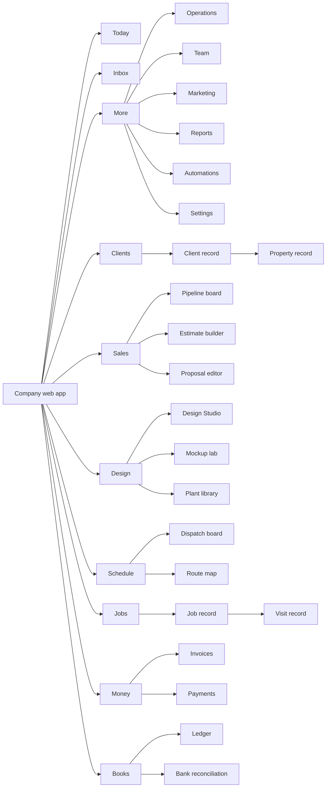

Full sitemap with routes (`:id` are opaque IDs; human-readable numbers such as `J-1042` are shown in UI and resolvable in search):

- **Today** `/today` - role-aware home (see [6.3](#63-the-today-home-mvp)) [MVP]
- **Inbox** `/inbox` - unified SMS, email, portal messages, web-form leads, AI receptionist call summaries; assignment, snooze, templates (spec in [16](16-marketing-growth-communications.md)) [MVP] email+SMS, [V1] calls
- **Clients** `/clients` [MVP]
  - Client list (saved views: Active residential, Commercial accounts, Past due, Agreement renewal due, No visit in 60 days)
  - Client record `/clients/:id` - tabs: Overview, Properties, Work (jobs, visits, agreements), Sales (opportunities, estimates, proposals), Designs, Money (invoices, payments, statements, credits), Communications, Files and photos, Notes; persistent activity timeline
  - Property record `/properties/:id` - map and measurements, site notes (gate code, dog, irrigation controller location), zones, plant inventory, service history, designs, equipment on site (controllers, lighting transformers)
  - Contacts `/clients/:id/contacts` - roles (billing, approver, tenant), portal access, communication preferences and consent
- **Sales** `/sales` [MVP]
  - Leads `/sales/leads` (inbox-style triage)
  - Pipeline `/sales/pipeline` (kanban by stage; table toggle)
  - Site assessments `/sales/assessments` [V1]
  - Estimates `/sales/estimates` and Estimate builder `/estimates/:id`
  - Proposals `/sales/proposals` and Proposal editor `/proposals/:id` (+ client preview)
  - Renewals `/sales/renewals` (service agreement renewals) [V1]
  - Change orders `/sales/change-orders` [V1]
  - Templates: proposal templates, estimate templates, kits (spec in [03](03-crm-sales-estimating-proposals.md))
- **Design** `/design` [MVP]
  - Designs list `/design` (by client/property, status)
  - Design Studio `/design/:id` (full-screen workspace, see [18.7](#187-design-studio))
  - Mockup lab `/design/mockups` and AI mockup flow `/design/mockups/new` (see [18.8](#188-ai-mockup-flow))
  - Plant library `/plants` (tenant lens on the [Plant Knowledge Base](12-plant-knowledge-base.md): region-filtered, favorites, Company palettes, nursery availability [V1])
  - Palettes `/plants/palettes`; Symbol and material library `/design/library`; Design templates `/design/templates` [V1]
- **Schedule** `/schedule` [MVP]
  - Dispatch board `/schedule/board` (day / 3-day / week; crews as rows)
  - Calendar `/schedule/calendar` (estimator appointments, consultations)
  - Route map `/schedule/map` (live GPS [V1])
  - Capacity planner `/schedule/capacity` (weeks ahead, hours by crew vs sold hours) [V1]
  - Recurring programs `/schedule/programs` (mowing rounds Apr-Nov, 5-step fertilizer, snow events) (spec in [04](04-scheduling-dispatch-routing.md) and [14](14-service-line-modules.md))
  - Weather center `/schedule/weather` (rain-day reschedule, snow triggers) [V1]
- **Jobs** `/jobs` [MVP]
  - All jobs; Work orders; Projects (Gantt and phase board) [V1]; Service agreements `/agreements`
  - Job record `/jobs/:id` - Overview, Visits, Tasks/phases, Materials, Costs vs budget, Change orders, Photos, Documents, Timeline
  - Visit record `/visits/:id` - checklist, time, photos, chemical application, notes, client signature
- **Money** `/money` [MVP]
  - Invoices `/money/invoices` and Invoice editor `/invoices/:id`
  - Payments `/money/payments`, Deposits, Credit memos, Statements
  - Receivables and collections `/money/ar` (aging, reminders, payment plans)
  - Stripe payouts and disputes `/money/stripe` (read-through to the Company's connected Stripe account; spec in [08](08-payments-stripe.md))
- **Books** `/books` [MVP] core ledger, [V1] advanced (spec in [09](09-accounting-ledger-integrations.md))
  - Overview (cash, P&L snapshot, close checklist)
  - Chart of accounts `/books/accounts`; Journal `/books/journal` and Journal entry `/books/journal/:id`
  - Bills and vendors (AP) `/books/bills`; Bank feeds and reconciliation `/books/banking`
  - Job costing and WIP `/books/job-costing` [V1]; Sales tax `/books/tax`; Period close `/books/close`
  - Financial statements `/books/reports`; Sync with QuickBooks/Xero `/books/sync`
- **More** (expands in rail; frequently used items can be pinned to the main rail)
  - **Operations** `/ops` [V1]: inventory and yards, purchase orders, vendors, subcontractors, equipment and fleet, maintenance schedules, chemical inventory (spec in [13](13-operations-inventory-equipment.md))
  - **Team** `/team` [MVP]: people, crews, timesheets and approvals, payroll export, certifications and licenses (pesticide applicator), training, safety incidents, hiring [V1] (spec in [15](15-team-hr-payroll.md))
  - **Marketing** `/marketing` [V1]: website, online booking, campaigns, reviews, referrals, AI receptionist (spec in [16](16-marketing-growth-communications.md))
  - **Reports** `/reports` [MVP]: dashboards, KPI library, report builder [V1], benchmarks [V2], forecasts [V1] (spec in [18](18-reporting-analytics.md))
  - **Automations** `/automations` [V1]: rule list, builder, run history (spec in [17](17-ai-copilot-automation.md))
  - **Settings** `/settings` [MVP]: Company profile and locations; users, roles and permissions; service lines and modules; price book and production rates; taxes; payments (Stripe connection); accounting setup (chart-of-accounts template, sync); portal and branding; notifications and message templates; terminology and language; regions and plant preferences; integrations; data import/export; sample data sandbox; Rootline subscription and AI credits; security and audit log
- **Global (top bar):** Company switcher (bookkeepers and multi-entity owners), Search / Command palette (Cmd-K / Ctrl-K), Create (+), Copilot panel, Notifications, Help (docs, chat, "what's new"), Profile (language, units, theme, density, shortcuts)

### 5.3 Crew mobile app sitemap

Bottom tab bar with five destinations. The app is task-first: the route is the home. Everything a crew needs on site is reachable from the Visit screen without returning to a menu.

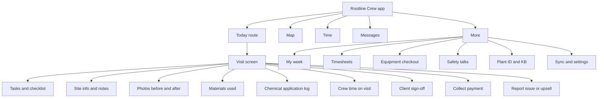

- **Today** (home) [MVP]: crew and truck header, clock status, sync chip, weather strip, ordered route list (stop number, client/property, service, est. duration, status), "Start next stop" primary action, day summary (stops done / total, hours, drive time)
  - **Visit screen** `rootline://visit/:id` [MVP]: navigate, arrive/start/complete, gate code and hazards banner (dog, irrigation heads near bed edge, low wires), tasks checklist, photos, materials, chemicals [MVP for lawn/PHC tenants], time per person, notes (voice), client signature [V1], collect payment (Stripe Terminal Tap to Pay / card on file) [V1], "Report issue" and "Suggest work" (upsell with photo -> creates opportunity) [MVP]
  - **Property map**: beds, zones, irrigation valves and heads, lighting from the design, "do not mow" areas [V1]
- **Map** [MVP]: today's stops with pins numbered in route order; tap pin -> visit card; reorder request to office [V1]
- **Time** [MVP]: clock in/out for self (technician) or whole crew (crew lead), breaks/meal (state rules in [15](15-team-hr-payroll.md)), drive vs on-site time, daily attestation; offline-safe with device timestamps
- **Messages** [MVP]: crew <-> office threads, broadcast notes, photo replies; auto-translate toggle [V1]
- **More**
  - My week / schedule [MVP]; Timesheets history and approvals (crew lead) [MVP]
  - Equipment checkout and pre-trip inspection (mowers, trailers, sprayers) [V1]
  - Safety: toolbox talks, incident report, SDS lookup [V1]
  - Training and certifications (license expiries) [V1]
  - Plant ID and KB lookup (photo -> plant suggestion; care notes) [V1]
  - Sync and settings: language, units, text size, field-sun theme, offline maps, pending changes queue [MVP]

**Manager mode** [V1] replaces the tab bar for `owner`, `ops_manager`, `estimator`, `office_manager` on phone: Today (approvals, alerts, KPIs), Schedule (read + quick reassign), Clients (lookup, call/text, create lead), Capture (site assessment with photos and measurements for estimators), More.

**Subcontractor lite** (`subcontractor`) [MVP web, V1 in-app] is three screens with no tab bar on the web. Native users get Today, Messages and More only.
- **My work orders** `/sub/work-orders`: assigned work orders with site address, access notes for the visit window only, scope, due date and status (Accepted, Scheduled, In progress, Complete, Invoiced).
- **Work order** `/sub/work-orders/:id`: accept or decline with a reason, propose a date, upload completion photos (minimum set defined by the Company), log materials, mark complete, sign the lien waiver or completion form [V1].
- **Invoices** `/sub/invoices`: submit an invoice against the work order (PDF upload or simple form), see paid status. Data lands in AP ([09](09-accounting-ledger-integrations.md), [13](13-operations-inventory-equipment.md)).
- Subcontractors never see client contact details beyond the site address and on-site contact, never see pricing to the client, and never see other subcontractors' work.

**Shop kiosk mode** [V1]: a single screen with a large name/photo grid and PIN pad for clock-in, today's crew assignments, tailgate safety talk with per-person acknowledgment, and announcements. No client data except today's assignments ([05](05-field-crew-mobile-app.md)).

### 5.4 Customer Portal sitemap

The portal adapts to client type. Residential clients see a single-property, story-like home; commercial clients see a multi-property workspace with approvals. Spec in [06 - Customer Portal](06-customer-portal.md).

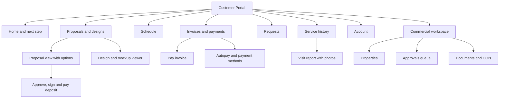

- **Home** `/` [MVP]: "Next step" card (sign proposal, pay invoice, confirm visit, review design), upcoming visits, latest visit report with photo, balance and autopay status, quick actions (Request service, Message us, Pay)
- **Proposals and designs** `/proposals`, `/proposals/:id` [MVP]: option tiers, design viewer (2D plan with plant list, 3D/mockup carousel [V1]), questions/comments on line items, e-sign, deposit payment, PDF download
- **Schedule** `/schedule` [MVP]: upcoming visits, "crew on the way" with ETA [V1], skip/reschedule requests within Company rules, program calendar (fert rounds, aeration window)
- **Invoices and payments** `/billing` [MVP]: open invoices, pay (card, ACH, wallet via Stripe), autopay enrollment, payment methods, statements, receipts, payment plans [V1]
- **Requests** `/requests` [MVP]: new request (photo + description + property), status tracking; commercial work orders with PO numbers [V1]
- **Service history** `/history` [MVP]: visit reports (who, when, what, photos, chemicals applied with re-entry intervals where required), plant warranty tracker [V1]
- **Plants and property** `/property` [V1]: "My landscape" plant inventory with care tips from the KB, seasonal reminders
- **Messages** `/messages` [MVP]
- **Account** `/account` [MVP]: contacts and their access scopes, notification and language preferences, consent management, passkeys
- **Commercial workspace** (for `client_commercial`) [V1]: portfolio dashboard (spend YTD vs budget per property), Properties list, Approvals queue (proposals and change orders routed by dollar threshold), Documents (agreements, COIs, W-9, SDS), Reports (service frequency, snow event logs with timestamps and photos for slip-and-fall defense). Wireframe in [18.17](#1817-commercial-portal-approvals-workspace).

**Portal navigation by contact scope.** Additional contacts (spouse, tenant, billing contact, board member) see a portal trimmed to their scope. Scope keys come from [06, section 3.3](06-customer-portal.md) and [02](02-personas-roles-permissions.md). Hidden destinations are removed, not greyed out. A contact never sees an item whose existence they cannot act on, such as an invoice count shown to a `property_contact`. "F" = full, "R" = read, "-" = hidden, "C" = Company-configurable (default shown in brackets).

| Portal destination | primary | co_owner | approver | billing | property_contact | viewer |
|---|---|---|---|---|---|---|
| Home / Next step | F | F | F (approvals only) | F (money only) | F (visits and requests only) | R |
| Proposals and designs | F (sign, pay deposit) | F (sign, pay deposit) | F (approve within dollar limit, no payment) | C [-] | - | R |
| Schedule | F | F | R | - | F (assigned Properties) | R |
| Invoices and payments | F | F (payment methods and autopay: C [off]) | C [-] | F | - | C [-] |
| Requests | F | F | F | - | F | - |
| Service history and visit reports | F | F | R | - | F (assigned Properties) | R |
| Plants and property | F | F | R | - | R | R |
| Messages | F | F | F | F (billing threads) | F | - |
| Account: manage contacts and scopes | F | - | - | - | - | - |
| Account: own language, notifications, consent, passkeys | F | F | F | F | F | F |

Rules: exactly one `primary` per Client, as [06](06-customer-portal.md) requires. The "Next step" card only offers actions within the contact's scope. When a `property_contact` (a tenant in the Hendersons' rental at 22 Lakeview Ct) opens a link to an invoice, they see "This item is handled by the account holder," with no amount and no invoice number. Approver rights lapse at the board term end date, and the approver's Home then shows "Your approver access ended on Dec 31. Contact Acme Landscapes to renew."

### 5.5 Platform Admin console sitemap

Spec in [19 - Platform admin portal](19-platform-admin-portal.md); this is the IA view.

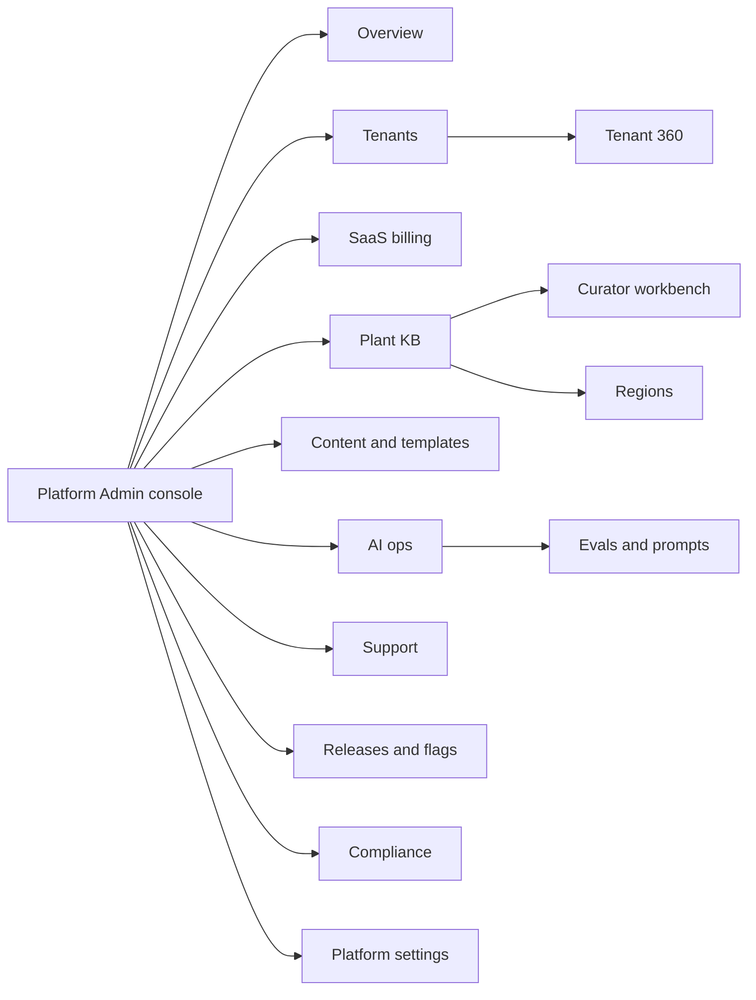

- **Overview** [MVP]: MRR/ARR, trials, activation funnel, churn risk list, incidents, AI spend today, queue depths
- **Tenants** [MVP]: list with health scores and filters; **Tenant 360** (profile, plan and usage, AI credits, Stripe Connect status, accounting mode, users, feature flags, data region, support history, impersonation log, notes, danger zone)
- **SaaS billing** [MVP]: plans and prices, subscriptions, invoices, dunning, coupons, credits, application-fee revenue (spec in [22](22-business-model-pricing-gtm.md))
- **Plant KB** [MVP]: plants, regions (map editor), plant region profiles, palettes, curation queue, bulk import and diff review, media library, nursery feeds [V1], symbol mapping (plant -> plan symbol family), quality dashboards
- **Content and templates** [MVP]: chart-of-accounts templates, starter price books and production rates by service line and region, proposal and email templates, sample datasets, help center articles, in-app announcements, terminology defaults
- **AI ops** [MVP]: model routing, prompt registry and versions, eval suites, cost and latency, safety and abuse reports, image-model quality review queue
- **Support** [MVP]: tickets, consented impersonation, session replay (PII-masked) [V1], known issues, macros
- **Releases and flags** [MVP]: feature flags by tenant/cohort, staged rollouts, release notes, kill switches
- **Compliance** [MVP]: audit log search, DSAR queue, retention policies, 10DLC brand/campaign status, SOC 2 evidence, subprocessors
- **Platform settings** [MVP]: staff and roles, security, regions/data residency, integrations keys (Rootline-owned only)

### 5.6 Public marketing site sitemap

- **Home** `/` - hero with real product and real landscapes; proof (customer logos with permission, review ratings once earned); three pillars: Sell (design + AI + proposals), Run (schedule + crew app), Get paid (payments + books)
- **Product** `/product` - tour pages: Design Studio, AI mockups, Plant intelligence, Estimating and proposals, Scheduling and routing, Crew app, Customer portal, Payments, Books, Marketing tools, Copilot and automations, Reporting
- **Solutions** `/solutions` - by service line (lawn care and PHC, design-build, commercial maintenance, snow and ice, tree care, irrigation and lighting) and by size (solo/owner-operator, growing 5-25, multi-crew 25-150, multi-branch)
- **Pricing** `/pricing` - tiers, AI credit explainer, payment fee transparency (Company's own Stripe pricing + Rootline application fee if any), calculator (see [22](22-business-model-pricing-gtm.md))
- **Design my yard** `/design` - homeowner AI design funnel entry (see 5.7)
- **Plant explorer** `/plants` - public, SEO-indexed subset of the KB: "Best shrubs for Zone 6b clay soil in the Ohio Valley" landing pages generated from curated palettes [V1]
- **Compare** `/compare/jobber`, `/compare/lmn`, `/compare/aspire`, `/compare/service-autopilot` - factual, dated comparison pages with a "last verified" stamp
- **Switch** `/switch` - migration guides and importers (Jobber, LMN, QuickBooks client lists, CSV)
- **Customers** `/customers` - case studies; **Resources** `/resources` - blog, guides, free calculators (mulch and soil cubic yards, paver patio materials, fertilizer rate per 1,000 sq ft, snow route pricing), templates
- **Partners** `/partners` - accountants, nurseries, suppliers, associations; **Trust** `/trust` - security, privacy, accessibility statement, status page, subprocessors
- **Company** `/about`, `/careers`, `/contact`; **Auth** `/login`, `/start` (trial), `/demo`
- Locales: `/es/...` [V1], `/fr-ca/...` [V2] with hreflang

### 5.7 Homeowner AI design funnel

Two deployments of one flow:

1. **White-label embed** [V1] on a Company's website (builder block or script tag). Leads go to that Company only. Branding is the Company's.
2. **Platform-hosted** `rootline.com/design` [V2]. The homeowner gets a concept and is matched with participating local Rootline Companies by service area, specialty and capacity (lead-routing rules and fees in [16](16-marketing-growth-communications.md) and [23](23-innovation-moonshots.md)).

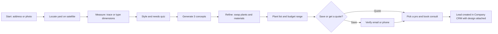

Funnel pages and rules:

- **Start** - address autocomplete or "Upload a photo of your yard"; no account needed. [V1]
- **Locate** - satellite tile with parcel outline (where parcel data is licensed); user confirms front/back yard area. [V1]
- **Measure** - trace beds/areas on the satellite or type dimensions ("bed along driveway: 32 ft x 4 ft"); AI checks plausibility against parcel size and image scale; dimensions are carried into a real to-scale Design for the Company (see [11](11-ai-design-mockups.md)). [V1]
- **Quiz** - style (cottage, modern, native/pollinator, xeriscape, formal), maintenance appetite (low/medium/high), sun exposure per area, kids/pets, deer pressure, budget band. Five screens max, each skippable. [V1]
- **Generate** - three concepts, each built only from plants in the Region's curated palette rated "recommended" for that site's conditions; generation progress shows what the AI is doing ("Choosing deer-resistant shrubs for Zone 6b..."). [V1]
- **Refine** - tap a plant to swap among KB alternatives; change mulch color, edging, patio material. [V1]
- **Plant list and budget** - plant list with quantities and mature sizes; installed-cost range from the Company's price book (embed) or regional benchmarks labeled as estimates (platform-hosted). [V1]
- **Save / Quote** - contact capture with explicit consent checkboxes (unchecked by default) for SMS and marketing email. [V1]
- **Hand-off** - creates Lead + Opportunity + Property + Design draft + Mockups in the Company's CRM, with the homeowner's measurements and quiz answers in the assessment notes ([03](03-crm-sales-estimating-proposals.md)). [V1]

### 5.8 URL, ID and object conventions

- Routes use plural nouns and opaque IDs: `/clients/cl_8f2k...`. Human-readable numbers (`C-0412` client, `P-1188` property, `E-2290` estimate, `PR-2290` proposal, `J-1042` job, `V-58813` visit, `INV-3307` invoice, `JE-10442` journal entry) are tenant-scoped sequences shown in UI, used in search and in client-facing documents. [MVP]
- Every record page is linkable and shareable inside the tenant; links to records the viewer cannot access show a permission explanation and a "Request access" action, never a blank 404. [MVP]
- Deep links work across surfaces: an office link `app.rootline.com/acme/visits/V-58813` opened on a phone with the crew app installed opens the Visit screen. [V1]
- Filters and views are encoded in the URL (`?view=past-due&sort=-balance`) so views are shareable and bookmarkable. [MVP]

### 5.9 Navigation visibility by role (tenant)

Visibility is driven by permissions ([02](02-personas-roles-permissions.md)); this table shows the default for built-in roles. "R" = visible read-mostly, "F" = full, "-" = hidden.

| Nav item | owner | office_manager | estimator | designer | ops_manager | crew_lead (web) | technician (web) | bookkeeper | subcontractor |
|---|---|---|---|---|---|---|---|---|---|
| Today | F | F | F | F | F | F | F | F | F |
| Inbox | F | F | F | R | F | R | - | R | - |
| Clients | F | F | F | R | F | R | - | R | - |
| Sales | F | F | F | R | R | - | - | R | - |
| Design | F | R | F | F | R | R | - | - | - |
| Schedule | F | F | R | R | F | R | R | - | R |
| Jobs | F | F | R | R | F | R | R | R | R |
| Money | F | F | R | - | R | - | - | F | - |
| Books | F | R | - | - | - | - | - | F | - |
| Operations | F | F | R | R | F | R | - | R | - |
| Team | F | F | - | - | F | R | - | R | - |
| Marketing | F | F | R | R | - | - | - | - | - |
| Reports | F | F | R | R | F | - | - | F | - |
| Automations | F | F | - | - | R | - | - | - | - |
| Settings | F | F | - | - | R | - | - | R | - |

Crew leads, technicians and subcontractors are expected to use the native app; their web access is limited by default and can be disabled per Company.

---

## 6. Navigation and interaction patterns

### 6.1 App shell (web) [MVP]

```text
+--------------------------------------------------------------------------------------------------+
| [=] Rootline   Acme Landscapes v   [ Search or type a command...      Ctrl K ]   [+ Create]      |
|                                               [Copilot]  [Bell 3]  [?]  [Avatar]                 |
+--------+-----------------------------------------------------------------------------------------+
| Today  | Page header: title, key facts, status pills, primary action, overflow (...)             |
| Inbox  |-----------------------------------------------------------------------------------------|
| Clients|                                                                   | Side panel          |
| Sales  | Main content: list, board, record or canvas                       | (peek, Copilot,     |
| Design |                                                                   | details, filters)   |
| Sched. |                                                                   | 360-480 px,         |
| Jobs   |                                                                   | resizable,          |
| Money  |                                                                   | Esc to dismiss      |
| Books  |                                                                   |                     |
| More v |                                                                   |                     |
|--------|                                                                   |                     |
| Sync ok|                                                                   |                     |
+--------+-------------------------------------------------------------------+---------------------+
```

Rules:
- Left rail: 64 px collapsed (icons + tooltips), 232 px expanded; state remembered per user. Users can pin up to 3 items from "More" into the main rail.
- Top bar: 56 px. The Create button opens a menu of the 8 most common creates for the user's role (Client, Lead, Estimate, Job, Visit, Invoice, Expense, Design), each with a shortcut.
- Side panel: one at a time; content types are peek (read-only quick look of a linked record), details (filters, properties), Copilot, comments. Opening a second panel replaces the first with a back arrow to return.
- A tenant-visible **environment banner** appears in sandbox mode ("Sample data - nothing here is real") and during platform-staff impersonation (red band, see 6.11).

### 6.2 Global search and command palette [MVP]

One input does three jobs: **find** records, **do** actions, **ask** Copilot. Invoked with Ctrl/Cmd-K, the `/` key on any list, or by clicking the search field.

**Behaviors**
- **Find:** federated search over clients, contacts, properties (by address fragments, "1420 Maple"), jobs, visits, estimates, proposals, invoices (by number or amount, "$4,812"), designs, plants (by botanical or common name, "PJM rhodo"), price book items, people, settings pages and help articles. Postgres FTS with trigram for typos at MVP; OpenSearch when index size requires it ([20](20-architecture-security.md)).
- **Ranking:** exact ID match > recent items (last 30 viewed by this user) > records the user owns/assigned > text relevance > recency of record activity. Results grouped by type, max 5 per group, "See all 23 clients" opens a filtered list.
- **Do:** verbs with fuzzy match - "new invoice for Henderson", "reschedule tomorrow's Ridgeview visits to Thursday", "go to dispatch", "toggle dark mode", "clock in crew 2" (manager), "open chart of accounts". Each action shows its keyboard shortcut and required permission; unavailable actions are omitted, not disabled.
- **Ask:** if the input reads as a question ("which clients haven't paid since September?", "how many yards of mulch did we sell last spring?"), the bottom row offers "Ask Copilot" with the query prefilled; answers render in the Copilot panel with citations and a "show as report" option ([17](17-ai-copilot-automation.md), [18](18-reporting-analytics.md)). [MVP basic, V1 natural-language actions]
- **Scoped mode:** typing a prefix narrows scope: `c:` clients, `j:` jobs, `i:` invoices, `p:` plants, `>` actions, `?` help, `@` people.
- **Context awareness:** when opened on a record, the first group is "Actions on J-1042" (add visit, add change order, create invoice, open in Studio).
- **Permissions:** results respect RLS and role permissions server-side; never leak record titles the user cannot open (no "1 hidden result" counts that reveal existence of restricted records).
- **Performance:** first results within 150 ms p95 for recent-item and ID queries (client-side cache), 400 ms p95 for server FTS.
- **Accessibility:** combobox pattern with `aria-activedescendant`, results announced as "5 clients, 2 invoices"; fully keyboard operable; Esc closes and returns focus to the invoking element.

> **Competitive edge.** Command palettes are table stakes in modern developer and productivity tools but uncommon in landscape and field-service software; competitors in our research rely on menus and per-module search. For an office manager who books 60 changes a day, "type, Enter" beats "click, scroll, click" by seconds per action, which compounds into hours per week.

### 6.3 The Today home [MVP]

Today is assembled from **widgets** chosen by role defaults and user customization. Each widget answers one question and ends in an action.

| Role | Default widgets (top to bottom) |
|---|---|
| `owner` | Needs your attention (approvals, exceptions) - Cash and AR snapshot - Today's operations (crews out, visits done/planned, issues) - Sales pipeline this week - Weather impact - Copilot daily brief |
| `office_manager` | Inbox needing reply - Unscheduled work - Today's schedule exceptions (late crews, skipped visits) - Invoices to send - Payments received - Renewals due |
| `estimator` | My appointments today - Proposals awaiting client (viewed / not viewed) - Leads to contact - Follow-ups due - Win rate this month |
| `designer` | Designs in progress - Review requests - Mockup jobs finished - Plant availability alerts |
| `ops_manager` | Crew board summary - Job cost alerts (over budget > 10%) - Quality checks due - Equipment out of service - Change orders pending |
| `bookkeeper` | Bank transactions to categorize - Reconciliation status by account - Bills due - Sync errors - Close checklist |
| `crew_lead` / `technician` (web) | My visits today - Timesheet status |

Rules:
- **"Needs your attention"** is a prioritized, deduplicated list fed by the notification engine ([section 16](#16-notification-design)); each item has inline actions (Approve, Assign, Reply, Snooze) so the owner can clear it without leaving Today.
- **Copilot daily brief** [V1]: a 5-bullet morning summary at 6:00 local ("Rain 80% after 1 pm: 14 mowing visits at risk; suggested reschedule ready. $18,420 overdue > 30 days across 9 clients. Two proposals viewed 3+ times but unsigned."). Each bullet links to the underlying records.
- Customization: drag (with keyboard and "Move up/down" menu alternatives per WCAG 2.5.7), add/remove widgets, choose date scope. Company admins can publish a default layout per role. [V1]
- Empty or quiet days show positive confirmation ("All 6 crews are on schedule. Nothing needs you right now.") rather than a blank page.

### 6.4 Record page anatomy [MVP]

Every object (Client, Property, Opportunity, Estimate, Proposal, Job, Visit, Invoice, Design, Plant, Employee, Equipment, Journal Entry, Tenant) uses the same layout so learning one teaches all.

```text
+----------------------------------------------------------------------------------------------+
| Breadcrumb: Clients / Henderson Family                                                       |
| [Avatar/Icon] Henderson Family   (Active)  (Residential)  (Autopay on)        [Primary] [...]|
| Key facts strip: 2 properties | LTV $38,240 | Balance $0.00 | Agreement: Full-care 2026 | ...|
+-----------------------------------------------------------+----------------------------------+
| Tabs: Overview | Properties | Work | Sales | Designs | Money | Comms | Files | Notes         |
|-----------------------------------------------------------+----------------------------------|
| Tab content (cards, tables)                               | Right rail (sticky):             |
|                                                           |  - Contacts / owner / tags       |
|                                                           |  - Upcoming (next visit, etc.)   |
|                                                           |  - Activity timeline (filterable)|
|                                                           |  - Composer: note / SMS / email  |
+-----------------------------------------------------------+----------------------------------+
```

Rules:
- **Header** shows identity, status pills (max 3 visible, rest in tooltip), one primary action that changes with state (Estimate draft -> "Send proposal"; Invoice draft -> "Send"; Invoice sent -> "Record payment"), and an overflow menu.
- **Key facts strip**: 4-6 computed facts with tooltips explaining the calculation.
- **Tabs** are URL-addressable (`/clients/:id/money`); counts in tab labels (`Work 12`) only when meaningful.
- **Right rail** is collapsible below 1280 px into a drawer.
- **Inline editing**: click a field to edit; Enter saves, Esc cancels; autosave with "Saved" microstate; field-level validation on blur; conflict banner if another user changed the record ("Maria updated the phone number 2 minutes ago - Reload / Keep mine").

### 6.5 Activity timeline [MVP]

A single, filterable chronological feed per record that merges domain events (from the outbox/event bus, [20](20-architecture-security.md)) and human activity.

| Event family | Examples | Icon / color slot |
|---|---|---|
| Communication | SMS sent/received, email opened, call summary, portal message | Message, Sky |
| Sales | Proposal sent, viewed (with count and device), signed, declined, expired | Document, Moss |
| Work | Visit scheduled, started, completed (with photo thumbnails), skipped (with reason) | Calendar / Truck, Stone |
| Money | Invoice sent, payment succeeded/failed, refund, dispute opened | Coin, Moss/Ember |
| Design | Design version saved, mockup generated, client commented on plan | Leaf-pen, Iris for AI |
| System/AI | Automation ran, Copilot drafted message, sync to QuickBooks | Gear / Seedling-spark, Iris |
| Notes | Internal note with @mentions | Note, Stone |

Rules: newest first, grouped by day, "Show system events" off by default for non-admins; rollups for noisy events ("Proposal viewed 4 times - last Tue 8:41 pm on iPhone"); each event links to its source; internal notes are visually distinct (dashed border, "Internal" label) from anything the client can see; client-visible items carry an eye icon.

### 6.6 Contextual side panels and split views [MVP]

- **Peek**: clicking a linked record (a client name in a visit row) opens a read-mostly peek in the side panel with the top 6 facts and primary actions; Shift-click or "Open" navigates fully. Peeks stack with a back arrow (max depth 5).
- **Split view** on lists: list on the left, selected record on the right, arrow keys move selection - ideal for triaging leads, approving timesheets, categorizing bank transactions.
- **Copilot panel**: bound to the current context (record, list selection, Studio canvas). Shows "Context: J-1042 Henderson patio" chip; user can remove context.

### 6.7 Lists, saved views, filters and bulk actions [MVP]

- Every list: column picker, sort, filter builder (field, operator, value; AND groups, OR groups [V1]), density toggle, export CSV (permission-gated), saved views (private, role, company), row selection with bulk actions bar.
- Bulk actions are the same set everywhere for a given object type (e.g., visits: reschedule, reassign crew, skip with reason, add note, send reminder). Bulk actions over 50 records run as background jobs with progress and a completion notification; all bulk changes are undoable for 10 minutes via an "Undo bulk change" toast and the activity log.
- Virtualized rendering for > 200 rows; server pagination with cursor; "Select all 1,214 matching" pattern with explicit count confirmation.

### 6.8 Forms, validation and autosave [MVP]

- Single-column forms for creation, 2-column only on wide record edit panels; labels above fields; required fields marked with "Required" text (not asterisk alone).
- Validate on blur and on submit; error text below field: what is wrong + how to fix ("Enter a ZIP code like 43215 or a postal code like K1A 0B1").
- Address fields use autocomplete with map preview; manual entry always allowed (rural routes, new subdivisions not in map data).
- Money inputs accept "1.2k", "$1,200" and "1200"; quantity inputs accept fractions and mixed units ("12' 6\"", "3/4 yd") and normalize with a visible echo ("= 12.5 ft").
- Long forms (estimate, design brief) autosave drafts every 5 s and on blur; "Saved 3s ago" status; offline drafts queue on mobile.
- Never ask for the same information twice in a flow (WCAG 3.3.7 Redundant Entry): e.g., the client's address entered in the lead form prefills property, proposal and invoice.

### 6.9 Keyboard shortcuts (web) [MVP]

| Shortcut | Action | Shortcut | Action |
|---|---|---|---|
| Ctrl/Cmd K | Command palette | G then T | Go to Today |
| / | Search in current list | G then C | Go to Clients |
| C | Create (context menu) | G then S | Go to Schedule |
| E | Edit focused record | G then M | Go to Money |
| J / K | Next / previous row | ? | Shortcut cheat sheet |
| X | Select row | Shift Click | Range select |
| Ctrl/Cmd Enter | Submit / send | Esc | Close panel / cancel |
| [ / ] | Previous / next day (dispatch) | Ctrl/Cmd Z | Undo last change |

Single-key shortcuts are off when focus is in a text field and can be disabled per user (WCAG 2.1.4 Character Key Shortcuts).

### 6.10 Undo, confirmation and destructive actions [MVP]

| Action class | Pattern | Examples |
|---|---|---|
| Reversible, low impact | Act immediately + Undo toast (8 s) | Archive client, move visit, change status |
| Reversible, high volume | Act + Undo toast + activity log entry + "Undo bulk change" for 10 min | Reschedule 40 visits for rain |
| Irreversible or external | Confirm dialog stating the consequence in plain words with the primary button labeled with the verb | "Send proposal to 2 contacts", "Charge $1,850.00 to Visa 4242", "Post 14 journal entries to Oct 2026" |
| Destructive with dependents | Type-to-confirm with dependents listed | Delete price book item used in 32 estimates (offers "Archive instead") |
| Ledger | No delete of posted entries; reverse with a reversing entry; closed periods locked | Journal entry in closed period: "Reopen period" requires `bookkeeper` or `owner` with reason |

### 6.11 Company switcher, multi-entity and impersonation [MVP]

- **Company switcher** in the top-left for users with access to multiple tenants (external CPA `bookkeeper` serving 12 Companies; owners with two legal entities). Each Company shows its logo and a color chip so the active tenant is never ambiguous; switching reloads into that tenant's Today.
- **Impersonation (platform staff)**: only with tenant consent or break-glass reason ([19](19-platform-admin-portal.md)). UI shows a persistent red band: "Viewing as Maria Lopez (office_manager) at Acme Landscapes - read-only - ends in 28:41 - End session". Write actions require separate elevated consent and are labeled in the tenant's audit log as "performed by Rootline Support on behalf of...".

### 6.12 Presence and collaboration [V1]

- Avatars of other users viewing the same record or dispatch day; soft locks on fields being edited ("Jose is editing Line 4").
- Comments with @mentions on records, estimate lines and Design Studio objects; resolved threads collapse.
- Dispatch board shows a live cursor ghost of another dispatcher's drag so two people do not move the same visit.

---

## 7. Brand direction

### 7.1 Brand idea and personality

**Rootline** evokes the line where what you plant meets what holds it up: the grade line on a site section, the root flare at the base of a tree, the line of a route across a town. The brand should feel **grounded, capable, warm and quietly modern**: a well-run crew in clean uniforms, not a tech startup in a hoodie and not a feed-store flyer.

| Attribute | We are | We are not |
|---|---|---|
| Grounded | Earthy materials, real photos of real work, plain words | Rustic kitsch, woodgrain textures, clip-art leaves |
| Capable | Precise numbers, confident layouts, tidy alignment | Cold enterprise grey, jargon |
| Warm | Friendly microcopy, human photography, celebrating finished work | Cutesy, emoji-heavy, mascot-led |
| Modern | Generous space, crisp type, purposeful motion | Trend-chasing gradients, glassmorphism everywhere |

**Logo direction** [MVP]: a wordmark set in a soft, slightly wonky display serif (see Fraunces below) whose lowercase "l" or "R" leg extends below the baseline as a single root line; a compact symbol made of a horizontal grade line with three short roots beneath it, usable at 16 px (favicon, app icon) and as a loading motif (the roots "grow" while loading). Final identity work by a brand studio in the MVP design budget (see [22](22-business-model-pricing-gtm.md)).

### 7.2 Color palette (primitives)

Earthy but modern: warm stone neutrals carry 90% of the UI; Moss is the brand and primary action color; Clay, Marigold and Sky are accents with jobs; Ember is danger; **Iris is reserved for AI** so users always know when a machine made something.

| Family | Role | Key steps (hex) |
|---|---|---|
| **Stone** (warm neutral) | Canvas, surfaces, borders, text | 0 `#FFFFFF`, 25 `#FBFAF7`, 50 `#F5F3EE`, 100 `#ECE8E0`, 200 `#DDD7CC`, 300 `#C4BCAE`, 400 `#A39A8A`, 450 `#8F8575`, 500 `#776E60`, 600 `#645C4F`, 700 `#4B453B`, 800 `#34302A`, 900 `#221F1B`, 950 `#15130F` |
| **Moss** (brand green) | Primary actions, brand moments, success | 50 `#EEF5EC`, 100 `#D7E8D2`, 200 `#B2D2A8`, 300 `#87B67A`, 400 `#5F9952`, 500 `#3F7D35`, 600 `#2F6428`, 700 `#254F20`, 800 `#1C3C19`, 900 `#132912` |
| **Clay** (terracotta) | Secondary accent, hardscape, highlights in marketing | 50 `#FBEFE9`, 100 `#F6DED3`, 300 `#E3A184`, 500 `#B5562F`, 600 `#96441F`, 700 `#763519` |
| **Marigold** (sun) | Warnings, attention, offline banner, "pending" | 100 `#FBEFCF`, 300 `#F2CB6B`, 400 `#E8B03A`, 600 `#A87410`, 800 `#6B4806` |
| **Sky** (water) | Info, links on dark panels, irrigation layer, focus ring | 50 `#EBF4FA`, 100 `#DCEBF5`, 500 `#2F7FB5`, 600 `#246690`, 700 `#1B4F70` |
| **Ember** (danger) | Errors, destructive actions, overdue, removal marks on plans | 50 `#FEF1EF`, 100 `#FDE4E1`, 500 `#D63A2B`, 600 `#B42318`, 700 `#8F1C13` |
| **Iris** (AI) | AI-generated content, Copilot, AI credits | 50 `#F1EFFC`, 500 `#6B5BD2`, 600 `#5646B8` |

**Verified contrast (WCAG 2 ratios, computed for this doc):**

| Pairing | Ratio | Use | Passes |
|---|---|---|---|
| Stone 900 text on Stone 25 canvas | 15.72:1 | Body text | AA/AAA |
| Stone 600 on white | 6.59:1 | Secondary text | AA |
| Stone 500 on Stone 25 | 4.81:1 | Muted text, placeholders | AA |
| White on Moss 600 | 7.06:1 | Primary button | AA/AAA |
| Moss 700 on white | 9.47:1 | Links, success text | AA/AAA |
| Stone 450 border on white | 3.63:1 | Input borders (non-text 3:1, WCAG 1.4.11) | AA |
| Sky 600 focus ring on white | 6.22:1 | 2 px focus ring with 2 px offset | AA |
| Marigold 800 on Marigold 100 | 7.18:1 | Warning callout | AA |
| Ember 600 on Ember 50 | 5.96:1 | Error callout | AA |
| White on Ember 600 | 6.57:1 | Destructive button | AA |
| Iris 600 on Iris 50 | 6.24:1 | AI badge, AI suggestion chip | AA |
| Stone 950 on Marigold 300 | 11.95:1 | Field offline banner | AAA |
| Dark: `#F3F0EA` on Stone 950 | 16.31:1 | Dark body text | AAA |
| Dark: Stone 950 on Moss 300 | 7.95:1 | Dark primary button | AA/AAA |
| Dark: `#7A7163` border on `#211E1A` | 3.45:1 | Dark input border | AA |

Rule: tokens, not hexes, ship in code; a CI contrast check runs over every semantic text/background pair in every theme on each token change ([section 8](#8-design-tokens-and-theming)).

### 7.3 Typography

| Role | Typeface | Why | Where |
|---|---|---|---|
| UI sans | **Inter** (variable, SIL OFL) | Excellent legibility at small sizes, tabular figures (`tnum`), slashed zero option, full Latin Extended for Spanish and French diacritics | All product UI, crew app, tables, charts |
| Display serif | **Fraunces** (variable, SIL OFL; "soft" and "wonk" axes) | Warm, organic, editorial; signals craft without kitsch | Marketing headlines, portal page titles, proposal covers, empty-state headlines, logo basis |
| Mono | **JetBrains Mono** (SIL OFL) | Unambiguous characters for IDs, account codes, API keys | Record numbers in dense tables, ledger account codes, admin console logs |

Alternates evaluated: Instrument Sans/Serif (lighter personality), Source Sans 3/Source Serif 4 (safer, less distinctive). Charts and data displays use the UI sans only.

**Type scale (web, rem at 16 px root):**

| Token | Size / line height | Weight | Use |
|---|---|---|---|
| `type.display-xl` | 48/56 | Fraunces 600 | Marketing hero, proposal cover |
| `type.display-l` | 36/44 | Fraunces 600 | Portal page titles, empty-state headlines |
| `type.heading-1` | 24/32 | Inter 650 | Record titles |
| `type.heading-2` | 20/28 | Inter 600 | Section headers |
| `type.heading-3` | 16/24 | Inter 600 | Card titles |
| `type.body` | 14/20 (office), 16/24 (portal, marketing) | Inter 400 | Body |
| `type.body-strong` | 14/20 | Inter 600 | Emphasis, table totals |
| `type.caption` | 12/16 | Inter 500 | Metadata, helper text (never below 12 px) |
| `type.numeric-l` | 28/32 tabular | Inter 600 | KPI tiles, hero numbers |
| `type.mono` | 13/20 | JetBrains Mono 450 | IDs, codes |

**Crew app scale (points):** body 17, secondary 15 (minimum), title 22, key number (time, stop count) 28-34, button label 18 semibold. Respects iOS Dynamic Type and Android font scaling up to 200% without truncating primary actions.

### 7.4 Iconography [MVP]

- **Base set:** Lucide (the default icon set shipped with shadcn/ui), 24 px grid, 1.75 px stroke in the office app; crew app uses the same glyphs at 28 px with 2.25 px stroke and filled variants for selected states, which hold up better in glare.
- **Custom "Rootline Field" set** drawn on the same grid and stroke so it blends with Lucide. Initial set of 91 glyphs:

| Group | Glyphs |
|---|---|
| Lawn care | push mower, zero-turn mower, string trimmer, edger, backpack blower, aerator (core), overseeder, broadcast spreader, backpack sprayer, ride-on spreader-sprayer, lawn stripe, dethatcher |
| Install and hardscape | skid steer, mini excavator, plate compactor, dump trailer, wheelbarrow, paver (running bond), retaining wall block, flagstone, edging, landscape fabric, sod roll, mulch pile, cubic-yard bucket, gravel/aggregate, boulder |
| Plants | deciduous tree, conifer, ornamental tree, palm, shrub, ornamental grass, perennial, annual flat, bulb, vine, groundcover, sapling with stake, root ball (B&B), container (#1/#3/#7 pot), seed bag |
| Irrigation and water | spray head, rotor, drip line, valve, backflow preventer, controller, rain sensor, water drop meter, blow-out (winterize) compressor |
| Lighting | path light, uplight, downlight, well light, transformer, timer/photocell |
| Snow and ice | plow truck, snow pusher, salt spreader, de-icer bag, snowflake trigger (with inches), shovel crew |
| Tree care | chainsaw, pole saw, chipper, stump grinder, climbing harness, crane |
| Business objects | client, property (house with lot line), estimate (ruler + doc), proposal (doc + signature), job (clipboard), visit (pin + clock), route (dotted path), crew (three helmets), invoice, payment, ledger (book with T-account), price book, takeoff (grid + ruler), design (leaf-pen), mockup (photo + sparkle seed), AI (seedling-spark), region (map with zone bands), plant palette, warranty (leaf shield), chemical (drop with hazard corner), safety (vest) |

- Icons are never the only carrier of meaning: status icons are always paired with a text label, and icon-only buttons have accessible names and tooltips.
- The AI glyph is a **seedling-spark** (a two-leaf sprout with a small four-point spark), always rendered in Iris, never used for non-AI features.

### 7.5 Plant plan symbols and material hatches [MVP]

A shared symbol library renders plants and materials identically in the [Design Studio](10-design-studio.md), proposal PDFs, the portal design viewer, crew install sheets and the property map. Each [Plant](12-plant-knowledge-base.md) record maps to a **symbol family** (curated by `platform_curator`) plus per-plant style parameters (foliage color, bloom color, texture).

**Plant symbol families** (plan view, drawn at true scale):

| Family | Plan graphic | Default diameter rule | Example plants |
|---|---|---|---|
| Deciduous canopy tree | Irregular cloud outline, radial branch lines, trunk dot | Mature spread at chosen maturity year | Red maple, swamp white oak, honeylocust |
| Ornamental/flowering tree | Scalloped petal outline, bloom-color accent ring in presentation mode | Mature spread | Redbud 'Forest Pansy', serviceberry, dogwood |
| Conifer (needled evergreen) | Spiky radial star outline, dense hatch | Mature spread | Norway spruce, white pine, arborvitae 'Green Giant' |
| Broadleaf evergreen tree | Tight scalloped outline, stipple interior | Mature spread | Southern magnolia, American holly |
| Palm | Radiating frond strokes | Mature spread | Sabal palmetto, windmill palm |
| Deciduous shrub | Lobed circle, open interior, center dot | Mature width | Hydrangea paniculata, ninebark, spirea |
| Evergreen shrub | Zigzag outline, diagonal hatch interior | Mature width | Boxwood, inkberry holly, yew |
| Ornamental grass | Starburst of fine strokes | Mature width | Little bluestem, feather reed grass, pennisetum |
| Perennial | Small circle with dot pattern; massed perennials render as a drift outline with count label | Mature width; drifts by spacing on center | Coneflower, catmint, hosta, daylily |
| Annual/bulb | Small dots in a bed polygon | Spacing on center | Begonia, tulip |
| Groundcover | Area stipple hatch within polygon | Area + spacing | Pachysandra, creeping thyme |
| Vine | Line along support with leaf ticks | Linear | Clematis, climbing hydrangea |
| Turf | Fine stipple area; seed vs sod variants | Area | Tall fescue sod, Kentucky bluegrass seed |

**Modifiers:** existing-to-remain (dashed outline), existing-to-remove (Ember X through symbol), transplant (arrow from old to new location), warranty-tagged (small leaf-shield badge), dead/replace (Ember outline) [V1].

**Labels:** plant key tags with quantity + 3-letter genus + 3-letter species code (`3 HYD PAN`), or numeric keys (`(7)`) with a schedule table on the sheet; leader lines auto-route to avoid overlaps. Botanical names in italics in schedules; common names in client-facing views per locale.

**Maturity slider** [V1]: symbols scale between install size (e.g., #3 container, 18-24 in) and mature spread at Year 1 / Year 5 / Mature, so clients see why the designer spaced shrubs 4 ft on center.

**Material hatches:** shredded mulch (short random strokes; color by mulch type), river rock (small circles), gravel (stipple), pavers (running bond, herringbone, basketweave at true module size, e.g., 6 x 9 in), flagstone (irregular polygons), poured concrete (stipple with triangles), wood/composite decking (parallel boards at true width), water (wave lines), steel/aluminum edging (heavy line), retaining wall (block pattern with cap line), artificial turf (cross-hatch).

**Irrigation and lighting symbols** follow the same library: spray head (circle with arc showing throw), rotor (circle with radius line), drip (dashed line), valve box (square with V), controller (rectangle with C), backflow (triangle), path light (circle with rays), uplight (wedge showing beam direction), transformer (square with T).

**Render styles:** *Technical* (black line, for permits, HOA submittals and crews), *Presentation* (colored foliage with soft drop shadow at 315 degrees, paper texture background optional, for clients) and *Crew* (high-contrast, numbered install sequence, simplified hatch, legible on a phone in sun). Plot scales: 1 in = 10 ft, 1 in = 20 ft, 1:100, 1:200; line weights defined in mm for print.

> **Competitive edge.** Field-service platforms do not ship a plant graphic standard at all, and dedicated landscape CAD tools render beautiful plans that stop at the PDF. Rootline's symbol library is data-bound: the same symbol is a quantity in the takeoff, a line in the estimate, a pick-list item for the yard, a task for the crew and a warranty item in the client's portal.

### 7.6 Photography, illustration and motion

- **Photography** [MVP]: real crews, real properties, natural light, people mid-task (not posed handshakes); diverse crews including Spanish-speaking workers; before/after pairs as a signature format. Product screenshots in marketing always use the real UI with sample data.
- **Illustration** [MVP]: limited, line-based, single-weight drawings in Stone 700 with one accent color, used for empty states and onboarding (e.g., an empty route list shows a parked truck under a tree). No 3D blobs, no cartoon people.
- **Motion** [MVP]: purposeful and short. Tokens: `motion.fast` 120 ms (hover, toggles), `motion.base` 200 ms (panels, menus), `motion.slow` 320 ms (page transitions, drawers); easing `cubic-bezier(0.2, 0, 0, 1)` for enter, `cubic-bezier(0.4, 0, 1, 1)` for exit. Celebration moments (proposal signed, first payment, route complete) use a 600 ms leaf-burst only once per event and never block. All motion honors `prefers-reduced-motion`.

### 7.7 White-label theming for the Customer Portal and client documents [MVP]

Tenants customize within guardrails; the system guarantees accessibility regardless of brand choice.

| Setting | Options | Guardrail |
|---|---|---|
| Logo | SVG/PNG, light and dark variants | Auto-trim whitespace; min 32 px height in header |
| Primary brand color | Any hex | System derives `brand.600` (button) by darkening in OKLCH until white text reaches 4.5:1; if the color cannot pass with white text (pale yellow), it becomes an accent and buttons use dark text |
| Accent color | Any hex | Used only for decorative elements; never for text below 3:1 |
| Font pairing | 8 curated OFL pairs (e.g., Fraunces + Inter default; Playfair Display + Source Sans 3; Montserrat + Lora; DM Serif Display + DM Sans) | All pairs tested for Spanish/French glyph coverage |
| Corner style | Square (2 px), Soft (8 px), Round (16 px) | Applies to cards and buttons |
| Hero image | Upload or choose from the Company's best job photos | Auto-crop with focal point; text never overlays the photo without a scrim |
| Custom domain | `portal.acmelandscapes.com` | Automated TLS; DNS checker wizard |
| "Powered by Rootline" | Shown on Starter; removable on higher tiers (see [22](22-business-model-pricing-gtm.md)) | Small footer mark only |

A live preview shows portal home, a proposal, an invoice email and an SMS on phone and desktop side by side, with a contrast report ("Your green #6DBE45 was adjusted to #3E7A22 for buttons so white text stays readable").

---

## 8. Design tokens and theming

### 8.1 Token architecture [MVP]

Three tiers, one source of truth:

1. **Primitive tokens** - raw values (`color.moss.600 = #2F6428`, `space.4 = 16px`). Never referenced by components directly.
2. **Semantic tokens** - meaning (`color.action.primary.bg`, `color.text.secondary`, `color.status.overdue.fg`). Components reference only these.
3. **Component tokens** - local overrides where needed (`button.primary.bg`, `dispatch.visit-card.border.late`).

- Format: W3C Design Tokens Community Group JSON (`.tokens.json`), authored in a `@rootline/tokens` package, synced bidirectionally with Figma variables via a tokens plugin [V1].
- Build: Style Dictionary emits CSS custom properties (`--rl-color-action-primary-bg`), a Tailwind preset (`bg-action-primary`), a TypeScript object for React Native, and a JSON for PDF/email renderers.
- CI: token lint (naming), contrast matrix across themes (fails build under AA), visual regression on Storybook stories per theme.

### 8.2 Themes [MVP unless noted]

| Theme | Surfaces | Description |
|---|---|---|
| `light` | Web app, admin, portal default | Stone 25 canvas, white surfaces, Moss primary |
| `dark` [V1] | Web app, admin | Stone 950 canvas, `#211E1A` surfaces, Moss 300 primary with dark text; selected, not auto-inverted |
| `field-sun` | Crew app | Pure white background, near-black text (`#000000`/Stone 950), Moss 700 primary (9.47:1 with white), heavier borders (Stone 600, 6.59:1), no shadows or gradients, minimum weight 500 for body |
| `field-night` [V1] | Crew app | Black background, `#F3F0EA` text (18.46:1), reduced brightness accents for pre-dawn snow routes and lighting service calls; red-shifted accent to preserve night vision |
| `portal-brand` | Customer Portal, client emails, proposals | Light theme with tenant brand tokens injected and auto-corrected (7.7) |
| `print` | PDFs: proposals, invoices, plans, install sheets | CMYK-safe values, no backgrounds behind body text, line weights in mm |
| `forced-colors` | All web | Respects Windows High Contrast / forced-colors; uses system colors; status relies on icons + text |

### 8.3 Key semantic tokens

| Token | Light | Dark | Field-sun |
|---|---|---|---|
| `color.bg.canvas` | Stone 25 `#FBFAF7` | Stone 950 `#15130F` | `#FFFFFF` |
| `color.bg.surface` | `#FFFFFF` | `#211E1A` | `#FFFFFF` |
| `color.bg.subtle` | Stone 50 | `#2A2621` | Stone 50 |
| `color.border.default` | Stone 200 (decorative) | `#3A352E` | Stone 600 |
| `color.border.input` | Stone 450 `#8F8575` | `#7A7163` | Stone 700 |
| `color.text.primary` | Stone 900 | `#F3F0EA` | `#000000` |
| `color.text.secondary` | Stone 600 | Stone 300 | Stone 800 |
| `color.text.muted` | Stone 500 | Stone 400 | Stone 700 |
| `color.action.primary.bg` / `.fg` | Moss 600 / white | Moss 300 / Stone 950 | Moss 700 / white |
| `color.action.danger.bg` | Ember 600 | Ember 500 | Ember 700 |
| `color.focus.ring` | Sky 600 | `#6FB3E0` (8.13:1 on Stone 950) | `#000000` 3 px |
| `color.status.success` | Moss 700 on Moss 50 | Moss 300 on `#1C2A19` | Moss 800 |
| `color.status.warning` | Marigold 800 on Marigold 100 | Marigold 300 on `#2E2510` | Marigold 800 on Marigold 300 |
| `color.status.danger` | Ember 600 on Ember 50 | Ember 100 on `#3A1714` | Ember 700 |
| `color.status.info` | Sky 700 on Sky 50 | Sky 100 on `#132836` | Sky 700 |
| `color.ai.fg` / `.bg` | Iris 600 / Iris 50 | `#B4AAF0` / `#25203F` | Iris 600 / Iris 50 |
| `color.money.in` / `.out` | Moss 700 / Stone 900 with minus sign | Moss 300 / Stone 100 | Moss 800 / black |

Every text/background pair in this table was computed against WCAG 2 and passes AA; the tightest pairs are white text on the dark-theme danger button (Ember 500, 4.67:1) and white on a tenant-adjusted brand button such as `#3E7A22` (5.23:1).

Money is never encoded by red/green alone: negative amounts always show a minus sign or parentheses (ledger convention, user setting) and credits/debits are labeled.

### 8.4 Spacing, layout, radius, elevation, density

- **Spacing:** 4 px base: `space.0.5`=2, `1`=4, `2`=8, `3`=12, `4`=16, `5`=20, `6`=24, `8`=32, `10`=40, `12`=48, `16`=64.
- **Grid:** web 12-column fluid with 24 px gutters at >= 1280, 16 px below; content max width 1440 for reading pages, full width for boards and canvas.
- **Radius:** `radius.sm` 4 (inputs, chips), `radius.md` 8 (cards, buttons), `radius.lg` 12 (dialogs, sheets), `radius.full` (avatars, pills). Tenant corner style maps onto these.
- **Elevation:** 0 (flat), 1 (cards: 1 px border, no shadow in office app), 2 (popovers: soft shadow), 3 (dialogs), 4 (toasts). Field-sun uses borders instead of shadows at every level.
- **Density:** `comfortable` (row 40 px, control 36 px) default; `compact` (row 32 px, control 32 px) opt-in per user for dispatch and books; `touch` (row 56 px, control 48 px) auto on touch-primary tablets.
- **Z-index scale:** base 0, sticky 10, dropdown 100, side panel 200, modal 300, toast 400, impersonation banner 500.

---

## 9. Component library inventory

`@rootline/ui` (web, built on Radix primitives with shadcn-style source ownership and Tailwind) and `@rootline/ui-native` (React Native) share tokens, naming and behavior specs. Each component ships with Storybook stories for every state and theme, accessibility notes, usage do/don't and analytics hooks.

### 9.1 Foundations and primitives

| Component | Notes | Surfaces | Priority |
|---|---|---|---|
| Button (primary, secondary, ghost, danger, AI) | Loading state keeps width; AI variant uses Iris and seedling-spark | All | [MVP] |
| IconButton | Requires `aria-label`; tooltip on hover/focus | All | [MVP] |
| Link | Underlined in body text; external-link icon for new tabs | All | [MVP] |
| Text input, Textarea (with voice dictation on native) | Prefix/suffix (units, currency), character counter | All | [MVP] |
| Number / Money input | Locale-aware parsing, currency code chip when multi-currency | All | [MVP] |
| Quantity-with-unit input | Accepts mixed units ("12' 6\""), unit dropdown, normalized echo | Web, native | [MVP] |
| Select, Combobox (async search), Multi-select with chips | Keyboard type-ahead; create-new inline | All | [MVP] |
| Checkbox, Radio, Switch | Native app switch at 56 px hit area | All | [MVP] |
| Date picker, Date range presets, Time picker, Recurrence builder | Recurrence: "Every week on Tue from Apr 7 to Nov 24, skip holidays" with plain-language echo | Web, native | [MVP] |
| Address input with map preview | Autocomplete + manual + pin drop | All | [MVP] |
| File upload / Dropzone, Photo capture | Drag and also click to browse (2.5.7); progress; offline queue | All | [MVP] |
| Signature pad | Typed-name alternative for accessibility | Portal, native | [MVP] |
| Tooltip, Popover, Dropdown menu, Context menu | Context menu always mirrored in a visible overflow button | Web | [MVP] |
| Dialog, Sheet (side/bottom), Drawer, Alert dialog | Focus trap; return focus | All | [MVP] |
| Toast with undo | Polite live region; pauses on hover/focus | All | [MVP] |
| Tabs, Segmented control, Accordion, Stepper | Stepper used in wizard and funnel | All | [MVP] |
| Avatar, Avatar group, Presence dot | Initials fallback; crew color ring | All | [MVP] |
| Badge, Status pill, Tag | Status pill = icon + label + color token | All | [MVP] |
| Skeleton, Spinner, Progress bar, Progress ring | Skeletons for > 300 ms loads | All | [MVP] |
| Empty state, Error state, Offline state, Permission state | Standard anatomy (section 15) | All | [MVP] |

### 9.2 Layout and navigation

| Component | Notes | Priority |
|---|---|---|
| App shell (rail, top bar, side panel host) | Responsive collapse rules | [MVP] |
| Command palette | Section 6.2 | [MVP] |
| Breadcrumbs, Page header, Key facts strip | Record anatomy | [MVP] |
| Record layout (tabs + right rail) | Section 6.4 | [MVP] |
| Split view list/detail | Arrow-key navigation | [MVP] |
| Bottom tab bar (native), Header with sync chip | Crew app | [MVP] |
| Wizard/Setup checklist | Persistent progress | [MVP] |
| Company switcher, Impersonation banner | Section 6.11 | [MVP] |

### 9.3 Data display

| Component | Notes | Priority |
|---|---|---|
| DataTable | Virtualized, column picker, sticky header/first column, inline edit, row selection, totals row, CSV export | [MVP] |
| Saved view bar and filter builder | URL-encoded state | [MVP] |
| Kanban board | Pipeline, project phases; keyboard move menu as drag alternative | [MVP] |
| Activity timeline | Section 6.5 | [MVP] |
| Description list / property grid | Inline editing | [MVP] |
| KPI tile, Stat with delta, Sparkline | Section 10 | [MVP] |
| Charts (bar, line, area, stacked bar, donut-limited, heatmap, Gantt, funnel) | Section 10 | [MVP] basic, [V1] full |
| Calendar (month/week/day/agenda) | Estimator appointments | [MVP] |
| Map (pins, clusters, route polylines, polygons, heat) | Mapbox/Google; list alternative always present | [MVP] |
| Photo grid, Before/after slider, Lightbox with markup | Before/after also as side-by-side (no-drag alternative) | [MVP] |
| Comment thread | Mentions, resolve | [V1] |

### 9.4 Domain components (landscape-specific)

| Component | Description | Surfaces | Priority |
|---|---|---|---|
| ClientCard / PropertyCard | Identity, address with satellite thumbnail, lot size, tags, balance | Web, native | [MVP] |
| VisitCard | Time window, service icons, duration, crew chip, status, flags (gate code, dog, chemicals) | Dispatch, crew app | [MVP] |
| CrewChip | Crew name, color ring, truck number, member count | All | [MVP] |
| RouteList / RouteStop | Numbered stops, drive time between, status | Crew app, dispatch | [MVP] |
| SyncStatusChip | States: synced, syncing n, offline n pending, conflict, error | Crew app, Studio | [MVP] |
| WeatherChip / WeatherStrip | Precip probability, wind, temp, snow inches, spray-window indicator | Dispatch, Today, crew | [MVP] |
| EstimateLineEditor | Item, qty + unit, production rate, labor hours, material cost, markup, price, margin; "why" drawer | Web | [MVP] |
| OptionTierCards | Good/Better/Best proposal options with deltas and recommended badge | Portal, proposal editor | [MVP] |
| ProposalSignatureBlock | Legal text, signature, initials, deposit pay | Portal | [MVP] |
| PlantCard / PlantRow | Thumbnail, botanical + common name, size, region rating badge, sun/water icons, deer-resistance, native badge, availability | Web, portal, crew | [MVP] |
| RegionRatingBadge | Curated performance rating for the Company's Region (e.g., "Recommended - Ohio Valley 6a"), tooltip with curator notes | All | [MVP] |
| PlantSymbol | Renders the plan symbol family with style params at scale | Studio, PDFs, portal | [MVP] |
| DesignViewer | Pan/zoom 2D plan with layer toggles, plant schedule, measure tool; read-only for clients | Portal, web, crew | [MVP] |
| MockupCompare | Before/after/options with "AI concept" label | Portal, web | [V1] |
| TakeoffTable | Quantities from design grouped by material/plant with "push to estimate" | Web | [MVP] |
| ChemicalApplicationForm | Product (EPA reg. no.), rate, area, target pest, wind/temp, applicator license, REI | Crew app | [MVP] for lawn/PHC |
| TimeClockButton / CrewClockSheet | Large stateful clock button; crew lead clocks multiple people | Crew app | [MVP] |
| PaymentCollector | Card on file / Tap to Pay / send link; shows Company legal name | Crew app, web | [V1] |
| MoneyCell / LedgerAmount | Tabular, currency, debit/credit columns or signed mode | Web | [MVP] |
| JournalEntryGrid | Account, memo, debit, credit, class/job, running balance check | Web | [MVP] |
| AccountPicker | Chart-of-accounts tree search with type badges | Web | [MVP] |
| ApprovalBar | Approve/Reject/Request change with threshold info | Web, portal | [MVP] |
| AIInlineSuggestion / AIDraftBlock | Iris border, seedling-spark, sources, Accept/Edit/Dismiss | All | [MVP] |
| CopilotPanel | Context chip, conversation, actions with previews | Web, native [V1] | [MVP] |
| UsageMeter (AI credits) | Remaining credits, projected run-out | Web, admin | [MVP] |
| TenantHealthCard | Admin console tenant score | Admin | [MVP] |
| CurationDiff | Side-by-side field diff with accept/reject per field | Admin | [MVP] |

### 9.5 Governance [V1]

- Documentation site `design.rootline.com` (internal at first): principles, tokens, components, patterns, content guidelines, accessibility notes, changelog.
- Versioning: semantic versions for `@rootline/tokens`, `@rootline/ui`, `@rootline/ui-native`; breaking changes need a codemod or migration note.
- Contribution: proposal -> design review -> a11y review -> build in Storybook -> visual regression -> docs -> release. Target lead time < 2 sprints.
- Lint rules: ban raw hex in app code; ban direct Radix imports outside `@rootline/ui`; require `aria-label` on IconButton.

---

## 10. Data-visualization conventions

Charts follow a computable method: pick the form for the question, then assign color by the job it does, then validate. Reporting features and KPI definitions live in [18 - Reporting and analytics](18-reporting-analytics.md).

### 10.1 Form by question [MVP]

| Question | Form | Notes |
|---|---|---|
| One headline number (cash on hand, revenue MTD) | KPI tile with delta and sparkline | Not a chart; delta shows period and direction with sign and arrow |
| Compare categories (revenue by service line) | Horizontal bar, sorted | Single series in one hue; no rainbow bars |
| Change over time (weekly revenue, visits per week Apr-Nov) | Line or column | One y-axis only, never dual-axis |
| Part-to-whole with few parts (<= 4) | Stacked bar; donut only for 2-3 parts | Never pie with > 4 slices |
| Budget vs actual (job costing) | Bullet chart or paired bars with variance column | Diverging color for variance |
| Distribution (job margins) | Histogram or dot plot | |
| Capacity over time (crew hours sold vs available by week) | Heatmap (weeks x crews) or stacked area | Sequential single hue |
| Project schedule | Gantt with dependencies and weather-delay markers | Today line |
| Geography (revenue density, route coverage) | Map with sequential choropleth or hex bins; route polylines | Max 3 categorical colors on maps |
| Funnel (lead -> proposal -> won) | Funnel bars with conversion % | Ordinal one-hue ramp |

### 10.2 Color in charts (validated) [MVP]

Categorical palette (fixed order, never cycled; a 9th series folds into "Other"). Validated with a palette checker for lightness band, chroma floor, color-vision-deficiency separation (protanopia/deuteranopia simulation), normal-vision separation and contrast, against Rootline's own chart surfaces (`#FBFAF7` light, `#1B1916` dark):

| Slot | Hue | Light | Dark |
|---|---|---|---|
| 1 | Sky | `#2F78C4` | `#4A90D9` |
| 2 | Clay | `#D0632F` | `#D9703C` |
| 3 | Teal | `#1F9E86` | `#2BAB92` |
| 4 | Marigold | `#D99A12` | `#BB8710` |
| 5 | Berry | `#C45C8E` | `#D06B9B` |
| 6 | Moss | `#4F8A2B` | `#5F9A38` |
| 7 | Violet | `#6A5ACD` | `#8676E0` |
| 8 | Brick | `#C94A3F` | `#D85A4F` |

Validation results: light mode worst adjacent CVD separation dE 11.0 (target >= 8), worst adjacent normal-vision dE 22.0 (floor 15); slot 4 (Marigold) is 2.34:1 on the light surface, so charts using it must show direct labels or offer the table view. Dark mode worst adjacent CVD dE 11.0, normal-vision 18.3, all slots >= 3:1. For scatter plots, maps and small multiples (where any two series can touch) only the first three slots are allowed; beyond three, facet or fold into "Other".

- **Sequential** (magnitude): single Moss ramp, Moss 100 -> Moss 900, light to dark.
- **Diverging** (variance, favorable vs unfavorable): Sky (favorable) <-> Clay (unfavorable) with a Stone 100 neutral midpoint; never red/green.
- **Status** (good/warning/serious/critical) uses the semantic status tokens, always with icon and label, and never doubles as a series color.
- Text in charts uses text tokens, never the series color.

### 10.3 Mark and label rules [MVP]

- Thin marks; 2 px lines; >= 8 px markers; bars with 4 px rounded data-ends anchored to baseline; 2 px surface gap between stacked segments.
- Legend whenever >= 2 series; direct labels for <= 4 series; never a value on every point.
- Every chart has a hover/focus tooltip, a keyboard-reachable data table view ("View as table") and a text summary for screen readers generated from the data ("Revenue rose 12% from September to October, led by Fall cleanups").
- Number formatting: abbreviations in axes ($18.4k, 1.2M), full precision in tooltips and tables; currency symbol and code when the Company has multiple currencies; percentages with one decimal below 10%.
- Time axes respect Company fiscal year and season definitions ("Season 2026: Mar 15 - Dec 15").
- Texture fills (45/135 degree lines) available for print, forced-colors and a user "patterns" accessibility setting.

---

## 11. Responsive and platform rules

### 11.1 Breakpoints [MVP]

| Token | Min width | Typical device | Layout behavior |
|---|---|---|---|
| `bp.xs` | 0 | Small phones (360-479) | Single column; bottom sheets instead of side panels |
| `bp.sm` | 480 | Large phones | Single column; two-up cards |
| `bp.md` | 768 | iPad portrait, small tablets | Rail collapses to icons; side panel becomes overlay drawer |
| `bp.lg` | 1024 | iPad landscape, small laptops | Full office app; right rail as drawer |
| `bp.xl` | 1280 | Laptops, desktop | Right rail docked; dispatch board full |
| `bp.2xl` | 1536 | Large monitors | Dispatch shows map + board + unscheduled tray simultaneously; Studio shows both side palettes |

### 11.2 Surface support matrix

| Surface / screen | Phone (< 768) | Tablet (768-1279) | Desktop (>= 1280) |
|---|---|---|---|
| Today, Inbox, Client/Property record | Native manager mode [V1]; web read-mostly | Full | Full |
| Dispatch board | Day list per crew + reassign menu (no grid) | Day view grid, one day at a time | Full grid, multi-day, map split |
| Estimate builder | View/approve only | Full (estimators on site with iPad) | Full |
| Design Studio | View, measure, markup, comments | Full with touch and Apple Pencil; palm rejection | Full with keyboard and mouse |
| Books (journal, reconciliation) | View-only summaries | Read and light edits | Full (min 1280 recommended) |
| Customer Portal | Primary (mobile-first) | Full | Full |
| Crew app | Primary | Tablet layout with two-pane route + visit [V1] | n/a |
| Admin console | Emergency read-only | Read-mostly | Full (min 1280) |
| Marketing site and funnel | Primary (mobile-first) | Full | Full |

Rules:
- **Content reflows at 320 CSS px** without two-dimensional scrolling (WCAG 1.4.10), except for inherently 2-D content (dispatch grid, Design Studio canvas, maps, large tables), which provide a list alternative.
- **Touch vs pointer** is detected via `pointer: coarse`; touch layouts enlarge controls to the `touch` density.
- **Performance budgets** (release gates): office app INP p75 < 200 ms, LCP p75 < 2.5 s on a mid-range laptop over 4G-equivalent; portal LCP p75 < 2.0 s on a mid-range Android over 4G; crew app cold start < 2.5 s on a 3-year-old mid-range Android; Today route list render < 300 ms from local DB.
- **Low-end Android first** for the crew app: test matrix includes devices with 3-4 GB RAM and older Android versions still common among BYOD crews (exact matrix maintained by QA, see [05](05-field-crew-mobile-app.md)).

### 11.3 Native platform conventions (crew app)

- iOS: back swipe allowed (with visible back button too), share sheet for PDFs, Tap to Pay on iPhone for field payments [V1].
- Android: system back respected, Material-style snackbars mapped to our Toast, edge-to-edge with safe areas.
- Both: biometric/passkey unlock, camera and location permission primers explaining why before the OS prompt ("We use your location only while you're clocked in, to show the office you arrived at 1420 Maple St."), background location only when the Company enables GPS tracking and the worker is clocked in (policy in [15](15-team-hr-payroll.md)).

---

## 12. Accessibility (WCAG 2.2 AA)

### 12.1 Commitment [MVP]

- Conformance target: **WCAG 2.2 Level AA** on all web surfaces and the equivalent on native (mapped to platform accessibility APIs). WCAG 2.2 was published in October 2023 and added nine success criteria, six of them at A/AA ([Deque](https://dequeuniversity.com/resources/wcag-2.2); [PowerMapper](https://www.powermapper.com/blog/wcag-2.2-released/)).
- Publish an Accessibility Conformance Report (VPAT 2.x format) for the office app and portal [V1]; commercial buyers (municipal and institutional property managers) increasingly ask for one in procurement, and US state and local governments are subject to the Department of Justice's 2024 ADA Title II web rule referencing WCAG 2.1 AA (as of Nov 2026, verify scope and dates with counsel). Ontario's AODA requires WCAG 2.0 AA for many organizations (verify). Designing to 2.2 AA covers these.
- Accessibility is in the Definition of Done for every UI story (section 24.6).

### 12.2 WCAG 2.2 new criteria: how Rootline meets them

| Criterion | Level | Rootline implementation |
|---|---|---|
| 2.4.11 Focus Not Obscured (Minimum) | AA | Sticky headers, bulk-action bars, toasts and the impersonation banner never cover the focused element: scroll-padding equals sticky heights; toasts stack top-right away from main content; focused rows in tables scroll into view below sticky headers. |
| 2.5.7 Dragging Movements | AA | Every drag has a single-pointer alternative: dispatch board "Move to..." menu and click-to-place (select visit, click target slot), kanban "Move to stage" menu, Today widget "Move up/down", Studio objects movable by arrow keys and numeric X/Y fields, before/after slider also offered as side-by-side, file upload by click. |
| 2.5.8 Target Size (Minimum) | AA | Minimum 24 x 24 CSS px everywhere (office); our own standards exceed it: 32 px controls in compact density, 36 px default, 56 px in crew app. Dense table icon actions use 24 px with 8 px spacing. |
| 3.2.6 Consistent Help | A | Help (?) in the same top-bar position on every web page; portal footer always shows the Company's phone/email and "Message us" in the same place. |
| 3.3.7 Redundant Entry | A | Data entered earlier in a process is auto-filled or selectable (lead -> property -> proposal -> invoice addresses; funnel quiz answers carried into the Company's assessment). |
| 3.3.8 Accessible Authentication (Minimum) | AA | No cognitive tests: passkeys, magic links, paste allowed in all password and OTP fields, OTP autofill (`autocomplete="one-time-code"`), no image-puzzle CAPTCHA (use invisible risk scoring with an accessible fallback). |
| 4.1.1 Parsing | removed in 2.2 | n/a (still validate markup in CI) |

### 12.3 Pattern-level requirements [MVP]

- **Color and contrast:** text 4.5:1 (3:1 for >= 24 px or 19 px bold), UI boundaries and focus indicators 3:1; status never by color alone (icon + label); charts follow section 10.
- **Keyboard:** all functionality keyboard operable; visible focus ring (2 px Sky 600 + 2 px offset); logical order; skip links ("Skip to main content", "Skip to dispatch grid"); no keyboard traps outside modals.
- **Screen readers:** semantic landmarks per page (banner, navigation, main, complementary); headings hierarchy; tables with header associations; live regions for toasts, sync status changes ("3 changes synced"), and long-running AI jobs ("Mockup ready").
- **Dispatch board:** grid exposed as a list per crew with each visit announced as "Stop 4 of 18, Henderson, weekly mowing, 9:40 to 10:10, scheduled"; actions via context menu. Map is supplementary; every map has a list equivalent.
- **Design Studio canvas:** an accessible **object outline panel** (tree of layers and objects with names, dimensions and positions) mirrors the canvas; objects can be selected, moved (arrow keys: 1 in or 1 cm, Shift = 1 ft or 10 cm), resized and labeled via fields; measurements announced; plant schedule is a real table. Full non-visual design authoring is not claimed; review and edit of existing designs is supported. (Detail in [10](10-design-studio.md).)
- **AI images:** mockups get generated alt text describing the concept ("AI concept: front yard with curved bed of hydrangeas and little bluestem along the walkway, brown mulch, existing maple retained"), editable by the designer.
- **Forms:** labels programmatically associated; errors announced and summarized at top on submit with links to fields; no time limits except security sessions, which warn 2 minutes before expiry with an extend option.
- **Motion:** `prefers-reduced-motion` disables celebratory animations and parallax; no flashing above 3 per second.
- **Text resize:** 200% zoom without loss of function; native apps support platform font scaling to the largest accessibility sizes for core crew flows.
- **Captions/transcripts** for training videos and toolbox talks in the crew app (English and Spanish) [V1].

### 12.4 Field-specific accessibility: the glove and sun standard [MVP]

Platform guidance sets 44 x 44 pt (Apple) and 48 x 48 dp (Material) minimum touch targets; field-workforce UX practitioners report gloved workers still missing 44-pt targets and recommend about 56 dp for heavy work gloves, with some construction-app vendors going to 60-72 px for primary actions ([Glance](https://thisisglance.com/learning-centre/how-should-i-design-apps-for-construction-workers); [App Fabric](https://app-fabric.pages.dev/blog/2024-03-field-workforce-ux)). They also report swipes as unreliable with gloves and that bright mid-tone blues and greens wash out in direct sun ([Glance](https://thisisglance.com/learning-centre/how-should-i-design-apps-for-construction-workers); [Apario](https://blog.apario.net/on-writing-software-for-people-who-work-outside)). These are practitioner recommendations, not standards, so Rootline validates them with its own glove and sun tests (section 24).

| Rule | Crew app standard |
|---|---|
| Touch target | >= 56 x 56 px all interactive; >= 64 px primary actions (Start, Complete, Clock in); >= 12 px spacing between adjacent targets |
| Gestures | No swipe-only or long-press-only actions; every gesture has a visible button; no pinch required (zoom buttons on maps and plans) |
| Text | Body >= 17 pt; never thin weights (< 500 in field-sun); numbers that matter (time, stop count, gate code) >= 22 pt |
| Contrast | field-sun theme targets >= 7:1 for body text, no shadows or gradients behind text |
| Feedback | Haptic + sound (optional) + visual state change for clock-in/out, visit complete, photo captured |
| Error tolerance | Destructive or irreversible actions (Complete visit, Submit timesheet) use press-and-confirm with a 5-second undo instead of a modal |
| Input | Voice dictation on all text; photo-first reporting ("Snap the problem"); pickers instead of typing; big numeric keypads |
| Cognitive load | One primary action per screen; consistent placement in the bottom thumb zone; progress always visible ("Stop 7 of 18") |
| Language | Per-user language independent of Company default; icons paired with words, never icon-only for key actions |

---

## 13. Internationalization and localization

### 13.1 Locales and rollout

| Locale | Surfaces | Priority | Notes |
|---|---|---|---|
| `en-US` | All | [MVP] | Source language |
| `en-CA` | All | [MVP] | Spelling (colour, cheque) in client-facing documents; Canadian tax labels; metric-friendly defaults |
| `es-US` (Latin American Spanish, US usage) | Crew app, Customer Portal, client messages, proposals/invoices | [MVP] | Office web app Spanish [V1]; workforce driver: ~44.5% of US landscaping and groundskeeping workers were Hispanic in 2024 ([Data USA](https://datausa.io/profile/soc/landscaping-and-groundskeeping-workers)) |
| `fr-CA` | Portal, client documents, crew app, then office app | [V1] portal and documents, [V2] full | Quebec French terminology; legal review for Quebec's Charter of the French Language obligations (as amended by Bill 96) before selling into Quebec (verify current requirements) |
| RTL locales | None at launch | [V3] | RTL-ready architecture only |

### 13.2 Three independent language settings [MVP]

1. **User UI language** (each staff member and crew member chooses; default from device).
2. **Company default language** (for new users and templates).
3. **Client communication language** per Client/Contact (proposals, invoices, SMS, emails, portal default). A Spanish-speaking homeowner gets a Spanish proposal even if the office works in English.

Templates (proposal, invoice, SMS, email) are maintained per language; when a translation is missing the editor shows a warning and offers an AI draft translation for human review [V1]. Client-facing AI translations are never sent without review unless the Company explicitly enables auto-send for low-risk messages (reminders, "on the way").

### 13.3 Engineering rules [MVP]

- All strings in ICU MessageFormat with named arguments, plural and select rules; no string concatenation; no text in images.
- Locale data from Unicode CLDR via `Intl` APIs (dates, numbers, currencies, lists, relative time).
- Layout tolerates **+35% text expansion** (Spanish and French often run 20-30% longer than English; buttons and tabs are tested with pseudo-localization that expands strings and adds accents).
- Pseudo-locale (`en-XA`) in development and visual regression to catch truncation and hard-coded strings.
- **RTL readiness:** CSS logical properties only (`margin-inline-start`, Tailwind `ms-*`/`me-*`, `start-*`/`end-*`); icons classified as mirrorable (arrows, route direction) or not (clock, check); user-generated content wrapped in bidi isolation (`<bdi>`, `dir="auto"`).
- Sorting and search are locale-aware (collation; accent-insensitive search so "jardin" finds "jardín").
- Names: single "Display name" plus optional given/family fields; no assumptions about name order; support for two family names common in Spanish-speaking cultures.

### 13.4 Formats

| Element | en-US | en-CA | es-US | fr-CA |
|---|---|---|---|---|
| Date (UI) | Nov 7, 2026 | Nov 7, 2026 | 7 nov 2026 | 7 nov. 2026 |
| Date (numeric, forms) | 11/07/2026 | 2026-11-07 | 07/11/2026 | 2026-11-07 |
| Time | 2:30 PM | 2:30 p.m. | 2:30 p. m. | 14 h 30 |
| Currency | $1,234.56 | $1,234.56 (CA$ when ambiguous) | $1,234.56 | 1 234,56 $ |
| Decimal | 12.5 | 12.5 | 12.5 | 12,5 |
| Week start | Sunday | Sunday | Sunday | Sunday (Monday option) |
| Tax labels | Sales tax | GST / HST / PST | Impuesto sobre las ventas | TPS / TVH / TVQ |

To avoid day/month ambiguity in North American bilingual crews, UI dates use month names ("Nov 7") rather than numeric formats wherever space allows; exports and APIs use ISO 8601.

### 13.5 Units of measure [MVP]

- Company default unit system (imperial or metric) plus **per-measure overrides**, because practice is mixed: many Canadian landscapers quote patios in square feet and mulch in cubic yards even though metric is official, while municipal or commercial contracts may require metric.
- Supported: length (in, ft, ft-in, yd, mi / mm, cm, m, km), area (sq ft, sq yd, acre / m2, ha), volume (cu ft, cu yd, gal / L, m3), mass (oz, lb, ton / g, kg, t), application rates (lb N per 1,000 sq ft, oz per gal / kg N per 100 m2, mL per L), temperature (F / C), snow depth (in / cm).
- Conversions are exact and stored canonically in SI with the entered unit preserved for display ("entered 12' 6\""); rounding rules per material (mulch rounds up to 0.5 cu yd; sod to whole pallets with waste factor) live in the price book ([03](03-crm-sales-estimating-proposals.md)).
- The Design Studio shows a scale bar and dimension strings in the user's unit with a quick toggle.

### 13.6 Landscape terminology and the bilingual glossary [MVP]

A controlled glossary (maintained by the content designer with field-validated translations) keeps terms consistent across UI, templates and AI output. Examples:

| Concept | en | es (crew app) | fr-CA | Note |
|---|---|---|---|---|
| Visit | Visit | Visita | Visite | |
| Route | Route | Ruta | Trajet | |
| Crew | Crew | Cuadrilla | Équipe | Some tenants prefer "Equipo"; tenant override allowed |
| Clock in | Clock in | Marcar entrada | Pointer l'arrivée | |
| Estimate (internal) | Estimate | Estimado | Estimation | |
| Proposal / quote (client-facing) | Proposal | Propuesta | Soumission | "Soumission" is the common Quebec term for a quote |
| Mulch | Mulch | Mantillo (mulch) | Paillis | Show the trade word in parentheses where crews use the English loanword |
| Cleanup | Cleanup | Limpieza | Nettoyage | |
| Aeration | Aeration | Aireación | Aération | |
| Snow push | Push | Empuje / despeje de nieve | Déneigement | |
| Email | Email | Correo electrónico | Courriel | Quebec usage |

- **Spanish register:** crew app uses informal "tú" (direct, short commands like "Toma la foto de antes"); client-facing Spanish uses formal "usted". Validated in testing (open question 28.4).
- **Botanical names** stay in Latin and italics across locales; common names come from the KB per locale ([12](12-plant-knowledge-base.md)).
- **Terminology overrides** per Company (e.g., "Visit" -> "Service", "Crew" -> "Team", "Proposal" -> "Quote") apply in every locale with per-locale values.

### 13.7 Translation workflow [MVP]

- Strings extracted at build; managed in a translation management system (Lokalise, Phrase or Crowdin - choose in MVP; open question) with the glossary and screenshots for context.
- Professional translators for UI and legal text; native-speaker review by bilingual crew members from the Field Council (section 24); AI pre-translation allowed for first drafts only.
- Release gate: crew app and portal strings 100% translated and reviewed for `es-US`; office app may ship with English fallback for new strings for up to one release, flagged in-app.
- **In-product content translation** [V1]: crew notes written in Spanish show a "Translated from Spanish" toggle for office users, and vice versa, using the AI Gateway ([17](17-ai-copilot-automation.md)); original text always preserved.

---

## 14. Onboarding and the setup wizard

### 14.1 Design goals

- **Value before configuration.** The wizard asks only what it needs to make the first useful thing, then personalizes the rest from answers (service lines, region, size, current tools).
- **Opinionated defaults with escape hatches.** Starter price books, production rates, chart-of-accounts templates and message templates are pre-built per service line and region by the platform team ([19](19-platform-admin-portal.md)); every default is editable later.
- **Skippable, resumable, visible.** Every step can be skipped ("Set up later"); progress persists as a **Setup checklist** on Today until complete or dismissed.
- **Time targets:** core setup (company, services, clients, team) under 30 minutes for a 50-client company; full setup including Stripe, accounting and branding under 2 hours.

### 14.2 Steps [MVP unless noted]

| # | Step | What the user does | What Rootline does automatically | Skippable |
|---|---|---|---|---|
| 0 | Sign up | Email or Google/Microsoft sign-in; name, company name, mobile, country (US/CA), service lines (multi-select: lawn and PHC, maintenance, design-build, hardscape, irrigation, lighting, snow, tree care), crew size, current tools | Creates tenant in trial; sets plan recommendation; personalizes the rest of the wizard | No |
| 1 | Company basics | Confirm logo (auto-fetched from website URL if given), address, time zone, units, currency, languages, season dates | Geocodes address -> assigns default **Region** (hardiness zone, ecoregion) and regional plant palette; suggests season (e.g., "Mowing Apr 1 - Nov 15") from region climate data | Partly |
| 2 | Services and price book | Pick starter kits per service line; answer 5 calibration questions ("How many cubic yards of mulch can a 3-person crew install per hour?", "Your loaded labor cost per hour?", "Target gross margin?") | Builds price book items, kits/assemblies and production rates; shows illustrative sample prices computed from the answers (e.g., "Weekly mowing, 8,000 sq ft lot: $52/visit") for a sanity check ([03](03-crm-sales-estimating-proposals.md)) | Yes (defaults applied) |
| 3 | Import clients | Upload CSV/Excel, or connect QuickBooks Online / Jobber export / Google Contacts; LMN and Service Autopilot exports [V1] | AI-assisted column mapping with confidence; address validation and geocoding; duplicate detection (name + address + phone); preview of 10 rows; background import with a report; creates Properties; optional import of recurring services [V1] and open balances (as opening AR in the ledger) | Yes |
| 4 | Connect Stripe | "Connect your Stripe account" (create new or connect existing via Stripe Connect OAuth); choose payment methods (card, ACH, wallets) and payout schedule in Stripe | Explains in plain words that client money goes directly to the Company's Stripe account and that Rootline never holds it; verifies capabilities; sets statement descriptor; flags incomplete Stripe onboarding on the checklist ([08](08-payments-stripe.md)) | Yes ("Invoices can show check/ACH instructions until then") |
| 5 | Accounting setup | Choose: **Rootline Books as your books** or **Sync to QuickBooks Online / Xero**; pick chart-of-accounts template (Design-build, Lawn and maintenance, Snow-heavy, General; US or Canada variants with GST/HST/PST/QST accounts); set books start date | Creates accounts, tax codes, default item -> income account mappings; for sync mode, runs OAuth and mapping wizard ([09](09-accounting-ledger-integrations.md)) | Yes |
| 6 | Invite your team | Add people (name, mobile, role, language), group into crews with a crew lead and truck | Sends SMS invites in each person's language with app download link and one-tap sign-in; explains time and GPS policy to workers before first clock-in | Yes |
| 7 | Brand your portal | Logo, color, font pair, hero photo; preview | Auto-corrects contrast; generates email/SMS templates with brand | Yes |
| 8 | First win (choose one) | (a) **Design and propose**: pick a real client, trace a bed on satellite, drop plants from the regional palette, generate a mockup, push takeoff to an estimate, send a proposal. (b) **Run a route**: pick 10 weekly mowing clients, set frequency, auto-build and optimize routes, send the crew app link. (c) **Get paid**: send an invoice with a pay link. | Guided coach marks; sample content offered if the Company has no clients yet; celebration on completion | Yes |

### 14.3 Onboarding flow

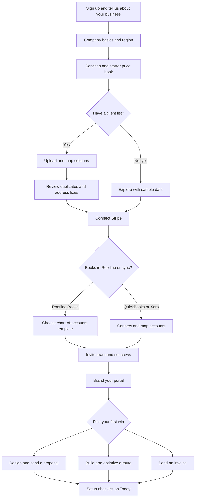

### 14.4 Import mapping UX details [MVP]

- Mapping screen shows source columns on the left with 3 sample values each, target fields on the right with AI-suggested matches and a confidence badge; unmapped columns can be kept as custom fields or notes.
- Address fixes: rows whose address does not geocode are listed with suggestions; users can accept all high-confidence fixes in one click.
- Duplicates: grouped with a merge preview (which values win per field).
- Undo: an import can be rolled back within 7 days if no dependent records (jobs, invoices) were created from it; after that, records are archived individually.
- Large imports (> 5,000 rows) run in the background; the user can keep working; completion notification with a downloadable error report.

### 14.5 White-glove and assisted onboarding [V1]

- Platform support (`platform_support`) can see a tenant's setup progress in the admin console, schedule an onboarding call, and (with consent) complete steps in an impersonated session that is fully audited.
- **Concierge migration** for Companies with 25+ field staff: Rootline imports clients, properties, price book, recurring schedules and open AR from the prior system using vendor exports, then hosts a parallel-run week ([22](22-business-model-pricing-gtm.md)).

---

## 15. Empty states, sample data and first run

### 15.1 Empty state anatomy [MVP]

Every list, board and panel has a designed empty state with: (1) a small line illustration in Stone 700 with one accent; (2) a headline in display serif that says what will live here; (3) one sentence of value; (4) one primary action; (5) a secondary action (import, see an example, learn more); and, where helpful, (6) a ghosted preview of what the populated screen looks like.

| Type | When | Pattern |
|---|---|---|
| First use | No records ever created | Illustration + value + Create + Import + "See an example" |
| No results | Filters/search return nothing | "No visits match 'Crew 3, Thursday'." + Clear filters + Search all |
| Cleared | Work done (inbox zero, all visits complete) | Celebration copy, no action needed |
| Permission | User lacks access | What it is + who can grant access + Request access |
| Offline | Data not cached on device | What is available offline + "Will load when you're back online" |
| Error | Load failed | What happened + Retry + status page link; preserves user input |
| Not enabled | Module off for this Company | What it does + "Turn on" (admins) or "Ask your admin" |

### 15.2 Key empty states (copy drafts)

| Screen | Headline | Body | Primary / secondary |
|---|---|---|---|
| Clients | Your clients will live here | Import your list from a spreadsheet, QuickBooks or Jobber, or add them one by one. | Import clients / Add a client |
| Dispatch board | No visits on the board yet | Set up a recurring service like weekly mowing and Rootline will build the routes for you. | Create a recurring service / Try with sample data |
| Designs | Draw your first landscape | Start from a client's property on satellite. Plants come from your region's curated list. | Start a design / Watch a 2-minute demo |
| Inbox (cleared) | All caught up | Every message has a reply or an owner. Enjoy the quiet. | - |
| Invoices | No invoices yet | Finish a visit or a job and Rootline will draft the invoice for you. | Create an invoice / Set up automatic invoicing |
| Books, bank feed | Connect your bank to start reconciling | Read-only connection. We never move money from this link. | Connect bank / Import a statement file |
| Crew app, Today | No stops today | Enjoy the day off, or check your week. | My week |
| Portal, Service history | Your first visit report will show up here | After each visit you'll see what was done, with photos. | Message us |
| Admin, Curation queue | Queue is clear | 0 plant records waiting for review. Next nursery feed import at 2:00 AM. | Open import log |

### 15.3 Sample data and the sandbox [MVP]

- **"Greenleaf Grounds Co."**, a fictional mid-size landscape company, ships as a sample dataset: 40 clients (32 residential, 8 commercial including an HOA with 3 properties), 55 properties, 3 crews, a full 2026 season of weekly mowing rounds, a 5-step fertilizer program, a 600 sq ft paver patio project with change order, fall cleanups, one snow event with 2-inch trigger pushes, proposals in each state, invoices (paid, open, overdue), a month of ledger entries and a bank feed to reconcile.
- **Region-localized**: plants, weather, season dates and prices adapt to the tenant's Region, so a Phoenix company sees desert palettes and no snow; an Ottawa company sees Zone 5a palettes, metric toggles and HST.
- **Isolation**: sample data lives in a linked **sandbox workspace**, never mixed with real records; a persistent banner says "Sample data - nothing here is real"; no real SMS, email or Stripe charges can be sent from the sandbox (test mode only).
- **Uses**: exploration during trial, training new staff (sandbox reset per user [V1]), sales demos (`platform_support` can spin up demo tenants), screenshots for docs.
- **Reset and remove**: one click; removal never touches real data.

### 15.4 First-run guidance [MVP]

- Contextual coach marks, max 3 per screen, shown once, dismissible, replayable from Help.
- "What's this?" links open short help in the side panel instead of a new tab.
- Role-specific first-run: a technician's first launch of the crew app shows a 4-card intro in their language (clock in, your route, photos, offline) with large illustrations, then goes straight to Today.

---

## 16. Notification design

### 16.1 Principles

- **Fewer, better notifications.** Each one must be actionable, timely and owned. Informational events go to the timeline, not to a phone.
- **The right channel for the moment.** Push for urgent field events; in-app for office work; email for documents and digests; SMS for clients (with consent) and for staff only when urgent and push is unavailable.
- **Respect people's time off.** Quiet hours per user; crew members are not pinged off the clock except for schedule changes affecting tomorrow (configurable by Company, subject to local labor rules).

### 16.2 Priority levels and routing [MVP]

| Priority | Definition | Channels | Examples |
|---|---|---|---|
| P1 Critical | Safety or money at immediate risk; needs action within minutes | Push + in-app + SMS fallback; bypasses quiet hours | Safety incident reported; payment dispute deadline < 48 h; crew lead's panic/help button [V1] |
| P2 Action needed | Someone is waiting on you today | Push (mobile) or in-app toast (desktop) + inbox | Proposal over threshold needs approval; client replied; crew running 45 min late; visit skipped with issue photo |
| P3 FYI, timely | Useful today, not blocking | In-app notification center; batched push max hourly | Proposal viewed; payment received; mockup ready |
| P4 Digest | Summaries | Daily/weekly email or Today brief | Weekly AR summary; crew utilization; KB updates for your region |

Routing rules:
- Notifications target **owners of the object** (assigned estimator, account manager, crew lead) before broad roles; unassigned items go to a role queue.
- **Deduplication and grouping**: same object + same type within 10 minutes collapse ("Henderson viewed the proposal 3 times").
- **Escalation**: P2 unacknowledged for a configurable time (default 2 business hours) escalates to the next role (e.g., office_manager -> owner).
- **Weather-driven batches**: one notification per affected day ("Rain likely Tue after 1 pm: 14 visits at risk. Review suggested moves.") rather than per visit.

### 16.3 Notification center and anatomy [MVP]

- Bell in top bar with unread count (max "99+"); panel with tabs **For you**, **Mentions**, **All**; filters by category; "Mark all read".
- Each item: icon (category), title (object + event), one-line detail, relative time, inline actions (Approve, Reply, View), and overflow (mute this record, notification settings).
- AI-generated notifications (e.g., "Copilot drafted 9 reminder texts for overdue invoices") carry the Iris seedling-spark and open a review screen before anything is sent.

### 16.4 Preference center [MVP]

- Matrix of categories (Sales, Schedule, Field, Money, Books, Design, AI, Team, System) x channels (in-app, push, email, SMS) with sensible role defaults; Company admins can lock certain notifications on (e.g., safety).
- Quiet hours and time zone; digest time; vacation mode (routes P2 to a delegate).

### 16.5 Client-facing notifications [MVP]

Spec and templates in [06](06-customer-portal.md) and [16](16-marketing-growth-communications.md); UX rules:
- Transactional messages (visit reminder, "on the way" with ETA [V1], visit complete with photo, proposal ready, invoice, receipt, payment failed) are branded with the Company's name and sent in the Contact's language.
- SMS requires recorded consent and honors STOP/HELP keywords (TCPA and 10DLC registration managed per Company in [16](16-marketing-growth-communications.md)); marketing messages are separate consent from transactional ones.
- Each client notification links to the exact portal page (magic link) with the next step at the top.
- Frequency caps: max 1 reminder per visit; max 3 dunning reminders per invoice cycle unless the Company configures otherwise.

---

## 17. Microcopy: voice and tone

### 17.1 Voice

Rootline sounds like **an experienced crew lead who is also great with numbers**: plainspoken, confident, warm, specific, and never condescending. We write the way a respected foreman talks to a new hire and the way a good office manager talks to a client.

| Principle | Means | Example |
|---|---|---|
| Specific beats generic | Name the thing, the number and the time | "14 visits on Tue are at risk from rain after 1 pm" not "Weather alert" |
| Plain words | Trade words yes, jargon no | "Mulch install, 12 cu yd" not "Material application service" |
| Calm about money | Exact, neutral, never alarming | "Payment failed: card declined. We'll email Dana a link to try another card." |
| Respectful of crews | Trust, not surveillance | "Location is shared only while you're clocked in." |
| Warm with clients | Personal, appreciative | "Your patio is done! Here are photos from today's visit with Luis's crew." |
| Honest about AI | Say what it is and what it isn't | "AI concept based on your photo and measurements. Your designer will finalize plant choices and quantities." |

### 17.2 Tone by context

| Context | Tone | Length | Example |
|---|---|---|---|
| Crew app | Direct, encouraging, imperative | 2-6 words per instruction | "Take before photos." "Stop 7 of 18." "Nice work - route done." |
| Office app | Efficient, precise | Short sentences | "Moved 14 visits to Thu. Undo" |
| Client portal and messages | Warm, reassuring, clear next step | Short paragraphs | "Your fall cleanup is scheduled for Thursday, Nov 12. We'll text you when the crew is on the way." |
| Money and ledger | Exact, neutral, no jokes | Precise | "Posting will create 14 journal entries in Oct 2026 totaling $48,210.00." |
| Errors | Calm, accountable, actionable | What + why + what next | See 17.4 |
| Operator console | Technical, unambiguous | Terse | "Impersonation ended. 0 writes performed. Session logged." |
| Celebration | Brief, genuine | One line | "First proposal signed! Deposit of $2,400.00 is on its way to your Stripe account." |

### 17.3 Style rules [MVP]

- Sentence case for all UI text (titles, buttons, menu items); title case only for proper nouns and product names (Design Studio, Copilot).
- Buttons are verbs that describe the outcome: "Send proposal", "Charge $1,850.00", "Reschedule 14 visits". Avoid "OK", "Submit", "Yes".
- Numbers as numerals; units always shown with a space ("12 cu yd", "4,350 sq ft", "2.5 lb N/1,000 sq ft"); times as "9:40 am"; ranges with "to" in sentences ("9:40 to 10:10 am").
- Dates: "Thu, Nov 12" in UI; "today", "tomorrow", "yesterday" for +/- 1 day; absolute dates beyond a week.
- People are referred to by name ("Luis's crew") in client-facing copy; staff roles by title in admin contexts.
- No exclamation marks in errors or money; at most one in celebrations.
- Avoid blame ("you entered an invalid..."), "Oops", "Whoops", "Uh-oh", and anything that sounds like a cute mascot.
- Inclusive language; no gendered defaults ("crew member", not "yard guy").

### 17.4 Error message formula [MVP]

**What happened + why (if known) + what to do next**, with the user's input preserved.

| Situation | Bad | Good |
|---|---|---|
| Card declined | "Error 402" | "Visa ending 4242 was declined by the bank. Try another card or pay by bank transfer." |
| Offline save | "Network error" | "You're offline. Your photos and notes are saved on this phone and will upload when you have signal." |
| Sync conflict | "Conflict" | "The office changed this visit's time while you were offline. Keep theirs (9:40 am) or yours (10:15 am)?" |
| Closed period | "Not allowed" | "October 2026 is closed. Post this entry to November, or ask your bookkeeper to reopen October." |
| Import errors | "Import failed" | "Imported 412 of 430 clients. 18 rows need a fix (mostly missing ZIP codes). Download the list to fix and re-upload." |
| AI failed | "Generation failed" | "We couldn't create a mockup from this photo because the yard is mostly hidden. Try a photo taken from the street, in daylight." |

### 17.5 Word list (excerpt) [MVP]

| Use | Avoid | Why |
|---|---|---|
| Client | Customer (in app UI) | Glossary consistency; tenants can override |
| Visit | Appointment, Stop (except in route context) | One term for scheduled occurrences |
| Proposal (client-facing), Estimate (internal) | Quote/bid interchangeably | The estimate/proposal distinction is core to the data model; tenants can rename "Proposal" to "Quote" |
| Crew | Team (for field groups) | "Team" is the HR module |
| Sign / approve | Accept / agree (for proposals) | Legal clarity |
| Pay, Payment | Transaction | Plain language |
| Copilot | "AI bot", "assistant" | Product name consistency |
| Region | Zone (unless USDA hardiness zone) | Region is a curated unit; "Zone" means hardiness zone |
| Post (ledger) | Save (for journal entries) | Accounting meaning |

---

## 18. Hero screens and wireframes

### 18.1 Screen inventory (hero and high-traffic screens)

| # | Screen | Surface | Primary personas | Detailed spec | Priority |
|---|---|---|---|---|---|
| 18.2 | Owner Today dashboard | Web | owner | This doc, [18](18-reporting-analytics.md) | [MVP] |
| 18.3 | Client record | Web | office_manager, estimator, owner | [03](03-crm-sales-estimating-proposals.md) | [MVP] |
| 18.4 | Dispatch board | Web | office_manager, ops_manager | [04](04-scheduling-dispatch-routing.md) | [MVP] |
| 18.5 | Estimate builder | Web, tablet | estimator | [03](03-crm-sales-estimating-proposals.md) | [MVP] |
| 18.6 | Proposal (client view) | Portal | client_residential, client_commercial | [06](06-customer-portal.md) | [MVP] |
| 18.7 | Design Studio | Web, tablet | designer, estimator | [10](10-design-studio.md) | [MVP] |
| 18.8 | AI mockup flow | Web, tablet | designer, estimator | [11](11-ai-design-mockups.md) | [MVP] |
| 18.9 | Crew app: route + visit | Native | crew_lead, technician | [05](05-field-crew-mobile-app.md) | [MVP] |
| 18.10 | Client portal home | Portal | client_residential | [06](06-customer-portal.md) | [MVP] |
| 18.11 | Plant KB curator workbench | Admin | platform_curator | [12](12-plant-knowledge-base.md) | [MVP] |
| 18.12 | Ledger: journal entry | Web | bookkeeper, owner | [09](09-accounting-ledger-integrations.md) | [MVP] |
| 18.13 | Platform admin: Tenant 360 | Admin | platform_owner, platform_support | [19](19-platform-admin-portal.md) | [MVP] |
| 18.14 | Setup checklist and wizard step | Web | owner | Section 14 | [MVP] |
| 18.15 | Command palette | Web | all office roles | Section 6.2 | [MVP] |
| 18.16 | Homeowner funnel: measure step | Public web | homeowner | Section 5.7, [11](11-ai-design-mockups.md) | [V1] |
| - | Pipeline board, Invoice editor, Bank reconciliation, Timesheet approvals, Portal invoice pay, Notification center, Report builder, Automation builder | Various | Various | Module docs | [MVP]-[V1] |

### 18.2 Owner Today dashboard

```text
+------------------------------------------------------------------------------------------------------+
| [=] Rootline  Acme Landscapes v  [ Search or type a command...   Ctrl K ]  [+ Create] [Copilot]      |
+------+-----------------------------------------------------------------------------------------------+
|Today | Good morning, Dana                                     Sat, Nov 7 - 41F, rain 80% after 1 pm  |
|Inbox |                                                                                               |
|Client| +-- Needs your attention (6) --------------------------------+ +-- Copilot daily brief -----+ |
|Sales | | ! Approve estimate E-2290 Ridgeview HOA $46,600 [Approve]  | | * Rain after 1 pm: 14      | |
|Design| |   Margin 31.0% (target 35%)                       [Open]   | |   mowing visits at risk.   | |
|Sched.| | ! Crew 2 running 45 min late (stop 6 of 16)    [Message]   | |   [Review moves]           | |
|Jobs  | | $ Dispute: INV-3307 Patel $1,240, due Nov 20   [Review]    | | * $18,420 overdue >30 days | |
|Money | | # 3 timesheets need approval (Crew 1)     [Approve all]    | |   across 9 clients.        | |
|Books | | > Proposal PR-2281 viewed 4x, unsigned        [Nudge]      | | * 2 proposals viewed 3+    | |
|More  | | > Renewal due: Oakmont Office Park 2027       [Draft]      | |   times, unsigned.         | |
|      | +------------------------------------------------------------+ | (seedling) AI draft        | |
|      |                                                                +----------------------------+ |
|      | +-- Cash and AR ---------+ +-- Today's operations -------------+ +-- Pipeline this week ----+ |
|      | | Cash (2 accts)         | | Crews out 5/6  Visits 38/112 done | | New leads          12    | |
|      | |   $84,210.55           | | Crew 1 [========----] 11/18       | | Proposals sent      7    | |
|      | | AR open  $62,930.00    | | Crew 2 [=====-------]  6/16 late  | | Won $54,300 (3 jobs)     | |
|      | |   >30d   $18,420.00    | | Crew 3 [========----] 12/20       | | Win rate 38% (90 d)      | |
|      | | Paid this wk $21,880   | | Snow 1 standby, trigger 2 in      | +--------------------------+ |
|      | | ~ 12-week sparkline ~  | | Issues 2   Upsells flagged 3      |                              |
|      | +------------------------+ +-----------------------------------+                              |
|      | +-- Weather impact: next 5 days ------------------------------------------------------------+ |
|      | | Sat rain 80% pm: 14 visits at risk | Sun - | Mon clear | Tue frost am: delay fert 2 h     | |
|      | +-------------------------------------------------------------------------------------------+ |
| Sync | [Customize Today]                                                                             |
+------+-----------------------------------------------------------------------------------------------+
```

Key behaviors: attention items are ranked by money at risk x urgency; every item has an inline action; Copilot brief is labeled AI (Iris seedling-spark) with links to records; crew progress bars show text values ("6/16") and a late icon, not color alone; widgets are customizable with keyboard alternatives.

### 18.3 Client record

```text
+------------------------------------------------------------------------------------------------------+
| Clients / Henderson Family                                                                           |
| (HF) Henderson Family  (Active) (Residential) (Autopay on)     [Create v] [Send message] [...]       |
| 2 properties | Client since 2021 | LTV $38,240 | Balance $0.00 | Full-care 2026 | Lang: EN           |
+-------------------------------------------------------------------+----------------------------------+
| Overview | Properties 2 | Work 14 | Sales 3 | Designs 2 | Money   | Comms | Files | Notes            |
+-------------------------------------------------------------------+----------------------------------+
| +-- Properties ------------------------------------------------+  | Contacts                         |
| | [sat] 1420 Maple St, Columbus OH 43215                       |  | Dana Henderson (Billing, Approve)|
| |   Lot 0.31 ac | Turf 8,240 sq ft | Beds 1,180 sq ft          |  |   (614) 555-0142  dana@...       |
| |   Gate code 4471 | Dog: friendly lab | Controller in garage  |  | Sam Henderson (Portal: view)     |
| | [sat] 22 Lakeview Ct (rental)                                |  | Tags: VIP, Pollinator-friendly   |
| +--------------------------------------------------------------+  | Account manager: Jose R.         |
| +-- Active work -----------------------------------------------+  |----------------------------------|
| | Full-care 2026 agreement, Apr-Nov: weekly mow + 5-step fert  |  | Upcoming                         |
| |   Next visit Tue Nov 10, Crew 1 (Fall cleanup 2 of 2)        |  |  Tue Nov 10  Fall cleanup  Crew 1|
| | J-1042 Backyard patio 600 sq ft  Phase 2 of 3  Budget 82%    |  |  Dec 1  Irrigation winterize     |
| +--------------------------------------------------------------+  |----------------------------------|
| +-- Sales -----------------------------------------------------+  | Activity            [Filter v]   |
| | PR-2281 Front yard refresh  $12,850  Viewed 4x  Unsigned     |  |  Today 8:41 am  Proposal viewed  |
| |   [Nudge with message]  [Open proposal]                      |  |   PR-2281 (4th view, iPhone)     |
| +--------------------------------------------------------------+  |  Nov 5  Visit completed V-58813  |
| +-- Money -----------------------------------------------------+  |   [photo][photo][photo] Crew 1   |
| | Last payment $186.00 Nov 2 (Autopay, Visa 4242)              |  |  Nov 3 (seedling) Copilot drafted|
| | Open invoices: none   Statement: [Send]                      |  |   renewal email  [Review]        |
| +--------------------------------------------------------------+  |  Nov 2  Payment $186.00 received |
|                                                                   | [ Note | SMS | Email ]  ______   |
+-------------------------------------------------------------------+----------------------------------+
```

Key behaviors: property cards show site hazards and access info pulled from the crew app; "Viewed 4x" comes from proposal tracking; internal vs client-visible timeline items are distinguished; composer remembers the Contact's language and consent status (SMS disabled with explanation if no consent).

### 18.4 Dispatch board

```text
+------------------------------------------------------------------------------------------------------+
| Schedule / Dispatch  [< Fri] Sat Nov 7 [Mon >]  [Day|3-day|Week]  [Map split]  Crews: All v          |
| Weather: rain 80% after 1 pm  [Rain plan: 14 visits at risk -> Review moves]  Capacity 92%           |
+-----------------+------------------------------------------------------------------------------------+
| Unscheduled (9) | Crew          7a    8a    9a    10a   11a   12p   1p    2p    3p    4p     Hrs     |
| [Search       ] |------------------------------------------------------------------------------------|
| Sort: due date  | Crew 1 T-12  [Hend FC ][Patel MW][Ortiz MW][Kim MW][Lake FC ] //rain//  9.5/10     |
| +-------------+ |  Luis + 2    stop 1 of 18, drive 6 min to next                                     |
| | Fall cleanup| | Crew 2 T-07  [Oakmont commercial MW ][Ridge HOA MW ] [late 45 min] 11.0/10 (!)     |
| | Garcia 3.5 h| |  Ana + 3                                                                           |
| | due Nov 10  | | Crew 3 T-15  [Cedar FC][Smith FC][Brown AER+OS][Jones FC ][...]          8.0/10    |
| +-------------+ | Install A    [== J-1042 Henderson patio: Phase 2 base prep (2 days) ======]        |
| | Aeration    | | Snow 1       standby: trigger at 2 in (forecast 0 in)                              |
| | Brown 1.0 h | | Sub: Green   [Irrigation winterize x6 ]                                            |
| +-------------+ |------------------------------------------------------------------------------------|
| [Auto-schedule] | Selected: Ortiz MW (V-58840) 9:40-10:10 [Move to...] [Reassign v] [Skip] [Lock]    |
|                 | Optimize routes: [x] Crew 1 [x] Crew 3   [Optimize (saves about 38 min drive)]     |
+-----------------+------------------------------------------------------------------------------------+
```

Key behaviors: drag-and-drop plus the WCAG 2.5.7 alternative (select a visit, then click a target slot or use "Move to..."); visits show service abbreviations with a legend (MW mowing, FC fall cleanup, AER+OS aeration and overseed) and full names on hover/focus; capacity per crew shown as hours/available with an over-capacity icon; rain-risk hatched band from weather data; route optimization previews savings before applying ([04](04-scheduling-dispatch-routing.md)); locked visits (client-requested times) are not moved by optimization.

### 18.5 Estimate builder

```text
+------------------------------------------------------------------------------------------------------+
| Sales / Estimates / E-2290 Ridgeview HOA - Entrance renovation  (Draft)  [Preview proposal] [...]    |
| Client: Ridgeview HOA | Property: Main entrance | Source: Design D-311 v3 (takeoff linked)           |
+--------------------------------------------------------------------------+---------------------------+
| Option: [ Good ] [ Better* ] [ Best ]   + Add option                     | Summary (Better)          |
|--------------------------------------------------------------------------|                           |
| # Item                        Qty Unit   Rate        Lab h    Price      | Labor 113.6 h      $6,589 |
|--------------------------------------------------------------------------| Materials         $14,110 |
| 1 Demo existing beds        1,150 sq ft  250 sf/h      4.6      612      | Equipment          $1,940 |
| 2 Mulch, dbl shred brown       14 cu yd  1.5 yd/h      9.3    1,610      | Subs (irrigation)  $4,250 |
| 3 Plants from takeoff          86 ea     kit rates    38.0   18,940      | Overhead recovery  $5,246 |
|   > 12 HYD PAN #5, 24 SCH SCO #1, 3 AME GRA 8 ft B&B ... [expand]        | --------------------------|
| 4 Paver walkway               320 sq ft  kit: walk    51.2   12,480      | Cost              $32,135 |
| 5 Lighting, 14 fixtures        14 ea     0.75 h/ea    10.5    7,290      | Price             $46,600 |
| 6 Irrigation mods (sub)         1 lump   sub quote       -    5,668      | Gross margin 31.0%  (!)   |
| + Add item (type to search the price book, or /kit)                      | Target 35% [Fix margin v] |
|                                                                          |                           |
+--------------------------------------------------------------------------+---------------------------+
| (seedling) Copilot: "Similar entrance jobs averaged 131 labor hours.     | Warranty: 1 yr plants     |
|  Plant install hours may be low." [Show 5 similar jobs] [Apply +12%]     | Deposit 30%: $13,980      |
+--------------------------------------------------------------------------+---------------------------+
```

Key behaviors: quantities flow from the Design takeoff and stay linked (a "design changed" banner offers to update); each line opens a "why" drawer showing the math (qty / production rate x crew burden); margin warnings compare to target; options share lines with deltas; the Copilot suggestion is advisory with sources ([03](03-crm-sales-estimating-proposals.md), [17](17-ai-copilot-automation.md)).

### 18.6 Proposal (client view)

```text
+------------------------------------------------------------------------------------------------------+
| [Acme Landscapes logo]                                    Questions? (614) 555-0100  [Message]       |
+------------------------------------------------------------------------------------------------------+
| [ Hero image: AI mockup of the finished entrance, labeled "AI concept" ]                             |
|                                                                                                      |
| Entrance renovation for Ridgeview HOA                   Prepared by Jose Ramirez, Nov 6, 2026        |
| Valid until Dec 6, 2026                                                                              |
|------------------------------------------------------------------------------------------------------|
| Choose your option                                                                                   |
| +----------------------------+ +----------------------------+ +----------------------------+         |
| | Good                       | | Better (Recommended)       | | Best                       |         |
| | $34,900                    | | $46,600                    | | $61,250                    |         |
| | New beds and mulch         | | + Native shrub layers      | | + Lighting design          |         |
| | 64 plants                  | | + Paver walkway            | | + Seasonal color plan      |         |
| | [ Select ]                 | | [ Selected (check) ]       | | [ Select ]                 |         |
| +----------------------------+ +----------------------------+ +----------------------------+         |
|------------------------------------------------------------------------------------------------------|
| Your design   [2D plan] [Before/after] [Plant list]                                                  |
| +--------------------------------------------+  Plants in this design (86)                           |
| | (to-scale plan with plant symbols)         |  12 Panicle hydrangea 'Limelight' #5  [i]             |
| |                                            |  24 Little bluestem #1  native  [i]                   |
| | [+] [-] [Fit] [Layers]                     |  3 Serviceberry 8 ft B&B  native  [i]                 |
| +--------------------------------------------+                                                       |
|------------------------------------------------------------------------------------------------------|
| What's included (expand)  |  Schedule: start week of Mar 16, 2027 (weather permitting)               |
| Terms and warranty (expand): 1-year plant warranty with watering conditions                          |
|------------------------------------------------------------------------------------------------------|
| Total $46,600.00     Deposit due today (30%): $13,980.00                                             |
| [ Approve and sign ]   [ Ask a question ]   [ Download PDF ]                                         |
| Payments are processed securely by Stripe for Acme Landscapes LLC.                                   |
+------------------------------------------------------------------------------------------------------+
```

Key behaviors: on phones the option cards stack and the total/approve bar is sticky at the bottom; selecting an option updates the plan, plant list and total; line-item comments create a thread for the estimator; e-sign then deposit payment via Stripe Elements on the Company's connected account ([08](08-payments-stripe.md)); commercial clients see "Approve within your authority ($50,000)" or "Route to board" ([06](06-customer-portal.md)).

### 18.7 Design Studio

```text
+------------------------------------------------------------------------------------------------------+
| D-311 Ridgeview entrance v3 (autosaved)  [Option A v]  Units ft-in  1"=10'  [Share] [Present]        |
| Tools: [Select][Pan][Line][Bed][Hardscape][Plant][Irrig][Light][Measure][Text]  Snap 1 ft: On        |
+-----------------+--------------------------------------------------------------+---------------------+
| Layers          |  (aerial base, parcel line dashed)                           | Inspector           |
| [x] Base aerial |                                                              | Plant: 'Limelight'  |
| [x] Existing    |      . . . . . . . . . . . . . . . . . .                     | Hydrangea paniculata|
| [x] Hardscape   |     .   (o)    (o)    (o)     *       .                      | Region: Recommended |
| [x] Beds        |    .  BED A  1,140 sq ft  mulch dbl shred .                  |  Ohio Valley 6a     |
| [x] Plants      |     .  {@}  {@}  ###  ###  ###        .                      | Size #5   Qty 12    |
| [ ] Irrigation  |      . . . . . . . . . . . . . . . . . .                     | Mature 6-8 ft wide  |
| [x] Lighting    |   ==== PAVER WALK 320 sq ft herringbone ====                 | Spacing 5 ft o.c.   |
| [ ] Notes       |                       |<---- 42' 6" ---->|                   | Sun: full to part   |
|-----------------|                                                              | [Swap from palette] |
| Plant palette   |  [Maturity: Install | Yr 1 | Yr 5 | Mature]                  |---------------------|
| Ohio Valley 6a  |                                                              | Takeoff (live)      |
| Search ______   |  Copilot (seedling): "Fill Bed A with deer-                  |  Mulch    14.0 cu yd|
| [HYD PAN] [SCH] |  resistant natives, max 3 ft" [Generate layout]              |  Pavers   320 sq ft |
| [AME GRA] [ILE] |                                                              |  Plants   86 ea     |
| Filters: native,|                                                              |  Edging   188 lin ft|
| deer-res., sun  |                                                              | [Push to estimate]  |
+-----------------+--------------------------------------------------------------+---------------------+
| Objects outline (accessible tree) | Comments (2) | Versions | Mockups (3) | Sync: saved 2 s ago      |
+------------------------------------------------------------------------------------------------------+
```

Key behaviors: everything is to scale; plants come from the regional palette with the RegionRatingBadge; maturity slider rescales symbols; live takeoff pushes to the Estimate; AI layout generation is constrained by the bed's real dimensions, the palette and user filters ([10](10-design-studio.md), [11](11-ai-design-mockups.md), [12](12-plant-knowledge-base.md)); objects outline gives keyboard and screen-reader access.

### 18.8 AI mockup flow

```text
Step 1 of 3: Photo and dimensions                     Step 2 of 3: Generating (about 40 s)
+-----------------------------------------------+     +-----------------------------------------------+
| [Property photo: front yard from street]      |     |  [Photo with segmentation overlay shimmer]    |
|  Detected: house, driveway, lawn, 2 beds,     |     |                                               |
|  existing maple (keep?)  [x] Keep  [ ] Remove |     |  (seedling) Working on it:                    |
|                                               |     |   [check] Reading depth and scale             |
|  Scale reference:                             |     |   [check] Matching beds to your plan D-311 v3 |
|   ( ) Use Design D-311 v3 (to scale)  *       |     |   [....] Choosing plants from Ohio Valley 6a  |
|   ( ) Enter a known length: garage door       |     |          palette (deer-resistant, native)     |
|       = [ 16 ] ft                             |     |   [    ] Rendering 3 concepts                 |
|                                               |     |                                               |
|  Style: [Native meadow v]  Season: [Summer v] |     |  Uses 3 AI credits. 412 left this month.      |
|  Plants: [x] From design  [ ] Let AI suggest  |     |  [Cancel]                                     |
|  [ Generate 3 concepts  (3 credits) ]         |     +-----------------------------------------------+
+-----------------------------------------------+

Step 3 of 3: Review concepts
+---------------------------------------------------------------------------------------------------+
| [Before] [Concept A*] [Concept B] [Concept C]      View: (o) Side by side  ( ) Slider             |
| +--------------------------------+ +--------------------------------+  Plants shown (from plan):  |
| | BEFORE photo                   | | CONCEPT A ("AI concept")       |    12 HYD PAN  [i]          |
| |                                | | hydrangeas, little bluestem,   |    24 SCH SCO  [i]          |
| |                                | | serviceberry, brown mulch      |    3 AME GRA   [i]          |
| +--------------------------------+ +--------------------------------+                             |
| Refine: [Brush to edit area] "Make the bed edge curve more"  [Apply (1 credit)]                   |
| Plan sync: Concept A matches D-311 v3 (86/86 plants placed)  [Update plan from concept v]         |
| [Add to proposal]  [Download]  [Discard]                                  Alt text: [Edit]        |
+---------------------------------------------------------------------------------------------------+
```

Key behaviors: dimensions come from a Design or a known reference length; plants are constrained to the plan or the regional palette; progress narrates real steps; credit cost shown before running; concepts labeled "AI concept"; plan-mockup sync status is explicit ([11](11-ai-design-mockups.md)).

### 18.9 Crew app: route and visit

```text
Today (route)                                Visit (stop 7 of 18)
+-------------------------------------+      +-------------------------------------+
| Crew 1 - Truck T-12    [Offline 3]  |      | < Route       V-58840   [Offline 3] |
| Clocked in 6:58 am   4h 12m         |      | Ortiz, 88 Elm St                    |
| Rain after 1 pm        52F          |      | Weekly mowing + edging   30 min     |
|-------------------------------------|      |-------------------------------------|
| 6 of 18 done          Drive 1h 05m  |      | !  Gate code 4471   Dog in yard     |
|-------------------------------------|      |    Low wires near back fence        |
|  (check) 1 Henderson   Fall cleanup |      |-------------------------------------|
|  (check) 2 Patel       Mowing       |      | Tasks                         2 / 4 |
|   ...                               |      | [x] Mow front and back              |
|  (>) 7 Ortiz           Mowing       |      | [x] Edge walks and drive            |
|      88 Elm St  30 min  9:40 am     |      | [ ] Blow off hard surfaces          |
|  ( ) 8 Kim             Mowing       |      | [ ] After photos (0 of 2)           |
|      12 Oak Ct  25 min  drive 6 min |      |-------------------------------------|
|  ( ) 9 Lakeview Ct     Fall cleanup |      | [Camera]  [Note (mic)]  [Issue]     |
|                                     |      | [Materials]   [Suggest work $]      |
|-------------------------------------|      |-------------------------------------|
| +---------------------------------+ |      | +---------------------------------+ |
| |      START NEXT STOP  (7)       | |      | |        COMPLETE VISIT           | |
| +---------------------------------+ |      | +---------------------------------+ |
|[Today][Map][Time][Messages][More]   |      |[Today][Map][Time][Messages][More]   |
+-------------------------------------+      +-------------------------------------+
```

Key behaviors: the sync chip ("Offline 3" = 3 changes queued) is always visible and tappable to see the queue; primary action is a 64 px full-width button in the thumb zone; hazards banner uses icon + text; "Complete visit" checks required items (after photos) and explains what is missing; all labels in the user's language; "Suggest work" captures an upsell with photo for the office ([05](05-field-crew-mobile-app.md)).

### 18.10 Client portal home

```text
+-------------------------------------+
| [Acme Landscapes logo]        [=]   |
|-------------------------------------|
| Hi Dana                             |
| 1420 Maple St  v                    |
|-------------------------------------|
| +---------------------------------+ |
| | Next step                       | |
| | Your front yard proposal is     | |
| | ready to review.                | |
| | [ Review proposal ]             | |
| +---------------------------------+ |
|                                     |
| Coming up                           |
|  Tue, Nov 10  Fall cleanup (2 of 2) |
|  Luis's crew  - we'll text when     |
|  they're on the way                 |
|                                     |
| Last visit - Thu, Nov 5             |
| [photo] [photo] [photo]             |
| "Leaves cleared, beds cut back,     |
|  gutters checked." [See report]     |
|                                     |
| Balance  $0.00   Autopay on (Visa)  |
| [Pay]  [Request service]  [Message] |
|-------------------------------------|
| [Home][Proposals][Schedule][Billing]|
+-------------------------------------+
```

Key behaviors: one "Next step" card drives the visit; photography leads; the Company's brand tokens apply; property switcher appears only for multi-property clients; magic-link sessions land here or on the linked page ([06](06-customer-portal.md)).

### 18.11 Plant KB curator workbench

```text
+------------------------------------------------------------------------------------------------------+
| ADMIN  Plant KB / Curation queue (214)  Region: Ohio Valley 6a  Source: nursery feed  [Mine]         |
+------------------------+-----------------------------------------------------------------------------+
| Queue                  | Hydrangea paniculata 'Limelight'  PLT-04412  Status: In review              |
| > 'Limelight' (update) | [Photos 6]  Symbol family: Deciduous shrub  [Preview symbol]                |
|   Little bluestem (new)|-----------------------------------------------------------------------------|
|   Bradford pear (flag) | Field           | Current           | Proposed (nursery feed) | Act         |
|   ...                  | Mature height   | 6-8 ft            | 6-8 ft                  | =           |
| Bulk: [Accept safe]    | Mature width    | 6-8 ft            | 6-10 ft                 | [ok]        |
|                        | Bloom           | Jul-Sep lime>pink | Jul-Sep lime>pink       | =           |
|                        | Deer resistance | Moderate          | High                    | [x]         |
|                        | USDA zones      | 3-8               | 3-9                     | [ok]        |
|                        |-----------------------------------------------------------------------------|
|                        | Region profile: Ohio Valley 6a                                              |
|                        |  Rating [Recommended v]  Confidence: High (12 tenants planted,              |
|                        |  2 warranty claims per 340 installs)                                        |
|                        |  Notes: "Tolerates clay; avoid hot west walls."                             |
|                        |  Invasive: none   Native: no   Palettes: Low-maintenance shrubs (+3)        |
|                        |-----------------------------------------------------------------------------|
|                        | (seedling) AI check: "Deer resistance 'High' conflicts with 3               |
|                        |  extension sources rating it Moderate." [See sources]                       |
|                        | Reason for change: ______________  [Reject] [Save draft] [Publish]          |
+------------------------+-----------------------------------------------------------------------------+
```

Key behaviors: field-level diff with accept/reject; region profiles show real-world performance signals from tenant installs and warranty claims (aggregated, anonymized); AI flags conflicts with sources; publishing requires a reason and is versioned; bulk-accept only for "safe" fields ([12](12-plant-knowledge-base.md), [19](19-platform-admin-portal.md)).

### 18.12 Ledger: journal entry

```text
+------------------------------------------------------------------------------------------------------+
| Books / Journal / JE-10442  (Draft)        View: [Accountant] [Plain language]     [Post] [...]      |
| Date [Oct 31, 2026]  Period: Oct 2026 (open)  Type: Adjusting  Ref: WIP adjustment J-1042            |
+------------------------------------------------------------------------------------------------------+
|  # | Account                      | Memo                   | Job / Class    |     Debit |    Credit  |
| ---------------------------------------------------------------------------------------------------  |
|  1 | 1250 Unbilled revenue (WIP)  | J-1042, 62% complete   | J-1042 Install |  4,812.00 |            |
|  2 | 4100 Install revenue         | Earned revenue, Oct    | J-1042 Install |           |  4,812.00  |
|  3 | [ Search accounts... ]       |                        |                |           |            |
| ---------------------------------------------------------------------------------------------------  |
|    |                              |                        | Totals         |  4,812.00 |  4,812.00  |
|    |                              |                        | Difference     |      0.00 |  balanced  |
+------------------------------------------------------------------------------------------------------+
| Attachments: WIP schedule Oct.pdf    Source: Job costing > WIP > Oct 2026   [Open source]            |
| Plain language: "Moves $4,812.00 of revenue earned on the Henderson patio into October."             |
| (seedling) Copilot: "Matches the WIP schedule. Reverses automatically on Nov 1." [Set auto-reverse]  |
| Audit: created by Priya (bookkeeper) Nov 2, 9:14 am   QuickBooks: not synced (Books is SoR)          |
+------------------------------------------------------------------------------------------------------+
```

Key behaviors: debits and credits must balance before Post; posted entries are immutable (reverse to correct); closed periods block posting with a clear message; the "Plain language" lens explains the entry for owners; every entry links to its source document; amounts are tabular and right-aligned ([09](09-accounting-ledger-integrations.md)).

### 18.13 Platform admin: Tenant 360

```text
+------------------------------------------------------------------------------------------------------+
| ADMIN  Tenants / Acme Landscapes LLC (tn_7Kq...)  Plan: Growth (annual)  Health 82 (up 4)            |
| Columbus, OH | Region Ohio Valley 6a | 6 crews, 31 users | Since Mar 2026 | Data: US-East            |
| [Impersonate (request consent)] [Add note] [Flags] [Billing] [...]            Owner: Dana H.         |
+-------------------------------------------------------------+----------------------------------------+
| Overview | Usage | Billing | AI | Payments | Users | Support| Flags | Audit | Danger zone            |
+-------------------------------------------------------------+----------------------------------------+
| Activation                                                  | Account signals                        |
|  Setup checklist  8/8                                       |  NPS 9 (Oct)                           |
|  First proposal   Mar 14 (day 2)                            |  Tickets 30 d: 3 (1 open: QBO mapping) |
|  Crew app WAU     27 / 29 field users                       |  Churn risk: Low                       |
| Usage (30 days)                                             |  Expansion: Snow module trial          |
|  Visits 3,412  Proposals 64  Designs 19  Invoices 1,108     |----------------------------------------|
| AI credits  Used 1,840 / 2,500  Run-out projected Nov 24    | Stripe Connect                         |
|  [Grant 500 credits (reason required)]                      |  acct_1P...  Standard  Charges on      |
| SaaS billing                                                |  Payouts on   Disputes 30 d: 1         |
|  MRR $649   Next invoice Dec 1   Card on file, current      |  App fee 30 d: $412.30                 |
| Accounting: Rootline Books + QuickBooks sync (one-way)      |----------------------------------------|
|  Last sync 2 h ago  Errors 1 [View]                         | Impersonation log                      |
|                                                             |  Oct 12 J. Park (support) 14 min, RO   |
+-------------------------------------------------------------+----------------------------------------+
```

Key behaviors: impersonation requires tenant consent or break-glass reason and is time-boxed; every write action asks for a reason and lands in the audit tab; client data is masked by default in support views; health score is explainable (click to see factors) ([19](19-platform-admin-portal.md)).

### 18.14 Setup checklist and a wizard step

```text
+------------------------------------------------------------------------------------------------------+
| Today                                                                                                |
| +-- Get Acme Landscapes ready  -  5 of 8 done (62%) -----------------------------------------------+ |
| | (check) Company basics and region                                                                | |
| | (check) Services and price book (3 starter kits)                                                 | |
| | (check) Import clients: 412 imported, 18 need fixes          [Fix now]                           | |
| | ( )     Connect Stripe to get paid online        about 10 min  [Start]                           | |
| | ( )     Choose how you keep your books           about 5 min   [Start]                           | |
| | (check) Invite your team: 9 of 11 accepted                    [Resend 2]                         | |
| | (check) Brand your portal                                                                        | |
| | ( )     First win: design and send a proposal    about 15 min  [Start]                           | |
| |                                   [Hide checklist]  [Book a free setup call]                     | |
| +--------------------------------------------------------------------------------------------------+ |
+------------------------------------------------------------------------------------------------------+

Wizard step 5 of 8: Choose how you keep your books
+------------------------------------------------------------------------------------------------------+
| ( ) Use Rootline Books (recommended)        ( ) Keep QuickBooks or Xero, and sync                    |
|     A full double-entry ledger, built in.        We'll send invoices, payments and bills to          |
|     Your CPA gets their own login.               your accounting system. [QuickBooks Online] [Xero]  |
|                                                                                                      |
| Chart of accounts template: [ Landscape: Design-build + Maintenance (US) v ]  [Preview 64 accounts]  |
| Books start date: [ Jan 1, 2026 ]   Opening balances: [ Enter now ] [ Later with my accountant ]     |
|                                                         [Back]   [Set up later]   [Continue]         |
+------------------------------------------------------------------------------------------------------+
```

### 18.15 Command palette

```text
+--------------------------------------------------------------------------+
| > resched ridgeview                                                      |
|--------------------------------------------------------------------------|
| Actions                                                                  |
|  (>) Reschedule Ridgeview HOA visits...                        R then S  |
|      Reschedule tomorrow's visits for a crew...                          |
| Clients                                                                  |
|      Ridgeview HOA  - 3 properties - Commercial              C-0388      |
| Jobs                                                                     |
|      J-1077 Ridgeview HOA entrance renovation (Estimate)     E-2290      |
| Ask Copilot                                                              |
|      (seedling) "resched ridgeview" - ask Copilot to plan it             |
|--------------------------------------------------------------------------|
| Up/Down to move   Enter to run   Tab to scope   Esc to close             |
+--------------------------------------------------------------------------+
```

### 18.16 Homeowner funnel: measure step (phone)

```text
+-------------------------------------+
| Design my yard            Step 3/6  |
|-------------------------------------|
| Measure your front bed              |
| +---------------------------------+ |
| | [satellite view of 1420 Maple]  | |
| |    _______________              | |
| |   |  traced bed   | 32 ft x 4 ft| |
| |   |_______________|             | |
| |  [+] [-]  [Undo] [Clear]        | |
| +---------------------------------+ |
| Or type it:                         |
| Length [ 32 ] ft   Width [ 4 ] ft   |
| Sun: (o) Full  ( ) Part  ( ) Shade  |
|                                     |
| We'll use these real measurements   |
| so plant counts and spacing are     |
| realistic.                          |
| +---------------------------------+ |
| |            Continue             | |
| +---------------------------------+ |
| Skip - let us estimate from photo   |
+-------------------------------------+
```

Key behaviors: tracing and typing are equivalent (no drag required: tap points to place vertices); plausibility check against image scale ("32 ft looks longer than this house front, about 28 ft - double-check?"); no contact info requested before concepts are shown.

---

## 19. Key UX flows

### 19.1 Cross-surface journey: from homeowner concept to booked revenue [V1]

1. A homeowner completes the funnel on the Company's website and requests a consultation.
2. Rootline creates a Lead, Property, Design draft and Mockups in the Company's CRM; the estimator gets a P2 notification.
3. The estimator visits, refines the Design in the Studio on an iPad, pushes the takeoff into an Estimate and sends a Proposal.
4. The homeowner opens the Proposal in the portal from SMS, picks the "Better" option, signs and pays the deposit through the Company's Stripe account.
5. The Job is created and phases are scheduled on the dispatch board; the crew sees install tasks with the Crew render of the plan.
6. On completion the invoice is drafted automatically, paid in the portal, and the ledger records revenue, deposit application and Stripe fees.

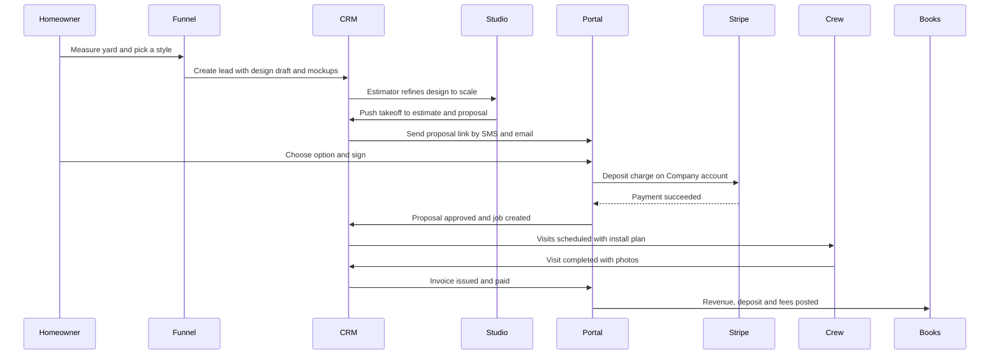

### 19.2 Offline and sync status (crew app and Studio on tablet) [MVP]

The SyncStatusChip is always visible on crew screens and reflects this state machine:

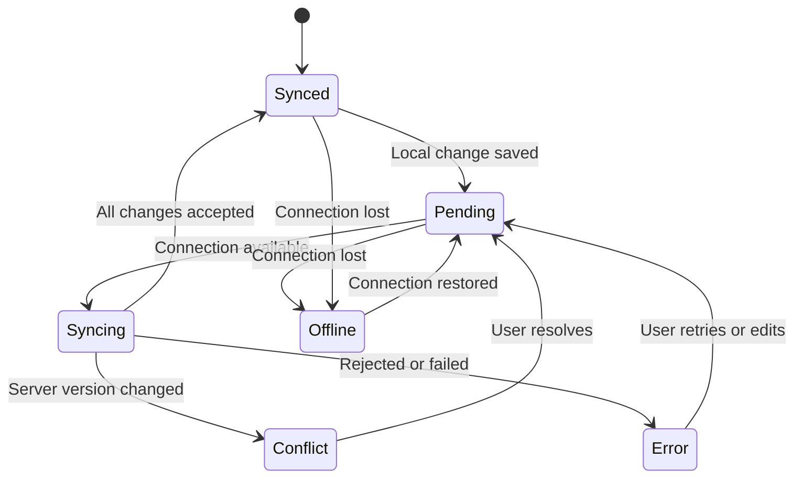

| State | Chip label (en / es) | Visual | User action |
|---|---|---|---|
| Synced | "Synced" / "Sincronizado" | Moss check | None |
| Pending | "3 to send" / "3 por enviar" | Stone clock | Tap to view queue |
| Syncing | "Sending 3" / "Enviando 3" | Animated arrows (static if reduced motion) | None |
| Offline | "Offline - 3 saved" / "Sin señal - 3 guardados" | Marigold banner, cloud-off icon | Tap to see what is available offline |
| Conflict | "1 needs you" / "1 requiere atención" | Ember dot | Resolve screen with both versions |
| Error | "1 failed" / "1 falló" | Ember icon | Retry, edit or contact office |

Rules: photos are compressed and queued with thumbnails visible immediately; time punches use device time plus monotonic clock and are flagged if the device clock was changed; conflict resolution follows domain rules in [20](20-architecture-security.md) (e.g., office wins on schedule times, field wins on completion data).

### 19.3 Command palette intent resolution [MVP]

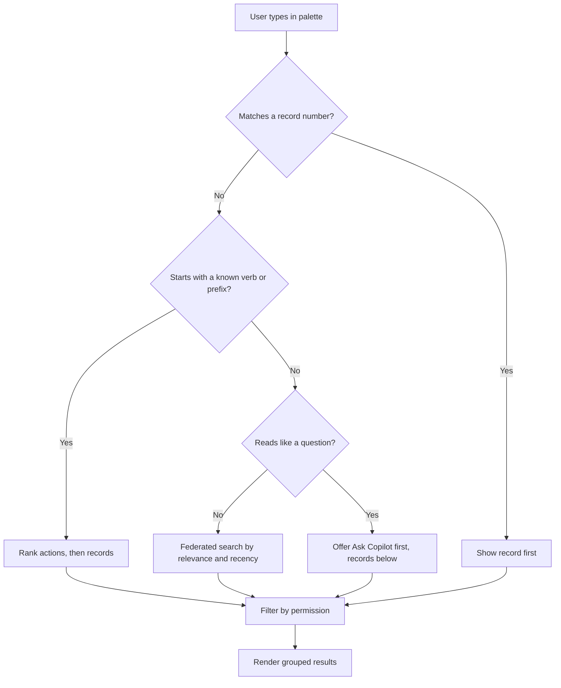

### 19.4 Notification routing [MVP]

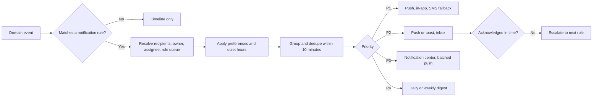

### 19.5 Rain-day reschedule (office) [V1]

1. At 5:30 am the weather service flags precipitation probability >= 70% after 1 pm for the service area.
2. Today and the dispatch board show a rain band; one P2 notification is sent to the dispatcher.
3. "Review suggested moves" opens a side-by-side preview: 14 at-risk visits, proposed new slots (respecting crew capacity, client locks, service intervals such as "no more than 10 days between mows").
4. Dispatcher deselects 2 visits (commercial clients who prefer wet-day mowing skipped), applies 12 moves.
5. Undo toast and activity log entry; clients with "notify on reschedule" receive branded SMS in their language; crew apps update on next sync.

---

## 20. Data model

UX-owned entities. Core business entities (Client, Job, Visit, Invoice, Plant, etc.) are defined in [20 - Architecture](20-architecture-security.md) and module docs; these tables support personalization, notifications, branding, onboarding and the sandbox. All tenant-scoped tables carry `tenant_id` with row-level security.

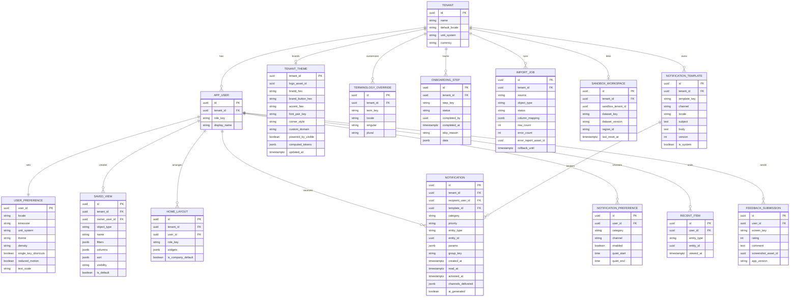

Rules and validations:
- `SAVED_VIEW.visibility` in {private, role, company}; company views require `views.manage_shared`.
- `TENANT_THEME.brand_button_hex` is computed server-side from `brand_hex` and must pass 4.5:1 against its foreground; writes failing the check are rejected with a suggested value.
- `NOTIFICATION` rows are retained 90 days (configurable), then summarized; P1 notifications are retained per audit policy.
- `IMPORT_JOB.rollback_until` = completion + 7 days; rollback blocked if dependent records exist.
- `SANDBOX_WORKSPACE.sandbox_tenant_id` points to a separate tenant with `is_sandbox = true`; outbound comms and live Stripe keys are disabled for sandbox tenants at the gateway.
- Platform-level tables (design token versions, sample dataset definitions, global templates, symbol family mapping) live in the platform schema managed through the admin console ([19](19-platform-admin-portal.md)).

---

## 21. Integrations, APIs and events

### 21.1 External services and tools

| Service | Use | Notes | Priority |
|---|---|---|---|
| Figma (variables + libraries) | Design source; tokens synced via a tokens plugin to the `@rootline/tokens` repo | Bidirectional sync with PR review | [V1] |
| Storybook + visual regression service (e.g., Chromatic) | Component catalog, visual diffs per theme and locale | Gate on PRs touching `@rootline/ui` | [MVP] |
| axe-core / Playwright | Automated accessibility and E2E checks | Runs per PR on key flows | [MVP] |
| Translation management system (Lokalise, Phrase or Crowdin) | Strings, glossary, screenshots, translator workflow | Decide in MVP planning | [MVP] |
| Mapbox or Google Maps | Basemaps, satellite, geocoding UI | Per [20](20-architecture-security.md) | [MVP] |
| Stripe Elements (Appearance API) | Payment UI inside the portal styled with tenant brand tokens (colors, radius, font) | Card data stays in Stripe's iframe (PCI SAQ-A); verify current Appearance variables | [MVP] |
| Product analytics (e.g., PostHog) | Funnels, feature adoption, session replay with PII masking | Masking of client names, addresses, amounts by default; opt-out per tenant | [MVP] analytics, [V1] replay |
| Error and performance monitoring (e.g., Sentry) | Web vitals, crash reporting for native | Release health gates | [MVP] |
| Email rendering (React Email or MJML) | Branded transactional emails from tokens | Dark-mode-safe | [MVP] |
| PDF rendering (headless Chromium) | Proposals, invoices, plan sheets, install sheets using `print` theme | Fonts embedded | [MVP] |
| Self-hosted fonts | Inter, Fraunces, JetBrains Mono, curated tenant pairs | No third-party font CDN (privacy, performance) | [MVP] |

### 21.2 Domain events emitted by UX-owned modules

| Event | Payload highlights | Consumers |
|---|---|---|
| `onboarding.step_completed` | tenant_id, step_key, duration_s | Admin activation funnel, lifecycle emails |
| `onboarding.completed` | tenant_id, days_to_complete | Admin, sales |
| `import.completed` / `import.failed` | job_id, rows, errors | Notifications, admin support |
| `theme.updated` | tenant_id, changed_fields | Portal cache purge, email template rebuild |
| `notification.created` / `.delivered` / `.read` / `.actioned` | notification_id, channel, latency | Analytics, escalation engine |
| `saved_view.shared` | view_id, visibility | Audit |
| `sandbox.created` / `.reset` | tenant_id, dataset_version | Admin |
| `feedback.submitted` | screen_key, rating | Product research queue |
| `ui.command_executed` | command_key, source (palette/shortcut/menu) | Ranking model, analytics (no free text stored) |

### 21.3 Events consumed

The activity timeline and notification engine consume domain events from all modules via the outbox/event bus ([20](20-architecture-security.md)): `proposal.viewed`, `proposal.signed`, `visit.completed`, `visit.skipped`, `payment.succeeded`, `payment.failed`, `dispute.opened`, `estimate.approval_requested`, `timesheet.submitted`, `design.version_saved`, `mockup.generated`, `weather.alert`, `sync.conflict`, `kb.plant_published` (for "updated in your region" digests), and more.

### 21.4 Public APIs touching UX

- `GET/PUT /v1/me/preferences`, `GET/POST /v1/saved-views`, `GET /v1/notifications`, `POST /v1/notifications/{id}/read` [MVP]
- `GET/PUT /v1/branding` (tenant theme; validates contrast) [MVP]
- Portal embed SDK for the homeowner funnel widget: `<script src="https://embed.rootline.com/design.js" data-company="acme">` with postMessage events (`rootline:design_started`, `rootline:lead_submitted`) for the tenant's own analytics [V1]

---

## 22. Permissions

UX-level capabilities by role (full RBAC model in [02](02-personas-roles-permissions.md)). Y = allowed, O = own records/self only, - = not allowed.

### 22.1 Tenant roles

| Capability | owner | office_manager | estimator | designer | ops_manager | crew_lead | technician | bookkeeper | subcontractor |
|---|---|---|---|---|---|---|---|---|---|
| Personalize own Today, theme, density, language | Y | Y | Y | Y | Y | Y | Y | Y | Y |
| Publish company default Today layouts per role | Y | Y | - | - | - | - | - | - | - |
| Create private saved views | Y | Y | Y | Y | Y | Y | - | Y | - |
| Share saved views with role/company | Y | Y | - | - | Y | - | - | Y | - |
| Edit portal branding and custom domain | Y | Y | - | - | - | - | - | - | - |
| Edit client notification templates | Y | Y | - | - | O (ops templates) | - | - | O (billing templates) | - |
| Edit terminology overrides | Y | Y | - | - | - | - | - | - | - |
| Run data imports / roll back imports | Y | Y | - | - | - | - | - | O (financial imports) | - |
| Load, reset or remove sample sandbox | Y | Y | - | - | - | - | - | - | - |
| Use command palette actions | Y | Y | Y | Y | Y | O | - | Y | - |
| Use Copilot (within own permissions) | Y | Y | Y | Y | Y | Y | Y | Y | - |
| Lock notification categories on for staff | Y | Y | - | - | Y (field/safety) | - | - | - | - |
| Grant platform support impersonation consent | Y | Y | - | - | - | - | - | - | - |
| Embed homeowner design funnel on website | Y | Y | - | Y | - | - | - | - | - |

Clients: `client_residential` and `client_commercial` contacts can set their own language, notification preferences and consent; commercial admins can manage other contacts' portal access within their organization [V1].

### 22.2 Platform roles

| Capability | platform_owner | platform_support | platform_curator | platform_finance | platform_engineer |
|---|---|---|---|---|---|
| View tenant 360 (PII masked) | Y | Y | - | Y (billing fields) | Y (technical fields) |
| Impersonate with tenant consent (read-only) | Y | Y | - | - | Y (break-glass) |
| Impersonate with write access | Y (with reason) | Y (with second approval) | - | - | - |
| Publish global templates, sample datasets, starter price books | Y | - | Y (plant palettes, symbol mapping) | - | - |
| Edit plant symbol family mapping | Y | - | Y | - | - |
| Publish in-app announcements | Y | Y | - | - | - |
| Change design tokens / release `@rootline/ui` | Y (approve) | - | - | - | Y |
| Manage feature flags affecting UI | Y | - | - | - | Y |
| View UX analytics and session replay (masked) | Y | Y | - | - | Y |

---

## 23. AI opportunities and AI UX conventions

### 23.1 AI UX conventions (apply to every module) [MVP]

1. **Visible provenance.** All AI output carries the Iris seedling-spark and a label ("Draft by Copilot", "AI concept"); hover/focus shows model task, inputs used and sources ("Based on 14 similar patio jobs in 2025-2026").
2. **Preview before apply.** AI changes to schedules, estimates, designs, ledgers or client messages render as a diff or preview; nothing posts, sends or charges without a human click. Low-risk automations (e.g., visit reminders) can be pre-authorized by admins in Automations.
3. **Undo always.** Applied AI changes are undoable and logged as "Applied by Dana from Copilot suggestion".
4. **Cost transparency.** Credit-consuming actions show the credit cost before running and remaining balance after ([22](22-business-model-pricing-gtm.md)).
5. **Progress narration.** Long-running AI tasks (mockups, layouts, bulk drafts) show real step progress, can be cancelled, and continue in the background with a notification.
6. **Feedback loops.** Thumbs up/down with optional reason on every AI output; feeds AI ops evals ([17](17-ai-copilot-automation.md), [19](19-platform-admin-portal.md)).
7. **Graceful failure.** Specific, actionable failure messages (section 17.4); never a blank or a generic "something went wrong".
8. **No anthropomorphism.** Copilot speaks in first person sparingly, never claims feelings, and never pretends to be a human in client conversations; AI receptionist and AI-drafted client messages disclose AI involvement where required.

### 23.2 AI opportunities in UX itself

| Opportunity | Description | Priority |
|---|---|---|
| Natural-language search and actions | Palette understands "move Crew 2's afternoon to tomorrow" and previews the change | [V1] |
| Copilot daily brief | Role-specific morning summary with linked records | [V1] |
| AI-assisted import mapping | Column matching, address cleanup, duplicate detection | [MVP] |
| Smart empty states | Empty states suggest the next best action based on Company data ("You have 38 clients without a fall cleanup this year - create a campaign?") | [V1] |
| Auto alt text and captions | For mockups, visit photos (client-facing reports) and training videos | [V1] |
| Live translation | Crew notes and client messages translated with originals preserved | [V1] |
| Voice-first crew actions | "Start next stop", "Add note: sprinkler head broken by the mailbox" in English or Spanish | [V1] |
| Adaptive Today | Widget order learns from what each user acts on, within role guardrails | [V2] |
| Microcopy linting | AI checks new UI strings against the voice guide and glossary in PRs | [V1] |
| Design QA assistant | Screenshot diff review flags token misuse, contrast issues, truncation in Spanish | [V2] |
| Accessibility helper | Generates the text summary for every chart and the outline labels for Studio objects | [V1] |

---

## 24. Usability testing plan and design ops

### 24.1 Research program overview

| Phase | Timing | Methods | Participants | Output |
|---|---|---|---|---|
| Discovery | Pre-MVP, 8 weeks | Ride-alongs (2 days each with 10 Companies across 4 regions and 3 sizes), contextual inquiry in offices, diary study with 8 crew leads, competitive teardown of Jobber, LMN, Aspire, Service Autopilot, SingleOps, Real Green, Housecall Pro, ServiceTitan | 10 Companies, ~60 people | Journey maps, JTBD, opportunity backlog, teardown report (fills gaps flagged in section 2) |
| Concept | MVP design | Paper and clickable prototypes; card sorting and tree testing for the web app IA (target >= 80% correct first click on 12 top tasks) | 30 office users, 20 field users | Validated IA, nav labels |
| Prototype usability | MVP design | Moderated task tests in English and Spanish; glove and sun protocols (24.2); 5-second tests for proposal and portal | 5-8 per persona per round, 3 rounds | Fixes, benchmark baseline |
| Beta | MVP build | **Field Council** of 25 design-partner Companies; in-app feedback; weekly calls; telemetry review | 25 Companies | Release readiness, top issues |
| Post-launch continuous | Ongoing | Quarterly benchmark study; monthly unmoderated tests; NPS/CSAT; support ticket mining; session replay sampling (masked) | Rolling panel of 200+ users | Trend lines, roadmap input |

Participant recruitment includes Spanish-dominant technicians (interviewed by bilingual researchers, not through interpreters where possible), owners of solo operations and multi-branch firms, an external CPA serving multiple landscape clients, commercial property managers and HOA board members, and users with disabilities (screen reader users, low vision, color-vision deficiency, motor impairments) at least once per quarter. Incentives: $75-$150 per session for office/client participants and paid time for crews arranged with their employer (estimates, verify with research ops).

### 24.2 Field test protocols [MVP]

**Glove test**
- Gloves: thin nitrile, leather work gloves, insulated winter gloves (snow crews), wet leather.
- Devices: a current iPhone, a 3-year-old mid-range Android, a rugged Android.
- Tasks (10): clock in crew, start next stop, check off 4 tasks, take 2 after photos, add voice note, report issue with photo, log a chemical application, complete visit, switch language, view offline queue.
- Pass criteria: task success >= 95%, mis-tap rate < 3% of taps, no task requires glove removal.

**Sun test**
- Outdoors at midday in direct summer sun, with and without polarized sunglasses, at screen brightness auto and 70%.
- Measures: ability to read stop list, gate code, timer and sync chip at arm's length; error rate on reading numbers.
- Pass criteria: 100% of critical information legible in field-sun theme for all participants.

**Offline test**
- Airplane mode for 3 hours through a 12-stop route, then reconnect; injected office edits to create conflicts.
- Pass criteria: zero data loss; conflicts resolved by participants without help >= 90%.

**Truck test**
- One-handed use while seated in a parked truck cab, phone in a dash mount; noise at ~85 dBA (blower nearby) to test reliance on audio cues.

### 24.3 Office and client benchmark tasks

| Persona | Benchmark task | Target (median) |
|---|---|---|
| office_manager | Book a new residential client with weekly mowing Apr-Nov on Tuesdays | < 3 min, 0 errors |
| office_manager | Reschedule all of Crew 2's afternoon visits to tomorrow | < 60 s |
| estimator | Build a mulch + shrub replacement estimate from a takeoff and send a 3-option proposal | < 12 min |
| designer | Draw a 1,100 sq ft bed to scale on aerial and place 40 plants from the palette | < 15 min |
| bookkeeper | Categorize and reconcile 50 bank transactions | < 20 min |
| owner | Find which crew had the lowest job margin last month and why | < 2 min |
| client_residential | Review a proposal, choose an option, sign and pay deposit | < 4 min, >= 95% success, trust rating >= 4/5 |
| client_commercial | Approve a change order within authority and download the COI | < 3 min |
| platform_curator | Review and publish 20 plant updates from a nursery feed | < 25 min |

Standard measures per round: task success, time on task, error count, SEQ (single ease question) per task, SUS per persona (target >= 80 office, >= 85 portal), and for crews a simplified, translated SUS read aloud.

### 24.4 Design ops: team and rituals

**Team plan (estimates, align with [24 - Roadmap](24-roadmap-feature-catalog.md)):**

| Role | MVP | V1 | V2 |
|---|---|---|---|
| Head of Design | 1 | 1 | 1 |
| Product designers (embedded in pods: Sales/Design, Field/Schedule, Money/Books, Portal/Growth, Platform/Admin) | 3 | 5 | 7 |
| Design systems (designer + engineers) | 1 + 1 | 1 + 2 | 2 + 3 |
| UX researcher + research ops | 1 | 2 | 3 |
| Content designer (EN/ES), localization PM | 1 | 2 | 2 |
| Brand / illustration (contract at MVP) | contract | 1 | 1 |
| Design technologist (Studio canvas, maps, motion) | 1 | 1 | 2 |

**Rituals:**
- Weekly design critique (cross-pod), biweekly accessibility office hours, monthly "field day" where designers ride along with a crew.
- Review gates per epic: problem review (JTBD, data) -> solution review (flows, prototypes tested) -> build review (in staging, all states) -> design QA sign-off.
- Quarterly UX benchmark readout to the founder and leadership with trend lines.
- Design debt register with severity; 15% of each pod's capacity reserved for UX debt and polish.

### 24.5 Tooling and pipeline

Figma (libraries per surface on top of a shared foundations library) -> tokens plugin -> `@rootline/tokens` repo -> Style Dictionary build -> `@rootline/ui` (web) and `@rootline/ui-native` -> Storybook with visual regression across themes (light, dark, field-sun, portal-brand sample) and locales (en, es, pseudo) -> docs site. Content: string files with glossary in the TMS; microcopy reviewed by content design.

### 24.6 Definition of done for any UI story [MVP]

- [ ] Uses design system components and semantic tokens only (lint clean)
- [ ] All states designed and built: loading (skeleton), empty, error, offline (if mobile), permission denied, partial data
- [ ] Keyboard operable; focus order and visible focus verified; screen reader labels verified on VoiceOver or NVDA
- [ ] axe automated checks pass; contrast verified in all applicable themes
- [ ] Strings externalized; pseudo-locale and Spanish layouts checked for truncation
- [ ] Responsive behavior verified at the breakpoints in section 11
- [ ] Analytics events defined; no PII in event properties
- [ ] Undo/confirmation pattern matches section 6.10
- [ ] AI elements follow section 23.1 (if applicable)
- [ ] Docs/changelog updated if a component or pattern changed

---

## 25. Edge cases, compliance and risks

| Area | Edge case or risk | Handling |
|---|---|---|
| Branding | Tenant brand color fails contrast (neon yellow, pale mint) | Auto-derived accessible variant; brand color used decoratively; explain in preview |
| Branding | Tenant uploads a low-res or raster logo with white background on dark email clients | Auto-trim, background detection, request SVG; fallback to text wordmark in display serif |
| Language | Client's language differs from all available template translations | Fallback to Company default with a note to staff; offer AI draft translation for review |
| Language | Mixed-language crew (lead in English, techs in Spanish) on one shared crew tablet | Per-user language on sign-in at the kiosk; shared screens use icon + both labels for critical actions [V1] |
| Units | Canadian Company quoting in imperial for patios but metric for municipal contracts | Per-measure and per-document unit overrides; conversions exact |
| Dates | `en-CA` users misreading numeric dates | Month-name formats in UI; ISO in forms |
| Offline | Crew completes visit offline; office cancels the visit before sync | Conflict screen: completion data preserved, office notified to decide on billing |
| Offline | Device clock manipulated to fake clock-in times | Server compares monotonic and network time on sync; flags anomalies to timesheet approver without accusatory copy |
| Accessibility | Design Studio canvas cannot be fully non-visual | Object outline panel and plant schedule table provide review/edit; documented in ACR as partial with alternatives |
| Accessibility | Maps and dispatch grid | List equivalents for every map and grid |
| AI | Mockup shows plants not in the plan or unsuitable for the region | Constrain generation to plan/palette; post-generation plant check; label "AI concept" and keep plan as source of truth ([11](11-ai-design-mockups.md)) |
| AI | Copilot brief includes data the user cannot access | Copilot runs with the user's permissions only; retrieval filtered by RLS |
| Impersonation | Support staff sees sensitive client data | PII masked by default; unmask requires reason and is logged; tenant sees impersonation log |
| Privacy | Session replay captures client addresses or card info | Masking by default for inputs and marked fields; never record Stripe iframes; tenant opt-out; region-specific consent banners on marketing site |
| Dark patterns | Pressure to add urgency timers on proposals | Allowed only as factual "valid until" dates; no fake countdowns |
| Consent | SMS consent ambiguity in funnel | Unchecked boxes, separate transactional vs marketing consent, stored with timestamp, IP and copy version ([16](16-marketing-growth-communications.md)) |
| Legal | Quebec French-language obligations for software and client documents | Legal review before marketing in Quebec; fr-CA documents and portal first ([13.1](#131-locales-and-rollout)) |
| Performance | Dispatch board with 6 crews x 3 days x 60 visits on an older laptop | Virtualization, canvas rendering of grid with accessible list mirror, performance budget gate |
| Org risk | Design system bottleneck slows feature teams | Federated contribution model, clear ownership, 2-sprint SLA, "experimental" component tier |
| Org risk | Over-customization fragments the product (custom fields, terminology, layouts) | Guardrails: company layouts per role, limits on custom fields per object (e.g., 50), terminology only for whitelisted terms |

---

## 26. Metrics and KPIs

| Metric | Definition | Target | Priority |
|---|---|---|---|
| Time to first value | Median hours from sign-up to first sent proposal, scheduled recurring visit or sent invoice | < 24 h | [MVP] |
| Setup completion | % of trials completing core checklist (basics, services, clients, team) within 7 days | >= 60% | [MVP] |
| Crew task success (glove test) | % of 10 core crew tasks completed without help, gloved | >= 95% | [MVP] |
| Crew app weekly active | Field users active weekly / field users invited | >= 85% | [MVP] |
| Offline resilience | % of offline sessions with zero data loss | 100% | [MVP] |
| SUS by persona | Benchmark study | Office >= 80, portal >= 85, crew (translated) >= 80 | [MVP] |
| Command palette adoption | % of weekly active office users using palette weekly | >= 40% by V1 | [V1] |
| Proposal approval experience | Median time from proposal first view to signature; portal CSAT | Improve vs tenant baseline; CSAT >= 4.6/5 | [MVP] |
| Portal payment completion | % of payment flows started that succeed | >= 90% | [MVP] |
| "How do I" support tickets | Tickets tagged usability per 100 active tenants per month | Downward trend quarter over quarter | [MVP] |
| Accessibility defects | Open AA defects older than one sprint | 0 | [MVP] |
| Translation coverage | % strings translated and reviewed in es-US (crew + portal) | 100% at release | [MVP] |
| Performance | INP p75 office; LCP p75 portal; crew cold start | < 200 ms; < 2.0 s; < 2.5 s | [MVP] |
| Design system coverage | % of UI components from `@rootline/ui` (static analysis) | >= 90% | [V1] |
| AI acceptance | % AI suggestions accepted or edited-then-accepted, per feature | Tracked; investigate < 30% | [MVP] |
| Notification health | % P2 notifications actioned within 2 business hours; mute rate per category | >= 70%; mute rate < 10% | [V1] |

---

## 27. Beyond the brief: extra ideas

1. **Season Mode** [V1]: the whole UI subtly shifts with the landscaping calendar. Spring surfaces start-ups, cleanups and pre-emergent windows on Today; summer emphasizes route density and irrigation; fall puts cleanups, aeration/overseeding and renewals first; winter becomes snow ops and planning (with the field-night theme suggested for 3 am plow crews). Same IA, re-prioritized widgets and empty-state prompts.
2. **"Crew Card" pride moments** [V1]: after a visit, the crew app shows the before/after pair and the client's reaction (if they left one in the portal). Recognition without surveillance; owners can share top transformations on the Company's social channels with one tap (with client permission).
3. **Glove Mode toggle** [MVP]: a quick toggle in the crew app header that enlarges every target to 72 px and moves secondary actions into a single "More" sheet, for winter gloves and snow ops.
4. **Pocket-safe lock** [V1]: a "truck lock" that prevents accidental taps while the phone is in a pocket or on the dash, unlocked by a deliberate press-and-hold on the sync chip.
5. **Plant symbol "stamp" kit for clients** [V2]: homeowners in the portal can drag symbols onto their own plan to suggest ideas ("put a birdbath here"), which become comments for the designer.
6. **Print-perfect crew install sheets** [MVP]: a single-page, high-contrast sheet per install day with numbered plant locations, quantities, and a QR code that opens the plan on the phone; laminated sheets survive rain better than phones.
7. **Accessibility as a sales asset** [V1]: publish the ACR and a public accessibility statement; commercial and municipal property managers can include Rootline-powered portals in their own accessibility obligations.
8. **"Explain this screen" button** [V1]: every complex screen (estimate, journal entry, dispatch board) has a Copilot action that explains, in the user's language, what they are looking at and what is unusual today.
9. **Template gallery with real Companies' (opt-in) proposals** [V2]: Companies can publish anonymized proposal and portal themes to a gallery; others clone them. Network effect for design quality.
10. **Haptic language for crews** [V1]: consistent vibration patterns (one short = saved, two short = synced, long = needs attention) so crews know the state without looking.
11. **Client "property story"** [V2]: a scrolling timeline of the client's landscape over years (designs, installs, seasonal photos, plants growing in), which is delightful, drives renewals and doubles as a warranty record.
12. **Operator "god mode" palette** [MVP]: in the admin console, Cmd-K searches across all tenants, plants, regions, users, invoices and incidents with type-ahead, and offers actions like "grant 500 credits to Acme with reason".
13. **Color-blind safe crew colors** [MVP]: crew identity colors on maps and boards come from the validated categorical palette plus a crew letter/number marker, so dispatchers with color-vision deficiency never rely on color alone.
14. **Living style guide for tenants** [V2]: each Company gets an auto-generated brand page (logo usage, colors, fonts, photo style) they can share with sign makers and truck-wrap vendors.

---

## 28. Open questions

1. **Brand name and identity:** is "Rootline" final? Trademark search and domain availability must be cleared before the brand studio engagement.
2. **Typeface licensing for tenant pairs:** keep tenant fonts to a curated OFL list only, or allow tenant-uploaded licensed fonts on higher tiers (font licensing and rendering in PDFs/emails)?
3. **Dark mode at MVP?** Recommendation is V1 for web; crew app ships field-sun at MVP and field-night at V1. Confirm with the Field Council.
4. **Spanish register:** informal "tú" in the crew app vs. formal "usted"; validate with bilingual crews in two regions (Texas/Southwest and Mid-Atlantic) before freezing the glossary.
5. **Single native app vs. two apps:** one "Rootline" app with crew and manager modes, or a separate "Rootline Office" app? One app simplifies distribution; two apps reduce cognitive load and permission prompts.
6. **Translation management vendor:** Lokalise vs. Phrase vs. Crowdin, decided on glossary features, RN support and cost.
7. **Platform-hosted homeowner funnel:** brand presence of Rootline vs. the matched Company in the platform-hosted flow, and how lead-routing fairness is explained to homeowners.
8. **Compliance scope for accessibility:** which ACRs to publish first (office app vs. portal) and whether to target any AAA criteria for the crew app (e.g., 2.5.5 target size enhanced is already exceeded).
9. **Competitive teardown gaps:** this pass could not verify several vendors' current UIs (research budget and site access limits). The Discovery-phase teardown must confirm or correct section 2 claims, especially for LMN, SingleOps, Real Green, Arborgold, Copilot CRM and SynkedUP.
10. **Quebec requirements:** confirm with counsel the current French-language obligations for software, contracts, invoices and portal content before marketing in Quebec.

---

## Sources

Market and competitor research (accessed November 2026; ratings and counts are time-sensitive, verify):
- [Jobber Help Center: Navigating Jobber](https://help.getjobber.com/en/articles/navigating-jobber/) - Home vs Dashboard landing pages by role
- [Jobber product updates: Welcome to the new Jobber](https://productupdates.getjobber.com/48223-welcome-to-the-new-jobber) - April 2024 redesign
- [Capterra: Service Autopilot reviews](https://www.capterra.com/p/122075/Service-Autopilot/reviews/) - ease-of-use and performance feedback
- [GetApp: Service Autopilot](https://www.getapp.com/it-management-software/a/service-autopilot/) - learning-curve summary
- [fieldservicesoftware.io: Service Autopilot vs Jobber](https://fieldservicesoftware.io/comparisons/service-autopilot-vs-jobber/) - comparison (vendor-neutral claims, verify)
- [crewscalepro: Jobber vs Service Autopilot](https://crewscalepro.pages.dev/software/jobber-vs-service-autopilot) - comparison (affiliate content, directional only)
- [mowbosshq: Service Autopilot review](https://mowbosshq.pages.dev/tools/service-autopilot) - mobile vs desktop capability (directional)
- [Capterra: Aspire profile](https://www.capterra.com/p/161544/Aspire/) and [Capterra: Aspire vs SingleOps](https://www.capterra.com/compare/161544-176935/Aspire-vs-SingleOps) - ratings and ease-of-use
- [G2: LMN reviews](https://www.g2.com/products/lmn) - rating and review themes
- [ServiceTitan Help: Use the Daily Dispatch Board](https://help.servicetitan.com/docs/use-the-daily-dispatch-board) and [ServiceTitan release hub: Jobs tray on the dispatch board](https://help.servicetitan.com/release-hub/docs/move-the-jobs-tray-onto-the-dispatch-board-to-speed-up-scheduling) - dispatch patterns
- [DispatchCore docs: Dispatch board](https://www.dispatchcore.io/docs/dispatch-board) - drag-and-drop assignment behaviors

Workforce and field UX:
- [Data USA: Landscaping and groundskeeping workers](https://datausa.io/profile/soc/landscaping-and-groundskeeping-workers) - 44.5% Hispanic share in 2024
- [Lawn & Landscape: Landscaping and lawn care Hispanic employment](https://www.lawnandlandscape.com/news/ll-1123-landscaping-lawn-care-hispanic-employment)
- [University of Notre Dame Institute for Latino Studies report](https://latinostudies.nd.edu/assets/95362/original/ush/) - foreign-born share among Latino workers in landscape services
- [Glance: How should I design apps for construction workers](https://thisisglance.com/learning-centre/how-should-i-design-apps-for-construction-workers) - glove targets, sunlight contrast
- [App Fabric: Field workforce UX](https://app-fabric.pages.dev/blog/2024-03-field-workforce-ux) - glove target sizes, gestures
- [Apario: On writing software for people who work outside](https://blog.apario.net/on-writing-software-for-people-who-work-outside) - outdoor legibility

Accessibility:
- [Deque University: WCAG 2.2 updates](https://dequeuniversity.com/resources/wcag-2.2)
- [PowerMapper: WCAG 2.2 published](https://www.powermapper.com/blog/wcag-2.2-released/)

Canonical references (standards and documentation named in this spec; not re-fetched during this research pass, verify current versions):
- [W3C: Web Content Accessibility Guidelines (WCAG) 2.2](https://www.w3.org/TR/WCAG22/)
- [W3C Design Tokens Community Group format](https://www.designtokens.org/)
- [Unicode CLDR](https://cldr.unicode.org/)
- [U.S. DOJ: ADA Title II web and mobile accessibility rule](https://www.ada.gov/resources/2024-03-08-web-rule/)
- [Office québécois de la langue française](https://www.oqlf.gouv.qc.ca/)
- [Stripe Elements Appearance API](https://docs.stripe.com/elements/appearance-api)
- [Radix Primitives accessibility](https://www.radix-ui.com/primitives/docs/overview/accessibility)

Computed for this document: WCAG 2 contrast ratios of the proposed UI tokens (section 7.2) and validation of the categorical chart palette against Rootline's light and dark chart surfaces (section 10.2) using a palette validator implementing lightness-band, chroma, CVD-separation (Machado-Oliveira-Fernandes simulation), normal-vision and contrast checks.
