# 22 - Business Model, Pricing and Go-to-Market

> Rootline earns money mainly from a seasonally aware SaaS subscription. On top of that sit metered usage (AI credits, AI receptionist minutes, SMS) and add-ons that match landscaping work (Design Studio seats, a snow module billed only in snow months, payroll, advanced accounting, websites). Payments are bring-your-own-Stripe, so client money never passes through Rootline. We turn that into a selling point: Rootline adds no markup on processing by default, and a cheaper subscription paid for with a small, disclosed application fee is offered only as an opt-in. Three newer revenue lines grow from the same assets: a free homeowner AI design app that sends qualified, design-ready leads to subscribing Companies; licensing of the curated Plant Knowledge Base and anonymized industry benchmarks; and a partner network of distributors, nurseries, associations, franchise systems and CPAs. The go-to-market starts with one beachhead: 5-40 employee residential design-build-maintain firms in two or three climate regions where the operator's plant knowledge is deepest. Sales run as a free trial plus inside sales, timed to the November-to-March planning season, with a migration concierge that makes switching cheap. This doc specifies the packaging, the entitlement and metering system engineers must build, the unit economics with every assumption stated, 5-year revenue scenarios, positioning, the pricing page and the main risks.

**Related docs:** [Market landscape](01-market-landscape.md) - [Personas and RBAC](02-personas-roles-permissions.md) - [Payments (BYO Stripe)](08-payments-stripe.md) - [Ledger and integrations](09-accounting-ledger-integrations.md) - [Design Studio](10-design-studio.md) - [AI design and mockups](11-ai-design-mockups.md) - [Plant Knowledge Base](12-plant-knowledge-base.md) - [Service line modules](14-service-line-modules.md) - [Team, HR, payroll](15-team-hr-payroll.md) - [Marketing and growth](16-marketing-growth-communications.md) - [AI copilot and automation](17-ai-copilot-automation.md) - [Reporting and analytics](18-reporting-analytics.md) - [Platform admin portal](19-platform-admin-portal.md) - [Architecture and security](20-architecture-security.md) - [UX and sitemaps](21-ux-design-system-sitemaps.md) - [Innovation moonshots](23-innovation-moonshots.md) - [Roadmap and feature catalog](24-roadmap-feature-catalog.md)

**Reading note on numbers.** Competitor prices below are "as of November 2026, verify". They come from third-party pricing trackers and review sites, which often disagree with each other. Vendor pricing pages could not be fetched directly during this research pass. A November 2026 review pass cross-checked this doc against the raw research in [R1](research/R1-field-service-platforms.md) and [R2](research/R2-landscape-specific-platforms.md) and against the sibling module docs, and corrected several internal inconsistencies in the revenue model (section 7.7). Claude model prices in section 7.4 match Anthropic's published model table as of October 2026. Every Rootline price, cost and conversion figure in this doc is a **proposed value or a labeled estimate**, not a measured fact. All of them are meant to be tested and replaced with real data during the beta.

**What this doc decides for other docs.** This doc is the pricing authority. Where a sibling doc proposed a commercial number or deferred a decision here, this doc settles it: the AI credit rate card and allotments ([11](11-ai-design-mockups.md), [17](17-ai-copilot-automation.md)), how SMS, 10DLC and AI receptionist minutes are charged ([16](16-marketing-growth-communications.md)), the pay-as-you-grow application fee ([08](08-payments-stripe.md) option B), the dunning timings the tenant lifecycle uses ([19](19-platform-admin-portal.md)), and the plan codes the catalog uses (section 4.2.2).

---

## Table of contents

1. [Goals and non-goals](#1-goals-and-non-goals)
2. [Market research: how competitors price and sell, what users hate, the gap](#2-market-research-how-competitors-price-and-sell-what-users-hate-the-gap)
3. [Personas and jobs-to-be-done (buyers, payers, channel)](#3-personas-and-jobs-to-be-done-buyers-payers-channel)
4. [Packaging and pricing specification](#4-packaging-and-pricing-specification)
5. [New revenue lines: payments, data products, homeowner app, partners](#5-new-revenue-lines-payments-data-products-homeowner-app-partners)
6. [Go-to-market strategy](#6-go-to-market-strategy)
7. [Unit economics and revenue scenarios](#7-unit-economics-and-revenue-scenarios)
8. [Key user flows](#8-key-user-flows)
9. [Screens and wireframes (incl. pricing page mock)](#9-screens-and-wireframes-incl-pricing-page-mock)
10. [Data model](#10-data-model)
11. [Integrations, APIs and events](#11-integrations-apis-and-events)
12. [Permissions](#12-permissions)
13. [AI opportunities in this module](#13-ai-opportunities-in-this-module)
14. [Edge cases, compliance and risks](#14-edge-cases-compliance-and-risks)
15. [Metrics and KPIs](#15-metrics-and-kpis)
16. [Beyond the brief: extra ideas](#16-beyond-the-brief-extra-ideas)
17. [Open questions](#17-open-questions)
18. [Sources](#sources)

---

## 1. Goals and non-goals

### 1.1 Goals

| # | Goal | Measurable target (proposed) |
|---|------|------------------------------|
| G1 | A price that is cheaper than the stack it replaces. A 15-person design-build-maintain firm should pay less for Rootline than for its current field-service tool + QuickBooks Online + design tool + website + review tool. | Pricing calculator shows a net saving for at least 70% of ICP prospects who enter their current stack |
| G2 | Packaging that follows how landscapers buy and use software: seasonal crews, a winter planning season, add-ons by service line | Field-seat billing on **active** users. Snow module billed only Nov-Mar. Seasonal "Winter Mode" |
| G3 | Transparency as a brand asset: published prices, published AI credit costs, no processing markup by default, a written price-increase policy | Public pricing page for every tier except Enterprise. Zero hidden fees. A "Price Lock Promise" written into the terms of service |
| G4 | Healthy SaaS unit economics even with heavy AI and GPU use | Blended gross margin of 72% or more by Year 2 and 77% or more by Year 5. CAC payback of 12 months or less in every self-serve and inside-sales segment |
| G5 | A low-cost, defensible demand engine that competitors cannot copy quickly | Homeowner app plus Plant KB SEO produce 25% or more of new Grow/Pro logos by Year 3 |
| G6 | Win a beachhead before going broad | 40% or more of Year-1 logos from the 2-3 beachhead regions. Logo share among ICP firms in those regions measurable through association membership lists |
| G7 | A billing and entitlement system that lets the platform operator change packaging without engineering releases | All plan, price, entitlement, meter and discount changes made in the [Platform Admin console](19-platform-admin-portal.md) with versioning and audit |

### 1.2 Non-goals

- **Holding client funds or becoming a payment facilitator.** Rootline never sits in the flow of client money. Payments are always direct charges on the Company's own Stripe account (see [Payments](08-payments-stripe.md)). Money-transmission licensing is out of scope.
- **Lowest price in the market.** Free and near-free tools (Yardbook's free core plan, for example) will always undercut us. We compete on total cost of ownership and on outcomes (higher close rates on designed proposals, fewer tools, cleaner books). Solo mow-and-blow operators are a secondary segment we serve self-serve, not one we chase.
- **Selling shared, low-quality leads.** The homeowner lead marketplace must never become the "same lead sold to five contractors" model that has hurt trust in home-services lead generation. Section 5.3 sets hard guardrails.
- **Selling tenant-identifiable data.** Data products use opt-in, aggregated, k-anonymized data only (section 5.2), plus Plant KB content that the platform owns or has licensed.
- **Field sales at MVP.** Enterprise field sales begins at V1 at the earliest. The MVP motion is a free trial plus inside sales.
- **Custom per-tenant code.** Enterprise deals may change price, limits and SLAs. They do not get forked features.

---

## 2. Market research: how competitors price and sell, what users hate, the gap

### 2.1 Competitor pricing benchmark (as of November 2026, verify)

Published list prices for landscape and field-service software are inconsistent across sources. Several vendors quote only on request. The table records the most-cited figures and flags conflicts. "Monthly" means billed month-to-month. "Annual" means the monthly equivalent when prepaid annually.

| Vendor | Tiers and list price (verify) | Seat model | Notable add-ons / extra fees | Sales motion |
|---|---|---|---|---|
| **Jobber** | Core about $49/mo (1 user). Connect about $139/mo (up to 5 users). Grow about $199-$299/mo (10 users; trackers conflict by $100). Plus about $499-$699/mo (15 users). Annual prepay is roughly 20-29% cheaper per one tracker ([OneCrew](https://www.getonecrew.com/post/jobber-pricing), [FieldProxy](https://www.fieldproxy.ai/fsm-software-pricing/jobber), [CostBench](https://costbench.com/software/field-service-management/jobber/), [ContractorToolStack](https://contractortoolstack.com/software/jobber/pricing/)) | Tiers with seat caps (1/5/10/15). Extra users about $29/user/mo per several sources. CostBench lists per-user pricing instead (conflict). QuickBooks sync starts at Connect; job costing, two-way texting and optional line items start at Grow (per trackers summarized in [R1](research/R1-field-service-platforms.md)) | AI Receptionist add-on reported at $29 or $99/mo, with conflicting conversation allowances (30 vs 100) ([Carly](https://www.usecarly.com/blog/jobber-ai-receptionist/), [Jobber Help Center](https://help.getjobber.com/hc/en-us/articles/39633841574423)). Marketing Suite about $79/mo ([QuoteIQ](https://myquoteiq.com/jobber-pricing-breakdown-2026/)). One reviewer warns add-ons "can quietly push your monthly bill past $600" ([Carly](https://www.usecarly.com/blog/jobber-ai-receptionist/)). A February 2026 price change was logged by [CostBench](https://costbench.com/changelog/jobber-price-increase-2026-02-3/). Jobber Payments listed at 2.9% + $0.30 online and 2.5% + $0.10 in person ([PaymentProviders.io](https://paymentproviders.io/compare/stripe-vs-jobber-payments?focus=fees), verify) | Self-serve trial (14-day reported), inside sales |
| **Housecall Pro** | Basic $59/mo annual ($79 monthly), 1 user. Essentials $149 ($189), up to 5 users. MAX $299 ($329), up to 8 users ([FieldProxy](https://www.fieldproxy.ai/fsm-software-pricing/housecall-pro), [Dupple](https://dupple.com/reviews/housecall-pro)) | Seat caps. Extra users $35/mo per most sources, $75-$100 per another ([ContractorToolStack](https://contractortoolstack.com/software/housecall-pro/pricing/)) | Routing, GPS and QuickBooks Online sync start at Essentials, not Basic. MAX includes an onboarding specialist | 14-day trial, no free plan ([CostBench](https://costbench.com/software/field-service-management/housecall-pro/free-plan/)) |
| **LMN (Granum)** | Starter about $297/mo. Professional about $598-$697/mo. Enterprise custom ([Capterra](https://www.capterra.com/p/142064/LMN/pricing/), [CostBench](https://costbench.com/software/lawn-care-software/lmn-landscape/)) | Reported as bundles: Starter = 1 office + 5 crew. Professional = 3 office + 15 crew. Capterra lists the same numbers as per-user (conflict) | Implementation fees reported at about $797-$1,497. SMS add-on reported at $75 one-time + $30/mo ([CostBench hidden costs](https://costbench.com/software/lawn-care-software/lmn-landscape/hidden-costs/)). LMN merged with SingleOps in November 2024 and operates as Granum; LMN Pay relaunched "powered by Stripe" in March 2026 ([Landscape Management](https://www.landscapemanagement.net/lmn-by-granum-launches-new-financial-infrastructure-platform-in-partnership-with-stripe/), [Green Industry Pros](https://www.greenindustrypros.com/business-management/software/product/22963124/granum-granum-launches-lmn-pay-experience)). A third-party processing consultant says those are "NOT Stripe accounts you control" and do not move with the customer ([Merchant Cost Consulting](https://merchantcostconsulting.com/lower-credit-card-processing-fees/lmn-pay-stripe-migration/), single opinion) | Demo-led |
| **Aspire (ServiceTitan)** | Custom quote. Third-party write-ups cite the vendor as saying one monthly license fee, no user limit, implementation included. Third-party per-user estimates vary widely ([FieldServiceSoftware.io](https://fieldservicesoftware.io/software/aspire/), [CostBench](https://costbench.com/software/lawn-care-software/aspire-landscape/)) | License fee scaled to company size and complexity | Implementation and training are long. Positioned toward larger commercial firms. ServiceTitan bought Aspire in mid-2021 ([TechCrunch](https://techcrunch.com/2021/06/30/servicetitan-acquires-aspire-to-move-into-landscaping-raises-200m-at-a-9-5b-valuation), [Aspire](https://www.youraspire.com/news/aspire-software-to-be-acquired-by-servicetitan)) | Enterprise sales |
| **SingleOps (Granum)** | Essential about $200-$220. Plus about $350-$385. Premier about $500-$550. Sources disagree on whether these are per user or per account ([Capterra](https://www.capterra.com/p/176935/SingleOps/reviews/4376546/), [ITQlick](https://www.itqlick.com/singleops/pricing)) | Additional users reported at $55-$150/user/mo depending on tier ([CostBench](https://costbench.com/software/lawn-care-software/singleops/hidden-costs/)) | Implementation and training estimates from third-party calculators | Demo-led |
| **Service Autopilot** | Startup $49/mo. Pro $199/mo. Pro Plus $499/mo. Elite custom. CostBench cross-checked these against the vendor page on June 14, 2026 ([CostBench](https://costbench.com/software/lawn-care-software/service-autopilot/)) | Tiered | Setup and implementation fees, client-portal integration costs ([CostBench hidden costs](https://www.costbench.com/software/lawn-care-software/service-autopilot/hidden-costs/)). Owned by Xplor; reviewers say the company "was bought by a credit card processor so you no longer have a choice of processor" and report rate increases ([GetApp reviews](https://www.getapp.com/operations-management-software/a/service-autopilot/reviews/), [Capterra](https://www.capterra.com/compare/105508-122075/LawnPro-vs-Service-Autopilot)) | Demo-led |
| **Real Green (WorkWave)** | Custom quote. One directory lists "from $199/mo" ([Softwarefinder](https://softwarefinder.com/fleet-management-software/realgreen-by-workwave)) | Pricing scales with active customer count. Sales Center and Marketing are often add-ons ([IntegrateIQ](https://integrateiq.com/comparisons/realgreen-vs-fieldroutes/)) | Implementation, training and add-on fees ([CostBench](https://costbench.com/software/lawn-care-software/realgreen-workwave/)) | Enterprise and mid-market sales |
| **SynkedUP** | Standard listed at $399/user/mo on Capterra. Another listing shows $297. Annual billing saves 10% ([Capterra](https://www.capterra.com/p/228695/SynkedUP/pricing/), [Software Advice](https://www.softwareadvice.com/landscaping/synkedup-profile/)) | Per user (as listed) | Reviewers rate it highly on value for money (4.9 overall, 5.0 value on Capterra as of Oct 2026) | Demo-led, coaching-heavy |
| **Arborgold** | Reported "starts at $150 per user" (third-party mention, verify) | Per user | Tree-care focused | Demo-led |
| **Yardbook** | Core product free. Paid tiers reported at about $15-$60/mo ([Toolradar](https://toolradar.com/tools/yardbook/pricing), [FieldServiceSoftware.io](https://fieldservicesoftware.io/software/yardbook/)) | Free core | Monetizes premium features | Self-serve |
| **ServiceTitan** | Quote-based. Not verified in this research pass | Per technician (commonly reported, verify) | Owns Aspire, so landscaping is reached through Aspire | Enterprise sales |
| **Copilot CRM** | List prices not verified in this research pass (verify on vendor site before external use). Positioned as all-in-one lawn and landscape software (CRM, scheduling, routing, estimates, invoicing, payments, client portal) with a separate "Field Force" crew app ([Copilot CRM help](https://help.copilotcrm.com/en/articles/12141481-what-is-copilot-crm)) | Not verified | Not verified | Self-serve and demo |
| **PRO Landscape+ (Drafix)** (design tool, part of the stack we replace) | About $90/mo or $900/yr ([Capterra](https://www.capterra.com/p/126135/PRO-Landscape/), [GetApp](https://www.getapp.com/all-software/a/pro-landscape/)) | Per license | Reviewers ask for more native plants suited to their zone ([10](10-design-studio.md)) | Self-serve and demo |
| **Deep Lawn** (instant-quote widget) | Reported $75-$95/mo, needs a separate CRM ([extruct profile](https://www.extruct.ai/hub/deeplawn-com), [MyQuoteIQ](https://myquoteiq.com/best-ai-estimating-software-lawn-care-2026/)) | Per account | Point tool | Self-serve |

**What the benchmark tells us**

1. **Three price bands exist.** (a) SMB generalists (Jobber, Housecall Pro, Service Autopilot's lower tiers) at about $50-$700/mo with self-serve trials. (b) Landscape specialists (LMN, SingleOps, SynkedUP, Arborgold) at about $150-$650+/mo or per user, demo-led, often with implementation fees. (c) Enterprise (Aspire, Real Green, ServiceTitan) on custom quotes.
2. **Seat caps and add-on creep are the norm.** Routing, QuickBooks sync, AI phone answering, marketing and SMS are often gated behind higher tiers or sold as separate add-ons.
3. **No competitor bundles a to-scale design studio, AI mockups, a curated regional plant database and a full general ledger.** Customers buy those separately (CAD and design tools, QuickBooks, plant references), which is the stack-replacement value we price against.
4. **Implementation fees are common among specialists.** LMN, SingleOps and Service Autopilot have reported setup or implementation fees. A free migration concierge is therefore a credible switching weapon.
5. **The specialists are consolidating, and payments are the reason.** Four ownership camps now hold most landscape-specific software: ServiceTitan (Aspire, FieldRoutes), Granum (LMN and SingleOps), Xplor (Service Autopilot) and WorkWave (Real Green) ([R2](research/R2-landscape-specific-platforms.md) section 3). Each pushes its own embedded payments. Every forced re-onboarding (LMN Pay's move to Stripe in 2026, product convergence inside Granum, processor lock-in at Service Autopilot) is a moment when an owner re-evaluates the whole stack. Section 6.5 turns these moments into timed switching campaigns.

> **Competitive edge - packaging.** Jobber and Housecall Pro gate routing, QuickBooks sync and AI answering behind tiers and add-ons. LMN and SingleOps charge implementation fees and sell SMS separately. Rootline publishes every tier, includes design, ledger and the white-label portal from the Grow tier up, bills field crews only in months they work, and migrates you free on annual plans. The pitch writes itself: "one bill, no surprises, cheaper than your stack."

### 2.2 Payments economics in the category

Many SMB field-service platforms (Jobber and Housecall Pro among them) offer their own embedded payments product, where processing is part of the vendor's revenue. Exact rates vary by vendor and plan and were not verified in this pass. Rootline's architecture is deliberately different. Each Company connects its **own** Stripe account, and Rootline creates **direct charges** on that account:

- On direct charges with Standard-style connected accounts, the connected account pays Stripe's processing fees directly, and Stripe charges no Connect fees to the account or the platform under that fee-payer setting ([Stripe: fee behavior on connected accounts](https://docs.stripe.com/connect/direct-charges-fee-payer-behavior)).
- A platform **may** add an `application_fee_amount` to a direct charge. That fee comes on top of Stripe's fees and is paid to the platform ([Stripe: direct charges](https://docs.stripe.com/connect/direct-charges), [Stripe: application fees](https://docs.stripe.com/connect/application-fees), [Stripe: collect application fees](https://docs.stripe.com/connect/saas/tasks/app-fees)).
- Stripe's no-code Platform Pricing Tool does not apply to direct charges on Standard accounts unless the platform is on IC+ pricing. An application fee set explicitly on the PaymentIntent overrides tool-configured pricing ([Stripe: platform pricing tools](https://edge-docs.stripe.com/connect/platform-pricing-tools)).

So Rootline can choose to make nothing on payments, a disclosed percentage, or a flat platform fee. Section 5.1 turns this into a selling point.

**Be precise about what "zero markup" buys the Company.** Jobber Payments is listed at 2.9% + $0.30 for online cards ([PaymentProviders.io](https://paymentproviders.io/compare/stripe-vs-jobber-payments?focus=fees), verify), which matches Stripe's standard US online card price. So a small Company on Rootline does **not** pay a lower card rate than a Jobber customer on day one, and our marketing must never imply it does. What zero markup on the Company's own Stripe account does buy:

| Benefit | Why it is real | Size of the benefit (estimate) |
|---|---|---|
| **Portability** | Saved cards, autopay mandates, payout history and disputes live in the Company's own Stripe account and stay there if it leaves Rootline. Vendor-run payments (LMN Pay per one consultant, Service Autopilot per reviewers) do not move with the customer ([R2](research/R2-landscape-specific-platforms.md)) | Avoids a card re-collection campaign at every software change. For a 600-client maintenance book on autopay, that campaign typically costs weeks of office time and some lost autopay enrollments |
| **Negotiability** | A growing Company can ask Stripe for custom pricing at volume, because the account and the processing relationship are its own. On a vendor platform the vendor sets the rate | Depends on volume and Stripe's terms (verify thresholds with Stripe) |
| **ACH steering** | Stripe ACH Direct Debit is priced at a low percentage with a small cap in the US (0.8% capped at $5 as of 2025, verify). Rootline defaults large install invoices to "pay by bank" ([08](08-payments-stripe.md)) | A $24,000 paver patio paid by card at 2.9% costs about $696 in fees; by ACH about $5 ([R1](research/R1-field-service-platforms.md), verify current Stripe pricing) |
| **No silent rate drift** | Any Rootline fee would show up as a Stripe application fee in the Company's own Dashboard. A vendor that owns the processing relationship can raise rates, as Service Autopilot reviewers report | Trust, not dollars |

The honest headline is "your account, your rate, your data, and nothing added by us", not "cheaper processing".

### 2.3 What users complain about (pricing and buying experience)

Sources: review-site summaries and pricing trackers cited above, plus the synthesized pain points in [R2](research/R2-landscape-specific-platforms.md) section 15 and [R1](research/R1-field-service-platforms.md). Forum-level (Reddit, LawnSite, Facebook group) complaints were not re-retrieved in this pass. R2 records recurring themes (three to five tools glued together with spreadsheets, software built for HVAC that does not understand seasons, dread of switching in spring) as unverified; collect verbatim quotes during the 6.10 interviews before using them in marketing.

| Complaint theme | Evidence | Rootline response |
|---|---|---|
| **Hidden and extra costs** beyond list price (implementation, training, add-ons) | CostBench documents "hidden costs" pages for LMN, SingleOps, Service Autopilot and Real Green. Capterra summaries for Real Green mention small businesses questioning cost and add-on pricing | All-in published pricing. Free migration on annual plans. Add-on prices on the public page |
| **Price changes mid-relationship** | CostBench logged a Jobber price change in February 2026. A Jobber community thread shows customers unsure whether introductory AI Receptionist pricing on their plan is permanent ([Jobber Community](https://community.getjobber.com/discussions/spring-feature-announcement/customer-q-ai-receptionist-is-the-pricing-im-seeing-on-my-grow-plan-permanent-/2436)) | **Price Lock Promise**: list price locked for 24 months on annual plans. Increases capped at 7% per year after that, with 90 days' notice |
| **Paying for seasonal seats** | Seat caps and per-user fees run all year, while landscaping crews swell from April to November (structural inference from seat models above) | **Active field-seat billing** (section 4.3) and **Winter Mode** (section 4.7) |
| **Confusing usage allowances** (e.g., AI conversations) | Sources disagree on whether Jobber's AI Receptionist includes 30 or 100 conversations | AI credits and receptionist minutes published per action, with live meters in the app |
| **Implementation burden** for specialist and enterprise tools | Aspire is described as geared toward larger firms with long implementations. LMN and SingleOps report implementation fees | Migration concierge, a "Spring-Ready Guarantee", and a self-serve product that is useful on day 1 |
| **Too many tools** (FSM + QuickBooks + design + website + reviews) | Core thesis of the brief. Confirmed by the absence of any single vendor covering design + ledger + operations in the benchmark | Bundle and a stack-replacement calculator |
| **Forced processor and rising rates after an acquisition** | Service Autopilot reviewers after the Xplor deal. LMN Pay accounts reported as non-portable ([R2](research/R2-landscape-specific-platforms.md) pain point 3) | Company-owned Stripe, Zero-Markup Pledge, any fee visible in the Company's own Stripe Dashboard |
| **Support got worse after an acquisition** | Service Autopilot and Real Green reviewers ([R2](research/R2-landscape-specific-platforms.md) pain point 4) | Support SLAs published per tier (4.2). Billing ticket rate and pricing-fairness score tracked as trust KPIs (section 15) |
| **Add-ons stack up** | "Can quietly push your monthly bill past $600" about Jobber add-ons ([Carly](https://www.usecarly.com/blog/jobber-ai-receptionist/)). Marketing Suite and AI Receptionist sold separately ([R1](research/R1-field-service-platforms.md)) | Marketing, reviews, referrals and the white-label portal included from Grow. Every add-on price on the public page |

### 2.4 The gap we exploit

1. **Stack consolidation priced against the stack, not against one tool.** A Grow-tier Company pays about $249/mo. The alternative is an FSM tool, QuickBooks, a design tool, website hosting, a review tool and a marketing add-on, each billed separately.
2. **Design-led selling is unserved at SMB prices.** The best design-build firms close bigger tickets with visuals. Today that requires a separate CAD tool and a designer. Rootline puts dimension-aware AI mockups and to-scale plans into the sales flow at a Grow price point (see [AI design](11-ai-design-mockups.md)).
3. **Plant knowledge is a moat and a marketing engine.** A curated, region-aware Plant KB improves designs, feeds SEO content and can be licensed (section 5.2).
4. **Transparent payments.** Zero markup by default is a real differentiator in a category where processing is a revenue line.
5. **Season-native commercial terms.** No competitor in the benchmark advertises billing that follows the landscaping calendar.

### 2.5 The stack we price against (worked example)

[R2](research/R2-landscape-specific-platforms.md) estimates that a 12-person company running estimating, measurement, design, QuickBooks Online, a review tool and a website "will plausibly spend $1,000 to $1,500 per month on software" before payments and implementation fees. This section makes that concrete for the beachhead ICP so the pricing page, the calculator (9.3) and sales all use the same numbers. Every competitor figure is a third-party list price "as of November 2026, verify". The calculator lets the prospect overwrite each one.

**Example Company:** "Ridgeview Outdoor", 15 people at peak. Owner (sells and designs), office manager, estimator/ops manager, one designer, 11 field staff in season (Apr-Nov) and 4 in winter. About $1.6M revenue, 55% design-build installs, 45% maintenance.

| Stack line | Today (FSM-led stack) | Today (estimating-led stack) | Rootline Grow, annual |
|---|---|---|---|
| Field service / estimating | Jobber Grow $199-$299 + 5 extra users x $29 = $344-$444 (seat caps are paid at peak all year on annual billing) | LMN Professional about $598-$697 (3 office + 15 crew bundle) | Grow $249: 3 office seats, 10 active field seats, 1 designer seat |
| Extra seats | Included above | Included above | +1 office seat $39. Field overage: 1 seat x $10 in 8 months = about $7/mo averaged |
| Marketing, reviews, referrals | Marketing Suite about $79 | Separate review tool about $39 and up (estimate) | Included |
| AI phone answering | Jobber AI Receptionist $29-$99 (conflicting) | Third-party answering service (not priced here) | AI Receptionist add-on $49 incl. 100 min |
| Accounting | QuickBooks Online Plus, about $115 (list price as of 2025, verify) | Same | Ledger Plus included (QBO/Xero sync optional) |
| Design tool | PRO Landscape+ about $90 (or $75/mo on annual) | Same | Design Studio 2D + AI mockups included (1 seat) |
| Website | Website builder about $30-$50 (estimate) | Same | Website + Booking add-on $49 |
| **Monthly total** | **about $670-$880** | **about $860-$990** | **about $393** |
| One-time fees | None reported for Jobber | Implementation about $797-$1,497 reported | Free migration concierge on annual Grow |

Payroll, insurance and payment processing are left out on both sides because they are similar or are add-ons on Rootline too. The example shows about **$280-$600/month in software savings** (estimate) before any value from time saved, bigger design-led tickets or books that close themselves. The calculator presents this as a range, never as a promise.

**Value-based check on the Grow price.** Grow annual costs $2,988/year. One additional design-build job won per year because the proposal carried a mockup of the client's own yard (for example a $14,000 front-yard renovation at a 35% gross margin, about $4,900 of gross profit, estimate) more than pays for the subscription by itself. Recovering about 2 hours a week of office re-typing at a $28/hour loaded wage (about $2,900/year) roughly does too. Together the two levers return about 2.6x the Grow price (($4,900 + $2,900) / $2,988), which is the margin of safety we want in a skeptical, price-sensitive trade. If design-partner data shows neither lever materializing within 6 months, the Grow price is wrong, not the customer.

> **Competitive edge - total cost.** Jobber's price page and LMN's demo both quote one product. Rootline quotes the whole stack, shows the prospect's own numbers side by side, and shows the winter bill next to the July bill (section 16, idea 12). The comparison is fair because the prospect enters the competitor prices.

---

## 3. Personas and jobs-to-be-done (buyers, payers, channel)

Role keys follow [02-personas-roles-permissions.md](02-personas-roles-permissions.md).

### 3.1 Buying committee inside a Company

| Persona (role key) | Role in the purchase | Jobs-to-be-done | Top objections | What convinces them |
|---|---|---|---|---|
| Business Owner (`owner`) | Economic buyer, final signer. Often also the lead designer or estimator in 5-15 person firms | "Grow revenue without adding office staff." "Know my real margin per job." "Stop paying for six tools." | Switching risk in spring. Price. "My crews won't use it." | Stack calculator. Migration concierge with a date guarantee. Spanish crew app demo. Design-to-proposal demo on their own property photo |
| Office / Admin Manager (`office_manager`) | Champion and daily power user. Often runs the trial | "Stop double entry between FSM and QuickBooks." "Get invoices out faster." "Fewer phone calls." | Learning curve. Data migration pain | Import wizard. Unified inbox. Clean invoicing to payment to ledger flow |
| Bookkeeper / CPA (`bookkeeper`) | Influencer and sometimes a veto. Sometimes recommends software across many clients | "Clean books, correct job costing, easy month-end close." | "Not QuickBooks." Audit trail. Payroll | Free accountant seat. QBO/Xero sync as an option. Built-in GL with close tools. Accountant Partner program |
| Landscape Designer (`designer`) | Influencer for design-build firms | "Faster designs, accurate takeoffs, beautiful presentations." | "My CAD tool is more powerful." | Takeoff to estimate link. AI mockups. Region-aware plant palettes |
| Ops Manager / Crew Lead (`ops_manager`, `crew_lead`) | User veto on field usability | "Simple daily route, fewer calls from the office." | Offline reliability. Language | Offline-first app. Spanish UI. Live pilot with one crew |
| Estimator (`estimator`) | Influencer | "Win more bids at the right margin." | Production-rate setup effort | Starter production-rate library by service line |

### 3.2 Platform-side personas for this module

| Persona (role key) | Jobs-to-be-done here |
|---|---|
| Platform Operator (`platform_owner`) | Set strategy, approve price changes, review cohort economics, approve Enterprise deals above discount guardrails, choose beachhead regions |
| Platform finance (`platform_finance`) | Maintain the plan and price catalog, revenue recognition exports, partner commissions, refunds and credits, SaaS sales tax |
| Platform support (`platform_support`) | Issue goodwill credits within limits, run dunning recovery, process plan changes for customers who call in |
| Platform curator (`platform_curator`) | Own Plant KB content quality, the engine behind SEO pages and API licensing |
| Platform engineer (`platform_engineer`) | Operate billing jobs, meters and webhooks. Never changes prices |

### 3.3 External personas

| Persona | Jobs-to-be-done | Relationship to revenue |
|---|---|---|
| Homeowner (prospective `client_residential`) using the free homeowner app | "See what my yard could look like, learn what grows here, find a trustworthy installer" | Lead marketplace. Premium homeowner plans |
| Distributor / nursery buyer | "Get our catalog and availability into contractors' estimates and designs" | Partner fees, catalog integration, Plant API customer |
| Association executive | "Member benefits, education, industry data" | Channel partner, co-branded benchmarks |
| CPA serving 10-100 trade businesses | "Fewer messy books, a clean month-end close for each client" | Channel partner, referral revenue share |
| Franchise system (franchisor) | "Standardize operations, roll up royalties and KPIs across franchisees" | Enterprise multi-tenant contract |
| App developer / garden media | "Reliable region-aware plant data" | Plant API licensee |

---

## 4. Packaging and pricing specification

This section is the commercial spec that the billing, entitlement and metering system must implement. The operator console that edits it is specified in [19-platform-admin-portal.md](19-platform-admin-portal.md). Rootline bills Companies through **Rootline's own Stripe account (Stripe Billing)**, which is completely separate from each Company's connected Stripe account used to collect money from Clients.

### 4.1 Packaging principles

1. **Three published self-serve tiers plus Enterprise**, named for the job they do: Starter, Grow, Pro, Enterprise. No free plan for operations. Free entry points are the trial, the homeowner app and the free Plant Finder SEO pages.
2. **Price on value metrics landscapers understand.** Office seats (people who sell, schedule, bill and design) are the primary metric. Field seats are cheap and billed only when active. Usage meters cover variable-cost features (AI, SMS, voice minutes, premium imagery).
3. **Every differentiator is reachable at Grow.** Design Studio 2D, AI mockups, the full double-entry Ledger, the white-label portal and route optimization are all in Grow. That makes Grow the obvious ICP plan. Pro adds depth: 3D, WIP and percent-complete job costing, unlimited automation, multi-branch.
4. **Usage is visible before it is billed.** Every AI action shows its credit cost before it runs (for example "Generate 4 mockups - 40 credits"). Meters appear in the app header and in Settings > Plan & Billing.
5. **Never block a Company from getting paid.** Invoicing, the client portal, client payments and the ledger keep working through dunning, Winter Mode and limit overruns. Only growth features (new AI generations, new campaigns, extra seats) are restricted. This is a trust rule, not a courtesy.
6. **Seasonality is built into the price.** Active field-seat billing, Winter Mode, a snow module billed only in snow months, and season-aligned installments (section 16).

### 4.2 Tier definitions and list prices (proposed, USD and CAD)

| | **Starter** [MVP] | **Grow** [MVP] | **Pro** [MVP] | **Enterprise** [V1] |
|---|---|---|---|---|
| Who it's for | 1-6 person maintenance or small install crews moving off spreadsheets or a basic app | **ICP**: 5-25 person residential design-build-maintain firms | 20-80 person firms, multi-crew, commercial plus residential, serious job costing | 80+ people, multi-branch, franchise systems, dedicated infrastructure needs |
| Monthly billing | **$79**/mo (C$109) | **$289**/mo (C$395) | **$599**/mo (C$819) | Custom |
| Annual (per month, prepaid) | **$69**/mo (C$95) | **$249**/mo (C$339) | **$529**/mo (C$725) | From **$1,500**/mo, annual contract |
| Included office seats | 1 | 3 | 8 | Negotiated (typically 15+) |
| Included **active** field seats | 3 | 10 | 30 | Unlimited option |
| Included designer seats (Design Studio edit) | - (view only) | 1 (2D, AI mockups, AI layouts; 3D is an add-on) | 3 (2D + 3D + AI layouts) | Negotiated |
| Extra office seat | $39/mo | $39/mo | $35/mo | Negotiated |
| Extra active field seat | $12/mo | $10/mo | $8/mo | Included or negotiated |
| Extra designer seat | Design Studio add-on, $79/mo | $69/mo | $59/mo | Negotiated |
| AI credits included / month | 300 | 2,000 | 6,000 | Pooled, from 25,000 |
| SMS segments included / month | 500 | 2,500 | 8,000 | Pooled, negotiated |
| Storage (photos, designs, documents) | 50 GB | 250 GB | 1 TB | Custom |
| Support | Help center, chat (business hours) | Chat + phone, onboarding webinar series | Named onboarding specialist, priority phone | CSM, SLA, sandbox, SSO |
| Migration concierge | Self-serve import tools | Free on annual (one source system) | Free (up to 3 source systems) | Included, scoped project |

CAD prices are set as separate price points, not live FX conversions, and are reviewed twice a year by `platform_finance`. All prices exclude applicable taxes. *All figures proposed; validate in pricing tests (section 6.10).*

#### 4.2.1 Feature-by-tier matrix (summary; module docs hold the detail)

Legend: Y = included, L = included with limits, A = add-on, - = not available. The Priority column is when the capability first ships, so the packaging becomes real at that time; [24-roadmap-feature-catalog.md](24-roadmap-feature-catalog.md) is the authority if tags differ.

| Capability | Starter | Grow | Pro | Ent. | Module doc | Priority |
|---|---|---|---|---|---|---|
| CRM, leads, opportunities, client and property records | Y | Y | Y | Y | [03](03-crm-sales-estimating-proposals.md) | [MVP] |
| Estimates with production rates, Price Book | L (1 price book, 200 items) | Y | Y | Y | [03](03-crm-sales-estimating-proposals.md) | [MVP] |
| Proposals with options/tiers, e-signature, deposits | Y | Y | Y | Y | [03](03-crm-sales-estimating-proposals.md) | [MVP] |
| Change orders, agreement renewals | - | Y | Y | Y | [03](03-crm-sales-estimating-proposals.md) | [V1] |
| Scheduling, dispatch board, recurring visits | Y | Y | Y | Y | [04](04-scheduling-dispatch-routing.md) | [MVP] |
| Single-crew route ordering | Y | Y | Y | Y | [04](04-scheduling-dispatch-routing.md) | [MVP] |
| Multi-crew route optimization (VRP) | - | Y | Y | Y | [04](04-scheduling-dispatch-routing.md) | [V1] |
| Offline crew app (EN/ES), time, photos, checklists | Y | Y | Y | Y | [05](05-field-crew-mobile-app.md) | [MVP] |
| Chemical application logs (state recordkeeping) | L (lawn/PHC basic) | Y | Y | Y | [05](05-field-crew-mobile-app.md), [14](14-service-line-modules.md) | [MVP] |
| Client portal (Rootline-branded) | Y | - | - | - | [06](06-customer-portal.md) | [MVP] |
| White-label client portal + custom domain | - | Y | Y | Y | [06](06-customer-portal.md) | [MVP] |
| Commercial multi-property portal + approval workflows | - | L (5 commercial clients) | Y | Y | [06](06-customer-portal.md) | [V1] |
| Invoicing, service agreement billing, sales tax, AR | Y | Y | Y | Y | [07](07-invoicing-billing-contracts.md) | [MVP] |
| BYO Stripe payments (cards, ACH, card on file, autopay) | Y | Y | Y | Y | [08](08-payments-stripe.md) | [MVP] |
| Ledger Essentials: double-entry GL, auto-posting, 1 bank feed, P&L/BS | Y | Y | Y | Y | [09](09-accounting-ledger-integrations.md) | [MVP] |
| Ledger Plus: AP and bills, unlimited bank feeds, bank rec, 1099 tracking, budgets | A | Y | Y | Y | [09](09-accounting-ledger-integrations.md) | [MVP] |
| Ledger Advanced: WIP / percent-complete, classes and departments, multi-entity, consolidations | - | A | Y | Y | [09](09-accounting-ledger-integrations.md) | [V1] |
| QuickBooks Online / Xero sync | Y | Y | Y | Y | [09](09-accounting-ledger-integrations.md) | [MVP] |
| QuickBooks Desktop sync (Web Connector) | - | A | Y | Y | [09](09-accounting-ledger-integrations.md) | [V1] |
| Design Studio 2D + takeoffs to estimate | A | Y (1 seat) | Y (3 seats) | Y | [10](10-design-studio.md) | [MVP] |
| Design Studio 3D, sun/shade, growth-over-time | - | A | Y | Y | [10](10-design-studio.md) | [V1] |
| AI photo mockups | L (credits) | Y (credits) | Y (credits) | Y | [11](11-ai-design-mockups.md) | [MVP] |
| Dimension-aware AI layout generation | - | Y (credits) | Y (credits) | Y | [11](11-ai-design-mockups.md) | [V1] |
| Plant KB search, region profiles, palettes | Y | Y | Y | Y | [12](12-plant-knowledge-base.md) | [MVP] |
| Nursery availability, wholesale ordering links | - | Y | Y | Y | [12](12-plant-knowledge-base.md) | [V1] |
| Inventory, purchasing, vendor bills | - | L (1 yard) | Y (multi-location) | Y | [13](13-operations-inventory-equipment.md) | [V1] |
| Equipment and fleet maintenance | - | L (25 assets) | Y | Y | [13](13-operations-inventory-equipment.md) | [V1] |
| Service line modules: lawn/PHC, irrigation, lighting, hardscape projects | Y | Y | Y | Y | [14](14-service-line-modules.md) | [MVP] |
| Snow and ice module | A | A | A | Y | [14](14-service-line-modules.md) | [V1] |
| Tree care module (ANSI A300 notes, crane/climb tasks) | A | A | Y | Y | [14](14-service-line-modules.md) | [V2] |
| Team, timesheets, certifications, training | L | Y | Y | Y | [15](15-team-hr-payroll.md) | [MVP] |
| Payroll (embedded partner) | A | A | A | A | [15](15-team-hr-payroll.md) | [V1] |
| Payroll export (ADP, Gusto, QuickBooks Payroll, etc.) | Y | Y | Y | Y | [15](15-team-hr-payroll.md) | [MVP] |
| Website builder | A | A | Y (1 site) | Y | [16](16-marketing-growth-communications.md) | [V1] |
| Online booking, review requests, referral program | L | Y | Y | Y | [16](16-marketing-growth-communications.md) | [V1] |
| Campaigns (email/SMS), unified inbox | L (inbox only) | Y | Y | Y | [16](16-marketing-growth-communications.md) | [V1] |
| AI receptionist (voice) | A | A | Y (200 min) | Y | [16](16-marketing-growth-communications.md) | [V1] |
| Copilot (chat, drafting) | Y (credits) | Y | Y | Y | [17](17-ai-copilot-automation.md) | [MVP] |
| Automation builder | L (5 active rules) | L (50) | Y (unlimited) | Y | [17](17-ai-copilot-automation.md) | [MVP] |
| AI agents (scheduling agent, collections agent) | - | L | Y | Y | [17](17-ai-copilot-automation.md) | [V1] |
| Standard dashboards | Y | Y | Y | Y | [18](18-reporting-analytics.md) | [MVP] |
| Report builder, scheduled reports | - | Y | Y | Y | [18](18-reporting-analytics.md) | [V1] |
| Benchmarking (opt-in peer comparisons) | - | Y | Y | Y | [18](18-reporting-analytics.md) | [V1] |
| Forecasting, data warehouse export | - | - | Y | Y | [18](18-reporting-analytics.md) | [V2] |
| Custom roles (granular permissions) | - | L (2 custom roles) | Y | Y | [02](02-personas-roles-permissions.md) | [MVP] |
| Multi-branch / divisions | - | - | Y | Y | [02](02-personas-roles-permissions.md) | [V1] |
| SSO (SAML/OIDC), SCIM | - | - | - | Y | [20](20-architecture-security.md) | [V1] |
| Public API and webhooks | L (read-only, 10k calls/day) | Y (50k/day) | Y (250k/day) | Custom | [20](20-architecture-security.md) | [V1] |
| Sandbox tenant | - | - | A | Y | [20](20-architecture-security.md) | [V1] |
| Dedicated database option | - | - | - | A | [20](20-architecture-security.md) | [V2] |
| Franchise rollup (franchisor console, royalty reporting) | - | - | - | Y [V2] | Section 5.4 | [V2] |

#### 4.2.2 Catalog codes (canonical; used by the entitlement engine and the admin console)

The operator console in [19](19-platform-admin-portal.md) shows illustrative plan keys. These are the canonical codes. Codes never change once published; a new price or packaging creates a new `plan.version` under the same code.

| `plan.code` | Name | Public | Notes | Priority |
|---|---|---|---|---|
| `starter` | Starter | Yes | Also carries the `pay_as_you_grow` payment-pricing variant (5.1.2) | [MVP] |
| `grow` | Grow | Yes | Default trial entitlements | [MVP] |
| `pro` | Pro | Yes | | [MVP] |
| `enterprise` | Enterprise | No (sales-quoted) | Contract terms in `entitlement_override` and `discount_grant` | [V1] |
| `design_solo` | Design Solo | Yes | Independent designers without crews (section 16, idea 2) | [V1] |
| `archive` | Archive | Offered only after cancellation | Read-only records retention ($9/mo) | [V1] |
| `education` | Education | No | Free classroom tenant, non-commercial (4.8) | [V1] |
| `franchise_location` | Franchise location | No | Per-location price under a franchisor contract (5.4.1) | [V2] |

Add-on codes follow the same rule: `design_seat`, `design_3d`, `ai_receptionist`, `website`, `payroll`, `ledger_plus`, `ledger_advanced`, `qbd_connector`, `snow_ice`, `tree_care`, `marketing_advanced`, `sandbox`, `dedicated_db`, `premium_success`, `match_territory`. Meter keys are listed in 4.4.

### 4.3 Seat model and counting rules

Seat types are derived from the **permissions** a user holds, not from the role's name. Custom roles therefore classify predictably.

| Seat type | Assigned when the user's effective permissions include... | Default roles | Billing rule |
|---|---|---|---|
| **Office seat** | Any write permission in CRM, estimating, proposals, scheduling or dispatch, invoicing, ledger, settings, marketing | `owner`, `office_manager`, `estimator`, `ops_manager`, `designer` | Named seat, billed monthly on the peak count of enabled users during the period. Included seats first |
| **Designer entitlement** | Design Studio edit permission | `designer`, often `owner` and `estimator` | Add-on on top of an office seat. View and comment on designs is free for all office seats |
| **Field seat** | Only crew-app permissions (assigned visits, time, photos, checklists, chemical logs, field payments) | `crew_lead`, `technician` | Billed on **active** count (definition below) |
| **Free: bookkeeper** | `bookkeeper` role with ledger/AR/AP permissions and no operational write permissions | `bookkeeper` | 1 free per Company. 2+ free when the bookkeeper is linked to a verified Accountant Partner firm |
| **Free: subcontractor** | `subcontractor` limited external user | `subcontractor` | Unlimited, free |
| **Free: client users** | Client portal users (`client_residential`, `client_commercial`, additional contacts) | - | Unlimited, free |
| **Free: observer** | Read-only office permissions, no exports of client lists | Custom "Observer" role | Up to 3 free per Company (silent partners, family members) |

**Active field seat definition** [MVP]. A field user is *active* in a billing period when at least one of the following happens during the period:
1. They authenticate in the crew app (a token refresh counts, background sync alone does not).
2. They have a time entry (clock-in) dated in the period.
3. They are on the crew of a Visit whose status moved to `in_progress` or `completed` in the period.

Rules:
- Billed field seats = `max(0, distinct_active_field_users - included_field_seats)`. Counted per period and billed in arrears on the next invoice.
- A user who is active in the period counts once, even if they were deactivated and reactivated.
- The crew app shows no "seat exceeded" error in the field. Activity is never blocked for seat reasons. Overage is billed, and the owner is notified at 80% and 100% of included field seats.
- During the trial, field seats are unlimited.
- An anti-abuse heuristic flags tenants that use shared logins: one field user with more than 2 concurrent devices in different geolocations more than 15 km apart on the same day. The office is notified. We do not auto-bill.

**Office seat counting** [MVP]. Billed on the peak number of enabled office-seat users during the period. Prorated when added mid-period, using Stripe Billing's proration. A seat removal takes effect at the next renewal (monthly) or is credited as a seat bank on annual plans (see 4.7).

> **Competitive edge - seasonal crews.** Seat-capped plans (Jobber, Housecall Pro) and per-user pricing (SynkedUP, SingleOps add-on users) charge for the same users all year, whether they are mowing in July or laid off in January. Rootline's active-field-seat billing means a 25-person summer crew that shrinks to 4 in winter pays for 4 in winter, automatically, with no tickets to support. In a seasonal trade this is easy to explain and keeps paying off.

### 4.4 Usage components and meters

| Meter key | Unit | Included (Starter / Grow / Pro) | Overage or pack price (proposed) | Enforcement | Priority |
|---|---|---|---|---|---|
| `ai_credits` | credit | 300 / 2,000 / 6,000 per month | Packs: 1,000 for $25. 5,000 for $100. 20,000 for $340. Optional auto top-up | Soft stop at 0 with a one-click pack purchase. Owner can enable auto top-up with a monthly ceiling | [MVP] |
| `sms_segments` | outbound segment (MMS = 3 segments) | 500 / 2,500 / 8,000 | $0.02 per segment overage, or 5,000-segment pack for $79 | Overage billed. Hard cap at the owner's configured monthly ceiling (default 3x included) | [MVP] |
| `voice_ai_minutes` | AI receptionist minute (rounded up per call) | 0 / 0 / 200 | Add-on: $49/mo for 100 min, then $0.39/min | Overage billed. Ceiling configurable. Once the ceiling is hit, calls fall back to voicemail with transcription | [V1] |
| `voice_minutes` | Click-to-call and call-tracking minutes | 300 / 1,000 / 3,000 | $0.03/min | Overage billed | [V1] |
| `storage_gb` | GB-month | 50 / 250 / 1,000 | $5 per additional 100 GB-month | Soft. Warned at 90%. Old photo originals can move to cold storage | [MVP] |
| `marketing_emails` | email sent via campaigns | 2,000 / 10,000 / 50,000 | $1 per 1,000 | Overage billed | [V1] |
| `parcel_lookups` | parcel boundary/attribute lookup | 100 / 500 / 2,000 | $0.10 per lookup | Soft, fair use | [MVP] |
| `premium_imagery` | high-res aerial pull (Nearmap/EagleView-class) | 0 / 0 / 0 | Cost plus 20%, shown before purchase | Explicit per-pull confirmation | [V1] |
| `api_calls` | request | 10k / 50k / 250k per day | Enterprise only | Hard rate limit with HTTP 429 | [V1] |

**AI receptionist minutes are their own meter, not AI credits.** [16](16-marketing-growth-communications.md) describes receptionist usage as "credits per minute plus telephony". The decision here is simpler for the buyer: one published per-minute price (`voice_ai_minutes`) that already includes telephony, speech recognition, speech synthesis and the LLM. A call shows as "6 min" on the meter, never as a mix of credits and carrier charges. Transcription and summaries of ordinary (human-answered) calls remain credit actions (4.4.1).

#### Messaging and telephony fee policy [MVP]

[16](16-marketing-growth-communications.md) left the treatment of 10DLC and carrier fees to this doc. Decision:

| Cost item | Policy | Why |
|---|---|---|
| Outbound SMS segments within the plan allotment | Included | Predictable bill |
| SMS overage | $0.02 per segment, or 5,000-segment pack for $79 ($0.0158 per segment) | Covers carrier pass-through fees that change during the year without line-item noise. Assumed all-in cost about $0.011 per segment (7.3; verify with Twilio) |
| Inbound SMS | Free, not metered | Clients replying "Y" to confirm a visit should never cost the Company money |
| 10DLC brand registration and campaign vetting (one-time) | **Absorbed by Rootline** on annual Grow and Pro. Passed through at cost as a one-time line item on Starter and monthly plans, shown before submission | Removes a confusing first-week charge for the ICP. The fees are small (tens of dollars per brand, as of November 2026, verify with Twilio) next to CAC |
| 10DLC monthly campaign fee | Included in every plan for 1 campaign per Company (mixed-use). Additional campaigns at cost | Most Companies need one campaign for transactional and marketing messages |
| Phone numbers | 1 local number included on every plan (the texting and AI receptionist number). Extra local or toll-free numbers $3/mo each | Call tracking per campaign needs extra numbers; cost is small |
| Click-to-call and call-tracking minutes | `voice_minutes` meter (4.4) | |
| Failed or carrier-blocked messages | Not billed | The Company should not pay for a message that never arrived |
| Re-registration after a rejection | Free once. Later attempts pass through at cost | Rejections are often fixable copy problems; [16](16-marketing-growth-communications.md) provides the guided form |

#### 4.4.1 AI credit price list (published; proposed)

A credit is a unit of AI work that is published and stable. The raw provider cost behind each action varies by model and is managed by the AI Gateway. We commit to the credit price of an action for at least 12 months. Raw-cost estimates are explained in section 7.4.

| AI action | Credits | Notes | Priority |
|---|---|---|---|
| Copilot question/answer (standard) | 1 | Routed to a small or medium model when possible | [MVP] |
| Copilot drafting (email, client message, review reply) | 1 | | [MVP] |
| Estimate or proposal draft from site notes, photos or voice memo | 8 | Includes line-item mapping to the Price Book | [MVP] |
| Photo mockup set (4 variants, ~1 MP) | 40 | Segmentation + depth + image generation. Plants constrained to the Region palette | [MVP] |
| Mockup refinement (inpaint or edit one area) | 10 | | [MVP] |
| High-resolution render or upscale (presentation-grade, 2K-4K) | 20 | Raised from an earlier draft of 10 credits: a 4K image from a premium image model can cost about $0.24 raw, more than 10 credits earn at pack prices (7.4) | [V1] |
| Dimension-aware AI layout (3 to-scale options into Design Studio) | 60 | Uses the property dimensions the user entered and Plant KB constraints | [V1] |
| Plant palette recommendation for a bed or design | 3 | | [MVP] |
| Document understanding (vendor bill, receipt, PO) per page | 2 | Feeds AP in the [Ledger](09-accounting-ledger-integrations.md) | [V1] |
| Call or voicemail transcription + summary | 2 | Separate from AI receptionist minutes | [V1] |
| Agent task run (e.g., "draft next week's routes and flag weather conflicts") | 10-30, quoted before run | The agent quotes an upper bound and the user approves it | [V1] |
| Marketing content (blog, social post set, landing-page copy) | 5 | | [V1] |
| Homeowner-app lead enrichment and qualification | 0 to Company | Paid by Rootline from marketplace revenue | [V1] |
| Plan-to-photo render (project a Design onto the property photo, [11](11-ai-design-mockups.md)) | 20 | Re-render of only the changed areas after a plan edit: 8 | [V1] |
| Seasonal or growth-over-time set (4 renders: spring, summer, fall, "in 3 years") | 30 | | [V1] |
| Website visualizer preview set (a homeowner on the Company's own website, [16](16-marketing-growth-communications.md)) | 24 | Drawn from the Company's pool. The Company sets a monthly cap for the widget (default 600 credits). Anonymous visitors get 1 preview set; more after phone verification | [V1] |
| Immersive 3D walkthrough capture (photo scan to navigable scene) | 600 | GPU-heavy. Quoted before run | [V2] |

**One credit unit across all docs.** At pack prices one credit sells for $0.017-$0.025. [11](11-ai-design-mockups.md) drafted its action costs in an illustrative $0.10 unit (for example "restyle preview set, 4 credits") and proposed a one-month rollover. Both are superseded by this rate card: convert at 1 doc-11 unit = about 4-5 Rootline credits, and included credits do **not** roll over (rule 2 below), because rollover makes the monthly allotment a growing liability on Rootline's balance sheet and complicates breakage accounting (14.5). Purchased packs last 12 months, which covers the seasonal pattern (heavy mockup use Feb-May) that rollover was meant to solve.

**Who pays for what in the homeowner funnels.** Two different homeowner surfaces exist and are paid differently: the website visualizer on the **Company's own site** draws credits from that Company's pool because the leads belong to the Company; **Rootline Home** (5.3) is paid by Rootline and recovered through lead fees and Homeowner Plus, so it never touches a Company's credits.

**Credit ledger rules** [MVP]:
1. **Order of consumption:** included monthly credits first, then purchased packs in FIFO order by expiry date.
2. **Expiry:** included credits expire at the end of each billing period, with no rollover. Purchased packs expire 12 months after purchase. Enterprise pooled credits expire at contract-year end.
3. **Reservation and settlement:** starting an action places a hold for the quoted credits. On success the hold settles. On a provider failure, safety refusal or timeout, the hold is released in full automatically. A user-cancelled run settles only the steps already completed (agent tasks).
4. **Regeneration fairness:** if a user marks a mockup or layout as "unusable" within 10 minutes and gives a reason code, 50% of its credits are refunded, up to 10 such refunds per user per month. The reason codes are training signal for [AI design](11-ai-design-mockups.md).
5. **Budgets:** the owner can set per-user and per-role monthly credit caps (for example, technicians limited to 20 credits/month for copilot Q&A).
6. **Notifications:** at 50%, 80% and 100% of included credits. A daily digest if auto top-up fired.
7. **Auto top-up:** off by default. When enabled, buys the selected pack when the balance falls below a threshold, at most N times per month (owner-defined, default 2).
8. **Trial:** 500 credits, no top-up.
9. **Ledger integrity:** append-only credit ledger with `balance_after` on every entry. Daily reconciliation against Stripe invoice line items. A mismatch over 0 opens a `platform_finance` alert.

### 4.5 Add-on catalog

| Add-on | Price (proposed) | Available on | What it includes | Why it's an add-on | Priority |
|---|---|---|---|---|---|
| **Design Studio seat** | $79/mo (Starter), $69 (Grow extra), $59 (Pro extra) | All | Edit access to 2D Design Studio, takeoffs, AI mockups (uses credits) | Not every user designs | [MVP] |
| **Design Studio 3D** | $49/mo per designer seat on Grow; included in Pro | Grow | 3D walkthrough, sun/shade study, growth-over-time | GPU-heavy rendering | [V1] |
| **AI credit packs** | 1k $25 / 5k $100 / 20k $340 | All | See 4.4.1 | Variable cost | [MVP] |
| **AI Receptionist** | $49/mo incl. 100 min, then $0.39/min | Starter, Grow (Pro includes 200 min) | 24/7 voice answering, qualification, booking into the schedule, bilingual EN/ES | Variable cost. Not everyone wants it | [V1] |
| **SMS packs** | 5,000 segments $79 | All | Pooled segments | Variable cost | [MVP] |
| **Website + Online Booking** | $49/mo per site (Pro includes 1) | All | Hosted site builder, templates, custom domain, booking widget, SEO plant pages for the Company's region | Many already have a website | [V1] |
| **Payroll (embedded)** | $39/mo + $6 per paid employee per month (estimate; depends on the embedded payroll partner's wholesale cost) | US first, Canada later | Full-service payroll, tax filings, direct deposit, piece-rate and overtime from Rootline timesheets | Partner cost per employee | [V1] |
| **Ledger Plus** | $49/mo | Starter | AP, unlimited bank feeds, bank reconciliation, budgets | Bank-feed aggregator cost and support | [MVP] |
| **Ledger Advanced** | $99/mo | Grow (included in Pro) | WIP and percent-complete revenue recognition, classes and departments, multi-entity, consolidations | Complexity and support cost | [V1] |
| **QuickBooks Desktop connector** | $29/mo | Grow (included in Pro) | Web Connector sync | Support burden | [V1] |
| **Snow & Ice module** | **$99/mo billed Nov-Mar only** ($495 per season); $79/mo in season on annual plans ($395 per season) | All | Storm events, trigger depths (e.g., 2-inch push trigger), per-push / per-event / seasonal billing, salt and ice-melt logs, timestamped photo proof for slip-and-fall defense, weather feeds | Regional | [V1] |
| **Tree Care module** | $59/mo | Starter, Grow (included in Pro) | Tree inventory, ANSI A300-aligned work specs, risk notes, crane/climb job types | Specialty | [V2] |
| **Advanced Marketing** | $79/mo | Starter, Grow | Multi-step campaigns, segmentation, landing pages, attribution | Overlaps third-party tools | [V1] |
| **Extra storage** | $5 per 100 GB-month | All | Photo- and video-heavy companies | Variable cost | [MVP] |
| **Premium aerial imagery** | Cost + 20% per pull | Grow, Pro, Ent. | High-res aerial (Nearmap/EagleView-class) for measurement | Third-party per-use cost | [V1] |
| **Sandbox tenant** | $99/mo | Pro (Ent. included) | Copy of config + anonymized sample data for training and testing | Infra cost | [V1] |
| **Dedicated database** | From $1,000/mo | Ent. | Isolated Postgres per tenant (see [Architecture](20-architecture-security.md)) | Infra cost | [V2] |
| **Premium Success** | 10% of annual contract value (minimum $3,000/yr) | Pro | Named CSM, quarterly business reviews with benchmark pack, custom report builds | Human cost | [V1] |
| **Rootline Match (leads)** | Pay per accepted lead or territory subscription (section 5.3) | Grow, Pro, Ent. | Design-ready homeowner leads | Marketplace | [V1] |
| **Archive plan** | $9/mo | After cancellation | Read-only records retention: invoices, ledger, chemical application records, photos | Compliance retention needs | [V1] |

Add-on rules:
- Add-ons follow the subscription's billing interval and currency, and are prorated on add and remove.
- **Seasonal add-ons** (Snow & Ice) carry a `billing_months` mask. Outside those months the add-on stays enabled (read-only history, storm planning, pre-season contract renewals) at $0. Season price: $99 x 5 = $495 on monthly plans; $79 x 5 = $395 on annual plans, billed as one seasonal charge on Nov 1 or in 5 monthly installments. Companies that want an even monthly budget can spread the seasonal charge over 12 months ($395 / 12 = $32.92/mo); the total never exceeds the seasonal price. The mask is per Company, so a Company in a region with an October or April snow risk can extend it by one month at the same monthly rate.
- **Snow carve-out in dunning.** A Company in `restricted` or `suspended` (8.2) with an active snow agreement keeps crew dispatch and per-push logging during a forecast event, capped at 72 hours per event, exactly as specified in [19](19-platform-admin-portal.md). Blocking plowing on a commercial lot over a Rootline invoice would create slip-and-fall liability for the Company's client.
- An add-on that a higher tier includes is removed automatically when the Company upgrades, with prorated credit.
- Removing an add-on keeps its data. Features go read-only, never deleted.

### 4.6 Trials, sandboxes and onboarding offers

| Item | Rule | Priority |
|---|---|---|
| **Free trial** | 14 days of Grow features. No card required. Field seats unlimited. 500 AI credits. Payments live once Stripe is connected (it is the Company's own account) | [MVP] |
| **Winter trial** | Trials started between Nov 1 and Feb 28 default to **30 days**, because buyers are evaluating during the planning season | [MVP] |
| **Earned extension** | +14 days if the trial completes 4 of 6 onboarding milestones (import clients, connect Stripe, send a proposal, schedule a visit, invite a crew member, connect bank feed) | [MVP] |
| **Demo company** | Every trial can toggle a fully populated sample Company ("Greenleaf Landscape Co.", 120 clients, a year of visits, designs, invoices, GL) to explore before importing their own data | [MVP] |
| **SMS in trial** | Disabled until the Company submits 10DLC brand and campaign registration (started on day 1 from a guided form). Email and push work immediately. See [Marketing](16-marketing-growth-communications.md) | [MVP] |
| **Trial end** | Choose a plan, or the tenant drops into a **read-only** state for 60 days (exports allowed), then archive | [MVP] |
| **Spring-Ready Guarantee** | Companies that sign an annual Grow or Pro plan by **Feb 15** and complete the onboarding checklist are guaranteed live (imported, crews on app, first invoices sent) by **Mar 31**, or the first 3 months are free | [V1] |
| **Founding Customer program** | The first 100 paying Companies in the beachhead regions get 25% off base plan list price for as long as they stay subscribed, plus a seat on the Customer Advisory Board | [MVP] |

### 4.7 Billing intervals, commitments and plan changes

| Rule | Behavior | Priority |
|---|---|---|
| Intervals | Monthly. Annual prepaid. Annual commitment billed monthly (annual price + 5%) | [MVP] |
| Currency | USD for US-addressed Companies, CAD for Canada. Fixed at subscription creation. Change requires `platform_finance` (cancel and recreate with credit transfer) | [MVP] |
| Upgrades | Immediate. Prorated charge. New entitlements effective instantly | [MVP] |
| Downgrades | Effective at the end of the current period (monthly) or the term (annual). Entitlement check runs first and lists what will go read-only (e.g., "2 of your 3 designers lose edit access") | [MVP] |
| Annual seat bank | On annual plans, removing a paid office seat mid-term creates a **seat credit** usable for a future seat in the same term. No refunds | [V1] |
| Winter Mode | Monthly plans only. Up to 4 months in any rolling 12. Base price drops to 25% of plan list. Office seats limited to 2 editable users (others read-only, and extra office seats are not billed while paused). Field app off (except Snow module users). **Invoicing, autopay, portal, client payments, ledger, CRM read and inbox stay on.** No new proposals, designs or AI generation (included credits pause). One-click resume, prorated | [V1] |
| Pause vs cancel | The cancel flow always offers Winter Mode (if eligible) and Archive. Cancellation must be completable online in the same number of steps as signup or fewer (see 14.3) | [MVP] |
| Refunds | Monthly: none, cancel any time effective end of period. Annual: 30-day money-back guarantee from first annual charge. After that, no refunds except where law requires | [MVP] |
| Price Lock Promise | Annual and annual-commit customers keep their list price for 24 months from first subscription. After that, increases are capped at 7% per year with at least 90 days' notice by email and in-app. Monthly customers get 60 days' notice. Grandfathered plan versions are honored in the entitlement engine | [MVP] |
| Taxes on Rootline's own invoices | Calculated per jurisdiction (US state SaaS taxability varies. Canada GST/HST, plus PST/QST where applicable). Use an automated tax engine on Rootline's Stripe Billing account (e.g., Stripe Tax; verify coverage). Tax IDs collected for B2B exemptions where applicable | [MVP] |
| Payment methods for SaaS bills | Card, ACH debit (US), pre-authorized debit (Canada). ACH/PAD encouraged on annual plans to cut processing cost | [MVP] |

### 4.8 Discounts, promotions and approval guardrails

| Discount type | Amount | Stacking | Approval | Priority |
|---|---|---|---|---|
| Annual prepay | Built into list (about 12-14% depending on tier: Starter 12.7%, Grow 13.8%, Pro 11.7%) | Base | None | [MVP] |
| Founding Customer | 25% off base plan, while subscribed | Not with association discount | Automatic for the first 100 in beachhead regions | [MVP] |
| Association member (NALP, Landscape Ontario, state associations) | 10% off base plan in year 1 | Stacks with annual | Automatic via partner code | [V1] |
| Accountant Partner client | 10% off base plan in year 1 | Stacks with annual | Automatic via partner link | [V1] |
| Switching credit | Up to 3 months free to cover overlap with a competitor contract. Proof of current contract required | Stacks with annual | `platform_support` or sales up to 3 months | [MVP] |
| Education (horticulture and landscape programs) | Free classroom tenant, non-commercial | N/A | `platform_owner` | [V1] |
| Sales-negotiated | Up to 10% (rep), up to 20% (sales lead), above that `platform_owner` | Never on usage meters except Enterprise | Logged in deal desk record | [V1] |

Rules: discounts never apply to usage meters (credits, SMS, minutes) except in Enterprise contracts. Every discount has an expiry or an explicit "while subscribed" flag. Discounts are visible on the Company's invoice. No "secret" pricing that differs from public list without a recorded reason.

---

## 5. New revenue lines: payments, data products, homeowner app, partners

### 5.1 Payments monetization under bring-your-own Stripe

Architecture is fixed by [08-payments-stripe.md](08-payments-stripe.md). Each Company connects its own Stripe account, primarily through Stripe Connect with Standard-style accounts via OAuth or account links, or through restricted API keys on the advanced path. Rootline creates **direct charges** on the connected account. The Company owns its dashboard, payouts and disputes. Rootline never holds client funds. The commercial question is **whether and how Rootline earns on that payment volume.**

#### 5.1.1 Options evaluated

| Model | How it works technically | Pros | Cons | Verdict |
|---|---|---|---|---|
| **A. None (zero markup)** | Direct charges with no `application_fee_amount`. Company pays Stripe's standard fees directly | Strongest trust and marketing message. No reconciliation of platform fees. Simplest support. Company sees Stripe fees exactly in its own dashboard | Gives up a revenue line that competitors with embedded payments treat as material | **Default for all plans** |
| **B. Percentage application fee** | `application_fee_amount` = bps × amount, optional cap, set per charge on the PaymentIntent ([Stripe docs](https://docs.stripe.com/connect/direct-charges)) | Revenue scales with Company growth. Aligns price with value | Fee is **on top of** Stripe's fees (Stripe docs), which is hard to sell as "transparent" unless the Company opts in and gets something back | **Opt-in only**, as "Pay-as-you-grow" pricing (below) |
| **C. Flat platform fee per transaction** | Fixed `application_fee_amount` (e.g., $0.25) | Predictable | Punishes small maintenance invoices ($45 weekly mow), the most common landscaping transaction | Rejected |
| **D. Flat monthly "Payments Plus" fee** | Subscription add-on, no per-charge fees | Transparent | Little to sell: the processor features belong to Stripe | Rejected for MVP. Revisit if Rootline builds paid payment features (e.g., consumer financing marketplace) |

#### 5.1.2 Decision (proposed)

1. **Zero-Markup Pledge** [MVP]. On every standard plan, Rootline adds **no** fee to client payments. The pricing page says, in plain words: *"Your clients pay you through your own Stripe account. Stripe's fees go to Stripe. We add nothing. Ever, unless you choose our pay-as-you-grow plan."*
2. **Pay-as-you-grow option** [V1]. An opt-in alternative for new and small businesses: Starter at **$39/mo** (instead of $69-$79) **plus a 0.5% application fee** on online client payments processed through Rootline, capped at $10 per payment. The Company sees the fee as a separate line in Rootline's payout reconciliation and in its own Stripe dashboard. An in-app calculator shows the break-even point. At $69 annual Starter, the opt-in is cheaper below about $6,000/month of online volume ((69 - 39) / 0.005 = $6,000). (At the $79 monthly Starter price the break-even is about $8,000/month.) The Company is told when it crosses that threshold for 2 consecutive months and is offered a one-click switch back. Fee mechanics are specified in [08](08-payments-stripe.md) option B, where this plan was first sketched as "Flex": tips are excluded from the fee base, the same rule applies to in-person Terminal payments, ACH and card carry the same rate (the $10 cap protects large ACH payments), and Companies on the restricted-API-key path cannot use this plan because there is no Connect relationship to carry an application fee.
3. **Enterprise** [V1]. Payment terms negotiable. Default remains zero markup.
4. **Refund and dispute behavior** for opt-in fees. On full refunds, Rootline refunds the application fee too (`refund_application_fee=true`). On lost disputes, Rootline refunds the application fee. A Company never pays Rootline on money it did not keep.
5. **Surcharging and convenience fees.** The Company may configure card surcharges or ACH incentives in [Invoicing](07-invoicing-billing-contracts.md). The surcharge is the Company's revenue, not Rootline's. Rootline enforces rule guardrails: credit cards only, not debit; a configurable cap; disclosure on invoice and checkout; state-level blocklist maintained by `platform_finance`. Card-network and state surcharge rules change, so legal must verify them at launch.

**Revenue foregone, made explicit (estimate).** A $1.5M-revenue design-build-maintain Company that collects 70% of revenue online processes about $1.05M per year. A hypothetical 0.5% platform spread on that would be about $5,250/year, comparable to its whole Grow subscription. Zero markup therefore gives up roughly as much revenue as the subscription brings in for mid-size Companies. We accept that trade because (a) it is the clearest differentiator we can state in one sentence, (b) BYO Stripe already removes payments-facilitator economics from our model, and (c) the [Ledger](09-accounting-ledger-integrations.md) and portal create retention that processing lock-in would otherwise provide.

**Pay-as-you-grow economics, stated honestly (estimate).** Because Rootline nudges every opt-in Company back to standard Starter once it passes break-even, the plan is roughly revenue-neutral by design. A typical opt-in Company processing about $4,500/month online pays about $22.50/month in fees, which is less than the $30/month discount it receives, so Rootline nets about -$90/year per opt-in Company against annual Starter. The plan exists to win price-sensitive first-year operators away from free tools and $39-$49 entry tiers, not to earn payments revenue. It is worth keeping only if it lifts Starter gross adds by about 4% or more (the break-even lift at Y5 volumes, section 7.8). If the V1 test does not show that lift, retire it and keep the pledge absolute (open question 17.2).

> **Competitive edge - payments.** Jobber and Housecall Pro run their own embedded payments products, and the landscape specialists are moving the same way: LMN Pay relaunched on Stripe in 2026 as vendor-controlled accounts (per one consultant), and Service Autopilot reviewers say they lost their choice of processor after the Xplor acquisition ([R2](research/R2-landscape-specific-platforms.md)). Rootline's pitch: *your Stripe account, your payouts, your disputes, your data, zero markup.* If a Company ever leaves Rootline, its payment history, saved cards (stored in its own Stripe account) and payouts stay with it. No vendor-run payments product in the benchmark offers that portability. We do not claim a lower card rate than Jobber's list price; we claim ownership, negotiability and no hidden take (section 2.2).

#### 5.1.3 Other payments-adjacent revenue (later)

| Idea | Model | Priority |
|---|---|---|
| Consumer financing for installs (patio, irrigation system, full design-build) via a lending partner | The financing **feature** ships at V1 in proposals ([03](03-crm-sales-estimating-proposals.md) PROP-09) with no revenue to Rootline. A referral fee per funded loan is negotiated later, disclosed to the Company, and never affects which lender or offer the homeowner sees (ranking by approval odds and cost to the homeowner only, per [08](08-payments-stripe.md) option D) | [V2] |
| Processor partner economics | Any partner economics Stripe may offer platforms. Disclosed in Rootline's terms; never changes the Company's rate ([08](08-payments-stripe.md) option E) | [V2] |
| Equipment financing referrals (mowers, skid steers) | Referral fee from dealer or lender partners | [V2] |
| Working-capital offers based on Ledger data (spring ramp financing) | Partner-funded. See [Moonshots](23-innovation-moonshots.md) | [V3] |

### 5.2 Data products

Two assets compound into licensable products: the **curated Plant Knowledge Base** ([12](12-plant-knowledge-base.md)) and **aggregated operating data** from thousands of Companies ([18](18-reporting-analytics.md)).

#### 5.2.1 Rootline Plant API [V2]

| Tier | Price (proposed) | Quota | Content | Licensee examples |
|---|---|---|---|---|
| Developer | Free | 1,000 calls/mo, attribution required, non-commercial | Plant taxonomy, core traits, hardiness zones | Students, hobby apps |
| Commercial | $499/mo | 100,000 calls/mo | + Region profiles (performance ratings), palettes, care calendars | Garden apps, garden media, regional nurseries |
| Nursery Partner | $0 to $299/mo, offset by data exchange | 250,000 calls/mo | + Availability exchange: nursery publishes inventory and pricing feeds back to Rootline | Wholesale growers, garden centers |
| Enterprise / Data license | From $2,000/mo or annual file license | Custom, bulk export | + Full region profile history, curator notes, embeddings | Big-box garden departments, municipal tree programs, ag-tech, insurers modeling landscape water use |

Rules:
- **Licensable fields only.** Each Plant KB field carries `license_class` (owned / CC-BY / restricted). The API returns only fields licensed for redistribution. Third-party photos are excluded unless the license permits. Rootline-commissioned photos are included.
- **Attribution and provenance** are returned with each record (curator, last reviewed date, sources).
- **Usage metering** through the same meter infrastructure (`api_calls` meter on a `data_customer` account rather than a Company).
- **No tenant data** ever flows into the Plant API, except aggregated "planted frequency by region" signals that pass k-anonymity (k ≥ 20 Companies) and the operator's approval.

#### 5.2.2 Rootline Pulse: benchmarks and indices [V1 for in-app, V2 for external]

| Product | Audience | Content | Price (proposed) |
|---|---|---|---|
| In-app benchmarks | Opted-in Companies (Grow+) | Compare your labor efficiency, gross margin by service line, AR days, close rate, price per 1,000 sq ft mowing, mulch install price per cubic yard against peers by region and size band | Included. Opt-in required to *see* peers ("give to get") |
| State of the Landscape Industry report | Public | Annual report: wage trends, pricing trends, seasonality, adoption of practices | Free (marketing asset), co-branded with associations |
| Pulse Indices | Distributors, manufacturers, OEMs, investors, associations | Monthly regional indices: maintenance price index, install backlog weeks, labor rate index, materials price index (mulch, stone, sod), snow event volume | $1,000-$5,000/mo subscriptions (estimate; validate with 5 design partners) |

Privacy and antitrust guardrails (all [V1], required before any external sale):
1. **Opt-in** at the Company level by `owner` only. Separate opt-ins for (a) in-app peer benchmarks and (b) inclusion in external aggregated products. Both revocable. Revocation excludes the Company from the next publication cycle.
2. **Aggregation thresholds:** each published cell needs ≥ 10 contributing Companies, and no single Company may contribute > 25% of the cell's weight. Otherwise the cell is suppressed.
3. **Lag and historic only:** external indices publish data at least 60 days old, describe historic averages only, never forward-looking prices, and never per-competitor figures. This lowers the risk of the benchmarks being used to coordinate prices; counsel must review (see 14.4).
4. **No re-identification:** licensees agree contractually not to re-identify. Rootline audits output for small-cell leakage.

### 5.3 Homeowner freemium AI design app ("Rootline Home") and lead marketplace ("Rootline Match")

**Thesis.** Homeowners are already experimenting with AI yard-makeover tools. Rootline Home gives them something better: their real yard, at real dimensions, with plants that are actually proven in their Region, plus a realistic budget range. Then it routes the motivated ones to a subscribing Company, with the design attached. That turns the Plant KB and AI design stack into a demand engine competitors cannot easily copy.

#### 5.3.1 Product tiers for homeowners

| Tier | Price (proposed) | Features | Priority |
|---|---|---|---|
| Free | $0 | 3 AI mockups/month from a photo. Region-aware plant suggestions (Plant KB, curated palette for their ZIP's Region). "What grows here" plant finder. Rough budget range by scope (e.g., "front foundation bed refresh: $4k-$9k in your area", from Pulse data when cells pass thresholds, otherwise curated ranges). Save and share | [V1] |
| Plus | $9.99/mo or $39/yr | Unlimited mockups (fair use). To-scale plan from satellite + their measurements. Plant list with mature sizes. DIY shopping list. Seasonal care calendar | [V2] |
| Get it installed | Free to homeowner | Request a pro: design + photos + dimensions + budget + timeline sent to matched Companies | [V1] |

#### 5.3.2 Lead qualification and routing rules

1. **Qualification** (AI-assisted, with human-readable reasons): project scope (install vs maintenance), budget band, timeline, property ownership confirmed (self-attested + parcel match), contact verified (SMS one-time code), consent captured (express written consent for contact by up to N named Companies, logged with timestamp, IP and consent text version). The FCC's 2023 "one-to-one consent" rule for lead generators was vacated by a federal appeals court in January 2025 (verify current status), so naming each receiving Company is not a federal requirement today. We do it anyway: it is the strictest common standard, some states and carriers expect it, and it is the honest version of the product.
2. **Eligibility of Companies:** Grow+ plan, Match enabled, service area polygon covers the property, service lines match the scope, response SLA ≥ 85% over the last 30 days, client review rating ≥ 4.3 (from [Marketing](16-marketing-growth-communications.md) review data, when available), license/insurance attested and documented.
3. **Routing:** offered **exclusively to 1 Company** for 4 business hours, then, if not accepted, to **at most 2** more Companies (never more than 3 in total). The homeowner sees which Companies received it and can pick.
4. **Ranking factors:** distance/route density (fits existing routes for maintenance leads), capacity (backlog weeks from [Scheduling](04-scheduling-dispatch-routing.md)), design-build capability for install leads, historical acceptance and win rates, homeowner preferences.
5. **Handoff:** on acceptance, the lead becomes a Lead + Opportunity in the Company's CRM, the property is geocoded, and the homeowner's mockups and measurements import as a draft **Design** in [Design Studio](10-design-studio.md). An estimator starts from a design instead of a blank page.

#### 5.3.3 Monetization options for Companies

| Model | Price (proposed) | When to use | Priority |
|---|---|---|---|
| **Pay per accepted lead** | Maintenance lead $15-$30. Small install (< $10k est.) $35-$60. Major design-build (≥ $10k est.) $75-$150. Price shown before acceptance | Default | [V1] |
| **Territory subscription** | $199-$599/mo for first-look rights in a set of ZIP codes, capped lead count | Mature markets with dense supply | [V2] |
| **Success fee** | 2% of first signed Proposal value, capped at $500. Only if state law allows (some contractor regulations restrict referral or finder fees; verify per state) | Optional, for Companies that prefer pay-on-win | [V2] |

Guardrails: free replacement or credit for invalid leads (wrong contact, not the owner, outside service area, duplicate) when disputed within 7 days. AI pre-screens disputes and `platform_support` decides. Lead fees appear on the Company's Rootline invoice as a separate line. Companies set monthly lead budgets and pause anytime.

> **Competitive edge - lead quality.** Traditional home-service lead marketplaces have been widely criticized by contractors for selling the same lead to several competitors. Rootline Match sells exclusive first-look leads, limits each lead to at most 3 Companies, refunds invalid leads, and the lead arrives **with a to-scale draft design, photos, dimensions and a stated budget**. Jobber, LMN and Aspire are back-office tools that do not run a design-led homeowner funnel in this form. Design services such as Yardzen sell a homeowner a picture and then a referral to an installer ([R2](research/R2-landscape-specific-platforms.md) section 11); Rootline Match hands the installer the editable design itself.

#### 5.3.4 Rootline Home unit economics and guardrails (estimates) [V1]

The base case (7.7) books $2.8M of lead revenue and $0.7M of Homeowner Plus revenue at Y5. This table shows what the funnel must look like for that to be true and what it costs Rootline, because the free app is paid for entirely by Rootline.

| Funnel step or cost line (Y5, base case) | Assumption | Result |
|---|---|---|
| Homeowners creating at least 1 mockup in the year | Back-solved from the steps below | about 1.3M (roughly 1-2% of US and Canadian owner-occupied homes per year; estimate) |
| "Get it installed" request rate | 6% of homeowners with a mockup (KPI in section 15) | about 78,000 requests |
| Passes verification, ownership and scope checks | 85% | about 66,000 qualified leads |
| Accepted by at least one eligible Company (up to 3 offers) | 90%; the rest hit supply gaps and feed the sales waitlist | about 60,000 accepted leads |
| Lead revenue | $55 average fee x 85% net of refunds | about $2.8M |
| AI cost of free usage | 2.5 mockup sets per homeowner at about $0.20 raw each, plus plant and budget calls | about $0.55-$0.75M |
| Paid homeowner acquisition | Most traffic is organic (Plant Finder SEO, shared designs, Company referrals); paid budget capped | about $0.5M |
| Verification, parcel checks, dispute handling, support | SMS codes, parcel lookups, about 2 FTE | about $0.2M |
| **Contribution after direct costs** | Lead revenue + Plus $0.7M minus the lines above (direct costs about $1.25-$1.45M) | **about $2.05-$2.25M (about 59-64%)** |
| Cost per accepted lead | Direct costs / accepted leads | **about $20-$25** against about $47 net fee |

Guardrails that keep this from becoming a cash sink:
- **Render budget per homeowner:** free tier capped at 3 mockup sets per month at preview resolution (about 0.5 MP). Full resolution only for Plus or after a "Get it installed" request. A homeowner who hits the cap sees the plant finder and saved designs, not an error.
- **Verification before cost:** anonymous users get 1 preview set. Phone verification unlocks the rest. Automated traffic is rate-limited per device and IP.
- **Kill switch per Region:** if a Region's trailing-30-day cost per accepted lead exceeds $35 (estimate), new free renders in that Region drop to 1 set per month until supply (eligible Companies) catches up. A Region with no eligible Companies runs the plant finder only.
- **Channel-conflict rule:** Rootline never markets Rootline Home or Match to an existing client of a Company, and never uses a Company's client data to find homeowners (risk register, 14.6).

### 5.4 Partner ecosystem

#### 5.4.1 Partner tracks

| Track | Examples (illustrative, not endorsements or signed partners) | What they get | What Rootline gets | Commercial terms (proposed) | Priority |
|---|---|---|---|---|---|
| **Distributors** | National and regional landscape and irrigation supply (e.g., SiteOne Landscape Supply, Ewing Irrigation & Landscape Supply, Horizon Distribution), turf and chemical distributors | Catalog and price feeds inside contractors' Price Books, Design Studio and purchase orders. Demand signal (aggregated) | Catalog data, co-marketing at branch events, possibly referral fees | Free integration. Optional "verified catalog" listing fee **never affects ranking in design suggestions** | [V1] |
| **Nurseries and growers** | Wholesale growers, regional nurseries | Availability exchange into Plant KB and designs, wholesale ordering links | Inventory data, regional plant performance knowledge | Free Nursery Partner API (5.2.1) | [V1] |
| **Equipment dealers and OEMs** | Dealers for mower, compact equipment and handheld brands | Fleet integration (hours, service intervals), service reminders | Fleet data integrations, co-marketing, financing referrals | Revenue share on referred subscriptions (15% year 1). Optional OEM co-op funding: a dealer bundles 3 months of Grow with a fleet purchase and the OEM's co-op budget pays Rootline at list. Neutrality rule (5.4.2) applies: no influence on fleet or equipment recommendations | [V2] |
| **Associations** | NALP (US), Landscape Ontario, Landscape Canada, state associations (e.g., TNLA in Texas, FNGLA in Florida) | Member discount, education content, co-branded benchmark reports, sponsorship | Credibility, member lists via sponsorship, speaking slots | 10% member discount + 10% revenue share to association for year 1 (or sponsorship) | [V1] |
| **Franchise systems** | Lawn and landscape franchisors | Franchisor console: standardized price books, brand templates, rollup KPIs, royalty reporting | Many tenants in one contract | Enterprise contract. Per-location pricing at volume discount (e.g., $199-$399/location/mo) | [V2] |
| **Accountants / CPAs** | Firms serving trades and green industry | Free multi-client console, free bookkeeper seats, certification, practice listing | High-trust referrals, reduced churn (books stay in Rootline) | 15% revenue share for 24 months **or** 10% client discount. Partner chooses per client | [V1] |
| **Consultants, coaches, peer groups** | Landscape business coaches, estimating trainers | Partner dashboard, implementation services revenue, certification | Referrals, best-practice templates (production rates, KPIs) | 20% revenue share year 1. Paid "Certified Implementer" services marketplace | [V1] |
| **Creators / affiliates** | YouTube and social creators in lawn care and landscaping | Affiliate links, sponsor deals, early features | Top-of-funnel reach | 20% of first-year revenue, 60-day cookie, plus flat sponsorship fees | [MVP] |
| **Technology partners** | Telematics, payroll, insurance, review platforms | Listed integrations, API | Ecosystem breadth | Marketplace listing free. Rev share on paid integrations | [V2] |
| **Schools** | Horticulture and landscape design programs | Free education tenants, curriculum | Future hires trained on Rootline | Free | [V1] |

#### 5.4.2 Partner program mechanics [V1]

- **Partner tiers:** Registered (0-4 referred paying Companies), Silver (5-19), Gold (20+). Gold gets co-marketing funds, a dedicated partner manager, roadmap previews.
- **Attribution:** first-touch partner link or code, valid for 60 days; a partner-registered deal locks attribution for 90 days. Conflicts (two partners) are resolved by `platform_finance` using the earliest valid registration.
- **Commission accrual:** monthly, on **collected** subscription revenue (excluding usage, taxes and refunds). Clawback if the Company refunds within 60 days. Payouts monthly once balance ≥ $100, through a payout provider. Partner tax forms (W-9 or equivalent) are collected before the first payout.
- **Partner portal:** referral links, deal registration, commission statements, co-branded collateral, certification courses.
- **Neutrality rule:** no partner payment may influence plant recommendations, design suggestions or Price Book defaults. Sponsored placements are labeled "Sponsored" and appear only in clearly marked catalog surfaces.

---

## 6. Go-to-market strategy

### 6.1 Segments and ideal customer profile (ICP)

| Segment | Size (employees) | Typical revenue band (estimate) | Service mix | Current stack | Fit | Plan | Motion | GTM focus (phase) |
|---|---|---|---|---|---|---|---|---|
| S1 Solo / micro mow-and-maintain | 1-3 | < $250k | Weekly mowing Apr-Nov, cleanups | Free apps, Yardbook, paper, QuickBooks | Low ARPA, high churn | Starter | Self-serve only | Secondary, self-serve [MVP] |
| **S2 Residential design-build-maintain (BEACHHEAD)** | **5-40** | **$750k-$6M** | Installs (beds, plantings, paver patios, walls, lighting, irrigation) + maintenance programs | Jobber/LMN/SingleOps/SynkedUP + QuickBooks + separate design or CAD tool + spreadsheets | **Highest**: every differentiator matters | Grow / Pro | Trial + inside sales | **Primary [MVP]** |
| S3 Residential maintenance + lawn/PHC programs | 5-30 | $500k-$4M | Mowing, 5-step fertilizer and weed-control programs, aeration/overseeding, cleanups | Jobber, Service Autopilot, Real Green | Medium-high (routing, programs, chemical logs, portal) | Grow | Trial + inside sales | Primary follow-on [MVP] |
| S4 Commercial maintenance | 40-200 | $3M-$25M | HOA, commercial properties, snow | Aspire, LMN, Service Autopilot | High value, longer cycle, needs job costing and commercial portal | Pro / Enterprise | Sales-led | Expansion [V1] |
| S5 Specialty: irrigation, lighting, tree care, snow | 5-50 | varies | Service-line specific | Mixed | Medium (needs modules) | Grow / Pro + modules | Trial + inside sales | Expansion [V1]-[V2] |
| S6 Independent landscape designers (no crews) | 1-3 | < $500k | Design fees, install coordination | CAD tools, Canva, spreadsheets | Medium (Design Studio, proposals, plant KB) | **Design Solo** plan (section 16) | Self-serve | Wedge [V1] |
| S7 Enterprise and franchise | 200+ / multi-location | $25M+ | All | Aspire, ServiceTitan, custom | High value, high demands | Enterprise | Field + partner | Expansion [V2] |

**ICP scorecard** (used in lead scoring and outbound targeting; total 100):

| Attribute | Points |
|---|---|
| 5-40 employees (peak season) | 20 |
| ≥ 30% of revenue from design/build or enhancements | 20 |
| Located in a beachhead Region | 15 |
| Uses ≥ 3 separate tools (FSM + accounting + design + other) | 10 |
| Has an office manager or admin | 10 |
| Residential-heavy (≥ 60% residential) | 10 |
| Growth intent (hiring, new trucks, expanding service area) | 10 |
| Bilingual crews (Spanish UI valued) | 5 |

A score of 70 or more marks the account as ICP for routing to inside sales. Scores of 50-69 go to a self-serve nurture track.

### 6.2 Beachhead selection

The brief says to start "where the operator's plant knowledge is strongest". The founder has not yet stated which regions those are (open question 17.1). We therefore specify a **selection framework** plus a default shortlist to evaluate.

**Weighted criteria:**

| Criterion | Weight | Why |
|---|---|---|
| Operator plant knowledge depth (curated palettes ready, curator credibility, local nursery relationships) | 30% | The Plant KB and AI design quality are the wedge. Quality must be excellent in the beachhead |
| Density of S2 firms (from association membership, state contractor and pesticide-applicator license lists, business directories) | 20% | Enough targets for referrals and word of mouth |
| Design-build share of market (affluent suburbs, new construction, older housing stock needing renovation) | 15% | ICP value |
| Season length and winter shape (long winter = strong planning season. Snow = upsell) | 10% | GTM timing and snow module |
| Trade show and association access (one dominant regional show) | 10% | Efficient channel |
| Competitive intensity (incumbent satisfaction, recent price increases) | 10% | Switching propensity |
| Bilingual workforce share | 5% | Spanish crew app advantage |

**Default shortlist to score** (illustrative clusters that each share an ecoregion and climate and have a strong regional show):

| Cluster | Climate/ecology (approx.) | Anchor show (typical month; verify dates) | Notes |
|---|---|---|---|
| Mid-Atlantic Piedmont and Coastal Plain (DC, Baltimore, Northern Virginia, Richmond) | USDA zones roughly 7a-8a | MANTS (Baltimore, January) | Affluent suburbs, strong design-build, snow-adjacent |
| Great Lakes and Ohio Valley (Columbus, Cleveland, Detroit, Chicago suburbs) | Zones roughly 5b-6b | CENTS (Columbus, January), Mid-Am (Chicago, January) | Long planning season, strong snow upsell |
| Southern Ontario Golden Horseshoe (Toronto, Hamilton, Kitchener-Waterloo) | Canadian zones roughly 5-7 | Landscape Ontario Congress (Toronto, January) | Canadian launch market, CAD pricing, strong association |
| North Texas Blackland Prairie (Dallas-Fort Worth) | Zones roughly 8a-8b | TNLA-affiliated events (verify) | Year-round season, irrigation-heavy, water restrictions |
| Front Range Colorado (Denver, Boulder, Colorado Springs) | Zones roughly 5b-6a, semi-arid | ProGreen EXPO (Denver, February) | Xeriscape, water-wise design demand |
| Pacific Northwest (Portland, Seattle) | Zones roughly 8a-8b, maritime | Farwest Show (Portland, August; verify) | Plant-savvy clientele, strong nursery industry |

**Recommendation:** choose **two clusters for the MVP beachhead plus one Canadian cluster in V1**, keeping the Plant KB at "excellent" quality (curated palettes for every common use: foundation, pollinator, shade, rain garden, screening, deer-resistant, xeric) in those Regions before launch. Other Regions launch with "good" coverage (validated taxonomy and traits, coarser region profiles) and a visible coverage badge, so we never over-promise.

### 6.3 Positioning and messaging

**Positioning statement.** For owner-led landscape companies with 5-40 people who design, install and maintain residential landscapes, **Rootline** is the landscape business operating system that takes every job from first photo to to-scale design to signed proposal to crew schedule to paid invoice to closed books, with a regional horticulturist's plant knowledge built in. Unlike generalist home-service apps (Jobber, Housecall Pro), estimating-first landscape tools (LMN, SynkedUP, SingleOps) or enterprise platforms (Aspire, Real Green), Rootline designs, sells, runs and accounts for the work in one system, at a published price, with zero payment markup.

**Tagline candidates** (to test): "From first sketch to closed books." / "Design it. Sell it. Grow it." / "The whole landscape business, rooted in one place."

**Message pillars:**

| Pillar | Proof points | Primary persona |
|---|---|---|
| **Sell bigger jobs with designs clients can see** | AI mockups of the client's own yard in minutes. Dimension-aware layouts. Plants that actually thrive in the client's Region. Takeoffs that feed the estimate | `owner`, `designer`, `estimator` |
| **Run the whole business in one place** | CRM to scheduling to crew app to invoicing to Ledger. Replaces 5-10 tools. One login. One bill | `owner`, `office_manager` |
| **Know your numbers** | Built-in double-entry Ledger, job costing, WIP, benchmarks against peers | `owner`, `bookkeeper` |
| **Fair and transparent** | Published prices. Active-seat billing. Zero payment markup. Price Lock Promise. Free migration | All |
| **Crews love it** | Offline-first, Spanish, big buttons, route and photos | `crew_lead`, `technician`, `ops_manager` |

**Messaging do's and don'ts:** lead with outcomes and real landscaping examples ("price a 400 sq ft paver patio with base, edge restraint and polymeric sand in 6 minutes"). Never claim AI makes designers obsolete; position AI as "your designer's power tool". Never disparage competitors by name in ads. Use comparison pages with sourced facts and "as of" dates.

### 6.4 Competitive battlecards (summary)

| Versus | Where they win | Where we win | Trap-setting questions | Switching offer |
|---|---|---|---|---|
| **Jobber** | Brand, simplicity, huge ecosystem, polished mobile app, broad home-services base | Landscape depth (design studio, plant KB, production-rate estimating, chemical logs, snow), built-in GL, zero payment markup, active field seats | "How do you produce a to-scale design and takeoff today?" "Where do your books live and who reconciles?" "What do you pay per user in July vs January?" | Migration concierge + up to 3 months switching credit |
| **Housecall Pro** | SMB marketing features, home-services breadth | Same as above. Landscape-native programs and recurring Service Agreements | "Can it run a season-long 5-step lawn program with chemical records?" | Same |
| **LMN (Granum)** | Landscape estimating and budgeting methodology, education content, established in the industry. Now one company with SingleOps | Integrated design + AI mockups, built-in GL (no QuickBooks dependency), modern portal, published pricing, no implementation fee, a payments account the Company owns | "What does your client see when you present a design?" "How many tools between estimate and books?" "If you left, would your saved cards and payout history come with you?" | Free LMN import (budgets, production rates, price book, clients). File-based, since LMN has no public REST API per a third-party report ([R2](research/R2-landscape-specific-platforms.md)) |
| **Aspire** | Enterprise commercial depth, job costing, scale | Time-to-value (days, not months), SMB price, design-led residential sales, self-serve | "How long did implementation take and what did it cost?" | Not targeted at MVP. Compete in S4 at V1 |
| **SingleOps (Granum) / Arborgold** | Tree care and design-build workflows, strong proposals and client portal | Design studio + AI + plant KB + Ledger, broader service lines, no roadmap uncertainty from a post-merger product convergence | "How are your designs and plant lists created?" "What has Granum told you about SingleOps' roadmap next to LMN?" | Import (SingleOps export importer at V1) |
| **Service Autopilot (Xplor) / Real Green (WorkWave)** | Automation-heavy maintenance and lawn-care programs, deep chemical-program heritage | Modern UX, design-build, Ledger, portal, choice of processor (your own Stripe) | "How much time do you spend maintaining automations?" "Did your processing rate change after the acquisition?" | Import + card re-collection campaign kit with an autopay incentive |
| **Copilot CRM** | All-in-one lawn and landscape positioning for small residential firms (verify current packaging) | Design studio + plant KB + Ledger + estimating depth | "How do you price a paver patio or a planting plan today?" | Import |
| **SynkedUP** | Coaching-led estimating, strong reviews on value | Integrated design + Ledger + crew app + AI at lower per-user cost | "What do you pay per user, and what's included?" | Import |
| **Spreadsheets + QuickBooks + CAD** | "Free", familiar | Everything connected, less double entry | "How many hours a week does your office spend re-typing?" | Free onboarding |

Full battlecards live in the sales enablement wiki and are refreshed quarterly against [01-market-landscape.md](01-market-landscape.md).

### 6.5 Channels

| Channel | Tactics | Target share of new logos (Y2, first-touch, estimate; column sums to 100%) | CAC band (estimate) | Priority |
|---|---|---|---|---|
| **Content and SEO** | (1) **Programmatic, curated Plant Finder pages** by Region and use ("Deer-resistant shrubs for zone 6b clay soil in Northern Virginia"), built from the Plant KB with curator review. Thin pages are blocked by a quality gate: minimum 8 curated plants, a curator note, photos. (2) Pricing and estimating guides ("How to price mulch per cubic yard in 2027", "Paver patio cost calculator"). (3) Free tools: mulch/stone calculators, mowing price calculator, profit-margin calculator. (4) Comparison and switching pages | 22% | Low ($300-$900) | [MVP] |
| **Homeowner app (Rootline Home)** | Homeowners invite their contractor ("Send this design to my landscaper"). Contractors receiving a design import are offered a trial | 2% (10% by Y3) | Very low | [V1] |
| **YouTube and creators** | Sponsor lawn/landscape business channels (business-ops, design-build, Spanish-language channels). "Build a business on Rootline" series with real Companies. Affiliate program | 12% | Medium ($800-$1,500) | [MVP] |
| **Trade shows** | Equip Exposition (Louisville, KY, typically October; verify dates), MANTS, CENTS, Mid-Am, Landscape Ontario Congress, ProGreen EXPO, state association shows. Booth demo: "Bring a photo of a client's yard, leave with a mockup and proposal." Speaking slots on pricing and margins | 12% | Medium-high ($1,500-$4,000) | [MVP] beachhead shows, [V1] national |
| **Facebook groups and communities** | Founder and team participate as helpful practitioners in owner-run lawn and landscape business groups, Reddit (r/landscaping, r/lawncare) and LawnSite. Share free tools, never spam. Host a Rootline community (forum + monthly live Q&A) | 5% | Low | [MVP] |
| **Switching campaigns + migration concierge** | Targeted campaigns around competitor price changes and renewal seasons. "Switch by Feb 15, live by spring" with the Spring-Ready Guarantee. **Consolidation triggers** (section 2.1): when a vendor forces a payments re-onboarding (LMN Pay's move to Stripe), merges product lines (Granum), or changes processor terms (Service Autopilot), run a dated campaign: "You have to re-onboard payments anyway. Re-onboard to an account you own." Each campaign ships with the matching importer and a card re-collection kit (portal link, autopay incentive template) | 8% | Medium | [MVP] |
| **Partners** (associations, CPAs, distributors, coaches) | Section 5.4 | 15% | Low-medium (rev share) | [V1] |
| **Paid search and social** | Competitor and category keywords ("landscape design software", "landscaping estimating software"), retargeting of calculator users | 6% | Higher ($1,200-$2,500) | [MVP] limited |
| **Outbound** | Inside sales to ICP lists built from public license and association data, with **email-first, compliant** outreach (CAN-SPAM; no cold texting or auto-dialed calls without consent under TCPA). In Canada, CASL requires consent for commercial email, so Ontario outbound runs through association and partner channels instead (14.3) | 5% | High ($2,500-$5,000) | [V1] |
| **Customer referrals** | Give one month, get one month. Referral link in-app and in client-facing emails ("Powered by Rootline" footer, which Pro can remove) | 13% | Very low | [MVP] |

### 6.6 Seasonality of buying and the GTM calendar

Landscaping software buying is seasonal. Owners evaluate and switch in the off-season and resist change once crews are running. The calendar below sets campaign timing, onboarding staffing and cash planning. Month labels describe a northern US/Canada business. Southern year-round markets have a flatter but similar curve.

| Months | Owner's reality | Buying behavior | Rootline GTM focus | Onboarding/CS load |
|---|---|---|---|---|
| **Oct** | Fall cleanups, aeration/overseeding, irrigation winterizations, budgeting for next year | Starting to look, Equip Exposition | Equip Exposition, "next-season" webinars, price-lock offers, snow module launches | Low |
| **Nov-Dec** | Leaf cleanups, holiday lighting, snow prep, year-end books | **Shortlist and trials begin**. Year-end tax planning (annual prepay attractive before year end; owners should consult their tax advisor) | Winter trials (30 days), annual prepay promotion, migration slots booking, CPA channel (year-end close) | Rising |
| **Jan-Feb** | Planning, hiring, design season for spring installs, trade shows, snow events | **Peak buying and switching** | MANTS, CENTS, Mid-Am, LO Congress, ProGreen. Switching campaigns. Spring-Ready deadline Feb 15 | **Peak**: migration concierge at max capacity |
| **Mar-Apr** | Spring cleanups, irrigation start-ups, mowing starts, crews hired | Last-minute buyers, mostly go-live | Go-live support, crew app training (EN/ES), Rootline Home homeowner campaigns start | **Peak** go-live |
| **May-Aug** | Full production: weekly mowing, installs, fertilizer rounds | Low new buying, high usage | Expansion: add-ons, AI credits, Match leads, designer seats. Content production. Homeowner app peak | Steady, support-heavy |
| **Sep** | Overseeding, fall install push, renewals of maintenance agreements | Evaluation starts for some | Agreement-renewal features marketing, case studies | Medium |

Operational implications:
- **Staff onboarding for Q1:** contract and train seasonal onboarding specialists (e.g., experienced office managers from landscape firms) for Jan-Apr. Target capacity: 2x the steady-state number of concurrent migrations.
- **Cash:** annual prepay concentrated in Nov-Feb makes Rootline's cash flow strong in winter. Model spring burn accordingly.
- **Release calendar:** avoid major UX changes to the crew app between Apr 1 and Sep 30 ("field freeze"). Ship big crew-facing changes in the off-season with training.

### 6.7 Sales motion: free trial plus inside sales

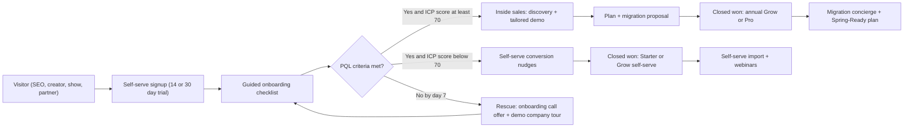

**Product-qualified lead (PQL) definition** [MVP]: within the first 7 days of the trial, at least 4 of the following:
1. ≥ 25 clients imported or created
2. Stripe connected
3. ≥ 1 proposal sent (bonus weight if it contains a mockup or a Design)
4. ≥ 1 additional office user invited
5. ≥ 1 crew member logged into the crew app
6. ≥ 5 visits scheduled
7. Bank feed connected or QuickBooks/Xero connected

**Routing:**

| Segment signal | Owner of the deal | SLA |
|---|---|---|
| Starter intent (1-3 users, no design) | Self-serve, lifecycle emails, chat | Chat response < 5 min in business hours |
| Grow intent / ICP ≥ 70 | Inside sales (SDR qualifies, AE closes) | First touch < 2 business hours after PQL |
| Pro / > 20 field users / commercial | AE with solutions engineer | Demo within 3 business days |
| Enterprise / franchise | Enterprise AE (V1+) | Discovery within 1 week |

**Sales team design (proposed):** AE quota at about $250k-$350k new ARR per year in Year 2 (estimate). SDR:AE ratio 1:2. Compensation 50/50 base/variable, paid on collected first-year ARR, with an accelerator for annual prepay. Commission clawback if the customer churns within 90 days.

### 6.8 Onboarding and customer success

**Onboarding phases** (Grow/Pro; Starter gets the self-serve version):

| Phase | Days | Milestones | Owner |
|---|---|---|---|
| Kickoff | 0-3 | Goals, data inventory, go-live date. Stripe connect. 10DLC registration submitted | Onboarding specialist + `owner` |
| Migrate | 3-14 | Clients, properties, contacts, Service Agreements, price book, open invoices/AR, opening balances to the Ledger (or QBO/Xero sync configured), equipment, employees | Migration concierge + `office_manager` |
| Configure | 7-21 | Production rates, proposal templates, portal branding, automations starter pack, chemical logs, crews and routes | Specialist + `ops_manager` |
| Train | 14-28 | Office training (2 x 90 min), crew training (EN/ES, 30 min, in-app video), designer training | Specialist |
| Go-live | 21-30 | First routes run, first invoices paid online, first month-end close checklist | Company |
| Adopt | 30-90 | Health check at day 45 and day 90. Expansion review (designer seats, add-ons) | CSM (Pro) / pooled CS (Grow) |

**Migration concierge** [MVP] scope: CSV/XLSX import templates for every core object. Guided importers for common exports (Jobber, LMN, QuickBooks Online customer and item lists; others V1). An AI mapping assistant that proposes column mappings and flags anomalies (duplicate clients, addresses failing geocode, items without cost). A dry-run report before commit. Rollback within 72 hours. **The free concierge covers one source system on annual Grow and up to three on Pro.** Monthly plans pay $499 per source system (credited back if they switch to annual within 60 days).

**Customer health score** [V1] (0-100), computed daily: weekly active office users / seats (20), crew app active ratio in season (15), invoices sent and paid online (15), proposals sent (10), Ledger used as system of record or sync healthy (10), AI and design usage (10), support sentiment and ticket volume (10), billing health (10). Bands: green ≥ 70, yellow 50-69, red < 50. Red triggers a CSM task (Pro) or an automated rescue sequence (Grow/Starter). Health is seasonally adjusted: crew metrics are excluded in Nov-Feb for non-snow Companies.

**Customer education:** Rootline Academy (EN/ES) with role-based tracks (Owner, Office, Designer, Crew Lead, Bookkeeper), certifications, and a public directory of Certified Rootline Implementers.

### 6.9 Retention and expansion levers

| Lever | Mechanism | Expected effect (hypothesis) |
|---|---|---|
| **Data gravity: Ledger** | Companies that run their books in Rootline face a high switching cost (and gain real value: job costing) | Ledger-as-system-of-record cohort churn materially lower than sync-only cohort (track) |
| **Client-facing surface** | White-label portal, autopay, saved cards in the Company's own Stripe. Clients log in to approve proposals and pay | Clients become part of the stickiness |
| **Design library** | Years of Designs, mockups and plant histories per Property | Unique asset. Hard to export meaningfully to competitors (we still export it openly) |
| **Seasonal fairness** | Active field seats, Winter Mode, snow billing in season | Removes the "cancel in winter, re-sign in spring" pattern |
| **Price Lock Promise** | Predictable cost | Reduces renewal friction |
| **Benchmarks** | Peer comparisons only available while subscribed and opted-in | Ongoing value |
| **Community and Academy** | Peer learning, certifications | Emotional switching cost |
| **Annual prepay** | Default on sales-assisted deals with incentives | Lower logo churn |
| **Proactive CS triggers** | Health score, failed payment rescue, usage drops after the spring peak | Earlier intervention |
| **Cancel flow alternatives** | Winter Mode, downgrade, Archive, talk to a human | Save rate target ≥ 20% of cancel attempts (estimate) |

**Churn reasons taxonomy** (captured in the cancel flow and by CS): business closed or sold, seasonal pause, price, missing feature (tagged to module), crew adoption failure, poor onboarding, moved to competitor (named), moved to free tool, consolidated into parent company. Each reason maps to an owner and a quarterly review.

**Expansion paths** (NRR drivers): office seats as the Company grows, designer seats as design-build grows, Starter to Grow (design + ledger + white-label), Grow to Pro (3D, WIP, multi-branch, unlimited automations), add-ons (snow, payroll, receptionist, website), AI credit packs, Match leads.

### 6.10 Pricing validation plan

| Step | Method | When | Decision it informs |
|---|---|---|---|
| 1 | Van Westendorp price-sensitivity survey + feature MaxDiff with 150+ landscape owners (association lists, show intercepts) | Before beta | Tier price ranges, which features anchor Grow vs Pro |
| 2 | Design-partner pricing (20 beachhead Companies, founding pricing) with willingness-to-pay interviews at day 60 | Beta | Validate ARPA and add-on attach |
| 3 | Live A/B test of pricing-page *presentation* (not different prices for the same plan to similar customers at the same time): annual vs monthly default, calculator placement | GA | Conversion |
| 4 | Cohort-based price tests on **new** regions or seasons (e.g., Grow at $249 vs $279 annual in different launch windows) | V1 | Elasticity |
| 5 | AI credit consumption analysis: per-action cost vs credit price; credit-pack attach | Monthly | Credit prices, included allotments |
| 6 | Win/loss interviews, 10 per month | Ongoing | Packaging fixes |
| 7 | Pay-as-you-grow holdout test: offer it to a random half of eligible Starter trials in one launch window | V1 | Keep it only if Starter gross adds rise by about 4% or more (5.1.2) |
| 8 | "2-minute bill test" in moderated usability sessions with 12 owners: can they predict their July and January bill from the pricing page alone? | Before GA, then after every packaging change | Pricing-page copy and calculator defaults (risk register, 14.6) |

### 6.11 Launch sequence and stage gates

The GTM expands only when the previous stage proves its numbers. Each gate is a decision for `platform_owner`, reviewed with the cohort dashboards in [19](19-platform-admin-portal.md).

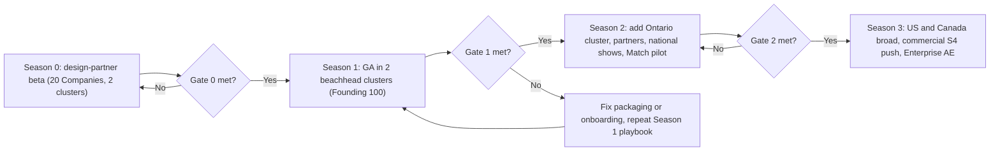

| Gate | Pass criteria (all required; proposed) | If missed |
|---|---|---|
| **Gate 0** (leave beta) | 15 of 20 design partners live through one full month-end close. Median migration ≤ 21 days. Crew app crash-free sessions ≥ 99.5%. At least 8 partners would pay list price (day-60 interview). No P1 data-integrity bug open | Extend beta by one season. Do not launch into a spring with a broken migration |
| **Gate 1** (expand regions) | ≥ 120 paying Companies in the two clusters. Trial-to-paid ≥ 12% overall and ≥ 25% for ICP ≥ 70. Grow CAC payback ≤ 12 months on actual spend. 12-month logo retention forecast ≥ 80% for Grow. Design-led proposal share ≥ 30% | Stay in two clusters. Fix the weakest metric before adding a Region |
| **Gate 2** (go broad) | Partner-sourced share of new ARR ≥ 15%. NRR ≥ 105% on the first full cohort. Plant KB "excellent" in at least 4 Regions. Onboarding capacity proven at 2x steady state (6.6) | Add Regions one at a time instead of going broad |

### 6.12 GTM team and capacity plan (base case, estimates)

The base case (7.7) only works if acquisition spend is staffed realistically. This table builds the Y1-Y3 go-to-market team from the gross-add targets and is the bottom-up source of the blended CAC used in 7.7. Loaded annual costs are estimates: AE $140k, SDR $85k, onboarding specialist $75k, seasonal onboarding specialist about $6.5k per month for 4 months, content/SEO or community lead $110k.

| | Y1 | Y2 | Y3 |
|---|---|---|---|
| Gross new logos (from 7.7) | about 400 | about 1,170 | about 2,440 |
| Sales-assisted share (Grow+ with ICP ≥ 70, about 45% of Grow+ deals) | about 30%, about 120 deals | about 29%, about 340 deals | about 29%, about 700 deals |
| Account executives (about 50 closed deals per AE per year) | 2 + founder | 7 | 14 |
| SDRs (1 per 2 AEs) | 1 | 4 | 7 |
| Onboarding specialists, core + seasonal (Jan-Apr) | 3 + 3 | 6 + 7 | 12 + 14 |
| CSMs: named (Pro and Enterprise) + pooled (Grow) | 1 + 0 | 3 + 2 | 8 + 5 |
| Partner managers | founder | 2 | 4 |
| Content, SEO, community and creator program | 2 | 4 | 6 |
| Events, creators, paid, partner commissions, referral credits, tools | about $0.30M | about $0.68M | about $1.47M |
| **Fully loaded acquisition spend (incl. onboarding, per the CAC definition in 7.1)** | **about $1.12M** | **about $3.07M** | **about $5.95M** |
| **Implied blended CAC** | **about $2,800** | **about $2,620** | **about $2,440** |

CSMs are post-sale and counted in COGS (7.3), not CAC; they are listed here so the hiring plan is in one place. Two consequences for the model: (1) Y1 is a founder-led, inefficient year, and acquisition spend exceeds recognized revenue; (2) blended CAC falls only as SEO, referrals, partners and the homeowner app take share from AEs and trade shows. If the channel mix in 6.5 does not shift that way by Y3, CAC stays near $2,600 and the base case needs about 6-13% more acquisition spend in Y3-Y5 (estimate).

---

## 7. Unit economics and revenue scenarios

> Every number in this section is a **modeling assumption or an estimate**, chosen to be plausible for B2B SMB vertical SaaS and to make the model's logic explicit. None is a measured Rootline result. Replace with beta data as it arrives. The live model should be a spreadsheet owned by `platform_finance`, with this section as its specification.

### 7.1 Model structure

```text
MRR(t)            = Σ_companies [ base_plan + extra_office_seats + active_field_seat_overage
                                  + designer_seats + add_ons + usage_overage ]
                    -- lead fees, data products, application fees and services are separate lines (7.7)
ARPA              = MRR / paying_companies
Contracted ARR    = 12 x (base_plan + committed seats + add-ons)      -- excludes usage and field overage
Reported ARR      = Contracted ARR + trailing-12-month usage and field-seat overage
Gross margin      = (Revenue - COGS) / Revenue
COGS              = SaaS payment processing + cloud infra + maps/GIS/data + AI inference + SMS/voice
                    + bank-feed aggregator + other per-tenant third-party + support/onboarding-run cost
CAC (per segment) = (sales + marketing spend incl. salaries, tools, events, partner commissions,
                     referral credits, pre-go-live onboarding and migration) / new paying logos
Payback (months)  = CAC / (ARPA x gross margin)
LTV               = ARPA x gross margin x expected lifetime months  (lifetime = 1 / monthly logo churn, capped at 60)
NRR               = (starting MRR + expansion - contraction - churned MRR) / starting MRR, for a cohort over 12 months
```

Because field seats are billed on active users, **MRR is seasonal**: field-seat overage rises from April to October and falls in winter. Board reporting therefore uses Contracted ARR as the headline, and Reported ARR uses a trailing-12-month average for overage, so a strong July does not inflate ARR.

### 7.2 Revenue assumptions per tier (steady state, Year 2-3)

| Tier | Base (blended monthly/annual) | Extra seats | Add-ons and usage | **ARPA / month** | Share of paying logos (Y3) |
|---|---|---|---|---|---|
| Starter | $72 | $10 (field overage, occasional office seat) | $13 (credit packs, SMS, Ledger Plus for some) | **$95** | 36% |
| Grow | $262 | $35 (1 extra office seat avg; summer field overage) | $43 (designer seat, snow in season, SMS, credits, website for some) | **$340** | 45% |
| Pro | $555 | $120 | $185 (3D, payroll, receptionist overage, website, premium success for some) | **$860** | 16% |
| Enterprise | $2,200 | $400 | $600 | **$3,200** | 3% |

Blended ARPA at the Y3 mix: 0.36 × 95 + 0.45 × 340 + 0.16 × 860 + 0.03 × 3,200 = 34.2 + 153 + 137.6 + 96 = **$420.8/mo**.

### 7.3 Cost to serve (COGS) per account per month (estimates)

| COGS line | Starter | Grow | Pro | Enterprise | Notes / assumptions |
|---|---|---|---|---|---|
| Processing of Rootline's own SaaS invoices (Stripe Billing + card/ACH fees) | $3.50 | $8.50 | $13 | $20 | Assumes card-heavy Starter (about 3.7% all-in: card 2.9% + $0.30 plus a Stripe Billing fee of about 0.7% of billed volume on pay-as-you-go pricing, as of 2025, verify) and ACH-heavy annual Pro/Ent. Rates must be verified, and negotiated, for Rootline's account |
| Cloud infra (compute, Postgres+PostGIS, Redis, Temporal, object storage, CDN, backups, observability) | $6 | $18 | $45 | $250 | Photo storage is the biggest per-tenant driver. Enterprise includes allocated dedicated resources |
| Maps, geocoding, routing APIs, parcel data | $3 | $10 | $25 | $90 | Map tiles, satellite, geocoding, route matrix calls, Regrid-class parcel licensing amortized |
| AI inference (included credits + receptionist where included) | $1 | $8 | $32 | $120 | See 7.4. Assumes 50-60% utilization of included credits |
| SMS and voice (included allotments) | $3.30 | $18 | $57 | $150 | Assumes about $0.011 all-in per segment incl. carrier fees (estimate; verify) and 60-65% utilization. Click-to-call minutes are assumed at about $0.014/min and under 15% utilization, which adds about $2/mo on Grow and is inside this estimate's rounding. 10DLC one-time fees absorbed on annual Grow/Pro (4.4) are counted in CAC, not here |
| Bank-feed aggregator | $1 | $3 | $6 | $20 | Plaid-class per-connection fees (estimate; verify contract) |
| Other per-tenant third-party (e-sign, email, push, error tracking seats, tax engine) | $1 | $3 | $7 | $20 | |
| Support and run-time CS (allocated) | $8 | $22 | $40 | $180 | Excludes pre-sale onboarding (counted in CAC) |
| **Total COGS** | **$26.80** | **$90.50** | **$225** | **$850** | |
| **ARPA** | $95 | $340 | $860 | $3,200 | |
| **Gross margin** | **71.8%** | **73.4%** | **73.8%** | **73.4%** | Target blended ≥ 72% Y2, ≥ 77% Y5 |

**Path from about 73% to 77%+ gross margin by Year 5:** route AI to the cheapest adequate model and cache shared context (price books, Region palettes). Run non-interactive AI (document extraction, nightly agents) through batch APIs. Self-host segmentation and depth models on GPUs once volume justifies it. Negotiate SMS, maps and parcel volume pricing. Deflect tier-1 support with the in-app copilot. Move photo originals to infrequent-access storage after 90 days.

### 7.4 AI cost model (per action, estimates)

Model prices used: Anthropic API list prices as of October 2026 (verify before use). Claude Opus 5.5: $4 per million input tokens / $20 per million output tokens, cache reads $0.20 per million. Claude Sonnet 5.5: $2 / $10, cache reads $0.20 per million. Claude Haiku 5.5: $0.10 / $0.50 for prompts up to 100K tokens ($0.50 / $2.50 beyond 100K, so copilot prompts are kept under that line). Batch processing at 50% of list ([Anthropic pricing](https://www.anthropic.com/pricing)). Image generation and editing costs are **estimates** of $0.02-$0.08 per generated image at preview resolution (about 1 MP) across hosted FLUX-family, Gemini image and OpenAI image endpoints as of late 2026; presentation-grade 2K-4K images cost more (about $0.10-$0.24 per image per the vendor table in [11](11-ai-design-mockups.md); verify per vendor and resolution). The AI Gateway picks models per task ([17-ai-copilot-automation.md](17-ai-copilot-automation.md)).

| Action | Credits | Credit revenue at $0.017-$0.025/credit | Raw cost estimate | Gross margin range | Cost drivers |
|---|---|---|---|---|---|
| Copilot Q&A | 1 | $0.017-$0.025 | about $0.001 (Haiku) to $0.011 (Sonnet with cached context). Blended about $0.005 | 70-80% | Routing share between small and medium models |
| Estimate/proposal draft | 8 | $0.14-$0.20 | about $0.05-$0.09 (Sonnet, cached price book, photos as input) | 35-75% | Number of photos, price book size. **Watch item**: raise to 10 credits if the median exceeds $0.07 |
| Photo mockup set (4 variants) | 40 | $0.68-$1.00 | about $0.11-$0.36 (self-hosted segmentation/depth about $0.005, LLM planning about $0.02, 4 images, vision QA about $0.01) | 64-89% | Image model choice and resolution |
| Mockup refinement | 10 | $0.17-$0.25 | about $0.04-$0.10 | 41-84% | |
| Dimension-aware layout (3 options) | 60 | $1.02-$1.50 | about $0.30-$0.50 (Opus-class reasoning about 40k in / 12k out, constraint solver, vector previews) | 51-80% | Reasoning depth, number of retries |
| Document understanding (per page) | 2 | $0.034-$0.05 | about $0.005-$0.01 | 70-90% | Batchable |
| AI receptionist (per minute; not credits) | - | $0.39-$0.49 | about $0.04-$0.10 (telephony + speech-to-text + text-to-speech + LLM) | 75-90% | Call length, model latency tier |

**Guardrails:** each action has a `max_raw_cost` circuit breaker in the AI Gateway. If an action's trailing 7-day median raw cost exceeds 45% of its credit revenue at the lowest pack price, `platform_finance` and `platform_engineer` get an alert and the action is a candidate for re-pricing (with 60 days' notice) or re-routing.

### 7.5 Customer acquisition cost (estimates)

| Channel | CAC estimate | Primary tiers |
|---|---|---|
| Organic SEO / Plant Finder / free tools | $300-$900 | Starter, Grow |
| Customer referrals | $200-$500 (credits given) | All |
| Creators / affiliates | $800-$1,500 | Starter, Grow |
| Partners (associations, CPAs, coaches) | $1,000-$1,800 incl. rev share | Grow, Pro |
| Trade shows | $1,500-$4,000 | Grow, Pro |
| Paid search/social | $1,200-$2,500 | Grow |
| Outbound + AE-led | $3,000-$8,000 | Pro, Enterprise |

**Target CAC ceilings** (to keep payback ≤ 12 months): Starter ≤ $600 (self-serve only), Grow ≤ $2,500, Pro ≤ $7,500, Enterprise ≤ $25,000.

### 7.6 Churn, LTV and payback by tier

| Tier | ARPA | GM | Gross profit / mo | Monthly logo churn (assumption) | Lifetime (months, capped at 60) | LTV (no expansion) | Target CAC | LTV:CAC | Payback |
|---|---|---|---|---|---|---|---|---|---|
| Starter | $95 | 72% | $68.40 | 3.5% | 28.6 | $1,956 | $600 | 3.3x | 8.8 mo |
| Grow | $340 | 73% | $248.20 | 1.6% | 60 (uncapped 62.5) | $14,892 | $2,500 | 6.0x | 10.1 mo |
| Pro | $860 | 74% | $636.40 | 1.0% | 60 | $38,184 | $7,500 | 5.1x | 11.8 mo |
| Enterprise | $3,200 | 73% | $2,336 | 0.6% | 60 | $140,160 | $25,000 | 5.6x | 10.7 mo |

Interpretation:
- **Starter only works self-serve.** Any sales touch on Starter breaks the economics. Starter's job is to feed Grow upgrades (target: 20% of Starter logos upgrade within 18 months).
- **Grow is the engine.** Payback around 10 months with LTV:CAC around 6x leaves room to spend on trade shows and creators in the beachhead.
- **Seasonal churn must be measured on a 12-month basis.** Monthly churn spikes in Nov-Dec, offset by Winter Mode and annual prepay. Year-over-year cohort retention is the metric that matters.
- **NRR targets:** 100% (Y1), 105% (Y2), 110% (Y3), 115% (Y4-5), driven by seats, designer seats, add-ons and tier upgrades.

### 7.7 Revenue scenarios (Years 1-5 after MVP general availability)

Years are counted from MVP general availability (see [24-roadmap-feature-catalog.md](24-roadmap-feature-catalog.md) for dates). Paying Companies are end-of-year counts. ARR = paying Companies × blended ARPA × 12 (subscription and usage only).

**Base case**

| | Y1 | Y2 | Y3 | Y4 | Y5 |
|---|---|---|---|---|---|
| Paying Companies (EOY) | 350 | 1,300 | 3,200 | 6,000 | 9,500 |
| Blended ARPA / mo | $304 | $382 | $421 | $450 | $480 |
| **Subscription + usage ARR** | **$1.28M** | **$5.96M** | **$16.17M** | **$32.40M** | **$54.72M** |
| Rootline Match lead revenue (run-rate) | - | $0.15M | $0.80M | $1.80M | $2.80M |
| Homeowner Plus subscriptions | - | - | $0.10M | $0.35M | $0.70M |
| Data products (Plant API + Pulse) | - | - | $0.20M | $0.60M | $1.20M |
| Pay-as-you-grow net effect (application fees minus the subscription discount; 5.1.2) | - | about $0.00M | -$0.02M | -$0.04M | -$0.06M |
| Services (paid migrations, premium success, implementer marketplace) | $0.05M | $0.20M | $0.50M | $0.80M | $1.00M |
| **Total run-rate revenue** | **$1.33M** | **$6.31M** | **$17.75M** | **$35.91M** | **$60.36M** |
| Recognized revenue in the year (approx. average of opening and closing run-rate) | $0.67M | $3.82M | $12.03M | $26.83M | $48.14M |
| Blended monthly logo churn (assumption) | 2.5% | 2.2% | 2.0% | 1.8% | 1.7% |
| Approx. gross new logos needed | about 400 | about 1,170 | about 2,440 | about 3,790 | about 5,080 |
| Blended CAC (built bottom-up in 6.12 for Y1-Y3) | $2,800 | $2,620 | $2,440 | $2,350 | $2,300 |
| Implied acquisition spend (incl. onboarding) | $1.12M | $3.07M | $5.95M | $8.91M | $11.68M |
| Acquisition spend as % of recognized revenue | about 167% | about 80% | about 49% | about 33% | about 24% |

How the derived rows were computed: gross new logos ≈ net adds + (average paying Companies in year × blended monthly churn × 12). Example for Y3: average (1,300 + 3,200)/2 = 2,250; churned ≈ 2,250 × 2.0% × 12 = 540; gross adds ≈ 1,900 + 540 = 2,440. Lead revenue at Y5 assumes 60,000 accepted leads/year × $55 average × 85% net of refunds ≈ $2.8M; the homeowner funnel behind that number is in 5.3.4. Pay-as-you-grow at Y5 assumes 20% of Starter logos opt in (9,500 × 36% × 20% ≈ 684 Companies), each processing about $4,500/month online (below break-even, because of the switch-back nudge): fees ≈ $270/year against a $360/year discount, so the net is about -$90 × 684 ≈ -$0.06M. Subscription ARR is computed at list price, so the discount appears only on this line.

**Corrections made in the November 2026 review.** An earlier draft booked $1.7M of pay-as-you-grow fees at Y5 by assuming opt-in Companies paid about $1,200/year in fees. That contradicts the plan's own switch-back nudge (a Company paying that much would be told to leave the plan), so it was replaced with the net line above. The same draft used a blended CAC of $1,500-$2,300 that was not derived from any staffing plan; a bottom-up build of the team needed to close and onboard the gross adds (6.12) costs more, so the CAC row now comes from that build. Net effect: Y5 total run-rate falls from about $62.1M to about $60.4M, and Y1-Y4 acquisition spend rises by about $0.5M-$0.9M per year. Subscription ARR is unchanged.

**Conservative and aggressive cases**

| | Y1 | Y2 | Y3 | Y4 | Y5 |
|---|---|---|---|---|---|
| Conservative: paying Companies | 150 | 600 | 1,500 | 2,700 | 4,200 |
| Conservative: blended ARPA | $280 | $330 | $360 | $380 | $400 |
| **Conservative: subscription ARR** | **$0.50M** | **$2.38M** | **$6.48M** | **$12.31M** | **$20.16M** |
| Conservative: total incl. other lines (about 5-6% uplift from Y3) | $0.50M | $2.40M | $6.80M | $13.00M | $21.40M |
| Aggressive: paying Companies | 600 | 2,500 | 6,000 | 11,500 | 18,000 |
| Aggressive: blended ARPA | $320 | $400 | $440 | $480 | $520 |
| **Aggressive: subscription ARR** | **$2.30M** | **$12.00M** | **$31.68M** | **$66.24M** | **$112.32M** |
| Aggressive: total incl. other lines (about 10-12% uplift from Y3) | $2.35M | $12.50M | $34.85M | $73.50M | $125.80M |

**What has to be true:**

| Driver | Conservative | Base | Aggressive |
|---|---|---|---|
| Beachhead win rate vs incumbents (sales-assisted) | 15% | 25% | 35% |
| Trial to paid conversion (all trials) | 8% | 12% | 18% |
| Share of logos on Grow or above | 50% | 64% | 70% |
| Homeowner app contribution to new logos by Y3 | 3% | 10% | 20% |
| Regions at "excellent" Plant KB quality by Y3 | 4 | 8 | 15 |
| Homeowners creating at least 1 mockup in Rootline Home in Y5 (5.3.4) | about 0.5M | about 1.3M | about 2.5M |
| Starter logos on pay-as-you-grow at Y5 (net effect near zero in every case) | 10% | 20% | 30% |
| Blended CAC at Y3 (6.12) | about $2,900 | about $2,440 | about $2,100 |
| Geographic expansion | US beachhead + Ontario | US + Canada broad by Y3 | US + Canada by Y2, English-speaking international pilots by Y4 ([Moonshots](23-innovation-moonshots.md)) |

TAM and SAM sizing (number of US and Canadian landscaping firms by employee band) belongs in [01-market-landscape.md](01-market-landscape.md) and must be built from official sources: US Census County Business Patterns for NAICS 561730 Landscaping Services, and Statistics Canada. Each scenario's Y5 logo count should be checked against that SAM before external use.

### 7.8 Sensitivity analysis (base case, Y5; approximate)

| Change | Effect |
|---|---|
| Blended monthly churn +0.5 pt (all years) | Y5 paying Companies about 8,300 (approximation), subscription ARR about $47.8M (-13%) |
| ARPA -15% (price pressure) | Subscription ARR $46.5M. Grow payback 11.9 months |
| AI raw costs +50% | Gross margin about -1 to -2 pts (AI is about 2-4% of revenue at included-credit utilization). Mitigated by re-routing and repricing rules in 7.4 |
| SMS all-in cost +30% (carrier fees) | Gross margin about -1.5 pts on Grow. Mitigation: adjust included segments for new subscribers, push in-app and portal messaging over SMS |
| CAC +30% | Grow payback 13.1 months, Pro 15.3 months. Mitigation: shift mix to partners and SEO |
| Pay-as-you-grow uptake doubles (40% of Starter logos) | Net revenue about -$0.06M more at Y5, still roughly neutral. The plan earns its place only through conversion: at base-case uptake it must lift Starter gross adds by about 4% (about 75 more Starter logos a year at Y5, each worth about $820/year in gross profit) to cover the discount, and by about 8% at doubled uptake. Measured by the holdout test in 6.10 step 7 |
| Zero-markup pledge removed (hypothetical 0.5% fee on all volume) | Large revenue gain, but it gives up the key differentiator. **Not recommended** |

### 7.9 Operating model implications (summary)

- **Gross margin:** 72-74% at Y2, 77%+ at Y5 (targets).
- **Sales and marketing:** acquisition spend alone (7.7) exceeds recognized revenue in the founder-led Y1, is about 80% of recognized revenue in Y2 and about 50% in Y3, and falls to about 25% by Y5 as SEO, referrals, partners and the homeowner app scale. Total S&M including brand, community and partner programs runs about 5 points above those figures (targets). Investors should read Y1-Y2 as a funded build-out, not a steady state.
- **R&D:** heavy in Y1-Y2 because of breadth (design studio, ledger, mobile offline, AI). Team plan in [24-roadmap-feature-catalog.md](24-roadmap-feature-catalog.md).
- **Cash seasonality:** annual prepay is collected mostly Nov-Feb. Spring onboarding costs peak Feb-Apr. Plan cash with a winter-collections bias.

---

## 8. Key user flows

### 8.1 Self-serve checkout (trial to paid)

1. During the trial, the owner opens **Settings > Plan & Billing** or clicks "Choose plan" from the trial banner.
2. The plan picker pre-selects the tier recommended by an entitlement-usage analysis (e.g., "You've used Design Studio and invited 4 office users: Grow fits").
3. The owner chooses an interval (annual pre-selected in Nov-Feb), currency (from Company country) and add-ons. Live totals show taxes as estimated.
4. Checkout runs through Rootline's own Stripe account (Stripe Checkout or embedded Payment Element). Payment method: card, ACH debit (US) or PAD (Canada).
5. On `checkout.session.completed` / `customer.subscription.created`, the Billing module creates the `tenant_subscription`, materializes entitlements and emits `subscription.activated`.
6. The trial's data carries over unchanged. The trial banner is replaced by a "Welcome to Grow" checklist.

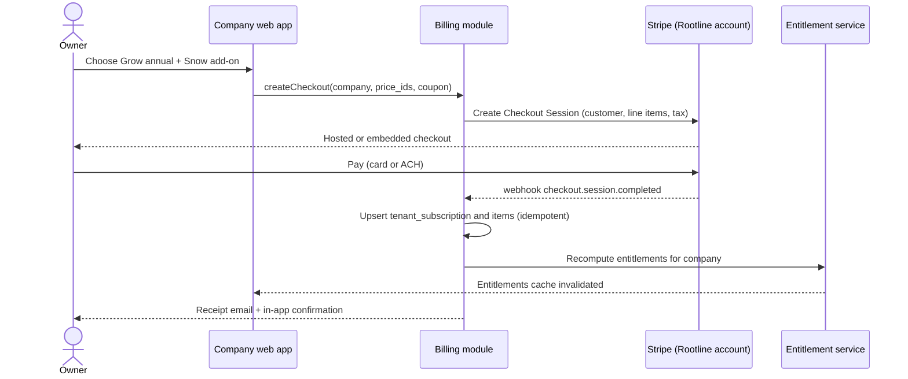

### 8.2 Subscription lifecycle and dunning

Dunning schedule [MVP]: Stripe Smart Retries (or a fixed retry schedule of day 1, 3, 5, 7). In-app banner from day 0. Emails on day 0, 3 and 7 to `owner` and billing contacts. SMS on day 7 if the owner opted in.

| Day after failed payment | State | What is restricted | What always keeps working |
|---|---|---|---|
| 0-13 | `past_due` | Nothing (banners only) | Everything |
| 14-29 | `restricted` | New AI generations, new campaigns, adding seats or add-ons, new Rootline Match leads | Scheduling, crew app, invoicing, client portal, **client payments**, Ledger, exports |
| 30-59 | `suspended` | Office users read-only except invoicing, payments and AR. Crew app read-only (can view today's visits) | Client portal + client payments, exports, Ledger read |
| 60 | `canceled` | Subscription ends | 90-day export window, then archive or purge per retention policy. When reached through non-payment, the client portal stays in payments-only mode until at least day 90 after the first failed Rootline payment ([19](19-platform-admin-portal.md)), so the Company's clients can still pay open invoices into the Company's own Stripe |

Dunning exceptions [MVP]:
- **Snow carve-out:** during a forecast snow event, a `restricted` or `suspended` Company with an active snow agreement keeps crew dispatch and per-push logging for up to 72 hours per event (4.5 add-on rules; [19](19-platform-admin-portal.md)).
- **No crew-facing billing messages:** crew users never see Rootline billing banners in any state.
- **Grace on request:** `platform_finance` may extend `past_due` by up to 14 days once per 12 months with a reason code (for example, a stolen card).

State names: the values below are `tenant_subscription.status`. [19](19-platform-admin-portal.md) maps them to the platform-level tenant lifecycle (for example `cancel_pending` = `pending_cancellation`, `canceled` = `churned`, `archive_plan` = `archived`, and `archived` here = subscription closed, data in `pending_deletion` there). Keep that mapping table in 19 as the single source when either doc changes.

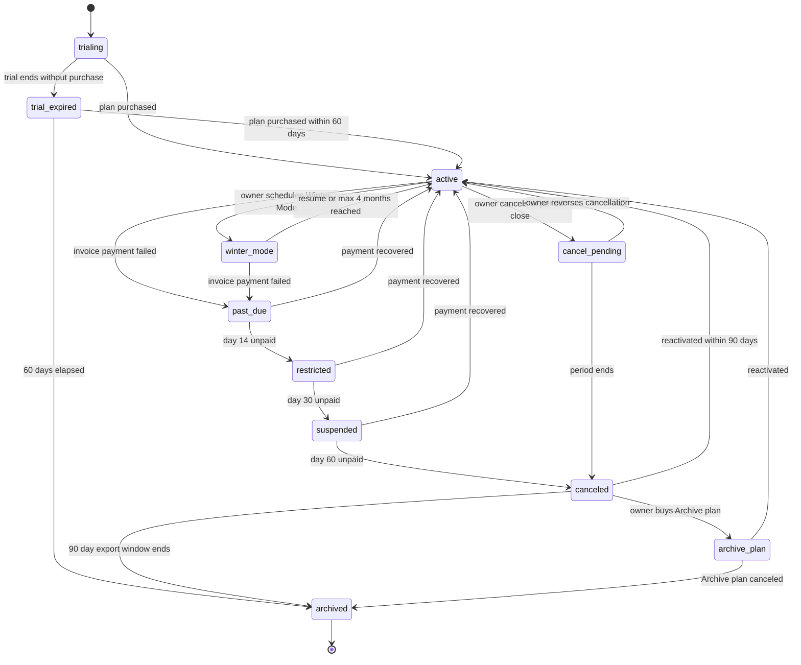

### 8.3 AI credit hold, settle and refund

1. The user triggers "Generate 4 mockups". The UI shows "40 credits - balance 1,240".
2. The AI service asks the Credit Ledger to **hold** 40 credits (fails fast if the balance is insufficient, then offers a pack purchase or a request to the owner).
3. The AI Gateway runs the pipeline (segmentation, depth, planning, generation, QA).
4. On success, the hold **settles** (ledger entry `settle`). On failure, it is **released** (no ledger debit). Partial agent runs settle only the steps completed.
5. Usage is aggregated hourly into Stripe Billing meter events for any overage (packs are prepaid, so most usage is a ledger debit, not a meter).

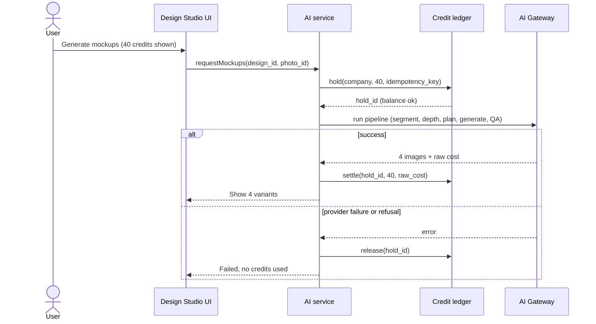

### 8.4 Monthly field-seat and usage true-up

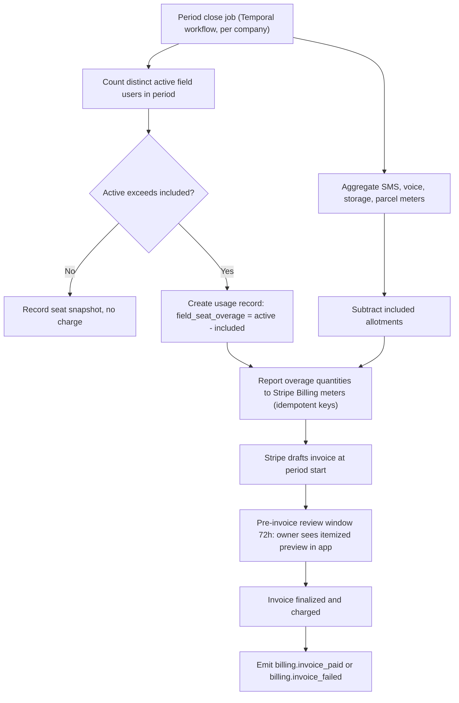

Rules: the true-up is idempotent per `(company_id, period, meter_key)`. If an owner disputes a field-seat count within the 72-hour preview window, the app lists the active users and the qualifying evidence (login, time entry, visit). `platform_support` can waive overage, with a reason code.

### 8.5 Pay-as-you-grow application fee on a client payment (opt-in only)

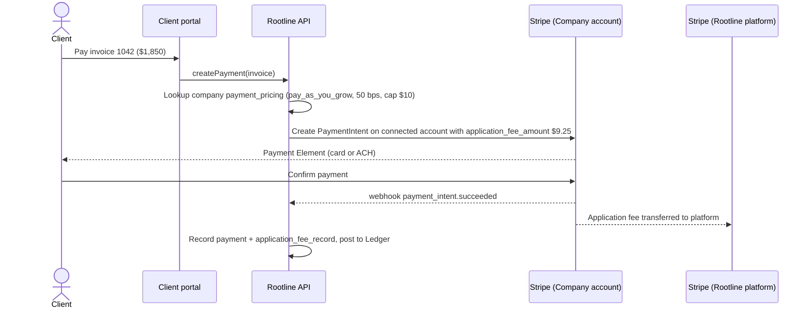

Zero-markup Companies follow the same flow without `application_fee_amount`. The Ledger posts the application fee as a merchant-fee expense, separate from Stripe's processing fee, so the Company's books show both clearly ([09](09-accounting-ledger-integrations.md)).

### 8.6 Homeowner design to qualified lead to Company

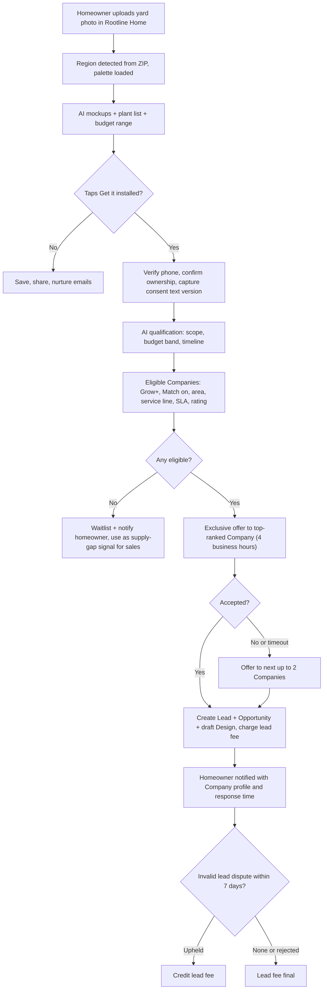

### 8.7 Partner referral attribution and commission

1. Partner shares a referral link (`rootline.com/p/{partner_code}`) or registers a deal in the partner portal.
2. Visitor signs up. Attribution is stored on the `company` (first-touch within 60 days, or a registered deal within 90 days).
3. Company converts to paid. A `partner_referral` becomes `qualified`.
4. Monthly, on collected subscription revenue (excluding usage, tax and refunds), a `partner_commission` accrues at the partner's rate.
5. A refund within 60 days claws back the commission. Commissions pay out monthly when the balance is ≥ $100.

### 8.8 Cancel and save flow

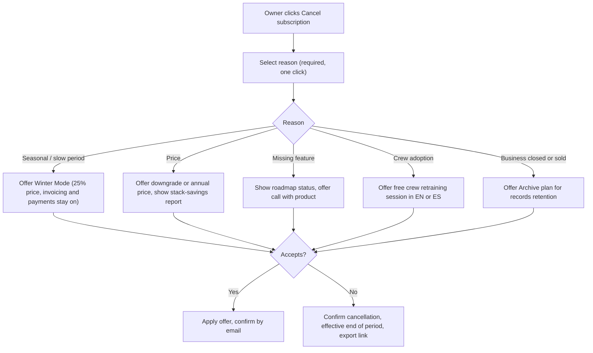

The cancel flow must never take more steps than signup. The "Confirm cancellation" button is visible on the first screen of the flow, alongside the offers (see 14.3).

### 8.9 Migration concierge (Grow/Pro)

1. Kickoff call books a **go-live date** and a **migration slot** (capacity-managed calendar, prioritized by Spring-Ready deadline).
2. The Company uploads exports (e.g., client list, properties, recurring jobs, price book, open invoices, AR aging, chart of accounts, trial balance as of the cutover date).
3. The AI mapping assistant proposes field mappings and flags anomalies. A specialist reviews them.
4. A dry run imports into a **staging copy** of the tenant. The Company reviews the reconciliation report: client count, open AR total equal to the source's AR aging, trial balance tying out to opening balances.
5. Production import with a 72-hour rollback window.
6. Opening balances posted to the Ledger as a dated opening journal entry, or QBO/Xero sync configured for Companies keeping external books.
7. Sign-off by `owner` (and `bookkeeper`, if present).

---

## 9. Screens and wireframes (incl. pricing page mock)

### 9.1 Screen inventory

| Screen | Surface | Primary users | Purpose | Priority |
|---|---|---|---|---|
| Public pricing page | Marketing site | Prospects | Tiers, add-ons, payments pledge, FAQ, calculator entry | [MVP] |
| Stack savings and ROI calculator | Marketing site + in-app | Prospects, `owner` | Compare current stack cost to Rootline. Payments break-even | [MVP] |
| Compare pages ("Rootline vs Jobber", etc.) | Marketing site | Prospects | Sourced, dated comparisons | [V1] |
| Plan picker and checkout | Company web app | `owner` | Purchase, upgrade, downgrade | [MVP] |
| Settings > Plan & Billing | Company web app | `owner`, `office_manager` (view), `bookkeeper` (invoices) | Seats, meters, add-ons, invoices, payment method, Winter Mode | [MVP] |
| AI credits drawer + pre-run confirmation | All AI surfaces | All office users | Cost transparency, pack purchase, budgets | [MVP] |
| Payment pricing chooser (zero markup vs pay-as-you-grow) | Company web app | `owner` | Opt-in or out of the application fee model with a break-even view | [V1] |
| Cancel and save flow | Company web app | `owner` | Section 8.8 | [MVP] |
| Winter Mode scheduler | Company web app | `owner` | Schedule pause and resume, see what keeps working (9.8) | [V1] |
| Rootline Match settings + lead inbox | Company web app | `owner`, `office_manager`, `estimator` | Service area, budget, lead acceptance, disputes | [V1] |
| Partner portal | Partner web | Partners | Links, deal registration, commissions, assets | [V1] |
| Rootline Home (homeowner app) | Web/PWA, later native | Homeowners | Mockups, plant finder, get it installed | [V1] |
| Plan and price catalog editor | Platform Admin | `platform_finance`, `platform_owner` | Versioned plans, prices, entitlements, meters, coupons ([19](19-platform-admin-portal.md)) | [MVP] |
| Revenue and cohort dashboards | Platform Admin | `platform_owner`, `platform_finance` | ARR, NRR, churn, CAC, AI margin ([18](18-reporting-analytics.md)) | [MVP] |
| Deal desk | Platform Admin | Sales, `platform_owner` | Discount approvals, Enterprise quotes | [V1] |

### 9.2 Public pricing page (mock)

```text
+--------------------------------------------------------------------------------------------------+
| ROOTLINE   Product v   Solutions v   Plants   Pricing   Customers   Partners       [Log in] [Start free trial] |
+--------------------------------------------------------------------------------------------------+
|                   One price for your whole landscape business.                                   |
|      Design, sell, schedule, invoice, get paid and close your books. No hidden fees.             |
|                                                                                                  |
|        Billing: ( Monthly )  (* Annual - save up to 14% *)   Currency: [ USD v ]                 |
|                                                                                                  |
|  +-------------------+  +=========================+  +-------------------+  +-------------------+ |
|  | STARTER           |  || GROW   * Most popular  ||  | PRO               |  | ENTERPRISE        | |
|  | Small crews,      |  || Design-build-maintain  ||  | Multi-crew,       |  | Multi-branch,     | |
|  | simple ops        |  || firms                  ||  | commercial + resi |  | franchise         | |
|  |                   |  ||                        ||  |                   |  |                   | |
|  |  $69 /mo          |  ||  $249 /mo              ||  |  $529 /mo         |  |  From $1,500/mo   | |
|  |  billed annually  |  ||  billed annually       ||  |  billed annually  |  |  annual contract  | |
|  |                   |  ||                        ||  |                   |  |                   | |
|  | 1 office user     |  || 3 office users         ||  | 8 office users    |  | SSO, sandbox,     | |
|  | 3 crew users*     |  || 10 crew users*         ||  | 30 crew users*    |  | dedicated DB opt, | |
|  | 300 AI credits    |  || 1 designer seat        ||  | 3 designer seats  |  | CSM + SLA         | |
|  | Ledger Essentials |  || 2,000 AI credits       ||  | 6,000 AI credits  |  |                   | |
|  | Client portal     |  || Full Ledger + bank rec ||  | 2D + 3D design    |  |                   | |
|  | Crew app EN/ES    |  || White-label portal     ||  | Job costing + WIP |  |                   | |
|  |                   |  || Route optimization     ||  | AI receptionist   |  |                   | |
|  |                   |  || Design Studio + mockups||  | Website included  |  |                   | |
|  | [Start free trial]|  || [Start free trial]     ||  | [Start free trial]|  | [Talk to sales]   | |
|  +-------------------+  +=========================+  +-------------------+  +-------------------+ |
|  * Crew users are billed only in months they're active. Extra: $12 / $10 / $8 per active crew user.|
|                                                                                                  |
|  +------------------------------- OUR PAYMENTS PLEDGE ---------------------------------------+   |
|  |  Your clients pay you through YOUR Stripe account. Stripe's fees go to Stripe.            |   |
|  |  Rootline adds 0%. Your payouts, your disputes, your saved cards - even if you leave us.  |   |
|  |  (Prefer a lower subscription? Optional Pay-as-you-grow: Starter $39 + 0.5%/payment,     |   |
|  |   capped at $10. See the break-even calculator.)                                         |   |
|  +-------------------------------------------------------------------------------------------+   |
|                                                                                                  |
|  ADD-ONS (all prices public)                                                                     |
|  Design Studio seat ....... $59-79/mo     AI credit packs ......... 1k $25 / 5k $100 / 20k $340  |
|  Snow & Ice ............... $99/mo Nov-Mar only    AI Receptionist ... $49/mo incl. 100 min     |
|  Website + Booking ........ $49/mo        SMS pack ................ 5,000 segments $79          |
|  Payroll .................. $39/mo + $6/employee  Ledger Advanced ... $99/mo (incl. in Pro)     |
|                                                                                                  |
|  WHAT EVERY AI ACTION COSTS            [ See full credit table v ]                               |
|  Copilot answer 1 | Proposal draft 8 | 4 photo mockups 40 | AI layout (3 options) 60            |
|                                                                                                  |
|  OUR PROMISES                                                                                    |
|  [x] Price Lock: your price is locked 24 months on annual, then max +7%/yr with 90 days notice   |
|  [x] Free migration on annual Grow and Pro      [x] Spring-Ready: sign by Feb 15, live by Mar 31  |
|  [x] Winter Mode: pause for 25% when crews stop  [x] Cancel online any time, export everything    |
|                                                                                                  |
|  [ What would I save? -> Open the stack calculator ]                                             |
|                                                                                                  |
|  FAQ: Do crews need paid seats? | Is QuickBooks required? (No) | What is an AI credit? |          |
|       What happens if I don't pay? (Your clients can still pay you) | Canada pricing?            |
+--------------------------------------------------------------------------------------------------+
```

Behavior notes: the annual/monthly toggle defaults to annual from Nov 1 to Feb 28 and to monthly otherwise (test). Currency defaults by geo-IP and can be changed. Prices render from the live catalog API (never hard-coded), so the page always matches the entitlement engine. A "Prices last updated" date is shown. The Founding Customer badge shows only to beachhead-region visitors while program seats remain.

### 9.3 Stack savings and payments calculator

```text
+--------------------------------------------------------------------------------------+
| WHAT YOU PAY TODAY                               | WITH ROOTLINE (recommended: GROW)  |
|--------------------------------------------------+------------------------------------|
| Field service app     [ Jobber v ] [ $249 ]/mo   | Grow (annual)              $249    |
| Accounting            [ QBO Plus v ] [ $__ ]/mo  | +1 office seat              $39    |
| Design / CAD tool     [ ________ ] [ $__ ]/mo    | +Designer seat              $69    |
| Website               [ ________ ] [ $__ ]/mo    | Snow & Ice (Nov-Mar avg)    $41    |
| Reviews / marketing   [ ________ ] [ $__ ]/mo    | Field seats: 14 peak, 4 winter     |
| Payroll               [ ________ ] [ $__ ]/mo    |   avg overage                $25   |
| Other                 [ ________ ] [ $__ ]/mo    |                                    |
| Office hours re-typing data per week [ 6 ] h     | Est. hours saved / week     4.5 h  |
| Loaded office wage    [ $28 ] /h                 | Value of time saved       $546/mo  |
|--------------------------------------------------+------------------------------------|
| Monthly total today                $___          | Monthly total              $423    |
| Online client payments / month  [ $85,000 ]      | Rootline payment fee         $0    |
|                                                  | (Pay-as-you-grow: Starter only)    |
|--------------------------------------------------------------------------------------|
| Estimated net monthly benefit:  $___  (software savings + time value)                |
| Assumptions shown. Competitor prices "as of <date>, verify". [Email me this report]  |
+--------------------------------------------------------------------------------------+
```

Rules: competitor price defaults come from a `platform_finance`-maintained table with an "as of" date and a source link. The user can override every value. Hours-saved estimates use conservative defaults (75% of entered re-typing hours) and are labeled as estimates. "Email me this report" captures a lead with explicit marketing consent.

### 9.4 Settings > Plan & Billing (in-app)

```text
+---------------------------------------------------------------------------------------------+
| Settings / Plan & Billing                                            Greenleaf Landscape Co. |
+---------------------------------------------------------------------------------------------+
| PLAN  Grow - Annual (USD)   Renews Mar 1, 2028   Price locked until Mar 1, 2029  [Change plan] |
| Founding Customer -25% applied                                                              |
|---------------------------------------------------------------------------------------------|
| SEATS                          Included   In use   Billed extra   Next invoice              |
| Office users                       3         4          1            $39.00   [Manage]     |
| Designer seats                     1         2          1            $69.00   [Manage]     |
| Crew users (active this month)    10        17          7            $70.00   [Who's active?] |
| Bookkeeper (free)                  1         1          -            $0                     |
|---------------------------------------------------------------------------------------------|
| USAGE THIS PERIOD (Jul 1 - Jul 31)                                                          |
| AI credits     [##############------]  1,412 / 2,000 incl.  + 3,600 pack credits (exp May 2028) |
|                Budgets: Technicians 20/user  Estimators 300/user   Auto top-up: OFF  [Edit] |
| SMS segments   [#################---]  2,130 / 2,500         Cap: 7,500   [Buy pack]       |
| Storage        [#####---------------]  61 / 250 GB                                          |
|---------------------------------------------------------------------------------------------|
| ADD-ONS                                                                                     |
| Snow & Ice ............ $79/mo (annual rate, billed Nov-Mar)          [Remove]              |
| AI Receptionist ....... not active                                     [Add - $49/mo]       |
| Ledger Advanced ....... not active                                     [Add - $99/mo]       |
|---------------------------------------------------------------------------------------------|
| CLIENT PAYMENTS PRICING   Zero markup (default)  - Rootline fee: 0%    [Compare options]    |
| Stripe account: acct_...9KQ (connected, payouts enabled)                                    |
|---------------------------------------------------------------------------------------------|
| UPCOMING INVOICE PREVIEW (Aug 1)        $249.00 base (prepaid) + $178.00 seats              |
|                                         + $0 usage  + est. tax $11.84  = $189.84 due*       |
| *Base prepaid annually; seats and usage billed monthly in arrears. [View line items]        |
|---------------------------------------------------------------------------------------------|
| INVOICES  Jul 1 $165.10 Paid | Jun 1 $151.40 Paid | Mar 1 $2,241.00 Paid (annual)  [All]     |
| PAYMENT METHOD  ACH - Chase ...4410  [Update]          BILLING EMAIL  billing@greenleaf...  |
| [Schedule Winter Mode]   [Download all data]   [Cancel subscription]                        |
+---------------------------------------------------------------------------------------------+
```

Note on the preview math: the annual base is prepaid, so the August preview charges seats ($39 + $69 + $70 = $178) plus tax. The $249 line is shown for reference with "(prepaid)". Founding Customer discount applies to the base only.

### 9.5 AI pre-run confirmation and pack purchase

```text
+---------------------------------------------------------------+
| Generate photo mockups                                        |
|---------------------------------------------------------------|
| Property: 14 Oak Hollow Ct - Front yard photo (Jun 12)         |
| Style: [ Cottage pollinator v ]  Region palette: Piedmont 7b   |
| Variants: 4                                                   |
|                                                               |
| Cost: 40 credits     Your balance: 22 credits                 |
|                                                               |
| ( ) Buy 1,000 credits - $25.00                                |
| (*) Buy 5,000 credits - $100.00   (best value for your usage)  |
| ( ) Ask owner to approve (estimators without purchase rights) |
|                                                               |
| Credits are refunded automatically if generation fails.       |
|                        [Cancel]   [Buy and generate]          |
+---------------------------------------------------------------+
```

### 9.6 Rootline Match lead offer (Company inbox)

```text
+---------------------------------------------------------------------------------+
| NEW LEAD - exclusive for 3h 41m                     Fee if accepted: $95         |
|---------------------------------------------------------------------------------|
| Backyard patio + planting refresh       Est. budget: $15k-$25k   Start: April    |
| 2.3 mi from your Tuesday route | Ownership verified | Phone verified             |
| [Mockup 1] [Mockup 2] [Plan sketch: 22' x 16' patio area, 3 beds, 640 sq ft]     |
| Homeowner notes: "Dog-friendly, low water, want privacy screening on east side" |
| Plants chosen: Ilex glabra 'Shamrock', Panicum 'Northwind', Amsonia hubrichtii   |
|---------------------------------------------------------------------------------|
| [Decline (reason)]                     [Accept - create lead + draft design]     |
+---------------------------------------------------------------------------------+
```

### 9.7 Client payments pricing chooser (owner only) [V1]

The screen must make the cheaper choice obvious even when the cheaper choice earns Rootline less. It reads the Company's real trailing online volume from its own Stripe account.

```text
+--------------------------------------------------------------------------------------+
| How should Rootline charge for client payments?                     Starter, monthly  |
|--------------------------------------------------------------------------------------|
| Your online client payments, last 3 months:  Aug $3,940  Sep $4,610  Oct $5,120       |
| Average: $4,557/month   Stripe fees go to Stripe either way (2.9% + 30c card, ACH less)|
|--------------------------------------------------------------------------------------|
|  ( ) ZERO MARKUP (standard)                 (*) PAY-AS-YOU-GROW                       |
|      Starter $79/mo (or $69 on annual)          Starter $39/mo                        |
|      Rootline fee on payments: 0%               + 0.5% per payment, max $10, no fee   |
|                                                   on tips                             |
|      At your volume: $79.00/mo                  At your volume: $39 + $22.79 = $61.79 |
|--------------------------------------------------------------------------------------|
|  [chart] Monthly cost vs online volume:  lines cross at about $8,000/mo (monthly)     |
|          or about $6,000/mo (annual Starter). You are here: $4,557                    |
|                                                                                      |
|  If your volume passes the break-even for 2 months in a row, we will tell you and    |
|  offer a one-click switch back. Fees appear as "application fees" in YOUR Stripe     |
|  Dashboard, so you can check every cent.                                             |
|                                                                                      |
|  [ ] I understand the 0.5% fee is in addition to Stripe's fees.                      |
|                                   [Cancel]   [Switch to Pay-as-you-grow]             |
+--------------------------------------------------------------------------------------+
```

Rules: the radio defaults to whichever option is cheaper at the Company's trailing 3-month average. The acknowledgement checkbox is required to opt in, not to opt out. The switch takes effect at 00:00 Company local time the next day and is recorded in `payment_pricing_config` with `accepted_by` ([08](08-payments-stripe.md)). Hidden for Companies on the restricted-key path.

### 9.8 Winter Mode scheduler [V1]

```text
+--------------------------------------------------------------------------------------+
| Schedule Winter Mode                                        Greenway Lawn & Garden   |
|--------------------------------------------------------------------------------------|
| Pause from  [ Dec 1, 2027 v ]   Resume on  [ Mar 1, 2028 v ]    = 3 months           |
| Winter Mode used in the last 12 months: 0 of 4                                       |
|--------------------------------------------------------------------------------------|
| YOUR BILL                     Now (Grow monthly)        During Winter Mode            |
| Base plan                     $289.00                   $72.25  (25%)                 |
| Extra office seats (2)        $78.00                    $0  (seats beyond 2 read-only)|
| Snow & Ice                    -                         -  (not on this account)      |
|--------------------------------------------------------------------------------------|
| KEEPS WORKING                                 PAUSES                                 |
|  [x] Invoicing, autopay, statements          [ ] Crew app (no snow module)           |
|  [x] Client portal and client payments       [ ] New proposals and designs           |
|  [x] Ledger, bank feeds, month-end close     [ ] AI generation (included credits     |
|  [x] CRM (read) and unified inbox                 pause; packs stay valid)           |
|  [x] Service Agreement billing to clients    [ ] Campaigns and Match leads           |
|--------------------------------------------------------------------------------------|
| Editable users in winter (pick 2):  [x] Dana (owner)  [x] Luis (office)  [ ] Kim     |
| We'll remind you 14 days before resume to re-invite crews and check spring routes.   |
|                                          [Cancel]   [Schedule Winter Mode]           |
+--------------------------------------------------------------------------------------+
```

Rules: monthly plans only; 4 months in any rolling 12 (4.7). The resume date can be moved earlier at any time with proration. 14 days before resume, a "Spring restart" checklist is created: re-activate field users, confirm Service Agreement start dates (first mowing round, irrigation start-ups), review the price increase letter for maintenance renewals ([07](07-invoicing-billing-contracts.md)).

---

## 10. Data model

Billing, entitlements and metering live in a `billing` domain module of the modular monolith ([20-architecture-security.md](20-architecture-security.md)). The marketplace, partner and data-product entities live in a `growth` module. Tenant-scoped tables carry `company_id` and Postgres row-level security. Platform-scoped tables (plans, partners, data customers, homeowner accounts) are **not** tenant-scoped and are reachable only from platform roles and dedicated services. Stripe IDs are stored for reconciliation, but Rootline's tables are the source of truth for entitlements. Stripe is the source of truth for money collected on Rootline's own invoices.

### 10.1 Subscriptions, entitlements, metering and credits

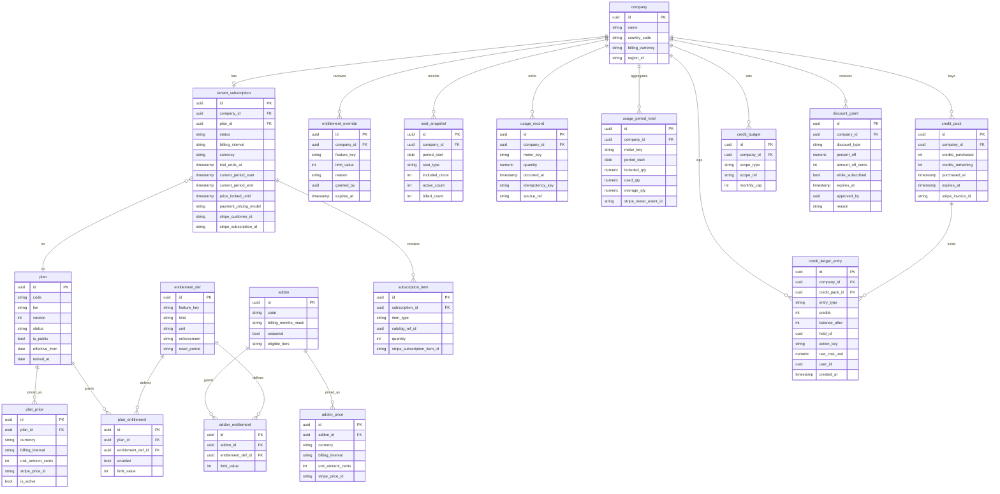

Key field semantics:
- `entitlement_def.kind` ∈ {`flag`, `limit`, `meter`}. `enforcement` ∈ {`hard`, `soft_warn`, `overage_billed`, `never_block`}. `never_block` is used for anything a Company needs to get paid or keep operating in the field.
- `credit_ledger_entry.entry_type` ∈ {`grant_included`, `purchase`, `hold`, `settle`, `release`, `refund`, `expire`, `adjust`}. Holds are recorded so `balance_after` reflects available credits. The table is append-only, and corrections are new `adjust` entries.
- `plan.version` supports grandfathering. Subscriptions point to a specific plan version. Publishing a new version never mutates the old one.
- `tenant_subscription.payment_pricing_model` ∈ {`zero_markup`, `pay_as_you_grow`, `enterprise_custom`}. Fee parameters live in `payment_pricing_config` (10.2).

### 10.2 Payments pricing, partners, marketplace and data products

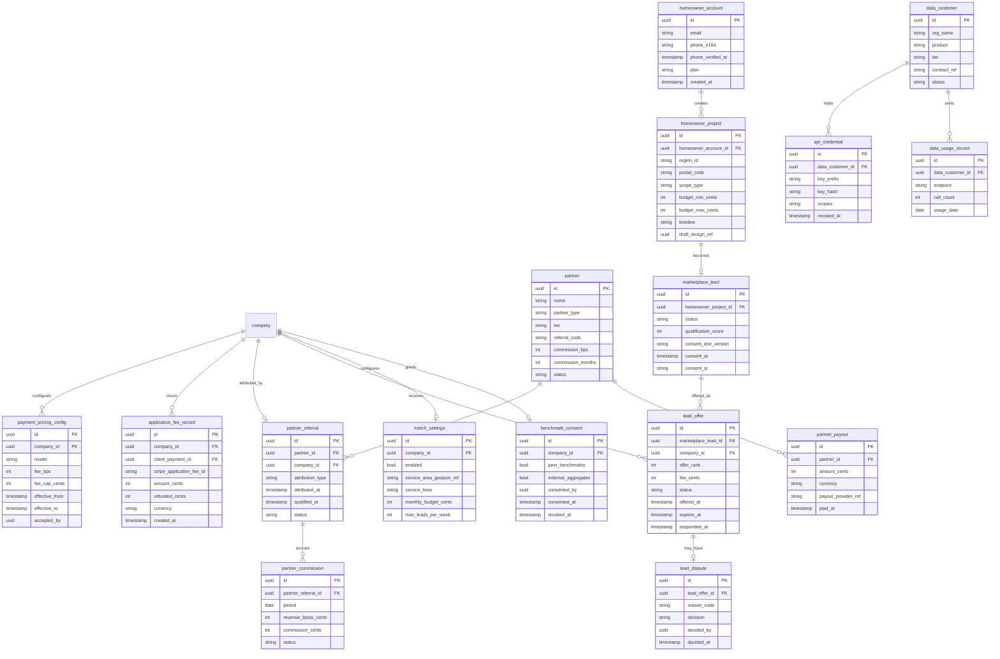

Validation rules (selected):
- `payment_pricing_config.fee_bps` ≤ 100 (1%) and `fee_cap_cents` ≤ 2,500 unless `model = enterprise_custom`. Only one active config per Company. Changes take effect at 00:00 Company local time on the next day and never apply retroactively to existing PaymentIntents.
- `lead_offer`: at most 3 offers per `marketplace_lead`. `offer_rank = 1` must expire before rank 2 is created, unless the homeowner explicitly asks for multiple quotes.
- `marketplace_lead.consent_text_version` must reference an approved consent text version that names the receiving Companies or the category.
- `partner_referral`: one active attribution per Company. Unique on `company_id`.
- `benchmark_consent` changes are evented and honored at the next aggregation run.

---

## 11. Integrations, APIs and events

### 11.1 External services

| Service | Purpose | Notes | Priority |
|---|---|---|---|
| **Stripe Billing (Rootline's own platform account)** | Products and prices, subscriptions, checkout, invoices, proration, smart retries, usage meters | Rootline's tables hold entitlements. Stripe holds the money. Webhook-driven reconciliation | [MVP] |
| **Tax engine for Rootline's own invoices** (e.g., Stripe Tax; verify) | US state SaaS tax, Canada GST/HST/PST/QST | Nexus and registration monitoring by `platform_finance` | [MVP] |
| **Stripe Connect (Company accounts)** | Application fees only for pay-as-you-grow Companies. Refund and dispute fee reversal | Payment flows owned by [08](08-payments-stripe.md) | [V1] |
| **CRM for Rootline's own sales** (e.g., HubSpot) | Leads, deals, PQL scores, sequences | Product events streamed via the event bus | [MVP] |
| **Product analytics** (e.g., PostHog or Amplitude) | Funnels, activation, feature adoption, experiments | No PII in event properties beyond IDs | [MVP] |
| **Lifecycle messaging** (e.g., Customer.io or Intercom) | Trial nurture, onboarding, dunning emails, in-app guides | Respect unsubscribe and consent | [MVP] |
| **Partner payouts** (e.g., a payout platform, or Stripe Connect Express accounts on Rootline's platform account) | Commission payouts, tax forms | Evaluate cost per payout and tax-form support | [V1] |
| **Embedded payroll partner** | Payroll add-on | Partner selection in [15](15-team-hr-payroll.md) | [V1] |
| **Review sites (G2, Capterra)** | Review generation campaigns, badges | Ask only active, healthy customers, following the sites' review policies | [MVP] |
| **API gateway** for Plant API | Keys, quotas, metering | Separate from the tenant public API | [V2] |

### 11.2 Internal APIs

| API | Shape | Notes |
|---|---|---|
| `entitlements.check(company_id, feature_key)` | Returns `{allowed, limit, used, remaining, enforcement, reason}` | p99 < 5 ms from Redis cache. Cache invalidated on `entitlements.changed`. **Fail-open** for `never_block` features, fail-closed for paid growth features when the cache and DB are both unavailable |
| `entitlements.snapshot(company_id)` | Full map for clients | Web app loads it at session start. Crew app caches it offline for up to 7 days |
| `credits.quote(action_key, params)` | Credit cost before run | Used by every AI surface |
| `credits.hold / settle / release` | Idempotent by `idempotency_key` | Holds auto-release after 30 minutes if not settled |
| `usage.record(meter_key, qty, idempotency_key, source_ref)` | Append-only | Called by SMS, voice, storage, parcel services |
| `billing.preview(company_id)` | Next invoice preview, itemized | Powers 9.4 |
| `catalog.public()` | Public plans, prices and add-ons by currency | Feeds the marketing site pricing page |

### 11.3 Domain events

**Emitted** (via transactional outbox to the event bus):

| Event | Payload highlights | Typical consumers |
|---|---|---|
| `subscription.trial_started` | company_id, trial_ends_at, source, partner_code | CRM, lifecycle messaging |
| `subscription.activated` | plan_code, interval, currency, ARR value | CRM, analytics, partner commissions |
| `subscription.plan_changed` | from/to plan, effective_at, proration | Entitlements, CRM, analytics |
| `subscription.status_changed` | from/to status (`past_due`, `restricted`, `suspended`, `winter_mode`, `canceled`) | UI banners, notifications, CS health |
| `entitlements.changed` | company_id, changed feature keys | All modules (cache bust) |
| `seat.snapshot_recorded` | seat_type, active_count, billed_count | Billing, analytics |
| `usage.threshold_crossed` | meter_key, percent (50/80/100) | Notifications, CS |
| `ai_credits.settled` / `ai_credits.released` | action_key, credits, raw_cost_usd | AI ops margin dashboards ([19](19-platform-admin-portal.md)) |
| `ai_credits.low_balance` | balance, auto_top_up state | Notifications |
| `billing.invoice_paid` / `billing.invoice_failed` | amount, attempt_count | Dunning, partner commissions, revenue reporting |
| `payment_pricing.changed` | model, bps, cap, accepted_by | Payments module, audit |
| `payment_pricing.breakeven_crossed` | trailing_volume_2mo, breakeven_amount, cheaper_model | Owner notification with one-click switch back (5.1.2), CS |
| `match.region_throttled` / `match.region_restored` | region_id, cost_per_accepted_lead, eligible_company_count | Rootline Home render budgets (5.3.4), sales waitlist targeting |
| `application_fee.recorded` / `application_fee.refunded` | amount, client_payment_id | Company Ledger posting, platform revenue |
| `partner.referral_attributed` / `partner.commission_accrued` | partner_id, amounts | Partner portal |
| `lead.offered` / `lead.accepted` / `lead.declined` / `lead.disputed` / `lead.dispute_resolved` | lead_id, company_id, fee | CRM module (creates Lead + Design), billing |
| `benchmark_consent.changed` | flags | Analytics pipeline ([18](18-reporting-analytics.md)) |

**Consumed:** `user.role_changed`, `user.deactivated` (seat recount), `crew_app.session_started`, `time_entry.created`, `visit.status_changed` (active field seats), `sms.sent`, `voice.call_completed`, `ai.action_completed`, `storage.object_created` (meters), `stripe_account.connected` (onboarding milestone), `proposal.sent`, `invoice.paid_online` (activation and PQL scoring).

**Stripe webhooks consumed (Rootline platform account):** `checkout.session.completed`, `customer.subscription.created`, `customer.subscription.updated`, `customer.subscription.deleted`, `invoice.upcoming`, `invoice.finalized`, `invoice.paid`, `invoice.payment_failed`, `payment_method.attached`, `customer.tax_id.created`. **From connected accounts (pay-as-you-grow):** `application_fee.created`, `application_fee.refunded`, `charge.refunded`, `charge.dispute.closed`. All handlers are idempotent on the Stripe event ID and verify webhook signatures.

---

## 12. Permissions

Full RBAC lives in [02-personas-roles-permissions.md](02-personas-roles-permissions.md). Below are the capabilities specific to this module. Legend: **Y** allowed, **D** allowed only if the owner delegates the "Billing admin" permission, **R** can request (sends an approval to the owner), **V** view only, **-** no access.

### 12.1 Tenant side

| Capability | owner | office_manager | estimator | designer | ops_manager | crew_lead | technician | bookkeeper | subcontractor |
|---|---|---|---|---|---|---|---|---|---|
| View plan, seats, usage meters | Y | Y | V (own credit budget) | V (own credit budget) | V | - | - | Y | - |
| Change plan or billing interval | Y | - | - | - | - | - | - | - | - |
| Add or remove add-ons and seats | Y | D | R | R | R | - | - | - | - |
| Buy AI credit packs, enable auto top-up | Y | D | R | R | R | - | - | - | - |
| Set AI credit budgets per role/user | Y | D | - | - | - | - | - | - | - |
| Update Rootline payment method | Y | D | - | - | - | - | - | D | - |
| Download Rootline invoices and receipts | Y | Y | - | - | - | - | - | Y | - |
| Schedule Winter Mode, cancel, buy Archive plan | Y | - | - | - | - | - | - | - | - |
| Choose client-payments pricing model (zero markup / pay-as-you-grow) | Y | - | - | - | - | - | - | V | - |
| Configure Rootline Match (area, budget, service lines) | Y | D | - | - | V | - | - | - | - |
| Accept, decline or dispute Match leads | Y | Y | Y | V | Y | - | - | - | - |
| Grant benchmark consent (peer / external) | Y | - | - | - | - | - | - | - | - |
| View peer benchmarks (if consented) | Y | Y | - | - | Y | - | - | Y | - |
| Use referral link (refer another Company) | Y | Y | Y | Y | Y | - | - | Y | - |

### 12.2 Platform side

| Capability | platform_owner | platform_finance | platform_support | platform_engineer | platform_curator |
|---|---|---|---|---|---|
| Draft plan, price, add-on, entitlement, meter changes | Y | Y | - | - | - |
| Publish catalog changes (two-person rule: draft by finance, approve by owner) | Y (approve) | Y (submit) | - | - | - |
| Grant credits/discounts to a tenant | Unlimited | Up to $5,000 per grant | Up to $250 or 1 month base | - | - |
| Waive usage or field-seat overage | Y | Y | Up to $100 per period | - | - |
| Issue refunds on Rootline invoices | Y | Y | - (request) | - | - |
| Change a tenant's plan on their behalf (with recorded owner consent) | Y | Y | Y | - | - |
| View revenue, cohort and margin dashboards | Y | Y | Per-tenant billing view only | AI cost dashboards only | - |
| Manage partners, tiers, commission rates | Y (approve tier/rate) | Y | V | - | - |
| Approve partner payouts (> $10,000 needs owner) | Y | Y | - | - | - |
| Decide lead disputes | Y | Y | Y | - | - |
| Configure lead pricing and routing weights | Y | Y (propose) | - | Y (implement flags) | - |
| Manage data-product customers and contracts | Y | Y | - | Provision keys | - |
| Set Plant KB field `license_class` (API exposure) | Y | - | - | - | Y |
| Approve external benchmark publications | Y | Y | - | - | - |
| Replay billing webhooks, re-run true-up jobs | - | V | - | Y (no price edits) | - |

All platform actions in this module are audit-logged with actor, reason code, before/after values and, for discounts and waivers, the approving user. Impersonation of a tenant for billing support follows the consented-impersonation rules in [19](19-platform-admin-portal.md).

---

## 13. AI opportunities in this module

| # | Opportunity | Description | Guardrails | Priority |
|---|---|---|---|---|
| 1 | **Right-size plan advisor** | Analyzes entitlement usage, seat activity and stated goals, then recommends a plan and add-ons. It also recommends **downgrades** when a Company is over-provisioned ("You haven't used 3D in 6 months - drop to Grow and save $280/mo") | Recommendations shown with the evidence. Never auto-changes the plan | [V1] |
| 2 | **Usage forecasting** | Predicts AI credit, SMS and field-seat usage by month using the Company's seasonality (e.g., SMS spikes during spring cleanup scheduling) and suggests pack sizes or ceilings | Forecasts labeled as estimates | [V1] |
| 3 | **Churn and expansion prediction** | Season-aware model on top of the health score. Surfaces why: "crew app usage fell 60% after Memorial Day, office still active" | Human CS decides the action. Explanations required | [V1] |
| 4 | **Migration mapping assistant** | Maps competitor exports to Rootline objects, detects duplicates and bad addresses, proposes production-rate equivalents from LMN-style data | Dry run + human review before commit | [MVP] |
| 5 | **Pre-demo research brief** | For a booked demo, compiles the prospect's public website and business profile (services, service area, review themes) into a one-page brief and a demo script. The prospect is invited to upload a photo of a real project for a live mockup | Public business information only. No scraping behind logins. Prospect-provided photos only | [V1] |
| 6 | **AI inbound chat and AI SDR** | Answers pricing and feature questions on the website, books demos, qualifies by the ICP scorecard | Clearly disclosed as AI. Hands off to humans on request | [V1] |
| 7 | **Lead qualification and dynamic lead pricing (Match)** | Predicts project value band and acceptance and win likelihood. The lead fee is set within published bands | Price shown before acceptance. Explainable factors. No protected-class features. Pricing bands reviewed quarterly | [V1] |
| 8 | **Lead dispute triage** | Pre-classifies disputes (wrong number, not owner, duplicate) using verification evidence | Human decision for anything not clear-cut | [V1] |
| 9 | **SEO content with curator-in-the-loop** | Drafts Region × use plant guides from Plant KB data. A `platform_curator` approves every page | No page publishes without curator approval. Quality gate (section 6.5). No AI-generated plant facts outside KB data | [MVP] |
| 10 | **Win/loss and call insights** | Summarizes sales calls (with consent) into objection themes that feed packaging and battlecards | Consent and recording laws (two-party consent states) respected | [V1] |
| 11 | **AI cost governor** | Continuously evaluates cheaper model routes for each AI action against quality evals and shifts traffic when quality holds, improving the margin in 7.4 | Quality regression tests per action. Rollback on eval drop | [V1] |
| 12 | **Pricing experiment analyst** | Reads experiment results, cohorts and elasticity, and drafts recommendations for `platform_finance` | Advisory only. Price changes go through the two-person rule | [V2] |

---

## 14. Edge cases, compliance and risks

### 14.1 Billing and entitlement edge cases

| Case | Expected behavior |
|---|---|
| Upgrade mid-term on an annual plan | Immediate. Prorated charge for the remaining term at the new annual price. Price Lock date unchanged for the original plan components. New components locked from their start date |
| Downgrade below current usage (e.g., 4 designers on a plan with 1 included) | Allowed. Extra designers stay as paid add-on seats, or the owner picks who loses edit access before the change applies. Data never deleted |
| Company moves from US to Canada (or vice versa) | Currency cannot change in-place. `platform_finance` cancels and recreates at the period end with an unused-value credit. Tax profile updated. Connected Stripe account may need to be re-onboarded per [08](08-payments-stripe.md) |
| Multi-branch business with separate legal entities | Each legal entity is a Company (tenant) with its own Ledger. Enterprise "billing group" consolidates Rootline invoices across Companies with volume pricing. Franchise systems choose franchisor-pays or franchisee-pays |
| Two Rootline Companies merge (acquisition) | V2 tenant-merge service. Billing: the surviving Company's subscription absorbs seats. The acquired Company's remaining prepaid term is credited |
| Trial abuse (repeated trials) | Fingerprint on email domain, phone, Stripe connected account ID and device. Second trial in 12 months requires sales approval |
| Shared logins to avoid seats | Anomaly flag (4.3). Notify owner. Never auto-bill on suspicion |
| Scripted AI credit abuse | Per-user rate limits (e.g., 60 AI actions/hour), anomaly detection on raw cost, auto top-up ceilings |
| ACH return days after a "paid" Rootline invoice | Status returns to `past_due` with the original dunning clock restarted from the return date. One courtesy re-attempt |
| Chargeback on Rootline's own invoice | Move to `restricted` immediately. `platform_finance` contacts owner. Client-facing functions keep working |
| Annual refund within the 30-day guarantee | Refund base fee minus purchased packs consumed. Included credits consumed are not charged |
| Winter Mode with active Service Agreements | Agreement billing to clients (autopay) continues. That is the point: the Company keeps getting paid while paused |
| Snow add-on in a no-snow winter | Add-on still billed in season (it covers readiness, contracts and seasonal billing setup). Offer a "no-snow year" rollover credit of 1 month as goodwill at `platform_owner` discretion (policy decision, see 17) |
| Founding Customer lapses | Discount retained if reactivated within 30 days. Lost after |
| Period boundaries across time zones | Stripe billing anchors in UTC. The UI shows Company-local dates. Active-seat counting uses Company-local calendar months |
| Grandfathered plan retired | Customers stay on the old version until they change plans. At least 12 months' notice before a forced migration, with a price no higher than Price Lock rules allow |
| Pay-as-you-grow fee on a partially refunded payment | Application fee refunded proportionally. Full refund or lost dispute refunds the full fee |

### 14.2 Payments-related compliance

- **No custody:** Direct charges on Company accounts keep Rootline out of fund flows. Application fees are Rootline revenue paid by the Company's account, governed by Stripe's Connect terms and disclosed in Rootline's terms of service and in-app at opt-in.
- **Surcharging:** Card-network rules and state laws on credit card surcharges differ and change. Rootline ships a maintained jurisdiction rules table, defaults surcharging **off**, never surcharges debit cards, and requires the Company to accept a compliance acknowledgement. In Canada, card-network rules have allowed capped credit surcharges since October 2022, but Quebec's consumer protection law is generally understood to prohibit them, so the Quebec rule ships as "blocked" (verify both). Legal review is required before launch (verify current rules).
- **PCI:** Unchanged. Card data only in Stripe Elements and Checkout (SAQ-A scope; see [20](20-architecture-security.md)).

### 14.3 Subscription and consumer-protection law

- **B2B subscriptions** (Companies): clear renewal terms, an online cancellation path at least as easy as signup, renewal reminders for annual plans 30 days before renewal (good practice, and required in some jurisdictions for some contracts). Some US states regulate automatic renewal of certain service contracts between businesses (e.g., New York General Obligations Law § 5-903; verify applicability to SaaS).
- **Consumer subscriptions** (Rootline Home Plus): state automatic-renewal laws (e.g., California's Automatic Renewal Law, amended in 2024 with more online-cancellation and reminder requirements effective July 2025; verify) and Canadian provincial consumer protection rules apply. Requirements include clear pre-purchase disclosure, affirmative consent, an acknowledgment email, simple online cancellation and annual renewal reminders. The FTC's 2024 "click-to-cancel" negative option rule was vacated by a federal appeals court in 2025 (verify current status). We design to the strictest common standard regardless.
- **Marketing consent:** CAN-SPAM for US email. **CASL in Canada** requires consent for commercial electronic messages, which significantly limits cold email in Canadian outbound. TCPA and 10DLC rules for any SMS to prospects or homeowners. Match consent records stored per lead (10.2); the consent text names each receiving Company even though the FCC's one-to-one consent rule was vacated in January 2025 (5.3.2; verify current status).
- **Reviews:** the FTC's rule on fake reviews and testimonials (finalized 2024; verify) prohibits fake or suppressed reviews. G2/Capterra campaigns must disclose incentives and follow site policies. The same applies to Companies' review requests ([16](16-marketing-growth-communications.md)).

### 14.4 Data products: privacy and antitrust

- **Privacy:** Aggregated, opt-in, k-anonymized outputs only (section 5.2.2). Homeowner app data is governed by its own privacy policy (CCPA/CPRA, PIPEDA, and Quebec's Law 25 for Quebec residents). Homeowner data is shared with a Company only after explicit consent to be contacted.
- **Antitrust:** Sharing pricing information among competitors can raise antitrust concerns. US agencies withdrew older "safe harbor" guidance on information exchanges in 2023 (verify). Rootline Pulse publishes only historic, aggregated, lagged data with minimum-contributor thresholds, never forward-looking prices or per-competitor views. AI pricing suggestions inside a Company's estimates ([03](03-crm-sales-estimating-proposals.md)) must **never** use other Companies' non-public prices as direct inputs. The live precedent is the US Department of Justice's 2024 suit against RealPage, whose rent-pricing software was alleged to pool landlords' nonpublic pricing data; several states have since legislated against shared pricing algorithms (for example California's 2025 amendments to its Cartwright Act; verify scope and status of both). A landscape price-recommendation engine fed by peers' live prices would sit in the same frame, so it is a hard product rule, not a counsel preference. Legal counsel signs off before V1 benchmark launch.
- **Lead marketplace:** Contractor licensing checks where states license landscape or irrigation contractors (verify per state), referral and success-fee legality per state, consent records, and no steering based on protected characteristics.

### 14.5 Rootline's own revenue recognition (for finance; verify with auditors)

- Subscriptions are recognized ratably over the service period. Annual prepay is deferred revenue.
- AI credit packs are recognized as credits are consumed. Expired credits are recognized as breakage, either at expiry or proportionally based on historical patterns, per auditor guidance.
- Lead fees are recognized at acceptance, net of an expected-refund reserve.
- Application fees are recognized when the client payment succeeds, reversed on refunds and lost disputes.
- Partner commissions are incremental contract costs. Evaluate capitalization and amortization under ASC 340-40.

### 14.6 Strategic risk register

| Risk | Likelihood | Impact | Mitigation |
|---|---|---|---|
| **Breadth risk**: building 20+ modules dilutes MVP quality | High | High | Beachhead focus. Grow-tier ICP. MVP scope in [24](24-roadmap-feature-catalog.md). Partners for payroll and imagery |
| **Incumbent response**: Jobber or ServiceTitan/Aspire add AI design and mockups | Medium-high | Medium | Plant KB curation and Region quality are slow to copy. Integrated Ledger. BYO Stripe trust. Speed |
| **AI quality and expectation gap**: renders look better than what gets installed | Medium | High (reputation, disputes) | Region-constrained palettes. "At planting / in 3 years" toggle. Watermark "conceptual rendering". Proposal terms state renders are illustrative ([11](11-ai-design-mockups.md)) |
| **AI and GPU cost volatility** | Medium | Medium | Multi-vendor AI Gateway. Cost governor. Credit repricing rules with notice |
| **SMS cost and regulation changes** (10DLC fees, carrier surcharges) | Medium | Medium | Included allotments adjustable for new subscribers. Push and portal messaging first |
| **Revenue foregone by zero-markup payments** | Certain | Medium | Accept by design. Opt-in pay-as-you-grow. Stronger retention from Ledger and portal |
| **Seasonal cash and onboarding crunch** (Jan-Apr) | High | Medium | Annual prepay in winter. Seasonal onboarding staff. Spring-Ready capacity caps |
| **Marketplace channel conflict**: Companies fear Rootline will market to their clients | Medium | High | Hard rule: Rootline never markets Rootline Home or Match to a Company's existing clients, and never uses a Company's client data for lead generation. Published in the terms |
| **Distributor neutrality concerns** | Medium | Medium | Neutrality rule (5.4.2). Labeled sponsorships only |
| **Platform dependency on Stripe policy and terms** | Low-medium | High | Restricted-key advanced path, abstraction in the payments module, monitor Connect changes ([08](08-payments-stripe.md)) |
| **Pricing complexity confuses buyers** | Medium | Medium | "2-minute bill test": prospects must be able to compute their bill in under 2 minutes in usability tests. Calculator. In-app preview |
| **Founder bandwidth as curator** | High | Medium | Hire `platform_curator` horticulturists per region early. Curator tooling in [12](12-plant-knowledge-base.md) |
| **Plant image and content licensing for API** | Medium | Medium | `license_class` per field. Commission original photography. Exclude restricted content |
| **Localization cost (ES now, FR-CA later)** | Medium | Low-medium | Translation memory, AI-assisted translation with human review |
| **Incumbent consolidation and bundling**: Granum (LMN + SingleOps) and ServiceTitan (Aspire) bundle payments, measurement and estimating, and can cut price to defend accounts | Medium-high | Medium | Compete on what bundles cannot copy quickly (design + plants + Ledger). Time switching campaigns to their forced migrations (6.5). Keep portability as a promise they cannot match |
| **CAC optimism**: the base case needs blended CAC to fall from about $2,800 (Y1) to about $2,300 (Y5) | Medium | High | Stage gates (6.11) release spend only after payback is proven. Channel mix reviewed quarterly against 6.5. Sensitivity in 7.8 |
| **Free homeowner app cost outruns lead revenue** | Medium | Medium | Render budgets, verification before cost and per-Region kill switch (5.3.4). Cost per accepted lead tracked weekly |
| **Pay-as-you-grow muddies the Zero-Markup message** | Medium | Medium | Opt-in only, cheaper-option default, holdout test (6.10 step 7), retire if it does not lift conversion (open question 17.2) |

---

## 15. Metrics and KPIs

All KPI definitions live in the metrics layer of [18-reporting-analytics.md](18-reporting-analytics.md) and the operator dashboards in [19](19-platform-admin-portal.md). Targets are proposals.

| Category | KPI | Definition | Target (Y2 unless noted) |
|---|---|---|---|
| Revenue | Contracted ARR | 12 × committed recurring (base + committed seats + add-ons) | Base case $5.96M subscription ARR at Y2 |
| Revenue | NRR (12-mo cohort) | (start MRR + expansion - contraction - churn) / start MRR | ≥ 105% Y2, ≥ 115% Y4 |
| Revenue | GRR (12-mo cohort) | (start MRR - contraction - churn) / start MRR | ≥ 85% Grow, ≥ 90% Pro |
| Revenue | ARPA by tier | MRR / paying Companies | Within ±10% of section 7.2 |
| Margin | Gross margin | (revenue - COGS) / revenue | ≥ 72% |
| Margin | AI gross margin | (credit + receptionist revenue - AI raw cost) / that revenue | ≥ 65%, every action ≥ 55% |
| Acquisition | Visitor → trial | Trials / unique pricing+product page visitors | ≥ 3% |
| Acquisition | Trial → PQL | PQLs / trials | ≥ 35% |
| Acquisition | Trial → paid | Paid within 45 days / trials | ≥ 12% (ICP ≥ 25%) |
| Acquisition | CAC by channel and tier | Section 7.5 | Under ceilings |
| Acquisition | CAC payback | CAC / (ARPA × GM) | ≤ 12 months |
| Acquisition | Sales cycle (Grow) | First touch → closed won | ≤ 21 days median |
| Activation | Time to first proposal sent | Signup → first proposal | ≤ 3 days median |
| Activation | Time to first online client payment | Signup → first successful client payment | ≤ 14 days median |
| Activation | Stripe connect rate | Trials connecting Stripe / trials | ≥ 50% |
| Activation | Design-led proposal share | Proposals with a Design or mockup / proposals (Grow+) | ≥ 30% by month 3 |
| Retention | 12-month logo retention | By cohort, segment and region | ≥ 80% Grow, ≥ 88% Pro |
| Retention | Winter Mode return rate | Companies returning from Winter Mode / entering | ≥ 85% |
| Retention | Save rate in cancel flow | Saves / cancel attempts | ≥ 20% |
| Expansion | Add-on attach rate | Companies with ≥ 1 paid add-on / paying | ≥ 40% Grow |
| Expansion | Credit pack attach | Companies buying ≥ 1 pack in 12 months | ≥ 25% Grow+ |
| Onboarding | Spring-Ready success | Guaranteed go-lives met / committed | ≥ 95% |
| Onboarding | Migration time | Kickoff → go-live (Grow) | ≤ 21 days median |
| Marketplace | Homeowner MAU (seasonal) | Monthly active homeowners | Track. Peak in Apr-May |
| Marketplace | Lead request rate | "Get it installed" / homeowners with ≥ 1 mockup | ≥ 6% (estimate to validate) |
| Marketplace | Lead acceptance rate | Accepted offers / offers | ≥ 60% |
| Marketplace | Lead-to-win rate | Signed proposals / accepted leads | ≥ 20% install leads |
| Marketplace | Dispute rate | Upheld disputes / accepted leads | ≤ 8% |
| Partners | Partner-sourced new ARR | Share of new ARR with partner attribution | ≥ 15% by Y2, ≥ 25% by Y3 |
| Data products | Data ARR | Plant API + Pulse | $0.2M Y3 base |
| Trust | Billing ticket rate | Billing-related tickets per 100 paying Companies per month | ≤ 3 |
| Trust | Pricing fairness score | Survey: "Rootline's pricing is fair and predictable" (1-5) | ≥ 4.3 |
| Efficiency | Acquisition spend as % of recognized revenue | Fully loaded acquisition spend (incl. onboarding) / recognized revenue | About 80% Y2, about 50% Y3 (7.7) |
| Efficiency | Blended CAC vs plan | Actual blended CAC / 7.7 row | Within ±10% |
| Marketplace | Cost per accepted lead (Rootline Home) | Direct homeowner-app costs / accepted leads | ≤ $25 (5.3.4) |
| Payments | Pay-as-you-grow conversion lift | Starter gross adds, test vs holdout | ≥ 4% or retire the plan |
| AI | Credit price review coverage | Actions with a credit price reviewed against trailing 90-day raw cost in the last quarter | 100% |

---

## 16. Beyond the brief: extra ideas

1. **Season-aligned billing** [V1]. Annual contracts payable in **10 installments from March to December**, nothing due in January and February, when many landscapers' cash is thinnest. Same annual price. Matches the customer's cash flow and is easy to explain at a trade-show booth.
2. **Design Solo plan** [V1] at about $49/mo for independent landscape designers who don't run crews. Design Studio, AI mockups, Plant KB, proposals, portal, payments. It builds a designer community, adds supply for a **freelance designer marketplace** (Companies without in-house designers hire certified Rootline designers per project, Rootline takes 10%; the marketplace itself is [V3], matching the freelance designer network in [10](10-design-studio.md)), and is a wedge into design-build firms that hire those designers.
3. **Rootline Design Services** [V2]. Done-for-you designs during the spring rush ($149-$399 per residential design, estimate) produced by contract designers using Rootline. Sold to Starter/Grow Companies that can't keep up with spring design requests.
4. **"Rootline Fundador" program** [V1]. Many landscape owners start as crew members. A Spanish-first program for crew leads launching their own companies: 6 months free Starter, a bilingual business academy (pricing, insurance, licensing, bookkeeping basics) and a mentor network. It earns loyalty from the next generation of owners.
5. **Plant Performance Network** [V2]. Companies earn AI credits by contributing field observations (plant losses, thriving plantings, pest pressure, photos with dates) that curators use to refine Region Profiles. A data flywheel that improves the product for everyone and gives customers a reason to stay.
6. **Annual Transparency Report** [V1]. Publish yearly: list-price changes, AI credit price changes, application-fee revenue (if pay-as-you-grow launches), uptime, data requests. Turns "fair and transparent" into an auditable commitment.
7. **Group purchasing / spring pre-book** [V2-V3]. Aggregate anonymized planned installs from signed proposals into regional demand signals so nurseries and distributors can offer pre-book pricing to participating Companies. Revenue share from suppliers, under neutrality and antitrust review.
8. **Data-backed plant warranty program** [V3]. Partner with an insurer to back plant warranties. Plants with strong Region Profile scores carry lower reserves, so Companies can offer longer warranties on better plant choices. Links to [23](23-innovation-moonshots.md).
9. **Client-to-neighbor referrals** [V1]. A homeowner who loves their new landscape can share it through the white-label portal. Neighbors who request a quote go **directly to that Company** as a free lead (not into the marketplace). Network effects that strengthen the Company's brand, not Rootline's.
10. **Route-density lead preference** [V1]. Match prioritizes maintenance leads that land on streets a Company already services, reducing windshield time. This is unusual among lead products and hard to copy without dispatch data.
11. **Winter School** [MVP]. Free, cohort-based, bilingual training every January and February (pricing jobs, estimating with production rates, design sales, cash flow). It produces trials at the exact moment owners plan their year.
12. **"Show me July and January" bill preview** [MVP]. The pricing calculator shows the bill in peak season and in winter side by side, making seasonal fairness concrete.
13. **Customer Advisory Board with real influence** [MVP]. Founding Customers vote quarterly on 1 roadmap item out of a shortlist.
14. **Accountant-as-a-service bundle** [V2]. Through the CPA partner network, Companies can add a monthly bookkeeping service (partner-delivered inside Rootline Ledger) at a bundled price. Rootline takes a platform fee, and Ledger adoption deepens.
15. **"Make the AI pay for itself" design-fee playbook** [V1]. Many design-build firms already charge a design fee and credit it against the install if the client signs. Rootline ships proposal templates for a refundable design deposit ($150-$500, credited at signing), collected into the Company's own Stripe before the designer starts. A Grow Company that charges $250 on 8 designs a month collects $2,000, against roughly $10-$25 of AI credits for the mockups and layouts behind those designs (estimate). The Plan & Billing page shows "design fees collected vs AI credits used" so the owner sees AI as a profit line, not a cost. It also filters out tire-kickers before a designer spends four hours on a plan.
16. **Contract-end tracker for the tools being replaced** [MVP]. The stack calculator (9.3) and the onboarding kickoff ask for the renewal date and notice period of each tool Rootline replaces (FSM, QuickBooks, design tool, website, review tool). Rootline reminds the owner 45 days before each renewal or notice deadline, times the switching credit (4.8) to the real overlap, and records realized savings when each old subscription is cancelled. Twelve months later the owner gets a "money you stopped spending" summary, which is the best renewal argument we will ever have.
17. **Monthly Value Statement on every Rootline invoice** [V1]. Each Rootline invoice carries a one-page statement built from the Company's own data: proposals sent with mockups and their signed value, share of invoices paid online and average days to pay, field hours captured by the crew app, AR collected by the collections agent, and "$0 added to your client payments". Every number links to its report in [18](18-reporting-analytics.md). A bill that explains its value reduces billing tickets and makes the 7%-capped price increases (4.7) easier to accept.
18. **Public migration-slot calendar** [MVP]. Spring capacity is real: the concierge can only migrate so many Companies before Mar 31. The pricing page shows honest remaining capacity per week ("February week 2: 6 Grow migrations left") pulled from the onboarding schedule. It smooths the January-April crunch (6.6), creates truthful urgency instead of fake countdowns, and tells sales exactly which weeks to sell.
19. **Risk-documentation insurance program** [V2]. Snow logs with timestamped photos, chemical application records, safety training records and vehicle inspections are exactly the evidence insurers want for slip-and-fall, pesticide and auto claims. With a licensed insurance partner, Companies can share a read-only "risk dossier" from Rootline to apply for coverage or premium credits. Rootline earns a disclosed referral fee only where the partner is licensed and the law allows it, and never shares data without the owner's explicit, revocable consent. For snow contractors facing slip-and-fall exposure, this can be worth more than the subscription (estimate; validate with 2-3 insurers).

---

## 17. Open questions

1. **Beachhead regions:** where is the founder's plant knowledge strongest? This sets the 2-3 MVP clusters (6.2) and the curator hiring plan.
2. **Pay-as-you-grow:** launch it at V1, or keep a strict zero-markup message with no exceptions? Does any application fee weaken the pledge? The corrected model (7.7) shows it is roughly revenue-neutral, so the only reason to keep it is a measured lift in Starter conversion (6.10 step 7). A related detail from [08](08-payments-stripe.md): with one rate for card and ACH, a $2,000 ACH payment carries a $10 Rootline fee while Stripe's own ACH fee is capped lower; should ACH carry a lower cap?
3. **Free plan:** should Rootline offer a permanently free tier for solo operators (to compete with free tools) or rely on the trial, Design Solo and Fundador programs?
4. **Starter design taste:** should Starter include a few AI mockups per month (beyond the credit allotment) to create the "wow" moment that drives upgrades?
5. **Canada and Quebec:** CAD price parity policy. Timing and legal requirements for French-language availability for Quebec customers (verify Charter of the French Language obligations for software sold in Quebec).
6. **Payroll partner:** which embedded payroll provider, and the wholesale cost per employee that sets the add-on price?
7. **Lead marketplace legal review:** state-by-state rules on contractor referral and success fees, contractor licensing verification, consent text.
8. **Benchmarks:** antitrust counsel review of Pulse methodology before V1.
9. **Plant KB licensing:** which fields and images can be licensed through the Plant API, and what original photography is needed?
10. **Enterprise dedicated DB:** priced as an add-on or bundled above a contract size?
11. **Credit unit name:** "AI credits" (clear) vs a branded unit (e.g., "Seeds"). Test for comprehension.
12. **Price increase cap:** is a 7%/year cap after the 24-month lock acceptable to finance across inflation scenarios?
13. **No-snow winter policy** for the Snow & Ice add-on: goodwill credit or not?
14. **Tax footprint:** which US states and Canadian provinces need registration at launch for Rootline's own SaaS sales?
15. **Competitor contract buyouts:** cap at 3 months of overlap, or offer full buyouts for Pro/Enterprise deals?
16. **Market sizing inputs:** pull US Census CBP (NAICS 561730) and Statistics Canada counts by employee band into [01](01-market-landscape.md) to sanity-check Y5 logo targets in each scenario.
17. **Homeowner funnel scale:** is about 1.3M homeowners creating a mockup in Y5 (5.3.4) plausible from SEO and shares alone, or does the base case need a paid homeowner budget well above $0.5M? Validate with Plant Finder traffic in the first two beachhead seasons.
18. **10DLC fee absorption:** absorbing one-time registration fees on annual Grow/Pro (4.4) is cheap today. Revisit if carriers raise vetting fees or require annual re-vetting.
19. **Granum and Xplor switching programs:** how aggressive should the switching credit be for Companies forced to re-onboard payments (full contract buyout vs the standard 3 months)? Decide before the first winter campaign.
20. **Onboarding cost classification:** this doc counts pre-go-live onboarding in CAC (7.1, 6.12). Confirm with `platform_finance` and auditors whether paid migrations and onboarding should sit in COGS for reporting, which would move about 3 points of gross margin.

---

## Sources

**Research limitation.** Direct fetching of vendor pricing pages was blocked by network restrictions in this research environment, and the shared web-search budget ran out after 12 queries. Competitor figures therefore come from third-party pricing trackers and review sites, which often conflict with each other (conflicts are noted inline). Reddit, LawnSite and Facebook complaint mining, trade-show dates, Stripe list rates, Twilio rates, image-model prices and market-size counts were **not** verified in this pass and are marked "verify" or "estimate". **Review pass (November 2026):** live web search and vendor sites were unavailable to the reviewer as well, so the review cross-checked figures against sources already retrieved in [R1](research/R1-field-service-platforms.md) and [R2](research/R2-landscape-specific-platforms.md) and the sibling module docs, added those sources below, and marked legal developments recalled without a retrieved source (FCC one-to-one consent vacatur, the RealPage case, California's pricing-algorithm amendments, Canadian surcharging rules, Stripe Billing and ACH list prices, QuickBooks Online list price) as "verify". Before external use, re-verify against vendor pages and the research reports in [research/](research/) ([R1](research/R1-field-service-platforms.md), [R2](research/R2-landscape-specific-platforms.md), [R3](research/R3-design-ai-plant-data.md), [R4](research/R4-industry-payments-accounting.md)).

Competitor pricing and packaging (as of 2026; verify):
- Jobber: [OneCrew - Jobber pricing 2026](https://www.getonecrew.com/post/jobber-pricing), [FieldProxy - Jobber pricing](https://www.fieldproxy.ai/fsm-software-pricing/jobber), [CostBench - Jobber plans](https://costbench.com/software/field-service-management/jobber/), [CostBench - Jobber price change Feb 2026](https://costbench.com/changelog/jobber-price-increase-2026-02-3/), [ContractorToolStack - Jobber pricing](https://contractortoolstack.com/software/jobber/pricing/), [SchedulingKit - Jobber pricing](https://schedulingkit.com/pricing-guides/jobber-pricing), [QuoteIQ - Jobber pricing breakdown 2026](https://myquoteiq.com/jobber-pricing-breakdown-2026/), [Carly - Jobber AI Receptionist](https://www.usecarly.com/blog/jobber-ai-receptionist/), [Jobber Help Center - AI Receptionist](https://help.getjobber.com/hc/en-us/articles/39633841574423), [Jobber Community - AI Receptionist pricing question](https://community.getjobber.com/discussions/spring-feature-announcement/customer-q-ai-receptionist-is-the-pricing-im-seeing-on-my-grow-plan-permanent-/2436), [FieldCamp - Jobber review](https://fieldcamp.ai/reviews/jobber), [Toolradar - Jobber vs Yardbook](https://toolradar.com/compare/jobber-vs-yardbook)
- Housecall Pro: [FieldProxy - Housecall Pro pricing](https://www.fieldproxy.ai/fsm-software-pricing/housecall-pro), [Dupple - Housecall Pro review](https://dupple.com/reviews/housecall-pro), [ContractorToolStack - Housecall Pro pricing](https://contractortoolstack.com/software/housecall-pro/pricing/), [Projul - Housecall Pro pricing analysis 2026](https://projul.com/blog/housecall-pro-pricing-analysis-2026), [CostBench - Housecall Pro free plan](https://costbench.com/software/field-service-management/housecall-pro/free-plan/)
- LMN: [Capterra - LMN pricing](https://www.capterra.com/p/142064/LMN/pricing/), [CostBench - LMN plans](https://costbench.com/software/lawn-care-software/lmn-landscape/), [CostBench - LMN hidden costs](https://costbench.com/software/lawn-care-software/lmn-landscape/hidden-costs/), [Toolradar - LMN pricing](https://toolradar.com/tools/lmn/pricing), [Software Advice - LMN](https://www.softwareadvice.com/field-service/lmn-profile/)
- Aspire / ServiceTitan: [FieldServiceSoftware.io - Aspire](https://fieldservicesoftware.io/software/aspire/), [CostBench - Aspire](https://costbench.com/software/lawn-care-software/aspire-landscape/), [Software Advice - Aspire](https://www.softwareadvice.com/field-service/aspire-profile/), [Aspire - acquisition announcement](https://www.youraspire.com/news/aspire-software-to-be-acquired-by-servicetitan), [TechCrunch - ServiceTitan acquires Aspire (June 2021)](https://techcrunch.com/2021/06/30/servicetitan-acquires-aspire-to-move-into-landscaping-raises-200m-at-a-9-5b-valuation), [Lawn & Landscape - Aspire acquired by ServiceTitan](https://www.lawnandlandscape.com/news/aspire-acquired-by-servicetitan), [Mergr - deal summary](https://mergr.com/transaction/servicetitan-acquires-aspire-software), [For Construction Pros - ServiceTitan acquisitions](https://www.forconstructionpros.com/home/article/22907943/what-trade-contractors-can-expect-from-servicetitan-after-its-acquisition-binge)
- SingleOps / Arborgold: [Capterra - SingleOps](https://www.capterra.com/p/176935/SingleOps/reviews/4376546/), [ITQlick - SingleOps pricing](https://www.itqlick.com/singleops/pricing), [CostBench - SingleOps hidden costs](https://costbench.com/software/lawn-care-software/singleops/hidden-costs/), [GetApp - SingleOps](https://www.getapp.com/website-ecommerce-software/a/singleops/)
- Service Autopilot: [CostBench - Service Autopilot plans](https://costbench.com/software/lawn-care-software/service-autopilot/), [CostBench - Service Autopilot hidden costs](https://www.costbench.com/software/lawn-care-software/service-autopilot/hidden-costs/), [Capterra - Service Autopilot pricing](https://www.capterra.com/p/122075/Service-Autopilot/pricing/), [Toolradar - Service Autopilot pricing](https://toolradar.com/tools/service-autopilot/pricing)
- Real Green (WorkWave): [CostBench - RealGreen](https://costbench.com/software/lawn-care-software/realgreen-workwave/), [IntegrateIQ - RealGreen vs FieldRoutes](https://integrateiq.com/comparisons/realgreen-vs-fieldroutes/), [FieldServiceSoftware.io - Real Green](https://fieldservicesoftware.io/software/real-green-systems/), [Capterra - Service Assistant pricing](https://www.capterra.com/p/78106/Service-Assistant/pricing/), [Softwarefinder - RealGreen](https://softwarefinder.com/fleet-management-software/realgreen-by-workwave)
- SynkedUP: [Capterra - SynkedUP pricing](https://www.capterra.com/p/228695/SynkedUP/pricing/), [Capterra - SynkedUP](https://www.capterra.com/p/228695/SynkedUP/), [Software Advice - SynkedUP](https://www.softwareadvice.com/landscaping/synkedup-profile/)
- Yardbook: [Toolradar - Yardbook pricing](https://toolradar.com/tools/yardbook/pricing), [FieldServiceSoftware.io - Yardbook](https://fieldservicesoftware.io/software/yardbook/), [Agiled - lawn care client management software 2026](https://agiled.app/blog/best-client-management-software-for-lawn-care)
- Copilot CRM: [Copilot CRM - What is Copilot CRM](https://help.copilotcrm.com/en/articles/12141481-what-is-copilot-crm)
- Design and quoting tools in the replaced stack: [Capterra - PRO Landscape](https://www.capterra.com/p/126135/PRO-Landscape/), [GetApp - PRO Landscape](https://www.getapp.com/all-software/a/pro-landscape/), [extruct - Deep Lawn profile](https://www.extruct.ai/hub/deeplawn-com), [MyQuoteIQ - AI estimating software for lawn care 2026](https://myquoteiq.com/best-ai-estimating-software-lawn-care-2026/)

Consolidation, payments portability and post-acquisition complaints (retrieved in [R2](research/R2-landscape-specific-platforms.md); verify):
- [Landscape Management - LMN by Granum launches financial infrastructure platform with Stripe](https://www.landscapemanagement.net/lmn-by-granum-launches-new-financial-infrastructure-platform-in-partnership-with-stripe/)
- [Green Industry Pros - Granum launches LMN Pay experience](https://www.greenindustrypros.com/business-management/software/product/22963124/granum-granum-launches-lmn-pay-experience)
- [Attentive.ai - LMN and Attentive.ai partnership](https://attentive.ai/blog/lmn-and-attentive-ai-announce-strategic-partnership)
- [Merchant Cost Consulting - LMN Pay Stripe migration](https://merchantcostconsulting.com/lower-credit-card-processing-fees/lmn-pay-stripe-migration/) (single third-party opinion)
- [GetApp - Service Autopilot reviews](https://www.getapp.com/operations-management-software/a/service-autopilot/reviews/), [Capterra - LawnPro vs Service Autopilot](https://www.capterra.com/compare/105508-122075/LawnPro-vs-Service-Autopilot)
- [Supergood - LMN API report card](https://supergood.ai/api-report-card/lmn)

Competitor payments rates (retrieved in [R1](research/R1-field-service-platforms.md); verify):
- [PaymentProviders.io - Stripe vs Jobber Payments fees](https://paymentproviders.io/compare/stripe-vs-jobber-payments?focus=fees)

Internal cross-checks used in the review: [08](08-payments-stripe.md) section 4.24 (pay-as-you-grow mechanics), [11](11-ai-design-mockups.md) section 8 (per-action AI cost table and image-model prices), [16](16-marketing-growth-communications.md) (10DLC fee question, AI receptionist metering, Deep Lawn), [19](19-platform-admin-portal.md) (tenant lifecycle mapping, snow carve-out), [03](03-crm-sales-estimating-proposals.md) PROP-09 (financing), [10](10-design-studio.md) (PRO Landscape+ price, freelance designer network).

Payments (Stripe Connect):
- [Stripe - Create direct charges](https://docs.stripe.com/connect/direct-charges)
- [Stripe - Fee behavior on connected accounts](https://docs.stripe.com/connect/direct-charges-fee-payer-behavior)
- [Stripe - Application fees](https://docs.stripe.com/connect/application-fees)
- [Stripe - Collect application fees (SaaS)](https://docs.stripe.com/connect/saas/tasks/app-fees)
- [Stripe - Platform pricing tools](https://edge-docs.stripe.com/connect/platform-pricing-tools)

AI model pricing:
- [Anthropic - API pricing](https://www.anthropic.com/pricing) (model list prices used in 7.4 reflect the October 2026 model table; verify before use)
