# 23 - Innovation and Moonshots

> Rootline's core modules ([03](03-crm-sales-estimating-proposals.md) through [20](20-architecture-security.md)) replace the 5-10 tools a landscape company juggles today. This document goes further. It describes how one platform that holds the **geometry** of every property, the **plants** in it, every **visit**, **photo** and **chemical application**, and the Company's **real books** can do things that a stack of separate tools never can. We specify a portfolio of **33 ambitious bets**: a persistent property digital twin, AR for homeowners and crews, robotic mower fleets, closed-loop smart irrigation, plant health AI, ESG reporting, turf-rebate automation, a "Carfax for landscapes", a homeowner network, a nursery supply exchange, a labor marketplace, embedded fintech, franchise mode, a voice-first crew assistant, generative video, predictive pricing, a self-driving back office, an app and MCP ecosystem, an academy, a community, climate-adaptive planting and more. Each bet states the problem, the concept, the data moat it builds on, technical readiness, dependencies, a scope tag and a "headline demo". We also define the **rails** that MVP and V1 must lay so these bets stay possible. Without those rails, they quietly become impossible. The document ends with an impact-versus-effort prioritization matrix and an undated end-state narrative of a landscape company running on Rootline once the bets have landed. It matters because software in this category is converging on parity features. The durable advantage goes to the platform whose data compounds, and every bet here is designed to make Rootline's data more valuable each season it is used.

**At a glance**

- **What it is:** a portfolio of 33 ambitious bets (M-01 to M-33) in nine themes that go beyond the core modules: property digital twin, AR, robotic mowers, closed-loop irrigation, plant health AI, ESG and rebates, the homeowner network, supply and labor networks, embedded fintech, a voice-first crew assistant, predictive pricing, Autopilot, the app and MCP ecosystem, an academy, a community and international expansion.
- **Decision 1, rails before bets:** 14 rails (R-01 to R-14) are requirements on MVP and V1 module docs, such as stable object IDs, plant instances, rich photo metadata, the consent ledger, Action Layer parity and a Region on every Property. They are cheap now and expensive to retrofit ([4.2](#42-rails-what-mvp-and-v1-must-build-so-the-moonshots-stay-possible)).
- **Decision 2, stage gates and kill criteria:** every bet moves through Explore, Prototype, Pilot, Beta and GA on evidence, not dates, with each promotion approved by `platform_owner` in the Innovation review. Each card names pilot KPIs and a kill criterion ([4.3](#43-stage-gates-and-kill-criteria), [12.2](#122-per-bet-pilot-kpis-exit-criteria-for-stage-2)).
- **Decision 3, data rights:** tenant data belongs to the Company. Cross-tenant use is aggregated and opt-in under the thresholds owned by [18](18-reporting-analytics.md) (at least 10 Companies per cell, 25% dominance limit), homeowner network features need the homeowner's own opt-in, and no Pulse or other cross-tenant price data ever feeds a pricing suggestion ([4.1](#41-the-data-moats-every-bet-builds-on)).
- **Decision 4, fintech without holding funds:** working capital, equipment finance and insurance are partner-funded referral and data rails. Payments stay on each Company's own connected Stripe account, and Rootline never holds client funds ([08](08-payments-stripe.md)).
- **Decision 5, one autonomy model:** Autopilot (M-23) reuses the L0-L4 autonomy levels and T0-T4 risk tiers of [17](17-ai-copilot-automation.md), and its domain policies never exceed per-tool tier caps; the voice assistant (M-20) uses the same risk-tiered confirmations.
- **Scope tiers:** MVP and early slices live in the module docs and are linked, not repeated (voice notes and commands in [05](05-field-crew-mobile-app.md) and [17](17-ai-copilot-automation.md), controller integrations in [14](14-service-line-modules.md), nursery-sheet ingestion in [12](12-plant-knowledge-base.md), neighbor campaigns in [16](16-marketing-growth-communications.md), the public API in [20](20-architecture-security.md)). [V1] first slices include the M-09 Sustainability Snapshot, M-10 rebate packets, M-31 heat-aware scheduling, M-22 rule-based pricing and the M-24 MCP server; [V2] brings the twin timeline, domain-level Autopilot, the Landscape Passport, the marketplace and a working-capital pilot; [V3] covers closed-loop irrigation, robot fleets at scale, L4 autonomy, Rootline Grounds and Rootline Global.
- **Differentiators:** one compounding data graph (Property Graph, Visit Evidence Stream, Plant Performance Ledger, production rates and a real Ledger) that point tools cannot assemble; every bet is designed to make that data more valuable each season.
- **Key cross-links:** benchmarking privacy in [18](18-reporting-analytics.md), revenue lines and the homeowner app in [22](22-business-model-pricing-gtm.md), the heat-plan core in [15](15-team-hr-payroll.md), operator stage-gate tooling in [19](19-platform-admin-portal.md), the impact-versus-effort matrix in [section 15](#15-prioritization-matrix-impact-vs-effort), the end-state narrative in [section 16](#16-the-end-state-a-narrative), and final scope tags in [24](24-roadmap-feature-catalog.md).

**Related docs:** [Market landscape](01-market-landscape.md) | [Personas and RBAC](02-personas-roles-permissions.md) | [CRM and estimating](03-crm-sales-estimating-proposals.md) | [Scheduling and routing](04-scheduling-dispatch-routing.md) | [Crew app](05-field-crew-mobile-app.md) | [Customer portal](06-customer-portal.md) | [Invoicing](07-invoicing-billing-contracts.md) | [Payments](08-payments-stripe.md) | [Ledger](09-accounting-ledger-integrations.md) | [Design Studio](10-design-studio.md) | [AI design and mockups](11-ai-design-mockups.md) | [Plant Knowledge Base](12-plant-knowledge-base.md) | [Operations and equipment](13-operations-inventory-equipment.md) | [Service lines](14-service-line-modules.md) | [Team, HR and payroll](15-team-hr-payroll.md) | [Marketing and growth](16-marketing-growth-communications.md) | [AI copilot and automation](17-ai-copilot-automation.md) | [Reporting and analytics](18-reporting-analytics.md) | [Platform admin](19-platform-admin-portal.md) | [Architecture and security](20-architecture-security.md) | [UX and sitemaps](21-ux-design-system-sitemaps.md) | [Business model and GTM](22-business-model-pricing-gtm.md) | [Product scope and feature catalog](24-roadmap-feature-catalog.md)

**Document status:** Proposal v1.0, 2026-11-07. Scope tags: **[MVP]** first sellable release, **[V1]** next scope wave, **[V2]** later wave, **[V3]** moonshot / long-term. Tags describe scope order, not dates or build durations. Most bets carry several tags: early "rails" belong to MVP or V1, and the full bet lands in a later wave. [24-roadmap-feature-catalog.md](24-roadmap-feature-catalog.md) is the authority if tags conflict.

> **Research basis (as of Nov 2026).** This document reuses sources already gathered and checked in [research/R1](research/R1-field-service-platforms.md), [research/R2](research/R2-landscape-specific-platforms.md), [research/R3](research/R3-design-ai-plant-data.md), [research/R4](research/R4-industry-payments-accounting.md) and the sibling module docs (competitor AI, payments and financing, measurement vendors, smart-irrigation APIs, pesticide and heat rules, MCP). Facts about robotics vendors, emissions and turf rules, drone policy, climate datasets and fintech regulation come from general industry and regulatory knowledge through mid-2026. Verification note: items marked **"verify"** are from secondary sources or general knowledge and need first-hand confirmation before anything is committed in a build plan, roadmap, pitch or contract. No statistics are invented. Figures we derived ourselves are labeled **estimate**.

---

## Table of contents

1. [Goals and non-goals](#1-goals-and-non-goals)
2. [Market research: the frontier, the complaints, the gap](#2-market-research-the-frontier-the-complaints-the-gap)
3. [Personas and jobs-to-be-done](#3-personas-and-jobs-to-be-done)
4. [Feature specification: the moonshot portfolio](#4-feature-specification-the-moonshot-portfolio)
5. [Key user flows](#5-key-user-flows)
6. [Screens and wireframes](#6-screens-and-wireframes)
7. [Data model](#7-data-model)
8. [Integrations, APIs and events](#8-integrations-apis-and-events)
9. [Permissions](#9-permissions)
10. [AI opportunities across the portfolio](#10-ai-opportunities-across-the-portfolio)
11. [Edge cases, compliance and risks](#11-edge-cases-compliance-and-risks)
12. [Metrics and KPIs](#12-metrics-and-kpis)
13. [Beyond the brief: extra ideas](#13-beyond-the-brief-extra-ideas)
14. [Open questions](#14-open-questions)
15. [Prioritization matrix: impact vs effort](#15-prioritization-matrix-impact-vs-effort)
16. [The end state: a narrative](#16-the-end-state-a-narrative)
17. [Sources](#sources)

---

## 1. Goals and non-goals

### 1.1 Goals

| # | Goal | How we will know |
|---|---|---|
| G1 | **Give the founder a ranked, defensible portfolio of big bets** that extend Rootline from "the system of record" to "the system that runs the yard". | 33 bets, each with problem, concept, moat, readiness, dependencies, phase and demo. Ranked in section 15. |
| G2 | **Protect optionality by specifying the rails now.** Each bet names the MVP/V1 data and architecture it needs, such as geotagged photos tied to objects, stable plant-instance IDs and device abstractions. Those rails get built even if the bet itself waits for a much later scope wave. | Every rail appears in section 4.2 and is referenced from the module docs. |
| G3 | **Compound the data moats.** Each bet should make the Property Graph, the Plant Performance Ledger, production rates or the Ledger richer, so the next bet is easier and a copycat starts further behind. | Each card has a "Builds on" line and a "Feeds back" line. |
| G4 | **Make the first slice of every bet estimable.** Engineers get rules, states, validations and edge cases for the first shippable increment, not just the dream. | Section 4 "Behaviors and rules" and "Phasing" blocks per card; sections 5-9 cover flows, data, events and permissions. |
| G5 | **Create new revenue lines without betraying the core promises**: bring-your-own Stripe, zero markup by default, tenant-owned data, operator neutrality on plant recommendations. | Every monetized bet states its model and the guardrail it respects ([22](22-business-model-pricing-gtm.md)). |
| G6 | **Delight.** At least one bet per persona should make someone say "I didn't know software could do that." Examples: a homeowner walking through their Year-5 garden in AR, a crew lead painting bed lines guided by the phone, an owner waking up to a closed month. | The headline demos in section 4. |

### 1.2 Non-goals

1. **Not a commitment.** This is a portfolio, not a roadmap. Final scope tags live in [24](24-roadmap-feature-catalog.md); this doc sets no dates. A bet can be killed at any readiness gate (section 4.3).
2. **No hardware manufacturing.** Rootline orchestrates robots, sensors, drones and RTK receivers made by others. We may certify or resell partner kits ([V3]), but we will not design mowers or controllers.
3. **No balance-sheet lending, no insurance carrier risk, no money transmission.** Fintech bets are built as referral marketplaces and data rails for licensed partners. Rootline never holds client funds, which is consistent with [08](08-payments-stripe.md).
4. **No autonomous control of safety-critical actions without a human in the loop.** Examples are restricted-use pesticide prescriptions, robot operation in public spaces outside geofences, and irrigation changes that exceed water-budget or ordinance limits.
5. **No cross-tenant data use without explicit opt-in.** Every network bet (benchmarks, marketplace, nursery exchange, Plant Performance Ledger) runs on opted-in, aggregated or explicitly shared data. Thresholds and disclosure controls are owned by [18](18-reporting-analytics.md) section 4.11.4 and packaged in [22](22-business-model-pricing-gtm.md) section 5.2.
6. **No consumer social network.** The homeowner network is a utility (records, care, requests, payments), not a feed.
7. **No replacement of central-control irrigation systems** for golf and large campuses. Rootline coordinates with those systems; it does not replace them (consistent with [14](14-service-line-modules.md)).

### 1.3 Innovation principles

1. **Data exhaust first.** Prefer bets that turn data crews already create (photos, time, chemical logs, plant installs) into value, over bets that ask crews to do extra work.
2. **Rails before rockets.** Ship the cheap data structures early: stable object IDs, geotags, consent records and device abstraction. These are the hard-to-retrofit parts.
3. **The Company is the hero.** Every network feature strengthens the Company's relationship with its Clients. Nothing lets Rootline or another tenant poach a Client.
4. **Neutral and explainable.** Plant, pricing and vendor recommendations are never for sale. Every AI recommendation shows its evidence.
5. **Earn autonomy.** Automation climbs a trust ladder (suggest, then draft and approve, then act and notify with an undo window, then act autonomously within budget, surfacing only exceptions) based on measured accuracy per tenant and per task, capped by each tool's risk tier ([17](17-ai-copilot-automation.md) sections 4.1.2 and 4.3).
6. **Metered, not surprising.** Heavy compute (video, photogrammetry, 3D) uses AI credits, and the cost is estimated before the user commits ([22](22-business-model-pricing-gtm.md) section 4.4).
7. **Kill fast.** Each bet has a readiness gate and a kill criterion. A moonshot portfolio without kills is a wish list.

---

## 2. Market research: the frontier, the complaints, the gap

### 2.1 What competitors do at the frontier (as of Nov 2026, verify)

The landscape and field-service software market is busy at the frontier, but the activity is narrow: AI receptionists, AI copilots over operational data, embedded payments and financing, and measurement add-ons. Nobody is building the physical-world layer (twins, robots, sensors, AR) on top of a joined design, plant, operations and accounting system. Equipment OEMs such as Toro and John Deere come closest, from the machine side, and only for their own machines.

| Vendor | Frontier activity we could document | What is missing | Evidence |
|---|---|---|---|
| **Jobber** | Copilot (2024) over historical business data; AI Receptionist; Jobber Voice; Campaign Generator; app marketplace with third-party AI apps; Stripe partnership for financing and instant payouts | No design, plant or property-geometry layer. AI is front-office and analytics only. No robotics, IoT or twin | [R1](research/R1-field-service-platforms.md); [PR Newswire](https://prnewswire.com/news-releases/jobber-launches-copilot-the-first-of-several-ai-powered-products-aimed-at-making-home-service-business-ownership-simpler-than-ever-before-302264047.html); [ACHR News](https://www.achrnews.com/articles/143559-jobber-partners-with-stripe-to-activate-financing-and-instant-payouts-for-home-service-businesses); [Jobber community](https://community.getjobber.com/discussions/operations-forum/just-launched-in-the-app-marketplace-an-ai-dispatcher-that-books-right-into-your/15079) |
| **ServiceTitan (incl. Aspire)** | "Titan Intelligence" and the Atlas agent (Pantheon 2025); Aspire PropertyIntel measurement (from the Go iLawn and LandOne acquisitions); marketplace; built-in consumer financing | Atlas is built for HVAC and plumbing first. PropertyIntel is a separate add-on. No plant intelligence, no twin, no robotics | [ServiceTitan press](https://www.servicetitan.com/press/servicetitan-introducing-the-next-evolution-of-ai-at-pantheon-2025-keynote); [Turf Magazine](https://turfmagazine.com/aspire-announces-launch-of-propertyintel); [Aspire marketplace](https://marketplace.youraspire.com/partners/implementation-services?taxon_id=8) |
| **LMN and SingleOps (Granum)** | AI through partners: Attentive.ai mapping (Feb 2025), Beam AI takeoffs (Feb 2026), "AI crew notes" beta; LMN Pay relaunched on Stripe (Mar 2026); Job Costing Advisor; SingleOps tree inventory | AI is partner-sourced and limited to measurement. Tree inventory is a separate module. No design-to-twin loop | [R2](research/R2-landscape-specific-platforms.md); [Attentive.ai](https://attentive.ai/blog/lmn-and-attentive-ai-announce-strategic-partnership); [Landscape Management](https://www.landscapemanagement.net/lmn-by-granum-launches-new-financial-infrastructure-platform-in-partnership-with-stripe/); [Turf Magazine](https://turfmagazine.com/lmn-introduces-job-costing-advisor-for-landscapers) |
| **Housecall Pro** | Consumer financing through Wisetack, with terms extended to 84 and 120 months in February 2026 (not available through HCP in Canada); 1% "Instapay" instant payouts; AI features vary by tier | Horizontal home services. No landscape depth. Financing and payouts are tied to the vendor's own payments product | [HCP Help](https://help.housecallpro.com/en/articles/3836042-wisetack-consumer-financing-overview); [HCP Feb 2026 updates](https://www.housecallpro.com/resources/february-2026-product-updates/); [R4](research/R4-industry-payments-accounting.md) |
| **Real Green (WorkWave), Service Autopilot (Xplor), Copilot CRM, Yardbook** | Rule-based automation, satellite measurement (Real Green Measurement Assistant), marketing automation | We found no documented generative-AI copilot for Real Green or Service Autopilot as of Nov 2026 (negative finding). No physical-world layer | [R2](research/R2-landscape-specific-platforms.md); [Capterra comparison](https://www.capterra.com/compare/78106-176935/Service-Assistant-vs-SingleOps) |
| **Arborgold, SynkedUP** | Tree/PHC workflows and measurement tool (Arborgold); estimating-first with production rates (SynkedUP) | No twin, IoT or marketplace | [R2](research/R2-landscape-specific-platforms.md) |
| **Measurement specialists** (SiteRecon, Attentive.ai, Beam AI, Deep Lawn) | AI property mapping, takeoffs, geolocated site-audit reports | Measurements live outside the estimate, design and crew map | [R2](research/R2-landscape-specific-platforms.md); [SourceForge LMN vs SiteRecon](https://www.sourceforge.net/software/compare/LMN-vs-SiteRecon) |
| **Consumer design and AR apps** (iScape, Neighborbrite, Yardzen-style services, PRO Landscape+ AI Outdoor Living Designer) | Photo-based AI garden mockups; AR yard visualization; paid online design | Outputs are "conceptual only", not to scale. AR crashes on complex scenes. Install handoff is a referral, not a system | [11](11-ai-design-mockups.md); [AI Tools Bakery](https://aitoolsbakery.com/blog/iscape-review/); [Neighborbrite (App Store)](https://apps.apple.com/app/id6742585344); [Turf Magazine](https://turfmagazine.com/ai-meets-design-prolandscape-unveils-next-gen-tools) |
| **Equipment OEM software** (Husqvarna Fleet Services and Automower Connect, Toro, STIHL connected tools, Kress/Positec fleet apps) | Equipment telematics and robotic-mower fleet apps, each limited to one brand (verify current product names and API access) | Each OEM sees only its own machines. None knows the Company's schedule, Client, contract or job cost | General industry knowledge (verify); [05](05-field-crew-mobile-app.md) mentions Husqvarna Fleet Services |
| **OEMs moving up the stack** (Toro, John Deere) | Toro sells Horizon360, a business-management and fleet platform for landscape contractors, alongside its Toro and Exmark equipment. John Deere showed an autonomous battery-electric mower for commercial landscaping at CES 2025 (both from general industry knowledge; verify current scope, availability and APIs) | An OEM-owned platform favors its own iron and dealer channel. Neither has a plant, design or ledger layer | General industry knowledge (verify) |

> **Competitive edge - the frontier is empty where it matters.** Competitors' AI work is concentrated in the office: answering calls, summarizing data and drafting campaigns. The physical layer (what is actually growing, wet, dying, mowed or installed on each property) is either unowned or split across single-brand OEM apps. Rootline is the only platform designed to hold the property geometry ([10](10-design-studio.md)), the plant identity ([12](12-plant-knowledge-base.md)), visit evidence ([05](05-field-crew-mobile-app.md)) and the books ([09](09-accounting-ledger-integrations.md)) in one graph. Every bet below uses that joined graph, and a competitor would need three acquisitions and a re-platform to match it.

### 2.2 Adjacent technology readiness (as of mid-2026, verify)

We rate readiness with a simplified **Technology Readiness Level (TRL)** scale: 1-3 research, 4-6 prototypes and pilots, 7-9 proven in production. "Rootline TRL" means how ready the technology is for *our* use case, not in general.

| Technology | State of the art (summary) | Rootline TRL | Implication |
|---|---|---|---|
| **Commercial robotic mowers** | Wire-free RTK/GNSS robots for large turf (Husqvarna CEORA and EPOS virtual boundaries; Kress RTKn by Positec; consumer-grade Segway Navimow and Mammotion); autonomous ride-on/zero-turn platforms and retrofit kits (Scythe M.52, Greenzie, Electric Sheep); incumbent OEMs entering autonomy (John Deere's autonomous electric commercial mower shown at CES 2025; Toro autonomy and GPS-guided turf products); OEM fleet portals (verify all models and availability) | 6-7 | Integrate, don't build. Value is in orchestration, job costing and ROI planning |
| **AR on phones** | ARKit/ARCore with LiDAR depth on Pro iPhones and iPads; geospatial anchoring (ARCore Geospatial API, ARKit location anchors) in covered areas; USDZ/GLB Quick Look | 7 for previews; 5 for cm-accurate layout without RTK | Homeowner preview is ready now. Crew layout needs RTK or control points |
| **Consumer/prosumer RTK GNSS** | Bluetooth RTK receivers with NTRIP correction services give roughly centimeter-level horizontal accuracy in open sky (verify vendor specs); degraded under tree canopy | 6 | Viable for stakeout. Canopy and multipath are the main edge cases |
| **Drone photogrammetry** | Mature: orthomosaics, DSMs, point clouds and meshes via commercial (Pix4D, DroneDeploy) and open-source (OpenDroneMap) pipelines; Gaussian splatting gives photoreal 3D ([3DGS paper](https://arxiv.org/abs/2308.04079)); US Part 107 and Remote ID, Canadian drone certificates | 7 | Feasible. Regulation, pilot labor and OEM availability are the constraints |
| **Segmentation and depth** | SAM-family promptable segmentation ([SAM 2](https://arxiv.org/abs/2408.00714)); monocular metric depth ([Depth Anything V2](https://arxiv.org/abs/2406.09414), [Depth Pro](https://arxiv.org/abs/2410.02073)) | 7 | Powers change detection, mockups and twin registration |
| **Generative video** | Text/image-to-video models with strong coherence (e.g., Google Veo 3, OpenAI Sora 2, Runway; verify current versions and API terms) | 5 for faithful-to-design walkthroughs | Must condition on our own 3D render to stay truthful. Cost per second is still high |
| **Plant ID and disease detection** | Plant ID APIs (Pl@ntNet, Kindwise plant.id with health assessment; verify terms); research datasets such as PlantVillage generalize poorly from lab to field | 5-6 for ornamentals in the field | Use as triage plus expert-in-the-loop, never as an autonomous prescriber |
| **IoT soil moisture and weather** | Cheap LoRaWAN and cellular soil moisture probes; personal weather stations with APIs; smart controllers with APIs (Hydrawise, Rachio, Rain Bird IQ4; [14](14-service-line-modules.md)) | 7 | Closed loop is technically easy. Trust, liability and sensor upkeep are the hard parts |
| **Voice AI** | Real-time speech-to-text and text-to-speech with good Spanish; LLM intent parsing; noisy outdoor audio still hard | 6 | Push-to-talk with Bluetooth headsets beats wake words next to a 60-inch mower |
| **Agentic LLMs and MCP** | Frontier models (Claude family) run multi-step tool use. Model Context Protocol is a cross-vendor standard for connecting tools to AI ([MCP specification](https://modelcontextprotocol.io/specification)) | 7 | Autopilot and the ecosystem are feasible on the Action Layer ([17](17-ai-copilot-automation.md)) |
| **Climate projections** | USDA's 2023 Plant Hardiness Zone Map update shifted roughly half of the US a half-zone warmer; downscaled CMIP6 projections (e.g., NASA NEX-GDDP-CMIP6, LOCA2) are public (verify) | 6 | Climate-adaptive palettes are a curation and UX problem more than a science problem |

### 2.3 Regulatory and market tailwinds (verify each before use)

| Tailwind | What it is | Bet it powers |
|---|---|---|
| **California small off-road engine (SORE) rules** | AB 1346 (2021) directed CARB to require zero-emission small off-road engines. Under CARB's rules, most new small engines, including lawn and garden equipment, must be zero-emission starting with model year 2024, and portable generators follow later. Existing gas equipment can still be used. CARB has said that one hour of commercial leaf blower use produces smog-forming emissions comparable to driving a passenger car roughly 1,100 miles ([CARB SORE program](https://ww2.arb.ca.gov/our-work/programs/small-off-road-engines-sore), verify figure and dates) | M-06 Electrification planner, M-09 ESG |
| **Local gas leaf-blower restrictions** | A growing patchwork of city and county restrictions on the sale or use of gas leaf blowers. Examples often cited: Washington, DC (sale and use ban in force since 2022); Montgomery County, Maryland (sale restriction followed by a use restriction); Evanston, Illinois; and dozens of California cities with use bans or noise-hour limits (verify each jurisdiction's scope, exemptions and effective dates). The restriction types differ (`sale_ban`, `use_ban`, `seasonal_use_ban`, `noise_hours`), which is why M-06 stores them as data, not code | M-06 |
| **Nonfunctional turf rules** | Nevada AB 356 (2021) prohibits Colorado River water for nonfunctional turf in the Las Vegas Valley from 2027. California AB 1572 (2023) phases out potable irrigation of nonfunctional turf on commercial, institutional, industrial, government and HOA common areas from about 2027 into the early 2030s. Colorado restricts nonfunctional turf in new commercial developments (SB24-005) (verify all scopes and dates) | M-10 Turf rebate automation, M-07, M-09 |
| **Turf-replacement rebates** | Many water utilities pay per square foot to replace lawn with water-wise landscape, for example SoCal Water$mart (Metropolitan Water District member agencies) and Southern Nevada Water Authority's Water Smart Landscapes (verify current rates and rules) | M-10 |
| **Corporate climate disclosure** | California SB 253 (Scope 1-3 emissions disclosure for large companies doing business in California) and SB 261 (climate-risk reports); the EU CSRD affects multinational property owners (verify phase-in dates, which have shifted) | M-09 ESG reporting for commercial Clients |
| **Wildfire mitigation** | California's 100-foot defensible space law (PRC 4291) and the ongoing "Zone 0" ember-resistant rulemaking (AB 3074); the insurance regulator's "Safer from Wildfires" discount framework (verify status) | M-27 Wildfire-ready landscapes |
| **Heat illness rules** | Cal/OSHA outdoor heat rules (shade at 80 F, high-heat procedures at 95 F) ([Ogletree](https://ogletree.com/insights/the-heat-is-on-in-california-cal-oshas-heat-illness-prevention-requirements-for-outdoor-work-sites/)); Washington (WAC 296-62-095), Oregon (OAR 437-002-0156), Maryland and Nevada heat rules; a federal OSHA heat injury and illness prevention rule in rulemaking since the 2024 proposal, with informal hearings held in 2025 (status as of Nov 2026, verify). Details and citations in [15](15-team-hr-payroll.md) | M-31 Heat-safe crews |
| **Labor scarcity** | Burdened direct labor runs about 43% of net revenue for mid-size firms ([Wilson 360 2024 benchmark](https://www.lawnandlandscape.com/article/wilson-360-2024-landscape-industry-benchmark), via [15](15-team-hr-payroll.md)). The H-2B seasonal visa program is capped by statute at 66,000 visas per fiscal year, split between the two halves of the year ([USCIS cap count](https://www.uscis.gov/working-in-the-united-states/temporary-workers/h-2b-non-agricultural-workers/cap-count-for-h-2b-nonimmigrants), [DOL H-2B](https://www.dol.gov/agencies/whd/immigration/h2b); verify current supplemental allocations), and landscaping is commonly reported as its largest occupation. Workers are tied to the petitioning employer | M-05 Robotics, M-15 Labor marketplace, M-20 Voice |
| **Climate zone shift** | USDA's 2023 hardiness map shifted many areas a half-zone warmer ([USDA PHZM](https://planthardiness.ars.usda.gov/)) | M-11 Climate-adaptive planting |
| **Open AI tool standards** | MCP has been adopted across major AI vendors (verify governance status) | M-24 App marketplace and MCP |

**Headwinds that shape the design (verify each before use):**

| Headwind | What it is | Bet it constrains | Design response |
|---|---|---|---|
| **Foreign-made drone restrictions (US)** | The FY2025 National Defense Authorization Act set a one-year path for adding DJI and Autel equipment to the FCC Covered List, which blocks new FCC equipment authorizations for listed gear; already-authorized aircraft generally stay legal to fly (verify the outcome and any later FCC action) | M-02 | Fully OEM-agnostic ingest (any JPEG/DNG with EXIF GPS); no dependence on one vendor's SDK; flight plans exported as KML/KMZ |
| **Algorithmic pricing enforcement** | The US Department of Justice sued RealPage in 2024 over rent-pricing software that pooled competitors' data, and some states have since legislated on shared pricing algorithms (for example a 2025 California Cartwright Act amendment on "common pricing algorithms"; verify current status of both) | M-22, M-26, M-14 | Own-data models, lagged and thresholded indices only, no competitor prices, counsel sign-off (M-22 rule 3) |
| **AI disclosure and synthetic media rules** | Platform and state rules on labeling AI-generated images, video and voices keep tightening; the FCC treats AI-generated voices as "artificial" under the TCPA ([FCC 24-17](https://docs.fcc.gov/public/attachments/FCC-24-17A1.pdf)) | M-21, M-20, M-13 | Watermark plus C2PA on every generated asset; consented voices only; no AI voice calls without TCPA-grade consent |
| **Data-broker and biometric privacy laws** | State consumer-privacy and biometric laws (for example Illinois BIPA) restrict collection and sale of personal and biometric data | M-30, M-31, M-12 | No personal data beyond public mailing data in M-30; on-device biometrics in M-31; Passport shares are owner-initiated |

### 2.4 What users complain about (that these bets answer)

The module docs and research reports collected these pain points. They are summarized here only where a moonshot is the answer.

| Pain point | Who | Source | Bet that answers it |
|---|---|---|---|
| "Measurements live in a different product from the estimate, the design and the crew's map." | Estimators, owners | [R2](research/R2-landscape-specific-platforms.md) executive summary | M-01 Twin, M-02 Drone |
| AI garden design apps are "conceptual only, not precise measurements or construction drawings"; AR crashes on complex designs | Homeowners, designers | [11](11-ai-design-mockups.md); [AI Tools Bakery](https://aitoolsbakery.com/blog/iscape-review/) | M-03 AR, M-21 Video |
| AI receptionists "cannot handle the messy cases" and have no context about the property or design | Office managers | [R1](research/R1-field-service-platforms.md) P15; [TechRadar](https://www.techradar.com/pro/software-services/jobber-crm-review) | M-23 Autopilot (context-rich), M-13 Homeowner app |
| Payments, card vaults and financing are locked to the vendor | Owners | [R1](research/R1-field-service-platforms.md) section on payments pattern | M-16-M-18 fintech built on BYO Stripe and partner neutrality |
| Contractors re-key controller data, keep zone maps on paper and retype backflow results | Irrigation techs | [14](14-service-line-modules.md) | M-07 Closed-loop irrigation, M-12 Passport |
| Office staff shortage; "short on office staff, not short on software" | Owners | [17](17-ai-copilot-automation.md) | M-23 Autopilot |
| Labor is the largest cost line and the hardest constraint (burdened direct labor about 43% of net revenue for mid-size firms in the Wilson 360 2024 benchmark) | Owners | [Aspire blog](https://www.youraspire.com/blog/landscaping-labor-percentage-of-revenue); [Lawn & Landscape](https://www.lawnandlandscape.com/article/wilson-360-2024-landscape-industry-benchmark) | M-05, M-15, M-20, M-22 |
| Survey: 43% of commercial landscape leaders believe in AI, but only 15% use it daily (vendor-run survey) | Commercial owners | [R2](research/R2-landscape-specific-platforms.md) | All. Adoption has to be ambient (photos, voice), not a new chore |
| Plant availability arrives as emailed spreadsheets; substitutions break designs | Designers, purchasers | [17](17-ai-copilot-automation.md) nursery-sheet agent; [13](13-operations-inventory-equipment.md); [R3](research/R3-design-ai-plant-data.md) | M-14 Nursery network |
| After acquisitions, users say they "no longer have a choice of processor" (Service Autopilot); a payments consultant says LMN Pay accounts are "NOT Stripe accounts you control" (single third-party opinion) | Owners | [GetApp](https://www.getapp.com/operations-management-software/a/service-autopilot/reviews/); [Merchant Cost Consulting](https://merchantcostconsulting.com/lower-credit-card-processing-fees/lmn-pay-stripe-migration/); [R4](research/R4-industry-payments-accounting.md) | M-16 to M-18: fintech offered on the Company's own Stripe account and own Ledger, so a lender or insurer relationship never locks the Company into Rootline |
| Jobber "tracks time and expenses per job" but does not turn them into insight | Owners | [LawnSite thread](https://www.lawnsite.com/threads/jobber-business-management-software-review.392517/) via [R2](research/R2-landscape-specific-platforms.md) | M-22 Predictive pricing, M-23 Autopilot |
| Design-tool reviewers want "more native plants suited to their climate zone" | Designers | [Capterra UK: PRO Landscape](https://www.capterra.co.uk/software/126135/pro-landscape) via [R3](research/R3-design-ai-plant-data.md) | M-11 Climate-adaptive planting, M-29 Evidence Scores |
| AI garden tools suggest plants that will not survive the zone, and sometimes plants that do not exist | Homeowners, designers | [R3](research/R3-design-ai-plant-data.md) failure-mode table (Penn State test; anecdotal Reddit report) | M-13 Rootline Home on the curated KB; M-11 Climate Fit |
| H-2B season runs on "a binder of PDFs, a shared calendar and constant calls to the agent" | Owners, office managers | [15](15-team-hr-payroll.md) complaint C6 | M-15 overflow packages for peaks; M-05 robots for the most repetitive hours |

### 2.5 The gap we exploit

1. **The joined Property Graph.** Geometry (Design), objects (plants, heads, fixtures, hardscape), time (visits, photos, applications) and money (estimates, invoices, job costs) live in one tenant-scoped graph. Competitors own one or two of the four.
2. **A curated, region-aware plant brain.** The operator-curated Plant KB, with Region Profiles ([12](12-plant-knowledge-base.md)), turns raw imagery into horticultural meaning: "that is a 'Limelight' hydrangea in zone 6a, planted last May, under warranty until next May".
3. **True books.** The built-in double-entry Ledger ([09](09-accounting-ledger-integrations.md)) makes underwriting, ESG cost allocation, franchise royalties and predictive pricing trustworthy. Spreadsheet-grade data cannot do this.
4. **Neutral money rails.** BYO Stripe means fintech bets are a marketplace of partners and never a lock-in tax. That trust is what lets a Company share its books with a lender through Rootline.
5. **Seasonal repetition.** Landscaping revisits the same property 20 to 40 times a year (for example, weekly mowing from April to November is about 30 visits). No other trade gets so many observations of the same asset. Our twin, plant-performance and pricing models feed on that repetition.

---

## 3. Personas and jobs-to-be-done

Moonshots touch every persona from [02](02-personas-roles-permissions.md) and introduce several **external participants**. External participants are not tenant users. They are network partners with scoped, contractual access.

| Persona (role key) | Job-to-be-done in the moonshot era | Bets |
|---|---|---|
| Business Owner (`owner`) | "Run a $3M company with the office headcount of a $1M company." "Know my real numbers, borrow on them, and plan my fleet's transition." | M-16, M-17, M-18, M-22, M-23, M-06, M-19 |
| Office / Admin Manager (`office_manager`) | "Handle the exceptions; let the system do the routine." | M-23, M-10, M-24 |
| Sales Rep / Estimator (`estimator`) | "Walk a property once, leave with a measured model, a price I trust and a video the client will share." | M-01, M-02, M-21, M-22 |
| Landscape Designer (`designer`) | "Design with plants that will still thrive in 2045, that are in stock now, and show it in the client's yard." | M-03, M-11, M-14, M-29 |
| Operations / Account Manager (`ops_manager`) | "Know the condition of 140 commercial properties without driving to them; prove our value to property managers." | M-01, M-07, M-09, M-05 |
| Crew Lead / Foreman (`crew_lead`) | "Lay out a bed exactly as designed without a tape measure argument; get answers hands-free." | M-04, M-20, M-31 |
| Field Technician (`technician`) | "Speak Spanish to my phone with gloves on and have it do the paperwork; stay safe in the heat." | M-20, M-31, M-25 |
| Bookkeeper / Accountant (`bookkeeper`) | "Close the month in two days; give the lender a clean package without a week of exports." | M-23, M-16 |
| Subcontractor (`subcontractor`) | "Find steady overflow work from reputable Companies and get paid fast." | M-15 |
| Residential homeowner (`client_residential`) | "See my future yard, keep my home's landscape records, and sell my house with them." | M-03, M-12, M-13, M-08 |
| Commercial property manager (`client_commercial`) | "Report water saved and emissions avoided to my ESG team; get rebates and comply with turf bans." | M-09, M-10, M-07, M-28 |
| Platform Operator (`platform_owner`) | "Grow a network, not just a SaaS, without compromising tenant trust." | All. Governance in [19](19-platform-admin-portal.md) |
| Plant curator (`platform_curator`) | "Turn thousands of real-world installs into better Region Profiles and climate-ready palettes." | M-11, M-29, M-08 |
| Platform finance (`platform_finance`) | "Run partner programs (lenders, insurers, nurseries) with clean attribution and compliance." | M-14, M-16-M-18, M-24 |
| Platform engineer (`platform_engineer`) | "Integrate robots, sensors and partner APIs safely, without a separate code path per vendor." | M-05, M-07, M-24 |
| Platform support (`platform_support`) | "Diagnose a misbehaving sensor or robot integration from the console." | M-05, M-07 |
| **External: nursery partner** | "Publish availability once and get orders from every Rootline designer in my delivery radius." | M-14 |
| **External: lender / insurer partner** | "Get consented, verified operating data to price risk on a seasonal business." | M-16, M-17, M-18 |
| **External: robot or sensor OEM** | "Get my machines scheduled and billed inside contractors' real workflows." | M-05, M-07 |
| **External: water utility / municipality** | "Receive complete, verified rebate applications and compliance data, not shoebox submissions." | M-10, M-28 |
| **External: franchisor** (organization admin) | "Standardize price books and brand, roll up KPIs and royalties across 80 locations." | M-19 |
| **External: app developer** | "Build on Rootline's API and MCP server and reach thousands of landscape companies." | M-24 |
| **External: real estate agent and home buyer** | "Know what is in the yard, under it and what has been applied to it before closing." | M-12 |

---

## 4. Feature specification: the moonshot portfolio

This section is the core of the document. Sections 4.1-4.4 define the moats, the rails, the stage gates and the portfolio overview. Sections 4.5-4.13 hold one card per bet, grouped into nine themes.

### 4.1 The data moats every bet builds on

| Moat | What it is | Where it is created | Why it compounds |
|---|---|---|---|
| **Property Graph** | Tenant-scoped, geo-referenced model of each Property: parcel, footprints, beds, turf, hardscape, irrigation zones and heads, lighting, trees and plants as *instances* with stable IDs | Design Studio and as-builts ([10](10-design-studio.md)), irrigation ([14](14-service-line-modules.md)), crew updates ([05](05-field-crew-mobile-app.md)) | Each visit adds evidence to existing objects instead of creating loose photos |
| **Visit Evidence Stream** | Time-stamped, geotagged photos, notes, voice, checklists, chemical logs, materials and time per Visit | Crew app ([05](05-field-crew-mobile-app.md)) | 20-40 observations per property per season give a time series no other trade has |
| **Plant Knowledge Base + Region Profiles** | Canonical plants, traits, Region performance ratings, palettes, curator notes | Platform curation ([12](12-plant-knowledge-base.md), [19](19-platform-admin-portal.md)) | Curation effort is high, and outcome data (M-29) makes it better every year |
| **Plant Performance Ledger** | Outcomes of real plant instances: install date, source nursery, size, survival, warranty claims, pests, growth | Plant instances + visits + warranty workflow ([14](14-service-line-modules.md)) | Becomes the most credible evidence base for "what grows here" in North America (aggregated, opted-in) |
| **Production-rate dataset** | Actual labor hours per unit of work (per 1,000 sq ft mowed, per cubic yard of mulch, per pallet of pavers) by crew, season and site difficulty | Time tracking + takeoffs + job costing ([03](03-crm-sales-estimating-proposals.md), [09](09-accounting-ledger-integrations.md)) | Powers predictive pricing (M-22), robot ROI (M-05) and benchmarks |
| **The Ledger** | Double-entry books with job costing, AR/AP, bank feeds | [09](09-accounting-ledger-integrations.md) | Verified financials for underwriting (M-16), royalties (M-19), ESG cost data (M-09) |
| **Payment behavior** | Payment timing, methods, disputes and autopay share, from the Company's own Stripe account | [08](08-payments-stripe.md) | Cash-flow forecasting and lender confidence without Rootline holding funds |
| **Equipment and energy telemetry** | Hours, fuel, battery cycles, robot missions, telematics | [13](13-operations-inventory-equipment.md), M-05, M-06 | TCO models, maintenance prediction, certified resale (M-17) |
| **Relationship graph** | Clients, Contacts, Properties, consents, communication history | [03](03-crm-sales-estimating-proposals.md), [06](06-customer-portal.md), [16](16-marketing-growth-communications.md) | The base for the homeowner network (M-12, M-13), always with the Company as the relationship owner |

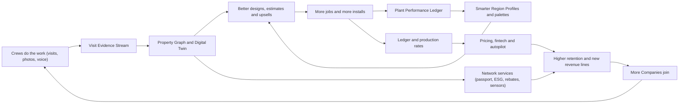

**Data-rights rules for every bet (non-negotiable):**

1. **Tenant data belongs to the Company.** Rootline processes it to serve that Company ([17](17-ai-copilot-automation.md) section on data use).
2. **Cross-tenant use only by aggregation and opt-in.** The `owner` must opt in separately to (a) in-app benchmarks and (b) external aggregated products. Published cells need at least 10 contributing Companies, no single Company may contribute more than 25% of a cell's weight (40% for the top two), and Companies under common ownership count as one contributor ([18](18-reporting-analytics.md) sections 4.11.2 and 4.11.4). Plant-frequency signals need at least 20 Companies ([22](22-business-model-pricing-gtm.md) section 5.2). Price and wage aggregates follow the stricter counsel-gated rules in [18](18-reporting-analytics.md) (n ≥ 15, metro or wider, at least 3 months old) and are never inputs to pricing suggestions.
3. **Client data is never marketed across tenants.** Homeowner network features require the homeowner's own explicit opt-in, recorded with consent text version, timestamp and channel.
4. **Partner data flows (lenders, insurers, utilities, nurseries) are per-purpose, per-recipient, revocable consents** stored in a single `data_share_grant` ledger (section 7) and visible to the `owner` in Settings > Data sharing.

### 4.2 Rails: what MVP and V1 must build so the moonshots stay possible

These are cheap now and expensive to retrofit. Each line is a requirement on the named module, tagged with the scope tier it belongs to.

| Rail | Requirement | Owning doc | Tag | Unlocks |
|---|---|---|---|---|
| R-01 Stable object IDs | Every bed, turf area, hardscape element, plant instance, irrigation component and light fixture in a Design carries a stable object ID (the ULID of the [10](10-design-studio.md) scene graph) that survives versions and the transition from design to as-built. Deleting an object soft-deletes it with a reason (`removed`, `died`, `replaced`) | [10](10-design-studio.md) | [MVP] | M-01, M-04, M-12, M-29 |
| R-02 Plant instances | A placed plant is a `plant_placement` in the Design ([10](10-design-studio.md)); at install it becomes a `plant_instance` that keeps the same object ID and adds KB plant ID, cultivar, container size, install date, source vendor and warranty end, so it is never just a symbol | [10](10-design-studio.md), [12](12-plant-knowledge-base.md) | [MVP] | M-08, M-11, M-14, M-29 |
| R-03 Rich photo metadata | Crew photos store GPS, accuracy, compass heading, device tilt, timestamp, Visit ID, Property ID and optional object tags. Originals are kept (not only compressed copies) for 24 months by default | [05](05-field-crew-mobile-app.md) | [MVP] | M-01, M-08, M-21 |
| R-04 Photo stations | Optional fixed "photo stations" on the property map (pin + heading) that the crew app asks for at set intervals (default: first visit of each month), for repeatable framing | [05](05-field-crew-mobile-app.md), [10](10-design-studio.md) | [V1] | M-01, M-09, M-12 |
| R-05 Device abstraction | A generic `device` registry (type, vendor, external ID, capabilities, Property/zone binding) and a `telemetry_point` time-series store, used by smart controllers first | [14](14-service-line-modules.md), [20](20-architecture-security.md) | [V1] | M-05, M-07, M-31 |
| R-06 Consent ledger | Purpose-scoped consents for Clients (marketing, AI imagery, data sharing) and Companies (benchmarks, partner shares) with versioned text | [02](02-personas-roles-permissions.md), [20](20-architecture-security.md) | [MVP] | M-12, M-13, M-16-M-18 |
| R-07 Organization layer | An `organization` above Companies (multi-company, franchise) with data-sharing agreements per category | [02](02-personas-roles-permissions.md), [19](19-platform-admin-portal.md) | [V1] | M-19, M-32 |
| R-08 Action Layer parity | Every capability is a typed tool with a risk tier; API, MCP, automations and agents call the same tools | [17](17-ai-copilot-automation.md) | [MVP] | M-23, M-24, M-20 |
| R-09 Production-rate capture | Time is captured per Visit and per service line item, with quantities (sq ft, cu yd, each) | [05](05-field-crew-mobile-app.md), [03](03-crm-sales-estimating-proposals.md) | [MVP] | M-22, M-05 |
| R-10 Energy and fuel capture | Fuel purchases are tagged to assets; battery packs and charge sessions are registered | [13](13-operations-inventory-equipment.md) | [V1] | M-06, M-09 |
| R-11 Geospatial store | PostGIS geometry for properties, zones and service areas in a single CRS convention (WGS84 storage plus a local projected CRS per Property for measurement) | [20](20-architecture-security.md) | [MVP] | All spatial bets |
| R-12 Media pipeline hooks | `media.processed` events with pluggable processors (EXIF, blur faces, segmentation), so new models are added without schema changes | [20](20-architecture-security.md) | [MVP] | M-01, M-08 |
| R-13 Outcome capture | Plant warranty claims and replacements record cause (`drought`, `pest`, `disease`, `mechanical`, `client_neglect`, `unknown`) | [14](14-service-line-modules.md), [07](07-invoicing-billing-contracts.md) | [V1] | M-29, M-11, M-18 |
| R-14 Region on everything | Every Property resolves to a Region ID (and USDA/Canadian zone, ecoregion) at geocode time, and the value is kept with history | [12](12-plant-knowledge-base.md) | [MVP] | M-11, M-08, M-29 |

### 4.3 Stage gates and kill criteria

Every bet moves through five stages on evidence, not on a calendar. The stages are per-bet feature-flag maturity levels, separate from the product's scope tiers. `platform_owner` approves each promotion in the Innovation review. Feature flags and tenant cohorts are managed in [19](19-platform-admin-portal.md).

| Stage | Entry criteria | Exit (promote) criteria | Exposure |
|---|---|---|---|
| **0. Explore** | One-page problem statement, the moat it uses, hypotheses | 10+ customer interviews confirm the pain; a technical spike shows the approach is feasible | No tenants (interviews and spikes only) |
| **1. Prototype** | Gate 0 passed | Internal demo of the headline demo; cost per use estimated; risk register written | Internal and demo tenants only |
| **2. Pilot** | Gate 1 passed; 3-10 design-partner Companies signed | Pilot KPIs hit (per card); no Sev-1 trust incidents; unit economics within 2x of target | 3-10 design-partner Companies behind a feature flag |
| **3. Beta** | Gate 2 passed; support runbooks; pricing and packaging set | Adoption and retention targets; compliance review signed off | Opt-in tenant cohorts, labeled Beta in the product |
| **4. GA** | Gate 3 passed | Ongoing: owner KPI dashboard in [18](18-reporting-analytics.md) | All eligible tenants per plan entitlement; becomes a product line |

**Global kill rules:** kill or shelve a bet if (a) pilot KPIs miss by more than 50% after two iterations, (b) a trust incident shows that its data use cannot be made safe, (c) a partner dependency becomes unavailable and there is no viable second source, or (d) its marginal cost per Company exceeds 25% of the Company's subscription with no pricing path.

### 4.4 Portfolio overview

Impact and Effort are scored 1 (low) to 5 (high) by the product team (estimates). Impact weighs revenue, retention, differentiation and customer outcome. Effort is a relative complexity score that weighs technical difficulty, partnerships, regulatory exposure and operating cost; it is not a time or staffing estimate. "First slice" is the earliest increment that ships customer value.

| ID | Bet | Theme | First slice | Headline | Primary moat | Rootline TRL | Impact | Effort | Revenue model |
|---|---|---|---|---|---|---|---|---|---|
| M-01 | Persistent property digital twin | A Property intelligence | [V1] | [V2]/[V3] | Property Graph + Evidence | 6 | 5 | 4 | Retention; Pro/Enterprise tiers; credits |
| M-02 | Drone capture and photogrammetry | A | [V2] | [V3] | Property Graph | 7 | 3 | 3 | Credits; capture add-on |
| M-03 | AR "See it in your yard" for homeowners | B Spatial and media | [V2] | [V2] | Design + Plant KB | 7 | 4 | 3 | Close-rate lift; Grow+ |
| M-04 | AR crew layout guidance | B | [V2] | [V3] | Design + R-01 | 5 | 4 | 4 | Pro add-on; RTK kit resale |
| M-05 | Robotic mower fleet orchestration | C Autonomy and energy | [V2] | [V3] | Schedule + job cost + twin | 6 | 4 | 4 | Per-robot fee; OEM rev share |
| M-06 | Fleet electrification planner | C | [V1] | [V2] | Equipment + fuel + runtime | 7 | 3 | 2 | Included Pro; dealer referrals |
| M-07 | IoT sensors and closed-loop smart irrigation | C | [V1] | [V3] | Hydrozones + Plant KB | 7 | 4 | 3 | Per-site monitoring fee (Company resells) |
| M-08 | Plant health AI with prescriptions | A | [V1] | [V2] | Plant KB + Region + photos | 5 | 4 | 3 | Credits; PHC upsell |
| M-09 | ESG and sustainability reporting | D Sustainability | [V1] | [V2] | Ledger + fuel + Plant KB | 7 | 4 | 2 | Commercial add-on |
| M-10 | Turf-replacement rebate automation | D | [V1] | [V2] | Design takeoffs + photos | 7 | 3 | 2 | Close-rate lift; per-application credits |
| M-11 | Climate-adaptive planting | A | [V2] | [V2] | Plant KB + Regions | 6 | 3 | 2 | Differentiation; Plant API |
| M-12 | Landscape Passport ("Carfax for landscapes") | E Homeowner network | [V1] | [V2]/[V3] | Property Graph + consents | 7 | 4 | 3 | Retention; homeowner Plus; agent reports |
| M-13 | Homeowner app and marketplace | E | [V1] | [V2]/[V3] | Plant KB + AI design + network | 6 | 5 | 4 | Rootline Home, Match leads ([22](22-business-model-pricing-gtm.md)) |
| M-14 | Nursery supply network | F Networks | [V1] | [V2]/[V3] | Plant KB + demand | 6 | 4 | 4 | Nursery Partner API; GPO rebates |
| M-15 | Labor and subcontractor marketplace | F | [V2] | [V3] | Crews + production rates + reviews | 5 | 4 | 4 | Transaction fee on B2B jobs |
| M-16 | Working capital from ledger data | G Fintech | [V2] | [V3] | Ledger + contracts + payments | 6 | 4 | 3 | Lender referral fees |
| M-17 | Equipment financing and certified pre-owned | G | [V2] | [V2] | Equipment logs + Ledger | 6 | 3 | 3 | Dealer/lender referral; listing fees |
| M-18 | Embedded insurance | G | [V2] | [V3] | Safety, incidents, telemetry | 5 | 3 | 4 | Agency commissions (licensed partner) |
| M-19 | Franchise and multi-brand mode | I Ecosystem | [V1] | [V2] | Organization layer + Ledger | 7 | 4 | 3 | Per-location enterprise pricing |
| M-20 | Voice-first crew assistant | H Intelligent ops | [V1] | [V2] | Action Layer + Spanish UX | 6 | 4 | 3 | Included; credits |
| M-21 | Generative video walkthroughs | B | [V2] | [V3] | Design 3D + Plant growth | 5 | 3 | 3 | Credits |
| M-22 | Predictive pricing | H | [V1] | [V2] | Production rates + win/loss | 6 | 5 | 3 | Pro tier |
| M-23 | Autopilot: the self-driving back office | H | [V1] | [V2]/[V3] | Action Layer + Ledger | 6 | 5 | 4 | Autopilot tier |
| M-24 | App marketplace and MCP ecosystem | I | [V1] | [V2] | API parity + network | 7 | 4 | 3 | Rev share on paid apps |
| M-25 | Rootline Academy and certifications | I | [V1] | [V2] | Content + skill graph | 8 | 3 | 2 | Paid certifications; retention |
| M-26 | Community | I | [V1] | [V2] | Network | 8 | 3 | 2 | Retention; template exchange |
| M-27 | Wildfire-ready landscapes | D | [V2] | [V2] | Design + Plant KB + photos | 6 | 3 | 2 | Inspection product; insurer partners |
| M-28 | Stormwater and green-infrastructure credits | D | [V2] | [V3] | Design hydrology + maintenance logs | 6 | 2 | 2 | Credits; O&M contracts |
| M-29 | Plant Performance Science Network | A | [V2] | [V3] | Plant Performance Ledger | 6 | 4 | 3 | Plant API, data licenses |
| M-30 | Neighborhood density engine | F | [V1] | [V2] | Routes + parcels + twin | 7 | 3 | 2 | Growth; included |
| M-31 | Heat-safe crews | C | [V1] | [V2]/[V3] | Weather + schedule + time | 7 | 3 | 2 | Included (compliance) |
| M-32 | Rootline Grounds (in-house grounds teams) | I | [V3] | [V3] | Whole platform | 7 | 3 | 3 | New segment |
| M-33 | Rootline Global (UK, Australia, NZ) | I | [V3] | [V3] | Plant KB curation model | 7 | 3 | 4 | New markets |

---

### 4.5 Theme A: Property intelligence

#### M-01 Persistent property digital twin

**Headline phase:** [V2] for the twin timeline and change detection, [V3] for the full 3D, sensor-fused twin. Rails are [MVP]/[V1].

**Problem.** A landscape company's knowledge of a property is scattered: the original design PDF, a few hundred unlabeled crew photos, the account manager's memory and an irrigation map on paper in the truck. When the account manager leaves or the property changes hands, the knowledge goes with them. Commercial property managers cannot see condition across a portfolio. Estimators re-measure properties the company has maintained for six years.

**Concept.** Every Property gets a living, versioned model: the **Property Twin**. It starts as the as-built Design ("Living Property Map", [10](10-design-studio.md) section on as-builts). Every source of evidence then updates it automatically: crew photos, photo stations, drone flights, LiDAR scans, homeowner photos, satellite revisits and IoT sensors. The twin knows *objects* (this 'Green Velvet' boxwood, this 4-inch pop-up head in zone 6, this 14 x 18 ft paver patio), their *condition over time* and their *history* (installed, pruned, treated, replaced). It answers questions such as "What changed since last month?", "Which plants are declining?", "Where are the dry spots?" and "What did the front bed look like last June?"

**Twin layers:**

| Layer | Contents | Update sources | Refresh |
|---|---|---|---|
| Geometry | Parcel, footprints, beds, turf, hardscape, grades | Design, as-built, drone, LiDAR | On capture |
| Objects | Plant instances, trees (DBH, height), irrigation components, fixtures, structures | Design, crew tags, AI detection (confirmed) | Per visit |
| Condition | Health status per object (`thriving`, `ok`, `stressed`, `declining`, `dead`, `missing`), turf quality index, mulch coverage, bed-edge crispness | Photos + AI change detection, crew checklist | Per visit / monthly |
| Events | Visits, applications, repairs, replacements, warranty claims, storms | Crew app, chemical logs, irrigation tickets | Real time |
| Sensors | Soil moisture, flow, controller runs, robot coverage | M-05, M-07 | Minutes to daily |
| Imagery | Registered photos, orthomosaics, Gaussian-splat scenes per season | Crew, drone, capture sessions | Per capture |

**Behaviors and rules (first slice, [V2] "Twin Timeline").**

1. **Registration.** Each photo with GPS accuracy ≤ 15 m and a compass heading is projected onto the Property map as a view cone. Photos taken at a photo station (R-04) within 3 m and 20 degrees of the station's heading count as "station-matched". Other photos register only to the object tags the crew applied or the AI suggested.
2. **Change detection.** For station-matched photo pairs at least 21 days apart, a vision pipeline (segmentation + learned comparator) produces candidate changes: `plant_missing`, `plant_discolored`, `bed_weeds_high`, `mulch_thin`, `turf_thinning`, `edge_lost`, `structure_damaged`, `new_object`. Each candidate has a confidence score and a heat-mapped region.
3. **Human confirmation.** Candidates with confidence ≥ 0.8 become "Proposed updates" in the `ops_manager` queue. Candidates from 0.5 to 0.8 are batched into a weekly digest. Anything below 0.5 is discarded but kept for model evaluation. No object status changes without confirmation, except `plant_missing` when the crew also flagged it (two-signal rule).
4. **Actions from changes.** A confirmed `plant_dead` on a plant instance under warranty creates a warranty replacement task ([14](14-service-line-modules.md)). `mulch_thin` in more than 30% of the bed area suggests a mulch enhancement Proposal, with quantities from the bed polygon at 2-inch depth (cubic yards = area sq ft x 2 / 12 / 27). `turf_thinning` suggests aeration and overseeding.
5. **Timeline UI.** A slider by month shows the registered photos and object states. "Compare" places two dates side by side with a swipe divider.
6. **Property Health Score (0-100).** A weighted index of the share of plants in `ok` or better, turf quality, weed pressure, mulch coverage and open issues. The weights are tenant-configurable, and the default formula is published in [18](18-reporting-analytics.md). The score is shown to `client_commercial` only if the Company enables it.
7. **Privacy.** Faces and license plates are blurred at ingest (R-12). Imagery outside the parcel polygon plus a 2 m buffer is masked in client-facing views, so the neighbor's yard is not shown.
8. **Storage policy.** Originals are kept for 24 months. Station-matched images are kept for the life of the contract, then for 12 months after it ends, unless the Client exports them to the Passport (M-12).

**Builds on.** Property Graph (R-01, R-02), photo metadata (R-03, R-04), media pipeline (R-12), Plant KB.
**Feeds back.** Condition labels train better detection; outcomes feed the Plant Performance Ledger (M-29); enhancement upsells feed revenue; evidence feeds the Passport (M-12) and ESG (M-09).

**Readiness.** TRL 6. Segmentation and image comparison are mature. Registration from phone photos is the hard part: GPS error, seasonal appearance change and leaf-on versus leaf-off. Photo stations solve 80% of registration (estimate). The [V3] full 3D twin uses Gaussian splats from capture sessions or drones ([3DGS paper](https://arxiv.org/abs/2308.04079)).

**Dependencies.** R-01-R-04, R-12; Design Studio as-builts ([10](10-design-studio.md)); AI Gateway vision models ([17](17-ai-copilot-automation.md)); storage cost model ([20](20-architecture-security.md)).

**Phasing.**
- [MVP] Rails: object IDs, plant instances, rich photo metadata.
- [V1] Living Property Map (as-built), photo stations, manual object status updates from the crew app.
- [V2] Twin Timeline, change detection with human confirmation, Property Health Score, enhancement suggestions.
- [V3] 3D twin (splats per season), sensor fusion, "what-if" simulation (growth of every plant over 10 years, shade evolution, water budget), digital twin API for commercial Clients' facility systems.

**Headline demo.** *An account manager opens a 22-acre office park on a Monday morning. The twin shows three red pins. Two 'Emerald Green' arborvitae on the north berm went from `ok` to `declining` between the June and July station photos. The irrigation zone feeding them shows 40% less flow than its baseline. The mulch on the entrance beds has thinned. One click creates a repair ticket, a warranty-replacement task and an enhancement Proposal for 18 cubic yards of mulch. The property manager approves it from her phone before lunch.*

**Kill criterion.** If confirmed changes are under 50% of the candidates shown (precision) after two model iterations in the pilot, revert to crew-flagged changes only.

> **Competitive edge.** SiteRecon and PropertyIntel measure a property once. Aspire and LMN store photos as attachments. None of them maintains object-level condition over time tied to warranties, irrigation zones and Proposals. The twin turns Rootline's visit frequency (about 30 mowing visits a season) into an asset a competitor cannot backfill: years of registered history cannot be imported.

#### M-02 Drone capture and photogrammetry

**Headline phase:** [V2] import and processing, [V3] automated capture network.

**Problem.** Satellite imagery is often 1-3 years old, blurred under tree canopy and too coarse for grade work. A 6-acre HOA common area or a commercial campus takes an estimator half a day to measure on foot. Install projects need accurate grades and volumes (excavation, stockpiles, wall heights) that aerial photos and county LiDAR rarely provide at current vintage.

**Concept.** Rootline becomes the place where drone data turns into landscape intelligence. Companies (a) fly their own drones with a Rootline-generated flight plan, (b) upload data from any drone or service provider, or (c) order a capture from a vetted pilot network ([V3]). Rootline processes the imagery into an orthomosaic, digital surface and terrain models, contours and a 3D scene. It registers all of it to the Property Twin, and AI extracts beds, turf, hardscape, tree crowns and stockpiles into editable Design objects.

**Behaviors and rules.**

1. **Flight plan generator [V2].** The input is the parcel polygon plus a buffer, which must stay inside the parcel unless the operator confirms otherwise. Defaults: lawn-and-bed mapping at about 150-200 ft AGL, 75% front overlap and 65% side overlap, nadir grid; a crosshatch with a 60-degree oblique for 3D. Expected ground sampling distance is roughly 1-2 cm per pixel for 20 MP-class cameras (estimate; depends on sensor). The plan is exported as KML/KMZ for common flight apps. The altitude cap is set by jurisdiction (400 ft AGL under US Part 107; verify Canadian rules).
2. **Pre-flight compliance checklist.** Pilot certificate on file and unexpired ([15](15-team-hr-payroll.md) certifications), aircraft registration, Remote ID compliance, airspace check (LAANC or the Canadian equivalent, operator-confirmed), client permission recorded, people-on-site notice. Rootline does not grant airspace authorization; it records that the pilot obtained it.
3. **Upload and process.** Images (JPEG/DNG with EXIF GPS) are processed by a Python photogrammetry worker based on OpenDroneMap, or sent to a partner API (Pix4D/DroneDeploy-class; verify terms). Outputs: COG orthomosaic, DSM/DTM GeoTIFF, LAZ point cloud, 3D tiles/splat. Processing is billed in AI credits per hectare (published rate card; estimate 40-80 credits per acre at [V2]).
4. **Accuracy labels.** Without ground control points (GCPs), relative accuracy is good but absolute positioning can be off by meters. The UI shows "relative accuracy only; align to plan" and offers a two-point alignment to existing Design control points. With GCPs or an RTK drone, the result is labeled "survey-grade candidate (verify)". Rootline never labels a capture as a survey. Licensed surveyors do surveys.
5. **AI extraction.** Beds, turf, hardscape, tree crowns (with height from DSM minus DTM) and stockpile volumes become *proposed* Design objects with confidence scores. Accepting them updates the twin and runs takeoffs into the open Estimate ([03](03-crm-sales-estimating-proposals.md)).
6. **Multispectral (optional, [V3]).** If the drone has NIR bands, NDVI rasters overlay turf health. RGB-only flights use visible-band indices (for example VARI or ExG) labeled "approximate".
7. **Privacy.** Captured imagery outside the parcel is cropped from client-facing outputs. Drone use follows state drone-privacy statutes (several states restrict capturing images of private property without consent; verify per state). The tenant attests to compliance at each upload.

**Builds on.** Property Graph, Design Studio takeoffs ([10](10-design-studio.md)), 3DEP terrain pipeline, media pipeline. **Feeds back.** Fresh geometry and canopy heights improve the twin, shade analysis and estimating accuracy.

**Readiness.** TRL 7 for processing. The binding constraints are regulatory and supply-side. The FY2025 NDAA put DJI and Autel on a path to the FCC Covered List, which would block new equipment authorizations for their hardware while leaving already-authorized aircraft flyable (see the headwinds table in section 2.3; verify the outcome). Many small contractors fly DJI aircraft today, so the design is OEM-agnostic and depends on no single vendor's SDK: any camera that writes EXIF GPS works, and flight plans are plain KML/KMZ.

**Dependencies.** Python worker fleet with GPUs ([20](20-architecture-security.md)); S3 plus COG tiling; certification tracking ([15](15-team-hr-payroll.md)); credits ([22](22-business-model-pricing-gtm.md)).

**Phasing.** [V2] upload, process and extract; flight plan export. [V3] pilot network marketplace (vetted Part 107 / Transport Canada pilots, booking, payouts via the pilot's own Stripe account), scheduled seasonal re-flights for large commercial portfolios, multispectral turf health, stockpile inventory for the Company's yard ([13](13-operations-inventory-equipment.md) "yard twin").

**Headline demo.** *An estimator flies a 9-acre HOA entrance and pond in 14 minutes. Forty minutes later Rootline has drawn 61 beds, 4.2 acres of turf, 1,180 linear feet of edging and 38 tree crowns with heights. The bed polygons price the spring mulch install at 112 cubic yards. The HOA board sees a photoreal 3D flyover of the pond renovation option that night.*

**Kill criterion.** If fewer than 10% of Pro tenants in drone-heavy segments (commercial, HOA) process a flight in the first two quarters of the bet's Beta stage (4.3), keep upload-only and drop the pilot network.

#### M-08 Plant health AI with prescriptions

**Headline phase:** [V2]. A [V1] slice offers AI-assisted symptom notes and triage.

**Problem.** Crews see sick plants every day but rarely know what they are looking at. Plant health care (PHC) revenue is lost because nobody notices the problem, or it is spent on the wrong treatment. Misdiagnosis risks plant loss, warranty costs and off-label pesticide use, which is illegal ("the label is the law" under FIFRA). Homeowners send blurry photos asking "what's wrong with my tree?"

**Concept.** "Plant Doctor": a photo-first diagnostic assistant that knows *which plant this is* (from the twin's plant instance, or by identification), *where it is* (Region, zone, recent weather, soil), *what time of year it is* (degree-day models) and *what the Company is licensed and stocked to do*. It produces a ranked differential diagnosis, asks for the follow-up photos that would separate the candidates, and drafts an Integrated Pest Management (IPM) prescription that a licensed person approves. The approved prescription becomes a priced PHC Proposal.

**Behaviors and rules.**

1. **Capture protocol.** The app guides 3-5 shots: whole plant, affected area, close-up of the leaf top and underside, bark or stem, and the base of the plant. A coin or calibration card gives scale for lesion size. It works offline and queues the analysis.
2. **Identity first.** If the photo is tied to a `plant_instance`, the KB plant is known. Otherwise a plant-ID model proposes the top 3 taxa with confidence, constrained by Region likelihood.
3. **Differential diagnosis.** The model combines image features, KB host-pest associations (curated per plant, [12](12-plant-knowledge-base.md)), seasonal and degree-day priors from local weather, recent events (a chemical application 5 days ago suggests phytotoxicity; a drought week suggests abiotic stress) and regional pest alerts. Output: up to 5 candidates with likelihoods, the key visual evidence, and "what would confirm it".
4. **Abiotic before biotic.** The system must always consider abiotic causes (drought, overwatering, mower and string-trimmer damage, salt, girdling roots, herbicide drift, transplant shock) and list them where they fit. Studies and extension guidance consistently find abiotic problems behind many landscape plant complaints (verify for citation; do not quote a percentage).
5. **Confidence gates.** If the top candidate has likelihood < 0.6, or a quarantine or regulated pest is among the candidates (for example spotted lanternfly, where state quarantines apply; verify per state), the output is "Needs expert review". The case routes to the Company's licensed PHC lead or, optionally, to a partner extension diagnostic lab with a sample-submission checklist.
6. **IPM prescription ladder.** Cultural, then mechanical, then biological, then chemical. Chemical options are drawn only from the Company's Price Book products whose label (via a label database lookup: EPA PPLS in the US, PMRA label search in Canada; verify API availability) lists the site, the plant and the pest. Restricted-use products appear only if a certified applicator is assigned. Local restrictions (neonicotinoid rules, pollinator protections, school-zone limits, notification registries) come from the jurisdiction rule set in [14](14-service-line-modules.md).
7. **Human sign-off.** A licensed `crew_lead` or `ops_manager` with an applicator certification approves every chemical prescription. The approval is logged with the license number. AI never auto-schedules a pesticide application.
8. **Outputs.** A PHC Proposal (e.g., "Two dormant oil applications plus a soil injection; $385"), a client-facing explanation in plain language with photos, a follow-up visit at the efficacy check date, and a twin condition update.
9. **Learning loop.** Diagnoses confirmed by expert review or by the outcome (recovery after treatment) become labeled training data for that tenant. Cross-tenant learning only uses de-identified images from opted-in tenants (data-rights rule 2).

**Builds on.** Plant KB host-pest data, twin plant instances, chemical application records, weather. **Feeds back.** Plant Performance Ledger (M-29), regional pest-pressure maps (aggregated, opted in), PHC revenue.

**Readiness.** TRL 5-6. Plant identification is good. Field disease diagnosis on ornamentals is hard: symptoms overlap, imagery is messy and datasets like PlantVillage are lab-like and generalize poorly. Hence the expert-in-the-loop design.

**Dependencies.** Plant KB host-pest associations ([12](12-plant-knowledge-base.md)); jurisdictional pesticide rules ([14](14-service-line-modules.md)); applicator certification tracking ([15](15-team-hr-payroll.md)); label data source (licensing to verify).

**Phasing.** [V1] symptom capture with AI-written notes ("chlorosis between veins on new growth, lower leaves fine") and plant ID. [V2] differential diagnosis, IPM ladder and PHC Proposal drafts. [V3] regional early-warning network (for example "Boxwood blight reports up in your county this week; 34 of your properties have boxwood"), homeowner Plant Doctor inside Rootline Home with escalation to the Company.

**Headline demo.** *A technician photographs a speckled, bronzing 'Green Mountain' boxwood. Plant Doctor already knows the plant, its zone and that it is late June. It ranks boxwood mite first, then leafminer, then drought stress. It asks for a leaf-underside close-up and a white-paper tap test. The mite diagnosis is confirmed. A horticultural-oil treatment within label is drafted, the PHC lead approves it, and the homeowner gets a $165 Proposal with photos before the crew leaves the driveway.*

**Kill criterion.** If expert reviewers override the top-1 diagnosis on more than 40% of non-escalated cases in the pilot, keep the [V1] slice and stop.

#### M-11 Climate-adaptive planting

**Headline phase:** [V2]. This card is the full specification of the climate-forward ratings idea in [12](12-plant-knowledge-base.md) section 13 (idea 1, [V2]) and builds on the Region climate summaries (KB-RGN-06, [V1]) there.

**Problem.** Plant hardiness zones are moving. USDA's 2023 map moved many areas a half-zone warmer ([USDA PHZM](https://planthardiness.ars.usda.gov/)). Trees planted today have to live through the climate of 2050 and beyond. Designers and homeowners rely on static zone labels and nursery tags. Meanwhile, more intense rainfall, longer droughts and heat waves kill installed plants and drive warranty losses.

**Concept.** Every plant recommendation in Rootline carries a **Climate Fit** for *today* and for a *planning horizon* (2040 and 2060). The operator curates it from downscaled climate projections and Region Profiles. Designers can filter to "thrives now and later". Existing Properties get a **Climate Risk review** that flags plant instances near the warm or dry edge of their range and proposes succession plantings.

**Behaviors and rules.**

1. **Climate envelope per plant.** Curators maintain, per plant, tolerance ranges: minimum winter temperature (zone), heat tolerance (AHS heat zone or days above 86 F; verify methodology), drought tolerance class, flood/wet-feet tolerance, and chill-hour needs for flowering and fruiting plants.
2. **Projected Region climate.** For each Region, `platform_curator` publishes horizon projections derived from downscaled CMIP6 datasets (for example NASA NEX-GDDP-CMIP6 or LOCA2; verify licensing and choose an ensemble median plus spread), summarized as projected zone, heat days, dry spells and heavy-rain frequency. Projections are versioned and cite their source and scenario (for example an intermediate emissions scenario; the curator documents the choice).
3. **Climate Fit score** per plant per Region per horizon: `fit` (inside envelope with margin), `edge` (within 1 half-zone or 10% of a tolerance limit), `risk` (outside). Shown as three dots (now, 2040, 2060) in the plant picker.
4. **Design checks.** In Design Studio, a "Climate horizon" toggle recolors plant symbols by future fit. Long-lived plants (trees and large shrubs with an expected lifespan of 25+ years in the KB) are flagged when 2060 fit is `risk`. Short-lived perennials are flagged only on present fit.
5. **Climate Risk review for existing Properties.** A batch job lists plant instances with `edge` or `risk`, weighted by replacement cost and visual importance (specimen tree > groundcover). The output is a phased succession plan, for example "underplant 'Autumn Blaze' maple replacement candidates now; remove in 6-8 years".
6. **Communication rules.** Language is probabilistic and modest: "projected to be at the warm edge of its comfort range by 2040 under the scenario we use". No fear marketing. Owners can disable climate messaging in client-facing outputs.
7. **Curator workflow.** Changes to envelopes or projections go through the KB release process ([19](19-platform-admin-portal.md) `kb.release_published`) with diffs and reviewer sign-off.

**Builds on.** Plant KB, Regions, Plant Performance Ledger (observed failures confirm or refute envelopes). **Feeds back.** Palettes such as "Ohio Climate-Ready Shade Trees" and differentiation in the Plant API ([22](22-business-model-pricing-gtm.md)).

**Readiness.** TRL 6. The data exists. The work is curation, uncertainty communication and calibration against outcomes.

**Dependencies.** M-29 outcomes for calibration; Region model ([12](12-plant-knowledge-base.md)); KB release tooling ([19](19-platform-admin-portal.md)).

**Phasing.** [V1] zone history (old and new USDA zone shown) and "edge of zone" warnings. [V2] Climate Fit scores, design toggle, Climate Risk review. [V3] climate-adjusted growth models in the twin's 10-year simulation (M-01), and municipal and utility partnerships for climate-ready tree programs.

**Headline demo.** *A designer in Columbus filters shade trees by "thrives now and in 2060". Sugar maple drops to `edge`. Swamp white oak and 'Valley Forge' American elm stay green. The client portal shows a short note: "Chosen to thrive in Columbus's climate for the next 40 years", with the source cited.*

**Kill criterion.** If designers use the Climate horizon toggle on fewer than 10% of new Designs in Regions where it is live after two seasons, keep zone history and the Climate Risk review only.

#### M-29 Plant Performance Science Network ("Living Lab")

**Headline phase:** [V2] for the in-product signals, [V3] for the open science program.

**Problem.** "What grows well here" is still mostly anecdotal: nursery tags, extension fact sheets, one designer's experience. Region Profiles curated by the operator are good, but nobody systematically measures how thousands of real installs perform. Contractors pay for those failures through warranty replacements.

**Concept.** Every plant instance installed through Rootline is a data point in the largest real-world landscape performance dataset in North America: survival at 1, 2 and 3 years, warranty claims and their causes (R-13), pest and disease events (M-08), growth against expected mature size, and maintenance inputs (irrigation, fertility). Aggregated across opted-in Companies, it yields **Evidence Scores** on Region Profiles ("survival 94% at 2 years across 3,140 installs in 41 Companies, Region OH-Glaciated-Plains"). Curators use it to improve palettes. Partnerships with universities and extension services turn it into published research.

**Behaviors and rules.**

1. **Outcome events.** `plant_instance` status transitions (installed, establishment-check, healthy, declining, dead, replaced, removed) are recorded with cause codes. Installs are reviewed at 6, 12 and 24 months: the crew app prompts for a status during regular visits, so there is no extra trip.
2. **Aggregation.** Evidence Scores are computed per KB plant (and cultivar where the count is high enough) per Region, only when at least 20 Companies and 200 installs contribute (stricter than benchmark thresholds because survival rates are sensitive). Confidence intervals are shown.
3. **Bias controls.** Survival is adjusted for site conditions (sun/shade mismatch, irrigation present, install season) and Company care level using a simple hierarchical model. Raw and adjusted rates are both visible to curators.
4. **Curator surfacing.** The KB console shows "Evidence disagrees with rating". For example, a plant rated "excellent" in a Region with adjusted 2-year survival below 75% gets a review task.
5. **Nursery source quality ([V3], opt-in by nurseries).** Survival by source nursery is shared privately with that nursery, never publicly ranked. This supports grower quality programs.
6. **Research program ([V3]).** Anonymized datasets are shared with academic partners under data-use agreements. Rootline funds 2-3 "trial landscape" sites per year with extension services. Publications credit contributing Companies (opt-in).

**Builds on.** R-02, R-13, Plant KB, Regions. **Feeds back.** Better palettes, lower warranty costs (and the insured plant warranty in M-18), Plant API value ([22](22-business-model-pricing-gtm.md) section 5.2.1), climate calibration (M-11), and an **evidence-based warranty reserve rate**: the Ledger's warranty accrual rule `warranty.WR1` in [09](09-accounting-ledger-integrations.md) accrues a percentage of install plant revenue, and M-29 can suggest that percentage per Job from the expected 1-year failure rate of the actual plants, sizes and Region on the Proposal (the tenant approves the rate; the suggestion and its evidence are stored with the entry).

**Readiness.** TRL 6 (data engineering and statistics). The binding constraint is volume: it needs thousands of installs per Region, so it matures with adoption.

**Dependencies.** R-02 and R-13 rails; crew app outcome prompts ([05](05-field-crew-mobile-app.md)); KB console ([19](19-platform-admin-portal.md)); statistics capacity on the data platform ([18](18-reporting-analytics.md)); data-use agreements reviewed by counsel.

**Phasing.** [V1] outcome capture rail (R-13) and 6/12/24-month status prompts. [V2] Evidence Scores in the curator console and on Region Profiles where thresholds are met. [V3] nursery quality sharing, the research program and public dataset releases.

**Headline demo.** *A curator sees that 'Knock Out' rose in a humid southeastern Region shows 2-year survival 18 points below expectation, with rose rosette disease the top cause. She downgrades the Region Profile, adds a curator note and pushes a KB release. Within a week, 600 open designs show a "consider an alternative" chip.*

**Kill criterion.** The rails are cheap and stay regardless. If fewer than 3 Regions reach the thresholds within 2 years of Evidence Scores going live, keep evidence internal to curators and skip public Evidence Scores.

> **Competitive edge.** No FSM vendor has plant identity, so none can measure plant outcomes. Consumer plant apps have identity but no install, warranty or care data. Rootline is the only system where a plant's whole life (design, purchase, install, care, failure, replacement) is recorded in one place. After a few seasons, the Evidence Scores become something a competitor cannot buy.

---

### 4.6 Theme B: Spatial computing and media

#### M-03 AR "See it in your yard" for homeowners

**Headline phase:** [V2]. It builds on Design Studio AR export (DS-3D-06, DS-MOB-06 in [10](10-design-studio.md)).

**Problem.** Homeowners struggle to picture a plan view. Photo mockups help ([11](11-ai-design-mockups.md)), but they show one angle. The emotional "yes" usually comes when the client stands on the lawn and imagines the patio. Consumer AR apps exist, but they place generic objects at guessed scale and crash on complex scenes ([AI Tools Bakery](https://aitoolsbakery.com/blog/iscape-review/)).

**Concept.** From any Proposal option, the homeowner taps "See it in your yard". The *actual to-scale Design* (beds, patio, walls, plants with KB-accurate forms at the chosen age, lighting) is anchored onto the real yard through the portal (WebAR or Quick Look) or the Rootline Home app. A **growth slider** (Install, Year 1, Year 3, Year 5, Mature), a **season dial** (spring bloom, summer, fall color, winter structure) and a **night mode** (low-voltage lighting design with beam spreads) make it the most persuasive sales moment in landscaping.

**Behaviors and rules.**

1. **Anchoring.** (a) Quick mode: the user points at two known features (house corners) that the Design marks as control points, and the scene aligns with a 2-point similarity transform. Expected local error is roughly ±10-30 cm (estimate). (b) Geospatial mode where coverage exists (ARCore Geospatial / ARKit location anchors). (c) LiDAR-assisted ground mesh on Pro devices for occlusion (plants hidden behind real objects).
2. **Plant forms.** Each KB plant has 3D assets at four ages (procedural or artist-made, with leaf-on and leaf-off variants and seasonal color). Plants without assets fall back to a sized "volume" with photo billboards, labeled as such.
3. **Truth labels.** A persistent chip reads "To-scale design preview. Plant sizes approximate at Year N." Mature size comes from KB ranges, and the midpoint is shown.
4. **Performance budget.** Max 150k triangles and 50 MB per scene on mid-range devices. Above that, cluster distant plants into impostors. Target 30 fps or better on an iPhone from the last 4 generations and mid-range Android.
5. **Interaction.** Toggle between options A and B, hide or show layers, tap a plant for its KB card, "approve this option", leave a pinned comment that syncs to the Design as a markup ([06](06-customer-portal.md)).
6. **Sharing.** A link opens a 3D web viewer (not AR) for a spouse who is away, and records views for the estimator's follow-up ("Priya viewed option B in AR 3 times").
7. **Offline.** Scenes are cached on the device, so a sales visit without signal still works.

**Builds on.** Design 3D ([10](10-design-studio.md)), Plant KB forms and growth rates, AI mockups for textures. **Feeds back.** Option-preference signals feed close-rate models (M-22).

**Readiness.** TRL 7 for previews. Asset production (3D plant forms for thousands of plants) is the cost driver. Prioritize the top 500 plants by usage, and use procedural generation from KB traits for the rest.

**Phasing.** [V2] Quick Look/WebAR of Proposal options with the growth slider; 3D web viewer. [V3] persistent geospatial AR that remembers the design on the property, multi-user sessions (designer remote, homeowner on site), headset support (Vision Pro-class and Android XR devices; verify), and night lighting simulation with photometric fixture data.

**Dependencies.** 3D scene export from the Design Studio (GLB/USDZ, [10](10-design-studio.md)); KB plant 3D asset library (curated plus procedural); portal WebAR support ([06](06-customer-portal.md)); Expo AR modules for Rootline Home ([05](05-field-crew-mobile-app.md)).

**Headline demo.** *Dusk on the back lawn. The homeowner holds up her phone, the new bluestone patio appears at her feet, and she drags the slider to Year 5: the 'Bloodgood' Japanese maple frames the view of the pond. She switches to night mode and the path lights trace the steps. She taps "Approve option B". The deposit request arrives by text before the designer reaches his truck.*

**Kill criterion.** If AR-viewed Proposals show no close-rate lift in an A/B test after two seasons, keep the 3D web viewer and stop investing in AR.

#### M-04 AR crew layout guidance

**Headline phase:** [V3] for the AR overlay. A [V2] slice offers RTK stakeout (DS-CON-03 in [10](10-design-studio.md)).

**Problem.** The handoff from design to install is where landscapes go wrong. Bed lines drawn with care in the office are freehanded with a hose on site. Plant spacing is eyeballed. A 15-gallon tree goes 4 feet from where the designer intended, so the view is blocked or it lands on the irrigation main. Re-dos cost labor, and the as-built never matches the plan, which breaks the twin.

**Concept.** The crew app's **Layout mode** projects the design onto the ground: bed lines as glowing curves, plant positions as colored dots labeled with species code and container size, patio corners, irrigation heads and trench runs, and lighting fixtures with wire paths. The crew lead walks the site with the phone (or, later, smart glasses), paints bed lines along the overlay, flags plant spots and taps "placed" as each plant goes in. The actual position is recorded, so the as-built updates automatically.

**Behaviors and rules.**

1. **Positioning tiers.** (a) **RTK tier**: a Bluetooth RTK GNSS receiver on a pole or in a helmet mount, with NTRIP corrections, gives centimeter-level accuracy in open sky (verify per device). (b) **Control-point tier**: align to 2-3 surveyed points (house corners, a stake set by the estimator) with phone VIO; usable for small beds within about 15 m of the control points. (c) **Approximate tier**: geospatial anchors only, labeled "approximate, not for layout".
2. **Accuracy gate.** Layout mode refuses "precision" actions (patio corners, wall lines) unless the estimated horizontal error is ≤ 5 cm (RTK fix) or the user confirms a control-point check, where a known point is re-measured within 5 cm. Bed lines allow ≤ 15 cm.
3. **Canopy and multipath handling.** When the RTK solution drops from fix to float, the overlay turns amber and precision actions are disabled. The app offers an offset-measurement workflow from the last fixed point (tape-offset fallback).
4. **Stakeout list.** A sequenced list of points (nearest first) with distance and arrow, voice prompts in English or Spanish (M-20), and a "mark done" tap that records the actual coordinates.
5. **Deviation capture.** If a placed plant deviates more than 30 cm from the design (configurable), the app asks for a reason (`rock`, `utility`, `client_request`, `design_conflict`, `other`). The designer gets a notice, and the as-built object moves to the actual position.
6. **Utilities.** Layout mode shows the 811 ticket status for the job and a banner: "AR is not a utility locate. Respect marks and hand-dig tolerance zones." It never displays utility lines as if they were located. Private lines recorded in the twin (irrigation, lighting, drains installed by the Company) are shown and labeled "as-built by [Company], verify".
7. **Robotic line marking ([V3]).** Export bed lines and patio outlines to field-marking robots (sports-field line-marking robots are an established category, e.g., TinyMobileRobots or Turf Tank; verify integration paths) to paint layouts for large commercial installs.

**Builds on.** R-01 stable IDs, the Design, the twin. **Feeds back.** True as-builts (closing the design, install and twin loop), production-rate data for layout tasks, and fewer re-dos.

**Readiness.** TRL 5 for cm-accurate AR on phones in real yards. RTK makes the accuracy feasible. Glare, gloves and occlusion are UX problems. Smart-glasses form factors are not yet rugged or affordable for crews (verify).

**Dependencies.** Expo native AR modules ([05](05-field-crew-mobile-app.md)), RTK receiver integration (Bluetooth NMEA/NTRIP client), Design export of layout geometry ([10](10-design-studio.md)), crew app offline caching.

**Phasing.** [V2] RTK stakeout list (no AR): arrows and distances to points, plus as-built capture. [V3] full AR overlay, deviation workflow, glasses support and robot marking export. Rootline may resell certified RTK kits at cost plus a small margin ([V3], partner-sourced).

**Headline demo.** *A crew lead with a pole-mounted receiver walks a new front bed. On her phone the designer's curve glows on the turf. She sprays marking paint along it in four minutes, without a hose or an argument. Twenty-two plant spots appear as colored dots. As each shrub goes in she taps "placed". By lunch the as-built in the office matches the ground within 10 cm, and the client portal shows "Installed exactly as designed".*

**Kill criterion.** If layout time does not fall by at least 15% in pilots, or more than half of pilot crews abandon Layout mode after the first week, keep the [V2] stakeout list only.

> **Competitive edge (M-03 and M-04).** Consumer AR and AI garden apps (iScape, Neighborbrite) place generic objects at a guessed scale, are labeled "conceptual only" and are reported to crash in AR on complex designs ([AI Tools Bakery](https://aitoolsbakery.com/blog/iscape-review/)). PRO Landscape+ has added AI design tools ([Turf Magazine](https://turfmagazine.com/ai-meets-design-prolandscape-unveils-next-gen-tools)), but its output is not tied to an estimate, a crew or an as-built. Rootline's AR shows the *signed* Design at true scale, with KB-accurate plant sizes by age, and the same object then appears in the crew's stakeout list.
>
> Design tools (PRO Landscape, Vectorworks, SketchUp) stop at the drawing, and FSM tools never had the drawing. Rootline is the only platform where the same object IDs flow from design to layout to as-built to maintenance. That makes AR layout a data loop, not a gimmick.

#### M-21 Generative video walkthroughs

**Headline phase:** [V2] for render-based video, [V3] for generative-enhanced photoreal video.

**Problem.** Proposals are documents, but people decide with their eyes, and video is the medium of social sharing. Server-rendered flythroughs ([10](10-design-studio.md) DS-3D-06) look like CAD. Off-the-shelf generative video models make beautiful clips but invent geometry, which misrepresents what the client is buying.

**Concept.** "Design Films": 20-60 second videos generated from the actual Design. The camera path, geometry and plant positions come from Rootline's 3D scene (the truth). Generative video models restyle each frame toward photorealism, conditioned on depth, segmentation and edge maps from that scene, so the walls stay where the design puts them. Formats: (1) **Proposal walkthrough** with captions and an optional narration in the Company's chosen synthetic voice; (2) **Seasons time-lapse** (spring to winter); (3) **Grow-in time-lapse** (Year 0 to Year 10 using KB growth rates); (4) **Before/after reveal** for marketing (with client consent) that blends the original property photos into the finished project.

**Behaviors and rules.**

1. **Truth constraint.** Each frame is checked against the 3D render by a geometry-consistency metric (e.g., IoU of segmentation masks for hardscape and beds ≥ 0.85 and plant-centroid drift ≤ 5% of frame width). Failing segments are re-generated, or fall back to the clean render with a soft photoreal filter.
2. **Disclosure.** Every video carries a visible "AI-enhanced visualization of proposed design" watermark and embedded content credentials (C2PA manifest), so viewers and platforms can tell it is synthetic.
3. **Voice.** Narration uses stock synthetic voices or a voice the owner records and explicitly consents to cloning (a consent artifact is stored). No cloning of third parties.
4. **Cost preview.** Credits are estimated before rendering. Indicative: render-only 1080p 30 s ≈ 20 credits; generative-enhanced ≈ 150-400 credits (estimate; it depends on the model vendor and length). The cost is shown and the user confirms.
5. **Rights.** Before/after marketing reels need client marketing consent (R-06). The faces of people captured in property photos are blurred.
6. **Model routing.** The AI Gateway routes to the best available video model per task (verify current options: Google Veo, OpenAI Sora, Runway and others). Each output stores its model version for audit.

**Builds on.** The Design's 3D scene, the Plant KB growth model, AI mockups ([11](11-ai-design-mockups.md)). **Feeds back.** Marketing content ([16](16-marketing-growth-communications.md)), Proposal engagement signals (views, rewatches) for M-22.

**Readiness.** TRL 5 for faithful, controllable video at an acceptable cost. Image-level control (ControlNet-style) is mature; temporal consistency under control is improving fast (verify the state of the art at build time).

**Phasing.** [V2] render-based films with seasons and grow-in time-lapses, captions and stock narration. [V3] generative-enhanced photoreal films with the truth constraint, and personalized "your yard, your family's Saturday" lifestyle scenes (opt-in, no real faces generated without consent).

**Dependencies.** Design Studio 3D scene and camera paths ([10](10-design-studio.md)); KB growth rates and seasonal traits ([12](12-plant-knowledge-base.md)); AI Gateway video routing and credits ([17](17-ai-copilot-automation.md), [22](22-business-model-pricing-gtm.md)); C2PA signing service.

**Headline demo.** *The HOA board opens an email: a 45-second film glides from the subdivision sign along the renovated entrance median. Native grasses ripple, 'Little Lime' hydrangeas bloom, and the frame dissolves to Year 5 at dusk with the uplights on. The board president forwards it to 212 homeowners. The vote passes 5-0.*

**Kill criterion.** If generative-enhanced films fail the truth constraint on more than 30% of segments, or cost more than 3x render-only films without a measurable engagement lift, keep render-only films.

---

### 4.7 Theme C: Autonomy, hardware and energy

#### M-05 Robotic mower fleet orchestration

**Headline phase:** [V2] for the first OEM integration and robot-as-crew scheduling, [V3] for multi-OEM orchestration and hybrid crews at scale.

**Problem.** Labor is the binding constraint in maintenance, and mowing is the most repetitive task. Commercial-grade autonomous and robotic mowers now exist: wire-free RTK robots for large turf such as Husqvarna CEORA with EPOS virtual boundaries, Kress (Positec) RTKn commercial robots, autonomous zero-turn and stand-on platforms such as Scythe M.52, retrofit autonomy kits such as Greenzie, operators such as Electric Sheep that combine robots with acquisitions of landscaping companies, and incumbent OEMs moving into autonomy: Toro (which also sells the Horizon360 contractor business platform) and John Deere (an autonomous battery-electric commercial mower shown at CES 2025). Consumer-grade RTK robots (Segway Navimow, Mammotion, Worx/Kress) increasingly appear on residential maintenance routes (all as of mid-2026; verify current models, availability and business models). But robots live in OEM apps. The schedule, the Client, the contract, the job cost and the invoice live in FSM software. Nobody can answer "Which of my 140 properties should get robots, and did they pay off?"

**Concept.** Robots become **schedulable crew members** in Rootline. A **Robot** is an Asset ([13](13-operations-inventory-equipment.md)) with capabilities (cut width, max slope, area per day, boundary technology). Its **Robot Work Zones** are generated from the twin's turf polygons, with no-go zones from beds, play areas, water features and steep slopes. **Robot Missions** sit on the dispatch board next to human Visits ([04](04-scheduling-dispatch-routing.md)). Telemetry (status, coverage, errors, blade hours, energy) streams into the twin, alerts become tickets, and every mission is costed in job costing. A **Robot ROI Planner** ranks properties by robot fit.

**Behaviors and rules.**

1. **OEM adapters.** A pluggable `robot_adapter` interface: `list_robots`, `get_status`, `get_position`, `get_coverage`, `start_mission`, `park`, `pause`, `set_schedule`, `subscribe_events`. First adapter: an OEM with a public developer API (Husqvarna's Automower Connect API is the most established public option; verify CEORA coverage and terms). Others come through partnerships (Toro, John Deere, Kress/Positec, Scythe, Greenzie, Electric Sheep; verify). Each adapter declares a capability matrix (for example `can_start_mission`, `can_push_boundary`, `reports_coverage_raster`, `webhooks` versus `polling_only`) and the UI hides actions an OEM does not support instead of failing at click time. Polling adapters default to a 5-minute status interval, and 60 seconds while a Sev-1 alert is open, within each OEM's documented rate limits.
2. **Zone generation.** Turf polygons are exported as GeoJSON in the OEM's required format where import is supported. Otherwise they are a reference overlay for the technician who draws boundaries in the OEM app. Rootline then reads back the OEM's boundaries and diffs them against the twin. Areas steeper than the robot's rated slope (from the DEM in [10](10-design-studio.md)) or narrower than 2x the cut width are flagged "manual mow".
3. **Hybrid visits.** A Service Agreement line "Robotic mowing + trim/edge" generates (a) robot missions on the configured cadence (e.g., nightly 10 p.m.-5 a.m. on sports fields, where local noise rules and site use allow) and (b) human trim/edge/blow Visits every 7 or 14 days, sized by the remaining manual-mow area.
4. **Alert to ticket.** OEM events map to Rootline severities: `stuck`, `lifted`, `outside_boundary`, `theft_alarm` (Sev 1: notify the on-call crew lead, show the last position), `blade_worn`, `low_battery_fail` (Sev 2), `rain_pause` (info). Sev-1 events create a dispatch task routed to the nearest available crew via [04](04-scheduling-dispatch-routing.md).
5. **Job costing.** Each mission accrues cost: depreciation or lease per operating hour (from the Asset's financing record), energy (kWh x tariff), blade wear, supervision minutes (time logged by crew), connectivity fees and RTK service. These post as job-cost lines to the Visit's Job in the Ledger ([09](09-accounting-ledger-integrations.md)).
6. **Client value.** The portal shows "Mowed 2.3 acres last night, 4 passes, no issues", with a coverage heatmap. Commercial reports include robot hours and the emissions avoided versus gas mowing (M-09 methodology).
7. **Safety and security.** Robots operate only inside geofences approved by an `ops_manager`. Public-space sites need signage confirmation (a checklist with photo). Rootline displays the OEM's safety certifications (the robotic-mower safety standard IEC/UL 60335-2-107; verify per model) and never overrides OEM safety stops. Theft geofence alerts include the last known position and a one-tap police report packet.
8. **ROI Planner.** For each Property: open-turf share, obstacle density, slope, perimeter security, site use hours, current labor minutes per visit (production-rate data), drive time and contract price. Output: estimated annual labor hours saved, payback months, and a ranked list. Assumptions are editable and the model is shown ("Estimates only; validate with a 4-week pilot").
9. **Pricing model support.** The Company can bill robotic service by acre-month, by visit or as a flat seasonal fee. The billing engine treats robot missions like Visits for per-visit billing ([07](07-invoicing-billing-contracts.md)).
10. **Site readiness survey.** Before a robot is assigned, the crew app runs a site survey that the ROI Planner consumes: boundary technology needed (wire, RTK, vision), RTK base-station placement or network-RTK coverage, cellular signal strength at the dock, a power source within reach of the charging station, a theft and vandalism risk rating (public access, past incidents), use hours (sports schedules, school hours), and slopes measured against the robot's rating. A site scores `ready`, `ready_with_work` (with a priced site-prep line such as trenching power to the dock) or `not_suitable`.
11. **Telemetry ownership.** OEM terms decide what telemetry Rootline may store. Adapters record the OEM terms version. Telemetry that Rootline stores is tenant data under the data-rights rules in section 4.1, and cross-tenant productivity models use it only with the opt-in described there. If an OEM forbids storage, Rootline shows live status only and keeps mission summaries (start, end, area) entered by the crew.

**Builds on.** Twin turf geometry, production rates, dispatch board, Ledger job costing. **Feeds back.** Coverage maps improve turf condition tracking; robot productivity data makes the ROI planner better across tenants (aggregated, opted in); OEMs gain a channel.

**Readiness.** TRL 6-7 for the robots in suitable sites (sports fields, open commercial turf). Integration readiness varies by OEM because many APIs are partner-only. Unit economics depend on site fit, theft risk and supervision time.

**Dependencies.** R-05 device abstraction, Assets ([13](13-operations-inventory-equipment.md)), dispatch ([04](04-scheduling-dispatch-routing.md)), OEM partnerships (`platform_owner` business development), the twin (M-01).

**Phasing.** [V1] robots as manually tracked Assets with manual mission logs (no API). [V2] first OEM API adapter, alert to ticket, coverage, job costing, ROI planner. [V3] three or more OEMs, autonomous mission scheduling by weather and turf growth (growing degree days), robot sharing between tenants via M-15, and robots-as-a-service marketplace listings from OEMs.

**Headline demo.** *The dispatch board shows Crew 3 and, beneath it, "Robots: 6 active". At 5:40 a.m. one CEORA reports `stuck` at the soccer complex. Rootline drops a 10-minute task onto Crew 3's route, which is already passing the site at 7:15. The owner's dashboard shows that the six robots mowed 31 acres last week at $11.20 per acre fully loaded, against $18.70 for the gas crew (illustrative numbers).*

**Kill criterion.** If loaded cost per acre is not below the gas crew's at most pilot sites after a full season, or no second OEM signs an integration agreement within 4 quarters of the first, keep robots as manually tracked Assets.

> **Competitive edge.** OEM fleet apps know robots, not businesses. FSM tools know businesses, not robots. Toro's Horizon360 shows that OEMs want the business layer too (verify current scope), but an OEM-owned platform will favor its own machines and dealer channel, and it has no Design, Plant KB or double-entry Ledger. Rootline's schedule, twin and Ledger make the robot a profitable crew member that can be costed and invoiced. Because adapters are OEM-neutral, a Company can run Husqvarna on the soccer fields and a Scythe or Deere platform on the office parks from one dispatch board.

#### M-06 Fleet electrification planner

**Headline phase:** [V2]. A [V1] slice provides battery management and electrification reporting ([13](13-operations-inventory-equipment.md) section 4.14.11, "Electric equipment and charging management"). This card is the full specification of the electrification planner listed as idea 9 in [13](13-operations-inventory-equipment.md) section 13.

**Problem.** California's SORE rules and a spreading patchwork of local gas leaf-blower restrictions are pushing the industry toward battery equipment (section 2.3; verify jurisdiction details). Commercial Clients increasingly ask for low-noise, low-emission service. Owners lack decision support: which machines to switch, when, at what total cost, with what charging setup, and whether batteries will last a 10-hour summer day.

**Concept.** A planner that combines the Company's actual equipment, runtime per Visit type, fuel spend, crew routes and jurisdiction rules into a **phased transition plan**: what to replace and when, total cost of ownership (TCO) versus gas, the charging plan (shop, trailer and on-site), incentives, compliance deadlines, emissions and noise outcomes, and the "electric-ready crews" that can be sold to Clients who require them.

**Behaviors and rules.**

1. **Inputs.** Assets (type, fuel, age, hours, purchase price), fuel transactions tagged to assets (R-10), runtime per service type from Visit templates (e.g., trimming 12 min and blowing 8 min per average residential property, tenant-calibrated; [13](13-operations-inventory-equipment.md)), route plans, electricity tariff (manual entry or utility lookup), and the jurisdiction rule library.
2. **Rule library (curated by `platform_curator` and legal ops).** Per jurisdiction: equipment class, restriction type (`sale_ban`, `use_ban`, `seasonal_use_ban`, `noise_hours`), effective date, fines, exemptions, and a source link with "last verified". It drives warnings ("Your 4 gas blowers cannot be used in [City] after [date]; 37 Properties affected") and the routing constraint "gas blower prohibited" in [04](04-scheduling-dispatch-routing.md).
3. **TCO model per asset class.** Purchase plus batteries plus chargers, minus incentives, plus energy (kWh/day x tariff) versus fuel (gal/hr x hours x price), plus maintenance deltas (oil, plugs, carb rebuilds versus battery replacement at the OEM cycle rating), plus productivity deltas (swap time). All assumptions are editable, and defaults are labeled "estimate".
4. **Energy sizing.** Daily Wh per crew from the route plan, plus a 20% buffer, gives the battery count and charging capacity. A trailer charging check compares inverter/solar capacity with the midday top-up need. Shop chargers are sized against the panel's capacity, and the planner flags when an electrician consult is needed.
5. **Emissions.** Avoided CO2 from fuel uses EPA factors (about 8.9 kg CO2 per gallon of gasoline and 10.2 kg per gallon of diesel; verify current EPA figures). Electricity emissions use regional grid factors (EPA eGRID subregion; Canadian provincial factors). Non-CO2 smog-forming pollutants are shown qualitatively, referencing CARB's statements on small engines (verify).
6. **Incentive finder.** A curated library of programs (state, air district, utility) with eligibility rules and deadlines. Example to verify: South Coast AQMD and other California air districts have run commercial lawn-and-garden equipment exchange programs. It produces a pre-filled application checklist. Rootline never guarantees incentive approval.
7. **Plan output.** A quarter-by-quarter replacement schedule aligned with the asset lifecycle (replace at end of life where possible), a capex and cash curve (with M-17 financing options), noise and emission outcomes, and a "zero-emission crew" capability flag that Proposals can advertise.

**Builds on.** Equipment registry, fuel and battery rails, routes, Ledger. **Feeds back.** ESG reporting (M-09), equipment financing (M-17), Client marketing ("quiet crew").

**Readiness.** TRL 7 (deterministic modeling). The main work is keeping the rule and incentive library current, which is operator content work.

**Phasing.** [V1] battery registry and electrification share reporting. [V2] the full planner, rule library, incentive finder, routing constraint. [V3] utility partnerships for fleet charging programs and live charging telemetry from connected chargers and batteries (OEM APIs; verify).

**Dependencies.** Equipment registry and fuel rails (R-10, [13](13-operations-inventory-equipment.md)); jurisdiction rule library curated in [19](19-platform-admin-portal.md); incentive library; route plans ([04](04-scheduling-dispatch-routing.md)); Ledger capex and financing data ([09](09-accounting-ledger-integrations.md)).

**Headline demo.** *A Sacramento owner asks the Copilot, "What does going all-electric on handhelds cost me?" The planner answers in 20 seconds: replace 31 handhelds over 18 months, buy 74 batteries and 2 trailer charging kits, net cost $38,400 after a $9,000 incentive (illustrative), payback 26 months from fuel and maintenance, 11.2 tonnes CO2 avoided per year. It also flags the 12 HOA contracts whose CC&Rs now require quiet equipment.*

**Kill criterion.** If the rule and incentive libraries cannot be kept current for less than about one curator-day per week per 10 jurisdictions (estimate), limit the planner to TCO math and drop the incentive finder.

#### M-07 IoT sensors and closed-loop smart irrigation

**Headline phase:** [V3] for closed loop. [V1] controller integrations exist ([14](14-service-line-modules.md) section 4.2.6); [V2] adds sensors and recommendations.

**Problem.** Irrigation is the largest landscape water use, and much of it is wasted. EPA WaterSense estimates that a large share of outdoor water is lost to inefficient watering, and that replacing a clock timer with a WaterSense-labeled controller saves an average home thousands of gallons a year (verify current figures). Smart controllers adjust for weather, but they do not know the plants, the hydrozone design, the soil, the slope, the Company's repair history or the Client's water budget. Contractors find leaks only when a property manager complains about a soggy bed or a water bill.

**Concept.** "Rootline Hydro": a per-zone water model that combines the **design truth** (hydrozones, plant water needs from the KB, emitter types, precipitation rates), **site truth** (soil from soil-survey data such as USDA SSURGO, slope, sun/shade), **weather truth** (reference evapotranspiration ET0 and rainfall from local stations or gridded data) and **sensor truth** (soil moisture probes, flow meters, controller run logs). It computes the optimal runtime and cycle-soak per zone, pushes schedules to controllers through vendor APIs, watches the results and closes the loop. Anomalies become priced repair tickets.

**Behaviors and rules.**

1. **Zone water requirement.** Daily `ETc = ET0 x plant factor`, where the plant factor comes from KB water-use classes (WUCOLS-style classes such as very low, low, moderate and high, mapped to factors, in regions where WUCOLS applies; curated equivalents elsewhere) or turf coefficients. Required gross depth = ETc / distribution efficiency (default 0.7 spray, 0.8 rotor, 0.9 drip; editable).
2. **Soil water balance.** Root-zone depth by plant type, available water capacity by soil texture (SSURGO), management allowed depletion (default 50%), effective rain. Irrigation triggers when depletion ≥ MAD. Cycle-soak splits runtime to keep application rate below the soil intake rate on slopes (lower on clay and steeper ground).
3. **Sensor calibration.** When a zone has a soil moisture sensor, the model's depletion estimate is corrected toward the sensor reading (Kalman-style blend). A sensor offline for more than 48 h falls back to the model, and the sensor's health is shown.
4. **Control modes per Property** (set by `ops_manager`, client-approved for commercial): `monitor` (recommendations only), `assist` (push schedule changes ≤ ±25% automatically, larger changes need approval), `autopilot` (push changes within the water budget and ordinance rules; daily digest; undo for 72 h). Watering-day and time-window restrictions from local ordinances are hard constraints.
5. **Fail-safe.** If Rootline cannot reach a controller for 24 h, the controller keeps running its last-pushed schedule plus its own weather adjustment. Rootline never leaves a zone disabled indefinitely: any suspension it applies has an expiry (default 72 h).
6. **Anomaly detection.** Flow signature per zone (expected gpm = sum of emitter flows). High flow (> 125% for 2 consecutive runs) means a probable break, so the zone is suspended (in `assist` or `autopilot`) and a repair ticket is created. Low flow (< 70%) means a clogged filter, a closed valve or low pressure. A dry spot found by twin imagery (M-01) while the zone ran normally means a coverage problem. Repairs within the Client's pre-authorized limit are scheduled automatically ([14](14-service-line-modules.md)).
7. **Water budget and reporting.** Per Property: allotment (utility budget-based rates where they exist, or a Client target), actual use (meter, flow sensor or runtime x flow), savings against a baseline (prior-year same period weather-normalized, or a design-based ET budget). Reported monthly in the portal and in ESG reports (M-09).
8. **Sensor kits ([V2]).** Rootline certifies a short list of LoRaWAN or cellular soil moisture probes and gateways (vendor-neutral; verify models), with QR onboarding in the crew app: scan, bind to zone, set depth, photo of placement. Device rules follow R-05.

**Builds on.** Hydrozone geometry and as-built irrigation ([10](10-design-studio.md), [14](14-service-line-modules.md)), Plant KB water needs, controller APIs (Hydrawise, Rachio, Rain Bird IQ4; [14](14-service-line-modules.md)). **Feeds back.** Water-savings evidence (M-09, M-10), repair revenue, plant performance (drought stress linked to irrigation history in M-29).

**Readiness.** TRL 7 for the components. Closed-loop *trust* is the frontier: liability for dead plants or overspray, controller API rate limits (Hydrawise documents low limits for zone control calls), and sensor maintenance.

**Dependencies.** R-05, controller adapters, weather data provider, SSURGO import (US; Canadian soil data equivalent to verify), Client approval workflows ([06](06-customer-portal.md)).

**Phasing.** [V1] controller read and alarm ingestion ([14](14-service-line-modules.md)). [V2] water model in `monitor` and `assist` modes, sensor kits, water-budget reports. [V3] `autopilot` mode, utility data integrations (AMI smart-meter feeds where utilities allow), and irrigation-as-a-service contracts with shared-savings pricing.

**Headline demo.** *Heat wave week in Denver. Hydro raises run times on the blue grama and the 'Karl Foerster' feather reed grass zones by only 8%, because the probes show the clay still holds water. It suspends zone 9 at 5:12 a.m. after a 160% flow spike and books a repair for 7:30 within the $250 pre-authorization. The HOA's monthly report shows 412,000 gallons saved versus its ET budget, and the board puts the chart in its newsletter.*

**Kill criterion.** If `assist` mode causes more than 1 Client-reported plant loss per 200 zone-seasons attributable to Rootline schedule changes, or water savings stay below 10%, stop at `monitor` mode.

> **Competitive edge.** Rachio, Hydrawise and IQ4 know weather and valves. Rootline knows the plants, the soils, the design and the repair economics. No smart controller vendor can see that the zone with the leak is also the zone with the 'Emerald Green' arborvitae under warranty.

#### M-31 Heat-safe crews

**Headline phase:** [V1] for route-level heat scheduling, [V2] for multi-state compliance reporting, [V3] for opt-in wearables. The heat-plan core (written plan builder, forecast triggers, acclimatization check-ins, training records) is already specified in [15](15-team-hr-payroll.md) section 4.15 and is not repeated here. M-31 is the increment that turns heat into a *routing and scheduling* input.

**Problem.** Landscape crews work through summer heat. Heat illness rules (Cal/OSHA 8 CCR 3395 outdoors; Washington, Oregon, Maryland and Nevada rules; a federal OSHA rule in rulemaking since the 2024 proposal, status as of Nov 2026 to verify; citations in [15](15-team-hr-payroll.md)) require water, shade, rest, acclimatization and documentation. A heat plan in a binder does not move a 1 p.m. paver job, and heat waves arrive faster than schedules change.

**Concept.** Heat becomes a scheduling input and a compliance workflow. Rootline forecasts heat index per route and hour. It shifts start times earlier, reorders Visits so shaded or lighter work falls in the afternoon, and enforces cool-down prompts and documentation. Later, opt-in wearables add per-person physiological alerts.

**Behaviors and rules.**

1. **Heat plan per Company.** The thresholds come from the heat plan in [15](15-team-hr-payroll.md) (California default: shade access at 80 F, high-heat procedures at 95 F, per [Ogletree](https://ogletree.com/insights/the-heat-is-on-in-california-cal-oshas-heat-illness-prevention-requirements-for-outdoor-work-sites/)), together with acclimatization schedules for new hires (hire dates from [15](15-team-hr-payroll.md)) and water quantities. M-31 adds a per-Visit **exertion class** (`light`: walk-behind mowing of small lots, inspections; `moderate`: trimming, blowing, pruning; `heavy`: paver base prep, sod laying, planting #15 containers and B&B trees) and a per-Property **shade factor** from the twin canopy layer (M-01).
2. **Route reshuffle rule.** When the hourly heat index on a route crosses the high-heat threshold, the optimizer ([04](04-scheduling-dispatch-routing.md)) re-sequences Visits so that `heavy` work finishes before the forecast crossing hour and `light` or high-shade Visits fill the hottest window. It may not break a commercial Client's fixed service window or move a Visit across days without approval.
3. **Forecast-driven start times.** When the next day's forecast heat index exceeds the high-heat threshold, the scheduler proposes earlier start times (never before the earliest hour the local noise ordinance allows for each Property's jurisdiction) and moves heavy install tasks to the morning or the next cooler day. `ops_manager` approves with one click ([04](04-scheduling-dispatch-routing.md)). Changed start times are pushed to crews in their language by 8 p.m. the night before, so the change counts as advance notice under the Company's scheduling policy ([15](15-team-hr-payroll.md)).
4. **In-field prompts.** At threshold crossings the crew app prompts a pre-shift heat meeting (a 2-minute bilingual micro-lesson from M-25), periodic water and rest reminders, and buddy check-ins. Attestations are logged ([05](05-field-crew-mobile-app.md) heat logs).
5. **Wearables ([V3], strictly opt-in).** Smartwatch heart rate and skin temperature trends feed an alert to the worker first, then the crew lead. Raw biometrics never reach the office. Only alerts and acknowledgments are stored. Biometric privacy laws (e.g., Illinois BIPA) apply, so consent is written, separate from employment terms and revocable without penalty.

**Readiness.** TRL 7 for scheduling and compliance. TRL 5 for wearables in this setting.

**Builds on.** Weather data, the scheduling engine ([04](04-scheduling-dispatch-routing.md)), time, break and heat logs ([05](05-field-crew-mobile-app.md)), hire dates and training records ([15](15-team-hr-payroll.md)), Academy micro-lessons (M-25). **Feeds back.** Compliance evidence for insurers (M-18) and fewer heat incidents.

**Dependencies.** Jurisdiction heat rules in the compliance rule set; a forecast provider with hourly heat index; wearable SDKs at [V3] (HealthKit and Health Connect class; verify).

**Phasing.** [V1] exertion classes, shade factors, route reshuffle and forecast-driven start-time suggestions on top of the heat plans, prompts and attestations from [15](15-team-hr-payroll.md). [V2] multi-state rule library and heat compliance reports for insurers (M-18). [V3] opt-in wearables.

**Headline demo.** *Sunday night the forecast shows 104 F for Tuesday in Sacramento. Rootline proposes a 5:45 a.m. start for all crews, moves two paver jobs to Wednesday and adds a Spanish heat-safety talk to Tuesday's pre-shift. The owner taps "Approve all". Every crew member's phone shows the new start time in their language before they go to bed.*

**Kill criterion.** Wearables are dropped if opt-in stays below 20% of crews in pilots or if a privacy complaint cannot be resolved. The scheduling slice stays because it is compliance.

---

### 4.8 Theme D: Sustainability and public programs

#### M-09 ESG and sustainability reporting for commercial Clients

**Headline phase:** [V1] for the Sustainability Snapshot, [V2] for the methodology-grade ESG report and data feeds.

**Problem.** Commercial property owners, REITs, universities and hospitals now report on emissions, water and biodiversity. Large companies face California's SB 253 and SB 261 and the EU CSRD for multinationals (verify the current phase-in). Landscape maintenance is a visible part of their Scope 3 emissions (purchased services) and of their water use, yet their landscape contractor sends PDFs of invoices and nothing measurable. Property managers ask for numbers, and contractors cannot answer.

**Concept.** A per-Property and per-portfolio **Sustainability Report** generated from data Rootline already has. Fuel and electricity used on the property (allocated from Visits, assets and runtime), water applied and saved (M-07), the native-plant share and pollinator habitat area (Plant KB and Design), green waste diverted (disposal records), pesticide active ingredient applied and the IPM share (chemical logs), carbon stored and sequestered in trees (twin trees with species and DBH, using i-Tree-style allometric methods; licensing to verify), and robot or battery share of equipment hours (M-05, M-06). Every number has a methodology note, a data-quality grade and an audit trail.

**Metrics catalog (first slice):**

| Metric | Unit | Method | Data quality grade |
|---|---|---|---|
| Equipment fuel emissions | kg CO2e | Gallons allocated to the Property (asset runtime share x asset fuel) x EPA emission factor (verify) | A (fuel receipts plus runtime), B (runtime x standard burn rates), C (spend-based) |
| Electric equipment emissions | kg CO2e | kWh (charge sessions allocated by runtime) x regional grid factor (eGRID / provincial) | A/B |
| Vehicle travel emissions | kg CO2e | Route miles to the Property (share of the day's route) x vehicle factor | B |
| Water applied | gallons | Meter / flow sensor / runtime x zone flow | A/B/C |
| Water saved vs baseline | gallons, % | Against weather-normalized prior year or ET-based budget (method stated) | B |
| Native plant share | % of plant instances; % of planted area | Plant KB native status per ecoregion/state (curated) | A (twin inventory) |
| Pollinator-supporting area | sq ft | Beds with ≥ 50% plants flagged pollinator-supporting in the KB | B |
| Turf converted to water-wise landscape | sq ft | Design history (M-10) | A |
| Green waste diverted | tons / cu yd | Disposal tickets by destination (compost vs landfill) | A/B |
| Pesticide active ingredient | lb AI | Chemical application records x product AI% | A |
| Tree carbon stored / sequestered per year | kg CO2e | Species + DBH from twin, allometric equations (i-Tree methodology, verify) | B |
| Zero-emission equipment share | % of equipment hours | Robots + battery runtime / total runtime | A/B |

**Behaviors and rules.**

1. **Allocation is explicit.** Shared resources (a truck serving 14 Properties in a day) are allocated by the time on site and the share of route miles. The method is printed in the report appendix.
2. **No greenwashing.** Claims follow the FTC Green Guides' principles: specific, substantiated, no unqualified "eco-friendly". The report says "estimated" where the grade is B or C. "Carbon neutral" claims are not supported, because Rootline does not broker offsets.
3. **Formats.** PDF report for the property manager; CSV/JSON export with methodology version; [V2] a GHG-Protocol-aligned Scope 3 category 1 (purchased goods and services) supplier data sheet; [V3] direct feeds to Client ESG platforms (verify common platforms and their APIs; GRESB-related submissions are made by the Client).
4. **Restatements.** If underlying data changes after a report is issued (a late fuel receipt), the next report shows a restatement note. Issued reports are immutable and versioned.
5. **Permissions.** Visible to `client_commercial` only for Properties they are linked to, and only once the Company has published the report (no live raw data).

**Builds on.** Ledger and fuel rails, chemical records, twin trees, Plant KB native flags, M-07 water data. **Feeds back.** A commercial sales advantage. RFP responses can include a sample report ([03](03-crm-sales-estimating-proposals.md) RFP agent).

**Readiness.** TRL 7. The data exists; the work is allocation logic and methodology governance.

**Phasing.** [V1] Sustainability Snapshot (native share, water use where measured, fuel emissions with grade C/B, pesticide AI). [V2] full catalog, data-quality grades, Scope 3 supplier sheet, tree carbon. [V3] feeds to ESG platforms and third-party assurance-ready packages (an auditor portal with read-only evidence access).

**Dependencies.** Fuel and energy rails (R-10); chemical application records ([05](05-field-crew-mobile-app.md), [14](14-service-line-modules.md)); twin tree inventory (M-01) for carbon; KB native and pollinator flags ([12](12-plant-knowledge-base.md)); M-07 water data; methodology governance by `platform_curator` with an external advisor.

**Headline demo.** *A REIT's sustainability director receives the Q3 landscape report for 38 sites: emissions down 22% year over year (battery handhelds plus 6 robots), 3.1 million gallons of water saved against the ET budget, native share up from 18% to 31% after the turf conversions, all with methods and grades. She asks the other two landscape vendors in her portfolio for the same report. They cannot produce it.*

**Kill criterion.** If fewer than 20% of commercial Clients of pilot tenants open a report twice, keep the Snapshot and stop the methodology-grade work.

> **Competitive edge.** Aspire and LMN can tell a property manager what was billed. Rootline can tell them what was emitted, saved, planted and sequestered, with an audit trail, because only Rootline joins fuel and assets, the twin's trees and plants, irrigation and chemical records in one system.

#### M-10 Municipal turf-replacement rebate automation

**Headline phase:** [V1] for the program library and application packets, [V2] for agent-assisted submissions.

**Problem.** Water utilities in the arid West, and increasingly elsewhere, pay homeowners and businesses to replace lawn with water-wise landscape (for example SoCal Water$mart and SNWA Water Smart Landscapes; verify current rates and rules), and nonfunctional-turf bans create compliance deadlines (Nevada AB 356, California AB 1572, Colorado SB24-005; verify). Each program has its own rules: pre-approval before removal, minimum area, plant coverage at maturity, approved plant lists, irrigation conversion to drip, permeability, stormwater features, before/after photos, inspection windows and deadlines. Homeowners give up halfway, contractors lose deals, and rebates go unclaimed.

**Concept.** Rootline maintains a curated **Rebate Program Library** and makes "rebate-ready" a property of the Design. The Design Studio checks compliance live ("plant coverage at maturity: 52%, program requires 50%: pass"). One click assembles the application packet (measured area from the Design, before photos with GPS and timestamps, plant list with program-approved status, irrigation plan). The rebate case is tracked through pre-approval, install, inspection and payment, and the Proposal shows the net cost after the expected rebate.

**Behaviors and rules.**

1. **Program schema.** `rebate_program`: utility, service territory polygon (or ZIP/account lookup), rate (per sq ft with caps; tiers), eligible property types, minimum and maximum area, pre-approval required (bool), photo requirements, plant-coverage rule, approved-plant list reference, irrigation rule (e.g., no overhead spray in converted areas), permeability and stormwater feature rules, deadlines (days to complete after approval), payee rules (property owner, or assignable to contractor), and funding status (`open`, `waitlist`, `paused`, `closed`). `platform_curator` or a contracted rebate-ops person maintains it with "last verified" dates.
2. **Eligibility check.** At Lead or Opportunity creation, the Property's location resolves to the matching programs. The estimator sees "Eligible: [Program], est. $X at Y sq ft (verify)". Programs in `paused` show a warning.
3. **Design compliance engine.** The program's rules compile into Design checks: area measured from turf polygons marked `to_convert`; coverage at maturity computed from KB mature spreads of placed plants; plant list cross-checked against the program list (KB taxa mapped to program names); irrigation zones in the converted area must be drip or bubbler; a required stormwater feature (e.g., a rain garden) must be present if the program requires one.
4. **Pre-approval guard.** If the program requires pre-approval, the Job cannot be scheduled for turf removal until the case status is `pre_approved` (override only by `owner`, with a warning that the rebate may be forfeited).
5. **Evidence capture.** The crew app enforces the program's photo protocol: before photos from specified angles with a measuring tape visible where required, mid-project photos of sheet mulching or irrigation, after photos, and GPS plus timestamp on every image.
6. **Submission.** [V1] produces the packet (PDF plus images zip) and step-by-step instructions for the utility portal. [V2] a browser-automation or API agent submits on the applicant's behalf with their consent and credentials stored in the vault, and always shows a final review before submission. Utility partnerships with direct APIs come at [V3].
7. **Money flow.** Rebates are paid by the utility to the property owner or, where allowed, to the contractor. Rootline never receives rebate funds. When assigned to the Company, the expected rebate is booked as a receivable from the utility in the Ledger ([09](09-accounting-ledger-integrations.md)).
8. **Case states** (section 5.6): `draft`, `eligibility_confirmed`, `submitted`, `pre_approved`, `in_progress`, `completion_submitted`, `inspection_scheduled`, `approved_for_payment`, `paid`, plus `rejected`, `expired`, `withdrawn`.

**Builds on.** Design takeoffs ([10](10-design-studio.md)), Plant KB, AI turf-conversion visualizer ([11](11-ai-design-mockups.md)), crew photo rails. **Feeds back.** Converted-area metrics for ESG (M-09), higher close rates on conversions, program outcome data for utilities ([V3]).

**Readiness.** TRL 7. Content operations are the main cost: programs change often, and funding opens and closes.

**Phasing.** [V1] library for the top 25 programs by Rootline tenant density, eligibility check, design compliance, packet generation, case tracking. [V2] submission agent, deadline automations, utility-specific photo protocols. [V3] utility partner API, program analytics for utilities ("Rootline Companies converted 1.2 million sq ft in your territory").

**Dependencies.** Rebate program library operations (content team or contractor); Design takeoffs and KB mapping ([10](10-design-studio.md), [12](12-plant-knowledge-base.md)); crew photo protocols ([05](05-field-crew-mobile-app.md)); a browser-automation agent with vault credentials ([17](17-ai-copilot-automation.md)) at [V2].

**Headline demo.** *A Las Vegas homeowner's 1,400 sq ft front lawn is redesigned with desert spoon, 'Blue Elf' aloe and decomposed granite. The Design shows "Rebate-ready: pass (4 of 4 rules)" and the Proposal shows "Your cost after expected rebate". The pre-approval packet goes out the same afternoon. Five weeks later the case moves to `paid` and the homeowner leaves a 5-star review that mentions the rebate paperwork.*

**Kill criterion.** If program churn makes library maintenance cost more than the measured close-rate lift is worth for two consecutive quarters, narrow to the top 10 programs by tenant density.

#### M-28 Stormwater and green-infrastructure credits

**Headline phase:** [V2] for design calculations and O&M compliance, [V3] for credit-program and trading integrations.

**Problem.** Many cities charge stormwater fees based on impervious area and offer credits for on-site retention (examples include Philadelphia's stormwater credits and Washington, DC's RiverSmart and Stormwater Retention Credit trading program; verify current details). Rain gardens, bioswales and permeable pavers are landscape work, but contractors rarely quantify retention, file for credits or document the required operations and maintenance (O&M) that keeps credits valid.

**Concept.** Green-infrastructure features in the Design Studio calculate their retention volume. The Company generates the credit application package and schedules the required inspections and maintenance as a Service Agreement, with the evidence each program requires.

**Behaviors and rules.**

1. **Hydrology calc.** Retention volume for a contributing area: `V = P x A x C` (design storm depth x contributing area x runoff coefficient), against feature storage (ponding depth x area + soil media void space). Defaults are shown and editable. Infiltration tests are recorded from site work. Labels read "planning estimate, not an engineered stormwater design". Projects that need engineering go to a licensed engineer.
2. **Program library.** Same pattern as M-10: credit formulas, documentation, inspection frequency, renewal periods.
3. **O&M contract template.** Quarterly inspections, sediment removal, plant replacement and post-storm checks are generated as recurring Visits with the photo protocols that credit renewal requires.
4. **Credit tracking.** Credits granted, expiry and renewal deadlines show on the Property, and reminders go to the Client and the Company.

**Builds on.** Design Studio geometry and terrain ([10](10-design-studio.md)), Service Agreements and recurring Visits ([07](07-invoicing-billing-contracts.md), [04](04-scheduling-dispatch-routing.md)), photo evidence ([05](05-field-crew-mobile-app.md)). **Feeds back.** Recurring O&M revenue and stormwater metrics for ESG (M-09).

**Readiness.** TRL 6. The calculations are simple. Credit programs are city-specific and relatively few: low effort, modest impact.

**Dependencies.** The program-library pattern from M-10; impervious-area measurement from imagery; a referral path to licensed engineers for projects that need stamped designs.

**Phasing.** [V2] hydrology calculator, feature types and O&M templates. [V3] credit-program packets for the top 10 cities by tenant density, and credit-trading integrations where markets exist (verify).

**Headline demo.** *A church parking lot gets two bioswales. The Design shows 2,900 gallons of retention for the 1-inch design storm. The credit packet reduces the church's monthly stormwater fee (illustrative), and a 5-year O&M agreement adds $2,400/year of recurring revenue for the Company.*

**Kill criterion.** If fewer than 5% of tenants in program cities use it after a year, fold the calculator into the Design Studio and drop the program library.

#### M-27 Wildfire-ready landscapes

**Headline phase:** [V2].

**Problem.** In the wildland-urban interface, landscaping is fire protection. California requires defensible space around structures (PRC 4291) and is developing "Zone 0" ember-resistant rules for the first 5 feet (AB 3074; verify status). Insurers increasingly consider mitigation; California's "Safer from Wildfires" framework ties discounts to it, and IBHS runs a "Wildfire Prepared Home" designation (verify current criteria). Homeowners need inspections, compliant designs and proof.

**Concept.** A wildfire module: **zone overlays** (0-5 ft, 5-30 ft, 30-100 ft from structures) in the Design Studio and twin; a **fire-resistance attribute** on KB plants (curated per Region with sources, and always labeled "fire-resistant does not mean fireproof"); a **defensible-space inspection** checklist in the crew app with geotagged photos; and a **mitigation report** formatted for insurers and inspectors. Maintenance (annual cleanups, ladder-fuel pruning, gutter clearing where the Company offers it) becomes a recurring Service Agreement.

**Behaviors and rules.**

1. **Zone generation.** Buffers are computed from structure footprints (DS-SITE-04 in [10](10-design-studio.md)). Objects inside Zone 0 are checked against configurable rules (e.g., no wood mulch, no combustible plants, no woody shrubs under windows; verify final rules per jurisdiction).
2. **Inspection protocol.** Per-zone photos, vegetation spacing checks (shrub and tree spacing based on slope), ladder-fuel clearance, and the tree canopy distance to the roof (from the twin or drone canopy height).
3. **Report.** A dated, photo-backed mitigation summary that is honest about scope ("landscape mitigation only; structure hardening not assessed").
4. **Seasonal automation.** Spring inspection reminders, and Red Flag Warning alerts that prompt Companies to pause spark-producing equipment where required (verify local rules).

**Builds on.** Footprints and Design geometry ([10](10-design-studio.md)), KB fire-resistance attributes ([12](12-plant-knowledge-base.md)), twin and drone canopy heights (M-01, M-02), crew inspection checklists ([05](05-field-crew-mobile-app.md)). **Feeds back.** Recurring mitigation maintenance revenue and Region-specific fire-wise palettes.

**Readiness.** TRL 7 technically. Regulatory definitions (Zone 0) are still moving, so rules must be data, not code.

**Dependencies.** Jurisdiction rule library (`zone0` rule type, section 7.4); curated fire-resistance data with sources per Region; conversations with insurers about report formats.

**Phasing.** [V2] zone overlays, inspection checklist, mitigation report, fire-resistance filter in the plant picker. [V3] insurer and fire-safe council partnerships, and re-inspection reminders tied to insurance renewal dates.

**Headline demo.** *A Napa homeowner's insurer asks for evidence of mitigation. Rootline's report shows Zone 0 converted to gravel and low succulents, ladder fuels removed from three oaks, with 24 dated photos. The homeowner forwards it to the insurer from the portal.*

**Kill criterion.** If tenants in wildland-urban-interface Regions sell fewer than 1 inspection per 50 residential Clients per year, keep the plant filter and zone overlays only.

---

### 4.9 Theme E: The homeowner network

#### M-12 Landscape Passport ("Carfax for landscapes")

**Headline phase:** [V2] for the transferable Passport, [V3] for real estate integrations. It builds on the Digital As-Built Passport QR plate [V1] in [14](14-service-line-modules.md).

**Problem.** When a house sells, its landscape knowledge disappears: where the irrigation main runs, which zones are drip, what was applied to the lawn and when, the paver brand and color lot for repairs, the warranty on the $1,800 Japanese maple, the French drain the previous owner paid $6,000 for. Buyers inherit mysteries, and crews cut lines. A landscape investment of $50,000-$150,000 on a design-build property (typical range for major installs; estimate) has no records that travel with the house.

**Concept.** A **Landscape Passport**: a homeowner-held, Property-level record built from entries the Company contributes (as-built plan, plant inventory with sources and warranties, irrigation and lighting maps, drainage, hardscape materials, service history summary, chemical application history where the Company chooses to share it, photo timeline). It is verified, tamper-evident and **transferable at sale**. The seller shares a Passport report with buyers and agents during the sale. At closing, ownership transfers to the buyer through a claim code. The Company that maintained the property gets a **continuity offer**: the right to introduce itself first to the new owner, if the seller agrees.

**Behaviors and rules.**

1. **Ownership model.** Source records stay tenant data. The Passport is a *copy* shared under the Client's consent and the Company's contribution settings. Company setting "Contribute to Client Passports": off, basic (as-builts and plant list), or full (plus service and application history). The default is basic.
2. **Entry types.** `as_built_plan`, `plant_inventory`, `irrigation_map`, `lighting_map`, `drainage`, `hardscape_materials` (manufacturer, product, color, lot, install date), `warranty`, `service_summary` (visit counts by type and year, no prices unless the homeowner adds them), `chemical_history` (product, EPA registration number, date, rate, applicator license; included only in "full"), `photos`, `documents` (permits, backflow test certificates), `homeowner_note`.
3. **Verification.** Company-contributed entries carry a "Contributed by [Company], [date]" badge. Homeowner-added entries are labeled "Owner-provided". Every entry is hashed, and entries form a per-Passport hash chain. A Passport report shows its verification status, and any edit appends a new version rather than overwriting. No blockchain is needed.
4. **Sharing.** Time-limited share links with a watermark (default 30 days), for viewing only, with optional redactions (hide chemical history, hide photos of the home's interior and exterior details).
5. **Transfer at sale.** The seller starts the transfer, enters the buyer's email and an optional closing date, and chooses the continuity-offer setting. The buyer creates a Rootline Home account and claims the Passport. The seller's access ends at the claim date or a set date. The original Company's tenant records do not change, and its Client relationship with the seller ends normally ([06](06-customer-portal.md)).
6. **Continuity offer.** If allowed, the contributing Company gets a "New owner at [address]" lead with consented contact details. Its introduction message is sent from Rootline Home on behalf of the Company (no SMS without consent; email or in-app only). Other Companies cannot buy this lead.
7. **Privacy and safety.** Gate codes, alarm notes and dog names are never included. Chemical history follows any state disclosure rules and Company policy. Agents see only the share-link view.
8. **QR plate.** The [V1] plate from [14](14-service-line-modules.md) resolves to the Passport's public stub ("This property has a verified Landscape Passport. Request access"). Crews from any Company can scan it and request zone maps, and the owner approves.

**Builds on.** Property Graph, twin, consents (R-06), Rootline Home identity. **Feeds back.** Retention (new owners keep the Company), homeowner network growth (M-13), data continuity across ownership changes. That continuity is unique: the twin outlives the Client relationship.

**Readiness.** TRL 7 technically. Adoption depends on homeowner awareness and agent workflows. A [V3] partnership with brokerages or MLS add-on providers (verify feasibility) could make "Landscape Passport" a listing feature.

**Phasing.** [V1] QR as-built plate ([14](14-service-line-modules.md)) and portal access to as-builts ([06](06-customer-portal.md)). [V2] the Passport in Rootline Home, share links, transfer at sale, continuity offer. [V3] agent and brokerage integrations, appraisal-supporting "landscape investment summary" (consult appraisal standards; no value claims), home-inspection partner integrations.

**Dependencies.** Rootline Home identity and accounts (M-13); consent ledger (R-06); as-built and twin data (M-01, [10](10-design-studio.md)); QR plate from [14](14-service-line-modules.md); legal review of chemical-history sharing and real-estate disclosure interplay per state.

**Headline demo.** *A buyer's agent opens a link in the listing: "Verified Landscape Passport: 9 years of records". There is the irrigation map with 11 zones, the paver patio's product and color lot, the warranty on the river birch, and lawn treatments with EPA registration numbers. At closing, the new owners claim it. A day later they get a friendly note from the Company that built and maintained the garden, and they sign up for weekly maintenance.*

**Kill criterion.** If fewer than 5% of residential Clients with as-builts activate a Passport within a year of Passport transfer going live, keep the QR plate and portal as-builts and stop transfer work.

> **Competitive edge.** Home-record apps exist (verify current players, e.g., HomeBinder or Centriq), but they rely on homeowners typing in data. Only the contractor's system of record can fill a Passport automatically, and only Rootline has the as-built geometry and plant identity to make it meaningful. For Companies, the continuity offer turns home sales from a churn event into a retention event.

#### M-13 Homeowner app and marketplace

**Headline phase:** [V1] Rootline Home free tier and Match leads ([22](22-business-model-pricing-gtm.md) section 5.3), [V2] Plus, My Yard and My Pros with identity linking, [V3] Rootline Wallet and home integrations.

**Problem.** Homeowners juggle a lawn company, a tree company, an irrigation tech and a holiday-lighting installer, each with a different portal or none. They want to know what to plant, when to water and why the hydrangea will not bloom, and they want to see ideas. Meanwhile, Companies want qualified, design-ready leads, not shared leads sold to five competitors.

**Concept.** **Rootline Home** is the consumer layer. (1) Free AI design from a photo using the real Plant KB and Region (doc 22 pricing). (2) "My Yard": Passport (M-12), care calendar, Plant Doctor (M-08) and seasonal tips. (3) **My Pros**: one place to see and pay every Rootline Company that serves the home. Each Company stays white-label inside its own section, and payments go to each Company's own Stripe account. (4) **Get it done**: request service, routed by Match rules to at most 3 Companies with exclusive first look ([22](22-business-model-pricing-gtm.md) section 5.3.2). (5) Smart-home links: irrigation controller status (M-07) and the next robot mow (M-05).

**Behaviors and rules (network-specific; pricing and Match routing live in [22](22-business-model-pricing-gtm.md)).**

1. **Identity linking ("My Pros" link, [V2]).** A homeowner may link their portal identities across Companies to one Rootline Home login. Linking is opt-in, verified by an email or SMS one-time code per Company relationship, and **invisible to Companies**. A Company never learns which other Companies serve the same homeowner ([06](06-customer-portal.md) open question 2 resolved this way). Unlinking is instant and removes that Company's section from My Pros; the Company's own white-label portal keeps working.
2. **Client-of-record protection.** If the homeowner is an active Client of Company A for a service line, a Match request in that line goes to Company A first for 48 hours (right of first response). This **replaces** the standard 4-business-hour exclusive window in [22](22-business-model-pricing-gtm.md) section 5.3.2 for existing relationships only; the at-most-3-Companies cap still applies. It goes to others only if A declines, does not respond, or the homeowner explicitly chooses "get other quotes". A's acceptance is free (no lead fee), because the Client is already A's. This rule is a core tenant-trust promise: **Rootline never routes a Company's existing Client to a competitor on its own initiative.**
3. **White-label integrity.** Inside My Pros, each Company's section uses its branding. Rootline Home's own branding stays neutral and minimal. Companies can opt out of appearing in Rootline Home (their Clients then use only the white-label portal).
4. **Care engine.** The care calendar is generated from the Passport's plant inventory, Region and weather (e.g., "Prune your 'Annabelle' hydrangeas in late winter; they bloom on new wood"). Tasks the Company offers become "Have [Company] do it" buttons.
5. **Neutral recommendations.** Plant suggestions are never sponsored ([22](22-business-model-pricing-gtm.md) neutrality rule). Product links (DIY) are labeled when affiliate-based.
6. **Data and consent.** The homeowner owns their Rootline Home account data. Match consent is per request, naming the recipient Companies (TCPA-compliant express written consent for any calls or texts).
7. **Rootline Wallet ([V3]).** One saved payment method that the homeowner can use to pay any linked Company. The card or bank account is saved once by Rootline's platform (Stripe Elements, so card data stays in Stripe and PCI scope stays SAQ-A) and, at the moment of each payment, cloned to that Company's own connected account so the charge is a direct charge on the Company's Stripe account, exactly as in [08](08-payments-stripe.md). No charge is ever created on Rootline's platform account, so client money still never touches Rootline. Cloning requires the homeowner's per-Company authorization, which is recorded in the consent ledger (R-06); the Company sees a normal customer and payment in its own Stripe Dashboard. Verify that Stripe's PaymentMethod cloning is supported for the full-dashboard (Standard-equivalent) accounts in [08](08-payments-stripe.md) before committing; the fallback is per-Company saved methods with a one-tap "use the same card" re-entry through Stripe Link.

**Builds on.** Plant KB, AI design ([11](11-ai-design-mockups.md)), portal ([06](06-customer-portal.md)), Passport. **Feeds back.** Demand to Companies, homeowner preference data (aggregated) for palettes, network effects: each Company's Clients become network members who can request other services from other Rootline Companies.

**Readiness.** TRL 6-7 technically. The challenges are two-sided marketplace liquidity and keeping tenant trust.

**Dependencies.** Rootline Home app (portal PWA first, native later per [20](20-architecture-security.md)); Match routing and lead billing ([22](22-business-model-pricing-gtm.md)); identity linking with per-Company verification ([06](06-customer-portal.md)); Plant Doctor (M-08); Passport (M-12).

**Phasing.** [V1] Rootline Home free design and Match leads ([22](22-business-model-pricing-gtm.md)). [V2] My Yard (Passport, care calendar), Plus tier, My Pros multi-Company view with per-Company identity linking. [V3] Rootline Wallet (one saved payment method across linked Companies), smart-home links and homeowner Plant Doctor.

**Headline demo.** *A homeowner opens Rootline Home in March. It shows her weekly mowing with GreenEdge, her tree company's PHC plan, a care task ("Cut back the 'Karl Foerster' grass this week"), a Plant Doctor answer about her rhododendron and a $1,240 invoice she pays from her phone, which lands in GreenEdge's own Stripe account. She taps "Design my side yard". A to-scale concept goes first to GreenEdge, which also does design-build, before anyone else.*

**Kill criterion.** If more than 25% of Companies opt out of Rootline Home (a trust signal), pause network features and fix the trust problem before scaling.

---

### 4.10 Theme F: Supply, labor and demand networks

#### M-14 Nursery supply network with live availability and aggregated purchasing

**Headline phase:** [V1] availability ingestion, [V2] live exchange and reservations, [V3] aggregated purchasing. The [V1] ingestion is the A11 Nursery Availability Parser in [17](17-ai-copilot-automation.md) and the availability and price feeds (KB-NUR) in [12](12-plant-knowledge-base.md) section 4.11; this card adds the network layers on top.

**Problem.** Wholesale plant availability still arrives mostly as weekly emailed spreadsheets and PDFs from growers and re-wholesalers, with inconsistent names, sizes and prices. Designers specify plants that turn out to be unavailable in the needed size. Purchasers phone four nurseries. Substitutions made on the truck break the design, the warranty record and the client's expectations. Small Companies pay retail-like prices because they cannot aggregate volume.

**Concept.** The **Rootline Plant Exchange** connects Plant KB identities to real supply. (1) **Ingest** any availability sheet: the nursery-sheet agent ([17](17-ai-copilot-automation.md)) parses it and maps rows to KB taxa, cultivars and container sizes. (2) **Nursery Partner API** ([22](22-business-model-pricing-gtm.md) section 5.2.1) for live feeds. (3) **Design-time availability**: plant pickers show "in stock within 40 miles: 3 nurseries, #3 container, $18-$24". (4) **Reservations and holds** from a Proposal. (5) **Aggregated purchasing** ([V3]): pooled seasonal commitments across Companies that unlock volume pricing, while each Company still buys and pays the nursery directly.

**Behaviors and rules.**

1. **Mapping.** Each availability row resolves to (`kb_plant_id`, `cultivar`, `size_code`, `quantity`, `price`, `ready_date`, `location`). Size codes are normalized (#1, #3, #5, #7, #15 containers; B&B by caliper, e.g., 2.5 in; flats; plugs). Rows below 0.85 mapping confidence go to a review queue: the Company's purchaser for private sheets, `platform_curator` operations for partner feeds. Learned mappings persist per nursery.
2. **Freshness.** Each listing has an `as_of` time. Listings older than 14 days show "stale". Partner API feeds refresh at least daily.
3. **Visibility.** Private sheets that a Company uploads stay private to that Company. Partner feeds are visible to all Companies in the nursery's delivery area. Prices may be partner-tiered, for example contractor price versus volume price.
4. **Design integration.** The plant picker and takeoff show availability badges. The Estimate uses the lowest available landed cost (price + delivery share) or the Company's preferred vendor. At Proposal acceptance, a "Reserve plants" action sends hold requests (partner API or a generated email/PDF PO) with requested dates.
5. **Substitution engine.** When a plant is unavailable, suggestions are ranked by KB similarity (form, mature size, bloom, sun, water, Region rating, Climate Fit) and availability. Each substitution shows a design-impact note. If the Proposal promised a specific cultivar, the client must approve the substitution through the portal before install ([06](06-customer-portal.md)).
6. **Aggregated purchasing ([V3]).** Rootline negotiates seasonal programs with partner growers, for example "Spring program: 10% off #3 perennials when the network commits to 20,000 units by Feb 15". Companies make non-binding forecasts that convert into binding POs by a deadline. Each Company buys directly from the nursery on its own account. Rootline earns a disclosed program fee from the nursery (a group-purchasing model), never a hidden markup to the Company. Antitrust guardrail: Rootline negotiates the terms. Companies do not exchange pricing information with each other through the program.
7. **Quality and warranty link.** Received plants are tagged with the source nursery and lot, which feeds the Plant Performance Ledger (M-29). Nurseries see their own survival data privately ([V3]).
8. **Neutrality.** Nurseries cannot pay to rank higher in design suggestions. Sponsored listings appear only in a clearly labeled marketplace view ([22](22-business-model-pricing-gtm.md) neutrality rule).

**Builds on.** Plant KB, Design takeoffs, purchasing ([13](13-operations-inventory-equipment.md)), AI sheet parsing. **Feeds back.** Real-time regional supply data (aggregated, for curators: "'Little Lime' scarce in Region X this spring"), demand signals to growers (aggregated, opt-in), sourcing data for M-29.

**Readiness.** TRL 6. Parsing and mapping are feasible today. The hard parts are growers' willingness to share live data and cold-start liquidity per metro.

**Phasing.** [V1] private sheet ingestion and mapping, availability badges from the Company's own sheets, substitution engine. [V2] Nursery Partner API with live feeds, reservations and holds, delivery scheduling into the install calendar. [V3] aggregated purchasing programs, grower demand forecasts and nursery quality analytics.

**Dependencies.** Nursery-sheet parsing agent ([17](17-ai-copilot-automation.md)); KB size and cultivar normalization ([12](12-plant-knowledge-base.md)); purchasing and POs ([13](13-operations-inventory-equipment.md)); Nursery Partner API terms ([22](22-business-model-pricing-gtm.md)); grower business development.

**Headline demo.** *A designer drops 'Bobo' hydrangeas into a plan. A chip says "#3: 140 available at two growers within 25 miles, ready now". On acceptance, 42 plants are put on hold with one tap. Two weeks later one grower sells out of the 'Karl Foerster' grass. The substitution engine proposes 'Overdam' with a side-by-side note, the client approves in the portal, and the install stays on schedule.*

**Kill criterion.** If fewer than 3 growers per pilot metro publish feeds within 12 months, keep private sheet ingestion and substitutions and drop aggregated purchasing.

> **Competitive edge.** LMN integrates SiteOne's catalog ([Turf Magazine](https://turfmagazine.com/lmn-integrates-siteone-landscape-supply-in-2021-software/)), which is useful for hard goods. Plants are different: identity, cultivar, size, Region suitability and availability have to line up. Only a platform with a curated Plant KB can map a grower's spreadsheet row to the exact plant in a client's to-scale design.

#### M-15 Labor and subcontractor marketplace between tenants

**Headline phase:** [V2] for B2B overflow subcontracting, [V3] for a broader verified specialist network.

**Problem.** Labor is seasonal and lumpy. In April, everyone needs more hands. In July, an install crew can sit idle after a cancellation. H-2B workers are tied to their petitioning employer ([DOL H-2B](https://www.dol.gov/agencies/whd/immigration/h2b)), so informal "crew lending" between companies risks immigration, wage-and-hour and insurance violations. Meanwhile specialists (irrigation techs, certified arborists, licensed applicators, hardscape crews) are scarce, and finding a reliable subcontractor is still done by word of mouth.

**Concept.** **Rootline Overflow**: a marketplace where Companies post **work packages**, not people. A defined scope with a Design or takeoff, location, dates, required certifications and a price or a request for bids. Other Companies (or verified independent specialists) accept the package as subcontractors. Everything runs on rails Rootline already has: subcontractor records and compliance documents ([13](13-operations-inventory-equipment.md)), the job, schedule, photos and sign-off, and payment from the contracting Company's Stripe account to the sub's own Stripe account.

**Behaviors and rules.**

1. **Package, not people.** Listings describe work outcomes ("Install 1,250 sq ft paver patio per attached plan, base prep included, June 9-13"), never individual workers. The accepting party is an independent business that employs its own crew. No staffing or employee leasing.
2. **Eligibility to accept.** Business entity verified, active general liability and workers' comp certificates (auto-verified expiry; COI request flow), required licenses (state contractor license where needed, pesticide applicator, ISA arborist, irrigation licensing in states that require it), rating ≥ 4.3 after 3 completed packages (new members can accept 2 packages at a time with lower caps).
3. **H-2B guardrail.** An accepting Company attests that it will not assign H-2B workers to work outside the terms of their certified employment (worksite area, job, employer). Packages outside the accepting Company's certified area of employment show a warning. Counsel must review this before launch.
4. **Antitrust and no-poach guardrails.** Listing prices are set by the posting Company. Rootline publishes no "market rate for crews" between Companies that could facilitate wage coordination. Clients reached through a package belong to the posting Company: the sub may not solicit that Client for 12 months. This is a standard non-solicitation clause in the platform's subcontract template, and counsel reviews enforceability per state. No no-poach clauses between Companies covering employees (DOJ/FTC guidance on labor markets; verify the current guidelines).
5. **Execution.** The accepted package becomes a Job in the sub's tenant, linked to the posting Company's Job. Photos, checklists and completion sign-off sync both ways. The posting Company's Client sees only the posting Company's brand.
6. **Payment.** Milestone or completion payments go from the posting Company to the sub through Stripe. Mechanically, the sub's Rootline tenant issues an Invoice to the posting Company, and payment is a direct charge on the **sub's own connected Stripe account** (ACH debit preferred for B2B amounts, card allowed), exactly the flow the sub uses for its own Clients ([08](08-payments-stripe.md)). The posting Company can save a bank mandate per sub to pay on approval with one click. Rootline adds no application fee to these B2B payments (the marketplace fee in rule 8 is billed separately). Rootline never holds funds. Optional [V3] escrow-like protection through a licensed partner. Retainage is supported (default 0%, configurable up to 10%, released on the later of sign-off plus N days or the posting Company's own Client paying; pay-when-paid terms are enforceable only in some states, so the template is reviewed by counsel per state).
7. **Ledger mirroring.** When both parties keep books in the Rootline Ledger ([09](09-accounting-ledger-integrations.md)), each side's entries are generated from the same package events, so they always agree: the sub posts revenue and AR to the posting Company; the posting Company receives the sub's Invoice as a **draft vendor bill** coded to the linked Job as subcontractor cost, which its `bookkeeper` or the AP Autopilot (M-23) approves. A payment settles both sides on the same `payment.succeeded` event. Where either side syncs to QuickBooks or Xero instead, the bill and invoice flow through that side's sync mapping. 1099-NEC tracking is set on the vendor record by default for US subs.
8. **Fees.** Proposed: 3% of package value charged to the posting Company, capped at $500 (estimate; validate). It is billed on the Rootline subscription invoice, not deducted from payments. Packages inside a Company's private network (invited subs only) carry no fee at [V2], to seed liquidity.
9. **Disputes.** A structured dispute flow with evidence (photos, sign-offs, messages). `platform_support` mediates, but the subcontract terms govern the outcome and Rootline is not an arbitrator.

**Builds on.** Subcontractor module, production rates (fair pricing suggestions from the posting Company's own data), twin and Designs (clear scopes), reviews. **Feeds back.** Capacity utilization, network effects, specialist discovery.

**Readiness.** TRL 5 as a marketplace (liquidity and trust). The legal design is the critical path.

**Phasing.** [V2] private networks first: a Company invites trusted subs and partner Companies to see its packages. Then a public regional marketplace in 2-3 dense metros. [V3] specialist directory, robot-sharing packages (M-05), storm-response mutual aid for snow and storm cleanup with pre-agreed rates.

**Dependencies.** Subcontractor compliance records ([13](13-operations-inventory-equipment.md)); cross-tenant Job linking ([20](20-architecture-security.md)); subcontract templates reviewed by counsel per state; ratings; B2B payment flows into the sub's own Stripe account ([08](08-payments-stripe.md)).

**Headline demo.** *A storm drops 40 trees across a Columbus HOA's common area. The Company posts a "Tree debris removal: 2 days, ISA-certified lead required" package to its private network. A tree-care Company accepts within 20 minutes and its crew's photos stream into the HOA's portal under the posting Company's brand. Payment lands in the tree company's Stripe account on sign-off.*

**Kill criterion.** If acceptance within 48 h stays under 25% in pilot metros, or legal review cannot clear the H-2B and classification design, keep private networks only.

#### M-30 Neighborhood density engine ("Street Sweep")

**Headline phase:** [V1] for density insights and neighbor-rate pricing, [V2] for score-ranked targeting of digital campaigns. Route-aware neighbor campaigns (QR door hangers, neighbor postcards, EDDM, yard signs and holdout measurement) are already specified at [V1] in [16](16-marketing-growth-communications.md) section 4.15, and route-density pricing at [V1] in [03](03-crm-sales-estimating-proposals.md) and [04](04-scheduling-dispatch-routing.md); they are not repeated here. M-30 adds the marginal-profit parcel score that decides *which* neighbors those campaigns and prices target.

**Problem.** Route density is the hidden profit lever in maintenance: a mowing stop next door costs a fraction of one across town. Companies know this but grow at random, through whoever calls.

**Concept.** Rootline scores every parcel around existing routes by **marginal profitability**: drive time saved, estimated turf area from parcel and imagery data, likely services from property attributes, and route capacity. It powers density-aware pricing ("neighbor rate") and compliant marketing campaigns: direct mail and door hangers with QR codes to an instant quote. It never sends unsolicited texts or calls.

**Behaviors and rules.**

1. **Parcel scoring.** Uses parcel data (Regrid-class; [10](10-design-studio.md)), building footprints and AI turf estimates from imagery (aggregate area only; no personal data beyond what is publicly available for mailing). The score is `(price - marginal cost) / marginal minutes`, using the Company's own production rates.
2. **Neighbor offers.** An optional discount when a new Client sits within N meters of an existing route stop on the same service day. The Company sets N and the discount.
3. **Campaign compliance.** Physical channels only (mail, door hangers, yard signs), exactly the channel rule in [16](16-marketing-growth-communications.md) section 4.15.1; no texts or calls to neighbors. QR codes lead to the Company's instant-quote page ([16](16-marketing-growth-communications.md)). Existing Clients can opt in to a "neighbor referral" share link.
4. **No yard mockups of non-clients.** Rootline will not generate AI images of a neighbor's yard without that person's request. That would be creepy and probably unlawful in some places.

**Builds on.** Routes and production rates ([04](04-scheduling-dispatch-routing.md), R-09), parcel data and footprints ([10](10-design-studio.md)), instant-quote pages ([16](16-marketing-growth-communications.md)). **Feeds back.** Denser routes, which improve robot (M-05) and pricing (M-22) economics.

**Readiness.** TRL 7. It uses existing data. The risk is privacy perception, handled by the rules above.

**Dependencies.** Parcel and imagery licenses that permit this use (verify Regrid and imagery terms); campaign tools in [16](16-marketing-growth-communications.md).

**Phasing.** [V1] parcel scoring on the route map and neighbor-rate pricing, feeding the target sets of the [V1] neighbor campaigns in [16](16-marketing-growth-communications.md) section 4.15. [V2] score-ranked privacy-safe geo-targeted digital ads ([16](16-marketing-growth-communications.md) section 4.15.1) and neighbor referral links.

**Headline demo.** *The route map lights up 63 parcels within two minutes' drive of Tuesday's mowing route. A door-hanger campaign with a "Tuesday neighbor rate" signs 9 new weekly Clients, raising Tuesday's revenue per crew-day by 14% (illustrative).*

**Kill criterion.** If campaigns do not beat the Company's average cost per acquired Client, keep the map layer only.

---

### 4.11 Theme G: Embedded fintech (partner-funded, Rootline never holds funds)

Common guardrails for M-16 to M-18:

1. **Rootline is a data and referral rail, not a lender, insurer or money transmitter.** Licensed partners make credit and underwriting decisions and hold the money and risk. Rootline earns disclosed referral or program fees ([22](22-business-model-pricing-gtm.md) section 5.1.3).
2. **Consent per share.** The `owner` grants each partner a scoped, time-limited data share (section 7 `data_share_grant`). It is revocable, and every access is logged.
3. **Offer neutrality.** When several partners make offers, they are ranked by total cost to the Company (APR-equivalent or total repayment), not by Rootline's fee. Rootline's fee from each partner is disclosed on the offer screen.
4. **Compliance owner.** Partner contracts allocate compliance duties. Rootline's own duties include accurate disclosure display, consent records, data security and marketing claims review.

#### M-16 Working capital from ledger data ("Spring Ramp")

**Headline phase:** [V2] for a design-partner pilot (Verified Financial Package plus 1-2 partner lenders behind a stage-2 flag), [V3] for the generally available partner-offer marketplace and seasonally shaped products. This matches [22](22-business-model-pricing-gtm.md) section 5.1.3 (working-capital offers [V3]), the lender data room in [18](18-reporting-analytics.md) (idea 5, [V3]) and early-payout partners in [07](07-invoicing-billing-contracts.md) (item 12, [V3]). The loan covenant monitor ([V1] in [09](09-accounting-ledger-integrations.md), with [V2] analytics extensions in [18](18-reporting-analytics.md) idea 17) is a natural precursor: it already computes lender metrics from the Ledger.

**Problem.** Landscaping has a brutal cash cycle. In February-April the Company hires, buys mulch, plants and equipment, and pays for H-2B processing before revenue ramps. Snow contractors pre-buy salt in autumn. Banks underwrite on last year's tax return. Fintech lenders underwrite on bank deposits and often price seasonality as risk. A Company with $480,000 of signed maintenance contracts for April-November is still treated like a stranger.

**Concept.** With the owner's consent, Rootline assembles a **Verified Financial Package** from live data: Ledger statements (accrual P&L, balance sheet), AR aging, **contracted revenue backlog** (signed Service Agreements with schedules and prices), seasonality curves, payment history from the Company's own Stripe account, bank-feed balances and customer concentration. It sends the package to partner lenders, who return offers shaped to the season: a draw in March and fixed installments June-November, or repayment as a percentage of receipts.

**Behaviors and rules.**

1. **Eligibility signals (shown to the owner before applying).** At least 12 months on the Rootline Ledger, or 12 months of imported history with reconciled bank feeds; books reconciled within the last 45 days; no unreconciled suspense balance over 2% of revenue; AR aging data available. If a signal fails, the owner sees how to fix it ("reconcile February and March").
2. **Package contents.** Monthly P&L and balance sheet for the trailing 12-24 months (as much as is available), AR aging, contracted backlog by month (from Service Agreements, net of cancellation history), top-10 Client concentration, Stripe payout history summary, and bank balances via Plaid. Every figure is reproducible from the Ledger, carries a package hash, and links to the Ledger period close status.
3. **Partner choice.** Offers from partner lenders (bank and non-bank), plus a pointer to products available in the Company's own Stripe account where the Company is eligible: Stripe Capital is offered to many Stripe users directly (verify eligibility for Standard accounts and platform programs). Rootline does not interfere with the Company's own Stripe relationship.
4. **Offer display.** Amount, total repayment, estimated APR (where calculable), schedule, fees, prepayment terms, Rootline's referral fee, and the state commercial-financing disclosures where they apply (e.g., California and New York commercial financing disclosure laws; verify which states apply).
5. **Adverse action.** Declines and adverse-action notices come from the lender per ECOA/Regulation B. Rootline displays them but makes no credit decisions.
6. **Repayment visibility.** Accepted facilities post to the Ledger as liabilities with an amortization schedule. Repayments are reconciled automatically from the bank feed. The cash-flow forecast ([18](18-reporting-analytics.md)) includes repayments.
7. **Invoice financing for commercial AR ([V3]).** For large commercial receivables, partner factoring or early payment (doc [07](07-invoicing-billing-contracts.md) item 12). Funds flow from the partner to the Company's own accounts.

**Builds on.** The Ledger, Service Agreements, Stripe payment history, bank feeds. **Feeds back.** Revenue (referral fees), retention (books stay in Rootline), the "lender and insurer data room" ([18](18-reporting-analytics.md) item 5).

**Readiness.** TRL 6. Lending partners exist. The work is packaging, consent, disclosure and partner integration. Regulatory complexity is moderate for commercial credit; CFPB small-business lending data rules (Section 1071) have shifting compliance dates (verify).

**Phasing.** [V2] pilot: eligibility signals, Verified Financial Package, 1-2 partner lenders and offer display for design-partner Companies only. [V3] GA with 2-3 or more lenders, seasonally shaped products co-designed with partners, invoice financing ([07](07-invoicing-billing-contracts.md) item 12), and a "spring ramp" pre-approval each January based on the Company's forecast.

**Dependencies.** Ledger close discipline and bank feeds ([09](09-accounting-ledger-integrations.md)); Service Agreement backlog data ([07](07-invoicing-billing-contracts.md)); consent ledger and partner gateway (R-06, section 8.4); 2-3 partner lenders under contract; compliance review of disclosures.

**Headline demo.** *On January 15 the owner receives a notification: "Based on your $612,000 of signed maintenance contracts for the coming season and reconciled books, two partners pre-qualified you for up to $90,000, drawn in March and repaid June-November." She compares two offers side by side, sees Rootline's disclosed fee, and accepts in 6 minutes. The loan appears in the Ledger with its schedule.*

**Kill criterion.** If fewer than 5% of eligible owners request offers over two springs, or partner approval rates stay below 30%, keep the Verified Financial Package as a downloadable data room only.

#### M-17 Equipment financing and certified pre-owned marketplace

**Headline phase:** [V2].

**Problem.** Equipment is usually a landscape company's largest capital spend. Financing is arranged at the dealer counter. Used equipment trades on general marketplaces with no trustworthy service history. Fleet decisions (repair, replace, electrify) are made by gut feel.

**Concept.** (1) **Decision-point financing**: when the fleet plan ([13](13-operations-inventory-equipment.md)) or electrification planner (M-06) recommends a purchase, Rootline shows lease versus buy options from partner lenders and dealers, with a tax-aware comparison (for example Section 179 expensing as a scenario; "consult your tax advisor"). (2) **Certified Pre-Owned (CPO) listings**: a Company can list a machine with its **Rootline-verified history**: hours from telematics or meter logs, every work order and part, inspection records and photos. Buyers are other Companies, or the public through syndicated listings.

**Behaviors and rules.**

1. **CPO badge criteria.** At least 12 months of maintenance logs in Rootline, hour readings with no gaps longer than 60 days, no open safety defects, and a recent inspection checklist with photos. Telematics-backed hours earn a "telemetry verified" sub-badge.
2. **Listing.** Price set by the seller. Rootline shows comparable listings where data allows (aggregated, opted in). Transactions are settled directly between the businesses, with an optional escrow partner. The seller pays a listing fee (proposed $25, waived on Pro).
3. **Ledger automation.** Selling an asset posts disposal entries (gain or loss against book value) on the seller's side. Buying it creates an asset with history on the buyer's side, including imported maintenance logs (buyer gets a copy; seller keeps the original).

**Builds on.** Equipment registry, maintenance logs and telematics ([13](13-operations-inventory-equipment.md)), fleet and electrification plans (M-06), fixed-asset and disposal accounting in the Ledger ([09](09-accounting-ledger-integrations.md)). **Feeds back.** Resale-value data that improves TCO models.

**Readiness.** TRL 7 for listings, and financing partners exist. Liquidity for used equipment between tenants is unproven.

**Dependencies.** Partner lenders and dealers; an optional escrow partner; telematics integrations for hour verification.

**Phasing.** [V2] decision-point financing offers and CPO listings among Rootline tenants. [V3] syndication to public equipment marketplaces and dealer trade-in valuations.

**Headline demo.** *An owner lists a 3-year-old 60-inch zero-turn with 1,140 telemetry-verified hours, 14 documented services and a new deck belt. It sells to a Company two towns over in four days for $1,100 above the typical comparable price (illustrative). The disposal posts to the Ledger automatically.*

**Kill criterion.** If fewer than 1 in 20 retired assets in pilot tenants is listed, drop CPO listings and keep financing offers.

#### M-18 Embedded insurance (GL, workers' comp, plant warranty, parametric snow)

**Headline phase:** [V2] for referral quotes, [V3] for data-priced and parametric products.

**Problem.** Insurance is one of the largest overhead lines for many landscape companies (owner-reported; no industry statistic cited here): general liability, commercial auto, workers' comp, inland marine (equipment) and, for snow contractors, slip-and-fall exposure that can make coverage hard to obtain. Premiums are priced on coarse class codes and payroll estimates, followed by painful audits. Companies that run safe, well-documented operations get little credit for it.

**Concept.** Rootline becomes the best place to buy and keep insurance for a landscape company, through a licensed agency partner at [V2] (Rootline as a referral source) and possibly a Rootline-owned licensed agency at [V3]. Rootline's data makes risk measurable: safety training completion (M-25), incident rates, DVIRs, telematics, snow documentation (timestamps, photos, weather of record from [14](14-service-line-modules.md)), and payroll hours by class code.

**Products and rules.**

1. **Pay-as-you-go workers' comp.** Premiums calculated from actual payroll by class code each pay period. Payroll comes from [15](15-team-hr-payroll.md) integrations, where every `time_segment` already carries a workers' comp class code. Landscape class codes vary by bureau and state (NCCI code 0042 "landscape gardening" is commonly cited; California, New York and other monopolistic or independent bureaus use their own codes; verify the mapping per state). Splitting hours correctly between gardening, tree work and clerical codes is where audits usually find premium, so the per-pay-period report shows hours and payroll by code with the evidence behind each split. No year-end audit shock.
2. **Snow defense file.** For each snow event, a sealed evidence package: trigger depth reached, service times per site, photos, salt quantities, weather station data. Shared with the insurer and counsel on demand, to defend slip-and-fall claims.
3. **Insured plant warranties ([V3]).** Companies offer 1-2 year plant warranties backed by an insurer. Reserves are priced on Plant Performance Ledger evidence (M-29) and Region Profiles ([22](22-business-model-pricing-gtm.md) item 8). Plants with strong evidence scores carry lower reserves, which encourages good plant choices.
4. **Parametric snow ([V3]).** Snow contractors on seasonal fixed-price contracts lose money in heavy winters, and per-push contractors lose money in light ones. Partner parametric covers pay out automatically when the season's snowfall at the station of record crosses agreed thresholds ([14](14-service-line-modules.md) item 7). Rootline supplies the station data and the contract-exposure model.
5. **Licensing guardrails.** In the US, selling insurance requires state producer licenses. At [V2] Rootline only refers and shows partner quotes, under each state's referral rules (verify). Anti-rebating laws in many states forbid discounting Rootline's subscription for buying insurance; that is a compliance review item.

**Builds on.** Safety and training records (M-25, [15](15-team-hr-payroll.md)), incidents and DVIRs ([05](05-field-crew-mobile-app.md)), payroll hours by class code ([15](15-team-hr-payroll.md)), snow event evidence ([14](14-service-line-modules.md)), Plant Performance Ledger (M-29). **Feeds back.** Lower premiums for well-run Companies and loss data that improves risk models.

**Readiness.** TRL 5 for data-priced products, where carrier appetite is the constraint. TRL 7 for referral quoting and the snow defense file.

**Dependencies.** A licensed agency partner; carrier data agreements; state-by-state legal review; a Weather Desk of record for parametric products (section 13, item 3).

**Phasing.** [V2] referral quotes, pay-as-you-go workers' comp through partners and the snow defense file. [V3] insured plant warranties and parametric snow covers with carrier partners, and possibly a Rootline-owned licensed agency.

**Headline demo.** *A snow contractor in Buffalo gets a slip-and-fall demand letter for a January 14 incident. In three clicks the insurer receives the evidence package: the site was plowed at 4:12 a.m. at 2.4 inches, salted at 4:20 with 450 lb, photos at both times, and weather station data showing no further accumulation until 9 a.m. The claimant's attorney withdraws the demand two weeks later (illustrative outcome).*

**Kill criterion.** If no carrier offers measurable pricing credit for Rootline data within 4 quarters of referral quotes going live, keep referral quotes and the snow defense file and drop data-priced products.

> **Competitive edge (M-16 to M-18).** Incumbents' fintech is bolted to their own payments rail: Jobber's financing and instant payouts come through its Stripe partnership, and payouts are "at Jobber's discretion" ([ACHR News](https://www.achrnews.com/articles/143559-jobber-partners-with-stripe-to-activate-financing-and-instant-payouts-for-home-service-businesses), [Jobber Help](https://help.getjobber.com/en/articles/instant-payouts/)); Housecall Pro sells Wisetack consumer financing and 1% Instapay through its own payments product ([R4](research/R4-industry-payments-accounting.md)); LMN Pay and Service Autopilot's processing are vendor-controlled ([R4](research/R4-industry-payments-accounting.md)). None of them keeps the books, so a lender still sees bank deposits and a tax return. Rootline's offer is different in two ways that are hard to copy. The underwriting evidence is a **reconciled double-entry Ledger plus contracted Service Agreement backlog**, not deposit history. And because money always flows through the Company's own Stripe account and bank, accepting a loan or a policy never deepens lock-in: the Company can leave Rootline and keep its lender, its insurer and its payment history.

---

### 4.12 Theme H: Intelligent operations

#### M-20 Voice-first crew assistant ("Oye Rootline")

**Headline phase:** [V2] for offline, conversational hands-free use. The earlier slices are specified in the module docs and are not repeated here: voice notes with transcription and translation [MVP] ([05](05-field-crew-mobile-app.md) section 4.11), online push-to-talk commands with read-back [MVP] ([17](17-ai-copilot-automation.md) section 4.8), and the [V1] slice of expanded commands (chemical log, how-to) plus structured extraction from voice notes ([17](17-ai-copilot-automation.md) section 4.8, [05](05-field-crew-mobile-app.md) section 4.11.3).

**Problem.** Crews wear gloves, run loud equipment, work in glare and often prefer Spanish. Tapping through forms is slow, so data is skipped: material usage, issues and upsell opportunities. Every missing note is lost revenue or a wrong job cost.

**Concept.** A bilingual voice assistant designed for the field. **Push-to-talk** on a Bluetooth headset button, a large on-screen button or a rugged-case button, instead of wake words that fail next to a 60-inch mower. It runs the crew app's Action Layer tools with spoken confirmation. Examples: "Terminé las camas del frente" (marks the front-bed task done), "Usamos dos yardas de mulch" (logs 2 cu yd of mulch to the Visit), "¿Cuál es el código del portón?" (reads the gate code only to authorized roles), "Reporta un aspersor roto en la zona cuatro" (creates an irrigation issue and asks for a photo), "Navigate to the next stop", "How long did we budget for this property?"

**Behaviors and rules.**

1. **On-device first.** A compact on-device speech model and intent grammar handle the top 40 intents offline: clock events, task done, material log, issue report, next stop, call office. Complex or open-ended requests go to the cloud LLM through the AI Gateway when online, or queue when offline.
2. **Confirmation by risk tier.** Low-risk actions (mark task done) confirm with an earcon and a short spoken echo ("Camas del frente, listo") with a 10-second undo. Medium-risk actions (material quantities, issue reports) read back the values and need "sí" or a tap. High-risk actions (sending client messages, collecting payment) cannot be done by voice alone.
3. **Noise robustness.** Headset microphones are recommended, and noise suppression runs on the device. If recognition confidence is low, the app shows a text card to confirm instead of guessing.
4. **Language.** English, Spanish and code-switching ("Pusimos el fertilizer en el back yard"). French-Canadian later, matching [21](21-ux-design-system-sitemaps.md) i18n. Responses come in the speaker's language. Notes are stored in the original language plus a translation for the office.
5. **Safety.** Voice interactions are suppressed while the telematics or OEM interface reports a ride-on mower in motion (where available). Spoken prompts never cover safety alarms. Hearing-protection headsets with Bluetooth are the recommended hardware.
6. **Privacy.** Audio is processed and discarded after transcription unless the worker chooses "save voice note". There is no ambient recording. A visible indicator shows when the microphone is active.

**Readiness.** TRL 6. Speech and LLM parts are mature. Outdoor noise and rugged UX are the risks.

**Builds on.** Action Layer tools (R-08), crew app offline sync ([05](05-field-crew-mobile-app.md)), Spanish-first UX ([21](21-ux-design-system-sitemaps.md)), Visit context (checklists, materials, gate codes). **Feeds back.** More complete Visit evidence, materials and upsell capture for every other bet.

**Dependencies.** On-device STT and intent models packaged for React Native; Bluetooth headset button handling; AI Gateway for cloud intents; a landscape glossary for translation (mulch, edging, aireación, poda).

**Phasing.** [MVP] voice notes, translation and online push-to-talk commands (module docs above). [V1] expanded commands and structured extraction. [V2] the offline assistant with the top 40 on-device intents and code-switching, matching "V2 on-device" in [17](17-ai-copilot-automation.md) section 4.8. [V3] proactive spoken prompts (next task, safety reminders) and smart-glasses support.

**Headline demo.** *Wearing gloves next to a running blower, a technician presses his headset button: "Oye Rootline, terminé el césped, usamos una bolsa de semilla, y hay un árbol con ramas rotas sobre la entrada." The app marks mowing done, logs 1 bag of seed to the Visit, creates a "broken limb over driveway" issue with a photo prompt, and drafts an English upsell for the account manager: "Remove storm-damaged limb over driveway, est. $275."*

**Kill criterion.** If voice produces fewer than 15% of Visit notes on pilot crews after 8 weeks, keep voice notes only.

> **Competitive edge.** Competitors' voice AI faces the *customer*: Jobber's AI Receptionist and voice products answer calls and book work ([R1](research/R1-field-service-platforms.md)). Crew apps in the category are tap-first and, in the reviews collected in [R2](research/R2-landscape-specific-platforms.md), unreliable offline; Spanish crew UX was not verified for any of them. "Oye Rootline" faces the *crew*: push-to-talk, offline intents, Spanish and code-switching, and every utterance lands as a structured action on the Visit (materials, issues, upsells) that feeds job costing and the twin. That is a data-capture advantage, not just a convenience.

#### M-22 Predictive pricing

**Headline phase:** [V2] for ML price recommendations. A [V1] slice offers rule-based guidance from the Company's own data, specified in [17](17-ai-copilot-automation.md) section 4.7.3 and the route-density pricing of [03](03-crm-sales-estimating-proposals.md).

**Problem.** Most landscape companies price by gut, by competitor rumor or by an old spreadsheet. Underpricing mowing by $5 a cut on 300 properties over 30 weeks is $45,000 a year (illustrative arithmetic). Overpricing install bids loses jobs without anyone knowing why. Annual price increases are applied flat across the board and trigger avoidable churn.

**Concept.** A **Price Advisor** inside the Estimate and Service Agreement renewal flows. It recommends a price band and shows the predicted win probability and margin at each point, based on: the Company's own production rates and costs (true labor burden from the Ledger), property complexity from the twin (obstacles, slope, trim linear feet), route density (M-30), backlog and capacity, the Client's history and price sensitivity, and seasonality. Rootline Pulse price indices are not inputs (rule 3).

**Behaviors and rules.**

1. **Cost floor first.** The recommended band never falls below cost + the Company's minimum margin (configurable, default 15% gross margin on maintenance and 25% on install; editable).
2. **Win model.** A per-tenant model (gradient-boosted or similar) trained on that Company's quotes with outcomes. When it has fewer than 150 decided quotes in a service category, it falls back to a pooled model trained on opted-in tenants' *anonymized features and outcomes*, never their prices directly, and labeled "learning from similar companies".
3. **Antitrust guardrails.** Recommendations use the Company's own data only. Pulse indices and any other cross-tenant price aggregates are never model inputs, matching [18](18-reporting-analytics.md) sections 4.11.7 and 11.2 (no pricing suggestion uses other Companies' non-public prices, or data derived from them). Where counsel has enabled in-app price benchmarks ([18](18-reporting-analytics.md) section 4.11.8), the estimator can view them in a separate panel; they never move the recommended band. Rootline never shows a Company competitors' current or planned prices, never recommends coordinated increases ("everyone is raising 8%") and never uses one tenant's pricing to set another tenant's prices. Counsel reviews the model design before launch. Algorithmic pricing is under active legal scrutiny: the DOJ's 2024 suit against RealPage targeted software that pooled competitors' nonpublic pricing data to recommend prices, and some states have since legislated on shared pricing algorithms (verify current status; see the headwinds table in section 2.3). Concretely:
   - The pooled fallback model (rule 2) is trained on **features and won/lost outcomes**, never on price levels as targets or features, and it outputs a win-probability *curve* that is applied to the Company's own cost floor. It cannot output "the market price".
   - No feature encodes another tenant's prices, individually or in aggregate. There are no external price signals in the model.
   - The renewal optimizer never uses other tenants' renewal increases.
   - Every model version gets a written antitrust review record, stored with `price_recommendation.model_version`.
4. **Renewal optimizer.** At Service Agreement renewal, Rootline suggests per-Client increases (e.g., 3-9%) based on margin erosion, churn risk, tenure and service quality signals (complaints, skipped visits). It projects revenue retained versus churn risk and lets the owner set a portfolio-level target. Increases go out through the renewal flow ([03](03-crm-sales-estimating-proposals.md)).
5. **Explainability.** Every recommendation lists its top drivers ("+$6: 3 steep slopes; +$4: 22 min off-route; -$3: Client 7 years tenure, low complaint rate").
6. **Human decides.** Prices are never changed automatically. The estimator picks a price, and the advisor logs whether the recommendation was followed so its value can be measured.

**Readiness.** TRL 6 technically. Data volume per tenant and the antitrust design are the constraints.

**Builds on.** Production rates (R-09), Ledger labor burden and job costs ([09](09-accounting-ledger-integrations.md)), twin complexity attributes (M-01), route density (M-30), quote outcomes ([03](03-crm-sales-estimating-proposals.md)). **Feeds back.** Better margins, and win/loss labels that improve the models.

**Dependencies.** Win/loss reason capture in the CRM ([03](03-crm-sales-estimating-proposals.md)); a feature store on the data platform ([18](18-reporting-analytics.md)); antitrust counsel sign-off; model monitoring.

**Phasing.** [V1] rule-based guidance: cost floor, target margin, price per 1,000 sq ft against the Company's own history. [V2] ML win-probability bands and the renewal optimizer. [V3] capacity-aware pricing suggestions (for example spring cleanup slots in peak weeks).

**Headline demo.** *An estimator prices a weekly mow for a corner lot with a steep bank. The advisor recommends $58-$64 (her instinct was $50), shows a 71% win probability at $60, and explains the drivers: slope, 640 linear feet of trim, and the 1-minute drive from Tuesday's route. At renewal season, the owner applies a 6.2% average increase across 410 Clients with personalized amounts, and predicted churn stays flat.*

**Kill criterion.** If quotes that follow recommendations do not show a margin gain without a win-rate loss in a two-season A/B test, revert to rule-based guidance.

> **Competitive edge.** LMN's estimating discipline (production rates, overhead recovery) and its Job Costing Advisor compare estimates with actuals after the fact ([Turf Magazine](https://turfmagazine.com/lmn-introduces-job-costing-advisor-for-landscapers)); a LawnSite reviewer says Jobber tracks time and expenses per job but does not turn them into insight ([LawnSite](https://www.lawnsite.com/threads/jobber-business-management-software-review.392517/)). Neither prices with win probability, property geometry and route density at the moment of quoting. Rootline's Price Advisor sees the twin's slopes and trim footage, the true burdened labor rate from the Ledger and the marginal drive time from tomorrow's route, all in the same object graph as the quote.

#### M-23 Autopilot: the self-driving back office

**Headline phase:** [V2] for policy-driven autonomy in select domains, [V3] for exception-only operations across the back office. It builds on Agents, the Approval Inbox and the Action Layer in [17](17-ai-copilot-automation.md).

**Problem.** A 25-person landscape company often carries 2-3 office staff (estimate) doing repetitive work: entering timesheets, sending invoices, chasing payments, matching bank lines, entering vendor bills, confirming tomorrow's visits, answering "when are you coming?" and rescheduling around rain. [17](17-ai-copilot-automation.md) introduces agents that draft this work for approval. Autopilot is the next step: **policies under which the system acts by itself, with an undo window and an audit trail, and humans handle only exceptions**.

**Concept.** Each back-office domain gets an **Autopilot level**. Autopilot reuses the L0-L4 autonomy scale and the T0-T4 risk tiers of [17](17-ai-copilot-automation.md) sections 4.1.2 and 4.3 rather than inventing new ones. What it adds is a **domain-level policy** that spans several agents and automations, exception routing, and stricter domain-level promotion gates:

| Level ([17](17-ai-copilot-automation.md) name) | Autopilot behavior | Example |
|---|---|---|
| L0 Off | No AI action | - |
| L1 Suggest | AI highlights items | "12 invoices ready to send" |
| L2 Draft and approve | AI prepares; a human approves each item | Draft collection emails in the Approval Inbox |
| L3 Act and notify | AI acts within policy; activity feed and daily digest; outbound messages wait in the undo window of [17](17-ai-copilot-automation.md) section 4.1.2 (default 5 minutes, up to 60) | Send standard invoices as soon as Visits are verified |
| L4 Autonomous within budget | AI runs the domain within hard limits; humans see only exceptions and a weekly audit sample | Bank-line matching and categorization for recurring transactions |

**Tier caps still apply.** A domain level never exceeds the per-tool caps in [17](17-ai-copilot-automation.md) section 4.3. T3 actions (sending client messages, posting journal entries, creating bills, applying payments) top out at L3 with templates and caps; T4 actions (charging a saved card, refunds, closing an accounting period, payroll) stay with humans. Any L4 on a T3 action requires raising that cap in [17](17-ai-copilot-automation.md), which is a [V3] platform decision behind the eval gates of [17](17-ai-copilot-automation.md) section 4.11.4.

**Domains and default policies (first slice):**

| Domain | L3 policy (defaults, editable) | Exceptions routed to humans |
|---|---|---|
| Invoicing | Send per-visit and monthly invoices when every Visit on the invoice is verified and the total is within ±10% of the agreement price | New Client, disputed Visit, amounts outside band |
| Collections | Reminder ladder at 3, 10 and 21 days overdue (the R6 ladder in [17](17-ai-copilot-automation.md)); card-on-file retries stay on the deterministic autopay retry schedule in [08](08-payments-stripe.md), because charging a saved card is T4 for AI | Commercial Clients over $5,000, any Client tagged VIP, any reply that is not a payment confirmation |
| Bank reconciliation | Auto-match when amount, date (±3 days) and counterparty match a known rule with ≥ 99% historical precision for this tenant | New counterparties, splits, transfers between own accounts on first occurrence |
| AP | Enter vendor bills that match a received PO within 2% and $500 and post them within the T3 caps (L3; the match tolerances are owned by [13](13-operations-inventory-equipment.md) section 4.11) | No PO, price variance, new vendor, duplicates |
| Scheduling | Weather reshuffle within the same week when rain probability is ≥ 70% and accumulation is ≥ 0.25 in. Client notifications follow consent preferences | Commercial Clients with fixed service windows, install Jobs |
| Client communications | Answer status questions ("when is my next visit?") from schedule data | Complaints, cancellations, price questions, anything with negative sentiment |
| Month-end close | Accruals for unbilled Visits, recurring journal entries, depreciation, WIP for open Projects | Any entry above a materiality threshold (default $2,500) |

**Behaviors and rules.**

1. **Trust ladder.** Per-agent graduation follows [17](17-ai-copilot-automation.md) section 4.4.4 (V1: at least 50 proposals in 30 days, 95% or more approved without edits, 98% for T3, recommended and never applied automatically). Promoting a whole **domain** is stricter: L3 only after 200 L2 actions in that domain with ≥ 98% approved without edits over the last 60 days, and L4 (where tier caps allow) only after 1,000 L3 actions with an undo rate ≤ 0.5% and owner approval. Demotion is automatic if the rolling undo or complaint rate exceeds 2x the promotion threshold, in addition to the demotion triggers in [17](17-ai-copilot-automation.md) section 4.4.4.
2. **Budgets and blast radius.** Each policy has hard caps: maximum dollar value per action, maximum actions per hour, and the client segments it may touch. A global **pause** button stops all autopilot actions instantly, and so does any `owner` command.
3. **Daily digest.** "Autopilot did 214 things today" grouped by domain, with sampled items for spot checks and one-tap undo inside each window.
4. **Accountability.** Every action records the policy version, model version, inputs and confidence. The Ledger keeps the AI-authored flag on journal entries. Auditors can filter by author type.
5. **Month-end close in 2 days.** With L3 or L4 on bank rec, AP, accruals and invoicing, the close checklist ([09](09-accounting-ledger-integrations.md)) is pre-completed, and the `bookkeeper` reviews exceptions and signs.

**Readiness.** TRL 6. The models are capable today. The trust system (policies, metrics, undo, audit) is the product. That is why it is staged after [17](17-ai-copilot-automation.md)'s L2 agents have proven themselves.

**Builds on.** The Action Layer, agents and Approval Inbox ([17](17-ai-copilot-automation.md)), the Ledger and bank feeds ([09](09-accounting-ledger-integrations.md)), invoicing and collections ([07](07-invoicing-billing-contracts.md)), scheduling ([04](04-scheduling-dispatch-routing.md)), the consent ledger for Client messages (R-06). **Feeds back.** Labeled approvals and undos that train each tenant's policies.

**Dependencies.** L2 agents proven in production ([17](17-ai-copilot-automation.md)); a versioned policy engine; undo support (compensating actions) in every tool; per-domain accuracy metrics; contract terms for autonomous actions (open question 13).

**Phasing.** [V1] per-agent L1-L3 from [17](17-ai-copilot-automation.md) (agents at L2, recommended graduation and pre-approved templates). [V2] domain-level Autopilot policies at L3 for invoicing, collections, bank rec and weather rescheduling, and owner sabbatical mode (section 13, idea 7), which raises domains to L3 temporarily. [V3] L4 for bank rec (T2 matching and categorization) and, if the T3 cap is raised, for PO-matched AP bills; the Autopilot month-end close.

**Headline demo.** *Monday 7 a.m. The owner's briefing reads: "Over the weekend Autopilot sent 186 invoices ($41,220), collected $18,900 from autopay, matched 312 bank lines, moved 22 Visits off Tuesday's rain to Wednesday and notified those Clients, and answered 47 'when are you coming' texts. 6 items need you." The office manager spends her morning on the six exceptions and on calling two new commercial prospects.*

**Kill criterion.** Any domain whose undo rate stays above 2% at L3 for two months goes back to L2 until its model or policy changes.

> **Competitive edge.** ServiceTitan's Atlas and Jobber's Copilot answer questions and draft work. Their back offices typically sync to external accounting systems such as QuickBooks, so autonomy stops at the accounting boundary. Rootline owns the Ledger, which lets Autopilot close the loop from Visit to invoice, payment, bank match and closed month. None of the competitors in our research combines a native general ledger with agentic operations in a way that could support a two-day close.

---

### 4.13 Theme I: Ecosystem and scale

#### M-24 App marketplace and MCP ecosystem

**Headline phase:** [V2] for the marketplace. The rails ship earlier and are specified elsewhere: public API core objects and webhooks at [MVP], the full API surface, OAuth apps and the MCP server at [V1] ([17](17-ai-copilot-automation.md) section 4.10, [20](20-architecture-security.md) section 4.7).

**Problem.** No vertical platform can build everything a landscape company needs: specialty estimating for pools, HOA-specific board portals, regional payroll quirks, OEM integrations, niche marketing. Closed platforms make customers wait. Open APIs without distribution do not get used.

**Concept.** **Rootline Marketplace**: a curated directory of third-party apps (OAuth apps with scoped permissions, webhooks and embedded UI extensions in defined slots) and **MCP connectors** in both directions. (1) Tenants connect their own AI tools to Rootline's MCP server. (2) Rootline's Copilot and agents can use vetted *external* MCP servers that tenants enable, such as a distributor's catalog and ordering, a weather service, a robot OEM, an equipment dealer's parts lookup or an insurer's quoting. Every external tool call goes through the same permission and risk-tier checks as internal tools.

**Behaviors and rules.**

1. **App review.** Security review (OAuth scopes are least-privilege, data retention is declared, a penetration test summary is required for apps with write scopes), UX review for embedded surfaces, and a privacy policy. SLA: a decision within 10 business days.
2. **Scopes.** OAuth scopes use the colon notation of [20](20-architecture-security.md) section 4.7.3 (e.g., `visits:read`, `invoices:write`), and a token's effective rights are the intersection of its scopes and the installing user's permission keys in [02](02-personas-roles-permissions.md). An app can never exceed the installing user's permissions, and cost and margin fields stay masked unless the installer has them.
3. **Embedded extensions.** Slots: Property sidebar card, Estimate line-item action, Dispatch board panel, Crew app task action, Portal widget. They are sandboxed iframes or React Native mini-apps with a message bridge, and they cannot read the DOM.
4. **External MCP servers.** The tenant admin enables them per server. Each tool is tagged with a risk tier at review time. Tool outputs are treated as untrusted content (prompt-injection defenses from [17](17-ai-copilot-automation.md)). Calls are logged with server, tool and arguments.
5. **Monetization.** Free listings for free apps. Paid apps billed through Rootline's subscription billing with a proposed 80/20 split (developer/Rootline), or developers bill directly and pay a flat listing fee (proposed). The Company can buy without a separate vendor contract.
6. **Developer program.** Sandbox tenants with seeded landscape data (properties, designs, visits), API and MCP docs, sample apps, webhooks replay, a "Built for Rootline" badge, and a partner tier connection ([22](22-business-model-pricing-gtm.md) section 5.4).
7. **Quality signals.** Install counts, ratings, uninstall reasons. Apps with error rates above 2% on webhook acknowledgments are notified and then delisted.

**Readiness.** TRL 7. The work is ecosystem building and the review process.

**Builds on.** Action Layer parity (R-08), the RBAC permission taxonomy ([02](02-personas-roles-permissions.md)), the public API and MCP server ([17](17-ai-copilot-automation.md) section 4.10), Rootline subscription billing for paid apps ([22](22-business-model-pricing-gtm.md)). **Feeds back.** Breadth that no single vendor can build, and usage data on what to build first-party.

**Dependencies.** Developer portal and sandbox tenants; an app review team (security and UX); a UI extension framework for web and mobile; partner terms.

**Phasing.** [MVP] public API core objects and webhooks. [V1] full API surface, OAuth apps and the MCP server. [V2] marketplace listings for OAuth apps, external MCP servers, paid-app billing and the agent and recipe marketplace ([17](17-ai-copilot-automation.md) section 4.10.4). [V3] embedded UI extensions in the crew app and portal, and a developer fund for landscape-specific apps.

**Headline demo.** *An owner types into Claude on her laptop: "Using Rootline, list every commercial property where we installed boxwood in the last 3 years, then use the distributor connector to price replacing 8 percent of them as a boxwood-blight allowance." (The distributor connector is hypothetical.) Two MCP servers, one permission model, and a draft Proposal batch waiting in her Approval Inbox.*

**Kill criterion.** If fewer than 20 third-party apps or connectors are live 12 months after the marketplace opens, shift effort to first-party integrations and keep the API and MCP server.

> **Competitive edge.** Jobber runs an App Marketplace on a public GraphQL API ([R1](research/R1-field-service-platforms.md)), including third-party AI apps such as an AI dispatcher ([Jobber community](https://community.getjobber.com/discussions/operations-forum/just-launched-in-the-app-marketplace-an-ai-dispatcher-that-books-right-into-your/15079)), and Aspire and ServiceTitan run partner marketplaces ([Aspire marketplace](https://marketplace.youraspire.com/partners/implementation-services?taxon_id=8)). These are app stores *around* a closed AI. Rootline's difference is **parity and direction**: every in-app capability is the same typed tool through the API and MCP server with the same permission checks ([17](17-ai-copilot-automation.md) section 1.3, design principle 1), and Rootline's own agents can call vetted external MCP servers (a distributor's catalog, an OEM's robots). A landscape company can bring its own AI assistant to its Rootline data on day one of [V1].

#### M-19 Franchise and multi-brand mode

**Headline phase:** [V2] for franchise mode. Multi-company organizations arrive at [V1] ([02](02-personas-roles-permissions.md) section 5.9, [19](19-platform-admin-portal.md)).

**Problem.** Franchise systems in lawn care and landscaping (national lawn, tree and mosquito franchisors; verify current brands) and multi-brand operators (one owner running a lawn-care brand and a design-build brand) need standardization *and* local autonomy. Franchisors need royalty calculation, brand compliance, territory management, rollup KPIs and benchmarks, without seeing more franchisee data than the franchise agreement allows.

**Concept.** An **Organization** layer above Companies, with two templates. **Franchise** (franchisor plus franchisee tenants, each a separate legal entity with its own Stripe account and Ledger) and **Multi-brand** (one owner, several brands, shared back office, consolidated books).

**Behaviors and rules.**

1. **Templates pushed down.** The franchisor publishes Price Book templates, service catalogs, proposal templates, brand kits (portal theme, email templates), automation recipes, checklists and Plant Palettes. Franchisees adopt them with configurable lock levels: `locked` (brand assets), `floor_price` (minimum prices allowed), `suggested`. The default for prices is `suggested`. `floor_price` can be enabled only after franchise counsel review, because rules on resale price maintenance vary by state (verify).
2. **Royalties from the Ledger.** Royalty rules (e.g., x% of gross sales by service category, minimums, technology fees, marketing fund contributions) are computed monthly from each franchisee's posted revenue. A royalty statement and an invoice from the franchisor go out, with payment collected through the franchisor's own Stripe account (the franchisor organization connects its own Stripe account like any Company, [08](08-payments-stripe.md)). This replaces self-reported sales.
   - **Royalty basis** is set per franchise agreement: `invoiced` (accrual revenue posted in the period) or `collected` (cash received in the period). Sales tax, tips, pass-through materials the agreement excludes and refunds are excluded. Credit memos reduce the basis in the period they post.
   - **Period lock.** Royalties compute only after the franchisee's accounting period is closed or soft-locked ([09](09-accounting-ledger-integrations.md)). Adjustments posted to a closed period after the statement is issued flow to the next statement as a separately labeled true-up line; issued statements are immutable.
   - **Minimums and caps** (for example a monthly minimum royalty in year 1, a technology fee per active field seat) are evaluated after the percentage calculation, and the statement shows which rule produced each line.
   - **Franchisees on QuickBooks or Xero.** If a franchisee keeps its books outside the Rootline Ledger, the basis comes from Rootline invoices and payments (operational revenue), and the statement says so ("basis: Rootline invoices, not general ledger").
3. **Data-sharing agreements.** Per category, as in [02](02-personas-roles-permissions.md): royalty-relevant revenue by default. Client-level access only under a signed and recorded agreement, and franchisees can see exactly what is shared.
4. **Territories.** Polygons per franchisee. Leads from the franchisor's national website and Rootline Home are routed by territory. Out-of-territory work raises an alert.
5. **Rollups and benchmarks.** System-wide KPIs from the KPI Dictionary in [18](18-reporting-analytics.md) (for example `rpmh`, `revenue_per_crew_day`, `close_rate_count` and `agreement_renewal_rate_value`) with a quartile view inside the Organization, so the franchisor's field coaches see who needs help.
6. **Multi-brand.** One owner, two brands, two portals and price books, shared crews (with brand-appropriate uniforms flagged on Visits), intercompany billing and consolidated financial statements with eliminations ([09](09-accounting-ledger-integrations.md) multi-entity).
7. **FDD support ([V3]).** With franchisee consent, aggregated financial performance data for the franchisor's Franchise Disclosure Document (Item 19). Counsel prepares it. Rootline supplies verified data, not representations.

**Builds on.** Organization layer (R-07), multi-entity Ledger ([09](09-accounting-ledger-integrations.md)), Price Book templates ([03](03-crm-sales-estimating-proposals.md)), portal theming ([06](06-customer-portal.md)), territory polygons ([04](04-scheduling-dispatch-routing.md)). **Feeds back.** Many tenants per contract, and system-wide benchmarks.

**Readiness.** TRL 7. These are well-understood enterprise patterns. The work is permissions and data-sharing design.

**Dependencies.** Organization roles in [02](02-personas-roles-permissions.md); consolidated reporting ([18](18-reporting-analytics.md)); franchise attorney input on default data sharing ([02](02-personas-roles-permissions.md) open question 5); reseller billing in [19](19-platform-admin-portal.md).

**Phasing.** [V1] multi-company organizations and consolidated reporting. [V2] franchise templates, lock levels, royalties from the Ledger, territories. [V3] FDD data support and a franchisor marketplace for approved vendors.

**Headline demo.** *A franchisor's COO opens the system dashboard: 84 locations, March royalties computed from posted Ledger revenue (no self-reporting), a new spring aeration promo template pushed to all locations at 9 a.m., and 11 locations whose close rate on aeration upsells sits in the bottom quartile, each with a coaching task assigned.*

**Kill criterion.** If no franchisor with 20 or more locations signs within 4 quarters of franchise mode going live, keep the multi-brand template and pause franchisor-specific features.

> **Competitive edge.** Aspire models branches and divisions inside one company, with branch-level reporting and branch-to-branch subcontract workflows ([Aspire docs](https://guide.youraspire.com/docs/building-your-organization-in-aspire), [branch-to-branch work](https://guide.youraspire.com/docs/workflow-for-managing-branch-to-branch-subcontract-work), via [02](02-personas-roles-permissions.md)). That suits one owner with many locations, not a franchisor and independent franchisees who are separate legal entities with their own books and payment accounts. Franchisors in lawn care today typically collect royalties from self-reported sales or from exports out of each franchisee's QuickBooks (general industry practice; verify with design partners). Rootline computes royalties from each franchisee's own closed Ledger, while the franchisee keeps its own Stripe account, its own Clients and a recorded, revocable data-sharing agreement.

#### M-25 Rootline Academy and certifications

**Headline phase:** [V1] for software and business courses with in-app micro-learning, [V2] for credentialed programs and continuing education.

**Problem.** Industry training is fragmented, often English-only and disconnected from daily work. Owners learn estimating and finance by trial and error. Crews learn safety from a binder. Software vendors' academies teach button clicks, not the business.

**Concept.** A learning platform built into Rootline with four tracks. (1) **Product mastery** (by role). (2) **Business of landscaping**: estimating with production rates, pricing, job costing, cash flow, hiring. (3) **Field skills and safety**, bilingual and as micro-lessons inside the crew app tied to tasks. (4) **Horticulture** from the Plant KB curators, by Region. Certifications such as "Rootline Certified Estimator", "Certified Designer", "Crew Lead Fundamentals" and "Certified Implementer" (for partners), with links to established credentials: NALP Landscape Industry Certified, ISA Certified Arborist, Irrigation Association certifications, WaterSense-labeled programs like QWEL (verify partnership feasibility).

**Behaviors and rules.**

1. **Task-triggered micro-learning.** The first aeration Visit of the season for a technician triggers a 90-second aerator safety clip in their language. They watch it before starting, and completion is logged to their training record ([15](15-team-hr-payroll.md)).
2. **Skill graph.** Completed courses and certifications update the employee skill matrix used by scheduling ([04](04-scheduling-dispatch-routing.md)), e.g., "can lead paver installs".
3. **Continuing education.** Where states approve, pesticide recertification CEU courses are delivered online with proctoring rules per state (verify each state's approval process).
4. **Assessment integrity.** Proctored exams for paid certifications. Credential IDs are verifiable through a public lookup.
5. **Pricing.** Product and safety tracks are included in every plan. Paid certifications at proposed $99-$299 per person. Academy access for partner schools is free ([22](22-business-model-pricing-gtm.md) partner track).

**Builds on.** Skill matrix and training records ([15](15-team-hr-payroll.md)), crew app task context ([05](05-field-crew-mobile-app.md)), Plant KB curator content ([12](12-plant-knowledge-base.md)), operational data for business courses (anonymized examples). **Feeds back.** Skills for scheduling, safety evidence for insurers (M-18) and retention.

**Readiness.** TRL 8. Learning platforms are mature. Content production and accreditation are the work.

**Dependencies.** Video production in English and Spanish; LMS features (quizzes, proctoring, credential IDs); state approvals for CEU courses; partner agreements with associations.

**Phasing.** [V1] product mastery and safety micro-learning in the crew app. [V2] business courses and paid certifications. [V3] CEU-approved courses in priority states and association-recognized credentials.

**Headline demo.** *A new H-2B crew member's phone shows a Spanish 2-minute video on safe trimmer use before his first Visit. Six weeks later his crew lead, Marco, earns "Crew Lead Fundamentals", so the dispatcher can now assign Marco to lead a second crew on Saturdays, and the insurer's workers' comp program (M-18) sees the training completion rate.*

**Kill criterion.** If paid certification sales cannot cover content production after 4 quarters, keep the included tracks only.

#### M-26 Community

**Headline phase:** [V1] for forums and the template exchange, [V2] for peer groups and field reports.

**Problem.** Landscape owners learn mostly from each other, in Facebook groups, Reddit, forums and peer groups, with no connection to their tools.

**Concept.** An in-product community: Q&A forums with AI-summarized answers, a **Template Exchange** (Price Book templates, automation recipes, proposal templates, checklists and palettes, with ratings and optional paid templates), **Rootline Roundtables** (curated peer groups of 8-12 *non-competing* Companies from different regions that share opted-in benchmarks), **Field Reports** (plant performance observations that become curator review tasks for M-29), and local storm and weather channels.

**Behaviors and rules.**

1. **One-click import.** A template imports into the user's tenant with mapping (e.g., price book items to the user's accounts and labor rates). The author is credited.
2. **Moderation.** Community guidelines forbid discussing future pricing plans or coordinating prices or wages (antitrust). The AI moderation filter flags such posts for human review, and a pinned guideline explains why.
3. **Roundtables.** Groups are formed only across non-overlapping service areas. Because a group of 8-12 is below the aggregation thresholds in section 4.1, Roundtable sharing is a separate, explicit opt-in: each member chooses which of its own historic metrics (at least 60 days old) named peers can see. Forward-looking prices and wages are never shared. A facilitator (partner coach or Rootline staff) runs quarterly sessions.
4. **Reputation.** Badges for helpful answers and template downloads. Reputation never affects marketplace ranking (M-15, M-13).

**Builds on.** The tenant network, templates as data (price books, recipes, palettes), opted-in benchmarks ([18](18-reporting-analytics.md)), Plant KB field reports (M-29). **Feeds back.** Best-practice templates that make new tenants successful faster.

**Readiness.** TRL 8. Community software is mature. Moderation and seeding are the work.

**Dependencies.** Moderation tooling with AI pre-screening; template import mapping per object type; facilitators for Roundtables.

**Phasing.** [V1] forums and template exchange. [V2] Roundtables, field reports and local channels. [V3] paid templates and expert office hours.

**Headline demo.** *A first-year owner asks, "How do I price a 5-step fertilizer program for 5,000 sq ft lawns in zone 6?" The AI summary cites three top answers, links a highly rated program template from an Ohio Company, and imports it into her Price Book with her own product costs in one click.*

**Kill criterion.** If monthly active community users stay below 10% of owners after a year, keep the template exchange and close the forums in favor of external communities.

#### M-32 Rootline Grounds (in-house grounds teams and public agencies)

**Headline phase:** [V3].

**Problem.** Universities, hospitals, corporate campuses, parks departments and large HOAs with in-house staff maintain big landscapes with spreadsheets or generic work-order systems. They need the twin, irrigation, robots, plants and ESG reporting, but not invoicing.

**Concept.** The same platform, packaged for organizations that maintain their own landscapes: universities, hospitals, corporate campuses, large HOAs with in-house staff, parks departments and cemeteries. Clients become internal "sites", invoicing becomes chargebacks and budgets, and the Ledger exports to the institution's ERP. Twin, robots, irrigation, ESG and the Plant KB are the main value. Public-sector requirements (procurement through cooperative purchasing contracts, accessibility, records retention, data residency) are addressed as a dedicated edition.

**Behaviors and rules (first slice).**

1. **Sites, not Clients.** The tenant's "Clients" become internal departments or cost centers, and Properties become sites and zones (a quad, an athletic complex, a hospital entrance). Proposals become internal work requests with an estimate, and invoices become chargebacks posted as internal transfers in the Ledger ([09](09-accounting-ledger-integrations.md)), with no Stripe charge and no sales tax.
2. **Request intake.** Any staff member at the institution can submit a work request (a broken head, a fallen limb, an event setup) through a portal form or QR code on site, without a seat license. Requests are triaged by priority (`safety`, `event`, `routine`) with response-time targets per priority.
3. **Budgets.** Annual budgets per cost center and per service line. Committed (scheduled) and actual (completed and costed) amounts update in real time, and the grounds director is warned at 80% and 100% of each budget.
4. **ERP export.** Chargebacks and costs export to the institution's ERP or financial system as a journal file in the institution's chart of accounts (mapping table per tenant).
5. **Public-sector records.** Records retention schedules per record type, accessibility of public-facing request forms (WCAG 2.2 AA, as in [21](21-ux-design-system-sitemaps.md)), and audit exports for public-records requests.

**Builds on.** The whole platform: twin, Plant KB, irrigation, robots, ESG and scheduling, with the Ledger used as a budget and chargeback tool. **Feeds back.** Large, well-documented sites for the Plant Performance Ledger (M-29).

**Readiness.** TRL 7 technically. Packaging, procurement and public-sector compliance are the work.

**Dependencies.** Edition packaging and pricing ([22](22-business-model-pricing-gtm.md)); SSO and data residency options ([20](20-architecture-security.md)); procurement vehicles such as cooperative purchasing contracts (verify).

**Phasing.** [V3] only, after the contractor product is proven. A design-partner campus pilot comes first.

**Headline demo.** *A university's grounds director sees 1,400 campus trees with condition, 38 irrigation controllers under Hydro, 9 robots on the athletic fields, and an ESG report sent straight to the sustainability office, with no invoices involved.*

**Kill criterion.** If two pilots fail to convert to paid contracts, stop the segment.

#### M-33 Rootline Global (UK, Australia, New Zealand first)

**Headline phase:** [V3]. It is referenced by [22](22-business-model-pricing-gtm.md) revenue scenarios ("English-speaking international pilots by Y4").

**Problem.** Landscape businesses in English-speaking markets outside North America face the same tool sprawl, and some (Australia, for example) face the same water-wise and native-planting pressures. Rootline's curation model can travel, but the Plant KB cannot simply be translated.

**Concept.** Expand where the language, landscaping culture and Stripe coverage fit. Needed: Plant KB Regions built from local frameworks (for example RHS hardiness ratings in the UK; Australian climate zones and native flora; verify the curation sources), VAT and GST invoicing, local payroll integrations, metric-first UX (already supported), and local accounting integrations (Xero is strong in these markets). The curation model is the moat: the operator recruits regional horticulturists (`platform_curator`) before launching each market.

**Behaviors and rules (first slice).**

1. **Market pack.** Each market is a data pack, not a fork: Region definitions, Plant KB Region Profiles, tax rules, payroll export targets, default units (metric), date and number formats, English spelling variant and legal templates. Code paths stay shared.
2. **Tax.** VAT (UK) and GST (Australia, New Zealand) on Proposals and Invoices, including tax-inclusive pricing as the default display for residential Clients and correct tax invoices for business Clients (verify each country's invoice content rules).
3. **Plant KB.** Regions are built from local frameworks (for example RHS hardiness ratings in the UK; Australian climate zones and state native-flora references; verify licensing). Invasive and noxious lists are per state or country. No plant from the North American KB is shown in a new market until a regional curator has reviewed it.
4. **Payments and books.** BYO Stripe exactly as in North America where Stripe operates in that country; Xero is the default accounting sync because it is strong in these markets; the built-in Ledger supports the local chart of accounts template.
5. **Data residency.** Tenants can choose a regional data location where [20](20-architecture-security.md) offers it, and the choice is shown in the contract.

**Builds on.** The curation model and tooling ([12](12-plant-knowledge-base.md), [19](19-platform-admin-portal.md)), metric-first UX ([21](21-ux-design-system-sitemaps.md)), the Xero integration ([09](09-accounting-ledger-integrations.md)) and BYO Stripe ([08](08-payments-stripe.md)).

**Dependencies.** Regional curation in place before launch; a VAT/GST tax engine; local payroll partners; Stripe availability per country (verify); data residency options ([20](20-architecture-security.md)).

**Phasing.** [V3]: one pilot market first, and a second only after the first meets the readiness gate and kill criterion below.

**Readiness.** TRL 7 technically, because the platform already handles metric units and multiple currencies. Curation capacity and local integrations are the constraint.

**Readiness gate.** No market launch without at least 1,500 curated plants with Region Profiles for that market's top 3 metros, and 10 design partners signed.

**Headline demo.** *A Melbourne landscaper designs a native front garden with kangaroo paw and lomandra from a curated Victorian palette, sends a GST-compliant Proposal and collects the deposit into her own Stripe account.*

**Kill criterion.** If the first market has fewer than 50 paying Companies 12 months after launch, pause international expansion.

---

## 5. Key user flows

### 5.1 Twin update from an ordinary maintenance Visit (M-01)

1. The technician finishes the Visit and the crew app asks for the monthly photo-station shots (R-04): "Front entrance, heading NE".
2. Photos upload with GPS, heading and tilt (offline queue if needed). `media.processed` fires after blur and EXIF extraction.
3. The Twin service registers each photo to its station and runs change detection against the last station-matched photo at least 21 days old.
4. Candidates with confidence of 0.8 or more go to the `ops_manager` queue as Proposed updates. Lower-confidence candidates go to the weekly digest.
5. The ops manager confirms "2 arborvitae declining" and rejects "mulch thin" (it was shadow). The rejection becomes a training label.
6. A confirmed `plant_declining` on a warrantied plant creates a warranty watch. A `plant_dead` would create a replacement task. Proposed enhancements become a draft Proposal.
7. The Property Health Score recalculates and, if enabled, the commercial client sees the updated score and a summary in the portal.

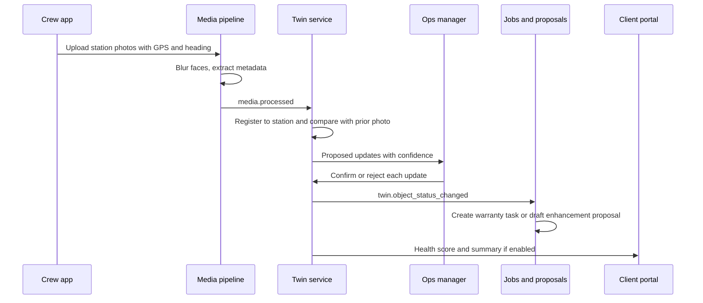

### 5.2 Closed-loop irrigation daily cycle (M-07)

1. At 02:00 local time, Hydro pulls ET0, rainfall and the forecast for each Property's weather source.
2. For each zone, it updates the soil water balance and blends in soil moisture sensor readings where they exist.
3. It computes tomorrow's required runtime and cycle-soak. It then checks ordinance windows, the water budget and the control mode.
4. `monitor` mode: the recommendation is stored and shown. `assist` mode: the change is pushed if within ±25%, otherwise queued for approval. `autopilot` mode: the change is pushed within constraints and logged in the digest.
5. After the controller runs, flow and run logs are ingested. Flow anomalies suspend the zone (with an expiry) and create a repair ticket.
6. Monthly, water applied and saved roll into the Property report and ESG metrics.

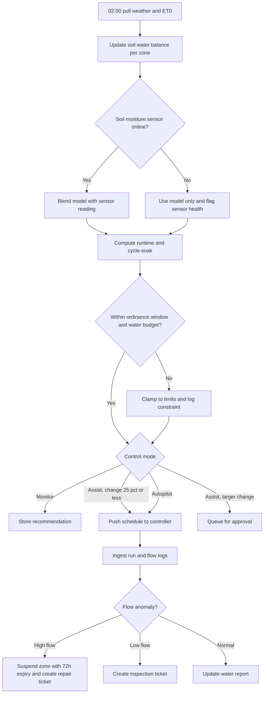

### 5.3 Robot alert becomes a crew task (M-05)

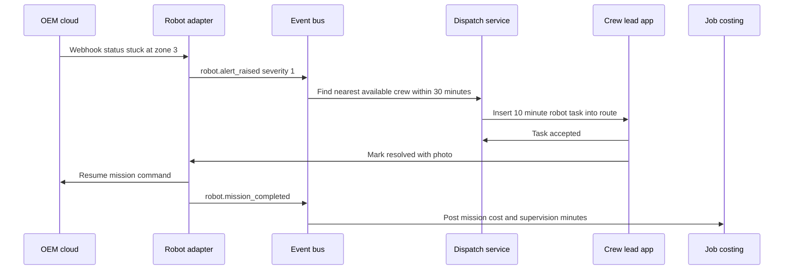

Rules: if no crew can reach the robot within 60 minutes, the alert escalates to `ops_manager` by push and SMS. Theft alarms skip crew dispatch and go straight to `owner` and `ops_manager` with the last known position.

### 5.4 Landscape Passport transfer at home sale (M-12)

1. The seller (a `client_residential` with a Rootline Home account) opens the Passport and taps "Selling your home?"
2. They create a share link for agents and buyers (30 days, chemical history optionally hidden).
3. At contract signing they start the transfer: buyer email, closing date, continuity-offer consent (yes or no).
4. On the closing date, the buyer gets a claim email, creates or signs in to Rootline Home, verifies the email and accepts.
5. Ownership moves. The seller keeps a read-only export of their own history for 90 days.
6. If continuity consent was given, the contributing Company receives a "New owner" lead with an introduction template.

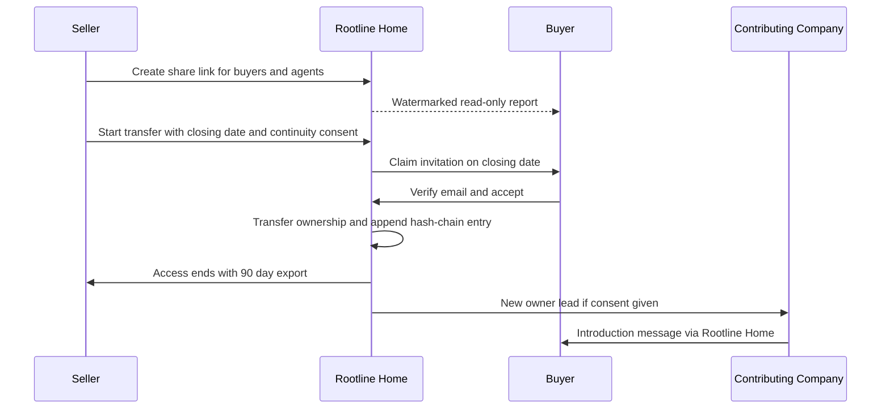

### 5.5 Working-capital offer (M-16)

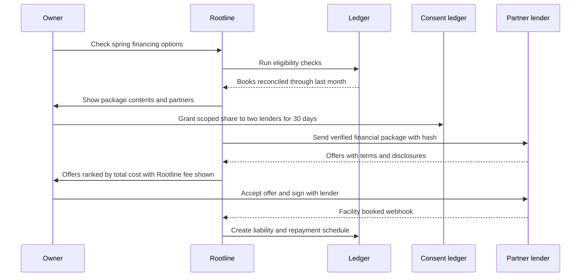

### 5.6 Turf-rebate case lifecycle (M-10)

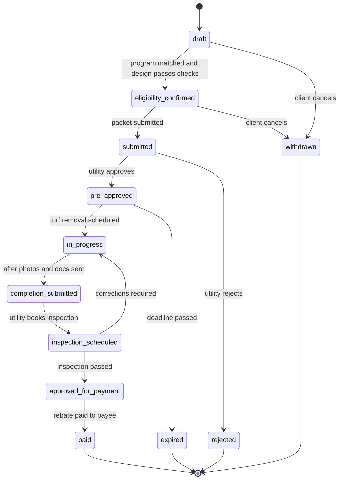

Validation rules: `in_progress` requires `pre_approved` if the program sets `pre_approval_required`. `completion_submitted` requires every photo slot in the program protocol to be filled with GPS inside the parcel. Deadline reminders go out at 30, 14 and 3 days before program deadlines.

### 5.7 Overflow work-package lifecycle (M-15)

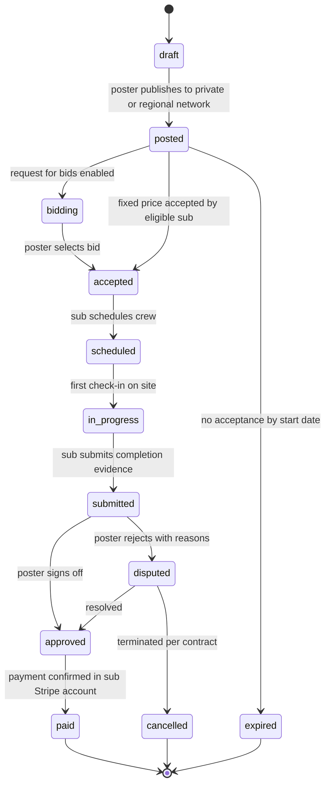

### 5.8 Autopilot trust ladder per domain (M-23)

Level names follow [17](17-ai-copilot-automation.md) section 4.1.2; the promotion gates are the domain-level gates of M-23, and per-tool tier caps still apply.

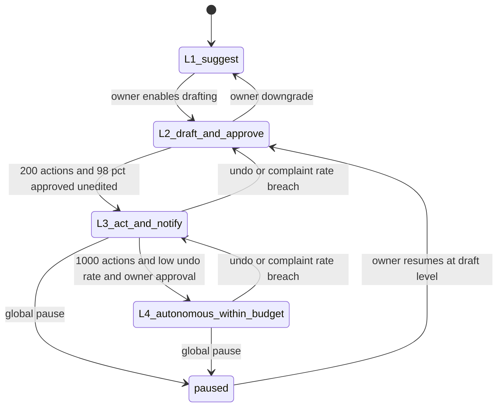

### 5.9 Nursery availability to plant reservation (M-14)

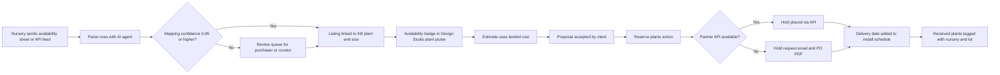

### 5.10 Plant Doctor triage to licensed prescription (M-08)

1. A technician opens Plant Doctor from the Visit (or from a twin plant pin). The app guides 3-5 shots and works offline.
2. On sync, identity resolves from the `plant_instance` or from the plant-ID model (top 3 taxa, constrained by Region).
3. The differential runs with KB host-pest data, degree-day priors, recent applications and weather.
4. If the top candidate is below 0.6 likelihood, or a regulated or quarantine pest is in the list, the case becomes `needs_review` and routes to the Company's licensed PHC lead (or a partner diagnostic lab).
5. Otherwise, the IPM ladder drafts cultural, mechanical, biological and, only if needed, chemical options. Chemical options come only from Price Book products whose label covers the site, plant and pest.
6. A licensed user approves (license number logged). The approval creates a priced PHC Proposal, a client explanation and a follow-up efficacy Visit. Nothing chemical is ever scheduled without step 6.

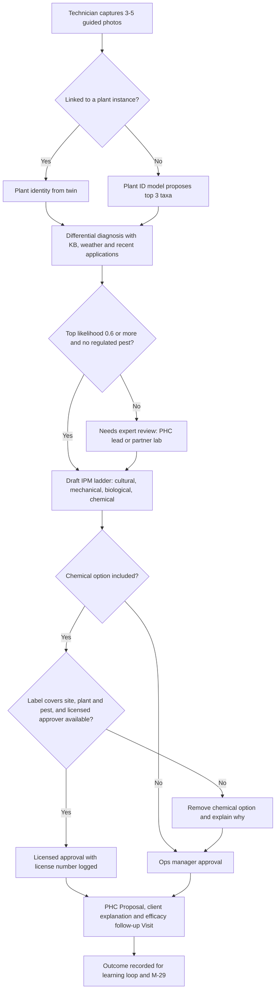

### 5.11 Innovation stage gates in the Platform Admin console (all bets)

Each bet is an `innovation_flag` record (section 7.4) that moves through the stages in section 4.3. `platform_owner` approves every promotion at the Innovation review. Any kill rule firing moves the bet to `shelved` automatically pending review; rails stay in production regardless.

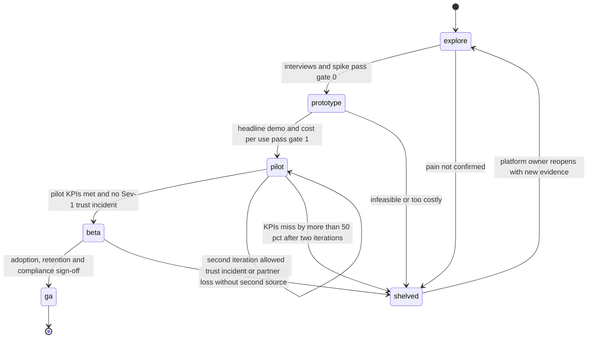

Validation rules: promotion requires the stage's exit evidence attached to the flag (interview notes, demo recording, pilot KPI snapshot, compliance sign-off). Tenant cohorts can only widen at promotion; narrowing is always allowed. A `shelved` bet's flag stays readable so design partners see an honest status and get the co-development credits promised in section 13 idea 11.

---

## 6. Screens and wireframes

### 6.1 Screen inventory

| ID | Screen | Surface | Primary roles | Bet | Tag |
|---|---|---|---|---|---|
| S-01 | Property Twin timeline and compare | Company web, tablet | `ops_manager`, `estimator`, `designer` | M-01 | [V2] |
| S-02 | Proposed updates queue | Company web | `ops_manager` | M-01 | [V2] |
| S-03 | Drone capture: plan, upload, process, extract | Company web | `estimator`, `designer` | M-02 | [V2] |
| S-04 | AR "See it in your yard" | Portal WebAR, Rootline Home | `client_residential`, `client_commercial` | M-03 | [V2] |
| S-05 | Crew Layout mode (stakeout and AR) | Crew app | `crew_lead`, `technician` | M-04 | [V2]/[V3] |
| S-06 | Robot fleet panel on the dispatch board | Company web | `ops_manager`, `office_manager` | M-05 | [V2] |
| S-07 | Robot ROI planner | Company web | `owner`, `ops_manager` | M-05 | [V2] |
| S-08 | Electrification planner | Company web | `owner` | M-06 | [V2] |
| S-09 | Hydro zone console | Company web, crew app | `ops_manager`, irrigation tech (`technician`) | M-07 | [V2] |
| S-10 | Plant Doctor | Crew app, Rootline Home | `technician`, `crew_lead`, homeowner | M-08 | [V2] |
| S-11 | Sustainability report builder and viewer | Company web, portal | `ops_manager`, `client_commercial` | M-09 | [V1]/[V2] |
| S-12 | Rebate case tracker | Company web, portal | `estimator`, `office_manager`, client | M-10 | [V1] |
| S-13 | Climate horizon toggle and Climate Risk review | Design Studio | `designer` | M-11 | [V2] |
| S-14 | Landscape Passport and transfer | Rootline Home | homeowner, buyer | M-12 | [V2] |
| S-15 | Plant Exchange availability and holds | Design Studio, purchasing | `designer`, `ops_manager` | M-14 | [V1]/[V2] |
| S-16 | Overflow marketplace | Company web | `owner`, `ops_manager`, `subcontractor` | M-15 | [V2] |
| S-17 | Financing offers | Company web | `owner` | M-16, M-17 | [V2] |
| S-18 | Franchise system dashboard | Organization console | franchisor admin | M-19 | [V2] |
| S-19 | Voice assistant overlay | Crew app | `technician`, `crew_lead` | M-20 | [V1]/[V2] |
| S-20 | Price Advisor panel | Estimate builder | `estimator` | M-22 | [V2] |
| S-21 | Autopilot control center and digest | Company web | `owner`, `office_manager`, `bookkeeper` | M-23 | [V2] |
| S-22 | Marketplace and MCP connections | Company web | `owner`, `office_manager` | M-24 | [V2] |
| S-23 | Innovation lab console (flags, pilots, gates) | Platform Admin | `platform_owner`, `platform_engineer` | All | [V1] |

### 6.2 Wireframe: Property Twin timeline (S-01)

```text
+------------------------------------------------------------------------------------------------+
| Rootline  > Properties > Westbrook Office Park (22.4 ac)          Health 82 (-3)   [Share] [..] |
+------------------------------------------------------------------------------------------------+
| LAYERS            |  MAP / 3D                                              | CHANGES (Jul vs Jun)|
| [x] Beds          |   +--------------------------------------------+       |  ! 2 plants declin. |
| [x] Turf          |   |        ____                                |       |    Emerald Green    |
| [x] Plants (1,214)|   |   ____/    \___   (!)  north berm          |       |    arborvitae       |
| [x] Irrigation    |   |  /  BED 14      \                          |       |    conf 0.87        |
| [ ] Lighting      |   | |   o o o  (!)(!)|      [cam] station 7    |       |    [Confirm][Reject]|
| [x] Photo stations|   |  \____    ______/                          |       |  ! Zone 6 flow -40% |
| [ ] Drone (May)   |   |       \__/      TURF B  (turf idx 0.71)    |       |    [Open ticket]    |
|                   |   +--------------------------------------------+       |  ~ Mulch thin, bed 3|
| CONDITION         |                                                        |    conf 0.64 (digest)|
|  Thriving  71%    |  TIMELINE                                              |                     |
|  OK        22%    |  Prev |Apr  May  Jun [Jul] Aug  Sep  Oct  Nov |  Next  | SUGGESTED ACTIONS   |
|  Stressed   5%    |        o    o    o    *                               |  Warranty watch x2  |
|  Declining  2%    |  [Compare: Jun 12  <|>  Jul 15 ]   [Play season]       |  Mulch 18 cu yd     |
|                   |                                                        |   -> Draft proposal |
+------------------------------------------------------------------------------------------------+
```

### 6.3 Wireframe: Crew Layout mode (S-05)

```text
+----------------------------------------+
| LAYOUT  Job #4471 Front beds    RTK FIX |
| accuracy 1.8 cm      satellites 21      |
+----------------------------------------+
|                                        |
|     (camera view of lawn)              |
|                                        |
|        .-~~~~~~~~-.   <- bed line      |
|      .'  o HY3   o  '.   (glowing)     |
|     /   o BX5  o BX5  \                |
|    |    [*] next: HY3 #2  |            |
|         -> 2.4 m  NE                   |
|                                        |
+----------------------------------------+
| NEXT POINT: Hydrangea 'Bobo' #3 cont.   |
| 2.4 m ahead, 12 deg right               |
| [ Placed here ]  [ Can't place - why? ] |
+----------------------------------------+
| Points 9/22 done   Deviations: 1 (rock) |
| [811 ticket: CLEAR, hand-dig zones]     |
| [ Voice ] [ List ] [ Map ] [ Done ]     |
+----------------------------------------+
```

### 6.4 Wireframe: Robot fleet panel on the dispatch board (S-06)

```text
+--------------------------------------------------------------------------------------------+
| DISPATCH  Tue Jun 13         Crews (7)   Robots (6)   Unassigned (4)       Weather: 0% rain |
+--------------------------------------------------------------------------------------------+
| ROBOTS                                                                                     |
| Name         Site                    Status      Tonight     Coverage 7d   Blade hrs  Alert |
| CEORA-01     Riverside Soccer Cplx   Mowing      22:00-05:00   98%          212/300   -     |
| CEORA-02     Riverside Soccer Cplx   STUCK z3    -              91%          188/300   SEV1  |
|              -> Task inserted: Crew 3 @ 07:15 (on route, +10 min)   [View] [Reassign]       |
| KRS-04       Westbrook Office Park   Charging    21:00-04:30   96%          77/250    -     |
| SCY-01       Maple Ridge HOA         Parked      Thu           88%          41/150    Rain  |
|                                                                                            |
| THIS WEEK  31.2 ac mowed   $11.20/ac loaded cost (gas crew $18.70/ac)   CO2 avoided 410 kg |
+--------------------------------------------------------------------------------------------+
```

### 6.5 Wireframe: Autopilot control center (S-21)

```text
+------------------------------------------------------------------------------------------+
| AUTOPILOT                                              [ PAUSE ALL AUTOPILOT ]            |
+------------------------------------------------------------------------------------------+
| Domain          Level             Last 30 days          Undo rate   Exceptions  Policy    |
| Invoicing       L3 Act+notify     1,904 actions          0.3%        11 open     [Edit]    |
| Collections     L3 Act+notify       612 reminders        0.0%         4 open     [Edit]    |
| Bank rec        L4 Autonomous     2,288 matches          0.1%         7 open     [Edit]    |
| AP bills        L2 Draft            143 drafts (97% ok)    -          2 open     [Promote?]|
| Scheduling      L3 Act+notify        88 moves            1.1%         0 open     [Edit]    |
| Client replies  L2 Draft            390 drafts (94% ok)    -          9 open     [Edit]    |
+------------------------------------------------------------------------------------------+
| TODAY'S DIGEST  214 actions   6 need you                                                  |
|  ! Henderson HOA replied "we're disputing visit 6/2" -> collections paused for this client |
|  ! New vendor "Valley Stone Supply" bill $3,940, no PO -> review                          |
|  Sampled for audit (5):  INV-20931 [ok] [undo]   BANK-8812 [ok] [undo]  ...               |
+------------------------------------------------------------------------------------------+
```

### 6.6 Wireframe: Landscape Passport transfer (S-14, Rootline Home)

```text
+--------------------------------------+
| 1427 Elm Hollow Dr      PASSPORT     |
| Verified records: 9 years            |
| Contributed by: Cedar & Stone        |
+--------------------------------------+
| [Plan] [Plants 186] [Irrigation 11z] |
| [Lighting] [Hardscape] [History]     |
+--------------------------------------+
| SELLING YOUR HOME?                   |
| 1. Share with buyers/agents          |
|    Link expires: [30 days v]         |
|    Hide chemical history [x]         |
|    [ Create link ]                   |
| 2. Transfer at closing               |
|    Buyer email [________________]    |
|    Closing date [ Jun 30     ]       |
|    Let Cedar & Stone introduce       |
|    themselves to the new owner [x]   |
|    [ Start transfer ]                |
+--------------------------------------+
| Integrity: chain verified (hash ok)  |
+--------------------------------------+
```

### 6.7 Wireframe: Plant Doctor (S-10, crew app)

```text
+----------------------------------------+
| PLANT DOCTOR        Visit #8812  [EN|ES]|
| 'Green Mountain' boxwood  (plant #B-114)|
| Zone 6a | Jun 24 | 1,180 GDD | dry 9 d  |
+----------------------------------------+
| PHOTOS  [whole][area][leaf top][under*] |
|         * requested: leaf underside     |
+----------------------------------------+
| LIKELY CAUSES                           |
| 1 Boxwood mite         0.71  ######.   |
|   evidence: stippling, bronze cast      |
|   confirm: white-paper tap test         |
| 2 Boxwood leafminer    0.14  #.....    |
| 3 Drought stress       0.09  #.....    |
|   (abiotic always checked)              |
+----------------------------------------+
| IPM PLAN (draft)                        |
| - Cultural: deep water 1x/wk in dry spell|
| - Chemical: horticultural oil, label OK |
|   for site/plant/pest  [needs license]  |
| Approver: R. Ortiz (QAL #12345) [Send]  |
+----------------------------------------+
| [Save offline]   [Escalate to lab]      |
+----------------------------------------+
```

### 6.8 Wireframe: Financing offers (S-17)

```text
+------------------------------------------------------------------------------------------+
| FINANCING  > Spring Ramp                                    Data share: 2 lenders, 30 days |
+------------------------------------------------------------------------------------------+
| READINESS   [ok] 24 months on Ledger  [ok] Books reconciled thru Feb  [ok] AR aging        |
|             [!] Suspense balance 1.4% of revenue (limit 2%)  -> [Fix in Ledger]            |
| PACKAGE     P&L + BS (24 mo), AR aging, backlog $612k (Apr-Nov), top-10 concentration 31%  |
|             hash 7f3a...c91  [Preview] [Revoke shares]                                    |
+------------------------------------------------------------------------------------------+
| OFFERS (ranked by total cost to you)                                                      |
|   Lender          Amount    Draw    Repay           Total repay  Est. APR  Rootline fee   |
| 1 Partner A       $90,000   Mar 1   Jun-Nov fixed   $96,300      ~14%      $900 (disclosed)|
| 2 Partner B       $90,000   Mar 1   12% of receipts $98,100      ~18%      $1,350          |
|   Disclosures: [State commercial financing disclosure] [Prepayment terms]                 |
|   [Compare]  [Accept with Partner A -> sign on lender site]                               |
+------------------------------------------------------------------------------------------+
| Rootline is not a lender. Offers, approvals and any adverse-action notices come from the |
| lender. Numbers above are illustrative.                                                   |
+------------------------------------------------------------------------------------------+
```

### 6.9 Wireframe: Innovation lab console (S-23, Platform Admin)

```text
+------------------------------------------------------------------------------------------+
| PLATFORM ADMIN > Innovation lab                      Next review: Jan 12                  |
+------------------------------------------------------------------------------------------+
| Bet                     Stage      Cohort          Pilot KPI (target)        Kill rule    |
| M-01 Twin timeline      2 Pilot    9 tenants       precision 0.74 (0.70) ok  2 iter left |
| M-07 Hydro assist       2 Pilot    6 tenants       savings 12% (15%) !       1 iter left |
| M-20 Voice assistant    3 Beta     140 tenants     voice notes 46% (40%) ok  -           |
| M-15 Overflow market    1 Proto    internal        legal review open         -           |
| M-21 Gen. video         0 Explore  -               cost/30s 310 cr (<200)    shelve?     |
+------------------------------------------------------------------------------------------+
| OPEN DECISIONS          1 ready to promote (M-20), 1 at risk (M-07), 1 kill rule (M-21)   |
| RAILS R-01..R-14        13 shipped, 1 in progress (R-04 photo stations)                   |
| TRUST INCIDENTS (90 d)  0 Sev-1, 2 Sev-3                                                  |
| [Promote M-20 to GA] [Extend M-07 pilot] [Shelve M-21] [Export review pack]               |
+------------------------------------------------------------------------------------------+
```

---

## 7. Data model

The moonshots add four families of entities to the core model in [20](20-architecture-security.md): the **physical layer** (twin, devices, robots, captures), **programs** (ESG, rebates, credits, passports), **networks** (nursery exchange, overflow packages, community) and **trust and finance** (data-share grants, financing offers, autopilot policies, marketplace apps). Every tenant-owned table carries `tenant_id` with row-level security. Platform-owned tables (programs, nursery partners, climate projections) have no `tenant_id` and are read-only to tenants.

### 7.1 Physical layer: twin, devices, robots

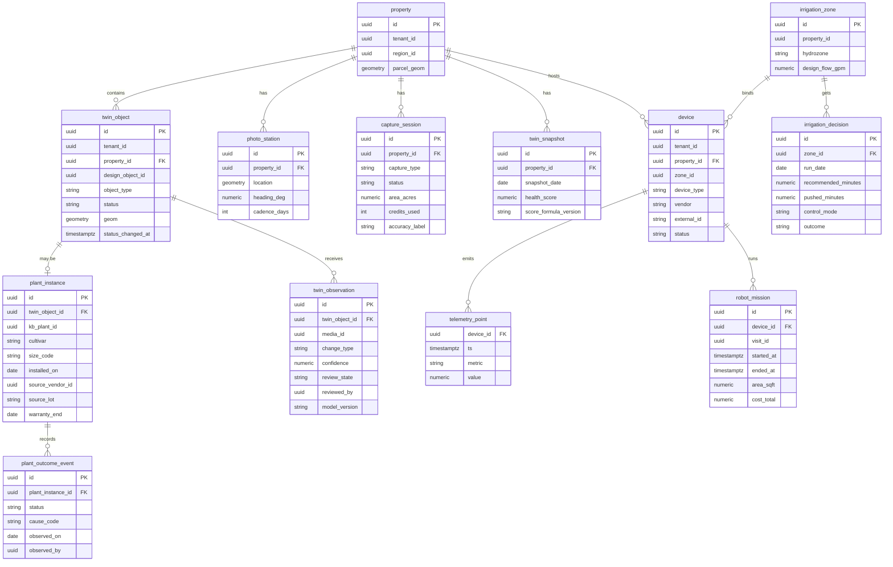

### 7.2 Programs and homeowner network

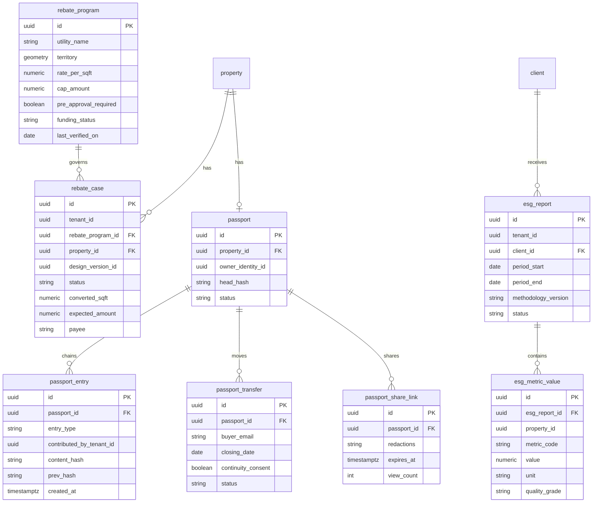

### 7.3 Networks, finance, autopilot and ecosystem

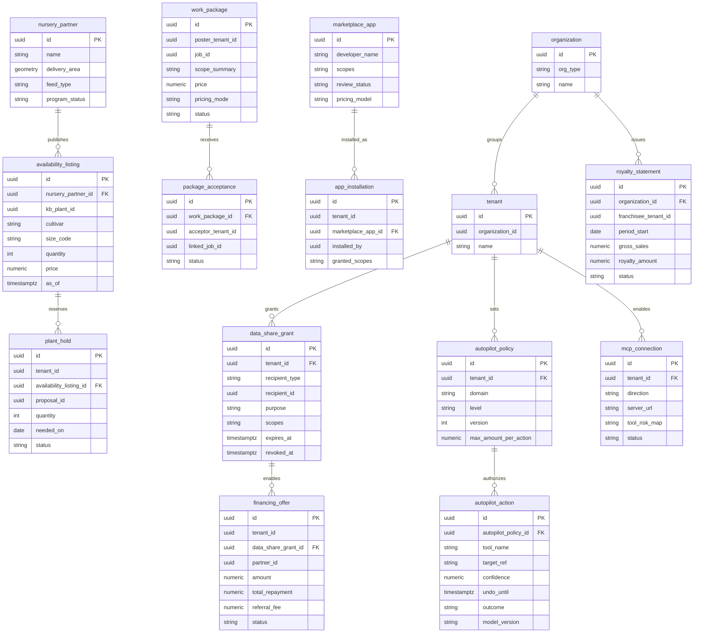

### 7.4 Additional entities (not diagrammed)

| Entity | Key fields | Notes |
|---|---|---|
| `robot_work_zone` | id, device_id, property_id, geom, no_go_geoms, max_slope_pct, source (`rootline`, `oem`), diff_status | Diff between Rootline turf polygons and OEM boundaries |
| `jurisdiction_rule` | id, jurisdiction_geom, rule_type (`sale_ban`, `use_ban`, `seasonal_use_ban`, `noise_hours`, `watering_days`, `zone0`), equipment_class, effective_on, source_url, last_verified_on | Platform-curated. Drives M-06, M-07 and M-27 constraints |
| `incentive_program` | id, sponsor, territory, eligibility_json, amount_rule, deadline, status, last_verified_on | Equipment incentives (M-06) |
| `climate_projection` | id, region_id, horizon (`2040`, `2060`), scenario, projected_zone, heat_days, dry_spell_days, heavy_rain_days, source_version | Curated (M-11) |
| `plant_climate_envelope` | kb_plant_id, min_temp_f, heat_tolerance, drought_class, wet_tolerance, chill_hours | Curated (M-11) |
| `evidence_score` | kb_plant_id, region_id, installs_n, companies_n, survival_2y_raw, survival_2y_adjusted, ci_low, ci_high, computed_at | Aggregated (M-29), threshold-gated |
| `diagnosis_case` | id, tenant_id, plant_instance_id, media_ids, candidates_json, top_confidence, status (`auto`, `needs_review`, `confirmed`, `rejected`), reviewer_id, prescription_id | M-08 |
| `stormwater_feature` | id, property_id, feature_type, contributing_area_sqft, design_storm_in, storage_gal, credit_program_id, credit_expires_on | M-28 |
| `wildfire_inspection` | id, property_id, inspected_on, zone_results_json, photo_ids, report_media_id | M-27 |
| `cpo_listing` | id, tenant_id, asset_id, price, hours_verified, badge_level, status | M-17 |
| `insurance_referral` | id, tenant_id, partner_id, product, data_share_grant_id, status | M-18 |
| `voice_interaction` | id, user_id, visit_id, intent, language, confidence, action_ref, audio_retained (bool) | M-20. Audio discarded by default |
| `price_recommendation` | id, estimate_line_id, band_low, band_high, win_prob_json, drivers_json, model_version, followed (bool) | M-22 |
| `academy_enrollment` / `certification_award` | user_id, course_id, status, score, credential_code, expires_on | M-25 |
| `community_template` | id, author_tenant_id, template_type, payload_ref, rating, price | M-26 |
| `innovation_flag` | key, stage (0-4), status (`active`, `shelved`), cohort_rule, kill_criteria, exit_evidence_refs, owner, last_review_on | Platform Admin (S-23), flow 5.11 |
| `robot_site_survey` | id, property_id, boundary_tech, rtk_coverage, cell_signal_dbm, dock_power (bool), theft_risk (`low`, `medium`, `high`), use_hours_json, max_slope_pct, result (`ready`, `ready_with_work`, `not_suitable`) | M-05 rule 10 |
| `royalty_rule` | id, organization_id, basis (`invoiced`, `collected`), rate_by_category_json, minimum_amount, tech_fee_per_seat, marketing_fund_pct, effective_from | M-19. Statements reference the rule version used |
| `visit_exertion` | visit_template_id, exertion_class (`light`, `moderate`, `heavy`), shade_factor | M-31 route reshuffle |
| `package_payment` | id, work_package_id, sub_invoice_id, poster_bill_id, amount, retainage_amount, stripe_payment_intent_ref, status | M-15 rules 6-7. Links both tenants' Ledger documents |
| `wallet_authorization` | id, home_identity_id, tenant_id, payment_method_ref, authorized_at, revoked_at | M-13 Wallet [V3]. One row per homeowner-Company authorization |

---

## 8. Integrations, APIs and events

### 8.1 External services (candidates; verify terms, APIs and pricing before contracting)

| Category | Candidates | Used by | Integration notes | Tag |
|---|---|---|---|---|
| Robotic mower OEMs | Husqvarna (Automower Connect API; CEORA), Toro, John Deere, Kress/Positec, Scythe, Greenzie, Electric Sheep, Segway Navimow, Mammotion | M-05 | `robot_adapter` per OEM; webhooks or polling; OAuth where offered; partner agreements for non-public APIs | [V2] |
| Smart controllers | Hunter Hydrawise, Rachio, Rain Bird IQ4, Weathermatic | M-07 | Existing adapters from [14](14-service-line-modules.md); respect documented rate limits ([Hunter](https://www.hunterirrigation.com/support/hydrawise-api-information), [rachiopy](https://rachiopy.readthedocs.io/en/latest/zone.html), [Rain Bird](https://www.rainbird.com/professionals/iq4-product-development-update-new-bms-Integration)) | [V1]/[V2] |
| Soil moisture and weather sensors | LoRaWAN probes and gateways via a network server (e.g., The Things Stack or a cellular vendor cloud); personal weather stations with APIs | M-07, M-31 | Device registry R-05; MQTT/HTTPS ingest into `telemetry_point` | [V2] |
| Soil data | USDA NRCS SSURGO via Soil Data Access (US); Canadian soil datasets (verify) | M-07 | Cached per Property at geocode | [V2] |
| Weather and climate | Commercial weather API for ET0 and forecasts; NOAA normals; downscaled CMIP6 (NEX-GDDP-CMIP6, LOCA2) | M-07, M-11, M-31 | Climate data processed offline by curators | [V2] |
| Drone and photogrammetry | OpenDroneMap (self-hosted); Pix4D or DroneDeploy APIs (verify); KML/KMZ flight plans | M-02 | Python workers with GPUs; COG and 3D tiles | [V2] |
| AR and positioning | ARKit, ARCore (Geospatial API), RTK receivers over Bluetooth, NTRIP correction services | M-03, M-04 | Expo native modules ([05](05-field-crew-mobile-app.md)) | [V2]/[V3] |
| Generative video and voice | Video generation via AI Gateway (Veo, Sora, Runway class; verify); TTS and STT vendors; C2PA signing | M-21, M-20 | Model routing per task, credits metering | [V2]/[V3] |
| Plant ID and labels | Pl@ntNet API, Kindwise plant.id (verify); EPA PPLS and PMRA label data (verify access) | M-08 | Expert-in-the-loop; label lookups cached with dates | [V2] |
| Tree benefits | i-Tree methodology and tools (USDA Forest Service; verify licensing and API) | M-09 | Allometric equations by species | [V2] |
| Parcels and imagery | Regrid ([Regrid API](https://regrid.com/api)), USGS 3DEP, Nearmap/EagleView (optional) | M-01, M-02, M-30 | Existing from [10](10-design-studio.md) | [MVP]/[V1] |
| Banking and lending | Plaid (bank balances), partner lenders, Stripe Capital availability in the Company's own account (verify) | M-16, M-17 | Data-share grants; lender webhooks for booked facilities | [V2] pilot, [V3] GA |
| Payments (homeowner wallet and B2B) | Stripe Connect on each Company's own full-dashboard account ([08](08-payments-stripe.md)); PaymentMethod cloning from the platform to connected accounts for the Wallet (verify support); ACH debit for B2B package payments | M-13, M-15 | Direct charges on the receiving Company's account; no Rootline application fee on B2B packages | [V2]/[V3] |
| Public data and reporting | EDDMapS and state invasive-species reporting portals; public procurement notice feeds (verify terms per source) | Section 13 ideas 16 and 18 | Opt-in, per-report consent; coarse location | [V2] |
| Insurance | Licensed agency partners and carriers with quoting APIs (verify) | M-18 | Referral model first | [V2] |
| Rebates and utilities | Utility rebate portals (form submission), utility APIs where offered, AMI meter data (rare) | M-10, M-07 | Browser-automation agent with human final review | [V1]/[V2] |
| Nurseries | Nursery Partner API ([22](22-business-model-pricing-gtm.md)); emailed availability sheets | M-14 | Inbound email parsing; EDI where growers support it | [V1]/[V2] |
| Ecosystem | Public REST API (OpenAPI 3.1; GraphQL is not planned, per [17](17-ai-copilot-automation.md) section 4.10.1), webhooks, MCP server ([MCP specification](https://modelcontextprotocol.io/specification)) | M-24 | OAuth apps with colon-notation scopes ([20](20-architecture-security.md) section 4.7.3) intersected with [02](02-personas-roles-permissions.md) permissions | [MVP]/[V1]/[V2] |

### 8.2 Domain events emitted

Event naming follows [20](20-architecture-security.md) (`entity.action`, published through the transactional outbox).

| Event | Payload highlights | Typical consumers |
|---|---|---|
| `twin.observation_proposed` | property_id, twin_object_id, change_type, confidence | Ops queue, digest builder |
| `twin.object_status_changed` | twin_object_id, from, to, cause | Warranty, Proposals, Passport, M-29 |
| `twin.health_score_updated` | property_id, score, delta | Portal, reports |
| `capture.processed` | capture_session_id, outputs, accuracy_label | Design Studio, twin |
| `robot.alert_raised` | device_id, severity, alert_type, position | Dispatch, notifications |
| `robot.mission_completed` | mission_id, area_sqft, energy_kwh, duration | Job costing, twin, ESG |
| `irrigation.schedule_recommended` / `irrigation.schedule_pushed` | zone_id, minutes, mode | Approval Inbox, audit |
| `irrigation.anomaly_detected` | zone_id, flow_ratio, action_taken | Repair tickets, portal |
| `diagnosis.case_created` / `diagnosis.case_confirmed` | case_id, top_candidate, confidence | PHC proposals, M-29 |
| `esg.report_published` | report_id, client_id, methodology_version | Portal, email |
| `rebate.case_status_changed` | case_id, from, to | Scheduling guard, AR (if assigned) |
| `passport.entry_added` / `passport.transferred` | passport_id, entry_type or buyer ref | Rootline Home, continuity lead |
| `kb.nursery_listing_updated` (owned and emitted by the KB per [12](12-plant-knowledge-base.md) section 8.2; M-14 live feeds publish listing changes through it rather than a separate event) / `plant.hold_status_changed` | listing_id or hold_id, quantity, status | Design Studio badges, availability aggregates and picker chips, purchasing |
| `work_package.status_changed` | package_id, from, to | Both tenants' Jobs, payments |
| `data_share.granted` / `data_share.revoked` | grant_id, recipient, scopes | Partner gateway |
| `financing.offer_received` / `financing.facility_booked` | offer_id, amount, terms | Owner notifications, Ledger |
| `autopilot.action_taken` / `autopilot.action_undone` / `autopilot.level_changed` | policy_id, tool, target, confidence | Digest, audit, trust ladder |
| `app.installed` / `mcp.tool_invoked` | app or server, scopes, tool, risk tier | Audit, billing |
| `innovation.stage_changed` | flag key, from stage, to stage | Platform Admin, release notes |
| `royalty.statement_issued` | organization_id, franchisee_tenant_id, period, amount, rule version | Franchisee AP (draft vendor bill), franchisor AR |
| `heat.schedule_adjusted` | route_id, date, threshold, changes, approved_by | Crew app notifications, compliance log ([15](15-team-hr-payroll.md)) |
| `robot.site_survey_completed` | property_id, result, required_work | ROI Planner, Proposals (site-prep lines) |

### 8.3 Events consumed

`visit.completed`, `media.processed`, `proposal.accepted`, `design.version_published`, `chemical_application.recorded`, `invoice.issued`, `payment.succeeded`, `period.closed`, `timesheet.approved`, `kb.release_published`, `purchase_order.received` and `service_agreement.activated` (all defined in [20](20-architecture-security.md)).

### 8.4 Outbound webhooks for partners

Partners (lenders, nurseries, OEMs, app developers) receive signed webhooks (HMAC-SHA256, timestamped, replay window of 5 minutes, retries with exponential backoff for 24 h). Delivery is scoped to their `data_share_grant` or app installation. Revoking a grant stops deliveries within 60 seconds and triggers a `data_share.revoked` notification to the partner.

---

## 9. Permissions

Legend: **F** full, **A** approve, **E** create or edit, **V** view, **O** own records only, **-** none. Column abbreviations use the role keys from [02](02-personas-roles-permissions.md). Platform staff columns refer to platform-owned content and operations only; they never get tenant data access except through consented support access ([02](02-personas-roles-permissions.md)).

| Capability | `owner` | `office_manager` | `estimator` | `designer` | `ops_manager` | `crew_lead` | `technician` | `bookkeeper` | `subcontractor` | `client_residential` | `client_commercial` | `platform_owner` | `platform_curator` | `platform_finance` |
|---|---|---|---|---|---|---|---|---|---|---|---|---|---|---|
| View Property Twin and timeline | F | V | V | V | F | V (assigned) | V (assigned) | - | V (package scope) | V (if enabled) | V (if enabled) | - | - | - |
| Confirm twin updates | F | - | E | E | A | E | - | - | - | - | - | - | - | - |
| Run drone capture / processing (credits) | F | - | E | E | E | - | - | - | - | - | - | - | - | - |
| Layout mode and as-built capture | F | - | - | V | F | E | E | - | E (package) | - | - | - | - | - |
| Robot fleet control (start, park, geofence) | F | V | - | - | A | E (assigned) | - | - | - | V (status) | V (status) | - | - | - |
| Irrigation control mode change | F | - | - | - | A | E (monitor/assist) | - | - | - | A (consent) | A (consent) | - | - | - |
| Approve chemical prescription (licensed only) | A (if licensed) | - | - | - | A (if licensed) | A (if licensed) | - | - | - | - | - | - | - | - |
| Publish ESG report | F | E | - | - | A | - | - | V | - | - | V | - | - | - |
| Rebate cases | F | E | E | E | E | V | V (photos) | V | - | V (own) | V (own) | - | E (program library) | - |
| Climate and evidence curation | - | - | - | - | - | - | - | - | - | - | - | A | F | - |
| Passport contribution settings | F | - | - | - | - | - | - | - | - | - | - | - | - | - |
| Passport share and transfer | - | - | - | - | - | - | - | - | - | F (own) | F (own) | - | - | - |
| Nursery holds | F | E | E | E | E | - | - | V | - | - | - | - | - | V (programs) |
| Post / accept overflow packages | F | E | E | - | E | - | - | V | E (accept) | - | - | - | - | - |
| Grant partner data shares (finance, insurance) | F | - | - | - | - | - | - | V | - | - | - | - | - | - |
| View financing offers | F | - | - | - | - | - | - | V | - | - | - | - | - | V (program) |
| Autopilot policy levels | F | E (non-financial) | - | - | E (scheduling) | - | - | E (bank rec, AP) | - | - | - | - | - | - |
| Undo autopilot actions | F | E | - | - | E | - | - | E | - | - | - | - | - | - |
| Install marketplace apps / MCP servers | F | E (if allowed) | - | - | - | - | - | - | - | - | - | - | - | - |
| Price Advisor | V | V | V | V | V | - | - | - | - | - | - | - | - | - |
| Voice assistant actions | F | F | F | F | F | E | E | - | O | - | - | - | - | - |
| Innovation flags and stage gates | - | - | - | - | - | - | - | - | - | - | - | F | V | V |

Additional rules:

1. **Licensing gates override roles.** Chemical prescription approval requires an active applicator certification on the user's HR record ([15](15-team-hr-payroll.md)), whatever the role. Drone processing for flights the tenant performed requires a pilot certificate on file for the pilot listed.
2. **Field masking still applies.** Price Advisor drivers that reveal cost or margin are masked for roles without cost visibility ([02](02-personas-roles-permissions.md)).
3. **`platform_support`** can view integration health (device last seen, adapter errors, webhook failures) without tenant business data, and gets more only through consented support sessions. **`platform_engineer`** manages adapters, model versions and flags.
4. **Franchisor admins** (organization role) see only categories covered by recorded data-sharing agreements (M-19).
5. **Client-side approvals are scoped.** A `client_commercial` contact can approve irrigation control modes or view robot status only for Properties they are linked to, and only if their contact role includes approvals ([06](06-customer-portal.md)). Additional client contacts (a spouse, a tenant, a billing contact) inherit nothing from this table unless the primary contact grants it.

**Permission keys for custom roles.** Each capability row above is backed by granular permission keys in the taxonomy of [02](02-personas-roles-permissions.md), so a Company can compose custom roles (for example an "Irrigation Manager" or a "Robot Fleet Tech"). The keys this document adds:

| Key | Capability | Risk tier ([17](17-ai-copilot-automation.md)) | Default roles |
|---|---|---|---|
| `twin.view`, `twin.confirm_update` | View the twin; confirm or reject proposed updates | low / medium | View: most staff roles per the matrix. Confirm: `owner`, `ops_manager`, `estimator`, `designer`, `crew_lead` |
| `capture.run` | Start drone processing (spends credits) | medium | `owner`, `estimator`, `designer`, `ops_manager` |
| `layout.use`, `layout.override_accuracy_gate` | Use Layout mode; confirm a control-point check instead of RTK fix | low / high | `crew_lead`, `technician` / `owner`, `ops_manager` |
| `robot.view`, `robot.command`, `robot.geofence.approve` | See status; start, park or pause; approve geofences | low / medium / high | `ops_manager`, `crew_lead` (assigned) / `owner`, `ops_manager` |
| `irrigation.mode.set` | Change `monitor`, `assist` or `autopilot` per Property | high | `owner`, `ops_manager` |
| `phc.prescription.approve` | Approve chemical prescriptions (also requires an active applicator license) | high | `owner`, `ops_manager`, `crew_lead` (licensed only) |
| `esg.report.publish` | Publish an ESG report to a Client | medium | `owner`, `ops_manager`, `office_manager` |
| `rebate.case.manage` | Create and submit rebate cases | medium | `owner`, `office_manager`, `estimator`, `designer`, `ops_manager` |
| `passport.contribution.configure` | Set the Company's Passport contribution level | high | `owner` |
| `nursery.hold.create` | Place plant holds and reservations | medium | `owner`, `office_manager`, `estimator`, `designer`, `ops_manager` |
| `overflow.package.post`, `overflow.package.accept` | Post or accept work packages | medium | `owner`, `ops_manager`, `office_manager`, `estimator` / `subcontractor` (accept) |
| `datashare.grant` | Grant or revoke partner data shares | high | `owner` only (not delegable) |
| `financing.offers.view` | See financing and insurance offers | medium | `owner`, `bookkeeper` |
| `autopilot.policy.edit:<domain>`, `autopilot.undo` | Change Autopilot level per domain; undo actions | high / medium | `owner` (+ per-domain delegation shown in the matrix) |
| `marketplace.app.install`, `mcp.server.enable` | Install apps; enable external MCP servers | high | `owner` (+ `office_manager` if the owner allows) |
| `pricing.advisor.view` | See Price Advisor bands and drivers (cost drivers masked without cost visibility) | low | `owner`, `office_manager`, `estimator`, `designer`, `ops_manager` |
| `voice.assistant.use` | Use the voice assistant (actions still check their own keys) | low | Field and office roles (not `bookkeeper` by default); `subcontractor` on its own package records |

Keys marked "not delegable" cannot be granted to a custom role; they stay with `owner`. Platform keys (`innovation.flag.manage`, `kb.climate.publish`, `kb.evidence.publish`, `program_library.edit`) belong to platform roles only: `platform_owner` and `platform_engineer` for flags, `platform_curator` for KB, climate, evidence and program libraries, with `platform_owner` approval on releases.

---

## 10. AI opportunities across the portfolio

The moonshots are where Rootline's AI strategy ([17](17-ai-copilot-automation.md)) meets the physical world. All model calls go through the provider-agnostic AI Gateway, are metered as AI credits and are evaluated against golden sets before rollout.

### 10.1 Capability map

| AI capability | Model family (routing via AI Gateway) | Bets | Offline/edge? | Key eval metric | Guardrail |
|---|---|---|---|---|---|
| Photo registration and change detection | Segmentation (SAM-family), learned image comparators, monocular depth | M-01, M-02, M-27 | Server | Precision of confirmed changes (target ≥ 0.7 at pilot exit) | Human confirmation; two-signal rule |
| Object extraction from aerial/drone | Segmentation + classification on orthos/DSM | M-02, M-30 | Server (GPU) | Area error vs measured (≤ 5% on beds and turf) | "Proposed" until accepted |
| Plant identification and diagnosis | Vision-language models + specialist plant ID APIs + KB retrieval | M-08, M-13 | Partial (ID) | Top-3 accuracy on regional golden sets; expert override rate | Confidence gates; licensed sign-off |
| Water balance and anomaly detection | Deterministic models + time-series anomaly detection | M-07 | Server | False suspension rate (< 1 per 100 zone-months) | Control modes, expiry on suspensions |
| Robot ROI and electrification TCO | Deterministic models with tenant-calibrated inputs | M-05, M-06 | Server | Forecast vs actual payback in pilots | Assumptions visible and editable |
| Video generation under geometry constraints | Video diffusion with control inputs | M-21 | Server | Geometry-consistency score (IoU ≥ 0.85) | Watermark, C2PA, fallback to render |
| Speech and intent | On-device STT + small intent model; cloud LLM for complex | M-20 | Yes (top 40 intents) | Intent accuracy in field audio (≥ 95% on top intents) | Risk-tiered confirmation |
| Pricing and win probability | Gradient-boosted models per tenant; pooled fallback | M-22 | Server | Calibration (Brier score); revenue lift in A/B | Cost floor; antitrust design |
| Agentic back office | Frontier LLM (Claude family) tool use over the Action Layer | M-23, M-24, M-10 | Server | Approved-unedited rate; undo rate | Trust ladder; budgets; audit |
| Document and form understanding | LLM document extraction | M-10, M-14, M-16 | Server | Field-level accuracy on program forms and nursery sheets | Human review below thresholds |
| Climate and evidence analytics | Statistical models (hierarchical survival models) | M-11, M-29 | Batch | Calibration against held-out outcomes | Curator approval via KB release |

### 10.2 Indicative AI credit costs (estimates; validate against the rate card in [22](22-business-model-pricing-gtm.md))

| Action | Indicative credits | Notes |
|---|---|---|
| Twin change detection, per station-matched photo pair | 1-2 | Batched nightly |
| Drone processing, per acre (2D ortho + DSM) | 40-80 | GPU minutes dominate. 3D splat adds 50% or more |
| Plant Doctor case (3-5 photos, differential) | 5-10 | Includes KB retrieval and follow-up question |
| Design Film, render-only 30 s 1080p | about 20 | Server render |
| Design Film, generative-enhanced 30 s | 150-400 | Depends on video model vendor |
| Autopilot action (average) | 0.2-1 | Most actions are deterministic tool calls, and LLM use is short |
| Voice interaction (cloud-resolved) | 0.2-0.5 | On-device intents cost 0 |

The published rate card, plan allowances (300 / 2,000 / 6,000 credits per month on Starter / Grow / Pro) and packs are owned by [22](22-business-model-pricing-gtm.md) section 4.4.1. Fractional credits accrue on the credit ledger and settle daily, rounded up, and actions over 20 credits quote an upper bound before running ([17](17-ai-copilot-automation.md) section 4.11.5). Rows above that are not on the rate card are planning estimates to be added there before launch.

### 10.3 The physical-world evaluation harness

Physical-world AI fails in ways chat AI does not: snow hides the twin, leaf-off trees look dead, a dog in the frame triggers "new object", and Spanish in a noisy truck cab confuses recognition. The harness adds:

1. **Seasonal golden sets** per Region (spring flush, summer drought, fall color, dormant season) for change detection and diagnosis.
2. **Phenology-aware priors.** The KB records deciduous, semi-evergreen and fall-color traits so that leaf drop is not flagged as death between October and April in deciduous plants.
3. **Field audio sets** recorded with real crews (with consent and compensation) next to running equipment, in English, Spanish and mixed speech.
4. **Shadow mode first.** Every model runs in shadow mode for at least 4 weeks with design partners before it can surface results to users.

---

## 11. Edge cases, compliance and risks

### 11.1 Regulatory and legal

| Area | Risk or rule (verify all) | Bets | Mitigation |
|---|---|---|---|
| Drones | US: FAA Part 107 certificate, Remote ID, airspace authorization, operations-over-people limits; FCC Covered List exposure for some foreign-made hardware (section 2.3 headwinds). Canada: Transport Canada pilot certificates and registration. State drone-privacy statutes | M-02 | Certification tracking, pre-flight checklist, parcel-only outputs, tenant attestation, no Rootline-operated flights until the [V3] pilot network has its own compliance program |
| Pesticides | FIFRA ("the label is the law"), state applicator licensing, notification registries, local restrictions ([Beyond Pesticides factsheet](https://beyondpesticides.org/assets/media/documents/lawn/factsheets/STATE%20NOTFICATION%20LAWS%20-%20LAWN.pdf), [EPA certification standards](https://www.epa.gov/pesticide-worker-safety/certification-standards-pesticide-applicators)) | M-08, M-12 | Label lookups, licensed sign-off, jurisdiction rules from [14](14-service-line-modules.md), no auto-scheduling of applications |
| Commercial lending | ECOA/Regulation B adverse action; state commercial-financing disclosure laws (e.g., California, New York); CFPB small-business data rules (Section 1071, compliance dates shifting); UDAAP-style marketing scrutiny | M-16, M-17 | Lenders decide and send notices; Rootline displays standardized disclosures; marketing claims reviewed by counsel; offers ranked by cost |
| Insurance | State producer licensing; referral rules; anti-rebating laws | M-18 | Licensed agency partner at [V2]; legal review before any bundled discounts |
| Antitrust | Algorithmic pricing scrutiny; information exchange among competitors; wage-fixing and no-poach enforcement in labor markets | M-22, M-15, M-26, M-14 | Lagged, aggregated, threshold-gated data; no competitor-specific prices; community moderation; Rootline (not tenants) negotiates nursery programs; counsel review |
| Labor and immigration | Worker classification (e.g., California's ABC test), joint-employer exposure, H-2B employer and worksite restrictions ([DOL H-2B](https://www.dol.gov/agencies/whd/immigration/h2b)) | M-15 | Work packages to businesses only; attestations; no worker lending; templates reviewed per state |
| Biometric and worker privacy | Illinois BIPA and similar laws; employee monitoring disclosure rules | M-31, M-20 | Opt-in wearables, raw data on device, written consent, no audio retention by default |
| Marketing claims | FTC Green Guides for environmental claims; AI-generated media disclosure expectations | M-09, M-21 | Methodology notes, data-quality grades, no "carbon neutral" claims; watermark plus C2PA |
| TCPA and 10DLC | Consent for texts and calls, including AI voices ([FCC 24-17](https://docs.fcc.gov/public/attachments/FCC-24-17A1.pdf)) | M-13, M-12, M-30 | Consent ledger; email/in-app only for continuity offers; no SMS prospecting |
| Robotics safety | Robotic mower safety standards (IEC/UL 60335-2-107), public-space operation, local noise ordinances | M-05 | Geofence approval, signage checklist, never override OEM safety stops, night-mowing limited to sites where allowed |
| OEM and device data terms | Robot, controller and sensor APIs come with terms that limit storage, resale or cross-customer use of telemetry; some are partner-only | M-05, M-07 | Adapter records the OEM terms version; storage follows the terms (M-05 rule 11); no cross-tenant models on telemetry an OEM forbids storing |
| Utility locates | 811 laws: excavators must call before digging, and hand-dig tolerance zones apply | M-04 | Banner and ticket status; never present AR as a locate |
| Water rules | Watering-day ordinances, drought emergency restrictions, nonfunctional turf bans | M-07, M-10 | Hard constraints in the water model; jurisdiction rules with "last verified" dates |
| Real estate | Seller disclosure obligations differ by state; MLS rules on attachments | M-12 | Passport labeled "records, not a disclosure or inspection"; seller controls sharing; counsel review per state |
| Privacy (general) | GDPR/CCPA/PIPEDA rights for homeowners and employees; data portability | All | Consent ledger, export tools, deletion workflows that respect Ledger retention rules ([20](20-architecture-security.md)) |

### 11.2 Technical edge cases

| Situation | Expected behavior |
|---|---|
| Snow cover or leaf-off season | Twin change detection pauses for snow-covered stations (detected from the image). Deciduous plants are not flagged as dead in the dormant window. "Seasonal pause" is shown on the timeline |
| GPS error under canopy or near buildings | Photos with accuracy > 15 m do not register to stations. RTK float disables precision layout. Fallbacks are offered |
| Property re-graded or redesigned | A new Design version starts a new twin baseline. History stays linked through object IDs where objects persist |
| Sensor drift or a dead probe | Plausibility checks (stuck values, out-of-range readings, no response to irrigation) trigger a sensor health alert. The model falls back to the soil water balance |
| OEM API outage or breaking change | Adapters run contract tests nightly. Outages switch robots to "OEM-managed" mode with a banner. Missions continue on the OEM's own schedule |
| Robot theft or vandalism | Geofence breach alerts, last known position, police report packet. Theft events feed site-suitability scores |
| Controller rate limits (e.g., Hydrawise) | Batched pushes, backoff, prioritization of anomalies over routine updates |
| Homeowner sells without transferring the Passport | The Passport stays with the seller's account. The QR plate shows "request access", and the original Company can re-offer records to the new owner only through Rootline Home after the new owner requests them |
| Two Companies maintain the same Property (lawn and trees) | Each contributes its own entries to the Passport. The twin is per tenant. There is no cross-tenant twin merge. A homeowner who links both Companies in My Pros ([V2]) sees both Companies' Passport entries side by side in Rootline Home; neither Company sees the other's records |
| A franchisee leaves the system | Data-sharing agreements end per contract. The franchisee keeps its tenant (it can convert to an independent subscription). Royalty history stays with the franchisor as already-issued statements |
| A lender partner is acquired or exits | Grants to that partner are revoked automatically on contract termination. Owners are notified |
| Generative video invents geometry | The truth constraint rejects the frames. Persistent failure falls back to render-only output and logs a model-quality incident |

### 11.3 Strategic risks

| Risk | Likelihood | Impact | Mitigation |
|---|---|---|---|
| **Focus dilution:** moonshots starve the core | High | High | Rails before bets: MVP and V1 carry the rails and only the sales-accelerating first slices (M-09, M-10); everything else waits for promotion through the stage gates (4.3). Kill rules |
| **Tenant trust erosion** from network features (marketplace, homeowner app) | Medium | Very high | Client-of-record protection, no poaching, opt-ins, transparent fees, an owner-facing "what we share" page |
| **Partner dependency** (OEMs, lenders, video models) | Medium | Medium | Adapter pattern, at least two partners per category before GA, exit clauses |
| **Data volume too thin** for M-22 and M-29 | Medium | Medium | Thresholds and fallbacks. Launch Region by Region where density exists |
| **Regulatory change** (drones, AI, lending, emissions) | High | Medium | Rule libraries with "last verified" dates, legal review cadence, feature flags per jurisdiction |
| **AI cost overruns** (video, 3D) | Medium | Medium | Credits with previews, render-only defaults, model routing by cost |
| **Channel conflict** with distributors (nursery exchange, aggregated purchasing) | Medium | Medium | Neutrality rules; include distributors as partners rather than bypassing them |
| **Hardware support burden** (sensors, RTK kits) | Medium | Medium | Certified short lists, partner warranties, QR onboarding, device health dashboards |
| **OEMs build their own business platforms** (Toro Horizon360, Deere's autonomy push) and restrict API access to favor them | Medium | Medium | Lead with OEM-neutral value (multi-brand fleets are the norm); sign the first adapter partner early; keep robots useful as manually tracked Assets even without an API (M-05 [V1]) |
| **A well-funded incumbent copies the visible features** (ServiceTitan/Aspire, Granum, Jobber) | High | Medium | Compete on what cannot be copied quickly: registered history, plant outcomes and a native Ledger. Ship rails early so the data head start begins at MVP |

---

## 12. Metrics and KPIs

### 12.1 Portfolio-level metrics

| Metric | Definition | Target (estimate) |
|---|---|---|
| Moonshot adoption | Share of paying Companies using at least one GA moonshot capability monthly | 30% once the [V2] bets are live, 60% in the end state (section 16) |
| New-line revenue share | Revenue from lines other than subscription seats (credits, marketplace, partner fees, add-ons) | 20% of total revenue in the end state (section 16) |
| Moat depth: registered evidence | Station-matched photos per maintained Property per season | ≥ 8 |
| Moat depth: plant outcomes | Share of installed plant instances with a 12-month outcome recorded | ≥ 70% |
| Moat depth: data-sharing opt-in | Share of eligible Companies holding the `peer_benchmarks` consent scope ([18](18-reporting-analytics.md) section 4.11.1) | ≥ 50% |
| Kill discipline | Bets killed or shelved at a gate per year | ≥ 1 (a portfolio with zero kills is not being managed) |
| Trust incidents | Sev-1 incidents caused by moonshot features (wrong autonomous action with client or financial impact) | 0 per quarter. Each one gets a public post-mortem to affected tenants |

### 12.2 Per-bet pilot KPIs (exit criteria for stage 2)

| Bet | Pilot KPI |
|---|---|
| M-01 Twin | Precision ≥ 0.7 on confirmed changes; ≥ 1 enhancement Proposal per 10 maintained Properties per month; ops managers report ≥ 2 hours/week saved on site checks (survey) |
| M-02 Drone | Extraction area error ≤ 5%; estimator time per large property down ≥ 50% |
| M-03 AR homeowner | Close-rate lift ≥ 5 points on Proposals where AR was viewed (A/B, controlled for deal size) |
| M-04 AR layout | Layout time down ≥ 30%; as-built deviation median ≤ 10 cm |
| M-05 Robots | Loaded cost per acre below the gas crew's at ≥ 70% of pilot sites; alert-to-resolution median ≤ 2 h |
| M-06 Electrification | ≥ 30% of California Pro tenants run a plan; ≥ 10% execute a first purchase within 6 months |
| M-07 Irrigation | Water savings ≥ 15% against weather-normalized baseline; false suspensions < 1 per 100 zone-months |
| M-08 Plant Doctor | Expert override ≤ 40%; PHC Proposal acceptance ≥ 35% |
| M-09 ESG | ≥ 50% of commercial Clients on pilot tenants receive a report; commercial renewal rate +5 points |
| M-10 Rebates | Application completeness on first submission ≥ 90%; conversion projects' close rate +10 points |
| M-12 Passport | ≥ 20% of residential Clients with as-builts activate a Passport; ≥ 30% continuity-offer conversion where consented |
| M-14 Nursery | ≥ 60% of designed plants show availability; substitution-related install delays down ≥ 50% |
| M-15 Overflow | ≥ 40% of posted packages accepted within 48 h in pilot metros; dispute rate ≤ 5% |
| M-16 Working capital | ≥ 15% of eligible owners view offers; median time to funded ≤ 7 days |
| M-20 Voice | ≥ 40% of Visit notes created by voice on pilot crews; intent accuracy ≥ 95% on top intents |
| M-22 Pricing | Gross margin +2 points on recommended-price quotes with no decline in win rate |
| M-23 Autopilot | Office hours per $1M revenue down ≥ 25%; month-end close ≤ 3 business days |
| M-24 Ecosystem | ≥ 50 listed apps and connectors; ≥ 25% of Pro tenants with one or more installed |
| M-11 Climate-adaptive | Climate horizon toggle used on ≥ 25% of new Designs in live Regions; ≥ 1 succession option added per 20 Climate Risk reviews; curators publish projections for ≥ 10 Regions |
| M-13 Homeowner network | ≥ 6% of homeowners with a mockup request installation ([22](22-business-model-pricing-gtm.md) KPI); ≥ 25% of Rootline Home users link a Company in My Pros; Company opt-out ≤ 10% |
| M-17 Equipment finance / CPO | ≥ 1 in 10 retired assets in pilot tenants listed; median days to sale ≤ 21; ≥ 10% of planner-recommended purchases view a financing comparison |
| M-18 Insurance | ≥ 20% of pilot Companies request a referral quote; snow defense file assembled in under 5 minutes for 100% of test claims; ≥ 1 carrier offers a priced data credit |
| M-19 Franchise | Royalty statements match franchisor's prior method within 1% in parallel run; franchisee self-reporting time down ≥ 80% |
| M-21 Generative video | ≥ 85% of render-only films pass review without re-render; Proposals with a film see ≥ 20% more client views (A/B) |
| M-25 Academy | ≥ 70% of new field hires complete safety micro-lessons before their first Visit; paid certification sales cover ≥ 50% of content cost in year 1 |
| M-26 Community | ≥ 15% of owners monthly active; ≥ 500 template imports per quarter; antitrust moderation flags reviewed within 24 hours |
| M-27 Wildfire | ≥ 1 inspection sold per 50 residential Clients per year in WUI Regions; insurer accepts the report format in ≥ 1 pilot |
| M-28 Stormwater | ≥ 5% of tenants in program cities use the calculator; ≥ 50% of credited features carry an O&M Service Agreement |
| M-29 Plant science | ≥ 70% of plant instances get a 12-month outcome; ≥ 3 Regions reach Evidence Score thresholds within 2 years of Evidence Scores going live |
| M-30 Density engine | Campaign cost per acquired Client ≤ the Company's average; `revenue_per_crew_day` ([18](18-reporting-analytics.md) section 4.3.3) +5% on targeted routes and service days |
| M-31 Heat-safe crews | 100% of high-heat days have an approved heat plan action by 8 p.m. the day before; heat-related first-aid events down vs prior season (tenant-reported) |
| M-32 Rootline Grounds | 2 campus pilots convert to paid contracts; ≥ 80% of work orders closed in the crew app |
| M-33 Rootline Global | ≥ 1,500 curated plants with Region Profiles before launch; ≥ 50 paying Companies 12 months after launch |

---

## 13. Beyond the brief: extra ideas

These are smaller or stranger ideas that did not make the 33-bet portfolio but are worth keeping on the board.

1. **Embodied-carbon-aware hardscape [V2].** Design takeoffs show the embodied carbon of pavers, concrete, wall block and aggregate using manufacturers' Environmental Product Declarations (EPDs) where available. "Option B saves 2.1 tonnes of embodied CO2 by using permeable pavers on a gravel base." It feeds M-09 and appeals to commercial and institutional Clients.
2. **Stolen-equipment network [V2].** An opt-in registry of serial numbers across tenants. When a Company reports a stolen mower, every participating Company's CPO listings (M-17) and receiving workflows check against it. This is a real community good in an industry plagued by trailer theft.
3. **Weather Desk of record [V2].** A platform-run "station of record" service that certifies the weather data used for snow triggers, spray conditions and parametric covers (M-18). One source of truth for contracts, insurers and disputes.
4. **Biodiversity check-ins [V2].** Homeowners and crews log pollinators and birds seen on the property (optionally linked to public citizen-science platforms such as iNaturalist; verify API terms). A "biodiversity uplift" chart appears in the Passport and ESG reports after native conversions.
5. **Memory trees [V1].** Homeowners tag meaningful plantings (a birth tree, a memorial rose) in the Passport. The Company gets a reminder to photograph them each spring, and the family gets a yearly growth collage. It is small, emotional and sticky.
6. **Curb-appeal sprint for real estate agents [V2].** A 72-hour pre-listing refresh package (mulch, edging, annual color, power-wash) with an AI mockup and a fixed price. It is sold through an agent channel and leads naturally into the Passport.
7. **Owner sabbatical mode [V2].** A guided setup that raises Autopilot levels temporarily, delegates approvals and schedules a daily 3-line digest, so a landscape owner can take a week off in July for the first time in a decade.
8. **Green-waste circularity [V2].** Match tenants' green waste with compost facilities and track "mulch back" credits. Disposal records feed diversion metrics in M-09.
9. **Disaster mode [V2].** After a hurricane, derecho or ice storm: a mutual-aid board (M-15 packages), homeowner documentation packets for insurance tree claims, and surge pricing guardrails that respect state price-gouging laws (verify per state).
10. **ESL and career ladder for crews [V2].** Bilingual micro-courses in the Academy (M-25) that teach English for the job, plus a visible ladder (technician to crew lead to ops manager) with skill badges. Retention is the cheapest labor strategy.
11. **Co-development credits [V1].** Design-partner Companies that pilot moonshots get subscription credits and a "Founding Innovator" badge. Their feedback is recorded against stage gates in the Innovation console (S-23).
12. **Holiday lighting line [V2].** The lighting design tools ([10](10-design-studio.md)) applied to seasonal holiday lighting. AR preview, install and removal Visits, storage bins tracked as inventory, and a November-January revenue stream for maintenance crews.
13. **Noise-aware scheduling [V2].** A dB profile per equipment type plus noise ordinance hours drives the sequence of Visits (blowers last near hospitals and schools) and supports "quiet crew" premium service.
14. **School and municipal planting days [V3].** Companies sponsor native plantings at schools with designs from Rootline Home's free tier, and track and share outcomes through M-29. Community goodwill that also recruits future workers.
15. **HOA landscape reserve planner [V2].** HOA boards fund long-lived assets through reserve studies, but landscape assets (irrigation controllers and mainlines, backflow assemblies, retaining walls, paver areas, lighting transformers, mature trees) are often estimated with one line. The twin already knows install dates, quantities and condition, so Rootline generates a 30-year landscape replacement schedule: asset, quantity, install year, expected useful life (curated defaults labeled estimates, editable), condition-adjusted remaining life, and today's replacement cost from the Company's Price Book. It exports as CSV or PDF for the HOA's reserve specialist and gives the Company a pipeline of planned capital projects years ahead. It does not replace a credentialed reserve study.
16. **Invasive and pest early-detection relay [V2].** When Plant Doctor (M-08) or a crew photo confirms a reportable species (for example spotted lanternfly egg masses or emerald ash borer exit holes, or an invasive plant on a state list), the crew lead can file a report to EDDMapS or the state's reporting portal in one tap, with the geotag and photo. EDDMapS is already a cited source in [12](12-plant-knowledge-base.md). The Client's address is coarsened to the level the Client's consent allows, and the Company's name is attached only if the Company opts in. Confirmed detections also feed the quarantine rules in [13](13-operations-inventory-equipment.md) and the regional pest alerts of M-08 [V3]. Crews see thousands of yards a week, so this turns the industry into a sensor network for state agriculture departments.
17. **Meadow and ecological restoration programs [V2].** Turf-to-meadow and native-planting conversions are growing on corporate campuses, HOAs and municipal land, and they need multi-year establishment management that maintenance software does not model. Rootline adds program templates: site prep, seeding windows by Region, a seed-mix calculator by pure live seed (PLS) pounds per acre from KB Region palettes, year-1 high mows (for example 6-8 inches when weeds reach about 12 inches; curated per Region, verify with extension guidance), spot treatments, and year-2 and year-3 management Visits, all billed as a Service Agreement. Photo stations (R-04) record establishment, the native-area metric flows into ESG reports (M-09), and conversions qualify for rebates (M-10) where programs allow.
18. **Public bid radar [V2].** Commercial and public maintenance contracts are re-bid every 1-3 years. Rootline watches (a) the end dates of the Company's own commercial contracts, flagging re-bid risk 120 days out with margin, service quality and relationship signals, and (b) with opt-in, public procurement notices for grounds maintenance, snow and tree work in the Company's service area. The RFP agent ([03](03-crm-sales-estimating-proposals.md), [17](17-ai-copilot-automation.md)) parses each notice into an Opportunity: site list (geocoded and density-scored by M-30), scope, pre-bid meeting date, bonding and insurance requirements, prevailing-wage flags ([15](15-team-hr-payroll.md)) and the due date. Notices come from public sources only, and Rootline never shares one tenant's bids or prices with another. Part (b) is the same feature as idea 19 ("Public bid radar") in [17](17-ai-copilot-automation.md) section 13, which owns the notice monitoring and bid/no-bid score; this idea adds part (a), the re-bid watch on the Company's own contracts.
19. **Habitat certification packets [V1].** Homeowners and campuses like recognized wildlife-habitat certifications (for example the National Wildlife Federation's Certified Wildlife Habitat program, which asks for food, water, cover, places to raise young and sustainable practices; verify current criteria and any partnership terms). The Design and plant inventory already hold most of the evidence, so Rootline assembles the application checklist and a short photo set, and the Proposal can offer "certification-ready" as an option. It is cheap to build, delightful for Clients, and it feeds the native and pollinator metrics in M-09 and the biodiversity check-ins in idea 4.

---

## 14. Open questions

1. **Rails versus bets in early scope.** Should [MVP] and [V1] carry only the core modules and the rails, or also first slices of bets? (Recommendation: rails yes, bets no, except the M-10 and M-09 [V1] slices, which help sell.)
2. **Robot partnerships.** Which OEM is the first adapter: the one with the most open API, or the one with the largest installed base among our design partners? Should Rootline resell robots-as-a-service to Companies, or stay purely software?
3. **Rootline Home branding.** Does a consumer-facing Rootline brand conflict with white-label promises to Companies? Option: co-branded "Powered by Rootline", with the Company's brand dominant inside My Pros.
4. **Passport contribution default.** Should "basic" contribution be on by default for new tenants (more network value) or off (more caution)? Legal and tenant interviews needed.
5. **Fintech licensing ambition.** Do we stay referral-only permanently, or pursue a licensed agency (insurance) and a bank-partner program (lending) at [V3]? Each changes the compliance org substantially.
6. **Pricing advisor and antitrust.** Is pooled-model training on opted-in tenants' features acceptable, given scrutiny of algorithmic pricing? This needs outside antitrust counsel before [V2].
7. **Labor marketplace scope.** Should independent individual specialists (not companies) be allowed to accept packages? This increases liquidity but raises classification risk.
8. **Climate scenario choice.** Which emissions scenario and horizon do curators publish by default, and do we show ranges or a single projected zone?
9. **Drone hardware policy.** Given uncertainty about foreign-made drones in the US (verify), do we certify specific hardware or stay fully agnostic?
10. **Data licensing.** Can Plant Performance Ledger evidence (aggregated) be licensed externally (Plant API Enterprise), and do contributing Companies share in that revenue?
11. **ESG assurance.** Should Rootline pursue a third-party review of its ESG methodology so reports can support Clients' assured disclosures?
12. **International sequencing.** Is the UK (Xero-heavy, strong garden culture) or Australia (water-wise demand, strong native-plant movement) the first international market?
13. **Autopilot liability.** If Autopilot sends a wrong invoice or a collection notice to the wrong Client, what does Rootline's contract say, and do we offer an "Autopilot guarantee" (credits) to build trust?
14. **OEMs as partners or competitors.** Toro (Horizon360) and John Deere are moving toward business software and autonomy. Do we court them as first adapter partners (distribution through dealers, co-marketing) or treat them as competitors and lead with challengers (Scythe, Greenzie, Husqvarna)? The answer changes which OEM gets the first adapter in M-05.
15. **Client-of-record lead pricing.** M-13 routes an existing Client's Match request to their current Company free of charge. Should [22](22-business-model-pricing-gtm.md) record that exemption formally, and does it apply when the request is for a service line the Company does not currently provide to that Client?
16. **Wallet feasibility.** Does Stripe's PaymentMethod cloning work for every full-dashboard (Standard-equivalent) account Rootline connects ([08](08-payments-stripe.md)), and in Canada? If not, is Stripe Link a good enough fallback for the M-13 Wallet?

---

## 15. Prioritization matrix: impact vs effort

### 15.1 The 2 x 2

Scores come from section 4.4 (impact and effort, 1-5; estimates; effort is relative complexity, not time). "Quick wins" are high impact and low-to-medium effort. "Big bets" are high impact and high effort. "Fill-ins" are lower impact and low effort. "Question marks" are lower impact and high effort.

```text
                                   EFFORT
                 Low-to-medium (1-3)                     High (4-5)
            +------------------------------------+------------------------------------+
            | QUICK WINS (do first)              | BIG BETS (stage carefully)         |
   High     |  M-22 Predictive pricing      5/3  |  M-01 Property twin           5/4  |
   (4-5)    |  M-09 ESG reporting           4/2  |  M-13 Homeowner network       5/4  |
            |  M-10 Turf rebates (I=3)*     3/2  |  M-23 Autopilot               5/4  |
  IMPACT    |  M-03 AR homeowner            4/3  |  M-05 Robot orchestration     4/4  |
            |  M-07 Smart irrigation        4/3  |  M-04 AR crew layout          4/4  |
            |  M-08 Plant Doctor            4/3  |  M-14 Nursery network         4/4  |
            |  M-12 Landscape Passport      4/3  |  M-15 Labor marketplace       4/4  |
            |  M-20 Voice assistant         4/3  |                                    |
            |  M-24 Ecosystem and MCP       4/3  |                                    |
            |  M-19 Franchise mode          4/3  |                                    |
            |  M-16 Working capital         4/3  |                                    |
            |  M-29 Plant science network   4/3  |                                    |
            +------------------------------------+------------------------------------+
            | FILL-INS (opportunistic)           | QUESTION MARKS (defer, revisit)    |
   Lower    |  M-06 Electrification         3/2  |  M-18 Embedded insurance      3/4  |
   (1-3)    |  M-11 Climate-adaptive        3/2  |  M-33 Rootline Global         3/4  |
            |  M-25 Academy                 3/2  |                                    |
            |  M-26 Community               3/2  |                                    |
            |  M-27 Wildfire                3/2  |                                    |
            |  M-28 Stormwater              2/2  |                                    |
            |  M-30 Density engine          3/2  |                                    |
            |  M-31 Heat-safe crews         3/2  |                                    |
            |  M-02 Drone capture           3/3  |                                    |
            |  M-17 Equipment finance/CPO   3/3  |                                    |
            |  M-21 Generative video        3/3  |                                    |
            |  M-32 Rootline Grounds        3/3  |                                    |
            +------------------------------------+------------------------------------+
   * M-10 sits in Quick Wins despite impact 3: it unlocks close-rate lift in the
     arid-West markets (a possible Wave 3 candidate) and nonfunctional-turf
     deadlines (strategic override).
```

### 15.2 Weighted ranking (all 33 bets)

Score = (Impact x Confidence) / Effort. Confidence (0.5-1.0) reflects technical readiness and evidence of demand. All values are product-team estimates. The formula deliberately rewards cheap, certain bets, so a **strategic role** column records why some lower-scoring bets still matter. "Moat builders" create data no competitor can backfill and are funded even when their score is modest.

| Rank | Bet | Impact | Effort | Confidence | Score | Strategic role | Recommended first slice |
|---|---|---|---|---|---|---|---|
| 1 | M-09 ESG reporting | 4 | 2 | 0.9 | 1.80 | Commercial sales accelerator | [V1] Sustainability Snapshot |
| 2 | M-10 Turf rebates | 3 | 2 | 0.9 | 1.35 | Sales accelerator (arid West) | [V1] library + packets |
| 2 | M-25 Academy | 3 | 2 | 0.9 | 1.35 | Retention, labor | [V1] product + safety micro-learning |
| 2 | M-31 Heat-safe crews | 3 | 2 | 0.9 | 1.35 | Compliance hygiene | [V1] forecast-driven heat plan |
| 5 | M-22 Predictive pricing | 5 | 3 | 0.8 | 1.33 | Margin engine, moat user | [V1] rule-based guidance |
| 6 | M-26 Community | 3 | 2 | 0.85 | 1.28 | Retention, network | [V1] forums + template exchange |
| 7 | M-20 Voice assistant | 4 | 3 | 0.9 | 1.20 | Evidence capture (moat feeder) | [V1] voice notes to actions |
| 7 | M-24 Ecosystem and MCP | 4 | 3 | 0.9 | 1.20 | Platform openness | [V1] MCP server |
| 7 | M-30 Density engine | 3 | 2 | 0.8 | 1.20 | Growth | [V1] parcel scoring on route map |
| 10 | M-07 Smart irrigation | 4 | 3 | 0.85 | 1.13 | Recurring revenue, ESG feeder | [V2] monitor/assist |
| 10 | M-12 Landscape Passport | 4 | 3 | 0.85 | 1.13 | Network seed, retention | [V1] QR as-built plate |
| 10 | M-19 Franchise mode | 4 | 3 | 0.85 | 1.13 | Enterprise expansion | [V1] organizations |
| 13 | M-03 AR homeowner | 4 | 3 | 0.8 | 1.07 | Close-rate lift | [V2] Quick Look + growth slider |
| 14 | M-06 Electrification | 3 | 2 | 0.7 | 1.05 | Regulatory tailwind | [V1] battery registry + reporting |
| 14 | M-11 Climate-adaptive | 3 | 2 | 0.7 | 1.05 | KB differentiation | [V1] zone history; [V2] Climate Fit |
| 14 | M-27 Wildfire | 3 | 2 | 0.7 | 1.05 | Regional sales accelerator | [V2] zones + inspection |
| 17 | M-16 Working capital | 4 | 3 | 0.75 | 1.00 | New revenue, Ledger retention | [V2] verified package |
| 17 | M-23 Autopilot | 5 | 4 | 0.8 | 1.00 | Flagship differentiator | [V2] L3 invoicing + bank rec |
| 19 | M-01 Property twin | 5 | 4 | 0.75 | 0.94 | **Moat builder** | [V1] photo stations |
| 20 | M-08 Plant Doctor | 4 | 3 | 0.65 | 0.87 | PHC revenue, moat feeder | [V1] symptom notes |
| 21 | M-13 Homeowner network | 5 | 4 | 0.65 | 0.81 | **Moat builder** (network) | [V1] Rootline Home free |
| 22 | M-02 Drone capture | 3 | 3 | 0.8 | 0.80 | Twin feeder | [V2] upload + process |
| 23 | M-29 Plant science network | 4 | 3 | 0.55 | 0.73 | **Moat builder** (data) | [V1] outcome capture rail R-13 |
| 24 | M-17 Equipment finance / CPO | 3 | 3 | 0.7 | 0.70 | New revenue | [V2] CPO listings |
| 24 | M-28 Stormwater | 2 | 2 | 0.7 | 0.70 | Niche accelerator | [V2] hydrology calc + O&M |
| 26 | M-05 Robot orchestration | 4 | 4 | 0.65 | 0.65 | Labor answer, long-term | [V1] robots as Assets |
| 26 | M-14 Nursery network | 4 | 4 | 0.65 | 0.65 | **Moat builder** (supply) | [V1] private sheet ingestion |
| 28 | M-04 AR crew layout | 4 | 4 | 0.6 | 0.60 | Design-to-as-built loop | [V2] RTK stakeout |
| 28 | M-32 Rootline Grounds | 3 | 3 | 0.6 | 0.60 | New segment | [V3] |
| 30 | M-21 Generative video | 3 | 3 | 0.55 | 0.55 | Delight, marketing | [V2] render-based films |
| 31 | M-15 Labor marketplace | 4 | 4 | 0.5 | 0.50 | Network, legal-heavy | [V2] private networks |
| 32 | M-33 Rootline Global | 3 | 4 | 0.6 | 0.45 | New markets | [V3] |
| 33 | M-18 Embedded insurance | 3 | 4 | 0.5 | 0.38 | New revenue, licensing-heavy | [V2] referral quotes |

**Reading the ranking.** Cheap compliance and sales accelerators (M-09, M-10, M-31, M-25) belong in V1 because they help sell and retain from day one. The four **moat builders** (M-01, M-13, M-14, M-29) score lower because they are expensive and slow, but they are the reason Rootline's lead widens over time. Fund their rails at MVP and V1 regardless of score, and fund their full bets as soon as the MVP and V1 core is stable.

<a id="153-sequencing-waves"></a>
### 15.3 Sequencing by scope tier

```mermaid
flowchart LR
    subgraph T1["MVP and V1 - rails and quick wins"]
        A1["Rails R-01 to R-14"]
        A2["M-09 Snapshot"]
        A3["M-10 Rebate packets"]
        A4["M-20 Voice notes"]
        A5["M-24 MCP server"]
        A6["M-22 Rule-based pricing"]
        A7["M-12 QR as-built plate"]
    end
    subgraph T2["V2 - platform bets"]
        B1["M-01 Twin timeline"]
        B2["M-07 Hydro assist"]
        B3["M-03 AR preview"]
        B4["M-23 Autopilot L3"]
        B5["M-16 Financial package pilot"]
        B6["M-05 First robot adapter"]
        B7["M-12 Passport transfer"]
        B8["M-14 Live nursery exchange"]
    end
    subgraph T3["V3 - network and autonomy"]
        C1["M-01 3D twin"]
        C2["M-04 AR layout"]
        C3["M-07 Hydro autopilot"]
        C4["M-15 Overflow marketplace"]
        C5["M-13 Homeowner network"]
        C6["M-18 Parametric and warranty"]
        C7["M-33 Global"]
    end
    T1 --> T2
    T2 --> T3
```

**Explicitly not in early scope:** M-33 Global (until North American Region coverage is strong), M-32 Rootline Grounds (until the core is proven with contractors), M-18 parametric products (until the Weather Desk and snow data exist), and M-21 generative-enhanced video (until cost per second falls and geometry control is reliable).

---

<a id="16-rootline-in-2031-a-narrative"></a>
## 16. The end state: a narrative

*Illustrative and fictional, and deliberately undated. Companies, people and numbers are invented to show how the bets fit together once they have landed; nothing here is a forecast of when.*

**5:10 a.m., Columbus, Ohio. Late June.** Dana Whitfield, who owns Cedar & Stone Landscapes, is not awake yet. Her company has grown from 38 people when she switched to Rootline to 71 today, with the same three office staff. Rootline has been working all night.

Nine robotic mowers finished the soccer complex, two office parks and an HOA's common area; one reported `stuck` at 3:42, and Rootline put a 10-minute stop on Crew 4's route. Hydro trimmed run times on 212 irrigation zones after last night's storm. It suspended zone 7 at the Westbrook office park when its flow jumped to 170%, and booked the irrigation tech for 7:30 within the client's pre-authorized limit. Autopilot sent 41 invoices for yesterday's verified Visits, matched 96 bank lines and posted the accrual for unbilled work on the Patel backyard Project. The digest says: *"All routine. 3 items need you."*

**6:30 a.m., the yard.** The crews' phones already show today's routes in English or Spanish. A heat advisory moved everyone's start time to 6:00 last night, and the pre-shift micro-lesson is about hydration. Luis, a crew lead in his fourth season, presses the button on his headset and asks, in Spanish, how much mulch to load for the Hendersons. Rootline answers "6 yards, double-shredded, and the bed 3 edge needs re-cutting" and adds the edger to his load-out.

**9:00 a.m., the Patel install.** Luis plants out the backyard the way Rootline's designer drew it eleven weeks ago. The bed lines glow on his phone's screen above an RTK receiver on a pole. He paints them in eight minutes. Each of the 46 plants goes in where its dot says and gets a tap: "placed". Two deviate (a buried rock), and he records why by voice. The plants came from a grower 18 miles away, reserved through the Plant Exchange the day the Patels signed. The 'Bloodgood' maple's tag lot is in the system. The as-built is finished before lunch, and the Patels' Landscape Passport gains a new chapter.

**10:15 a.m., the office.** Dana reads her three exceptions. One is a commercial client disputing a Visit; Autopilot paused collections for that account and attached the photo evidence. One is a vendor bill without a PO. The third is a Price Advisor nudge: the renewal suggestions for 380 maintenance Clients are ready, averaging 5.4%, with predicted churn below last year's. She adjusts two VIP accounts and approves the rest.

**11:00 a.m., a property manager.** At a REIT's regional office, the sustainability lead downloads Cedar & Stone's Q2 landscape report for 14 sites: battery and robot share of equipment hours at 81%, water down 27% against the ET budget, native plants up to 38% after two turf conversions that each earned a utility rebate, and tree carbon stored, all with methods and data-quality grades. She forwards it to her CFO with one line: "This is what I want from every vendor."

**1:30 p.m., a homeowner.** In a different Ohio suburb, a couple who bought a house three months ago open Rootline Home. The Passport the sellers transferred at closing shows the irrigation zones, the paver patio's color lot (one paver cracked), and a note from Cedar & Stone, which built and maintained the garden for seven years: "Welcome! Here's what's planted and how we cared for it." They book weekly maintenance and a paver repair. Plant Doctor flags early boxwood leafminer from a photo they took. The PHC lead approves a treatment within label, and a $165 Proposal arrives before dinner.

**3:00 p.m., the twin.** Cedar & Stone's ops manager scans the morning's proposed updates: 18 across 140 maintained properties. Two dead arborvitae are under warranty and get replacement tasks. One bed shows weed pressure rising for three straight months, so the crew checklist changes. One 'Autumn Blaze' maple is flagged by the Climate Risk review as a succession candidate by 2040; the account manager adds an underplanting option to the fall enhancement Proposal.

**4:30 p.m., money.** Last January, Rootline's Spring Ramp offer gave Cedar & Stone $120,000 against $740,000 of signed maintenance contracts, drawn in March and repaid in fixed installments from June. Today's installment is matched and posted automatically. Dana barely notices, and that was the point. Three of her retiring gas mowers sold as Certified Pre-Owned to a younger company two counties away, with service histories buyers trusted.

**Across the network.** Somewhere in Rootline's curation team, a horticulturist reviews this month's Evidence Scores. Survival data from tens of thousands of installs across hundreds of Companies (all aggregated and opted in) shows that a popular cultivar is underperforming in a humid southern Region. She updates the Region Profile, and by evening, every designer in that Region sees a gentle "consider an alternative" chip.

**9:30 p.m., the operator.** Rootline's founder, signed in as `platform_owner`, opens the Innovation lab console for tomorrow's Innovation review. Twenty-two of the 33 bets are generally available; four were shelved over the years, and their rails still run. Robot missions across the network passed 40,000 a week, on five OEMs' machines. The Hydro water model is live in 31 Regions, and a water utility in Nevada has asked for program analytics from the rebate cases its customers' contractors filed. One line is red: an Autopilot collections policy at one tenant tripped its undo threshold and demoted itself to Draft overnight, exactly as designed. She reads the auto-generated incident note, approves the next KB release (412 Region Profile changes, each with evidence and a curator's signature) and closes the laptop. The network grew this quarter, and no tenant lost a Client to another tenant through it.

**What changed** is not one feature. Every visit, photo, plant, gallon and dollar landed in one graph, and each season made that graph smarter. Competitors can copy a screen. They cannot copy years of registered photos, plant outcomes, production rates and closed books. The original promise was to replace the 5-10 tools a landscape company juggles. In the end state Rootline does more than that: it runs the yard alongside the people who love the work, and gives them back their evenings.

---

## Sources

Sources reused from Rootline's research reports and sibling module docs (retrieved and cited there; dates as noted in those documents). Verification note: items marked "verify" in the body are from secondary sources or general industry and regulatory knowledge through mid-2026 and need first-hand confirmation before build.

**Competitors and market**
- [R1 - Field service platforms](research/R1-field-service-platforms.md), [R2 - Landscape-specific platforms](research/R2-landscape-specific-platforms.md), [R3 - Design, AI and plant data](research/R3-design-ai-plant-data.md) and [R4 - Industry, payments and accounting](research/R4-industry-payments-accounting.md) (Rootline research reports)
- [PR Newswire: Jobber launches Copilot](https://prnewswire.com/news-releases/jobber-launches-copilot-the-first-of-several-ai-powered-products-aimed-at-making-home-service-business-ownership-simpler-than-ever-before-302264047.html)
- [ACHR News: Jobber partners with Stripe to activate financing and instant payouts](https://www.achrnews.com/articles/143559-jobber-partners-with-stripe-to-activate-financing-and-instant-payouts-for-home-service-businesses)
- [Jobber Community: AI dispatcher in the app marketplace](https://community.getjobber.com/discussions/operations-forum/just-launched-in-the-app-marketplace-an-ai-dispatcher-that-books-right-into-your/15079)
- [TechRadar: Jobber CRM review](https://www.techradar.com/pro/software-services/jobber-crm-review)
- [ServiceTitan press: next evolution of AI at Pantheon 2025](https://www.servicetitan.com/press/servicetitan-introducing-the-next-evolution-of-ai-at-pantheon-2025-keynote)
- [Turf Magazine: Aspire announces launch of PropertyIntel](https://turfmagazine.com/aspire-announces-launch-of-propertyintel)
- [Aspire marketplace: implementation services](https://marketplace.youraspire.com/partners/implementation-services?taxon_id=8)
- [Aspire blog: landscaping labor percentage of revenue](https://www.youraspire.com/blog/landscaping-labor-percentage-of-revenue)
- [Attentive.ai: LMN and Attentive.ai strategic partnership](https://attentive.ai/blog/lmn-and-attentive-ai-announce-strategic-partnership)
- [Landscape Management: LMN by Granum launches financial infrastructure platform with Stripe](https://www.landscapemanagement.net/lmn-by-granum-launches-new-financial-infrastructure-platform-in-partnership-with-stripe/)
- [Turf Magazine: LMN introduces Job Costing Advisor](https://turfmagazine.com/lmn-introduces-job-costing-advisor-for-landscapers)
- [Turf Magazine: LMN integrates SiteOne Landscape Supply](https://turfmagazine.com/lmn-integrates-siteone-landscape-supply-in-2021-software/)
- [Housecall Pro Help: Wisetack consumer financing overview](https://help.housecallpro.com/en/articles/3836042-wisetack-consumer-financing-overview)
- [Capterra: Service Assistant (Real Green) vs SingleOps](https://www.capterra.com/compare/78106-176935/Service-Assistant-vs-SingleOps)
- [SourceForge: LMN vs SiteRecon](https://www.sourceforge.net/software/compare/LMN-vs-SiteRecon)
- [Turf Magazine: AI meets design, PRO Landscape unveils next-gen tools](https://turfmagazine.com/ai-meets-design-prolandscape-unveils-next-gen-tools)
- [AI Tools Bakery: iScape review](https://aitoolsbakery.com/blog/iscape-review/)
- [Neighborbrite (App Store)](https://apps.apple.com/app/id6742585344)
- [Housecall Pro: February 2026 product updates (Wisetack terms)](https://www.housecallpro.com/resources/february-2026-product-updates/)
- [Jobber Help: Instant payouts](https://help.getjobber.com/en/articles/instant-payouts/)
- [GetApp: Service Autopilot reviews](https://www.getapp.com/operations-management-software/a/service-autopilot/reviews/)
- [Merchant Cost Consulting: LMN Pay Stripe migration (third-party opinion)](https://merchantcostconsulting.com/lower-credit-card-processing-fees/lmn-pay-stripe-migration/)
- [LawnSite: Jobber business management software review thread](https://www.lawnsite.com/threads/jobber-business-management-software-review.392517/)
- [Capterra UK: PRO Landscape reviews](https://www.capterra.co.uk/software/126135/pro-landscape)
- [Aspire: Building your organization](https://guide.youraspire.com/docs/building-your-organization-in-aspire)
- [Aspire: Branch-to-branch subcontract work](https://guide.youraspire.com/docs/workflow-for-managing-branch-to-branch-subcontract-work)
- [Lawn & Landscape: Wilson 360 2024 landscape industry benchmark](https://www.lawnandlandscape.com/article/wilson-360-2024-landscape-industry-benchmark)

**Technology**
- [3D Gaussian Splatting paper](https://arxiv.org/abs/2308.04079)
- [SAM 2 paper](https://arxiv.org/abs/2408.00714)
- [Depth Anything V2](https://arxiv.org/abs/2406.09414)
- [Depth Pro](https://arxiv.org/abs/2410.02073)
- [Model Context Protocol specification](https://modelcontextprotocol.io/specification)
- [Hunter Hydrawise API information](https://www.hunterirrigation.com/support/hydrawise-api-information)
- [rachiopy zone documentation (Rachio API client)](https://rachiopy.readthedocs.io/en/latest/zone.html)
- [Rain Bird IQ4 third-party API update](https://www.rainbird.com/professionals/iq4-product-development-update-new-bms-Integration)
- [Regrid parcel API](https://regrid.com/api)

**Regulation, compliance and public data**
- [CARB: Small Off-Road Engines (SORE) program](https://ww2.arb.ca.gov/our-work/programs/small-off-road-engines-sore) (verify current dates and figures)
- [USDA Plant Hardiness Zone Map](https://planthardiness.ars.usda.gov/)
- [US Department of Labor: H-2B program](https://www.dol.gov/agencies/whd/immigration/h2b)
- [USCIS: H-2B cap count](https://www.uscis.gov/working-in-the-united-states/temporary-workers/h-2b-non-agricultural-workers/cap-count-for-h-2b-nonimmigrants)
- [Ogletree: Cal/OSHA heat illness prevention requirements for outdoor work sites](https://ogletree.com/insights/the-heat-is-on-in-california-cal-oshas-heat-illness-prevention-requirements-for-outdoor-work-sites/)
- [EPA: certification standards for pesticide applicators](https://www.epa.gov/pesticide-worker-safety/certification-standards-pesticide-applicators)
- [Beyond Pesticides: state notification laws factsheet](https://beyondpesticides.org/assets/media/documents/lawn/factsheets/STATE%20NOTFICATION%20LAWS%20-%20LAWN.pdf)
- [FCC Declaratory Ruling on AI-generated voices under the TCPA (FCC 24-17)](https://docs.fcc.gov/public/attachments/FCC-24-17A1.pdf)

**To verify before use (named in the body from general knowledge):** Husqvarna CEORA, EPOS and the Automower Connect API; Kress RTKn; Scythe M.52; Greenzie; Electric Sheep; Segway Navimow; Mammotion; Toro autonomy offerings; TinyMobileRobots and Turf Tank; California AB 1346, AB 1572, AB 3074 and PRC 4291; Nevada AB 356; Colorado SB24-005; California SB 253 and SB 261; EU CSRD; SoCal Water$mart and SNWA Water Smart Landscapes rebate terms; Philadelphia and Washington, DC stormwater credit programs; Safer from Wildfires and IBHS Wildfire Prepared Home; EPA WaterSense controller savings figures; EPA CO2 per gallon factors and eGRID; USDA SSURGO / Soil Data Access; NASA NEX-GDDP-CMIP6 and LOCA2; WUCOLS; i-Tree; Pl@ntNet and Kindwise APIs; EPA PPLS and PMRA label search; FAA Part 107 and Remote ID; Transport Canada drone rules; US policy on foreign-made drones; ARCore Geospatial API and ARKit location anchors; Google Veo, OpenAI Sora and Runway video models; C2PA; IEC/UL 60335-2-107; Illinois BIPA; FTC Green Guides; ECOA/Regulation B; CFPB Section 1071; state commercial financing disclosure laws; state insurance producer and anti-rebating rules; DOJ/FTC antitrust guidance on labor markets; NCCI class codes; Stripe Capital eligibility for connected accounts; NALP, ISA, Irrigation Association and QWEL certifications; RHS hardiness ratings; HomeBinder and Centriq; Toro Horizon360 and Toro autonomy products; John Deere's autonomous commercial mower (CES 2025); the FY2025 NDAA drone provision and any FCC Covered List action on foreign-made drones; DOJ v. RealPage and state laws on common pricing algorithms (including California's 2025 Cartwright Act amendment); Stripe PaymentMethod cloning for full-dashboard connected accounts and Stripe Link; leaf-blower rules in Washington, DC, Montgomery County (MD) and Evanston (IL); Washington, Oregon, Maryland and Nevada heat rules and federal OSHA heat rulemaking (cited in [15](15-team-hr-payroll.md)); EDDMapS reporting terms; National Wildlife Federation Certified Wildlife Habitat criteria; meadow establishment mowing guidance; pay-when-paid enforceability by state.
