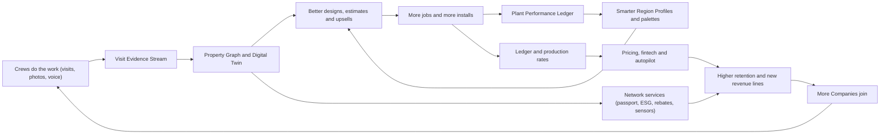

# 23 - Innovation and Moonshots

> Rootline's core modules ([03](03-crm-sales-estimating-proposals.md) through [20](20-architecture-security.md)) replace the 5-10 tools a landscape company juggles today. This document goes further. It describes how one platform that holds the **geometry** of every property, the **plants** in it, every **visit**, **photo** and **chemical application**, and the Company's **real books** can do things that a stack of separate tools never can. We specify a portfolio of **33 ambitious bets**: a persistent property digital twin, AR for homeowners and crews, robotic mower fleets, closed-loop smart irrigation, plant health AI, ESG reporting, turf-rebate automation, a "Carfax for landscapes", a homeowner network, a nursery supply exchange, a labor marketplace, embedded fintech, franchise mode, a voice-first crew assistant, generative video, predictive pricing, a self-driving back office, an app and MCP ecosystem, an academy, a community, climate-adaptive planting and more. Each bet states the problem, the concept, the data moat it builds on, technical readiness, dependencies, a phase tag and a "headline demo". We also define the **rails** that MVP and V1 must lay so these bets stay possible. Without those rails, they quietly become impossible. The document ends with an impact-versus-effort prioritization matrix and a narrative of a landscape company running on Rootline in 2031. It matters because software in this category is converging on parity features. The durable advantage goes to the platform whose data compounds, and every bet here is designed to make Rootline's data more valuable each season it is used.

**Related docs:** [Market landscape](01-market-landscape.md) | [Personas and RBAC](02-personas-roles-permissions.md) | [CRM and estimating](03-crm-sales-estimating-proposals.md) | [Scheduling and routing](04-scheduling-dispatch-routing.md) | [Crew app](05-field-crew-mobile-app.md) | [Customer portal](06-customer-portal.md) | [Invoicing](07-invoicing-billing-contracts.md) | [Payments](08-payments-stripe.md) | [Ledger](09-accounting-ledger-integrations.md) | [Design Studio](10-design-studio.md) | [AI design and mockups](11-ai-design-mockups.md) | [Plant Knowledge Base](12-plant-knowledge-base.md) | [Operations and equipment](13-operations-inventory-equipment.md) | [Service lines](14-service-line-modules.md) | [Team, HR and payroll](15-team-hr-payroll.md) | [Marketing and growth](16-marketing-growth-communications.md) | [AI copilot and automation](17-ai-copilot-automation.md) | [Reporting and analytics](18-reporting-analytics.md) | [Platform admin](19-platform-admin-portal.md) | [Architecture and security](20-architecture-security.md) | [UX and sitemaps](21-ux-design-system-sitemaps.md) | [Business model and GTM](22-business-model-pricing-gtm.md) | [Roadmap and feature catalog](24-roadmap-feature-catalog.md)

**Document status:** Proposal v1.0, 2026-11-07. Priority tags: **[MVP]** first sellable release, **[V1]** within about 12 months of MVP, **[V2]** 12-24 months, **[V3]** moonshot, 2+ years. Most bets carry several tags: early "rails" ship at MVP or V1, and the full bet lands later. [24-roadmap-feature-catalog.md](24-roadmap-feature-catalog.md) is the authority if tags conflict.

> **Research basis (as of Nov 2026).** This document reuses sources already gathered and checked in [research/R1](research/R1-field-service-platforms.md), [research/R2](research/R2-landscape-specific-platforms.md) and the sibling module docs (competitor AI, payments and financing, measurement vendors, smart-irrigation APIs, pesticide and heat rules, MCP). The live web-search budget for this writing session ran out before module-specific searches could be done, and several vendor and regulator hosts could not be reached from the research environment. So facts about robotics vendors, emissions and turf rules, drone policy, climate datasets and fintech regulation come from general industry and regulatory knowledge through mid-2026. Those facts are marked **"verify"** and have to be re-checked before anything is committed in a roadmap, pitch or contract. No statistics are invented. Figures we derived ourselves are labeled **estimate**.

---

## Table of contents

1. [Goals and non-goals](#1-goals-and-non-goals)
2. [Market research: the frontier, the complaints, the gap](#2-market-research-the-frontier-the-complaints-the-gap)
3. [Personas and jobs-to-be-done](#3-personas-and-jobs-to-be-done)
4. [Feature specification: the moonshot portfolio](#4-feature-specification-the-moonshot-portfolio)
5. [Key user flows](#5-key-user-flows)
6. [Screens and wireframes](#6-screens-and-wireframes)
7. [Data model](#7-data-model)
8. [Integrations, APIs and events](#8-integrations-apis-and-events)
9. [Permissions](#9-permissions)
10. [AI opportunities across the portfolio](#10-ai-opportunities-across-the-portfolio)
11. [Edge cases, compliance and risks](#11-edge-cases-compliance-and-risks)
12. [Metrics and KPIs](#12-metrics-and-kpis)
13. [Beyond the brief: extra ideas](#13-beyond-the-brief-extra-ideas)
14. [Open questions](#14-open-questions)
15. [Prioritization matrix: impact vs effort](#15-prioritization-matrix-impact-vs-effort)
16. [Rootline in 2031: a narrative](#16-rootline-in-2031-a-narrative)
17. [Sources](#sources)

---

## 1. Goals and non-goals

### 1.1 Goals

| # | Goal | How we will know |
|---|---|---|
| G1 | **Give the founder a ranked, defensible portfolio of big bets** that extend Rootline from "the system of record" to "the system that runs the yard". | 33 bets, each with problem, concept, moat, readiness, dependencies, phase and demo. Ranked in section 15. |
| G2 | **Protect optionality by specifying the rails now.** Each bet names the MVP/V1 data and architecture it needs, such as geotagged photos tied to objects, stable plant-instance IDs and device abstractions. Those rails get built even if the bet itself waits three years. | Every rail appears in section 4.2 and is referenced from the module docs. |
| G3 | **Compound the data moats.** Each bet should make the Property Graph, the Plant Performance Ledger, production rates or the Ledger richer, so the next bet is easier and a copycat starts further behind. | Each card has a "Builds on" line and a "Feeds back" line. |
| G4 | **Make the first slice of every bet estimable.** Engineers get rules, states, validations and edge cases for the first shippable increment, not just the dream. | Section 4 "First slice" blocks; sections 5-9 cover flows, data, events and permissions. |
| G5 | **Create new revenue lines without betraying the core promises**: bring-your-own Stripe, zero markup by default, tenant-owned data, operator neutrality on plant recommendations. | Every monetized bet states its model and the guardrail it respects ([22](22-business-model-pricing-gtm.md)). |
| G6 | **Delight.** At least one bet per persona should make someone say "I didn't know software could do that." Examples: a homeowner walking through their Year-5 garden in AR, a crew lead painting bed lines guided by the phone, an owner waking up to a closed month. | The headline demos in section 4. |

### 1.2 Non-goals

1. **Not a commitment.** This is a portfolio, not a roadmap. Sequencing, staffing and dates live in [24](24-roadmap-feature-catalog.md). A bet can be killed at any readiness gate (section 4.3).
2. **No hardware manufacturing.** Rootline orchestrates robots, sensors, drones and RTK receivers made by others. We may certify or resell partner kits ([V3]), but we will not design mowers or controllers.
3. **No balance-sheet lending, no insurance carrier risk, no money transmission.** Fintech bets are built as referral marketplaces and data rails for licensed partners. Rootline never holds client funds, which is consistent with [08](08-payments-stripe.md).
4. **No autonomous control of safety-critical actions without a human in the loop.** Examples are restricted-use pesticide prescriptions, robot operation in public spaces outside geofences, and irrigation changes that exceed water-budget or ordinance limits.
5. **No cross-tenant data use without explicit opt-in.** Every network bet (benchmarks, marketplace, nursery exchange, Plant Performance Ledger) runs on opted-in, aggregated or explicitly shared data. Thresholds match [22](22-business-model-pricing-gtm.md) section 5.2.
6. **No consumer social network.** The homeowner network is a utility (records, care, requests, payments), not a feed.
7. **No replacement of central-control irrigation systems** for golf and large campuses. Rootline coordinates with those systems; it does not replace them (consistent with [14](14-service-line-modules.md)).

### 1.3 Innovation principles

1. **Data exhaust first.** Prefer bets that turn data crews already create (photos, time, chemical logs, plant installs) into value, over bets that ask crews to do extra work.
2. **Rails before rockets.** Ship the cheap data structures early: stable object IDs, geotags, consent records and device abstraction. These are the hard-to-retrofit parts.
3. **The Company is the hero.** Every network feature strengthens the Company's relationship with its Clients. Nothing lets Rootline or another tenant poach a Client.
4. **Neutral and explainable.** Plant, pricing and vendor recommendations are never for sale. Every AI recommendation shows its evidence.
5. **Earn autonomy.** Automation climbs a trust ladder (suggest, then draft, then act with undo, then act on exceptions) based on measured accuracy per tenant and per task ([17](17-ai-copilot-automation.md)).
6. **Metered, not surprising.** Heavy compute (video, photogrammetry, 3D) uses AI credits, and the cost is estimated before the user commits ([22](22-business-model-pricing-gtm.md) section 4.4).
7. **Kill fast.** Each bet has a readiness gate and a kill criterion. A moonshot portfolio without kills is a wish list.

---

## 2. Market research: the frontier, the complaints, the gap

### 2.1 What competitors do at the frontier (as of Nov 2026, verify)

The landscape and field-service software market is busy at the frontier, but the activity is narrow: AI receptionists, AI copilots over operational data, embedded payments and financing, and measurement add-ons. Nobody is building the physical-world layer (twins, robots, sensors, AR) on top of a joined business system.

| Vendor | Frontier activity we could document | What is missing | Evidence |
|---|---|---|---|
| **Jobber** | Copilot (2024) over historical business data; AI Receptionist; Jobber Voice; Campaign Generator; app marketplace with third-party AI apps; Stripe partnership for financing and instant payouts | No design, plant or property-geometry layer. AI is front-office and analytics only. No robotics, IoT or twin | [R1](research/R1-field-service-platforms.md); [PR Newswire](https://prnewswire.com/news-releases/jobber-launches-copilot-the-first-of-several-ai-powered-products-aimed-at-making-home-service-business-ownership-simpler-than-ever-before-302264047.html); [ACHR News](https://www.achrnews.com/articles/143559-jobber-partners-with-stripe-to-activate-financing-and-instant-payouts-for-home-service-businesses); [Jobber community](https://community.getjobber.com/discussions/operations-forum/just-launched-in-the-app-marketplace-an-ai-dispatcher-that-books-right-into-your/15079) |
| **ServiceTitan (incl. Aspire)** | "Titan Intelligence" and the Atlas agent (Pantheon 2025); Aspire PropertyIntel measurement (from the Go iLawn and LandOne acquisitions); marketplace; built-in consumer financing | Atlas is built for HVAC and plumbing first. PropertyIntel is a separate add-on. No plant intelligence, no twin, no robotics | [ServiceTitan press](https://www.servicetitan.com/press/servicetitan-introducing-the-next-evolution-of-ai-at-pantheon-2025-keynote); [Turf Magazine](https://turfmagazine.com/aspire-announces-launch-of-propertyintel); [Aspire marketplace](https://marketplace.youraspire.com/partners/implementation-services?taxon_id=8) |
| **LMN and SingleOps (Granum)** | AI through partners: Attentive.ai mapping (Feb 2025), Beam AI takeoffs (Feb 2026), "AI crew notes" beta; LMN Pay relaunched on Stripe (Mar 2026); Job Costing Advisor; SingleOps tree inventory | AI is partner-sourced and limited to measurement. Tree inventory is a separate module. No design-to-twin loop | [R2](research/R2-landscape-specific-platforms.md); [Attentive.ai](https://attentive.ai/blog/lmn-and-attentive-ai-announce-strategic-partnership); [Landscape Management](https://www.landscapemanagement.net/lmn-by-granum-launches-new-financial-infrastructure-platform-in-partnership-with-stripe/); [Turf Magazine](https://turfmagazine.com/lmn-introduces-job-costing-advisor-for-landscapers) |
| **Housecall Pro** | Consumer financing through Wisetack; AI features vary by tier | Horizontal home services. No landscape depth | [HCP Help](https://help.housecallpro.com/en/articles/3836042-wisetack-consumer-financing-overview) |
| **Real Green (WorkWave), Service Autopilot (Xplor), Copilot CRM, Yardbook** | Rule-based automation, satellite measurement (Real Green Measurement Assistant), marketing automation | We found no documented generative-AI copilot for Real Green or Service Autopilot as of Nov 2026 (negative finding). No physical-world layer | [R2](research/R2-landscape-specific-platforms.md); [Capterra comparison](https://www.capterra.com/compare/78106-176935/Service-Assistant-vs-SingleOps) |
| **Arborgold, SynkedUP** | Tree/PHC workflows and measurement tool (Arborgold); estimating-first with production rates (SynkedUP) | No twin, IoT or marketplace | [R2](research/R2-landscape-specific-platforms.md) |
| **Measurement specialists** (SiteRecon, Attentive.ai, Beam AI, Deep Lawn) | AI property mapping, takeoffs, geolocated site-audit reports | Measurements live outside the estimate, design and crew map | [R2](research/R2-landscape-specific-platforms.md); [SourceForge LMN vs SiteRecon](https://www.sourceforge.net/software/compare/LMN-vs-SiteRecon) |
| **Consumer design and AR apps** (iScape, Neighborbrite, Yardzen-style services, PRO Landscape+ AI Outdoor Living Designer) | Photo-based AI garden mockups; AR yard visualization; paid online design | Outputs are "conceptual only", not to scale. AR crashes on complex scenes. Install handoff is a referral, not a system | [11](11-ai-design-mockups.md); [AI Tools Bakery](https://aitoolsbakery.com/blog/iscape-review/); [Neighborbrite (App Store)](https://apps.apple.com/app/id6742585344); [Turf Magazine](https://turfmagazine.com/ai-meets-design-prolandscape-unveils-next-gen-tools) |
| **Equipment OEM software** (Husqvarna Fleet Services and Automower Connect, Toro, STIHL connected tools, Kress/Positec fleet apps) | Equipment telematics and robotic-mower fleet apps, each limited to one brand (verify current product names and API access) | Each OEM sees only its own machines. None knows the Company's schedule, Client, contract or job cost | General industry knowledge (verify); [05](05-field-crew-mobile-app.md) mentions Husqvarna Fleet Services |

> **Competitive edge - the frontier is empty where it matters.** Competitors' AI work is concentrated in the office: answering calls, summarizing data and drafting campaigns. The physical layer (what is actually growing, wet, dying, mowed or installed on each property) is either unowned or split across single-brand OEM apps. Rootline is the only platform designed to hold the property geometry ([10](10-design-studio.md)), the plant identity ([12](12-plant-knowledge-base.md)), visit evidence ([05](05-field-crew-mobile-app.md)) and the books ([09](09-accounting-ledger-integrations.md)) in one graph. Every bet below uses that joined graph, and a competitor would need three acquisitions and a re-platform to match it.

### 2.2 Adjacent technology readiness (as of mid-2026, verify)

We rate readiness with a simplified **Technology Readiness Level (TRL)** scale: 1-3 research, 4-6 prototypes and pilots, 7-9 proven in production. "Rootline TRL" means how ready the technology is for *our* use case, not in general.

| Technology | State of the art (summary) | Rootline TRL | Implication |
|---|---|---|---|
| **Commercial robotic mowers** | Wire-free RTK/GNSS robots for large turf (Husqvarna CEORA and EPOS virtual boundaries; Kress RTKn by Positec; consumer-grade Segway Navimow and Mammotion); autonomous ride-on/zero-turn platforms and retrofit kits (Scythe M.52, Greenzie, Electric Sheep); OEM fleet portals (verify all models and availability) | 6-7 | Integrate, don't build. Value is in orchestration, job costing and ROI planning |
| **AR on phones** | ARKit/ARCore with LiDAR depth on Pro iPhones and iPads; geospatial anchoring (ARCore Geospatial API, ARKit location anchors) in covered areas; USDZ/GLB Quick Look | 7 for previews; 5 for cm-accurate layout without RTK | Homeowner preview is ready now. Crew layout needs RTK or control points |
| **Consumer/prosumer RTK GNSS** | Bluetooth RTK receivers with NTRIP correction services give roughly centimeter-level horizontal accuracy in open sky (verify vendor specs); degraded under tree canopy | 6 | Viable for stakeout. Canopy and multipath are the main edge cases |
| **Drone photogrammetry** | Mature: orthomosaics, DSMs, point clouds and meshes via commercial (Pix4D, DroneDeploy) and open-source (OpenDroneMap) pipelines; Gaussian splatting gives photoreal 3D ([3DGS paper](https://arxiv.org/abs/2308.04079)); US Part 107 and Remote ID, Canadian drone certificates | 7 | Feasible. Regulation, pilot labor and OEM availability are the constraints |
| **Segmentation and depth** | SAM-family promptable segmentation ([SAM 2](https://arxiv.org/abs/2408.00714)); monocular metric depth ([Depth Anything V2](https://arxiv.org/abs/2406.09414), [Depth Pro](https://arxiv.org/abs/2410.02073)) | 7 | Powers change detection, mockups and twin registration |
| **Generative video** | Text/image-to-video models with strong coherence (e.g., Google Veo 3, OpenAI Sora 2, Runway; verify current versions and API terms) | 5 for faithful-to-design walkthroughs | Must condition on our own 3D render to stay truthful. Cost per second is still high |
| **Plant ID and disease detection** | Plant ID APIs (Pl@ntNet, Kindwise plant.id with health assessment; verify terms); research datasets such as PlantVillage generalize poorly from lab to field | 5-6 for ornamentals in the field | Use as triage plus expert-in-the-loop, never as an autonomous prescriber |
| **IoT soil moisture and weather** | Cheap LoRaWAN and cellular soil moisture probes; personal weather stations with APIs; smart controllers with APIs (Hydrawise, Rachio, Rain Bird IQ4; [14](14-service-line-modules.md)) | 7 | Closed loop is technically easy. Trust, liability and sensor upkeep are the hard parts |
| **Voice AI** | Real-time speech-to-text and text-to-speech with good Spanish; LLM intent parsing; noisy outdoor audio still hard | 6 | Push-to-talk with Bluetooth headsets beats wake words next to a 60-inch mower |
| **Agentic LLMs and MCP** | Frontier models (Claude family) run multi-step tool use. Model Context Protocol is a cross-vendor standard for connecting tools to AI ([MCP specification](https://modelcontextprotocol.io/specification)) | 7 | Autopilot and the ecosystem are feasible on the Action Layer ([17](17-ai-copilot-automation.md)) |
| **Climate projections** | USDA's 2023 Plant Hardiness Zone Map update shifted roughly half of the US a half-zone warmer; downscaled CMIP6 projections (e.g., NASA NEX-GDDP-CMIP6, LOCA2) are public (verify) | 6 | Climate-adaptive palettes are a curation and UX problem more than a science problem |

### 2.3 Regulatory and market tailwinds (verify each before use)

| Tailwind | What it is | Bet it powers |
|---|---|---|
| **California small off-road engine (SORE) rules** | AB 1346 (2021) directed CARB to require zero-emission small off-road engines. Under CARB's rules, most new small engines, including lawn and garden equipment, must be zero-emission starting with model year 2024, and portable generators follow later. Existing gas equipment can still be used. CARB has said that one hour of commercial leaf blower use produces smog-forming emissions comparable to driving a passenger car roughly 1,100 miles ([CARB SORE program](https://ww2.arb.ca.gov/our-work/programs/small-off-road-engines-sore), verify figure and dates) | M-06 Electrification planner, M-09 ESG |
| **Local gas leaf-blower restrictions** | A growing patchwork of city and county restrictions on the sale or use of gas leaf blowers (examples often cited: Washington, DC; many California cities; Montgomery County, Maryland; verify each jurisdiction's scope and effective dates) | M-06 |
| **Nonfunctional turf rules** | Nevada AB 356 (2021) prohibits Colorado River water for nonfunctional turf in the Las Vegas Valley from 2027. California AB 1572 (2023) phases out potable irrigation of nonfunctional turf on commercial, institutional, industrial, government and HOA common areas from about 2027 into the early 2030s. Colorado restricts nonfunctional turf in new commercial developments (SB24-005) (verify all scopes and dates) | M-10 Turf rebate automation, M-07, M-09 |
| **Turf-replacement rebates** | Many water utilities pay per square foot to replace lawn with water-wise landscape, for example SoCal Water$mart (Metropolitan Water District member agencies) and Southern Nevada Water Authority's Water Smart Landscapes (verify current rates and rules) | M-10 |
| **Corporate climate disclosure** | California SB 253 (Scope 1-3 emissions disclosure for large companies doing business in California) and SB 261 (climate-risk reports); the EU CSRD affects multinational property owners (verify phase-in dates, which have shifted) | M-09 ESG reporting for commercial Clients |
| **Wildfire mitigation** | California's 100-foot defensible space law (PRC 4291) and the ongoing "Zone 0" ember-resistant rulemaking (AB 3074); the insurance regulator's "Safer from Wildfires" discount framework (verify status) | M-27 Wildfire-ready landscapes |
| **Heat illness rules** | Cal/OSHA outdoor heat rules (shade at 80 F, high-heat procedures at 95 F) ([Ogletree](https://ogletree.com/insights/the-heat-is-on-in-california-cal-oshas-heat-illness-prevention-requirements-for-outdoor-work-sites/)); state rules elsewhere; a proposed federal OSHA heat standard (status uncertain, verify) | M-31 Heat-safe crews |
| **Labor scarcity** | The H-2B seasonal visa program has a statutory annual cap ([DOL H-2B](https://www.dol.gov/agencies/whd/immigration/h2b)), and landscaping is consistently among its largest users (verify current share). Workers are tied to the petitioning employer | M-05 Robotics, M-15 Labor marketplace, M-20 Voice |
| **Climate zone shift** | USDA's 2023 hardiness map shifted many areas a half-zone warmer ([USDA PHZM](https://planthardiness.ars.usda.gov/)) | M-11 Climate-adaptive planting |
| **Open AI tool standards** | MCP has been adopted across major AI vendors (verify governance status) | M-24 App marketplace and MCP |

### 2.4 What users complain about (that these bets answer)

The module docs and research reports collected these pain points. They are summarized here only where a moonshot is the answer.

| Pain point | Who | Source | Bet that answers it |
|---|---|---|---|
| "Measurements live in a different product from the estimate, the design and the crew's map." | Estimators, owners | [R2](research/R2-landscape-specific-platforms.md) executive summary | M-01 Twin, M-02 Drone |
| AI garden design apps are "conceptual only, not precise measurements or construction drawings"; AR crashes on complex designs | Homeowners, designers | [11](11-ai-design-mockups.md); [AI Tools Bakery](https://aitoolsbakery.com/blog/iscape-review/) | M-03 AR, M-21 Video |
| AI receptionists "cannot handle the messy cases" and have no context about the property or design | Office managers | [R1](research/R1-field-service-platforms.md) P15; [TechRadar](https://www.techradar.com/pro/software-services/jobber-crm-review) | M-23 Autopilot (context-rich), M-13 Homeowner app |
| Payments, card vaults and financing are locked to the vendor | Owners | [R1](research/R1-field-service-platforms.md) section on payments pattern | M-16-M-18 fintech built on BYO Stripe and partner neutrality |
| Contractors re-key controller data, keep zone maps on paper and retype backflow results | Irrigation techs | [14](14-service-line-modules.md) | M-07 Closed-loop irrigation, M-12 Passport |
| Office staff shortage; "short on office staff, not short on software" | Owners | [17](17-ai-copilot-automation.md) | M-23 Autopilot |
| Labor is the largest cost line and the hardest constraint | Owners | [Aspire blog](https://www.youraspire.com/blog/landscaping-labor-percentage-of-revenue) | M-05, M-15, M-20, M-22 |
| Survey: 43% of commercial landscape leaders believe in AI, but only 15% use it daily (vendor-run survey) | Commercial owners | [R2](research/R2-landscape-specific-platforms.md) | All. Adoption has to be ambient (photos, voice), not a new chore |
| Plant availability arrives as emailed spreadsheets; substitutions break designs | Designers, purchasers | [17](17-ai-copilot-automation.md) nursery-sheet agent; [13](13-operations-inventory-equipment.md) | M-14 Nursery network |

### 2.5 The gap we exploit

1. **The joined Property Graph.** Geometry (Design), objects (plants, heads, fixtures, hardscape), time (visits, photos, applications) and money (estimates, invoices, job costs) live in one tenant-scoped graph. Competitors own one or two of the four.
2. **A curated, region-aware plant brain.** The operator-curated Plant KB, with Region Profiles ([12](12-plant-knowledge-base.md)), turns raw imagery into horticultural meaning: "that is a 'Limelight' hydrangea in zone 6a, planted in May 2027, under warranty until May 2028".
3. **True books.** The built-in double-entry Ledger ([09](09-accounting-ledger-integrations.md)) makes underwriting, ESG cost allocation, franchise royalties and predictive pricing trustworthy. Spreadsheet-grade data cannot do this.
4. **Neutral money rails.** BYO Stripe means fintech bets are a marketplace of partners and never a lock-in tax. That trust is what lets a Company share its books with a lender through Rootline.
5. **Seasonal repetition.** Landscaping revisits the same property 20 to 40 times a year (for example, weekly mowing from April to November is about 30 visits). No other trade gets so many observations of the same asset. Our twin, plant-performance and pricing models feed on that repetition.

---

## 3. Personas and jobs-to-be-done

Moonshots touch every persona from [02](02-personas-roles-permissions.md) and introduce several **external participants**. External participants are not tenant users. They are network partners with scoped, contractual access.

| Persona (role key) | Job-to-be-done in the moonshot era | Bets |
|---|---|---|
| Business Owner (`owner`) | "Run a $3M company with the office headcount of a $1M company." "Know my real numbers, borrow on them, and plan my fleet's transition." | M-16, M-17, M-18, M-22, M-23, M-06, M-19 |
| Office / Admin Manager (`office_manager`) | "Handle the exceptions; let the system do the routine." | M-23, M-10, M-24 |
| Sales Rep / Estimator (`estimator`) | "Walk a property once, leave with a measured model, a price I trust and a video the client will share." | M-01, M-02, M-21, M-22 |
| Landscape Designer (`designer`) | "Design with plants that will still thrive in 2045, that are in stock now, and show it in the client's yard." | M-03, M-11, M-14, M-29 |
| Operations / Account Manager (`ops_manager`) | "Know the condition of 140 commercial properties without driving to them; prove our value to property managers." | M-01, M-07, M-09, M-05 |
| Crew Lead / Foreman (`crew_lead`) | "Lay out a bed exactly as designed without a tape measure argument; get answers hands-free." | M-04, M-20, M-31 |
| Field Technician (`technician`) | "Speak Spanish to my phone with gloves on and have it do the paperwork; stay safe in the heat." | M-20, M-31, M-25 |
| Bookkeeper / Accountant (`bookkeeper`) | "Close the month in two days; give the lender a clean package without a week of exports." | M-23, M-16 |
| Subcontractor (`subcontractor`) | "Find steady overflow work from reputable Companies and get paid fast." | M-15 |
| Residential homeowner (`client_residential`) | "See my future yard, keep my home's landscape records, and sell my house with them." | M-03, M-12, M-13, M-08 |
| Commercial property manager (`client_commercial`) | "Report water saved and emissions avoided to my ESG team; get rebates and comply with turf bans." | M-09, M-10, M-07, M-28 |
| Platform Operator (`platform_owner`) | "Grow a network, not just a SaaS, without compromising tenant trust." | All. Governance in [19](19-platform-admin-portal.md) |
| Plant curator (`platform_curator`) | "Turn thousands of real-world installs into better Region Profiles and climate-ready palettes." | M-11, M-29, M-08 |
| Platform finance (`platform_finance`) | "Run partner programs (lenders, insurers, nurseries) with clean attribution and compliance." | M-14, M-16-M-18, M-24 |
| Platform engineer (`platform_engineer`) | "Integrate robots, sensors and partner APIs safely, without a separate code path per vendor." | M-05, M-07, M-24 |
| Platform support (`platform_support`) | "Diagnose a misbehaving sensor or robot integration from the console." | M-05, M-07 |
| **External: nursery partner** | "Publish availability once and get orders from every Rootline designer in my delivery radius." | M-14 |
| **External: lender / insurer partner** | "Get consented, verified operating data to price risk on a seasonal business." | M-16, M-17, M-18 |
| **External: robot or sensor OEM** | "Get my machines scheduled and billed inside contractors' real workflows." | M-05, M-07 |
| **External: water utility / municipality** | "Receive complete, verified rebate applications and compliance data, not shoebox submissions." | M-10, M-28 |
| **External: franchisor** (organization admin) | "Standardize price books and brand, roll up KPIs and royalties across 80 locations." | M-19 |
| **External: app developer** | "Build on Rootline's API and MCP server and reach thousands of landscape companies." | M-24 |
| **External: real estate agent and home buyer** | "Know what is in the yard, under it and what has been applied to it before closing." | M-12 |

---
## 4. Feature specification: the moonshot portfolio

This section is the core of the document. Sections 4.1-4.4 define the moats, the rails, the stage gates and the portfolio overview. Sections 4.5-4.13 hold one card per bet, grouped into nine themes.

### 4.1 The data moats every bet builds on

| Moat | What it is | Where it is created | Why it compounds |
|---|---|---|---|
| **Property Graph** | Tenant-scoped, geo-referenced model of each Property: parcel, footprints, beds, turf, hardscape, irrigation zones and heads, lighting, trees and plants as *instances* with stable IDs | Design Studio and as-builts ([10](10-design-studio.md)), irrigation ([14](14-service-line-modules.md)), crew updates ([05](05-field-crew-mobile-app.md)) | Each visit adds evidence to existing objects instead of creating loose photos |
| **Visit Evidence Stream** | Time-stamped, geotagged photos, notes, voice, checklists, chemical logs, materials and time per Visit | Crew app ([05](05-field-crew-mobile-app.md)) | 20-40 observations per property per season give a time series no other trade has |
| **Plant Knowledge Base + Region Profiles** | Canonical plants, traits, Region performance ratings, palettes, curator notes | Platform curation ([12](12-plant-knowledge-base.md), [19](19-platform-admin-portal.md)) | Curation effort is high, and outcome data (M-29) makes it better every year |
| **Plant Performance Ledger** | Outcomes of real plant instances: install date, source nursery, size, survival, warranty claims, pests, growth | Plant instances + visits + warranty workflow ([14](14-service-line-modules.md)) | Becomes the most credible evidence base for "what grows here" in North America (aggregated, opted-in) |
| **Production-rate dataset** | Actual labor hours per unit of work (per 1,000 sq ft mowed, per cubic yard of mulch, per pallet of pavers) by crew, season and site difficulty | Time tracking + takeoffs + job costing ([03](03-crm-sales-estimating-proposals.md), [09](09-accounting-ledger-integrations.md)) | Powers predictive pricing (M-22), robot ROI (M-05) and benchmarks |
| **The Ledger** | Double-entry books with job costing, AR/AP, bank feeds | [09](09-accounting-ledger-integrations.md) | Verified financials for underwriting (M-16), royalties (M-19), ESG cost data (M-09) |
| **Payment behavior** | Payment timing, methods, disputes and autopay share, from the Company's own Stripe account | [08](08-payments-stripe.md) | Cash-flow forecasting and lender confidence without Rootline holding funds |
| **Equipment and energy telemetry** | Hours, fuel, battery cycles, robot missions, telematics | [13](13-operations-inventory-equipment.md), M-05, M-06 | TCO models, maintenance prediction, certified resale (M-17) |
| **Relationship graph** | Clients, Contacts, Properties, consents, communication history | [03](03-crm-sales-estimating-proposals.md), [06](06-customer-portal.md), [16](16-marketing-growth-communications.md) | The base for the homeowner network (M-12, M-13), always with the Company as the relationship owner |

**Data-rights rules for every bet (non-negotiable):**

1. **Tenant data belongs to the Company.** Rootline processes it to serve that Company ([17](17-ai-copilot-automation.md) section on data use).
2. **Cross-tenant use only by aggregation and opt-in.** The `owner` must opt in separately to (a) in-app benchmarks and (b) external aggregated products. Published cells need at least 10 contributing Companies, and no single Company may contribute more than 25% of a cell's weight. Plant-frequency signals need at least 20 Companies ([22](22-business-model-pricing-gtm.md) section 5.2).
3. **Client data is never marketed across tenants.** Homeowner network features require the homeowner's own explicit opt-in, recorded with consent text version, timestamp and channel.
4. **Partner data flows (lenders, insurers, utilities, nurseries) are per-purpose, per-recipient, revocable consents** stored in a single `data_share_grant` ledger (section 7) and visible to the `owner` in Settings > Data sharing.

### 4.2 Rails: what MVP and V1 must build so the moonshots stay possible

These are cheap now and expensive to retrofit. Each line is a requirement on the named module, tagged with when it must ship.

| Rail | Requirement | Owning doc | Tag | Unlocks |
|---|---|---|---|---|
| R-01 Stable object IDs | Every bed, turf area, hardscape element, plant instance, irrigation component and light fixture in a Design carries a UUID that survives versions and the transition from design to as-built. Deleting an object soft-deletes it with a reason (`removed`, `died`, `replaced`) | [10](10-design-studio.md) | [MVP] | M-01, M-04, M-12, M-29 |
| R-02 Plant instances | A placed plant is a `plant_instance` (KB plant ID, cultivar, container size, install date, source vendor, warranty end), not just a symbol | [10](10-design-studio.md), [12](12-plant-knowledge-base.md) | [MVP] | M-08, M-11, M-14, M-29 |
| R-03 Rich photo metadata | Crew photos store GPS, accuracy, compass heading, device tilt, timestamp, Visit ID, Property ID and optional object tags. Originals are kept (not only compressed copies) for 24 months by default | [05](05-field-crew-mobile-app.md) | [MVP] | M-01, M-08, M-21 |
| R-04 Photo stations | Optional fixed "photo stations" on the property map (pin + heading) that the crew app asks for at set intervals (default: first visit of each month), for repeatable framing | [05](05-field-crew-mobile-app.md), [10](10-design-studio.md) | [V1] | M-01, M-09, M-12 |
| R-05 Device abstraction | A generic `device` registry (type, vendor, external ID, capabilities, Property/zone binding) and a `telemetry_point` time-series store, used by smart controllers first | [14](14-service-line-modules.md), [20](20-architecture-security.md) | [V1] | M-05, M-07, M-31 |
| R-06 Consent ledger | Purpose-scoped consents for Clients (marketing, AI imagery, data sharing) and Companies (benchmarks, partner shares) with versioned text | [02](02-personas-roles-permissions.md), [20](20-architecture-security.md) | [MVP] | M-12, M-13, M-16-M-18 |
| R-07 Organization layer | An `organization` above Companies (multi-company, franchise) with data-sharing agreements per category | [02](02-personas-roles-permissions.md), [19](19-platform-admin-portal.md) | [V1] | M-19, M-32 |
| R-08 Action Layer parity | Every capability is a typed tool with a risk tier; API, MCP, automations and agents call the same tools | [17](17-ai-copilot-automation.md) | [MVP] | M-23, M-24, M-20 |
| R-09 Production-rate capture | Time is captured per Visit and per service line item, with quantities (sq ft, cu yd, each) | [05](05-field-crew-mobile-app.md), [03](03-crm-sales-estimating-proposals.md) | [MVP] | M-22, M-05 |
| R-10 Energy and fuel capture | Fuel purchases are tagged to assets; battery packs and charge sessions are registered | [13](13-operations-inventory-equipment.md) | [V1] | M-06, M-09 |
| R-11 Geospatial store | PostGIS geometry for properties, zones and service areas in a single CRS convention (WGS84 storage plus a local projected CRS per Property for measurement) | [20](20-architecture-security.md) | [MVP] | All spatial bets |
| R-12 Media pipeline hooks | `media.processed` events with pluggable processors (EXIF, blur faces, segmentation), so new models are added without schema changes | [20](20-architecture-security.md) | [MVP] | M-01, M-08 |
| R-13 Outcome capture | Plant warranty claims and replacements record cause (`drought`, `pest`, `disease`, `mechanical`, `client_neglect`, `unknown`) | [14](14-service-line-modules.md), [07](07-invoicing-billing-contracts.md) | [V1] | M-29, M-11, M-18 |
| R-14 Region on everything | Every Property resolves to a Region ID (and USDA/Canadian zone, ecoregion) at geocode time, and the value is kept with history | [12](12-plant-knowledge-base.md) | [MVP] | M-11, M-08, M-29 |

### 4.3 Stage gates and kill criteria

Every bet moves through five stages. `platform_owner` approves each promotion in the Innovation review held each quarter. Feature flags and tenant cohorts are managed in [19](19-platform-admin-portal.md).

| Stage | Entry criteria | Exit (promote) criteria | Typical size |
|---|---|---|---|
| **0. Explore** | One-page problem statement, the moat it uses, hypotheses | 10+ customer interviews confirm the pain; a technical spike shows the approach is feasible | 1 PM + 1 engineer, 2-4 weeks |
| **1. Prototype** | Gate 0 passed | Internal demo of the headline demo; cost per use estimated; risk register written | Squad of 2-4, 1 quarter |
| **2. Pilot** | Gate 1 passed; 3-10 design-partner Companies signed | Pilot KPIs hit (per card); no Sev-1 trust incidents; unit economics within 2x of target | Squad of 4-6, 1-2 quarters |
| **3. Beta** | Gate 2 passed; support runbooks; pricing and packaging set | Adoption and retention targets; compliance review signed off | Squad of 6-8 |
| **4. GA** | Gate 3 passed | Ongoing: owner KPI dashboard in [18](18-reporting-analytics.md) | Becomes a product line |

**Global kill rules:** kill or shelve a bet if (a) pilot KPIs miss by more than 50% after two iterations, (b) a trust incident shows that its data use cannot be made safe, (c) a partner dependency becomes unavailable and there is no second source within two quarters, or (d) its marginal cost per Company exceeds 25% of the Company's subscription with no pricing path.

### 4.4 Portfolio overview

Impact and Effort are scored 1 (low) to 5 (high) by the product team (estimates). Impact weighs revenue, retention, differentiation and customer outcome. Effort weighs engineering, partnerships, regulatory and operating cost. "First slice" is the earliest increment that ships customer value.

| ID | Bet | Theme | First slice | Headline | Primary moat | Rootline TRL | Impact | Effort | Revenue model |
|---|---|---|---|---|---|---|---|---|---|
| M-01 | Persistent property digital twin | A Property intelligence | [V1] | [V2]/[V3] | Property Graph + Evidence | 6 | 5 | 4 | Retention; Pro/Enterprise tiers; credits |
| M-02 | Drone capture and photogrammetry | A | [V2] | [V3] | Property Graph | 7 | 3 | 3 | Credits; capture add-on |
| M-03 | AR "See it in your yard" for homeowners | B Spatial and media | [V2] | [V2] | Design + Plant KB | 7 | 4 | 3 | Close-rate lift; Grow+ |
| M-04 | AR crew layout guidance | B | [V2] | [V3] | Design + R-01 | 5 | 4 | 4 | Pro add-on; RTK kit resale |
| M-05 | Robotic mower fleet orchestration | C Autonomy and energy | [V2] | [V3] | Schedule + job cost + twin | 6 | 4 | 4 | Per-robot fee; OEM rev share |
| M-06 | Fleet electrification planner | C | [V1] | [V2] | Equipment + fuel + runtime | 7 | 3 | 2 | Included Pro; dealer referrals |
| M-07 | IoT sensors and closed-loop smart irrigation | C | [V1] | [V3] | Hydrozones + Plant KB | 7 | 4 | 3 | Per-site monitoring fee (Company resells) |
| M-08 | Plant health AI with prescriptions | A | [V1] | [V2] | Plant KB + Region + photos | 5 | 4 | 3 | Credits; PHC upsell |
| M-09 | ESG and sustainability reporting | D Sustainability | [V1] | [V2] | Ledger + fuel + Plant KB | 7 | 4 | 2 | Commercial add-on |
| M-10 | Turf-replacement rebate automation | D | [V1] | [V2] | Design takeoffs + photos | 7 | 3 | 2 | Close-rate lift; per-application credits |
| M-11 | Climate-adaptive planting | A | [V2] | [V2] | Plant KB + Regions | 6 | 3 | 2 | Differentiation; Plant API |
| M-12 | Landscape Passport ("Carfax for landscapes") | E Homeowner network | [V1] | [V2]/[V3] | Property Graph + consents | 7 | 4 | 3 | Retention; homeowner Plus; agent reports |
| M-13 | Homeowner app and marketplace | E | [V1] | [V2]/[V3] | Plant KB + AI design + network | 6 | 5 | 4 | Rootline Home, Match leads ([22](22-business-model-pricing-gtm.md)) |
| M-14 | Nursery supply network | F Networks | [V1] | [V2]/[V3] | Plant KB + demand | 6 | 4 | 4 | Nursery Partner API; GPO rebates |
| M-15 | Labor and subcontractor marketplace | F | [V2] | [V3] | Crews + production rates + reviews | 5 | 4 | 4 | Transaction fee on B2B jobs |
| M-16 | Working capital from ledger data | G Fintech | [V2] | [V3] | Ledger + contracts + payments | 6 | 4 | 3 | Lender referral fees |
| M-17 | Equipment financing and certified pre-owned | G | [V2] | [V2] | Equipment logs + Ledger | 6 | 3 | 3 | Dealer/lender referral; listing fees |
| M-18 | Embedded insurance | G | [V2] | [V3] | Safety, incidents, telemetry | 5 | 3 | 4 | Agency commissions (licensed partner) |
| M-19 | Franchise and multi-brand mode | I Ecosystem | [V1] | [V2] | Organization layer + Ledger | 7 | 4 | 3 | Per-location enterprise pricing |
| M-20 | Voice-first crew assistant | H Intelligent ops | [V1] | [V2] | Action Layer + Spanish UX | 6 | 4 | 3 | Included; credits |
| M-21 | Generative video walkthroughs | B | [V2] | [V3] | Design 3D + Plant growth | 5 | 3 | 3 | Credits |
| M-22 | Predictive pricing | H | [V1] | [V2] | Production rates + win/loss + Pulse | 6 | 5 | 3 | Pro tier |
| M-23 | Autopilot: the self-driving back office | H | [V1] | [V2]/[V3] | Action Layer + Ledger | 6 | 5 | 4 | Autopilot tier |
| M-24 | App marketplace and MCP ecosystem | I | [V1] | [V2] | API parity + network | 7 | 4 | 3 | Rev share on paid apps |
| M-25 | Rootline Academy and certifications | I | [V1] | [V2] | Content + skill graph | 8 | 3 | 2 | Paid certifications; retention |
| M-26 | Community | I | [V1] | [V2] | Network | 8 | 3 | 2 | Retention; template exchange |
| M-27 | Wildfire-ready landscapes | D | [V2] | [V2] | Design + Plant KB + photos | 6 | 3 | 2 | Inspection product; insurer partners |
| M-28 | Stormwater and green-infrastructure credits | D | [V2] | [V3] | Design hydrology + maintenance logs | 6 | 2 | 2 | Credits; O&M contracts |
| M-29 | Plant Performance Science Network | A | [V2] | [V3] | Plant Performance Ledger | 6 | 4 | 3 | Plant API, data licenses |
| M-30 | Neighborhood density engine | F | [V1] | [V2] | Routes + parcels + twin | 7 | 3 | 2 | Growth; included |
| M-31 | Heat-safe crews | C | [V1] | [V2]/[V3] | Weather + schedule + time | 7 | 3 | 2 | Included (compliance) |
| M-32 | Rootline Grounds (in-house grounds teams) | I | [V3] | [V3] | Whole platform | 7 | 3 | 3 | New segment |
| M-33 | Rootline Global (UK, Australia, NZ) | I | [V3] | [V3] | Plant KB curation model | 7 | 3 | 4 | New markets |

---

### 4.5 Theme A: Property intelligence

#### M-01 Persistent property digital twin

**Headline phase:** [V2] for the twin timeline and change detection, [V3] for the full 3D, sensor-fused twin. Rails are [MVP]/[V1].

**Problem.** A landscape company's knowledge of a property is scattered: the original design PDF, a few hundred unlabeled crew photos, the account manager's memory and an irrigation map on paper in the truck. When the account manager leaves or the property changes hands, the knowledge goes with them. Commercial property managers cannot see condition across a portfolio. Estimators re-measure properties the company has maintained for six years.

**Concept.** Every Property gets a living, versioned model: the **Property Twin**. It starts as the as-built Design ("Living Property Map", [10](10-design-studio.md) section on as-builts). Every source of evidence then updates it automatically: crew photos, photo stations, drone flights, LiDAR scans, homeowner photos, satellite revisits and IoT sensors. The twin knows *objects* (this 'Green Velvet' boxwood, this 4-inch pop-up head in zone 6, this 14 x 18 ft paver patio), their *condition over time* and their *history* (installed, pruned, treated, replaced). It answers questions such as "What changed since last month?", "Which plants are declining?", "Where are the dry spots?" and "What did the front bed look like in June 2027?"

**Twin layers:**

| Layer | Contents | Update sources | Refresh |
|---|---|---|---|
| Geometry | Parcel, footprints, beds, turf, hardscape, grades | Design, as-built, drone, LiDAR | On capture |
| Objects | Plant instances, trees (DBH, height), irrigation components, fixtures, structures | Design, crew tags, AI detection (confirmed) | Per visit |
| Condition | Health status per object (`thriving`, `ok`, `stressed`, `declining`, `dead`, `missing`), turf quality index, mulch coverage, bed-edge crispness | Photos + AI change detection, crew checklist | Per visit / monthly |
| Events | Visits, applications, repairs, replacements, warranty claims, storms | Crew app, chemical logs, irrigation tickets | Real time |
| Sensors | Soil moisture, flow, controller runs, robot coverage | M-05, M-07 | Minutes to daily |
| Imagery | Registered photos, orthomosaics, Gaussian-splat scenes per season | Crew, drone, capture sessions | Per capture |

**Behaviors and rules (first slice, [V2] "Twin Timeline").**

1. **Registration.** Each photo with GPS accuracy ≤ 15 m and a compass heading is projected onto the Property map as a view cone. Photos taken at a photo station (R-04) within 3 m and 20 degrees of the station's heading count as "station-matched". Other photos register only to the object tags the crew applied or the AI suggested.
2. **Change detection.** For station-matched photo pairs at least 21 days apart, a vision pipeline (segmentation + learned comparator) produces candidate changes: `plant_missing`, `plant_discolored`, `bed_weeds_high`, `mulch_thin`, `turf_thinning`, `edge_lost`, `structure_damaged`, `new_object`. Each candidate has a confidence score and a heat-mapped region.
3. **Human confirmation.** Candidates with confidence ≥ 0.8 become "Proposed updates" in the `ops_manager` queue. Candidates from 0.5 to 0.8 are batched into a weekly digest. Anything below 0.5 is discarded but kept for model evaluation. No object status changes without confirmation, except `plant_missing` when the crew also flagged it (two-signal rule).
4. **Actions from changes.** A confirmed `plant_dead` on a plant instance under warranty creates a warranty replacement task ([14](14-service-line-modules.md)). `mulch_thin` in more than 30% of the bed area suggests a mulch enhancement Proposal, with quantities from the bed polygon at 2-inch depth (cubic yards = area sq ft x 2 / 12 / 27). `turf_thinning` suggests aeration and overseeding.
5. **Timeline UI.** A slider by month shows the registered photos and object states. "Compare" places two dates side by side with a swipe divider.
6. **Property Health Score (0-100).** A weighted index of the share of plants in `ok` or better, turf quality, weed pressure, mulch coverage and open issues. The weights are tenant-configurable, and the default formula is published in [18](18-reporting-analytics.md). The score is shown to `client_commercial` only if the Company enables it.
7. **Privacy.** Faces and license plates are blurred at ingest (R-12). Imagery outside the parcel polygon plus a 2 m buffer is masked in client-facing views, so the neighbor's yard is not shown.
8. **Storage policy.** Originals are kept for 24 months. Station-matched images are kept for the life of the contract, then for 12 months after it ends, unless the Client exports them to the Passport (M-12).

**Builds on.** Property Graph (R-01, R-02), photo metadata (R-03, R-04), media pipeline (R-12), Plant KB.
**Feeds back.** Condition labels train better detection; outcomes feed the Plant Performance Ledger (M-29); enhancement upsells feed revenue; evidence feeds the Passport (M-12) and ESG (M-09).

**Readiness.** TRL 6. Segmentation and image comparison are mature. Registration from phone photos is the hard part: GPS error, seasonal appearance change and leaf-on versus leaf-off. Photo stations solve 80% of registration (estimate). The [V3] full 3D twin uses Gaussian splats from capture sessions or drones ([3DGS paper](https://arxiv.org/abs/2308.04079)).

**Dependencies.** R-01-R-04, R-12; Design Studio as-builts ([10](10-design-studio.md)); AI Gateway vision models ([17](17-ai-copilot-automation.md)); storage cost model ([20](20-architecture-security.md)).

**Phasing.**
- [MVP] Rails: object IDs, plant instances, rich photo metadata.
- [V1] Living Property Map (as-built), photo stations, manual object status updates from the crew app.
- [V2] Twin Timeline, change detection with human confirmation, Property Health Score, enhancement suggestions.
- [V3] 3D twin (splats per season), sensor fusion, "what-if" simulation (growth of every plant over 10 years, shade evolution, water budget), digital twin API for commercial Clients' facility systems.

**Headline demo.** *An account manager opens a 22-acre office park on a Monday morning. The twin shows three red pins. Two 'Emerald Green' arborvitae on the north berm went from `ok` to `declining` between the June and July station photos. The irrigation zone feeding them shows 40% less flow than its baseline. The mulch on the entrance beds has thinned. One click creates a repair ticket, a warranty-replacement task and an enhancement Proposal for 18 cubic yards of mulch. The property manager approves it from her phone before lunch.*

**Kill criterion.** If confirmed changes are under 50% of the candidates shown (precision) after two model iterations in the pilot, revert to crew-flagged changes only.

> **Competitive edge.** SiteRecon and PropertyIntel measure a property once. Aspire and LMN store photos as attachments. None of them maintains object-level condition over time tied to warranties, irrigation zones and Proposals. The twin turns Rootline's visit frequency (about 30 mowing visits a season) into an asset a competitor cannot backfill: years of registered history cannot be imported.

#### M-02 Drone capture and photogrammetry

**Headline phase:** [V2] import and processing, [V3] automated capture network.

**Problem.** Satellite imagery is often 1-3 years old, blurred under tree canopy and too coarse for grade work. A 6-acre HOA common area or a commercial campus takes an estimator half a day to measure on foot. Install projects need accurate grades and volumes (excavation, stockpiles, wall heights) that aerial photos and county LiDAR rarely provide at current vintage.

**Concept.** Rootline becomes the place where drone data turns into landscape intelligence. Companies (a) fly their own drones with a Rootline-generated flight plan, (b) upload data from any drone or service provider, or (c) order a capture from a vetted pilot network ([V3]). Rootline processes the imagery into an orthomosaic, digital surface and terrain models, contours and a 3D scene. It registers all of it to the Property Twin, and AI extracts beds, turf, hardscape, tree crowns and stockpiles into editable Design objects.

**Behaviors and rules.**

1. **Flight plan generator [V2].** The input is the parcel polygon plus a buffer, which must stay inside the parcel unless the operator confirms otherwise. Defaults: lawn-and-bed mapping at about 150-200 ft AGL, 75% front overlap and 65% side overlap, nadir grid; a crosshatch with a 60-degree oblique for 3D. Expected ground sampling distance is roughly 1-2 cm per pixel for 20 MP-class cameras (estimate; depends on sensor). The plan is exported as KML/KMZ for common flight apps. The altitude cap is set by jurisdiction (400 ft AGL under US Part 107; verify Canadian rules).
2. **Pre-flight compliance checklist.** Pilot certificate on file and unexpired ([15](15-team-hr-payroll.md) certifications), aircraft registration, Remote ID compliance, airspace check (LAANC or the Canadian equivalent, operator-confirmed), client permission recorded, people-on-site notice. Rootline does not grant airspace authorization; it records that the pilot obtained it.
3. **Upload and process.** Images (JPEG/DNG with EXIF GPS) are processed by a Python photogrammetry worker based on OpenDroneMap, or sent to a partner API (Pix4D/DroneDeploy-class; verify terms). Outputs: COG orthomosaic, DSM/DTM GeoTIFF, LAZ point cloud, 3D tiles/splat. Processing is billed in AI credits per hectare (published rate card; estimate 40-80 credits per acre at [V2]).
4. **Accuracy labels.** Without ground control points (GCPs), relative accuracy is good but absolute positioning can be off by meters. The UI shows "relative accuracy only; align to plan" and offers a two-point alignment to existing Design control points. With GCPs or an RTK drone, the result is labeled "survey-grade candidate (verify)". Rootline never labels a capture as a survey. Licensed surveyors do surveys.
5. **AI extraction.** Beds, turf, hardscape, tree crowns (with height from DSM minus DTM) and stockpile volumes become *proposed* Design objects with confidence scores. Accepting them updates the twin and runs takeoffs into the open Estimate ([03](03-crm-sales-estimating-proposals.md)).
6. **Multispectral (optional, [V3]).** If the drone has NIR bands, NDVI rasters overlay turf health. RGB-only flights use visible-band indices (for example VARI or ExG) labeled "approximate".
7. **Privacy.** Captured imagery outside the parcel is cropped from client-facing outputs. Drone use follows state drone-privacy statutes (several states restrict capturing images of private property without consent; verify per state). The tenant attests to compliance at each upload.

**Builds on.** Property Graph, Design Studio takeoffs ([10](10-design-studio.md)), 3DEP terrain pipeline, media pipeline. **Feeds back.** Fresh geometry and canopy heights improve the twin, shade analysis and estimating accuracy.

**Readiness.** TRL 7 for processing. The binding constraints are regulatory and supply-side. US policy actions in 2024-2025 put new approvals for some foreign drone hardware at risk (status as of late 2025; verify), so the design is OEM-agnostic and depends on no single vendor's SDK.

**Dependencies.** Python worker fleet with GPUs ([20](20-architecture-security.md)); S3 plus COG tiling; certification tracking ([15](15-team-hr-payroll.md)); credits ([22](22-business-model-pricing-gtm.md)).

**Phasing.** [V2] upload, process and extract; flight plan export. [V3] pilot network marketplace (vetted Part 107 / Transport Canada pilots, booking, payouts via the pilot's own Stripe account), scheduled seasonal re-flights for large commercial portfolios, multispectral turf health, stockpile inventory for the Company's yard ([13](13-operations-inventory-equipment.md) "yard twin").

**Headline demo.** *An estimator flies a 9-acre HOA entrance and pond in 14 minutes. Forty minutes later Rootline has drawn 61 beds, 4.2 acres of turf, 1,180 linear feet of edging and 38 tree crowns with heights. The bed polygons price the spring mulch install at 112 cubic yards. The HOA board sees a photoreal 3D flyover of the pond renovation option that night.*

**Kill criterion.** If fewer than 10% of Pro tenants in drone-heavy segments (commercial, HOA) process a flight in the first two quarters of beta, keep upload-only and drop the pilot network.

#### M-08 Plant health AI with prescriptions

**Headline phase:** [V2]. A [V1] slice offers AI-assisted symptom notes and triage.

**Problem.** Crews see sick plants every day but rarely know what they are looking at. Plant health care (PHC) revenue is lost because nobody notices the problem, or it is spent on the wrong treatment. Misdiagnosis risks plant loss, warranty costs and off-label pesticide use, which is illegal ("the label is the law" under FIFRA). Homeowners send blurry photos asking "what's wrong with my tree?"

**Concept.** "Plant Doctor": a photo-first diagnostic assistant that knows *which plant this is* (from the twin's plant instance, or by identification), *where it is* (Region, zone, recent weather, soil), *what time of year it is* (degree-day models) and *what the Company is licensed and stocked to do*. It produces a ranked differential diagnosis, asks for the follow-up photos that would separate the candidates, and drafts an Integrated Pest Management (IPM) prescription that a licensed person approves. The approved prescription becomes a priced PHC Proposal.

**Behaviors and rules.**

1. **Capture protocol.** The app guides 3-5 shots: whole plant, affected area, close-up of the leaf top and underside, bark or stem, and the base of the plant. A coin or calibration card gives scale for lesion size. It works offline and queues the analysis.
2. **Identity first.** If the photo is tied to a `plant_instance`, the KB plant is known. Otherwise a plant-ID model proposes the top 3 taxa with confidence, constrained by Region likelihood.
3. **Differential diagnosis.** The model combines image features, KB host-pest associations (curated per plant, [12](12-plant-knowledge-base.md)), seasonal and degree-day priors from local weather, recent events (a chemical application 5 days ago suggests phytotoxicity; a drought week suggests abiotic stress) and regional pest alerts. Output: up to 5 candidates with likelihoods, the key visual evidence, and "what would confirm it".
4. **Abiotic before biotic.** The system must always consider abiotic causes (drought, overwatering, mower and string-trimmer damage, salt, girdling roots, herbicide drift, transplant shock) and list them where they fit. Studies and extension guidance consistently find abiotic problems behind many landscape plant complaints (verify for citation; do not quote a percentage).
5. **Confidence gates.** If the top candidate has likelihood < 0.6, or a quarantine or regulated pest is among the candidates (for example spotted lanternfly, where state quarantines apply; verify per state), the output is "Needs expert review". The case routes to the Company's licensed PHC lead or, optionally, to a partner extension diagnostic lab with a sample-submission checklist.
6. **IPM prescription ladder.** Cultural, then mechanical, then biological, then chemical. Chemical options are drawn only from the Company's Price Book products whose label (via a label database lookup: EPA PPLS in the US, PMRA label search in Canada; verify API availability) lists the site, the plant and the pest. Restricted-use products appear only if a certified applicator is assigned. Local restrictions (neonicotinoid rules, pollinator protections, school-zone limits, notification registries) come from the jurisdiction rule set in [14](14-service-line-modules.md).
7. **Human sign-off.** A licensed `crew_lead` or `ops_manager` with an applicator certification approves every chemical prescription. The approval is logged with the license number. AI never auto-schedules a pesticide application.
8. **Outputs.** A PHC Proposal (e.g., "Two dormant oil applications plus a soil injection; $385"), a client-facing explanation in plain language with photos, a follow-up visit at the efficacy check date, and a twin condition update.
9. **Learning loop.** Diagnoses confirmed by expert review or by the outcome (recovery after treatment) become labeled training data for that tenant. Cross-tenant learning only uses de-identified images from opted-in tenants (data-rights rule 2).

**Builds on.** Plant KB host-pest data, twin plant instances, chemical application records, weather. **Feeds back.** Plant Performance Ledger (M-29), regional pest-pressure maps (aggregated, opted in), PHC revenue.

**Readiness.** TRL 5-6. Plant identification is good. Field disease diagnosis on ornamentals is hard: symptoms overlap, imagery is messy and datasets like PlantVillage are lab-like and generalize poorly. Hence the expert-in-the-loop design.

**Dependencies.** Plant KB host-pest associations ([12](12-plant-knowledge-base.md)); jurisdictional pesticide rules ([14](14-service-line-modules.md)); applicator certification tracking ([15](15-team-hr-payroll.md)); label data source (licensing to verify).

**Phasing.** [V1] symptom capture with AI-written notes ("chlorosis between veins on new growth, lower leaves fine") and plant ID. [V2] differential diagnosis, IPM ladder and PHC Proposal drafts. [V3] regional early-warning network (for example "Boxwood blight reports up in your county this week; 34 of your properties have boxwood"), homeowner Plant Doctor inside Rootline Home with escalation to the Company.

**Headline demo.** *A technician photographs a speckled, bronzing 'Green Mountain' boxwood. Plant Doctor already knows the plant, its zone and that it is late June. It ranks boxwood mite first, then leafminer, then drought stress. It asks for a leaf-underside close-up and a white-paper tap test. The mite diagnosis is confirmed. A horticultural-oil treatment within label is drafted, the PHC lead approves it, and the homeowner gets a $165 Proposal with photos before the crew leaves the driveway.*

**Kill criterion.** If expert reviewers override the top-1 diagnosis on more than 40% of non-escalated cases in the pilot, keep the [V1] slice and stop.

#### M-11 Climate-adaptive planting

**Headline phase:** [V2].

**Problem.** Plant hardiness zones are moving. USDA's 2023 map moved many areas a half-zone warmer ([USDA PHZM](https://planthardiness.ars.usda.gov/)). Trees planted today have to live through the climate of 2050 and beyond. Designers and homeowners rely on static zone labels and nursery tags. Meanwhile, more intense rainfall, longer droughts and heat waves kill installed plants and drive warranty losses.

**Concept.** Every plant recommendation in Rootline carries a **Climate Fit** for *today* and for a *planning horizon* (2040 and 2060). The operator curates it from downscaled climate projections and Region Profiles. Designers can filter to "thrives now and later". Existing Properties get a **Climate Risk review** that flags plant instances near the warm or dry edge of their range and proposes succession plantings.

**Behaviors and rules.**

1. **Climate envelope per plant.** Curators maintain, per plant, tolerance ranges: minimum winter temperature (zone), heat tolerance (AHS heat zone or days above 86 F; verify methodology), drought tolerance class, flood/wet-feet tolerance, and chill-hour needs for flowering and fruiting plants.
2. **Projected Region climate.** For each Region, `platform_curator` publishes horizon projections derived from downscaled CMIP6 datasets (for example NASA NEX-GDDP-CMIP6 or LOCA2; verify licensing and choose an ensemble median plus spread), summarized as projected zone, heat days, dry spells and heavy-rain frequency. Projections are versioned and cite their source and scenario (for example an intermediate emissions scenario; the curator documents the choice).
3. **Climate Fit score** per plant per Region per horizon: `fit` (inside envelope with margin), `edge` (within 1 half-zone or 10% of a tolerance limit), `risk` (outside). Shown as three dots (now, 2040, 2060) in the plant picker.
4. **Design checks.** In Design Studio, a "Climate horizon" toggle recolors plant symbols by future fit. Long-lived plants (trees and large shrubs with an expected lifespan of 25+ years in the KB) are flagged when 2060 fit is `risk`. Short-lived perennials are flagged only on present fit.
5. **Climate Risk review for existing Properties.** A batch job lists plant instances with `edge` or `risk`, weighted by replacement cost and visual importance (specimen tree > groundcover). The output is a phased succession plan, for example "underplant 'Autumn Blaze' maple replacement candidates now; remove in 2032".
6. **Communication rules.** Language is probabilistic and modest: "projected to be at the warm edge of its comfort range by 2040 under the scenario we use". No fear marketing. Owners can disable climate messaging in client-facing outputs.
7. **Curator workflow.** Changes to envelopes or projections go through the KB release process ([19](19-platform-admin-portal.md) `kb.release_published`) with diffs and reviewer sign-off.

**Builds on.** Plant KB, Regions, Plant Performance Ledger (observed failures confirm or refute envelopes). **Feeds back.** Palettes such as "Ohio Climate-Ready Shade Trees" and differentiation in the Plant API ([22](22-business-model-pricing-gtm.md)).

**Readiness.** TRL 6. The data exists. The work is curation, uncertainty communication and calibration against outcomes.

**Dependencies.** M-29 outcomes for calibration; Region model ([12](12-plant-knowledge-base.md)); KB release tooling ([19](19-platform-admin-portal.md)).

**Phasing.** [V1] zone history (old and new USDA zone shown) and "edge of zone" warnings. [V2] Climate Fit scores, design toggle, Climate Risk review. [V3] climate-adjusted growth models in the twin's 10-year simulation (M-01), and municipal and utility partnerships for climate-ready tree programs.

**Headline demo.** *A designer in Columbus filters shade trees by "thrives now and in 2060". Sugar maple drops to `edge`. Swamp white oak and 'Valley Forge' American elm stay green. The client portal shows a short note: "Chosen to thrive in Columbus's climate for the next 40 years", with the source cited.*

#### M-29 Plant Performance Science Network ("Living Lab")

**Headline phase:** [V2] for the in-product signals, [V3] for the open science program.

**Problem.** "What grows well here" is still mostly anecdotal: nursery tags, extension fact sheets, one designer's experience. Region Profiles curated by the operator are good, but nobody systematically measures how thousands of real installs perform. Contractors pay for those failures through warranty replacements.

**Concept.** Every plant instance installed through Rootline is a data point in the largest real-world landscape performance dataset in North America: survival at 1, 2 and 3 years, warranty claims and their causes (R-13), pest and disease events (M-08), growth against expected mature size, and maintenance inputs (irrigation, fertility). Aggregated across opted-in Companies, it yields **Evidence Scores** on Region Profiles ("survival 94% at 2 years across 3,140 installs in 41 Companies, Region OH-Glaciated-Plains"). Curators use it to improve palettes. Partnerships with universities and extension services turn it into published research.

**Behaviors and rules.**

1. **Outcome events.** `plant_instance` status transitions (installed, establishment-check, healthy, declining, dead, replaced, removed) are recorded with cause codes. Installs are reviewed at 6, 12 and 24 months: the crew app prompts for a status during regular visits, so there is no extra trip.
2. **Aggregation.** Evidence Scores are computed per KB plant (and cultivar where the count is high enough) per Region, only when at least 20 Companies and 200 installs contribute (stricter than benchmark thresholds because survival rates are sensitive). Confidence intervals are shown.
3. **Bias controls.** Survival is adjusted for site conditions (sun/shade mismatch, irrigation present, install season) and Company care level using a simple hierarchical model. Raw and adjusted rates are both visible to curators.
4. **Curator surfacing.** The KB console shows "Evidence disagrees with rating". For example, a plant rated "excellent" in a Region with adjusted 2-year survival below 75% gets a review task.
5. **Nursery source quality ([V3], opt-in by nurseries).** Survival by source nursery is shared privately with that nursery, never publicly ranked. This supports grower quality programs.
6. **Research program ([V3]).** Anonymized datasets are shared with academic partners under data-use agreements. Rootline funds 2-3 "trial landscape" sites per year with extension services. Publications credit contributing Companies (opt-in).

**Builds on.** R-02, R-13, Plant KB, Regions. **Feeds back.** Better palettes, lower warranty costs (and the insured plant warranty in M-18), Plant API value ([22](22-business-model-pricing-gtm.md) section 5.2.1), climate calibration (M-11).

**Readiness.** TRL 6 (data engineering and statistics). The binding constraint is volume: it needs thousands of installs per Region, so it matures with adoption.

**Headline demo.** *A curator sees that 'Knock Out' rose in a humid southeastern Region shows 2-year survival 18 points below expectation, with rose rosette disease the top cause. She downgrades the Region Profile, adds a curator note and pushes a KB release. Within a week, 600 open designs show a "consider an alternative" chip.*

> **Competitive edge.** No FSM vendor has plant identity, so none can measure plant outcomes. Consumer plant apps have identity but no install, warranty or care data. Rootline is the only system where a plant's whole life (design, purchase, install, care, failure, replacement) is recorded in one place. After a few seasons, the Evidence Scores become something a competitor cannot buy.

---
### 4.6 Theme B: Spatial computing and media

#### M-03 AR "See it in your yard" for homeowners

**Headline phase:** [V2]. It builds on Design Studio AR export (DS-3D-06, DS-MOB-06 in [10](10-design-studio.md)).

**Problem.** Homeowners struggle to picture a plan view. Photo mockups help ([11](11-ai-design-mockups.md)), but they show one angle. The emotional "yes" usually comes when the client stands on the lawn and imagines the patio. Consumer AR apps exist, but they place generic objects at guessed scale and crash on complex scenes ([AI Tools Bakery](https://aitoolsbakery.com/blog/iscape-review/)).

**Concept.** From any Proposal option, the homeowner taps "See it in your yard". The *actual to-scale Design* (beds, patio, walls, plants with KB-accurate forms at the chosen age, lighting) is anchored onto the real yard through the portal (WebAR or Quick Look) or the Rootline Home app. A **growth slider** (Install, Year 1, Year 3, Year 5, Mature), a **season dial** (spring bloom, summer, fall color, winter structure) and a **night mode** (low-voltage lighting design with beam spreads) make it the most persuasive sales moment in landscaping.

**Behaviors and rules.**

1. **Anchoring.** (a) Quick mode: the user points at two known features (house corners) that the Design marks as control points, and the scene aligns with a 2-point similarity transform. Expected local error is roughly ±10-30 cm (estimate). (b) Geospatial mode where coverage exists (ARCore Geospatial / ARKit location anchors). (c) LiDAR-assisted ground mesh on Pro devices for occlusion (plants hidden behind real objects).
2. **Plant forms.** Each KB plant has 3D assets at four ages (procedural or artist-made, with leaf-on and leaf-off variants and seasonal color). Plants without assets fall back to a sized "volume" with photo billboards, labeled as such.
3. **Truth labels.** A persistent chip reads "To-scale design preview. Plant sizes approximate at Year N." Mature size comes from KB ranges, and the midpoint is shown.
4. **Performance budget.** Max 150k triangles and 50 MB per scene on mid-range devices. Above that, cluster distant plants into impostors. Target 30 fps or better on an iPhone from the last 4 generations and mid-range Android.
5. **Interaction.** Toggle between options A and B, hide or show layers, tap a plant for its KB card, "approve this option", leave a pinned comment that syncs to the Design as a markup ([06](06-customer-portal.md)).
6. **Sharing.** A link opens a 3D web viewer (not AR) for a spouse who is away, and records views for the estimator's follow-up ("Dana viewed option B in AR 3 times").
7. **Offline.** Scenes are cached on the device, so a sales visit without signal still works.

**Builds on.** Design 3D ([10](10-design-studio.md)), Plant KB forms and growth rates, AI mockups for textures. **Feeds back.** Option-preference signals feed close-rate models (M-22).

**Readiness.** TRL 7 for previews. Asset production (3D plant forms for thousands of plants) is the cost driver. Prioritize the top 500 plants by usage, and use procedural generation from KB traits for the rest.

**Phasing.** [V2] Quick Look/WebAR of Proposal options with the growth slider; 3D web viewer. [V3] persistent geospatial AR that remembers the design on the property, multi-user sessions (designer remote, homeowner on site), headset support (Vision Pro-class and Android XR devices; verify), and night lighting simulation with photometric fixture data.

**Headline demo.** *Dusk on the back lawn. The homeowner holds up her phone, the new bluestone patio appears at her feet, and she drags the slider to Year 5: the 'Bloodgood' Japanese maple frames the view of the pond. She switches to night mode and the path lights trace the steps. She taps "Approve option B". The deposit request arrives by text before the designer reaches his truck.*

#### M-04 AR crew layout guidance

**Headline phase:** [V3] for the AR overlay. A [V2] slice offers RTK stakeout (DS-CON-03 in [10](10-design-studio.md)).

**Problem.** The handoff from design to install is where landscapes go wrong. Bed lines drawn with care in the office are freehanded with a hose on site. Plant spacing is eyeballed. A 15-gallon tree goes 4 feet from where the designer intended, so the view is blocked or it lands on the irrigation main. Re-dos cost labor, and the as-built never matches the plan, which breaks the twin.

**Concept.** The crew app's **Layout mode** projects the design onto the ground: bed lines as glowing curves, plant positions as colored dots labeled with species code and container size, patio corners, irrigation heads and trench runs, and lighting fixtures with wire paths. The crew lead walks the site with the phone (or, later, smart glasses), paints bed lines along the overlay, flags plant spots and taps "placed" as each plant goes in. The actual position is recorded, so the as-built updates automatically.

**Behaviors and rules.**

1. **Positioning tiers.** (a) **RTK tier**: a Bluetooth RTK GNSS receiver on a pole or in a helmet mount, with NTRIP corrections, gives centimeter-level accuracy in open sky (verify per device). (b) **Control-point tier**: align to 2-3 surveyed points (house corners, a stake set by the estimator) with phone VIO; usable for small beds within about 15 m of the control points. (c) **Approximate tier**: geospatial anchors only, labeled "approximate, not for layout".
2. **Accuracy gate.** Layout mode refuses "precision" actions (patio corners, wall lines) unless the estimated horizontal error is ≤ 5 cm (RTK fix) or the user confirms a control-point check, where a known point is re-measured within 5 cm. Bed lines allow ≤ 15 cm.
3. **Canopy and multipath handling.** When the RTK solution drops from fix to float, the overlay turns amber and precision actions are disabled. The app offers an offset-measurement workflow from the last fixed point (tape-offset fallback).
4. **Stakeout list.** A sequenced list of points (nearest first) with distance and arrow, voice prompts in English or Spanish (M-20), and a "mark done" tap that records the actual coordinates.
5. **Deviation capture.** If a placed plant deviates more than 30 cm from the design (configurable), the app asks for a reason (`rock`, `utility`, `client_request`, `design_conflict`, `other`). The designer gets a notice, and the as-built object moves to the actual position.
6. **Utilities.** Layout mode shows the 811 ticket status for the job and a banner: "AR is not a utility locate. Respect marks and hand-dig tolerance zones." It never displays utility lines as if they were located. Private lines recorded in the twin (irrigation, lighting, drains installed by the Company) are shown and labeled "as-built by [Company], verify".
7. **Robotic line marking ([V3]).** Export bed lines and patio outlines to field-marking robots (sports-field line-marking robots are an established category, e.g., TinyMobileRobots or Turf Tank; verify integration paths) to paint layouts for large commercial installs.

**Builds on.** R-01 stable IDs, the Design, the twin. **Feeds back.** True as-builts (closing the design, install and twin loop), production-rate data for layout tasks, and fewer re-dos.

**Readiness.** TRL 5 for cm-accurate AR on phones in real yards. RTK makes the accuracy feasible. Glare, gloves and occlusion are UX problems. Smart-glasses form factors are not yet rugged or affordable for crews (verify).

**Dependencies.** Expo native AR modules ([05](05-field-crew-mobile-app.md)), RTK receiver integration (Bluetooth NMEA/NTRIP client), Design export of layout geometry ([10](10-design-studio.md)), crew app offline caching.

**Phasing.** [V2] RTK stakeout list (no AR): arrows and distances to points, plus as-built capture. [V3] full AR overlay, deviation workflow, glasses support and robot marking export. Rootline may resell certified RTK kits at cost plus a small margin ([V3], partner-sourced).

**Headline demo.** *A crew lead with a pole-mounted receiver walks a new front bed. On her phone the designer's curve glows on the turf. She sprays marking paint along it in four minutes, without a hose or an argument. Twenty-two plant spots appear as colored dots. As each shrub goes in she taps "placed". By lunch the as-built in the office matches the ground within 10 cm, and the client portal shows "Installed exactly as designed".*

> **Competitive edge.** Design tools (PRO Landscape, Vectorworks, SketchUp) stop at the drawing, and FSM tools never had the drawing. Rootline is the only platform where the same object IDs flow from design to layout to as-built to maintenance. That makes AR layout a data loop, not a gimmick.

#### M-21 Generative video walkthroughs

**Headline phase:** [V2] for render-based video, [V3] for generative-enhanced photoreal video.

**Problem.** Proposals are documents, but people decide with their eyes, and video is the medium of social sharing. Server-rendered flythroughs ([10](10-design-studio.md) DS-3D-06) look like CAD. Off-the-shelf generative video models make beautiful clips but invent geometry, which misrepresents what the client is buying.

**Concept.** "Design Films": 20-60 second videos generated from the actual Design. The camera path, geometry and plant positions come from Rootline's 3D scene (the truth). Generative video models restyle each frame toward photorealism, conditioned on depth, segmentation and edge maps from that scene, so the walls stay where the design puts them. Formats: (1) **Proposal walkthrough** with captions and an optional narration in the Company's chosen synthetic voice; (2) **Seasons time-lapse** (spring to winter); (3) **Grow-in time-lapse** (Year 0 to Year 10 using KB growth rates); (4) **Before/after reveal** for marketing (with client consent) that blends the original property photos into the finished project.

**Behaviors and rules.**

1. **Truth constraint.** Each frame is checked against the 3D render by a geometry-consistency metric (e.g., IoU of segmentation masks for hardscape and beds ≥ 0.85 and plant-centroid drift ≤ 5% of frame width). Failing segments are re-generated, or fall back to the clean render with a soft photoreal filter.
2. **Disclosure.** Every video carries a visible "AI-enhanced visualization of proposed design" watermark and embedded content credentials (C2PA manifest), so viewers and platforms can tell it is synthetic.
3. **Voice.** Narration uses stock synthetic voices or a voice the owner records and explicitly consents to cloning (a consent artifact is stored). No cloning of third parties.
4. **Cost preview.** Credits are estimated before rendering. Indicative: render-only 1080p 30 s ≈ 20 credits; generative-enhanced ≈ 150-400 credits (estimate; it depends on the model vendor and length). The cost is shown and the user confirms.
5. **Rights.** Before/after marketing reels need client marketing consent (R-06). The faces of people captured in property photos are blurred.
6. **Model routing.** The AI Gateway routes to the best available video model per task (verify current options: Google Veo, OpenAI Sora, Runway and others). Each output stores its model version for audit.

**Builds on.** The Design's 3D scene, the Plant KB growth model, AI mockups ([11](11-ai-design-mockups.md)). **Feeds back.** Marketing content ([16](16-marketing-growth-communications.md)), Proposal engagement signals (views, rewatches) for M-22.

**Readiness.** TRL 5 for faithful, controllable video at an acceptable cost. Image-level control (ControlNet-style) is mature; temporal consistency under control is improving fast (verify the state of the art at build time).

**Phasing.** [V2] render-based films with seasons and grow-in time-lapses, captions and stock narration. [V3] generative-enhanced photoreal films with the truth constraint, and personalized "your yard, your family's Saturday" lifestyle scenes (opt-in, no real faces generated without consent).

**Headline demo.** *The HOA board opens an email: a 45-second film glides from the subdivision sign along the renovated entrance median. Native grasses ripple, 'Little Lime' hydrangeas bloom, and the frame dissolves to Year 5 at dusk with the uplights on. The board president forwards it to 212 homeowners. The vote passes 5-0.*

---

### 4.7 Theme C: Autonomy, hardware and energy

#### M-05 Robotic mower fleet orchestration

**Headline phase:** [V2] for the first OEM integration and robot-as-crew scheduling, [V3] for multi-OEM orchestration and hybrid crews at scale.

**Problem.** Labor is the binding constraint in maintenance, and mowing is the most repetitive task. Commercial-grade autonomous and robotic mowers now exist: wire-free RTK robots for large turf such as Husqvarna CEORA with EPOS virtual boundaries, Kress (Positec) RTKn commercial robots, autonomous zero-turn and stand-on platforms such as Scythe M.52, retrofit autonomy kits such as Greenzie, and operators such as Electric Sheep that combine robots with acquisitions of landscaping companies (all as of mid-2026; verify current models, availability and business models). But robots live in OEM apps. The schedule, the Client, the contract, the job cost and the invoice live in FSM software. Nobody can answer "Which of my 140 properties should get robots, and did they pay off?"

**Concept.** Robots become **schedulable crew members** in Rootline. A **Robot** is an Asset ([13](13-operations-inventory-equipment.md)) with capabilities (cut width, max slope, area per day, boundary technology). Its **Robot Work Zones** are generated from the twin's turf polygons, with no-go zones from beds, play areas, water features and steep slopes. **Robot Missions** sit on the dispatch board next to human Visits ([04](04-scheduling-dispatch-routing.md)). Telemetry (status, coverage, errors, blade hours, energy) streams into the twin, alerts become tickets, and every mission is costed in job costing. A **Robot ROI Planner** ranks properties by robot fit.

**Behaviors and rules.**

1. **OEM adapters.** A pluggable `robot_adapter` interface: `list_robots`, `get_status`, `get_position`, `get_coverage`, `start_mission`, `park`, `pause`, `set_schedule`, `subscribe_events`. First adapter: an OEM with a public developer API (Husqvarna's Automower Connect API is the most established public option; verify CEORA coverage and terms). Others come through partnerships (Kress, Scythe, Greenzie, Electric Sheep; verify).
2. **Zone generation.** Turf polygons are exported as GeoJSON in the OEM's required format where import is supported. Otherwise they are a reference overlay for the technician who draws boundaries in the OEM app. Rootline then reads back the OEM's boundaries and diffs them against the twin. Areas steeper than the robot's rated slope (from the DEM in [10](10-design-studio.md)) or narrower than 2x the cut width are flagged "manual mow".
3. **Hybrid visits.** A Service Agreement line "Robotic mowing + trim/edge" generates (a) robot missions on the configured cadence (e.g., nightly 10 p.m.-5 a.m. on sports fields, where local noise rules and site use allow) and (b) human trim/edge/blow Visits every 7 or 14 days, sized by the remaining manual-mow area.
4. **Alert to ticket.** OEM events map to Rootline severities: `stuck`, `lifted`, `outside_boundary`, `theft_alarm` (Sev 1: notify the on-call crew lead, show the last position), `blade_worn`, `low_battery_fail` (Sev 2), `rain_pause` (info). Sev-1 events create a dispatch task routed to the nearest available crew via [04](04-scheduling-dispatch-routing.md).
5. **Job costing.** Each mission accrues cost: depreciation or lease per operating hour (from the Asset's financing record), energy (kWh x tariff), blade wear, supervision minutes (time logged by crew), connectivity fees and RTK service. These post as job-cost lines to the Visit's Job in the Ledger ([09](09-accounting-ledger-integrations.md)).
6. **Client value.** The portal shows "Mowed 2.3 acres last night, 4 passes, no issues", with a coverage heatmap. Commercial reports include robot hours and the emissions avoided versus gas mowing (M-09 methodology).
7. **Safety and security.** Robots operate only inside geofences approved by an `ops_manager`. Public-space sites need signage confirmation (a checklist with photo). Rootline displays the OEM's safety certifications (the robotic-mower safety standard IEC/UL 60335-2-107; verify per model) and never overrides OEM safety stops. Theft geofence alerts include the last known position and a one-tap police report packet.
8. **ROI Planner.** For each Property: open-turf share, obstacle density, slope, perimeter security, site use hours, current labor minutes per visit (production-rate data), drive time and contract price. Output: estimated annual labor hours saved, payback months, and a ranked list. Assumptions are editable and the model is shown ("Estimates only; validate with a 4-week pilot").
9. **Pricing model support.** The Company can bill robotic service by acre-month, by visit or as a flat seasonal fee. The billing engine treats robot missions like Visits for per-visit billing ([07](07-invoicing-billing-contracts.md)).

**Builds on.** Twin turf geometry, production rates, dispatch board, Ledger job costing. **Feeds back.** Coverage maps improve turf condition tracking; robot productivity data makes the ROI planner better across tenants (aggregated, opted in); OEMs gain a channel.

**Readiness.** TRL 6-7 for the robots in suitable sites (sports fields, open commercial turf). Integration readiness varies by OEM because many APIs are partner-only. Unit economics depend on site fit, theft risk and supervision time.

**Dependencies.** R-05 device abstraction, Assets ([13](13-operations-inventory-equipment.md)), dispatch ([04](04-scheduling-dispatch-routing.md)), OEM partnerships (`platform_owner` business development), the twin (M-01).

**Phasing.** [V1] robots as manually tracked Assets with manual mission logs (no API). [V2] first OEM API adapter, alert to ticket, coverage, job costing, ROI planner. [V3] three or more OEMs, autonomous mission scheduling by weather and turf growth (growing degree days), robot sharing between tenants via M-15, and robots-as-a-service marketplace listings from OEMs.

**Headline demo.** *The dispatch board shows Crew 3 and, beneath it, "Robots: 6 active". At 5:40 a.m. one CEORA reports `stuck` at the soccer complex. Rootline drops a 10-minute task onto Crew 3's route, which is already passing the site at 7:15. The owner's dashboard shows that the six robots mowed 31 acres last week at $11.20 per acre fully loaded, against $18.70 for the gas crew (illustrative numbers).*

> **Competitive edge.** OEM fleet apps know robots, not businesses. FSM tools know businesses, not robots. Rootline's schedule, twin and Ledger make the robot a profitable crew member that can be costed and invoiced. Because adapters are OEM-neutral, Companies are not forced into a single robot brand.

#### M-06 Fleet electrification planner

**Headline phase:** [V2]. A [V1] slice provides battery management and electrification reporting ([13](13-operations-inventory-equipment.md) items 4.15 and 9).

**Problem.** California's SORE rules and a spreading patchwork of local gas leaf-blower restrictions are pushing the industry toward battery equipment (section 2.3; verify jurisdiction details). Commercial Clients increasingly ask for low-noise, low-emission service. Owners lack decision support: which machines to switch, when, at what total cost, with what charging setup, and whether batteries will last a 10-hour summer day.

**Concept.** A planner that combines the Company's actual equipment, runtime per Visit type, fuel spend, crew routes and jurisdiction rules into a **phased transition plan**: what to replace and when, total cost of ownership (TCO) versus gas, the charging plan (shop, trailer and on-site), incentives, compliance deadlines, emissions and noise outcomes, and the "electric-ready crews" that can be sold to Clients who require them.

**Behaviors and rules.**

1. **Inputs.** Assets (type, fuel, age, hours, purchase price), fuel transactions tagged to assets (R-10), runtime per service type from Visit templates (e.g., trimming 12 min and blowing 8 min per average residential property, tenant-calibrated; [13](13-operations-inventory-equipment.md)), route plans, electricity tariff (manual entry or utility lookup), and the jurisdiction rule library.
2. **Rule library (curated by `platform_curator` and legal ops).** Per jurisdiction: equipment class, restriction type (`sale_ban`, `use_ban`, `seasonal_use_ban`, `noise_hours`), effective date, fines, exemptions, and a source link with "last verified". It drives warnings ("Your 4 gas blowers cannot be used in [City] after [date]; 37 Properties affected") and the routing constraint "gas blower prohibited" in [04](04-scheduling-dispatch-routing.md).
3. **TCO model per asset class.** Purchase plus batteries plus chargers, minus incentives, plus energy (kWh/day x tariff) versus fuel (gal/hr x hours x price), plus maintenance deltas (oil, plugs, carb rebuilds versus battery replacement at the OEM cycle rating), plus productivity deltas (swap time). All assumptions are editable, and defaults are labeled "estimate".
4. **Energy sizing.** Daily Wh per crew from the route plan, plus a 20% buffer, gives the battery count and charging capacity. A trailer charging check compares inverter/solar capacity with the midday top-up need. Shop chargers are sized against the panel's capacity, and the planner flags when an electrician consult is needed.
5. **Emissions.** Avoided CO2 from fuel uses EPA factors (about 8.9 kg CO2 per gallon of gasoline and 10.2 kg per gallon of diesel; verify current EPA figures). Electricity emissions use regional grid factors (EPA eGRID subregion; Canadian provincial factors). Non-CO2 smog-forming pollutants are shown qualitatively, referencing CARB's statements on small engines (verify).
6. **Incentive finder.** A curated library of programs (state, air district, utility) with eligibility rules and deadlines. Example to verify: South Coast AQMD and other California air districts have run commercial lawn-and-garden equipment exchange programs. It produces a pre-filled application checklist. Rootline never guarantees incentive approval.
7. **Plan output.** A quarter-by-quarter replacement schedule aligned with the asset lifecycle (replace at end of life where possible), a capex and cash curve (with M-17 financing options), noise and emission outcomes, and a "zero-emission crew" capability flag that Proposals can advertise.

**Builds on.** Equipment registry, fuel and battery rails, routes, Ledger. **Feeds back.** ESG reporting (M-09), equipment financing (M-17), Client marketing ("quiet crew").

**Readiness.** TRL 7 (deterministic modeling). The main work is keeping the rule and incentive library current, which is operator content work.

**Phasing.** [V1] battery registry and electrification share reporting. [V2] the full planner, rule library, incentive finder, routing constraint. [V3] utility partnerships for fleet charging programs and live charging telemetry from connected chargers and batteries (OEM APIs; verify).

**Headline demo.** *A Sacramento owner asks the Copilot, "What does going all-electric on handhelds cost me?" The planner answers in 20 seconds: replace 31 handhelds over 18 months, buy 74 batteries and 2 trailer charging kits, net cost $38,400 after a $9,000 incentive (illustrative), payback 26 months from fuel and maintenance, 11.2 tonnes CO2 avoided per year. It also flags the 12 HOA contracts whose CC&Rs now require quiet equipment.*

#### M-07 IoT sensors and closed-loop smart irrigation

**Headline phase:** [V3] for closed loop. [V1] controller integrations exist ([14](14-service-line-modules.md) section 4.2.6); [V2] adds sensors and recommendations.

**Problem.** Irrigation is the largest landscape water use, and much of it is wasted. EPA WaterSense estimates that a large share of outdoor water is lost to inefficient watering, and that replacing a clock timer with a WaterSense-labeled controller saves an average home thousands of gallons a year (verify current figures). Smart controllers adjust for weather, but they do not know the plants, the hydrozone design, the soil, the slope, the Company's repair history or the Client's water budget. Contractors find leaks only when a property manager complains about a soggy bed or a water bill.

**Concept.** "Rootline Hydro": a per-zone water model that combines the **design truth** (hydrozones, plant water needs from the KB, emitter types, precipitation rates), **site truth** (soil from soil-survey data such as USDA SSURGO, slope, sun/shade), **weather truth** (reference evapotranspiration ET0 and rainfall from local stations or gridded data) and **sensor truth** (soil moisture probes, flow meters, controller run logs). It computes the optimal runtime and cycle-soak per zone, pushes schedules to controllers through vendor APIs, watches the results and closes the loop. Anomalies become priced repair tickets.

**Behaviors and rules.**

1. **Zone water requirement.** Daily `ETc = ET0 x plant factor`, where the plant factor comes from KB water-use classes (WUCOLS-style classes such as very low, low, moderate and high, mapped to factors, in regions where WUCOLS applies; curated equivalents elsewhere) or turf coefficients. Required gross depth = ETc / distribution efficiency (default 0.7 spray, 0.8 rotor, 0.9 drip; editable).
2. **Soil water balance.** Root-zone depth by plant type, available water capacity by soil texture (SSURGO), management allowed depletion (default 50%), effective rain. Irrigation triggers when depletion ≥ MAD. Cycle-soak splits runtime to keep application rate below the soil intake rate on slopes (lower on clay and steeper ground).
3. **Sensor calibration.** When a zone has a soil moisture sensor, the model's depletion estimate is corrected toward the sensor reading (Kalman-style blend). A sensor offline for more than 48 h falls back to the model, and the sensor's health is shown.
4. **Control modes per Property** (set by `ops_manager`, client-approved for commercial): `monitor` (recommendations only), `assist` (push schedule changes ≤ ±25% automatically, larger changes need approval), `autopilot` (push changes within the water budget and ordinance rules; daily digest; undo for 72 h). Watering-day and time-window restrictions from local ordinances are hard constraints.
5. **Fail-safe.** If Rootline cannot reach a controller for 24 h, the controller keeps running its last-pushed schedule plus its own weather adjustment. Rootline never leaves a zone disabled indefinitely: any suspension it applies has an expiry (default 72 h).
6. **Anomaly detection.** Flow signature per zone (expected gpm = sum of emitter flows). High flow (> 125% for 2 consecutive runs) means a probable break, so the zone is suspended (in `assist` or `autopilot`) and a repair ticket is created. Low flow (< 70%) means a clogged filter, a closed valve or low pressure. A dry spot found by twin imagery (M-01) while the zone ran normally means a coverage problem. Repairs within the Client's pre-authorized limit are scheduled automatically ([14](14-service-line-modules.md)).
7. **Water budget and reporting.** Per Property: allotment (utility budget-based rates where they exist, or a Client target), actual use (meter, flow sensor or runtime x flow), savings against a baseline (prior-year same period weather-normalized, or a design-based ET budget). Reported monthly in the portal and in ESG reports (M-09).
8. **Sensor kits ([V2]).** Rootline certifies a short list of LoRaWAN or cellular soil moisture probes and gateways (vendor-neutral; verify models), with QR onboarding in the crew app: scan, bind to zone, set depth, photo of placement. Device rules follow R-05.

**Builds on.** Hydrozone geometry and as-built irrigation ([10](10-design-studio.md), [14](14-service-line-modules.md)), Plant KB water needs, controller APIs (Hydrawise, Rachio, Rain Bird IQ4; [14](14-service-line-modules.md)). **Feeds back.** Water-savings evidence (M-09, M-10), repair revenue, plant performance (drought stress linked to irrigation history in M-29).

**Readiness.** TRL 7 for the components. Closed-loop *trust* is the frontier: liability for dead plants or overspray, controller API rate limits (Hydrawise documents low limits for zone control calls), and sensor maintenance.

**Dependencies.** R-05, controller adapters, weather data provider, SSURGO import (US; Canadian soil data equivalent to verify), Client approval workflows ([06](06-customer-portal.md)).

**Phasing.** [V1] controller read and alarm ingestion ([14](14-service-line-modules.md)). [V2] water model in `monitor` and `assist` modes, sensor kits, water-budget reports. [V3] `autopilot` mode, utility data integrations (AMI smart-meter feeds where utilities allow), and irrigation-as-a-service contracts with shared-savings pricing.

**Headline demo.** *Heat wave week in Denver. Hydro raises run times on the blue grama and the 'Karl Foerster' feather reed grass zones by only 8%, because the probes show the clay still holds water. It suspends zone 9 at 5:12 a.m. after a 160% flow spike and books a repair for 7:30 within the $250 pre-authorization. The HOA's monthly report shows 412,000 gallons saved versus its ET budget, and the board puts the chart in its newsletter.*

> **Competitive edge.** Rachio, Hydrawise and IQ4 know weather and valves. Rootline knows the plants, the soils, the design and the repair economics. No smart controller vendor can see that the zone with the leak is also the zone with the 'Emerald Green' arborvitae under warranty.

#### M-31 Heat-safe crews

**Headline phase:** [V1] for schedule and compliance automation, [V3] for opt-in wearables.

**Problem.** Landscape crews work through summer heat. Heat illness rules (Cal/OSHA's outdoor standard; several other states; a proposed federal standard, status uncertain, verify) require water, shade, rest, acclimatization and documentation. In practice, compliance relies on crew-lead memory, and heat waves arrive faster than schedules change.

**Concept.** Heat becomes a scheduling input and a compliance workflow. Rootline forecasts heat index per route and hour. It shifts start times earlier, reorders Visits so shaded or lighter work falls in the afternoon, and enforces cool-down prompts and documentation. Later, opt-in wearables add per-person physiological alerts.

**Behaviors and rules.**

1. **Heat plan per Company.** Thresholds per jurisdiction (California default: shade access at 80 F, high-heat procedures at 95 F, per [Ogletree](https://ogletree.com/insights/the-heat-is-on-in-california-cal-oshas-heat-illness-prevention-requirements-for-outdoor-work-sites/)), acclimatization schedules for new hires (the crew app knows hire dates from [15](15-team-hr-payroll.md)), and water quantities.
2. **Forecast-driven scheduling.** When the forecast heat index exceeds the high-heat threshold, the scheduler proposes earlier start times (within local noise ordinances) and moves heavy install tasks to the morning. `ops_manager` approves with one click ([04](04-scheduling-dispatch-routing.md)).
3. **In-field prompts.** At threshold crossings the crew app prompts a pre-shift heat meeting (a 2-minute bilingual micro-lesson from M-25), periodic water and rest reminders, and buddy check-ins. Attestations are logged ([05](05-field-crew-mobile-app.md) heat logs).
4. **Wearables ([V3], strictly opt-in).** Smartwatch heart rate and skin temperature trends feed an alert to the worker first, then the crew lead. Raw biometrics never reach the office. Only alerts and acknowledgments are stored. Biometric privacy laws (e.g., Illinois BIPA) apply, so consent is written, separate from employment terms and revocable without penalty.

**Readiness.** TRL 7 for scheduling and compliance. TRL 5 for wearables in this setting.

**Headline demo.** *Sunday night the forecast shows 104 F for Tuesday in Sacramento. Rootline proposes a 5:45 a.m. start for all crews, moves two paver jobs to Wednesday and adds a Spanish heat-safety talk to Tuesday's pre-shift. The owner taps "Approve all". Every crew member's phone shows the new start time in their language before they go to bed.*

---
### 4.8 Theme D: Sustainability and public programs

#### M-09 ESG and sustainability reporting for commercial Clients

**Headline phase:** [V1] for the Sustainability Snapshot, [V2] for the methodology-grade ESG report and data feeds.

**Problem.** Commercial property owners, REITs, universities and hospitals now report on emissions, water and biodiversity. Large companies face California's SB 253 and SB 261 and the EU CSRD for multinationals (verify the current phase-in). Landscape maintenance is a visible part of their Scope 3 emissions (purchased services) and of their water use, yet their landscape contractor sends PDFs of invoices and nothing measurable. Property managers ask for numbers, and contractors cannot answer.

**Concept.** A per-Property and per-portfolio **Sustainability Report** generated from data Rootline already has. Fuel and electricity used on the property (allocated from Visits, assets and runtime), water applied and saved (M-07), the native-plant share and pollinator habitat area (Plant KB and Design), green waste diverted (disposal records), pesticide active ingredient applied and the IPM share (chemical logs), carbon stored and sequestered in trees (twin trees with species and DBH, using i-Tree-style allometric methods; licensing to verify), and robot or battery share of equipment hours (M-05, M-06). Every number has a methodology note, a data-quality grade and an audit trail.

**Metrics catalog (first slice):**

| Metric | Unit | Method | Data quality grade |
|---|---|---|---|
| Equipment fuel emissions | kg CO2e | Gallons allocated to the Property (asset runtime share x asset fuel) x EPA emission factor (verify) | A (fuel receipts plus runtime), B (runtime x standard burn rates), C (spend-based) |
| Electric equipment emissions | kg CO2e | kWh (charge sessions allocated by runtime) x regional grid factor (eGRID / provincial) | A/B |
| Vehicle travel emissions | kg CO2e | Route miles to the Property (share of the day's route) x vehicle factor | B |
| Water applied | gallons | Meter / flow sensor / runtime x zone flow | A/B/C |
| Water saved vs baseline | gallons, % | Against weather-normalized prior year or ET-based budget (method stated) | B |
| Native plant share | % of plant instances; % of planted area | Plant KB native status per ecoregion/state (curated) | A (twin inventory) |
| Pollinator-supporting area | sq ft | Beds with ≥ 50% plants flagged pollinator-supporting in the KB | B |
| Turf converted to water-wise landscape | sq ft | Design history (M-10) | A |
| Green waste diverted | tons / cu yd | Disposal tickets by destination (compost vs landfill) | A/B |
| Pesticide active ingredient | lb AI | Chemical application records x product AI% | A |
| Tree carbon stored / sequestered per year | kg CO2e | Species + DBH from twin, allometric equations (i-Tree methodology, verify) | B |
| Zero-emission equipment share | % of equipment hours | Robots + battery runtime / total runtime | A/B |

**Behaviors and rules.**

1. **Allocation is explicit.** Shared resources (a truck serving 14 Properties in a day) are allocated by the time on site and the share of route miles. The method is printed in the report appendix.
2. **No greenwashing.** Claims follow the FTC Green Guides' principles: specific, substantiated, no unqualified "eco-friendly". The report says "estimated" where the grade is B or C. "Carbon neutral" claims are not supported, because Rootline does not broker offsets.
3. **Formats.** PDF report for the property manager; CSV/JSON export with methodology version; [V2] a GHG-Protocol-aligned Scope 3 category 1 (purchased goods and services) supplier data sheet; [V3] direct feeds to Client ESG platforms (verify common platforms and their APIs; GRESB-related submissions are made by the Client).
4. **Restatements.** If underlying data changes after a report is issued (a late fuel receipt), the next report shows a restatement note. Issued reports are immutable and versioned.
5. **Permissions.** Visible to `client_commercial` only for Properties they are linked to, and only once the Company has published the report (no live raw data).

**Builds on.** Ledger and fuel rails, chemical records, twin trees, Plant KB native flags, M-07 water data. **Feeds back.** A commercial sales advantage. RFP responses can include a sample report ([03](03-crm-sales-estimating-proposals.md) RFP agent).

**Readiness.** TRL 7. The data exists; the work is allocation logic and methodology governance.

**Phasing.** [V1] Sustainability Snapshot (native share, water use where measured, fuel emissions with grade C/B, pesticide AI). [V2] full catalog, data-quality grades, Scope 3 supplier sheet, tree carbon. [V3] feeds to ESG platforms and third-party assurance-ready packages (an auditor portal with read-only evidence access).

**Headline demo.** *A REIT's sustainability director receives the Q3 landscape report for 38 sites: emissions down 22% year over year (battery handhelds plus 6 robots), 3.1 million gallons of water saved against the ET budget, native share up from 18% to 31% after the turf conversions, all with methods and grades. She asks the other two landscape vendors in her portfolio for the same report. They cannot produce it.*

> **Competitive edge.** Aspire and LMN can tell a property manager what was billed. Rootline can tell them what was emitted, saved, planted and sequestered, with an audit trail, because only Rootline joins fuel and assets, the twin's trees and plants, irrigation and chemical records in one system.

#### M-10 Municipal turf-replacement rebate automation

**Headline phase:** [V1] for the program library and application packets, [V2] for agent-assisted submissions.

**Problem.** Water utilities in the arid West, and increasingly elsewhere, pay homeowners and businesses to replace lawn with water-wise landscape (for example SoCal Water$mart and SNWA Water Smart Landscapes; verify current rates and rules), and nonfunctional-turf bans create compliance deadlines (Nevada AB 356, California AB 1572, Colorado SB24-005; verify). Each program has its own rules: pre-approval before removal, minimum area, plant coverage at maturity, approved plant lists, irrigation conversion to drip, permeability, stormwater features, before/after photos, inspection windows and deadlines. Homeowners give up halfway, contractors lose deals, and rebates go unclaimed.

**Concept.** Rootline maintains a curated **Rebate Program Library** and makes "rebate-ready" a property of the Design. The Design Studio checks compliance live ("plant coverage at maturity: 52%, program requires 50%: pass"). One click assembles the application packet (measured area from the Design, before photos with GPS and timestamps, plant list with program-approved status, irrigation plan). The rebate case is tracked through pre-approval, install, inspection and payment, and the Proposal shows the net cost after the expected rebate.

**Behaviors and rules.**

1. **Program schema.** `rebate_program`: utility, service territory polygon (or ZIP/account lookup), rate (per sq ft with caps; tiers), eligible property types, minimum and maximum area, pre-approval required (bool), photo requirements, plant-coverage rule, approved-plant list reference, irrigation rule (e.g., no overhead spray in converted areas), permeability and stormwater feature rules, deadlines (days to complete after approval), payee rules (property owner, or assignable to contractor), and funding status (`open`, `waitlist`, `paused`, `closed`). `platform_curator` or a contracted rebate-ops person maintains it with "last verified" dates.
2. **Eligibility check.** At Lead or Opportunity creation, the Property's location resolves to the matching programs. The estimator sees "Eligible: [Program], est. $X at Y sq ft (verify)". Programs in `paused` show a warning.
3. **Design compliance engine.** The program's rules compile into Design checks: area measured from turf polygons marked `to_convert`; coverage at maturity computed from KB mature spreads of placed plants; plant list cross-checked against the program list (KB taxa mapped to program names); irrigation zones in the converted area must be drip or bubbler; a required stormwater feature (e.g., a rain garden) must be present if the program requires one.
4. **Pre-approval guard.** If the program requires pre-approval, the Job cannot be scheduled for turf removal until the case status is `pre_approved` (override only by `owner`, with a warning that the rebate may be forfeited).
5. **Evidence capture.** The crew app enforces the program's photo protocol: before photos from specified angles with a measuring tape visible where required, mid-project photos of sheet mulching or irrigation, after photos, and GPS plus timestamp on every image.
6. **Submission.** [V1] produces the packet (PDF plus images zip) and step-by-step instructions for the utility portal. [V2] a browser-automation or API agent submits on the applicant's behalf with their consent and credentials stored in the vault, and always shows a final review before submission. Utility partnerships with direct APIs come at [V3].
7. **Money flow.** Rebates are paid by the utility to the property owner or, where allowed, to the contractor. Rootline never receives rebate funds. When assigned to the Company, the expected rebate is booked as a receivable from the utility in the Ledger ([09](09-accounting-ledger-integrations.md)).
8. **Case states** (section 5.6): `draft`, `eligibility_confirmed`, `submitted`, `pre_approved`, `in_progress`, `completion_submitted`, `inspection_scheduled`, `approved_for_payment`, `paid`, plus `rejected`, `expired`, `withdrawn`.

**Builds on.** Design takeoffs ([10](10-design-studio.md)), Plant KB, AI turf-conversion visualizer ([11](11-ai-design-mockups.md)), crew photo rails. **Feeds back.** Converted-area metrics for ESG (M-09), higher close rates on conversions, program outcome data for utilities ([V3]).

**Readiness.** TRL 7. Content operations are the main cost: programs change often, and funding opens and closes.

**Phasing.** [V1] library for the top 25 programs by Rootline tenant density, eligibility check, design compliance, packet generation, case tracking. [V2] submission agent, deadline automations, utility-specific photo protocols. [V3] utility partner API, program analytics for utilities ("Rootline Companies converted 1.2 million sq ft in your territory").

**Headline demo.** *A Las Vegas homeowner's 1,400 sq ft front lawn is redesigned with desert spoon, 'Blue Elf' aloe and decomposed granite. The Design shows "Rebate-ready: pass (4 of 4 rules)" and the Proposal shows "Your cost after expected rebate". The pre-approval packet goes out the same afternoon. Five weeks later the case moves to `paid` and the homeowner leaves a 5-star review that mentions the rebate paperwork.*

#### M-28 Stormwater and green-infrastructure credits

**Headline phase:** [V2] for design calculations and O&M compliance, [V3] for credit-program and trading integrations.

**Problem.** Many cities charge stormwater fees based on impervious area and offer credits for on-site retention (examples include Philadelphia's stormwater credits and Washington, DC's RiverSmart and Stormwater Retention Credit trading program; verify current details). Rain gardens, bioswales and permeable pavers are landscape work, but contractors rarely quantify retention, file for credits or document the required operations and maintenance (O&M) that keeps credits valid.

**Concept.** Green-infrastructure features in the Design Studio calculate their retention volume. The Company generates the credit application package and schedules the required inspections and maintenance as a Service Agreement, with the evidence each program requires.

**Behaviors and rules.**

1. **Hydrology calc.** Retention volume for a contributing area: `V = P x A x C` (design storm depth x contributing area x runoff coefficient), against feature storage (ponding depth x area + soil media void space). Defaults are shown and editable. Infiltration tests are recorded from site work. Labels read "planning estimate, not an engineered stormwater design". Projects that need engineering go to a licensed engineer.
2. **Program library.** Same pattern as M-10: credit formulas, documentation, inspection frequency, renewal periods.
3. **O&M contract template.** Quarterly inspections, sediment removal, plant replacement and post-storm checks are generated as recurring Visits with the photo protocols that credit renewal requires.
4. **Credit tracking.** Credits granted, expiry and renewal deadlines show on the Property, and reminders go to the Client and the Company.

**Headline demo.** *A church parking lot gets two bioswales. The Design shows 2,900 gallons of retention for the 1-inch design storm. The credit packet reduces the church's monthly stormwater fee (illustrative), and a 5-year O&M agreement adds $2,400/year of recurring revenue for the Company.*

#### M-27 Wildfire-ready landscapes

**Headline phase:** [V2].

**Problem.** In the wildland-urban interface, landscaping is fire protection. California requires defensible space around structures (PRC 4291) and is developing "Zone 0" ember-resistant rules for the first 5 feet (AB 3074; verify status). Insurers increasingly consider mitigation; California's "Safer from Wildfires" framework ties discounts to it, and IBHS runs a "Wildfire Prepared Home" designation (verify current criteria). Homeowners need inspections, compliant designs and proof.

**Concept.** A wildfire module: **zone overlays** (0-5 ft, 5-30 ft, 30-100 ft from structures) in the Design Studio and twin; a **fire-resistance attribute** on KB plants (curated per Region with sources, and always labeled "fire-resistant does not mean fireproof"); a **defensible-space inspection** checklist in the crew app with geotagged photos; and a **mitigation report** formatted for insurers and inspectors. Maintenance (annual cleanups, ladder-fuel pruning, gutter clearing where the Company offers it) becomes a recurring Service Agreement.

**Behaviors and rules.**

1. **Zone generation.** Buffers are computed from structure footprints (DS-SITE-04 in [10](10-design-studio.md)). Objects inside Zone 0 are checked against configurable rules (e.g., no wood mulch, no combustible plants, no woody shrubs under windows; verify final rules per jurisdiction).
2. **Inspection protocol.** Per-zone photos, vegetation spacing checks (shrub and tree spacing based on slope), ladder-fuel clearance, and the tree canopy distance to the roof (from the twin or drone canopy height).
3. **Report.** A dated, photo-backed mitigation summary that is honest about scope ("landscape mitigation only; structure hardening not assessed").
4. **Seasonal automation.** Spring inspection reminders, and Red Flag Warning alerts that prompt Companies to pause spark-producing equipment where required (verify local rules).

**Headline demo.** *A Napa homeowner's insurer asks for evidence of mitigation. Rootline's report shows Zone 0 converted to gravel and low succulents, ladder fuels removed from three oaks, with 24 dated photos. The homeowner forwards it to the insurer from the portal.*

---

### 4.9 Theme E: The homeowner network

#### M-12 Landscape Passport ("Carfax for landscapes")

**Headline phase:** [V2] for the transferable Passport, [V3] for real estate integrations. It builds on the Digital As-Built Passport QR plate [V1] in [14](14-service-line-modules.md).

**Problem.** When a house sells, its landscape knowledge disappears: where the irrigation main runs, which zones are drip, what was applied to the lawn and when, the paver brand and color lot for repairs, the warranty on the $1,800 Japanese maple, the French drain the previous owner paid $6,000 for. Buyers inherit mysteries, and crews cut lines. A landscape investment of $50,000-$150,000 on a design-build property (typical range for major installs; estimate) has no records that travel with the house.

**Concept.** A **Landscape Passport**: a homeowner-held, Property-level record built from entries the Company contributes (as-built plan, plant inventory with sources and warranties, irrigation and lighting maps, drainage, hardscape materials, service history summary, chemical application history where the Company chooses to share it, photo timeline). It is verified, tamper-evident and **transferable at sale**. The seller shares a Passport report with buyers and agents during the sale. At closing, ownership transfers to the buyer through a claim code. The Company that maintained the property gets a **continuity offer**: the right to introduce itself first to the new owner, if the seller agrees.

**Behaviors and rules.**

1. **Ownership model.** Source records stay tenant data. The Passport is a *copy* shared under the Client's consent and the Company's contribution settings. Company setting "Contribute to Client Passports": off, basic (as-builts and plant list), or full (plus service and application history). The default is basic.
2. **Entry types.** `as_built_plan`, `plant_inventory`, `irrigation_map`, `lighting_map`, `drainage`, `hardscape_materials` (manufacturer, product, color, lot, install date), `warranty`, `service_summary` (visit counts by type and year, no prices unless the homeowner adds them), `chemical_history` (product, EPA registration number, date, rate, applicator license; included only in "full"), `photos`, `documents` (permits, backflow test certificates), `homeowner_note`.
3. **Verification.** Company-contributed entries carry a "Contributed by [Company], [date]" badge. Homeowner-added entries are labeled "Owner-provided". Every entry is hashed, and entries form a per-Passport hash chain. A Passport report shows its verification status, and any edit appends a new version rather than overwriting. No blockchain is needed.
4. **Sharing.** Time-limited share links with a watermark (default 30 days), for viewing only, with optional redactions (hide chemical history, hide photos of the home's interior and exterior details).
5. **Transfer at sale.** The seller starts the transfer, enters the buyer's email and an optional closing date, and chooses the continuity-offer setting. The buyer creates a Rootline Home account and claims the Passport. The seller's access ends at the claim date or a set date. The original Company's tenant records do not change, and its Client relationship with the seller ends normally ([06](06-customer-portal.md)).
6. **Continuity offer.** If allowed, the contributing Company gets a "New owner at [address]" lead with consented contact details. Its introduction message is sent from Rootline Home on behalf of the Company (no SMS without consent; email or in-app only). Other Companies cannot buy this lead.
7. **Privacy and safety.** Gate codes, alarm notes and dog names are never included. Chemical history follows any state disclosure rules and Company policy. Agents see only the share-link view.
8. **QR plate.** The [V1] plate from [14](14-service-line-modules.md) resolves to the Passport's public stub ("This property has a verified Landscape Passport. Request access"). Crews from any Company can scan it and request zone maps, and the owner approves.

**Builds on.** Property Graph, twin, consents (R-06), Rootline Home identity. **Feeds back.** Retention (new owners keep the Company), homeowner network growth (M-13), data continuity across ownership changes. That continuity is unique: the twin outlives the Client relationship.

**Readiness.** TRL 7 technically. Adoption depends on homeowner awareness and agent workflows. A [V3] partnership with brokerages or MLS add-on providers (verify feasibility) could make "Landscape Passport" a listing feature.

**Phasing.** [V1] QR as-built plate ([14](14-service-line-modules.md)) and portal access to as-builts ([06](06-customer-portal.md)). [V2] the Passport in Rootline Home, share links, transfer at sale, continuity offer. [V3] agent and brokerage integrations, appraisal-supporting "landscape investment summary" (consult appraisal standards; no value claims), home-inspection partner integrations.

**Headline demo.** *A buyer's agent opens a link in the listing: "Verified Landscape Passport: 9 years of records". There is the irrigation map with 11 zones, the 2029 paver patio's product and color lot, the warranty on the river birch, and lawn treatments with EPA registration numbers. At closing, the new owners claim it. A day later they get a friendly note from the Company that built and maintained the garden, and they sign up for weekly maintenance.*

> **Competitive edge.** Home-record apps exist (verify current players, e.g., HomeBinder or Centriq), but they rely on homeowners typing in data. Only the contractor's system of record can fill a Passport automatically, and only Rootline has the as-built geometry and plant identity to make it meaningful. For Companies, the continuity offer turns home sales from a churn event into a retention event.

#### M-13 Homeowner app and marketplace

**Headline phase:** [V1] Rootline Home free tier and Match leads ([22](22-business-model-pricing-gtm.md) section 5.3), [V2] Plus and the homeowner network, [V3] multi-Company wallet and home integrations.

**Problem.** Homeowners juggle a lawn company, a tree company, an irrigation tech and a holiday-lighting installer, each with a different portal or none. They want to know what to plant, when to water and why the hydrangea will not bloom, and they want to see ideas. Meanwhile, Companies want qualified, design-ready leads, not shared leads sold to five competitors.

**Concept.** **Rootline Home** is the consumer layer. (1) Free AI design from a photo using the real Plant KB and Region (doc 22 pricing). (2) "My Yard": Passport (M-12), care calendar, Plant Doctor (M-08) and seasonal tips. (3) **My Pros**: one place to see and pay every Rootline Company that serves the home. Each Company stays white-label inside its own section, and payments go to each Company's own Stripe account. (4) **Get it done**: request service, routed by Match rules to at most 3 Companies with exclusive first look ([22](22-business-model-pricing-gtm.md) section 5.3.2). (5) Smart-home links: irrigation controller status (M-07) and the next robot mow (M-05).

**Behaviors and rules (network-specific; pricing and Match routing live in [22](22-business-model-pricing-gtm.md)).**

1. **Identity linking ("Rootline Wallet").** A homeowner may link their portal identities across Companies to one Rootline Home login. Linking is opt-in, verified by email/SMS one-time codes per Company relationship, and **invisible to Companies**. A Company never learns which other Companies serve the same homeowner ([06](06-customer-portal.md) open question 2 resolved this way).
2. **Client-of-record protection.** If the homeowner is an active Client of Company A for a service line, a Match request in that line goes to Company A first for 48 h (right of first response). It goes to others only if A declines, does not respond, or the homeowner explicitly chooses "get other quotes". This rule is a core tenant-trust promise: **Rootline never routes a Company's existing Client to a competitor on its own initiative.**
3. **White-label integrity.** Inside My Pros, each Company's section uses its branding. Rootline Home's own branding stays neutral and minimal. Companies can opt out of appearing in Rootline Home (their Clients then use only the white-label portal).
4. **Care engine.** The care calendar is generated from the Passport's plant inventory, Region and weather (e.g., "Prune your 'Annabelle' hydrangeas in late winter; they bloom on new wood"). Tasks the Company offers become "Have [Company] do it" buttons.
5. **Neutral recommendations.** Plant suggestions are never sponsored ([22](22-business-model-pricing-gtm.md) neutrality rule). Product links (DIY) are labeled when affiliate-based.
6. **Data and consent.** The homeowner owns their Rootline Home account data. Match consent is per request, naming the recipient Companies (TCPA-compliant express written consent for any calls or texts).

**Builds on.** Plant KB, AI design ([11](11-ai-design-mockups.md)), portal ([06](06-customer-portal.md)), Passport. **Feeds back.** Demand to Companies, homeowner preference data (aggregated) for palettes, network effects: each Company's Clients become network members who can request other services from other Rootline Companies.

**Readiness.** TRL 6-7 technically. The challenges are two-sided marketplace liquidity and keeping tenant trust.

**Headline demo.** *A homeowner opens Rootline Home in March. It shows her weekly mowing with GreenEdge, her tree company's PHC plan, a care task ("Cut back the 'Karl Foerster' grass this week"), a Plant Doctor answer about her rhododendron and a $1,240 invoice she pays from her phone, which lands in GreenEdge's own Stripe account. She taps "Design my side yard". A to-scale concept goes first to GreenEdge, which also does design-build, before anyone else.*

---
### 4.10 Theme F: Supply, labor and demand networks

#### M-14 Nursery supply network with live availability and aggregated purchasing

**Headline phase:** [V1] availability ingestion, [V2] live exchange and reservations, [V3] aggregated purchasing.

**Problem.** Wholesale plant availability still arrives mostly as weekly emailed spreadsheets and PDFs from growers and re-wholesalers, with inconsistent names, sizes and prices. Designers specify plants that turn out to be unavailable in the needed size. Purchasers phone four nurseries. Substitutions made on the truck break the design, the warranty record and the client's expectations. Small Companies pay retail-like prices because they cannot aggregate volume.

**Concept.** The **Rootline Plant Exchange** connects Plant KB identities to real supply. (1) **Ingest** any availability sheet: the nursery-sheet agent ([17](17-ai-copilot-automation.md)) parses it and maps rows to KB taxa, cultivars and container sizes. (2) **Nursery Partner API** ([22](22-business-model-pricing-gtm.md) section 5.2.1) for live feeds. (3) **Design-time availability**: plant pickers show "in stock within 40 miles: 3 nurseries, #3 container, $18-$24". (4) **Reservations and holds** from a Proposal. (5) **Aggregated purchasing** ([V3]): pooled seasonal commitments across Companies that unlock volume pricing, while each Company still buys and pays the nursery directly.

**Behaviors and rules.**

1. **Mapping.** Each availability row resolves to (`kb_plant_id`, `cultivar`, `size_code`, `quantity`, `price`, `ready_date`, `location`). Size codes are normalized (#1, #3, #5, #7, #15 containers; B&B by caliper, e.g., 2.5 in; flats; plugs). Rows below 0.85 mapping confidence go to a review queue: the Company's purchaser for private sheets, `platform_curator` operations for partner feeds. Learned mappings persist per nursery.
2. **Freshness.** Each listing has an `as_of` time. Listings older than 14 days show "stale". Partner API feeds refresh at least daily.
3. **Visibility.** Private sheets that a Company uploads stay private to that Company. Partner feeds are visible to all Companies in the nursery's delivery area. Prices may be partner-tiered, for example contractor price versus volume price.
4. **Design integration.** The plant picker and takeoff show availability badges. The Estimate uses the lowest available landed cost (price + delivery share) or the Company's preferred vendor. At Proposal acceptance, a "Reserve plants" action sends hold requests (partner API or a generated email/PDF PO) with requested dates.
5. **Substitution engine.** When a plant is unavailable, suggestions are ranked by KB similarity (form, mature size, bloom, sun, water, Region rating, Climate Fit) and availability. Each substitution shows a design-impact note. If the Proposal promised a specific cultivar, the client must approve the substitution through the portal before install ([06](06-customer-portal.md)).
6. **Aggregated purchasing ([V3]).** Rootline negotiates seasonal programs with partner growers, for example "Spring program: 10% off #3 perennials when the network commits to 20,000 units by Feb 15". Companies make non-binding forecasts that convert into binding POs by a deadline. Each Company buys directly from the nursery on its own account. Rootline earns a disclosed program fee from the nursery (a group-purchasing model), never a hidden markup to the Company. Antitrust guardrail: Rootline negotiates the terms. Companies do not exchange pricing information with each other through the program.
7. **Quality and warranty link.** Received plants are tagged with the source nursery and lot, which feeds the Plant Performance Ledger (M-29). Nurseries see their own survival data privately ([V3]).
8. **Neutrality.** Nurseries cannot pay to rank higher in design suggestions. Sponsored listings appear only in a clearly labeled marketplace view ([22](22-business-model-pricing-gtm.md) neutrality rule).

**Builds on.** Plant KB, Design takeoffs, purchasing ([13](13-operations-inventory-equipment.md)), AI sheet parsing. **Feeds back.** Real-time regional supply data (aggregated, for curators: "'Little Lime' scarce in Region X this spring"), demand signals to growers (aggregated, opt-in), sourcing data for M-29.

**Readiness.** TRL 6. Parsing and mapping are feasible today. The hard parts are growers' willingness to share live data and cold-start liquidity per metro.

**Phasing.** [V1] private sheet ingestion and mapping, availability badges from the Company's own sheets, substitution engine. [V2] Nursery Partner API with live feeds, reservations and holds, delivery scheduling into the install calendar. [V3] aggregated purchasing programs, grower demand forecasts and nursery quality analytics.

**Headline demo.** *A designer drops 'Bobo' hydrangeas into a plan. A chip says "#3: 140 available at two growers within 25 miles, ready now". On acceptance, 42 plants are put on hold with one tap. Two weeks later one grower sells out of the 'Karl Foerster' grass. The substitution engine proposes 'Overdam' with a side-by-side note, the client approves in the portal, and the install stays on schedule.*

> **Competitive edge.** LMN integrates SiteOne's catalog ([Turf Magazine](https://turfmagazine.com/lmn-integrates-siteone-landscape-supply-in-2021-software/)), which is useful for hard goods. Plants are different: identity, cultivar, size, Region suitability and availability have to line up. Only a platform with a curated Plant KB can map a grower's spreadsheet row to the exact plant in a client's to-scale design.

#### M-15 Labor and subcontractor marketplace between tenants

**Headline phase:** [V2] for B2B overflow subcontracting, [V3] for a broader verified specialist network.

**Problem.** Labor is seasonal and lumpy. In April, everyone needs more hands. In July, an install crew can sit idle after a cancellation. H-2B workers are tied to their petitioning employer ([DOL H-2B](https://www.dol.gov/agencies/whd/immigration/h2b)), so informal "crew lending" between companies risks immigration, wage-and-hour and insurance violations. Meanwhile specialists (irrigation techs, certified arborists, licensed applicators, hardscape crews) are scarce, and finding a reliable subcontractor is still done by word of mouth.

**Concept.** **Rootline Overflow**: a marketplace where Companies post **work packages**, not people. A defined scope with a Design or takeoff, location, dates, required certifications and a price or a request for bids. Other Companies (or verified independent specialists) accept the package as subcontractors. Everything runs on rails Rootline already has: subcontractor records and compliance documents ([13](13-operations-inventory-equipment.md)), the job, schedule, photos and sign-off, and payment from the contracting Company's Stripe account to the sub's own Stripe account.

**Behaviors and rules.**

1. **Package, not people.** Listings describe work outcomes ("Install 1,250 sq ft paver patio per attached plan, base prep included, June 9-13"), never individual workers. The accepting party is an independent business that employs its own crew. No staffing or employee leasing.
2. **Eligibility to accept.** Business entity verified, active general liability and workers' comp certificates (auto-verified expiry; COI request flow), required licenses (state contractor license where needed, pesticide applicator, ISA arborist, irrigation licensing in states that require it), rating ≥ 4.3 after 3 completed packages (new members can accept 2 packages at a time with lower caps).
3. **H-2B guardrail.** An accepting Company attests that it will not assign H-2B workers to work outside the terms of their certified employment (worksite area, job, employer). Packages outside the accepting Company's certified area of employment show a warning. Counsel must review this before launch.
4. **Antitrust and no-poach guardrails.** Listing prices are set by the posting Company. Rootline publishes no "market rate for crews" between Companies that could facilitate wage coordination. Clients reached through a package belong to the posting Company: the sub may not solicit that Client for 12 months. This is a standard non-solicitation clause in the platform's subcontract template, and counsel reviews enforceability per state. No no-poach clauses between Companies covering employees (DOJ/FTC guidance on labor markets; verify the current guidelines).
5. **Execution.** The accepted package becomes a Job in the sub's tenant, linked to the posting Company's Job. Photos, checklists and completion sign-off sync both ways. The posting Company's Client sees only the posting Company's brand.
6. **Payment.** Milestone or completion payments go from the posting Company to the sub through Stripe (a payment link or an ACH debit authorized by the posting Company, paid into the sub's own account). Rootline never holds funds. Optional [V3] escrow-like protection through a licensed partner. Retainage is supported.
7. **Fees.** Proposed: 3% of package value charged to the posting Company, capped at $500 (estimate; validate). It is billed on the Rootline subscription invoice, not deducted from payments.
8. **Disputes.** A structured dispute flow with evidence (photos, sign-offs, messages). `platform_support` mediates, but the subcontract terms govern the outcome and Rootline is not an arbitrator.

**Builds on.** Subcontractor module, production rates (fair pricing suggestions from the posting Company's own data), twin and Designs (clear scopes), reviews. **Feeds back.** Capacity utilization, network effects, specialist discovery.

**Readiness.** TRL 5 as a marketplace (liquidity and trust). The legal design is the critical path.

**Phasing.** [V2] private networks first: a Company invites trusted subs and partner Companies to see its packages. Then a public regional marketplace in 2-3 dense metros. [V3] specialist directory, robot-sharing packages (M-05), storm-response mutual aid for snow and storm cleanup with pre-agreed rates.

**Headline demo.** *A storm drops 40 trees across a Columbus HOA's common area. The Company posts a "Tree debris removal: 2 days, ISA-certified lead required" package to its private network. A tree-care Company accepts within 20 minutes and its crew's photos stream into the HOA's portal under the posting Company's brand. Payment lands in the tree company's Stripe account on sign-off.*

#### M-30 Neighborhood density engine ("Street Sweep")

**Headline phase:** [V1] for density insights, [V2] for campaigns.

**Problem.** Route density is the hidden profit lever in maintenance: a mowing stop next door costs a fraction of one across town. Companies know this but grow at random, through whoever calls.

**Concept.** Rootline scores every parcel around existing routes by **marginal profitability**: drive time saved, estimated turf area from parcel and imagery data, likely services from property attributes, and route capacity. It powers density-aware pricing ("neighbor rate") and compliant marketing campaigns: direct mail and door hangers with QR codes to an instant quote. It never sends unsolicited texts or calls.

**Behaviors and rules.**

1. **Parcel scoring.** Uses parcel data (Regrid-class; [10](10-design-studio.md)), building footprints and AI turf estimates from imagery (aggregate area only; no personal data beyond what is publicly available for mailing). The score is `(price - marginal cost) / marginal minutes`, using the Company's own production rates.
2. **Neighbor offers.** An optional discount when a new Client sits within N meters of an existing route stop on the same service day. The Company sets N and the discount.
3. **Campaign compliance.** Mail and door hangers only. QR codes lead to the Company's instant-quote page ([16](16-marketing-growth-communications.md)). Existing Clients can opt in to a "neighbor referral" share link.
4. **No yard mockups of non-clients.** Rootline will not generate AI images of a neighbor's yard without that person's request. That would be creepy and probably unlawful in some places.

**Headline demo.** *The route map lights up 63 parcels within two minutes' drive of Tuesday's mowing route. A door-hanger campaign with a "Tuesday neighbor rate" signs 9 new weekly Clients, raising Tuesday route revenue per hour by 14% (illustrative).*

---

### 4.11 Theme G: Embedded fintech (partner-funded, Rootline never holds funds)

Common guardrails for M-16 to M-18:

1. **Rootline is a data and referral rail, not a lender, insurer or money transmitter.** Licensed partners make credit and underwriting decisions and hold the money and risk. Rootline earns disclosed referral or program fees ([22](22-business-model-pricing-gtm.md) section 5.1.3).
2. **Consent per share.** The `owner` grants each partner a scoped, time-limited data share (section 7 `data_share_grant`). It is revocable, and every access is logged.
3. **Offer neutrality.** When several partners make offers, they are ranked by total cost to the Company (APR-equivalent or total repayment), not by Rootline's fee. Rootline's fee from each partner is disclosed on the offer screen.
4. **Compliance owner.** Partner contracts allocate compliance duties. Rootline's own duties include accurate disclosure display, consent records, data security and marketing claims review.

#### M-16 Working capital from ledger data ("Spring Ramp")

**Headline phase:** [V2] for the referral marketplace, [V3] for embedded underwriting programs.

**Problem.** Landscaping has a brutal cash cycle. In February-April the Company hires, buys mulch, plants and equipment, and pays for H-2B processing before revenue ramps. Snow contractors pre-buy salt in autumn. Banks underwrite on last year's tax return. Fintech lenders underwrite on bank deposits and often price seasonality as risk. A Company with $480,000 of signed maintenance contracts for April-November is still treated like a stranger.

**Concept.** With the owner's consent, Rootline assembles a **Verified Financial Package** from live data: Ledger statements (accrual P&L, balance sheet), AR aging, **contracted revenue backlog** (signed Service Agreements with schedules and prices), seasonality curves, payment history from the Company's own Stripe account, bank-feed balances and customer concentration. It sends the package to partner lenders, who return offers shaped to the season: a draw in March and fixed installments June-November, or repayment as a percentage of receipts.

**Behaviors and rules.**

1. **Eligibility signals (shown to the owner before applying).** At least 12 months on the Rootline Ledger, or 12 months of imported history with reconciled bank feeds; books reconciled within the last 45 days; no unreconciled suspense balance over 2% of revenue; AR aging data available. If a signal fails, the owner sees how to fix it ("reconcile February and March").
2. **Package contents.** Trailing-24-month monthly P&L and balance sheet, AR aging, contracted backlog by month (from Service Agreements, net of cancellation history), top-10 Client concentration, Stripe payout history summary, and bank balances via Plaid. Every figure is reproducible from the Ledger, carries a package hash, and links to the Ledger period close status.
3. **Partner choice.** Offers from partner lenders (bank and non-bank), plus a pointer to products available in the Company's own Stripe account where the Company is eligible: Stripe Capital is offered to many Stripe users directly (verify eligibility for Standard accounts and platform programs). Rootline does not interfere with the Company's own Stripe relationship.
4. **Offer display.** Amount, total repayment, estimated APR (where calculable), schedule, fees, prepayment terms, Rootline's referral fee, and the state commercial-financing disclosures where they apply (e.g., California and New York commercial financing disclosure laws; verify which states apply).
5. **Adverse action.** Declines and adverse-action notices come from the lender per ECOA/Regulation B. Rootline displays them but makes no credit decisions.
6. **Repayment visibility.** Accepted facilities post to the Ledger as liabilities with an amortization schedule. Repayments are reconciled automatically from the bank feed. The cash-flow forecast ([18](18-reporting-analytics.md)) includes repayments.
7. **Invoice financing for commercial AR ([V3]).** For large commercial receivables, partner factoring or early payment (doc [07](07-invoicing-billing-contracts.md) item 12). Funds flow from the partner to the Company's own accounts.

**Builds on.** The Ledger, Service Agreements, Stripe payment history, bank feeds. **Feeds back.** Revenue (referral fees), retention (books stay in Rootline), the "lender and insurer data room" ([18](18-reporting-analytics.md) item 5).

**Readiness.** TRL 6. Lending partners exist. The work is packaging, consent, disclosure and partner integration. Regulatory complexity is moderate for commercial credit; CFPB small-business lending data rules (Section 1071) have shifting compliance dates (verify).

**Phasing.** [V2] Verified Financial Package, 2-3 partner lenders, offer display. [V3] seasonally-shaped products co-designed with partners, invoice financing, a "spring ramp" pre-approval each January based on the Company's forecast.

**Headline demo.** *On January 15 the owner receives a notification: "Based on your $612,000 of signed 2028 maintenance contracts and reconciled books, two partners pre-qualified you for up to $90,000, drawn in March and repaid June-November." She compares two offers side by side, sees Rootline's disclosed fee, and accepts in 6 minutes. The loan appears in the Ledger with its schedule.*

#### M-17 Equipment financing and certified pre-owned marketplace

**Headline phase:** [V2].

**Problem.** Equipment is the second-largest capital need after labor. Financing is arranged at the dealer counter. Used equipment trades on general marketplaces with no trustworthy service history. Fleet decisions (repair, replace, electrify) are made by gut feel.

**Concept.** (1) **Decision-point financing**: when the fleet plan ([13](13-operations-inventory-equipment.md)) or electrification planner (M-06) recommends a purchase, Rootline shows lease versus buy options from partner lenders and dealers, with a tax-aware comparison (for example Section 179 expensing as a scenario; "consult your tax advisor"). (2) **Certified Pre-Owned (CPO) listings**: a Company can list a machine with its **Rootline-verified history**: hours from telematics or meter logs, every work order and part, inspection records and photos. Buyers are other Companies, or the public through syndicated listings.

**Behaviors and rules.**

1. **CPO badge criteria.** At least 12 months of maintenance logs in Rootline, hour readings with no gaps longer than 60 days, no open safety defects, and a recent inspection checklist with photos. Telematics-backed hours earn a "telemetry verified" sub-badge.
2. **Listing.** Price set by the seller. Rootline shows comparable listings where data allows (aggregated, opted in). Transactions are settled directly between the businesses, with an optional escrow partner. The seller pays a listing fee (proposed $25, waived on Pro).
3. **Ledger automation.** Selling an asset posts disposal entries (gain or loss against book value) on the seller's side. Buying it creates an asset with history on the buyer's side, including imported maintenance logs (buyer gets a copy; seller keeps the original).

**Headline demo.** *An owner lists a 3-year-old 60-inch zero-turn with 1,140 telemetry-verified hours, 14 documented services and a new deck belt. It sells to a Company two towns over in four days for $1,100 above the typical comparable price (illustrative). The disposal posts to the Ledger automatically.*

#### M-18 Embedded insurance (GL, workers' comp, plant warranty, parametric snow)

**Headline phase:** [V2] for referral quotes, [V3] for data-priced and parametric products.

**Problem.** Insurance is a top-3 overhead cost for landscape companies: general liability, commercial auto, workers' comp, inland marine (equipment) and, for snow contractors, slip-and-fall exposure that can make coverage hard to obtain. Premiums are priced on coarse class codes and payroll estimates, followed by painful audits. Companies that run safe, well-documented operations get little credit for it.

**Concept.** Rootline becomes the best place to buy and keep insurance for a landscape company, through a licensed agency partner at [V2] (Rootline as a referral source) and possibly a Rootline-owned licensed agency at [V3]. Rootline's data makes risk measurable: safety training completion (M-25), incident rates, DVIRs, telematics, snow documentation (timestamps, photos, weather of record from [14](14-service-line-modules.md)), and payroll hours by class code.

**Products and rules.**

1. **Pay-as-you-go workers' comp.** Premiums calculated from actual payroll by class code each pay period. Payroll comes from [15](15-team-hr-payroll.md) integrations, and landscape class codes vary by bureau and state (verify class mapping, e.g., NCCI landscape gardening codes). No year-end audit shock.
2. **Snow defense file.** For each snow event, a sealed evidence package: trigger depth reached, service times per site, photos, salt quantities, weather station data. Shared with the insurer and counsel on demand, to defend slip-and-fall claims.
3. **Insured plant warranties ([V3]).** Companies offer 1-2 year plant warranties backed by an insurer. Reserves are priced on Plant Performance Ledger evidence (M-29) and Region Profiles ([22](22-business-model-pricing-gtm.md) item 8). Plants with strong evidence scores carry lower reserves, which encourages good plant choices.
4. **Parametric snow ([V3]).** Snow contractors on seasonal fixed-price contracts lose money in heavy winters, and per-push contractors lose money in light ones. Partner parametric covers pay out automatically when the season's snowfall at the station of record crosses agreed thresholds ([14](14-service-line-modules.md) item 7). Rootline supplies the station data and the contract-exposure model.
5. **Licensing guardrails.** In the US, selling insurance requires state producer licenses. At [V2] Rootline only refers and shows partner quotes, under each state's referral rules (verify). Anti-rebating laws in many states forbid discounting Rootline's subscription for buying insurance; that is a compliance review item.

**Headline demo.** *A snow contractor in Buffalo gets a slip-and-fall demand letter for a January 14 incident. In three clicks the insurer receives the evidence package: the site was plowed at 4:12 a.m. at 2.4 inches, salted at 4:20 with 450 lb, photos at both times, and weather station data showing no further accumulation until 9 a.m. The claimant's attorney withdraws the demand two weeks later (illustrative outcome).*

---
### 4.12 Theme H: Intelligent operations

#### M-20 Voice-first crew assistant ("Oye Rootline")

**Headline phase:** [V2] for conversational hands-free use. A [V1] slice provides voice notes with translation and structured extraction ([05](05-field-crew-mobile-app.md), [17](17-ai-copilot-automation.md)).

**Problem.** Crews wear gloves, run loud equipment, work in glare and often prefer Spanish. Tapping through forms is slow, so data is skipped: material usage, issues and upsell opportunities. Every missing note is lost revenue or a wrong job cost.

**Concept.** A bilingual voice assistant designed for the field. **Push-to-talk** on a Bluetooth headset button, a large on-screen button or a rugged-case button, instead of wake words that fail next to a 60-inch mower. It runs the crew app's Action Layer tools with spoken confirmation. Examples: "Terminé las camas del frente" (marks the front-bed task done), "Usamos dos yardas de mulch" (logs 2 cu yd of mulch to the Visit), "¿Cuál es el código del portón?" (reads the gate code only to authorized roles), "Reporta un aspersor roto en la zona cuatro" (creates an irrigation issue and asks for a photo), "Navigate to the next stop", "How long did we budget for this property?"

**Behaviors and rules.**

1. **On-device first.** A compact on-device speech model and intent grammar handle the top 40 intents offline: clock events, task done, material log, issue report, next stop, call office. Complex or open-ended requests go to the cloud LLM through the AI Gateway when online, or queue when offline.
2. **Confirmation by risk tier.** Low-risk actions (mark task done) confirm with an earcon and a short spoken echo ("Camas del frente, listo") with a 10-second undo. Medium-risk actions (material quantities, issue reports) read back the values and need "sí" or a tap. High-risk actions (sending client messages, collecting payment) cannot be done by voice alone.
3. **Noise robustness.** Headset microphones are recommended, and noise suppression runs on the device. If recognition confidence is low, the app shows a text card to confirm instead of guessing.
4. **Language.** English, Spanish and code-switching ("Pusimos el fertilizer en el back yard"). French-Canadian later, matching [21](21-ux-design-system-sitemaps.md) i18n. Responses come in the speaker's language. Notes are stored in the original language plus a translation for the office.
5. **Safety.** Voice interactions are suppressed while the telematics or OEM interface reports a ride-on mower in motion (where available). Spoken prompts never cover safety alarms. Hearing-protection headsets with Bluetooth are the recommended hardware.
6. **Privacy.** Audio is processed and discarded after transcription unless the worker chooses "save voice note". There is no ambient recording. A visible indicator shows when the microphone is active.

**Readiness.** TRL 6. Speech and LLM parts are mature. Outdoor noise and rugged UX are the risks.

**Headline demo.** *Wearing gloves next to a running blower, a technician presses his headset button: "Oye Rootline, terminé el césped, usamos una bolsa de semilla, y hay un árbol con ramas rotas sobre la entrada." The app marks mowing done, logs 1 bag of seed to the Visit, creates a "broken limb over driveway" issue with a photo prompt, and drafts an English upsell for the account manager: "Remove storm-damaged limb over driveway, est. $275."*

#### M-22 Predictive pricing

**Headline phase:** [V2] for ML price recommendations. A [V1] slice offers rule-based guidance from the Company's own data.

**Problem.** Most landscape companies price by gut, by competitor rumor or by an old spreadsheet. Underpricing mowing by $5 a cut on 300 properties over 30 weeks is $45,000 a year (illustrative arithmetic). Overpricing install bids loses jobs without anyone knowing why. Annual price increases are applied flat across the board and trigger avoidable churn.

**Concept.** A **Price Advisor** inside the Estimate and Service Agreement renewal flows. It recommends a price band and shows the predicted win probability and margin at each point, based on: the Company's own production rates and costs (true labor burden from the Ledger), property complexity from the twin (obstacles, slope, trim linear feet), route density (M-30), backlog and capacity, the Client's history and price sensitivity, seasonality, and lagged regional indices from Rootline Pulse ([22](22-business-model-pricing-gtm.md) section 5.2.2) where the Company opted in.

**Behaviors and rules.**

1. **Cost floor first.** The recommended band never falls below cost + the Company's minimum margin (configurable, default 15% gross margin on maintenance and 25% on install; editable).
2. **Win model.** A per-tenant model (gradient-boosted or similar) trained on that Company's quotes with outcomes. When it has fewer than 150 decided quotes in a service category, it falls back to a pooled model trained on opted-in tenants' *anonymized features and outcomes*, never their prices directly, and labeled "learning from similar companies".
3. **Antitrust guardrails.** Recommendations use the Company's own data plus *historic, aggregated, lagged* indices that meet the thresholds in section 4.1. Rootline never shows a Company competitors' current or planned prices, never recommends coordinated increases ("everyone is raising 8%") and never uses one tenant's pricing to set another tenant's prices. Counsel reviews the model design before launch. Algorithmic pricing is under active legal scrutiny, so this is a real risk (verify current case law and guidance).
4. **Renewal optimizer.** At Service Agreement renewal, Rootline suggests per-Client increases (e.g., 3-9%) based on margin erosion, churn risk, tenure and service quality signals (complaints, skipped visits). It projects revenue retained versus churn risk and lets the owner set a portfolio-level target. Increases go out through the renewal flow ([03](03-crm-sales-estimating-proposals.md)).
5. **Explainability.** Every recommendation lists its top drivers ("+$6: 3 steep slopes; +$4: 22 min off-route; -$3: Client 7 years tenure, low complaint rate").
6. **Human decides.** Prices are never changed automatically. The estimator picks a price, and the advisor logs whether the recommendation was followed so its value can be measured.

**Readiness.** TRL 6 technically. Data volume per tenant and the antitrust design are the constraints.

**Headline demo.** *An estimator prices a weekly mow for a corner lot with a steep bank. The advisor recommends $58-$64 (her instinct was $50), shows a 71% win probability at $60, and explains the drivers: slope, 640 linear feet of trim, and the 1-minute drive from Tuesday's route. At renewal season, the owner applies a 6.2% average increase across 410 Clients with personalized amounts, and predicted churn stays flat.*

#### M-23 Autopilot: the self-driving back office

**Headline phase:** [V2] for policy-driven autonomy in select domains, [V3] for exception-only operations across the back office. It builds on Agents, the Approval Inbox and the Action Layer in [17](17-ai-copilot-automation.md).

**Problem.** A 25-person landscape company typically carries 2-3 office staff doing repetitive work: entering timesheets, sending invoices, chasing payments, matching bank lines, entering vendor bills, confirming tomorrow's visits, answering "when are you coming?" and rescheduling around rain. [17](17-ai-copilot-automation.md) introduces agents that draft this work for approval. Autopilot is the next step: **policies under which the system acts by itself, with an undo window and an audit trail, and humans handle only exceptions**.

**Concept.** Each back-office domain gets an **Autopilot level**, borrowing the language of driving autonomy:

| Level | Name | Behavior | Example |
|---|---|---|---|
| L0 | Manual | No AI action | - |
| L1 | Suggest | AI highlights items | "12 invoices ready to send" |
| L2 | Draft | AI prepares; a human approves each item | Draft collection emails in the Approval Inbox |
| L3 | Act with undo | AI acts within policy; daily digest; undo window | Send standard invoices as soon as Visits are verified; undo within 2 hours |
| L4 | Exceptions only | AI runs the domain; humans see only exceptions and a weekly audit sample | Bank rec for recurring transactions; vendor bills matched to POs |

**Domains and default policies (first slice):**

| Domain | L3 policy (defaults, editable) | Exceptions routed to humans |
|---|---|---|
| Invoicing | Send per-visit and monthly invoices when every Visit on the invoice is verified and the total is within ±10% of the agreement price | New Client, disputed Visit, amounts outside band |
| Collections | Reminder ladder at 3, 10 and 21 days overdue; card-on-file retry per the Client's autopay consent | Commercial Clients over $5,000, any Client tagged VIP, any reply that is not a payment confirmation |
| Bank reconciliation | Auto-match when amount, date (±3 days) and counterparty match a known rule with ≥ 99% historical precision for this tenant | New counterparties, splits, transfers between own accounts on first occurrence |
| AP | Enter and approve vendor bills that match a received PO within 2% and $500 | No PO, price variance, new vendor, duplicates |
| Scheduling | Weather reshuffle within the same week when rain probability is ≥ 70% and accumulation is ≥ 0.25 in. Client notifications follow consent preferences | Commercial Clients with fixed service windows, install Jobs |
| Client communications | Answer status questions ("when is my next visit?") from schedule data | Complaints, cancellations, price questions, anything with negative sentiment |
| Month-end close | Accruals for unbilled Visits, recurring journal entries, depreciation, WIP for open Projects | Any entry above a materiality threshold (default $2,500) |

**Behaviors and rules.**

1. **Trust ladder.** A domain can be promoted to L3 only after 200 L2 actions in that domain with ≥ 98% approved without edits over the last 60 days. L4 needs 1,000 L3 actions with an undo rate ≤ 0.5% and owner approval. Demotion is automatic if the rolling undo or complaint rate exceeds 2x the promotion threshold.
2. **Budgets and blast radius.** Each policy has hard caps: maximum dollar value per action, maximum actions per hour, and the client segments it may touch. A global **pause** button stops all autopilot actions instantly, and so does any `owner` command.
3. **Daily digest.** "Autopilot did 214 things today" grouped by domain, with sampled items for spot checks and one-tap undo inside each window.
4. **Accountability.** Every action records the policy version, model version, inputs and confidence. The Ledger keeps the AI-authored flag on journal entries. Auditors can filter by author type.
5. **Month-end close in 2 days.** With L3 or L4 on bank rec, AP, accruals and invoicing, the close checklist ([09](09-accounting-ledger-integrations.md)) is pre-completed, and the `bookkeeper` reviews exceptions and signs.

**Readiness.** TRL 6. The models are capable today. The trust system (policies, metrics, undo, audit) is the product. That is why it is staged after [17](17-ai-copilot-automation.md)'s L2 agents have proven themselves.

**Headline demo.** *Monday 7 a.m. The owner's briefing reads: "Over the weekend Autopilot sent 186 invoices ($41,220), collected $18,900 from autopay, matched 312 bank lines, moved 22 Visits off Tuesday's rain to Wednesday and notified those Clients, and answered 47 'when are you coming' texts. 6 items need you." The office manager spends her morning on the six exceptions and on calling two new commercial prospects.*

> **Competitive edge.** ServiceTitan's Atlas and Jobber's Copilot answer questions and draft work. Their back offices still run on external books (QuickBooks), so the autonomy stops at the accounting boundary. Rootline owns the Ledger, which lets Autopilot close the loop from Visit to invoice, payment, bank match and closed month. Nobody else can promise a two-day close.

---

### 4.13 Theme I: Ecosystem and scale

#### M-24 App marketplace and MCP ecosystem

**Headline phase:** [V2] for the marketplace. The public API and MCP server ship at [V1] ([17](17-ai-copilot-automation.md) section 4.10).

**Problem.** No vertical platform can build everything a landscape company needs: specialty estimating for pools, HOA-specific board portals, regional payroll quirks, OEM integrations, niche marketing. Closed platforms make customers wait. Open APIs without distribution do not get used.

**Concept.** **Rootline Marketplace**: a curated directory of third-party apps (OAuth apps with scoped permissions, webhooks and embedded UI extensions in defined slots) and **MCP connectors** in both directions. (1) Tenants connect their own AI tools to Rootline's MCP server. (2) Rootline's Copilot and agents can use vetted *external* MCP servers that tenants enable, such as a distributor's catalog and ordering, a weather service, a robot OEM, an equipment dealer's parts lookup or an insurer's quoting. Every external tool call goes through the same permission and risk-tier checks as internal tools.

**Behaviors and rules.**

1. **App review.** Security review (OAuth scopes are least-privilege, data retention is declared, a penetration test summary is required for apps with write scopes), UX review for embedded surfaces, and a privacy policy. SLA: a decision within 10 business days.
2. **Scopes.** They map to the RBAC permission taxonomy in [02](02-personas-roles-permissions.md) (e.g., `visits.read`, `invoices.write`). An app can never exceed the installing user's permissions, and cost and margin fields stay masked unless the installer has them.
3. **Embedded extensions.** Slots: Property sidebar card, Estimate line-item action, Dispatch board panel, Crew app task action, Portal widget. They are sandboxed iframes or React Native mini-apps with a message bridge, and they cannot read the DOM.
4. **External MCP servers.** The tenant admin enables them per server. Each tool is tagged with a risk tier at review time. Tool outputs are treated as untrusted content (prompt-injection defenses from [17](17-ai-copilot-automation.md)). Calls are logged with server, tool and arguments.
5. **Monetization.** Free listings for free apps. Paid apps billed through Rootline's subscription billing with a proposed 80/20 split (developer/Rootline), or developers bill directly and pay a flat listing fee (proposed). The Company can buy without a separate vendor contract.
6. **Developer program.** Sandbox tenants with seeded landscape data (properties, designs, visits), API and MCP docs, sample apps, webhooks replay, a "Built for Rootline" badge, and a partner tier connection ([22](22-business-model-pricing-gtm.md) section 5.4).
7. **Quality signals.** Install counts, ratings, uninstall reasons. Apps with error rates above 2% on webhook acknowledgments are notified and then delisted.

**Readiness.** TRL 7. The work is ecosystem building and the review process.

**Headline demo.** *An owner types into Claude on her laptop: "Using Rootline, list every commercial property where we installed boxwood in the last 3 years, then use the SiteOne connector to price 8 percent replacements for boxwood blight." Two MCP servers, one permission model, and a draft Proposal batch waiting in her Approval Inbox.*

#### M-19 Franchise and multi-brand mode

**Headline phase:** [V2] for franchise mode. Multi-company organizations arrive at [V1] ([02](02-personas-roles-permissions.md) section 5.9, [19](19-platform-admin-portal.md)).

**Problem.** Franchise systems in lawn care and landscaping (national lawn, tree and mosquito franchisors; verify current brands) and multi-brand operators (one owner running a lawn-care brand and a design-build brand) need standardization *and* local autonomy. Franchisors need royalty calculation, brand compliance, territory management, rollup KPIs and benchmarks, without seeing more franchisee data than the franchise agreement allows.

**Concept.** An **Organization** layer above Companies, with two templates. **Franchise** (franchisor plus franchisee tenants, each a separate legal entity with its own Stripe account and Ledger) and **Multi-brand** (one owner, several brands, shared back office, consolidated books).

**Behaviors and rules.**

1. **Templates pushed down.** The franchisor publishes Price Book templates, service catalogs, proposal templates, brand kits (portal theme, email templates), automation recipes, checklists and Plant Palettes. Franchisees adopt them with configurable lock levels: `locked` (brand assets), `floor_price` (minimum prices allowed), `suggested`.
2. **Royalties from the Ledger.** Royalty rules (e.g., x% of gross sales by service category, minimums, technology fees, marketing fund contributions) are computed monthly from each franchisee's posted revenue. A royalty statement and an invoice from the franchisor go out, with payment collected through the franchisor's own Stripe account. This replaces self-reported sales.
3. **Data-sharing agreements.** Per category, as in [02](02-personas-roles-permissions.md): royalty-relevant revenue by default. Client-level access only under a signed and recorded agreement, and franchisees can see exactly what is shared.
4. **Territories.** Polygons per franchisee. Leads from the franchisor's national website and Rootline Home are routed by territory. Out-of-territory work raises an alert.
5. **Rollups and benchmarks.** System-wide KPIs (revenue per crew hour, close rate, retention) with a quartile view, so the franchisor's field coaches see who needs help.
6. **Multi-brand.** One owner, two brands, two portals and price books, shared crews (with brand-appropriate uniforms flagged on Visits), intercompany billing and consolidated financial statements with eliminations ([09](09-accounting-ledger-integrations.md) multi-entity).
7. **FDD support ([V3]).** With franchisee consent, aggregated financial performance data for the franchisor's Franchise Disclosure Document (Item 19). Counsel prepares it. Rootline supplies verified data, not representations.

**Headline demo.** *A franchisor's COO opens the system dashboard: 84 locations, March royalties computed from posted Ledger revenue (no self-reporting), a new spring aeration promo template pushed to all locations at 9 a.m., and 11 locations whose close rate on aeration upsells sits in the bottom quartile, each with a coaching task assigned.*

#### M-25 Rootline Academy and certifications

**Headline phase:** [V1] for software and business courses with in-app micro-learning, [V2] for credentialed programs and continuing education.

**Problem.** Industry training is fragmented, often English-only and disconnected from daily work. Owners learn estimating and finance by trial and error. Crews learn safety from a binder. Software vendors' academies teach button clicks, not the business.

**Concept.** A learning platform built into Rootline with four tracks. (1) **Product mastery** (by role). (2) **Business of landscaping**: estimating with production rates, pricing, job costing, cash flow, hiring. (3) **Field skills and safety**, bilingual and as micro-lessons inside the crew app tied to tasks. (4) **Horticulture** from the Plant KB curators, by Region. Certifications such as "Rootline Certified Estimator", "Certified Designer", "Crew Lead Fundamentals" and "Certified Implementer" (for partners), with links to established credentials: NALP Landscape Industry Certified, ISA Certified Arborist, Irrigation Association certifications, WaterSense-labeled programs like QWEL (verify partnership feasibility).

**Behaviors and rules.**

1. **Task-triggered micro-learning.** The first aeration Visit of the season for a technician triggers a 90-second aerator safety clip in their language. They watch it before starting, and completion is logged to their training record ([15](15-team-hr-payroll.md)).
2. **Skill graph.** Completed courses and certifications update the employee skill matrix used by scheduling ([04](04-scheduling-dispatch-routing.md)), e.g., "can lead paver installs".
3. **Continuing education.** Where states approve, pesticide recertification CEU courses are delivered online with proctoring rules per state (verify each state's approval process).
4. **Assessment integrity.** Proctored exams for paid certifications. Credential IDs are verifiable through a public lookup.
5. **Pricing.** Product and safety tracks are included in every plan. Paid certifications at proposed $99-$299 per person. Academy access for partner schools is free ([22](22-business-model-pricing-gtm.md) partner track).

**Headline demo.** *A new H-2B crew member's phone shows a Spanish 2-minute video on safe trimmer use before his first Visit. Six weeks later his crew lead earns "Crew Lead Fundamentals", the dispatcher can now assign him to lead a second crew on Saturdays, and the insurer's workers' comp program (M-18) sees the training completion rate.*

#### M-26 Community

**Headline phase:** [V1] for forums and the template exchange, [V2] for peer groups and field reports.

**Problem.** Landscape owners learn mostly from each other, in Facebook groups, Reddit, forums and peer groups, with no connection to their tools.

**Concept.** An in-product community: Q&A forums with AI-summarized answers, a **Template Exchange** (Price Book templates, automation recipes, proposal templates, checklists and palettes, with ratings and optional paid templates), **Rootline Roundtables** (curated peer groups of 8-12 *non-competing* Companies from different regions that share opted-in benchmarks), **Field Reports** (plant performance observations that become curator review tasks for M-29), and local storm and weather channels.

**Behaviors and rules.**

1. **One-click import.** A template imports into the user's tenant with mapping (e.g., price book items to the user's accounts and labor rates). The author is credited.
2. **Moderation.** Community guidelines forbid discussing future pricing plans or coordinating prices or wages (antitrust). The AI moderation filter flags such posts for human review, and a pinned guideline explains why.
3. **Roundtables.** Groups are formed only across non-overlapping service areas. Benchmarks shared inside a group follow the opt-in rules. A facilitator (partner coach or Rootline staff) runs quarterly sessions.
4. **Reputation.** Badges for helpful answers and template downloads. Reputation never affects marketplace ranking (M-15, M-13).

**Headline demo.** *A first-year owner asks, "How do I price a 5-step fertilizer program for 5,000 sq ft lawns in zone 6?" The AI summary cites three top answers, links a highly rated program template from an Ohio Company, and imports it into her Price Book with her own product costs in one click.*

#### M-32 Rootline Grounds (in-house grounds teams and public agencies)

**Headline phase:** [V3].

**Concept.** The same platform, packaged for organizations that maintain their own landscapes: universities, hospitals, corporate campuses, large HOAs with in-house staff, parks departments and cemeteries. Clients become internal "sites", invoicing becomes chargebacks and budgets, and the Ledger exports to the institution's ERP. Twin, robots, irrigation, ESG and the Plant KB are the main value. Public-sector requirements (procurement through cooperative purchasing contracts, accessibility, records retention, data residency) are addressed as a dedicated edition.

**Headline demo.** *A university's grounds director sees 1,400 campus trees with condition, 38 irrigation controllers under Hydro, 9 robots on the athletic fields, and an ESG report sent straight to the sustainability office, with no invoices involved.*

#### M-33 Rootline Global (UK, Australia, New Zealand first)

**Headline phase:** [V3]. It is referenced by [22](22-business-model-pricing-gtm.md) revenue scenarios ("English-speaking international pilots by Y4").

**Concept.** Expand where the language, landscaping culture and Stripe coverage fit. Needed: Plant KB Regions built from local frameworks (for example RHS hardiness ratings in the UK; Australian climate zones and native flora; verify the curation sources), VAT and GST invoicing, local payroll integrations, metric-first UX (already supported), and local accounting integrations (Xero is strong in these markets). The curation model is the moat: the operator recruits regional horticulturists (`platform_curator`) before launching each market.

**Readiness gate.** No market launch without at least 1,500 curated plants with Region Profiles for that market's top 3 metros, and 10 design partners signed.

---
