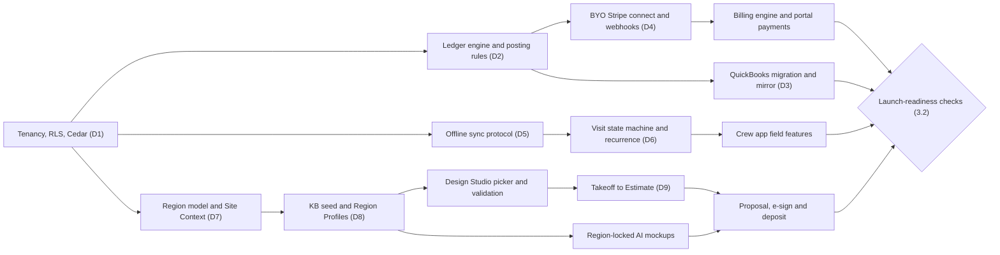

# 24 - Product Scope, Decisions and Master Feature Catalog

> This is the scope and decision document for Rootline. Rootline ships as **one release, v1**, built by Claude from these specs and run by the founder with Claude's agents. Section 1 is the **decision record**: it settles every scope question, open decision and contradiction between documents, and it wins over every other document. Section 2 is the **master feature catalog**: 747 features, all of them in v1, each with an ID, a primary persona and a link to the section that specifies it.

| Field | Value |
|---|---|
| Document | 24 - Product Scope, Decisions and Master Feature Catalog |
| Date | 2026-11-15 |
| Owner | `platform_owner` (the founder) |
| Status | Binding. Version 3: one release, every open decision closed |
| Inputs | Module docs [01](01-market-landscape.md) to [23](23-innovation-moonshots.md); research [R1](research/R1-field-service-platforms.md), [R2](research/R2-landscape-specific-platforms.md), [R3](research/R3-design-ai-plant-data.md), [R4](research/R4-industry-payments-accounting.md) |
| Authority | Scope, decisions and the catalog. Where any document disagrees with section 1, section 1 wins. Business terms stay with [22](22-business-model-pricing-gtm.md), architecture with [20](20-architecture-security.md), roles with [02](02-personas-roles-permissions.md), each as amended here |
| Main consumers | The build agent ([25](25-platform-blueprint-build-handoff.md)), the marketing agent ([26](26-agent-led-marketing-playbook.md)), the founder |

**At a glance**

- **One release.** Everything in the specs is in v1. There are no MVP, V1, V2 or V3 tiers, no cut lines, no release gates and no waves. If a spec describes something, v1 has it.
- **Two people.** The founder and Claude. Claude builds the product from [25](25-platform-blueprint-build-handoff.md), markets it under [26](26-agent-led-marketing-playbook.md) and runs Rootline's own operations through agents in the console. There is no staff, no team leads, no sales team and no design-partner program.
- **Nothing is left open.** Every open decision takes the answer in section 1.6, every contradiction between documents takes the answer in section 1.5, and every open question in a module doc takes its recommended default. The build agent does not stop to ask.
- **Some features wait for a condition, not a date.** Benchmarks need enough Companies per cell, agent autonomy is earned per action, and plant coverage follows curated data. These are built in v1 and switch on by themselves when the condition holds (1.4).

## Table of contents

- [0. How to use this document](#0-how-to-use-this-document)
- [1. The decision record](#1-the-decision-record)
- [2. Master feature catalog](#2-master-feature-catalog)
- [3. Acceptance scenarios and launch readiness](#3-acceptance-scenarios-and-launch-readiness)
- [4. Product dependencies and build order](#4-product-dependencies-and-build-order)
- [5. Build vs buy vs partner](#5-build-vs-buy-vs-partner)
- [6. Product risk register](#6-product-risk-register)
- [7. Product success measures](#7-product-success-measures)
- [8. Former open product decisions](#8-former-open-product-decisions)
- [Sources and related documents](#sources-and-related-documents)

## 0. How to use this document

**One release.** Older drafts tagged features with scope tiers. Those tags are gone. A sentence that still says a feature comes "later", "after launch", "in a later wave" or "at V2" means the feature is in v1. A sentence that describes a basic version first and a fuller version later means v1 has the fuller version, with the basic behavior as its default setting where the spec offers one (for example inventory modes Off, Light and Standard are all available, and the default depends on Company size, OD-43).

**Catalog IDs.** Every catalog row has an ID of the form `Cnn-mmm`, where `nn` is the module doc number and `mmm` is a sequence within that module (for example `C03-012`). Module docs keep their own requirement IDs (`EST-01`, `AIM-GEN-A`, `M-01`); the Source column links to them. Each feature is listed once, under the doc that owns it.

**Personas.** The Persona column uses the role keys from [02](02-personas-roles-permissions.md): `platform_owner`, `platform_support`, `platform_curator`, `platform_finance`, `platform_engineer`; `owner`, `office_manager`, `estimator`, `designer`, `ops_manager`, `crew_lead`, `technician`, `bookkeeper`, `subcontractor`; `client_residential`, `client_commercial`. It names the person who gets the most value from the feature. The four `platform_*` roles other than `platform_owner` are held by Rootline's operator agents (1.2).

**Glossary.** Terms follow the shared glossary: Company (tenant), Client, Property, Contact, Lead, Opportunity, Estimate (internal costing), Proposal (customer-facing), Job (Work Order, Project, or recurring Service Agreement), Visit, Route, Crew, Price Book, Design / Design Version / Design Option, Takeoff, Mockup, Plant, Region, Plant Region Profile, Plant Palette, Invoice, Payment, Credit Memo, Deposit, Retainage, Ledger, Automation, Copilot. Examples use the sample tenant **Greenleaf Grounds Co.**

**Numbers.** Prices, AI-cost and capacity figures are estimates from the module docs ([22](22-business-model-pricing-gtm.md) for prices and AI credits). This document makes no time, effort or headcount estimates.

---

## 1. The decision record

These decisions are binding on every document, on the blueprint data in [platform/](platform/README.md) and on the build. Where a module doc still reads differently, this section is the answer and the module doc is out of date.

### 1.1 One release

1. **v1 is the whole product.** Every feature in the catalog (section 2), every route in `platform/surfaces.json`, every agent in [17](17-ai-copilot-automation.md), every service-line module in [14](14-service-line-modules.md) and every innovation bet in [23](23-innovation-moonshots.md) is in v1.
2. **No scope tiers.** The scope-tier tags, release trains, waves as phases, cut orders, exit criteria and stage gates are retired everywhere.
3. **Fuller version wins.** Where a spec staged a capability ("basic now, full later"), v1 builds the full capability. Staged behavior that is useful as a setting stays as a setting, with the simpler behavior as the default.
4. **Packaging is not scope.** Plans, add-ons, limits and meters in [22](22-business-model-pricing-gtm.md) and `platform/plans.json` decide who pays for what, not what exists. Snow Lite stays free in every plan and the full Snow & Ice module stays an add-on; Tree Care stays an add-on; and so on.
5. **Quality bars stay.** Removing tiers removes no quality requirement. Ledger invariants, offline-first sync, tenant isolation, accessibility, the AI golden sets and the launch-readiness checks in section 3 all apply to v1.

### 1.2 Two people

1. **The founder** holds `platform_owner` and is the only human at Rootline. The founder approves what the specs reserve for a person: prices and plan contents, publishing claims, refunds and credits above an agent's limit, break-glass access, and anything an agent escalates.
2. **Claude builds and markets.** The build agent works from [25](25-platform-blueprint-build-handoff.md); the marketing agent works under [26](26-agent-led-marketing-playbook.md).
3. **Operator agents run Rootline.** `platform_support`, `platform_curator`, `platform_finance` and `platform_engineer` are permission sets held by AI operator agents (the support agent, the plant curator agent, the finance agent and the engineering agent). They act inside those permissions at the autonomy levels of [17](17-ai-copilot-automation.md); a hired person could hold the same role later without any product change.
4. **Two-person rules become agent-proposes, founder-approves.** Wherever [19](19-platform-admin-portal.md), [02](02-personas-roles-permissions.md) or [20](20-architecture-security.md) require a second approver, an agent's request needs the founder's approval. The founder's own privileged actions need step-up authentication and a written reason, are logged to the platform audit log, and notify the affected Company where the specs say so.
5. **Owners and leads.** Wherever a document names an owner, lead, team, CSM, inside sales, field sales, an advisory board or a "regulatory content researcher", read the founder for decisions and the matching agent for the work.
6. **Customers, not design partners.** There is no design-partner program and no pre-sale validation phase. The first Companies are customers on the published plans; Founding Customer pricing (1.5, R26-12) is the only early-customer offer. Validation comes from product analytics, support conversations and win/loss notes, which the agents collect.

### 1.3 Defaults are decisions

1. Every open product decision takes the answer in section 1.6.
2. Every open question in a module doc takes the recommended default written in that doc.
3. Where a doc gives no default, the build agent chooses the option that is simplest and consistent with the specs, records it in the code's decision log (ADR) and carries on. It does not stop to ask, and it does not invent prices, plan contents, credit rates or legal positions; those come from [22](22-business-model-pricing-gtm.md) and this section.

### 1.4 Conditions, not dates

Some v1 features depend on data, earned trust or an outside party. They are built, tested and shipped in v1, and turn on by themselves when the condition holds:

| Feature | Condition |
|---|---|
| Pulse benchmarks and peer comparisons ([18](18-reporting-analytics.md)) | At least 10 contributing Companies per cell, with lags ([OD-69](#16-every-open-decision-closed)) |
| Agent autonomy above L2 ([17](17-ai-copilot-automation.md)) | Graduation per agent and action on measured accuracy; L3 templates in OD-46 are on from the start |
| Plant coverage in a Region ([12](12-plant-knowledge-base.md)) | The Region's profiles reach Excellent; the plant curator agent builds them |
| Rootline Match and design-ready homeowner leads ([11](11-ai-design-mockups.md), [23](23-innovation-moonshots.md)) | Opt-in Companies serving the homeowner's address |
| Tap to Pay, embedded payroll, Plaid, carriers and other partner features | The partner's terms and approval for the Company |
| AI mockups on every surface ([11](11-ai-design-mockups.md)) | The image route passes the golden set (11 section 8.7); it is a ship requirement, not a gate on Companies |
| Innovation bets in [23](23-innovation-moonshots.md) that need third-party hardware or data (mower telematics, drones, sensors) | The Company connects the device or data source |

### 1.5 Contradictions resolved

Every known disagreement between documents and data, with its answer. "R24-n" rows replace the cross-doc tag reconciliations of the previous version of this document, "R25-Cn" rows are from [25](25-platform-blueprint-build-handoff.md) section 8.1 and "R26-n" rows are from [26](26-agent-led-marketing-playbook.md) section 8.1.

| # | Topic | Answer |
|---|---|---|
| R24-1 | Snow and ice | Snow Lite is free in every plan; the full Snow & Ice module (Storm Command Center, triggers, hash-sealed proof) is the `snow_ice` add-on. Both are in v1 |
| R24-2 | Tree care | In v1 as the `tree_care` add-on (included in Pro and Enterprise per 22) |
| R24-3 | Tap to Pay | In v1, iPhone and Android where Stripe supports it |
| R24-4 | Plaid bank feeds | In v1 |
| R24-5 | Xero connector | In v1 alongside QuickBooks Online |
| R24-6 | Inventory modes | Off, Light and Standard in v1; default per OD-43 |
| R24-7 | Equipment maintenance | Preventive maintenance and work orders in v1, with the registry, meters, DVIR and rate calculator |
| R24-8 | Website builder | In v1 as priced in 22 |
| R24-9 | Instant quote and online booking | In v1, with confidence gating and first-visit verification (OD-36) |
| R24-10 | Campaigns | Full set in v1: segments, one-off email and SMS, prebuilt journeys, the journey builder, newsletters and direct mail |
| R24-11 | Reviews and referrals | Review requests, NPS and the referral program in v1 |
| R24-12 | AI receptionist | In v1 as priced in 22, plus call tracking and missed-call text-back |
| R24-13 | Change orders and renewals | Full versions in v1: office, field and verbal-emergency change orders; fixed, CPI, cost-plus and margin-target escalators; the renewal review grid |
| R24-14 | Homeowner visualizer | All three in v1: the website widget on Company sites, the portal-hosted visualizer and Rootline Home. On by default (OD-33) |
| R24-15 | Switch kits | Jobber, LMN, SingleOps, Service Autopilot, Real Green, QuickBooks and CSV in v1 (OD-04) |
| R24-16 | SSO and SCIM | SAML/OIDC SSO and SCIM in v1 (Enterprise) |
| R24-17 | HOA and commercial approvals | Quorum and sequential approvals and board meeting workflows (ballots, packets, resident intake) in v1 |
| R24-18 | Jurisdiction packs | Federal, the five Great Lakes states, California and Canada (Ontario) in v1 (OD-52); further states and provinces are rule-pack data maintained by the plant curator agent |
| R24-19 | Canada | In v1: CAD, PAD, FX, GST/HST/QST/PST, CASL, fr-CA, and the Canadian residency stack (OD-62) |
| R24-20 | Client scheduling | Skip, reschedule, pause and add-on self-scheduling in v1 |
| R24-21 | Passkeys | Passkeys for staff, platform users and clients in v1 |
| R24-22 | Import rollback window | 7 days or until the first financial posting against imported records, whichever comes first |
| R24-23 | Tenant lifecycle timing | 19 and 22 win: past_due 0-13 days, restricted 14-29, suspended 30-59, churned at 60. 20 section 4.4.7 follows them |
| R24-24 | Gift credits and certificates | In v1, sold only where the gift-card rule table allows (16 open question 17) |
| R24-25 | Staff passkeys | In v1 (see R24-21) |
| R24-26 | Crew voice assistant | In v1, with voice notes and the Field-Note agent |
| R24-27 | Reports and forecasts | Scheduled delivery, the report builder, cash and capacity forecasts and the scenario planner in v1 |
| R24-28 | Account codes and event names | 09's chart of accounts is canonical; producer event names are canonical in 20's registry |
| R25-C1 | Route tags | Moot: every route is v1 |
| R25-C2 | Job costing | Job cost by phase and cost type, against the estimate, is part of the Ledger in every plan that has it; WIP and percent-complete come with Ledger Advanced (Pro, or the Grow add-on) |
| R25-C3 | Estimators and designers on mobile | The one native app (OD-38) has three modes: crew, manager and **sales**. Sales mode gives estimators and designers offline site assessments, Quick Quote with turf measurement, and Field Design Mode capture (03 SALES-01, 05 section 4.0) |
| R25-C4 | Homeowner widget route | `home.widget` exists (see R24-14) |
| R25-C5 | Observer role | A free, read-only starter role (02 section 5.7): Today and Reports, dashboards and margin, no client PII, no exports, no writes. Template in `platform/roles.json` |
| R25-C6 | `time_entry` | Two capabilities: `time_entry.own` (own punches) and `time_entry.others` (other people's time) |
| R25-C7 | Showing AI credit cost | Every AI action shows its credit cost before it runs, on or beside its button (22 section 4.1 rule 4). An explicit confirmation is required above 20 credits (17) |
| R25-C8 | Autonomy defaults | L3 from the start only for the day-3 payment reminder and visit-completion messages (OD-46); every other agent action starts at L0-L2 and graduates per 17. Pre-approved L3 templates are in v1 |
| R25-C9 | Sample company | **Greenleaf Grounds Co.**, Columbus, Ohio, with 120 clients, is the onboarding sandbox and the demo tenant everywhere (22 section 4.6). 20 section 4.22's "Green Acres Landscaping" is renamed |
| R25-C10 | Module keys | 14 section 4.0.1 keys are canonical (`platform/tenants.json` `module_catalog`) |
| R25-C11 | Entitlement names | 22 section 10.1 wins: entitlement kinds are `flag`, `limit` and `meter`; feature keys are those in `platform/plans.json` (for example `design_3d`). 19 PA-040 follows them |
| R25-C12 | Console app name | `apps/console` (20 section 4.30's `apps/admin` is renamed) |
| R25-C13 | Summit sample tenant | Fine as written: Central Ohio with Dayton and Cincinnati branches. There are no waves |
| R26-1 | Plant Finder pages | In v1 |
| R26-2 | Plant Finder publishing gate | Both gates apply: a page publishes only when it passes 12 KB-API-04 and 22 section 6.5 |
| R26-3 | Comparison pages | Switch guides and named comparison pages are in v1. A claim about a competitor publishes only after the marketing agent has checked it against a primary source dated within 90 days (OD-03) |
| R26-4 | Spring-Ready Guarantee | Offered from launch; campaigns may use it |
| R26-5 | Creator and partner payouts | The partner program with commissions and payouts (19 PA-160 to PA-162) is in v1; creators are paid through it |
| R26-6 | Accountant channel | The accountant partner track and Accountant Hub are in v1; the November-December CPA push runs |
| R26-7 | Activation vs PQL | Two measures, two jobs. **Activation** is 4 of the 6 onboarding milestones (22 section 4.6) and earns the trial extension. **Product-qualified lead** is 4 of 7 signals within 7 days (22 section 6.7) and triggers a personal note from the founder, drafted by the marketing agent |
| R26-8 | Grow plan size vs ICP | The ICP (S2) is 5-40 people. Grow is sized for 5-25; S2 firms above 25 people are pointed to Pro |
| R26-9 | S3 import offer | Service Autopilot and Real Green kits are in v1 (R24-15), so the S3 offer stands |
| R26-10 | Canada | Signups from the US and Canada are welcome from launch (R24-19). Marketing to Quebec waits for the French-language check (OD-70) |
| R26-11 | Competitor keywords and retargeting | Bid on category terms and on competitor names only with ads that do not use competitor trademarks in the copy; retarget only visitors of non-results pages who consented (01 section 14) |
| R26-12 | Founding Customer | 25% off the base plan while subscribed, plus the Price Lock Promise, for the first 100 paying Companies in the Great Lakes Regions (22 section 4.6). No advisory board seat; Founding Customers get a direct line to the founder |
| R26-13 | Winter Mode and design | Paid designer seats keep Studio editing during Winter Mode (OD-15); 22 section 4.7 follows |

### 1.6 Every open decision closed

Each former open decision, with its answer. Answers drop every timing qualifier: nothing below is "later".

| # | Decision | Answer |
|---|---|---|
| OD-01 | Launch region | The Great Lakes: Central Ohio, Northeast Ohio, Southeast Michigan and Toledo, West Michigan, Chicagoland and Northwest Indiana, Southeast Wisconsin. This is where the Plant KB seed and marketing start. The product works in every US state and Canadian province; more Regions are curation work, not product work |
| OD-02 | Free plan | No free plan. Starter, the trial, Design Solo and Fundador cover the low end |
| OD-03 | Named comparison pages | Yes, with primary-source checks (R26-3) |
| OD-04 | Switch kits | All of them in v1 (R24-15) |
| OD-05 | Snow | Snow Lite in every plan; full Snow & Ice as an add-on (R24-1) |
| OD-06 | Rootline Home and Match channel conflict | Opt-in Companies only, client-of-record first, co-branded "Powered by Rootline" |
| OD-07 | Verification of research facts | The marketing agent verifies each fact against a primary source before it is used publicly. The build does not depend on it |
| OD-08 | Contract buyouts for switchers | 3 months of overlap credit as standard; full buyout only for Pro and Enterprise on annual prepay |
| OD-09 | Pay-as-you-grow application-fee plan | In v1 as an opt-in plan; zero markup stays the default |
| OD-10 | Credit unit and prices | "AI credits", priced from 22's published rate card; the finance agent reports usage monthly and the founder adjusts prices |
| OD-11 | Portal in every plan | Yes: proposals, pay, history and requests in all plans; commercial approvals and badge removal on higher plans |
| OD-12 | Messaging fees | An included segment allowance per plan plus packs; one-time 10DLC fees absorbed on annual Grow and Pro |
| OD-13 | Optimizer runs by plan | Sequencing on all plans; multi-crew optimization on Grow and above; fair-use quota on heavy runs |
| OD-14 | Benchmarks on Starter | Starter contributes and sees a teaser; full benchmarks on Grow and above |
| OD-15 | Studio during Winter Mode | Editing stays on for paid designer seats |
| OD-16 | No-snow winter | No automatic refund; goodwill credit toward next season if no events were recorded |
| OD-17 | Stripe Accounts v2 | Use v2 full-dashboard merchant configuration if it has OAuth parity when the build reaches payments; otherwise v1 controller properties with a migration path. The build agent checks Stripe's documentation and records the choice |
| OD-18 | Tap to Pay | In v1 (R24-3) |
| OD-19 | Surcharging | In v1, off by default, behind the compliance rule table; ACH incentives first |
| OD-20 | Keyed card entry (MOTO) | Not offered. Pay links during calls |
| OD-21 | Stripe accounts per legal entity | One connected account per legal entity |
| OD-22 | Service-hold thresholds | Payment-hold signal at 30 days past due; suspension at 45 days after a 7-day notice |
| OD-23 | ACH deposits | Accept on ACH initiation up to $5,000; above that, schedule after the payment clears |
| OD-24 | Default book of record | The ledger always runs. New Companies that name a CPA default to Mode B (native plus QuickBooks mirror); others default to Mode A (native) |
| OD-25 | Rootline's own books | On the Rootline ledger from the first day, mirrored to QuickBooks for Rootline's accountant |
| OD-26 | Revenue recognition for agreements | As performed (earned value) for accrual books; straight-line option for small cash-basis Companies |
| OD-27 | Unbilled accrual default | Off; on for accrual-basis monthly batch billers |
| OD-28 | Chart of accounts across entities | One shared chart with entity restrictions |
| OD-29 | Cash-basis view | In v1 |
| OD-30 | 1099 e-file and QuickBooks Desktop | 1099 e-file through a partner; QuickBooks Desktop through the Web Connector |
| OD-31 | Stripe Tax on connected accounts | Use it where Stripe supports it for connected accounts; otherwise the calculation API with Company liability and manual rates |
| OD-32 | Account codes and event names | R24-28 |
| OD-33 | Homeowner widget | On by default for every Company with AI mockups (R24-14) |
| OD-34 | Budget wizard before proposals | Not required: a default budget plus a persistent banner; only discounts below the floor are blocked |
| OD-35 | Default overhead method | FLH for maintenance, MORS for construction, both shown |
| OD-36 | Bounded auto-quote | In v1, off by default per Company, with confidence gating and first-visit verification |
| OD-37 | CRM sync (Salesforce, HubSpot) | In v1 |
| OD-38 | Native apps | One app with crew, manager and sales modes (R25-C3) |
| OD-39 | Irreversible crew actions | Press-and-hold |
| OD-40 | Dark mode | Light, dark, field-sun and field-night themes in v1 |
| OD-41 | Renderer and iPad | Web canvas everywhere, including iPad. The build agent measures Pencil latency and adds a native canvas only if the web canvas fails it |
| OD-42 | DWG | DXF and DWG (through a licensed SDK) in v1 |
| OD-43 | Inventory mode default | Light below 15 employees, ask above; negative stock warns |
| OD-44 | Historical import depth | Two seasons of invoices and Visits where available |
| OD-45 | Default image route | The build agent benchmarks vendor editing models against self-hosted pipelines on the golden set and picks by plant identity and house preservation |
| OD-46 | Default autonomy | R25-C8 |
| OD-47 | Outbound AI voice calls | Never |
| OD-48 | Canadian AI inference | Off by default for Quebec Companies; disclosed cross-border processing elsewhere in Canada until Canadian inference exists for the task |
| OD-49 | Ad hoc SQL over the analytics replica | In v1, read-only, with the metrics catalog first and number verification |
| OD-50 | Contact Arbiter caps | Residential 2 automated messages a day, commercial 4; snow per-push updates exempt |
| OD-51 | Fidelity score visibility | Badge and disclaimer for homeowners; the grade is visible to Company staff |
| OD-52 | Jurisdiction packs | R24-18 |
| OD-53 | Embedded payroll partner | Check, with Gusto Embedded as the fallback if Check declines the platform |
| OD-54 | Biometrics | No face verification; an optional non-biometric punch photo |
| OD-55 | Geofence auto-arrive | Prompt-only by default everywhere; auto mode opt-in outside California |
| OD-56 | Minimum worker age | 14 and up, with the minor-worker rules in 15 enforced for 14-17 |
| OD-57 | Location breadcrumb retention | 90 days, shorter where law requires; proof packets kept separately |
| OD-58 | Sync engine | A self-hosted sync service for reads plus an in-house outbox for writes |
| OD-59 | Device offline lease | 14 days, Company-configurable between 7 and 30 |
| OD-60 | Rule-pack maintenance | The plant curator agent maintains rule packs from licensed sources; the founder approves each pack before it publishes |
| OD-61 | Weather provider | A commercial provider with soil temperature, certified reports and AQI, plus NWS and ECCC |
| OD-62 | Canadian data residency | A regional stack for all Canadian Companies, in v1 |
| OD-63 | Event bus and observability | SNS/SQS; the build agent chooses the observability vendor before the first production Company |
| OD-64 | Public GraphQL | REST only |
| OD-65 | Product name and portal domain | "Rootline" is the working name; the founder clears the trademark before public launch. Portals use a neutral default domain for white-label purity |
| OD-66 | Breach notification | Contractual 72 hours, internal target 48 hours |
| OD-67 | Plant data and photo licenses | Facts are used under a facts-versus-expression policy; photos come only from licensed or commissioned sources, with attribution where the license requires |
| OD-68 | Imagery and parcel terms | Providers whose terms allow tracing, storage and client display; parcel lookups metered inside plan allowances |
| OD-69 | Benchmarks and pricing advice | Benchmarks ship with k of 10 or more and lags. Price benchmarks stay off until the founder has had them checked by counsel |
| OD-70 | Quebec and French | fr-CA interface and plant names in v1; Quebec marketing after the founder's French-language check |
| OD-71 | Scope governance | Scope is the catalog. A new feature is added to the catalog and to the blueprint data, and the build agent builds it |
| OD-72 | Field validation before general sale | No validation phase. Shadow mode (crews keep their old system in parallel) is a v1 setting any switching Company can turn on |

### 1.7 Legal checks the founder runs

These are not product phases. The product ships with conservative defaults, so none of them blocks the build; each is a conversation with counsel before the related default is loosened or the related claim is made:

- payment surcharging (surcharging ships off) and late-fee and auto-renewal rules (the rule tables ship with conservative values);
- TCPA and 10DLC texting (no cold texts; consent at send time);
- wage and meal-break rules in the jurisdiction packs;
- pesticide application records;
- AI image disclosure (mockups are always labeled as artist renderings);
- plant data and photo licenses (OD-67), and aerial imagery and parcel terms (OD-68);
- benchmarking and pricing-advice antitrust (OD-69);
- Quebec French (OD-70), gift cards (R24-24) and the trademark (OD-65).

### 1.8 Seasonal product facts

Landscape owners evaluate in the off-season, switch in January and February, go live in March and April, and resist change from May to September ([22 section 6.6](22-business-model-pricing-gtm.md#66-seasonality-of-buying-and-the-gtm-calendar)). These are facts about customers, not delivery dates, and the product is built for them:

| Customer season | Customer reality | What the product must handle |
|---|---|---|
| Fall (Oct) | Fall cleanups, irrigation winterization, snow prep, budgeting | Snow Lite and Snow & Ice ready before the first storm |
| Early winter (Nov-Dec) | Leaf cleanups, holiday lighting, year-end books, shortlists and trials | Self-serve trials, the Greenleaf sandbox, migrations and year-end close |
| Late winter (Jan-Feb) | Trade shows, planning, design season, peak buying and switching | Migration Center, switch kits and AI mapping at peak load; design and proposal tools at peak use; the Spring-Ready deadline of 15 February |
| Spring (Mar-Apr) | Spring cleanups, irrigation start-ups, first mow, crews hired | Bulk crew onboarding by SMS in Spanish; the crew app at its load peak on April Monday mornings |
| Summer (May-Aug) | Full production: mowing, installs, fertilizer rounds | Crew-facing changes ship behind flags that each Company can defer until fall |
| Late summer (Sep) | Overseeding, fall installs, renewals | Auto-renewal rules, escalators and renewals in the portal |

Plant photography needs a growing season: bloom and fall color can only be shot in summer and fall. Until a plant has its own photos, the Plant KB uses licensed photos (OD-67).

---

## 2. Master feature catalog

### 2.1 Conventions and counts

The catalog lists 747 features, every one of them in v1. Many rows are small (a policy, a template, a setting) and about a sixth of them are platform capabilities in docs 19-21. Each feature appears once, under the doc that owns it.

| # | Module | Owner doc | Features |
|---|---|---|---|
| 2.2 | [Market intelligence](#22-01---market-intelligence) | [01](01-market-landscape.md) | 13 |
| 2.3 | [Identity, roles and permissions](#23-02---identity-roles-and-permissions) | [02](02-personas-roles-permissions.md) | 40 |
| 2.4 | [CRM, sales, estimating and proposals](#24-03---crm-sales-estimating-and-proposals) | [03](03-crm-sales-estimating-proposals.md) | 42 |
| 2.5 | [Scheduling, dispatch and routing](#25-04---scheduling-dispatch-and-routing) | [04](04-scheduling-dispatch-routing.md) | 35 |
| 2.6 | [Field crew mobile app](#26-05---field-crew-mobile-app) | [05](05-field-crew-mobile-app.md) | 27 |
| 2.7 | [Customer portal](#27-06---customer-portal) | [06](06-customer-portal.md) | 39 |
| 2.8 | [Invoicing, billing and service agreements](#28-07---invoicing-billing-and-service-agreements) | [07](07-invoicing-billing-contracts.md) | 43 |
| 2.9 | [Payments (bring-your-own Stripe)](#29-08---payments-bring-your-own-stripe) | [08](08-payments-stripe.md) | 30 |
| 2.10 | [Accounting ledger and integrations](#210-09---accounting-ledger-and-integrations) | [09](09-accounting-ledger-integrations.md) | 42 |
| 2.11 | [Design Studio](#211-10---design-studio) | [10](10-design-studio.md) | 28 |
| 2.12 | [AI design mockups](#212-11---ai-design-mockups) | [11](11-ai-design-mockups.md) | 23 |
| 2.13 | [Plant Knowledge Base](#213-12---plant-knowledge-base) | [12](12-plant-knowledge-base.md) | 29 |
| 2.14 | [Operations: materials, inventory, purchasing, equipment](#214-13---operations-materials-inventory-purchasing-equipment) | [13](13-operations-inventory-equipment.md) | 38 |
| 2.15 | [Service-line modules](#215-14---service-line-modules) | [14](14-service-line-modules.md) | 41 |
| 2.16 | [Team, HR, time and payroll](#216-15---team-hr-time-and-payroll) | [15](15-team-hr-payroll.md) | 29 |
| 2.17 | [Marketing, growth and communications](#217-16---marketing-growth-and-communications) | [16](16-marketing-growth-communications.md) | 34 |
| 2.18 | [AI Copilot, agents and automation](#218-17---ai-copilot-agents-and-automation) | [17](17-ai-copilot-automation.md) | 35 |
| 2.19 | [Reporting and analytics](#219-18---reporting-and-analytics) | [18](18-reporting-analytics.md) | 28 |
| 2.20 | [Platform admin portal (Operator Console)](#220-19---platform-admin-portal-operator-console) | [19](19-platform-admin-portal.md) | 31 |
| 2.21 | [Architecture and security (platform capabilities)](#221-20---architecture-and-security-platform-capabilities) | [20](20-architecture-security.md) | 33 |
| 2.22 | [UX, design system and localization](#222-21---ux-design-system-and-localization) | [21](21-ux-design-system-sitemaps.md) | 28 |
| 2.23 | [Business model, pricing and packaging](#223-22---business-model-pricing-and-packaging) | [22](22-business-model-pricing-gtm.md) | 25 |
| 2.24 | [Innovation bets (moonshots)](#224-23---innovation-bets-moonshots) | [23](23-innovation-moonshots.md) | 34 |
| | **Total** | | **747** |

Columns: **ID** (catalog ID, `Cnn-mmm`; see section 0), **Feature** (short name), **Description** (one line on what v1 does), **Persona** (the primary role key, the person who gets the most value) and **Source** (the module doc section that specifies it, with its own requirement IDs).

### 2.2 01 - Market intelligence

Rootline's own go-to-market tooling: competitor evidence, switch kits and win/loss. Mostly internal (`platform_*` personas). Owner doc: [01-market-landscape.md](01-market-landscape.md). 13 features.

| ID | Feature | Description | Persona | Source |
|---|---|---|---|---|
| C01-001 | Competitor registry | One record per competitor organization and product, with aliases used to recognize export files and signup answers | `platform_owner` | [01 §12.2](01-market-landscape.md#122-feature-specification) |
| C01-002 | Evidence ledger and claims | Every competitive statement is a sourced, evidence-tagged claim with a verify-by date; [B]/[E] claims never publish | `platform_owner` | [01 §12.2](01-market-landscape.md#122-feature-specification) |
| C01-003 | Capability matrix as data | Capability keys and product ratings with confidence flags; regenerates the competitor feature matrix | `platform_owner` | [01 §12.2](01-market-landscape.md#122-feature-specification) |
| C01-004 | Switch-source capture | Signup asks which tools the Company uses today; selects importer, switch kit and battlecard | `owner` | [01 §12.2](01-market-landscape.md#122-feature-specification) |
| C01-005 | Win/loss records | Outcome, competitors, reason codes and interview notes for every closed GTM opportunity | `platform_owner` | [01 §12.2](01-market-landscape.md#122-feature-specification) |
| C01-006 | Switch kits: Jobber and LMN | Known export formats, field mappings and AI-assisted column mapping for the two most common source systems | `platform_engineer` | [01 §12.2](01-market-landscape.md#122-feature-specification) |
| C01-007 | Switch kits: SingleOps, Service Autopilot, Real Green, Aspire, Yardbook, Copilot CRM | Same kit structure for six more incumbents | `platform_engineer` | [01 §12.2](01-market-landscape.md#122-feature-specification) |
| C01-008 | Market sizing workbook | Census CBP and StatCan counts by employee band recompute the bottom-up model and beachhead scores | `platform_finance` | [01 §12.2](01-market-landscape.md#122-feature-specification) |
| C01-009 | Pricing observations | Per-plan competitor prices with observed-at dates; a change over 5% opens a battlecard review | `platform_owner` | [01 §12.2](01-market-landscape.md#122-feature-specification) |
| C01-010 | Competitor change monitor | Watches public pricing pages and changelogs; stores diffs with an AI summary in a triage queue | `platform_engineer` | [01 §12.2](01-market-landscape.md#122-feature-specification) |
| C01-011 | Battlecards | Per-competitor cards built only from verified claims, pains and win/loss reasons, with stale-claim banners | `platform_owner` | [01 §12.2](01-market-landscape.md#122-feature-specification) |
| C01-012 | Public comparison pages | Generated from publishable claims with as-of dates, citations, an inaccuracy-report link and legal review | `platform_owner` | [01 §12.2](01-market-landscape.md#122-feature-specification) |
| C01-013 | Processor Fee X-ray | Prospect uploads a processing statement; AI extracts the effective rate and compares Stripe plus ACH steering | `owner` | [01 §12.2](01-market-landscape.md#122-feature-specification) |

### 2.3 02 - Identity, roles and permissions

Owner doc: [02-personas-roles-permissions.md](02-personas-roles-permissions.md). 40 features.

| ID | Feature | Description | Persona | Source |
|---|---|---|---|---|
| C02-001 | Global identity with many memberships | One login per person across Companies; the employee record is separate from the login | `owner` | [02 §5.1](02-personas-roles-permissions.md#51-identity-model-one-person-many-memberships-mvp) |
| C02-002 | resource.action permission taxonomy | Typed permissions with domain actions and dependencies, evaluated by the policy engine at every enforcement point | `owner` | [02 §5.2](02-personas-roles-permissions.md#52-permission-taxonomy-resourceaction-mvp) |
| C02-003 | Scopes own/crew/all with ownership rules | Per-resource ownership rules decide what each scope returns, including crew visibility windows | `ops_manager` | [02 §5.3](02-personas-roles-permissions.md#53-scopes-own-crew-branch-all-mvp-branch-v1) |
| C02-004 | Branch scope | Branch-bounded visibility and actions for multi-branch Companies | `ops_manager` | [02 §5.3](02-personas-roles-permissions.md#53-scopes-own-crew-branch-all-mvp-branch-v1) |
| C02-005 | Field classes masked server-side | Price, cost, margin, pay rate, PII and access secrets masked in API, search, exports, webhooks, sync and Copilot | `owner` | [02 §5.4](02-personas-roles-permissions.md#54-field-level-restrictions-field-classes-mvp) |
| C02-006 | Time-windowed gate-code reveal | Access secrets revealed only near the Visit window, with an audited reveal event | `technician` | [02 §5.4](02-personas-roles-permissions.md#54-field-level-restrictions-field-classes-mvp) |
| C02-007 | Masked calling and texting | Proxy numbers so Client phone numbers never reach field devices | `crew_lead` | [02 §5.4](02-personas-roles-permissions.md#54-field-level-restrictions-field-classes-mvp) |
| C02-008 | Approval limits | Per-role limits on discounts, refunds, credits, write-offs, POs and field collections | `owner` | [02 §5.6](02-personas-roles-permissions.md#56-approval-limits-thresholds-and-dual-control-mvp-dual-control-v1) |
| C02-009 | Two-person approval (dual control) | Second approver for bank-detail changes, Stripe disconnect and bulk exports | `owner` | [02 §5.6](02-personas-roles-permissions.md#56-approval-limits-thresholds-and-dual-control-mvp-dual-control-v1) |
| C02-010 | Nine role templates and master matrix | Owner, office_manager, estimator, designer, ops_manager, crew_lead, technician, bookkeeper, subcontractor templates | `owner` | [02 §5.7](02-personas-roles-permissions.md#57-role-templates-mvp) |
| C02-011 | Custom roles with anti-escalation | Clone-and-edit roles; nobody can grant a permission they do not hold; impact diff before save | `owner` | [02 §5.8](02-personas-roles-permissions.md#58-custom-roles-multi-role-users-and-anti-escalation-mvp-clone-and-edit-v1-gallery-and-diff) |
| C02-012 | Multi-role and time-bound assignments | Several roles per user, bounded by branch, division or expiry date | `owner` | [02 §5.8](02-personas-roles-permissions.md#58-custom-roles-multi-role-users-and-anti-escalation-mvp-clone-and-edit-v1-gallery-and-diff) |
| C02-013 | Just-in-time elevation | Request access on a denied action; approver grants a time-boxed elevation by push | `crew_lead` | [02 §5.8](02-personas-roles-permissions.md#58-custom-roles-multi-role-users-and-anti-escalation-mvp-clone-and-edit-v1-gallery-and-diff) |
| C02-014 | Branches and divisions | Organization structure for multi-branch Companies, feeding scopes, ledger dimensions and reports | `owner` | [02 §5.9](02-personas-roles-permissions.md#59-organization-structure-branches-divisions-legal-entities-multi-company-and-franchise) |
| C02-015 | Franchise data-sharing agreements | Organization layer above Companies with per-category data-sharing consent | `owner` | [02 §5.9](02-personas-roles-permissions.md#59-organization-structure-branches-divisions-legal-entities-multi-company-and-franchise) |
| C02-016 | Accountant delegated access | Free firm-level access for an external CPA to a client Company's books (Hub UI in 09) | `bookkeeper` | [02 §5.10](02-personas-roles-permissions.md#510-delegated-access-for-external-accountants-the-accountant-hub-mvp-basic-v1-hub) |
| C02-017 | Client contact roles | primary, co_owner, billing, property_contact, approver and viewer scopes for portal contacts | `client_residential` | [02 §5.11](02-personas-roles-permissions.md#511-client-contact-permissions-and-approval-policies-mvp-contact-roles-v1-approval-policies) |
| C02-018 | Commercial and HOA approval policies | n-of-m quorum, sequential approvers, PO required, votes tied to Proposal version, board term expiry | `client_commercial` | [02 §5.11](02-personas-roles-permissions.md#511-client-contact-permissions-and-approval-policies-mvp-contact-roles-v1-approval-policies) |
| C02-019 | Subcontractor assignment-scoped access | Subs see only assigned Visits, scope and documents; no prices or other Clients | `subcontractor` | [02 §5.12](02-personas-roles-permissions.md#512-subcontractor-access-and-data-visibility-mvp-basic-v1-sub-portal) |
| C02-020 | Consented support access | Owner-granted, time-boxed view-as and act-as with a banner and a tenant-visible access log | `platform_support` | [02 §5.13](02-personas-roles-permissions.md#513-platform-staff-permissions-support-impersonation-and-break-glass-mvp) |
| C02-021 | Break-glass production access | Emergency production access: an operator agent's request needs the founder's approval; the founder's own use needs step-up authentication and a written reason; tenant notice and full audit | `platform_engineer` | [02 §5.13](02-personas-roles-permissions.md#513-platform-staff-permissions-support-impersonation-and-break-glass-mvp) |
| C02-022 | MFA and passkeys for staff | TOTP and WebAuthn passkeys; MFA mandatory for owners and financial roles | `owner` | [02 §5.14](02-personas-roles-permissions.md#514-authentication-per-persona-mvp-unless-tagged) |
| C02-023 | Crew phone sign-in | Phone OTP (SMS or WhatsApp) on first login, then app PIN or biometrics | `technician` | [02 §5.14](02-personas-roles-permissions.md#514-authentication-per-persona-mvp-unless-tagged) |
| C02-024 | Enterprise SSO (SAML/OIDC) | SSO for Enterprise Companies through an identity broker | `owner` | [02 §5.14](02-personas-roles-permissions.md#514-authentication-per-persona-mvp-unless-tagged) |
| C02-025 | SCIM provisioning | Automated user provisioning and deprovisioning from the Company's IdP | `owner` | [02 §5.14](02-personas-roles-permissions.md#514-authentication-per-persona-mvp-unless-tagged) |
| C02-026 | Kiosk PIN clock-in | PIN punch on enrolled shared tablets, offline-capable, optional photo | `technician` | [02 §5.15](02-personas-roles-permissions.md#515-shared-devices-kiosk-mode-and-device-trust-mvp-crew-device-v1-yard-kiosk-and-mdm) |
| C02-027 | Device registry, revoke and remote wipe | Enrolled crew devices with trust state, revocation and wipe of local data | `ops_manager` | [02 §5.15](02-personas-roles-permissions.md#515-shared-devices-kiosk-mode-and-device-trust-mvp-crew-device-v1-yard-kiosk-and-mdm) |
| C02-028 | Session policies with permission version stamps | Per-surface session lifetimes; token version stamps end revoked access in about 1 second online | `platform_engineer` | [02 §5.16](02-personas-roles-permissions.md#516-session-policies-mvp-defaults-v1-tenant-configurable) |
| C02-029 | Hash-chained audit log | Append-only, tenant-readable log of operator, AI-agent and user actions | `owner` | [02 §5.17](02-personas-roles-permissions.md#517-audit-logging-mvp-capture-and-basic-ui-v1-advanced-search-v2-siem-streaming) |
| C02-030 | Audit saved alerts and SIEM streaming | Saved audit searches with alerts; streaming to the Company's SIEM | `owner` | [02 §5.17](02-personas-roles-permissions.md#517-audit-logging-mvp-capture-and-basic-ui-v1-advanced-search-v2-siem-streaming) |
| C02-031 | Seasonal bulk onboarding by SMS in Spanish | Invite a spring crew in bulk; each worker activates by SMS in their language | `office_manager` | [02 §5.18.1](02-personas-roles-permissions.md#5181-bulk-seasonal-onboarding-mvp) |
| C02-032 | Hibernation at $0 seat cost | End-of-season hibernate keeps history and credentials without a billable seat | `owner` | [02 §5.18.2](02-personas-roles-permissions.md#5182-hibernation-end-of-season-mvp) |
| C02-033 | Rehire returning crew wizard | One-tap spring rehire restores role, crew, pay and credentials for review | `office_manager` | [02 §5.18.3](02-personas-roles-permissions.md#5183-rehire-spring-mvp) |
| C02-034 | Termination with immediate revocation | Revokes sessions and devices at once and starts the offboarding checklist | `office_manager` | [02 §5.18.4](02-personas-roles-permissions.md#5184-offboarding-termination-or-quit-mvp) |
| C02-035 | Ownership transfer and successor designation | Owner succession, partner-dispute protections and business-sale handover | `owner` | [02 §5.18.6](02-personas-roles-permissions.md#5186-owner-changes-and-business-continuity-v1) |
| C02-036 | Minor-worker restrictions | Hour and equipment restrictions for workers under 18 from platform-maintained rule tables | `ops_manager` | [02 §5.18.7](02-personas-roles-permissions.md#5187-minor-workers-under-18-v1) |
| C02-037 | Access reviews and dormant-account sweeps | Quarterly review campaigns and automatic flags for unused access | `owner` | [02 §5.19](02-personas-roles-permissions.md#519-access-reviews-and-governance-v1) |
| C02-038 | View-as simulator and access explainer | See the app as a role and answer "why can't I see this" | `owner` | [02 §5.21](02-personas-roles-permissions.md#521-view-as-permission-simulator-v1) |
| C02-039 | Owner vacation mode | Delegate approvals to a deputy with limits and a daily digest | `owner` | [02 §14](02-personas-roles-permissions.md#14-beyond-the-brief-extra-ideas) |
| C02-040 | Sensitive-data detector | Moves gate codes and SSNs out of free-text notes into protected fields | `office_manager` | [02 §14](02-personas-roles-permissions.md#14-beyond-the-brief-extra-ideas) |

### 2.4 03 - CRM, sales, estimating and proposals

Owner doc: [03-crm-sales-estimating-proposals.md](03-crm-sales-estimating-proposals.md). 42 features.

| ID | Feature | Description | Persona | Source |
|---|---|---|---|---|
| C03-001 | Unified Lead Inbox | All new inquiries in one queue with SLA timers and instant auto-response | `office_manager` | [03 §LEAD-01](03-crm-sales-estimating-proposals.md#lead-01-unified-lead-inbox-mvp) |
| C03-002 | Core capture channels | Email, phone, referrals and manual entry flow into the Lead Inbox alongside 16's web forms | `office_manager` | [03 §LEAD-02](03-crm-sales-estimating-proposals.md#lead-02-capture-channels-mvp-core-channels-v1v2-marketplaces) |
| C03-003 | Deduplication and identity resolution | Phone, email, parcel and name scoring with reversible merges | `office_manager` | [03 §LEAD-03](03-crm-sales-estimating-proposals.md#lead-03-deduplication-and-identity-resolution-mvp-rules-v1-ml-assist) |
| C03-004 | Lead scoring | Explainable fit and intent scores: rules, ML | `estimator` | [03 §LEAD-04](03-crm-sales-estimating-proposals.md#lead-04-lead-scoring-v1-rules-v2-ml) |
| C03-005 | Lead routing and assignment | Round-robin, territory and rules-engine routing | `office_manager` | [03 §LEAD-05](03-crm-sales-estimating-proposals.md#lead-05-lead-routing-and-assignment-mvp-round-robin-and-territory-v1-rules) |
| C03-006 | Clients, Properties and Contacts | Core records with property-level history, multiple contacts and billing relationships | `office_manager` | [03 §CRM-01](03-crm-sales-estimating-proposals.md#crm-01-clients-properties-contacts-mvp) |
| C03-007 | Commercial hierarchy | Portfolios, management companies and HOAs above Properties | `ops_manager` | [03 §CRM-02](03-crm-sales-estimating-proposals.md#crm-02-commercial-hierarchy-v1) |
| C03-008 | Activity timeline, tasks, custom fields and tags | Unified timeline per record plus tasks, reminders and tenant-defined fields | `estimator` | [03 §CRM-03](03-crm-sales-estimating-proposals.md#crm-03-activity-timeline-mvp) |
| C03-009 | Configurable pipelines and kanban | Multiple pipelines, rotting indicators and mandatory lost reasons | `estimator` | [03 §PIPE-02](03-crm-sales-estimating-proposals.md#pipe-02-multiple-pipelines-with-configurable-stages-mvp) |
| C03-010 | Capacity-aware weighted forecast | Pipeline forecast checked against crew capacity in the season plan | `owner` | [03 §PIPE-05](03-crm-sales-estimating-proposals.md#pipe-05-forecast-v1) |
| C03-011 | Offline mobile site assessments | Checklists, photo annotation and measurements captured on site without signal | `estimator` | [03 §ASSESS-02](03-crm-sales-estimating-proposals.md#assess-02-mobile-assessment-checklists-mvp) |
| C03-012 | Voice-to-scope | Spoken walk-through notes become structured scope lines | `estimator` | [03 §ASSESS-04](03-crm-sales-estimating-proposals.md#assess-04-voice-to-scope-v1) |
| C03-013 | Property measurement profile | Parcel lot size, footprint and turf/bed/hardscape areas with provenance and confidence | `estimator` | [03 §INTEL-01](03-crm-sales-estimating-proposals.md#intel-01-property-measurement-profile-mvp-manual--parcel--ai-turf-v1-other-ai-classes) |
| C03-014 | AI auto-measure: turf | Segmentation of aerial imagery measures turf area for quotes | `estimator` | [03 §INTEL-03](03-crm-sales-estimating-proposals.md#intel-03-ai-auto-measure-mvp-turf-v1-beds-hardscape-and-commercial-classes) |
| C03-015 | AI auto-measure: beds, hardscape, commercial classes | Extends auto-measure to beds, driveways, hardscape and commercial site classes | `estimator` | [03 §INTEL-03](03-crm-sales-estimating-proposals.md#intel-03-ai-auto-measure-mvp-turf-v1-beds-hardscape-and-commercial-classes) |
| C03-016 | Company Budget wizard | Burden, overhead, equipment and target net profit set once and reused by every estimate | `owner` | [03 §EST-01](03-crm-sales-estimating-proposals.md#est-01-company-budget-wizard-mvp) |
| C03-017 | Overhead recovery methods | FLH, SORS and MORS side by side with a solver that balances MORS to the budget | `owner` | [03 §EST-02](03-crm-sales-estimating-proposals.md#est-02-overhead-recovery-methods-mvp-flh--sors--mors-v1-revenue-view-recovery-tracker) |
| C03-018 | Production-rate library | Seeded rates with difficulty multipliers, editable per Company | `estimator` | [03 §EST-03](03-crm-sales-estimating-proposals.md#est-03-production-rates-library-mvp) |
| C03-019 | Margin vs markup engine | Break-even, guardrails and below-floor approvals on every estimate | `estimator` | [03 §EST-09](03-crm-sales-estimating-proposals.md#est-09-pricing-math-margin-markup-and-the-truth-mvp) |
| C03-020 | Parametric kits (assemblies) | Versioned kits such as paver patio per sq ft in a sandboxed formula language; nested kits | `estimator` | [03 §EST-10](03-crm-sales-estimating-proposals.md#est-10-kits-assemblies-mvp-basic-v1-nested-and-conditional) |
| C03-021 | Quick Quote mode | Jobber-simple quoting on top of the full costing engine | `estimator` | [03 §EST-11](03-crm-sales-estimating-proposals.md#est-11-quick-quote-mode-mvp) |
| C03-022 | Price Book | Items with purchase rounding, waste factors, cost freshness and cost-change impact reports | `estimator` | [03 §PB-01](03-crm-sales-estimating-proposals.md#pb-01-price-book-mvp) |
| C03-023 | Recurring maintenance pricing | Per-visit, seasonal installments and banded price tables for maintenance | `estimator` | [03 §EST-12](03-crm-sales-estimating-proposals.md#est-12-recurring-maintenance-pricing-mvp) |
| C03-024 | Bulk seasonal enhancement campaigns | Generate hundreds of priced enhancement proposals (for example spring mulch) in one run | `estimator` | [03 §EST-13](03-crm-sales-estimating-proposals.md#est-13-seasonal-enhancement-estimates-and-campaigns-mvp-single-v1-bulk-campaigns) |
| C03-025 | Live takeoff sync | Protected two-way sync between Design and Estimate after the first push | `designer` | [03 §EST-17](03-crm-sales-estimating-proposals.md#est-17-takeoff-from-design-studio-mvp-basic-v1-live-sync) |
| C03-026 | AI-assisted estimate drafts: aerial-measured | Aerial-measured drafts: the agent runs the aerial measurement pipeline so quantities come from segmented aerial geometry in a Design draft. Drafts from notes, voice memos and photos run through the A6 Estimating Agent (C17-013); AI proposes scope and quantities, never prices | `estimator` | [03 §EST-18](03-crm-sales-estimating-proposals.md#est-18-ai-estimating-v1-assisted-drafts-v2-photo-first-v3-bounded-auto-quote) |
| C03-027 | Proposal builder and templates | Block-based proposals with company branding and reusable templates | `estimator` | [03 §PROP-01](03-crm-sales-estimating-proposals.md#prop-01-proposal-builder-and-templates-mvp) |
| C03-028 | Good/better/best tiers and add-ons | Tiers with per-tier mockups and deposits; add-on dependencies | `estimator` | [03 §PROP-03](03-crm-sales-estimating-proposals.md#prop-03-goodbetterbest-tiers-and-add-ons-mvp) |
| C03-029 | Visual proposals | Static mockups and plant cards; interactive plan | `designer` | [03 §PROP-04](03-crm-sales-estimating-proposals.md#prop-04-visual-proposals-mvp-static-v1-interactive) |
| C03-030 | Native e-signature (ESIGN/UETA) | Consent, audit trail and sealed PDF without a third-party e-sign vendor | `client_residential` | [03 §PROP-05](03-crm-sales-estimating-proposals.md#prop-05-e-signature-esign--ueta-mvp) |
| C03-031 | Deposits and payment schedules | Deposits on the Company's own Stripe with jurisdiction deposit caps | `client_residential` | [03 §PROP-07](03-crm-sales-estimating-proposals.md#prop-07-deposits-and-payment-schedules-via-the-companys-stripe-mvp) |
| C03-032 | Consumer financing offers | Partner financing with Reg Z-safe copy | `client_residential` | [03 §PROP-09](03-crm-sales-estimating-proposals.md#prop-09-financing-offers-v1) |
| C03-033 | Proposal analytics | Open and view tracking with hot-proposal alerts; detailed analytics | `estimator` | [03 §PROP-10](03-crm-sales-estimating-proposals.md#prop-10-proposal-analytics-mvp-basic-v1-detailed) |
| C03-034 | Expiration, versions and revive | Immutable versions, expiry and revive with cost re-validation | `estimator` | [03 §PROP-11](03-crm-sales-estimating-proposals.md#prop-11-expiration-revisions-and-versioning-mvp) |
| C03-035 | Follow-up cadences | Cadences to every signer with TCPA and 10DLC guardrails; smart sequences | `estimator` | [03 §PROP-12](03-crm-sales-estimating-proposals.md#prop-12-follow-up-automations-mvp-cadence-v1-smart-sequences) |
| C03-036 | One-click conversion to Jobs | Signed proposal becomes a Work Order, phased Project or Service Agreement with budgets and an 811 checklist | `ops_manager` | [03 §4.8](03-crm-sales-estimating-proposals.md#48-conversion-to-jobs-mvp) |
| C03-037 | Change orders | Office and field change orders with signature and price delta; verbal-emergency flow | `crew_lead` | [03 §4.9](03-crm-sales-estimating-proposals.md#49-change-orders-mvp-basic-v1-full) |
| C03-038 | Renewal engine with escalators | Fixed, CPI, cost-plus and margin-target escalators and the renewal review grid | `ops_manager` | [03 §4.10](03-crm-sales-estimating-proposals.md#410-agreement-renewals-and-price-escalators-mvp-basic-v1-full) |
| C03-039 | Commercial RFP intake and unit-price bids | AI extraction of RFP scope, multi-site unit-price bids and bid packets | `estimator` | [03 §4.11](03-crm-sales-estimating-proposals.md#411-commercial-bids-and-rfps-v1) |
| C03-040 | Sales commission plans | Plans, events, clawbacks and payroll export | `owner` | [03 §4.12](03-crm-sales-estimating-proposals.md#412-sales-commissions-hooks-v1) |
| C03-041 | Estimator mobile mode and kitchen-table close | Offline presentation, e-sign and deposit capture at the client's table | `estimator` | [03 §4.13](03-crm-sales-estimating-proposals.md#413-sales-productivity-mvp-core-v1-extras) |
| C03-042 | Automatic estimate post-mortems | Compare estimate to actuals and propose one-click production-rate updates | `estimator` | [03 §13](03-crm-sales-estimating-proposals.md#13-beyond-the-brief-extra-ideas) |

### 2.5 04 - Scheduling, dispatch and routing

Owner doc: [04-scheduling-dispatch-routing.md](04-scheduling-dispatch-routing.md). 35 features.

| ID | Feature | Description | Persona | Source |
|---|---|---|---|---|
| C04-001 | Job scheduling gates | Deposit, materials, 811, permit and design-sold gates before a Job can be dated | `ops_manager` | [04 §4.1.2](04-scheduling-dispatch-routing.md#412-job-lifecycle-and-scheduling-gates-mvp) |
| C04-002 | Canonical Visit state machine | Shared states and reason codes across office, crew app, portal and billing, with an offline guard | `ops_manager` | [04 §4.1.3](04-scheduling-dispatch-routing.md#413-visit-state-machine-canonical-mvp) |
| C04-003 | Visit flexibility, windows and locks | Flexibility classes, time and access windows and lock levels per Visit | `ops_manager` | [04 §4.1.4](04-scheduling-dispatch-routing.md#414-visit-timing-flexibility-and-locks-mvp) |
| C04-004 | RRULE recurrence engine | Weekly route-day, A/B bi-weekly, frequency profiles and count-limited presets | `ops_manager` | [04 §4.2.1](04-scheduling-dispatch-routing.md#421-recurrence-patterns-mvp-unless-tagged) |
| C04-005 | Seasonal service calendar per Region | Cleanups, mulch, aeration and winterization windows that drive visit generation | `ops_manager` | [04 §4.2.3](04-scheduling-dispatch-routing.md#423-seasonal-service-calendar-mvp) |
| C04-006 | Program round hand-off | Lawn and PHC rounds scheduled inside their windows with license guards | `ops_manager` | [04 §4.2.5](04-scheduling-dispatch-routing.md#425-program-rounds-hand-off-mvp) |
| C04-007 | Growth-adaptive mowing frequency | Rules and an AI model adjust mowing frequency to weather and turf growth | `ops_manager` | [04 §4.2.6](04-scheduling-dispatch-routing.md#426-growth-adaptive-mowing-frequency-v1-rules-v2-ai-model) |
| C04-008 | Holiday and blackout policies | slide_week, compress and observed-date rules applied to recurring work | `ops_manager` | [04 §4.2.7](04-scheduling-dispatch-routing.md#427-holidays-blackouts-and-closures-mvp) |
| C04-009 | Capacity planner | Sold vs available crew-hours by pool and week, with the full planner | `ops_manager` | [04 §4.3.1](04-scheduling-dispatch-routing.md#431-capacity-model-mvp-basic-v1-full) |
| C04-010 | Backlog with urgency score | Unscheduled work ranked by urgency with auto-slot suggestions | `ops_manager` | [04 §4.3.3](04-scheduling-dispatch-routing.md#433-backlog-view-mvp) |
| C04-011 | Skill and license matching | Skills and licenses checked on the service date, including future expiry | `ops_manager` | [04 §4.4.1](04-scheduling-dispatch-routing.md#441-skills-catalog-mvp) |
| C04-012 | Equipment and trailer reservations | Equipment, trailer and gate-width reservations with conflict checks across the full resource model | `ops_manager` | [04 §4.5.1](04-scheduling-dispatch-routing.md#451-resource-model-mvp-basic-v1-full) |
| C04-013 | Dispatch board | Day Gantt, Week, Map and Split views with unassigned tray and tiered drop validation | `ops_manager` | [04 §4.6.1](04-scheduling-dispatch-routing.md#461-views-mvp-unless-tagged) |
| C04-014 | Draft and publish cycle | Draft schedule, 15:00 auto-publish and late-change pushes to crews | `ops_manager` | [04 §4.6.7](04-scheduling-dispatch-routing.md#467-draft-and-published-schedule-mvp) |
| C04-015 | Zones, master routes and best-day slotting | Route days by zone and best-day suggestions for new clients | `ops_manager` | [04 §4.7.2](04-scheduling-dispatch-routing.md#472-master-routes-mvp) |
| C04-016 | Territory design solver | Rebalances zones and route days for density and workload | `ops_manager` | [04 §4.7.3](04-scheduling-dispatch-routing.md#473-territory-design-solver-v1) |
| C04-017 | Route optimizer: sequence and insertion | Single-crew sequencing and insertion on road-network travel times | `ops_manager` | [04 §4.8.1](04-scheduling-dispatch-routing.md#481-optimization-modes-mvp-sequence-and-insertion-v1-others-tagged-per-row) |
| C04-018 | Multi-crew VRP: day_plan, week_plan, repair | Whole-week, all-crew optimization with skills, equipment, windows, breaks and dump runs | `ops_manager` | [04 §4.8.1](04-scheduling-dispatch-routing.md#481-optimization-modes-mvp-sequence-and-insertion-v1-others-tagged-per-row) |
| C04-019 | Route stability penalties | Weekly clients keep their day, crew and order; warm starts from the last plan | `ops_manager` | [04 §4.8.5](04-scheduling-dispatch-routing.md#485-route-stability-mvp) |
| C04-020 | What-if scenarios | Locked scenarios with 3-way compare before publishing | `ops_manager` | [04 §4.8.8](04-scheduling-dispatch-routing.md#488-what-if-scenarios-v1) |
| C04-021 | Route density metrics | Marginal drive cost per stop and density per zone | `owner` | [04 §4.8.9](04-scheduling-dispatch-routing.md#489-route-density-metrics-mvp) |
| C04-022 | Weather Service with derived indices | Rain risk, spray window, heat, freeze and growing degree days per Property | `ops_manager` | [04 §4.9.1](04-scheduling-dispatch-routing.md#491-weather-service-mvp) |
| C04-023 | Rain-day playbooks | slide_day, push_later_in_week, split_day, skip and swap rules per service line | `ops_manager` | [04 §4.9.3](04-scheduling-dispatch-routing.md#493-rain-delay-playbooks-mvp-manual-v1-playbooks) |
| C04-024 | Freeze, heat, wind and AQI alerts | Alerts and scheduling automations | `ops_manager` | [04 §4.9.4](04-scheduling-dispatch-routing.md#494-freeze-heat-wind-and-air-quality-alerts-mvp-alerts-v1-automations) |
| C04-025 | Live map and arrival reconciliation | Crew positions, geofence arrival and departure reconciled to Visits | `ops_manager` | [04 §4.10.2](04-scheduling-dispatch-routing.md#4102-live-map-mvp) |
| C04-026 | Honest ETA windows and client notices | ETA windows widen with sequence distance; on-my-way and running-late notices | `client_residential` | [04 §4.10.4](04-scheduling-dispatch-routing.md#4104-eta-computation-mvp) |
| C04-027 | Service evidence score | Scores each Visit's proof (GPS, photos, checklist) for disputes and billing | `ops_manager` | [04 §4.10.6](04-scheduling-dispatch-routing.md#4106-service-evidence-score-v1) |
| C04-028 | Mid-day breakdown recovery | Repair mode re-plans the rest of the day after a breakdown or sick call | `ops_manager` | [04 §4.10.8](04-scheduling-dispatch-routing.md#4108-mid-day-re-optimization-v1) |
| C04-029 | Multi-day project scheduling | Multi-day Jobs with FS/SS/FF dependencies and critical path | `ops_manager` | [04 §4.11.2](04-scheduling-dispatch-routing.md#4112-scheduling-a-project-v1) |
| C04-030 | Subcontractor offers | Offer/accept scheduling for subs with COI gating | `subcontractor` | [04 §4.12](04-scheduling-dispatch-routing.md#412-subcontractor-scheduling-v1) |
| C04-031 | Client skip, reschedule and Availability API | Portal skip, reschedule and pause with holds, caps and protected capacity; add-on self-scheduling rules | `client_residential` | [04 §4.13](04-scheduling-dispatch-routing.md#413-client-self-scheduling-windows-mvp-basic-v1-full) |
| C04-032 | Natural-language rescheduling | Copilot builds a ScheduleDiff from a plain-language request | `ops_manager` | [04 §4.14.1](04-scheduling-dispatch-routing.md#4141-copilot-scheduling-commands-v1) |
| C04-033 | Plant-aware scheduling windows | Prune-after-bloom, oak wilt season and nesting cautions from the Plant KB | `ops_manager` | [04 §13](04-scheduling-dispatch-routing.md#13-beyond-the-brief-extra-ideas) |
| C04-034 | Municipal noise-ordinance constraints | Quiet hours and gas-blower rules become routing constraints | `ops_manager` | [04 §13](04-scheduling-dispatch-routing.md#13-beyond-the-brief-extra-ideas) |
| C04-035 | Season replay simulator | Replays last year's weather against this year's sold work | `owner` | [04 §13](04-scheduling-dispatch-routing.md#13-beyond-the-brief-extra-ideas) |

### 2.6 05 - Field crew mobile app

Owner doc: [05-field-crew-mobile-app.md](05-field-crew-mobile-app.md). 27 features.

| ID | Feature | Description | Persona | Source |
|---|---|---|---|---|
| C05-001 | Offline-first crew app | Every field action works offline with visible sync state and per-entity conflict surfacing (protocol in 20) | `technician` | [05 §4.21](05-field-crew-mobile-app.md#421-offline-first-sync-design) |
| C05-002 | Today list and route map | Route-first home with crew-lead reorder | `crew_lead` | [05 §4.1](05-field-crew-mobile-app.md#41-today-and-route-view) |
| C05-003 | Navigation handoff | Deep links to Google Maps, Apple Maps or Waze at the property access point | `technician` | [05 §4.2](05-field-crew-mobile-app.md#42-navigation-handoff) |
| C05-004 | In-app truck-aware navigation | Turn-by-turn for trailers inside the app | `technician` | [05 §4.2](05-field-crew-mobile-app.md#42-navigation-handoff) |
| C05-005 | Visit run sheet | Arrive, checklist, before/after photos with markup, notes, complete/partial/skip | `technician` | [05 §4.4](05-field-crew-mobile-app.md#44-visit-workflow) |
| C05-006 | Property map with zones and hazards | Zones, hazards, dog alerts and notes; irrigation, plant and lighting layers | `technician` | [05 §4.3](05-field-crew-mobile-app.md#43-job-and-visit-details) |
| C05-007 | Event-sourced crew time | Job, drive, shop and break segments with crew-level punch and detach/attach | `crew_lead` | [05 §4.5](05-field-crew-mobile-app.md#45-crew-time-tracking) |
| C05-008 | Geofence prompts | On-device polygon evaluation with prompts and optional auto-arrive | `technician` | [05 §4.5](05-field-crew-mobile-app.md#45-crew-time-tracking) |
| C05-009 | California meal/rest attestations | Pre-violation alerts, no meal rounding, signed attestations and premium-pay flags (California pack, R24-18) | `technician` | [05 §4.5](05-field-crew-mobile-app.md#45-crew-time-tracking) |
| C05-010 | Materials logging with barcode scan | Usage against the Job with barcode or QR scan; plant install logging and truck stock | `crew_lead` | [05 §4.6](05-field-crew-mobile-app.md#46-materials-and-plant-usage-logging) |
| C05-011 | Pesticide application records | EPA/PCP number, label rate limits, map-derived area, weather auto-fill and wind gate | `technician` | [05 §4.7](05-field-crew-mobile-app.md#47-chemical-and-pesticide-application-records) |
| C05-012 | Signatures with evidence package | Client and crew signatures, including field change orders, sealed with context | `crew_lead` | [05 §4.8](05-field-crew-mobile-app.md#48-signatures) |
| C05-013 | Spot it upsell and issue capture | Photo-first capture to opportunity, service request, fix-it-now or warranty; spotter credit | `technician` | [05 §4.10](05-field-crew-mobile-app.md#410-upsell-and-issue-capture-spot-it) |
| C05-014 | Voice notes with translation | AI transcription and Spanish/English translation keeping the original | `technician` | [05 §4.11](05-field-crew-mobile-app.md#411-voice-notes-transcription-and-translation) |
| C05-015 | Tailgate talks and incident reports | Signed tailgate talks and incident capture with photos; JHA (DVIR in 13) | `crew_lead` | [05 §4.12](05-field-crew-mobile-app.md#412-safety) |
| C05-016 | Crew chat and push notifications | Auto-translated chat and push categories (announcements in 15) | `crew_lead` | [05 §4.14](05-field-crew-mobile-app.md#414-crew-chat-announcements-and-push-notifications) |
| C05-017 | Scorecards and team leaderboards | Badges and team leaderboards with worker-protective guardrails | `technician` | [05 §4.15](05-field-crew-mobile-app.md#415-gamification-and-scorecards) |
| C05-018 | Field Design Mode | Map measure and mockup photo capture on site; AR/LiDAR measure; 3D scan | `estimator` | [05 §4.16](05-field-crew-mobile-app.md#416-field-design-mode) |
| C05-019 | Crew lead extras | Approve time, reassign tasks, split crew and end-of-day report; AI-drafted report | `crew_lead` | [05 §4.17](05-field-crew-mobile-app.md#417-crew-lead-extras) |
| C05-020 | Service-line field adapters | Mowing, lawn programs, the Snow Lite storm visit log (C14-039), irrigation, full snow, tree and install daily logs | `technician` | [05 §4.18](05-field-crew-mobile-app.md#418-service-line-field-adapters) |
| C05-021 | Outdoor Mode (glove and sun UX) | 56-64 dp targets, 7:1 contrast, one-handed flows, Spanish-first onboarding | `technician` | [05 §4.19](05-field-crew-mobile-app.md#419-field-ux-gloves-sunlight-one-handed-spanish-first-accessibility) |
| C05-022 | Low-end Android budgets | Performance, battery and data budgets tested on low-end Android | `technician` | [05 §4.20](05-field-crew-mobile-app.md#420-device-performance-low-end-android-battery-and-data-budgets) |
| C05-023 | BYOD containment and MDM | BYOD containment and stipend; MDM managed config and kiosk mode | `ops_manager` | [05 §4.22](05-field-crew-mobile-app.md#422-security-mdm-and-byod) |
| C05-024 | Location privacy guarantees | Nothing collected off the clock or during unpaid meals; employees see their own data | `technician` | [05 §4.23](05-field-crew-mobile-app.md#423-location-privacy) |
| C05-025 | Practice mode and staged releases | Sandbox practice mode for new crews and staged app releases | `technician` | [05 §4.24](05-field-crew-mobile-app.md#424-onboarding-practice-mode-releases-and-support) |
| C05-026 | Photo ghosting and time-lapse journals | Overlay guides so before/after shots line up across months | `technician` | [05 §13](05-field-crew-mobile-app.md#13-beyond-the-brief-extra-ideas) |
| C05-027 | Today I earned pay estimate | Live pay estimate for the day; earned-wage access through a partner where one is connected | `technician` | [05 §13](05-field-crew-mobile-app.md#13-beyond-the-brief-extra-ideas) |

### 2.7 06 - Customer portal

Owner doc: [06-customer-portal.md](06-customer-portal.md). 39 features.

| ID | Feature | Description | Persona | Source |
|---|---|---|---|---|
| C06-001 | Brand kit with contrast auto-correction | Tenant colors and logo, adjusted automatically to stay WCAG AA | `owner` | [06 §4.1.1](06-customer-portal.md#411-brand-kit-mvp) |
| C06-002 | Portal domains | Default subdomain and custom domain with automatic TLS on paid plans | `owner` | [06 §4.1.3](06-customer-portal.md#413-domains-mvp-subdomain-and-custom-domain-on-grow-and-above-v1-hardening) |
| C06-003 | Branded email and SMS | Verified sender domain and the Company's own 10DLC number | `owner` | [06 §4.1.4](06-customer-portal.md#414-branded-email-mvp) |
| C06-004 | Scoped action links | Single-purpose links that email scanners cannot consume; no password needed | `client_residential` | [06 §4.2.1](06-customer-portal.md#421-action-links-mvp) |
| C06-005 | Magic link and SMS code sign-in | Passwordless sign-in with step-up for payment methods, autopay, contacts and exports | `client_residential` | [06 §4.2.2](06-customer-portal.md#422-magic-link-sign-in-mvp) |
| C06-006 | Client passkeys | Passkeys with custom-domain relying-party handling | `client_residential` | [06 §4.2.4](06-customer-portal.md#424-passkeys-v1) |
| C06-007 | Ranked home dashboard | Cards for overdue invoices, expiring proposals, next visit, projects and messages | `client_residential` | [06 §4.3.1](06-customer-portal.md#431-card-stack-mvp) |
| C06-008 | Proposal viewer with tiers and add-ons | Prices recalculated server-side as the client toggles options | `client_residential` | [06 §4.4.1](06-customer-portal.md#441-proposal-viewer-mvp) |
| C06-009 | Sign-and-pay portal flow | Signature with audit certificate followed by the deposit in the same mobile flow (mechanics in 03, 08) | `client_residential` | [06 §4.4.6](06-customer-portal.md#446-e-signature-mvp) |
| C06-010 | Change order approvals | Clients approve change orders with price delta and signature | `client_residential` | [06 §4.4.10](06-customer-portal.md#4410-change-orders-mvp) |
| C06-011 | Service agreement renewals in portal | Renewal review, escalator disclosure and one-tap acceptance | `client_residential` | [06 §4.4.11](06-customer-portal.md#4411-service-agreement-renewals-v1) |
| C06-012 | 2D plan viewer | Layers, plant cards and a text alternative for screen readers | `client_residential` | [06 §4.5.1](06-customer-portal.md#451-2d-plan-viewer-mvp) |
| C06-013 | AI before/after slider | Mockups with a fixed artist-rendering disclaimer | `client_residential` | [06 §4.5.3](06-customer-portal.md#453-ai-mockups-and-beforeafter-slider-mvp) |
| C06-014 | Season, growth and night toggles and 3D view | Seasonal, growth-over-time and night renders plus a 3D view | `client_residential` | [06 §4.5.4](06-customer-portal.md#454-seasonal-growth-and-daynight-toggles-v1) |
| C06-015 | Pinned design comments | Clients pin comments on the plan for the designer | `client_residential` | [06 §4.5.7](06-customer-portal.md#457-pinned-design-comments-v1) |
| C06-016 | Client plant swaps within approved alternates | Clients swap KB-approved alternates and see mockup and price update | `client_residential` | [06 §4.5.8](06-customer-portal.md#458-client-plant-swaps-within-approved-alternates-v2) |
| C06-017 | Project phase tracker and photo log | Pizza-tracker phases with a daily photo log | `client_residential` | [06 §4.6.1](06-customer-portal.md#461-phase-tracker-mvp) |
| C06-018 | On-the-way page and live truck map | ETA window page linked from the on-my-way message; privacy-limited truck map in the last 30 minutes | `client_residential` | [06 §4.7.3](06-customer-portal.md#473-on-the-way-and-live-eta-mvp-live-truck-map-v1) |
| C06-019 | Visit summaries and application records | Photos, notes and pesticide application records after each Visit | `client_residential` | [06 §4.7.4](06-customer-portal.md#474-visit-completion-summary-mvp) |
| C06-020 | Invoices, statements and documents vault | Invoices, statements, receipts and documents in one place; COIs | `client_residential` | [06 §4.8.5](06-customer-portal.md#485-documents-vault-mvp-core-v1-cois) |
| C06-021 | Saved methods and autopay | Card and ACH autopay with Reg E variable-amount notices | `client_residential` | [06 §4.9.3](06-customer-portal.md#493-autopay-enrollment-mvp) |
| C06-022 | Season installments and payment plans | Prepay discounts, hardship plans and installment schedules | `client_residential` | [06 §4.9.4](06-customer-portal.md#494-payment-plans-and-installments-v1) |
| C06-023 | Service requests with photos | Requests with photos and map pins routed to the office | `client_residential` | [06 §4.10.1](06-customer-portal.md#4101-request-with-photos-mvp) |
| C06-024 | AI request triage | Classifies requests and drafts the response or estimate request | `office_manager` | [06 §4.10.2](06-customer-portal.md#4102-ai-triage-v1) |
| C06-025 | Skip, reschedule and vacation holds | Clients skip or move a Visit within Company rules; holds pause service and billing | `client_residential` | [06 §4.10.4](06-customer-portal.md#4104-skip-reschedule-and-vacation-holds-mvp) |
| C06-026 | Self-scheduled add-on services | Add-ons priced from Property measurements and crew capacity | `client_residential` | [06 §4.10.3](06-customer-portal.md#4103-self-scheduling-add-on-services-v1) |
| C06-027 | Message threads bridged to SMS and email | Portal threads that stay in sync with SMS and email; translation | `client_residential` | [06 §4.11.1](06-customer-portal.md#4111-threaded-conversations-mvp) |
| C06-028 | Plant care guides | Static care guides for installed plants; personalized and weather-aware | `client_residential` | [06 §4.12.1](06-customer-portal.md#4121-personalized-plant-care-guide-mvp-static-v1-personalized) |
| C06-029 | Watering reminders with check-ins | Weather-aware watering reminders with "I watered" evidence | `client_residential` | [06 §4.12.2](06-customer-portal.md#4122-watering-schedule-and-reminders-v1) |
| C06-030 | Plant warranty registry | Installed plants with warranty end dates; claims flow with AI pre-assessment | `client_residential` | [06 §4.12.3](06-customer-portal.md#4123-plant-warranty-registry-and-claims-mvp-registry-v1-claims-flow) |
| C06-031 | Notification preference center and consent records | TCPA, CAN-SPAM and CASL consent captured with evidence | `client_residential` | [06 §4.14.1](06-customer-portal.md#4141-preference-center-mvp) |
| C06-032 | Property Record | Lifetime yard record of plants, irrigation, lighting and hardscape; export | `client_residential` | [06 §4.15.1](06-customer-portal.md#4151-contents-mvp-view-v1-complete) |
| C06-033 | Commercial portfolio dashboard | Multi-property dashboard for property managers | `client_commercial` | [06 §4.16.1](06-customer-portal.md#4161-portfolio-dashboard-v1-mvp-has-property-switcher-and-per-property-pages) |
| C06-034 | Enhancement approvals with budgets and POs | Budget-aware approval chains, PO validation and blanket POs | `client_commercial` | [06 §4.16.3](06-customer-portal.md#4163-enhancement-approval-workflows-with-budgets-and-po-numbers-v1) |
| C06-035 | HOA board meeting workflows | Ballot records, meeting packets and resident intake on top of 02's quorum approvals | `client_commercial` | [06 §4.16.4](06-customer-portal.md#4164-hoa-board-voting-v2) |
| C06-036 | Dream Yard Visualizer (portal-hosted) | Portal-hosted lead magnet using real dimensions and regional palettes | `client_residential` | [06 §4.17.1](06-customer-portal.md#4171-experience-v1-mvp-offers-a-photo-based-quote-request-form) |
| C06-037 | WCAG 2.2 AA, EN/ES and PWA | Accessible, bilingual, installable portal with performance budgets; FR-CA | `client_residential` | [06 §4.18.1](06-customer-portal.md#4181-accessibility-mvp) |
| C06-038 | Portal administration | Portal settings, client access management and content editor | `office_manager` | [06 §4.19.1](06-customer-portal.md#4191-portal-settings-mvp) |
| C06-039 | Year in Your Yard recap | December recap shareable with a referral link | `client_residential` | [06 §13](06-customer-portal.md#13-beyond-the-brief-extra-ideas) |

### 2.8 07 - Invoicing, billing and service agreements

Owner doc: [07-invoicing-billing-contracts.md](07-invoicing-billing-contracts.md). 43 features.

| ID | Feature | Description | Persona | Source |
|---|---|---|---|---|
| C07-001 | Billing Engine | Billable Items, Billing Schedules and Billing Runs turn every billable event into invoices | `bookkeeper` | [07 §4.1](07-invoicing-billing-contracts.md#41-billing-engine-core-concepts-mvp) |
| C07-002 | Per-visit invoicing with verification gate | Invoice after visit verification with a configurable delay window | `office_manager` | [07 §4.2.1](07-invoicing-billing-contracts.md#421-per-visit-invoicing-mvp) |
| C07-003 | Batched invoicing | Weekly, bi-weekly or monthly invoices across properties with per-line tax | `office_manager` | [07 §4.2.2](07-invoicing-billing-contracts.md#422-batched-invoicing-weekly--bi-weekly--monthly--custom-mvp) |
| C07-004 | Level billing with automatic true-up | Equal installments with an earned-value meter and true-up, plus an exposure-curve advisor | `bookkeeper` | [07 §4.2.3](07-invoicing-billing-contracts.md#423-level-billing-fixed-monthly-installments-with-true-up-mvp) |
| C07-005 | Prepaid seasons and deferred revenue | Season prepay with discount and deferred revenue that releases as work is earned | `bookkeeper` | [07 §4.2.4](07-invoicing-billing-contracts.md#424-prepaid-seasons-and-deferred-revenue-mvp) |
| C07-006 | Deposits as liabilities | Deposit requests held as customer deposits with configurable application methods | `bookkeeper` | [07 §4.2.5](07-invoicing-billing-contracts.md#425-deposits-and-deposit-application-mvp) |
| C07-007 | Milestone billing | Invoices gated on phase completion for install projects | `office_manager` | [07 §4.2.6](07-invoicing-billing-contracts.md#426-milestone-and-progress-billing-for-projects-mvp) |
| C07-008 | Percent-complete progress billing | Progress invoices with AI-suggested percent complete | `office_manager` | [07 §4.2.6](07-invoicing-billing-contracts.md#426-milestone-and-progress-billing-for-projects-mvp) |
| C07-009 | Retainage | Retainage with step-down, separate aging and release invoices | `bookkeeper` | [07 §4.2.7](07-invoicing-billing-contracts.md#427-retainage-v1) |
| C07-010 | Time-and-materials billing | Rate cards, signed field T&M tickets and not-to-exceed caps | `office_manager` | [07 §4.2.8](07-invoicing-billing-contracts.md#428-time-and-materials-tm-mvp) |
| C07-011 | AIA-style pay applications | G702/G703-style pay apps with certified-vs-applied tracking and lien waivers | `bookkeeper` | [07 §4.2.9](07-invoicing-billing-contracts.md#429-aia-g702g703-style-pay-applications-for-commercial-v1) |
| C07-012 | Snow billing: per push and per application | Per-push and per-application invoicing generated from Snow Lite storm visit logs (C14-039) or manually entered events | `office_manager` | [07 §4.2.10](07-invoicing-billing-contracts.md#4210-event-based-snow-and-ice-billing-mvp-basic--v1-full) |
| C07-013 | Snow billing: storm events, caps and floors | Storm-event billing with seasonal caps, floors and hybrid contracts (ships with snow_ice) | `office_manager` | [07 §4.2.10](07-invoicing-billing-contracts.md#4210-event-based-snow-and-ice-billing-mvp-basic--v1-full) |
| C07-014 | Service Agreement lifecycle | Terms, scope, states and versioned amendments for recurring agreements | `ops_manager` | [07 §4.3.1](07-invoicing-billing-contracts.md#431-terms-and-scope) |
| C07-015 | Auto-renewal with notice-rule enforcement | Auto-renew checked against a state rule table for notice timing and content | `ops_manager` | [07 §4.3.4](07-invoicing-billing-contracts.md#434-auto-renewal-and-renewal-campaigns-mvp) |
| C07-016 | Cancellation and season-weight proration | Settlement on cancel, including transfer on property sale | `bookkeeper` | [07 §4.3.5](07-invoicing-billing-contracts.md#435-cancellation-and-proration-mvp) |
| C07-017 | Skipped-visit credit policy matrix | Per-reason credit rules for weather, client and company skips | `office_manager` | [07 §4.3.7](07-invoicing-billing-contracts.md#437-skipped-visits-and-credits-mvp) |
| C07-018 | Non-payment service holds | Warning then suspension with safety exemptions (irrigation shut-off, snow) | `office_manager` | [07 §4.3.8](07-invoicing-billing-contracts.md#438-service-holds-and-non-payment-suspension-mvp) |
| C07-019 | Invoice templates and designer | Brand templates; block template designer | `office_manager` | [07 §4.4.4](07-invoicing-billing-contracts.md#444-templates-and-branding-mvp-basic--v1-designer) |
| C07-020 | Proof-of-service attachments | Photos, visit times, skip reasons and chemical notices on the invoice | `client_residential` | [07 §4.4.5](07-invoicing-billing-contracts.md#445-attachments-and-proof-of-service-mvp) |
| C07-021 | Printed mail delivery | Print-and-mail API for clients who want paper | `office_manager` | [07 §4.4.6](07-invoicing-billing-contracts.md#446-delivery-channels-mvp--v1-mail) |
| C07-022 | Internal invoice approval | Approval before send; multi-level approvals | `office_manager` | [07 §4.4.7](07-invoicing-billing-contracts.md#447-internal-approval-workflow-before-sending-mvp) |
| C07-023 | Client-side AP approval | Commercial clients approve invoices in the portal before payment | `client_commercial` | [07 §4.4.8](07-invoicing-billing-contracts.md#448-client-side-acceptance-commercial-ap-approval-v1) |
| C07-024 | PO numbers and ceilings | PO capture and ceiling enforcement on invoices | `office_manager` | [07 §4.4.9](07-invoicing-billing-contracts.md#449-po-numbers-and-ceilings-mvp) |
| C07-025 | Consolidated portfolio billing | Per-property bill-to entities rolled into portfolio invoices | `client_commercial` | [07 §4.4.10](07-invoicing-billing-contracts.md#4410-consolidated-billing-for-commercial-portfolios-v1) |
| C07-026 | Cross-currency invoicing | USD and CAD in one tenant for border-region Companies | `bookkeeper` | [07 §4.4.11](07-invoicing-billing-contracts.md#4411-multi-currency-mvp-single-currency--v1-cross-currency) |
| C07-027 | E-invoicing export | UBL export; Peppol, X12 and facilities-management portals | `bookkeeper` | [07 §4.4.12](07-invoicing-billing-contracts.md#4412-e-invoicing-readiness-v1-structured-export--v2-networks) |
| C07-028 | Per-line sales tax engine | Tax category per line, real-property treatment per Job, contractor model per jurisdiction; manual rates and Stripe Tax adapter | `bookkeeper` | [07 §4.5.1](07-invoicing-billing-contracts.md#451-tax-architecture-mvp) |
| C07-029 | Avalara adapter | Second tax provider for multi-state commercial tenants | `bookkeeper` | [07 §4.5.1](07-invoicing-billing-contracts.md#451-tax-architecture-mvp) |
| C07-030 | Canadian GST/HST, QST and PST | Canadian indirect tax and small-supplier monitor for Canadian Companies | `bookkeeper` | [07 §4.5.3](07-invoicing-billing-contracts.md#453-canada-gsthst-qst-and-pst-mvp) |
| C07-031 | Exemption certificate vault | Store certificates per Client (HOAs not exempt by default); validation | `bookkeeper` | [07 §4.5.4](07-invoicing-billing-contracts.md#454-exemptions-and-certificates-mvp-vault--v1-validation) |
| C07-032 | Credit memos, refunds, voids and write-offs | Adjustments with approvals and small-balance auto write-off | `bookkeeper` | [07 §4.6](07-invoicing-billing-contracts.md#46-adjustments-credit-memos-refunds-voids-write-offs-mvp) |
| C07-033 | Customer wallet | Credits, unapplied cash, deposits and prepaid balances per Client; gift credits | `bookkeeper` | [07 §4.7](07-invoicing-billing-contracts.md#47-customer-balances-credits-prepayments-unapplied-cash-gift-credits-mvp) |
| C07-034 | Statements | Client, agreement and portfolio statements | `bookkeeper` | [07 §4.8](07-invoicing-billing-contracts.md#48-statements-mvp) |
| C07-035 | AR aging and collections workspace | Aging buckets, promises and notes in one workspace | `bookkeeper` | [07 §4.9.1](07-invoicing-billing-contracts.md#491-ar-aging-and-the-collections-workspace-mvp) |
| C07-036 | Late fees with jurisdiction limits | Late fees only where disclosed and within state limits | `bookkeeper` | [07 §4.9.2](07-invoicing-billing-contracts.md#492-late-fees-and-finance-charges-mvp) |
| C07-037 | Dunning sequences and autopay retry | Configurable reminder sequences tied to retries and service holds | `bookkeeper` | [07 §4.9.3](07-invoicing-billing-contracts.md#493-dunning-automated-reminders-mvp) |
| C07-038 | Payment plans and promises to pay | Structured plans with tracking and automatic reminders | `bookkeeper` | [07 §4.9.4](07-invoicing-billing-contracts.md#494-payment-plans-and-promises-to-pay-v1) |
| C07-039 | AI collections agent | Bounded agent with visit evidence, disputes, promises and AI disclosure | `bookkeeper` | [07 §4.9.5](07-invoicing-billing-contracts.md#495-ai-collections-agent-v1) |
| C07-040 | Credit limits and holds | Credit limits and holds on commercial billing profiles | `bookkeeper` | [07 §4.9.6](07-invoicing-billing-contracts.md#496-credit-limits-credit-holds-and-client-billing-profiles-v1) |
| C07-041 | Billing ledger postings P1-P32 | Exact postings for every billing event into the built-in GL (rules owned by 09) | `bookkeeper` | [07 §4.11](07-invoicing-billing-contracts.md#411-ledger-postings-per-billing-event-mvp) |
| C07-042 | Lien deadline tracker | Statutory lien deadlines and waiver templates for install projects | `bookkeeper` | [07 §13](07-invoicing-billing-contracts.md#13-beyond-the-brief-extra-ideas) |
| C07-043 | Split billing across payers | Landlord/tenant, HOA/owner and co-owner splits on one service | `bookkeeper` | [07 §13](07-invoicing-billing-contracts.md#13-beyond-the-brief-extra-ideas) |

### 2.9 08 - Payments (bring-your-own Stripe)

Owner doc: [08-payments-stripe.md](08-payments-stripe.md). 30 features.

| ID | Feature | Description | Persona | Source |
|---|---|---|---|---|
| C08-001 | Connect Stripe: OAuth or Account Links | Link an existing Stripe account by OAuth or create one through Account Links or embedded onboarding (Standard-style, Stripe-owned losses) | `owner` | [08 §4.2](08-payments-stripe.md#42-onboarding-connect-existing-or-create-new-mvp) |
| C08-002 | Accounts v2 merchant configuration | Use Accounts v2 full-dashboard configuration where enabled, with a migration path from v1 controller properties | `platform_engineer` | [08 §4.1.3](08-payments-stripe.md#413-recommendation) |
| C08-003 | Capability checks and account health | Capability checks and an account health state machine with alerts | `owner` | [08 §4.2.5](08-payments-stripe.md#425-capability-checks) |
| C08-004 | Disconnection and degraded mode | Restricted or disconnected accounts fall back to offline payment instructions; nothing breaks silently | `owner` | [08 §4.4](08-payments-stripe.md#44-disconnection-and-degraded-modes-mvp) |
| C08-005 | Restricted-key advanced mode | Restricted API key path with KMS envelope encryption, gated for advanced Companies | `owner` | [08 §4.21](08-payments-stripe.md#421-key-and-secret-security-mvp) |
| C08-006 | Cards, wallets and Link | Payment Element with cards, Apple Pay, Google Pay and Link | `client_residential` | [08 §4.5](08-payments-stripe.md#45-payment-methods) |
| C08-007 | ACH Direct Debit with Financial Connections | Bank debits with instant verification and mandates | `client_residential` | [08 §4.5](08-payments-stripe.md#45-payment-methods) |
| C08-008 | Canadian PAD and bank transfers | acss_debit with mandate schedules; virtual-account bank transfers for commercial clients | `client_commercial` | [08 §4.5](08-payments-stripe.md#45-payment-methods) |
| C08-009 | Portal invoice payment | ConfirmationToken flow sets the final amount after the method is chosen | `client_residential` | [08 §4.6](08-payments-stripe.md#46-pay-an-invoice-in-the-portal-mvp) |
| C08-010 | Autopay with mandates and caps | SetupIntents, pre-notifications and per-charge caps | `client_residential` | [08 §4.7](08-payments-stripe.md#47-autopay-with-setupintents-and-mandates-mvp) |
| C08-011 | Partial, multi-invoice and overpayments | Allocate one payment across invoices; overpayments go to the wallet | `bookkeeper` | [08 §4.9](08-payments-stripe.md#49-partial-payments-overpayments-and-multi-invoice-payments-mvp) |
| C08-012 | Surcharging rules engine and ACH incentives | Card-type, state/province and network-cap rules; ACH and autopay discounts as the safer alternative | `owner` | [08 §4.10](08-payments-stripe.md#410-surcharging-convenience-fees-and-ach-incentives-v1) |
| C08-013 | Consumer financing partners | Partner financing and BNPL offered on proposals and invoices | `client_residential` | [08 §4.12](08-payments-stripe.md#412-consumer-financing-v1) |
| C08-014 | Crew tips | Tips allocated by hours with payroll export | `technician` | [08 §4.13](08-payments-stripe.md#413-tips-for-crews-v1) |
| C08-015 | Pay links, QR codes and pay-by-text | Shareable payment links for any invoice or deposit | `office_manager` | [08 §4.14](08-payments-stripe.md#414-payment-links-qr-codes-and-pay-by-text-mvp) |
| C08-016 | Retries by failure class | Smart retries by decline class feeding dunning and service holds | `bookkeeper` | [08 §4.15](08-payments-stripe.md#415-failed-payments-retries-and-dunning-mvp) |
| C08-017 | Refunds paired with credit memos | Every refund has a credit memo and an approval threshold | `bookkeeper` | [08 §4.16](08-payments-stripe.md#416-refunds-and-credit-memos-mvp) |
| C08-018 | Ledger postings from balance transactions | Stripe clearing accounts and balance-transaction postings with payout proof | `bookkeeper` | [08 §4.17](08-payments-stripe.md#417-reconciliation-into-the-ledger-mvp) |
| C08-019 | Payout proof and bank-feed auto-match | Each payout is proved against its balance transactions and matched to the bank line | `bookkeeper` | [08 §4.17.5](08-payments-stripe.md#4175-payout-schedule-instant-payouts-and-negative-balances-mvp) |
| C08-020 | USD/CAD multi-currency | CAD charges and realized FX for Canadian and cross-border Companies | `bookkeeper` | [08 §4.18](08-payments-stripe.md#418-multi-currency-usd-and-cad-v1) |
| C08-021 | Dispute evidence auto-assembly | Signed proposals, GPS visit logs and photos assembled before the deadline | `bookkeeper` | [08 §4.19](08-payments-stripe.md#419-disputes-with-automatic-evidence-assembly-mvp) |
| C08-022 | Tap to Pay and card readers | Tap to Pay on iPhone and Android, plus card readers, in the US and Canada where Stripe supports them (R24-3) | `crew_lead` | [08 §4.20.1](08-payments-stripe.md#4201-tap-to-pay-and-card-readers-v1) |
| C08-023 | Cash and check recording | Cash-in-transit controls and deposit batches | `office_manager` | [08 §4.20.2](08-payments-stripe.md#4202-cash-and-check-recording-mvp) |
| C08-024 | Check OCR | Photo capture of checks with OCR to post payments | `office_manager` | [08 §4.20.3](08-payments-stripe.md#4203-check-capture-with-ocr-v1) |
| C08-025 | Remote deposit capture and lockbox | RDC and lockbox ingestion through a partner | `bookkeeper` | [08 §4.20.4](08-payments-stripe.md#4204-remote-deposit-capture-and-lockbox-v2) |
| C08-026 | Connected-account webhook pipeline | Inbox, signature verification, per-object ordering, replay and nightly drift repair | `platform_engineer` | [08 §4.22](08-payments-stripe.md#422-webhooks-architecture-for-connected-accounts-mvp) |
| C08-027 | Payments provider abstraction | Provider interface with a manual provider, plus adapters for additional processors (Adyen, Square and others) that turn on where each processor's terms allow | `platform_engineer` | [08 §4.23](08-payments-stripe.md#423-payments-provider-abstraction-mvp-foundation-additional-providers-v2) |
| C08-028 | Separate Rootline Stripe Billing account | Rootline's subscriptions run on its own platform account; Company pay links keep working if the subscription is past due | `platform_finance` | [08 §4.25](08-payments-stripe.md#425-rootlines-own-saas-billing-account-mvp) |
| C08-029 | Season Prepay Builder | Prepay offers with deposit-liability accounting and a Stripe risk checklist | `owner` | [08 §13](08-payments-stripe.md#13-beyond-the-brief-extra-ideas) |
| C08-030 | Payments explained report | Monthly fee-transparency report for each Company | `owner` | [08 §13](08-payments-stripe.md#13-beyond-the-brief-extra-ideas) |

### 2.10 09 - Accounting ledger and integrations

Owner doc: [09-accounting-ledger-integrations.md](09-accounting-ledger-integrations.md). 42 features.

| ID | Feature | Description | Persona | Source |
|---|---|---|---|---|
| C09-001 | Append-only ledger engine | Balanced entries, reversals, period locks, idempotent posting and invariants L1-L12 | `bookkeeper` | [09 §4.1.1](09-accounting-ledger-integrations.md#411-engine-principles-mvp) |
| C09-002 | Posting rules as versioned data | Rules bound to account roles with rule packs and tenant overrides; simulation UI | `bookkeeper` | [09 §4.1.4](09-accounting-ledger-integrations.md#414-posting-rules-as-data-mvp-registry-v1-simulation-ui) |
| C09-003 | Multi-currency USD/CAD with FX revaluation | Realized and unrealized FX with auto-reversal | `bookkeeper` | [09 §4.1.6](09-accounting-ledger-integrations.md#416-multi-currency-and-fx-v1) |
| C09-004 | Manual, recurring and accrual entries | Manual entries; recurring, auto-reversing and approvals | `bookkeeper` | [09 §4.1.8](09-accounting-ledger-integrations.md#418-manual-recurring-and-accrual-entries-mvp-manual-v1-recurring-and-approvals) |
| C09-005 | Landscape Chart of Accounts templates | COGS split into labor, burden, materials, equipment, subs and dump fees, with template variants | `bookkeeper` | [09 §4.2.2](09-accounting-ledger-integrations.md#422-default-landscape-chart-of-accounts-mvp) |
| C09-006 | Dimensions | Division, branch, department, job, phase, cost type and property; custom dimensions | `bookkeeper` | [09 §4.2.4](09-accounting-ledger-integrations.md#424-dimensions-mvp-core-v1-custom) |
| C09-007 | Canonical posting-rule registry | About 70 rules for billing, payments, AP, inventory and labor; assets, loans, WIP, FX, intercompany | `bookkeeper` | [09 §4.3.1](09-accounting-ledger-integrations.md#431-revenue-billing-and-ar-mvp) |
| C09-008 | AR subledger tie-out | Control-account proofs; allowance provisioning | `bookkeeper` | [09 §4.5.1](09-accounting-ledger-integrations.md#451-accounts-receivable-on-the-ledger-side-mvp-allowance-v1) |
| C09-009 | AP bills and payments recorded | Bills, vendor credits and payments; approvals, check printing, NACHA and positive pay | `bookkeeper` | [09 §4.5.2](09-accounting-ledger-integrations.md#452-accounts-payable-bills-approvals-and-bill-pay) |
| C09-010 | Embedded bill pay | Bill pay through a licensed partner; Rootline never holds funds | `bookkeeper` | [09 §4.5.2](09-accounting-ledger-integrations.md#452-accounts-payable-bills-approvals-and-bill-pay) |
| C09-011 | 1099 and T5018 tracking and e-file | 1099-NEC/MISC and T5018/T4A tracking with partner e-file | `bookkeeper` | [09 §4.5.3](09-accounting-ledger-integrations.md#453-1099-nec-1099-misc-t5018-and-t4a-v1) |
| C09-012 | Inventory valuation subledger | GRNI and PPV with control-account proofs | `bookkeeper` | [09 §4.5.4](09-accounting-ledger-integrations.md#454-inventory-subledger-mvp) |
| C09-013 | Fixed assets and depreciation | Book, MACRS, state and CCA books plus engine-hour depreciation | `bookkeeper` | [09 §4.5.5](09-accounting-ledger-integrations.md#455-fixed-assets-and-depreciation-v1) |
| C09-014 | Loans and lines of credit | Seasonal skip-payment schedules and covenant monitor | `bookkeeper` | [09 §4.5.6](09-accounting-ledger-integrations.md#456-loans-and-financing-v1) |
| C09-015 | Payroll journal import | Payroll journals with applied-labor clearing and variance (files and APIs) | `bookkeeper` | [09 §4.5.7](09-accounting-ledger-integrations.md#457-payroll-journal-import-and-labor-allocation-mvp-file-import-v1-apis) |
| C09-016 | Plaid bank and card feeds | Bank feeds plus CSV, OFX/QFX and CAMT.053 import | `bookkeeper` | [09 §4.6.1](09-accounting-ledger-integrations.md#461-bank-and-card-connections-mvp) |
| C09-017 | Matching rules and AI categorization | Rules and ask-the-cardholder; AI categorization | `bookkeeper` | [09 §4.6.3](09-accounting-ledger-integrations.md#463-categorization-pipeline-matching-rules-and-ai-mvp-rules-v1-ai) |
| C09-018 | Receipt capture and auto-match | Photo or email receipts matched to card lines | `technician` | [09 §4.6.4](09-accounting-ledger-integrations.md#464-receipt-capture-and-matching-mvp) |
| C09-019 | Reconciliation workspace | Continuous matching and statement reconciliation | `bookkeeper` | [09 §4.6.5](09-accounting-ledger-integrations.md#465-reconciliation-workspace-mvp) |
| C09-020 | Job costing by phase and cost type | Applied labor and burden with explicit variance accounts | `owner` | [09 §4.7.1](09-accounting-ledger-integrations.md#471-cost-structure-mvp) |
| C09-021 | Equipment cost allocation | Equipment usage to job cost with over/under recovery | `owner` | [09 §4.7.3](09-accounting-ledger-integrations.md#473-equipment-cost-allocation-v1) |
| C09-022 | Commitments and estimate at completion | Open POs and sub contracts roll into projected cost | `ops_manager` | [09 §4.7.5](09-accounting-ledger-integrations.md#475-commitments-and-estimate-at-completion-v1) |
| C09-023 | Deferred revenue roll-forward | Season curves and roll-forward for prepaid and level-billed agreements | `bookkeeper` | [09 §4.8.2](09-accounting-ledger-integrations.md#482-deferred-revenue-for-prepaid-contracts-mvp) |
| C09-024 | WIP schedule | Percent-complete, over/under billing and loss provisions with surety exports | `bookkeeper` | [09 §4.8.3](09-accounting-ledger-integrations.md#483-percentage-of-completion-and-the-wip-schedule-v1) |
| C09-025 | Tax-basis and cash-basis views | Derived cash and completed-contract views | `bookkeeper` | [09 §4.8.5](09-accounting-ledger-integrations.md#485-tax-basis-and-cash-basis-views-v2) |
| C09-026 | Budgets and budget vs actual | Budgets by account, division and month with versions | `owner` | [09 §4.9.1](09-accounting-ledger-integrations.md#491-budget-model-v1) |
| C09-027 | Overhead recovery tracker | Live recovery percent with seasonal pacing against the Company Budget | `owner` | [09 §4.9.2](09-accounting-ledger-integrations.md#492-overhead-recovery-tracker-v1) |
| C09-028 | Financial statements and tax liability | P&L, balance sheet, aging, trial balance, GL detail and sales tax liability | `bookkeeper` | [09 §4.10](09-accounting-ledger-integrations.md#410-financial-reports) |
| C09-029 | Period close with readiness score | Full 24-check close checklist with a readiness score | `bookkeeper` | [09 §4.11](09-accounting-ledger-integrations.md#411-period-close) |
| C09-030 | Accountant Hub | Multi-client CPA dashboard with client questions and work papers | `bookkeeper` | [09 §4.12](09-accounting-ledger-integrations.md#412-accountant-hub-and-the-external-cpa) |
| C09-031 | Audit trail and explain-this-number | Hash-chain verification and drill-down from any figure to source events | `bookkeeper` | [09 §4.13](09-accounting-ledger-integrations.md#413-audit-trail-and-evidence) |
| C09-032 | Year-end close | Retained earnings roll and tax exports | `bookkeeper` | [09 §4.14](09-accounting-ledger-integrations.md#414-year-end) |
| C09-033 | Multi-entity books and consolidation | Intercompany and consolidation inside one Company and across tenants | `owner` | [09 §4.15](09-accounting-ledger-integrations.md#415-multi-entity-books-and-consolidation) |
| C09-034 | Books-of-record modes | Native, native plus QuickBooks/Xero mirror, or external sync, one book of record per entity | `bookkeeper` | [09 §4.17.1](09-accounting-ledger-integrations.md#4171-books-of-record-modes-mvp) |
| C09-035 | QuickBooks Online connector | Mapping UI, per-record quarantine, CDC and webhooks; Properties as sub-customers | `bookkeeper` | [09 §4.17.2](09-accounting-ledger-integrations.md#4172-quickbooks-online-mvp) |
| C09-036 | QuickBooks Desktop connector | Web Connector sync for Desktop holdouts | `bookkeeper` | [09 §4.17.3](09-accounting-ledger-integrations.md#4173-quickbooks-desktop-via-web-connector-v1) |
| C09-037 | Xero connector | Xero mirror and external-sync modes, alongside QuickBooks Online (R24-5) | `bookkeeper` | [09 §4.17.4](09-accounting-ledger-integrations.md#4174-xero-v1) |
| C09-038 | Sage Intacct connector | Connector for larger firms with Intacct | `bookkeeper` | [09 §4.17.5](09-accounting-ledger-integrations.md#4175-sage-intacct-v2) |
| C09-039 | Tax-prep exports | Trial balance with tax-line and GIFI mapping | `bookkeeper` | [09 §4.17.8](09-accounting-ledger-integrations.md#4178-tax-prep-exports-v1) |
| C09-040 | QuickBooks migration with proof-based opening balances | Opening balances that must zero Opening Balance Equity, with an e-signed certificate | `bookkeeper` | [09 §4.18](09-accounting-ledger-integrations.md#418-migration-from-quickbooks-and-opening-balances) |
| C09-041 | Winter cash plan | Cash plan built each September for the off-season | `owner` | [09 §13](09-accounting-ledger-integrations.md#13-beyond-the-brief-extra-ideas) |
| C09-042 | Surety and lender package | One-click WIP and financial package for sureties and lenders | `owner` | [09 §13](09-accounting-ledger-integrations.md#13-beyond-the-brief-extra-ideas) |

### 2.11 10 - Design Studio

Owner doc: [10-design-studio.md](10-design-studio.md). 28 features.

| ID | Feature | Description | Persona | Source |
|---|---|---|---|---|
| C10-001 | Address-to-site model | Parcel, aerial with capture date and building footprint from an address | `designer` | [10 §4.1](10-design-studio.md#41-property-setup-and-the-site-model) |
| C10-002 | Underlay upload and calibration | PDF/image underlays with 2-point scale; georeferencing and DXF/DWG | `designer` | [10 §4.1](10-design-studio.md#41-property-setup-and-the-site-model) |
| C10-003 | Terrain from LiDAR/DEM | Contours, slope classes, flow and sink detection from USGS 3DEP | `designer` | [10 §4.1](10-design-studio.md#41-property-setup-and-the-site-model) |
| C10-004 | Measurement tools | Distance, area, perimeter, count and volume; slope | `designer` | [10 §4.2](10-design-studio.md#42-measurement-tools) |
| C10-005 | Bezier bed tool and edging | Offsets, booleans, turf auto-subtract and edging piece/stake takeoff | `designer` | [10 §4.3](10-design-studio.md#43-drawing-engine-and-core-landscape-objects) |
| C10-006 | Hardscape patterns and base specs | Pavers, walkways and base specs; walls and steps calculators | `designer` | [10 §4.4](10-design-studio.md#44-hardscape) |
| C10-007 | Water features and parametric structures | Pond liner sizing, dry creeks and parametric 3D structures | `designer` | [10 §4.5](10-design-studio.md#45-water-features-and-structures) |
| C10-008 | Low-voltage lighting design | Voltage drop and 80% transformer load rule | `designer` | [10 §4.6](10-design-studio.md#46-landscape-lighting) |
| C10-009 | Irrigation design | Heads, coverage, precipitation rates, zones and hydrozones | `designer` | [10 §4.7](10-design-studio.md#47-irrigation-design) |
| C10-010 | Drainage and foundation grade check | Drainage objects and grade checks near foundations | `designer` | [10 §4.8](10-design-studio.md#48-drainage-and-grading) |
| C10-011 | Layers, snapping and dimensions | Associative dimensions, annotations and the symbol library | `designer` | [10 §4.9](10-design-studio.md#49-layers-snapping-dimensions-annotations-and-the-symbol-library) |
| C10-012 | Context-aware plant picker | Plants filtered by Region, zone and bed sun class, sized to mature spread | `designer` | [10 §4.10](10-design-studio.md#410-plant-placement-from-the-plant-knowledge-base) |
| C10-013 | Fill-bed and plant schedule | 12/18/24 in on-center fill with an automatic schedule and legend | `designer` | [10 §4.10](10-design-studio.md#410-plant-placement-from-the-plant-knowledge-base) |
| C10-014 | Massing, drift placement and procedural symbols | Natural drifts and procedural plant symbols from KB traits | `designer` | [10 §4.10](10-design-studio.md#410-plant-placement-from-the-plant-knowledge-base) |
| C10-015 | Live validation engine | The full set of 20 rules, including zone, sun, deer, hydrozone, utilities and invasive rules, with override-with-reason | `designer` | [10 §4.11](10-design-studio.md#411-live-validation-engine) |
| C10-016 | Sun-hours heatmap and shadow study | Sun simulation for bed sun classes and client explanation | `designer` | [10 §4.12](10-design-studio.md#412-sun-and-shade-study) |
| C10-017 | 3D view with growth slider and seasons | Plant archetypes, LOD, install-to-maturity slider and season toggle | `designer` | [10 §4.13](10-design-studio.md#413-3d-view-growth-slider-and-seasons) |
| C10-018 | Options and versions | Options A/B/C mapped to proposal tiers; versions; visual compare and phasing | `designer` | [10 §4.14](10-design-studio.md#414-options-versions-and-phasing) |
| C10-019 | Takeoff rules engine | Quantities priced live against the Price Book | `designer` | [10 §4.15.1](10-design-studio.md#4151-takeoff-rules-mvp) |
| C10-020 | Live price, cost and margin bar | Hover cost, selection subtotals and margin vs target while drawing | `designer` | [10 §4.15.2](10-design-studio.md#4152-live-price-panel-mvp) |
| C10-021 | Push to Estimate | Protected two-way link between Design and Estimate (live sync in 03) | `designer` | [10 §4.15.3](10-design-studio.md#4153-push-to-estimate-and-stay-linked-mvp) |
| C10-022 | Real-time co-editing and client markup | Yjs CRDT multiplayer, comments and portal client markup | `designer` | [10 §4.16](10-design-studio.md#416-collaboration-review-and-client-markup) |
| C10-023 | Presentation story deck | Guided presentation of the design for clients | `designer` | [10 §4.17](10-design-studio.md#417-presentation-mode) |
| C10-024 | PDF plan sets and DXF | Title-blocked PDF plan sets; DXF; DWG | `designer` | [10 §4.18](10-design-studio.md#418-exports-and-plan-sets) |
| C10-025 | Style kits resolving to Region palettes | Reusable design styles that pick regionally valid plants | `designer` | [10 §4.19](10-design-studio.md#419-templates-and-style-kits) |
| C10-026 | iPad offline sketch, AR and LiDAR | Offline iPad sketch; AR preview and LiDAR capture | `designer` | [10 §4.20](10-design-studio.md#420-mobile-ipad-on-site-sketch-mode-ar-and-lidar-capture) |
| C10-027 | Construction set and as-built | Crew-app construction set and as-built map with stable object IDs (rail R-01) | `crew_lead` | [10 §4.22](10-design-studio.md#422-construction-set-staking-and-as-built) |
| C10-028 | Rootline Design Document with stable object IDs | CRDT document with UUIDs that survive versions and as-built (rails R-01, R-02) | `platform_engineer` | [10 §4.23.3](10-design-studio.md#4233-document-format-rootline-design-document-rdd) |

### 2.12 11 - AI design mockups

Owner doc: [11-ai-design-mockups.md](11-ai-design-mockups.md). 23 features.

| ID | Feature | Description | Persona | Source |
|---|---|---|---|---|
| C11-001 | Guided photo capture | Live quality gate and shot lists for mockup photos | `estimator` | [11 §AIM-CAP-01](11-ai-design-mockups.md#aim-cap-01-guided-photo-capture-mvp) |
| C11-002 | Calibration card and reference objects | Scale anchors from a printed card or known objects | `estimator` | [11 §AIM-CAP-02](11-ai-design-mockups.md#aim-cap-02-reference-objects-and-calibration-card-mvp) |
| C11-003 | Structured dimension form | Yard, beds, setbacks, slope, keep features, HOA, deer, pets and water inputs | `estimator` | [11 §AIM-CAP-03](11-ai-design-mockups.md#aim-cap-03-structured-dimension-form-mvp) |
| C11-004 | LiDAR and depth capture | ARKit depth capture for scale on supported phones | `estimator` | [11 §AIM-CAP-05](11-ai-design-mockups.md#aim-cap-05-lidar-and-depth-capture-v1) |
| C11-005 | Segmentation with protected masks | House, people and neighbors protected from generation | `designer` | [11 §AIM-UND-01](11-ai-design-mockups.md#aim-und-01-semantic-and-instance-segmentation-mvp) |
| C11-006 | Metric depth and scale calibration | Robust scale solver with a visible confidence band and conflict detection | `designer` | [11 §AIM-UND-03](11-ai-design-mockups.md#aim-und-03-scale-calibration-mvp) |
| C11-007 | Photo restyle and inpaint | Restyle with 8 region-resolved style presets | `designer` | [11 §AIM-GEN-A](11-ai-design-mockups.md#aim-gen-a-photo-restyle-and-inpaint-mockups-mvp) |
| C11-008 | Plan-to-photo renders | Flat overlay preview; photoreal composite-then-harmonize | `designer` | [11 §AIM-GEN-B](11-ai-design-mockups.md#aim-gen-b-plan-to-photo-v1-mvp-ships-a-flat-overlay-preview) |
| C11-009 | AI layout generation | LLM planner plus CP-SAT geometry solver produce three priced, buildable tiers | `designer` | [11 §AIM-GEN-C](11-ai-design-mockups.md#aim-gen-c-ai-layout-generation-v1) |
| C11-010 | Conversational design assistant | Edits plan, mockup and estimate together with undoable diff cards | `designer` | [11 §AIM-GEN-D](11-ai-design-mockups.md#aim-gen-d-conversational-design-assistant-v1) |
| C11-011 | Seasonal, growth and night renders | Install-day honesty mode, growth over time and mood lighting; photometric night | `designer` | [11 §AIM-GEN-E](11-ai-design-mockups.md#aim-gen-e-seasonal-growth-over-time-and-night-lighting-renders-v1-seasonal-and-growth-v2-physical-night-lighting-v1-basic-night-mood) |
| C11-012 | Gaussian-splat walkthroughs | 3D walkthroughs from phone video | `client_residential` | [11 §AIM-GEN-F](11-ai-design-mockups.md#aim-gen-f-3d-walkthroughs-via-gaussian-splatting-v3-v2-groundwork) |
| C11-013 | Region-locked plant palettes | Closed-world plant selection from KB plants rated 3+ at Silver or better | `designer` | [11 §AIM-FID-01](11-ai-design-mockups.md#aim-fid-01-region-locked-palettes-mvp) |
| C11-014 | KB render packs and reference conditioning | Curated render packs for top plants; IP-Adapter and per-plant LoRA | `platform_curator` | [11 §AIM-FID-02](11-ai-design-mockups.md#aim-fid-02-kb-render-assets-and-reference-image-packs-mvp-for-top-plants-v1-broad-coverage) |
| C11-015 | Label overlays | Mockup regions linked to plan items and KB plants | `client_residential` | [11 §AIM-FID-04](11-ai-design-mockups.md#aim-fid-04-label-overlays-linking-mockup-regions-to-plan-items-mvp) |
| C11-016 | Fidelity score | 0-100 score with A/B/C grade gating proposals | `designer` | [11 §AIM-FID-05](11-ai-design-mockups.md#aim-fid-05-fidelity-score-v1-mvp-shows-hallucination-flags-only) |
| C11-017 | Artist-rendering disclosure and provenance | Mandatory badge and disclaimer, C2PA and invisible watermark | `client_residential` | [11 §AIM-FID-07](11-ai-design-mockups.md#aim-fid-07-artist-rendering-disclosure-mvp) |
| C11-018 | Bidirectional sync and proposal locking | Staleness tracking, region re-render and change orders when plan and mockup diverge | `designer` | [11 §AIM-SYNC-04](11-ai-design-mockups.md#aim-sync-04-estimate-sync-and-proposal-locking-v1) |
| C11-019 | Visualize-your-yard website widget | White-label widget on Company sites converting renders into CRM leads; on by default for every Company with AI mockups (OD-33) | `client_residential` | [11 §AIM-AUD-01](11-ai-design-mockups.md#aim-aud-01-homeowner-self-serve-lead-magnet-dream-yard-visualizer-mvp-website-widget-v1-portal-hosted-page-and-rootline-home) |
| C11-020 | Commercial and HOA board packs | Board-ready packs and multi-approver review of mockups | `client_commercial` | [11 §AIM-AUD-03](11-ai-design-mockups.md#aim-aud-03-commercial-and-hoa-v1) |
| C11-021 | Image eval suite and operator controls | Scale, plant identity, preference and preservation evals gate image-model swaps; operator presets and palettes | `platform_engineer` | [11 §4.9](11-ai-design-mockups.md#49-operator-and-tenant-controls-mvp-core-v1-advanced) |
| C11-022 | Yard-sign QR visualizer | Install yard signs open a neighborhood visualizer that creates leads | `owner` | [11 §13](11-ai-design-mockups.md#13-beyond-the-brief-extra-ideas) |
| C11-023 | Install QA against approved mockup | Compares finished-bed photos with the approved mockup | `crew_lead` | [11 §13](11-ai-design-mockups.md#13-beyond-the-brief-extra-ideas) |

### 2.13 12 - Plant Knowledge Base

Owner doc: [12-plant-knowledge-base.md](12-plant-knowledge-base.md). 29 features.

| ID | Feature | Description | Persona | Source |
|---|---|---|---|---|
| C12-001 | Plant records to cultivar grain | Taxon and cultivar records with trait inheritance, trade names, patents and PBR fields | `platform_curator` | [12 §4.1](12-plant-knowledge-base.md#41-plant-records-taxonomy-and-names-kb-tax) |
| C12-002 | Accepted-name backbone | WCVP/POWO and WFO backbone with a trade-display synonym policy | `platform_curator` | [12 §4.1](12-plant-knowledge-base.md#41-plant-records-taxonomy-and-names-kb-tax) |
| C12-003 | Common names EN/ES and FR-CA | Human-curated English and Spanish names; French-Canadian | `platform_curator` | [12 §4.1](12-plant-knowledge-base.md#41-plant-records-taxonomy-and-names-kb-tax) |
| C12-004 | Trait dictionary as data | 80+ typed traits with critical-trait rules and field-level provenance | `platform_curator` | [12 §4.2](12-plant-knowledge-base.md#42-traits-kb-trt) |
| C12-005 | Region layers and Site Context lookup | USDA 2023, NRCan, EPA L3/L4, WUCOLS and jurisdictions resolved per address in PostGIS (rail R-14) | `platform_curator` | [12 §4.3](12-plant-knowledge-base.md#43-region-model-and-geospatial-lookup-kb-rgn) |
| C12-006 | Operator Region recipes and map builder | Compose operator Regions from geographic layers | `platform_curator` | [12 §4.3](12-plant-knowledge-base.md#43-region-model-and-geospatial-lookup-kb-rgn) |
| C12-007 | Regulatory listings by jurisdiction | Prohibited and invasive lists with cultivar exemptions and hotfix releases, enforced as hard errors | `platform_curator` | [12 §4.3](12-plant-knowledge-base.md#43-region-model-and-geospatial-lookup-kb-rgn) |
| C12-008 | Plant Region Profiles | 1-5 ratings with conditions, cultivar picks, do_not_use flags and evidence, inherited by sub-Regions | `platform_curator` | [12 §4.4](12-plant-knowledge-base.md#44-plant-region-profiles-kb-prp) |
| C12-009 | Bloom timing shift per Region | Regional bloom calendars for design, marketing and scheduling | `platform_curator` | [12 §4.4](12-plant-knowledge-base.md#44-plant-region-profiles-kb-prp) |
| C12-010 | Change-request curation with founder review | Every edit is a change request; critical-trait changes by the plant curator agent need the founder's approval | `platform_curator` | [12 §4.5](12-plant-knowledge-base.md#45-curation-workflow-at-scale-kb-cur) |
| C12-011 | Bulk CSV and Google Sheets import | Imports with diff preview before release | `platform_curator` | [12 §4.5](12-plant-knowledge-base.md#45-curation-workflow-at-scale-kb-cur) |
| C12-012 | AI enrichment with verified citations | Seed-time enrichment; continuous enrichment queue | `platform_curator` | [12 §4.5](12-plant-knowledge-base.md#45-curation-workflow-at-scale-kb-cur) |
| C12-013 | Daily versioned releases and quality dashboard | Snapshots, changelog, rollback and Gold/Silver/Bronze/Stub tiers | `platform_curator` | [12 §4.5](12-plant-knowledge-base.md#45-curation-workflow-at-scale-kb-cur) |
| C12-014 | Regional rating sessions | Blind rating, then reconciliation with guest experts, in the full session workflow | `platform_curator` | [12 §4.5](12-plant-knowledge-base.md#45-curation-workflow-at-scale-kb-cur) |
| C12-015 | Source and license registry | Use flags checked at read time so unlicensed content never reaches proposals | `platform_curator` | [12 §4.6](12-plant-knowledge-base.md#46-data-sources-and-licensing-kb-src) |
| C12-016 | Photo pipeline with license gate | Privacy scrub, taxon check, derivatives and 24-hour takedown | `platform_curator` | [12 §4.7](12-plant-knowledge-base.md#47-photo-and-media-pipeline-kb-med) |
| C12-017 | Faceted and natural-language plant search | Region context by default; pgvector search with editable Interpreted-as chips | `designer` | [12 §4.8](12-plant-knowledge-base.md#48-search-and-discovery-kb-srch) |
| C12-018 | Plant ID by photo | Regional prior and abstention when unsure | `technician` | [12 §4.8](12-plant-knowledge-base.md#48-search-and-discovery-kb-srch) |
| C12-019 | Substitution engine | Trait-matched and availability-aware substitutes | `designer` | [12 §4.8](12-plant-knowledge-base.md#48-search-and-discovery-kb-srch) |
| C12-020 | Plant Palettes | Curated, smart and hybrid palettes with health checks | `designer` | [12 §4.9](12-plant-knowledge-base.md#49-plant-palettes-and-collections-kb-pal) |
| C12-021 | Client and HOA approved-list palettes | Palettes restricted to a client's approved plant list | `designer` | [12 §4.9](12-plant-knowledge-base.md#49-plant-palettes-and-collections-kb-pal) |
| C12-022 | Private Company plants | Tenant plants under RLS with no legal loopholes and promotion to the global KB | `designer` | [12 §4.10](12-plant-knowledge-base.md#410-tenant-layer-kb-ten) |
| C12-023 | Price Book linkage | KB plants linked to Price Book items with price precedence | `estimator` | [12 §4.10](12-plant-knowledge-base.md#410-tenant-layer-kb-ten) |
| C12-024 | Nursery availability parsing | AI parser (agent A11) maps vendor sheets to canonical plants and sizes with regional cost bands | `estimator` | [12 §4.11](12-plant-knowledge-base.md#411-nursery-and-supplier-availability-and-price-feeds-kb-nur) |
| C12-025 | Offline crew-app plant subset | About 1,500 plants cached on crew devices | `technician` | [12 §4.12](12-plant-knowledge-base.md#412-consumers-of-the-kb-apis-and-public-plant-pages-kb-api) |
| C12-026 | Public SEO plant pages | Per plant and Region pages with a thin-content guard | `platform_curator` | [12 §4.12](12-plant-knowledge-base.md#412-consumers-of-the-kb-apis-and-public-plant-pages-kb-api) |
| C12-027 | Seed plan: 3,000 plants and the Great Lakes Regions | Seed to Excellent coverage in the six Great Lakes Regions (OD-01) | `platform_curator` | [12 §4.13](12-plant-knowledge-base.md#413-seed-strategy-the-first-3000-plants-and-the-first-regions-kb-seed) |
| C12-028 | Plant Performance Index | Annual index from real install outcomes | `platform_curator` | [12 §13](12-plant-knowledge-base.md#13-beyond-the-brief-extra-ideas) |
| C12-029 | Climate-forward ratings | Will it still thrive in 2050? projections per Region | `designer` | [12 §13](12-plant-knowledge-base.md#13-beyond-the-brief-extra-ideas) |

### 2.14 13 - Operations: materials, inventory, purchasing, equipment

Owner doc: [13-operations-inventory-equipment.md](13-operations-inventory-equipment.md). 38 features.

| ID | Feature | Description | Persona | Source |
|---|---|---|---|---|
| C13-001 | Item master with landscape units | Item types, UOM with density and coverage conversions (yards to tons, coverage at depth) | `ops_manager` | [13 §4.1.1](13-operations-inventory-equipment.md#411-item-types-mvp) |
| C13-002 | Barcodes, labels and variants | Barcode labels and item variants for yard and truck stock | `ops_manager` | [13 §4.1.5](13-operations-inventory-equipment.md#415-barcodes-and-labels-v1) |
| C13-003 | Inventory modes Off and Light | Off (expense to job) and Light (memo quantities) in every plan | `ops_manager` | [13 §4.1.6](13-operations-inventory-equipment.md#416-inventory-modes-mvp-off-and-light-v1-standard-and-advanced) |
| C13-004 | Inventory mode Standard | Perpetual inventory with GL posting; Off, Light and Standard are all available, default per OD-43 | `ops_manager` | [13 §4.1.6](13-operations-inventory-equipment.md#416-inventory-modes-mvp-off-and-light-v1-standard-and-advanced) |
| C13-005 | Inventory mode Advanced | Bins, lots, FIFO, serials and in-transit stock | `ops_manager` | [13 §4.1.6](13-operations-inventory-equipment.md#416-inventory-modes-mvp-off-and-light-v1-standard-and-advanced) |
| C13-006 | Inventory locations | Yard, bulk bunkers, bins, trucks, job sites and holding yard | `ops_manager` | [13 §4.2.1](13-operations-inventory-equipment.md#421-location-hierarchy-mvp) |
| C13-007 | Reservations and availability | Reserve stock to Jobs; memo reservations in Light mode | `ops_manager` | [13 §4.3.3](13-operations-inventory-equipment.md#433-reservations-and-availability-mvp) |
| C13-008 | Receiving with delivery-ticket capture | Receive against PO with scale-ticket photo; AI ticket capture | `crew_lead` | [13 §4.4.1](13-operations-inventory-equipment.md#441-receive-against-po-mvp) |
| C13-009 | Cycle counts | ABC, snapshot and blind counting | `ops_manager` | [13 §4.5](13-operations-inventory-equipment.md#45-cycle-counts-and-physical-inventory) |
| C13-010 | Truck par levels and reorder | Truck pars per vehicle and demand-aware reorder | `ops_manager` | [13 §4.6](13-operations-inventory-equipment.md#46-reorder-points-par-levels-and-replenishment) |
| C13-011 | Nursery holding yard care | Holding batches with weather-driven watering tasks and health checks | `ops_manager` | [13 §4.7.2](13-operations-inventory-equipment.md#472-weather-driven-care-tasks-v1) |
| C13-012 | Plant loss and vendor guarantee claims | Loss tracking, vendor guarantee claims and KB-ranked substitutions | `ops_manager` | [13 §4.7.3](13-operations-inventory-equipment.md#473-plant-health-checks-and-losses-v1) |
| C13-013 | Buy lists from estimates and takeoffs | Accepted estimates and Design takeoffs generate per-job buy lists with sourcing rules | `ops_manager` | [13 §4.8.1](13-operations-inventory-equipment.md#481-buy-lists-from-estimates-and-takeoffs-mvp) |
| C13-014 | Purchasing workbench and consolidated buying | Group buy lists across jobs with price-break nudges | `ops_manager` | [13 §4.8.2](13-operations-inventory-equipment.md#482-purchasing-workbench-and-consolidated-buying-v1) |
| C13-015 | Purchase orders with budget-fit auto-approval | PO lifecycle, vendor confirmation links and commitments; blanket POs | `ops_manager` | [13 §4.8.3](13-operations-inventory-equipment.md#483-purchase-orders-mvp) |
| C13-016 | Supplier integration levels | L0 CSV and L1 email; punchout, EDI and partner APIs | `ops_manager` | [13 §4.9.1](13-operations-inventory-equipment.md#491-integration-levels-mvp-l0-l1-v2-l2-l4) |
| C13-017 | Nursery Connect vendor portal | Free vendor portal for availability feeds and PO confirmations | `ops_manager` | [13 §4.9.2](13-operations-inventory-equipment.md#492-target-suppliers-and-strategy-v1-nursery-connect-v2-distributor-integrations) |
| C13-018 | Delivery scheduling with drop pins | Deliveries on the board with drop pins and client notices | `ops_manager` | [13 §4.10](13-operations-inventory-equipment.md#410-delivery-scheduling-to-job-sites-v1) |
| C13-019 | Bill matching | 2-way match; 3-way match with tolerances and AI extraction | `bookkeeper` | [13 §4.11.2](13-operations-inventory-equipment.md#4112-match-rules-mvp-2-way-v1-3-way-with-tolerances) |
| C13-020 | Vendor master and price lists | Vendor records and CSV price lists; scorecards | `ops_manager` | [13 §4.12](13-operations-inventory-equipment.md#412-vendor-management) |
| C13-021 | Subcontractor compliance gate | COI and W-9 upload with expiry reminders blocking assignment and payment; AI COI reading | `office_manager` | [13 §4.13.1](13-operations-inventory-equipment.md#4131-onboarding-and-compliance-file-mvp-basic-v1-full) |
| C13-022 | Sub work orders, portal, retainage and lien waivers | Sub work orders, sub portal, sub invoices with retainage and lien waivers | `subcontractor` | [13 §4.13.2](13-operations-inventory-equipment.md#4132-scope-assignment-and-sub-work-orders-v1) |
| C13-023 | Asset registry with QR tags | Assets, rigs and QR asset tags | `ops_manager` | [13 §4.14.1](13-operations-inventory-equipment.md#4141-asset-registry-mvp) |
| C13-024 | Equipment meters | Manual meters with validation; telematics hours | `technician` | [13 §4.14.2](13-operations-inventory-equipment.md#4142-meters-mvp-manual-v1-telematics) |
| C13-025 | Preventive maintenance and work orders | PM schedules with rain-day shop planning, work orders, downtime and parts | `ops_manager` | [13 §4.14.3](13-operations-inventory-equipment.md#4143-preventive-maintenance-schedules-v1) |
| C13-026 | Equipment cost per hour | Rate calculator feeding estimates; trailing-12-month actuals and over/under recovery | `owner` | [13 §4.14.7](13-operations-inventory-equipment.md#4147-equipment-cost-per-hour-mvp-calculator-v1-actuals) |
| C13-027 | Telematics integrations | Samsara, Geotab, Verizon Connect, OneStep GPS and Linxup | `ops_manager` | [13 §4.14.8](13-operations-inventory-equipment.md#4148-telematics-integrations-v1) |
| C13-028 | Fuel cards with anomaly rules | WEX and Corpay fuel data tagged to assets (rail R-10) | `ops_manager` | [13 §4.14.9](13-operations-inventory-equipment.md#4149-fuel-cards-and-fuel-management-v1) |
| C13-029 | DVIR and vehicle compliance | DVIR per 49 CFR 396.11; registrations, inspections and payload checks | `crew_lead` | [13 §4.14.10](13-operations-inventory-equipment.md#41410-dot-and-vehicle-compliance-mvp-dvir-v1-rest) |
| C13-030 | Battery registry and charging | Battery registry and daily energy plan; smart charging | `ops_manager` | [13 §4.14.11](13-operations-inventory-equipment.md#41411-electric-equipment-and-charging-management-v1-basic-v2-smart) |
| C13-031 | Small tools checkout and kits | QR checkout and kits; BLE presence | `crew_lead` | [13 §4.14.12](13-operations-inventory-equipment.md#41412-small-tools-checkout-and-kits-v1) |
| C13-032 | Loss ledger and theft kit | Track lost and stolen tools with police and insurance exports | `ops_manager` | [13 §4.14.13](13-operations-inventory-equipment.md#41413-loss-tracking-v1) |
| C13-033 | Daily load-out sheets | Per-crew load-out cached 48 hours ahead | `crew_lead` | [13 §4.15.1](13-operations-inventory-equipment.md#4151-daily-load-out-sheets-mvp) |
| C13-034 | Disposal tickets and manifests | Dump and green-waste tickets allocated to jobs, with manifests | `crew_lead` | [13 §4.15.3](13-operations-inventory-equipment.md#4153-dump-green-waste-and-disposal-fees-v1) |
| C13-035 | Chemical product master and offline SDS library | Product master, offline SDS and HazCom tracking; RUP gate and lot stock | `technician` | [13 §4.16](13-operations-inventory-equipment.md#416-chemical-inventory-and-sds-library) |
| C13-036 | Equipment and plant warranties with reserve | Equipment claims, vendor guarantees and client plant warranties with a reserve | `ops_manager` | [13 §4.17.1](13-operations-inventory-equipment.md#4171-warranty-records-v1) |
| C13-037 | Salt dome and brine inventory | Days-of-salt-left forecasting for snow tenants | `ops_manager` | [13 §13](13-operations-inventory-equipment.md#13-beyond-the-brief-extra-ideas) |
| C13-038 | Rootline Buying Network | Opt-in group purchasing, antitrust reviewed | `owner` | [13 §13](13-operations-inventory-equipment.md#13-beyond-the-brief-extra-ideas) |

### 2.15 14 - Service-line modules

Owner doc: [14-service-line-modules.md](14-service-line-modules.md). 41 features. C14-018 to C14-023 are the full Snow & Ice module; C14-039 to C14-041 are Snow Lite, free in every plan; the full module is the `snow_ice` add-on (R24-1).

| ID | Feature | Description | Persona | Source |
|---|---|---|---|---|
| C14-001 | Service-line module catalog and manifests | Versioned manifests, dependencies and plan availability for 13 modules | `owner` | [14 §4.0.1](14-service-line-modules.md#401-module-catalog-mvp) |
| C14-002 | Module toggle state machine | off, trial, setup, active, winding_down and off_retained states | `owner` | [14 §4.0.3](14-service-line-modules.md#403-toggle-model-and-states-mvp) |
| C14-003 | Region-aware setup wizards | Per-module wizards that preload regional calendars and rule packs | `owner` | [14 §4.0.4](14-service-line-modules.md#404-setup-wizards-mvp) |
| C14-004 | Lawn/PHC Program Engine | Multi-round programs with application windows and round instances | `ops_manager` | [14 §4.1.1](14-service-line-modules.md#411-program-templates-and-rounds-mvp) |
| C14-005 | Dynamic agronomic windows | Windows driven by soil temperature or growing degree days | `ops_manager` | [14 §4.1.1](14-service-line-modules.md#411-program-templates-and-rounds-mvp) |
| C14-006 | Product label library and mix-rate engine | Platform-curated labels with label-derived guardrails, mixes and truck load sheets | `technician` | [14 §4.1.3](14-service-line-modules.md#413-product-library-mixes-and-rates-mvp) |
| C14-007 | Application compliance rule packs | Immutable records with revisions, state report formats and jurisdiction rule packs curated by platform_curator | `technician` | [14 §4.1.4](14-service-line-modules.md#414-application-records-and-state-compliance-mvp) |
| C14-008 | Notification registries and neighbor notice | Parcel-based abutting detection and gating before applications | `ops_manager` | [14 §4.1.5](14-service-line-modules.md#415-notification-registries-and-neighbor-notice-v1) |
| C14-009 | Lawn sign posting photo gate | Visit cannot complete without a sign photo where required | `technician` | [14 §4.1.6](14-service-line-modules.md#416-lawn-sign-posting-mvp) |
| C14-010 | Soil test ingestion | AI extraction of lab results with add-on proposals | `estimator` | [14 §4.1.7](14-service-line-modules.md#417-soil-tests-v1) |
| C14-011 | Program prepay discount clawback | Program-specific prepay discounts with clawback on cancel, using 07's level-pay and renewals | `office_manager` | [14 §4.1.9](14-service-line-modules.md#419-program-pricing-prepay-level-pay-and-renewals-mvp) |
| C14-012 | Irrigation system inventory and zone maps | Controllers, zones, heads and valves per Property; full zone maps | `technician` | [14 §4.2.1](14-service-line-modules.md#421-per-property-system-inventory-mvp) |
| C14-013 | Start-ups, audits and winterizations | Seasonal irrigation programs with freeze-wave scheduling | `ops_manager` | [14 §4.2.3](14-service-line-modules.md#423-seasonal-services-start-ups-mid-season-audits-winterizations-mvp) |
| C14-014 | Irrigation repair tickets | Repairs with pre-authorized not-to-exceed limits | `technician` | [14 §4.2.4](14-service-line-modules.md#424-repair-tickets-mvp) |
| C14-015 | Backflow testing and municipal filing | Tester and gauge validation with a municipal filing queue | `technician` | [14 §4.2.5](14-service-line-modules.md#425-backflow-testing-certification-and-municipal-submission-v1) |
| C14-016 | Smart controller integrations | Hydrawise and Rachio; Rain Bird IQ4 and Weathermatic | `technician` | [14 §4.2.6](14-service-line-modules.md#426-smart-controller-integrations-v1-hydrawise-and-rachio-v2-rain-bird-iq4-and-weathermatic) |
| C14-017 | ET water budgets and leak alerts | Leak alerts auto-create repair tickets | `ops_manager` | [14 §4.2.7](14-service-line-modules.md#427-water-budget-et-and-leak-alerts-v1-basic-v2-advanced) |
| C14-018 | Full Snow & Ice module: contracts and pricing | Eight pricing models including seasonal caps, floors and per-inch, billed Nov-Mar | `owner` | [14 §4.3.1](14-service-line-modules.md#431-snow-contracts-and-pricing-models-v1) |
| C14-019 | Snow site maps | Priorities, no-service areas and client sign-off on the shared site model | `ops_manager` | [14 §4.3.2](14-service-line-modules.md#432-site-maps-with-priorities-v1-basic-v2-full) |
| C14-020 | Storm events from weather feeds | Manual events with forecast alerts; automated creation | `ops_manager` | [14 §4.3.3](14-service-line-modules.md#433-storm-event-creation-from-weather-feeds-v1-manual--forecast-alerts-v2-automated) |
| C14-021 | Storm Command Center | Live storm board with re-optimized plow routes and re-service loops (routing engine in 04) | `ops_manager` | [14 §4.3.4](14-service-line-modules.md#434-dispatch-and-plow-routes-v1) |
| C14-022 | Hash-sealed snow proof-of-service packets | SHA-256 hashes, Object Lock, RFC 3161 timestamps and legal hold for slip-and-fall defense | `owner` | [14 §4.3.6](14-service-line-modules.md#436-timestamped-gps-proof-of-service-for-slip-and-fall-defense-v1) |
| C14-023 | Subcontractor plowers | COI-gated subs with automated payables | `subcontractor` | [14 §4.3.7](14-service-line-modules.md#437-subcontractor-plowers-v1) |
| C14-024 | Tree care module | GPS tree inventory linked to the KB, ISA-aligned risk with TRAQ gating, prescriptions and permits | `technician` | [14 §4.4.1](14-service-line-modules.md#441-gps-tree-inventory-v2) |
| C14-025 | Crane lift plans | KB wood-weight pick estimates for crane jobs | `crew_lead` | [14 §4.4.5](14-service-line-modules.md#445-crane-jobs-v2) |
| C14-026 | Install project phases | Projects created from sold Proposals with phases and a list/calendar view | `ops_manager` | [14 §4.5.1](14-service-line-modules.md#451-project-creation-from-a-sold-proposal-mvp) |
| C14-027 | Install project Gantt | Gantt view with dependencies for installs | `ops_manager` | [14 §4.5.2](14-service-line-modules.md#452-scheduling-and-gantt-mvp-list--calendar-v1-gantt) |
| C14-028 | 811 dig ticket hard gate | Digging work blocked until the ticket clears; private-line as-builts shown | `crew_lead` | [14 §4.5.6](14-service-line-modules.md#456-811-dig-safe-ticket-tracking-mvp) |
| C14-029 | Punch lists and closeout | Punch lists and closeout; warranty claims with irrigation evidence | `crew_lead` | [14 §4.5.7](14-service-line-modules.md#457-punch-lists-closeout-warranties-and-plant-replacement-guarantees-mvp-punch-list-v1-warranty-claims) |
| C14-030 | Commercial SOW per zone and scored audits | Zone-level specs and scored quality audits for commercial grounds (S4) | `ops_manager` | [14 §4.6.1](14-service-line-modules.md#461-scope-of-work-specs-per-zone-mvp) |
| C14-031 | Enhancement pipeline | Capture; AI-illustrated, PO-ready pipeline | `ops_manager` | [14 §4.6.3](14-service-line-modules.md#463-enhancement-pipeline-mvp-capture-v1-full-pipeline) |
| C14-032 | Monthly property reports | AI-summarized monthly reports for property managers | `client_commercial` | [14 §4.6.4](14-service-line-modules.md#464-monthly-property-reports-v1) |
| C14-033 | Landscape lighting service plans | Fixture inventory, voltage records and night-window service plans | `technician` | [14 §4.7.1](14-service-line-modules.md#471-lighting-system-inventory-v1) |
| C14-034 | Holiday lighting module | Booking, custom-cut runs, ownership models and QR storage bins | `ops_manager` | [14 §4.8.1](14-service-line-modules.md#481-display-design-and-quoting-v1) |
| C14-035 | Mosquito and pest programs | Interval programs with no-spray zones and shared compliance | `technician` | [14 §4.9.1](14-service-line-modules.md#491-programs-v1) |
| C14-036 | Seasonal campaigns | Aeration, cleanup and mulch campaigns priced from measured areas with capacity-aware booking | `owner` | [14 §4.10.1](14-service-line-modules.md#4101-campaign-object-mvp) |
| C14-037 | Cross-module orchestration rules | Rules such as irrigation maps protecting heads during aeration | `ops_manager` | [14 §4.11](14-service-line-modules.md#411-cross-module-orchestration-rules-mvp-engine-rules-phased-as-tagged) |
| C14-038 | Property Health Score | One score across all service lines with one-click improvement proposals | `owner` | [14 §13](14-service-line-modules.md#13-beyond-the-brief-extra-ideas) |
| C14-039 | Snow Lite storm visit log | Per-site storm visits logged offline in the crew app with push and application counts, timestamped GPS photos and notes, on the standard visit and photo pipeline; included in every plan (the full Snow & Ice module adds the full snow service log) | `crew_lead` | [14 §4.3.0](14-service-line-modules.md#430-snow-lite-mvp) |
| C14-040 | Snow Lite site list | Basic list of snow sites in priority order that drives storm visits on the dispatch board (site maps and the Storm Command Center come with the full Snow & Ice module) | `ops_manager` | [14 §4.3.0](14-service-line-modules.md#430-snow-lite-mvp) |
| C14-041 | Snow Lite proof-of-service PDF | Per-site PDF of storm visits with times, crew, services, GPS-stamped photos and notes for a date range; no hash sealing (hash-sealed proof packets come with the full Snow & Ice module) | `owner` | [14 §4.3.0](14-service-line-modules.md#430-snow-lite-mvp) |

### 2.16 15 - Team, HR, time and payroll

Owner doc: [15-team-hr-payroll.md](15-team-hr-payroll.md). 29 features.

| ID | Feature | Description | Persona | Source |
|---|---|---|---|---|
| C15-001 | Employee record with rehire stints | Employee record with stints and a restricted PII vault | `office_manager` | [15 §4.1](15-team-hr-payroll.md#41-people-records-and-organization-structure) |
| C15-002 | Pay change workflow | Pay changes with bilingual notices and approvals | `owner` | [15 §4.1](15-team-hr-payroll.md#41-people-records-and-organization-structure) |
| C15-003 | Bilingual applicant tracking | Job posts with pay-transparency validation, Spanish voice-answer mobile apply and SMS interview booking | `office_manager` | [15 §4.2](15-team-hr-payroll.md#42-recruiting-and-applicant-tracking-spring-hiring-rush) |
| C15-004 | Onboarding checklists and provider hand-off | Checklists and payroll-provider hand-off; offer e-sign and full packets | `office_manager` | [15 §4.3](15-team-hr-payroll.md#43-onboarding) |
| C15-005 | Equipment and PPE issuance | PPE issuance with wage-deduction guardrails | `ops_manager` | [15 §4.3](15-team-hr-payroll.md#43-onboarding) |
| C15-006 | H-2B workspace | Milestone tracker, three-fourths guarantee, reimbursements, wage parity, housing and transport | `owner` | [15 §4.4](15-team-hr-payroll.md#44-h-2b-and-seasonal-worker-program-support) |
| C15-007 | Credential catalog and enforcement | Applicator, CDL, ICPI, ISA and backflow licenses with hard block, override or warn at dispatch | `ops_manager` | [15 §4.5](15-team-hr-payroll.md#45-certifications-licenses-and-qualification-enforcement) |
| C15-008 | Credential OCR and CEU tracking | Scan licenses and track continuing education | `office_manager` | [15 §4.5](15-team-hr-payroll.md#45-certifications-licenses-and-qualification-enforcement) |
| C15-009 | Bilingual micro-lesson LMS | SOP video-to-lesson, quizzes and sign-offs | `crew_lead` | [15 §4.6](15-team-hr-payroll.md#46-training-and-lms) |
| C15-010 | Availability and time-off requests | Requests with coverage checks; native PTO accrual with sick-leave templates | `technician` | [15 §4.7](15-team-hr-payroll.md#47-availability-time-off-and-pto-accrual) |
| C15-011 | Rain-day call-off and reporting-time pay | Call-off notices that compute show-up pay where required | `ops_manager` | [15 §4.7](15-team-hr-payroll.md#47-availability-time-off-and-pto-accrual) |
| C15-012 | Timesheet derivation and approvals | Timesheets from time segments with exception detection and multi-level approval | `crew_lead` | [15 §4.8](15-team-hr-payroll.md#48-time-and-attendance-timesheets-and-approvals) |
| C15-013 | Jurisdiction policy packs: Federal, Great Lakes states, California and Ontario | Versioned pay rules with a fixture test harness for Federal, Ohio, Michigan, Illinois, Indiana, Wisconsin, California and Ontario (R24-18) | `bookkeeper` | [15 §4.9](15-team-hr-payroll.md#49-pay-rules-engine-and-jurisdiction-policy-packs) |
| C15-014 | Additional jurisdiction packs | WA, OR, CO, NY and further states and provinces as rule-pack data, maintained by the plant curator agent and approved by the founder (OD-60) | `bookkeeper` | [15 §4.9](15-team-hr-payroll.md#49-pay-rules-engine-and-jurisdiction-policy-packs) |
| C15-015 | Regular-rate overtime with bonuses | Bonus inclusion in the regular rate; retro bonus true-up | `bookkeeper` | [15 §4.9](15-team-hr-payroll.md#49-pay-rules-engine-and-jurisdiction-policy-packs) |
| C15-016 | Piece-rate and production bonuses | CA 226.2 piece-rate rest pay and gain-share bonuses with quality gates | `owner` | [15 §4.10](15-team-hr-payroll.md#410-compensation-types) |
| C15-017 | Prevailing wage and WH-347 certified payroll | Classification per time segment and weekly certified payroll | `bookkeeper` | [15 §4.11](15-team-hr-payroll.md#411-prevailing-wage-and-certified-payroll) |
| C15-018 | Labor burden profiles | Burdened rates per productive hour feeding estimating | `owner` | [15 §4.12](15-team-hr-payroll.md#412-labor-burden-and-costing) |
| C15-019 | Seasonal burden curve and comp class allocation | Workers' comp class-code allocation and seasonal burden | `bookkeeper` | [15 §4.12](15-team-hr-payroll.md#412-labor-burden-and-costing) |
| C15-020 | Pay period close and payroll export | Idempotent export to Gusto and QBO Payroll plus a CSV builder; ADP and Paychex APIs | `bookkeeper` | [15 §4.13](15-team-hr-payroll.md#413-payroll-integrations-and-pay-period-close) |
| C15-021 | Embedded payroll | Through Check, with Gusto Embedded as the fallback (OD-53); Rootline never holds wage funds | `owner` | [15 §4.14](15-team-hr-payroll.md#414-embedded-payroll-option) |
| C15-022 | OSHA recordkeeping | Recordability wizard, 300/301/300A with ITA export and severe-injury clock | `owner` | [15 §4.15](15-team-hr-payroll.md#415-safety-management) |
| C15-023 | Heat illness prevention | Plan builder, jurisdiction triggers and in-app shade and high-heat checks (CA, WA, OR, MD, NV) | `owner` | [15 §4.15](15-team-hr-payroll.md#415-safety-management) |
| C15-024 | Reviews, career ladder and kudos | Reviews, pay bands and recognition | `crew_lead` | [15 §4.16](15-team-hr-payroll.md#416-performance-recognition-and-gamification) |
| C15-025 | Announcements with acknowledgment | Acknowledged announcements with an off-hours messaging guard | `ops_manager` | [15 §4.17](15-team-hr-payroll.md#417-announcements-and-crew-communication) |
| C15-026 | Employee self-service in Spanish | My hours, pay explainer and documents; Ask HR copilot | `technician` | [15 §4.18](15-team-hr-payroll.md#418-employee-self-service-app) |
| C15-027 | Season Plan and retention dashboard | Workforce forecast and season return rate | `owner` | [15 §4.19](15-team-hr-payroll.md#419-retention-analytics-and-workforce-planning) |
| C15-028 | Offboarding and final pay | Checklist, final-pay countdown, retention and PII minimization | `office_manager` | [15 §4.20](15-team-hr-payroll.md#420-offboarding) |
| C15-029 | Winter bridge program | Keep top seasonal workers on snow, lighting and tree work | `owner` | [15 §13](15-team-hr-payroll.md#13-beyond-the-brief-extra-ideas) |

### 2.17 16 - Marketing, growth and communications

Owner doc: [16-marketing-growth-communications.md](16-marketing-growth-communications.md). 34 features.

| ID | Feature | Description | Persona | Source |
|---|---|---|---|---|
| C16-001 | Website builder and AI site generator | Landscape templates, AI site generator and SEO toolkit (22 packages it as an add-on) | `owner` | [16 §4.1.1](16-marketing-growth-communications.md#411-landscape-templates-and-theme-system-v1) |
| C16-002 | Custom domains and email DNS setup | SPF, DKIM and DMARC setup for sending domains | `owner` | [16 §4.1.7](16-marketing-growth-communications.md#417-hosting-custom-domains-and-email-dns-mvp) |
| C16-003 | Service-area pages | Location pages with anti-doorway-page eligibility rules | `owner` | [16 §4.1.3](16-marketing-growth-communications.md#413-service-area-pages-without-doorway-page-spam-v1) |
| C16-004 | Project gallery from consented photos | Gallery on the tenant website from consented job photos with privacy redaction (ships with the website builder) | `owner` | [16 §4.1.4](16-marketing-growth-communications.md#414-automatic-project-gallery-from-completed-jobs-with-consent-v1) |
| C16-005 | Plant pages on tenant sites | KB plant pages with indexability and canonical strategy | `owner` | [16 §4.1.5](16-marketing-growth-communications.md#415-plant-pages-from-the-plant-kb-v1) |
| C16-006 | Lead forms, widgets and web chat | Form builder, embeddable widgets and human web chat; AI chat agent | `office_manager` | [16 §4.2.1](16-marketing-growth-communications.md#421-form-builder-mvp) |
| C16-007 | Instant firm-price quoting | Confidence-gated firm prices with route-density pricing | `client_residential` | [16 §4.3.3](16-marketing-growth-communications.md#433-pricing-rules-v1) |
| C16-008 | Online booking onto real route days | E-sign and card on file on the tenant's Stripe during booking | `client_residential` | [16 §4.3.5](16-marketing-growth-communications.md#435-booking-flow-and-capacity-v1) |
| C16-009 | Lead source taxonomy and attribution | First and last touch; multi-touch and offline conversion upload | `owner` | [16 §4.5.1](16-marketing-growth-communications.md#451-source-taxonomy-mvp) |
| C16-010 | Marketing ROI to job-costed margin | GL-tagged spend against job-costed margin, manual or automatic | `owner` | [16 §4.5.3](16-marketing-growth-communications.md#453-spend-capture-and-roi-mvp-manual-v1-automatic) |
| C16-011 | Marketplace lead ingest | Email-parser ingest with dedupe; native Google LSA and Angi APIs; Thumbtack when partner terms allow | `office_manager` | [16 §4.6](16-marketing-growth-communications.md#46-lead-marketplace-ingest-google-lsa-angi-thumbtack-and-others) |
| C16-012 | Segment builder | Segments with reachability preview; natural-language segments | `office_manager` | [16 §4.7](16-marketing-growth-communications.md#47-segments-and-audiences-mvp) |
| C16-013 | Email and SMS campaigns | One-off campaigns with personalized per-property price blocks | `office_manager` | [16 §4.8.1](16-marketing-growth-communications.md#481-email-campaigns-mvp) |
| C16-014 | Direct mail postcards | Postcards through a print API | `office_manager` | [16 §4.8.3](16-marketing-growth-communications.md#483-direct-mail-v1) |
| C16-015 | Region-aware seasonal campaign library | Full seasonal campaign library per Region | `office_manager` | [16 §4.8.4](16-marketing-growth-communications.md#484-seasonal-campaign-library-mvp-basic-v1-full) |
| C16-016 | Journeys | Prebuilt journeys; journey builder | `office_manager` | [16 §4.9](16-marketing-growth-communications.md#49-journeys-drip-automations-mvp-prebuilt-v1-builder) |
| C16-017 | Newsletters | Seasonal newsletters with KB content | `office_manager` | [16 §4.10](16-marketing-growth-communications.md#410-newsletters-v1) |
| C16-018 | Win-back and next-best-offer engine | Churn-risk-driven win-back and upsell offers | `owner` | [16 §4.11](16-marketing-growth-communications.md#411-win-back-and-upsell-engine-v1) |
| C16-019 | Google review requests | No gating or incentives, with AI reply drafts | `office_manager` | [16 §4.12.1](16-marketing-growth-communications.md#4121-review-requests-mvp) |
| C16-020 | NPS with closed-loop follow-up | NPS; survey builder | `owner` | [16 §4.13](16-marketing-growth-communications.md#413-nps-and-surveys-mvp-nps-v1-survey-builder) |
| C16-021 | Referral program with rewards | Fraud checks, credit memos and tax-threshold tracking | `client_residential` | [16 §4.14](16-marketing-growth-communications.md#414-referral-program-with-rewards-v1) |
| C16-022 | Route-aware neighborhood marketing | QR door hangers on the crew route map, EDDM postcards and holdout-measured lift | `owner` | [16 §4.15.2](16-marketing-growth-communications.md#4152-qr-door-hangers-v1) |
| C16-023 | Social auto-posting of before/afters | Approval queue before posting | `office_manager` | [16 §4.16](16-marketing-growth-communications.md#416-social-auto-posting-of-beforeafters-v1) |
| C16-024 | Unified inbox | SMS, email, chat, calls and portal; Facebook/Instagram DMs and LSA messages | `office_manager` | [16 §4.17.1](16-marketing-growth-communications.md#4171-channels-mvp-core-channels-v1-social-and-marketplace-threads) |
| C16-025 | Inbox assignment, SLAs and AI replies | Assignment rules, SLAs, suggested replies and translation | `office_manager` | [16 §4.17.2](16-marketing-growth-communications.md#4172-conversation-model-and-behaviors-mvp) |
| C16-026 | AI receptionist | After-hours, AI-first and overflow answering modes with address quoting in Spanish | `office_manager` | [16 §4.18.1](16-marketing-growth-communications.md#4181-answering-modes-v1) |
| C16-027 | Call tracking and missed-call text-back | Static numbers and DNI pool with missed-call text-back | `office_manager` | [16 §4.19](16-marketing-growth-communications.md#419-phone-system-and-call-tracking-mvp-basic-v1-full) |
| C16-028 | Per-tenant 10DLC registration | Managed brand/campaign registration with an auto-generated SMS terms page | `owner` | [16 §4.20](16-marketing-growth-communications.md#420-10dlc-brand-and-campaign-registration-per-tenant-mvp) |
| C16-029 | Consent ledger and opt-out handling | Evidence-backed consent, natural-language opt-out detection and strictest-rule quiet hours (rail R-06) | `office_manager` | [16 §4.21.1](16-marketing-growth-communications.md#4211-consent-ledger-mvp) |
| C16-030 | CASL and CAN-SPAM enforcement | CAN-SPAM and bulk-sender rules; CASL implied-consent expiry comes with Canadian support | `office_manager` | [16 §4.21.4](16-marketing-growth-communications.md#4214-email-compliance-mvp) |
| C16-031 | Client lifecycle communications | Reminders, on-my-way, visit summaries, invoices and snow reports | `client_residential` | [16 §4.22](16-marketing-growth-communications.md#422-client-lifecycle-communications-transactional-mvp) |
| C16-032 | Template registry with localization | Typed variables, en/es and fr-CA | `office_manager` | [16 §4.23](16-marketing-growth-communications.md#423-notification-templates-and-localization-mvp) |
| C16-033 | Growth copilot and marketing calendar | Capacity-aware marketing plan and budget | `owner` | [16 §4.24](16-marketing-growth-communications.md#424-growth-copilot-marketing-calendar-and-budget-v1) |
| C16-034 | Street Club neighbor sign-up | Group discounts for neighbors on the same street | `client_residential` | [16 §13](16-marketing-growth-communications.md#13-beyond-the-brief-extra-ideas) |

### 2.18 17 - AI Copilot, agents and automation

Owner doc: [17-ai-copilot-automation.md](17-ai-copilot-automation.md). 35 features.

| ID | Feature | Description | Persona | Source |
|---|---|---|---|---|
| C17-001 | Tool Registry (one Action Layer) | Typed tools with risk tiers shared by Copilot, agents, automations, API and MCP (rail R-08) | `platform_engineer` | [17 §4.1.3](17-ai-copilot-automation.md#413-tool-registry-the-one-action-layer-mvp) |
| C17-002 | Copilot panel and Cmd-K palette | Go, Do and Ask from anywhere with the record in context | `owner` | [17 §4.2.1](17-ai-copilot-automation.md#421-surfaces-mvp) |
| C17-003 | Generative UI components | KpiCard, ScheduleDiff, MessageDraft and ActionProposal rendered in chat | `owner` | [17 §4.2.4](17-ai-copilot-automation.md#424-generative-ui-mvp) |
| C17-004 | Number grounding check | No figure shown unless traced to a tool result | `owner` | [17 §4.2.6](17-ai-copilot-automation.md#426-number-grounding-check-mvp) |
| C17-005 | Company Brain | Editable tenant memory of policies, preferences and vocabulary | `owner` | [17 §4.1.5](17-ai-copilot-automation.md#415-company-brain-tenant-memory-mvp) |
| C17-006 | Action confirmation tiers T0-T4 | Second approver and bulk-count confirmation for risky actions | `owner` | [17 §4.3](17-ai-copilot-automation.md#43-action-confirmation-tiers-mvp) |
| C17-007 | Autonomy levels with shadow mode | L0-L4 autonomy with shadow mode; measured graduation | `owner` | [17 §4.1.2](17-ai-copilot-automation.md#412-autonomy-levels-mvp) |
| C17-008 | Unified Approval Inbox | Batch approve and mobile swipe for agent proposals | `owner` | [17 §4.4.3](17-ai-copilot-automation.md#443-approval-inbox-mvp) |
| C17-009 | Daily Owner Briefing | Morning brief with audio and three one-tap decisions | `owner` | [17 §4.5.2](17-ai-copilot-automation.md#452-a1-daily-owner-briefing-mvp) |
| C17-010 | Inbox Triage agent | Classifies and drafts replies for inbound messages | `office_manager` | [17 §4.5.3](17-ai-copilot-automation.md#453-a2-inbox-triage-mvp) |
| C17-011 | Lead Follow-up agent | Two-minute speed-to-lead, booking and nurture | `estimator` | [17 §4.5.4](17-ai-copilot-automation.md#454-a3-lead-follow-up-mvp) |
| C17-012 | Field-Note agent | Spanish voice notes to English summaries, issues and upsell opportunities | `crew_lead` | [17 §4.5.5](17-ai-copilot-automation.md#455-a4-field-note-agent-mvp) |
| C17-013 | Estimating agent | Notes to draft estimate; aerials to editable Design and priced estimate; photo measurement | `estimator` | [17 §4.5.7](17-ai-copilot-automation.md#457-a6-estimating-agent-mvp-from-notes-v1-from-aerials-v2-photo-measurement) |
| C17-014 | Scheduling agent | Weather reschedules, sick-day rebalancing and gap fill with a 5 a.m. TTL | `ops_manager` | [17 §4.5.8](17-ai-copilot-automation.md#458-a7-scheduling-agent-v1) |
| C17-015 | Bookkeeping agent | Bank categorization, payout reconciliation and close assistant | `bookkeeper` | [17 §4.5.9](17-ai-copilot-automation.md#459-a8-bookkeeping-agent-v1) |
| C17-016 | AP agent | Vendor invoice extraction, 3-way match and bank-change fraud alerts | `bookkeeper` | [17 §4.5.10](17-ai-copilot-automation.md#4510-a9-ap-agent-v1) |
| C17-017 | RFP and bid parser | Cited scope matrix and risk flags; bid/no-bid scorecard | `estimator` | [17 §4.5.11](17-ai-copilot-automation.md#4511-a10-rfp--bid-parser-v1) |
| C17-018 | Photo QA agent | Completeness and authenticity; workmanship vision QA; turf diagnostics | `crew_lead` | [17 §4.5.13](17-ai-copilot-automation.md#4513-a12-photo-qa-agent-v1-completeness-v2-vision-qa-v3-turf-diagnostics) |
| C17-019 | Renewal, change-order, warranty, chemical, timesheet and procurement agents | Six operational agents running under the same approval model | `ops_manager` | [17 §4.5.14](17-ai-copilot-automation.md#4514-a13-renewal-agent-v1) |
| C17-020 | Snow Event agent | Orchestrates storm events end to end with approvals | `ops_manager` | [17 §4.5.20](17-ai-copilot-automation.md#4520-a20-snow-event-agent-v2) |
| C17-021 | Automation Builder | Triggers, conditions, actions, delays, branches, loops, AI steps, test mode and versions on Temporal | `office_manager` | [17 §4.6.1](17-ai-copilot-automation.md#461-building-blocks-mvp) |
| C17-022 | Landscape recipe library | 25 recipes such as proposal approved to job, deposit, notify designer and order plants | `office_manager` | [17 §4.6.6](17-ai-copilot-automation.md#466-recipe-library-mvp-to-v2) |
| C17-023 | Natural-language automation authoring | Describe an automation in words and review the generated flow | `office_manager` | [17 §4.6.8](17-ai-copilot-automation.md#468-natural-language-authoring-mvp) |
| C17-024 | Competitor automation migration | Rebuild Service Autopilot and Jobber automations as recipes | `office_manager` | [17 §4.6.9](17-ai-copilot-automation.md#469-migration-of-competitor-automations-v1) |
| C17-025 | Predictive models | Churn risk, demand and capacity forecast and crew productivity (pricing advisor in 23) | `owner` | [17 §4.7.1](17-ai-copilot-automation.md#471-churn-risk-v1) |
| C17-026 | Crew voice assistant | Push-to-talk EN/ES commands with offline capture and driving lock (voice notes are in 05); on-device commands | `technician` | [17 §4.8](17-ai-copilot-automation.md#48-voice-interface-for-crews-mvp-core-v1-expanded-v2-on-device) |
| C17-027 | Remote MCP server | OAuth 2.1 with out-of-band confirmation for T2/T3 actions | `owner` | [17 §4.10.2](17-ai-copilot-automation.md#4102-mcp-server-v1) |
| C17-028 | Bring-your-own-model and agent marketplace | Enterprise BYO model and a recipe/agent marketplace | `owner` | [17 §4.10.3](17-ai-copilot-automation.md#4103-bring-your-own-model-v2) |
| C17-029 | Prompt-injection defense | Quarantined extraction, taint tracking, output validation and hidden-text detection | `platform_engineer` | [17 §4.11.2](17-ai-copilot-automation.md#4112-prompt-injection-defenses-for-inbound-email-sms-and-documents-mvp) |
| C17-030 | Evaluation harness and release gates | Golden sets, metrics, red team and shadow/canary gates | `platform_engineer` | [17 §4.11.4](17-ai-copilot-automation.md#4114-evaluation-harness-mvp) |
| C17-031 | AI credit metering and budgets | Pre-flight cost quotes, per-role budgets, owner caps, auto top-up and graceful degradation | `owner` | [17 §4.11.5](17-ai-copilot-automation.md#4115-cost-and-ai-credit-metering-mvp) |
| C17-032 | No-training policy and opt-in pooled learning | No training on tenant data by default; opt-in pooled learning | `owner` | [17 §4.11.7](17-ai-copilot-automation.md#4117-privacy-and-training-policy-mvp) |
| C17-033 | Immutable AI audit and AI-assisted badges | Every AI action logged; AI-assisted records marked | `owner` | [17 §4.11.8](17-ai-copilot-automation.md#4118-audit-mvp) |
| C17-034 | Copilot time machine | Unified view and undo of AI changes | `owner` | [17 §13](17-ai-copilot-automation.md#13-beyond-the-brief-extra-ideas) |
| C17-035 | What-if business simulator | Forecast, capacity, elasticity and cash flow in one simulator | `owner` | [17 §13](17-ai-copilot-automation.md#13-beyond-the-brief-extra-ideas) |

### 2.19 18 - Reporting and analytics

Owner doc: [18-reporting-analytics.md](18-reporting-analytics.md). 28 features.

| ID | Feature | Description | Persona | Source |
|---|---|---|---|---|
| C18-001 | Canonical KPI Dictionary | About 80 certified, versioned metric formulas (RPMH, burdened labor %, countback DSO, CARR) | `owner` | [18 §4.1.1](18-reporting-analytics.md#411-semantic-layer-and-certified-metrics-mvp) |
| C18-002 | Five revenue views | Booked, earned, billed, recognized and collected, with over/under billing | `owner` | [18 §4.1.5](18-reporting-analytics.md#415-revenue-views-mvp) |
| C18-003 | Standalone-selling-price allocation | Property and service profitability for flat-fee agreements | `owner` | [18 §4.1.6](18-reporting-analytics.md#416-cost-allocation-rules-mvp) |
| C18-004 | Owner Command Center | Revenue, gross margin, cash, AR, backlog and pipeline on one screen | `owner` | [18 §4.2.1](18-reporting-analytics.md#421-owner-command-center-mvp) |
| C18-005 | Operations dashboard | Crew utilization, budget vs actual hours, on-time and route density | `ops_manager` | [18 §4.2.2](18-reporting-analytics.md#422-operations-dashboard-mvp) |
| C18-006 | Sales dashboard | Close rate, average ticket and pipeline velocity | `estimator` | [18 §4.2.3](18-reporting-analytics.md#423-sales-dashboard-mvp) |
| C18-007 | Office exceptions dashboard | Exceptions that need office action today | `office_manager` | [18 §4.2.6](18-reporting-analytics.md#426-office--admin-dashboard-mvp) |
| C18-008 | My Stats for crews | Bilingual mobile stats for crew leads and technicians | `crew_lead` | [18 §4.2.4](18-reporting-analytics.md#424-crew-lead-and-technician-my-stats-v1) |
| C18-009 | Bookkeeper Close Cockpit | Close dashboard with automatic checks | `bookkeeper` | [18 §4.2.5](18-reporting-analytics.md#425-bookkeeper-close-cockpit-v1) |
| C18-010 | Job Cost Detail with margin waterfall | Estimate vs actual by phase and cost type | `ops_manager` | [18 §4.4.2](18-reporting-analytics.md#442-job-costing-report-detailed-behavior-mvp) |
| C18-011 | Standard report library | About 40 landscape reports, 20 of them core | `owner` | [18 §4.4.1](18-reporting-analytics.md#441-catalog) |
| C18-012 | Production-rate feedback loop | Empirical Bayes rate suggestions from actuals into estimating | `estimator` | [18 §4.4.4](18-reporting-analytics.md#444-production-rate-feedback-loop-into-the-estimating-engine-v1) |
| C18-013 | Custom report builder | Reports over semantic explores | `owner` | [18 §4.5](18-reporting-analytics.md#45-custom-report-builder-v1) |
| C18-014 | Scheduled delivery and exports | Scheduled email delivery and CSV/XLSX/PDF with a definitions sheet; burst delivery | `owner` | [18 §4.6](18-reporting-analytics.md#46-saved-reports-scheduling-subscriptions-and-exports) |
| C18-015 | Goals with seasonal phasing | Targets phased to the season and crew gain-share scorecards | `owner` | [18 §4.7](18-reporting-analytics.md#47-goals-and-targets-v1) |
| C18-016 | Alerts and anomaly detection | Built-in alert pack and STL anomaly detection | `owner` | [18 §4.8](18-reporting-analytics.md#48-alerts-and-anomaly-detection-v1) |
| C18-017 | 13-week cash and capacity forecasts | Explainable cash and capacity forecasts | `owner` | [18 §4.9.1](18-reporting-analytics.md#491-13-week-cash-flow-forecast-v1) |
| C18-018 | Scenario planner and seasonal ML forecast | Scenario planning and ML seasonal revenue forecast | `owner` | [18 §4.9.4](18-reporting-analytics.md#494-scenario-planner-v2) |
| C18-019 | Natural-language analytics | Certified answers from the KPI Dictionary with every number verified; exploratory mode and why analysis | `owner` | [18 §4.10](18-reporting-analytics.md#410-natural-language-analytics-via-copilot-mvp-certified-answers-v1-exploratory-mode-and-why-analysis) |
| C18-020 | Opt-in peer benchmarking | Fixed cohort lattice with k of at least 10; a cell publishes once it has enough Companies (1.4) | `owner` | [18 §4.11](18-reporting-analytics.md#411-industry-benchmarking-the-moat-v1-beta-v2-full) |
| C18-021 | State of the Landscape Business report and Pulse indices | Public report with DP noise and antitrust gating | `platform_owner` | [18 §4.11.7](18-reporting-analytics.md#4117-external-products-state-of-the-landscape-industry-report-and-pulse-indices-v2) |
| C18-022 | Analytics data platform | Postgres analytics schemas; CDC into ClickHouse, dbt and Cube | `platform_engineer` | [18 §4.12.1](18-reporting-analytics.md#4121-overview-mvp-semantic-layer-over-postgres-analytics-schemas-v1-cdc-into-clickhouse-lakehouse-and-metrics-store) |
| C18-023 | Metrics API, SQL API and data shares | Metrics and semantic SQL APIs; Snowflake/BigQuery/Delta shares | `owner` | [18 §4.13](18-reporting-analytics.md#413-bi-connectors-data-shares-and-the-metrics-api) |
| C18-024 | Commercial Property Scorecard | Contract compliance, snow SLA evidence and spend vs budget in the portal | `client_commercial` | [18 §4.14.1](18-reporting-analytics.md#4141-commercial-property-scorecard-and-portfolio-view-v1) |
| C18-025 | Your Season and Season in Review | Residential season recap in the portal | `client_residential` | [18 §4.14.2](18-reporting-analytics.md#4142-residential-your-season-v1) |
| C18-026 | Data Health score and lineage | Data quality score and lineage panel per metric | `owner` | [18 §4.17](18-reporting-analytics.md#417-data-quality-and-trust) |
| C18-027 | TV and shop display mode | Wall display of today's board and KPIs | `ops_manager` | [18 §4.2.9](18-reporting-analytics.md#429-tv--shop-display-mode-v1) |
| C18-028 | Profit Leak Finder | Ranks annualized dollar leaks with fix buttons | `owner` | [18 §13](18-reporting-analytics.md#13-beyond-the-brief-extra-ideas) |

### 2.20 19 - Platform admin portal (Operator Console)

Owner doc: [19-platform-admin-portal.md](19-platform-admin-portal.md). 31 features.

| ID | Feature | Description | Persona | Source |
|---|---|---|---|---|
| C19-001 | Tenant directory and Tenant 360 | Saved views, bulk actions and a redacted-by-default tenant profile with timeline and integrations | `platform_support` | [19 §4.2](19-platform-admin-portal.md#42-tenant-management) |
| C19-002 | Tenant lifecycle state machine | trial through deleted, with never-block rules for client payments | `platform_owner` | [19 §4.2](19-platform-admin-portal.md#42-tenant-management) |
| C19-003 | Seasonality-aware health score | Health score adjusted for Region and season | `platform_owner` | [19 §4.2](19-platform-admin-portal.md#42-tenant-management) |
| C19-004 | Migration Center: CSV, Jobber, LMN, QuickBooks Online | Self-serve imports with staged validation, dry-run diff, AR reconciliation and a 7-day rollback (R24-22) | `platform_support` | [19 §4.3](19-platform-admin-portal.md#43-onboarding-and-migration-tooling) |
| C19-005 | Migration Center: Service Autopilot, Yardbook, SingleOps, QBD, Xero | More importers with the same staged validation and rollback | `platform_support` | [19 §4.3](19-platform-admin-portal.md#43-onboarding-and-migration-tooling) |
| C19-006 | White-glove migration queue | SLA-tracked concierge queue with Winter Switch cutover planning | `platform_support` | [19 §4.3](19-platform-admin-portal.md#43-onboarding-and-migration-tooling) |
| C19-007 | Product catalog and price versioning | Plans and prices versioned and synced to Rootline's own Stripe Billing | `platform_finance` | [19 §4.4](19-platform-admin-portal.md#44-saas-billing-on-the-platforms-own-stripe-account) |
| C19-008 | AI credit ledger mirrored to Stripe meters | Versioned rate card with hold, settle and release | `platform_finance` | [19 §4.4](19-platform-admin-portal.md#44-saas-billing-on-the-platforms-own-stripe-account) |
| C19-009 | Seasonal field-seat flex billing | Active field seats billed on the monthly high-water mark | `platform_finance` | [19 §4.4](19-platform-admin-portal.md#44-saas-billing-on-the-platforms-own-stripe-account) |
| C19-010 | Platform sales tax and revenue reporting | Sales tax and GST/HST on Rootline's own subscriptions; deferred revenue reporting | `platform_finance` | [19 §4.4](19-platform-admin-portal.md#44-saas-billing-on-the-platforms-own-stripe-account) |
| C19-011 | Feature flags and rollouts | Sticky tenant rollouts, cohorts and kill switches (entitlement engine in 22) | `platform_engineer` | [19 §4.5](19-platform-admin-portal.md#45-entitlements-and-feature-flags) |
| C19-012 | Guardrail auto-rollback and peak-season change freezes | Automatic rollback on guardrail breach; freezes follow the landscaping calendar | `platform_engineer` | [19 §4.5](19-platform-admin-portal.md#45-entitlements-and-feature-flags) |
| C19-013 | Support console | Global search with PII redaction, helpdesk sidebar, bilingual macros and safe support actions | `platform_support` | [19 §4.6](19-platform-admin-portal.md#46-support-console) |
| C19-014 | Opt-in session replay and runbook actions | Masked replay and runbook actions instead of production SQL | `platform_support` | [19 §4.6](19-platform-admin-portal.md#46-support-console) |
| C19-015 | KB operations console | Curator workflow, region builder map, bulk imports, quality dashboard and license registry | `platform_curator` | [19 §4.7](19-platform-admin-portal.md#47-plant-knowledge-base-operations-console) |
| C19-016 | Template library and help center | Template library, fork vs subscribe distribution, help center and release notes | `platform_support` | [19 §4.8](19-platform-admin-portal.md#48-global-content-and-templates) |
| C19-017 | AI operations console | Model routing config, prompt registry, eval gates, per-tenant AI cost and kill switches | `platform_engineer` | [19 §4.9](19-platform-admin-portal.md#49-ai-operations) |
| C19-018 | 10DLC Registration Center and deliverability | Registration with a rejection assistant, sender domains and deliverability alarms | `platform_support` | [19 §4.10](19-platform-admin-portal.md#410-communications-operations) |
| C19-019 | Comms surge planning for snow events | Pre-scaled messaging for storm notices | `platform_engineer` | [19 §4.10](19-platform-admin-portal.md#410-communications-operations) |
| C19-020 | Connected Account Health board | Connected-account and webhook health with no access to funds | `platform_finance` | [19 §4.11](19-platform-admin-portal.md#411-payments-oversight-no-access-to-funds) |
| C19-021 | Dispute and fraud rate monitoring | Program thresholds with a payments hold option | `platform_finance` | [19 §4.11](19-platform-admin-portal.md#411-payments-oversight-no-access-to-funds) |
| C19-022 | Signup fraud screening and enforcement ladder | Abuse detection with graduated enforcement | `platform_support` | [19 §4.12](19-platform-admin-portal.md#412-risk-and-trust) |
| C19-023 | DSAR, retention, legal holds and SOC 2 evidence | Controller vs processor DSAR flows, subprocessor registry and evidence capture | `platform_owner` | [19 §4.13](19-platform-admin-portal.md#413-compliance) |
| C19-024 | Platform analytics | MRR, churn, cohorts, activation funnel and feature adoption; NPS and unit economics | `platform_owner` | [19 §4.14](19-platform-admin-portal.md#414-platform-analytics) |
| C19-025 | System health and incidents | Integration error console, status page and incident management | `platform_engineer` | [19 §4.15](19-platform-admin-portal.md#415-system-health) |
| C19-026 | Partner program and Partner Portal | CPA, association, distributor, creator and franchise tracks with attribution and commissions | `platform_owner` | [19 §4.16](19-platform-admin-portal.md#416-partners-resellers-and-affiliates) |
| C19-027 | Staff RBAC and access reviews | Platform roles held by the founder and operator agents, access reviews and hash-chained audit; just-in-time elevation | `platform_owner` | [19 §4.17](19-platform-admin-portal.md#417-internal-staff-rbac-and-audit) |
| C19-028 | Admin API and config-as-code | Internal API, service tokens, config-as-code for plans, flags and prompts | `platform_engineer` | [19 §4.18](19-platform-admin-portal.md#418-admin-api) |
| C19-029 | Operator Copilot and Morning Brief | AI brief and console assistant for the founder and operator agents | `platform_owner` | [19 §4.19](19-platform-admin-portal.md#419-operator-copilot) |
| C19-030 | Tenant Trust Center | Shareable trust page for commercial clients and HOA boards | `owner` | [19 §13](19-platform-admin-portal.md#13-beyond-the-brief-extra-ideas) |
| C19-031 | Dead-man's switch for the solo founder | Continuity procedures if the founder is unavailable | `platform_owner` | [19 §13](19-platform-admin-portal.md#13-beyond-the-brief-extra-ideas) |

### 2.21 20 - Architecture and security (platform capabilities)

Platform capabilities every module depends on. Most are invisible to customers but sit at the root of the dependency graph (4.1). Owner doc: [20-architecture-security.md](20-architecture-security.md). 33 features.

| ID | Feature | Description | Persona | Source |
|---|---|---|---|---|
| C20-001 | Modular monolith with module boundaries | TypeScript modular monolith with process roles and boundary rules enforced in CI | `platform_engineer` | [20 §4.3](20-architecture-security.md#43-bounded-contexts-and-modules-mvp) |
| C20-002 | Shared-schema multi-tenancy with forced RLS | tenant_id on every row, fail-closed tenant context and composite tenant FKs | `platform_engineer` | [20 §4.4.2](20-architecture-security.md#442-shared-schema--row-level-security-default-tier-mvp) |
| C20-003 | Tenant isolation test suite | Automated isolation tests plus production cross-tenant canaries | `platform_engineer` | [20 §4.4.3](20-architecture-security.md#443-tenant-isolation-testing-mvp) |
| C20-004 | Noisy-neighbor controls | Per-tenant quotas, a heat score and the full set of controls | `platform_engineer` | [20 §4.4.4](20-architecture-security.md#444-noisy-neighbor-controls-mvp--v1) |
| C20-005 | Cells and dedicated-database tier | Cell routing with tenant move tooling; dedicated database for Enterprise | `platform_engineer` | [20 §4.4.5](20-architecture-security.md#445-cells-and-the-dedicated-database-option-v1--v2) |
| C20-006 | Canadian data residency | ca-central-1 regional stack with DR in ca-west-1 | `platform_engineer` | [20 §4.4.6](20-architecture-security.md#446-canadian-data-residency-v1) |
| C20-007 | Cedar-based RBAC/ABAC | Policy engine with 10 enforcement points and row-scope predicates | `platform_engineer` | [20 §4.6](20-architecture-security.md#46-authorization-rbac--abac-and-enforcement-points-mvp) |
| C20-008 | Public REST API | Full surface, from core objects to AI endpoints: OpenAPI 3.1, TypeIDs, dated versions, idempotency keys, published rate limits | `platform_engineer` | [20 §4.7.2](20-architecture-security.md#472-conventions-mvp) |
| C20-009 | Standard Webhooks outbound delivery | Signed, replayable webhooks with SSRF-safe egress | `platform_engineer` | [20 §4.7.4](20-architecture-security.md#474-webhooks-outbound-mvp) |
| C20-010 | OAuth 2.1 app marketplace and sandbox tenants | Third-party apps and free sandbox tenants | `platform_engineer` | [20 §4.7.1](20-architecture-security.md#471-surfaces) |
| C20-011 | Connector SDK and token vault | external_ref mapping, OAuth token vault and idempotent sync for every connector | `platform_engineer` | [20 §4.8](20-architecture-security.md#48-integration-framework-mvp--v1) |
| C20-012 | Transactional outbox and domain events | Outbox to SNS/SQS with a domain events catalog (OD-63) | `platform_engineer` | [20 §4.9.1](20-architecture-security.md#491-transactional-outbox) |
| C20-013 | Temporal durable workflows | Encrypted payloads for deposits, season billing, mockups, sync, onboarding and DSAR | `platform_engineer` | [20 §4.10](20-architecture-security.md#410-durable-workflows-temporal-mvp) |
| C20-014 | Bucket-based offline sync protocol | Sync buckets, HLC ordering and per-entity conflict policies | `platform_engineer` | [20 §4.11](20-architecture-security.md#411-offline-sync-for-the-crew-app-mvp) |
| C20-015 | Media pipeline | EXIF/GPS proof-of-service, derivatives and media.processed hooks (rails R-03, R-12) | `platform_engineer` | [20 §4.12](20-architecture-security.md#412-media-pipeline-mvp) |
| C20-016 | AI Gateway | Task routing (Claude family for reasoning, image models per task), credit metering, budgets, evals and residency routing | `platform_engineer` | [20 §4.13](20-architecture-security.md#413-ai-gateway-mvp) |
| C20-017 | GPU job orchestration | Lanes and fair queuing; EKS GPU pools when volume justifies | `platform_engineer` | [20 §4.14](20-architecture-security.md#414-gpu-job-orchestration-mvp--v1) |
| C20-018 | Search | Postgres FTS plus pgvector; OpenSearch when needed | `platform_engineer` | [20 §4.15](20-architecture-security.md#415-search-mvp--v1) |
| C20-019 | Notifications service | TCPA consent, quiet hours and per-tenant 10DLC enforced centrally | `platform_engineer` | [20 §4.16](20-architecture-security.md#416-notifications-service-mvp) |
| C20-020 | Routing and geo services | OR-Tools service with matrix caching and PostGIS geometry conventions (rail R-11) | `platform_engineer` | [20 §4.17](20-architecture-security.md#417-route-optimization-and-geo-services-mvp) |
| C20-021 | Ledger invariants in the database | Balance, immutability, period locks, exactly-once posting and hash chain enforced by Postgres | `platform_engineer` | [20 §4.18](20-architecture-security.md#418-ledger-service-invariants-mvp) |
| C20-022 | BYO Stripe webhook processing | Re-fetch on receipt and nightly reconciliation per connected account | `platform_engineer` | [20 §4.19](20-architecture-security.md#419-payments-webhook-processing-byo-stripe-mvp) |
| C20-023 | AWS multi-account infrastructure | Terraform, ECS Fargate, Aurora PostgreSQL; EKS GPU pools | `platform_engineer` | [20 §4.21](20-architecture-security.md#421-infrastructure-on-aws-mvp) |
| C20-024 | OpenTelemetry, SLOs and synthetic canaries | Traces, SLOs per module and synthetic checks | `platform_engineer` | [20 §4.23](20-architecture-security.md#423-observability-mvp) |
| C20-025 | PCI SAQ-A by design | Isolated payment pages and script monitoring keep card data out of Rootline | `platform_engineer` | [20 §4.24.5](20-architecture-security.md#4245-pci-dss-scope-saq-a-by-design) |
| C20-026 | SOC 2 with Processing Integrity | Type I readiness, then the Type II observation window | `platform_owner` | [20 §4.24.8](20-architecture-security.md#4248-soc-2-control-mapping-excerpt) |
| C20-027 | PII classification tags | Schema tags drive redaction, export, retention and DSAR | `platform_engineer` | [20 §4.25.2](20-architecture-security.md#4252-data-classification) |
| C20-028 | Backup and DR tiers | PITR, per-tenant restore and tested DR; cross-region tiers | `platform_engineer` | [20 §4.26](20-architecture-security.md#426-backup-and-disaster-recovery-mvp--v1) |
| C20-029 | Capacity math and performance budgets | Seasonal peak capacity model revalidated before each seasonal peak | `platform_engineer` | [20 §4.27](20-architecture-security.md#427-scalability-targets-and-capacity-math-mvp-planning-model-revalidated-before-each-phase) |
| C20-030 | Testing strategy | Property-based ledger tests, offline chaos tests and isolation suites | `platform_engineer` | [20 §4.29](20-architecture-security.md#429-testing-strategy-mvp) |
| C20-031 | CI/CD with canary migrations | Cell-by-cell canary migrations and EAS mobile updates | `platform_engineer` | [20 §4.30](20-architecture-security.md#430-cicd-and-release-engineering-mvp) |
| C20-032 | Leave anytime full-fidelity export | Complete tenant export guarantee | `owner` | [20 §13](20-architecture-security.md#13-beyond-the-brief-extra-ideas) |
| C20-033 | Customer-managed encryption keys | CMK for commercial and municipal contractors | `owner` | [20 §13](20-architecture-security.md#13-beyond-the-brief-extra-ideas) |

### 2.22 21 - UX, design system and localization

Owner doc: [21-ux-design-system-sitemaps.md](21-ux-design-system-sitemaps.md). 28 features.

| ID | Feature | Description | Persona | Source |
|---|---|---|---|---|
| C21-001 | Company web app sitemap and nav by role | Routes and navigation visibility per role key | `owner` | [21 §5.2](21-ux-design-system-sitemaps.md#52-company-web-app-sitemap) |
| C21-002 | Crew app sitemap | Route-first app with the Visit as hub | `technician` | [21 §5.3](21-ux-design-system-sitemaps.md#53-crew-mobile-app-sitemap) |
| C21-003 | Customer Portal sitemap | Residential portal; commercial workspace | `client_residential` | [21 §5.4](21-ux-design-system-sitemaps.md#54-customer-portal-sitemap) |
| C21-004 | Marketing site with compare and switch pages | Public site, compare/switch pages and public plant explorer | `platform_owner` | [21 §5.6](21-ux-design-system-sitemaps.md#56-public-marketing-site-sitemap) |
| C21-005 | Role-aware Today home | Needs-your-attention queue per role; Copilot daily brief | `owner` | [21 §6.3](21-ux-design-system-sitemaps.md#63-the-today-home-mvp) |
| C21-006 | Shared record page and activity timeline | One record layout with side-panel peeks and split views | `office_manager` | [21 §6.4](21-ux-design-system-sitemaps.md#64-record-page-anatomy-mvp) |
| C21-007 | Saved views, filters and bulk actions with undo | Filter builder and bulk actions with a 10-minute undo | `office_manager` | [21 §6.7](21-ux-design-system-sitemaps.md#67-lists-saved-views-filters-and-bulk-actions-mvp) |
| C21-008 | Undo-first confirmation policy and shortcuts | Keyboard shortcuts and undo before confirm | `office_manager` | [21 §6.10](21-ux-design-system-sitemaps.md#610-undo-confirmation-and-destructive-actions-mvp) |
| C21-009 | Presence and collaboration | Who-is-here indicators and live updates on shared records | `office_manager` | [21 §6.12](21-ux-design-system-sitemaps.md#612-presence-and-collaboration-v1) |
| C21-010 | Earthy color tokens with Iris for AI | Stone, Moss, Clay, Marigold, Sky and Ember with computed WCAG contrast; Iris reserved for AI | `platform_engineer` | [21 §7.2](21-ux-design-system-sitemaps.md#72-color-palette-primitives) |
| C21-011 | Typography system | Fraunces display, Inter UI and JetBrains Mono numerics | `platform_engineer` | [21 §7.3](21-ux-design-system-sitemaps.md#73-typography) |
| C21-012 | Rootline Field icon set | Custom 91-glyph landscape icon set | `platform_engineer` | [21 §7.4](21-ux-design-system-sitemaps.md#74-iconography-mvp) |
| C21-013 | Data-bound plant symbols and hatches | Symbol families and material hatches; maturity slider | `designer` | [21 §7.5](21-ux-design-system-sitemaps.md#75-plant-plan-symbols-and-material-hatches-mvp) |
| C21-014 | Token pipeline and themes | DTCG tokens with light, field-sun, portal-brand and print themes; dark and field-night | `platform_engineer` | [21 §8.1](21-ux-design-system-sitemaps.md#81-token-architecture-mvp) |
| C21-015 | Component library with landscape components | Shared web and native components including ScheduleDiff, plant card and sync chip | `platform_engineer` | [21 §9.4](21-ux-design-system-sitemaps.md#94-domain-components-landscape-specific) |
| C21-016 | Validated chart palette | Colorblind-safe 8-slot palette and chart conventions | `platform_engineer` | [21 §10.2](21-ux-design-system-sitemaps.md#102-color-in-charts-validated-mvp) |
| C21-017 | WCAG 2.2 AA program | New criteria mapped to features; published ACR | `platform_owner` | [21 §12.1](21-ux-design-system-sitemaps.md#121-commitment-mvp) |
| C21-018 | Glove-and-sun standard | 56/64 px targets and sunlight contrast for the crew app with test protocols | `technician` | [21 §12.4](21-ux-design-system-sitemaps.md#124-field-specific-accessibility-the-glove-and-sun-standard-mvp) |
| C21-019 | Localization: en-US, en-CA, es-US | Three independent language settings (user, company, client) and a bilingual glossary; fr-CA | `technician` | [21 §13.1](21-ux-design-system-sitemaps.md#131-locales-and-rollout) |
| C21-020 | Units with per-measure overrides | Imperial and metric per measure, with landscape units | `office_manager` | [21 §13.5](21-ux-design-system-sitemaps.md#135-units-of-measure-mvp) |
| C21-021 | Onboarding wizard | Import clients, connect Stripe, chart-of-accounts template, price book, team and a first win | `owner` | [21 §14.2](21-ux-design-system-sitemaps.md#142-steps-mvp-unless-noted) |
| C21-022 | White-glove assisted onboarding UX | Shared onboarding plan between the Company and the support agent | `owner` | [21 §14.5](21-ux-design-system-sitemaps.md#145-white-glove-and-assisted-onboarding-v1) |
| C21-023 | Region-localized sample-data sandbox | Greenleaf Grounds Co. sample tenant localized to the Company's Region | `owner` | [21 §15.3](21-ux-design-system-sitemaps.md#153-sample-data-and-the-sandbox-mvp) |
| C21-024 | Notification priorities and routing | P1-P4 priorities, escalation and preference center | `office_manager` | [21 §16.2](21-ux-design-system-sitemaps.md#162-priority-levels-and-routing-mvp) |
| C21-025 | Microcopy and voice guide | Voice and tone, error formula and word list | `platform_engineer` | [21 §17.3](21-ux-design-system-sitemaps.md#173-style-rules-mvp) |
| C21-026 | AI UX conventions | Provenance, preview, undo and cost shown before every AI action | `owner` | [21 §23](21-ux-design-system-sitemaps.md#23-ai-opportunities-and-ai-ux-conventions) |
| C21-027 | Usability program | Glove, sun, offline and truck test protocols each release | `platform_owner` | [21 §24](21-ux-design-system-sitemaps.md#24-usability-testing-plan-and-design-ops) |
| C21-028 | Season Mode | Today home, empty states and prompts reorder around the landscaping calendar | `owner` | [21 §27](21-ux-design-system-sitemaps.md#27-beyond-the-brief-extra-ideas) |

### 2.23 22 - Business model, pricing and packaging

Packaging and commercial mechanics that engineering must build (entitlements, metering, plans). Owner doc: [22-business-model-pricing-gtm.md](22-business-model-pricing-gtm.md). 25 features.

| ID | Feature | Description | Persona | Source |
|---|---|---|---|---|
| C22-001 | Published tiers: Starter, Grow, Pro | Starter $69, Grow $249, Pro $529 per month billed annually; monthly billing higher | `owner` | [22 §4.2](22-business-model-pricing-gtm.md#42-tier-definitions-and-list-prices-proposed-usd-and-cad) |
| C22-002 | Enterprise tier | From $1,500/month with SSO, sandbox and dedicated-database option | `owner` | [22 §4.2](22-business-model-pricing-gtm.md#42-tier-definitions-and-list-prices-proposed-usd-and-cad) |
| C22-003 | Active field-seat billing | Pay only for field seats active that month | `owner` | [22 §4.3](22-business-model-pricing-gtm.md#43-seat-model-and-counting-rules) |
| C22-004 | Permission-derived seat classes | Free bookkeeper, subcontractor, client and observer seats | `owner` | [22 §4.3](22-business-model-pricing-gtm.md#43-seat-model-and-counting-rules) |
| C22-005 | Entitlement engine | Flags, limits and meters with never_block enforcement | `platform_engineer` | [22 §4.2.2](22-business-model-pricing-gtm.md#422-catalog-codes-canonical-used-by-the-entitlement-engine-and-the-admin-console) |
| C22-006 | Published AI credit price list | 300/2,000/6,000 included credits; packs of 1,000 ($25), 5,000 ($100) and 20,000 ($340) | `owner` | [22 §4.4.1](22-business-model-pricing-gtm.md#441-ai-credit-price-list-published-proposed) |
| C22-007 | SMS allotments and packs | Included segments per plan with packs and owner caps | `owner` | [22 §4.4](22-business-model-pricing-gtm.md#messaging-and-telephony-fee-policy-mvp) |
| C22-008 | Snow & Ice add-on billed Nov-Mar | Seasonal add-on that bills only in season | `owner` | [22 §4.5](22-business-model-pricing-gtm.md#45-add-on-catalog) |
| C22-009 | Design Studio seats and 3D add-on | Designer seats; 3D add-on | `owner` | [22 §4.5](22-business-model-pricing-gtm.md#45-add-on-catalog) |
| C22-010 | Ledger Plus and Ledger Advanced | Plus for AP, feeds and rec; Advanced for WIP, multi-entity and consolidation | `owner` | [22 §4.5](22-business-model-pricing-gtm.md#45-add-on-catalog) |
| C22-011 | Winter Mode seasonal pause | Pause at 25% of list for up to 4 months; Studio editing stays on for designer seats | `owner` | [22 §4.7](22-business-model-pricing-gtm.md#47-billing-intervals-commitments-and-plan-changes) |
| C22-012 | Archive plan | Read-only records retention after cancellation | `owner` | [22 §4.7](22-business-model-pricing-gtm.md#47-billing-intervals-commitments-and-plan-changes) |
| C22-013 | Price Lock Promise | 24-month lock, then at most 7% per year | `owner` | [22 §4.8](22-business-model-pricing-gtm.md#48-discounts-promotions-and-approval-guardrails) |
| C22-014 | Zero-Markup payments pledge | No processing markup under BYO Stripe by default | `owner` | [22 §5.1.2](22-business-model-pricing-gtm.md#512-decision-proposed) |
| C22-015 | Pay-as-you-grow plan | Starter at $39 plus a 0.5% application fee capped at $10 | `owner` | [22 §5.1.2](22-business-model-pricing-gtm.md#512-decision-proposed) |
| C22-016 | Winter trial with earned extension | 30-day trial extended by completing setup milestones (demo data in 21) | `owner` | [22 §4.6](22-business-model-pricing-gtm.md#46-trials-sandboxes-and-onboarding-offers) |
| C22-017 | Free migration concierge and Spring-Ready Guarantee | Concierge with AI mapping; guarantee for Companies that switch by Feb 15 | `owner` | [22 §6.8](22-business-model-pricing-gtm.md#68-onboarding-and-customer-success) |
| C22-018 | Founding Customer program | 25% off the base plan and the Price Lock Promise for the first 100 paying Companies, with a direct line to the founder (R26-12) | `owner` | [22 §6.9](22-business-model-pricing-gtm.md#69-retention-and-expansion-levers) |
| C22-019 | Rootline Home homeowner app | Free homeowner AI design app feeding Companies | `client_residential` | [22 §5.3.1](22-business-model-pricing-gtm.md#531-product-tiers-for-homeowners) |
| C22-020 | Rootline Match lead marketplace | Exclusive design-ready leads to at most 3 Companies, client-of-record first | `owner` | [22 §5.3.2](22-business-model-pricing-gtm.md#532-lead-qualification-and-routing-rules) |
| C22-021 | Rootline Plant API and data licensing | Partner API on curated KB fields; bulk data licensing | `platform_owner` | [22 §5.2.1](22-business-model-pricing-gtm.md#521-rootline-plant-api-v2) |
| C22-022 | Stack savings and break-even calculator | Pricing-page calculator for tool-stack savings and payments break-even | `owner` | [22 §9](22-business-model-pricing-gtm.md#9-screens-and-wireframes-incl-pricing-page-mock) |
| C22-023 | Cancel and save flow | Winter Mode and Archive offers before cancel | `owner` | [22 §8](22-business-model-pricing-gtm.md#8-key-user-flows) |
| C22-024 | Plan and price catalog editor with founder-approved publish | Price changes an agent proposes publish only with the founder's approval; the founder's own changes need step-up authentication and a written reason | `platform_finance` | [22 §12](22-business-model-pricing-gtm.md#12-permissions) |
| C22-025 | Design Solo plan | Plan for independent designers with a freelance marketplace | `designer` | [22 §16](22-business-model-pricing-gtm.md#16-beyond-the-brief-extra-ideas) |

### 2.24 23 - Innovation bets (moonshots)

Bets and the rails that keep them possible, all in v1. Bets that need third-party hardware or data switch on when the Company connects it (1.4). Owner doc: [23-innovation-moonshots.md](23-innovation-moonshots.md). 34 features.

| ID | Feature | Description | Persona | Source |
|---|---|---|---|---|
| C23-001 | Moonshot rails R-01 to R-14 | Stable object IDs, plant instances, photo metadata, consent ledger, Action Layer parity, geospatial store, Region on everything and the remaining rails | `platform_engineer` | [23 §4.2](23-innovation-moonshots.md#42-rails-what-mvp-and-v1-must-build-so-the-moonshots-stay-possible) |
| C23-002 | Persistent property digital twin | Change detection over the joined property graph; photo stations rail | `owner` | [23 §M-01](23-innovation-moonshots.md#m-01-persistent-property-digital-twin) |
| C23-003 | Drone capture and photogrammetry | Upload and process drone imagery into the site model | `designer` | [23 §M-02](23-innovation-moonshots.md#m-02-drone-capture-and-photogrammetry) |
| C23-004 | AR See it in your yard | Homeowner AR with growth slider | `client_residential` | [23 §M-03](23-innovation-moonshots.md#m-03-ar-see-it-in-your-yard-for-homeowners) |
| C23-005 | AR crew layout and RTK stakeout | RTK stakeout; AR layout | `crew_lead` | [23 §M-04](23-innovation-moonshots.md#m-04-ar-crew-layout-guidance) |
| C23-006 | Robotic mower orchestration | Robots as Assets; OEM adapters and robots as crew | `ops_manager` | [23 §M-05](23-innovation-moonshots.md#m-05-robotic-mower-fleet-orchestration) |
| C23-007 | Fleet electrification planner | Battery registry and reporting; jurisdiction rule library | `owner` | [23 §M-06](23-innovation-moonshots.md#m-06-fleet-electrification-planner) |
| C23-008 | Rootline Hydro closed-loop irrigation | Monitor and assist; autopilot | `technician` | [23 §M-07](23-innovation-moonshots.md#m-07-iot-sensors-and-closed-loop-smart-irrigation) |
| C23-009 | Plant Doctor diagnosis | Symptom notes; AI diagnosis with licensed IPM sign-off | `technician` | [23 §M-08](23-innovation-moonshots.md#m-08-plant-health-ai-with-prescriptions) |
| C23-010 | ESG Sustainability Snapshot | Snapshot; methodology-grade reports | `client_commercial` | [23 §M-09](23-innovation-moonshots.md#m-09-esg-and-sustainability-reporting-for-commercial-clients) |
| C23-011 | Turf-rebate program library | Rebate library, design compliance and case tracking | `designer` | [23 §M-10](23-innovation-moonshots.md#m-10-municipal-turf-replacement-rebate-automation) |
| C23-012 | Climate-adaptive planting | Zone history; Climate Fit 2040/2060 | `designer` | [23 §M-11](23-innovation-moonshots.md#m-11-climate-adaptive-planting) |
| C23-013 | Landscape Passport | QR as-built plate; Property Record transfer to the buyer at home sale | `client_residential` | [23 §M-12](23-innovation-moonshots.md#m-12-landscape-passport-carfax-for-landscapes) |
| C23-014 | Homeowner network with client-of-record protection | Rootline Home, free for homeowners, at network scale | `client_residential` | [23 §M-13](23-innovation-moonshots.md#m-13-homeowner-app-and-marketplace) |
| C23-015 | Rootline Plant Exchange | Private sheet ingestion; live availability and holds; aggregated purchasing | `estimator` | [23 §M-14](23-innovation-moonshots.md#m-14-nursery-supply-network-with-live-availability-and-aggregated-purchasing) |
| C23-016 | Rootline Overflow work-package marketplace | Private networks and an open marketplace, with legal review of the marketplace terms | `owner` | [23 §M-15](23-innovation-moonshots.md#m-15-labor-and-subcontractor-marketplace-between-tenants) |
| C23-017 | Neighborhood density engine | Parcel scoring on the route map and neighbor rates | `owner` | [23 §M-30](23-innovation-moonshots.md#m-30-neighborhood-density-engine-street-sweep) |
| C23-018 | Spring Ramp working capital | Ledger-verified package to licensed lenders; Rootline never holds funds | `owner` | [23 §M-16](23-innovation-moonshots.md#m-16-working-capital-from-ledger-data-spring-ramp) |
| C23-019 | Equipment financing and certified pre-owned | Partner financing and CPO listings | `owner` | [23 §M-17](23-innovation-moonshots.md#m-17-equipment-financing-and-certified-pre-owned-marketplace) |
| C23-020 | Embedded insurance | Referral quotes and snow defense file; parametric snow and insured warranties | `owner` | [23 §M-18](23-innovation-moonshots.md#m-18-embedded-insurance-gl-workers-comp-plant-warranty-parametric-snow) |
| C23-021 | Franchise and multi-brand mode | Organizations; franchisor console and ledger royalties | `owner` | [23 §M-19](23-innovation-moonshots.md#m-19-franchise-and-multi-brand-mode) |
| C23-022 | Design Films | Render-based films; generative video | `designer` | [23 §M-21](23-innovation-moonshots.md#m-21-generative-video-walkthroughs) |
| C23-023 | Predictive pricing advisor | Rule-based guidance; ML with antitrust review | `estimator` | [23 §M-22](23-innovation-moonshots.md#m-22-predictive-pricing) |
| C23-024 | Autopilot self-driving back office | L3 invoicing and bank rec; broader autonomy | `owner` | [23 §M-23](23-innovation-moonshots.md#m-23-autopilot-the-self-driving-back-office) |
| C23-025 | App marketplace and two-way MCP | MCP; marketplace | `owner` | [23 §M-24](23-innovation-moonshots.md#m-24-app-marketplace-and-mcp-ecosystem) |
| C23-026 | Rootline Academy and certifications | Product and safety micro-learning; certifications | `crew_lead` | [23 §M-25](23-innovation-moonshots.md#m-25-rootline-academy-and-certifications) |
| C23-027 | Community and template exchange | Forums and template exchange; Roundtables | `owner` | [23 §M-26](23-innovation-moonshots.md#m-26-community) |
| C23-028 | Heat-safe crews | Forecast-driven heat plan; opt-in wearables | `crew_lead` | [23 §M-31](23-innovation-moonshots.md#m-31-heat-safe-crews) |
| C23-029 | Wildfire-ready landscapes | Zone 0 overlays and inspections | `designer` | [23 §M-27](23-innovation-moonshots.md#m-27-wildfire-ready-landscapes) |
| C23-030 | Stormwater credits | Hydrology calculations and O&M records | `designer` | [23 §M-28](23-innovation-moonshots.md#m-28-stormwater-and-green-infrastructure-credits) |
| C23-031 | Plant Performance Science Network | Outcome capture rail; Evidence Scores | `platform_curator` | [23 §M-29](23-innovation-moonshots.md#m-29-plant-performance-science-network-living-lab) |
| C23-032 | Rootline Grounds | Edition for in-house grounds teams and public agencies | `owner` | [23 §M-32](23-innovation-moonshots.md#m-32-rootline-grounds-in-house-grounds-teams-and-public-agencies) |
| C23-033 | Rootline Global | UK, Australia and New Zealand | `platform_owner` | [23 §M-33](23-innovation-moonshots.md#m-33-rootline-global-uk-australia-new-zealand-first) |
| C23-034 | Innovation lab console | KPIs, kill criteria and cohort flags for bets | `platform_owner` | [23 §4.3](23-innovation-moonshots.md#43-stage-gates-and-kill-criteria) |

---

## 3. Acceptance scenarios and launch readiness

### 3.1 Six acceptance scenarios

Rootline v1 lets a design-build-maintain Company such as Greenleaf Grounds Co. (the sample tenant: Columbus, Ohio, 120 clients) cancel Jobber or LMN and its design tool, keep QuickBooks only as a mirror if its CPA wants one, and run its whole year in Rootline in English and Spanish. Six end-to-end scenarios are the acceptance tests for v1. Each runs as an automated test against the Greenleaf sandbox in CI and as a synthetic run in production, and it passes only when it completes without a workaround.

| # | Scenario (acceptance test) | Modules exercised |
|---|---|---|
| E1 | **Design-build sale.** Lead arrives -> estimator does an offline site assessment in the app's sales mode -> designer draws the backyard to scale with region-correct plants -> takeoff prices live -> good/better/best Proposal with AI mockups -> client signs on a phone and pays a 30% deposit on Greenleaf's own Stripe -> phased Project created with an 811 gate | 03, 05, 06, 08, 10, 11, 12, 14 |
| E2 | **Maintenance season.** Agreement sold with level billing -> weekly route day assigned -> visits generated for the season -> crew completes visits offline with photos -> per-visit or level invoices -> autopay -> Stripe payout proven and matched to the bank line | 04, 05, 07, 08, 09 |
| E3 | **Lawn program round.** A 5-round fertilizer program schedules each round inside its window -> technician records the application with label limits, weather and wind gate -> sign photo -> record available in the portal and in the state export format for each supported state | 04, 05, 06, 14 |
| E4 | **Install job costing.** Takeoff becomes a buy list -> PO to the nursery -> receipt into the job -> vendor bill matched 2 ways -> labor from crew time -> job cost by phase vs estimate | 05, 09, 13, 15 |
| E5 | **Month-end close.** Bank and card feeds categorized -> reconciliation -> deferred revenue and deposits roll forward -> AR and Stripe clearing control accounts prove -> P&L and balance sheet -> QuickBooks mirror reconciles | 07, 08, 09, 18 |
| E6 | **The switch.** Owner imports from Jobber or LMN (and QuickBooks Online) -> AR ties out to the cent -> agreements and recurring schedules come over -> crews onboard by SMS in Spanish -> the Company goes live, with a 7-day rollback window (R24-22) | 01, 02, 09, 19, 21, 22 |

### 3.2 Launch-readiness checks

Rootline is ready for paying Companies when every check below passes. These are product checks: the build agent runs them, records the evidence and fixes the product when one fails. None of them waits for a number of customers, an interview or a pilot, and none is met by removing features.

| Area | Check | Target | Evidence |
|---|---|---|---|
| Scenarios | E1-E6 (3.1) pass end to end in the sandbox and as production synthetics | All six, without a workaround | CI and synthetic-run logs |
| Ledger | Ledger invariant violations; control accounts proved; Stripe payouts matched to balance transactions | 0; 100%; 100% | Nightly proofs ([09](09-accounting-ledger-integrations.md#413-audit-trail-and-evidence), [08](08-payments-stripe.md#417-reconciliation-into-the-ledger-mvp)) |
| Data integrity | Open P1 data-integrity bugs | 0 | Bug tracker |
| Estimating parity | Estimates recomputed against LMN-style budget math | 50 of 50 match to the cent | Estimating golden set ([03](03-crm-sales-estimating-proposals.md#est-09-pricing-math-margin-markup-and-the-truth-mvp)) |
| Migration | Each switch kit (R24-15) imports its fixture export with AR tied out to the cent, agreements and recurring schedules intact, and a working 7-day rollback | Every kit | Migration Center rehearsal logs ([19](19-platform-admin-portal.md#43-onboarding-and-migration-tooling)) |
| Offline | Sync data loss in the offline chaos suite | 0 records | Offline chaos suite ([20](20-architecture-security.md#429-testing-strategy-mvp)) |
| Field quality | Crew app crash-free sessions in device-farm and soak tests | ≥ 99.5% | Mobile telemetry |
| Field performance | Battery use per scripted shift on the reference low-end Android | ≤ 10% | Field test ([05](05-field-crew-mobile-app.md#420-device-performance-low-end-android-battery-and-data-budgets)) |
| Web performance | Budgets in [20 section 4.28](20-architecture-security.md#428-performance-budgets-mvp) (for example dispatch board with 400 Visits and 25 crews renders in < 1.5 s) | All met at p75/p95 | Synthetic tests |
| Scale | Load test at 3x the projected April Monday peak | Pass with SLOs | Load-test report |
| Migration capacity | Migration Center, switch kits and AI mapping at 2x steady-state concurrency, sized for the January-April switching peak | Pass with SLOs | Migration Center load test ([19](19-platform-admin-portal.md#43-onboarding-and-migration-tooling)) |
| Tenant isolation | Isolation suite and production cross-tenant canaries | 100% pass, 0 leaks | CI and canary logs ([20](20-architecture-security.md#443-tenant-isolation-testing-mvp)) |
| Security | External penetration test | No open high or critical findings | Pen-test report |
| Compliance | PCI DSS SAQ-A; SOC 2 Type I readiness with evidence capture running; ESIGN/UETA audit certificates and pesticide record formats match their rule tables | Done | Attestations; evidence capture in 19 |
| Messaging | Rootline's 10DLC ISV registration and the per-Company brand and campaign registration flow approved end to end | Approved; median approval ≤ 10 business days (target) | 10DLC center ([19](19-platform-admin-portal.md#410-communications-operations)) |
| Plant KB | The six Great Lakes Regions (OD-01) at Excellent; region-compliance eval | ≥ 3,000 plants Silver+; eval ≥ 99% | KB quality gates ([12](12-plant-knowledge-base.md#413-seed-strategy-the-first-3000-plants-and-the-first-regions-kb-seed)) |
| AI | Mockup golden-set evals (scale, plant identity, house preservation); Copilot and agent golden sets; AI cost per Grow tenant on the reference workload | Gates in [11](11-ai-design-mockups.md#49-operator-and-tenant-controls-mvp-core-v1-advanced) and [17](17-ai-copilot-automation.md#4114-evaluation-harness-mvp) pass; ≤ 4% of revenue (estimate) | Eval dashboard; AI cost per tenant ([19](19-platform-admin-portal.md#49-ai-operations)) |
| Operations | SLOs and alerting, status page, runbooks, the support agent answering in English and Spanish, backup restore drill | All in place; restore drill < 4 h | Operations review by the engineering agent |

### 3.3 What Rootline is not

These are product boundaries that hold in v1, not deferrals.

- **No money held.** Client payments are direct charges on each Company's own Stripe account. Rootline never holds client funds or wage funds; lending, insurance, bill pay and payroll money movement go through licensed partners.
- **No autonomy by default.** Agents propose and people approve. L3 applies from the start only to the day-3 payment reminder and visit-completion messages; every other action earns autonomy per agent and action on measured accuracy (R25-C8). AI never sets a price and never takes a T4 action such as charging a card, changing bank details or running payroll.
- **No outbound AI calls.** The AI receptionist answers inbound calls; Rootline never places outbound AI voice calls (OD-47).
- **No keyed cards and no face biometrics.** Pay links replace keyed card entry (OD-20); punch photos are optional and non-biometric (OD-54).
- **No invented plants.** AI mockups use only Region-valid KB plants and are always labeled as artist renderings.
- **No training on customer data.** No model is trained on tenant data unless the Company opts in to pooled learning (C17-032).

---

## 4. Product dependencies and build order

These are product dependencies: what must exist before what. They set the order in which v1 is built, not what v1 contains. The cross-document reconciliations that the previous version kept in this section are settled in [section 1.5](#15-contradictions-resolved).

### 4.1 Product dependencies

"Hard" means the later item cannot work without the earlier one; "soft" means the later item can be built first with a documented workaround and wired up when the earlier one lands.

| # | Must come first | Before | Type | Why |
|---|---|---|---|---|
| D1 | RLS tenancy, Cedar policy engine, field-class masking ([20](20-architecture-security.md#442-shared-schema--row-level-security-default-tier-mvp), [02](02-personas-roles-permissions.md#54-field-level-restrictions-field-classes-mvp)) | Every module with tenant data | Hard | Retrofitting tenant isolation or masking is a rewrite |
| D2 | Ledger engine and posting-rule registry ([09](09-accounting-ledger-integrations.md#414-posting-rules-as-data-mvp-registry-v1-simulation-ui)) | Billing postings (07), payment postings (08), job costing, inventory Standard mode | Hard | Every money event posts through it; 07 and 08 reference 09's rules |
| D3 | Ledger with opening balances ([09](09-accounting-ledger-integrations.md#418-migration-from-quickbooks-and-opening-balances)) | QuickBooks migration and QBO mirror mode | Hard | Migration proves opening balances in the native ledger before mirroring |
| D4 | BYO Stripe connect and webhook pipeline ([08](08-payments-stripe.md#422-webhooks-architecture-for-connected-accounts-mvp)) | Deposits, portal payment, autopay, dispute evidence, Tap to Pay | Hard | All payments are direct charges on the Company's account |
| D5 | Offline sync protocol ([20](20-architecture-security.md#411-offline-sync-for-the-crew-app-mvp)) | Crew app features, pesticide records, signatures, crew time | Hard | Offline is the default state for crews |
| D6 | Visit state machine and recurrence ([04](04-scheduling-dispatch-routing.md#413-visit-state-machine-canonical-mvp)) | Crew app run sheet, agreement billing, portal visit history | Hard | Shared states and reason codes |
| D7 | Region model and Site Context ([12](12-plant-knowledge-base.md#43-region-model-and-geospatial-lookup-kb-rgn)) | Plant Region Profiles, Design Studio validation, AI palettes, seasonal service calendar | Hard | Every regional rule resolves through it |
| D8 | KB seed with Plant Region Profiles in the six Great Lakes Regions ([12](12-plant-knowledge-base.md#413-seed-strategy-the-first-3000-plants-and-the-first-regions-kb-seed)) | Region-locked AI mockups, AI layout generation, Rootline Home | Hard | AI may only use plants rated 3+ at Silver+ |
| D9 | Design Studio takeoff and stable object IDs ([10](10-design-studio.md#4151-takeoff-rules-mvp)) | Push to Estimate, buy lists (13), plant warranty registry (06), as-built | Hard | Quantities and plant instances come from the design |
| D10 | Price Book and production rates ([03](03-crm-sales-estimating-proposals.md#pb-01-price-book-mvp)) | Live price in the Studio, Quick Quote, instant online quotes | Hard | Prices come only from the Price Book |
| D11 | Weather Service ([04](04-scheduling-dispatch-routing.md#491-weather-service-mvp)) | Pesticide wind gate, rain-day playbooks, storm events, growth-adaptive mowing | Hard | Derived indices feed all of them |
| D12 | Storm Event Engine and Weather Service | Full Snow & Ice module, storm-event snow billing, Storm Command Center | Hard | Snow is built on the shared engines in [14 section 4.0.5](14-service-line-modules.md#405-shared-engines); Snow Lite (D25) does not need them |
| D13 | Tool Registry and action tiers ([17](17-ai-copilot-automation.md#413-tool-registry-the-one-action-layer-mvp)) | Copilot actions, agents, automations, public API writes, MCP | Hard | One Action Layer for every caller (rail R-08) |
| D14 | KPI Dictionary ([18](18-reporting-analytics.md#411-semantic-layer-and-certified-metrics-mvp)) | Dashboards, Copilot metric answers, NL analytics, benchmarks | Hard | Every number has one definition |
| D15 | Per-tenant 10DLC and consent ledger ([16](16-marketing-growth-communications.md#420-10dlc-brand-and-campaign-registration-per-tenant-mvp)) | Any SMS to clients (lifecycle, campaigns, agents) | Hard | Carriers block unregistered traffic |
| D16 | Time segments ([05](05-field-crew-mobile-app.md#45-crew-time-tracking)) | Timesheets, payroll export, job-cost labor, H-2B guarantee, certified payroll | Hard | One time model feeds them all |
| D17 | Equipment rate calculator ([13](13-operations-inventory-equipment.md#4147-equipment-cost-per-hour-mvp-calculator-v1-actuals)) | Equipment costing in estimates (03) | Soft | Estimating can be built first with manually entered rates |
| D18 | Entitlement engine ([22](22-business-model-pricing-gtm.md#422-catalog-codes-canonical-used-by-the-entitlement-engine-and-the-admin-console)) | Plan packaging, credits, add-ons, Winter Mode | Hard | Every gate reads it |
| D19 | ≥ 10 Companies per benchmark cell ([18](18-reporting-analytics.md#411-industry-benchmarking-the-moat-v1-beta-v2-full)) | Publishing a benchmark cell | Hard | Privacy rule k ≥ 10; a run-time condition, not a build step (1.4) |
| D20 | Organization layer (rail R-07) | Franchise mode, multi-company rollups, Rootline Grounds | Hard | Data-sharing agreements live there |
| D21 | Device registry and telemetry store (rail R-05) | Smart irrigation, robot orchestration, telematics | Hard | Generic device abstraction |
| D22 | Photo stations and outcome capture (R-04, R-13) | Digital twin, Plant Performance Network, insured warranties | Soft | Bets need history; the earlier the rails, the more data |
| D23 | Canadian residency stack ([20](20-architecture-security.md#446-canadian-data-residency-v1)) | Canadian Companies' data, Canadian AI inference policy | Hard | Residency must exist before a Canadian Company's data does |
| D24 | Usage and retention data from paying Companies | The founder's changes to prices and credit rates | Soft | Prices change only with evidence; nothing in the build waits for it ([22](22-business-model-pricing-gtm.md#610-pricing-validation-plan)) |
| D25 | Visit state machine (D6), offline photo pipeline (D5) and per-push billing ([07](07-invoicing-billing-contracts.md#4210-event-based-snow-and-ice-billing-mvp-basic--v1-full)) | Snow Lite storm visit log, snow site list and PDF proof of service | Hard | Snow Lite is a thin layer on the core visit and photo pipelines; it needs no Storm Event Engine, hash sealing or weather triggers |

### 4.2 Build order

The build follows the dependencies in one sequence: tenancy, RLS and Cedar (D1) first; then the money spine (D1 -> D2 -> D4 -> D3) and the field spine (D1 -> D5 -> D6); then selling and design on the Plant KB (D7 -> D8 -> D9) and the Price Book (D10); then the customer portal; then everything else, each piece as soon as its dependencies hold. Plant KB content runs alongside the code: the plant curator agent builds the six Great Lakes Regions, and because bloom and fall-color photography needs a growing season (1.8), licensed photos fill in until a plant has its own (OD-67). Every path ends at the launch-readiness checks in 3.2. [25 section 5](25-platform-blueprint-build-handoff.md#5-build-order-by-dependency) places every route in this order.

---

## 5. Build vs buy vs partner

Rule of thumb: build what is the moat or what touches money correctness; buy commodity infrastructure; partner where a regulated license or a network is required. Vendor names are candidates: the build agent verifies terms before Rootline signs, and the founder signs. "Revisit if" names the product or market condition that reopens a decision; the build agent records any change in an ADR.

| Capability | Decision | Choice (candidates) | Why | Revisit if |
|---|---|---|---|---|
| Card and ACH processing | **Partner** | Stripe Connect, Standard-style accounts with direct charges; OAuth or Account Links; provider abstraction ([08](08-payments-stripe.md#423-payments-provider-abstraction-mvp-foundation-additional-providers-v2)) | The Company owns its account, customers and saved cards; Stripe, not Rootline, carries negative-balance liability; Rootline never holds funds | A second processor is demanded by 10+ Enterprise prospects |
| Rootline's own subscriptions | **Buy** | Stripe Billing on Rootline's separate platform account | Standard SaaS billing; credits mirrored to meters | Never, unless Accounts v2 customer configs fit better ([08 open question 8](08-payments-stripe.md#14-open-questions)) |
| General ledger, posting rules, job cost, WIP | **Build** | In-house ([09](09-accounting-ledger-integrations.md#41-ledger-engine)) | Core differentiator; competitors depend on QuickBooks | - |
| QuickBooks Online, Xero sync | **Build** | In-house connectors on the connector SDK | Sync quality is a sales point | Intuit or Xero API metering changes cost materially |
| QuickBooks Desktop | **Build** | Web Connector integration in-house (OD-30) | A small share of Companies still run Desktop; the Web Connector needs no third party | A reliable third-party Desktop API service appears |
| Bank feeds | **Buy** | Plaid, plus a Canadian aggregator for Canadian Companies | Commodity, regulated access | Canadian coverage gaps |
| Sales tax calculation | **Partner** | Manual rates plus Stripe Tax calculation; Avalara adapter (OD-31) | Rules change constantly | Multi-state commercial tenants |
| 1099 e-file | **Partner** | Certified filing partner (OD-30) | Compliance burden | Volume above 50k forms a year |
| Payroll processing | **Partner** | Export (Gusto, QBO Payroll, ADP, Paychex, CSV) and embedded payroll through Check, with Gusto Embedded as the fallback (OD-53) | Money movement licenses; Rootline never holds wage funds | Partner economics at 1,000+ payroll tenants |
| E-signature | **Build** | Native ESIGN/UETA with audit certificate ([03](03-crm-sales-estimating-proposals.md#prop-05-e-signature-esign--ueta-mvp)) | Per-envelope fees and UX control | Quebec or government clients require a qualified provider |
| Offline sync engine | **Hybrid** | Self-hosted sync service for the read path (PowerSync-class) plus in-house outbox for writes (OD-58; [20](20-architecture-security.md#4116-build-vs-buy)) | Highest-risk component; avoid writing replication from scratch | The sync service fails RLS compatibility or per-entity conflict hooks in the build agent's tests |
| Route optimization | **Build on open source** | OR-Tools service ([04](04-scheduling-dispatch-routing.md#4810-solver-architecture-and-performance-targets-mvp)) | Landscape constraints (stability, dump runs, A/B weeks) | Managed APIs become cheaper at small tenant sizes ([04 open question 1](04-scheduling-dispatch-routing.md#14-open-questions)) |
| Travel-time matrices, geocoding, basemaps | **Buy** | Google Routes or Mapbox | Commodity | Price per element at scale |
| Weather | **Buy** | Commercial provider with soil temperature, certified reports and AQI, plus NWS and ECCC (OD-61) | Pesticide and snow evidence need defensible data | Snow dispute requirements |
| Parcel data | **Buy** | Regrid-class national parcel data | Commodity; verify Canadian coverage | Per-lookup cost at scale |
| High-resolution aerial imagery | **Partner** | Imagery provider whose terms allow tracing and storing derived geometry and showing it to clients (OD-68) | Measurement rights are the risk, not pixels | Terms do not cover portal display |
| Measurement | **Do not partner** | Build turf auto-measure and aerial-measured bed geometry in-house (03 EST-18) | Most measurement vendors are tied to competitors ([10 open question 14](10-design-studio.md#14-open-questions)) | - |
| LLM reasoning | **Buy** | Claude family through the AI Gateway (Anthropic API or Amazon Bedrock), routed by task tier ([20](20-architecture-security.md#413-ai-gateway-mvp)) | Quality and tool use; gateway keeps routing swappable | Canadian inference residency needs ([20 open question 15](20-architecture-security.md#14-open-questions)) |
| Image generation and editing | **Buy, then self-host** | Vendor image APIs chosen on the golden set (OD-45); self-hosted open models on GPU lanes when volume justifies | About $0.04 per hosted image vs about $0.005 self-hosted at scale (estimates in [20 section 4.27](20-architecture-security.md#427-scalability-targets-and-capacity-math-mvp-planning-model-revalidated-before-each-phase)) | Monthly image spend above about $20k |
| Segmentation and depth | **Self-host open models** | SAM-family segmentation, metric depth models | Cheap, controllable, protected masks | - |
| Plant data | **Build and license** | Curated KB; licensed sources; never scraped ([12](12-plant-knowledge-base.md#46-data-sources-and-licensing-kb-src)) | The moat | - |
| Plant photos and render packs | **License and commission** | Open-license imports, commissioned photography, grower partnerships | Licensing checked at read time | - |
| SMS, voice, 10DLC | **Buy** | Twilio with one subaccount per tenant, plus a second carrier for redundancy ([16 open question 3](16-marketing-growth-communications.md#14-open-questions)) | Carrier registration as a managed service | Cost or deliverability issues |
| Email delivery | **Buy** | SES- or Postmark-class with verified tenant domains | Commodity | - |
| AI receptionist | **Build on buy** | Realtime voice model plus the telephony provider, tools from the Action Layer | Must quote from route and Price Book data | - |
| Workflow engine | **Buy** | Temporal Cloud | Durable workflows for billing, mockups, sync | Cost at scale (self-host option) |
| Policy engine | **Adopt open source** | Cedar | Fine-grained RBAC/ABAC | Benchmark fails at 1k decisions/s per task |
| Search | **Build on Postgres** | Postgres full-text search plus pgvector | Fewer moving parts | Search latency budgets missed (then OpenSearch) |
| Analytics platform | **Buy managed / open source** | Postgres analytics schemas with CDC into ClickHouse, dbt and Cube (C18-022) | Semantic layer must enforce tenant security | ClickHouse sizing for large tenants ([18 open question 14](18-reporting-analytics.md#14-open-questions)) |
| Feature flags | **Buy** | OpenFeature-compatible managed provider with tenant targeting | Dark launches, per-Company deferral of crew-facing changes in peak season, and kill switches | Cost per seat |
| Helpdesk and chat | **Buy** | Intercom, Plain or Zendesk (bilingual), worked by the support agent | Commodity | - |
| Translation management | **Buy** | Lokalise, Phrase or Crowdin with glossary support | EN, ES and fr-CA | - |
| Observability | **Buy** | Grafana Cloud or Datadog; the build agent chooses (OD-63) | Commodity; cost at span volume | Bill exceeds about 4% of cloud cost |
| Enterprise SSO broker | **Buy** | Managed SAML/OIDC broker | Only Enterprise needs it | Residency constraints |
| DWG import | **License** | Commercial DWG SDK for DWG; DXF built in-house (OD-42) | GPL libraries are incompatible with our license model | SDK license terms change |
| 3D plant assets | **License and generate** | Licensed library plus procedural archetypes from KB traits | Top 300 hero models | - |
| Telematics and fuel cards | **Integrate** | Samsara, Geotab, Verizon Connect; WEX, Corpay | Customers already own them | - |
| Smart irrigation controllers | **Integrate** | Hydrawise, Rachio, Rain Bird IQ4 and Weathermatic | Partner APIs | Partner program terms |
| Consumer financing | **Partner** | Wisetack-class lenders in the US; a Canadian partner where available | Regulated lending | Canadian partner availability |
| 811 one-call and backflow portals | **Integrate where possible** | APIs where offered; assisted manual filing otherwise | State-by-state availability | Each new state |
| Print and mail | **Buy** | Print-and-mail API | Commodity | - |
| Legal rule tables (late fees, renewals, lien waivers, quiet hours) | **License** | Compliance-data vendor feed, maintained as rule packs by the plant curator agent; the founder approves each pack (OD-60) and runs counsel checks (1.7) | Liability; maintained data | Vendor coverage gaps |
| Fintech (working capital, insurance) | **Partner marketplace** | Licensed lenders and insurance agencies, offers ranked by cost ([23](23-innovation-moonshots.md#411-theme-g-embedded-fintech-partner-funded-rootline-never-holds-funds)) | Rootline never holds funds | Partner terms or coverage fail |

---

## 6. Product risk register

Product, technical, AI, payments, compliance, data-licensing and market risks. Likelihood (L) and impact (I) are H, M or L. The founder owns every risk; the agent in the last column watches its early warning signal and escalates to the founder.

| # | Category | Risk | L | I | Mitigation | Early warning | Watched by |
|---|---|---|---|---|---|---|---|
| R1 | Product | v1 breadth spreads quality thin: the acceptance scenarios cross many modules, and one shallow module breaks the closed loop for the buyer | H | H | Scenarios E1-E6 as automated acceptance tests (3.1), the launch-readiness checks (3.2), build order by dependency (4.2) and the definition of done in [25 section 6](25-platform-blueprint-build-handoff.md#6-definition-of-done-and-guardrails) for every screen and capability | Scenario failures or open P1 bugs concentrated in one module | Build agent |
| R2 | Product | Migrations lose balances, agreements or recurring schedules, burning first impressions | M | H | Proof-based opening balances, AR tie-out to the cent, 7-day rollback, white-glove queue, Spring-Ready deadline | Median migration > 21 days or any AR variance after an import | Support agent |
| R3 | Product | Design Studio too slow or too complex for designers used to CAD or paper | M | H | Performance budgets, the Pencil latency check on the web canvas (OD-41), designer task-time analytics | Designer task time > 2x target in product analytics | Build agent |
| R4 | Product | Crews reject the app (gloves, sun, Spanish, low-end Android, battery) | M | H | Outdoor Mode, shadow mode for switching Companies (OD-72), Spanish-first content design, battery budget tests | Crash-free < 99%; battery > 10% per shift | Engineering agent |
| R5 | Product | Estimating math does not match LMN-style budgets, so estimators distrust it | M | H | Golden set of 50 estimates, LMN budget import, explainable cost sidebar | Any golden-set mismatch | Build agent |
| R6 | Technical | Offline sync conflicts or data loss | M | H | Proven sync service for the read path (OD-58), per-entity conflict rules, append-only field records, chaos tests | Any lost record in chaos tests or production telemetry | Engineering agent |
| R7 | Technical | Ledger posting errors or invariant violations | M | H | Database-enforced invariants, property-based tests, nightly control-account proofs, posting-rule simulation | Proof failure on any tenant | Finance agent |
| R8 | Technical | Cross-tenant data leak through an RLS or masking bug | L | H | Forced RLS, composite tenant keys, isolation suite in CI, production canaries, field masking at serializers | Canary alert | Engineering agent |
| R9 | Technical | Seasonal peak overload (April Mondays, storm nights, 13:00-15:00 optimize rush) | M | M | Capacity math, load tests at 3x, peak-load shaping in the optimizer, autoscaling from first-mow forecasts | p95 latency breaches in March | Engineering agent |
| R10 | Technical | External API changes or metering (Intuit partner program, Stripe Accounts v2, Google LSA) | M | M | Connector SDK with quarantine, cost governor, vendor relationships, change monitor | Vendor notices; sync error rate | Engineering agent |
| R11 | AI cost | Image and voice costs exceed credit revenue, eroding gross margin | M | M | Published credit prices, per-tenant AI cost dashboard, routing to cheaper models, caching, self-hosting at volume; AI at 2-4% of revenue ([22 section 7.8](22-business-model-pricing-gtm.md#78-sensitivity-analysis-base-case-y5-approximate)) | AI COGS > 4% of revenue for a plan | Finance agent |
| R12 | AI quality | Mockups show wrong or invented plants, causing disputes after install | M | H | Closed-world region-locked palettes, render packs, label overlays, artist-rendering disclosure, fidelity gates | Curator flags per 100 renders above threshold | Plant curator agent |
| R13 | AI safety | Prompt injection or a wrong agent action (for example a bank-detail change) | M | H | Quarantined extraction, taint tracking, T4 bans on bank changes, Approval Inbox, shadow mode | Red-team findings; approval reject rate | Engineering agent |
| R14 | AI vendor | Model price or availability changes | M | M | AI Gateway routing with fallbacks and eval-gated swaps | Vendor deprecation notices | Engineering agent |
| R15 | Payments | Stripe platform approval, Accounts v2 behavior or Connect terms differ from plan | M | H | Stripe platform review started with the payments build, v1 controller-properties fallback (OD-17), provider abstraction | Stripe platform review stalls or written answers differ from plan | `platform_owner` |
| R16 | Payments | PCI scope creep (keyed cards, MOTO) | L | M | No MOTO (OD-20); pay links while on the phone; QSA review | Feature requests for keyed entry | Engineering agent |
| R17 | Compliance | 10DLC rejections or carrier blocks stop client SMS | M | H | Registration at signup, rejection assistant, email and portal fallbacks, ISV registration before the first Company signs up | Median approval > 10 business days | Support agent |
| R18 | Compliance | Legal rule tables wrong (late fees, renewals, deposits, surcharges, quiet hours) | M | H | Licensed compliance data maintained by the plant curator agent, founder approval of each pack (OD-60), "verify locally" labeling, versioned rule packs, conservative defaults until the founder's counsel checks (1.7) | Customer or counsel reports | Plant curator agent |
| R19 | Compliance | Wage-and-hour or pesticide-record errors create liability for Companies | M | H | Fixture-tested pay packs only for supported jurisdictions (R24-18), conservative defaults and the founder's counsel checks (1.7), immutable records, aids-not-advice copy | Support tickets on pay or chem records | Support agent |
| R20 | Privacy | Location, biometric or Quebec Law 25 exposure | L | H | No biometrics, no off-clock location, retention defaults, the Canadian residency stack for every Canadian Company (OD-62) | Counsel review findings | Engineering agent |
| R21 | Data licensing | Plant data or photos used without rights | M | H | Source and license registry checked at read time, 24-hour takedown, no scraping, the facts-versus-expression policy (OD-67) | Takedown requests | Plant curator agent |
| R22 | Data licensing | Imagery or parcel terms forbid tracing, storing or showing geometry to clients | M | M | Choose providers on terms first (OD-68), store provenance per measurement | Legal review before contract | `platform_owner` |
| R23 | Data licensing | Benchmarks or pricing advice raise antitrust concerns | L | H | Counsel-reviewed methodology, k ≥ 10, lags, price benchmarks off until cleared (OD-69) | Counsel opinion | `platform_owner` |
| R24 | GTM | Plant KB not Excellent in the six Great Lakes Regions where marketing starts, or snow-belt Companies need more than Snow Lite | M | H | Launch region decided (OD-01), so the seed and the plant curator agent focus on those six Regions; Snow Lite in every plan and the full Snow & Ice add-on (R24-1) | Any of the six Regions below Excellent at the KB release candidate; Companies keeping a second snow tool | Plant curator agent |
| R25 | GTM | Incumbents respond (Jobber adds design or AI; ServiceTitan/Aspire bundling; price cuts) | M | M | Speed on the closed loop, ledger and BYO Stripe as hard-to-copy moats, Price Lock Promise | Competitor releases (change monitor) | Marketing agent |
| R26 | GTM | CAC higher than plan in the launch region | M | M | ICP scorecard, CPA and association partners, the Founding Customer offer (R26-12), referral credits | Grow CAC payback > 12 months | Marketing agent |
| R27 | GTM | Rootline Home and Match seen as channel conflict by Companies | M | M | Opt-in Companies only, client-of-record first, co-branding (OD-06) | Tenant opt-out rate | Marketing agent |
| R28 | Product | The January-April switching peak overwhelms migrations, so Companies miss their spring go-live | M | H | Self-serve imports with AI mapping and switch kits, migration slots booked in advance, 7-day rollback, Spring-Ready deadline | Migration slot backlog > 2 weeks | Support agent |

---

## 7. Product success measures

One set of product outcomes for v1. Targets are proposals; the KPI definitions come from [18 section 4.3](18-reporting-analytics.md#43-kpi-dictionary-canonical-definitions) and [22 section 15](22-business-model-pricing-gtm.md#15-metrics-and-kpis). Some measures repeat the launch-readiness checks in 3.2 on purpose: v1 is done when its outcomes are true in production, not when its features exist.

| Product outcome | Measure | Target |
|---|---|---|
| A design-build firm runs lead to ledger end to end: design-build sale, maintenance season, lawn program round, install job costing, month-end close and the switch | Acceptance scenarios E1-E6 (3.1) in production without a workaround | All six pass as production synthetics; no Company needs a workaround |
| The switch is safe | Median migration time; AR variance after migration | ≤ 21 days; $0 |
| The numbers are right to the cent | Ledger invariant violations; control accounts proved; Stripe payouts matched; estimating golden set | 0; 100%; 100%; 50 of 50 |
| The crew app works in the field | Crash-free sessions; sync data loss; battery per shift on the reference low-end Android | ≥ 99.5%; 0 records; ≤ 10% |
| The wedge is used | Install proposals that include a Design or Mockup | ≥ 30% |
| Evaluation works without a salesperson | Time to first value for a trial (demo tenant) ([21 section 14](21-ux-design-system-sitemaps.md#14-onboarding-and-the-setup-wizard)) | < 24 h |
| Rootline sells and keeps customers in the launch region | Trial to paid; 12-month logo retention forecast (Grow) | ≥ 12% overall and ≥ 25% for ICP ≥ 70; ≥ 80% |
| AI pays for itself | AI COGS as a share of revenue, per plan | ≤ 4% (estimate) |
| Commercial (S4) and snow-belt Companies run their whole year in Rootline | Commercial portfolios with AIA or progress billing live without a second tool; snow add-on attach in snow-belt Regions | No second tool; ≥ 25% of eligible Companies (proposal) |
| Rootline is the book of record | Tenants on native books (Mode A or B) | ≥ 50% |
| Canadian Companies are served in Canada | Canadian Companies on the residency stack | 100% |
| The platform is dependable at seasonal peaks | Monthly availability; crash-free sessions | 99.9%; ≥ 99.5% |
| Benchmarks are private and meaningful | Companies per published benchmark cell | ≥ 10 (k ≥ 10) |
| Multi-company owners and franchises run on one platform | Rollups and data shares in use without exports | No spreadsheets needed |
| Customers stay and grow | Net revenue retention, first full cohort | ≥ 105% |
| Plant coverage leads marketing | Regions where the marketing agent runs campaigns, at Excellent | 100% |
| The innovation bets earn their place | Bets reporting their KPIs in the innovation lab console (C23-034, [23 section 4.3](23-innovation-moonshots.md#43-stage-gates-and-kill-criteria)) | Every bet |

---

## 8. Former open product decisions

Every former open product decision (OD-01 to OD-72) is closed in [section 1.6](#16-every-open-decision-closed), and every known contradiction between documents is settled in [section 1.5](#15-contradictions-resolved). Every open question in a module doc takes the default written in that doc; where a doc gives none, the build agent chooses the simplest option consistent with the specs and records it in an ADR ([section 1.3](#13-defaults-are-decisions)). Nothing in this document is left open.

---

## Sources and related documents

This document is a synthesis. It introduces no new market data; every external fact it relies on is sourced (and marked "verify" where needed) in the module docs and research reports below.

- Module docs: [01 Market landscape](01-market-landscape.md), [02 Personas, roles and permissions](02-personas-roles-permissions.md), [03 CRM, sales, estimating and proposals](03-crm-sales-estimating-proposals.md), [04 Scheduling, dispatch and routing](04-scheduling-dispatch-routing.md), [05 Field crew mobile app](05-field-crew-mobile-app.md), [06 Customer portal](06-customer-portal.md), [07 Invoicing, billing and contracts](07-invoicing-billing-contracts.md), [08 Payments (Stripe)](08-payments-stripe.md), [09 Accounting, ledger and integrations](09-accounting-ledger-integrations.md), [10 Design Studio](10-design-studio.md), [11 AI design mockups](11-ai-design-mockups.md), [12 Plant Knowledge Base](12-plant-knowledge-base.md), [13 Operations, inventory and equipment](13-operations-inventory-equipment.md), [14 Service-line modules](14-service-line-modules.md), [15 Team, HR and payroll](15-team-hr-payroll.md), [16 Marketing, growth and communications](16-marketing-growth-communications.md), [17 AI Copilot and automation](17-ai-copilot-automation.md), [18 Reporting and analytics](18-reporting-analytics.md), [19 Platform admin portal](19-platform-admin-portal.md), [20 Architecture and security](20-architecture-security.md), [21 UX, design system and sitemaps](21-ux-design-system-sitemaps.md), [22 Business model, pricing and GTM](22-business-model-pricing-gtm.md), [23 Innovation and moonshots](23-innovation-moonshots.md).
- Research: [R1 Field-service platforms](research/R1-field-service-platforms.md), [R2 Landscape-specific platforms](research/R2-landscape-specific-platforms.md), [R3 Design, AI and plant data](research/R3-design-ai-plant-data.md), [R4 Industry, payments and accounting](research/R4-industry-payments-accounting.md).
- Index of all documents: [README](README.md).
- Key inputs by section: seasonality and launch region ([22 section 6.2](22-business-model-pricing-gtm.md#62-beachhead-selection), [22 section 6.6](22-business-model-pricing-gtm.md#66-seasonality-of-buying-and-the-gtm-calendar)); rails ([23 section 4.2](23-innovation-moonshots.md#42-rails-what-mvp-and-v1-must-build-so-the-moonshots-stay-possible); KB seed plan ([12 section 4.13](12-plant-knowledge-base.md#413-seed-strategy-the-first-3000-plants-and-the-first-regions-kb-seed)); operations capability map ([13 section 4.19](13-operations-inventory-equipment.md#419-release-slicing-and-cut-lines)); ledger feature index ([09 section 4.0](09-accounting-ledger-integrations.md#40-feature-index-and-phasing)); module catalog ([14 section 4.0.1](14-service-line-modules.md#401-module-catalog-mvp)).
