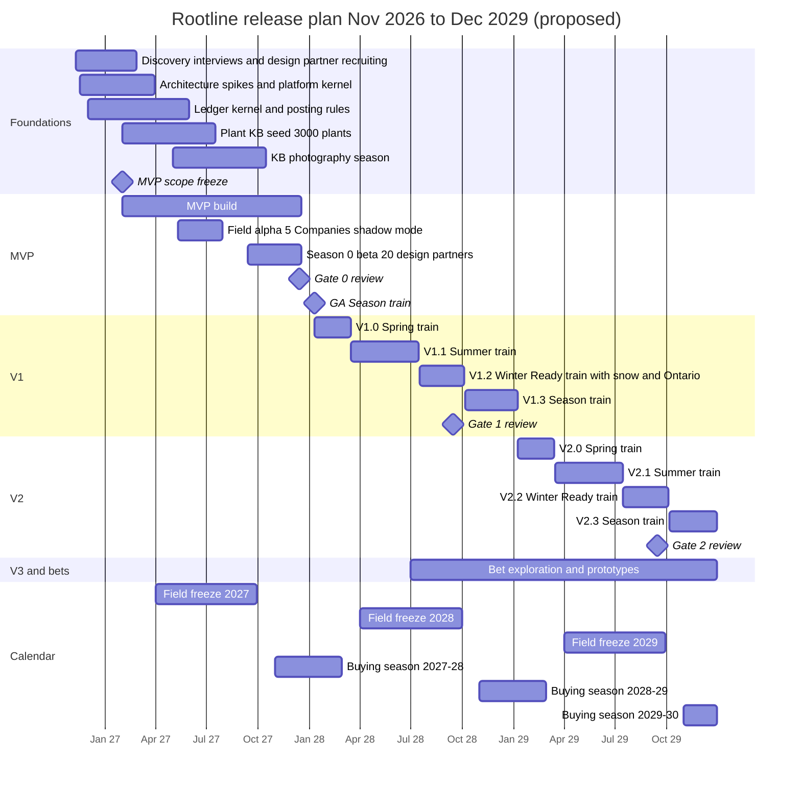
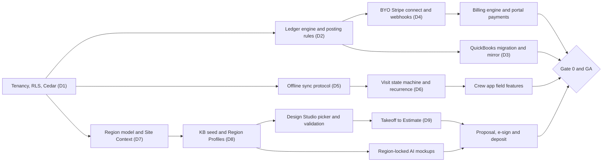

# 24 - Roadmap and Master Feature Catalog

> This is the planning document for Rootline. It turns 23 module specs and 4 research reports into one sequenced plan. It answers four questions: what we build, in what order, with whom, and how we know each phase worked. It holds the **master feature catalog** (744 deduplicated features, each with an ID, a priority tag, a primary persona and a link to the section of the module doc that specifies it). It also holds the **MVP scope** with in/out lists and exit criteria, a **quarter-by-quarter release plan** to the end of 2029 timed to the landscaping calendar, the **team and hiring plan** with cost estimates, **build/buy/partner** decisions, a **risk register**, **success metrics per phase**, the **open decisions** collected from every doc with recommended defaults, and a **90-day action plan** for the founder. When a priority tag in this document differs from a module doc, this document wins (the module docs say so themselves).

| Field | Value |
|---|---|
| Document | 24 - Roadmap and Master Feature Catalog |
| Date | 2026-11-07 |
| Owner | `platform_owner` (founder), with the engineering lead once hired |
| Status | Proposal v1.0. Dates are planning targets. Every cost, headcount and revenue figure is an **estimate** unless a source doc says otherwise |
| Inputs | Module docs [01](01-market-landscape.md) to [23](23-innovation-moonshots.md); research [R1](research/R1-field-service-platforms.md), [R2](research/R2-landscape-specific-platforms.md), [R3](research/R3-design-ai-plant-data.md), [R4](research/R4-industry-payments-accounting.md) |
| Authority | Priority tags, release dates and MVP scope. Business terms stay with [22](22-business-model-pricing-gtm.md); architecture with [20](20-architecture-security.md); roles with [02](02-personas-roles-permissions.md) |
| Main consumers | Engineering lead and team leads, `platform_owner`, investors, design partners (MVP scope only) |

**At a glance**

- **What it is:** the single plan an engineering lead can staff and schedule from. Section 2 is the catalog (744 features: 439 [MVP], 255 [V1], 46 [V2], 4 [V3]); sections 3-4 cut it into an MVP and release trains; sections 5-10 cover people, money, risk and the next 90 days.
- **Decision 1 - one buyer, one closed loop.** The MVP is built to be sold to the beachhead in [22 section 6.1](22-business-model-pricing-gtm.md#61-segments-and-ideal-customer-profile-icp): residential design-build-maintain Companies with 5-40 people (S2), with lawn-and-maintenance firms (S3) as the follow-on. It must let them retire their field-service app, their design tool and their spreadsheets in one move, from first call to reconciled bank deposit. QuickBooks can stay as an optional mirror.
- **Decision 2 - the calendar sets the dates.** Foundations Nov 2026-Mar 2027. Field alpha with 5 friendly Companies May-Jul 2027 (peak season, shadow mode). **Season 0 beta** with 20 design partners in two clusters Sep-Dec 2027. **General availability (GA) in January 2028**, at the winter trade shows when owners buy. V1 ships in four trains (Mar, Jul and Oct 2028, Jan 2029), V2 through 2029, V3 from 2030. Snow ships in October 2028, for the first winter after GA.
- **Decision 3 - money and offline come first.** The ledger kernel, posting rules, bring-your-own Stripe (BYO Stripe) direct charges and the offline sync engine are on the critical path from month 1. Everything else depends on them, and they are the hardest to retrofit.
- **Decision 4 - the MVP is big, so it has explicit cut lines.** Each module has a beta-critical set (Sep 2027), a GA set (Jan 2028) and a cut-first list (3.3). 16 features are retagged here from their module docs, mostly MVP to V1 (4.6).
- **Decision 5 - team.** About 19 people by Mar 2027, 49 at GA, 95 at end of 2028 and 153 at end of 2029 (estimates). Engineering grows 10 -> 23 -> 43 -> 61, following the team topology in [20 section 4.31](20-architecture-security.md#431-team-topology-mvp--v2). People cost runs at about $3.6M, $8.9M, $16.9M and $25.9M a year at those points (estimates).
- **Top risks:** MVP breadth versus a fixed January window; ledger and migration correctness; offline sync data loss; AI unit cost; dependencies on Stripe, Intuit and carriers (10DLC); the beachhead Regions not yet chosen (section 7).
- **Next 90 days:** choose the beachhead clusters, hire the engineering lead and founding engineers, hire the lead horticulturist and start the Plant KB seed, file the Stripe Connect and 10DLC platform applications, sign 20 design-partner letters of intent at MANTS and CENTS, and freeze MVP scope on 1 Feb 2027 (section 10).

## Table of contents

- [0. How to use this document](#0-how-to-use-this-document)
- [1. Phasing philosophy](#1-phasing-philosophy)
- [2. Master feature catalog](#2-master-feature-catalog)
- [3. MVP scope definition](#3-mvp-scope-definition)
- [4. Release plan](#4-release-plan)
- [5. Team plan and hiring sequence](#5-team-plan-and-hiring-sequence)
- [6. Build vs buy vs partner](#6-build-vs-buy-vs-partner)
- [7. Risk register](#7-risk-register)
- [8. Success metrics per phase](#8-success-metrics-per-phase)
- [9. Key open decisions](#9-key-open-decisions)
- [10. Next 90 days: founder action plan](#10-next-90-days-founder-action-plan)
- [Sources and related documents](#sources-and-related-documents)

---

## 0. How to use this document

**Priority tags.** The tags mean the same thing in every Rootline doc. This document pins them to dates:

| Tag | Meaning | Calendar in this plan |
|---|---|---|
| **[MVP]** | First sellable release | Beta to 20 design partners from Sep 2027; GA in Jan 2028 |
| **[V1]** | Within about 12 months of MVP | Trains V1.0 (Mar 2028), V1.1 (Jul 2028), V1.2 (Oct 2028), V1.3 (Jan 2029) |
| **[V2]** | 12-24 months after MVP | Trains V2.0 (Mar 2029), V2.1 (Jul 2029), V2.2 (Oct 2029), V2.3 (Jan 2030) |
| **[V3]** | Moonshot, 2+ years | 2030 and later, through the stage gates in [23 section 4.3](23-innovation-moonshots.md#43-stage-gates-and-kill-criteria) |

**Catalog IDs.** Every catalog row has an ID of the form `Cnn-mmm`, where `nn` is the module doc number and `mmm` is a sequence within that module (for example `C03-012`). Module docs keep their own requirement IDs (`EST-01`, `AIM-GEN-A`, `M-01`); the Source column links to them. Each feature is listed once, under the doc that owns it. Where two docs described the same capability, the owner doc's row stays and the other doc's text is merged into its description (for example, deposits live in [03](03-crm-sales-estimating-proposals.md#prop-07-deposits-and-payment-schedules-via-the-companys-stripe-mvp) and [07](07-invoicing-billing-contracts.md#425-deposits-and-deposit-application-mvp), not also in 08 and 06).

**Rows with more than one tag.** Many module features ship in slices ("basic [MVP], full [V1]"). The tag column holds the first slice; the description names the later slices in brackets. Where the later slice is a distinct deliverable, it has its own row.

**Retagged rows.** When this plan changes a module doc's tag, the tag cell says so, for example `[V1] (doc: MVP)`. Section 4.6 lists every reconciliation and the reason.

**Personas.** The Persona column uses the role keys from [02](02-personas-roles-permissions.md#57-role-templates-mvp): `platform_owner`, `platform_support`, `platform_curator`, `platform_finance`, `platform_engineer`; `owner`, `office_manager`, `estimator`, `designer`, `ops_manager`, `crew_lead`, `technician`, `bookkeeper`, `subcontractor`; `client_residential`, `client_commercial`. It names the person who gets the most value from the feature, not every user.

**Glossary.** Terms follow the shared glossary: Company (tenant), Client, Property, Contact, Lead, Opportunity, Estimate (internal costing), Proposal (customer-facing), Job (Work Order, Project, or recurring Service Agreement), Visit, Route, Crew, Price Book, Design / Design Version / Design Option, Takeoff, Mockup, Plant, Region, Plant Region Profile, Plant Palette, Invoice, Payment, Credit Memo, Deposit, Retainage, Ledger, Automation, Copilot. Examples use the sample tenant **Greenleaf Grounds Co.**

**Numbers.** Dates are planning targets. Headcount, cost and revenue figures are estimates. Revenue figures come from the base case in [22 section 7.7](22-business-model-pricing-gtm.md#77-revenue-scenarios-years-1-5-after-mvp-general-availability), where Y1 is the first year after GA (2028).

---

## 1. Phasing philosophy

### 1.1 What makes the MVP sellable

The beachhead buyer ([22 section 6.1](22-business-model-pricing-gtm.md#61-segments-and-ideal-customer-profile-icp), segment S2) is the owner of a 5-40 person residential design-build-maintain Company doing $750k-$6M a year. Today that owner runs Jobber, LMN, SingleOps or SynkedUP, plus QuickBooks, plus a separate design or CAD tool, plus spreadsheets ([01 section 3.4](01-market-landscape.md#34-archetype-c-residential-design-build-maintain-10-40-staff-the-beachhead)). Owners buy in winter and switch only if the new system can run the coming season without a fallback. So the MVP is "sellable" when it passes all five of these tests (T1-T5):

| # | Sellability test | What it requires at MVP | Where specified |
|---|---|---|---|
| T1 | **Replace the stack, not one tool.** The owner can cancel the field-service app and the design tool, and keep QuickBooks only as an optional mirror | CRM, estimating, proposals, scheduling, crew app, invoicing, payments, ledger, Design Studio 2D, AI mockups, portal | 03-11 |
| T2 | **Run a full season without a workaround.** Spring installs, weekly maintenance, lawn rounds, fall cleanups and renewals all work, including offline in the field and in Spanish | Recurrence, dispatch board, offline crew app, program rounds, agreement billing, renewals | 04, 05, 07, 14 |
| T3 | **The numbers are right to the cent.** Estimates match LMN-style budget math; invoices, deposits and Stripe payouts reconcile in the ledger and against the bank | Budget wizard, overhead methods, ledger invariants, payout proof, bank feeds | 03, 08, 09 |
| T4 | **The switch is safe.** Data comes over from Jobber, LMN or QuickBooks with AR tied out, inside the Nov-Feb window, with a rollback | Migration Center, concierge, switch kits, QBO migration | 01, 09, 19, 22 |
| T5 | **One demo nobody else can give.** Address -> to-scale design with region-correct plants -> takeoff -> priced good/better/best proposal with AI mockups -> e-sign and deposit on the Company's own Stripe | Design Studio, Plant KB, AI mockups, proposals, BYO Stripe | 03, 08, 10, 11, 12 |

T1-T4 are parity: without them the beachhead buyer cannot switch. T5 is the reason to switch. The MVP ships all three wedge differentiators that [01 section 7](01-market-landscape.md#7-white-space-opportunities) and [22 section 6.3](22-business-model-pricing-gtm.md#63-positioning-and-messaging) rely on: (a) design -> takeoff -> estimate -> proposal as one record with region-curated plants; (b) a built-in double-entry ledger with payments on the Company's own Stripe account; (c) an offline, Spanish-first crew app. Everything else in the catalog either supports those three or waits.

The S3 follow-on segment (residential maintenance plus lawn and plant health care programs) uses the same MVP: recurrence, route sequencing, program rounds, pesticide records and level billing are all in scope. S4 (commercial maintenance) and S5 (specialty: snow, tree, irrigation-heavy) are V1 expansion segments, which is why commercial portfolios, multi-crew optimization, snow and AIA billing are V1.

### 1.2 Phasing principles

| # | Principle | What it means for sequencing |
|---|---|---|
| P1 | **Beachhead before breadth** | A feature is MVP only if an S2 or S3 owner would fail sellability test T1-T5 without it. "Nice for commercial" is V1 |
| P2 | **Parity before delight, inside each module** | Ship the boring 80% (invoice states, recurrence, timesheets) before the clever 20% (AI agents, optimizers). Exception: the three wedges in 1.1 ship at MVP |
| P3 | **Money correctness is not a phase** | Ledger invariants, idempotent posting, payout proof and "never block client payments" are MVP and never traded for scope ([09](09-accounting-ledger-integrations.md#411-engine-principles-mvp), [20](20-architecture-security.md#418-ledger-service-invariants-mvp)) |
| P4 | **Offline is the default state** | Every crew action works in airplane mode from the first alpha. Sync is built before field features, not after ([05](05-field-crew-mobile-app.md#421-offline-first-sync-design), [20](20-architecture-security.md#411-offline-sync-for-the-crew-app-mvp)) |
| P5 | **Rails now, bets later** | The 14 rails in [23 section 4.2](23-innovation-moonshots.md#42-rails-what-mvp-and-v1-must-build-so-the-moonshots-stay-possible) (stable object IDs, plant instances, photo metadata, consent ledger, Action Layer parity) ship at MVP or V1 because they are cheap now and expensive later. The bets themselves wait for stage gates |
| P6 | **Trust before autonomy** | AI ships at autonomy L0-L2 with shadow mode and an Approval Inbox. L3 only for low-risk templates. AI never sets a price ([17](17-ai-copilot-automation.md#412-autonomy-levels-mvp), [03](03-crm-sales-estimating-proposals.md#est-18-ai-estimating-v1-assisted-drafts-v2-photo-first-v3-bounded-auto-quote)) |
| P7 | **Region by region** | Rootline sells only where the Plant KB is "Excellent" ([12 section 4.13](12-plant-knowledge-base.md#413-seed-strategy-the-first-3000-plants-and-the-first-regions-kb-seed)). New Regions open after curation, not before |
| P8 | **Build in summer, sell in winter, go live in spring** | Big releases land Oct-Jan. Crew-facing changes freeze Apr 1-Sep 30 ([22 section 6.6](22-business-model-pricing-gtm.md#66-seasonality-of-buying-and-the-gtm-calendar)) |
| P9 | **Gates, not dates, for expansion** | Each phase ends at a measured gate (Gate 0/1/2 in [22 section 6.11](22-business-model-pricing-gtm.md#611-launch-sequence-and-stage-gates)). Missing a gate delays expansion, not quality |
| P10 | **Buy commodity, build the moat** | Ledger, Design Studio, Plant KB, estimating math and the Action Layer are built. Processing, bank feeds, telephony, tax calculation and payroll are partnered (section 6) |

### 1.3 The landscaping calendar and launch timing

Landscape owners evaluate in the off-season, switch in Jan-Feb, go live in Mar-Apr, and resist change from May to September ([22 section 6.6](22-business-model-pricing-gtm.md#66-seasonality-of-buying-and-the-gtm-calendar)). Rootline's engineering calendar follows the same wheel every year:

| Months | Customer reality | Product and engineering rule |
|---|---|---|
| Oct | Fall cleanups, irrigation winterization, snow prep, budgeting | **"Winter Ready" train** ships (snow, Enterprise, new Regions). Last chance for crew-app changes before the next field freeze |
| Nov-Dec | Leaf cleanups, holiday lighting, year-end books, shortlists and trials | Trials and migrations ramp. Year-end close features must be live by Dec 1. Annual prepay collected |
| Jan-Feb | Trade shows, planning, design season, peak buying and switching | **"Season" train** ships in early January for the shows. Migration concierge at 2x capacity. Spring-Ready deadline Feb 15. No risky back-office migrations after Feb 15 |
| Mar-Apr | Spring cleanups, irrigation start-ups, first mow, crews hired | **"Spring" train** (fixes, small additive features). Go-live support at peak. Crew-app field freeze starts Apr 1 |
| May-Aug | Full production: mowing, installs, fertilizer rounds | **"Summer" train** ships back-office and office-web features only. Field alpha and pilots of new crew features run in shadow mode with volunteers |
| Sep | Overseeding, fall installs, renewals | Renewal features must be live by Sep 1. Field freeze ends Sep 30 |

**Why GA is January 2028.** Four launch windows were considered:

| Option | GA date | Verdict |
|---|---|---|
| A. Spring 2027 rush | Mar 2027 | Rejected. Five months from today. The ledger, the sync engine and the 20-week Plant KB seed cannot be production-grade, and [22](22-business-model-pricing-gtm.md#611-launch-sequence-and-stage-gates) forbids launching into a spring with a broken migration |
| B. Fall 2027 | Sep 2027 | Rejected as GA, adopted as **beta**. Owners do not buy in September, but design partners can go live on lower-stakes fall work and run 3 month-end closes before Gate 0 |
| **C. Winter 2028** | **Jan 2028** | **Chosen.** Lands at MANTS, CENTS, Mid-Am and Landscape Ontario Congress (all January; verify 2028 dates), inside the Nov-Feb switching window, with a full fall of beta evidence |
| D. Spring 2028 | Apr 2028 | Rejected. Misses the buying window: Companies that did not switch by February wait a full year |

The plan therefore has a hard date (beta live by 13 Sep 2027) and a gated date (GA in the week of 10 Jan 2028, only if Gate 0 passes in mid-December). If Gate 0 fails, the fallback is a "Founding cohort" GA limited to design partners plus waitlisted Companies in the beachhead clusters, with the public launch moved to the Oct 2028 Winter Ready train.

Two calendar facts shape module order. First, Plant KB photography needs a growing season: bloom and fall color for the top 600 plants must be shot in summer and fall 2027 ([12 section 4.13](12-plant-knowledge-base.md#413-seed-strategy-the-first-3000-plants-and-the-first-regions-kb-seed)). Second, the first year-end close for GA customers is December 2028, so year-end close [V1] must ship by the Oct 2028 train. Season 0 design partners therefore keep QuickBooks as a mirror (books-of-record Mode B in [09](09-accounting-ledger-integrations.md#4171-books-of-record-modes-mvp)) through their 2027 year-end.

---

## 2. Master feature catalog

### 2.1 Conventions and counts

| # | Module | Owner doc | Features | [MVP] | [V1] | [V2] | [V3] |
|---|---|---|---|---|---|---|---|
| 2.2 | [Market intelligence](#22-01---market-intelligence) | [01](01-market-landscape.md) | 13 | 7 | 6 | 0 | 0 |
| 2.3 | [Identity, roles and permissions](#23-02---identity-roles-and-permissions) | [02](02-personas-roles-permissions.md) | 40 | 23 | 14 | 3 | 0 |
| 2.4 | [CRM, sales, estimating and proposals](#24-03---crm-sales-estimating-and-proposals) | [03](03-crm-sales-estimating-proposals.md) | 42 | 30 | 12 | 0 | 0 |
| 2.5 | [Scheduling, dispatch and routing](#25-04---scheduling-dispatch-and-routing) | [04](04-scheduling-dispatch-routing.md) | 35 | 22 | 13 | 0 | 0 |
| 2.6 | [Field crew mobile app](#26-05---field-crew-mobile-app) | [05](05-field-crew-mobile-app.md) | 27 | 22 | 4 | 1 | 0 |
| 2.7 | [Customer portal](#27-06---customer-portal) | [06](06-customer-portal.md) | 39 | 25 | 12 | 2 | 0 |
| 2.8 | [Invoicing, billing and service agreements](#28-07---invoicing-billing-and-service-agreements) | [07](07-invoicing-billing-contracts.md) | 43 | 27 | 15 | 1 | 0 |
| 2.9 | [Payments (bring-your-own Stripe)](#29-08---payments-bring-your-own-stripe) | [08](08-payments-stripe.md) | 30 | 19 | 10 | 1 | 0 |
| 2.10 | [Accounting ledger and integrations](#210-09---accounting-ledger-and-integrations) | [09](09-accounting-ledger-integrations.md) | 42 | 21 | 18 | 3 | 0 |
| 2.11 | [Design Studio](#211-10---design-studio) | [10](10-design-studio.md) | 28 | 15 | 13 | 0 | 0 |
| 2.12 | [AI design mockups](#212-11---ai-design-mockups) | [11](11-ai-design-mockups.md) | 23 | 12 | 9 | 1 | 1 |
| 2.13 | [Plant Knowledge Base](#213-12---plant-knowledge-base) | [12](12-plant-knowledge-base.md) | 29 | 22 | 6 | 1 | 0 |
| 2.14 | [Operations: materials, inventory, purchasing, equipment](#214-13---operations-materials-inventory-purchasing-equipment) | [13](13-operations-inventory-equipment.md) | 38 | 17 | 20 | 0 | 1 |
| 2.15 | [Service-line modules](#215-14---service-line-modules) | [14](14-service-line-modules.md) | 38 | 17 | 18 | 3 | 0 |
| 2.16 | [Team, HR, time and payroll](#216-15---team-hr-time-and-payroll) | [15](15-team-hr-payroll.md) | 29 | 15 | 14 | 0 | 0 |
| 2.17 | [Marketing, growth and communications](#217-16---marketing-growth-and-communications) | [16](16-marketing-growth-communications.md) | 34 | 19 | 15 | 0 | 0 |
| 2.18 | [AI Copilot, agents and automation](#218-17---ai-copilot-agents-and-automation) | [17](17-ai-copilot-automation.md) | 35 | 21 | 11 | 3 | 0 |
| 2.19 | [Reporting and analytics](#219-18---reporting-and-analytics) | [18](18-reporting-analytics.md) | 28 | 13 | 13 | 2 | 0 |
| 2.20 | [Platform admin portal (Operator Console)](#220-19---platform-admin-portal-operator-console) | [19](19-platform-admin-portal.md) | 31 | 22 | 9 | 0 | 0 |
| 2.21 | [Architecture and security (platform capabilities)](#221-20---architecture-and-security-platform-capabilities) | [20](20-architecture-security.md) | 33 | 28 | 4 | 1 | 0 |
| 2.22 | [UX, design system and localization](#222-21---ux-design-system-and-localization) | [21](21-ux-design-system-sitemaps.md) | 28 | 25 | 3 | 0 | 0 |
| 2.23 | [Business model, pricing and packaging](#223-22---business-model-pricing-and-packaging) | [22](22-business-model-pricing-gtm.md) | 25 | 16 | 8 | 1 | 0 |
| 2.24 | [Innovation bets (moonshots)](#224-23---innovation-bets-moonshots) | [23](23-innovation-moonshots.md) | 34 | 1 | 8 | 23 | 2 |
| | **Total** | | **744** | **439** | **255** | **46** | **4** |

The MVP count is large because the MVP replaces a whole tool stack (1.1). Many rows are small (a policy, a template, a setting) and about a sixth of them are platform capabilities in docs 19-21. Section 3 groups the MVP rows into beta-critical, GA and cut-first sets. 16 rows are retagged from their module docs and marked `(doc: ...)`.

Columns: **ID** (catalog ID), **Feature**, **Description** (one line; bracketed tags name later slices), **Tag** (first slice; see section 0), **Persona** (primary role key), **Source** (module doc section that specifies it).

### 2.2 01 - Market intelligence

Rootline's own go-to-market tooling: competitor evidence, switch kits and win/loss. Mostly internal (`platform_*` personas). Owner doc: [01-market-landscape.md](01-market-landscape.md). 13 features: 7 [MVP], 6 [V1], 0 [V2], 0 [V3].

| ID | Feature | Description | Tag | Persona | Source |
|---|---|---|---|---|---|
| C01-001 | Competitor registry | One record per competitor organization and product, with aliases used to recognize export files and signup answers | [MVP] | `platform_owner` | [01 §12.2](01-market-landscape.md#122-feature-specification) |
| C01-002 | Evidence ledger and claims | Every competitive statement is a sourced, evidence-tagged claim with a verify-by date; [B]/[E] claims never publish | [MVP] | `platform_owner` | [01 §12.2](01-market-landscape.md#122-feature-specification) |
| C01-003 | Capability matrix as data | Capability keys and product ratings with confidence flags; regenerates the competitor feature matrix | [MVP] | `platform_owner` | [01 §12.2](01-market-landscape.md#122-feature-specification) |
| C01-004 | Switch-source capture | Signup asks which tools the Company uses today; selects importer, switch kit and battlecard | [MVP] | `owner` | [01 §12.2](01-market-landscape.md#122-feature-specification) |
| C01-005 | Win/loss records | Outcome, competitors, reason codes and interview notes for every closed GTM opportunity | [MVP] | `platform_owner` | [01 §12.2](01-market-landscape.md#122-feature-specification) |
| C01-006 | Switch kits: Jobber and LMN | Known export formats, field mappings and AI-assisted column mapping for the two most common source systems | [MVP] | `platform_engineer` | [01 §12.2](01-market-landscape.md#122-feature-specification) |
| C01-007 | Switch kits: SingleOps, Service Autopilot, Real Green, Aspire, Yardbook, Copilot CRM | Same kit structure for the next six incumbents, ordered by win/loss demand | [V1] | `platform_engineer` | [01 §12.2](01-market-landscape.md#122-feature-specification) |
| C01-008 | Market sizing workbook | Census CBP and StatCan counts by employee band recompute the bottom-up model and beachhead scores | [MVP] | `platform_finance` | [01 §12.2](01-market-landscape.md#122-feature-specification) |
| C01-009 | Pricing observations | Per-plan competitor prices with observed-at dates; a change over 5% opens a battlecard review | [V1] | `platform_owner` | [01 §12.2](01-market-landscape.md#122-feature-specification) |
| C01-010 | Competitor change monitor | Watches public pricing pages and changelogs; stores diffs with an AI summary in a triage queue | [V1] | `platform_engineer` | [01 §12.2](01-market-landscape.md#122-feature-specification) |
| C01-011 | Battlecards | Per-competitor cards built only from verified claims, pains and win/loss reasons, with stale-claim banners | [V1] | `platform_owner` | [01 §12.2](01-market-landscape.md#122-feature-specification) |
| C01-012 | Public comparison pages | Generated from publishable claims with as-of dates, citations, an inaccuracy-report link and legal review | [V1] | `platform_owner` | [01 §12.2](01-market-landscape.md#122-feature-specification) |
| C01-013 | Processor Fee X-ray | Prospect uploads a processing statement; AI extracts the effective rate and compares Stripe plus ACH steering | [V1] | `owner` | [01 §12.2](01-market-landscape.md#122-feature-specification) |

### 2.3 02 - Identity, roles and permissions

Owner doc: [02-personas-roles-permissions.md](02-personas-roles-permissions.md). 40 features: 23 [MVP], 14 [V1], 3 [V2], 0 [V3].

| ID | Feature | Description | Tag | Persona | Source |
|---|---|---|---|---|---|
| C02-001 | Global identity with many memberships | One login per person across Companies; the employee record is separate from the login | [MVP] | `owner` | [02 §5.1](02-personas-roles-permissions.md#51-identity-model-one-person-many-memberships-mvp) |
| C02-002 | resource.action permission taxonomy | Typed permissions with domain actions and dependencies, evaluated by the policy engine at every enforcement point | [MVP] | `owner` | [02 §5.2](02-personas-roles-permissions.md#52-permission-taxonomy-resourceaction-mvp) |
| C02-003 | Scopes own/crew/all with ownership rules | Per-resource ownership rules decide what each scope returns, including crew visibility windows | [MVP] | `ops_manager` | [02 §5.3](02-personas-roles-permissions.md#53-scopes-own-crew-branch-all-mvp-branch-v1) |
| C02-004 | Branch scope | Branch-bounded visibility and actions for multi-branch Companies | [V1] | `ops_manager` | [02 §5.3](02-personas-roles-permissions.md#53-scopes-own-crew-branch-all-mvp-branch-v1) |
| C02-005 | Field classes masked server-side | Price, cost, margin, pay rate, PII and access secrets masked in API, search, exports, webhooks, sync and Copilot | [MVP] | `owner` | [02 §5.4](02-personas-roles-permissions.md#54-field-level-restrictions-field-classes-mvp) |
| C02-006 | Time-windowed gate-code reveal | Access secrets revealed only near the Visit window, with an audited reveal event | [MVP] | `technician` | [02 §5.4](02-personas-roles-permissions.md#54-field-level-restrictions-field-classes-mvp) |
| C02-007 | Masked calling and texting | Proxy numbers so Client phone numbers never reach field devices | [V1] | `crew_lead` | [02 §5.4](02-personas-roles-permissions.md#54-field-level-restrictions-field-classes-mvp) |
| C02-008 | Approval limits | Per-role limits on discounts, refunds, credits, write-offs, POs and field collections | [MVP] | `owner` | [02 §5.6](02-personas-roles-permissions.md#56-approval-limits-thresholds-and-dual-control-mvp-dual-control-v1) |
| C02-009 | Two-person approval (dual control) | Second approver for bank-detail changes, Stripe disconnect and bulk exports | [V1] | `owner` | [02 §5.6](02-personas-roles-permissions.md#56-approval-limits-thresholds-and-dual-control-mvp-dual-control-v1) |
| C02-010 | Nine role templates and master matrix | Owner, office_manager, estimator, designer, ops_manager, crew_lead, technician, bookkeeper, subcontractor templates | [MVP] | `owner` | [02 §5.7](02-personas-roles-permissions.md#57-role-templates-mvp) |
| C02-011 | Custom roles with anti-escalation | Clone-and-edit roles; nobody can grant a permission they do not hold; impact diff before save | [MVP] | `owner` | [02 §5.8](02-personas-roles-permissions.md#58-custom-roles-multi-role-users-and-anti-escalation-mvp-clone-and-edit-v1-gallery-and-diff) |
| C02-012 | Multi-role and time-bound assignments | Several roles per user, bounded by branch, division or expiry date | [V1] | `owner` | [02 §5.8](02-personas-roles-permissions.md#58-custom-roles-multi-role-users-and-anti-escalation-mvp-clone-and-edit-v1-gallery-and-diff) |
| C02-013 | Just-in-time elevation | Request access on a denied action; approver grants a time-boxed elevation by push | [V2] | `crew_lead` | [02 §5.8](02-personas-roles-permissions.md#58-custom-roles-multi-role-users-and-anti-escalation-mvp-clone-and-edit-v1-gallery-and-diff) |
| C02-014 | Branches and divisions | Organization structure for multi-branch Companies, feeding scopes, ledger dimensions and reports | [V1] | `owner` | [02 §5.9](02-personas-roles-permissions.md#59-organization-structure-branches-divisions-legal-entities-multi-company-and-franchise) |
| C02-015 | Franchise data-sharing agreements | Organization layer above Companies with per-category data-sharing consent | [V2] | `owner` | [02 §5.9](02-personas-roles-permissions.md#59-organization-structure-branches-divisions-legal-entities-multi-company-and-franchise) |
| C02-016 | Accountant delegated access | Free firm-level access for an external CPA to a client Company's books (Hub UI in 09) | [MVP] | `bookkeeper` | [02 §5.10](02-personas-roles-permissions.md#510-delegated-access-for-external-accountants-the-accountant-hub-mvp-basic-v1-hub) |
| C02-017 | Client contact roles | primary, co_owner, billing, property_contact, approver and viewer scopes for portal contacts | [MVP] | `client_residential` | [02 §5.11](02-personas-roles-permissions.md#511-client-contact-permissions-and-approval-policies-mvp-contact-roles-v1-approval-policies) |
| C02-018 | Commercial and HOA approval policies | n-of-m quorum, sequential approvers, PO required, votes tied to Proposal version, board term expiry | [V1] | `client_commercial` | [02 §5.11](02-personas-roles-permissions.md#511-client-contact-permissions-and-approval-policies-mvp-contact-roles-v1-approval-policies) |
| C02-019 | Subcontractor assignment-scoped access | Subs see only assigned Visits, scope and documents; no prices or other Clients | [MVP] | `subcontractor` | [02 §5.12](02-personas-roles-permissions.md#512-subcontractor-access-and-data-visibility-mvp-basic-v1-sub-portal) |
| C02-020 | Consented support access | Owner-granted, time-boxed view-as and act-as with a banner and a tenant-visible access log | [MVP] | `platform_support` | [02 §5.13](02-personas-roles-permissions.md#513-platform-staff-permissions-support-impersonation-and-break-glass-mvp) |
| C02-021 | Break-glass production access | Two-person approval, tenant notice and full audit for emergency production access | [MVP] | `platform_engineer` | [02 §5.13](02-personas-roles-permissions.md#513-platform-staff-permissions-support-impersonation-and-break-glass-mvp) |
| C02-022 | MFA and passkeys for staff | TOTP and WebAuthn passkeys; MFA mandatory for owners and financial roles | [MVP] | `owner` | [02 §5.14](02-personas-roles-permissions.md#514-authentication-per-persona-mvp-unless-tagged) |
| C02-023 | Crew phone sign-in | Phone OTP (SMS or WhatsApp) on first login, then app PIN or biometrics | [MVP] | `technician` | [02 §5.14](02-personas-roles-permissions.md#514-authentication-per-persona-mvp-unless-tagged) |
| C02-024 | Enterprise SSO (SAML/OIDC) | SSO for Enterprise Companies through an identity broker | [V1] | `owner` | [02 §5.14](02-personas-roles-permissions.md#514-authentication-per-persona-mvp-unless-tagged) |
| C02-025 | SCIM provisioning | Automated user provisioning and deprovisioning from the Company's IdP (22 lists V1; owner doc 02 sets V2) | [V2] | `owner` | [02 §5.14](02-personas-roles-permissions.md#514-authentication-per-persona-mvp-unless-tagged) |
| C02-026 | Kiosk PIN clock-in | PIN punch on enrolled shared tablets, offline-capable, optional photo | [MVP] | `technician` | [02 §5.15](02-personas-roles-permissions.md#515-shared-devices-kiosk-mode-and-device-trust-mvp-crew-device-v1-yard-kiosk-and-mdm) |
| C02-027 | Device registry, revoke and remote wipe | Enrolled crew devices with trust state, revocation and wipe of local data | [MVP] | `ops_manager` | [02 §5.15](02-personas-roles-permissions.md#515-shared-devices-kiosk-mode-and-device-trust-mvp-crew-device-v1-yard-kiosk-and-mdm) |
| C02-028 | Session policies with permission version stamps | Per-surface session lifetimes; token version stamps end revoked access in about 1 second online | [MVP] | `platform_engineer` | [02 §5.16](02-personas-roles-permissions.md#516-session-policies-mvp-defaults-v1-tenant-configurable) |
| C02-029 | Hash-chained audit log | Append-only, tenant-readable log of staff, AI-agent and user actions | [MVP] | `owner` | [02 §5.17](02-personas-roles-permissions.md#517-audit-logging-mvp-capture-and-basic-ui-v1-advanced-search-v2-siem-streaming) |
| C02-030 | Audit saved alerts and SIEM streaming | Saved audit searches with alerts [V1]; streaming to the Company's SIEM [V2] | [V1] | `owner` | [02 §5.17](02-personas-roles-permissions.md#517-audit-logging-mvp-capture-and-basic-ui-v1-advanced-search-v2-siem-streaming) |
| C02-031 | Seasonal bulk onboarding by SMS in Spanish | Invite a spring crew in bulk; each worker activates by SMS in their language | [MVP] | `office_manager` | [02 §5.18.1](02-personas-roles-permissions.md#5181-bulk-seasonal-onboarding-mvp) |
| C02-032 | Hibernation at $0 seat cost | End-of-season hibernate keeps history and credentials without a billable seat | [MVP] | `owner` | [02 §5.18.2](02-personas-roles-permissions.md#5182-hibernation-end-of-season-mvp) |
| C02-033 | Rehire returning crew wizard | One-tap spring rehire restores role, crew, pay and credentials for review | [MVP] | `office_manager` | [02 §5.18.3](02-personas-roles-permissions.md#5183-rehire-spring-mvp) |
| C02-034 | Termination with immediate revocation | Revokes sessions and devices at once and starts the offboarding checklist | [MVP] | `office_manager` | [02 §5.18.4](02-personas-roles-permissions.md#5184-offboarding-termination-or-quit-mvp) |
| C02-035 | Ownership transfer and successor designation | Owner succession, partner-dispute protections and business-sale handover | [V1] | `owner` | [02 §5.18.6](02-personas-roles-permissions.md#5186-owner-changes-and-business-continuity-v1) |
| C02-036 | Minor-worker restrictions | Hour and equipment restrictions for workers under 18 from platform-maintained rule tables | [V1] | `ops_manager` | [02 §5.18.7](02-personas-roles-permissions.md#5187-minor-workers-under-18-v1) |
| C02-037 | Access reviews and dormant-account sweeps | Quarterly review campaigns and automatic flags for unused access | [V1] | `owner` | [02 §5.19](02-personas-roles-permissions.md#519-access-reviews-and-governance-v1) |
| C02-038 | View-as simulator and access explainer | See the app as a role and answer "why can't I see this" | [V1] | `owner` | [02 §5.21](02-personas-roles-permissions.md#521-view-as-permission-simulator-v1) |
| C02-039 | Owner vacation mode | Delegate approvals to a deputy with limits and a daily digest | [V1] | `owner` | [02 §14](02-personas-roles-permissions.md#14-beyond-the-brief-extra-ideas) |
| C02-040 | Sensitive-data detector | Moves gate codes and SSNs out of free-text notes into protected fields | [V1] | `office_manager` | [02 §14](02-personas-roles-permissions.md#14-beyond-the-brief-extra-ideas) |

### 2.4 03 - CRM, sales, estimating and proposals

Owner doc: [03-crm-sales-estimating-proposals.md](03-crm-sales-estimating-proposals.md). 42 features: 30 [MVP], 12 [V1], 0 [V2], 0 [V3].

| ID | Feature | Description | Tag | Persona | Source |
|---|---|---|---|---|---|
| C03-001 | Unified Lead Inbox | All new inquiries in one queue with SLA timers and instant auto-response | [MVP] | `office_manager` | [03 §LEAD-01](03-crm-sales-estimating-proposals.md#lead-01-unified-lead-inbox-mvp) |
| C03-002 | Core capture channels | Email, phone, referrals and manual entry flow into the Lead Inbox alongside 16's web forms | [MVP] | `office_manager` | [03 §LEAD-02](03-crm-sales-estimating-proposals.md#lead-02-capture-channels-mvp-core-channels-v1v2-marketplaces) |
| C03-003 | Deduplication and identity resolution | Phone, email, parcel and name scoring with reversible merges | [MVP] | `office_manager` | [03 §LEAD-03](03-crm-sales-estimating-proposals.md#lead-03-deduplication-and-identity-resolution-mvp-rules-v1-ml-assist) |
| C03-004 | Lead scoring | Explainable fit and intent scores: rules [V1], ML [V2] | [V1] | `estimator` | [03 §LEAD-04](03-crm-sales-estimating-proposals.md#lead-04-lead-scoring-v1-rules-v2-ml) |
| C03-005 | Lead routing and assignment | Round-robin and territory routing, rules engine later | [MVP] | `office_manager` | [03 §LEAD-05](03-crm-sales-estimating-proposals.md#lead-05-lead-routing-and-assignment-mvp-round-robin-and-territory-v1-rules) |
| C03-006 | Clients, Properties and Contacts | Core records with property-level history, multiple contacts and billing relationships | [MVP] | `office_manager` | [03 §CRM-01](03-crm-sales-estimating-proposals.md#crm-01-clients-properties-contacts-mvp) |
| C03-007 | Commercial hierarchy | Portfolios, management companies and HOAs above Properties | [V1] | `ops_manager` | [03 §CRM-02](03-crm-sales-estimating-proposals.md#crm-02-commercial-hierarchy-v1) |
| C03-008 | Activity timeline, tasks, custom fields and tags | Unified timeline per record plus tasks, reminders and tenant-defined fields | [MVP] | `estimator` | [03 §CRM-03](03-crm-sales-estimating-proposals.md#crm-03-activity-timeline-mvp) |
| C03-009 | Configurable pipelines and kanban | Multiple pipelines, rotting indicators and mandatory lost reasons | [MVP] | `estimator` | [03 §PIPE-02](03-crm-sales-estimating-proposals.md#pipe-02-multiple-pipelines-with-configurable-stages-mvp) |
| C03-010 | Capacity-aware weighted forecast | Pipeline forecast checked against crew capacity in the season plan | [V1] | `owner` | [03 §PIPE-05](03-crm-sales-estimating-proposals.md#pipe-05-forecast-v1) |
| C03-011 | Offline mobile site assessments | Checklists, photo annotation and measurements captured on site without signal | [MVP] | `estimator` | [03 §ASSESS-02](03-crm-sales-estimating-proposals.md#assess-02-mobile-assessment-checklists-mvp) |
| C03-012 | Voice-to-scope | Spoken walk-through notes become structured scope lines | [V1] | `estimator` | [03 §ASSESS-04](03-crm-sales-estimating-proposals.md#assess-04-voice-to-scope-v1) |
| C03-013 | Property measurement profile | Parcel lot size, footprint and turf/bed/hardscape areas with provenance and confidence | [MVP] | `estimator` | [03 §INTEL-01](03-crm-sales-estimating-proposals.md#intel-01-property-measurement-profile-mvp-manual--parcel--ai-turf-v1-other-ai-classes) |
| C03-014 | AI auto-measure: turf | Segmentation of aerial imagery measures turf area for quotes | [MVP] | `estimator` | [03 §INTEL-03](03-crm-sales-estimating-proposals.md#intel-03-ai-auto-measure-mvp-turf-v1-beds-hardscape-and-commercial-classes) |
| C03-015 | AI auto-measure: beds, hardscape, commercial classes | Extends auto-measure to beds, driveways, hardscape and commercial site classes | [V1] | `estimator` | [03 §INTEL-03](03-crm-sales-estimating-proposals.md#intel-03-ai-auto-measure-mvp-turf-v1-beds-hardscape-and-commercial-classes) |
| C03-016 | Company Budget wizard | Burden, overhead, equipment and target net profit set once and reused by every estimate | [MVP] | `owner` | [03 §EST-01](03-crm-sales-estimating-proposals.md#est-01-company-budget-wizard-mvp) |
| C03-017 | Overhead recovery methods | FLH, SORS and MORS side by side with a solver that balances MORS to the budget | [MVP] | `owner` | [03 §EST-02](03-crm-sales-estimating-proposals.md#est-02-overhead-recovery-methods-mvp-flh--sors--mors-v1-revenue-view-recovery-tracker) |
| C03-018 | Production-rate library | Seeded rates with difficulty multipliers, editable per Company | [MVP] | `estimator` | [03 §EST-03](03-crm-sales-estimating-proposals.md#est-03-production-rates-library-mvp) |
| C03-019 | Margin vs markup engine | Break-even, guardrails and below-floor approvals on every estimate | [MVP] | `estimator` | [03 §EST-09](03-crm-sales-estimating-proposals.md#est-09-pricing-math-margin-markup-and-the-truth-mvp) |
| C03-020 | Parametric kits (assemblies) | Versioned kits such as paver patio per sq ft in a sandboxed formula language; nested kits [V1] | [MVP] | `estimator` | [03 §EST-10](03-crm-sales-estimating-proposals.md#est-10-kits-assemblies-mvp-basic-v1-nested-and-conditional) |
| C03-021 | Quick Quote mode | Jobber-simple quoting on top of the full costing engine | [MVP] | `estimator` | [03 §EST-11](03-crm-sales-estimating-proposals.md#est-11-quick-quote-mode-mvp) |
| C03-022 | Price Book | Items with purchase rounding, waste factors, cost freshness and cost-change impact reports | [MVP] | `estimator` | [03 §PB-01](03-crm-sales-estimating-proposals.md#pb-01-price-book-mvp) |
| C03-023 | Recurring maintenance pricing | Per-visit, seasonal installments and banded price tables for maintenance | [MVP] | `estimator` | [03 §EST-12](03-crm-sales-estimating-proposals.md#est-12-recurring-maintenance-pricing-mvp) |
| C03-024 | Bulk seasonal enhancement campaigns | Generate hundreds of priced enhancement proposals (for example spring mulch) in one run | [V1] | `estimator` | [03 §EST-13](03-crm-sales-estimating-proposals.md#est-13-seasonal-enhancement-estimates-and-campaigns-mvp-single-v1-bulk-campaigns) |
| C03-025 | Live takeoff sync | Protected two-way sync between Design and Estimate after the first push | [V1] | `designer` | [03 §EST-17](03-crm-sales-estimating-proposals.md#est-17-takeoff-from-design-studio-mvp-basic-v1-live-sync) |
| C03-026 | AI-assisted estimate drafts | Drafts from notes, photos and aerials; AI proposes scope and quantities, never prices | [V1] | `estimator` | [03 §EST-18](03-crm-sales-estimating-proposals.md#est-18-ai-estimating-v1-assisted-drafts-v2-photo-first-v3-bounded-auto-quote) |
| C03-027 | Proposal builder and templates | Block-based proposals with company branding and reusable templates | [MVP] | `estimator` | [03 §PROP-01](03-crm-sales-estimating-proposals.md#prop-01-proposal-builder-and-templates-mvp) |
| C03-028 | Good/better/best tiers and add-ons | Tiers with per-tier mockups and deposits; add-on dependencies | [MVP] | `estimator` | [03 §PROP-03](03-crm-sales-estimating-proposals.md#prop-03-goodbetterbest-tiers-and-add-ons-mvp) |
| C03-029 | Visual proposals | Static mockups and plant cards [MVP]; interactive plan [V1] | [MVP] | `designer` | [03 §PROP-04](03-crm-sales-estimating-proposals.md#prop-04-visual-proposals-mvp-static-v1-interactive) |
| C03-030 | Native e-signature (ESIGN/UETA) | Consent, audit trail and sealed PDF without a third-party e-sign vendor | [MVP] | `client_residential` | [03 §PROP-05](03-crm-sales-estimating-proposals.md#prop-05-e-signature-esign--ueta-mvp) |
| C03-031 | Deposits and payment schedules | Deposits on the Company's own Stripe with jurisdiction deposit caps | [MVP] | `client_residential` | [03 §PROP-07](03-crm-sales-estimating-proposals.md#prop-07-deposits-and-payment-schedules-via-the-companys-stripe-mvp) |
| C03-032 | Consumer financing offers | Partner financing with Reg Z-safe copy | [V1] | `client_residential` | [03 §PROP-09](03-crm-sales-estimating-proposals.md#prop-09-financing-offers-v1) |
| C03-033 | Proposal analytics | Open and view tracking with hot-proposal alerts; detailed analytics [V1] | [MVP] | `estimator` | [03 §PROP-10](03-crm-sales-estimating-proposals.md#prop-10-proposal-analytics-mvp-basic-v1-detailed) |
| C03-034 | Expiration, versions and revive | Immutable versions, expiry and revive with cost re-validation | [MVP] | `estimator` | [03 §PROP-11](03-crm-sales-estimating-proposals.md#prop-11-expiration-revisions-and-versioning-mvp) |
| C03-035 | Follow-up cadences | Cadences to every signer with TCPA and 10DLC guardrails; smart sequences [V1] | [MVP] | `estimator` | [03 §PROP-12](03-crm-sales-estimating-proposals.md#prop-12-follow-up-automations-mvp-cadence-v1-smart-sequences) |
| C03-036 | One-click conversion to Jobs | Signed proposal becomes a Work Order, phased Project or Service Agreement with budgets and an 811 checklist | [MVP] | `ops_manager` | [03 §4.8](03-crm-sales-estimating-proposals.md#48-conversion-to-jobs-mvp) |
| C03-037 | Change orders (basic) | Office and field change orders with signature and price delta; verbal-emergency flow [V1] | [MVP] | `crew_lead` | [03 §4.9](03-crm-sales-estimating-proposals.md#49-change-orders-mvp-basic-v1-full) |
| C03-038 | Renewal engine with escalators | Fixed escalators at MVP; CPI, cost-plus and margin-target escalators and the renewal review grid [V1] | [MVP] | `ops_manager` | [03 §4.10](03-crm-sales-estimating-proposals.md#410-agreement-renewals-and-price-escalators-mvp-basic-v1-full) |
| C03-039 | Commercial RFP intake and unit-price bids | AI extraction of RFP scope, multi-site unit-price bids and bid packets | [V1] | `estimator` | [03 §4.11](03-crm-sales-estimating-proposals.md#411-commercial-bids-and-rfps-v1) |
| C03-040 | Sales commission plans | Plans, events, clawbacks and payroll export | [V1] | `owner` | [03 §4.12](03-crm-sales-estimating-proposals.md#412-sales-commissions-hooks-v1) |
| C03-041 | Estimator mobile mode and kitchen-table close | Offline presentation, e-sign and deposit capture at the client's table | [MVP] | `estimator` | [03 §4.13](03-crm-sales-estimating-proposals.md#413-sales-productivity-mvp-core-v1-extras) |
| C03-042 | Automatic estimate post-mortems | Compare estimate to actuals and propose one-click production-rate updates | [V1] | `estimator` | [03 §13](03-crm-sales-estimating-proposals.md#13-beyond-the-brief-extra-ideas) |

### 2.5 04 - Scheduling, dispatch and routing

Owner doc: [04-scheduling-dispatch-routing.md](04-scheduling-dispatch-routing.md). 35 features: 22 [MVP], 13 [V1], 0 [V2], 0 [V3].

| ID | Feature | Description | Tag | Persona | Source |
|---|---|---|---|---|---|
| C04-001 | Job scheduling gates | Deposit, materials, 811, permit and design-sold gates before a Job can be dated | [MVP] | `ops_manager` | [04 §4.1.2](04-scheduling-dispatch-routing.md#412-job-lifecycle-and-scheduling-gates-mvp) |
| C04-002 | Canonical Visit state machine | Shared states and reason codes across office, crew app, portal and billing, with an offline guard | [MVP] | `ops_manager` | [04 §4.1.3](04-scheduling-dispatch-routing.md#413-visit-state-machine-canonical-mvp) |
| C04-003 | Visit flexibility, windows and locks | Flexibility classes, time and access windows and lock levels per Visit | [MVP] | `ops_manager` | [04 §4.1.4](04-scheduling-dispatch-routing.md#414-visit-timing-flexibility-and-locks-mvp) |
| C04-004 | RRULE recurrence engine | Weekly route-day, A/B bi-weekly, frequency profiles and count-limited presets | [MVP] | `ops_manager` | [04 §4.2.1](04-scheduling-dispatch-routing.md#421-recurrence-patterns-mvp-unless-tagged) |
| C04-005 | Seasonal service calendar per Region | Cleanups, mulch, aeration and winterization windows that drive visit generation | [MVP] | `ops_manager` | [04 §4.2.3](04-scheduling-dispatch-routing.md#423-seasonal-service-calendar-mvp) |
| C04-006 | Program round hand-off | Lawn and PHC rounds scheduled inside their windows with license guards | [MVP] | `ops_manager` | [04 §4.2.5](04-scheduling-dispatch-routing.md#425-program-rounds-hand-off-mvp) |
| C04-007 | Growth-adaptive mowing frequency | Rules [V1] and AI model [V2] adjust mowing frequency to weather and turf growth | [V1] | `ops_manager` | [04 §4.2.6](04-scheduling-dispatch-routing.md#426-growth-adaptive-mowing-frequency-v1-rules-v2-ai-model) |
| C04-008 | Holiday and blackout policies | slide_week, compress and observed-date rules applied to recurring work | [MVP] | `ops_manager` | [04 §4.2.7](04-scheduling-dispatch-routing.md#427-holidays-blackouts-and-closures-mvp) |
| C04-009 | Capacity planner (basic) | Sold vs available crew-hours by pool and week; full planner [V1] | [MVP] | `ops_manager` | [04 §4.3.1](04-scheduling-dispatch-routing.md#431-capacity-model-mvp-basic-v1-full) |
| C04-010 | Backlog with urgency score | Unscheduled work ranked by urgency with auto-slot suggestions | [MVP] | `ops_manager` | [04 §4.3.3](04-scheduling-dispatch-routing.md#433-backlog-view-mvp) |
| C04-011 | Skill and license matching | Skills and licenses checked on the service date, including future expiry | [MVP] | `ops_manager` | [04 §4.4.1](04-scheduling-dispatch-routing.md#441-skills-catalog-mvp) |
| C04-012 | Equipment and trailer reservations | Equipment, trailer and gate-width reservations with conflict checks; full model [V1] | [MVP] | `ops_manager` | [04 §4.5.1](04-scheduling-dispatch-routing.md#451-resource-model-mvp-basic-v1-full) |
| C04-013 | Dispatch board | Day Gantt, Week, Map and Split views with unassigned tray and tiered drop validation | [MVP] | `ops_manager` | [04 §4.6.1](04-scheduling-dispatch-routing.md#461-views-mvp-unless-tagged) |
| C04-014 | Draft and publish cycle | Draft schedule, 15:00 auto-publish and late-change pushes to crews | [MVP] | `ops_manager` | [04 §4.6.7](04-scheduling-dispatch-routing.md#467-draft-and-published-schedule-mvp) |
| C04-015 | Zones, master routes and best-day slotting | Route days by zone and best-day suggestions for new clients | [MVP] | `ops_manager` | [04 §4.7.2](04-scheduling-dispatch-routing.md#472-master-routes-mvp) |
| C04-016 | Territory design solver | Rebalances zones and route days for density and workload | [V1] | `ops_manager` | [04 §4.7.3](04-scheduling-dispatch-routing.md#473-territory-design-solver-v1) |
| C04-017 | Route optimizer: sequence and insertion | Single-crew sequencing and insertion on road-network travel times | [MVP] | `ops_manager` | [04 §4.8.1](04-scheduling-dispatch-routing.md#481-optimization-modes-mvp-sequence-and-insertion-v1-others-tagged-per-row) |
| C04-018 | Multi-crew VRP: day_plan, week_plan, repair | Whole-week, all-crew optimization with skills, equipment, windows, breaks and dump runs | [V1] | `ops_manager` | [04 §4.8.1](04-scheduling-dispatch-routing.md#481-optimization-modes-mvp-sequence-and-insertion-v1-others-tagged-per-row) |
| C04-019 | Route stability penalties | Weekly clients keep their day, crew and order; warm starts from the last plan | [MVP] | `ops_manager` | [04 §4.8.5](04-scheduling-dispatch-routing.md#485-route-stability-mvp) |
| C04-020 | What-if scenarios | Locked scenarios with 3-way compare before publishing | [V1] | `ops_manager` | [04 §4.8.8](04-scheduling-dispatch-routing.md#488-what-if-scenarios-v1) |
| C04-021 | Route density metrics | Marginal drive cost per stop and density per zone | [MVP] | `owner` | [04 §4.8.9](04-scheduling-dispatch-routing.md#489-route-density-metrics-mvp) |
| C04-022 | Weather Service with derived indices | Rain risk, spray window, heat, freeze and growing degree days per Property | [MVP] | `ops_manager` | [04 §4.9.1](04-scheduling-dispatch-routing.md#491-weather-service-mvp) |
| C04-023 | Rain-day playbooks | slide_day, push_later_in_week, split_day, skip and swap rules per service line | [V1] | `ops_manager` | [04 §4.9.3](04-scheduling-dispatch-routing.md#493-rain-delay-playbooks-mvp-manual-v1-playbooks) |
| C04-024 | Freeze, heat, wind and AQI alerts | Alerts at MVP; scheduling automations [V1] | [MVP] | `ops_manager` | [04 §4.9.4](04-scheduling-dispatch-routing.md#494-freeze-heat-wind-and-air-quality-alerts-mvp-alerts-v1-automations) |
| C04-025 | Live map and arrival reconciliation | Crew positions, geofence arrival and departure reconciled to Visits | [MVP] | `ops_manager` | [04 §4.10.2](04-scheduling-dispatch-routing.md#4102-live-map-mvp) |
| C04-026 | Honest ETA windows and client notices | ETA windows widen with sequence distance; on-my-way and running-late notices | [MVP] | `client_residential` | [04 §4.10.4](04-scheduling-dispatch-routing.md#4104-eta-computation-mvp) |
| C04-027 | Service evidence score | Scores each Visit's proof (GPS, photos, checklist) for disputes and billing | [V1] | `ops_manager` | [04 §4.10.6](04-scheduling-dispatch-routing.md#4106-service-evidence-score-v1) |
| C04-028 | Mid-day breakdown recovery | Repair mode re-plans the rest of the day after a breakdown or sick call | [V1] | `ops_manager` | [04 §4.10.8](04-scheduling-dispatch-routing.md#4108-mid-day-re-optimization-v1) |
| C04-029 | Multi-day project scheduling | FS/SS/FF dependencies and critical path; basic multi-day Jobs at MVP | [V1] | `ops_manager` | [04 §4.11.2](04-scheduling-dispatch-routing.md#4112-scheduling-a-project-v1) |
| C04-030 | Subcontractor offers | Offer/accept scheduling for subs with COI gating | [V1] | `subcontractor` | [04 §4.12](04-scheduling-dispatch-routing.md#412-subcontractor-scheduling-v1) |
| C04-031 | Client skip, reschedule and Availability API | Portal skip, reschedule and pause with holds, caps and protected capacity [MVP]; add-on self-scheduling rules [V1] | [MVP] | `client_residential` | [04 §4.13](04-scheduling-dispatch-routing.md#413-client-self-scheduling-windows-mvp-basic-v1-full) |
| C04-032 | Natural-language rescheduling | Copilot builds a ScheduleDiff from a plain-language request | [V1] | `ops_manager` | [04 §4.14.1](04-scheduling-dispatch-routing.md#4141-copilot-scheduling-commands-v1) |
| C04-033 | Plant-aware scheduling windows | Prune-after-bloom, oak wilt season and nesting cautions from the Plant KB | [V1] | `ops_manager` | [04 §13](04-scheduling-dispatch-routing.md#13-beyond-the-brief-extra-ideas) |
| C04-034 | Municipal noise-ordinance constraints | Quiet hours and gas-blower rules become routing constraints | [V1] | `ops_manager` | [04 §13](04-scheduling-dispatch-routing.md#13-beyond-the-brief-extra-ideas) |
| C04-035 | Season replay simulator | Replays last year's weather against this year's sold work | [V1] | `owner` | [04 §13](04-scheduling-dispatch-routing.md#13-beyond-the-brief-extra-ideas) |

### 2.6 05 - Field crew mobile app

Owner doc: [05-field-crew-mobile-app.md](05-field-crew-mobile-app.md). 27 features: 22 [MVP], 4 [V1], 1 [V2], 0 [V3].

| ID | Feature | Description | Tag | Persona | Source |
|---|---|---|---|---|---|
| C05-001 | Offline-first crew app | Every field action works offline with visible sync state and per-entity conflict surfacing (protocol in 20) | [MVP] | `technician` | [05 §4.21](05-field-crew-mobile-app.md#421-offline-first-sync-design) |
| C05-002 | Today list and route map | Route-first home with crew-lead reorder | [MVP] | `crew_lead` | [05 §4.1](05-field-crew-mobile-app.md#41-today-and-route-view) |
| C05-003 | Navigation handoff | Deep links to Google Maps, Apple Maps or Waze at the property access point | [MVP] | `technician` | [05 §4.2](05-field-crew-mobile-app.md#42-navigation-handoff) |
| C05-004 | In-app truck-aware navigation | Turn-by-turn for trailers inside the app | [V2] | `technician` | [05 §4.2](05-field-crew-mobile-app.md#42-navigation-handoff) |
| C05-005 | Visit run sheet | Arrive, checklist, before/after photos with markup, notes, complete/partial/skip | [MVP] | `technician` | [05 §4.4](05-field-crew-mobile-app.md#44-visit-workflow) |
| C05-006 | Property map with zones and hazards | Zones, hazards, dog alerts and notes; irrigation, plant and lighting layers [V1] | [MVP] | `technician` | [05 §4.3](05-field-crew-mobile-app.md#43-job-and-visit-details) |
| C05-007 | Event-sourced crew time | Job, drive, shop and break segments with crew-level punch and detach/attach | [MVP] | `crew_lead` | [05 §4.5](05-field-crew-mobile-app.md#45-crew-time-tracking) |
| C05-008 | Geofence prompts | On-device polygon evaluation with prompts and optional auto-arrive | [MVP] | `technician` | [05 §4.5](05-field-crew-mobile-app.md#45-crew-time-tracking) |
| C05-009 | California meal/rest attestations | Pre-violation alerts, no meal rounding, signed attestations and premium-pay flags (MVP only if a beachhead is in CA) | [V1] (doc: MVP) | `technician` | [05 §4.5](05-field-crew-mobile-app.md#45-crew-time-tracking) |
| C05-010 | Materials logging with barcode scan | Usage against the Job with barcode or QR scan; plant install logging and truck stock [V1] | [MVP] | `crew_lead` | [05 §4.6](05-field-crew-mobile-app.md#46-materials-and-plant-usage-logging) |
| C05-011 | Pesticide application records | EPA/PCP number, label rate limits, map-derived area, weather auto-fill and wind gate | [MVP] | `technician` | [05 §4.7](05-field-crew-mobile-app.md#47-chemical-and-pesticide-application-records) |
| C05-012 | Signatures with evidence package | Client and crew signatures, including field change orders, sealed with context | [MVP] | `crew_lead` | [05 §4.8](05-field-crew-mobile-app.md#48-signatures) |
| C05-013 | Spot it upsell and issue capture | Photo-first capture to opportunity, service request, fix-it-now or warranty; spotter credit [V1] | [MVP] | `technician` | [05 §4.10](05-field-crew-mobile-app.md#410-upsell-and-issue-capture-spot-it) |
| C05-014 | Voice notes with translation | AI transcription and Spanish/English translation keeping the original | [MVP] | `technician` | [05 §4.11](05-field-crew-mobile-app.md#411-voice-notes-transcription-and-translation) |
| C05-015 | Tailgate talks and incident reports | Signed tailgate talks and incident capture with photos; JHA [V1] (DVIR in 13) | [MVP] | `crew_lead` | [05 §4.12](05-field-crew-mobile-app.md#412-safety) |
| C05-016 | Crew chat and push notifications | Auto-translated chat and push categories (announcements in 15) | [MVP] | `crew_lead` | [05 §4.14](05-field-crew-mobile-app.md#414-crew-chat-announcements-and-push-notifications) |
| C05-017 | Scorecards and team leaderboards | Badges and team leaderboards with worker-protective guardrails | [V1] | `technician` | [05 §4.15](05-field-crew-mobile-app.md#415-gamification-and-scorecards) |
| C05-018 | Field Design Mode | Map measure and mockup photo capture on site; AR/LiDAR measure [V1]; 3D scan [V2] | [MVP] | `estimator` | [05 §4.16](05-field-crew-mobile-app.md#416-field-design-mode) |
| C05-019 | Crew lead extras | Approve time, reassign tasks, split crew and end-of-day report; AI-drafted report [V1] | [MVP] | `crew_lead` | [05 §4.17](05-field-crew-mobile-app.md#417-crew-lead-extras) |
| C05-020 | Service-line field adapters | Mowing and lawn programs at MVP; irrigation, snow, tree and install daily logs [V1] | [MVP] | `technician` | [05 §4.18](05-field-crew-mobile-app.md#418-service-line-field-adapters) |
| C05-021 | Outdoor Mode (glove and sun UX) | 56-64 dp targets, 7:1 contrast, one-handed flows, Spanish-first onboarding | [MVP] | `technician` | [05 §4.19](05-field-crew-mobile-app.md#419-field-ux-gloves-sunlight-one-handed-spanish-first-accessibility) |
| C05-022 | Low-end Android budgets | Performance, battery and data budgets tested on low-end Android | [MVP] | `technician` | [05 §4.20](05-field-crew-mobile-app.md#420-device-performance-low-end-android-battery-and-data-budgets) |
| C05-023 | BYOD containment and MDM | BYOD containment and stipend [MVP]; MDM managed config and kiosk mode [V1] | [MVP] | `ops_manager` | [05 §4.22](05-field-crew-mobile-app.md#422-security-mdm-and-byod) |
| C05-024 | Location privacy guarantees | Nothing collected off the clock or during unpaid meals; employees see their own data | [MVP] | `technician` | [05 §4.23](05-field-crew-mobile-app.md#423-location-privacy) |
| C05-025 | Practice mode and staged releases | Sandbox practice mode for new crews and staged app releases | [MVP] | `technician` | [05 §4.24](05-field-crew-mobile-app.md#424-onboarding-practice-mode-releases-and-support) |
| C05-026 | Photo ghosting and time-lapse journals | Overlay guides so before/after shots line up across months | [V1] | `technician` | [05 §13](05-field-crew-mobile-app.md#13-beyond-the-brief-extra-ideas) |
| C05-027 | Today I earned pay estimate | Live pay estimate for the day; earned-wage-access partner later | [V1] | `technician` | [05 §13](05-field-crew-mobile-app.md#13-beyond-the-brief-extra-ideas) |

### 2.7 06 - Customer portal

Owner doc: [06-customer-portal.md](06-customer-portal.md). 39 features: 25 [MVP], 12 [V1], 2 [V2], 0 [V3].

| ID | Feature | Description | Tag | Persona | Source |
|---|---|---|---|---|---|
| C06-001 | Brand kit with contrast auto-correction | Tenant colors and logo, adjusted automatically to stay WCAG AA | [MVP] | `owner` | [06 §4.1.1](06-customer-portal.md#411-brand-kit-mvp) |
| C06-002 | Portal domains | Default subdomain and custom domain with automatic TLS on paid tiers | [MVP] | `owner` | [06 §4.1.3](06-customer-portal.md#413-domains-mvp-subdomain-and-custom-domain-on-grow-and-above-v1-hardening) |
| C06-003 | Branded email and SMS | Verified sender domain and the Company's own 10DLC number | [MVP] | `owner` | [06 §4.1.4](06-customer-portal.md#414-branded-email-mvp) |
| C06-004 | Scoped action links | Single-purpose links that email scanners cannot consume; no password needed | [MVP] | `client_residential` | [06 §4.2.1](06-customer-portal.md#421-action-links-mvp) |
| C06-005 | Magic link and SMS code sign-in | Passwordless sign-in with step-up for payment methods, autopay, contacts and exports | [MVP] | `client_residential` | [06 §4.2.2](06-customer-portal.md#422-magic-link-sign-in-mvp) |
| C06-006 | Client passkeys | Passkeys with custom-domain relying-party handling | [V1] | `client_residential` | [06 §4.2.4](06-customer-portal.md#424-passkeys-v1) |
| C06-007 | Ranked home dashboard | Cards for overdue invoices, expiring proposals, next visit, projects and messages | [MVP] | `client_residential` | [06 §4.3.1](06-customer-portal.md#431-card-stack-mvp) |
| C06-008 | Proposal viewer with tiers and add-ons | Prices recalculated server-side as the client toggles options | [MVP] | `client_residential` | [06 §4.4.1](06-customer-portal.md#441-proposal-viewer-mvp) |
| C06-009 | Sign-and-pay portal flow | Signature with audit certificate followed by the deposit in the same mobile flow (mechanics in 03, 08) | [MVP] | `client_residential` | [06 §4.4.6](06-customer-portal.md#446-e-signature-mvp) |
| C06-010 | Change order approvals | Clients approve change orders with price delta and signature | [MVP] | `client_residential` | [06 §4.4.10](06-customer-portal.md#4410-change-orders-mvp) |
| C06-011 | Service agreement renewals in portal | Renewal review, escalator disclosure and one-tap acceptance | [V1] | `client_residential` | [06 §4.4.11](06-customer-portal.md#4411-service-agreement-renewals-v1) |
| C06-012 | 2D plan viewer | Layers, plant cards and a text alternative for screen readers | [MVP] | `client_residential` | [06 §4.5.1](06-customer-portal.md#451-2d-plan-viewer-mvp) |
| C06-013 | AI before/after slider | Mockups with a fixed artist-rendering disclaimer | [MVP] | `client_residential` | [06 §4.5.3](06-customer-portal.md#453-ai-mockups-and-beforeafter-slider-mvp) |
| C06-014 | Season, growth and night toggles and 3D view | Seasonal, growth-over-time and night renders plus a 3D view | [V1] | `client_residential` | [06 §4.5.4](06-customer-portal.md#454-seasonal-growth-and-daynight-toggles-v1) |
| C06-015 | Pinned design comments | Clients pin comments on the plan for the designer | [V1] | `client_residential` | [06 §4.5.7](06-customer-portal.md#457-pinned-design-comments-v1) |
| C06-016 | Client plant swaps within approved alternates | Clients swap KB-approved alternates and see mockup and price update | [V2] | `client_residential` | [06 §4.5.8](06-customer-portal.md#458-client-plant-swaps-within-approved-alternates-v2) |
| C06-017 | Project phase tracker and photo log | Pizza-tracker phases with a daily photo log | [MVP] | `client_residential` | [06 §4.6.1](06-customer-portal.md#461-phase-tracker-mvp) |
| C06-018 | On-the-way page and live truck map | ETA window page linked from the on-my-way message [MVP]; privacy-limited truck map in the last 30 minutes [V1] | [MVP] | `client_residential` | [06 §4.7.3](06-customer-portal.md#473-on-the-way-and-live-eta-mvp-live-truck-map-v1) |
| C06-019 | Visit summaries and application records | Photos, notes and pesticide application records after each Visit | [MVP] | `client_residential` | [06 §4.7.4](06-customer-portal.md#474-visit-completion-summary-mvp) |
| C06-020 | Invoices, statements and documents vault | Invoices, statements, receipts and documents in one place; COIs [V1] | [MVP] | `client_residential` | [06 §4.8.5](06-customer-portal.md#485-documents-vault-mvp-core-v1-cois) |
| C06-021 | Saved methods and autopay | Card and ACH autopay with Reg E variable-amount notices | [MVP] | `client_residential` | [06 §4.9.3](06-customer-portal.md#493-autopay-enrollment-mvp) |
| C06-022 | Season installments and payment plans | Prepay discounts, hardship plans and installment schedules | [V1] | `client_residential` | [06 §4.9.4](06-customer-portal.md#494-payment-plans-and-installments-v1) |
| C06-023 | Service requests with photos | Requests with photos and map pins routed to the office | [MVP] | `client_residential` | [06 §4.10.1](06-customer-portal.md#4101-request-with-photos-mvp) |
| C06-024 | AI request triage | Classifies requests and drafts the response or estimate request | [V1] | `office_manager` | [06 §4.10.2](06-customer-portal.md#4102-ai-triage-v1) |
| C06-025 | Skip, reschedule and vacation holds | Clients skip or move a Visit within Company rules; holds pause service and billing | [MVP] | `client_residential` | [06 §4.10.4](06-customer-portal.md#4104-skip-reschedule-and-vacation-holds-mvp) |
| C06-026 | Self-scheduled add-on services | Add-ons priced from Property measurements and crew capacity | [V1] | `client_residential` | [06 §4.10.3](06-customer-portal.md#4103-self-scheduling-add-on-services-v1) |
| C06-027 | Message threads bridged to SMS and email | Portal threads that stay in sync with SMS and email; translation [V1] | [MVP] | `client_residential` | [06 §4.11.1](06-customer-portal.md#4111-threaded-conversations-mvp) |
| C06-028 | Plant care guides | Static care guides for installed plants [MVP]; personalized and weather-aware [V1] | [MVP] | `client_residential` | [06 §4.12.1](06-customer-portal.md#4121-personalized-plant-care-guide-mvp-static-v1-personalized) |
| C06-029 | Watering reminders with check-ins | Weather-aware watering reminders with "I watered" evidence | [V1] | `client_residential` | [06 §4.12.2](06-customer-portal.md#4122-watering-schedule-and-reminders-v1) |
| C06-030 | Plant warranty registry | Installed plants with warranty end dates [MVP]; claims flow with AI pre-assessment [V1] | [MVP] | `client_residential` | [06 §4.12.3](06-customer-portal.md#4123-plant-warranty-registry-and-claims-mvp-registry-v1-claims-flow) |
| C06-031 | Notification preference center and consent records | TCPA, CAN-SPAM and CASL consent captured with evidence | [MVP] | `client_residential` | [06 §4.14.1](06-customer-portal.md#4141-preference-center-mvp) |
| C06-032 | Property Record | Lifetime yard record of plants, irrigation, lighting and hardscape [MVP view]; export [V1] | [MVP] | `client_residential` | [06 §4.15.1](06-customer-portal.md#4151-contents-mvp-view-v1-complete) |
| C06-033 | Commercial portfolio dashboard | Multi-property dashboard for property managers | [V1] | `client_commercial` | [06 §4.16.1](06-customer-portal.md#4161-portfolio-dashboard-v1-mvp-has-property-switcher-and-per-property-pages) |
| C06-034 | Enhancement approvals with budgets and POs | Budget-aware approval chains, PO validation and blanket POs | [V1] | `client_commercial` | [06 §4.16.3](06-customer-portal.md#4163-enhancement-approval-workflows-with-budgets-and-po-numbers-v1) |
| C06-035 | HOA board meeting workflows | Ballot records, meeting packets and resident intake on top of 02's quorum approvals | [V2] | `client_commercial` | [06 §4.16.4](06-customer-portal.md#4164-hoa-board-voting-v2) |
| C06-036 | Dream Yard Visualizer (portal-hosted) | Portal-hosted lead magnet using real dimensions and regional palettes | [V1] | `client_residential` | [06 §4.17.1](06-customer-portal.md#4171-experience-v1-mvp-offers-a-photo-based-quote-request-form) |
| C06-037 | WCAG 2.2 AA, EN/ES and PWA | Accessible, bilingual, installable portal with performance budgets; FR-CA [V1] | [MVP] | `client_residential` | [06 §4.18.1](06-customer-portal.md#4181-accessibility-mvp) |
| C06-038 | Portal administration | Portal settings, client access management and content editor | [MVP] | `office_manager` | [06 §4.19.1](06-customer-portal.md#4191-portal-settings-mvp) |
| C06-039 | Year in Your Yard recap | December recap shareable with a referral link | [V1] | `client_residential` | [06 §13](06-customer-portal.md#13-beyond-the-brief-extra-ideas) |

### 2.8 07 - Invoicing, billing and service agreements

Owner doc: [07-invoicing-billing-contracts.md](07-invoicing-billing-contracts.md). 43 features: 27 [MVP], 15 [V1], 1 [V2], 0 [V3].

| ID | Feature | Description | Tag | Persona | Source |
|---|---|---|---|---|---|
| C07-001 | Billing Engine | Billable Items, Billing Schedules and Billing Runs turn every billable event into invoices | [MVP] | `bookkeeper` | [07 §4.1](07-invoicing-billing-contracts.md#41-billing-engine-core-concepts-mvp) |
| C07-002 | Per-visit invoicing with verification gate | Invoice after visit verification with a configurable delay window | [MVP] | `office_manager` | [07 §4.2.1](07-invoicing-billing-contracts.md#421-per-visit-invoicing-mvp) |
| C07-003 | Batched invoicing | Weekly, bi-weekly or monthly invoices across properties with per-line tax | [MVP] | `office_manager` | [07 §4.2.2](07-invoicing-billing-contracts.md#422-batched-invoicing-weekly--bi-weekly--monthly--custom-mvp) |
| C07-004 | Level billing with automatic true-up | Equal installments with an earned-value meter and true-up, plus an exposure-curve advisor | [MVP] | `bookkeeper` | [07 §4.2.3](07-invoicing-billing-contracts.md#423-level-billing-fixed-monthly-installments-with-true-up-mvp) |
| C07-005 | Prepaid seasons and deferred revenue | Season prepay with discount and deferred revenue that releases as work is earned | [MVP] | `bookkeeper` | [07 §4.2.4](07-invoicing-billing-contracts.md#424-prepaid-seasons-and-deferred-revenue-mvp) |
| C07-006 | Deposits as liabilities | Deposit requests held as customer deposits with configurable application methods | [MVP] | `bookkeeper` | [07 §4.2.5](07-invoicing-billing-contracts.md#425-deposits-and-deposit-application-mvp) |
| C07-007 | Milestone billing | Invoices gated on phase completion for install projects | [MVP] | `office_manager` | [07 §4.2.6](07-invoicing-billing-contracts.md#426-milestone-and-progress-billing-for-projects-mvp) |
| C07-008 | Percent-complete progress billing | Progress invoices with AI-suggested percent complete | [V1] | `office_manager` | [07 §4.2.6](07-invoicing-billing-contracts.md#426-milestone-and-progress-billing-for-projects-mvp) |
| C07-009 | Retainage | Retainage with step-down, separate aging and release invoices | [V1] | `bookkeeper` | [07 §4.2.7](07-invoicing-billing-contracts.md#427-retainage-v1) |
| C07-010 | Time-and-materials billing | Rate cards, signed field T&M tickets and not-to-exceed caps | [MVP] | `office_manager` | [07 §4.2.8](07-invoicing-billing-contracts.md#428-time-and-materials-tm-mvp) |
| C07-011 | AIA-style pay applications | G702/G703-style pay apps with certified-vs-applied tracking and lien waivers | [V1] | `bookkeeper` | [07 §4.2.9](07-invoicing-billing-contracts.md#429-aia-g702g703-style-pay-applications-for-commercial-v1) |
| C07-012 | Snow billing: per push and per application | Basic per-push and per-application invoicing from manually entered events | [MVP] | `office_manager` | [07 §4.2.10](07-invoicing-billing-contracts.md#4210-event-based-snow-and-ice-billing-mvp-basic--v1-full) |
| C07-013 | Snow billing: storm events, caps and floors | Storm-event billing with seasonal caps, floors and hybrid contracts (ships with snow_ice) | [V1] | `office_manager` | [07 §4.2.10](07-invoicing-billing-contracts.md#4210-event-based-snow-and-ice-billing-mvp-basic--v1-full) |
| C07-014 | Service Agreement lifecycle | Terms, scope, states and versioned amendments for recurring agreements | [MVP] | `ops_manager` | [07 §4.3.1](07-invoicing-billing-contracts.md#431-terms-and-scope) |
| C07-015 | Auto-renewal with notice-rule enforcement | Auto-renew checked against a state rule table for notice timing and content | [MVP] | `ops_manager` | [07 §4.3.4](07-invoicing-billing-contracts.md#434-auto-renewal-and-renewal-campaigns-mvp) |
| C07-016 | Cancellation and season-weight proration | Settlement on cancel, including transfer on property sale | [MVP] | `bookkeeper` | [07 §4.3.5](07-invoicing-billing-contracts.md#435-cancellation-and-proration-mvp) |
| C07-017 | Skipped-visit credit policy matrix | Per-reason credit rules for weather, client and company skips | [MVP] | `office_manager` | [07 §4.3.7](07-invoicing-billing-contracts.md#437-skipped-visits-and-credits-mvp) |
| C07-018 | Non-payment service holds | Warning then suspension with safety exemptions (irrigation shut-off, snow) | [MVP] | `office_manager` | [07 §4.3.8](07-invoicing-billing-contracts.md#438-service-holds-and-non-payment-suspension-mvp) |
| C07-019 | Invoice templates and designer | Brand templates [MVP]; block template designer [V1] | [MVP] | `office_manager` | [07 §4.4.4](07-invoicing-billing-contracts.md#444-templates-and-branding-mvp-basic--v1-designer) |
| C07-020 | Proof-of-service attachments | Photos, visit times, skip reasons and chemical notices on the invoice | [MVP] | `client_residential` | [07 §4.4.5](07-invoicing-billing-contracts.md#445-attachments-and-proof-of-service-mvp) |
| C07-021 | Printed mail delivery | Print-and-mail API for clients who want paper | [V1] | `office_manager` | [07 §4.4.6](07-invoicing-billing-contracts.md#446-delivery-channels-mvp--v1-mail) |
| C07-022 | Internal invoice approval | Approval before send; multi-level approvals [V1] | [MVP] | `office_manager` | [07 §4.4.7](07-invoicing-billing-contracts.md#447-internal-approval-workflow-before-sending-mvp) |
| C07-023 | Client-side AP approval | Commercial clients approve invoices in the portal before payment | [V1] | `client_commercial` | [07 §4.4.8](07-invoicing-billing-contracts.md#448-client-side-acceptance-commercial-ap-approval-v1) |
| C07-024 | PO numbers and ceilings | PO capture and ceiling enforcement on invoices | [MVP] | `office_manager` | [07 §4.4.9](07-invoicing-billing-contracts.md#449-po-numbers-and-ceilings-mvp) |
| C07-025 | Consolidated portfolio billing | Per-property bill-to entities rolled into portfolio invoices | [V1] | `client_commercial` | [07 §4.4.10](07-invoicing-billing-contracts.md#4410-consolidated-billing-for-commercial-portfolios-v1) |
| C07-026 | Cross-currency invoicing | USD and CAD in one tenant for border-region Companies | [V1] | `bookkeeper` | [07 §4.4.11](07-invoicing-billing-contracts.md#4411-multi-currency-mvp-single-currency--v1-cross-currency) |
| C07-027 | E-invoicing export | UBL export [V1]; Peppol, X12 and facilities-management portals [V2] | [V1] | `bookkeeper` | [07 §4.4.12](07-invoicing-billing-contracts.md#4412-e-invoicing-readiness-v1-structured-export--v2-networks) |
| C07-028 | Per-line sales tax engine | Tax category per line, real-property treatment per Job, contractor model per jurisdiction; manual rates and Stripe Tax adapter | [MVP] | `bookkeeper` | [07 §4.5.1](07-invoicing-billing-contracts.md#451-tax-architecture-mvp) |
| C07-029 | Avalara adapter | Second tax provider for multi-state commercial tenants | [V1] | `bookkeeper` | [07 §4.5.1](07-invoicing-billing-contracts.md#451-tax-architecture-mvp) |
| C07-030 | Canadian GST/HST, QST and PST | Canadian indirect tax and small-supplier monitor, shipping with the Ontario launch | [V1] (doc: MVP) | `bookkeeper` | [07 §4.5.3](07-invoicing-billing-contracts.md#453-canada-gsthst-qst-and-pst-mvp) |
| C07-031 | Exemption certificate vault | Store certificates per Client (HOAs not exempt by default); validation [V1] | [MVP] | `bookkeeper` | [07 §4.5.4](07-invoicing-billing-contracts.md#454-exemptions-and-certificates-mvp-vault--v1-validation) |
| C07-032 | Credit memos, refunds, voids and write-offs | Adjustments with approvals and small-balance auto write-off | [MVP] | `bookkeeper` | [07 §4.6](07-invoicing-billing-contracts.md#46-adjustments-credit-memos-refunds-voids-write-offs-mvp) |
| C07-033 | Customer wallet | Credits, unapplied cash, deposits and prepaid balances per Client; gift credits [V1] | [MVP] | `bookkeeper` | [07 §4.7](07-invoicing-billing-contracts.md#47-customer-balances-credits-prepayments-unapplied-cash-gift-credits-mvp) |
| C07-034 | Statements | Client, agreement and portfolio statements | [MVP] | `bookkeeper` | [07 §4.8](07-invoicing-billing-contracts.md#48-statements-mvp) |
| C07-035 | AR aging and collections workspace | Aging buckets, promises and notes in one workspace | [MVP] | `bookkeeper` | [07 §4.9.1](07-invoicing-billing-contracts.md#491-ar-aging-and-the-collections-workspace-mvp) |
| C07-036 | Late fees with jurisdiction limits | Late fees only where disclosed and within state limits | [MVP] | `bookkeeper` | [07 §4.9.2](07-invoicing-billing-contracts.md#492-late-fees-and-finance-charges-mvp) |
| C07-037 | Dunning sequences and autopay retry | Configurable reminder sequences tied to retries and service holds | [MVP] | `bookkeeper` | [07 §4.9.3](07-invoicing-billing-contracts.md#493-dunning-automated-reminders-mvp) |
| C07-038 | Payment plans and promises to pay | Structured plans with tracking and automatic reminders | [V1] | `bookkeeper` | [07 §4.9.4](07-invoicing-billing-contracts.md#494-payment-plans-and-promises-to-pay-v1) |
| C07-039 | AI collections agent | Bounded agent with visit evidence, disputes, promises and AI disclosure | [V1] | `bookkeeper` | [07 §4.9.5](07-invoicing-billing-contracts.md#495-ai-collections-agent-v1) |
| C07-040 | Credit limits and holds | Credit limits and holds on commercial billing profiles | [V1] | `bookkeeper` | [07 §4.9.6](07-invoicing-billing-contracts.md#496-credit-limits-credit-holds-and-client-billing-profiles-v1) |
| C07-041 | Billing ledger postings P1-P32 | Exact postings for every billing event into the built-in GL (rules owned by 09) | [MVP] | `bookkeeper` | [07 §4.11](07-invoicing-billing-contracts.md#411-ledger-postings-per-billing-event-mvp) |
| C07-042 | Lien deadline tracker | Statutory lien deadlines and waiver templates for install projects | [V1] | `bookkeeper` | [07 §13](07-invoicing-billing-contracts.md#13-beyond-the-brief-extra-ideas) |
| C07-043 | Split billing across payers | Landlord/tenant, HOA/owner and co-owner splits on one service | [V2] | `bookkeeper` | [07 §13](07-invoicing-billing-contracts.md#13-beyond-the-brief-extra-ideas) |

### 2.9 08 - Payments (bring-your-own Stripe)

Owner doc: [08-payments-stripe.md](08-payments-stripe.md). 30 features: 19 [MVP], 10 [V1], 1 [V2], 0 [V3].

| ID | Feature | Description | Tag | Persona | Source |
|---|---|---|---|---|---|
| C08-001 | Connect Stripe: OAuth or Account Links | Link an existing Stripe account by OAuth or create one through Account Links or embedded onboarding (Standard-style, Stripe-owned losses) | [MVP] | `owner` | [08 §4.2](08-payments-stripe.md#42-onboarding-connect-existing-or-create-new-mvp) |
| C08-002 | Accounts v2 merchant configuration | Use Accounts v2 full-dashboard configuration where enabled, with a migration path from v1 controller properties | [MVP] | `platform_engineer` | [08 §4.1.3](08-payments-stripe.md#413-recommendation) |
| C08-003 | Capability checks and account health | Capability checks and an account health state machine with alerts | [MVP] | `owner` | [08 §4.2.5](08-payments-stripe.md#425-capability-checks) |
| C08-004 | Disconnection and degraded mode | Restricted or disconnected accounts fall back to offline payment instructions; nothing breaks silently | [MVP] | `owner` | [08 §4.4](08-payments-stripe.md#44-disconnection-and-degraded-modes-mvp) |
| C08-005 | Restricted-key advanced mode | Restricted API key path with KMS envelope encryption, gated for advanced Companies | [V1] | `owner` | [08 §4.21](08-payments-stripe.md#421-key-and-secret-security-mvp) |
| C08-006 | Cards, wallets and Link | Payment Element with cards, Apple Pay, Google Pay and Link | [MVP] | `client_residential` | [08 §4.5](08-payments-stripe.md#45-payment-methods) |
| C08-007 | ACH Direct Debit with Financial Connections | Bank debits with instant verification and mandates | [MVP] | `client_residential` | [08 §4.5](08-payments-stripe.md#45-payment-methods) |
| C08-008 | Canadian PAD and bank transfers | acss_debit with mandate schedules; virtual-account bank transfers for commercial clients | [V1] | `client_commercial` | [08 §4.5](08-payments-stripe.md#45-payment-methods) |
| C08-009 | Portal invoice payment | ConfirmationToken flow sets the final amount after the method is chosen | [MVP] | `client_residential` | [08 §4.6](08-payments-stripe.md#46-pay-an-invoice-in-the-portal-mvp) |
| C08-010 | Autopay with mandates and caps | SetupIntents, pre-notifications and per-charge caps | [MVP] | `client_residential` | [08 §4.7](08-payments-stripe.md#47-autopay-with-setupintents-and-mandates-mvp) |
| C08-011 | Partial, multi-invoice and overpayments | Allocate one payment across invoices; overpayments go to the wallet | [MVP] | `bookkeeper` | [08 §4.9](08-payments-stripe.md#49-partial-payments-overpayments-and-multi-invoice-payments-mvp) |
| C08-012 | Surcharging rules engine and ACH incentives | Card-type, state/province and network-cap rules; ACH and autopay discounts as the safer alternative | [V1] | `owner` | [08 §4.10](08-payments-stripe.md#410-surcharging-convenience-fees-and-ach-incentives-v1) |
| C08-013 | Consumer financing partners | Partner financing and BNPL offered on proposals and invoices | [V1] | `client_residential` | [08 §4.12](08-payments-stripe.md#412-consumer-financing-v1) |
| C08-014 | Crew tips | Tips allocated by hours with payroll export | [V1] | `technician` | [08 §4.13](08-payments-stripe.md#413-tips-for-crews-v1) |
| C08-015 | Pay links, QR codes and pay-by-text | Shareable payment links for any invoice or deposit | [MVP] | `office_manager` | [08 §4.14](08-payments-stripe.md#414-payment-links-qr-codes-and-pay-by-text-mvp) |
| C08-016 | Retries by failure class | Smart retries by decline class feeding dunning and service holds | [MVP] | `bookkeeper` | [08 §4.15](08-payments-stripe.md#415-failed-payments-retries-and-dunning-mvp) |
| C08-017 | Refunds paired with credit memos | Every refund has a credit memo and an approval threshold | [MVP] | `bookkeeper` | [08 §4.16](08-payments-stripe.md#416-refunds-and-credit-memos-mvp) |
| C08-018 | Ledger postings from balance transactions | Stripe clearing accounts and balance-transaction postings with payout proof | [MVP] | `bookkeeper` | [08 §4.17](08-payments-stripe.md#417-reconciliation-into-the-ledger-mvp) |
| C08-019 | Payout proof and bank-feed auto-match | Each payout is proved against its balance transactions and matched to the bank line | [MVP] | `bookkeeper` | [08 §4.17.5](08-payments-stripe.md#4175-payout-schedule-instant-payouts-and-negative-balances-mvp) |
| C08-020 | USD/CAD multi-currency | CAD charges and realized FX for Canadian and cross-border Companies | [V1] | `bookkeeper` | [08 §4.18](08-payments-stripe.md#418-multi-currency-usd-and-cad-v1) |
| C08-021 | Dispute evidence auto-assembly | Signed proposals, GPS visit logs and photos assembled before the deadline | [MVP] | `bookkeeper` | [08 §4.19](08-payments-stripe.md#419-disputes-with-automatic-evidence-assembly-mvp) |
| C08-022 | Tap to Pay and card readers | Tap to Pay on iPhone (US) first, then Android, Canada and readers | [V1] | `crew_lead` | [08 §4.20.1](08-payments-stripe.md#4201-tap-to-pay-and-card-readers-v1) |
| C08-023 | Cash and check recording | Cash-in-transit controls and deposit batches | [MVP] | `office_manager` | [08 §4.20.2](08-payments-stripe.md#4202-cash-and-check-recording-mvp) |
| C08-024 | Check OCR | Photo capture of checks with OCR to post payments | [V1] | `office_manager` | [08 §4.20.3](08-payments-stripe.md#4203-check-capture-with-ocr-v1) |
| C08-025 | Remote deposit capture and lockbox | RDC and lockbox ingestion through a partner | [V2] | `bookkeeper` | [08 §4.20.4](08-payments-stripe.md#4204-remote-deposit-capture-and-lockbox-v2) |
| C08-026 | Connected-account webhook pipeline | Inbox, signature verification, per-object ordering, replay and nightly drift repair | [MVP] | `platform_engineer` | [08 §4.22](08-payments-stripe.md#422-webhooks-architecture-for-connected-accounts-mvp) |
| C08-027 | Payments provider abstraction | Provider interface with a manual provider; additional processors [V2+] | [MVP] | `platform_engineer` | [08 §4.23](08-payments-stripe.md#423-payments-provider-abstraction-mvp-foundation-additional-providers-v2) |
| C08-028 | Separate Rootline Stripe Billing account | Rootline's subscriptions run on its own platform account; Company pay links keep working if the subscription is past due | [MVP] | `platform_finance` | [08 §4.25](08-payments-stripe.md#425-rootlines-own-saas-billing-account-mvp) |
| C08-029 | Season Prepay Builder | Prepay offers with deposit-liability accounting and a Stripe risk checklist | [V1] | `owner` | [08 §13](08-payments-stripe.md#13-beyond-the-brief-extra-ideas) |
| C08-030 | Payments explained report | Monthly fee-transparency report for each Company | [V1] | `owner` | [08 §13](08-payments-stripe.md#13-beyond-the-brief-extra-ideas) |

### 2.10 09 - Accounting ledger and integrations

Owner doc: [09-accounting-ledger-integrations.md](09-accounting-ledger-integrations.md). 42 features: 21 [MVP], 18 [V1], 3 [V2], 0 [V3].

| ID | Feature | Description | Tag | Persona | Source |
|---|---|---|---|---|---|
| C09-001 | Append-only ledger engine | Balanced entries, reversals, period locks, idempotent posting and invariants L1-L12 | [MVP] | `bookkeeper` | [09 §4.1.1](09-accounting-ledger-integrations.md#411-engine-principles-mvp) |
| C09-002 | Posting rules as versioned data | Rules bound to account roles with rule packs and tenant overrides; simulation UI [V1] | [MVP] | `bookkeeper` | [09 §4.1.4](09-accounting-ledger-integrations.md#414-posting-rules-as-data-mvp-registry-v1-simulation-ui) |
| C09-003 | Multi-currency USD/CAD with FX revaluation | Realized and unrealized FX with auto-reversal | [V1] | `bookkeeper` | [09 §4.1.6](09-accounting-ledger-integrations.md#416-multi-currency-and-fx-v1) |
| C09-004 | Manual, recurring and accrual entries | Manual entries [MVP]; recurring, auto-reversing and approvals [V1] | [MVP] | `bookkeeper` | [09 §4.1.8](09-accounting-ledger-integrations.md#418-manual-recurring-and-accrual-entries-mvp-manual-v1-recurring-and-approvals) |
| C09-005 | Landscape Chart of Accounts templates | COGS split into labor, burden, materials, equipment, subs and dump fees, with template variants | [MVP] | `bookkeeper` | [09 §4.2.2](09-accounting-ledger-integrations.md#422-default-landscape-chart-of-accounts-mvp) |
| C09-006 | Dimensions | Division, branch, department, job, phase, cost type and property; custom dimensions [V1] | [MVP] | `bookkeeper` | [09 §4.2.4](09-accounting-ledger-integrations.md#424-dimensions-mvp-core-v1-custom) |
| C09-007 | Canonical posting-rule registry | About 70 rules for billing, payments, AP, inventory and labor [MVP]; assets, loans, WIP, FX, intercompany [V1] | [MVP] | `bookkeeper` | [09 §4.3.1](09-accounting-ledger-integrations.md#431-revenue-billing-and-ar-mvp) |
| C09-008 | AR subledger tie-out | Control-account proofs; allowance provisioning [V1] | [MVP] | `bookkeeper` | [09 §4.5.1](09-accounting-ledger-integrations.md#451-accounts-receivable-on-the-ledger-side-mvp-allowance-v1) |
| C09-009 | AP bills and payments recorded | Bills, vendor credits and payments; approvals, check printing, NACHA and positive pay [V1] | [MVP] | `bookkeeper` | [09 §4.5.2](09-accounting-ledger-integrations.md#452-accounts-payable-bills-approvals-and-bill-pay) |
| C09-010 | Embedded bill pay | Bill pay through a licensed partner; Rootline never holds funds | [V2] | `bookkeeper` | [09 §4.5.2](09-accounting-ledger-integrations.md#452-accounts-payable-bills-approvals-and-bill-pay) |
| C09-011 | 1099 and T5018 tracking and e-file | 1099-NEC/MISC and T5018/T4A tracking with partner e-file | [V1] | `bookkeeper` | [09 §4.5.3](09-accounting-ledger-integrations.md#453-1099-nec-1099-misc-t5018-and-t4a-v1) |
| C09-012 | Inventory valuation subledger | GRNI and PPV with control-account proofs | [V1] (doc: MVP) | `bookkeeper` | [09 §4.5.4](09-accounting-ledger-integrations.md#454-inventory-subledger-mvp) |
| C09-013 | Fixed assets and depreciation | Book, MACRS, state and CCA books plus engine-hour depreciation | [V1] | `bookkeeper` | [09 §4.5.5](09-accounting-ledger-integrations.md#455-fixed-assets-and-depreciation-v1) |
| C09-014 | Loans and lines of credit | Seasonal skip-payment schedules and covenant monitor | [V1] | `bookkeeper` | [09 §4.5.6](09-accounting-ledger-integrations.md#456-loans-and-financing-v1) |
| C09-015 | Payroll journal import | Payroll journals with applied-labor clearing and variance (files [MVP], APIs [V1]) | [MVP] | `bookkeeper` | [09 §4.5.7](09-accounting-ledger-integrations.md#457-payroll-journal-import-and-labor-allocation-mvp-file-import-v1-apis) |
| C09-016 | Plaid bank and card feeds | Bank feeds plus CSV, OFX/QFX and CAMT.053 import | [MVP] | `bookkeeper` | [09 §4.6.1](09-accounting-ledger-integrations.md#461-bank-and-card-connections-mvp) |
| C09-017 | Matching rules and AI categorization | Rules and ask-the-cardholder [MVP]; AI categorization [V1] | [MVP] | `bookkeeper` | [09 §4.6.3](09-accounting-ledger-integrations.md#463-categorization-pipeline-matching-rules-and-ai-mvp-rules-v1-ai) |
| C09-018 | Receipt capture and auto-match | Photo or email receipts matched to card lines | [MVP] | `technician` | [09 §4.6.4](09-accounting-ledger-integrations.md#464-receipt-capture-and-matching-mvp) |
| C09-019 | Reconciliation workspace | Continuous matching and statement reconciliation | [MVP] | `bookkeeper` | [09 §4.6.5](09-accounting-ledger-integrations.md#465-reconciliation-workspace-mvp) |
| C09-020 | Job costing by phase and cost type | Applied labor and burden with explicit variance accounts | [MVP] | `owner` | [09 §4.7.1](09-accounting-ledger-integrations.md#471-cost-structure-mvp) |
| C09-021 | Equipment cost allocation | Equipment usage to job cost with over/under recovery | [V1] | `owner` | [09 §4.7.3](09-accounting-ledger-integrations.md#473-equipment-cost-allocation-v1) |
| C09-022 | Commitments and estimate at completion | Open POs and sub contracts roll into projected cost | [V1] | `ops_manager` | [09 §4.7.5](09-accounting-ledger-integrations.md#475-commitments-and-estimate-at-completion-v1) |
| C09-023 | Deferred revenue roll-forward | Season curves and roll-forward for prepaid and level-billed agreements | [MVP] | `bookkeeper` | [09 §4.8.2](09-accounting-ledger-integrations.md#482-deferred-revenue-for-prepaid-contracts-mvp) |
| C09-024 | WIP schedule | Percent-complete, over/under billing and loss provisions with surety exports | [V1] | `bookkeeper` | [09 §4.8.3](09-accounting-ledger-integrations.md#483-percentage-of-completion-and-the-wip-schedule-v1) |
| C09-025 | Tax-basis and cash-basis views | Derived cash and completed-contract views | [V2] | `bookkeeper` | [09 §4.8.5](09-accounting-ledger-integrations.md#485-tax-basis-and-cash-basis-views-v2) |
| C09-026 | Budgets and budget vs actual | Budgets by account, division and month with versions | [V1] | `owner` | [09 §4.9.1](09-accounting-ledger-integrations.md#491-budget-model-v1) |
| C09-027 | Overhead recovery tracker | Live recovery percent with seasonal pacing against the Company Budget | [V1] | `owner` | [09 §4.9.2](09-accounting-ledger-integrations.md#492-overhead-recovery-tracker-v1) |
| C09-028 | Financial statements and tax liability | P&L, balance sheet, aging, trial balance, GL detail and sales tax liability | [MVP] | `bookkeeper` | [09 §4.10](09-accounting-ledger-integrations.md#410-financial-reports) |
| C09-029 | Period close with readiness score | 24-check close: basic [MVP], full checklist [V1] | [MVP] | `bookkeeper` | [09 §4.11](09-accounting-ledger-integrations.md#411-period-close) |
| C09-030 | Accountant Hub | Multi-client CPA dashboard with client questions and work papers | [V1] | `bookkeeper` | [09 §4.12](09-accounting-ledger-integrations.md#412-accountant-hub-and-the-external-cpa) |
| C09-031 | Audit trail and explain-this-number | Hash-chain verification and drill-down from any figure to source events | [MVP] | `bookkeeper` | [09 §4.13](09-accounting-ledger-integrations.md#413-audit-trail-and-evidence) |
| C09-032 | Year-end close | Retained earnings roll and tax exports, ready for the first year-end after GA | [V1] | `bookkeeper` | [09 §4.14](09-accounting-ledger-integrations.md#414-year-end) |
| C09-033 | Multi-entity books and consolidation | Intercompany and consolidation inside one Company; cross-tenant [V2] | [V1] | `owner` | [09 §4.15](09-accounting-ledger-integrations.md#415-multi-entity-books-and-consolidation) |
| C09-034 | Books-of-record modes | Native, native plus QuickBooks/Xero mirror, or external sync, one book of record per entity | [MVP] | `bookkeeper` | [09 §4.17.1](09-accounting-ledger-integrations.md#4171-books-of-record-modes-mvp) |
| C09-035 | QuickBooks Online connector | Mapping UI, per-record quarantine, CDC and webhooks; Properties as sub-customers | [MVP] | `bookkeeper` | [09 §4.17.2](09-accounting-ledger-integrations.md#4172-quickbooks-online-mvp) |
| C09-036 | QuickBooks Desktop connector | Web Connector sync for Desktop holdouts | [V1] | `bookkeeper` | [09 §4.17.3](09-accounting-ledger-integrations.md#4173-quickbooks-desktop-via-web-connector-v1) |
| C09-037 | Xero connector | Xero mirror and external-sync modes (22 lists MVP; owner doc 09 sets V1) | [V1] | `bookkeeper` | [09 §4.17.4](09-accounting-ledger-integrations.md#4174-xero-v1) |
| C09-038 | Sage Intacct connector | Connector for larger firms with Intacct | [V2] | `bookkeeper` | [09 §4.17.5](09-accounting-ledger-integrations.md#4175-sage-intacct-v2) |
| C09-039 | Tax-prep exports | Trial balance with tax-line and GIFI mapping | [V1] | `bookkeeper` | [09 §4.17.8](09-accounting-ledger-integrations.md#4178-tax-prep-exports-v1) |
| C09-040 | QuickBooks migration with proof-based opening balances | Opening balances that must zero Opening Balance Equity, with an e-signed certificate | [MVP] | `bookkeeper` | [09 §4.18](09-accounting-ledger-integrations.md#418-migration-from-quickbooks-and-opening-balances) |
| C09-041 | Winter cash plan | Cash plan built each September for the off-season | [V1] | `owner` | [09 §13](09-accounting-ledger-integrations.md#13-beyond-the-brief-extra-ideas) |
| C09-042 | Surety and lender package | One-click WIP and financial package for sureties and lenders | [V1] | `owner` | [09 §13](09-accounting-ledger-integrations.md#13-beyond-the-brief-extra-ideas) |

### 2.11 10 - Design Studio

Owner doc: [10-design-studio.md](10-design-studio.md). 28 features: 15 [MVP], 13 [V1], 0 [V2], 0 [V3].

| ID | Feature | Description | Tag | Persona | Source |
|---|---|---|---|---|---|
| C10-001 | Address-to-site model | Parcel, aerial with capture date and building footprint from an address | [MVP] | `designer` | [10 §4.1](10-design-studio.md#41-property-setup-and-the-site-model) |
| C10-002 | Underlay upload and calibration | PDF/image underlays with 2-point scale; georeferencing and DXF/DWG [V1] | [MVP] | `designer` | [10 §4.1](10-design-studio.md#41-property-setup-and-the-site-model) |
| C10-003 | Terrain from LiDAR/DEM | Contours, slope classes, flow and sink detection from USGS 3DEP | [V1] | `designer` | [10 §4.1](10-design-studio.md#41-property-setup-and-the-site-model) |
| C10-004 | Measurement tools | Distance, area, perimeter, count and volume; slope [V1] | [MVP] | `designer` | [10 §4.2](10-design-studio.md#42-measurement-tools) |
| C10-005 | Bezier bed tool and edging | Offsets, booleans, turf auto-subtract and edging piece/stake takeoff | [MVP] | `designer` | [10 §4.3](10-design-studio.md#43-drawing-engine-and-core-landscape-objects) |
| C10-006 | Hardscape patterns and base specs | Pavers, walkways and base specs; walls and steps calculators [V1] | [MVP] | `designer` | [10 §4.4](10-design-studio.md#44-hardscape) |
| C10-007 | Water features and parametric structures | Pond liner sizing, dry creeks and parametric 3D structures | [V1] | `designer` | [10 §4.5](10-design-studio.md#45-water-features-and-structures) |
| C10-008 | Low-voltage lighting design | Voltage drop and 80% transformer load rule | [V1] | `designer` | [10 §4.6](10-design-studio.md#46-landscape-lighting) |
| C10-009 | Irrigation design | Heads, coverage, precipitation rates, zones and hydrozones | [V1] | `designer` | [10 §4.7](10-design-studio.md#47-irrigation-design) |
| C10-010 | Drainage and foundation grade check | Drainage objects and grade checks near foundations | [V1] | `designer` | [10 §4.8](10-design-studio.md#48-drainage-and-grading) |
| C10-011 | Layers, snapping and dimensions | Associative dimensions, annotations and the symbol library | [MVP] | `designer` | [10 §4.9](10-design-studio.md#49-layers-snapping-dimensions-annotations-and-the-symbol-library) |
| C10-012 | Context-aware plant picker | Plants filtered by Region, zone and bed sun class, sized to mature spread | [MVP] | `designer` | [10 §4.10](10-design-studio.md#410-plant-placement-from-the-plant-knowledge-base) |
| C10-013 | Fill-bed and plant schedule | 12/18/24 in on-center fill with an automatic schedule and legend | [MVP] | `designer` | [10 §4.10](10-design-studio.md#410-plant-placement-from-the-plant-knowledge-base) |
| C10-014 | Massing, drift placement and procedural symbols | Natural drifts and procedural plant symbols from KB traits | [V1] | `designer` | [10 §4.10](10-design-studio.md#410-plant-placement-from-the-plant-knowledge-base) |
| C10-015 | Live validation engine | Zone, sun, deer, hydrozone, utilities and invasive rules with override-with-reason; full 20 rules [V1] | [MVP] | `designer` | [10 §4.11](10-design-studio.md#411-live-validation-engine) |
| C10-016 | Sun-hours heatmap and shadow study | Sun simulation for bed sun classes and client explanation | [V1] | `designer` | [10 §4.12](10-design-studio.md#412-sun-and-shade-study) |
| C10-017 | 3D view with growth slider and seasons | Plant archetypes, LOD, install-to-maturity slider and season toggle | [V1] | `designer` | [10 §4.13](10-design-studio.md#413-3d-view-growth-slider-and-seasons) |
| C10-018 | Options and versions | Options A/B/C mapped to proposal tiers; versions; visual compare and phasing [V1] | [MVP] | `designer` | [10 §4.14](10-design-studio.md#414-options-versions-and-phasing) |
| C10-019 | Takeoff rules engine | Quantities priced live against the Price Book | [MVP] | `designer` | [10 §4.15.1](10-design-studio.md#4151-takeoff-rules-mvp) |
| C10-020 | Live price, cost and margin bar | Hover cost, selection subtotals and margin vs target while drawing | [MVP] | `designer` | [10 §4.15.2](10-design-studio.md#4152-live-price-panel-mvp) |
| C10-021 | Push to Estimate | Protected two-way link between Design and Estimate (live sync in 03 [V1]) | [MVP] | `designer` | [10 §4.15.3](10-design-studio.md#4153-push-to-estimate-and-stay-linked-mvp) |
| C10-022 | Real-time co-editing and client markup | Yjs CRDT multiplayer and portal client markup; comments are [MVP] | [V1] | `designer` | [10 §4.16](10-design-studio.md#416-collaboration-review-and-client-markup) |
| C10-023 | Presentation story deck | Guided presentation of the design for clients | [V1] | `designer` | [10 §4.17](10-design-studio.md#417-presentation-mode) |
| C10-024 | PDF plan sets and DXF | Title-blocked PDF plan sets [MVP]; DXF [V1]; DWG [V2] | [MVP] | `designer` | [10 §4.18](10-design-studio.md#418-exports-and-plan-sets) |
| C10-025 | Style kits resolving to Region palettes | Reusable design styles that pick regionally valid plants | [V1] | `designer` | [10 §4.19](10-design-studio.md#419-templates-and-style-kits) |
| C10-026 | iPad offline sketch, AR and LiDAR | Offline iPad sketch [V1]; AR preview and LiDAR capture [V2] | [V1] | `designer` | [10 §4.20](10-design-studio.md#420-mobile-ipad-on-site-sketch-mode-ar-and-lidar-capture) |
| C10-027 | Construction set and as-built | Crew-app construction set and as-built map with stable object IDs (rail R-01) | [V1] | `crew_lead` | [10 §4.22](10-design-studio.md#422-construction-set-staking-and-as-built) |
| C10-028 | Rootline Design Document with stable object IDs | CRDT document with UUIDs that survive versions and as-built (rails R-01, R-02) | [MVP] | `platform_engineer` | [10 §4.23.3](10-design-studio.md#4233-document-format-rootline-design-document-rdd) |

### 2.12 11 - AI design mockups

Owner doc: [11-ai-design-mockups.md](11-ai-design-mockups.md). 23 features: 12 [MVP], 9 [V1], 1 [V2], 1 [V3].

| ID | Feature | Description | Tag | Persona | Source |
|---|---|---|---|---|---|
| C11-001 | Guided photo capture | Live quality gate and shot lists for mockup photos | [MVP] | `estimator` | [11 §AIM-CAP-01](11-ai-design-mockups.md#aim-cap-01-guided-photo-capture-mvp) |
| C11-002 | Calibration card and reference objects | Scale anchors from a printed card or known objects | [MVP] | `estimator` | [11 §AIM-CAP-02](11-ai-design-mockups.md#aim-cap-02-reference-objects-and-calibration-card-mvp) |
| C11-003 | Structured dimension form | Yard, beds, setbacks, slope, keep features, HOA, deer, pets and water inputs | [MVP] | `estimator` | [11 §AIM-CAP-03](11-ai-design-mockups.md#aim-cap-03-structured-dimension-form-mvp) |
| C11-004 | LiDAR and depth capture | ARKit depth capture for scale on supported phones | [V1] | `estimator` | [11 §AIM-CAP-05](11-ai-design-mockups.md#aim-cap-05-lidar-and-depth-capture-v1) |
| C11-005 | Segmentation with protected masks | House, people and neighbors protected from generation | [MVP] | `designer` | [11 §AIM-UND-01](11-ai-design-mockups.md#aim-und-01-semantic-and-instance-segmentation-mvp) |
| C11-006 | Metric depth and scale calibration | Robust scale solver with a visible confidence band and conflict detection | [MVP] | `designer` | [11 §AIM-UND-03](11-ai-design-mockups.md#aim-und-03-scale-calibration-mvp) |
| C11-007 | Photo restyle and inpaint | Restyle with 8 region-resolved style presets | [MVP] | `designer` | [11 §AIM-GEN-A](11-ai-design-mockups.md#aim-gen-a-photo-restyle-and-inpaint-mockups-mvp) |
| C11-008 | Plan-to-photo renders | Flat overlay preview [MVP]; photoreal composite-then-harmonize [V1] | [V1] | `designer` | [11 §AIM-GEN-B](11-ai-design-mockups.md#aim-gen-b-plan-to-photo-v1-mvp-ships-a-flat-overlay-preview) |
| C11-009 | AI layout generation | LLM planner plus CP-SAT geometry solver produce three priced, buildable tiers | [V1] | `designer` | [11 §AIM-GEN-C](11-ai-design-mockups.md#aim-gen-c-ai-layout-generation-v1) |
| C11-010 | Conversational design assistant | Edits plan, mockup and estimate together with undoable diff cards | [V1] | `designer` | [11 §AIM-GEN-D](11-ai-design-mockups.md#aim-gen-d-conversational-design-assistant-v1) |
| C11-011 | Seasonal, growth and night renders | Install-day honesty mode, growth over time and mood lighting; photometric night [V2] | [V1] | `designer` | [11 §AIM-GEN-E](11-ai-design-mockups.md#aim-gen-e-seasonal-growth-over-time-and-night-lighting-renders-v1-seasonal-and-growth-v2-physical-night-lighting-v1-basic-night-mood) |
| C11-012 | Gaussian-splat walkthroughs | 3D walkthroughs from phone video | [V3] | `client_residential` | [11 §AIM-GEN-F](11-ai-design-mockups.md#aim-gen-f-3d-walkthroughs-via-gaussian-splatting-v3-v2-groundwork) |
| C11-013 | Region-locked plant palettes | Closed-world plant selection from KB plants rated 3+ at Silver or better | [MVP] | `designer` | [11 §AIM-FID-01](11-ai-design-mockups.md#aim-fid-01-region-locked-palettes-mvp) |
| C11-014 | KB render packs and reference conditioning | Curated render packs for top plants; IP-Adapter and per-plant LoRA [V1] | [MVP] | `platform_curator` | [11 §AIM-FID-02](11-ai-design-mockups.md#aim-fid-02-kb-render-assets-and-reference-image-packs-mvp-for-top-plants-v1-broad-coverage) |
| C11-015 | Label overlays | Mockup regions linked to plan items and KB plants | [MVP] | `client_residential` | [11 §AIM-FID-04](11-ai-design-mockups.md#aim-fid-04-label-overlays-linking-mockup-regions-to-plan-items-mvp) |
| C11-016 | Fidelity score | 0-100 score with A/B/C grade gating proposals (MVP shows hallucination flags) | [V1] | `designer` | [11 §AIM-FID-05](11-ai-design-mockups.md#aim-fid-05-fidelity-score-v1-mvp-shows-hallucination-flags-only) |
| C11-017 | Artist-rendering disclosure and provenance | Mandatory badge and disclaimer, C2PA and invisible watermark | [MVP] | `client_residential` | [11 §AIM-FID-07](11-ai-design-mockups.md#aim-fid-07-artist-rendering-disclosure-mvp) |
| C11-018 | Bidirectional sync and proposal locking | Staleness tracking, region re-render and change orders when plan and mockup diverge | [V1] | `designer` | [11 §AIM-SYNC-04](11-ai-design-mockups.md#aim-sync-04-estimate-sync-and-proposal-locking-v1) |
| C11-019 | Visualize-your-yard website widget | White-label widget converting renders into CRM leads, behind a verify-first gate for design partners | [MVP] | `client_residential` | [11 §AIM-AUD-01](11-ai-design-mockups.md#aim-aud-01-homeowner-self-serve-lead-magnet-dream-yard-visualizer-mvp-website-widget-v1-portal-hosted-page-and-rootline-home) |
| C11-020 | Commercial and HOA board packs | Board-ready packs and multi-approver review of mockups | [V1] | `client_commercial` | [11 §AIM-AUD-03](11-ai-design-mockups.md#aim-aud-03-commercial-and-hoa-v1) |
| C11-021 | Image eval suite and operator controls | Scale, plant identity, preference and preservation evals gate image-model swaps; operator presets and palettes | [MVP] | `platform_engineer` | [11 §4.9](11-ai-design-mockups.md#49-operator-and-tenant-controls-mvp-core-v1-advanced) |
| C11-022 | Yard-sign QR visualizer | Install yard signs open a neighborhood visualizer that creates leads | [V1] | `owner` | [11 §13](11-ai-design-mockups.md#13-beyond-the-brief-extra-ideas) |
| C11-023 | Install QA against approved mockup | Compares finished-bed photos with the approved mockup | [V2] | `crew_lead` | [11 §13](11-ai-design-mockups.md#13-beyond-the-brief-extra-ideas) |

### 2.13 12 - Plant Knowledge Base

Owner doc: [12-plant-knowledge-base.md](12-plant-knowledge-base.md). 29 features: 22 [MVP], 6 [V1], 1 [V2], 0 [V3].

| ID | Feature | Description | Tag | Persona | Source |
|---|---|---|---|---|---|
| C12-001 | Plant records to cultivar grain | Taxon and cultivar records with trait inheritance, trade names, patents and PBR fields | [MVP] | `platform_curator` | [12 §4.1](12-plant-knowledge-base.md#41-plant-records-taxonomy-and-names-kb-tax) |
| C12-002 | Accepted-name backbone | WCVP/POWO and WFO backbone with a trade-display synonym policy | [MVP] | `platform_curator` | [12 §4.1](12-plant-knowledge-base.md#41-plant-records-taxonomy-and-names-kb-tax) |
| C12-003 | Common names EN/ES and FR-CA | Human-curated English and Spanish names [MVP]; French-Canadian [V1] | [MVP] | `platform_curator` | [12 §4.1](12-plant-knowledge-base.md#41-plant-records-taxonomy-and-names-kb-tax) |
| C12-004 | Trait dictionary as data | 80+ typed traits with critical-trait rules and field-level provenance | [MVP] | `platform_curator` | [12 §4.2](12-plant-knowledge-base.md#42-traits-kb-trt) |
| C12-005 | Region layers and Site Context lookup | USDA 2023, NRCan, EPA L3/L4, WUCOLS and jurisdictions resolved per address in PostGIS (rail R-14) | [MVP] | `platform_curator` | [12 §4.3](12-plant-knowledge-base.md#43-region-model-and-geospatial-lookup-kb-rgn) |
| C12-006 | Operator Region recipes and map builder | Compose operator Regions from geographic layers | [MVP] | `platform_curator` | [12 §4.3](12-plant-knowledge-base.md#43-region-model-and-geospatial-lookup-kb-rgn) |
| C12-007 | Regulatory listings by jurisdiction | Prohibited and invasive lists with cultivar exemptions and hotfix releases, enforced as hard errors | [MVP] | `platform_curator` | [12 §4.3](12-plant-knowledge-base.md#43-region-model-and-geospatial-lookup-kb-rgn) |
| C12-008 | Plant Region Profiles | 1-5 ratings with conditions, cultivar picks, do_not_use flags and evidence, inherited by sub-Regions | [MVP] | `platform_curator` | [12 §4.4](12-plant-knowledge-base.md#44-plant-region-profiles-kb-prp) |
| C12-009 | Bloom timing shift per Region | Regional bloom calendars for design, marketing and scheduling | [V1] | `platform_curator` | [12 §4.4](12-plant-knowledge-base.md#44-plant-region-profiles-kb-prp) |
| C12-010 | Change-request curation with second review | Every edit is a change request; critical traits need a second reviewer | [MVP] | `platform_curator` | [12 §4.5](12-plant-knowledge-base.md#45-curation-workflow-at-scale-kb-cur) |
| C12-011 | Bulk CSV and Google Sheets import | Imports with diff preview before release | [MVP] | `platform_curator` | [12 §4.5](12-plant-knowledge-base.md#45-curation-workflow-at-scale-kb-cur) |
| C12-012 | AI enrichment with verified citations | Seed-time enrichment [MVP]; continuous enrichment queue [V1] | [MVP] | `platform_curator` | [12 §4.5](12-plant-knowledge-base.md#45-curation-workflow-at-scale-kb-cur) |
| C12-013 | Daily versioned releases and quality dashboard | Snapshots, changelog, rollback and Gold/Silver/Bronze/Stub tiers | [MVP] | `platform_curator` | [12 §4.5](12-plant-knowledge-base.md#45-curation-workflow-at-scale-kb-cur) |
| C12-014 | Regional rating sessions | Blind rating then reconcile with guest experts; full workflow [V1] | [MVP] | `platform_curator` | [12 §4.5](12-plant-knowledge-base.md#45-curation-workflow-at-scale-kb-cur) |
| C12-015 | Source and license registry | Use flags checked at read time so unlicensed content never reaches proposals | [MVP] | `platform_curator` | [12 §4.6](12-plant-knowledge-base.md#46-data-sources-and-licensing-kb-src) |
| C12-016 | Photo pipeline with license gate | Privacy scrub, taxon check, derivatives and 24-hour takedown | [MVP] | `platform_curator` | [12 §4.7](12-plant-knowledge-base.md#47-photo-and-media-pipeline-kb-med) |
| C12-017 | Faceted and natural-language plant search | Region context by default; pgvector search with editable Interpreted-as chips | [MVP] | `designer` | [12 §4.8](12-plant-knowledge-base.md#48-search-and-discovery-kb-srch) |
| C12-018 | Plant ID by photo | Regional prior and abstention when unsure | [V1] | `technician` | [12 §4.8](12-plant-knowledge-base.md#48-search-and-discovery-kb-srch) |
| C12-019 | Substitution engine | Basic substitutes [MVP]; availability-aware substitutes [V1] | [MVP] | `designer` | [12 §4.8](12-plant-knowledge-base.md#48-search-and-discovery-kb-srch) |
| C12-020 | Plant Palettes | Curated, smart and hybrid palettes with health checks | [MVP] | `designer` | [12 §4.9](12-plant-knowledge-base.md#49-plant-palettes-and-collections-kb-pal) |
| C12-021 | Client and HOA approved-list palettes | Palettes restricted to a client's approved plant list | [V1] | `designer` | [12 §4.9](12-plant-knowledge-base.md#49-plant-palettes-and-collections-kb-pal) |
| C12-022 | Private Company plants | Tenant plants under RLS with no legal loopholes and promotion to the global KB | [MVP] | `designer` | [12 §4.10](12-plant-knowledge-base.md#410-tenant-layer-kb-ten) |
| C12-023 | Price Book linkage | KB plants linked to Price Book items with price precedence | [MVP] | `estimator` | [12 §4.10](12-plant-knowledge-base.md#410-tenant-layer-kb-ten) |
| C12-024 | Nursery availability parsing | AI parser (agent A11) maps vendor sheets to canonical plants and sizes with regional cost bands | [V1] | `estimator` | [12 §4.11](12-plant-knowledge-base.md#411-nursery-and-supplier-availability-and-price-feeds-kb-nur) |
| C12-025 | Offline crew-app plant subset | About 1,500 plants cached on crew devices | [MVP] | `technician` | [12 §4.12](12-plant-knowledge-base.md#412-consumers-of-the-kb-apis-and-public-plant-pages-kb-api) |
| C12-026 | Public SEO plant pages | Per plant and Region pages with a thin-content guard | [V1] | `platform_curator` | [12 §4.12](12-plant-knowledge-base.md#412-consumers-of-the-kb-apis-and-public-plant-pages-kb-api) |
| C12-027 | Seed plan: 3,000 plants and Wave 1 Regions | 20-week seed to Excellent coverage in the beachhead clusters | [MVP] | `platform_curator` | [12 §4.13](12-plant-knowledge-base.md#413-seed-strategy-the-first-3000-plants-and-the-first-regions-kb-seed) |
| C12-028 | Plant Performance Index | Annual index from real install outcomes | [V1] | `platform_curator` | [12 §13](12-plant-knowledge-base.md#13-beyond-the-brief-extra-ideas) |
| C12-029 | Climate-forward ratings | Will it still thrive in 2050? projections per Region | [V2] | `designer` | [12 §13](12-plant-knowledge-base.md#13-beyond-the-brief-extra-ideas) |

### 2.14 13 - Operations: materials, inventory, purchasing, equipment

Owner doc: [13-operations-inventory-equipment.md](13-operations-inventory-equipment.md). 38 features: 17 [MVP], 20 [V1], 0 [V2], 1 [V3].

| ID | Feature | Description | Tag | Persona | Source |
|---|---|---|---|---|---|
| C13-001 | Item master with landscape units | Item types, UOM with density and coverage conversions (yards to tons, coverage at depth) | [MVP] | `ops_manager` | [13 §4.1.1](13-operations-inventory-equipment.md#411-item-types-mvp) |
| C13-002 | Barcodes, labels and variants | Barcode labels and item variants for yard and truck stock | [V1] | `ops_manager` | [13 §4.1.5](13-operations-inventory-equipment.md#415-barcodes-and-labels-v1) |
| C13-003 | Inventory modes Off and Light | Off (expense to job) and Light (memo quantities) for every tier | [MVP] | `ops_manager` | [13 §4.1.6](13-operations-inventory-equipment.md#416-inventory-modes-mvp) |
| C13-004 | Inventory mode Standard | Perpetual inventory with GL posting, moved after the ledger is proven in production (13's own fallback) | [V1] (doc: MVP) | `ops_manager` | [13 §4.1.6](13-operations-inventory-equipment.md#416-inventory-modes-mvp) |
| C13-005 | Inventory mode Advanced | Bins, lots, FIFO, serials and in-transit stock | [V1] | `ops_manager` | [13 §4.1.6](13-operations-inventory-equipment.md#416-inventory-modes-mvp) |
| C13-006 | Inventory locations | Yard, bulk bunkers, bins, trucks, job sites and holding yard | [MVP] | `ops_manager` | [13 §4.2.1](13-operations-inventory-equipment.md#421-location-hierarchy-mvp) |
| C13-007 | Reservations and availability | Reserve stock to Jobs; memo reservations in Light mode | [MVP] | `ops_manager` | [13 §4.3.3](13-operations-inventory-equipment.md#433-reservations-and-availability-mvp) |
| C13-008 | Receiving with delivery-ticket capture | Receive against PO with scale-ticket photo; AI ticket capture [V1] | [MVP] | `crew_lead` | [13 §4.4.1](13-operations-inventory-equipment.md#441-receive-against-po-mvp) |
| C13-009 | Cycle counts | ABC, snapshot and blind counting | [V1] | `ops_manager` | [13 §4.5](13-operations-inventory-equipment.md#45-cycle-counts-and-physical-inventory) |
| C13-010 | Truck par levels and reorder | Truck pars per vehicle and demand-aware reorder | [V1] (doc: MVP) | `ops_manager` | [13 §4.6](13-operations-inventory-equipment.md#46-reorder-points-par-levels-and-replenishment) |
| C13-011 | Nursery holding yard care | Holding batches with weather-driven watering tasks and health checks | [V1] | `ops_manager` | [13 §4.7.2](13-operations-inventory-equipment.md#472-weather-driven-care-tasks-v1) |
| C13-012 | Plant loss and vendor guarantee claims | Loss tracking, vendor guarantee claims and KB-ranked substitutions | [V1] | `ops_manager` | [13 §4.7.3](13-operations-inventory-equipment.md#473-plant-health-checks-and-losses-v1) |
| C13-013 | Buy lists from estimates and takeoffs | Accepted estimates and Design takeoffs generate per-job buy lists with sourcing rules | [MVP] | `ops_manager` | [13 §4.8.1](13-operations-inventory-equipment.md#481-buy-lists-from-estimates-and-takeoffs-mvp) |
| C13-014 | Purchasing workbench and consolidated buying | Group buy lists across jobs with price-break nudges | [V1] | `ops_manager` | [13 §4.8.2](13-operations-inventory-equipment.md#482-purchasing-workbench-and-consolidated-buying-v1) |
| C13-015 | Purchase orders with budget-fit auto-approval | PO lifecycle, vendor confirmation links and commitments; blanket POs [V1] | [MVP] | `ops_manager` | [13 §4.8.3](13-operations-inventory-equipment.md#483-purchase-orders-mvp) |
| C13-016 | Supplier integration levels | L0 CSV and L1 email [MVP]; punchout, EDI and partner APIs [V2] | [MVP] | `ops_manager` | [13 §4.9.1](13-operations-inventory-equipment.md#491-integration-levels-mvp-l0-l1-v2-l2-l4) |
| C13-017 | Nursery Connect vendor portal | Free vendor portal for availability feeds and PO confirmations | [V1] | `ops_manager` | [13 §4.9.2](13-operations-inventory-equipment.md#492-target-suppliers-and-strategy-v1-nursery-connect-v2-distributor-integrations) |
| C13-018 | Delivery scheduling with drop pins | Deliveries on the board with drop pins and client notices | [V1] | `ops_manager` | [13 §4.10](13-operations-inventory-equipment.md#410-delivery-scheduling-to-job-sites-v1) |
| C13-019 | Bill matching | 2-way match [MVP]; 3-way match with tolerances and AI extraction [V1] | [MVP] | `bookkeeper` | [13 §4.11.2](13-operations-inventory-equipment.md#4112-match-rules-mvp-2-way-v1-3-way-with-tolerances) |
| C13-020 | Vendor master and price lists | Vendor records and CSV price lists; scorecards [V2] | [MVP] | `ops_manager` | [13 §4.12](13-operations-inventory-equipment.md#412-vendor-management) |
| C13-021 | Subcontractor compliance gate | COI and W-9 upload with expiry reminders blocking assignment and payment; AI COI reading [V1] | [MVP] | `office_manager` | [13 §4.13.1](13-operations-inventory-equipment.md#4131-onboarding-and-compliance-file-mvp-basic-v1-full) |
| C13-022 | Sub work orders, portal, retainage and lien waivers | Sub work orders, sub portal, sub invoices with retainage and lien waivers | [V1] | `subcontractor` | [13 §4.13.2](13-operations-inventory-equipment.md#4132-scope-assignment-and-sub-work-orders-v1) |
| C13-023 | Asset registry with QR tags | Assets, rigs and QR asset tags | [MVP] | `ops_manager` | [13 §4.14.1](13-operations-inventory-equipment.md#4141-asset-registry-mvp) |
| C13-024 | Equipment meters | Manual meters with validation [MVP]; telematics hours [V1] | [MVP] | `technician` | [13 §4.14.2](13-operations-inventory-equipment.md#4142-meters-mvp-manual-v1-telematics) |
| C13-025 | Preventive maintenance and work orders | PM schedules with rain-day shop planning, work orders, downtime and parts | [V1] (doc: MVP) | `ops_manager` | [13 §4.14.3](13-operations-inventory-equipment.md#4143-preventive-maintenance-schedules-mvp) |
| C13-026 | Equipment cost per hour | Rate calculator [MVP] feeding estimates; trailing-12-month actuals and over/under recovery [V1] | [MVP] | `owner` | [13 §4.14.7](13-operations-inventory-equipment.md#4147-equipment-cost-per-hour-mvp-calculator-v1-actuals) |
| C13-027 | Telematics integrations | Samsara, Geotab, Verizon Connect, OneStep GPS and Linxup | [V1] | `ops_manager` | [13 §4.14.8](13-operations-inventory-equipment.md#4148-telematics-integrations-v1) |
| C13-028 | Fuel cards with anomaly rules | WEX and Corpay fuel data tagged to assets (rail R-10) | [V1] | `ops_manager` | [13 §4.14.9](13-operations-inventory-equipment.md#4149-fuel-cards-and-fuel-management-v1) |
| C13-029 | DVIR and vehicle compliance | DVIR per 49 CFR 396.11 [MVP]; registrations, inspections and payload checks [V1] | [MVP] | `crew_lead` | [13 §4.14.10](13-operations-inventory-equipment.md#41410-dot-and-vehicle-compliance-mvp-dvir-v1-rest) |
| C13-030 | Battery registry and charging | Battery registry and daily energy plan [V1]; smart charging [V2] | [V1] | `ops_manager` | [13 §4.14.11](13-operations-inventory-equipment.md#41411-electric-equipment-and-charging-management-v1-basic-v2-smart) |
| C13-031 | Small tools checkout and kits | QR checkout and kits [V1]; BLE presence [V2] | [V1] | `crew_lead` | [13 §4.14.12](13-operations-inventory-equipment.md#41412-small-tools-checkout-and-kits-v1) |
| C13-032 | Loss ledger and theft kit | Track lost and stolen tools with police and insurance exports | [V1] | `ops_manager` | [13 §4.14.13](13-operations-inventory-equipment.md#41413-loss-tracking-v1) |
| C13-033 | Daily load-out sheets | Per-crew load-out cached 48 hours ahead | [MVP] | `crew_lead` | [13 §4.15.1](13-operations-inventory-equipment.md#4151-daily-load-out-sheets-mvp) |
| C13-034 | Disposal tickets and manifests | Dump and green-waste tickets allocated to jobs, with manifests | [V1] | `crew_lead` | [13 §4.15.3](13-operations-inventory-equipment.md#4153-dump-green-waste-and-disposal-fees-v1) |
| C13-035 | Chemical product master and offline SDS library | Product master, offline SDS and HazCom tracking; RUP gate and lot stock [V1] | [MVP] | `technician` | [13 §4.16](13-operations-inventory-equipment.md#416-chemical-inventory-and-sds-library) |
| C13-036 | Equipment and plant warranties with reserve | Equipment claims, vendor guarantees and client plant warranties with a reserve | [V1] | `ops_manager` | [13 §4.17.1](13-operations-inventory-equipment.md#4171-warranty-records-v1) |
| C13-037 | Salt dome and brine inventory | Days-of-salt-left forecasting for snow tenants | [V1] | `ops_manager` | [13 §13](13-operations-inventory-equipment.md#13-beyond-the-brief-extra-ideas) |
| C13-038 | Rootline Buying Network | Opt-in group purchasing, antitrust reviewed | [V3] | `owner` | [13 §13](13-operations-inventory-equipment.md#13-beyond-the-brief-extra-ideas) |

### 2.15 14 - Service-line modules

Owner doc: [14-service-line-modules.md](14-service-line-modules.md). 38 features: 17 [MVP], 18 [V1], 3 [V2], 0 [V3].

| ID | Feature | Description | Tag | Persona | Source |
|---|---|---|---|---|---|
| C14-001 | Service-line module catalog and manifests | Versioned manifests, dependencies and plan availability for 13 modules | [MVP] | `owner` | [14 §4.0.1](14-service-line-modules.md#401-module-catalog-mvp) |
| C14-002 | Module toggle state machine | off, trial, setup, active, winding_down and off_retained states | [MVP] | `owner` | [14 §4.0.3](14-service-line-modules.md#403-toggle-model-and-states-mvp) |
| C14-003 | Region-aware setup wizards | Per-module wizards that preload regional calendars and rule packs | [MVP] | `owner` | [14 §4.0.4](14-service-line-modules.md#404-setup-wizards-mvp) |
| C14-004 | Lawn/PHC Program Engine | Multi-round programs with application windows and round instances | [MVP] | `ops_manager` | [14 §4.1.1](14-service-line-modules.md#411-program-templates-and-rounds-mvp) |
| C14-005 | Dynamic agronomic windows | Windows driven by soil temperature or growing degree days | [V1] | `ops_manager` | [14 §4.1.1](14-service-line-modules.md#411-program-templates-and-rounds-mvp) |
| C14-006 | Product label library and mix-rate engine | Platform-curated labels with label-derived guardrails, mixes and truck load sheets | [MVP] | `technician` | [14 §4.1.3](14-service-line-modules.md#413-product-library-mixes-and-rates-mvp) |
| C14-007 | Application compliance rule packs | Immutable records with revisions, state report formats and jurisdiction rule packs curated by platform_curator | [MVP] | `technician` | [14 §4.1.4](14-service-line-modules.md#414-application-records-and-state-compliance-mvp) |
| C14-008 | Notification registries and neighbor notice | Parcel-based abutting detection and gating before applications | [V1] | `ops_manager` | [14 §4.1.5](14-service-line-modules.md#415-notification-registries-and-neighbor-notice-v1) |
| C14-009 | Lawn sign posting photo gate | Visit cannot complete without a sign photo where required | [MVP] | `technician` | [14 §4.1.6](14-service-line-modules.md#416-lawn-sign-posting-mvp) |
| C14-010 | Soil test ingestion | AI extraction of lab results with add-on proposals | [V1] | `estimator` | [14 §4.1.7](14-service-line-modules.md#417-soil-tests-v1) |
| C14-011 | Program prepay discount clawback | Program-specific prepay discounts with clawback on cancel, using 07's level-pay and renewals | [MVP] | `office_manager` | [14 §4.1.9](14-service-line-modules.md#419-program-pricing-prepay-level-pay-and-renewals-mvp) |
| C14-012 | Irrigation system inventory and zone maps | Controllers, zones, heads and valves per Property; full zone maps [V1] | [MVP] | `technician` | [14 §4.2.1](14-service-line-modules.md#421-per-property-system-inventory-mvp) |
| C14-013 | Start-ups, audits and winterizations | Seasonal irrigation programs with freeze-wave scheduling | [MVP] | `ops_manager` | [14 §4.2.3](14-service-line-modules.md#423-seasonal-services-start-ups-mid-season-audits-winterizations-mvp) |
| C14-014 | Irrigation repair tickets | Repairs with pre-authorized not-to-exceed limits | [MVP] | `technician` | [14 §4.2.4](14-service-line-modules.md#424-repair-tickets-mvp) |
| C14-015 | Backflow testing and municipal filing | Tester and gauge validation with a municipal filing queue | [V1] | `technician` | [14 §4.2.5](14-service-line-modules.md#425-backflow-testing-certification-and-municipal-submission-v1) |
| C14-016 | Smart controller integrations | Hydrawise and Rachio [V1]; Rain Bird IQ4 and Weathermatic [V2] | [V1] | `technician` | [14 §4.2.6](14-service-line-modules.md#426-smart-controller-integrations-v1-hydrawise-and-rachio-v2-rain-bird-iq4-and-weathermatic) |
| C14-017 | ET water budgets and leak alerts | Leak alerts auto-create repair tickets | [V1] | `ops_manager` | [14 §4.2.7](14-service-line-modules.md#427-water-budget-et-and-leak-alerts-v1-basic-v2-advanced) |
| C14-018 | Snow and ice module: contracts and pricing | Eight pricing models including seasonal caps, floors and per-inch, billed Nov-Mar | [V1] | `owner` | [14 §4.3.1](14-service-line-modules.md#431-snow-contracts-and-pricing-models-v1) |
| C14-019 | Snow site maps | Priorities, no-service areas and client sign-off on the shared site model | [V1] | `ops_manager` | [14 §4.3.2](14-service-line-modules.md#432-site-maps-with-priorities-v1-basic-v2-full) |
| C14-020 | Storm events from weather feeds | Manual events with forecast alerts [V1]; automated creation [V2] | [V1] | `ops_manager` | [14 §4.3.3](14-service-line-modules.md#433-storm-event-creation-from-weather-feeds-v1-manual--forecast-alerts-v2-automated) |
| C14-021 | Storm Command Center | Live storm board with re-optimized plow routes and re-service loops (routing engine in 04) | [V1] | `ops_manager` | [14 §4.3.4](14-service-line-modules.md#434-dispatch-and-plow-routes-v1) |
| C14-022 | Hash-sealed snow proof-of-service packets | SHA-256 hashes, Object Lock, RFC 3161 timestamps and legal hold for slip-and-fall defense | [V1] | `owner` | [14 §4.3.6](14-service-line-modules.md#436-timestamped-gps-proof-of-service-for-slip-and-fall-defense-v1) |
| C14-023 | Subcontractor plowers | COI-gated subs with automated payables | [V1] | `subcontractor` | [14 §4.3.7](14-service-line-modules.md#437-subcontractor-plowers-v1) |
| C14-024 | Tree care module | GPS tree inventory linked to the KB, ISA-aligned risk with TRAQ gating, prescriptions and permits | [V2] | `technician` | [14 §4.4.1](14-service-line-modules.md#441-gps-tree-inventory-v2) |
| C14-025 | Crane lift plans | KB wood-weight pick estimates for crane jobs | [V2] | `crew_lead` | [14 §4.4.5](14-service-line-modules.md#445-crane-jobs-v2) |
| C14-026 | Install project phases | Projects created from sold Proposals with phases and a list/calendar view | [MVP] | `ops_manager` | [14 §4.5.1](14-service-line-modules.md#451-project-creation-from-a-sold-proposal-mvp) |
| C14-027 | Install project Gantt | Gantt view with dependencies for installs | [V1] | `ops_manager` | [14 §4.5.2](14-service-line-modules.md#452-scheduling-and-gantt-mvp-list--calendar-v1-gantt) |
| C14-028 | 811 dig ticket hard gate | Digging work blocked until the ticket clears; private-line as-builts shown | [MVP] | `crew_lead` | [14 §4.5.6](14-service-line-modules.md#456-811-dig-safe-ticket-tracking-mvp) |
| C14-029 | Punch lists and closeout | Punch lists and closeout [MVP]; warranty claims with irrigation evidence [V1] | [MVP] | `crew_lead` | [14 §4.5.7](14-service-line-modules.md#457-punch-lists-closeout-warranties-and-plant-replacement-guarantees-mvp-punch-list-v1-warranty-claims) |
| C14-030 | Commercial SOW per zone and scored audits | Zone-level specs and scored quality audits (commercial expansion segment) | [V1] (doc: MVP) | `ops_manager` | [14 §4.6.1](14-service-line-modules.md#461-scope-of-work-specs-per-zone-mvp) |
| C14-031 | Enhancement pipeline | Capture [MVP]; AI-illustrated, PO-ready pipeline [V1] | [MVP] | `ops_manager` | [14 §4.6.3](14-service-line-modules.md#463-enhancement-pipeline-mvp-capture-v1-full-pipeline) |
| C14-032 | Monthly property reports | AI-summarized monthly reports for property managers | [V1] | `client_commercial` | [14 §4.6.4](14-service-line-modules.md#464-monthly-property-reports-v1) |
| C14-033 | Landscape lighting service plans | Fixture inventory, voltage records and night-window service plans | [V1] | `technician` | [14 §4.7.1](14-service-line-modules.md#471-lighting-system-inventory-v1) |
| C14-034 | Holiday lighting module | Booking, custom-cut runs, ownership models and QR storage bins | [V1] | `ops_manager` | [14 §4.8.1](14-service-line-modules.md#481-display-design-and-quoting-v1) |
| C14-035 | Mosquito and pest programs | Interval programs with no-spray zones and shared compliance | [V1] | `technician` | [14 §4.9.1](14-service-line-modules.md#491-programs-v1) |
| C14-036 | Seasonal campaigns | Aeration, cleanup and mulch campaigns priced from measured areas with capacity-aware booking | [MVP] | `owner` | [14 §4.10.1](14-service-line-modules.md#4101-campaign-object-mvp) |
| C14-037 | Cross-module orchestration rules | Rules such as irrigation maps protecting heads during aeration | [MVP] | `ops_manager` | [14 §4.11](14-service-line-modules.md#411-cross-module-orchestration-rules-mvp-engine-rules-phased-as-tagged) |
| C14-038 | Property Health Score | One score across all service lines with one-click improvement proposals | [V2] | `owner` | [14 §13](14-service-line-modules.md#13-beyond-the-brief-extra-ideas) |

### 2.16 15 - Team, HR, time and payroll

Owner doc: [15-team-hr-payroll.md](15-team-hr-payroll.md). 29 features: 15 [MVP], 14 [V1], 0 [V2], 0 [V3].

| ID | Feature | Description | Tag | Persona | Source |
|---|---|---|---|---|---|
| C15-001 | Employee record with rehire stints | Employee record with stints and a restricted PII vault | [MVP] | `office_manager` | [15 §4.1](15-team-hr-payroll.md#41-people-records-and-organization-structure) |
| C15-002 | Pay change workflow | Pay changes with bilingual notices and approvals | [MVP] | `owner` | [15 §4.1](15-team-hr-payroll.md#41-people-records-and-organization-structure) |
| C15-003 | Bilingual applicant tracking | Job posts with pay-transparency validation, Spanish voice-answer mobile apply and SMS interview booking | [V1] | `office_manager` | [15 §4.2](15-team-hr-payroll.md#42-recruiting-and-applicant-tracking-spring-hiring-rush) |
| C15-004 | Onboarding checklists and provider hand-off | Checklists and payroll-provider hand-off [MVP]; offer e-sign and full packets [V1] | [MVP] | `office_manager` | [15 §4.3](15-team-hr-payroll.md#43-onboarding) |
| C15-005 | Equipment and PPE issuance | PPE issuance with wage-deduction guardrails | [V1] (doc: MVP) | `ops_manager` | [15 §4.3](15-team-hr-payroll.md#43-onboarding) |
| C15-006 | H-2B workspace | Milestone tracker, three-fourths guarantee, reimbursements, wage parity, housing and transport | [V1] | `owner` | [15 §4.4](15-team-hr-payroll.md#44-h-2b-and-seasonal-worker-program-support) |
| C15-007 | Credential catalog and enforcement | Applicator, CDL, ICPI, ISA and backflow licenses with hard block, override or warn at dispatch | [MVP] | `ops_manager` | [15 §4.5](15-team-hr-payroll.md#45-certifications-licenses-and-qualification-enforcement) |
| C15-008 | Credential OCR and CEU tracking | Scan licenses and track continuing education | [V1] | `office_manager` | [15 §4.5](15-team-hr-payroll.md#45-certifications-licenses-and-qualification-enforcement) |
| C15-009 | Bilingual micro-lesson LMS | SOP video-to-lesson, quizzes and sign-offs | [V1] | `crew_lead` | [15 §4.6](15-team-hr-payroll.md#46-training-and-lms) |
| C15-010 | Availability and time-off requests | Requests with coverage checks; native PTO accrual with sick-leave templates [V1] | [MVP] | `technician` | [15 §4.7](15-team-hr-payroll.md#47-availability-time-off-and-pto-accrual) |
| C15-011 | Rain-day call-off and reporting-time pay | Call-off notices that compute show-up pay where required | [MVP] | `ops_manager` | [15 §4.7](15-team-hr-payroll.md#47-availability-time-off-and-pto-accrual) |
| C15-012 | Timesheet derivation and approvals | Timesheets from time segments with exception detection and multi-level approval | [MVP] | `crew_lead` | [15 §4.8](15-team-hr-payroll.md#48-time-and-attendance-timesheets-and-approvals) |
| C15-013 | Jurisdiction policy packs: Federal and beachhead states | Versioned pay rules with a fixture test harness for the launch states | [MVP] | `bookkeeper` | [15 §4.9](15-team-hr-payroll.md#49-pay-rules-engine-and-jurisdiction-policy-packs) |
| C15-014 | Additional jurisdiction packs | CA, WA, OR, CO, NY and other states and provinces as customers arrive | [V1] (doc: MVP) | `bookkeeper` | [15 §4.9](15-team-hr-payroll.md#49-pay-rules-engine-and-jurisdiction-policy-packs) |
| C15-015 | Regular-rate overtime with bonuses | Bonus inclusion in the regular rate [MVP]; retro bonus true-up [V1] | [MVP] | `bookkeeper` | [15 §4.9](15-team-hr-payroll.md#49-pay-rules-engine-and-jurisdiction-policy-packs) |
| C15-016 | Piece-rate and production bonuses | CA 226.2 piece-rate rest pay and gain-share bonuses with quality gates | [V1] | `owner` | [15 §4.10](15-team-hr-payroll.md#410-compensation-types) |
| C15-017 | Prevailing wage and WH-347 certified payroll | Classification per time segment and weekly certified payroll | [V1] | `bookkeeper` | [15 §4.11](15-team-hr-payroll.md#411-prevailing-wage-and-certified-payroll) |
| C15-018 | Labor burden profiles | Burdened rates per productive hour feeding estimating | [MVP] | `owner` | [15 §4.12](15-team-hr-payroll.md#412-labor-burden-and-costing) |
| C15-019 | Seasonal burden curve and comp class allocation | Workers' comp class-code allocation and seasonal burden | [V1] | `bookkeeper` | [15 §4.12](15-team-hr-payroll.md#412-labor-burden-and-costing) |
| C15-020 | Pay period close and payroll export | Idempotent export to Gusto and QBO Payroll plus a CSV builder; ADP and Paychex APIs [V1] | [MVP] | `bookkeeper` | [15 §4.13](15-team-hr-payroll.md#413-payroll-integrations-and-pay-period-close) |
| C15-021 | Embedded payroll | Check or Gusto Embedded pilot [V1], GA [V2]; Rootline never holds wage funds | [V1] | `owner` | [15 §4.14](15-team-hr-payroll.md#414-embedded-payroll-option) |
| C15-022 | OSHA recordkeeping | Recordability wizard, 300/301/300A with ITA export and severe-injury clock | [MVP] | `owner` | [15 §4.15](15-team-hr-payroll.md#415-safety-management) |
| C15-023 | Heat illness prevention | Plan builder, jurisdiction triggers and in-app shade and high-heat checks (CA, WA, OR, MD, NV) | [V1] | `owner` | [15 §4.15](15-team-hr-payroll.md#415-safety-management) |
| C15-024 | Reviews, career ladder and kudos | Reviews, pay bands and recognition | [V1] | `crew_lead` | [15 §4.16](15-team-hr-payroll.md#416-performance-recognition-and-gamification) |
| C15-025 | Announcements with acknowledgment | Acknowledged announcements with an off-hours messaging guard | [MVP] | `ops_manager` | [15 §4.17](15-team-hr-payroll.md#417-announcements-and-crew-communication) |
| C15-026 | Employee self-service in Spanish | My hours, pay explainer and documents; Ask HR copilot [V1] | [MVP] | `technician` | [15 §4.18](15-team-hr-payroll.md#418-employee-self-service-app) |
| C15-027 | Season Plan and retention dashboard | Workforce forecast and season return rate | [V1] | `owner` | [15 §4.19](15-team-hr-payroll.md#419-retention-analytics-and-workforce-planning) |
| C15-028 | Offboarding and final pay | Checklist, final-pay countdown, retention and PII minimization | [MVP] | `office_manager` | [15 §4.20](15-team-hr-payroll.md#420-offboarding) |
| C15-029 | Winter bridge program | Keep top seasonal workers on snow, lighting and tree work | [V1] | `owner` | [15 §13](15-team-hr-payroll.md#13-beyond-the-brief-extra-ideas) |

### 2.17 16 - Marketing, growth and communications

Owner doc: [16-marketing-growth-communications.md](16-marketing-growth-communications.md). 34 features: 19 [MVP], 15 [V1], 0 [V2], 0 [V3].

| ID | Feature | Description | Tag | Persona | Source |
|---|---|---|---|---|---|
| C16-001 | Website builder and AI site generator | Landscape templates, AI site generator and SEO toolkit (22 packages it as an add-on) | [V1] (doc: MVP) | `owner` | [16 §4.1.1](16-marketing-growth-communications.md#411-landscape-templates-and-theme-system-mvp) |
| C16-002 | Custom domains and email DNS setup | SPF, DKIM and DMARC setup for sending domains | [MVP] | `owner` | [16 §4.1.7](16-marketing-growth-communications.md#417-hosting-custom-domains-and-email-dns-mvp) |
| C16-003 | Service-area pages | Location pages with anti-doorway-page eligibility rules | [V1] | `owner` | [16 §4.1.3](16-marketing-growth-communications.md#413-service-area-pages-without-doorway-page-spam-v1) |
| C16-004 | Project gallery from consented photos | Gallery on the tenant website from consented job photos with privacy redaction (ships with the website builder) | [V1] (doc: MVP) | `owner` | [16 §4.1.4](16-marketing-growth-communications.md#414-automatic-project-gallery-from-completed-jobs-with-consent-mvp-manual-v1-automatic) |
| C16-005 | Plant pages on tenant sites | KB plant pages with indexability and canonical strategy | [V1] | `owner` | [16 §4.1.5](16-marketing-growth-communications.md#415-plant-pages-from-the-plant-kb-v1) |
| C16-006 | Lead forms, widgets and web chat | Form builder, embeddable widgets and human web chat; AI chat agent [V1] | [MVP] | `office_manager` | [16 §4.2.1](16-marketing-growth-communications.md#421-form-builder-mvp) |
| C16-007 | Instant firm-price quoting | Confidence-gated firm prices with route-density pricing | [V1] (doc: MVP) | `client_residential` | [16 §4.3.3](16-marketing-growth-communications.md#433-pricing-rules-mvp) |
| C16-008 | Online booking onto real route days | E-sign and card on file on the tenant's Stripe during booking | [V1] (doc: MVP) | `client_residential` | [16 §4.3.5](16-marketing-growth-communications.md#435-booking-flow-and-capacity-mvp) |
| C16-009 | Lead source taxonomy and attribution | First and last touch [MVP]; multi-touch and offline conversion upload [V1] | [MVP] | `owner` | [16 §4.5.1](16-marketing-growth-communications.md#451-source-taxonomy-mvp) |
| C16-010 | Marketing ROI to job-costed margin | GL-tagged spend against job-costed margin; manual [MVP], automatic [V1] | [MVP] | `owner` | [16 §4.5.3](16-marketing-growth-communications.md#453-spend-capture-and-roi-mvp-manual-v1-automatic) |
| C16-011 | Marketplace lead ingest | Email-parser ingest with dedupe [MVP]; native Google LSA and Angi APIs [V1]; Thumbtack when partner terms allow | [MVP] | `office_manager` | [16 §4.6](16-marketing-growth-communications.md#46-lead-marketplace-ingest-google-lsa-angi-thumbtack-and-others) |
| C16-012 | Segment builder | Segments with reachability preview; natural-language segments [V1] | [MVP] | `office_manager` | [16 §4.7](16-marketing-growth-communications.md#47-segments-and-audiences-mvp) |
| C16-013 | Email and SMS campaigns | One-off campaigns with personalized per-property price blocks (22 lists V1; kept MVP for spring enhancement sales) | [MVP] | `office_manager` | [16 §4.8.1](16-marketing-growth-communications.md#481-email-campaigns-mvp) |
| C16-014 | Direct mail postcards | Postcards through a print API | [V1] | `office_manager` | [16 §4.8.3](16-marketing-growth-communications.md#483-direct-mail-v1) |
| C16-015 | Region-aware seasonal campaign library | Basic library [MVP]; full library [V1] | [MVP] | `office_manager` | [16 §4.8.4](16-marketing-growth-communications.md#484-seasonal-campaign-library-mvp-basic-v1-full) |
| C16-016 | Journeys | Prebuilt journeys [MVP]; journey builder [V1] | [MVP] | `office_manager` | [16 §4.9](16-marketing-growth-communications.md#49-journeys-drip-automations-mvp-prebuilt-v1-builder) |
| C16-017 | Newsletters | Seasonal newsletters with KB content | [V1] | `office_manager` | [16 §4.10](16-marketing-growth-communications.md#410-newsletters-v1) |
| C16-018 | Win-back and next-best-offer engine | Churn-risk-driven win-back and upsell offers | [V1] | `owner` | [16 §4.11](16-marketing-growth-communications.md#411-win-back-and-upsell-engine-v1) |
| C16-019 | Google review requests | No gating or incentives, with AI reply drafts | [MVP] | `office_manager` | [16 §4.12.1](16-marketing-growth-communications.md#4121-review-requests-mvp) |
| C16-020 | NPS with closed-loop follow-up | NPS [MVP]; survey builder [V1] | [MVP] | `owner` | [16 §4.13](16-marketing-growth-communications.md#413-nps-and-surveys-mvp-nps-v1-survey-builder) |
| C16-021 | Referral program with rewards | Fraud checks, credit memos and tax-threshold tracking (22 packages referrals at V1) | [V1] (doc: MVP) | `client_residential` | [16 §4.14](16-marketing-growth-communications.md#414-referral-program-with-rewards-mvp-basic-v1-full) |
| C16-022 | Route-aware neighborhood marketing | QR door hangers on the crew route map, EDDM postcards and holdout-measured lift | [V1] | `owner` | [16 §4.15.2](16-marketing-growth-communications.md#4152-qr-door-hangers-v1) |
| C16-023 | Social auto-posting of before/afters | Approval queue before posting | [V1] | `office_manager` | [16 §4.16](16-marketing-growth-communications.md#416-social-auto-posting-of-beforeafters-v1) |
| C16-024 | Unified inbox | SMS, email, chat, calls and portal [MVP]; Facebook/Instagram DMs and LSA messages [V1] | [MVP] | `office_manager` | [16 §4.17.1](16-marketing-growth-communications.md#4171-channels-mvp-core-channels-v1-social-and-marketplace-threads) |
| C16-025 | Inbox assignment, SLAs and AI replies | Assignment rules, SLAs, suggested replies and translation | [MVP] | `office_manager` | [16 §4.17.2](16-marketing-growth-communications.md#4172-conversation-model-and-behaviors-mvp) |
| C16-026 | AI receptionist | After-hours lead capture, then AI-first and overflow modes with address quoting in Spanish | [V1] (doc: MVP) | `office_manager` | [16 §4.18.1](16-marketing-growth-communications.md#4181-answering-modes-mvp-after-hours-v1-other-modes) |
| C16-027 | Call tracking and missed-call text-back | Static numbers and DNI pool with missed-call text-back | [MVP] | `office_manager` | [16 §4.19](16-marketing-growth-communications.md#419-phone-system-and-call-tracking-mvp-basic-v1-full) |
| C16-028 | Per-tenant 10DLC registration | Managed brand/campaign registration with an auto-generated SMS terms page | [MVP] | `owner` | [16 §4.20](16-marketing-growth-communications.md#420-10dlc-brand-and-campaign-registration-per-tenant-mvp) |
| C16-029 | Consent ledger and opt-out handling | Evidence-backed consent, natural-language opt-out detection and strictest-rule quiet hours (rail R-06) | [MVP] | `office_manager` | [16 §4.21.1](16-marketing-growth-communications.md#4211-consent-ledger-mvp) |
| C16-030 | CASL and CAN-SPAM enforcement | CAN-SPAM and bulk-sender rules [MVP]; CASL implied-consent expiry ships with the Canadian launch [V1] | [MVP] | `office_manager` | [16 §4.21.4](16-marketing-growth-communications.md#4214-email-compliance-mvp) |
| C16-031 | Client lifecycle communications | Reminders, on-my-way, visit summaries, invoices and snow reports | [MVP] | `client_residential` | [16 §4.22](16-marketing-growth-communications.md#422-client-lifecycle-communications-transactional-mvp) |
| C16-032 | Template registry with localization | Typed variables, en/es [MVP] and fr-CA [V2] | [MVP] | `office_manager` | [16 §4.23](16-marketing-growth-communications.md#423-notification-templates-and-localization-mvp) |
| C16-033 | Growth copilot and marketing calendar | Capacity-aware marketing plan and budget | [V1] | `owner` | [16 §4.24](16-marketing-growth-communications.md#424-growth-copilot-marketing-calendar-and-budget-v1) |
| C16-034 | Street Club neighbor sign-up | Group discounts for neighbors on the same street | [V1] | `client_residential` | [16 §13](16-marketing-growth-communications.md#13-beyond-the-brief-extra-ideas) |

### 2.18 17 - AI Copilot, agents and automation

Owner doc: [17-ai-copilot-automation.md](17-ai-copilot-automation.md). 35 features: 21 [MVP], 11 [V1], 3 [V2], 0 [V3].

| ID | Feature | Description | Tag | Persona | Source |
|---|---|---|---|---|---|
| C17-001 | Tool Registry (one Action Layer) | Typed tools with risk tiers shared by Copilot, agents, automations, API and MCP (rail R-08) | [MVP] | `platform_engineer` | [17 §4.1.3](17-ai-copilot-automation.md#413-tool-registry-the-one-action-layer-mvp) |
| C17-002 | Copilot panel and Cmd-K palette | Go, Do and Ask from anywhere with the record in context | [MVP] | `owner` | [17 §4.2.1](17-ai-copilot-automation.md#421-surfaces-mvp) |
| C17-003 | Generative UI components | KpiCard, ScheduleDiff, MessageDraft and ActionProposal rendered in chat | [MVP] | `owner` | [17 §4.2.4](17-ai-copilot-automation.md#424-generative-ui-mvp) |
| C17-004 | Number grounding check | No figure shown unless traced to a tool result | [MVP] | `owner` | [17 §4.2.6](17-ai-copilot-automation.md#426-number-grounding-check-mvp) |
| C17-005 | Company Brain | Editable tenant memory of policies, preferences and vocabulary | [MVP] | `owner` | [17 §4.1.5](17-ai-copilot-automation.md#415-company-brain-tenant-memory-mvp) |
| C17-006 | Action confirmation tiers T0-T4 | Second approver and bulk-count confirmation for risky actions | [MVP] | `owner` | [17 §4.3](17-ai-copilot-automation.md#43-action-confirmation-tiers-mvp) |
| C17-007 | Autonomy levels with shadow mode | L0-L4 autonomy with shadow mode [MVP]; measured graduation [V1] | [MVP] | `owner` | [17 §4.1.2](17-ai-copilot-automation.md#412-autonomy-levels-mvp) |
| C17-008 | Unified Approval Inbox | Batch approve and mobile swipe for agent proposals | [MVP] | `owner` | [17 §4.4.3](17-ai-copilot-automation.md#443-approval-inbox-mvp) |
| C17-009 | Daily Owner Briefing | Morning brief with audio and three one-tap decisions | [MVP] | `owner` | [17 §4.5.2](17-ai-copilot-automation.md#452-a1-daily-owner-briefing-mvp) |
| C17-010 | Inbox Triage agent | Classifies and drafts replies for inbound messages | [MVP] | `office_manager` | [17 §4.5.3](17-ai-copilot-automation.md#453-a2-inbox-triage-mvp) |
| C17-011 | Lead Follow-up agent | Two-minute speed-to-lead, booking and nurture | [MVP] | `estimator` | [17 §4.5.4](17-ai-copilot-automation.md#454-a3-lead-follow-up-mvp) |
| C17-012 | Field-Note agent | Spanish voice notes to English summaries, issues and upsell opportunities | [MVP] | `crew_lead` | [17 §4.5.5](17-ai-copilot-automation.md#455-a4-field-note-agent-mvp) |
| C17-013 | Estimating agent | Notes to draft estimate [MVP]; aerials to editable Design and priced estimate [V1]; photo measurement [V2] | [MVP] | `estimator` | [17 §4.5.7](17-ai-copilot-automation.md#457-a6-estimating-agent-mvp-from-notes-v1-from-aerials-v2-photo-measurement) |
| C17-014 | Scheduling agent | Weather reschedules, sick-day rebalancing and gap fill with a 5 a.m. TTL | [V1] | `ops_manager` | [17 §4.5.8](17-ai-copilot-automation.md#458-a7-scheduling-agent-v1) |
| C17-015 | Bookkeeping agent | Bank categorization, payout reconciliation and close assistant | [V1] | `bookkeeper` | [17 §4.5.9](17-ai-copilot-automation.md#459-a8-bookkeeping-agent-v1) |
| C17-016 | AP agent | Vendor invoice extraction, 3-way match and bank-change fraud alerts | [V1] | `bookkeeper` | [17 §4.5.10](17-ai-copilot-automation.md#4510-a9-ap-agent-v1) |
| C17-017 | RFP and bid parser | Cited scope matrix and risk flags; bid/no-bid scorecard [V2] | [V1] | `estimator` | [17 §4.5.11](17-ai-copilot-automation.md#4511-a10-rfp--bid-parser-v1) |
| C17-018 | Photo QA agent | Completeness and authenticity [V1]; workmanship vision QA [V2]; turf diagnostics [V3] | [V1] | `crew_lead` | [17 §4.5.13](17-ai-copilot-automation.md#4513-a12-photo-qa-agent-v1-completeness-v2-vision-qa-v3-turf-diagnostics) |
| C17-019 | Renewal, change-order, warranty, chemical, timesheet and procurement agents | Six operational agents running under the same approval model | [V1] | `ops_manager` | [17 §4.5.14](17-ai-copilot-automation.md#4514-a13-renewal-agent-v1) |
| C17-020 | Snow Event agent | Orchestrates storm events end to end with approvals | [V2] | `ops_manager` | [17 §4.5.20](17-ai-copilot-automation.md#4520-a20-snow-event-agent-v2) |
| C17-021 | Automation Builder | Triggers, conditions, actions, delays, branches, loops, AI steps, test mode and versions on Temporal | [MVP] | `office_manager` | [17 §4.6.1](17-ai-copilot-automation.md#461-building-blocks-mvp) |
| C17-022 | Landscape recipe library | 25 recipes such as proposal approved to job, deposit, notify designer and order plants | [MVP] | `office_manager` | [17 §4.6.6](17-ai-copilot-automation.md#466-recipe-library-mvp-to-v2) |
| C17-023 | Natural-language automation authoring | Describe an automation in words and review the generated flow | [MVP] | `office_manager` | [17 §4.6.8](17-ai-copilot-automation.md#468-natural-language-authoring-mvp) |
| C17-024 | Competitor automation migration | Rebuild Service Autopilot and Jobber automations as recipes | [V1] | `office_manager` | [17 §4.6.9](17-ai-copilot-automation.md#469-migration-of-competitor-automations-v1) |
| C17-025 | Predictive models | Churn risk, demand and capacity forecast and crew productivity (pricing advisor in 23) | [V1] | `owner` | [17 §4.7.1](17-ai-copilot-automation.md#471-churn-risk-v1) |
| C17-026 | Crew voice assistant | Push-to-talk EN/ES commands with offline capture and driving lock (voice notes ship at MVP in 05); on-device commands [V2] | [V1] (doc: MVP) | `technician` | [17 §4.8](17-ai-copilot-automation.md#48-voice-interface-for-crews-mvp-core-v1-expanded-v2-on-device) |
| C17-027 | Remote MCP server | OAuth 2.1 with out-of-band confirmation for T2/T3 actions | [V1] | `owner` | [17 §4.10.2](17-ai-copilot-automation.md#4102-mcp-server-v1) |
| C17-028 | Bring-your-own-model and agent marketplace | Enterprise BYO model and a recipe/agent marketplace | [V2] | `owner` | [17 §4.10.3](17-ai-copilot-automation.md#4103-bring-your-own-model-v2) |
| C17-029 | Prompt-injection defense | Quarantined extraction, taint tracking, output validation and hidden-text detection | [MVP] | `platform_engineer` | [17 §4.11.2](17-ai-copilot-automation.md#4112-prompt-injection-defenses-for-inbound-email-sms-and-documents-mvp) |
| C17-030 | Evaluation harness and release gates | Golden sets, metrics, red team and shadow/canary gates | [MVP] | `platform_engineer` | [17 §4.11.4](17-ai-copilot-automation.md#4114-evaluation-harness-mvp) |
| C17-031 | AI credit metering and budgets | Pre-flight cost quotes, per-role budgets, owner caps, auto top-up and graceful degradation | [MVP] | `owner` | [17 §4.11.5](17-ai-copilot-automation.md#4115-cost-and-ai-credit-metering-mvp) |
| C17-032 | No-training policy and opt-in pooled learning | No training on tenant data by default; opt-in pooled learning [V1] | [MVP] | `owner` | [17 §4.11.7](17-ai-copilot-automation.md#4117-privacy-and-training-policy-mvp) |
| C17-033 | Immutable AI audit and AI-assisted badges | Every AI action logged; AI-assisted records marked | [MVP] | `owner` | [17 §4.11.8](17-ai-copilot-automation.md#4118-audit-mvp) |
| C17-034 | Copilot time machine | Unified view and undo of AI changes | [V1] | `owner` | [17 §13](17-ai-copilot-automation.md#13-beyond-the-brief-extra-ideas) |
| C17-035 | What-if business simulator | Forecast, capacity, elasticity and cash flow in one simulator | [V2] | `owner` | [17 §13](17-ai-copilot-automation.md#13-beyond-the-brief-extra-ideas) |

### 2.19 18 - Reporting and analytics

Owner doc: [18-reporting-analytics.md](18-reporting-analytics.md). 28 features: 13 [MVP], 13 [V1], 2 [V2], 0 [V3].

| ID | Feature | Description | Tag | Persona | Source |
|---|---|---|---|---|---|
| C18-001 | Canonical KPI Dictionary | About 80 certified, versioned metric formulas (RPMH, burdened labor %, countback DSO, CARR) | [MVP] | `owner` | [18 §4.1.1](18-reporting-analytics.md#411-semantic-layer-and-certified-metrics-mvp) |
| C18-002 | Five revenue views | Booked, earned, billed, recognized and collected, with over/under billing | [MVP] | `owner` | [18 §4.1.5](18-reporting-analytics.md#415-revenue-views-mvp) |
| C18-003 | Standalone-selling-price allocation | Property and service profitability for flat-fee agreements | [MVP] | `owner` | [18 §4.1.6](18-reporting-analytics.md#416-cost-allocation-rules-mvp) |
| C18-004 | Owner Command Center | Revenue, gross margin, cash, AR, backlog and pipeline on one screen | [MVP] | `owner` | [18 §4.2.1](18-reporting-analytics.md#421-owner-command-center-mvp) |
| C18-005 | Operations dashboard | Crew utilization, budget vs actual hours, on-time and route density | [MVP] | `ops_manager` | [18 §4.2.2](18-reporting-analytics.md#422-operations-dashboard-mvp) |
| C18-006 | Sales dashboard | Close rate, average ticket and pipeline velocity | [MVP] | `estimator` | [18 §4.2.3](18-reporting-analytics.md#423-sales-dashboard-mvp) |
| C18-007 | Office exceptions dashboard | Exceptions that need office action today | [MVP] | `office_manager` | [18 §4.2.6](18-reporting-analytics.md#426-office--admin-dashboard-mvp) |
| C18-008 | My Stats for crews | Bilingual mobile stats for crew leads and technicians | [V1] | `crew_lead` | [18 §4.2.4](18-reporting-analytics.md#424-crew-lead-and-technician-my-stats-v1) |
| C18-009 | Bookkeeper Close Cockpit | Close dashboard with automatic checks | [V1] | `bookkeeper` | [18 §4.2.5](18-reporting-analytics.md#425-bookkeeper-close-cockpit-v1) |
| C18-010 | Job Cost Detail with margin waterfall | Estimate vs actual by phase and cost type | [MVP] | `ops_manager` | [18 §4.4.2](18-reporting-analytics.md#442-job-costing-report-detailed-behavior-mvp) |
| C18-011 | Standard report library | About 40 landscape reports: 20 core [MVP], the rest [V1] | [MVP] | `owner` | [18 §4.4.1](18-reporting-analytics.md#441-catalog) |
| C18-012 | Production-rate feedback loop | Empirical Bayes rate suggestions from actuals into estimating | [V1] | `estimator` | [18 §4.4.4](18-reporting-analytics.md#444-production-rate-feedback-loop-into-the-estimating-engine-v1) |
| C18-013 | Custom report builder | Reports over semantic explores | [V1] | `owner` | [18 §4.5](18-reporting-analytics.md#45-custom-report-builder-v1) |
| C18-014 | Scheduled delivery and exports | Scheduled email delivery and CSV/XLSX/PDF with a definitions sheet; burst delivery [V1] | [MVP] | `owner` | [18 §4.6](18-reporting-analytics.md#46-saved-reports-scheduling-subscriptions-and-exports) |
| C18-015 | Goals with seasonal phasing | Targets phased to the season and crew gain-share scorecards | [V1] | `owner` | [18 §4.7](18-reporting-analytics.md#47-goals-and-targets-v1) |
| C18-016 | Alerts and anomaly detection | Built-in alert pack and STL anomaly detection | [V1] | `owner` | [18 §4.8](18-reporting-analytics.md#48-alerts-and-anomaly-detection-v1) |
| C18-017 | 13-week cash and capacity forecasts | Explainable cash and capacity forecasts (resolves 22's V2 listing) | [V1] | `owner` | [18 §4.9.1](18-reporting-analytics.md#491-13-week-cash-flow-forecast-v1) |
| C18-018 | Scenario planner and seasonal ML forecast | Scenario planning and ML seasonal revenue forecast | [V2] | `owner` | [18 §4.9.4](18-reporting-analytics.md#494-scenario-planner-v2) |
| C18-019 | Natural-language analytics | Certified answers from the KPI Dictionary with every number verified [MVP]; exploratory mode and why analysis [V1] | [MVP] | `owner` | [18 §4.10](18-reporting-analytics.md#410-natural-language-analytics-via-copilot-mvp-certified-answers-v1-exploratory-mode-and-why-analysis) |
| C18-020 | Opt-in peer benchmarking | Fixed cohort lattice with k of at least 10: beta [V1], full [V2] | [V1] | `owner` | [18 §4.11](18-reporting-analytics.md#411-industry-benchmarking-the-moat-v1-beta-v2-full) |
| C18-021 | State of the Landscape Business report and Pulse indices | Public report with DP noise and antitrust gating | [V2] | `platform_owner` | [18 §4.11.7](18-reporting-analytics.md#4117-external-products-state-of-the-landscape-industry-report-and-pulse-indices-v2) |
| C18-022 | Analytics data platform | Postgres analytics schemas [MVP]; CDC into ClickHouse, dbt and Cube [V1] | [MVP] | `platform_engineer` | [18 §4.12.1](18-reporting-analytics.md#4121-overview-mvp-semantic-layer-over-postgres-analytics-schemas-v1-cdc-into-clickhouse-lakehouse-and-metrics-store) |
| C18-023 | Metrics API, SQL API and data shares | Metrics and semantic SQL APIs [V1]; Snowflake/BigQuery/Delta shares [V2] | [V1] | `owner` | [18 §4.13](18-reporting-analytics.md#413-bi-connectors-data-shares-and-the-metrics-api) |
| C18-024 | Commercial Property Scorecard | Contract compliance, snow SLA evidence and spend vs budget in the portal | [V1] | `client_commercial` | [18 §4.14.1](18-reporting-analytics.md#4141-commercial-property-scorecard-and-portfolio-view-v1) |
| C18-025 | Your Season and Season in Review | Residential season recap in the portal | [V1] | `client_residential` | [18 §4.14.2](18-reporting-analytics.md#4142-residential-your-season-v1) |
| C18-026 | Data Health score and lineage | Data quality score and lineage panel per metric | [MVP] | `owner` | [18 §4.17](18-reporting-analytics.md#417-data-quality-and-trust) |
| C18-027 | TV and shop display mode | Wall display of today's board and KPIs | [V1] | `ops_manager` | [18 §4.2.9](18-reporting-analytics.md#429-tv--shop-display-mode-v1) |
| C18-028 | Profit Leak Finder | Ranks annualized dollar leaks with fix buttons | [V1] | `owner` | [18 §13](18-reporting-analytics.md#13-beyond-the-brief-extra-ideas) |

### 2.20 19 - Platform admin portal (Operator Console)

Owner doc: [19-platform-admin-portal.md](19-platform-admin-portal.md). 31 features: 22 [MVP], 9 [V1], 0 [V2], 0 [V3].

| ID | Feature | Description | Tag | Persona | Source |
|---|---|---|---|---|---|
| C19-001 | Tenant directory and Tenant 360 | Saved views, bulk actions and a redacted-by-default tenant profile with timeline and integrations | [MVP] | `platform_support` | [19 §4.2](19-platform-admin-portal.md#42-tenant-management) |
| C19-002 | Tenant lifecycle state machine | trial through deleted, with never-block rules for client payments | [MVP] | `platform_owner` | [19 §4.2](19-platform-admin-portal.md#42-tenant-management) |
| C19-003 | Seasonality-aware health score | Basic health [MVP]; Region- and season-adjusted score [V1] | [MVP] | `platform_owner` | [19 §4.2](19-platform-admin-portal.md#42-tenant-management) |
| C19-004 | Migration Center: CSV, Jobber, LMN, QuickBooks Online | Self-serve imports with staged validation, dry-run diff, AR reconciliation and 72-hour rollback (LMN pulled to MVP per 01) | [MVP] | `platform_support` | [19 §4.3](19-platform-admin-portal.md#43-onboarding-and-migration-tooling) |
| C19-005 | Migration Center: Service Autopilot, Yardbook, SingleOps, QBD, Xero | Next importers ordered by win/loss demand | [V1] | `platform_support` | [19 §4.3](19-platform-admin-portal.md#43-onboarding-and-migration-tooling) |
| C19-006 | White-glove migration queue | SLA-tracked concierge queue with Winter Switch cutover planning | [MVP] | `platform_support` | [19 §4.3](19-platform-admin-portal.md#43-onboarding-and-migration-tooling) |
| C19-007 | Product catalog and price versioning | Plans and prices versioned and synced to Rootline's own Stripe Billing | [MVP] | `platform_finance` | [19 §4.4](19-platform-admin-portal.md#44-saas-billing-on-the-platforms-own-stripe-account) |
| C19-008 | AI credit ledger mirrored to Stripe meters | Versioned rate card with hold, settle and release | [MVP] | `platform_finance` | [19 §4.4](19-platform-admin-portal.md#44-saas-billing-on-the-platforms-own-stripe-account) |
| C19-009 | Seasonal field-seat flex billing | Active field seats billed on the monthly high-water mark | [V1] | `platform_finance` | [19 §4.4](19-platform-admin-portal.md#44-saas-billing-on-the-platforms-own-stripe-account) |
| C19-010 | Platform sales tax and revenue reporting | Sales tax and GST/HST on Rootline's own subscriptions; deferred revenue reporting | [MVP] | `platform_finance` | [19 §4.4](19-platform-admin-portal.md#44-saas-billing-on-the-platforms-own-stripe-account) |
| C19-011 | Feature flags and rollouts | Sticky tenant rollouts, cohorts and kill switches (entitlement engine in 22) | [MVP] | `platform_engineer` | [19 §4.5](19-platform-admin-portal.md#45-entitlements-and-feature-flags) |
| C19-012 | Guardrail auto-rollback and peak-season change freezes | Automatic rollback on guardrail breach; freezes follow the landscaping calendar | [V1] | `platform_engineer` | [19 §4.5](19-platform-admin-portal.md#45-entitlements-and-feature-flags) |
| C19-013 | Support console | Global search with PII redaction, helpdesk sidebar, bilingual macros and safe support actions | [MVP] | `platform_support` | [19 §4.6](19-platform-admin-portal.md#46-support-console) |
| C19-014 | Opt-in session replay and runbook actions | Masked replay and runbook actions instead of production SQL | [V1] | `platform_support` | [19 §4.6](19-platform-admin-portal.md#46-support-console) |
| C19-015 | KB operations console | Curator workflow, region builder map, bulk imports, quality dashboard and license registry | [MVP] | `platform_curator` | [19 §4.7](19-platform-admin-portal.md#47-plant-knowledge-base-operations-console) |
| C19-016 | Template library and help center | Template library [MVP], fork vs subscribe distribution [V1], help center and release notes | [MVP] | `platform_support` | [19 §4.8](19-platform-admin-portal.md#48-global-content-and-templates) |
| C19-017 | AI operations console | Model routing config, prompt registry, eval gates, per-tenant AI cost and kill switches | [MVP] | `platform_engineer` | [19 §4.9](19-platform-admin-portal.md#49-ai-operations) |
| C19-018 | 10DLC Registration Center and deliverability | Registration with a rejection assistant, sender domains and deliverability alarms | [MVP] | `platform_support` | [19 §4.10](19-platform-admin-portal.md#410-communications-operations) |
| C19-019 | Comms surge planning for snow events | Pre-scaled messaging for storm notices | [V1] | `platform_engineer` | [19 §4.10](19-platform-admin-portal.md#410-communications-operations) |
| C19-020 | Connected Account Health board | Connected-account and webhook health with no access to funds | [MVP] | `platform_finance` | [19 §4.11](19-platform-admin-portal.md#411-payments-oversight-no-access-to-funds) |
| C19-021 | Dispute and fraud rate monitoring | Program thresholds with a payments hold option | [V1] | `platform_finance` | [19 §4.11](19-platform-admin-portal.md#411-payments-oversight-no-access-to-funds) |
| C19-022 | Signup fraud screening and enforcement ladder | Abuse detection with graduated enforcement | [MVP] | `platform_support` | [19 §4.12](19-platform-admin-portal.md#412-risk-and-trust) |
| C19-023 | DSAR, retention, legal holds and SOC 2 evidence | Controller vs processor DSAR flows, subprocessor registry and evidence capture | [MVP] | `platform_owner` | [19 §4.13](19-platform-admin-portal.md#413-compliance) |
| C19-024 | Platform analytics | MRR, churn, cohorts, activation funnel and feature adoption; NPS and unit economics [V1] | [MVP] | `platform_owner` | [19 §4.14](19-platform-admin-portal.md#414-platform-analytics) |
| C19-025 | System health and incidents | Integration error console, status page and incident management | [MVP] | `platform_engineer` | [19 §4.15](19-platform-admin-portal.md#415-system-health) |
| C19-026 | Partner program and Partner Portal | CPA, association, distributor, creator and franchise tracks with attribution and commissions | [V1] | `platform_owner` | [19 §4.16](19-platform-admin-portal.md#416-partners-resellers-and-affiliates) |
| C19-027 | Staff RBAC and access reviews | Staff roles, access reviews and hash-chained audit; just-in-time elevation [V1] | [MVP] | `platform_owner` | [19 §4.17](19-platform-admin-portal.md#417-internal-staff-rbac-and-audit) |
| C19-028 | Admin API and config-as-code | Internal API [MVP], service tokens [V1], config-as-code for plans, flags and prompts [V2] | [MVP] | `platform_engineer` | [19 §4.18](19-platform-admin-portal.md#418-admin-api) |
| C19-029 | Operator Copilot and Morning Brief | AI brief and console assistant for staff | [V1] | `platform_owner` | [19 §4.19](19-platform-admin-portal.md#419-operator-copilot) |
| C19-030 | Tenant Trust Center | Shareable trust page for commercial clients and HOA boards | [V1] | `owner` | [19 §13](19-platform-admin-portal.md#13-beyond-the-brief-extra-ideas) |
| C19-031 | Dead-man's switch for the solo founder | Continuity procedures if the founder is unavailable | [MVP] | `platform_owner` | [19 §13](19-platform-admin-portal.md#13-beyond-the-brief-extra-ideas) |

### 2.21 20 - Architecture and security (platform capabilities)

Platform capabilities every module depends on. Most are invisible to customers but sit on the critical path (4.5). Owner doc: [20-architecture-security.md](20-architecture-security.md). 33 features: 28 [MVP], 4 [V1], 1 [V2], 0 [V3].

| ID | Feature | Description | Tag | Persona | Source |
|---|---|---|---|---|---|
| C20-001 | Modular monolith with module boundaries | TypeScript modular monolith with process roles and boundary rules enforced in CI | [MVP] | `platform_engineer` | [20 §4.3](20-architecture-security.md#43-bounded-contexts-and-modules-mvp) |
| C20-002 | Shared-schema multi-tenancy with forced RLS | tenant_id on every row, fail-closed tenant context and composite tenant FKs | [MVP] | `platform_engineer` | [20 §4.4.2](20-architecture-security.md#442-shared-schema--row-level-security-default-tier-mvp) |
| C20-003 | Tenant isolation test suite | Automated isolation tests plus production cross-tenant canaries | [MVP] | `platform_engineer` | [20 §4.4.3](20-architecture-security.md#443-tenant-isolation-testing-mvp) |
| C20-004 | Noisy-neighbor controls | Per-tenant quotas and a heat score; full controls [V1] | [MVP] | `platform_engineer` | [20 §4.4.4](20-architecture-security.md#444-noisy-neighbor-controls-mvp--v1) |
| C20-005 | Cells and dedicated-database tier | Cell routing with tenant move tooling [V1]; dedicated database for Enterprise [V2] | [V1] | `platform_engineer` | [20 §4.4.5](20-architecture-security.md#445-cells-and-the-dedicated-database-option-v1--v2) |
| C20-006 | Canadian data residency | ca-central-1 regional stack with DR in ca-west-1 | [V1] | `platform_engineer` | [20 §4.4.6](20-architecture-security.md#446-canadian-data-residency-v1) |
| C20-007 | Cedar-based RBAC/ABAC | Policy engine with 10 enforcement points and row-scope predicates | [MVP] | `platform_engineer` | [20 §4.6](20-architecture-security.md#46-authorization-rbac--abac-and-enforcement-points-mvp) |
| C20-008 | Public REST API | Core objects [MVP] and full surface with AI endpoints [V1]: OpenAPI 3.1, TypeIDs, dated versions, idempotency keys, published rate limits | [MVP] | `platform_engineer` | [20 §4.7.2](20-architecture-security.md#472-conventions-mvp) |
| C20-009 | Standard Webhooks outbound delivery | Signed, replayable webhooks with SSRF-safe egress | [MVP] | `platform_engineer` | [20 §4.7.4](20-architecture-security.md#474-webhooks-outbound-mvp) |
| C20-010 | OAuth 2.1 app marketplace and sandbox tenants | Third-party apps and free sandbox tenants | [V1] | `platform_engineer` | [20 §4.7.1](20-architecture-security.md#471-surfaces) |
| C20-011 | Connector SDK and token vault | external_ref mapping, OAuth token vault and idempotent sync for every connector | [MVP] | `platform_engineer` | [20 §4.8](20-architecture-security.md#48-integration-framework-mvp--v1) |
| C20-012 | Transactional outbox and domain events | Outbox to SNS/SQS with a domain events catalog; MSK later | [MVP] | `platform_engineer` | [20 §4.9.1](20-architecture-security.md#491-transactional-outbox) |
| C20-013 | Temporal durable workflows | Encrypted payloads for deposits, season billing, mockups, sync, onboarding and DSAR | [MVP] | `platform_engineer` | [20 §4.10](20-architecture-security.md#410-durable-workflows-temporal-mvp) |
| C20-014 | Bucket-based offline sync protocol | Sync buckets, HLC ordering and per-entity conflict policies | [MVP] | `platform_engineer` | [20 §4.11](20-architecture-security.md#411-offline-sync-for-the-crew-app-mvp) |
| C20-015 | Media pipeline | EXIF/GPS proof-of-service, derivatives and media.processed hooks (rails R-03, R-12) | [MVP] | `platform_engineer` | [20 §4.12](20-architecture-security.md#412-media-pipeline-mvp) |
| C20-016 | AI Gateway | Task routing (Claude family for reasoning, image models per task), credit metering, budgets, evals and residency routing | [MVP] | `platform_engineer` | [20 §4.13](20-architecture-security.md#413-ai-gateway-mvp) |
| C20-017 | GPU job orchestration | Lanes and fair queuing; EKS GPU pools when volume justifies [V1] | [MVP] | `platform_engineer` | [20 §4.14](20-architecture-security.md#414-gpu-job-orchestration-mvp--v1) |
| C20-018 | Search | Postgres FTS plus pgvector [MVP]; OpenSearch when needed [V1] | [MVP] | `platform_engineer` | [20 §4.15](20-architecture-security.md#415-search-mvp--v1) |
| C20-019 | Notifications service | TCPA consent, quiet hours and per-tenant 10DLC enforced centrally | [MVP] | `platform_engineer` | [20 §4.16](20-architecture-security.md#416-notifications-service-mvp) |
| C20-020 | Routing and geo services | OR-Tools service with matrix caching and PostGIS geometry conventions (rail R-11) | [MVP] | `platform_engineer` | [20 §4.17](20-architecture-security.md#417-route-optimization-and-geo-services-mvp) |
| C20-021 | Ledger invariants in the database | Balance, immutability, period locks, exactly-once posting and hash chain enforced by Postgres | [MVP] | `platform_engineer` | [20 §4.18](20-architecture-security.md#418-ledger-service-invariants-mvp) |
| C20-022 | BYO Stripe webhook processing | Re-fetch on receipt and nightly reconciliation per connected account | [MVP] | `platform_engineer` | [20 §4.19](20-architecture-security.md#419-payments-webhook-processing-byo-stripe-mvp) |
| C20-023 | AWS multi-account infrastructure | Terraform, ECS Fargate, Aurora PostgreSQL; EKS GPU pools [V1] | [MVP] | `platform_engineer` | [20 §4.21](20-architecture-security.md#421-infrastructure-on-aws-mvp) |
| C20-024 | OpenTelemetry, SLOs and synthetic canaries | Traces, SLOs per module and synthetic checks | [MVP] | `platform_engineer` | [20 §4.23](20-architecture-security.md#423-observability-mvp) |
| C20-025 | PCI SAQ-A by design | Isolated payment pages and script monitoring keep card data out of Rootline | [MVP] | `platform_engineer` | [20 §4.24.5](20-architecture-security.md#4245-pci-dss-scope-saq-a-by-design) |
| C20-026 | SOC 2 with Processing Integrity | Type I readiness at GA, Type II observation window after | [MVP] | `platform_owner` | [20 §4.24.8](20-architecture-security.md#4248-soc-2-control-mapping-excerpt) |
| C20-027 | PII classification tags | Schema tags drive redaction, export, retention and DSAR | [MVP] | `platform_engineer` | [20 §4.25.2](20-architecture-security.md#4252-data-classification) |
| C20-028 | Backup and DR tiers | PITR, per-tenant restore and tested DR; cross-region tiers [V1] | [MVP] | `platform_engineer` | [20 §4.26](20-architecture-security.md#426-backup-and-disaster-recovery-mvp--v1) |
| C20-029 | Capacity math and performance budgets | Seasonal peak capacity model revalidated before each phase | [MVP] | `platform_engineer` | [20 §4.27](20-architecture-security.md#427-scalability-targets-and-capacity-math-mvp-planning-model-revalidated-before-each-phase) |
| C20-030 | Testing strategy | Property-based ledger tests, offline chaos tests and isolation suites | [MVP] | `platform_engineer` | [20 §4.29](20-architecture-security.md#429-testing-strategy-mvp) |
| C20-031 | CI/CD with canary migrations | Cell-by-cell canary migrations and EAS mobile updates | [MVP] | `platform_engineer` | [20 §4.30](20-architecture-security.md#430-cicd-and-release-engineering-mvp) |
| C20-032 | Leave anytime full-fidelity export | Complete tenant export guarantee | [V1] | `owner` | [20 §13](20-architecture-security.md#13-beyond-the-brief-extra-ideas) |
| C20-033 | Customer-managed encryption keys | CMK for commercial and municipal contractors | [V2] | `owner` | [20 §13](20-architecture-security.md#13-beyond-the-brief-extra-ideas) |

### 2.22 21 - UX, design system and localization

Owner doc: [21-ux-design-system-sitemaps.md](21-ux-design-system-sitemaps.md). 28 features: 25 [MVP], 3 [V1], 0 [V2], 0 [V3].

| ID | Feature | Description | Tag | Persona | Source |
|---|---|---|---|---|---|
| C21-001 | Company web app sitemap and nav by role | Routes and navigation visibility per role key | [MVP] | `owner` | [21 §5.2](21-ux-design-system-sitemaps.md#52-company-web-app-sitemap) |
| C21-002 | Crew app sitemap | Route-first app with the Visit as hub | [MVP] | `technician` | [21 §5.3](21-ux-design-system-sitemaps.md#53-crew-mobile-app-sitemap) |
| C21-003 | Customer Portal sitemap | Residential portal [MVP]; commercial workspace [V1] | [MVP] | `client_residential` | [21 §5.4](21-ux-design-system-sitemaps.md#54-customer-portal-sitemap) |
| C21-004 | Marketing site with compare and switch pages | Public site, compare/switch pages and public plant explorer [V1] | [MVP] | `platform_owner` | [21 §5.6](21-ux-design-system-sitemaps.md#56-public-marketing-site-sitemap) |
| C21-005 | Role-aware Today home | Needs-your-attention queue per role; Copilot daily brief [V1] | [MVP] | `owner` | [21 §6.3](21-ux-design-system-sitemaps.md#63-the-today-home-mvp) |
| C21-006 | Shared record page and activity timeline | One record layout with side-panel peeks and split views | [MVP] | `office_manager` | [21 §6.4](21-ux-design-system-sitemaps.md#64-record-page-anatomy-mvp) |
| C21-007 | Saved views, filters and bulk actions with undo | Filter builder and bulk actions with a 10-minute undo | [MVP] | `office_manager` | [21 §6.7](21-ux-design-system-sitemaps.md#67-lists-saved-views-filters-and-bulk-actions-mvp) |
| C21-008 | Undo-first confirmation policy and shortcuts | Keyboard shortcuts and undo before confirm | [MVP] | `office_manager` | [21 §6.10](21-ux-design-system-sitemaps.md#610-undo-confirmation-and-destructive-actions-mvp) |
| C21-009 | Presence and collaboration | Who-is-here indicators and live updates on shared records | [V1] | `office_manager` | [21 §6.12](21-ux-design-system-sitemaps.md#612-presence-and-collaboration-v1) |
| C21-010 | Earthy color tokens with Iris for AI | Stone, Moss, Clay, Marigold, Sky and Ember with computed WCAG contrast; Iris reserved for AI | [MVP] | `platform_engineer` | [21 §7.2](21-ux-design-system-sitemaps.md#72-color-palette-primitives) |
| C21-011 | Typography system | Fraunces display, Inter UI and JetBrains Mono numerics | [MVP] | `platform_engineer` | [21 §7.3](21-ux-design-system-sitemaps.md#73-typography) |
| C21-012 | Rootline Field icon set | Custom 91-glyph landscape icon set | [MVP] | `platform_engineer` | [21 §7.4](21-ux-design-system-sitemaps.md#74-iconography-mvp) |
| C21-013 | Data-bound plant symbols and hatches | Symbol families and material hatches; maturity slider [V1] | [MVP] | `designer` | [21 §7.5](21-ux-design-system-sitemaps.md#75-plant-plan-symbols-and-material-hatches-mvp) |
| C21-014 | Token pipeline and themes | DTCG tokens with light, field-sun, portal-brand and print themes; dark and field-night [V1] | [MVP] | `platform_engineer` | [21 §8.1](21-ux-design-system-sitemaps.md#81-token-architecture-mvp) |
| C21-015 | Component library with landscape components | Shared web and native components including ScheduleDiff, plant card and sync chip | [MVP] | `platform_engineer` | [21 §9.4](21-ux-design-system-sitemaps.md#94-domain-components-landscape-specific) |
| C21-016 | Validated chart palette | Colorblind-safe 8-slot palette and chart conventions | [MVP] | `platform_engineer` | [21 §10.2](21-ux-design-system-sitemaps.md#102-color-in-charts-validated-mvp) |
| C21-017 | WCAG 2.2 AA program | New criteria mapped to features [MVP]; published ACR [V1] | [MVP] | `platform_owner` | [21 §12.1](21-ux-design-system-sitemaps.md#121-commitment-mvp) |
| C21-018 | Glove-and-sun standard | 56/64 px targets and sunlight contrast for the crew app with test protocols | [MVP] | `technician` | [21 §12.4](21-ux-design-system-sitemaps.md#124-field-specific-accessibility-the-glove-and-sun-standard-mvp) |
| C21-019 | Localization: en-US, en-CA, es-US | Three independent language settings (user, company, client) and a bilingual glossary; fr-CA [V1] | [MVP] | `technician` | [21 §13.1](21-ux-design-system-sitemaps.md#131-locales-and-rollout) |
| C21-020 | Units with per-measure overrides | Imperial and metric per measure, with landscape units | [MVP] | `office_manager` | [21 §13.5](21-ux-design-system-sitemaps.md#135-units-of-measure-mvp) |
| C21-021 | Onboarding wizard | Import clients, connect Stripe, chart-of-accounts template, price book, team and a first win | [MVP] | `owner` | [21 §14.2](21-ux-design-system-sitemaps.md#142-steps-mvp-unless-noted) |
| C21-022 | White-glove assisted onboarding UX | Shared onboarding plan between the Company and the specialist | [V1] | `owner` | [21 §14.5](21-ux-design-system-sitemaps.md#145-white-glove-and-assisted-onboarding-v1) |
| C21-023 | Region-localized sample-data sandbox | Greenleaf Grounds Co. sample tenant localized to the Company's Region | [MVP] | `owner` | [21 §15.3](21-ux-design-system-sitemaps.md#153-sample-data-and-the-sandbox-mvp) |
| C21-024 | Notification priorities and routing | P1-P4 priorities, escalation and preference center | [MVP] | `office_manager` | [21 §16.2](21-ux-design-system-sitemaps.md#162-priority-levels-and-routing-mvp) |
| C21-025 | Microcopy and voice guide | Voice and tone, error formula and word list | [MVP] | `platform_engineer` | [21 §17.3](21-ux-design-system-sitemaps.md#173-style-rules-mvp) |
| C21-026 | AI UX conventions | Provenance, preview, undo and cost shown before every AI action | [MVP] | `owner` | [21 §23](21-ux-design-system-sitemaps.md#23-ai-opportunities-and-ai-ux-conventions) |
| C21-027 | Usability program | Glove, sun, offline and truck test protocols each release | [MVP] | `platform_owner` | [21 §24](21-ux-design-system-sitemaps.md#24-usability-testing-plan-and-design-ops) |
| C21-028 | Season Mode | Today home, empty states and prompts reorder around the landscaping calendar | [V1] | `owner` | [21 §27](21-ux-design-system-sitemaps.md#27-beyond-the-brief-extra-ideas) |

### 2.23 22 - Business model, pricing and packaging

Packaging and commercial mechanics that engineering must build (entitlements, metering, plans). Owner doc: [22-business-model-pricing-gtm.md](22-business-model-pricing-gtm.md). 25 features: 16 [MVP], 8 [V1], 1 [V2], 0 [V3].

| ID | Feature | Description | Tag | Persona | Source |
|---|---|---|---|---|---|
| C22-001 | Published tiers: Starter, Grow, Pro | Starter $69, Grow $249, Pro $529 per month billed annually; monthly billing higher | [MVP] | `owner` | [22 §4.2](22-business-model-pricing-gtm.md#42-tier-definitions-and-list-prices-proposed-usd-and-cad) |
| C22-002 | Enterprise tier | From $1,500/month with SSO, sandbox and dedicated-database option | [V1] | `owner` | [22 §4.2](22-business-model-pricing-gtm.md#42-tier-definitions-and-list-prices-proposed-usd-and-cad) |
| C22-003 | Active field-seat billing | Pay only for field seats active that month | [MVP] | `owner` | [22 §4.3](22-business-model-pricing-gtm.md#43-seat-model-and-counting-rules) |
| C22-004 | Permission-derived seat classes | Free bookkeeper, subcontractor, client and observer seats | [MVP] | `owner` | [22 §4.3](22-business-model-pricing-gtm.md#43-seat-model-and-counting-rules) |
| C22-005 | Entitlement engine | Flags, limits and meters with never_block enforcement | [MVP] | `platform_engineer` | [22 §4.2.2](22-business-model-pricing-gtm.md#422-catalog-codes-canonical-used-by-the-entitlement-engine-and-the-admin-console) |
| C22-006 | Published AI credit price list | 300/2,000/6,000 included credits; packs of 1,000 ($25), 5,000 ($100) and 20,000 ($340) | [MVP] | `owner` | [22 §4.4.1](22-business-model-pricing-gtm.md#441-ai-credit-price-list-published-proposed) |
| C22-007 | SMS allotments and packs | Included segments per tier with packs and owner caps | [MVP] | `owner` | [22 §4.4](22-business-model-pricing-gtm.md#messaging-and-telephony-fee-policy-mvp) |
| C22-008 | Snow & Ice add-on billed Nov-Mar | Seasonal add-on that bills only in season | [V1] | `owner` | [22 §4.5](22-business-model-pricing-gtm.md#45-add-on-catalog) |
| C22-009 | Design Studio seats and 3D add-on | Designer seats [MVP]; 3D add-on [V1] | [MVP] | `owner` | [22 §4.5](22-business-model-pricing-gtm.md#45-add-on-catalog) |
| C22-010 | Ledger Plus and Ledger Advanced | Plus [MVP] for AP, feeds and rec; Advanced [V1] for WIP, multi-entity and consolidation | [MVP] | `owner` | [22 §4.5](22-business-model-pricing-gtm.md#45-add-on-catalog) |
| C22-011 | Winter Mode seasonal pause | Pause at 25% of list for up to 4 months; Studio editing stays on for designer seats | [V1] | `owner` | [22 §4.7](22-business-model-pricing-gtm.md#47-billing-intervals-commitments-and-plan-changes) |
| C22-012 | Archive plan | Read-only records retention after cancellation | [V1] | `owner` | [22 §4.7](22-business-model-pricing-gtm.md#47-billing-intervals-commitments-and-plan-changes) |
| C22-013 | Price Lock Promise | 24-month lock, then at most 7% per year | [MVP] | `owner` | [22 §4.8](22-business-model-pricing-gtm.md#48-discounts-promotions-and-approval-guardrails) |
| C22-014 | Zero-Markup payments pledge | No processing markup under BYO Stripe by default | [MVP] | `owner` | [22 §5.1.2](22-business-model-pricing-gtm.md#512-decision-proposed) |
| C22-015 | Pay-as-you-grow plan | Starter at $39 plus a 0.5% application fee capped at $10 | [V1] | `owner` | [22 §5.1.2](22-business-model-pricing-gtm.md#512-decision-proposed) |
| C22-016 | Winter trial with earned extension | 30-day trial extended by completing setup milestones (demo data in 21) | [MVP] | `owner` | [22 §4.6](22-business-model-pricing-gtm.md#46-trials-sandboxes-and-onboarding-offers) |
| C22-017 | Free migration concierge and Spring-Ready Guarantee | Concierge with AI mapping [MVP]; guarantee for Companies that switch by Feb 15 [V1] | [MVP] | `owner` | [22 §6.8](22-business-model-pricing-gtm.md#68-onboarding-and-customer-success) |
| C22-018 | Founding Customer program | Founding 100 with price lock and roadmap seat | [MVP] | `owner` | [22 §6.9](22-business-model-pricing-gtm.md#69-retention-and-expansion-levers) |
| C22-019 | Rootline Home homeowner app | Free homeowner AI design app feeding Companies | [V1] | `client_residential` | [22 §5.3.1](22-business-model-pricing-gtm.md#531-product-tiers-for-homeowners) |
| C22-020 | Rootline Match lead marketplace | Exclusive design-ready leads to at most 3 Companies, client-of-record first | [V1] | `owner` | [22 §5.3.2](22-business-model-pricing-gtm.md#532-lead-qualification-and-routing-rules) |
| C22-021 | Rootline Plant API and data licensing | Partner API on curated KB fields [V2]; bulk data licensing [V3] | [V2] | `platform_owner` | [22 §5.2.1](22-business-model-pricing-gtm.md#521-rootline-plant-api-v2) |
| C22-022 | Stack savings and break-even calculator | Pricing-page calculator for tool-stack savings and payments break-even | [MVP] | `owner` | [22 §9](22-business-model-pricing-gtm.md#9-screens-and-wireframes-incl-pricing-page-mock) |
| C22-023 | Cancel and save flow | Winter Mode and Archive offers before cancel | [MVP] | `owner` | [22 §8](22-business-model-pricing-gtm.md#8-key-user-flows) |
| C22-024 | Plan and price catalog editor with two-person publish | Price changes need a second approver | [MVP] | `platform_finance` | [22 §12](22-business-model-pricing-gtm.md#12-permissions) |
| C22-025 | Design Solo plan | Plan for independent designers with a freelance marketplace | [V1] | `designer` | [22 §16](22-business-model-pricing-gtm.md#16-beyond-the-brief-extra-ideas) |

### 2.24 23 - Innovation bets (moonshots)

Bets and the rails that keep them possible. Bets move through the stage gates in 23 section 4.3; tags here are the earliest slice. Owner doc: [23-innovation-moonshots.md](23-innovation-moonshots.md). 34 features: 1 [MVP], 8 [V1], 23 [V2], 2 [V3].

| ID | Feature | Description | Tag | Persona | Source |
|---|---|---|---|---|---|
| C23-001 | Moonshot rails R-01 to R-14 | Stable object IDs, plant instances, photo metadata, consent ledger, Action Layer parity, geospatial store, Region on everything [MVP]; the rest [V1] | [MVP] | `platform_engineer` | [23 §4.2](23-innovation-moonshots.md#42-rails-what-mvp-and-v1-must-build-so-the-moonshots-stay-possible) |
| C23-002 | Persistent property digital twin | Change detection over the joined property graph; photo stations rail [V1] | [V2] | `owner` | [23 §M-01](23-innovation-moonshots.md#m-01-persistent-property-digital-twin) |
| C23-003 | Drone capture and photogrammetry | Upload and process drone imagery into the site model | [V2] | `designer` | [23 §M-02](23-innovation-moonshots.md#m-02-drone-capture-and-photogrammetry) |
| C23-004 | AR See it in your yard | Homeowner AR with growth slider | [V2] | `client_residential` | [23 §M-03](23-innovation-moonshots.md#m-03-ar-see-it-in-your-yard-for-homeowners) |
| C23-005 | AR crew layout and RTK stakeout | RTK stakeout [V2]; AR layout [V3] | [V2] | `crew_lead` | [23 §M-04](23-innovation-moonshots.md#m-04-ar-crew-layout-guidance) |
| C23-006 | Robotic mower orchestration | Robots as Assets [V1]; OEM adapters and robots as crew [V2] | [V2] | `ops_manager` | [23 §M-05](23-innovation-moonshots.md#m-05-robotic-mower-fleet-orchestration) |
| C23-007 | Fleet electrification planner | Battery registry and reporting [V1]; jurisdiction rule library [V2] | [V2] | `owner` | [23 §M-06](23-innovation-moonshots.md#m-06-fleet-electrification-planner) |
| C23-008 | Rootline Hydro closed-loop irrigation | Monitor and assist [V2]; autopilot [V3] | [V2] | `technician` | [23 §M-07](23-innovation-moonshots.md#m-07-iot-sensors-and-closed-loop-smart-irrigation) |
| C23-009 | Plant Doctor diagnosis | Symptom notes [V1]; AI diagnosis with licensed IPM sign-off [V2] | [V2] | `technician` | [23 §M-08](23-innovation-moonshots.md#m-08-plant-health-ai-with-prescriptions) |
| C23-010 | ESG Sustainability Snapshot | Snapshot [V1]; methodology-grade reports [V2] | [V1] | `client_commercial` | [23 §M-09](23-innovation-moonshots.md#m-09-esg-and-sustainability-reporting-for-commercial-clients) |
| C23-011 | Turf-rebate program library | Rebate library, design compliance and case tracking | [V1] | `designer` | [23 §M-10](23-innovation-moonshots.md#m-10-municipal-turf-replacement-rebate-automation) |
| C23-012 | Climate-adaptive planting | Zone history [V1]; Climate Fit 2040/2060 [V2] | [V2] | `designer` | [23 §M-11](23-innovation-moonshots.md#m-11-climate-adaptive-planting) |
| C23-013 | Landscape Passport | QR as-built plate [V1]; Property Record transfer to the buyer at home sale [V2] | [V2] | `client_residential` | [23 §M-12](23-innovation-moonshots.md#m-12-landscape-passport-carfax-for-landscapes) |
| C23-014 | Homeowner network with client-of-record protection | Rootline Home free [V1]; network scale [V2] | [V2] | `client_residential` | [23 §M-13](23-innovation-moonshots.md#m-13-homeowner-app-and-marketplace) |
| C23-015 | Rootline Plant Exchange | Private sheet ingestion [V1]; live availability and holds [V2]; aggregated purchasing [V3] | [V2] | `estimator` | [23 §M-14](23-innovation-moonshots.md#m-14-nursery-supply-network-with-live-availability-and-aggregated-purchasing) |
| C23-016 | Rootline Overflow work-package marketplace | Private networks first, legal review before open marketplace | [V2] | `owner` | [23 §M-15](23-innovation-moonshots.md#m-15-labor-and-subcontractor-marketplace-between-tenants) |
| C23-017 | Neighborhood density engine | Parcel scoring on the route map and neighbor rates | [V1] | `owner` | [23 §M-30](23-innovation-moonshots.md#m-30-neighborhood-density-engine-street-sweep) |
| C23-018 | Spring Ramp working capital | Ledger-verified package to licensed lenders; Rootline never holds funds | [V2] | `owner` | [23 §M-16](23-innovation-moonshots.md#m-16-working-capital-from-ledger-data-spring-ramp) |
| C23-019 | Equipment financing and certified pre-owned | Partner financing and CPO listings | [V2] | `owner` | [23 §M-17](23-innovation-moonshots.md#m-17-equipment-financing-and-certified-pre-owned-marketplace) |
| C23-020 | Embedded insurance | Referral quotes and snow defense file [V2]; parametric snow and insured warranties [V3] | [V2] | `owner` | [23 §M-18](23-innovation-moonshots.md#m-18-embedded-insurance-gl-workers-comp-plant-warranty-parametric-snow) |
| C23-021 | Franchise and multi-brand mode | Organizations [V1]; franchisor console and ledger royalties [V2] | [V2] | `owner` | [23 §M-19](23-innovation-moonshots.md#m-19-franchise-and-multi-brand-mode) |
| C23-022 | Design Films | Render-based films [V2]; generative video [V3] | [V2] | `designer` | [23 §M-21](23-innovation-moonshots.md#m-21-generative-video-walkthroughs) |
| C23-023 | Predictive pricing advisor | Rule-based guidance [V1]; ML with antitrust review [V2] | [V1] | `estimator` | [23 §M-22](23-innovation-moonshots.md#m-22-predictive-pricing) |
| C23-024 | Autopilot self-driving back office | L3 invoicing and bank rec [V2]; broader autonomy [V3] | [V2] | `owner` | [23 §M-23](23-innovation-moonshots.md#m-23-autopilot-the-self-driving-back-office) |
| C23-025 | App marketplace and two-way MCP | MCP [V1]; marketplace [V2] | [V2] | `owner` | [23 §M-24](23-innovation-moonshots.md#m-24-app-marketplace-and-mcp-ecosystem) |
| C23-026 | Rootline Academy and certifications | Product and safety micro-learning [V1]; certifications [V2] | [V1] | `crew_lead` | [23 §M-25](23-innovation-moonshots.md#m-25-rootline-academy-and-certifications) |
| C23-027 | Community and template exchange | Forums and template exchange [V1]; Roundtables [V2] | [V1] | `owner` | [23 §M-26](23-innovation-moonshots.md#m-26-community) |
| C23-028 | Heat-safe crews | Forecast-driven heat plan [V1]; opt-in wearables [V3] | [V1] | `crew_lead` | [23 §M-31](23-innovation-moonshots.md#m-31-heat-safe-crews) |
| C23-029 | Wildfire-ready landscapes | Zone 0 overlays and inspections | [V2] | `designer` | [23 §M-27](23-innovation-moonshots.md#m-27-wildfire-ready-landscapes) |
| C23-030 | Stormwater credits | Hydrology calculations and O&M records | [V2] | `designer` | [23 §M-28](23-innovation-moonshots.md#m-28-stormwater-and-green-infrastructure-credits) |
| C23-031 | Plant Performance Science Network | Outcome capture rail [V1]; Evidence Scores [V2] | [V2] | `platform_curator` | [23 §M-29](23-innovation-moonshots.md#m-29-plant-performance-science-network-living-lab) |
| C23-032 | Rootline Grounds | Edition for in-house grounds teams and public agencies | [V3] | `owner` | [23 §M-32](23-innovation-moonshots.md#m-32-rootline-grounds-in-house-grounds-teams-and-public-agencies) |
| C23-033 | Rootline Global | UK, Australia and New Zealand | [V3] | `platform_owner` | [23 §M-33](23-innovation-moonshots.md#m-33-rootline-global-uk-australia-new-zealand-first) |
| C23-034 | Innovation lab console | Stage gates, kill criteria and cohort flags for bets | [V1] | `platform_owner` | [23 §4.3](23-innovation-moonshots.md#43-stage-gates-and-kill-criteria) |

---

## 3. MVP scope definition

### 3.1 The MVP in one paragraph and six scenarios

The MVP is the smallest Rootline that lets Greenleaf Grounds Co. (a 22-person design-build-maintain Company in a beachhead Region) cancel Jobber or LMN and its design tool before spring, keep QuickBooks only as a mirror if its CPA wants that, and run the whole season in Rootline in English and Spanish. It is 439 catalog rows, but they serve six end-to-end scenarios. These scenarios are the acceptance tests for GA; each must pass in production for at least 15 design partners.

| # | Scenario (acceptance test) | Modules exercised |
|---|---|---|
| E1 | **Design-build sale.** Lead arrives -> estimator does an offline site assessment -> designer draws the backyard to scale with region-correct plants -> takeoff prices live -> good/better/best Proposal with AI mockups -> client signs on a phone and pays a 30% deposit on Greenleaf's own Stripe -> phased Project created with an 811 gate | 03, 06, 08, 10, 11, 12, 14 |
| E2 | **Maintenance season.** Agreement sold with level billing -> weekly route day assigned -> visits generated for the season -> crew completes visits offline with photos -> per-visit or level invoices -> autopay -> Stripe payout proven and matched to the bank line | 04, 05, 07, 08, 09 |
| E3 | **Lawn program round.** A 5-round fertilizer program schedules each round inside its window -> technician records the application with label limits, weather and wind gate -> sign photo -> record available in the portal and in the state export format for the beachhead states | 04, 05, 06, 14 |
| E4 | **Install job costing.** Takeoff becomes a buy list -> PO to the nursery -> receipt into the job -> vendor bill matched 2 ways -> labor from crew time -> job cost by phase vs estimate | 05, 09, 13, 15 |
| E5 | **Month-end close.** Bank and card feeds categorized -> reconciliation -> deferred revenue and deposits roll forward -> AR and Stripe clearing control accounts prove -> P&L and balance sheet -> QuickBooks mirror reconciles | 07, 08, 09, 18 |
| E6 | **The switch.** Owner imports from Jobber or LMN (and QuickBooks Online) -> AR ties out to the cent -> agreements and recurring schedules come over -> crews onboard by SMS in Spanish -> live in under 21 days (median) | 01, 02, 09, 19, 21, 22 |

### 3.2 In and out of MVP, by module

"Beta" items must be live for Season 0 (13 Sep 2027). "GA" items must be live by GA (Jan 2028). "Out" items are V1 or later (the catalog tag says which). "Cut first" items are the first to slip to V1.0 if the date is at risk (3.3).

| Module | In MVP: beta-critical (Sep 2027) | In MVP: by GA (Jan 2028) | Out of MVP (V1+) | Cut first if late |
|---|---|---|---|---|
| 01 Market intelligence | Switch-source capture; Jobber and LMN switch kits | Competitor registry, evidence ledger, win/loss records, market sizing workbook | Battlecards, comparison pages, change monitor, Fee X-ray, other switch kits | Capability matrix UI (keep it in a spreadsheet) |
| 02 Identity and RBAC | Global identity, `resource.action` taxonomy, nine role templates, server-side field masking, crew phone sign-in, device registry, audit log, consented support access, break-glass | Custom roles (clone and edit), approval limits, kiosk PIN, hibernate and rehire, accountant delegated access, client contact roles | Branches, dual control, SSO, view-as simulator, JIT elevation, SCIM | Custom-role impact diff (ship clone-and-edit only) |
| 03 CRM, estimating, proposals | Clients/Properties/Contacts, Lead Inbox, pipelines, Company Budget, overhead methods, production rates, Price Book, kits, margin engine, Quick Quote, proposal builder with tiers, e-sign, deposits, conversion to Jobs | Dedupe, offline assessments, turf auto-measure, follow-up cadences, fixed-escalator renewals, basic change orders, proposal analytics | Lead scoring, forecast, bulk enhancement campaigns, RFP bids, commissions, AI estimate drafts | Proposal analytics detail; nested kits |
| 04 Scheduling and routing | Visit state machine, recurrence, dispatch board with draft/publish, single-crew sequence and insertion, live map, Weather Service | Capacity planner (basic), backlog, skills matching, holidays, best-day slotting, ETA notices, client skip/reschedule/pause (Availability API), freeze/heat alerts, density metrics | Multi-crew VRP, rain-day playbooks, scenarios, project dependencies, sub offers, add-on self-scheduling, Copilot rescheduling | Equipment reservations (notes only); density metrics |
| 05 Crew app | Offline app, Today and route, run sheet with photos, crew time with crew punch, geofence prompts, pesticide records, signatures, voice notes, Outdoor Mode, Spanish | Spot it, materials logging, crew-lead extras, Field Design Mode capture, practice mode, location privacy view | Tap to Pay (V1.0), scorecards, CA attestations unless a beachhead is in California, AR/LiDAR, MDM | Crew chat (crews keep using SMS); barcode scanning |
| 06 Customer portal | Action links, magic link and SMS code, proposal viewer, sign-and-pay, invoices, payment and autopay, visit summaries | Brand kit, custom domains, plan viewer, AI slider, project tracker, on-the-way page, requests, skip/reschedule and vacation holds, messaging, plant care guides, warranty registry, preference center, Property Record view | Commercial portfolio and approvals, renewals in portal, live truck map, add-on self-scheduling, client passkeys, FR-CA | Property Record view; plant care guides |
| 07 Invoicing and agreements | Billing Engine, per-visit and batched invoices, deposits, milestones, agreement lifecycle, manual and Stripe Tax rates, credit memos, AR aging, dunning, ledger postings | Level billing with true-up, prepaid seasons, T&M, auto-renewal rules, skipped-visit credits, service holds, POs, statements, late fees, exemption vault, invoice approval | Retainage, AIA pay apps, progress billing, Canadian tax, multi-currency, AI collections, payment plans | Late fees; multi-step invoice approval |
| 08 Payments | Connect (OAuth and Account Links), cards and wallets, ACH, portal payment, webhook pipeline, balance-transaction postings, refunds, Rootline's own Billing account | Autopay with mandates, pay links, retries, dispute evidence, cash and checks, payout proof, account health and degraded mode | Tap to Pay, surcharging, financing, tips, PAD, CAD, restricted-key mode | Dispute auto-assembly (manual evidence pack) |
| 09 Ledger and integrations | Ledger engine and invariants, chart templates, posting-rule registry, AR tie-out, deferred revenue, Stripe clearing, QBO connector in mirror mode, statements | Plaid feeds, reconciliation, receipts, AP bills, job costing, period close (basic), explain-this-number, QuickBooks migration with opening balances | WIP, fixed assets, 1099, multi-entity, Xero, QBD, budgets, cash forecast, year-end close (by Oct 2028) | AI categorization (rules only); receipt auto-match |
| 10 Design Studio | Site model, underlay calibration, measurement, beds and edging, basic hardscape, plant picker, fill-bed and schedule, takeoff rules, live price, push to Estimate, options and versions, stable object IDs | Validation engine (core rules), PDF plan sets, comments, layers and dimensions polish | 3D, irrigation, lighting, sun study, co-editing, DXF, iPad sketch, AI layout | Title-block variants; advanced paver patterns |
| 11 AI mockups | Guided capture, protected-mask segmentation, photo restyle with presets, region-locked palettes, disclosure and C2PA | Calibration card, dimension form, scale calibration, render packs for the top 300 plants, image eval suite, website widget behind the verify-first gate | Layout generation, conversational assistant, photoreal plan-to-photo, seasonal and growth renders, fidelity score | Website widget (keep in-app restyle); label overlays |
| 12 Plant KB | Records and traits, Region layers and Site Context, legal lists, Plant Region Profiles for both clusters, curation workflow, releases, search, palettes, private plants, Price Book link | 3,000 plants at Silver or better, photo pipeline, license registry, offline crew subset, basic substitutions, rating sessions | Plant ID by photo, nursery availability, SEO pages, Plant API, FR-CA names | Natural-language search (faceted only); rating-session UI (use sheets) |
| 13 Operations | Item master and UOM, inventory Off and Light, buy lists, POs, receiving, subcontractor COI gate, asset registry | Vendor price lists, 2-way bill match, equipment rate calculator, meters, DVIR, load-out sheets, SDS library, locations, reservations | Standard and Advanced inventory, workbench, 3-way match, Nursery Connect, PM and work orders, telematics, fuel, tools, holding yard, warranties | Load-out sheets; reservations |
| 14 Service lines | Framework (catalog, manifests, toggles), core maintenance, install projects (phases, 811 gate, change orders), seasonal campaigns | Lawn/PHC programs with label library, application compliance and sign gate; irrigation inventory, seasonal irrigation services, repair tickets; punch lists; enhancement capture; setup wizards | Snow and ice (V1.2), backflow, smart irrigation, lighting, holiday lighting, mosquito, commercial grounds (V1), tree care (V2) | Cross-module rules beyond the first three |
| 15 Team, HR, payroll | Employee records, timesheets from time segments, approvals, payroll export (Gusto, QBO Payroll, CSV), labor burden profiles | Credential enforcement, time off, rain-day call-off, Federal plus beachhead-state pay packs, regular-rate OT, OSHA log, offboarding, announcements, self-service | Applicant tracking, H-2B workspace, LMS, PTO accrual, piece rate, prevailing wage, embedded payroll, other state packs | OSHA wizard (keep the log and export); self-service polish |
| 16 Growth and comms | Lifecycle messages, template registry, per-tenant 10DLC, consent ledger, unified inbox (SMS, email, portal) | Forms and widgets, email-parser marketplace ingest, review requests, NPS, segments and basic campaigns, prebuilt journeys, call tracking with missed-call text-back, first/last-touch attribution | Website builder, instant quote and online booking, AI receptionist, neighborhood marketing, direct mail, full referrals, social posting | NPS; campaigns (keep segments plus export) |
| 17 AI and automation | Tool Registry, AI Gateway integration, Copilot panel and Cmd-K, number grounding, action tiers, AI audit, injection defenses, eval harness, credit metering | Approval Inbox, Daily Owner Briefing, Inbox Triage, Lead Follow-up, Field-Note agent, Estimating agent (from notes), Automation Builder with recipes and NL authoring, Company Brain, generative UI | Scheduling, bookkeeping, AP and RFP agents; MCP server; predictive models; crew voice assistant | NL automation authoring; Company Brain editor UI |
| 18 Reporting | KPI Dictionary (core metrics), Job Cost Detail, Owner Command Center (basic) | Ops, sales and office dashboards; revenue views; 20 core reports; scheduled delivery and exports; certified NL answers via Copilot; data health | Report builder, forecasts, benchmarking, exploratory NL analytics, ClickHouse platform | SSP allocation (keep revenue views); data health panel |
| 19 Operator console | Tenant directory and 360, lifecycle, support console and consent, feature flags, KB console, AI ops (basic), 10DLC center, Connected Account Health, system health | Migration Center and white-glove queue, SaaS billing with credit ledger and tax, DSAR and retention, platform analytics, fraud screening, help center | Session replay, runbooks, partner portal, Operator Copilot, beta programs, automated change freezes | Platform analytics UI (use warehouse queries); template distribution |
| 20 Architecture | Monolith and module rules, RLS tenancy, Cedar, outbox, Temporal, sync protocol, media pipeline, AI Gateway, notifications, routing service, ledger invariants, Stripe webhooks, AWS, observability, CI/CD, test suites | SOC 2 Type I readiness, PCI SAQ-A, tested DR, April-peak load test, public API core and webhooks | Cells, Canadian residency, SSO/SCIM, OAuth marketplace, MCP, MSK, OpenSearch | Public API write endpoints (read-only at GA) |
| 21 UX and design system | Token pipeline, component library, web shell, crew sitemap, Outdoor Mode, EN/ES, Today home | Onboarding wizard, sample sandbox, notification design, WCAG audit, marketing site, microcopy | Dark mode, field-night, FR-CA, presence, published ACR | Icon set breadth (base set plus 30 landscape glyphs) |
| 22 Pricing and packaging | Entitlement engine, seat counting (design partners on Founding terms) | Tiers, AI credits, SMS packs, Price Lock, trials, Founding program, catalog editor, cancel and save, savings calculator | Enterprise, Winter Mode, Archive plan, pay-as-you-grow, Rootline Home and Match, Design Solo | Savings calculator (static page) |
| 23 Moonshots | Rails R-01, R-02, R-03, R-06, R-08, R-09, R-11, R-12, R-14 | (same) | All bets; rails R-04, R-05, R-07, R-10, R-13 at V1 | None: rails are not cut |

### 3.3 Cut order if the date is at risk

The engineering lead reviews burn-up against the beta-critical and GA sets every two weeks from May 2027. If the GA set is more than 15% behind plan on 1 Oct 2027, cuts happen in this order until the plan is green. Nothing in P3 (money correctness) or P4 (offline) is ever cut.

1. Every "cut first" item in 3.2 (about 35 items, roughly 8-10% of MVP effort, estimate).
2. Features partners can live without for one spring: basic proposal analytics (03), Field Design Mode capture (05; designers measure in the Studio), plant warranty registry (06; warranties tracked on the Job), equipment meters and rate calculator (13; estimators enter equipment rates manually, dependency D17), call tracking (16; missed-call text-back stays).
3. Lawn/PHC state export formats beyond the beachhead states (14); custom domains (06; subdomain only); exemption certificate vault (07; certificates stored as Client documents).
4. Purchasing beyond buy lists and simple POs (13): receiving and 2-way match move to V1.0, and vendor bills are entered directly in AP (09).
5. Last resort: AI agents other than Lead Follow-up and Field-Note move to V1.0, and Copilot ships as read-only Q&A (17).

### 3.4 MVP exit criteria (GA readiness)

GA happens only when every row is met. The platform owner signs off at the Gate 0 review in mid-December 2027.

| Area | Criterion | Target | Evidence |
|---|---|---|---|
| Scenarios | E1-E6 pass in production | 15 of 20 design partners, each scenario | Scenario log in the beta tracker |
| Commercial (Gate 0) | Design partners live through a full month-end close | ≥ 15 of 20 | Close checklists ([09 section 4.11](09-accounting-ledger-integrations.md#411-period-close)) |
| Commercial (Gate 0) | Median migration time | ≤ 21 days | Migration Center timestamps ([19](19-platform-admin-portal.md#43-onboarding-and-migration-tooling)) |
| Commercial (Gate 0) | Partners who would pay list price (day-60 interview) | ≥ 8 | Interview notes |
| Data integrity | Open P1 data-integrity bugs | 0 | Bug tracker |
| Ledger | Ledger invariant violations; control accounts proved; Stripe payouts matched to balance transactions | 0; 100%; 100% | Nightly proofs ([09](09-accounting-ledger-integrations.md#413-audit-trail-and-evidence), [08](08-payments-stripe.md#417-reconciliation-into-the-ledger-mvp)) |
| Estimating parity | Estimates recomputed against LMN-style budget math | 50 of 50 match to the cent | Golden set from design partners ([03](03-crm-sales-estimating-proposals.md#est-09-pricing-math-margin-markup-and-the-truth-mvp)) |
| Field quality | Crew app crash-free sessions | ≥ 99.5% | Mobile telemetry |
| Offline | Sync data loss in chaos tests and in beta | 0 records | Offline chaos suite ([20](20-architecture-security.md#429-testing-strategy-mvp)) |
| Field performance | Battery use per shift on the reference low-end Android | ≤ 10% | Field test ([05](05-field-crew-mobile-app.md#420-device-performance-low-end-android-battery-and-data-budgets)) |
| Web performance | Budgets in [20 section 4.28](20-architecture-security.md#428-performance-budgets-mvp) (for example dispatch board with 400 Visits and 25 crews renders in < 1.5 s) | All met at p75/p95 | Synthetic tests |
| Scale | Load test at 3x the projected April Monday peak for GA tenants | Pass with SLOs | Load-test report |
| Tenant isolation | Isolation suite and production cross-tenant canaries | 100% pass, 0 leaks | CI and canary logs ([20](20-architecture-security.md#443-tenant-isolation-testing-mvp)) |
| Security | External penetration test | No open high or critical findings | Pen-test report |
| Compliance | PCI DSS SAQ-A; SOC 2 Type I report (or signed readiness with Type II window started); ESIGN/UETA flows and pesticide record formats reviewed by counsel for launch states | Done | Attestations and counsel memos |
| Messaging | 10DLC registrations for design partners approved | 100%; median ≤ 10 business days (target) | 10DLC center ([19](19-platform-admin-portal.md#410-communications-operations)) |
| Plant KB | Both beachhead clusters at Excellent; region-compliance eval | ≥ 3,000 plants Silver+; eval ≥ 99% | KB quality gates ([12](12-plant-knowledge-base.md#413-seed-strategy-the-first-3000-plants-and-the-first-regions-kb-seed)) |
| AI | Mockup golden-set evals (scale, plant identity, house preservation) pass; AI COGS per Grow tenant within plan | Gates in [11](11-ai-design-mockups.md#49-operator-and-tenant-controls-mvp-core-v1-advanced); ≤ 4% of revenue (estimate) | Eval dashboard; AI cost per tenant ([19](19-platform-admin-portal.md#49-ai-operations)) |
| Operations | On-call, SLOs, status page, runbooks, bilingual support hours, backup restore drill | All in place; restore drill < 4 h | Ops review |
| Capacity | Migration concierge can run concurrent migrations at 2x steady state for Jan-Apr | ≥ 40 concurrent (estimate) | Staffing plan ([22 section 6.12](22-business-model-pricing-gtm.md#612-gtm-team-and-capacity-plan-base-case-estimates)) |

### 3.5 What the MVP explicitly is not

- Not a commercial-first product: commercial portfolios, approval chains with budgets, AIA pay applications, retainage and multi-crew VRP are V1 (for S4 in Season 2).
- Not a snow product: snow billing exists only as manual per-push invoices; the Storm Command Center and proof packets arrive in Oct 2028.
- Not Canadian: CAD, PAD, GST/HST/QST and Canadian data residency ship with the Ontario launch in Oct 2028. French-Canadian UI follows in V1/V2.
- Not a payroll processor: payroll is export plus journal import; embedded payroll is a V1 pilot.
- Not autonomous: agents propose; humans approve. L3 autonomy applies only to two templates (payment reminder on day 3, visit-completion message).
- Not a marketplace: Rootline Home, Match, Plant Exchange and the labor marketplace wait for V1-V2 and their own gates.

---

## 4. Release plan

### 4.1 Release trains

Rootline ships continuously behind feature flags ([19 section 4.5](19-platform-admin-portal.md#45-entitlements-and-feature-flags)), but **customer-visible** changes are grouped into four trains a year that follow the calendar in 1.3. Each train has a code freeze 3 weeks before release, a release-notes and training pack in English and Spanish, and a staged rollout by tenant cohort.

| Train | Release window | Rules |
|---|---|---|
| **Season** | First week of January | The big one: launches at trade shows. Migrations and pricing changes land here |
| **Spring** | Mid-March | Fixes and additive features only. Must not change crew workflows used daily |
| **Summer** | Mid-July | Office-web and back-office only. Crew-app changes ship dark and are piloted with volunteers |
| **Winter Ready** | First week of October | Snow and winter features, new Regions, crew-app changes (last window before next freeze) |

### 4.2 Release plan, Nov 2026 - Dec 2029 (Gantt)

The 2027 field freeze applies to the alpha only in a limited way: alpha crews volunteer for changes and keep their old system running in parallel.

### 4.3 Quarter-by-quarter plan

| Quarter | Phase and release | Engineering focus (what ships or is built) | Customers and GTM | Exit check |
|---|---|---|---|---|
| **Q4 2026** (Nov-Dec) | Phase 0 Foundations | Hire the engineering lead and founding engineers; AWS organization, CI/CD, modular-monolith skeleton, RLS tenancy and isolation tests; spikes: sync engine, Cedar, connection pooling, 2D renderer, OR-Tools, image route benchmark; ledger invariants prototype | 100 discovery interviews start; design-partner outreach; Stripe Connect and 10DLC platform applications; trademark search for "Rootline" | Beachhead clusters chosen (15 Dec); spikes decided |
| **Q1 2027** | Phase 0 Foundations | Identity and RBAC core, outbox and Temporal, media pipeline, AI Gateway v0, posting-rule registry, chart templates, BYO Stripe connect flow (test mode), first vertical slice (lead -> estimate -> proposal -> e-sign -> deposit in test mode); KB schema and backbone | MANTS, CENTS, Mid-Am, LO Congress (January): 20 design-partner LOIs; MVP scope freeze 1 Feb | First vertical slice demo; 20 LOIs; KB backbone resolves 99% of names |
| **Q2 2027** | Phase 1 MVP build | Crew app offline core, recurrence and dispatch board, Design Studio 2D core, estimating engine, billing engine core, Plaid feeds, QBO connector, KB enrichment and rating sessions | Field alpha with 5 friendly Companies from 10 May (shadow mode, peak season) | Alpha crash-free ≥ 99%; zero sync data loss; battery ≤ 10% per shift |
| **Q3 2027** | Phase 1 MVP build; **MVP beta** | Portal, AI mockups, migration center (Jobber, LMN, QBO), lawn programs and pesticide records, install projects and 811 gate, AP bills and reconciliation, Copilot and first agents, operator console; KB release candidate | Season 0 beta live 13 Sep with 20 design partners in 2 clusters; migrations in Aug-Sep | Beta-critical set complete; 20 partners live |
| **Q4 2027** | Phase 1 beta hardening | GA set complete: level billing true-up, auto-renewal rules, purchasing, job costing, dashboards, SOC 2 Type I, pen test, load test, onboarding wizard, pricing and entitlements | Partners run Oct-Nov-Dec closes and renewals; winter trials waitlist; Founding 100 pre-sales | **Gate 0** (15 Dec) |
| **Q1 2028** | **GA** (Season train, 10 Jan); V1.0 Spring train (mid-Mar) | V1.0: Tap to Pay on iPhone (US), standard inventory, PM and work orders, payment plans, client passkeys, crew voice assistant | Trade-show launch; Founding 100; migration concierge at 2x; Spring-Ready deadline 15 Feb | ≥ 120 paying Companies by end of April (stretch); go-live support SLOs met |
| **Q2 2028** | V1.1 Summer train build | Multi-crew VRP and rain-day playbooks, commercial portal and approval chains, retainage and AIA pay apps, progress billing, WIP schedule, AI layout generation, 3D view, scheduling and bookkeeping agents, ClickHouse platform | Go-live and adoption; expansion add-ons; first commercial (S4) pilots | Season 1 retention signals; NPS |
| **Q3 2028** | V1.1 ships (mid-Jul); V1.2 build | V1.2: snow and ice module, Storm Command Center and proof packets, Enterprise tier with SSO, QBD and Xero, Canada (CAD, PAD, GST/HST, CASL, residency), website builder and online booking, AI receptionist, H-2B workspace, year-end close | Renewal season (Sep); Gate 1 review (15 Sep) | **Gate 1**: expand to Ontario and more US clusters |
| **Q4 2028** | V1.2 Winter Ready (early Oct); V1.3 build | V1.3: Rootline Home and Match pilot, benchmarking beta, embedded payroll pilot, MCP server, 13-week cash and capacity forecasts, exploratory NL analytics, applicant tracking and LMS, plant ID by photo, nursery availability feeds | Snow add-on launch; Ontario cluster pre-sales; Equip Exposition; winter trials | First winter with snow customers; Y1 base case 350 paying Companies |
| **Q1 2029** | V1.3 Season train (Jan); V2.0 Spring | V2.0: tree care module, HOA board meeting workflows, SCIM, Plant Exchange live availability (pilot), client plant swaps within approved alternates | Season 2: LO Congress, national shows, Match pilot regions | Season 2 bookings vs plan |
| **Q2 2029** | V2.1 build | V2.1: data shares and multi-company rollups, franchise organizations, autopilot L3 for invoicing and bank rec (pilot), scenario planner, drone capture (pilot), Design Films (render-based) | Adoption; commercial expansion; partner channel | Partner-sourced ARR share |
| **Q3 2029** | V2.1 ships; V2.2 build | V2.2: dedicated-database cells, automated storm events from weather feeds, smart irrigation assist, Landscape Passport transfer, embedded payroll GA, Plant API (partners), full benchmarking and State of the Landscape report | Renewals; Gate 2 review (15 Sep) | **Gate 2**: go broad in US and Canada |
| **Q4 2029** | V2.2 Winter Ready; V2.3 build | V2.3: working-capital and insurance partner marketplace, AR crew stakeout pilot, robot orchestration pilot, climate-fit ratings | Season 3 pre-sales; Y2 base case 1,300 paying Companies | V3 bets promoted through stage gates |

### 4.4 Release train contents

The catalog tag says "when at the latest"; this table says "which train". Items not named here ship in the train where their dependencies (4.5) are met, decided at each train's planning review.

| Train | Date | Headline contents (catalog IDs in section 2) |
|---|---|---|
| MVP alpha | May 2027 | Crew app offline core, Today and run sheet, crew time, photos, recurrence, dispatch board (draft/publish), single-crew sequencing, CRM records, Quick Quote, basic invoicing in shadow mode |
| MVP beta | Sep 2027 | Every beta-critical item in 3.2 |
| **GA** | Jan 2028 | Every GA item in 3.2; published tiers, credits and trials ([22 section 4.2](22-business-model-pricing-gtm.md#42-tier-definitions-and-list-prices-proposed-usd-and-cad)) |
| V1.0 Spring | Mar 2028 | Tap to Pay on iPhone (US) and check OCR (08); inventory Standard mode and inventory subledger (13, 09); PM and work orders (13); payment plans (07); client passkeys (06); crew voice assistant (17); multi-role assignments (02) |
| V1.1 Summer | Jul 2028 | Multi-crew VRP, rain-day playbooks, scenarios, project dependencies, sub offers (04); commercial portfolio, enhancement approvals with budgets, renewals in portal (06); retainage, AIA, progress billing, consolidated billing, client AP approval (07); WIP, fixed assets, budgets, commitments, Accountant Hub (09); 3D, irrigation and lighting design, co-editing, DXF (10); AI layout generation, conversational assistant, photoreal plan-to-photo (11); scheduling, bookkeeping, AP and RFP agents (17); ClickHouse, report builder, alerts (18); commercial grounds (14); branches and divisions (02) |
| V1.2 Winter Ready | Oct 2028 | Snow and ice module with proof packets and subcontractor plowers (14); snow storm billing (07); Enterprise tier, SSO, sandbox (20, 22); QBD and Xero (09); year-end close and 1099 (09); Canada: CAD, PAD, GST/HST/QST/PST, CASL, residency stack (07, 08, 16, 20); website builder, instant quote and online booking, AI receptionist (16); H-2B workspace and credential OCR (15); Winter Mode and Archive plan (22); Ontario Region at Excellent (12) |
| V1.3 Season | Jan 2029 | Rootline Home and Match pilot (22); benchmarking beta and Pulse in-app (18); embedded payroll pilot (15); MCP server and OAuth marketplace (17, 20); 13-week cash and capacity forecasts, exploratory NL analytics (18); applicant tracking and LMS (15); plant ID by photo and nursery availability parsing (12); partner program (19); pay-as-you-grow (22); Spring-Ready Guarantee (22) |
| V2.0-V2.3 | Mar 2029 - Jan 2030 | Tree care (14); HOA board meeting workflows (06); dedicated-database cells (20); data shares and multi-company rollups (18); franchise mode and SCIM (02, 23); Landscape Passport transfer (23); smart irrigation assist, drone capture, AR homeowner, climate-adaptive planting, Plant Doctor (23); Plant API (22); embedded payroll GA (15); Autopilot L3 pilot (23); fintech partner marketplace (23) |
| V3 | 2030+ | Gaussian-splat walkthroughs (11); aggregated nursery purchasing and Buying Network (13, 23); Rootline Grounds and Rootline Global (23); parametric insurance and autonomous back office (23) |

### 4.5 Dependencies

The plan is sequenced around these dependencies. "Hard" means the later item cannot ship without the earlier one; "soft" means it can ship with a documented workaround.

| # | Must come first | Before | Type | Why |
|---|---|---|---|---|
| D1 | RLS tenancy, Cedar policy engine, field-class masking ([20](20-architecture-security.md#442-shared-schema--row-level-security-default-tier-mvp), [02](02-personas-roles-permissions.md#54-field-level-restrictions-field-classes-mvp)) | Every module with tenant data | Hard | Retrofitting tenant isolation or masking is a rewrite |
| D2 | Ledger engine and posting-rule registry ([09](09-accounting-ledger-integrations.md#414-posting-rules-as-data-mvp-registry-v1-simulation-ui)) | Billing postings (07), payment postings (08), job costing, inventory Standard mode | Hard | Every money event posts through it; 07 and 08 reference 09's rules |
| D3 | Ledger with opening balances ([09](09-accounting-ledger-integrations.md#418-migration-from-quickbooks-and-opening-balances)) | QuickBooks migration and QBO mirror mode | Hard | Migration proves opening balances in the native ledger before mirroring |
| D4 | BYO Stripe connect and webhook pipeline ([08](08-payments-stripe.md#422-webhooks-architecture-for-connected-accounts-mvp)) | Deposits, portal payment, autopay, dispute evidence, Tap to Pay | Hard | All payments are direct charges on the Company's account |
| D5 | Offline sync protocol ([20](20-architecture-security.md#411-offline-sync-for-the-crew-app-mvp)) | Crew app features, pesticide records, signatures, crew time | Hard | Offline is the default state (P4) |
| D6 | Visit state machine and recurrence ([04](04-scheduling-dispatch-routing.md#413-visit-state-machine-canonical-mvp)) | Crew app run sheet, agreement billing, portal visit history | Hard | Shared states and reason codes |
| D7 | Region model and Site Context ([12](12-plant-knowledge-base.md#43-region-model-and-geospatial-lookup-kb-rgn)) | Plant Region Profiles, Design Studio validation, AI palettes, seasonal service calendar | Hard | Every regional rule resolves through it |
| D8 | KB seed with Plant Region Profiles in the beachhead ([12](12-plant-knowledge-base.md#413-seed-strategy-the-first-3000-plants-and-the-first-regions-kb-seed)) | Region-locked AI mockups (MVP), AI layout generation (V1), Rootline Home (V1) | Hard | AI may only use plants rated 3+ at Silver+ |
| D9 | Design Studio takeoff and stable object IDs ([10](10-design-studio.md#4151-takeoff-rules-mvp)) | Push to Estimate, buy lists (13), plant warranty registry (06), as-built (V1) | Hard | Quantities and plant instances come from the design |
| D10 | Price Book and production rates ([03](03-crm-sales-estimating-proposals.md#pb-01-price-book-mvp)) | Live price in the Studio, Quick Quote, instant online quotes (V1) | Hard | Prices come only from the Price Book |
| D11 | Weather Service ([04](04-scheduling-dispatch-routing.md#491-weather-service-mvp)) | Pesticide wind gate, rain-day playbooks (V1), storm events (V1.2), growth-adaptive mowing | Hard | Derived indices feed all of them |
| D12 | Storm Event Engine and Weather Service | Snow module, snow billing, Storm Command Center (V1.2) | Hard | Snow is built on the shared engines in [14 section 4.0.5](14-service-line-modules.md#405-shared-engines) |
| D13 | Tool Registry and action tiers ([17](17-ai-copilot-automation.md#413-tool-registry-the-one-action-layer-mvp)) | Copilot actions, agents, automations, public API writes, MCP (V1) | Hard | One Action Layer for every caller (rail R-08) |
| D14 | KPI Dictionary ([18](18-reporting-analytics.md#411-semantic-layer-and-certified-metrics-mvp)) | Dashboards, Copilot metric answers, NL analytics (V1), benchmarks (V1) | Hard | Every number has one definition |
| D15 | Per-tenant 10DLC and consent ledger ([16](16-marketing-growth-communications.md#420-10dlc-brand-and-campaign-registration-per-tenant-mvp)) | Any SMS to clients (lifecycle, campaigns, agents) | Hard | Carriers block unregistered traffic |
| D16 | Time segments ([05](05-field-crew-mobile-app.md#45-crew-time-tracking)) | Timesheets, payroll export, job-cost labor, H-2B guarantee, certified payroll | Hard | One time model feeds them all |
| D17 | Equipment rate calculator ([13](13-operations-inventory-equipment.md#4147-equipment-cost-per-hour-mvp-calculator-v1-actuals)) | Equipment costing in estimates (03) | Soft | Estimators can enter rates manually until it ships |
| D18 | Entitlement engine ([22](22-business-model-pricing-gtm.md#422-catalog-codes-canonical-used-by-the-entitlement-engine-and-the-admin-console)) | Tier packaging, credits, add-ons, Winter Mode | Hard | Every gate reads it |
| D19 | ≥ 10 Companies per benchmark cell ([18](18-reporting-analytics.md#411-industry-benchmarking-the-moat-v1-beta-v2-full)) | Benchmarking beta (V1.3) | Hard | Privacy rule k ≥ 10; needs Season 1 scale |
| D20 | Organization layer (rail R-07) | Franchise mode, multi-company rollups, Rootline Grounds | Hard | Data-sharing agreements live there |
| D21 | Device registry and telemetry store (rail R-05) | Smart irrigation, robot orchestration, telematics | Hard | Generic device abstraction |
| D22 | Photo stations and outcome capture (R-04, R-13) | Digital twin, Plant Performance Network, insured warranties | Soft | Bets need history; the earlier the rails, the more data |
| D23 | Canadian residency stack ([20](20-architecture-security.md#446-canadian-data-residency-v1)) | Ontario launch (V1.2), Canadian AI inference policy | Hard | Residency must exist before Canadian tenants' data |
| D24 | Season 1 retention data | Pricing changes, pay-as-you-grow, Match pricing | Soft | Change prices only with evidence ([22](22-business-model-pricing-gtm.md#610-pricing-validation-plan)) |

The critical path to GA runs through D1 -> D2 -> D4 -> D3 (money) and D1 -> D5 -> D6 (field). The Plant KB (D7 -> D8) runs in parallel but has a calendar constraint: photography in summer 2027.

### 4.6 Cross-doc tag reconciliations

Where module docs disagreed with each other, or where this plan moves scope to protect the GA date, the resolution below is binding. Rows marked "retag" carry `(doc: ...)` in the catalog.

| # | Topic | Conflict | Resolution in this plan |
|---|---|---|---|
| 1 | Snow and ice module | Earlier drafts of 14 listed snow features at MVP; 14 (current), 04, 05, 06, 19 and 22 say V1 | **V1.2, Oct 2028.** No snow pilot in the MVP winter; manual per-push invoices only ([14 section 4.0.1](14-service-line-modules.md#401-module-catalog-mvp)) |
| 2 | Tree care | Earlier drafts said V1 | **V2** |
| 3 | Tap to Pay | 05 feature list said MVP for iPhone US; 08 says V1 | **V1.0 (Mar 2028).** MVP field collection is check, cash, pay link and card on file |
| 4 | Plaid bank feeds | 09, 08, 13 say MVP; 20's connector catalog says V1 | **MVP.** Native books are not credible without feeds |
| 5 | Xero connector | 22 lists "QuickBooks Online / Xero sync" at MVP; 09 (owner) says V1 | **V1.2.** QBO at MVP |
| 6 | Inventory Standard mode | 13 says MVP with a fallback; 22 says inventory V1 | **Retag to V1.0**, using 13's own fallback. Off and Light at MVP; buy lists, POs, receiving and 2-way match stay MVP |
| 7 | Equipment PM and work orders | 13 says MVP; 22 says equipment maintenance V1 | **Retag to V1.0.** Registry, meters, DVIR and the rate calculator stay MVP |
| 8 | Website builder | 16 says MVP; 22 says V1 add-on | **Retag to V1.2** |
| 9 | Instant quote and online booking | 16 says MVP; 22 says V1 | **Retag to V1.2.** Turf auto-measure stays MVP for internal estimating |
| 10 | Campaigns | 16 says MVP; 22 says V1 | **MVP basic** (segments, one-off email/SMS with price blocks, prebuilt journeys); journey builder, newsletters and direct mail V1. 22's matrix should say "basic at MVP" |
| 11 | Reviews and referrals | 16: reviews MVP, referrals MVP basic; 22: V1 | Review requests and NPS **MVP**; referral program **V1** |
| 12 | AI receptionist | 16 says after-hours capture at MVP; 22 says V1 add-on | **Retag to V1.2.** MVP has call tracking and missed-call text-back |
| 13 | Change orders and renewals | 03, 07, 14 say MVP basic; 22 says V1 | **MVP basic** (fixed escalators, office and field change orders); full versions V1. 22's matrix should say "basic at MVP" |
| 14 | Homeowner visualizer | 11: widget MVP; 06 and 21: portal-hosted and embed V1; 22: Rootline Home V1 | Website widget **MVP behind a verify-first gate for design partners**; portal-hosted visualizer V1.1; Rootline Home V1.3 |
| 15 | LMN importer | 01 says MVP; 19 says V1 | **MVP.** LMN is the most common S2 source system after Jobber |
| 16 | SCIM | 02 (owner) says V2; 20 and 22 say V1 | **V2**; SAML/OIDC SSO at V1.2 |
| 17 | HOA approvals | 02: quorum approvals V1; 06: HOA board voting V2 | Quorum and sequential approvals **V1.1**; board meeting workflows (ballots, packets, resident intake) **V2** |
| 18 | California rules | 05 and 15: CA meal/rest and CA packs at MVP | **Retag to V1** unless a beachhead cluster is in California. MVP packs are Federal plus the beachhead states |
| 19 | Canada | 07: GST/HST at MVP; 08 and 09: CAD, PAD, FX at V1 | **V1.2 with the Ontario launch** |
| 20 | Client skip, reschedule and self-scheduling | 04: Availability API MVP basic; 06: skip/reschedule/holds MVP, add-on self-scheduling V1 | **MVP** for skip, reschedule and pause; add-on self-scheduling **V1.1** |
| 21 | Client passkeys | 02 suggests MVP; 06 says V1 | **V1.0** (custom-domain relying-party IDs need care) |
| 22 | Import rollback window | 19: 72 hours; 21: 7 days | **7 days or until the first financial posting against imported records, whichever comes first** |
| 23 | Tenant lifecycle timing | 19 and 22 vs 20 section 4.4.7 | **19/22 timings win** (past_due 0-13 days, restricted 14-29, suspended 30-59, churned at 60); 20 to update |
| 24 | Gift credits | 07: gift credits V1; 16: gift certificates V1; 08: Gift a Service V2 | **V1.3**, after the gift-card law matrix ([16 open question 17](16-marketing-growth-communications.md#14-open-questions)) |
| 25 | Staff passkeys | 02 feature list said V1; 20 and 02 open question 11 say WebAuthn at MVP for staff | **MVP** for staff and platform users |
| 26 | Crew voice assistant | 17: MVP core | **Retag to V1.0**; MVP voice = voice notes (05) plus the Field-Note agent (17) |
| 27 | Forecasts and scheduled reports | 18 vs older 22 | Already reconciled in 22: scheduled delivery **MVP**, report builder V1, cash and capacity forecasts **V1**, scenario planner V2 |
| 28 | Account codes and event names | 08 vs 09 codes; 07/08/20 event prefixes | **09's chart is canonical**; producer event names are canonical in 20's registry |

---

## 5. Team plan and hiring sequence

All figures in this section are **estimates** for planning. Loaded annual cost per person (salary, benefits, payroll taxes, equipment; US remote, 2027 dollars) is assumed at: engineer $210k, engineering leader $250k, product manager $200k, designer or researcher $170k (blended), horticulturist curator $115k, regulatory content researcher $120k, support $75k, onboarding specialist $75k, account executive $140k, SDR $85k, CSM $110k, partner manager $140k, marketing and content $110k, finance/people/legal $160k. GTM figures match [22 section 6.12](22-business-model-pricing-gtm.md#612-gtm-team-and-capacity-plan-base-case-estimates).

### 5.1 Phases

| Phase | Dates | Goal | Ends with |
|---|---|---|---|
| **P0 Foundations** | Nov 2026 - Mar 2027 | Hire the core, decide the architecture, seed the KB, sign design partners | First vertical slice; scope freeze; 20 LOIs |
| **P1 MVP build and beta** | Apr 2027 - Dec 2027 | Build the MVP, run the field alpha and Season 0 beta | Gate 0 and GA |
| **P2 GA and V1** | Jan 2028 - Dec 2028 | Win Season 1 in two clusters; ship V1 trains; open Ontario and snow | Gate 1 (Sep 2028); Y1 base case 350 paying Companies |
| **P3 V2** | Jan 2029 - Dec 2029 | Go broad in the US and Canada; commercial and Enterprise; first bets in pilot | Gate 2 (Sep 2029); Y2 base case 1,300 paying Companies |

### 5.2 Engineering teams by phase

Team shapes follow [20 section 4.31](20-architecture-security.md#431-team-topology-mvp--v2) (Team Topologies: stream-aligned teams own modules end to end). P0 numbers are the founding hires inside each future team.

| Team | Type | Owns (modules, docs) | P0 (Mar 2027) | P1 (GA) | P2 (end 2028) | P3 (end 2029) |
|---|---|---|---|---|---|---|
| Sales and CRM | Stream-aligned | `crm`, `sales`, `catalog` (03, 01 switch kits) | 1 | 3 | 5 | 7 |
| Operations and Field | Stream-aligned | `ops`, `field`, `people`, crew app (04, 05, 13, 14, 15) | 2 | 4 | 7 | 9 |
| Money | Stream-aligned | `billing`, `payments`, `ledger`, accounting connectors (07, 08, 09) | 2 | 4 | 6 | 9 |
| Design and Plants | Stream-aligned | `design`, `mockup`, `kb` (10, 11, 12) | 1 | 3 | 6 | 8 |
| Client Experience and Growth | Stream-aligned | `portal`, `growth`, `comms` (06, 16) | 0 | 2 | 5 | 7 |
| Platform | Platform | IAM, tenancy, audit, infra, CI/CD, sync core, data platform (02, 19, 20, 18 platform) | 3 | 3 | 6 | 9 |
| Routing and Geo | Complicated subsystem | Optimizer, geo services (04) | 0 | 1 | 2 | 3 |
| AI and ML | Complicated subsystem and enabling | AI Gateway, GPU orchestration, evals, vision models (11, 17) | 1 | 2 | 4 | 6 |
| Security and Compliance | Enabling | AppSec, SOC 2, privacy engineering (20) | 0 | 1 | 2 | 3 |
| **Engineers** | | | **10** | **23** | **43** | **61** |

Reporting (18) analytics engineering sits in Platform until V1, then becomes its own stream-aligned team carved out of Platform's V1 growth. The Operator Console (19) is shared: Platform owns the console shell and each stream team owns its console pages.

### 5.3 Headcount and cost by function (estimates)

Headcount at the end of each phase; cost is the annualized run-rate at that point.

| Function | P0 HC | P1 HC | P2 HC | P3 HC | Run-rate P0 | Run-rate P1 | Run-rate P2 | Run-rate P3 |
|---|---|---|---|---|---|---|---|---|
| Engineering (all teams in 5.2) | 10 | 23 | 43 | 61 | $2.10M | $4.83M | $9.03M | $12.81M |
| Engineering leadership (engineering lead, EMs) | 1 | 3 | 6 | 9 | $0.25M | $0.75M | $1.50M | $2.25M |
| Product management | 1 | 3 | 6 | 8 | $0.20M | $0.60M | $1.20M | $1.60M |
| Design, research, content design ([21 section 24](21-ux-design-system-sitemaps.md#24-usability-testing-plan-and-design-ops)) | 3 | 8 | 13 | 18 | $0.51M | $1.36M | $2.21M | $3.06M |
| Plant curation (`platform_curator`) | 3 | 4 | 6 | 8 | $0.34M | $0.46M | $0.69M | $0.92M |
| Regulatory content (pesticide, labor, tax, messaging rule packs) | 0 | 1 | 2 | 3 | $0.00M | $0.12M | $0.24M | $0.36M |
| Platform support (`platform_support`) | 0 | 2 | 6 | 12 | $0.00M | $0.15M | $0.45M | $0.90M |
| Onboarding and migration specialists (core; seasonal on top) | 0 | 1 | 3 | 6 | $0.00M | $0.07M | $0.23M | $0.45M |
| Account executives | 0 | 1 | 2 | 7 | $0.00M | $0.14M | $0.28M | $0.98M |
| SDRs | 0 | 0 | 1 | 4 | $0.00M | $0.00M | $0.09M | $0.34M |
| Customer success managers | 0 | 0 | 1 | 5 | $0.00M | $0.00M | $0.11M | $0.55M |
| Partner managers | 0 | 0 | 0 | 2 | $0.00M | $0.00M | $0.00M | $0.28M |
| Marketing, content, SEO, community | 0 | 1 | 2 | 4 | $0.00M | $0.11M | $0.22M | $0.44M |
| Finance, people ops, legal (`platform_finance` and G&A) | 1 | 2 | 4 | 6 | $0.16M | $0.32M | $0.64M | $0.96M |
| **Total (excluding the founder)** | **19** | **49** | **95** | **153** | **$3.56M** | **$8.91M** | **$16.88M** | **$25.90M** |
| of which R&D (engineering, leadership, product, design, curation, regulatory content) | 18 | 42 | 76 | 107 | $3.40M | $8.12M | $14.87M | $21.00M |

Seasonal onboarding specialists come on top (Jan-Apr): 3 in 2028 and 7 in 2029 at about $6.5k per month each ([22 section 6.12](22-business-model-pricing-gtm.md#612-gtm-team-and-capacity-plan-base-case-estimates)), about $0.08M and $0.18M.

### 5.4 Hiring sequence

Hires are ordered by the critical path in 4.5. Roles in bold are the ones the founder should personally close.

| When | Hires (in priority order) | Why now |
|---|---|---|
| Nov-Dec 2026 | **Engineering lead / CTO** (modular monolith, Postgres, payments background); **lead horticulturist** (senior `platform_curator`); founding engineers: **ledger/payments**, **platform (tenancy, RLS, CI)**, **mobile offline (React Native, SQLite sync)**; technical recruiter (contract); 2 regional contract curators for cluster 1 | Ledger, tenancy and sync are the critical path; the KB seed needs 20 weeks plus a photo season; 30+ hires need a recruiter |
| Jan-Feb 2027 | **Head of design**; 2 product designers (field and scheduling; Studio and money); 2 platform engineers; Money engineer; mobile engineer; estimating engineer (Sales and CRM); Design Studio engineer (WebGL or canvas, geometry); AI engineer (gateway, image pipeline); product manager (Money and Operations) | Scope freeze on 1 Feb needs design and product; Studio and AI spikes; P0 ends with 10 engineers |
| Mar-Apr 2027 | Engineering manager (Field); 2 field and mobile engineers; Sales and CRM engineer; routing engineer (OR-Tools); Design Studio engineer; UX researcher; content designer (EN/ES); product manager (Field and Scheduling); finance and operations lead; 2 contract curators for cluster 2 | The alpha in May needs the crew app and dispatch board |
| May-Jul 2027 | Portal engineer; growth and comms engineer; Money engineer; Sales and CRM engineer; AI engineer (vision and evals); security engineer; design technologist; design-systems designer; product designer (portal and growth); product manager (Design and Growth); regulatory content researcher; 2 bilingual support specialists | The beta in September needs portal, comms, migrations, compliance and support |
| Aug-Dec 2027 | Engineering manager (Money); Money engineer (connectors and migration); Design and Plants engineer (KB tooling); first account executive (from a beachhead cluster); onboarding lead; marketing and content lead | P1 ends with 23 engineers; Founding 100 pre-sales and the January launch |
| Q1-Q2 2028 | +10 engineers toward V1 team sizes; 3 engineering managers; 3 product managers; 5 designers and researchers; CSM; SDR; 4 support specialists; 2 onboarding specialists plus 3 seasonal (Jan-Apr); regional curator for the next US cluster; marketing manager; people-ops lead; controller | V1.1 commercial features; Season 1 support load |
| Q3-Q4 2028 | +10 engineers (snow and service lines, Canadian residency, data platform); second account executive (Ontario); Canadian curator; second regulatory researcher | V1.2 Winter Ready and the Ontario launch |
| 2029 | +18 engineers (cells, data platform, AI, franchise, fintech partners); 5 AEs; 3 SDRs; 4 CSMs; 2 partner managers; 6 support; in-house counsel | V2 trains and Gate 2 expansion |

### 5.5 Non-people costs (estimates)

| Item | P0 (5 months) | P1 (9 months) | P2 (2028) | P3 (2029) | Notes |
|---|---|---|---|---|---|
| Cloud (AWS, Temporal Cloud, observability, CI) | $0.05M | $0.35M | $0.9M | $1.8M | Seasonal peaks; capacity math in [20 section 4.27](20-architecture-security.md#427-scalability-targets-and-capacity-math-mvp-planning-model-revalidated-before-each-phase) |
| AI model usage (reasoning and images) | $0.01M | $0.08M | $0.35M | $1.1M | Mostly COGS once live; covered by credits ([22 section 7.4](22-business-model-pricing-gtm.md#74-ai-cost-model-per-action-estimates)) |
| Data licenses (parcel, aerial imagery, weather, travel matrices, plant data and photos) | $0.05M | $0.30M | $0.6M | $1.0M | Imagery and parcel terms are open decisions (section 9) |
| Security and compliance (SOC 2 audits, pen tests, QSA advice) | $0.02M | $0.15M | $0.25M | $0.30M | Type I by GA, Type II through 2028 |
| Legal (payments, TCPA, employment, pesticide, antitrust, trademarks, privacy) | $0.10M | $0.30M | $0.40M | $0.50M | Outside counsel until in-house counsel in 2029 |
| Tools (design, helpdesk, TMS, analytics) | $0.03M | $0.10M | $0.20M | $0.35M | |
| GTM programs (events, paid, partner commissions, referral credits) | $0.05M | $0.15M | $0.30M | $0.68M | 2028-2029 match [22 section 6.12](22-business-model-pricing-gtm.md#612-gtm-team-and-capacity-plan-base-case-estimates) |
| Research and design-partner incentives (verification research pass, interviews, Founding terms) | $0.05M | $0.10M | $0.05M | $0.05M | |
| **Total non-people** | **$0.36M** | **$1.53M** | **$3.05M** | **$5.78M** | |

### 5.6 Spend against revenue (estimates)

| | P0 (Nov 2026-Mar 2027) | P1 (Apr-Dec 2027) | P2 (2028) | P3 (2029) |
|---|---|---|---|---|
| People spend in phase (average run-rate × duration) | about $0.9M | about $4.7M | about $13.0M | about $21.6M |
| Non-people spend | about $0.36M | about $1.5M | about $3.1M | about $5.8M |
| **Total operating spend** | **about $1.3M** | **about $6.2M** | **about $16.1M** | **about $27.4M** |
| Recognized revenue (22 base case) | - | - (design partners on Founding terms) | about $0.67M | about $3.82M |
| Cumulative spend from today | about $1.3M | about $7.5M | about $23.6M | about $51.0M |

Read P0-P3 as a funded build-out, as [22 section 7.9](22-business-model-pricing-gtm.md#79-operating-model-implications-summary) says: R&D is heavy in the first two years because of breadth (Design Studio, ledger, offline mobile, AI). The cheapest lever if funding is tighter is to slow P3 hiring (V2 scope), not to thin the MVP teams: a late or shaky GA costs a full buying season.

---

## 6. Build vs buy vs partner

Rule of thumb (P10): build what is the moat or what touches money correctness; buy commodity infrastructure; partner where a regulated license or a network is required. Vendor names are candidates; verify terms before signing.

| Capability | Decision | Choice (candidates) | Phase | Why | Revisit when |
|---|---|---|---|---|---|
| Card and ACH processing | **Partner** | Stripe Connect, Standard-style accounts with direct charges; OAuth or Account Links; provider abstraction ([08](08-payments-stripe.md#423-payments-provider-abstraction-mvp-foundation-additional-providers-v2)) | MVP | The Company owns its account, customers and saved cards; Stripe, not Rootline, carries negative-balance liability; Rootline never holds funds | A second processor is demanded by 10+ Enterprise prospects |
| Rootline's own subscriptions | **Buy** | Stripe Billing on Rootline's separate platform account | MVP | Standard SaaS billing; credits mirrored to meters | Never, unless Accounts v2 customer configs fit better ([08 open question 8](08-payments-stripe.md#14-open-questions)) |
| General ledger, posting rules, job cost, WIP | **Build** | In-house ([09](09-accounting-ledger-integrations.md#41-ledger-engine)) | MVP | Core differentiator; competitors depend on QuickBooks | - |
| QuickBooks Online, Xero sync | **Build** | In-house connectors on the connector SDK | MVP (QBO), V1.2 (Xero) | Sync quality is a sales point | Intuit or Xero API metering changes cost materially |
| QuickBooks Desktop | **Buy or build** | Third-party Desktop API service if reliable; else Web Connector in-house | V1.2 | Small share of pilots; unknown | After 10 Desktop-blocked deals |
| Bank feeds | **Buy** | Plaid; Canadian aggregator evaluated for V1.2 | MVP | Commodity, regulated access | Canadian coverage gaps |
| Sales tax calculation | **Partner** | Manual rates plus Stripe Tax calculation; Avalara adapter | MVP, V1 | Rules change constantly | Multi-state commercial tenants |
| 1099 e-file | **Partner** | Certified filing partner | V1.2 | Compliance burden | Volume above 50k forms a year |
| Payroll processing | **Partner** | Export at MVP (Gusto, QBO Payroll, CSV); embedded payroll (Check or Gusto Embedded) pilot V1.3 | MVP, V1 | Money movement licenses; Rootline never holds wage funds | Partner economics at 1,000+ payroll tenants |
| E-signature | **Build** | Native ESIGN/UETA with audit certificate ([03](03-crm-sales-estimating-proposals.md#prop-05-e-signature-esign--ueta-mvp)) | MVP | Per-envelope fees and UX control | Quebec or government clients require a qualified provider |
| Offline sync engine | **Hybrid** | Self-hosted sync service for the read path (PowerSync-class) plus in-house outbox for writes; decide by MVP month 2 ([20](20-architecture-security.md#4116-build-vs-buy)) | MVP | Highest-risk component; avoid writing replication from scratch | Spike fails RLS compatibility or per-entity conflict hooks |
| Route optimization | **Build on open source** | OR-Tools service ([04](04-scheduling-dispatch-routing.md#4810-solver-architecture-and-performance-targets-mvp)) | MVP | Landscape constraints (stability, dump runs, A/B weeks) | Managed APIs become cheaper at small tenant sizes ([04 open question 1](04-scheduling-dispatch-routing.md#14-open-questions)) |
| Travel-time matrices, geocoding, basemaps | **Buy** | Google Routes or Mapbox | MVP | Commodity | Price per element at scale |
| Weather | **Buy** | Commercial provider with soil temperature and certified reports, plus NWS and ECCC | MVP | Pesticide and snow evidence need defensible data | Snow dispute requirements |
| Parcel data | **Buy** | Regrid-class national parcel data | MVP | Commodity; verify Canadian coverage | Per-lookup cost at scale |
| High-resolution aerial imagery | **Partner** | Imagery provider whose terms allow tracing and storing derived geometry and showing it to clients | MVP | Measurement rights are the risk, not pixels | Terms do not cover portal display |
| Measurement stopgap | **Do not partner** | Build turf auto-measure; manual tracing for beds until V1 | MVP | Most measurement vendors are tied to competitors ([10 open question 14](10-design-studio.md#14-open-questions)) | - |
| LLM reasoning | **Buy** | Claude family through the AI Gateway (Anthropic API or Amazon Bedrock), routed by task tier ([20](20-architecture-security.md#413-ai-gateway-mvp)) | MVP | Quality and tool use; gateway keeps routing swappable | Canadian inference residency needs ([20 open question 15](20-architecture-security.md#14-open-questions)) |
| Image generation and editing | **Buy, then self-host** | Vendor image APIs chosen on the golden set at MVP; self-hosted open models on GPU lanes when volume justifies | MVP, V1-V2 | About $0.04 per hosted image vs about $0.005 self-hosted at scale (estimates in [20 section 4.27](20-architecture-security.md#427-scalability-targets-and-capacity-math-mvp-planning-model-revalidated-before-each-phase)) | Monthly image spend above about $20k |
| Segmentation and depth | **Self-host open models** | SAM-family segmentation, metric depth models | MVP | Cheap, controllable, protected masks | - |
| Plant data | **Build and license** | Curated KB; licensed sources; never scraped ([12](12-plant-knowledge-base.md#46-data-sources-and-licensing-kb-src)) | MVP | The moat | - |
| Plant photos and render packs | **License and commission** | Open-license imports, commissioned photography, grower partnerships | MVP | Licensing checked at read time | - |
| SMS, voice, 10DLC | **Buy** | Twilio with one subaccount per tenant; second carrier later ([16 open question 3](16-marketing-growth-communications.md#14-open-questions)) | MVP | Carrier registration as a managed service | Cost or deliverability issues |
| Email delivery | **Buy** | SES- or Postmark-class with verified tenant domains | MVP | Commodity | - |
| AI receptionist | **Build on buy** | Realtime voice model plus the telephony provider, tools from the Action Layer | V1.2 | Must quote from route and Price Book data | - |
| Workflow engine | **Buy** | Temporal Cloud | MVP | Durable workflows for billing, mockups, sync | Cost at scale (self-host option) |
| Policy engine | **Adopt open source** | Cedar | MVP | Fine-grained RBAC/ABAC | Benchmark fails at 1k decisions/s per task |
| Search | **Build on Postgres** | Postgres full-text search plus pgvector; OpenSearch later | MVP | Fewer moving parts | Search latency budgets missed |
| Analytics platform | **Buy managed / open source** | Postgres analytics schemas at MVP; ClickHouse, dbt, Cube at V1.1 | MVP, V1 | Semantic layer must enforce tenant security | ClickHouse go/no-go trigger ([18 open question 14](18-reporting-analytics.md#14-open-questions)) |
| Feature flags | **Buy** | OpenFeature-compatible managed provider with tenant targeting | MVP | Sticky tenant rollouts and kill switches | Cost per seat |
| Helpdesk and chat | **Buy** | Intercom, Plain or Zendesk (bilingual) | MVP | Commodity | - |
| Translation management | **Buy** | Lokalise, Phrase or Crowdin with glossary support | MVP | EN/ES at MVP, fr-CA later | - |
| Observability | **Buy** | Grafana Cloud or Datadog (decide in month 1) | MVP | Commodity; cost at span volume | Bill exceeds about 4% of cloud cost |
| Enterprise SSO broker | **Buy** | Managed SAML/OIDC broker | V1.2 | Only Enterprise needs it | Residency constraints |
| DWG import | **License** | Commercial DWG SDK at V2; DXF built in-house at V1.1 | V1-V2 | GPL libraries are incompatible with our license model | Commercial bid-set demand |
| 3D plant assets | **License and generate** | Licensed library plus procedural archetypes from KB traits | V1.1 | Top 300 hero models | - |
| Telematics and fuel cards | **Integrate** | Samsara, Geotab, Verizon Connect; WEX, Corpay | V1 | Customers already own them | - |
| Smart irrigation controllers | **Integrate** | Hydrawise and Rachio, then Rain Bird IQ4 and Weathermatic | V1, V2 | Partner APIs | Partner program terms |
| Consumer financing | **Partner** | Wisetack-class lenders, US first | V1 | Regulated lending | Canadian partner availability |
| 811 one-call and backflow portals | **Integrate where possible** | APIs where offered; assisted manual filing otherwise | MVP (811 tracking), V1 (backflow) | State-by-state availability | Each new state |
| Print and mail | **Buy** | Print-and-mail API | V1.2 | Commodity | - |
| Legal rule tables (late fees, renewals, lien waivers, quiet hours) | **License plus counsel** | Compliance-data vendor feed plus annual counsel sign-off | MVP | Liability; maintained data | Vendor coverage gaps |
| Fintech (working capital, insurance) | **Partner marketplace** | Licensed lenders and insurance agencies, offers ranked by cost ([23](23-innovation-moonshots.md#411-theme-g-embedded-fintech-partner-funded-rootline-never-holds-funds)) | V2 | Rootline never holds funds | Licensing ambitions at V3 |

---

## 7. Risk register

Likelihood (L) and impact (I) are H, M or L. Owners are role keys or named functions. Each risk has an early warning signal the owner watches.

| # | Category | Risk | L | I | Mitigation | Early warning | Owner |
|---|---|---|---|---|---|---|---|
| R1 | Product | MVP breadth misses the January 2028 window, delaying revenue a full year | H | H | Beta-critical/GA split, cut order (3.3), biweekly burn-up from May 2027, scope freeze 1 Feb 2027, founder-approved scope changes only | GA set more than 15% behind on 1 Oct 2027 | Engineering lead |
| R2 | Product | Migrations lose balances, agreements or recurring schedules, burning first impressions | M | H | Proof-based opening balances, AR tie-out to the cent, 7-day rollback, white-glove queue, Spring-Ready deadline | Median migration > 21 days or any AR variance in beta | `platform_support` lead |
| R3 | Product | Design Studio too slow or too complex for designers used to CAD or paper | M | H | Performance budgets, designer usability rounds every month from Feb 2027, renderer spike | Designer task time > 2x target in research | Design and Plants lead |
| R4 | Product | Crews reject the app (gloves, sun, Spanish, low-end Android, battery) | M | H | Outdoor Mode, field alpha in peak season, Spanish-first content design, battery budget tests | Crash-free < 99%; battery > 10% per shift | Operations and Field lead |
| R5 | Product | Estimating math does not match LMN-style budgets, so estimators distrust it | M | H | Golden set of 50 partner estimates, LMN budget import, explainable cost sidebar | Any golden-set mismatch | Sales and CRM lead |
| R6 | Technical | Offline sync conflicts or data loss | M | H | Proven sync engine for the read path, per-entity conflict rules, append-only field records, chaos tests | Any lost record in alpha | Platform lead |
| R7 | Technical | Ledger posting errors or invariant violations | M | H | Database-enforced invariants, property-based tests, nightly control-account proofs, posting-rule simulation | Proof failure on any tenant | Money lead |
| R8 | Technical | Cross-tenant data leak through an RLS or masking bug | L | H | Forced RLS, composite tenant keys, isolation suite in CI, production canaries, field masking at serializers | Canary alert | Security lead |
| R9 | Technical | Seasonal peak overload (April Mondays, storm nights, 13:00-15:00 optimize rush) | M | M | Capacity math, load tests at 3x, peak-load shaping in the optimizer, autoscaling from first-mow forecasts | p95 latency breaches in March | Platform lead |
| R10 | Technical | External API changes or metering (Intuit partner program, Stripe Accounts v2, Google LSA) | M | M | Connector SDK with quarantine, cost governor, vendor relationships, change monitor | Vendor notices; sync error rate | Money lead |
| R11 | AI cost | Image and voice costs exceed credit revenue, eroding gross margin | M | M | Published credit prices, per-tenant AI cost dashboard, routing to cheaper models, caching, self-hosting at volume; AI at 2-4% of revenue ([22 section 7.8](22-business-model-pricing-gtm.md#78-sensitivity-analysis-base-case-y5-approximate)) | AI COGS > 4% of revenue for a tier | AI lead, `platform_finance` |
| R12 | AI quality | Mockups show wrong or invented plants, causing disputes after install | M | H | Closed-world region-locked palettes, render packs, label overlays, artist-rendering disclosure, fidelity gates (V1) | Curator flags per 100 renders above threshold | Design and Plants lead |
| R13 | AI safety | Prompt injection or a wrong agent action (for example a bank-detail change) | M | H | Quarantined extraction, taint tracking, T4 bans on bank changes, Approval Inbox, shadow mode | Red-team findings; approval reject rate | AI lead |
| R14 | AI vendor | Model price or availability changes | M | M | AI Gateway routing with fallbacks and eval-gated swaps | Vendor deprecation notices | AI lead |
| R15 | Payments | Stripe platform approval, Accounts v2 behavior or Connect terms differ from plan | M | H | Early Stripe engagement (Nov 2026), v1 controller-properties fallback, provider abstraction | Stripe review delays past Jan 2027 | Money lead |
| R16 | Payments | PCI scope creep (keyed cards, MOTO) | L | M | No MOTO at MVP; pay links while on the phone; QSA review | Feature requests for keyed entry | Security lead |
| R17 | Compliance | 10DLC rejections or carrier blocks stop client SMS at launch | M | H | Registration at signup, rejection assistant, email and portal fallbacks, early ISV registration | Median approval > 10 business days | Growth lead |
| R18 | Compliance | Legal rule tables wrong (late fees, renewals, deposits, surcharges, quiet hours) | M | H | Licensed compliance data plus counsel sign-off, "verify locally" labeling, versioned rule packs | Customer or counsel reports | Regulatory content researcher |
| R19 | Compliance | Wage-and-hour or pesticide-record errors create liability for Companies | M | H | Fixture-tested pay packs only for supported states, counsel review per state, immutable records, aids-not-advice copy | Support tickets on pay or chem records | Operations and Field lead |
| R20 | Privacy | Location, biometric or Quebec Law 25 exposure | L | H | No biometrics, no off-clock location, retention defaults, Canadian residency before Canadian tenants | Counsel review findings | Security lead |
| R21 | Data licensing | Plant data or photos used without rights | M | H | Source and license registry checked at read time, 24-hour takedown, no scraping, counsel review of facts-vs-expression | Takedown requests | Lead horticulturist |
| R22 | Data licensing | Imagery or parcel terms forbid tracing, storing or showing geometry to clients | M | M | Choose providers on terms first, store provenance per measurement | Legal review before contract | Design and Plants lead |
| R23 | Data licensing | Benchmarks or pricing advice raise antitrust concerns | L | H | Counsel-reviewed methodology, k ≥ 10, lags, no price benchmarks until cleared | Counsel opinion | `platform_owner` |
| R24 | GTM | Beachhead not chosen in time; KB not Excellent where sales start | M | H | Decide by 15 Dec 2026 using 22's scoring; default clusters pre-seeded | No decision by 15 Dec | `platform_owner` |
| R25 | GTM | Incumbents respond (Jobber adds design or AI; ServiceTitan/Aspire bundling; price cuts) | M | M | Speed on the closed loop, ledger and BYO Stripe as hard-to-copy moats, Price Lock Promise | Competitor releases (change monitor) | `platform_owner` |
| R26 | GTM | CAC higher than plan in a founder-led Y1 | M | M | ICP scorecard, CPA and association partners, Founding 100, referral credits | Grow CAC payback > 12 months | `platform_owner` |
| R27 | GTM | Rootline Home and Match seen as channel conflict by Companies | M | M | Opt-in tenants only, client-of-record first, co-branding, pilot gate | Tenant opt-out rate | Growth lead |
| R28 | People | Scarce senior talent (offline sync, ledgers, geometry, WebGL); solo-founder key-person risk | H | H | Early founder-led hiring, competitive equity, dead-man's switch and documented runbooks ([19](19-platform-admin-portal.md#13-beyond-the-brief-extra-ideas)) | Open critical roles > 60 days | `platform_owner` |
| R29 | Operations | Onboarding capacity breaks in Jan-Apr peaks | M | H | Seasonal specialists trained in Nov-Dec, migration slots booked in advance, AI mapping | Slot backlog > 2 weeks | Onboarding lead |

---

## 8. Success metrics per phase

Each phase has a few metrics that decide whether to proceed. Targets are proposals; the KPI definitions come from [18 section 4.3](18-reporting-analytics.md#43-kpi-dictionary-canonical-definitions) and [22 section 15](22-business-model-pricing-gtm.md#15-metrics-and-kpis).

| Phase | Metric | Target | Decision it drives |
|---|---|---|---|
| **P0 Foundations** (to Mar 2027) | Discovery interviews | 100 (20 per archetype A-E in [01 section 3.1](01-market-landscape.md#31-archetype-summary)) | Scope freeze content |
| | Design-partner LOIs | 20 across 2 clusters, ≥ 70 ICP score each | Beta viability |
| | KB backbone and first enrichment | 99% of candidate names resolved; 1,000 records at Silver | Seed on track |
| | Architecture spikes decided | Sync engine, policy engine, pooling, renderer, image route | Build start |
| | Hiring | 10 engineers, design lead, lead horticulturist | Capacity for MVP |
| **P1 alpha** (May-Jul 2027) | Visits completed in shadow mode | ≥ 2,000 across 5 Companies | Field readiness |
| | Crew app crash-free sessions / sync data loss | ≥ 99.0% / 0 | Beta go |
| | Estimating golden set | 50 of 50 to the cent | Estimator trust |
| **P1 beta to Gate 0** (Sep-Dec 2027) | Gate 0 criteria | As in 3.4 (15 of 20 live through a close, median migration ≤ 21 days, ≥ 8 pay list, 0 P1 integrity bugs) | GA go |
| | Design-led proposal share among partners | ≥ 30% of install proposals include a Design or Mockup | Wedge proven |
| | Time to first value for trials (demo tenant) | < 24 h ([21 section 14](21-ux-design-system-sitemaps.md#14-onboarding-and-the-setup-wizard)) | Self-serve funnel |
| **P2 Season 1** (2028) to Gate 1 | Paying Companies in the two clusters | ≥ 120 by Gate 1 (Sep 2028); 350 by Dec 2028 (base case) | Expand Regions |
| | Trial to paid | ≥ 12% overall; ≥ 25% for ICP ≥ 70 | Funnel health |
| | Grow CAC payback | ≤ 12 months on actual spend | Spend more or fix |
| | 12-month logo retention forecast (Grow) | ≥ 80% | Packaging and onboarding |
| | Platform reliability | 99.9% monthly availability; crash-free ≥ 99.5% | Quality bar |
| | AI gross margin | AI COGS ≤ 4% of revenue per tier (estimate) | Credit pricing |
| | Ledger adoption | ≥ 50% of tenants on native books (Mode A or B) by Dec 2028 | Ledger Plus attach |
| **P3 Season 2** (2029) to Gate 2 | Partner-sourced share of new ARR | ≥ 15% | Go broad |
| | Net revenue retention, first full cohort | ≥ 105% | Expansion motion |
| | Regions at Excellent | ≥ 4 (8 by Y3 in base case) | Regional expansion |
| | Onboarding capacity | 2x steady state proven | Go broad |
| | Paying Companies / ARR | 1,300 / about $6.0M by Dec 2029 (base case) | Funding plan |
| | Snow add-on attach in snow-belt Regions | ≥ 25% of eligible Companies (proposal) | Snow investment |
| **V3 bets** (2030+) | Stage-gate progress | ≥ 2 bets in Pilot with KPIs met; kill rules applied | Portfolio |

---

## 9. Key open decisions

Each module doc ends with open questions; this section consolidates the ones that change scope, sequence, cost or risk, and gives a recommended default so work can proceed. "Decide by" is the latest date that does not slip the plan. Questions not listed here stay with their module owner.

### 9.1 Strategy and go-to-market

| # | Decision | Raised in | Recommended default | Decide by | Owner |
|---|---|---|---|---|---|
| OD-01 | Which two beachhead clusters? | [01](01-market-landscape.md#16-open-questions), [12](12-plant-knowledge-base.md#14-open-questions), [22](22-business-model-pricing-gtm.md#17-open-questions) | Score the shortlist with 22's framework. Default: Great Lakes and Ohio Valley plus the higher-scoring of Mid-Atlantic Piedmont and Front Range (12's default); Ontario in Season 2 | 15 Dec 2026 | `platform_owner` |
| OD-02 | Free plan for solo operators? | [01](01-market-landscape.md#16-open-questions), [22](22-business-model-pricing-gtm.md#17-open-questions) | No free plan. Starter, the winter trial, Design Solo (V1) and Fundador cover the low end | Before the pricing page (Oct 2027) | `platform_owner` |
| OD-03 | Publish named comparison pages at launch? | [01](01-market-landscape.md#16-open-questions) | Not until the verification research pass clears the claims; publish switch guides instead | Oct 2027 | `platform_owner` |
| OD-04 | Next switch kits after Jobber and LMN | [01](01-market-landscape.md#16-open-questions) | SingleOps, then Service Autopilot, then Real Green, ordered by win/loss | GA + 3 months | Sales and CRM lead |
| OD-05 | Snow pilot in the MVP winter? | [01](01-market-landscape.md#16-open-questions), [14](14-service-line-modules.md#14-open-questions) | No. Snow ships Oct 2028; partners invoice pushes manually in winter 2027-28 | Now (this plan) | `platform_owner` |
| OD-06 | Rootline Home and Match channel conflict | [11](11-ai-design-mockups.md#14-open-questions), [23](23-innovation-moonshots.md#14-open-questions) | Opt-in tenants only, client-of-record first, co-branded "Powered by Rootline", pilot in V1.3 | Jul 2028 | Growth lead |
| OD-07 | Fund a verification research pass | [01](01-market-landscape.md#16-open-questions), research reports R1-R4 | Yes, now: allowlist vendor domains and restore search budget; clear the checklists before any investor deck | Dec 2026 | `platform_owner` |
| OD-08 | Contract buyouts for switchers | [22](22-business-model-pricing-gtm.md#17-open-questions) | Standard 3 months of overlap credit; full buyout only for Pro and Enterprise on annual prepay | Oct 2027 | `platform_owner` |

### 9.2 Pricing and packaging

| # | Decision | Raised in | Recommended default | Decide by | Owner |
|---|---|---|---|---|---|
| OD-09 | Pay-as-you-grow application-fee plan | [08](08-payments-stripe.md#14-open-questions), [22](22-business-model-pricing-gtm.md#17-open-questions) | Launch at V1.3 behind the holdout test; zero markup stays the default | Oct 2028 | `platform_finance` |
| OD-10 | Credit unit name and AI action prices | [11](11-ai-design-mockups.md#14-open-questions), [17](17-ai-copilot-automation.md#14-open-questions), [22](22-business-model-pricing-gtm.md#17-open-questions) | "AI credits"; publish 22's list; 60-day usage study in the beta before GA prices lock | Nov 2027 | `platform_finance` |
| OD-11 | Portal in every plan | [06](06-customer-portal.md#14-open-questions) | Yes: core portal (proposals, pay, history, requests) in all plans; commercial approvals and badge removal on higher tiers | Oct 2027 | `platform_owner` |
| OD-12 | Messaging fees | [16](16-marketing-growth-communications.md#14-open-questions), [22](22-business-model-pricing-gtm.md#17-open-questions) | Included segment allowance per tier plus packs; absorb one-time 10DLC fees on annual Grow and Pro | Oct 2027 | `platform_finance` |
| OD-13 | Optimizer runs by tier | [04](04-scheduling-dispatch-routing.md#14-open-questions) | Sequencing on all tiers; multi-crew VRP on Grow+; fair-use quota on heavy runs | Jun 2028 | Routing lead |
| OD-14 | Benchmark access for Starter | [18](18-reporting-analytics.md#14-open-questions) | Starter may contribute and sees a teaser; full benchmarks Grow+ | Oct 2028 | `platform_owner` |
| OD-15 | Studio during Winter Mode | [10](10-design-studio.md#14-open-questions) | Studio editing stays on for paid designer seats during Winter Mode | Jul 2028 | `platform_owner` |
| OD-16 | No-snow winter policy | [22](22-business-model-pricing-gtm.md#17-open-questions) | No automatic refund; goodwill credit toward next season if zero events recorded | Sep 2028 | `platform_finance` |

### 9.3 Payments and accounting

| # | Decision | Raised in | Recommended default | Decide by | Owner |
|---|---|---|---|---|---|
| OD-17 | Stripe Accounts v2 at MVP | [08](08-payments-stripe.md#14-open-questions), [20](20-architecture-security.md#14-open-questions) | Use v2 full-dashboard merchant configuration if Stripe confirms OAuth parity by Feb 2027; otherwise v1 controller properties with a migration path | Feb 2027 | Money lead |
| OD-18 | Tap to Pay timing | [05](05-field-crew-mobile-app.md#14-open-questions), [08](08-payments-stripe.md#14-open-questions) | V1.0 (Mar 2028), iPhone US first | Now (this plan) | Money lead |
| OD-19 | Surcharging | [08](08-payments-stripe.md#14-open-questions) | V1, behind compliance gating; ACH incentives first | Jun 2028 | Money lead |
| OD-20 | MOTO (keyed cards) | [08](08-payments-stripe.md#14-open-questions) | Not at MVP; pay links during calls; QSA opinion before any keyed entry | Jan 2028 | Security lead |
| OD-21 | One Stripe account per legal entity? | [08](08-payments-stripe.md#14-open-questions) | Yes, one connected account per legal entity | Jul 2027 | Money lead |
| OD-22 | Service-hold thresholds | [07](07-invoicing-billing-contracts.md#14-open-questions) | Two stages: payment-hold signal at 30 days past due; suspension at 45 days after a 7-day notice | Aug 2027 | Money lead |
| OD-23 | ACH deposit acceptance threshold | [04](04-scheduling-dispatch-routing.md#14-open-questions), [06](06-customer-portal.md#14-open-questions) | Accept on ACH initiation up to $5,000; above that, schedule only after the payment clears | Aug 2027 | Money lead |
| OD-24 | Default book of record for new tenants | [07](07-invoicing-billing-contracts.md#14-open-questions), [19](19-platform-admin-portal.md#14-open-questions), [20](20-architecture-security.md#14-open-questions) | The ledger always runs. Season 0 partners and new tenants with a CPA default to Mode B (native plus QuickBooks mirror) through their first year-end; Mode A opt-in | Jul 2027 | Money lead |
| OD-25 | Rootline's own books on the Rootline ledger | [19](19-platform-admin-portal.md#14-open-questions) | Run in parallel with an external system for the first audit year; switch after a clean year-end | Jan 2029 | `platform_finance` |
| OD-26 | Revenue recognition default for agreements | [07](07-invoicing-billing-contracts.md#14-open-questions), [18](18-reporting-analytics.md#14-open-questions) | As performed (earned value) for accrual books; straight-line option for small cash-basis Companies; confirm with the CPA advisory board | Jun 2027 | Money lead |
| OD-27 | Unbilled accrual (P8) default | [07](07-invoicing-billing-contracts.md#14-open-questions) | Off by default; on for accrual-basis monthly batch billers | Jun 2027 | Money lead |
| OD-28 | Shared vs per-entity chart of accounts | [09](09-accounting-ledger-integrations.md#14-open-questions) | Shared chart with entity restrictions | V1.1 planning | Money lead |
| OD-29 | Cash-basis view timing | [09](09-accounting-ledger-integrations.md#14-open-questions) | V2 unless more than half of pilots report cash-basis to their CPA | Dec 2027 | Money lead |
| OD-30 | 1099 e-file and QuickBooks Desktop | [09](09-accounting-ledger-integrations.md#14-open-questions) | Partner for 1099 e-file; buy a Desktop API service if reliable, otherwise build on Web Connector | Apr 2028 | Money lead |
| OD-31 | Stripe Tax on connected accounts | [07](07-invoicing-billing-contracts.md#14-open-questions) | Confirm with Stripe; fall back to the calculation API with Company liability and manual rates | Mar 2027 | Money lead |
| OD-32 | Account codes and event names | [08](08-payments-stripe.md#14-open-questions), [09](09-accounting-ledger-integrations.md#14-open-questions), [04](04-scheduling-dispatch-routing.md#14-open-questions), [07](07-invoicing-billing-contracts.md#14-open-questions) | 09's chart is canonical; restate 08 in the next editorial pass; producer event names canonical in 20's registry | Mar 2027 | Engineering lead |

### 9.4 Product scope and UX

| # | Decision | Raised in | Recommended default | Decide by | Owner |
|---|---|---|---|---|---|
| OD-33 | Homeowner widget timing | [11](11-ai-design-mockups.md#14-open-questions) | MVP behind the verify-first gate for design partners; default-on after golden-set quality passes | Sep 2027 | Design and Plants lead |
| OD-34 | Budget wizard required before proposals? | [03](03-crm-sales-estimating-proposals.md#14-open-questions) | No: default budget plus a persistent banner; block only discounts below the floor | Feb 2027 | Sales and CRM lead |
| OD-35 | Default overhead method | [03](03-crm-sales-estimating-proposals.md#14-open-questions) | FLH for maintenance, MORS for construction, both shown | Feb 2027 | Sales and CRM lead |
| OD-36 | Bounded auto-quote | [03](03-crm-sales-estimating-proposals.md#14-open-questions) | Keep at V3; instant online quotes (V1.2) go out only with confidence gating and first-visit verification | Jul 2028 | Sales and CRM lead |
| OD-37 | CRM sync (Salesforce, HubSpot) | [03](03-crm-sales-estimating-proposals.md#14-open-questions) | V2 unless 3 or more mid-market deals are blocked | Jun 2028 | Product |
| OD-38 | One native app or two | [21](21-ux-design-system-sitemaps.md#28-open-questions) | One app with crew and manager modes | Feb 2027 | Head of design |
| OD-39 | Swipe vs hold for irreversible crew actions | [21](21-ux-design-system-sitemaps.md#28-open-questions) | Press-and-hold default, decided by glove tests in the first prototype round | Apr 2027 | Head of design |
| OD-40 | Dark mode | [21](21-ux-design-system-sitemaps.md#28-open-questions) | V1 for web; field-sun at MVP, field-night at V1 | Feb 2027 | Head of design |
| OD-41 | Renderer and iPad path | [10](10-design-studio.md#14-open-questions) | 4-week renderer spike decides; web first on iPad, native canvas only if Pencil latency fails | Jan 2027 | Design and Plants lead |
| OD-42 | DWG strategy | [10](10-design-studio.md#14-open-questions) | DXF at V1.1; licensed DWG SDK at V2 | Jan 2028 | Design and Plants lead |
| OD-43 | Default inventory mode and negative stock | [13](13-operations-inventory-equipment.md#14-open-questions) | Light below 15 employees, ask above; negative stock warns | Jun 2027 | Operations and Field lead |
| OD-44 | Historical import depth | [18](18-reporting-analytics.md#14-open-questions) | Two seasons of invoices and Visits where available | Jun 2027 | `platform_support` lead |

### 9.5 AI

| # | Decision | Raised in | Recommended default | Decide by | Owner |
|---|---|---|---|---|---|
| OD-45 | Default image route | [11](11-ai-design-mockups.md#14-open-questions) | Benchmark vendor editing models against self-hosted pipelines on the golden set; pick by plant identity and house preservation | Jan 2027 | AI lead |
| OD-46 | Default autonomy at MVP | [17](17-ai-copilot-automation.md#14-open-questions) | L3 only for the day-3 payment reminder and visit-completion messages; everything else L0-L2 | Jul 2027 | AI lead |
| OD-47 | Outbound AI voice calls | [07](07-invoicing-billing-contracts.md#14-open-questions), [17](17-ai-copilot-automation.md#14-open-questions) | Never to residential clients; commercial only after a V2 legal review | V2 planning | `platform_owner` |
| OD-48 | Canadian AI inference | [17](17-ai-copilot-automation.md#14-open-questions), [20](20-architecture-security.md#14-open-questions) | Off by default for Quebec tenants; disclosed cross-border processing elsewhere in Canada until Canadian inference is available per task | Jul 2028 | AI lead |
| OD-49 | Ad hoc SQL over the analytics replica | [17](17-ai-copilot-automation.md#14-open-questions) | V1 read-only, with the metrics catalog as the first choice and number verification | Jun 2028 | AI lead |
| OD-50 | Contact Arbiter caps | [17](17-ai-copilot-automation.md#14-open-questions) | Residential 2 automated messages per day, commercial 4; snow per-push updates exempt | Aug 2027 | Growth lead |
| OD-51 | Fidelity score visibility | [11](11-ai-design-mockups.md#14-open-questions) | Badge and disclaimer for homeowners; grade visible to staff | Jul 2028 | Design and Plants lead |

### 9.6 Field, HR and compliance

| # | Decision | Raised in | Recommended default | Decide by | Owner |
|---|---|---|---|---|---|
| OD-52 | MVP jurisdiction packs | [15](15-team-hr-payroll.md#14-open-questions) | Federal plus beachhead states; California and others at V1 | Jan 2027 | Operations and Field lead |
| OD-53 | Embedded payroll partner | [15](15-team-hr-payroll.md#14-open-questions), [22](22-business-model-pricing-gtm.md#17-open-questions) | Evaluate Check and Gusto Embedded; choose by Jun 2028 for the V1.3 pilot | Jun 2028 | Money lead |
| OD-54 | Biometrics | [02](02-personas-roles-permissions.md#15-open-questions), [05](05-field-crew-mobile-app.md#14-open-questions) | No face verification; optional non-biometric punch photo at V1 | Now (this plan) | Security lead |
| OD-55 | Geofence auto-arrive | [05](05-field-crew-mobile-app.md#14-open-questions) | Prompt-only by default everywhere; auto mode opt-in outside California | Apr 2027 | Operations and Field lead |
| OD-56 | Minimum worker age | [02](02-personas-roles-permissions.md#15-open-questions), [15](15-team-hr-payroll.md#14-open-questions) | 16+ by default; 14-15 blocked until the minor-worker rules ship at V1 | Jun 2027 | Operations and Field lead |
| OD-57 | Location breadcrumb retention | [05](05-field-crew-mobile-app.md#14-open-questions), [14](14-service-line-modules.md#14-open-questions) | 90 days, shorter where law requires; proof packets kept separately | Jun 2027 | Security lead |
| OD-58 | Sync engine build vs buy | [05](05-field-crew-mobile-app.md#14-open-questions), [20](20-architecture-security.md#14-open-questions) | Self-hosted sync service for reads plus in-house outbox for writes | Jan 2027 (MVP month 2) | Platform lead |
| OD-59 | Device offline lease | [20](20-architecture-security.md#14-open-questions) | 14 days, tenant-configurable between 7 and 30 | Feb 2027 | Platform lead |
| OD-60 | Rule-pack maintenance | [14](14-service-line-modules.md#14-open-questions), [15](15-team-hr-payroll.md#14-open-questions), [07](07-invoicing-billing-contracts.md#14-open-questions), [20](20-architecture-security.md#14-open-questions) | `platform_curator` and the regulatory content researcher maintain packs from a licensed compliance feed; outside counsel signs off yearly; included in plans (no Compliance+ add-on at MVP) | Mar 2027 | `platform_owner` |
| OD-61 | Weather provider | [04](04-scheduling-dispatch-routing.md#14-open-questions), [05](05-field-crew-mobile-app.md#14-open-questions), [15](15-team-hr-payroll.md#14-open-questions) | Commercial provider with soil temperature, certified reports and AQI, plus NWS and ECCC | Mar 2027 | Operations and Field lead |

### 9.7 Architecture, data and legal

| # | Decision | Raised in | Recommended default | Decide by | Owner |
|---|---|---|---|---|---|
| OD-62 | Canadian data residency scope | [02](02-personas-roles-permissions.md#15-open-questions), [09](09-accounting-ledger-integrations.md#14-open-questions), [19](19-platform-admin-portal.md#14-open-questions), [20](20-architecture-security.md#14-open-questions) | Regional stack for all Canadian tenants at the Ontario launch (V1.2), included in price | Mar 2028 | Platform lead |
| OD-63 | Event bus and observability vendors | [20](20-architecture-security.md#14-open-questions) | SNS/SQS until V1.2, then decide on MSK; observability vendor in month 1 | Dec 2026 | Platform lead |
| OD-64 | Public GraphQL | [20](20-architecture-security.md#14-open-questions) | REST only through V2 | V2 planning | Engineering lead |
| OD-65 | Default portal domain and brand name | [06](06-customer-portal.md#14-open-questions), [21](21-ux-design-system-sitemaps.md#28-open-questions) | Clear "Rootline" trademark now; neutral default portal domain for white-label purity | Jan 2027 | `platform_owner` |
| OD-66 | Breach notification commitment | [19](19-platform-admin-portal.md#14-open-questions) | Contractual 72 hours, internal target 48 hours | Sep 2027 | Security lead |
| OD-67 | Plant data and photo licenses | [12](12-plant-knowledge-base.md#14-open-questions) | Counsel-approved facts-versus-expression policy; license extension and garden sources where needed; commission photography in summer 2027 | Feb 2027 | Lead horticulturist |
| OD-68 | Imagery and parcel terms | [10](10-design-studio.md#14-open-questions), [16](16-marketing-growth-communications.md#14-open-questions) | Choose providers whose terms allow tracing, storage and client display; meter parcel lookups inside tier allowances | Feb 2027 | Design and Plants lead |
| OD-69 | Benchmarks and pricing advice antitrust | [18](18-reporting-analytics.md#14-open-questions), [22](22-business-model-pricing-gtm.md#17-open-questions), [23](23-innovation-moonshots.md#14-open-questions) | Counsel review before V1.3; no price benchmarks until cleared; k ≥ 10 and lags | Sep 2028 | `platform_owner` |
| OD-70 | Quebec and French | [21](21-ux-design-system-sitemaps.md#28-open-questions), [22](22-business-model-pricing-gtm.md#17-open-questions), [12](12-plant-knowledge-base.md#14-open-questions) | Ontario first (English); fr-CA common names at V1; Quebec market only after a counsel review of French-language obligations (V2+) | Jul 2028 | `platform_owner` |

---

## 10. Next 90 days: founder action plan

From Monday 9 November 2026 to Friday 5 February 2027. The founder (`platform_owner`) owns every line; delegated items name the hire who takes them over.

### Days 1-30 (9 Nov - 8 Dec 2026): decide and hire

| # | Action | Done when |
|---|---|---|
| 1 | Score the beachhead shortlist with 22's framework; pick two clusters (OD-01) | Decision memo published by 15 Dec at the latest |
| 2 | Open searches for the engineering lead, lead horticulturist and three founding engineers (ledger/payments, platform, mobile offline) | Offers out for at least 2 roles |
| 3 | Apply for the Stripe Connect platform; book a call on Accounts v2, OAuth parity and Connect pricing (OD-17) | Application filed; written answers requested |
| 4 | Start the Twilio ISV and 10DLC setup; start Google Ads developer token and GBP API applications ([16](16-marketing-growth-communications.md#14-open-questions)) | Applications filed |
| 5 | Run the trademark search for "Rootline" and secure domains (OD-65) | Counsel opinion |
| 6 | Fund the verification research pass and allowlist vendor domains (OD-07) | Pass scheduled |
| 7 | Start 100 discovery interviews (20 per archetype) with an interview guide built from [01 section 6.2](01-market-landscape.md#62-the-ranked-list) | 30 interviews done |
| 8 | Retain counsel for payments, TCPA/messaging, employment and pesticide records; start the compliance-data vendor search (OD-60) | Engagement letters signed |
| 9 | Set up the AWS organization, repositories, CI and the ADR process with the first engineer or a contractor | First ADRs merged |

### Days 31-60 (9 Dec 2026 - 7 Jan 2027): prove the hard parts

| # | Action | Done when |
|---|---|---|
| 10 | Run the five architecture spikes: sync engine, Cedar performance, connection pooling, 2D renderer, OR-Tools on sample routes (OD-58, OD-41, OD-63) | Each spike has an ADR |
| 11 | Build the ledger kernel prototype with invariants L1-L12 and property-based tests | Invariants enforced in Postgres |
| 12 | Benchmark image routes on a 50-photo golden set from beachhead yards (OD-45) | Route chosen |
| 13 | Start the KB seed: schema, trait dictionary, backbone load, source and license registry; sign photo and data licenses (OD-67) | Backbone resolves 99% of names |
| 14 | Negotiate imagery, parcel and weather terms (OD-61, OD-68) | Term sheets |
| 15 | Recruit design partners through associations, CPAs and local distributors in both clusters; offer Founding terms | 10 LOIs |
| 16 | Hire the head of design and the first product manager | Offers accepted |

### Days 61-90 (8 Jan - 5 Feb 2027): commit

| # | Action | Done when |
|---|---|---|
| 17 | Work MANTS, CENTS, Mid-Am and Landscape Ontario Congress (verify dates): demos of the vertical slice, design-partner signing | 20 LOIs with ICP ≥ 70 |
| 18 | Demo the first vertical slice: lead -> estimate -> proposal -> e-sign -> deposit in Stripe test mode -> journal entry | Recorded demo |
| 19 | Freeze MVP scope (this document, section 3) with the engineering lead; publish the beta-critical and GA sets as epics | Scope freeze signed 1 Feb 2027 |
| 20 | Approve the Q2 hiring wave (section 5.4) and the P1 budget (section 5.6) | Budget approved |
| 21 | Book the field alpha: 5 friendly Companies, devices, shadow-mode agreement, Spanish-speaking crews | Alpha roster signed |
| 22 | Set up SOC 2 tooling and the evidence plan; schedule the pen test for Oct 2027 | Readiness plan |
| 23 | Run pricing validation interviews with the 20 partners ([22 section 6.10](22-business-model-pricing-gtm.md#610-pricing-validation-plan)) | Willingness-to-pay notes |

---

## Sources and related documents

This roadmap is a synthesis. It introduces no new market data; every external fact it relies on is sourced (and marked "verify" where needed) in the module docs and research reports below. Trade-show months come from [22 section 6.2](22-business-model-pricing-gtm.md#62-beachhead-selection) and must be verified for 2027 and 2028.

- Module docs: [01 Market landscape](01-market-landscape.md), [02 Personas, roles and permissions](02-personas-roles-permissions.md), [03 CRM, sales, estimating and proposals](03-crm-sales-estimating-proposals.md), [04 Scheduling, dispatch and routing](04-scheduling-dispatch-routing.md), [05 Field crew mobile app](05-field-crew-mobile-app.md), [06 Customer portal](06-customer-portal.md), [07 Invoicing, billing and contracts](07-invoicing-billing-contracts.md), [08 Payments (Stripe)](08-payments-stripe.md), [09 Accounting, ledger and integrations](09-accounting-ledger-integrations.md), [10 Design Studio](10-design-studio.md), [11 AI design mockups](11-ai-design-mockups.md), [12 Plant Knowledge Base](12-plant-knowledge-base.md), [13 Operations, inventory and equipment](13-operations-inventory-equipment.md), [14 Service-line modules](14-service-line-modules.md), [15 Team, HR and payroll](15-team-hr-payroll.md), [16 Marketing, growth and communications](16-marketing-growth-communications.md), [17 AI Copilot and automation](17-ai-copilot-automation.md), [18 Reporting and analytics](18-reporting-analytics.md), [19 Platform admin portal](19-platform-admin-portal.md), [20 Architecture and security](20-architecture-security.md), [21 UX, design system and sitemaps](21-ux-design-system-sitemaps.md), [22 Business model, pricing and GTM](22-business-model-pricing-gtm.md), [23 Innovation and moonshots](23-innovation-moonshots.md).
- Research: [R1 Field-service platforms](research/R1-field-service-platforms.md), [R2 Landscape-specific platforms](research/R2-landscape-specific-platforms.md), [R3 Design, AI and plant data](research/R3-design-ai-plant-data.md), [R4 Industry, payments and accounting](research/R4-industry-payments-accounting.md).
- Index of all documents: [README](README.md).
- Key inputs by section: phasing and GTM calendar ([22 section 6.6](22-business-model-pricing-gtm.md#66-seasonality-of-buying-and-the-gtm-calendar), [22 section 6.11](22-business-model-pricing-gtm.md#611-launch-sequence-and-stage-gates)); team topology ([20 section 4.31](20-architecture-security.md#431-team-topology-mvp--v2)); design team plan ([21 section 24](21-ux-design-system-sitemaps.md#24-usability-testing-plan-and-design-ops)); GTM team and revenue scenarios ([22 section 6.12](22-business-model-pricing-gtm.md#612-gtm-team-and-capacity-plan-base-case-estimates), [22 section 7.7](22-business-model-pricing-gtm.md#77-revenue-scenarios-years-1-5-after-mvp-general-availability)); rails and stage gates ([23 section 4.2](23-innovation-moonshots.md#42-rails-what-mvp-and-v1-must-build-so-the-moonshots-stay-possible), [23 section 4.3](23-innovation-moonshots.md#43-stage-gates-and-kill-criteria)); KB seed plan ([12 section 4.13](12-plant-knowledge-base.md#413-seed-strategy-the-first-3000-plants-and-the-first-regions-kb-seed)); operations cut lines ([13 section 4.19](13-operations-inventory-equipment.md#419-release-slicing-and-cut-lines)); ledger phasing ([09 section 4.0](09-accounting-ledger-integrations.md#40-feature-index-and-phasing)); module catalog ([14 section 4.0.1](14-service-line-modules.md#401-module-catalog-mvp)).
