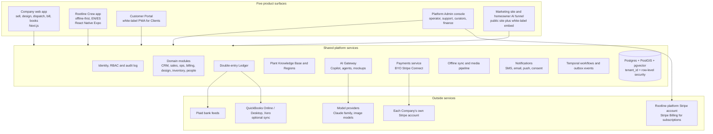
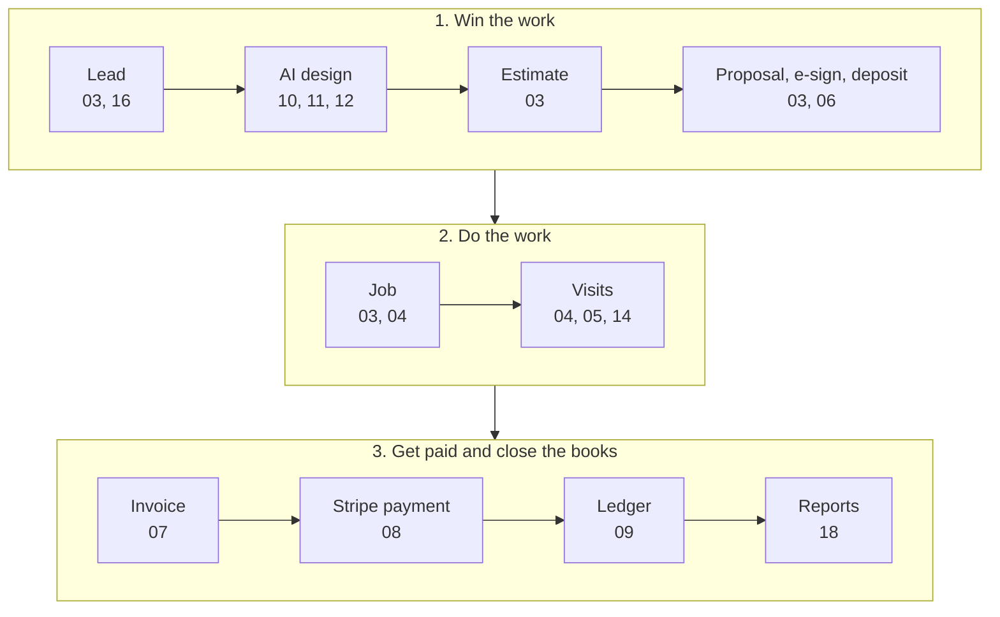

# Rootline - Landscape Business Operating System: Product Design Proposal

> **Rootline** (working name) is an all-in-one operating system for small and medium landscape companies. One system takes every job from first photo to to-scale design, priced proposal, crew schedule, paid invoice and closed books. A regional horticulturist's plant knowledge is built in, and client payments land in a Stripe account the Company owns. This page is the front door to the proposal: the thesis, the bets, who it serves, how the pieces fit, what ships first, how it makes money and how to read the rest.

**Status:** design proposal, November 2026. Prices, targets and dates are proposals or labeled estimates. **Sample tenant** in examples and concept screens: Greenleaf Grounds Co. The journeys in [02](02-personas-roles-permissions.md) also use two reference Companies: Reyes Outdoor Living (residential design-build) and Summit Grounds Group (three-branch commercial with snow).

---

## Contents

1. [Executive summary](#1-executive-summary)
2. [The 10 big bets](#2-the-10-big-bets)
3. [Who Rootline serves](#3-who-rootline-serves)
4. [Product surface map](#4-product-surface-map)
5. [Lead to cash to books](#5-lead-to-cash-to-books)
6. [Module map](#6-module-map)
7. [What is in MVP, at a glance](#7-what-is-in-mvp-at-a-glance)
8. [Business model in brief](#8-business-model-in-brief)
9. [How to read this proposal](#9-how-to-read-this-proposal)
10. [UI concept screens](#10-ui-concept-screens)
11. [Glossary](#11-glossary)
12. [Verification note](#12-verification-note)

---

## 1. Executive summary

### The problem

A 5-40 person landscape company that designs, installs and maintains landscapes runs on tools that do not talk to each other. A typical stack is a field-service app or landscape estimating suite, QuickBooks, a design tool, a measurement add-on, and review and website tools. That plausibly costs $1,000-$1,500 a month before payment fees ([R2](research/R2-landscape-specific-platforms.md), estimate). The loudest complaints are about the seams, not missing buttons ([01](01-market-landscape.md) section 6):

- Designs are re-keyed into estimates, and estimates into invoices.
- Books drift out of sync with QuickBooks, so nobody trusts job costing.
- Payment processors are bundled in and hard to leave.
- Crew apps fail without signal and are rarely Spanish-first.
- Seat pricing charges for summer crews all year.
- Consumer AI design tools invent plants, ignore scale and have no installer behind them.

The software splits into three camps that never connect. Horizontal home-service apps (Jobber, Housecall Pro) are easy but shallow. Landscape suites (Aspire, LMN, SingleOps, Real Green, Service Autopilot) are deep but dated, and since 2021 they have consolidated under ServiceTitan, Granum, Xplor and WorkWave, each pushing its own payments product. Design tools (PRO Landscape+, DynaSCAPE, Vectorworks) draw well but never price, schedule, bill or account for the work. Across our 17-competitor matrix, **no one** offers a to-scale design studio wired to estimating, AI layouts limited to plants valid for the region, a curated region-aware plant knowledge base, or a built-in double-entry ledger ([01](01-market-landscape.md)).

The market is large and fragmented: roughly $150-$200B a year of US landscaping services across about 100,000-130,000 employer establishments [B, verify]. At Rootline's prices, the theoretical subscription pool for US and Canadian employer firms is about $460M a year, about $340M of it reachable [E]. The payment volume through the same firms is far larger, which is why incumbents fight to own it.

### The vision

Rootline is **the landscape business operating system**, design-to-books software for landscape companies. An estimator traces a 400 sq ft patio on the aerial photo and picks pavers. Base, edge restraint and polymeric sand flow into a priced estimate at the Company's own production rates. Before the estimator leaves the driveway, the client sees an AI mockup of their own backyard, then signs and pays the deposit in the portal. The deposit lands in the Company's Stripe account and posts to its ledger as a liability. The Job becomes visits on a crew's route, which the crew runs offline and in Spanish. Each completed visit becomes an invoice, payouts match bank lines, and the P&L by service line is ready on the 1st.

One record runs from parcel to plow plan to ledger. The geometry that produced the design becomes the maintenance map, the irrigation zone map, the plant warranty inventory and the snow plan. Five surfaces share one platform (section 4).

### Why now

Eight forces converged in 2024-2026 ([01](01-market-landscape.md#8-why-now)):

1. **Image editing got cheap and controllable**, at about $0.04 per image. A mockup can be part of every proposal, not a premium service.
2. **Homeowners design with AI, and the tools disappoint.** They invent plants, ignore scale and have no installer.
3. **LLMs read documents and use tools reliably.** Agents can draft estimates, parse plan sets and reconcile books.
4. **Stripe Connect made "bring your own account" first-class.** Direct charges on full-dashboard accounts carry no Connect fees for either side.
5. **Consolidation opened switching windows.** Forced payment migrations and slower support make Companies re-evaluate the whole stack.
6. **QuickBooks got pricier and less certain** [B, verify], so a built-in ledger saves money and hedges risk.
7. **Labor is the binding constraint.** With the H-2B cap at 66,000 a year, revenue per man-hour is the only growth lever.
8. **Open geodata matured.** Elevation, aerial imagery and the 2023 hardiness map make measurement a by-product of adding a Property.

### Why we win

AI features are the easiest thing to copy and the least important part of the moat. The durable advantages compound ([01](01-market-landscape.md#103-moats-ranked-by-how-long-they-take-to-copy)):

| Moat | Why it is hard to copy | Time for a funded incumbent [E] |
|---|---|---|
| Curated, cultivar-level Plant KB with Plant Region Profiles | Curators, licensed data and outcomes from real installs improve it every season | 3-5 years |
| One geometry and record from parcel to plow plan to ledger | Incumbents would have to rebuild their data model | 2-4 years |
| Ledger as the system of record | Years of books are the stickiest data a Company owns | 2-3 years, plus trust |
| Owning nothing of the Company's money | Copying it means giving up a payments profit pool | Economically blocked |
| Opt-in benchmarks and plant performance data | Needs ledger-grade data at scale with exact KPI definitions | 3+ years after scale |

The go-to-market is focused. The beachhead is the 5-40 person residential design-build-maintain firm: too complex for horizontal apps, too small for 90-day ERP implementations. Rootline launches in one region, the **Great Lakes**: six Wave 1 Regions across Ohio, Michigan, Chicagoland and Northwest Indiana, and Southeast Wisconsin, where the plant knowledge is seeded deepest. At V1 it extends that region across the border into Ontario's Golden Horseshoe and into nearby US metros. It sells into the November-March planning season and makes switching cheap with a free migration concierge ([22](22-business-model-pricing-gtm.md), [24](24-roadmap-feature-catalog.md#91-strategy-and-go-to-market)).

---

## 2. The 10 big bets

1. **One record from first photo to closed books.** Design, takeoff, estimate, proposal, job, visit, invoice, payment and journal entry form one connected object graph, not five tools joined by fragile syncs. A design change becomes an itemized estimate diff and, after signing, a change order. ([03](03-crm-sales-estimating-proposals.md), [10](10-design-studio.md), [20](20-architecture-security.md))

2. **The Plant Knowledge Base is the crown jewel.** It is operator-curated and cultivar-level, with 80+ typed traits, provenance on every value, and Plant Region Profiles: horticulturists' 1-5 ratings with evidence, always overridden by legal status. It drives the plant picker, design validation, AI mockups, substitutions, warranties, SEO plant pages and, later, a licensable Plant API. ([12](12-plant-knowledge-base.md))

3. **Honest AI design: the plan is canonical, the mockup is a view.** Scale comes from measurement (guided capture, calibration card, dimension pins, aerial and LiDAR), and AI may use only region-locked plants rated 3 or higher. Every rendered plant maps to a plan item, KB plant and Price Book line, and every image carries an "artist rendering" badge and C2PA provenance. ([11](11-ai-design-mockups.md), [10](10-design-studio.md))

4. **Bring-your-own Stripe, with zero markup.** Each Company connects its own Stripe account through Stripe Connect: Standard-style accounts configured with controller properties, linked by OAuth or Account Links. Rootline creates direct charges on that account, never holds client funds, and adds no processing markup by default. Any application fee is opt-in and disclosed, and the Company keeps its account, saved cards and history if it leaves. ([08](08-payments-stripe.md), [22](22-business-model-pricing-gtm.md))

5. **A real double-entry ledger is the system of record.** Every operational event posts a balanced, append-only journal entry through versioned posting rules, tagged by division, branch, job, phase and property. Job costing, deferred revenue, WIP and payout reconciliation come from the same data. QuickBooks and Xero sync are optional, and a free Accountant Hub turns the CPA into a channel. ([09](09-accounting-ledger-integrations.md))

6. **Crew-first: offline-first, Spanish-first, glove-and-sun ready.** Airplane mode is a normal state in the Rootline Crew app: signatures, chemical records and time punches work offline, and price, cost and pay-rate fields never reach the device. Pesticide records pre-fill from the program round, measured turf zones and live weather. ([05](05-field-crew-mobile-app.md), [21](21-ux-design-system-sitemaps.md))

7. **Season-native everything.** The season is a capacity and routing problem: road-network route optimization, rain-day playbooks and growth-adaptive mowing. Money follows the season with level billing and automatic true-up, prepaid seasons as deferred revenue, and snow billed per push or event. Field seats are billed only when active, and seasonal crews hibernate at $0 and are rehired in one tap. ([04](04-scheduling-dispatch-routing.md), [07](07-invoicing-billing-contracts.md), [14](14-service-line-modules.md), [15](15-team-hr-payroll.md))

8. **Permission-aware AI that does real work, with earned autonomy.** One Action Layer of typed, risk-tiered tools serves the Copilot, 28 cataloged agents, the Automation Builder, the API and the MCP server. Agents move up autonomy levels L0-L4 only on measured accuracy, through a unified Approval Inbox. Every number is grounded in a tool result, and AI never sets a price. ([17](17-ai-copilot-automation.md))

9. **The homeowner AI funnel is a growth engine.** A white-label "see your yard redesigned" widget turns renders into leads for the Company, not for a consumer app. The free Rootline Home app sends exclusive leads (offered to at most 3 Companies) through Rootline Match, each arriving with a to-scale draft design, photos, dimensions and a budget. ([16](16-marketing-growth-communications.md), [11](11-ai-design-mockups.md), [22](22-business-model-pricing-gtm.md))

10. **Trust is designed in.** Prices are published, down to every AI action's credit cost, under a Price Lock Promise. A never-block rule keeps invoicing, the portal, client payments and the ledger running through dunning. The operator console is "glass box, not god mode": staff read tenant data only with a tenant-approved, time-boxed grant or two-person break-glass, logged where the tenant can see it. ([19](19-platform-admin-portal.md), [22](22-business-model-pricing-gtm.md), [02](02-personas-roles-permissions.md))

---

## 3. Who Rootline serves

[02](02-personas-roles-permissions.md#31-persona-map) defines 17 personas, their journeys and the access model. These role keys are canonical across the doc set.

| Persona | Role key | Primary surface | Top jobs |
|---|---|---|---|
| Founder / Platform Operator | `platform_owner` | Platform Admin console | Run tenants, plans and pricing; approve exceptions; publish Plant KB releases; govern AI models and costs |
| Platform Support | `platform_support` | Platform Admin console | Fix tenant issues fast through tenant-approved access; onboard and migrate Companies |
| Platform Curator (horticulturist) | `platform_curator` | Plant KB workbench | Curate plants and Plant Region Profiles; review AI enrichment; ship Region palettes before spring |
| Platform Finance | `platform_finance` | Platform Admin console | Bill Companies on Rootline's own Stripe Billing account; dunning, credits, AI credit pricing |
| Platform Engineer | `platform_engineer` | Console and infra tooling | Keep sync, routing, AI and webhooks healthy; fix data through audited runbooks |
| Business Owner | `owner` | Company web app and phone | Price and approve work; watch cash, margin and backlog; connect Stripe and bank; decide who sees what |
| Office / Admin Manager | `office_manager` | Company web app | Clear the inbox; invoice the same day; clean timesheets for payroll; collect payments |
| Sales Rep / Estimator | `estimator` | Web and tablet in the field | Measure sites; quote in the driveway; send tiered proposals; respect the margin floor |
| Landscape Designer | `designer` | Design Studio | To-scale designs with plants that thrive; AI mockups; clean takeoffs to the estimate |
| Operations / Account Manager | `ops_manager` | Dispatch board and mobile | Plan capacity and routes; reshuffle a rain day in minutes; budget vs actual hours; approve time |
| Crew Lead / Foreman | `crew_lead` | Crew app | Run the route on time; punch the crew; gate codes, checklists, photos, chemical records; end-of-day report |
| Field Technician | `technician` | Crew app, often a shared device | Clock in with 3 taps in Spanish; know where to be; checklists and photos; see own hours and pay |
| Bookkeeper / Accountant | `bookkeeper` | Ledger and reports | Reconcile bank and Stripe payouts; job costing and WIP; close by business day 10 |
| Subcontractor | `subcontractor` | Sub portal (magic-link web) | Accept work orders; submit photos and bills from the truck; get paid; keep the COI current |
| Residential Homeowner | `client_residential` | Customer Portal | See the design before spending; sign and pay a deposit in minutes; know when crews come |
| Commercial PM / HOA / Facilities | `client_commercial` | Customer Portal, commercial workspace | Approvals that follow PO and board policy; proof of service; billing by property and cost center |
| Additional client contacts | Contact roles `primary`, `co_owner`, `billing`, `property_contact`, `approver`, `viewer` | Customer Portal, scoped | Pay, request service, vote or view, within their role and assigned Properties |

---

## 4. Product surface map

Five product surfaces share one set of platform services: a TypeScript modular monolith plus satellite services where the runtime differs ([20](20-architecture-security.md)). Sitemaps are in [21](21-ux-design-system-sitemaps.md#51-surface-inventory).

| Surface | Users | Launch |
|---|---|---|
| Company web app | All Company staff roles | [MVP] |
| Rootline Crew app | `crew_lead`, `technician`, `subcontractor`; manager mode and shop kiosk in V1 | [MVP] |
| Customer Portal (white-label, custom domain) | `client_residential`, `client_commercial` and their contacts | [MVP] |
| Platform Admin console | `platform_*` roles | [MVP] |
| Marketing site and homeowner AI funnel | Prospects and homeowners | Site [MVP]; funnel embed [V1]; platform-hosted network [V2] |

---

## 5. Lead to cash to books

The spine of the product is the path one job takes, with the docs that own each step. Automations and agents ([17](17-ai-copilot-automation.md)) can act at any step, with the same permissions as a person.

| Step | What happens | Owner docs |
|---|---|---|
| Lead | Forms, the homeowner funnel, AI receptionist, Google LSA, Angi and referrals land in one deduped inbox | [03](03-crm-sales-estimating-proposals.md), [16](16-marketing-growth-communications.md) |
| AI design | The address becomes a site model; the designer draws to scale with region-rated plants and renders the client's own yard; the takeoff falls out of the drawing | [10](10-design-studio.md), [11](11-ai-design-mockups.md), [12](12-plant-knowledge-base.md) |
| Estimate | Internal costing from production rates, burdened labor and overhead recovery; AI drafts quantities, never prices | [03](03-crm-sales-estimating-proposals.md) |
| Proposal | Good/Better/Best tiers with mockups and plant cards, e-signature and a deposit paid in the portal | [03](03-crm-sales-estimating-proposals.md), [06](06-customer-portal.md) |
| Job | One-click conversion to a Work Order, Project or Service Agreement, with gates for deposit, materials, 811 and permits | [03](03-crm-sales-estimating-proposals.md), [04](04-scheduling-dispatch-routing.md) |
| Visits | Recurrence, dispatch, routing and weather; crews complete visits offline with time, photos, materials and chemical records | [04](04-scheduling-dispatch-routing.md), [05](05-field-crew-mobile-app.md), [14](14-service-line-modules.md) |
| Invoice | Billable Items become invoices per visit, batched, level-pay, milestone, progress, retainage, T&M or snow event, with per-line tax | [07](07-invoicing-billing-contracts.md) |
| Stripe payment | Card, wallet, ACH or autopay as a direct charge on the Company's connected account; webhooks confirm | [08](08-payments-stripe.md) |
| Ledger | Posting rules (owned by 09; 07 and 08 match them) create balanced entries; payouts match Plaid bank lines | [09](09-accounting-ledger-integrations.md) |
| Reports | Dashboards on one KPI Dictionary; actual production rates feed back into estimating | [18](18-reporting-analytics.md) |

---

## 6. Module map

| Doc | What it covers |
|---|---|
| [01 - Market Landscape and Competitive Analysis](01-market-landscape.md) | Market sizing, five business archetypes, 17-competitor matrix, pricing benchmark, top pain points, why now, positioning |
| [02 - Personas, Journeys, Roles and Permissions](02-personas-roles-permissions.md) | 17 personas, eight journeys, `resource.action` RBAC with scopes and field masking, client contact roles, support access |
| [03 - CRM, Sales, Estimating and Proposals](03-crm-sales-estimating-proposals.md) | Leads and pipelines, budget-based Estimating Engine, Price Book, tiered proposals with e-sign and deposits, change orders, renewals |
| [04 - Scheduling, Dispatch and Route Optimization](04-scheduling-dispatch-routing.md) | Visit lifecycle, recurrence, capacity, dispatch board, OR-Tools routing, weather and rain days, live ETA |
| [05 - Field and Crew Mobile App](05-field-crew-mobile-app.md) | Offline-first crew app: route, visit workflow, time, pesticide records, Tap to Pay, voice translation, sync design |
| [06 - Customer Portal and Client Experience](06-customer-portal.md) | White-label passwordless portal: proposals, design viewer, project tracker, payments, requests, commercial approvals |
| [07 - Invoicing, Billing and Service Agreements](07-invoicing-billing-contracts.md) | Billing Engine, agreement lifecycle, level billing, retainage, pay apps, snow billing, sales tax, AR and dunning |
| [08 - Payments: Bring-Your-Own Stripe](08-payments-stripe.md) | Connecting each Company's Stripe account, payment methods and flows, autopay, disputes, payout reconciliation |
| [09 - Accounting: Built-in Double-Entry Ledger and Integrations](09-accounting-ledger-integrations.md) | GL engine, posting rules, chart of accounts, subledgers, Plaid, job costing, WIP, close, QuickBooks and Xero |
| [10 - Design Studio: Built-in Landscape Planning](10-design-studio.md) | Site model, CAD-grade drawing, region-aware planting and validation, live takeoff to estimate, 3D, exports |
| [11 - AI Design and Photo Mockups](11-ai-design-mockups.md) | Measured capture, scene understanding, six generation modes, fidelity scoring, disclosure, GPU cost model |
| [12 - Plant Knowledge Base](12-plant-knowledge-base.md) | Four-layer KB, traits with provenance, Regions and Plant Region Profiles, curation at scale, search, palettes |
| [13 - Operations: Materials, Inventory, Purchasing, Vendors, Equipment and Fleet](13-operations-inventory-equipment.md) | Inventory modes, purchasing and 3-way match, vendors and subs, equipment cost per hour, fleet, chemicals |
| [14 - Service-Line Modules](14-service-line-modules.md) | 13 toggleable modules on seven engines: lawn/PHC, irrigation, snow, tree care, installs, commercial, lighting and more |
| [15 - Team, HR, Time and Payroll](15-team-hr-payroll.md) | Bilingual hiring, H-2B, credentials, timesheets, jurisdiction pay rules, payroll export and embedded payroll, safety |
| [16 - Marketing, Growth and Communications](16-marketing-growth-communications.md) | Websites, instant quotes, AI lead magnet, campaigns, reviews, referrals, unified inbox, AI receptionist, 10DLC and consent |
| [17 - AI Copilot, Agents and Automation](17-ai-copilot-automation.md) | Action Layer, Copilot, agents with earned autonomy, Automation Builder, predictions, trust layer, credits and evals |
| [18 - Reporting, Analytics and Benchmarking](18-reporting-analytics.md) | Role dashboards, KPI Dictionary, revenue views, report builder, forecasts, opt-in benchmarks, data platform |
| [19 - Platform Admin Portal (Operator Console)](19-platform-admin-portal.md) | Tenants, health, migrations, SaaS billing, entitlements, consented support, KB and AI operations, compliance |
| [20 - Architecture, Data Model and Security](20-architecture-security.md) | Modular monolith, RLS multi-tenancy, canonical entities, APIs and events, Temporal, offline sync, AI Gateway, AWS, security |
| [21 - UX, Design System and Sitemaps](21-ux-design-system-sitemaps.md) | Surfaces and sitemaps, interaction patterns, brand, tokens, components, accessibility, localization, onboarding |
| [22 - Business Model, Pricing and Go-to-Market](22-business-model-pricing-gtm.md) | Tiers, seats, meters, add-ons, payments stance, homeowner app and leads, partners, GTM, unit economics |
| [23 - Innovation and Moonshots](23-innovation-moonshots.md) | 33 bets from digital twin to robotic mowers to fintech, MVP rails, stage gates, ranking and waves |
| [24 - Roadmap and Feature Catalog](24-roadmap-feature-catalog.md) | Phased roadmap and full feature catalog; the authority on priority tags |
| [R1 - General field-service platforms](research/R1-field-service-platforms.md) | 13 horizontal field-service platforms, Jobber in depth |
| [R2 - Landscape-industry-specific software](research/R2-landscape-specific-platforms.md) | Landscape suites, the four ownership camps, gaps and switching triggers |
| [R3 - Design tools, AI mockup tech and plant data](research/R3-design-ai-plant-data.md) | Design software, AI visualization technology and costs, 40+ plant data sources with license verdicts |
| [R4 - Industry economics, payments and accounting](research/R4-industry-payments-accounting.md) | Industry economics, Stripe Connect, competitor payments, surcharging, landscape accounting needs |

---

## 7. What is in MVP, at a glance

**[24 - Roadmap and Feature Catalog](24-roadmap-feature-catalog.md)** has the full roadmap, dates and per-feature tags, and wins wherever a module doc's tag differs. Tags: **[MVP]** first release; **[V1]** about 12 months after MVP; **[V2]** 12-24 months; **[V3]** moonshot. The MVP proves the beachhead promise in the Great Lakes launch region, from Columbus to Milwaukee: design, sell, schedule, do the work, get paid and close the books in one system. Because Great Lakes crews plow in winter, it also includes **Snow Lite**.

| Area | In MVP | Next, in V1 |
|---|---|---|
| Access ([02](02-personas-roles-permissions.md)) | Role templates and scoped permissions; server-side field masking; consented support access; hash-chained audit log; seasonal hibernate and rehire | SSO; branches and divisions; HOA and commercial approval policies |
| Sell and design ([03](03-crm-sales-estimating-proposals.md), [10](10-design-studio.md), [11](11-ai-design-mockups.md)) | Lead inbox; budget-based estimating with Price Book and kits; AI turf auto-measure from aerial imagery; Design Studio 2D with region-aware picker and live takeoff; AI photo mockups with region-locked plants; tiered proposals with e-sign and deposits | AI aerial measure of beds, hardscape and commercial classes; AI layout generation and design assistant; 3D, growth and season renders; RFP intake |
| Plant KB ([12](12-plant-knowledge-base.md)) | About 3,000 seed plants for Wave 1 Regions; Plant Region Profiles; curation with daily releases; natural-language search; palettes; offline crew subset | Nursery availability; photo plant ID; public SEO plant pages |
| Schedule ([04](04-scheduling-dispatch-routing.md)) | Visit lifecycle; recurrence; dispatch board; route sequencing and insertion; weather alerts; live ETA notices | Multi-crew day and week optimization; rain-day playbooks; project Gantt |
| Field ([05](05-field-crew-mobile-app.md)) | Offline EN/ES crew app; run sheet; crew time with signed clock-out attestations; pesticide records; Snow Lite storm visit log with GPS-stamped photos; signatures; cash and check custody; voice notes with translation | California meal and rest attestations; full snow event mode; AR/LiDAR measurement; plant install logging; scorecards |
| Portal ([06](06-customer-portal.md)) | White-label passwordless portal; proposals with deposit; 2D plan and AI before/after; project tracker; invoices and autopay; requests and messages | Commercial approval chains; self-scheduling; 3D and seasonal views; homeowner funnel embed |
| Bill and get paid ([07](07-invoicing-billing-contracts.md), [08](08-payments-stripe.md)) | Billing Engine (per visit, batched, level pay with true-up, prepaid seasons, deposits, milestones, T&M); per-line tax; dunning; per-push and per-application snow invoices from Snow Lite logs; Standard-style Stripe Connect with cards, ACH and autopay; zero markup | Retainage and AIA pay apps; storm-event snow billing with caps and floors; Avalara; restricted-key mode; Canadian PAD; surcharging; financing; Pay-as-you-grow |
| Books ([09](09-accounting-ledger-integrations.md)) | Double-entry GL with posting rules and dimensions; Plaid feeds and reconciliation; job costing; deferred revenue; statements; QuickBooks Online connector and migration | WIP; fixed assets; QuickBooks Desktop; Xero; full Accountant Hub; multi-entity |
| Operations and service lines ([13](13-operations-inventory-equipment.md), [14](14-service-line-modules.md)) | Buy lists from takeoffs; purchase orders; Off and Light inventory modes; asset registry and DVIR; equipment cost per hour; lawn/PHC programs; irrigation programs; installs with a hard 811 gate; Snow Lite on every plan (snow site list, storm visit logs, per-site PDF proof of service) | Standard (perpetual) inventory; PM schedules and work orders; purchasing workbench; telematics; full Snow & Ice module (Storm Command Center, eight pricing models, subcontractor plowers, sealed proof packets); tree care; lighting; smart controllers |
| People ([15](15-team-hr-payroll.md)) | Employee records; credentials enforced at dispatch; timesheets; overtime rule packs (Federal plus the Great Lakes launch states); payroll export; OSHA logs | Other state and provincial rule packs; Spanish-first hiring; H-2B workspace; PTO accrual; certified payroll; embedded payroll pilot |
| Grow ([16](16-marketing-growth-communications.md)) | Unified inbox; per-tenant 10DLC; consent ledger; lifecycle messages; lead ingest; review requests and NPS; basic campaigns; call tracking with missed-call text-back | Journey builder; win-back engine; neighborhood marketing; social posting; website builder, online booking and AI receptionist (V1.2 train) |
| AI ([17](17-ai-copilot-automation.md)) | Action Layer; Copilot and command palette; Approval Inbox; owner briefing, inbox triage, lead follow-up and field-note agents; estimating agent drafts from notes, voice memos and photos; collections reminders; Automation Builder; evals and credit metering | Scheduling, bookkeeping and AP agents; aerial-measured estimate drafts; full collections agent; MCP server; predictive models |
| Insight ([18](18-reporting-analytics.md)) | Owner, ops and sales dashboards; KPI Dictionary; job cost detail; report library | Report builder; cash and capacity forecasts; benchmarks beta |
| Platform ([19](19-platform-admin-portal.md), [20](20-architecture-security.md), [21](21-ux-design-system-sitemaps.md)) | Operator console and migration center (CSV, Jobber, QuickBooks Online); RLS multi-tenancy, REST API core, offline sync, AI Gateway; design system, WCAG 2.2 AA, EN/ES, onboarding sandbox | Canadian data residency; OAuth app marketplace; partner portal; French-Canadian |
| Commercial ([22](22-business-model-pricing-gtm.md)) | Starter, Grow, Pro; active field seats; published AI credits; Zero-Markup Pledge; Price Lock Promise; winter trial; migration concierge | Enterprise; Snow & Ice add-on; Winter Mode; Pay-as-you-grow; Rootline Home and Match |

[23](23-innovation-moonshots.md#42-rails-what-mvp-and-v1-must-build-so-the-moonshots-stay-possible) adds 14 cheap "rails" MVP and V1 must build so the moonshots stay possible, such as stable object IDs in designs, plant instances, rich photo metadata and a consent ledger.

---

## 8. Business model in brief

The full commercial spec is **[22 - Business Model, Pricing and Go-to-Market](22-business-model-pricing-gtm.md#42-tier-definitions-and-list-prices-proposed-usd-and-cad)**. All figures are proposed and will be validated in pricing tests.

| | Starter | Grow (ICP plan) | Pro | Enterprise |
|---|---|---|---|---|
| Annual billing, per month | $69 | $249 | $529 | From $1,500 |
| Monthly billing | $79 | $289 | $599 | Custom |
| Built for | 1-6 person crews | 5-25 person design-build-maintain firms | 20-80 people, multi-crew, mixed residential and commercial | 80+ people, multi-branch, franchise |
| Included office / active field seats | 1 / 3 | 3 / 10 | 8 / 30 | Negotiated |
| AI credits included per month | 300 | 2,000 | 6,000 | Pooled, from 25,000 |

- **Seats follow the seasons.** Office seats are the main price metric. Field seats are cheap and billed only in months they are active. Bookkeeper, subcontractor and client seats are free.
- **Usage is published and shown before it is billed.** AI credit packs: 1,000 for $25, 5,000 for $100, 20,000 for $340. SMS and AI receptionist minutes have their own meters.
- **Every differentiator is reachable at Grow**: Design Studio 2D, AI mockups, the full Ledger, the white-label portal and route optimization. Add-ons match the trade: designer seats and 3D, Snow & Ice billed only November-March (Snow Lite is in every plan), advanced ledger, payroll and websites.
- **Zero payment markup by default.** Clients pay the Company through its own Stripe account and Rootline adds nothing. The opt-in Pay-as-you-grow plan [V1] is Starter at $39 plus a disclosed 0.5% application fee, capped at $10 per payment. Rootline's own subscriptions run on a separate platform Stripe account with Stripe Billing.
- **New revenue lines** come from the same assets: Rootline Home and Rootline Match (design-ready homeowner leads), the Plant API, Rootline Pulse benchmarks (opt-in, k-anonymized), and partners such as distributors, nurseries, associations and CPAs.
- **Go-to-market:** a winter-timed trial plus inside sales, a migration concierge with a Spring-Ready Guarantee, and a Price Lock Promise (24 months, then at most 7% a year).
- **Unit economics (estimates):** about 72-74% gross margin per tier, with a path to 77% by Year 5. The base case reaches about 9,500 paying Companies, about $54.7M of subscription and usage ARR and about $60.4M of total run-rate revenue in Year 5.

---

## 9. How to read this proposal

**Structure.** Each module doc opens with an "at a glance" summary and a related-docs line. It then follows a shared template: goals, market research, personas, feature specification with priority tags, flows (Mermaid), wireframes, data model, APIs and events, permissions, AI opportunities, compliance and risks, KPIs, beyond-the-brief ideas, open questions and sources.

**Who decides.** When docs disagree, the owner doc for the topic wins. Roles belong to [02](02-personas-roles-permissions.md), billing to [07](07-invoicing-billing-contracts.md), payments to [08](08-payments-stripe.md), posting rules to [09](09-accounting-ledger-integrations.md), entities and architecture to [20](20-architecture-security.md), brand and UX to [21](21-ux-design-system-sitemaps.md), prices to [22](22-business-model-pricing-gtm.md), and priority tags to [24](24-roadmap-feature-catalog.md).

**Evidence tags.** **[S]** sourced, **[S3P]** third-party summary, **[B]** background knowledge, **[E]** estimate, or "verify".

| Reader | Reading path | Time |
|---|---|---|
| **Founder / operator** | This page; [01](01-market-landscape.md) (summary, sections 8, 10, 11); [22](22-business-model-pricing-gtm.md); [12](12-plant-knowledge-base.md); [19](19-platform-admin-portal.md); [23](23-innovation-moonshots.md) (sections 4 and 15); [24](24-roadmap-feature-catalog.md) | Half a day |
| **Engineer** | This page; [20](20-architecture-security.md); [02](02-personas-roles-permissions.md) (sections 5-6); [09](09-accounting-ledger-integrations.md) (posting rules, invariants); [08](08-payments-stripe.md); [05](05-field-crew-mobile-app.md) (sync); [04](04-scheduling-dispatch-routing.md) (optimizer); [17](17-ai-copilot-automation.md) (trust layer); [24](24-roadmap-feature-catalog.md) | 1-2 days |
| **Designer** | [21](21-ux-design-system-sitemaps.md); the concept screens in [site/](site/); [02](02-personas-roles-permissions.md) (personas, journeys); [05](05-field-crew-mobile-app.md); [06](06-customer-portal.md); [10](10-design-studio.md); [11](11-ai-design-mockups.md) | 1 day |
| **Investor** | This page; the vision site in [site/](site/); [01](01-market-landscape.md) (summary, sections 2, 8, 10); [22](22-business-model-pricing-gtm.md) (sections 4, 5, 7); [23](23-innovation-moonshots.md) (moats, ranking); [24](24-roadmap-feature-catalog.md) | 2-3 hours |

---

## 10. UI concept screens

Concept screens live in [`docs/site/`](site/) as static HTML that renders in any browser with no build step. `index.html` is the vision site, and the `screens-*.html` pages show key screens from the Company web app, the crew app, the Customer Portal, the Platform Admin console and the homeowner funnel. They use the [21](21-ux-design-system-sitemaps.md) design system: Stone neutrals, Moss primary, Clay, Marigold for warnings and offline states, Sky for information and irrigation, Ember for danger, and Iris reserved only for AI. Type is Fraunces for display, Inter for UI and JetBrains Mono for numbers. The data belongs to the sample tenant Greenleaf Grounds Co. The screens illustrate intent; the module docs are the spec.

---

## 11. Glossary

These terms are canonical across the doc set.

| Term | Meaning |
|---|---|
| **Company** | A landscape business that subscribes to Rootline; the tenant, isolated by `tenant_id` and row-level security |
| **Client** | A Company's customer account, residential or commercial, holding Properties, Contacts, agreements and billing |
| **Property** | A site served for a Client, geocoded to a parcel and resolved to a Region, with measurements, maps, access notes and history |
| **Contact** | A person on a Client with a contact role (`primary`, `co_owner`, `billing`, `property_contact`, `approver`, `viewer`), optionally limited to some Properties |
| **Lead** | An unqualified inbound request or prospect from any channel |
| **Opportunity** | A qualified potential sale in a pipeline, from which Estimates and Proposals hang |
| **Estimate** | Internal costing of work: quantities, production rates, labor burden, overhead, materials and margin |
| **Proposal** | The customer-facing offer built from Estimates: options and tiers, mockups, terms, e-signature and deposit |
| **Job** | Sold work being delivered: a **Work Order** (one-off), a **Project** (multi-phase install) or a **Service Agreement** (recurring contract that generates Visits and billing) |
| **Visit** | One scheduled occurrence of work at a Property by a Crew, with its own lifecycle and records |
| **Route** | The ordered Visits a Crew runs on a day, from dispatch and the route optimizer |
| **Crew** | A team of field staff (a `crew_lead` and `technician`s) with skills and equipment |
| **Price Book** | The Company's catalog of items, services, kits and production rates with costs and prices |
| **Design** | A to-scale landscape plan for a Property, made in the Design Studio |
| **Design Version** | An immutable snapshot of a Design Option, moving from draft through approval to locked, sold and as-built; Mockups, Estimates and Proposals pin one |
| **Design Option** | A branch of a Design (A, B, C), usually mapped to proposal tiers |
| **Takeoff** | Quantities derived from a Design (areas, counts, volumes, plants), priced against the Price Book and linked to an Estimate |
| **Mockup** | An AI-rendered image of a Property showing a proposed landscape, always labeled an artist rendering |
| **Plant** | A canonical Plant KB record at taxon or cultivar level |
| **Region** | An operator-defined area, built from zones, ecoregions and jurisdictions, that drives plant suitability and seasonal defaults |
| **Plant Region Profile** | A curated 1-5 rating of a Plant in a Region, with conditions and evidence; legal status overrides it |
| **Plant Palette** | A curated or rule-based set of Plants for a use and Region, such as pollinator or deer-resistant |
| **Invoice** | A bill to a Client generated by the Billing Engine, with per-line tax |
| **Payment** | Money received from a Client, normally a direct charge on the Company's own Stripe account |
| **Credit Memo** | A document reducing what a Client owes, posted to the Ledger |
| **Deposit** | Money collected before work starts, held as a liability until applied to Invoices |
| **Retainage** | Progress billing withheld by a commercial client until completion, tracked as its own receivable |
| **Ledger** | Rootline's built-in double-entry general ledger, the Company's system of record |
| **Automation** | A deterministic trigger-condition-action rule, optionally with AI steps |
| **Copilot** | The permission-aware AI assistant, marked in Iris, that answers, drafts and proposes actions a person confirms |

---

## 12. Verification note

The research behind this proposal was done in November 2026 with limited live web access: relatively few searches were possible and many vendor and regulator sites could not be opened directly. Each doc states its evidence limits. So:

- **Competitor prices, features and ownership facts are marked "verify" and dated November 2026.** Re-check each against the vendor's current page before it appears in comparison pages, sales material or investor decks.
- **Industry numbers** (market size, firm counts, margins) are labeled ranges, not point facts.
- **Vendor API terms and regulations** (Stripe Connect, QuickBooks and Xero APIs, surcharging, renewal and late-fee laws, pesticide and wage rules, TCPA and 10DLC) need a counsel or vendor check before launch.
- **Every Rootline price, cost and revenue figure is a proposal or estimate**, to be replaced with design-partner data.
- [R1](research/R1-field-service-platforms.md)-[R4](research/R4-industry-payments-accounting.md) and [01](01-market-landscape.md) end with verification checklists. A follow-up research pass should work through them first.
