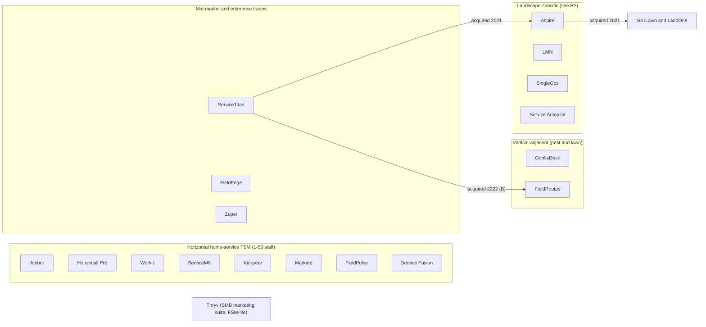
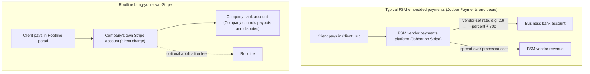
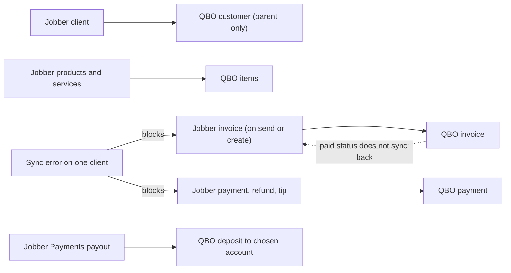

# R1 - General field-service management platforms

> Raw competitive research on the horizontal home-service and field-service management (FSM) platforms that landscape companies actually use today: Jobber (deepest), Housecall Pro, ServiceTitan (and its Aspire and FieldRoutes acquisitions), Workiz, FieldEdge, ServiceM8, FieldPulse, Kickserv, GorillaDesk, Service Fusion, Markate, Zuper and Thryv. For each we cover positioning, pricing, standout features, payments, accounting, customer portal, crew app, AI, integrations and weaknesses, then roll the findings into a feature matrix, a pricing benchmark, recurring patterns, landscaper-specific gaps and concrete lessons for Rootline. This report is an input to [01 - Market landscape](../01-market-landscape.md) and to every module spec; the landscape-specific vendors (LMN, Aspire in depth, SingleOps, Service Autopilot, Real Green, Arborgold, Yardbook, Copilot CRM, SynkedUP) are covered in [R2](R2-landscape-specific-platforms.md).

| Field | Value |
|---|---|
| Report | R1 - General field-service management platforms |
| Date | 2026-11-07 |
| Status | Research input (not a spec). Facts are tagged by evidence level; see section 0. |
| Primary consumers | [01 Market landscape](../01-market-landscape.md), [03 CRM/estimating](../03-crm-sales-estimating-proposals.md), [04 Scheduling](../04-scheduling-dispatch-routing.md), [06 Customer portal](../06-customer-portal.md), [08 Payments](../08-payments-stripe.md), [09 Accounting](../09-accounting-ledger-integrations.md), [16 Marketing](../16-marketing-growth-communications.md), [17 AI](../17-ai-copilot-automation.md), [22 Pricing/GTM](../22-business-model-pricing-gtm.md) |
| Sibling reports | [R2 Landscape-specific platforms](R2-landscape-specific-platforms.md), [R3 Design, AI and plant data](R3-design-ai-plant-data.md), [R4 Industry, payments and accounting](R4-industry-payments-accounting.md) |

---

## 0. How to read this report: evidence levels and limitations

This report is deliberately explicit about how well each fact is supported, because pricing and packaging in this category change several times a year and third-party "pricing guide" sites routinely disagree with each other.

| Tag | Meaning | How to use it |
|---|---|---|
| **[S]** | Sourced in this research session from a primary or credible source (vendor help center, vendor press release, vendor community forum, reputable trade press). Linked inline. | Safe to quote with the link. Still mark prices "as of Nov 2026, verify". |
| **[S3P]** | Sourced in this session, but only from third-party pricing aggregators or affiliate/comparison sites, which disagree with each other. | Directionally useful. Never quote a single number without the range and a "verify" note. |
| **[B]** | Analyst background knowledge of public vendor materials, reviews and trade press up to mid-2026, **not re-verified in this session**. | Treat as a hypothesis to verify (see the checklist in section 19). Do not put in investor materials unverified. |
| **[E]** | Analyst estimate, inference or illustrative calculation. | Labeled as an estimate; the reasoning is shown. |

**Research limitations (important).** This report was produced during a large parallel research run. The shared web-search budget for the run was exhausted after 15 searches for this report, and direct page fetches to vendor domains (for example getjobber.com) were blocked by the session's network allowlist. As a result:

- **Jobber** is well sourced: pricing (via several conflicting third-party trackers), Client Hub, quote approvals and deposits, online booking, Jobber Payments' Stripe foundation, the QuickBooks Online sync model and its limits, routing behavior and complaints, AI products and the Marketing Suite are all backed by [S] or [S3P] evidence.
- **Housecall Pro** pricing, **Workiz** pricing and AI answering, and the **ServiceTitan-Aspire** acquisition are sourced.
- **FieldEdge, ServiceM8, FieldPulse, Kickserv, GorillaDesk, Service Fusion, Markate, Zuper, Thryv** and most ServiceTitan product detail rely on **[B]**. Where the analyst is unsure, the report says "unverified" or uses "?" rather than guessing. No statistic in this report was invented; where a number is an estimate it is labeled [E].
- Direct quotes from G2, Capterra, Reddit and LawnSite were not re-retrieved, so complaint themes from those sites are summarized as [B] themes rather than quoted. The Jobber Community forum threads and the TechRadar review that were retrieved are cited [S].

A follow-up research pass with an expanded search budget and the vendor domains allowlisted should work through the verification checklist in [section 19](#19-verification-checklist-and-open-questions) before any of these numbers are used externally.

---

## 1. Executive summary

1. **Jobber is the default horizontal FSM for small landscape and lawn companies, and it is the product Rootline will most often displace.** It has a landing page aimed squarely at landscapers ([Jobber landscaping](https://www.getjobber.com/industries/landscaping-software/)) [S], a polished Client Hub, online booking, deposits at quote approval, and an expanding AI layer (Copilot, AI Receptionist, Jobber Voice, Campaign Generator) [S]. Stripe describes Jobber's payments business as serving roughly 200,000 home service professionals ([Stripe case study](https://www.casestudies.com/company/stripe/case-study/jobber-and-stripe-help-200k-home-service-professionals-save-on-payment-fees)) [S].
2. **Jobber's packaging is tier-plus-add-on, and the add-ons stack.** Four tiers (Core, Connect, Grow, Plus) with 1/5/10/15 included users and about $29 per extra user; Marketing Suite about $79/month; AI Receptionist reported at $29 to $99/month depending on source and plan; key landscape features (job costing, optional line items, custom automations, two-way texting) are gated to Grow and above [S3P]. Third-party trackers disagree materially on 2026 list prices, and at least one tracker logs a February 2026 price change ([Costbench changelog](https://costbench.com/changelog/jobber-price-increase-2026-02-3/)) [S3P].
3. **Every major FSM monetizes payments by running them itself.** Jobber Payments is built on Stripe [S]; Housecall Pro, ServiceTitan, Workiz, FieldEdge, Service Fusion, Thryv and others run branded in-house payments [B]. The business does not own the processor relationship, the dashboard, or the stored-card vault in a portable way [E]. Nobody among the major horizontal players makes "connect your own Stripe account" the primary path. **This validates Rootline's bring-your-own-Stripe stance as a genuine differentiator** ([08 Payments](../08-payments-stripe.md)).
4. **No horizontal FSM keeps real books.** Accounting is always "sync to QuickBooks Online / Xero". Jobber's current QuickBooks Online integration is one-way (Jobber to QBO), paid status no longer syncs back, it cannot sync to sub-customers, it does not support QuickBooks Desktop, and a single client sync error blocks every invoice and payment for that client ([Jobber QBO FAQ](https://help.getjobber.com/es/articles/quickbooks-integration-faqs/), [Jobber sync errors](https://help.getjobber.com/hc/en-us/articles/10466688449431-Common-QuickBooks-Sync-Errors-and-How-to-Fix-Them)) [S]. FieldEdge built its reputation on two-way QuickBooks sync [B]; nobody ships a native double-entry ledger for SMB trades. **This validates Rootline's built-in GL** ([09 Accounting](../09-accounting-ledger-integrations.md)).
5. **Routing is shallow outside the enterprise tier.** Jobber users report that route optimization uses straight-line distance rather than road distance and struggles with 30-40 stops per day ([Jobber Community](https://community.getjobber.com/discussions/job-details-scheduling/how-does-jobber-calculate-routes-and-can-it-use-real-driving-directions-instead-/8663/replies/9863)) [S]. Multi-crew vehicle routing with time windows, crew skills and equipment constraints is essentially absent from SMB tools [B]. Mowing companies running 30 to 60 stops per crew per day feel this most.
6. **None of these platforms understands a landscape.** No to-scale design, no takeoffs, no plant data, no production-rate estimating (labor hours per unit of work), no chemical application logs (except pest/lawn specialists like GorillaDesk and FieldRoutes) [B/E]. Landscapers bolt on LMN or a spreadsheet for estimating, a CAD tool or hand sketches for design, and Real Green or paper for pesticide records.
7. **ServiceTitan's 2021 acquisition of Aspire (alongside a $200M Series G at a $9.5B valuation) and Aspire's follow-on purchases of Go iLawn and LandOne show the incumbents believe landscaping is a distinct vertical worth owning** ([TechCrunch](https://techcrunch.com/2021/06/30/servicetitan-acquires-aspire-to-move-into-landscaping-raises-200m-at-a-9-5b-valuation), [PrivSource](https://www.privsource.com/acquisitions/deal/x7SXDx)) [S]. Aspire targets larger commercial maintenance firms; the small-to-mid design-build and maintenance company remains underserved.
8. **AI receptionists are the 2025-2026 battleground.** Jobber (AI Receptionist), Workiz (Jessica / "Genius Answering", reported at about $200/month) and others now sell AI phone and text answering as an add-on [S/S3P]. Reviewers say these do not replace an office manager when a job goes sideways ([TechRadar](https://www.techradar.com/pro/software-services/jobber-crm-review)) [S]. AI has not yet touched design, estimating or plant selection in any horizontal FSM.
9. **Per-user pricing punishes seasonal labor.** Landscape headcount swings 2x to 3x between January and June [E]. Tiered user caps (Jobber 1/5/10/15, Housecall Pro 1/5/8) plus per-user overages are a recurring irritation; ServiceM8 (per-job volume) and Service Fusion (unlimited users) are the notable exceptions [B].
10. **The gap Rootline exploits:** a landscape-first platform that (a) designs and measures the property, (b) estimates with production rates and plant data, (c) runs recurring maintenance and event work (snow) with real multi-crew routing, (d) owns the books, and (e) leaves the money in the Company's own Stripe account. No product profiled here does more than two of these five.

---

## 2. Market structure

### 2.1 Segments

| Segment | Typical buyer | Products in this report | What they optimize for | Landscape fit |
|---|---|---|---|---|
| Horizontal home-service FSM | Owner-operator to ~50 staff; residential focus | Jobber, Housecall Pro, Workiz, ServiceM8, Kickserv, Markate, FieldPulse, Service Fusion | Fast quote-to-cash, ease of use, mobile, marketing add-ons, embedded payments | Good for mowing/maintenance at small scale; weak on design-build estimating, chemicals, snow, commercial |
| Mid-market/enterprise trades | $5M to $100M+ revenue HVAC/plumbing/electrical, commercial service | ServiceTitan, FieldEdge, Zuper | Call-center booking, flat-rate pricebook, memberships, technician performance, ERP integration | Poor fit for landscape without Aspire; expensive and long implementations [B] |
| Vertical-adjacent | Pest control and lawn treatment | GorillaDesk, FieldRoutes | Route density, chemical/product tracking, recurring programs | Strong for lawn care treatment programs; weak for design-build and maintenance crews |
| SMB marketing suite | Any local SMB | Thryv | CRM, marketing, reviews, payments, appointments | FSM is secondary; landscape fit low |
| Landscape-specific | Landscape maintenance and design-build | Aspire, LMN, SingleOps, Service Autopilot, Real Green, Arborgold, SynkedUP, Yardbook, Copilot CRM | Production-rate estimating, contracts, job costing | Covered in [R2](R2-landscape-specific-platforms.md) |

### 2.2 Consolidation and ownership

- **ServiceTitan** announced its definitive agreement to acquire Aspire on June 30, 2021, alongside a $200M Series G led by Thoma Bravo at a $9.5B valuation; terms of the Aspire deal were not disclosed ([TechCrunch](https://techcrunch.com/2021/06/30/servicetitan-acquires-aspire-to-move-into-landscaping-raises-200m-at-a-9-5b-valuation), [Thoma Bravo](https://www.thomabravo.com/press-releases/servicetitan-expands-into-landscaping-with-plans-to-acquire-aspire), [Aspire news](https://www.youraspire.com/news/aspire-software-to-be-acquired-by-servicetitan)) [S]. Aspire's backer Mainsail Partners rolled a portion of its equity into ServiceTitan ([Mainsail](https://mainsailpartners.com/mainsail-partners-backed-aspire-software-announces-plan-to-be-acquired-by-servicetitan/)) [S]. Aspire posted an update dated August 11, 2021 that the acquisition had closed ([Aspire blog](https://www.youraspire.com/blog/aspire-to-be-acquired-by-servicetitan)) [S].
- **Aspire (a ServiceTitan company)** then agreed to acquire **Go iLawn** (aerial property measurement) and **LandOne** in October 2021 ([PrivSource](https://www.privsource.com/acquisitions/deal/x7SXDx)) [S]. ServiceTitan has also acquired **ServicePro (ServSuite)** ([PrivSource](https://www.privsource.com/acquisitions/deal/e4SyNm)) [S] and **FieldRoutes** (pest and lawn, 2022) [B].
- ServiceTitan listed on Nasdaq in December 2024 [B].
- **FieldEdge** is part of Xplor Technologies [B]; **Service Fusion** is part of EverCommerce [B]; **Thryv** (the former Dex Media) acquired Keap in 2024 [B].

**Implication [E]:** the two "landscape aware" incumbents with real scale (Aspire via ServiceTitan; FieldRoutes for lawn treatment via ServiceTitan) both sit inside an enterprise-priced trades platform. The horizontal SMB leaders (Jobber, Housecall Pro) are broad, not deep. That leaves a wide lane for a landscape-native, SMB-priced, design-led platform.

### 2.3 Business model pattern across the category

Every vendor in this report earns from some combination of the following [B/E]:

| Revenue line | Typical form | Who does it |
|---|---|---|
| Subscription | Tiered plans with included users plus per-user overage; or per-technician; or per-route; or per-job-volume; or unlimited users | All |
| Payments take-rate | Branded in-house payments, vendor sets the merchant rate and keeps the spread over interchange plus processor cost | Jobber (on Stripe [S]), Housecall Pro, ServiceTitan, Workiz, FieldEdge, Service Fusion, Thryv and others [B] |
| Instant payout fees | Percentage fee for same-day payout | Jobber, Housecall Pro and others [B] |
| Consumer financing referral | Revenue share from lenders (for example Wisetack) | Jobber, Housecall Pro, ServiceTitan [B] |
| Add-ons | Marketing suites, AI receptionists, phone systems, websites, GPS fleet tracking | Jobber, Workiz, ServiceTitan, Housecall Pro [S/B] |
| Implementation/onboarding | One-time fees, mandatory at the enterprise end | ServiceTitan, FieldEdge, Zuper (reported) [B] |

---

## 3. Jobber (deep dive)

### 3.1 Snapshot

| Attribute | Finding | Evidence |
|---|---|---|
| HQ / founded | Edmonton, Alberta, Canada; founded 2011 | [B] |
| Scale | Stripe describes Jobber's payments customer base as about 200,000 home service professionals | [S] [Stripe case study](https://www.casestudies.com/company/stripe/case-study/jobber-and-stripe-help-200k-home-service-professionals-save-on-payment-fees) |
| Target | Owner-operators and small teams (1 to roughly 30 people) across 50+ home-service verticals; explicit landscaping and lawn care positioning | [S] [Jobber landscaping page](https://www.getjobber.com/industries/landscaping-software/); [B] for size range |
| Pricing model | Four tiers with included users plus per-user overage; add-ons for marketing and AI | [S3P] (section 3.2) |
| Payments | Jobber Payments, built on Stripe; third-party payment integrations also possible in Client Hub | [S] [Stripe case study](https://www.casestudies.com/company/stripe/case-study/jobber-and-stripe-help-200k-home-service-professionals-save-on-payment-fees), [Jobber help](https://help.getjobber.com/en/articles/what-do-your-clients-see-in-client-hub/) |
| Accounting | One-way sync to QuickBooks Online (new integration); Xero sync; no QuickBooks Desktop | [S] [Jobber QBO FAQ](https://help.getjobber.com/es/articles/quickbooks-integration-faqs/) |
| Customer portal | Client Hub: quotes, approvals with signature, deposits, invoices, payments, saved cards, work requests, appointment details, PDFs | [S] [Client Hub help](https://help.getjobber.com/en/articles/what-do-your-clients-see-in-client-hub/) |
| AI | Copilot (2024), AI Receptionist (2025 [B]), Jobber Voice, Campaign Generator | [S] [PR Newswire](https://prnewswire.com/news-releases/jobber-launches-copilot-the-first-of-several-ai-powered-products-aimed-at-making-home-service-business-ownership-simpler-than-ever-before-302264047.html), [destinationCRM](https://www.destinationcrm.com/Articles/CRM-News/CRM-Across-the-Wire/Jobber-Launches-Receptionist-171139.aspx), [Lawn & Landscape](https://www.lawnandlandscape.com/news/jobber-adds-new-ai-powered-features) |
| API | Public developer platform and App Marketplace (GraphQL API) | [B] |

### 3.2 Plans and pricing (as of Nov 2026, verify)

Jobber's pricing page could not be fetched in this session. Third-party trackers that claim to have checked the live page in September and October 2026 disagree, especially on Grow and Plus. The table shows the range rather than a single number.

| Plan | Included users | Month-to-month list price (reported range) | Annual-billing effective price (reported) | Key additions over the previous tier | Evidence |
|---|---|---|---|---|---|
| Core | 1 | $49 | about $27/mo (one source) | Quotes, jobs, invoices, scheduling, Client Hub, Jobber Payments [B] | [S3P] [OneCrew](https://www.getonecrew.com/post/jobber-pricing), [Fieldproxy](https://www.fieldproxy.ai/fsm-software-pricing/jobber) |
| Connect | 5 | $139 (one tracker: $149) | about $90/mo (one source) | QuickBooks Online and Xero sync [S3P]; automated reminders/follow-ups and online booking [B] | [S3P] [PricingSaaS](https://pricingsaas.com/companies/jobber), [OneCrew](https://www.getonecrew.com/post/jobber-pricing) |
| Grow | 10 | $199 to $299 (sources conflict; one tracker shows $299 prepaid annually for 10 users) | about $135-$149/mo | Job costing, two-way texting, custom automations, optional line items on quotes, automatic time tracking | [S3P] [SchedulingKit](https://schedulingkit.com/pricing-guides/jobber-pricing), [OneCrew](https://www.getonecrew.com/post/jobber-pricing) |
| Plus | 15 | $499 to $699 (one tracker: $529) | about $399-$477/mo | Crew scheduling, custom reports, profit alerts, unlimited storage, premium support, Marketing Suite, Sales Pipeline and AI Receptionist included; white-glove onboarding (one source) | [S3P] [Fieldproxy](https://www.fieldproxy.ai/fsm-software-pricing/jobber), [OneCrew](https://www.getonecrew.com/post/jobber-pricing) |
| Extra users | n/a | about $29 per user per month above the included count | n/a | | [S3P] |
| Trial | n/a | 14-day free trial; no free plan | n/a | | [S3P] |
| Legacy plans | n/a | Jobber help-center text on Marketing Suite eligibility excludes a "Lite" plan, implying grandfathered legacy tiers | n/a | | [S] help-center text surfaced in search (specific article not retrieved) |

Other notes:

- At least one tracker logs a **February 2026 Jobber price change** ([Costbench](https://costbench.com/changelog/jobber-price-increase-2026-02-3/)) [S3P]. Annual-billing discounts of roughly 20 to 29 percent are reported ([ContractorToolStack](https://contractortoolstack.com/software/jobber/pricing/)) [S3P].
- **Feature gating that matters to landscapers:** QBO/Xero sync requires Connect or above; job costing, two-way texting and optional line items require Grow or above [S3P]. A Reddit snapshot reported route optimization at the "$169+/mo tier" while a review site placed it at Grow; these disagree and need verification ([Reddit snapshot](https://reddit.sentinel-team.org/posts/1qcnqu7/snapshots/2026-01-14T21%3A20%3A46.769845Z)) [S3P].

#### Add-ons

| Add-on | Reported price | Included in | Evidence |
|---|---|---|---|
| Marketing Suite (Reviews + Campaigns + Referrals) | $79/month | Plus (reported); add-on for Core, Connect, Grow; US, Canada, UK only | [S] [Jobber product update](https://productupdates.getjobber.com/71315-meet-the-easier-way-to-grow-your-business-with-marketing-suite), [Jobber marketing](https://www.getjobber.com/marketing/) |
| Reviews (standalone) | about $39/month | | [S3P]; existence of standalone add-on [S] [Jobber Community](https://community.getjobber.com/discussions/marketing-tools/google-reviews-only-for-marketing-suite/3726) |
| Campaigns (standalone) | about $29/month | | [S3P] |
| Referrals (standalone) | about $29/month | | [S3P] |
| AI Receptionist | Conflicting: $29/month, or $99/month; one source cites 30 conversations included then $0.79 per extra conversation, unlimited on Plus | Plus; add-on for Grow (and possibly lower tiers) | [S3P] [TechRadar](https://www.techradar.com/pro/software-services/jobber-crm-review), [CoreX AI](https://corexai.co/blog/jobber-ai-receptionist), [OneCrew](https://www.getonecrew.com/post/jobber-pricing) |

**Illustrative total cost for a landscape company [E].** A design-build plus maintenance company with 3 maintenance crews, 1 install crew and 2 office staff peaks at about 14 users in season. On Grow (10 users included) at the reported $199 to $299 list: 4 extra users x $29 = $116, so $315 to $415/month before add-ons; adding Marketing Suite ($79) and AI Receptionist ($99 reported) gives about $493 to $593/month, or roughly $5,900 to $7,100/year. Plus at $499 to $699 includes 15 users, marketing and receptionist, so the company is nudged to Plus. In the off-season the same company may have 5 users but, on annual billing, still pays for the peak. **Subscription is not the biggest cost:** if the company collects $900,000/year by card at 2.9% + $0.30, processing is about $26,100/year plus $0.30 per transaction [E], several times the software bill. This is why payments ownership ([08 Payments](../08-payments-stripe.md)) and ACH steering matter more to the Company's P&L than the subscription line.

### 3.3 Sales: requests, quotes, optional line items, deposits

**Work requests and online booking [S].**
- Work requests come from Client Hub ("a simple request form that will appear in your Jobber account") and from a website button linking to the portal ([Client Hub help](https://help.getjobber.com/en/articles/what-do-your-clients-see-in-client-hub/)).
- **Online booking** (announced in a [PR Newswire release](https://prnewswire.com/news-releases/book-more-work-with-less-effort-with-jobbers-new-online-booking-feature-301960758.html) [S], 2023 [B], titled "Book more work with less effort... New feature also helps minimize drive-time between appointments") lets customers choose services that carry estimated prices and durations, then pick a time based on team availability; the business sets availability preferences and a **service radius**; there is a **limit of 100 services** displayed for online booking ([Jobber help: online booking](https://help.getjobber.com/en/articles/online-booking/), [feature page](https://getjobber.com/features/online-booking)).
- **Google Local Services Ads** booking: customers can book an available calendar slot directly from the LSA listing; Google prices those leads and Jobber adds no fee ([Jobber LSA integration](https://getjobber.com/integrations/google-local-services-ads/)) [S].
- A Jobber Community thread titled "Some much-needed fixes in Jobber" in the online-booking forum indicates users have unmet requests for booking ([Jobber Community](https://community.getjobber.com/discussions/online-booking-requests/some-much-needed-fixes-in-jobber/9655)) [S, title only; content not retrieved].

**Quotes [S unless noted].**
- Clients view quotes in Client Hub and **approve with a drawn or typed signature**; the business is notified on approval; "Clients can request changes" is an optional toggle ([Client Hub settings](https://help.getjobber.com/es/articles/client-hub-settings/), [quote approvals](https://help.getjobber.com/es/articles/quote-approvals/)).
- With Jobber Payments, a required deposit turns the button into **"Approve & Pay Deposit"** ([Client Hub help](https://help.getjobber.com/en/articles/what-do-your-clients-see-in-client-hub/)).
- **Optional line items** (the client ticks add-ons such as "add landscape lighting" or "upgrade to 3 inches of mulch") are a Grow-tier feature [S3P].
- Automated quote follow-ups, line-item images and quote templates exist [B].

**What a landscaper still has to do outside Jobber [E].** Jobber quotes are price-book line items with quantities. There is no production-rate engine (for example "edging 120 lf/hr, mulch install 1.5 cu yd per labor hour, sod 500 sq ft per crew hour"), no overhead recovery or target-margin solve, no takeoff from a measured site plan, and no design. Estimators therefore build the number in LMN, Excel or their head, then retype it into a Jobber quote. That double entry is exactly the workflow Rootline's estimating engine ([03](../03-crm-sales-estimating-proposals.md)) and Design Studio takeoffs ([10](../10-design-studio.md)) remove.

### 3.4 Client Hub (customer portal)

Per Jobber's help center ([what clients see](https://help.getjobber.com/en/articles/what-do-your-clients-see-in-client-hub/), [benefits for clients](https://help.getjobber.com/en/articles/benefits-of-using-jobber-for-your-clients/)) [S]:

| Client Hub capability | Detail |
|---|---|
| Quotes | View, approve with signature, optionally request changes, pay deposit at approval |
| Invoices | Pay online through Jobber Payments **or a third-party payment integration**; partial payments if the business allows; store a card for future work |
| Requests | Submit new work requests (staff-created requests do not appear in the portal) |
| Appointments | View appointment details |
| Documents | Download PDFs of quotes, invoices and receipts |
| Access | Typically magic-link style access from emails/texts; a website button can link to the portal [B for login mechanics] |

**Gaps relevant to Rootline [E, based on absence of evidence in the sources reviewed]:** no design or mockup viewing, no plant lists or care guides, no multi-property dashboard or approval routing for HOA boards and property managers, no service-agreement self-management (pause, skip a mow, add a seasonal service), no visit photo timeline beyond attachments, limited white-labeling (Jobber branding and domain). See [06 Customer portal](../06-customer-portal.md).

### 3.5 Jobber Payments: how it is built

**Foundation [S].** Stripe's published case study describes Jobber Payments as powered by Stripe and serving roughly 200,000 home service professionals; the case study theme is payment-cost visibility and reduced overages ([Stripe case study](https://www.casestudies.com/company/stripe/case-study/jobber-and-stripe-help-200k-home-service-professionals-save-on-payment-fees)). No source in this session linked Jobber to Adyen.

**Rates [S3P].** A payments comparison site lists Jobber Payments at **2.9% + $0.30 online and 2.5% + $0.10 in person** ([PaymentProviders.io](https://paymentproviders.io/compare/stripe-vs-jobber-payments?focus=fees)), but advises verifying directly. These match Stripe's US standard online card rate, which suggests Jobber's margin comes from the difference between what it pays Stripe at its volume and the public rate [E].

**Capabilities [B, verify].** Card and ACH bank payments, card on file, tips, Tap to Pay on iPhone and card readers, instant payouts for a fee, consumer financing via Wisetack, deposits at quote approval [S], and automated payment reminders.

**Architecture inference [E].** Jobber operates as the platform on Stripe Connect: each business is onboarded as a connected account under Jobber's platform, Jobber sets pricing, and Jobber handles support for disputes and payouts through its own UI. The practical consequences for a landscaper:

1. The business cannot simply log into a Stripe dashboard it controls, export its customer vault and take it to another tool. Stored cards for 400 weekly-mow clients are effectively tied to the software vendor [E].
2. Rates are vendor-set; negotiating interchange-plus pricing as the company grows is not on the table [E].
3. Payout timing, reserves and risk holds are vendor policies [E].

> **Competitive edge:** Jobber's payments are a profit center for Jobber; Rootline's payments are an asset of the Company. Rootline's Stripe Connect Standard-style connection means the Company owns the Stripe account, dashboard, customer vault and dispute handling, and can leave Rootline without re-collecting 400 stored cards. Rootline can still earn an optional, transparent application fee. Detail in [08 Payments](../08-payments-stripe.md).

### 3.6 Accounting: the QuickBooks Online sync

From Jobber's help center ([QBO FAQ](https://help.getjobber.com/es/articles/quickbooks-integration-faqs/), [how to connect the new integration](https://help.getjobber.com/es/articles/how-to-connect-jobber-and-quickbooks-online-new-quickbooks-integration/), [common sync errors](https://help.getjobber.com/hc/en-us/articles/10466688449431-Common-QuickBooks-Sync-Errors-and-How-to-Fix-Them)) [S]:

| Behavior | Detail |
|---|---|
| Direction | **One-way, Jobber to QuickBooks Online.** Jobber is the source of truth for clients and products/services; edits in QBO will be overwritten |
| Trigger | Ongoing and automatic (no "Sync now" button in the new integration) |
| Objects | Clients, products and services, invoices, payments, refunds, tips, Jobber Payments payouts |
| Client timing | Sync on creation, or only once the client appears on an invoice |
| Invoice timing | Sync on send, or on creation |
| Backfill | "Sync older items to QuickBooks" button |
| Paid status | **Paid status on invoices no longer syncs back to Jobber** |
| Dependencies | To sync payments you must sync invoices; to sync payouts you must sync invoices and payments |
| Sub-customers | **Invoices and payments sync only to the main/parent client**, not QBO sub-customers |
| Desktop | **QuickBooks Desktop is not supported** |
| Error behavior | **A sync error on a client blocks all invoices and payments for that client.** Fix order: Clients, Products and Services, Invoices, Payments/Refunds/Tips, Payouts |
| Payout reconciliation | A Chart of Accounts tab appears only for Jobber Payments users to choose the QBO deposit account |
| Legacy | The legacy integration could not sync a single payment covering multiple invoices; the new one can |

**Why this hurts landscapers [E].**
- Commercial maintenance clients (an HOA with 6 communities, a property manager with 22 sites) are naturally modeled as QBO sub-customers for job costing by property. Parent-only sync collapses that.
- Many established landscape companies (especially $2M+ design-build firms) still run QuickBooks Desktop or have a CPA who does; Desktop is unsupported.
- One-way sync plus "paid status does not sync back" means payments recorded by the bookkeeper in QBO (a mailed check from the HOA) leave Jobber's AR wrong unless re-entered.
- Job costing in Jobber (Grow+) is operational, not accounting-grade: no WIP, no percentage-of-completion, no retainage accounting, no overhead allocation.

> **Competitive edge:** Rootline's built-in double-entry ledger ([09 Accounting](../09-accounting-ledger-integrations.md)) is the system of record, so there is nothing to sync and nothing to drift. For Companies that keep QuickBooks or Xero, Rootline's sync is configurable by direction and object, supports sub-customers per Property, supports Desktop via Web Connector, and quarantines a failing record instead of blocking a whole client.

### 3.7 Scheduling, recurring work and routing

- Recurring schedules: one visit, weekly visits, or monthly visits, customizable ([Jobber landscaping page](https://www.getjobber.com/industries/landscaping-software/)) [S]. Visit-based versus fixed-amount invoicing on recurring jobs exists [B].
- **Route optimization has two modes**: a master route covering all properties and a daily route that only optimizes visits on a specific day; support staff advise scheduling visits on a day without a specific time so the daily optimizer can order them ([Jobber Community: recurring schedule routing](https://community.getjobber.com/discussions/job-details-scheduling/recurring-schedule-routing/10548/replies/11184), [job routing thread](https://community.getjobber.com/discussions/job-details-scheduling/job-routing/5443)) [S].
- **Complaint:** a user routing 30 to 40 clients a day says the optimizer uses "as the crow flies" distance rather than real driving directions and that they have raised it since their first week without change ([Jobber Community](https://community.getjobber.com/discussions/job-details-scheduling/how-does-jobber-calculate-routes-and-can-it-use-real-driving-directions-instead-/8663/replies/9863)) [S].
- No evidence of multi-crew vehicle-routing optimization (assigning 180 Tuesday mows across 4 crews with crew capacity, trailer and equipment constraints, and client time windows) [E based on absence in sources]. Crew scheduling is a Plus-tier feature [S3P].
- Weather-driven rescheduling (rain day pushes the whole week) is a manual drag-and-drop exercise [B].

> **Competitive edge:** Rootline's [04 Scheduling](../04-scheduling-dispatch-routing.md) treats a mowing season as a capacity problem: OR-Tools VRP across crews with road-network times, service windows, crew skills (licensed applicator required for the fertilizer visit), equipment (the 72-inch mower only fits on 3 of 4 trailers) and a one-click "rain day: slide everything right" with client notifications.

### 3.8 Crew mobile app

| Capability | Status | Evidence |
|---|---|---|
| iOS and Android app for owners and team | Yes | [B] |
| Jobber Voice (voice-driven actions in the mobile app, all plans) | Yes | [S] [Lawn & Landscape](https://www.lawnandlandscape.com/news/jobber-adds-new-ai-powered-features), [MarTech Series](https://martechseries.com/?p=387126) |
| Clock in/out, job timers, timesheets; automatic time tracking on Grow+ | Yes | [S3P] for auto time tracking; [B] otherwise |
| GPS waypoints/location tracking of team members | Yes (plan-gated) | [B] |
| Job forms/checklists, photos, notes, on-my-way texts | Yes | [B] |
| Collect payment in the field (Tap to Pay, reader) | Yes | [B] |
| Offline operation | Limited; field users commonly report needing connectivity for many actions | [B, verify] |
| Spanish UI for crew members | Unverified | needs verification |
| Pesticide application records (product, EPA reg. no., rate, wind, temp) | Not native; possible only through generic custom forms | [B/E] |

### 3.9 AI: Copilot, AI Receptionist, Jobber Voice, Campaign Generator

| Product | What it does | Launch / availability | Evidence |
|---|---|---|---|
| **Jobber Copilot** | AI assistant positioned as business coach, data analyst, marketing specialist and product expert; uses the business's historical Jobber data to analyze operations, cash flow and workforce performance | Launched 2024 | [S] [PR Newswire](https://prnewswire.com/news-releases/jobber-launches-copilot-the-first-of-several-ai-powered-products-aimed-at-making-home-service-business-ownership-simpler-than-ever-before-302264047.html) |
| Copilot architecture | CTO Forrest Zeisler describes a multi-bot architecture with dozens of AIs behind the scenes | | [S] [Digital Insider interview](https://thedigitalinsider.com/forrest-zeisler-cto-and-co-founder-of-jobber-interview-series) |
| **AI Receptionist** | Answers calls and texts 24/7, responds automatically and books appointments | Launched 2025 [B]; included on Plus, add-on for Grow [S] | [S] [destinationCRM](https://www.destinationcrm.com/Articles/CRM-News/CRM-Across-the-Wire/Jobber-Launches-Receptionist-171139.aspx), [TechRadar](https://www.techradar.com/pro/software-services/jobber-crm-review) |
| **Jobber Voice** | Voice interface in the mobile app | All plans | [S] [Lawn & Landscape](https://www.lawnandlandscape.com/news/jobber-adds-new-ai-powered-features) |
| **Campaign Generator** | AI-drafted marketing campaigns | Part of Marketing Suite | [S] [MarTech Series](https://martechseries.com/?p=387126) |
| Regional availability | A Jobber Community thread asks whether AI is available to UK users, suggesting AI features rolled out North America first | | [S] [Jobber Community](https://community.getjobber.com/discussions/operations-forum/is-ai-available-to-users-in-the-united-kingdom/671/replies/1277) (title and context only) |

**Reviewer verdict [S].** TechRadar's 2026 review says the Receptionist handles accents and jargon well but "won't replace a real office manager when a job goes sideways" ([TechRadar](https://www.techradar.com/pro/software-services/jobber-crm-review)).

**What Jobber AI does not do [E].** It does not look at the property, measure it, design it, choose plants, generate a mockup, build a production-rate estimate, plan a multi-crew route, reconcile the books or draft a pesticide record. Jobber's AI is a horizontal assistant on top of horizontal data. Rootline's AI is grounded in landscape-specific data (designs, takeoffs, plant region profiles, production rates, ledger) ([11 AI design](../11-ai-design-mockups.md), [17 AI copilot](../17-ai-copilot-automation.md)).

### 3.10 Marketing Suite, reviews and websites

- **Marketing Suite** bundles Reviews, Campaigns and Referrals for $79/month; US, Canada and UK only ([product update](https://productupdates.getjobber.com/71315-meet-the-easier-way-to-grow-your-business-with-marketing-suite), [marketing page](https://www.getjobber.com/marketing/)) [S]. Reviews and Campaigns were announced as new marketing tools ([PR Newswire](https://prnewswire.com/news-releases/jobbers-new-marketing-tools-help-service-pros-expand-their-businesses-without-expanding-their-workloads-302086825.html), [Turf Magazine](https://turfmagazine.com/jobber-adds-two-new-marketing-tools-reviews-campaigns/)) [S].
- **Solo operator pushback:** a Jobber Community thread complains about having to buy the suite when the user only wants Google reviews; Jobber now sells Reviews standalone ([Jobber Community](https://community.getjobber.com/discussions/marketing-tools/google-reviews-only-for-marketing-suite/3726)) [S].
- **Add-on fatigue:** review sites note that add-ons such as AI Receptionist ($99/month) and Marketing Suite ($79/month) "add up fast" ([FieldCamp review](https://fieldcamp.ai/reviews/jobber-reviews/)) [S3P].
- Jobber has offered a done-for-you website service [B, verify current packaging]. A 2019 release shows Jobber has bundled automated sales and marketing features for years ([Business Wire 2019](https://www.businesswire.com/news/home/20190827005164/en/Jobber-Launches-New-Automated-Sales-Marketing-Features-to-Help-Home-Services-Companies-Grow-Their-Businesses)) [S].

### 3.11 Integrations ecosystem [B unless noted]

QuickBooks Online and Xero [S]; Google Local Services Ads [S]; App Marketplace with partners in marketing (Mailchimp-style email), reviews, photo documentation (CompanyCam-style), call tracking, Zapier; public GraphQL API for partners. Jobber publishes competitive pages against Service Autopilot and Markate ([vs Service Autopilot](https://www.getjobber.com/comparison/jobber-vs-service-autopilot/), [Markate alternative](https://getjobber.com/comparison/markate-alternative/)) [S], which confirms who Jobber sees as competition in lawn and landscape.

### 3.12 What landscapers complain about (Jobber)

| # | Complaint theme | Evidence | Rootline answer |
|---|---|---|---|
| 1 | Routing uses straight-line distance; hard to route 30-40 stops/day | [S] [Jobber Community](https://community.getjobber.com/discussions/job-details-scheduling/how-does-jobber-calculate-routes-and-can-it-use-real-driving-directions-instead-/8663/replies/9863) | Road-network VRP across crews [04](../04-scheduling-dispatch-routing.md) |
| 2 | Add-ons stack up (marketing, receptionist); bundles force buying unwanted tools | [S] [Jobber Community](https://community.getjobber.com/discussions/marketing-tools/google-reviews-only-for-marketing-suite/3726), [S3P] [FieldCamp](https://fieldcamp.ai/reviews/jobber-reviews/) | Fewer, broader tiers; AI metered as credits [22](../22-business-model-pricing-gtm.md) |
| 3 | Key features (job costing, optional line items, automations) gated to Grow+ | [S3P] | Core landscape workflows in every tier |
| 4 | One-way QBO sync, no Desktop, parent-only, error cascades | [S] Jobber help center | Built-in GL; configurable sync [09](../09-accounting-ledger-integrations.md) |
| 5 | AI Receptionist cannot replace an office manager | [S] [TechRadar](https://www.techradar.com/pro/software-services/jobber-crm-review) | Human-in-the-loop AI with handoff and escalation [17](../17-ai-copilot-automation.md) |
| 6 | Estimating is line-item pricing, not production-rate costing; estimators keep LMN or spreadsheets | [B/E] | Estimating engine [03](../03-crm-sales-estimating-proposals.md) |
| 7 | No design, measurement, plant data or mockups | [E] | [10](../10-design-studio.md), [11](../11-ai-design-mockups.md), [12](../12-plant-knowledge-base.md) |
| 8 | No chemical application records for lawn treatment; lawn programs (5-step fertilizer) need workarounds or Real Green/GorillaDesk | [B/E] | [14 Service lines](../14-service-line-modules.md) |
| 9 | Snow and ice: no event-based billing (per push at 2-inch trigger, per salt application, seasonal with caps) | [B/E] | [14 Service lines](../14-service-line-modules.md) |
| 10 | Price increases and per-user overages during seasonal hiring | [S3P] price-change log; [E] seasonality | Seasonal seat pricing [22](../22-business-model-pricing-gtm.md) |
| 11 | Offline reliability in rural or dead-zone properties | [B, verify] | Offline-first SQLite sync [05](../05-field-crew-mobile-app.md) |
| 12 | Commercial multi-property clients and approval workflows are thin | [E] | Commercial portal [06](../06-customer-portal.md) |

### 3.13 What to copy from Jobber, and what to beat

**Copy (table stakes, all [MVP] in Rootline):** the clarity of the request -> quote -> job -> invoice spine; "Approve & Pay Deposit" in one click; optional line items; on-my-way texts; a portal that needs no password; online booking with service radius and price/duration per service; automatic quote and invoice follow-ups; Google LSA booking; a friendly mobile app with voice.

**Beat:** estimating depth, design, plants, routing, books, payments ownership, commercial clients, seasonality, offline, chemicals, snow, white-labeling.

---

## 4. Housecall Pro

### 4.1 Snapshot

| Attribute | Finding | Evidence |
|---|---|---|
| HQ / founded | San Diego, California; founded 2013 | [B] |
| Positioning | Residential home services (HVAC, plumbing, electrical, cleaning, handyman, also lawn and landscape); owner-operators to roughly 50 technicians | [B] |
| Pricing model | Three tiers with included users; extra users extra | [S3P] |
| Payments | In-house branded payments with card readers, instant payouts and consumer financing; underlying processor not verified in this session | [B] |
| Accounting | QuickBooks Online sync; not a ledger | [B] |
| Customer portal | Customer portal and online booking widget; customers can book, view and pay | [B] |
| AI | Has marketed AI features including an AI customer-service/phone agent ("CSR AI") and AI-assisted analytics; naming and packaging changed through 2025 | [B, verify names and pricing] |

### 4.2 Pricing (as of Nov 2026, verify)

| Plan | Users | Monthly billing | Annual billing (per month) | Evidence |
|---|---|---|---|---|
| Basic | 1 | about $79 | about $59 | [S3P] [Fieldproxy](https://www.fieldproxy.ai/fsm-software-pricing/housecall-pro), [Projul analysis](https://projul.com/blog/housecall-pro-pricing-analysis-2026) |
| Essentials | up to 5 | about $189 | about $149 | [S3P] [ContractorToolStack](https://contractortoolstack.com/software/housecall-pro/pricing/), [Activepieces](https://www.activepieces.com/blog/housecall-pro-pricing-2026-plans-by-team-size) |
| MAX | up to 8 | about $329 | about $299 | [S3P] same |
| Extra users | | Disputed: $35 to $100 per user per month depending on tier and source | | [S3P] |

An older April 2026 SchedulingKit snapshot listed Basic $49, Essentials $129 and MAX as custom ([SchedulingKit](https://schedulingkit.com/pricing-guides/housecall-pro-pricing)) [S3P], which shows how fast these numbers move. [Dupple](https://dupple.com/reviews/housecall-pro) published a hands-on review updated July 2026 [S3P].

### 4.3 Standout features [B]

- **Online booking** embedded on the website, Google and social profiles, with real-time availability.
- **Flat-rate price book** with good/better/best options on estimates and proposals; financing offers shown inside the estimate.
- **Recurring service plans / memberships** for maintenance agreements, with automatic billing.
- **Marketing**: email and postcard campaigns, review requests, a website product, and lead tracking.
- **Pipeline/sales tracking** for estimates and follow-ups.
- **Mobile app** with dispatch, GPS, job checklists, photos, on-my-way texts and in-field payments.
- **Community and education** (owner community, coaching content) are part of the brand.

### 4.4 Weaknesses and complaint themes [B]

- Price increases and add-on costs as a business grows; per-user overages above 5 or 8 users.
- Support quality inconsistency (a common theme across G2/Capterra reviews of the whole category).
- Built for the HVAC/plumbing "call, dispatch, fix, invoice" job rather than route-dense recurring maintenance; routing and recurring visit management are less central than in lawn-focused tools.
- QuickBooks sync issues and limited accounting depth, consistent with the category pattern.
- No landscape design, takeoffs, production-rate estimating, plant data or chemical logs.

**Landscape fit [E]: 2.5/5.** Good for a small residential lawn/landscape company that wants marketing plus easy invoicing. Falls short on maintenance routing at scale, estimating and books.

---

## 5. ServiceTitan (with Aspire and FieldRoutes)

### 5.1 Snapshot

| Attribute | Finding | Evidence |
|---|---|---|
| HQ / founded | Glendale, California; founded 2012 | [B] |
| Public company | Listed on Nasdaq in December 2024 | [B] |
| Positioning | Mid-market and enterprise commercial and residential trades (HVAC, plumbing, electrical, garage door, roofing, and via acquisitions landscaping and pest control); companies from several million to hundreds of millions in revenue | [B] |
| Landscape move | Acquired **Aspire** (commercial landscape software) in 2021, with a $200M Series G at a $9.5B valuation; Aspire then acquired **Go iLawn** and **LandOne** | [S] [TechCrunch](https://techcrunch.com/2021/06/30/servicetitan-acquires-aspire-to-move-into-landscaping-raises-200m-at-a-9-5b-valuation), [ServiceTitan blog](https://www.servicetitan.com/blog/servicetitan-expands-landscaping-acquires-aspire-software), [Lawn & Landscape](https://www.lawnandlandscape.com/news/aspire-acquired-by-servicetitan), [PrivSource](https://www.privsource.com/acquisitions/deal/x7SXDx) |
| Pest and lawn | Acquired **FieldRoutes** (2022) and **ServicePro (ServSuite)** | FieldRoutes [B]; ServicePro [S] [PrivSource](https://www.privsource.com/acquisitions/deal/e4SyNm) |
| Pricing model | Quote-based, per technician (or per "managed tech"), multi-year contracts and implementation fees are commonly reported | [B, verify] |
| Payments | In-house ServiceTitan Payments plus built-in consumer financing | [B] |
| Accounting | Integrates with QuickBooks (Online and Desktop) and mid-market ERPs/accounting (for example Sage Intacct, Viewpoint Vista); not positioned as an SMB general ledger of record | [B, verify list] |
| AI | "Titan Intelligence" (2023 umbrella for AI features) and an agentic assistant announced at its Pantheon conference in 2025 (branded "Atlas") | [B, verify] |

### 5.2 Product shape [B]

ServiceTitan is a suite: core CRM, call booking, dispatch board, flat-rate pricebook, estimates with options and financing, memberships, technician mobile app, inventory, purchasing, project tracking, reporting, payroll/timesheets, and a growing family of "Pro" add-ons (Marketing Pro, Phones Pro, Scheduling Pro, Dispatch Pro, Fleet Pro, Contact Center Pro, Sales Pro, Pricebook Pro, among others). Its signature workflow is a call center booking a service call, a technician presenting good/better/best options on a tablet with financing, and a membership sale at the kitchen table.

### 5.3 Pricing [B/E]

Not published. Third-party estimates commonly place ServiceTitan in the range of a few hundred dollars per technician per month, plus implementation fees and annual or multi-year commitments; treat any specific number as an estimate until verified. The practical point is that a 15-person landscape company would pay several times what Jobber costs [E].

### 5.4 Aspire inside ServiceTitan [S for deal, B for product]

Aspire targets **commercial landscape maintenance and design-build firms** (typically larger, multi-crew, multi-branch): contract-based estimating with production rates, property and contract management, scheduling, purchasing/receiving, job costing, crew mobile time capture, and integration with external accounting packages. Go iLawn adds aerial measurement for estimating [S deal; B product]. Aspire had roughly 100 employees at acquisition per the summarized deal coverage [S]. Aspire is analyzed in depth in [R2](R2-landscape-specific-platforms.md).

### 5.5 Weaknesses and complaint themes [B]

- Cost and contract rigidity; long and expensive implementations; heavy configuration requiring an internal admin.
- Complexity for small teams; the product assumes a dispatcher and call center.
- Feature velocity is spread across many trades; landscaping is served through a separate product (Aspire), not the core ServiceTitan app.
- ServiceTitan publishes comparison content against SMB tools (for example its [Jobber review](https://www.servicetitan.com/blog/jobber-review)) [S], signaling it competes for upgrading SMBs.

**Landscape fit [E]:** core ServiceTitan 1.5/5 for landscaping; Aspire 4/5 for large commercial maintenance, 2.5/5 for small residential design-build.

---

## 6. Workiz

### 6.1 Snapshot

| Attribute | Finding | Evidence |
|---|---|---|
| Positioning | On-demand trades (locksmith, garage door, appliance repair, junk removal, HVAC, plumbing), small to mid-size; strong in phone-driven businesses | [B] |
| Plans | Current plan names reported as Standard, Pro and Ultimate; prices not disclosed or conflicting; Capterra and Software Advice list pricing as on request | [S3P] [PricingSaaS](https://pricingsaas.com/companies/workiz), [Capterra](https://www.capterra.com/p/147525/Workiz/pricing/), [Software Advice](https://www.softwareadvice.com/field-service/workiz-profile/) |
| Price points | Conflicting third-party figures between about $65 and $325/month depending on tier and billing; Ultimate custom-quoted; extra users beyond 5 about $55-$65 each (one source) | [S3P] [ServiceAgent](https://serviceagent.ai/blogs/workiz-pricing/), [Fieldproxy](https://www.fieldproxy.ai/fsm-software-pricing/workiz) |
| Free tier | One source says the free Lite plan is being discontinued in mid-2026; unconfirmed | [S3P] |
| Phone | Built-in phone system (call tracking, recording, masking), reported at about $100/month | [S3P] |
| AI | **Jessica** ("Genius Answering") AI answering, reported at about $200/month, requires the phone plan; a user review complains the name and voice cannot be changed | [S3P] [ServiceAgent](https://serviceagent.ai/blogs/workiz-pricing/), [Carly](https://www.usecarly.com/blog/workiz-ai/) |
| Payments | In-house Workiz payments (card, financing) | [B] |
| Accounting | QuickBooks Online sync | [B] |

### 6.2 Standout features [B]

Phone-first workflow (calls create jobs; call recordings attach to the job), lead source tracking, ad integrations (Google LSA, Thumbtack, Angi style lead feeds), dispatch board, online booking, service plans, client portal, and the Jessica AI layer for answering and booking.

### 6.3 Weaknesses [B/S3P]

Pricing opacity and add-on stacking (phone plus AI plus users) [S3P]; Jessica's fixed persona [S3P]; designed for one-off service calls more than route-based recurring maintenance [B]; light on estimating depth and accounting [B]. A competitor's article claims Workiz lacks inbound AI answering, which conflicts with other sources; that source sells a competing receptionist and should be discounted ([Ainora](https://ainora.lt/blog/workiz-ai-review-alternatives-2026)) [S3P].

**Landscape fit [E]: 2/5.**

---

## 7. FieldEdge

| Attribute | Finding | Evidence |
|---|---|---|
| Ownership / positioning | Part of Xplor Technologies; HVAC, plumbing and electrical contractors, residential and light commercial | [B] |
| Pricing | Quote-based; implementation/onboarding fees reported | [B, verify] |
| Standout | Long-standing **two-way, near-real-time QuickBooks integration including QuickBooks Desktop**; flat-rate pricebook; service agreements with automatic visit generation; dispatch board; technician app with flat-rate presentation | [B] |
| Payments | In-house FieldEdge payments (Xplor) | [B] |
| Customer portal | Basic customer-facing features; less emphasized than Jobber/Housecall Pro | [B, verify] |
| AI | Not a visible differentiator as of mid-2026 | [B, verify] |
| Weaknesses | Dated UI in parts, mobile app reliability complaints, support response times; trades-specific not landscape-specific | [B] |

**Why it matters to Rootline [E].** FieldEdge proves that a meaningful group of contractors chooses software *because of* accounting fidelity. Landscape companies with an outside CPA on QuickBooks Desktop are exactly this buyer. Rootline must make QuickBooks Desktop sync (via Web Connector) a [V1] item and its own GL good enough that the CPA prefers it ([09](../09-accounting-ledger-integrations.md)).

**Landscape fit [E]: 1.5/5.**

---

## 8. ServiceM8

| Attribute | Finding | Evidence |
|---|---|---|
| HQ / positioning | Adelaide, Australia; small trades businesses in Australia, New Zealand, UK and North America | [B] |
| Pricing model | **Priced by job volume per month with unlimited users** (free tier for a small number of jobs, then tiers from roughly the high-$20s to the mid-$300s per month as job allowances rise); currency and exact allowances vary by region | [B, verify] |
| Platform | Historically iPhone/iPad-first; Android support arrived later | [B] |
| Standout | Clean mobile UX, job-card workflow, forms and checklists, add-on marketplace, strong **Xero** integration (also QuickBooks Online and MYOB), booking widget, client portal-style job links | [B] |
| Payments | Built-in card payments including Tap to Pay; underlying processor not verified in this session | [B, verify] |
| AI | AI-assisted writing and summarization features have been added; packaging unverified | [B, verify] |
| Weaknesses | Job-volume pricing can spike for high-frequency mowing businesses (a 300-client weekly mow route is 1,200+ jobs a month) [E]; less suited to recurring route-based maintenance and large crews [B] | |

**Lesson [E].** Job-based pricing elegantly solves seasonal headcount, but it collides with landscape maintenance, where the unit of work (a mow visit) is tiny and frequent. Rootline should price on something that tracks value (active Properties under agreement, or revenue band), not on visits or seats alone ([22](../22-business-model-pricing-gtm.md)).

**Landscape fit [E]: 2/5.**

---

## 9. FieldPulse

| Attribute | Finding | Evidence |
|---|---|---|
| HQ / positioning | Austin, Texas; HVAC, plumbing, electrical and general contractors, small to mid-size | [B] |
| Pricing | Quote-based tiers | [B, verify] |
| Standout | Estimates with good/better/best options, invoicing, project management features for multi-day jobs, pricebook, asset/equipment tracking at customer sites, service agreements, two-way QuickBooks sync, consumer financing | [B] |
| Payments | In-house FieldPulse payments | [B] |
| Customer portal | Customer portal for estimates and invoices | [B] |
| AI | Unverified | needs verification |
| Weaknesses | Trades-oriented; reviewers cite reporting depth and occasional sync issues; no landscape design or chemical tracking | [B] |

**Landscape fit [E]: 2/5.** The project-management features (multi-day jobs) are the most relevant to hardscape installs.

---

## 10. Kickserv

| Attribute | Finding | Evidence |
|---|---|---|
| Positioning | Low-cost FSM for small service businesses (including lawn care, cleaning, HVAC, pest) | [B] |
| Pricing | Inexpensive tiered plans (roughly tens of dollars to low hundreds per month), historically with a free tier for a single user | [B, verify] |
| Standout | Simple jobs/estimates/invoices, customer portal, QuickBooks Online and Desktop sync, recurring jobs | [B] |
| Payments | Built-in card payments and gateway integrations | [B, verify] |
| AI | Not a differentiator | [B] |
| Weaknesses | Dated interface, limited mobile depth, limited routing and marketing, slower feature velocity | [B] |

**Landscape fit [E]: 1.5/5.** A budget option that Rootline's entry tier must comfortably beat on value, not necessarily on price.

---

## 11. GorillaDesk

| Attribute | Finding | Evidence |
|---|---|---|
| Positioning | **Pest control and lawn care** specialists, small to mid-size route businesses | [B] |
| Pricing | **Per route per month** (a Basic and a Pro tier, roughly $49 and $99 per route historically) | [B, verify] |
| Standout | Route optimization and route-based scheduling, recurring treatment programs, **chemical/material usage tracking and application reporting**, customer portal, automated reminders, QuickBooks Online sync | [B] |
| Payments | Built-in payments | [B] |
| AI | Unverified | needs verification |
| Weaknesses | Narrow vertical scope (no design-build, no projects, light estimating), small vendor | [B] |

**Lesson [E].** GorillaDesk and FieldRoutes show the lawn-treatment segment buys on route density plus compliant chemical records. Rootline's lawn/PHC program module ([14](../14-service-line-modules.md)) must include state pesticide recordkeeping fields (product, EPA registration number, rate, area treated, target pest, weather at application, applicator license) as [MVP] for lawn-care Companies, not a later add-on.

**Landscape fit [E]: 3/5 for lawn treatment only; 1/5 for design-build.**

---

## 12. Service Fusion

| Attribute | Finding | Evidence |
|---|---|---|
| Ownership / positioning | Part of EverCommerce; small to mid-size trades | [B] |
| Pricing model | **Flat monthly tiers with unlimited users** (historically roughly $200s, $300s and $500s per month across three tiers) | [B, verify] |
| Standout | Unlimited users, customer portal, estimates and invoices, QuickBooks Online and Desktop sync, GPS fleet tracking add-on, consumer financing | [B] |
| Payments | In-house Service Fusion payments | [B] |
| AI | Unverified | needs verification |
| Weaknesses | UI and mobile app polish, reporting depth, add-on GPS costs | [B] |

**Lesson [E].** Unlimited users is a strong message for seasonal crews. Rootline should at minimum offer unlimited field users (technician role) on paid tiers, charging for office/admin seats and usage ([22](../22-business-model-pricing-gtm.md)).

**Landscape fit [E]: 2/5.**

---

## 13. Markate, Zuper and Thryv

### 13.1 Markate

| Attribute | Finding | Evidence |
|---|---|---|
| Positioning | Low-cost all-in-one for small service businesses, with explicit lawn care and landscaping marketing | [B] |
| Pricing | Low-cost tiers | [B, verify] |
| Standout | Estimates, invoices, recurring jobs, customer portal, marketing campaigns, payments, QuickBooks sync | [B] |
| Competitive signal | Jobber maintains a "Markate alternative" comparison page, i.e. treats it as a competitor in its segment ([Jobber](https://getjobber.com/comparison/markate-alternative/)) | [S] |
| Weaknesses | Smaller ecosystem and vendor scale; depth of each module | [B] |

### 13.2 Zuper

| Attribute | Finding | Evidence |
|---|---|---|
| HQ / positioning | Seattle area; configurable, enterprise-leaning FSM for mid-market and enterprise (roofing, HVAC, solar, facilities, and others) | [B] |
| Pricing | Per-user tiers, quote-based at higher tiers, implementation services | [B, verify] |
| Standout | Highly configurable workflows and custom fields, strong integrations (CRM and ERP, for example Salesforce, NetSuite, QuickBooks), customer portal, route optimization, asset management, AI features marketed in 2025 | [B, verify AI] |
| Weaknesses | Configuration effort; overkill for a 10-person landscaper | [B] |

**Lesson [E].** Zuper's configurability (custom objects, fields, workflow states) is valuable to enterprises but costly to configure. Rootline should ship opinionated landscape defaults and expose configurability through templates and the automation builder ([17](../17-ai-copilot-automation.md)), not raw schema editing.

### 13.3 Thryv

| Attribute | Finding | Evidence |
|---|---|---|
| Positioning | SMB software suite from the former Dex Media yellow-pages business: Business Center (CRM, appointments, invoices, payments), Marketing Center, Command Center (unified inbox), Reporting Center | [B] |
| Corporate | Acquired Keap (CRM/marketing automation) in 2024 | [B] |
| Pricing | Per "Center", quote-based | [B, verify] |
| Payments | ThryvPay (in-house) | [B] |
| Standout | Unified inbox across SMS, email, social and web chat; listings and reviews management; marketing automation; websites | [B] |
| Weaknesses | Not a true FSM (weak dispatch, routing, crew app, job costing); legacy sales-driven contracts complaints | [B] |

**Lesson [E].** Thryv's unified inbox and listings/reviews management are worth matching in [16 Marketing](../16-marketing-growth-communications.md); its lack of field operations is why landscapers do not stay on it.

**Landscape fit [E]:** Markate 2.5/5, Zuper 2/5, Thryv 1/5.

---

## 14. Cross-product comparison

### 14.1 Feature comparison matrix

Legend: **Y** native (in at least one tier); **A** paid add-on, higher tier only, or a separate acquired product; **P** partial or workaround (for example generic custom forms); **N** not offered or no evidence found; **?** unverified in this session. Jobber cells are [S]/[S3P]-backed where section 3 cites a source; other vendors' cells are [B] analyst assessment unless linked in their profile. The last column is Rootline's proposed target and priority (owned by the module docs; listed here for orientation).

| Capability | Jobber | Housecall Pro | ServiceTitan | Workiz | FieldEdge | ServiceM8 | FieldPulse | Kickserv | GorillaDesk | Service Fusion | Markate | Zuper | Thryv | Rootline target |
|---|---|---|---|---|---|---|---|---|---|---|---|---|---|---|
| Customer portal: approve quotes, pay invoices | Y | Y | Y | Y | ? | P | Y | Y | Y | Y | Y | Y | Y | [MVP] [06](../06-customer-portal.md) |
| Online self-booking with live availability | Y | Y | A | Y | ? | Y | ? | P | ? | ? | Y | ? | Y | [MVP] [16](../16-marketing-growth-communications.md) |
| Optional line items / good-better-best options | A (Grow+) | Y | Y | ? | Y | ? | Y | ? | ? | ? | ? | ? | ? | [MVP] [03](../03-crm-sales-estimating-proposals.md) |
| Deposit collected at approval | Y | Y | Y | ? | ? | ? | ? | ? | ? | ? | ? | ? | ? | [MVP] |
| E-signature on proposals | Y | Y | Y | Y | ? | Y | Y | ? | ? | Y | ? | Y | ? | [MVP] |
| Production-rate estimating (labor hours per unit, overhead recovery, margin solve) | N | N | N | N | N | N | N | N | N | N | N | ? | N | [MVP] [03](../03-crm-sales-estimating-proposals.md) |
| Aerial/parcel site measurement | N | N | A (Aspire/Go iLawn) | N | N | N | N | N | N | N | N | N | N | [MVP] [10](../10-design-studio.md) |
| To-scale 2D/3D landscape design | N | N | N | N | N | N | N | N | N | N | N | N | N | [MVP] 2D, [V1] 3D [10](../10-design-studio.md) |
| AI photo mockups | N | N | N | N | N | N | N | N | N | N | N | N | N | [MVP] [11](../11-ai-design-mockups.md) |
| Region-aware plant database | N | N | N | N | N | N | N | N | N | N | N | N | N | [MVP] [12](../12-plant-knowledge-base.md) |
| Recurring visits / maintenance schedules | Y | Y | Y | Y | Y | Y | Y | Y | Y | Y | Y | Y | P | [MVP] [04](../04-scheduling-dispatch-routing.md) |
| Service agreements with even-pay (12 installments for Apr-Nov work) | P | P | Y | ? | Y | ? | P | ? | Y | P | ? | ? | N | [MVP] [07](../07-invoicing-billing-contracts.md) |
| Snow/ice event billing (per push, trigger depth, caps) | N | N | N | N | N | N | N | N | N | N | N | ? | N | [V1] [14](../14-service-line-modules.md) |
| Pesticide/chemical application records | P | P | A (FieldRoutes) | N | N | P | P | N | Y | N | ? | P | N | [MVP] lawn [14](../14-service-line-modules.md) |
| Single-day route optimization | Y (straight-line) | ? | A | ? | ? | ? | ? | N | Y | ? | ? | Y | N | [MVP] [04](../04-scheduling-dispatch-routing.md) |
| Multi-crew VRP (capacity, skills, equipment, time windows) | N | N | P | N | N | N | N | N | P | N | N | P | N | [V1] [04](../04-scheduling-dispatch-routing.md) |
| Weather-driven bulk reschedule | N | N | P | N | N | N | N | N | ? | N | N | ? | N | [V1] [04](../04-scheduling-dispatch-routing.md) |
| Live GPS crew tracking | Y | Y | A | Y | ? | Y | Y | P | Y | A | ? | Y | N | [MVP] [05](../05-field-crew-mobile-app.md) |
| Offline-first crew app | P | ? | ? | ? | ? | ? | ? | ? | ? | ? | ? | ? | N | [MVP] [05](../05-field-crew-mobile-app.md) |
| Spanish crew UI | ? | ? | ? | ? | ? | ? | ? | ? | ? | ? | ? | ? | ? | [MVP] [21](../21-ux-design-system-sitemaps.md) |
| Timesheets and payroll export | Y | Y | Y | Y | Y | Y | Y | P | P | Y | P | Y | N | [MVP] [15](../15-team-hr-payroll.md) |
| Job costing | A (Grow+) | P | Y | P | Y | P | Y | P | N | Y | P | Y | N | [MVP] [09](../09-accounting-ledger-integrations.md) |
| Native double-entry general ledger | N | N | N | N | N | N | N | N | N | N | N | N | N | [MVP] [09](../09-accounting-ledger-integrations.md) |
| QuickBooks Online sync | Y (one-way) | Y | Y | Y | Y | Y | Y | Y | Y | Y | Y | Y | ? | [MVP] |
| QuickBooks Desktop sync | N | ? | Y | ? | Y | ? | ? | Y | ? | Y | ? | ? | ? | [V1] |
| Xero sync | Y | ? | ? | ? | N | Y | ? | ? | ? | ? | ? | ? | ? | [V1] |
| Vendor-run embedded payments | Y (on Stripe) | Y | Y | Y | Y | Y | Y | Y | Y | Y | Y | Y | Y | N by design [08](../08-payments-stripe.md) |
| Business connects its own processor account | P (3rd-party integrations) | ? | ? | ? | ? | ? | ? | ? | ? | ? | ? | ? | ? | [MVP] [08](../08-payments-stripe.md) |
| Consumer financing | Y | Y | Y | ? | ? | ? | Y | ? | ? | Y | ? | ? | ? | [V1] |
| AI phone/text receptionist | A | A | A | A | ? | ? | ? | N | ? | ? | ? | ? | ? | [V1] [16](../16-marketing-growth-communications.md) |
| AI business copilot over company data | Y | ? | Y | ? | ? | ? | ? | N | ? | ? | ? | ? | ? | [MVP] [17](../17-ai-copilot-automation.md) |
| Review requests | A | Y | A | ? | ? | ? | ? | ? | ? | ? | Y | ? | Y | [MVP] [16](../16-marketing-growth-communications.md) |
| Email/SMS campaigns | A | Y | A | ? | ? | ? | ? | ? | ? | ? | Y | ? | Y | [V1] |
| Website builder | ? | ? | N | ? | N | ? | ? | N | ? | ? | ? | ? | Y | [V1] |
| White-label portal on the Company's domain | N | ? | ? | ? | ? | ? | ? | ? | ? | ? | ? | ? | ? | [V1] [06](../06-customer-portal.md) |
| Commercial multi-property client with approval routing | P | P | Y | P | P | P | P | P | P | P | P | ? | N | [V1] [06](../06-customer-portal.md) |
| Public API | Y | A | Y | Y | ? | Y | ? | ? | ? | ? | ? | Y | ? | [V1] [20](../20-architecture-security.md) |
| Seat/pricing model | Tiers + per-user | Tiers + per-user | Per tech, quote | Tiers + per-user | Quote | Per job volume, unlimited users | Quote | Tiers | Per route | Unlimited users | Tiers | Per user | Per "Center" | See [22](../22-business-model-pricing-gtm.md) |

**Reading the matrix [E].** The rows where every competitor shows N (production-rate estimating, design, mockups, plant data, native GL, snow billing, multi-crew VRP) are Rootline's white space. The rows where everyone shows Y (portal, recurring visits, QBO sync, embedded payments) are table stakes Rootline must match on day one. The many "?" cells are themselves a finding: these vendors do not compete on those dimensions loudly enough for an analyst to be sure.

### 14.2 Pricing benchmark (as of Nov 2026, verify every number)

| Product | Model | Entry | Mid | Top | Extra users | Notable add-ons | Evidence |
|---|---|---|---|---|---|---|---|
| Jobber | Tiers with included users (1/5/10/15) | Core about $49/mo | Connect about $139; Grow about $199-$299 | Plus about $499-$699 | about $29/user | Marketing Suite $79; AI Receptionist $29-$99 (conflicting) | [S3P] section 3.2 |
| Housecall Pro | Tiers with included users (1/5/8) | Basic about $79 ($59 annual) | Essentials about $189 ($149 annual) | MAX about $329 ($299 annual) | $35-$100 (disputed) | AI and marketing features vary by tier | [S3P] section 4.2 |
| ServiceTitan | Per technician, quote, contracts | n/a | n/a | n/a | per tech | Many "Pro" add-ons; implementation fees | [B] |
| Workiz | Tiers (Standard, Pro, Ultimate) | about $65+ (conflicting) | about $169-$275 (conflicting) | Ultimate custom | about $55-$65 beyond 5 (one source) | Phone about $100; Jessica AI about $200 | [S3P] section 6 |
| FieldEdge | Quote | n/a | n/a | n/a | per user | Onboarding fees reported | [B] |
| ServiceM8 | Job volume per month, unlimited users | Free tier for low volume | tens to low hundreds | mid-hundreds | none (unlimited users) | Add-on marketplace | [B] |
| FieldPulse | Quote | n/a | n/a | n/a | per user | Financing | [B] |
| Kickserv | Tiers | low tens of dollars | about $100 | low hundreds | per user above tier | | [B] |
| GorillaDesk | Per route per month | about $49/route | | about $99/route | n/a | | [B] |
| Service Fusion | Flat tiers, unlimited users | about low $200s | about $300s | about $500s | none | GPS fleet tracking add-on | [B] |
| Markate | Tiers | low | | | | | [B] |
| Zuper | Per user, quote at higher tiers | | | | per user | Implementation | [B] |
| Thryv | Per "Center" | | | | | Marketing Center, Command Center | [B] |

**Benchmark takeaways [E].**
1. The **SMB sweet spot is $150 to $400 per month** for a 5 to 10 user company before add-ons, rising to $500 to $700 at 15 users with marketing and AI included.
2. **Enterprise trades software is priced per technician** and implies $1,000s per month for a 15-tech company; that is the ceiling, not the comparable, for Rootline's core market.
3. **AI answering is priced as a separate product at $29 to $200 per month** (Jobber, Workiz); the market has accepted that AI costs extra, which supports Rootline's metered AI credits ([17](../17-ai-copilot-automation.md), [22](../22-business-model-pricing-gtm.md)).
4. **Seat models that ignore seasonality lose goodwill.** Unlimited-user (Service Fusion) and job-volume (ServiceM8) models are the exceptions and are marketed as such.

### 14.3 Payments approaches

| Product | Payments product | Processor relationship | Can the business bring its own processor? | Financing | Evidence |
|---|---|---|---|---|---|
| Jobber | Jobber Payments | Built on Stripe; Jobber is the platform | Client Hub supports "a 3rd party payment integration" as an alternative to Jobber Payments; scope unverified | Wisetack [B] | [S] [Stripe](https://www.casestudies.com/company/stripe/case-study/jobber-and-stripe-help-200k-home-service-professionals-save-on-payment-fees), [Jobber help](https://help.getjobber.com/en/articles/what-do-your-clients-see-in-client-hub/) |
| Housecall Pro | In-house payments, instant payouts, card readers | Not verified | Unverified | Yes [B] | [B] |
| ServiceTitan | ServiceTitan Payments | Not verified | Unverified | Built-in [B] | [B] |
| Workiz | In-house payments | Not verified | Unverified | Yes [B] | [B] |
| FieldEdge | FieldEdge payments (Xplor) | Xplor | Unverified | Unverified | [B] |
| ServiceM8 | Built-in card payments, Tap to Pay | Not verified | Unverified | Unverified | [B] |
| FieldPulse | FieldPulse payments | Not verified | Unverified | Yes [B] | [B] |
| Kickserv | Built-in payments and gateway integrations | Not verified | Possibly via gateway integrations | Unverified | [B] |
| GorillaDesk | Built-in payments | Not verified | Unverified | Unverified | [B] |
| Service Fusion | In-house payments | EverCommerce | Unverified | Yes [B] | [B] |
| Markate | Markate payments | Not verified | Unverified | Unverified | [B] |
| Zuper | Zuper payments plus integrations | Not verified | Integrations likely | Unverified | [B] |
| Thryv | ThryvPay | Not verified | Unverified | Unverified | [B] |

**Pattern [E].** Payments is the economic engine of horizontal FSM: the vendor becomes the merchant-of-record platform, sets a blended rate near the public card rate, and keeps the spread plus instant-payout fees and financing revenue share. The costs to the landscaper are (1) no negotiating leverage as volume grows, (2) customer card vaults locked to the vendor, (3) disputes, holds and reserves governed by the vendor's risk policy, and (4) a switching cost that is mostly invisible until the company tries to leave. Rootline's [08 Payments](../08-payments-stripe.md) inverts this: the Company's own Stripe account via Connect (Standard-style, OAuth), direct charges, an optional disclosed application fee, and portability by construction.

**Landscape-specific payment needs no one serves well [E]:**
- **ACH steering for big tickets.** A $24,000 paver patio paid by card at 2.9% costs $696 in fees; Stripe's ACH Direct Debit is priced at 0.8% capped at $5 in the US [B, verify current Stripe pricing]. A portal that defaults large invoices to ACH and shows the client a "pay by bank" option saves the Company hundreds per job.
- **Autopay for maintenance agreements** with card-on-file and even-pay schedules, with a pre-season card-update campaign each March.
- **Retainage and progress billing** for commercial installs (10 percent retainage released at substantial completion).
- **Deposits for plant orders** (nursery stock ordered before install) that are non-refundable per contract terms.
- **Snow season prepay** (seasonal contracts collected Oct-Nov, true-up for overages in March).

### 14.4 Accounting approaches

| Product | Approach | Notable detail | Evidence |
|---|---|---|---|
| Jobber | One-way to QBO; Xero sync; no Desktop | Parent-client only; paid status not synced back; error cascade per client | [S] section 3.6 |
| Housecall Pro | QBO sync | Category-typical sync complaints | [B] |
| ServiceTitan | Integrations with QuickBooks and mid-market ERPs | Built for companies with controllers | [B] |
| FieldEdge | Two-way QuickBooks (Desktop and Online) | Its historical differentiator | [B] |
| ServiceM8 | Xero-first, also QBO and MYOB | Strong in Australia/NZ | [B] |
| Others | QBO (and sometimes Desktop) sync | | [B] |
| **Any of the above** | **Native double-entry GL** | **None** | [B/E] |

**Pattern [E].** Every FSM treats accounting as somebody else's problem, so every landscaper pays twice (FSM plus QuickBooks Online, which itself has been raising prices) and lives with sync drift. Typical failure modes reported across the category: duplicate customers, tax codes that do not map, payments recorded twice (once by sync, once by the bookkeeper), processor fees not split out of deposits, and job costing that never ties to the P&L. Rootline's built-in GL with optional sync ([09](../09-accounting-ledger-integrations.md)) removes the second subscription for small Companies and the drift for all of them.

### 14.5 AI features across the category

| Product | AI receptionist (calls/texts) | Copilot/analyst over company data | Content generation | Field AI | Design/estimating AI | Evidence |
|---|---|---|---|---|---|---|
| Jobber | AI Receptionist (Plus; add-on otherwise) | Copilot (2024) | Campaign Generator | Jobber Voice | None | [S] section 3.9 |
| Housecall Pro | CSR-style AI agent | AI analytics features | Marketing copy assists | Unverified | None | [B, verify] |
| ServiceTitan | Contact-center AI | Titan Intelligence; agentic assistant announced 2025 | Marketing AI | Technician assists | None for landscape | [B, verify] |
| Workiz | Jessica (about $200/mo) | Unverified | Unverified | Unverified | None | [S3P] section 6 |
| Others | Mostly none or unverified | Unverified | Unverified | Unverified | None | [B] |

**Pattern [E].** AI in FSM through 2026 is concentrated at the two ends of the funnel: answering the phone (front office) and summarizing data (back office). Nobody applies AI to the middle, which is where landscape work is won: understanding the property, designing it, choosing plants that thrive in that Region, generating a mockup the homeowner falls in love with, and turning the design into a costed, scheduled job. That is Rootline's AI thesis ([11](../11-ai-design-mockups.md), [12](../12-plant-knowledge-base.md), [17](../17-ai-copilot-automation.md)).

### 14.6 Customer portals and crew apps at a glance

| Dimension | Category norm (Jobber, Housecall Pro, Workiz, etc.) | What landscapers need that the norm misses [E] |
|---|---|---|
| Portal access | Magic link from email/SMS; vendor-branded | Company-branded on its own domain; persistent account for repeat maintenance clients |
| Portal content | Quotes, invoices, payments, requests, appointments | Designs and mockups, plant lists with care guides, visit photo timeline per Property, seasonal program calendar, warranty status for plants |
| Commercial clients | One client, maybe multiple service addresses | Portfolio dashboard across Properties, multi-approver workflows, PO numbers, budget tracking, work-order requests per site, consolidated statements |
| Self-service | Request work, approve, pay | Skip or pause a mow, add a seasonal service (aeration, overseeding, fall cleanup), change autopay, report a problem with a pinned photo |
| Crew app | Schedule, job details, time, photos, forms, payments | Offline-first in dead zones, Spanish UI, chemical logs, equipment checklists, production tracking (yards installed vs estimated), plant install verification by scan |

---

## 15. Recurring patterns across the category

1. **Same spine, different skins.** Request -> quote -> job -> visit -> invoice -> payment is identical across all thirteen products. Differentiation comes from the edges: phones and AI (Workiz, Jobber), call-center and memberships (ServiceTitan), accounting fidelity (FieldEdge), route density and chemicals (GorillaDesk), configurability (Zuper), marketing (Thryv, Housecall Pro) [E].
2. **Payments is the business model.** Subscription is the wedge; embedded payments, instant payout fees and financing referrals are the profit pool [B/E].
3. **Accounting is outsourced to Intuit.** Every vendor syncs to QuickBooks; none keeps the books; sync quality is a top complaint category [S for Jobber, B for others].
4. **Feature gating drives upgrades.** Job costing, optional line items, automations, routing, crew scheduling and reporting are classic upgrade levers (Jobber Grow/Plus) [S3P].
5. **Add-on stacking.** Marketing, AI answering, phones, websites and GPS are sold separately, so "list price" understates total cost by 30 to 100 percent for a typical buyer [E from section 3.2 math].
6. **Per-seat friction with seasonal labor.** Seat caps and per-user overages collide with landscape seasonality; the few vendors that broke the seat model (ServiceM8, Service Fusion) market it loudly [B/E].
7. **AI arrived as receptionist and copilot.** 2024-2026 launches cluster on answering phones, drafting campaigns and summarizing business data [S/B].
8. **Routing is a checkbox, not a solver.** Single-crew daily ordering, sometimes on straight-line distance; true multi-crew VRP lives only at the enterprise end or in specialist route tools [S for Jobber, B/E for others].
9. **Portals are transactional.** Portals exist to approve and pay, not to engage, educate or delight; white-labeling on a custom domain is rare [E].
10. **Vertical depth is bought, not built.** ServiceTitan bought Aspire, FieldRoutes and ServicePro rather than build landscape, lawn and pest depth into the core [S/B]. Horizontal players expand with marketing and AI add-ons, not landscape depth.
11. **Pricing pages change often and third-party trackers lag.** Jobber's 2026 numbers differ by $100+ per month across trackers; Housecall Pro's April 2026 and later snapshots differ; Workiz hides prices [S3P].
12. **North America first for AI.** Jobber's AI and Marketing Suite are US/Canada (and UK for marketing) first [S], consistent with Rootline's US + Canada launch.

---

## 16. Landscaper pain points and the gaps a landscape-first platform can exploit

### 16.1 Pain points mapped to evidence

| # | Pain point | Who it hurts | Evidence level | Where Rootline answers |
|---|---|---|---|---|
| P1 | Estimating lives outside the FSM (LMN, Excel), then is retyped as line items | Design-build and install estimators | [B/E] | [03](../03-crm-sales-estimating-proposals.md) |
| P2 | No design or measurement; sketches on paper, separate CAD tools, or aerial measurement subscriptions | Designers, estimators | [E] | [10](../10-design-studio.md) |
| P3 | Homeowners cannot visualize the proposal; close rates suffer on $10k+ installs | Sales | [E] | [11](../11-ai-design-mockups.md) |
| P4 | Plant choice depends on one person's memory; replacements under warranty erode margin | Designers, owners | [E] | [12](../12-plant-knowledge-base.md) |
| P5 | Routing on straight-line distance; 30-40 stops per day are hard to order; no multi-crew balancing | Ops managers, crew leads | [S] Jobber Community | [04](../04-scheduling-dispatch-routing.md) |
| P6 | Rain days require manual rescheduling of dozens of visits | Office managers | [B/E] | [04](../04-scheduling-dispatch-routing.md) |
| P7 | One-way or flaky QuickBooks sync, no Desktop, parent-only customers | Bookkeepers, owners | [S] Jobber help | [09](../09-accounting-ledger-integrations.md) |
| P8 | Paying for an FSM and QuickBooks and a payroll tool and a marketing tool | Owners | [E] | Whole platform; [22](../22-business-model-pricing-gtm.md) |
| P9 | Payments locked to the software vendor; card vault not portable | Owners | [E] | [08](../08-payments-stripe.md) |
| P10 | Add-ons and tier gates; seasonal seat costs | Owners | [S]/[S3P] | [22](../22-business-model-pricing-gtm.md) |
| P11 | Chemical application records on paper or in a separate lawn tool | Lawn-care applicators, compliance | [B/E] | [14](../14-service-line-modules.md), [05](../05-field-crew-mobile-app.md) |
| P12 | Snow events billed by hand from text messages and memory | Snow contractors | [B/E] | [14](../14-service-line-modules.md) |
| P13 | Commercial clients (HOAs, property managers) need multi-site visibility, approvals, POs | Account managers | [E] | [06](../06-customer-portal.md), [07](../07-invoicing-billing-contracts.md) |
| P14 | Crew app needs connectivity; Spanish-speaking crews get English-only UI | Crew leads, technicians | [B, verify] | [05](../05-field-crew-mobile-app.md), [21](../21-ux-design-system-sitemaps.md) |
| P15 | AI receptionist cannot handle the messy cases; no context about the property or design | Office managers | [S] TechRadar | [16](../16-marketing-growth-communications.md), [17](../17-ai-copilot-automation.md) |

### 16.2 The exploitable gaps, ranked

| Rank | Gap | Why incumbents have not filled it [E] | Rootline move | Priority |
|---|---|---|---|---|
| 1 | Design-to-estimate-to-schedule in one data model | Horizontal FSMs serve 50+ trades; a design engine helps only landscapers | Design Studio takeoffs feed the estimating engine; sold jobs create phases and visits automatically | [MVP] |
| 2 | Plant intelligence by Region | Requires curation and horticultural expertise, not software alone | Operator-curated Plant KB with Region profiles; plant warranty tracking | [MVP] |
| 3 | AI mockups grounded in real dimensions and real plants | Requires design data and plant data the FSMs do not have | Photo -> segmentation/depth -> constrained generation -> plan sync | [MVP] |
| 4 | Books built in | Intuit partnership economics and accounting complexity | Double-entry GL with job costing, WIP, retainage; optional QBO/Xero | [MVP] |
| 5 | Payment ownership | Payments margin is the incumbents' profit pool; they will not give it up | BYO Stripe via Connect; ACH steering; transparent optional fee | [MVP] |
| 6 | Real multi-crew routing for maintenance density | Hard optimization problem; low priority for one-off service trades | OR-Tools VRP with crew, skill, equipment and time-window constraints | [V1] |
| 7 | Landscape service lines: lawn programs with chemical logs, snow events, irrigation start-up/winterization, tree care | Each is niche for a horizontal vendor | Service-line modules with purpose-built data and billing | [MVP] lawn/irrigation, [V1] snow/tree |
| 8 | Commercial multi-property portal | SMB vendors optimize for homeowners | Portfolio portal with approvals and consolidated billing | [V1] |
| 9 | Seasonality-aware pricing | Seat-based revenue models | Unlimited technician seats; seasonal pause | [MVP] |
| 10 | Delightful, white-label client experience | Portals are a cost center | Branded portal on the Company's domain with design gallery and visit timeline | [MVP] branded, [V1] custom domain |

---

## 17. Lessons for Rootline

Each lesson names the source pattern, the decision it implies, and where the decision is specified.

1. **Match the Jobber spine on day one.** Request -> quote -> approve and pay deposit -> job -> visit -> invoice -> autopay must feel as fast as Jobber's, on mobile and desktop. Switchers judge Rootline first on whether the basics are as easy as what they leave behind. [MVP] ([03](../03-crm-sales-estimating-proposals.md), [07](../07-invoicing-billing-contracts.md))

2. **Never gate core landscape workflows behind upper tiers.** Optional line items, job costing, automations and routing are upgrade levers for Jobber [S3P]; for Rootline they are the reason to switch. Gate by scale (Properties, AI credits, advanced modules), not by core workflow. [MVP] ([22](../22-business-model-pricing-gtm.md))

   > **Competitive edge:** a 6-person lawn and landscape company on Jobber must reach Grow to get optional line items and job costing [S3P]. On Rootline, every tier estimates with production rates and shows job profitability, because those are the workflows that make a landscape company money.

3. **Make payments ownership a headline, and make it easy.** The OAuth connect flow must be as easy as Jobber Payments' onboarding (under 10 minutes, mostly Stripe-hosted), with a guided "create a Stripe account" path for Companies that do not have one. Market the portability: "your Stripe, your customers, your cards." [MVP] ([08](../08-payments-stripe.md))

   > **Competitive edge:** Jobber, Housecall Pro, ServiceTitan and Workiz all run payments as their own profit center [S/B]. Rootline is the only platform in this set where leaving the software does not mean re-collecting every client's card.

4. **Build the switching kit before launch.** Most early Rootline customers will come from Jobber. Ship an importer for clients, properties, contacts, price book, recurring schedules, open quotes and invoice history (CSV first; Jobber's API where permitted), plus a "card re-collection" campaign template in the portal with an autopay incentive, because vendor-run payment vaults are unlikely to be portable [E]. [MVP] ([19](../19-platform-admin-portal.md), [20](../20-architecture-security.md))

5. **Treat the ledger as a feature buyers can feel.** Show the bookkeeper something better than a sync log: real-time P&L by service line and Property, WIP for installs, retainage, processor-fee splitting on deposits, bank feeds. For QuickBooks loyalists, sync with per-record quarantine instead of client-wide blocking, sub-customers per Property, and Desktop support. [MVP] GL, [V1] Desktop ([09](../09-accounting-ledger-integrations.md))

   > **Competitive edge:** Jobber's QBO integration cannot sync to sub-customers, does not support Desktop, does not sync paid status back and blocks all invoices for a client after a single client error [S]. Rootline has nothing to sync for Companies on its GL, and a safer sync for everyone else.

6. **Routing must use road networks and solve across crews.** Use Google Routes or Mapbox matrices plus OR-Tools VRP with constraints for crew capacity, skills, equipment, time windows and "same crew every week" stickiness. Publish the drive-time savings on every optimization. [MVP] single-crew road-network ordering, [V1] multi-crew VRP ([04](../04-scheduling-dispatch-routing.md))

7. **Price for seasonality.** Unlimited technician (field) seats on paid tiers, charge for office seats and usage (AI credits, SMS), and allow a seasonal pause for snow-only or summer-only businesses. [MVP] ([22](../22-business-model-pricing-gtm.md))

8. **AI receptionist: only after the context exists, and always with a human handoff.** The market expects AI answering ($29 to $200/month add-ons [S3P]); Rootline's version should know the caller's Property, agreement, last visit, open proposal and design, and hand off to a human with a summary. [V1] ([16](../16-marketing-growth-communications.md), [17](../17-ai-copilot-automation.md))

9. **Put AI in the middle of the funnel.** Competitors put AI at the phone and the dashboard. Rootline should lead with AI at measurement, design, plant selection, mockups and estimating, where landscape revenue is won. [MVP] ([11](../11-ai-design-mockups.md))

10. **Make the portal a place clients want to visit.** Copy Jobber's frictionless approve-and-pay; beat it with designs and mockups, plant care guides, a visit photo timeline, seasonal program calendars and self-service skips and add-ons. [MVP] ([06](../06-customer-portal.md))

11. **Win the commercial buyer that SMB tools ignore.** Multi-property dashboards, approval chains, PO numbers, consolidated invoicing and per-site reporting are where Aspire wins today; doing it at SMB pricing is a wedge into $3M to $15M commercial maintenance firms. [V1] ([06](../06-customer-portal.md), [07](../07-invoicing-billing-contracts.md))

12. **Ship lawn-care compliance natively.** GorillaDesk and FieldRoutes show chemical records are a buying criterion for lawn treatment; Rootline should capture product, EPA registration number, rate, area, target, weather and applicator license on the mobile app, offline. [MVP] ([14](../14-service-line-modules.md), [05](../05-field-crew-mobile-app.md))

13. **Offline-first and Spanish are not features; they are table stakes for crews.** Build the crew app on local SQLite with background sync, and ship English and Spanish at launch. [MVP] ([05](../05-field-crew-mobile-app.md), [21](../21-ux-design-system-sitemaps.md))

14. **Keep pricing honest and stable.** Jobber's 2026 price changes and conflicting tracker data show buyers struggle to know what they will pay [S3P]. Publish all prices, add-ons and AI credit costs on one page, grandfather customers for at least 12 months after any increase, and show the total cost in-app. [MVP] ([22](../22-business-model-pricing-gtm.md))

15. **Respect the enterprise ceiling, do not chase it early.** ServiceTitan/Aspire own large commercial firms with per-tech pricing and long implementations. Rootline should win the 3 to 60 person company first, then grow into Aspire's segment with commercial features and dedicated-database tenancy [V2]. ([01](../01-market-landscape.md), [20](../20-architecture-security.md))

---

## 18. Beyond the brief: ideas surfaced by this research

1. **"Total cost of tools" calculator on the marketing site [V1].** The prospect enters their FSM plan, user count, add-ons, QuickBooks plan, payroll tool, review tool and card volume; Rootline shows the consolidated cost and the processing savings from ACH steering. Built on the add-on stacking evidence in section 3.2.
2. **Processing-fee optimizer [V1].** For each invoice, Rootline suggests the cheapest acceptable method (ACH for invoices above a Company-set threshold such as $2,500; card for small recurring charges) and shows the Company the year-to-date savings. Optional surcharging where legal, with state-by-state rules ([08](../08-payments-stripe.md)).
3. **Pre-season card refresh campaign [V1].** Every March, an automation finds expiring cards on maintenance agreements and asks clients to update via the portal before the first April mow.
4. **Jobber-to-Rootline concierge migration [MVP].** A white-glove import of clients, properties and recurring schedules, plus a side-by-side "first month" plan, offered free for annual plans. Converts the biggest switching cost into a sales asset.
5. **Public "route efficiency score" [V2].** After optimization, show drive minutes per billable hour versus anonymized peers in the Region (opt-in benchmarking, [18](../18-reporting-analytics.md)). Turns the routing complaint into a growth metric.
6. **AI receptionist that can sell a design consult [V1].** When a caller asks about a patio, the receptionist books a site visit and sends a link to upload yard photos so the designer arrives with a draft mockup.
7. **Open accounting export for CPAs [MVP].** Even with the built-in GL, a CPA-friendly export (trial balance, GL detail, AR aging, 1099 vendors) in standard formats removes the fear of lock-in that keeps Companies on QuickBooks.
8. **"Bring your own processor" beyond Stripe [V3].** Research whether a minority of larger Companies with negotiated merchant accounts would pay for a gateway-agnostic option; keep the abstraction in the payments module so this remains possible.

---

## 19. Verification checklist and open questions

Work through this list in a follow-up research pass with an expanded search budget and vendor domains allowlisted. Each item names the primary source to check.

| # | Item to verify | Primary source to check |
|---|---|---|
| V1 | Jobber 2026 list prices per tier (monthly and annual), included users, extra-user price | getjobber.com/pricing |
| V2 | Jobber AI Receptionist price, conversation allowance and plan availability | Jobber pricing page and help center |
| V3 | Which Jobber tier includes route optimization, GPS waypoints, crew scheduling | Jobber pricing page |
| V4 | Whether Jobber's optimizer still uses straight-line distance in late 2026 | Jobber help center, product updates |
| V5 | Jobber Payments current card, ACH and instant-payout fees; Tap to Pay; financing partner | Jobber Payments page and help center |
| V6 | Scope of "3rd party payment integrations" in Jobber Client Hub (which processors, which features) | Jobber App Marketplace |
| V7 | Jobber crew app offline capabilities and Spanish UI | Jobber help center |
| V8 | Housecall Pro official prices and extra-user fees; AI product names and pricing; payment processor | housecallpro.com pricing and press |
| V9 | ServiceTitan pricing ranges from credible buyer reports; current AI (agentic assistant) naming and availability; FieldRoutes acquisition details | ServiceTitan investor relations and press |
| V10 | Aspire current packaging, pricing and accounting integrations | youraspire.com (and see R2) |
| V11 | Workiz official plan prices; Jessica pricing; status of the free Lite plan | workiz.com pricing |
| V12 | FieldEdge pricing and the current state of its QuickBooks Desktop and Online sync | fieldedge.com |
| V13 | ServiceM8 job-volume tiers, currencies and AI features; payment processor | servicem8.com pricing |
| V14 | FieldPulse, Kickserv, Markate, Zuper pricing and AI features | vendor pricing pages |
| V15 | GorillaDesk per-route pricing and chemical reporting capabilities by state | gorilladesk.com |
| V16 | Service Fusion tiers and unlimited-user policy | servicefusion.com |
| V17 | Thryv packaging by Center and FSM depth | thryv.com |
| V18 | Stripe US ACH Direct Debit and card pricing as of late 2026 | stripe.com/pricing |
| V19 | Direct review quotes for each product from G2, Capterra, Reddit (r/landscaping, r/lawncare) and LawnSite to replace [B] complaint themes with cited evidence | g2.com, capterra.com, reddit.com, lawnsite.com |

**Open questions for the founder and product team**

1. Should Rootline publish a direct Jobber comparison page at launch, given that Jobber publishes comparisons against Service Autopilot and Markate [S]?
2. How aggressively should Rootline price against Jobber Grow (the tier most landscapers land on): at parity with more included, or at a premium justified by design, books and payments ownership?
3. Is an optional application fee on payments ([08](../08-payments-stripe.md)) consistent with the "your money, your Stripe" message, or should Rootline commit publicly to zero payment fees on some tiers?
4. Which incumbent should the migration importer support first beyond Jobber: Housecall Pro, LMN or Service Autopilot (see [R2](R2-landscape-specific-platforms.md))?
5. Should the AI receptionist be built in-house or partnered for [V1], given that Jobber and Workiz both sell it as a separately priced product?

---

## Sources

All sources below were surfaced in this research session (November 2026) via web search. Prices quoted from third-party sites are tagged [S3P] in the body and should be verified against vendor pages.

**Jobber: pricing and packaging**
- OneCrew, "Jobber Pricing 2026: What a 5-Person Crew Really Pays": https://www.getonecrew.com/post/jobber-pricing
- Fieldproxy, "Jobber pricing in 2026": https://www.fieldproxy.ai/fsm-software-pricing/jobber
- PricingSaaS, "Jobber Pricing Plans & History (2026)": https://pricingsaas.com/companies/jobber
- ContractorToolStack, "Jobber Pricing 2026: Plans, Per-User Math & Hidden Costs": https://contractortoolstack.com/software/jobber/pricing/
- SchedulingKit, Jobber pricing guide: https://schedulingkit.com/pricing-guides/jobber-pricing
- Costbench, "Jobber Pricing Change - February 2026": https://costbench.com/changelog/jobber-price-increase-2026-02-3/
- SkillMammoth, "Jobber Pricing: 38 Verified Prices, Checked October 2026": https://skillmammoth.com/price-index/jobber
- BizBaby, "Jobber Pricing 2026": https://www.bizbaby.com/compare/jobber-pricing
- MyQuoteIQ, "Jobber Pricing Breakdown 2026": https://myquoteiq.com/jobber-pricing-breakdown-2026/
- ServiceAgent, "Jobber Pricing 2026": https://serviceagent.ai/blogs/jobber-pricing/
- CoreX AI, "Jobber AI Receptionist Cost and Alternatives": https://corexai.co/blog/jobber-ai-receptionist
- FieldCamp, Jobber reviews: https://fieldcamp.ai/reviews/jobber-reviews/
- Reddit snapshot (r/lawncare-related routing discussion, Jan 2026): https://reddit.sentinel-team.org/posts/1qcnqu7/snapshots/2026-01-14T21%3A20%3A46.769845Z

**Jobber: product, help center and community**
- Jobber landscaping software page: https://www.getjobber.com/industries/landscaping-software/
- Jobber Client Hub feature page: https://getjobber.com/features/client-hub/
- Jobber Help, "What do your clients see in client hub": https://help.getjobber.com/en/articles/what-do-your-clients-see-in-client-hub/
- Jobber Help, "Client hub settings": https://help.getjobber.com/es/articles/client-hub-settings/
- Jobber Help, "Quote approvals": https://help.getjobber.com/es/articles/quote-approvals/
- Jobber Help, "Benefits of using Jobber for your clients": https://help.getjobber.com/en/articles/benefits-of-using-jobber-for-your-clients/
- Jobber Help, "Online booking": https://help.getjobber.com/en/articles/online-booking/
- Jobber online booking feature page: https://getjobber.com/features/online-booking
- Jobber Google Local Services Ads integration: https://getjobber.com/integrations/google-local-services-ads/
- Jobber Help, "QuickBooks integration FAQs": https://help.getjobber.com/es/articles/quickbooks-integration-faqs/
- Jobber Help, "How to connect Jobber and QuickBooks Online (new integration)": https://help.getjobber.com/es/articles/how-to-connect-jobber-and-quickbooks-online-new-quickbooks-integration/
- Jobber Help, "Common QuickBooks Sync Errors and How to Fix Them": https://help.getjobber.com/hc/en-us/articles/10466688449431-Common-QuickBooks-Sync-Errors-and-How-to-Fix-Them
- Jobber Community, routing with real driving directions: https://community.getjobber.com/discussions/job-details-scheduling/how-does-jobber-calculate-routes-and-can-it-use-real-driving-directions-instead-/8663/replies/9863
- Jobber Community, recurring schedule routing: https://community.getjobber.com/discussions/job-details-scheduling/recurring-schedule-routing/10548/replies/11184
- Jobber Community, job routing: https://community.getjobber.com/discussions/job-details-scheduling/job-routing/5443
- Jobber Community, online booking fixes thread: https://community.getjobber.com/discussions/online-booking-requests/some-much-needed-fixes-in-jobber/9655
- Jobber Community, Google reviews only vs Marketing Suite: https://community.getjobber.com/discussions/marketing-tools/google-reviews-only-for-marketing-suite/3726
- Jobber Community, AI availability in the UK: https://community.getjobber.com/discussions/operations-forum/is-ai-available-to-users-in-the-united-kingdom/671/replies/1277
- Jobber Product Updates, Marketing Suite: https://productupdates.getjobber.com/71315-meet-the-easier-way-to-grow-your-business-with-marketing-suite
- Jobber marketing page: https://www.getjobber.com/marketing/
- Jobber comparison vs Service Autopilot: https://www.getjobber.com/comparison/jobber-vs-service-autopilot/
- Jobber comparison, Markate alternative: https://getjobber.com/comparison/markate-alternative/

**Jobber: payments, AI and press**
- Stripe case study, Jobber and 200k home service professionals: https://www.casestudies.com/company/stripe/case-study/jobber-and-stripe-help-200k-home-service-professionals-save-on-payment-fees
- PaymentProviders.io, Stripe vs Jobber Payments fees: https://paymentproviders.io/compare/stripe-vs-jobber-payments?focus=fees
- PR Newswire, Jobber launches Copilot: https://prnewswire.com/news-releases/jobber-launches-copilot-the-first-of-several-ai-powered-products-aimed-at-making-home-service-business-ownership-simpler-than-ever-before-302264047.html
- PR Newswire, Jobber online booking: https://prnewswire.com/news-releases/book-more-work-with-less-effort-with-jobbers-new-online-booking-feature-301960758.html
- PR Newswire, Jobber new marketing tools: https://prnewswire.com/news-releases/jobbers-new-marketing-tools-help-service-pros-expand-their-businesses-without-expanding-their-workloads-302086825.html
- Business Wire (2019), Jobber automated sales and marketing features: https://www.businesswire.com/news/home/20190827005164/en/Jobber-Launches-New-Automated-Sales-Marketing-Features-to-Help-Home-Services-Companies-Grow-Their-Businesses
- destinationCRM, Jobber launches Receptionist: https://www.destinationcrm.com/Articles/CRM-News/CRM-Across-the-Wire/Jobber-Launches-Receptionist-171139.aspx
- Lawn & Landscape, Jobber adds new AI-powered features: https://www.lawnandlandscape.com/news/jobber-adds-new-ai-powered-features
- MarTech Series, Jobber unveils new AI offerings: https://martechseries.com/?p=387126
- The Digital Insider, interview with Jobber CTO Forrest Zeisler: https://thedigitalinsider.com/forrest-zeisler-cto-and-co-founder-of-jobber-interview-series
- TechRadar, Jobber CRM review: https://www.techradar.com/pro/software-services/jobber-crm-review
- Turf Magazine, Jobber adds reviews and campaigns: https://turfmagazine.com/jobber-adds-two-new-marketing-tools-reviews-campaigns/

**Housecall Pro**
- Fieldproxy, Housecall Pro pricing 2026: https://www.fieldproxy.ai/fsm-software-pricing/housecall-pro
- Projul, Housecall Pro pricing analysis 2026: https://projul.com/blog/housecall-pro-pricing-analysis-2026
- ContractorToolStack, Housecall Pro pricing: https://contractortoolstack.com/software/housecall-pro/pricing/
- Activepieces, Housecall Pro pricing 2026 by team size: https://www.activepieces.com/blog/housecall-pro-pricing-2026-plans-by-team-size
- SchedulingKit, Housecall Pro pricing: https://schedulingkit.com/pricing-guides/housecall-pro-pricing
- Dupple, Housecall Pro review (updated Jul 2026): https://dupple.com/reviews/housecall-pro

**ServiceTitan, Aspire and acquisitions**
- TechCrunch, ServiceTitan acquires Aspire, raises $200M at $9.5B valuation: https://techcrunch.com/2021/06/30/servicetitan-acquires-aspire-to-move-into-landscaping-raises-200m-at-a-9-5b-valuation
- Aspire news, Aspire Software to be acquired by ServiceTitan: https://www.youraspire.com/news/aspire-software-to-be-acquired-by-servicetitan
- ServiceTitan blog, expands into landscaping: https://www.servicetitan.com/blog/servicetitan-expands-landscaping-acquires-aspire-software
- Lawn & Landscape, Aspire acquired by ServiceTitan: https://www.lawnandlandscape.com/news/aspire-acquired-by-servicetitan
- Thoma Bravo press release: https://www.thomabravo.com/press-releases/servicetitan-expands-into-landscaping-with-plans-to-acquire-aspire
- Mainsail Partners press release: https://mainsailpartners.com/mainsail-partners-backed-aspire-software-announces-plan-to-be-acquired-by-servicetitan/
- PrivSource, Aspire acquires Go iLawn and LandOne: https://www.privsource.com/acquisitions/deal/x7SXDx
- PrivSource, ServiceTitan acquires ServicePro (ServSuite): https://www.privsource.com/acquisitions/deal/e4SyNm
- ServiceTitan blog, Jobber review: https://www.servicetitan.com/blog/jobber-review

**Workiz**
- Capterra, Workiz pricing: https://www.capterra.com/p/147525/Workiz/pricing/
- PricingSaaS, Workiz pricing history: https://pricingsaas.com/companies/workiz
- ServiceAgent, Workiz pricing 2026: https://serviceagent.ai/blogs/workiz-pricing/
- Fieldproxy, Workiz pricing 2026: https://www.fieldproxy.ai/fsm-software-pricing/workiz
- Software Advice, Workiz profile: https://www.softwareadvice.com/field-service/workiz-profile/
- Carly, Workiz AI: https://www.usecarly.com/blog/workiz-ai/
- Ainora, Workiz AI review (competitor-authored; discounted): https://ainora.lt/blog/workiz-ai-review-alternatives-2026

**Not retrieved in this session (verification targets for [B] facts):** official sites and pricing pages of Housecall Pro (housecallpro.com), ServiceTitan (servicetitan.com), FieldEdge (fieldedge.com), ServiceM8 (servicem8.com), FieldPulse (fieldpulse.com), Kickserv (kickserv.com), GorillaDesk (gorilladesk.com), Service Fusion (servicefusion.com), Markate (markate.com), Zuper (zuper.co), Thryv (thryv.com) and Stripe pricing (stripe.com/pricing), plus G2, Capterra, Reddit and LawnSite review threads. See the checklist in section 19.
