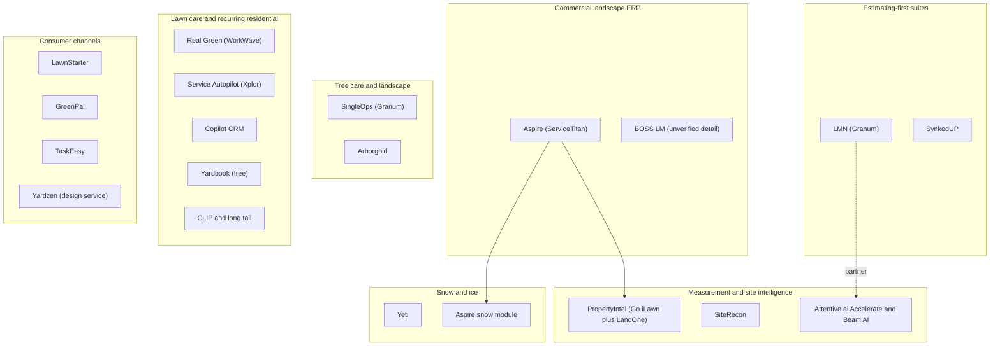
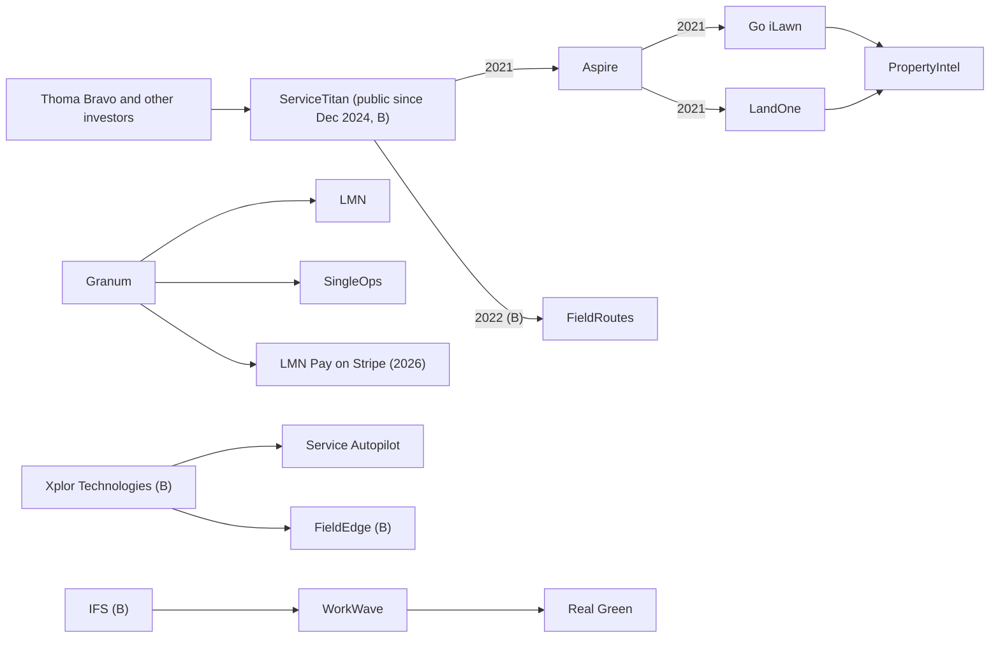
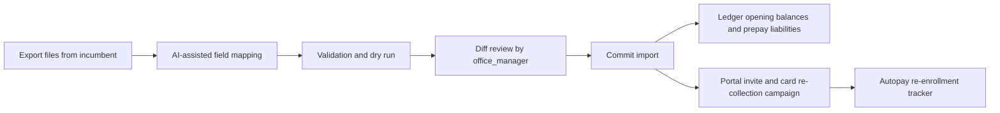

# R2 - Landscape-industry-specific software

> Raw competitive research on the software built specifically for landscape, lawn-care, tree-care and snow companies: the commercial ERP (Aspire, now inside ServiceTitan), the estimating-first suites (LMN and SynkedUP), the tree-and-landscape tools (SingleOps, which merged with LMN under the Granum banner, and Arborgold), the lawn-care and recurring-residential incumbents (Real Green by WorkWave, Service Autopilot by Xplor, Copilot CRM, Yardbook, CLIP and the long tail), the measurement and takeoff specialists (Go iLawn and LandOne folded into Aspire PropertyIntel, SiteRecon, Attentive.ai Accelerate and Beam AI), snow-and-ice tools, consumer lawn marketplaces (LawnStarter, GreenPal, TaskEasy) and design-as-a-service (Yardzen and peers). For each we cover the target customer, modules, pricing, estimating, job costing, recurring maintenance, chemical records, snow, payments, accounting, mobile, AI and real user complaints. We then map private-equity and strategic consolidation and the switching windows it opens, and close with a feature matrix, a pricing table, lessons for Rootline and the white space nobody occupies. The horizontal field-service platforms (Jobber, Housecall Pro, ServiceTitan core and others) are covered in [R1](R1-field-service-platforms.md).

| Field | Value |
|---|---|
| Report | R2 - Landscape-industry-specific software |
| Date | 2026-11-07 |
| Status | Research input, not a spec. Every fact carries an evidence tag (section 0). |
| Primary consumers | [01 Market landscape](../01-market-landscape.md), [03 CRM, estimating and proposals](../03-crm-sales-estimating-proposals.md), [04 Scheduling](../04-scheduling-dispatch-routing.md), [05 Crew app](../05-field-crew-mobile-app.md), [07 Invoicing](../07-invoicing-billing-contracts.md), [08 Payments](../08-payments-stripe.md), [09 Accounting](../09-accounting-ledger-integrations.md), [10 Design Studio](../10-design-studio.md), [14 Service lines](../14-service-line-modules.md), [17 AI](../17-ai-copilot-automation.md), [19 Platform admin](../19-platform-admin-portal.md), [22 Pricing and GTM](../22-business-model-pricing-gtm.md), [24 Roadmap](../24-roadmap-feature-catalog.md) |
| Sibling reports | [R1 Field-service platforms](R1-field-service-platforms.md), [R3 Design, AI and plant data](R3-design-ai-plant-data.md), [R4 Industry, payments and accounting](R4-industry-payments-accounting.md) |

---

## 0. How to read this report: evidence levels and limitations

Pricing, packaging and even ownership in this category change several times a year, and third-party "pricing guide" sites routinely disagree. This report is therefore explicit about how well each statement is supported.

| Tag | Meaning | How to use it |
|---|---|---|
| **[S]** | Sourced in this research run from a primary or credible source (vendor help center, vendor press release or blog, app-store listing, trade press, review-site page). Linked inline. | Safe to quote with the link. Prices still carry "as of Nov 2026, verify". |
| **[S3P]** | Sourced in this run, but only from third-party pricing aggregators, affiliate sites or competitor-written comparisons, which disagree with each other and have incentives. | Directional only. Quote ranges, never a single number, and always say "verify". |
| **[B]** | Analyst background knowledge of public vendor materials, trade press and reviews up to mid-2026, **not re-verified in this run**. | A hypothesis. Verify before using in investor or sales material (checklist in section 20). |
| **[E]** | Analyst estimate, inference or worked illustration. | Labeled as an estimate; reasoning shown. |

**Research limitations (read this).** This report was compiled in November 2026 without live web access of its own.

- No new searches were possible for this report, and vendor sites (golmn.com, youraspire.com, singleops.com, serviceautopilot.com) could not be opened directly.
- The module docs in this proposal had already gathered roughly 150 landscape-vendor sources (vendor help centers, Capterra/G2/GetApp pages, trade press, app-store listings, LawnSite threads). This report **consolidates that evidence**, re-citing the exact links the module docs cite. Those facts are tagged [S] or [S3P]; this report did not reopen the pages, so a second pass should spot-check them.
- Everything else is [B] or [E]. Where the analyst is unsure (for example the ownership of BOSS LM or the feature set of CLIP), the report says "unverified" instead of guessing. Products named in the brief that could not be verified at all in this pass ("Snowbook", a WorkWave snow product called "Evergreen") are reported as unverified rather than described.
- Reddit (r/landscaping, r/lawncare) threads could not be retrieved. Complaint themes from Reddit are therefore summarized as [B] themes; complaint evidence from Capterra, G2, GetApp, LawnSite and Searchfunder is [S] and quoted only where a module doc captured the wording.
- No statistic in this report was invented. Vendor-reported numbers are labeled "vendor claim".

---

## 1. Executive summary

1. **Landscape-specific software is a fragmented, consolidating, mostly pre-AI market.** The serious products are 10 to 20 years old in architecture, sold demo-first with implementation fees, and organized around one strength each: Aspire around commercial contracts and job costing, LMN around budget-based estimating, Real Green around lawn-treatment programs, Service Autopilot around automation for recurring residential work, SingleOps and Arborgold around tree care, and Go iLawn/PropertyIntel, SiteRecon and Attentive.ai around measurement [S/B]. Nobody spans design, plants, estimating, operations, payments and books.
2. **Ownership has concentrated into four camps in five years.** ServiceTitan bought Aspire in 2021 (with a $200M Series G at a $9.5B valuation), and Aspire then bought Go iLawn and LandOne to build PropertyIntel [S]. LMN and SingleOps merged in November 2024 and now operate under the Granum name [S]. Xplor owns Service Autopilot [S via reviewers, B for date]. WorkWave (part of IFS) owns Real Green [B]. Each camp is pushing embedded payments and bundling, which is the source of most new complaints.
3. **Consolidation creates switching windows, not lock-in.** The evidence: Service Autopilot reviewers say "the company was bought by a credit card processor so you no longer have a choice of processor" and report rate increases and slower support [S]; LMN Pay is being migrated from a Fiserv-backed product to a Stripe-powered one, and a third-party payments consultant says those accounts are "NOT Stripe accounts you control" and cannot move with the customer [S, single third-party opinion]; Real Green reviewers describe a rocky move from desktop to cloud [S]. Every forced migration is a moment when a Company re-evaluates its stack.
4. **Estimating discipline is the landscape-specific moat, and it is learnable.** LMN popularized budget-first estimating: a company budget yields labor burden, overhead recovery (MORS, FLH or SORS) and profit, applied to production-rate labor estimates [S]. Aspire does the same through production-based kits [S]. SynkedUP sells "automatically priced for profit" quoting [S]. Rootline must match this math exactly, then make it faster through measured takeoffs from the Design Studio ([03](../03-crm-sales-estimating-proposals.md), [10](../10-design-studio.md)).
5. **Measurement is bolted on everywhere.** Aspire sells PropertyIntel separately; LMN partners with Attentive.ai (February 2025) and integrated Beam AI takeoffs (February 2026); Real Green has Measurement Assistant; Arborgold has a measuring tool; LawnStarter quotes homeowners instantly from satellite imagery [S]. Measurements live in a different product from the estimate, the design and the crew's map. A single shared geometry (property polygon -> design -> takeoff -> estimate -> route -> mockup) is the clearest structural gap.
6. **Nobody does design plus plants plus operations.** Design tools (covered in [R3](R3-design-ai-plant-data.md)) do not price or schedule; operations tools do not design. Yardzen-style services prove homeowners pay for visualized design, but the install handoff to a contractor is a referral, not a system [B].
7. **Commercial grounds firms run a bolt-on economy.** Aspire and LMN customers buy SiteDNA or SiteRecon for site audits and enhancement capture, Vergo for AP automation, Wilson360 for benchmarking, Motive for telematics [S]. Each bolt-on is a feature Rootline can include.
8. **Chemical application records are a lawn-care-only strength.** Real Green, and to a lesser degree Service Autopilot, Copilot CRM and the tree-care tools, capture product, rate and EPA registration data [S/B]. Design-build and commercial tools largely do not, which forces mixed-service companies to run two systems or paper. State recordkeeping rules are strict and varied (see [05](../05-field-crew-mobile-app.md) and [14](../14-service-line-modules.md)).
9. **Snow is served by either an ERP module (Aspire) or a snow-only tool (Yeti and others) [S].** Companies that do both green and white work either pay for enterprise software or run two systems; generic tools fall back to "manual job creation during snow events and spreadsheets for per-inch pricing" [S, competitor-written source].
10. **AI is mostly partnership and marketing in this segment.** Aspire's own 2026 survey of 1,020 commercial landscape leaders found 43% believe in AI but only 15% use it daily (vendor-run survey) [S]. LMN's AI arrives through partners (Attentive, Beam AI) plus an "AI crew notes" beta [S]. We found no documented generative-AI copilot for SingleOps, Service Autopilot or Real Green as of Nov 2026 [S, negative finding]. ServiceTitan's Atlas is the most ambitious agent effort but is built for HVAC/plumbing first [S].
11. **Payments are the profit center and the pain.** Every incumbent with scale runs an in-house processor arrangement (LMN Pay, Xplor processing for Service Autopilot, WorkWave payments for Real Green, CardConnect historically for Aspire) [S/B]. Bring-your-own-Stripe with portable accounts ([08](../08-payments-stripe.md)) is a direct answer to the loudest post-acquisition complaint.
12. **Price bands are clear.** Free-to-$60 (Yardbook), roughly $50-$500 per month SMB tiers (Service Autopilot, Copilot CRM), roughly $200-$700 per month landscape specialists (LMN, SingleOps, Arborgold per user, SynkedUP per user), and custom enterprise (Aspire, Real Green) [S3P]. Implementation fees ($797-$1,497 reported for LMN; $995 reported for Real Green; up to tens of thousands for ServiceTitan-class rollouts) are common [S3P]. A free, productized migration is a credible wedge ([19](../19-platform-admin-portal.md), [22](../22-business-model-pricing-gtm.md)).

---

## 2. Market map

### 2.1 Segments

### 2.2 Who buys what

| Segment | Typical buyer | Products | What they optimize for | Landscape gaps |
|---|---|---|---|---|
| Commercial landscape ERP | Commercial maintenance and design-build firms, often multi-branch, typically several million dollars of revenue and up [B] | Aspire, BOSS LM | Contract renewals, enhancements, work-ticket job costing, purchasing, branches and divisions | Expensive, long implementations, steep learning curve, weak design and visual proposals [S] |
| Estimating-first suites | Owner-led design-build and maintenance firms that want pricing discipline | LMN, SynkedUP | Budget, overhead recovery, production rates, estimate-vs-actual | Measurement via partners, thin design, mobile complaints [S] |
| Tree care and landscape | Arborists, PHC operators, mixed tree/landscape firms | SingleOps, Arborgold | Tree inventory, proposals, crew permissions, PHC | No plant knowledge base or design; tiered paywalls [S] |
| Lawn care and recurring residential | Lawn treatment companies, mowing routes, residential maintenance | Real Green, Service Autopilot, Copilot CRM, Yardbook, CLIP, LawnPro, QuoteIQ | Route density, rounds and programs, prepay and autopay, drip marketing, chemical records | Dated UIs, support complaints, forced processors, little design-build [S] |
| Measurement and site intel | Estimators in any segment | PropertyIntel, SiteRecon, Attentive.ai, LawnStarter-style instant quotes | Fast, defensible takeoffs | A second subscription; measurements live outside the estimate and the map [S] |
| Snow | Commercial snow contractors, often landscape firms in winter | Yeti, Aspire snow, generic FSM with workarounds | Proof of service, per-push/per-event billing, subcontractor management | Two systems for green and white season; documentation gaps [S] |
| Consumer marketplaces | Homeowners; solo mowers buying leads | LawnStarter, GreenPal, TaskEasy | Instant price, convenience | Marketplace owns the client relationship [B] |
| Design-as-a-service | Homeowners planning a project | Yardzen and peers | Visual design at a fixed fee | Install handoff is a referral, not a system [B] |

### 2.3 What makes landscape software different from horizontal FSM

Horizontal FSM tools (Jobber, Housecall Pro; see [R1](R1-field-service-platforms.md)) are built around a technician, a job and an invoice. Landscape-specific tools exist because the business has seven traits that generic tools model poorly [E, synthesized from the evidence below]:

| Trait | Example | Which vertical tools handle it | Evidence |
|---|---|---|---|
| Production-rate labor estimating | 1 crew-hour edges 600 lf of beds; 1 man-hour spreads 1.5 yd3 of mulch by wheelbarrow | LMN, Aspire, SynkedUP | [S] [LMN estimating FAQ](https://intercom.help/lmn/en/articles/15939077-estimating-faq), [Aspire estimating](https://www.youraspire.com/features/estimating), [SynkedUP estimating](https://synkedup.com/features/estimating/) |
| Overhead recovery from a budget | 37% overhead ratio appears as a 204% markup on a labor-only base | LMN, SynkedUP, Aspire | [S] [LMN help](https://intercom.help/lmn/en/articles/15939065-how-lmn-calculates-overhead-labor-burden-and-profit-in-estimates) |
| Season-long contracts billed monthly | 30 mowings Apr-Nov billed in 8 or 12 equal installments | Aspire, LMN, Real Green, Service Autopilot | [S] [LMN invoicing](https://golmn.com/software-training/landscape-invoice-software-lmn), [RealGreen billing](https://realgreen.com/features/landscape-billing-invoice-software) |
| Enhancements on maintenance properties | Seasonal color, mulch refresh, irrigation repair sold to an existing contract client | Aspire (opportunities), audit bolt-ons | [S] [SiteDNA](https://sitedna-marketing-site.pages.dev/), [Aspire invoicing](https://www.youraspire.com/industries/landscape-business-software/invoicing) |
| Divisions as P&L centers | Maintenance, enhancements, snow, irrigation | Aspire | [S] [Aspire branch vs division](https://guide.youraspire.com/docs/deciding-branch-or-division-for-company-set-up) |
| Regulated chemical applications | 5-step fertilizer and weed-control program with state-required records | Real Green and lawn tools | [S] [Lawn & Landscape listing](https://www.lawnandlandscape.com/product/real-green-systems-service-assistant); records rules in [05](../05-field-crew-mobile-app.md) |
| Weather-driven winter work | Push at a 2-inch trigger, salt per application, proof of service for slip-and-fall defense | Aspire snow, Yeti | [S] [SIMA on Aspire](https://resources.sima.org/snow-and-ice-resource-center/unlock-profitability-and-efficiency-with-aspire), [Yeti](https://yetisoftware.com/) |

---

## 3. Consolidation and ownership

### 3.1 Timeline

| Date | Event | Evidence |
|---|---|---|
| 1984 (approx.) | Real Green Systems founded in Michigan; its Service Assistant product becomes the lawn-care standard | [B] |
| 2019-2021 (approx.) | IFS acquires WorkWave; WorkWave acquires Real Green Systems; product rebranded "RealGreen by WorkWave" | [B, verify dates] |
| Jun 30, 2021 | ServiceTitan announces agreement to acquire Aspire alongside a $200M Series G led by Thoma Bravo at a $9.5B valuation; Mainsail Partners (Aspire's backer) rolls part of its equity into ServiceTitan | [S] [TechCrunch](https://techcrunch.com/2021/06/30/servicetitan-acquires-aspire-to-move-into-landscaping-raises-200m-at-a-9-5b-valuation), [Thoma Bravo](https://www.thomabravo.com/press-releases/servicetitan-expands-into-landscaping-with-plans-to-acquire-aspire), [Mainsail](https://mainsailpartners.com/mainsail-partners-backed-aspire-software-announces-plan-to-be-acquired-by-servicetitan/) |
| Aug 11, 2021 | Aspire posts that the acquisition closed | [S] [Aspire blog](https://www.youraspire.com/blog/aspire-to-be-acquired-by-servicetitan) |
| Oct 2021 | Aspire agrees to acquire Go iLawn (aerial measurement) and LandOne (cloud takeoff and design); later combined into PropertyIntel | [S] [IGIN](https://igin.com/article-8937-Aspire-Software-announces-intent-to-acquire-Go-iLawn-and-LandOne.html), [PrivSource](https://www.privsource.com/acquisitions/deal/x7SXDx), [Landscape Management](https://www.landscapemanagement.net/aspire-software-launches-new-propertyintel-measuring-and-estimating-tool/) |
| 2021-2022 (approx.) | Xplor Technologies acquires Service Autopilot; reviewers report processor lock-in afterwards | [B for date]; [S] for the reviewer evidence: [GetApp reviews](https://www.getapp.com/operations-management-software/a/service-autopilot/reviews/) |
| 2022 | ServiceTitan acquires FieldRoutes (pest and lawn) | [B] |
| Nov 2024 | LMN and SingleOps merge; group later operates as Granum | [S] [Attentive.ai](https://attentive.ai/blog/lmn-and-attentive-ai-announce-strategic-partnership), [Horttrades](https://horttrades.com/lmn-and-attentiveai-announce-strategic-partnership), [Green Industry Pros](https://www.greenindustrypros.com/business-management/software/product/22963124/granum-granum-launches-lmn-pay-experience) |
| Dec 2024 | ServiceTitan lists on Nasdaq | [B] |
| Feb 2025 | LMN and Attentive.ai announce strategic partnership for AI mapping and takeoffs | [S] [Attentive.ai](https://attentive.ai/blog/lmn-and-attentive-ai-announce-strategic-partnership), [Landscape Management](https://www.landscapemanagement.net/lmn-and-attentive-partner-to-integrate-products/) |
| Mar 2025 | SingleOps launches Tree Inventory | [S] [SingleOps](https://singleops.com/features/tree-inventory) |
| Pantheon 2025 | ServiceTitan launches Atlas, a conversational agent over "Titan Intelligence" | [S] [ServiceTitan press](https://www.servicetitan.com/press/servicetitan-introducing-the-next-evolution-of-ai-at-pantheon-2025-keynote) |
| Nov 2025 | LMN Crew 2.0 "Crew for All" opens the crew app to every crew member | [S] [LMN blog](https://golmn.com/blog/introducing-lmn-crew-2-0-crew-for-all), [TechPlugged](https://techplugged.com/lmn-software-transforms-the-crew-experience/) |
| Feb 2026 | LMN ships Beam AI takeoff integration and an "AI crew notes" beta | [S] [LMN release note](https://support.golmn.com/hc/en-us/articles/46786137574683) |
| Mar 2026 | Granum relaunches LMN Pay "powered by Stripe" | [S] [Landscape Management](https://www.landscapemanagement.net/lmn-by-granum-launches-new-financial-infrastructure-platform-in-partnership-with-stripe/), [Green Industry Pros](https://www.greenindustrypros.com/business-management/software/product/22963124/granum-granum-launches-lmn-pay-experience) |

### 3.2 The consolidation playbook and what it does to customers

The pattern across these deals is consistent [E, built from the evidence cited]:

| Playbook move | Customer-visible effect | Evidence |
|---|---|---|
| Embed and mandate the group's payment processor | "The company was bought by a credit card processor so you no longer have a choice of processor"; rate increases afterwards | [S] [GetApp reviews of Service Autopilot](https://www.getapp.com/operations-management-software/a/service-autopilot/reviews/), [Capterra LawnPro vs Service Autopilot](https://www.capterra.com/compare/105508-122075/LawnPro-vs-Service-Autopilot), [MowBoss review](https://mowbosshq.pages.dev/guides/service-autopilot-review) (low-authority blog) |
| Re-platform payments to a new processor | LMN Pay moves from Fiserv-backed to Stripe-powered; consultant says accounts are not portable and partial refunds were missing at launch | [S, single third-party opinion] [Merchant Cost Consulting](https://merchantcostconsulting.com/lower-credit-card-processing-fees/lmn-pay-stripe-migration/), [LMN help: what is LMN Pay](https://intercom.help/lmn/en/articles/15938966-what-is-lmn-pay), [LMN help: payment runs with Stripe](https://intercom.help/lmn/en/articles/15938993-payment-runs-with-stripe) |
| Move desktop products to cloud | Real Green reviewers criticize support and the cloud move | [S] [Capterra RealGreen reviews](https://www.capterra.com/p/78106/Service-Assistant/reviews/?page=5) |
| Buy measurement, sell it as an add-on | Aspire users buy PropertyIntel separately | [S] [Aspire property measurement](https://www.youraspire.com/go/landscape-estimating-property-measurement) |
| Move up-market | Aspire positioned for larger commercial firms with custom quotes and long implementations | [S3P] [FieldServiceSoftware.io](https://fieldservicesoftware.io/software/aspire/), [CostBench](https://costbench.com/software/lawn-care-software/aspire-landscape/) |
| Bundle adjacent products | LMN plus SingleOps under one parent; ServiceTitan plus Aspire plus FieldRoutes | [S/B] |

Contractor consolidation compounds this. Private-equity-backed commercial landscape roll-ups and the public BrightView buy regional firms and standardize them on an ERP (usually Aspire or an in-house system) [B]. Each acquisition forces a migration at the acquired firm, which is a churn event for whatever tool it used before. The small-to-mid independents that compete with the roll-ups need enterprise-grade estimating and job costing at SMB prices, which is Rootline's core lane [E].

### 3.3 Switching windows

| Incumbent | Trigger | When it bites | What the switcher needs from Rootline |
|---|---|---|---|
| Service Autopilot | Forced processor, rate creep, support complaints, dense UI | Renewal, or when a processing statement shows a rate change [S] | Bring-your-own-Stripe with portable accounts ([08](../08-payments-stripe.md)); import of recurring schedules, drip rules and autopay mandates (card re-collection campaign through the portal) |
| LMN / SingleOps (Granum) | LMN Pay migration; product integration after the merger; implementation fees; crew-app reliability | During the payments re-onboarding, or when the merged roadmap deprioritizes a product line [S/E] | Budget and production-rate importer that maps LMN budgets, MORS/FLH/SORS settings and service templates to Rootline Price Book items ([03](../03-crm-sales-estimating-proposals.md)); file-based migration because LMN has no public REST API per a third-party report [S3P] [Supergood](https://supergood.ai/api-report-card/lmn) |
| Aspire | Cost, complexity, admin-only functions; possible future pressure to adopt ServiceTitan-native modules | Contract renewal; branch acquisitions [S/E] | Divisions, branches, contracts, enhancements, purchasing and equipment at parity, plus a migration that preserves work-ticket history for job-costing comparisons |
| Real Green | Cloud migration pain, support, accounting described as "basically unusable" by a reviewer | When a forced version upgrade lands [S] | Program and round import, prepay balances, chemical history and state reporting from day one ([14](../14-service-line-modules.md)) |
| Yardbook / Copilot / spreadsheets | Outgrowing the tool (second crew, first commercial contract, first design-build job) | Growth past roughly 3 crews [E] | Self-serve onboarding, sample price book, Quick Quote mode |
| PE-acquired contractors | Parent standardizes on its ERP | At close [B] | Nothing to win at the acquired firm; target their independent competitors instead [E] |

> **Competitive edge (switching).** Every incumbent above monetizes payments through an account the customer does not own. Rootline's bring-your-own-Stripe design means a Company that leaves Rootline keeps its Stripe account, its saved cards and its ACH mandates. Paradoxically, that portability is the strongest reason to switch *to* Rootline: it removes the fear of the next forced migration.

---
## 4. Commercial landscape ERP

### 4.1 Aspire (a ServiceTitan company)

#### 4.1.1 Snapshot

| Attribute | Detail | Evidence |
|---|---|---|
| Positioning | End-to-end business management for commercial landscape contractors: sales pipeline, estimating, contracts, scheduling, crew mobile, purchasing, equipment, invoicing, reporting | [S] [Aspire estimating](https://www.youraspire.com/features/estimating), [Aspire purchasing](https://www.youraspire.com/features/purchasing), [Aspire reporting](https://www.youraspire.com/features/reporting) |
| Target customer | Mid-market and larger commercial maintenance and design-build firms; multi-branch operators | [S3P] [FieldServiceSoftware.io](https://fieldservicesoftware.io/software/aspire/); [S] branch features in [Aspire guide](https://guide.youraspire.com/docs/building-your-organization-in-aspire) |
| Ownership | ServiceTitan since 2021 (closed Aug 2021) | [S] [TechCrunch](https://techcrunch.com/2021/06/30/servicetitan-acquires-aspire-to-move-into-landscaping-raises-200m-at-a-9-5b-valuation) |
| Pricing | Custom quote. Third-party write-ups cite one monthly license fee, no user limit, implementation included; per-user estimates vary widely (as of Nov 2026, verify) | [S3P] [FieldServiceSoftware.io](https://fieldservicesoftware.io/software/aspire/), [CostBench](https://costbench.com/software/lawn-care-software/aspire-landscape/) |
| Implementation | Customer case study describes a 90-day implementation; partner marketplace lists third-party implementation services; third-party cost sites quote ServiceTitan-class implementations at $5,000 to $50,000+ (unverified estimate) | [S] [Landscape Management, Sept 2020](https://editions.mydigitalpublication.com/article/Aspire+Software/3753265/671715/article.html), [Aspire marketplace](https://marketplace.youraspire.com/partners/implementation-services?taxon_id=8); [S3P] [CostBench hidden costs](https://costbench.com/software/lawn-care-software/aspire-landscape/hidden-costs/) |
| Ratings | Capterra 4.5 overall from 238 reviews; ease of use 4.1, functionality 4.2 (as of Mar 2026, verify) | [S] [Capterra Aspire vs SingleOps](https://www.capterra.com/compare/161544-176935/Aspire-vs-SingleOps) |

#### 4.1.2 How Aspire models the business

Aspire's data model is the closest thing the industry has to an ERP for landscape work, and it is the benchmark Rootline's commercial tier must meet.

- **Organization: branches and divisions [S].** Divisions are P&L profit centers (maintenance, enhancements, snow, irrigation); branches are operating units with branch-level management reporting. Aspire documents a workflow for branch-to-branch subcontract work, where one branch performs work sold by another ([Aspire: building your organization](https://guide.youraspire.com/docs/building-your-organization-in-aspire), [branch vs division](https://guide.youraspire.com/docs/deciding-branch-or-division-for-company-set-up), [branch-to-branch work](https://guide.youraspire.com/docs/workflow-for-managing-branch-to-branch-subcontract-work)).
- **Sales: opportunities and renewals [S].** Opportunities run through a pipeline that also manages contract renewals ([Aspire estimating](https://www.youraspire.com/features/estimating)).
- **Estimating: production-based templates and kits [S].** Estimates are built from kits that use the company's own production factors; reviewers credit Aspire with getting the whole company "bidding at the same rates" ([Aspire estimating](https://www.youraspire.com/features/estimating), [Capterra review](https://www.capterra.com/p/161544/Aspire/reviews/7184990/)).
- **Measurement: PropertyIntel add-on [S].** Measurements from PropertyIntel sync into kits ([Aspire property measurement](https://www.youraspire.com/go/landscape-estimating-property-measurement)); see section 8.1.
- **Operations: work tickets [B].** Sold services become scheduled work tickets with budgeted hours; crews record actual hours against them, which drives job costing. Treat the exact object names as [B] and verify in a demo.
- **Time: PIN clock-in, geofencing, crew-lead punches [S].** Field team members clock in with a unique PIN and geofencing; crew leaders start and stop work for themselves and each crew member, clock members out and in for lunch; members can use their own device or the leader's ([Aspire crew management](https://www.youraspire.com/industries/landscape-business-software/crew-management), [Aspire guide: time reporting](https://guide.youraspire.com/docs/time-reporting-in-the-crew-mobile-app)).
- **Mobile: Aspire Mobile replaced the older Crew Mobile app [S].** Tickets can be completed offline and synced later ([Aspire guide: mobile in the field](https://guide.youraspire.com/docs/aspire-mobile-in-the-field), [Aspire mobile](https://www.youraspire.com/features/mobile-app)). The legacy Crew Mobile iOS listing averaged 2.28 stars over 64 ratings before the rename ([AppGoblin](https://appgoblin.info/apps/1392810365), verify), and offline access reportedly arrived only in 2024 (per a Capterra summary, verify).
- **Purchasing and inventory: strongest in the category [S].** POs are generated from the estimate; a "Purchasing Assistant" recommends items to receipt based on opportunity estimates; receipts update pricing so the job is costed at what was paid, not catalog price; purchases can go to a job, to "job inventory" or to inventory locations ([Aspire guide: purchasing](https://guide.youraspire.com/docs/using-the-purchasing-module), [Aspire purchasing](https://www.youraspire.com/features/purchasing), [job inventory video](https://guide.youraspire.com/docs/es/video-508-purchasing-job-inventory)). Notably, Aspire does not maintain its own vendor list; it reads vendors from the accounting system ([Aspire purchasing](https://www.youraspire.com/features/purchasing)).
- **Equipment [S].** Hours or mileage trigger maintenance alerts; service tickets record mechanic hours and parts; depreciation schedules and disposition are tracked ([Aspire equipment](https://www.youraspire.com/features/equipment), [Aspire equipment guide](https://guide.youraspire.com/equipment-management)).
- **Invoicing [S].** An "invoicing assistant" flags invoices that are overdue or ready to send and contracts missing required information; invoices can be filtered by contract type or timing, created from in-progress jobs, and one-off projects bill through a secondary invoice type alongside maintenance contracts; "open billing" by percentage, dollar amount or finer granularity ([Aspire invoicing](https://www.youraspire.com/industries/landscape-business-software/invoicing), [Landscape Management sponsored content](https://www.landscapemanagement.net/sponsoredcontent/building-a-foundation-for-growth/)). Retainage support is claimed only by third-party listicles; no official retainage documentation was found ([US Tech Automations](https://ustechautomations.com/resources/blog/landscape-invoice-software-2026), verify).
- **Snow [S].** Aspire's snow module is described as weather-triggered dispatch, per-push and per-event billing and booking events back into the contract ([Pulse comparison](https://pulserevops.com/tech-stacks/tk0100)), plus snow material kits from the catalog and a subcontractor portal ([SIMA on Aspire](https://resources.sima.org/snow-and-ice-resource-center/unlock-profitability-and-efficiency-with-aspire)). Aspire also argues that GPS alone is disputable and must be paired with photos and timestamps ([Aspire blog](https://www.youraspire.com/blog/prove-service-delivery-data-ends-disputes)).
- **Security [S].** Role-based security; default roles are editable; permissions from multiple roles stack additively; a role hierarchy value from 1 to 999 expresses authority; property and opportunity access can be restricted by role ([Aspire: role-based security](https://guide.youraspire.com/docs/role-based-security), [default roles matrix](https://care.youraspire.com/en/articles/4761290-aspire-default-roles-matrix), [restricting property access](https://guide.youraspire.com/docs/restricting-property-and-opportunity-access-with-user-role-permissions)).
- **Reporting [S].** Data-visualization dashboard for "company-wide visibility" and a Web Report Designer; benchmarking via partners such as Wilson360 in the Aspire marketplace ([Aspire reporting](https://www.youraspire.com/features/reporting), [Aspire marketplace: Wilson360](https://marketplace.youraspire.com/partners/wilson360.md)).
- **Payments [S/B].** In 2019 Aspire announced online payments with CardConnect as the preferred processor ([Aspire blog, 2019](https://www.youraspire.com/blog/your-customers-can-pay-online-with-aspire-in-version-5.0-0)); later material references electronic payments in the field ([Aspire blog](https://youraspire.com/blog/how-to-collect-payments-from-landscaping-customers)). The current processor arrangement under ServiceTitan was not confirmed in this pass.
- **Accounting [S/B].** Aspire is not a general ledger; it syncs to an external accounting system (QuickBooks sync is documented in sibling research; other mid-market GL integrations are [B], verify) and depends on it for the vendor list. Third-party AP automation (Vergo) is sold specifically for Aspire bills ([Vergo](https://www.getvergo.com/learn/best-ap-automation-software-for-landscape-companies-using-aspire)).
- **Customer portal [S].** Listing sites name a client portal and self-service portal; a reviewer notes a PIN at each login; public detail on what a property manager can do was not found ([Software Advice Aspire profile](https://www.softwareadvice.com/landscaping/aspire-profile), [Capterra review](https://www.capterra.com/p/161544/Aspire/reviews/7184520/)).
- **Integrations [S].** Partner marketplace includes telematics (Motive) and benchmarking (Wilson360) ([Motive marketplace](https://marketplace.gomotive.com/app/aspire), [Aspire marketplace](https://marketplace.youraspire.com/partners/wilson360.md)).
- **AI [S].** Aspire is talking about AI ("Built for Landscapers: The AI-Powered Future of Aspire" podcast, 2025) and published a 2026 survey of 1,020 commercial landscape leaders in which 43% believed in AI but 15% used it daily ([Aspire community](https://community.youraspire.com/aspire-45/built-for-landscapers-the-ai-powered-future-of-aspire-619), [Aspire report via Finviz](https://finviz.com/news/401821/aspire-report-finds-commercial-landscapers-prioritizing-growth-as-businesses-navigate-operational-complexity)). PropertyIntel listings describe AI-assisted measuring. We found no landscape-specific Aspire agent product; ServiceTitan's Atlas (section 12.8) targets the trades platform first.

#### 4.1.3 What Aspire users praise and complain about

| Theme | Evidence | Tag |
|---|---|---|
| Praise: consistent bidding | Company-wide "bidding at the same rates" | [S] [Capterra review](https://www.capterra.com/p/161544/Aspire/reviews/7184990/) |
| Praise: end-to-end data flow | Long-term users satisfied with day-to-day use | [S] [Capterra Aspire](https://www.capterra.com/p/161544/Aspire/) |
| Learning curve | "learning curve, and some common tasks require too many steps"; "intensive ramp up period" | [S] [GetApp UK](https://www.getapp.co.uk/reviews/9108/aspire), [Capterra p.3](https://www.capterra.com/p/161544/Aspire/reviews/?page=3) |
| Cost | "High cost and added fees" in Capterra's summary; described in a Searchfunder thread as much more expensive than LMN or Jobber | [S] [Capterra](https://www.capterra.com/p/161544/Aspire/), [Searchfunder](https://searchfunder.com/post/what-ops-software-for-landscaping) |
| Admin bottleneck | Limited user permissions; functions that require System Admin | [S] [Capterra](https://www.capterra.com/p/161544/Aspire/) |
| Estimate reuse | Cannot copy selected parts of a previous opportunity into an unrelated one | [S] [Capterra p.3](https://www.capterra.com/p/161544/Aspire/reviews/?page=3) |
| Visual proposals | Wants "adding more photos to proposals" | [S] [Capterra p.3](https://www.capterra.com/p/161544/Aspire/reviews/?page=3) |
| Invoices | Little invoice customization; clients had trouble interpreting invoices | [S] [Capterra p.6](https://www.capterra.com/p/161544/Aspire/reviews/?page=6) |
| Reporting | Pivot tables hard to read; missing pivot functions and custom formulas; each module has different search | [S] [Capterra](https://www.capterra.com/p/161544/Aspire/reviews/), [p.4](https://www.capterra.com/p/161544/Aspire/reviews/?page=4), [p.5](https://www.capterra.com/p/161544/Aspire/reviews/?page=5) |
| Mobile and inventory | Wants mobile forms linked to inventory | [S] [GetApp](https://www.getapp.com/industries-software/a/aspire/) |

#### 4.1.4 Lessons from Aspire

1. **Match the commercial model, not the UI.** Branches, divisions, contracts with renewals, enhancements as their own opportunity type, purchasing that re-costs the job at actual price, and equipment cost recovery are table stakes for commercial maintenance. Rootline's commercial tier must have all of them at [V1] or earlier ([13](../13-operations-inventory-equipment.md), [14](../14-service-line-modules.md)).
2. **Beat it on time-to-value.** A 90-day implementation is normal for Aspire. Rootline's target is a productized migration in days for most Companies ([19](../19-platform-admin-portal.md)).
3. **Own the vendor master.** Reading vendors from QuickBooks makes vendor price lists, scorecards and subcontractor compliance second-class. Rootline owns vendors in its own ledger ([09](../09-accounting-ledger-integrations.md)).
4. **Make permissions granular enough that nobody needs to be System Admin** ([02](../02-personas-roles-permissions.md)).

> **Competitive edge vs Aspire.** Aspire is the most complete landscape ERP, but measurement is an add-on, proposals are not visual, the ledger lives in QuickBooks, and implementation takes a quarter. Rootline ships measurement, AI mockups, a white-label portal and a double-entry ledger in one product, at SMB price points, with a migration that takes days. For a $3M-$15M commercial firm, that is enterprise capability without enterprise overhead [E].

### 4.2 BOSS LM

BOSS LM appears in commercial-landscape software lists and in sibling research as one of the tools used by commercial grounds firms alongside Aspire and LMN ([14 Service lines](../14-service-line-modules.md)) [S for the mention]. Our background knowledge is that it is an older, enterprise-oriented landscape and snow management system with job costing, contract billing and accounting-system integration aimed at larger commercial contractors [B]. **We could not verify its ownership, current pricing, deployment model or feature set in this pass**, so it is not scored in the feature matrix beyond "listed". It belongs on the verification checklist (section 20) because legacy enterprise systems are prime switching candidates when their vendors stop investing.

---

## 5. Estimating-first suites

### 5.1 LMN (Landscape Management Network, now part of Granum)

#### 5.1.1 Snapshot

| Attribute | Detail | Evidence |
|---|---|---|
| Positioning | Budget-first estimating plus CRM, scheduling, time tracking, job costing, purchasing, invoicing, customer portal and payments for landscape contractors | [S] [LMN estimating FAQ](https://intercom.help/lmn/en/articles/15939077-estimating-faq), [LMN invoicing](https://golmn.com/features/invoicing) |
| Origin | Founded in Canada by a landscaper; known for extensive free training content (videos, LMN Academy) | [B] origin; [S] training praised in [Capterra LMN reviews](https://www.capterra.com/p/142064/LMN/reviews/) |
| Ownership | Merged with SingleOps in Nov 2024; group operates as Granum | [S] [Attentive.ai](https://attentive.ai/blog/lmn-and-attentive-ai-announce-strategic-partnership), [Green Industry Pros](https://www.greenindustrypros.com/business-management/software/product/22963124/granum-granum-launches-lmn-pay-experience) |
| Target customer | Owner-led residential and commercial maintenance and design-build firms, roughly 1 to 100+ staff [E from tier structure] | [S3P] tier bundles below |
| Pricing | Starter about $297/mo; Professional about $598-$697/mo; Enterprise custom. Reported bundles: Starter = 1 office + 5 crew, Professional = 3 office + 15 crew (Capterra shows the same numbers as per-user: conflict). Implementation about $797-$1,497; SMS add-on about $75 one-time + $30/mo (as of Nov 2026, verify) | [S3P] [Capterra pricing](https://www.capterra.com/p/142064/LMN/pricing/), [CostBench](https://costbench.com/software/lawn-care-software/lmn-landscape/), [CostBench calculator](https://costbench.com/software/lawn-care-software/lmn-landscape/calculator/), [CostBench hidden costs](https://costbench.com/software/lawn-care-software/lmn-landscape/hidden-costs/) |
| Seats | Two user types: "Office Staff / Crew Lead" (web access per permissions) and "Crew Member" (no web access; historically read-only crew app); each consumes a different seat; "Security Admin" permission controls user management | [S] [LMN user permissions](https://intercom.help/lmn/en/articles/17699017-lmn-user-permissions), [managing users](https://intercom.help/lmn/en/articles/15938864-managing-users-staff-a-guide) |
| Ratings | G2 3.7/5 from 13 reviews (small sample) | [S] [G2](https://www.g2.com/products/lmn) |
| API | Third-party report: no public REST API or developer portal; Zapier is the main integration option | [S3P] [Supergood API report card](https://supergood.ai/api-report-card/lmn) |

#### 5.1.2 Estimating: the LMN method

LMN's signature is **estimating from a company budget**. The sell rate is built in a fixed order [S]: average wage per person-hour from the budget, then labor burden to get loaded labor cost, then an overhead markup from the Overhead Recovery tab, then profit margin. Labor burden is kept separate from overhead, and profit is kept out of the overhead markup ([LMN help](https://intercom.help/lmn/en/articles/15939065-how-lmn-calculates-overhead-labor-burden-and-profit-in-estimates), [mirror](https://support.golmn.com/hc/en-us/articles/47875213217691)).

- **Three overhead recovery methods [S]:** MORS (Multiple Overhead Recovery System: different markups per cost category), FLH (overhead per field labor hour) and SORS (Single Overhead Recovery System: one markup on all direct costs). LMN's help center shows why the choice matters: a 37% overhead ratio appears as a **204% markup** when spread over a labor-only base ([LMN help](https://intercom.help/lmn/en/articles/15939065-how-lmn-calculates-overhead-labor-burden-and-profit-in-estimates)). Trade press covers the same family ([Lawn & Landscape on MORS](https://www.lawnandlandscape.com/article/mors-estimating-method/), [Total Landscape Care](https://www.totallandscapecare.com/business/article/15034644/how-to-properly-cost-a-job)).
- **Production rates [S]:** labor is estimated from production rates (hours per unit of work) and materials from quantities ([LMN estimating FAQ](https://intercom.help/lmn/en/articles/15939077-estimating-faq)).
- **Budget optional [S]:** LMN recommends but does not require a budget to create estimates ([LMN estimating FAQ](https://intercom.help/lmn/en/articles/15939077-estimating-faq)). Rootline's spec makes the budget mandatory before the first proposal, with a regional default if skipped ([03](../03-crm-sales-estimating-proposals.md)).
- **Measurement through partners [S]:** Attentive.ai partnership (February 2025) for AI mapping and material calculations; Beam AI takeoffs mapped automatically into LMN (February 2026) ([Attentive.ai](https://attentive.ai/blog/lmn-and-attentive-ai-announce-strategic-partnership), [LMN release note](https://support.golmn.com/hc/en-us/articles/46786137574683)). A G2 reviewer said measuring large commercial sites "would take literal days" ([G2](https://www.g2.com/products/lmn)). A competitor (QuoteIQ) characterizes LMN's estimating as budget-based and manual and claims LMN has "zero AI features"; treat that as a rival's claim ([QuoteIQ](https://myquoteiq.com/best-ai-estimating-software-landscaping-2026/), [QuoteIQ help center](https://intercom.help/quoteiq/en/articles/14462688-quoteiq-vs-lmn)).

**Worked illustration [E].** A design-build firm budgets $420,000 of overhead against 20,000 billable field hours. FLH overhead is $21.00 per hour. A 40-man-hour hand-weeding job carries $840 of overhead under FLH but only about $335 under a 29.72% SORS markup, while a 30-man-hour planting job with $6,000 of plants carries $630 under FLH and about $2,034 under SORS. The method silently decides which jobs a company wins and loses. The full calculation, including a MORS solver, is in [03 section EST-02](../03-crm-sales-estimating-proposals.md).

#### 5.1.3 Operations, job costing and billing

- **Job costing [S].** LMN's "Job Costing Advisor" tracks labor from timesheets and materials from vendor bills against the estimate budget, alongside equipment and subcontractors ([Turf Magazine](https://turfmagazine.com/lmn-introduces-job-costing-advisor-for-landscapers)). Time tracking feeds job costing automatically ([Capterra](https://www.capterra.com/p/142064/LMN/reviews/)).
- **Purchasing [S].** Tracks material orders against job budgets; ordering from SiteOne Landscape Supply inside LMN since about 2021 ([Turf Magazine](https://turfmagazine.com/lmn-integrates-siteone-landscape-supply-in-2021-software/), [LMN blog](https://golmn.com/blog/partner-in-spotlight-siteone-landscape-supply)). A reviewer asked for POs to extend to subcontractors ([Capterra](https://www.capterra.com/p/142064/LMN/reviews/SoftwareAdvice___5059043/)).
- **Recurring maintenance billing [S].** The payment schedule is built on the estimate's Contract tab and carries to the job. Service lines bill per-season, per-hour or per-visit: per-season services are covered by the monthly invoice, per-visit items bill on completion ([LMN invoicing best practices](https://intercom.help/lmn/en/articles/15939070-invoicing-payments-best-practices), [LMN invoicing training](https://golmn.com/software-training/landscape-invoice-software-lmn)). LMN claims fixed monthly schedules can cut invoicing time "by up to 90%" (vendor claim) ([LMN features](https://golmn.com/features/invoicing), [LMN blog](https://golmn.com/blog/lmnpro-release)). No public documentation of mid-contract changes, proration or true-ups was found.
- **Customer portal [S].** Clients approve, reject, request changes or comment on an estimate; e-signature by typed name (added in release 20.11); add payment methods, Pay Now and autopay ([LMN customer guide](https://support.golmn.com/hc/en-us/articles/42071271242779), [LMN 20.11 release](https://prnewswire.com/news-releases/lmn-releases-20-11-with-updates-to-customer-portal-estimating-301167182.html), [LMN Pay](https://golmn.com/lmn-pay)). No design visualization.
- **Payments [S].** LMN Pay relaunched in March 2026 "powered by Stripe"; Granum says most customers onboard in under 15 minutes (vendor claim) ([Landscape Management](https://www.landscapemanagement.net/lmn-by-granum-launches-new-financial-infrastructure-platform-in-partnership-with-stripe/), [Green Industry Pros](https://www.greenindustrypros.com/business-management/software/product/22963124/granum-granum-launches-lmn-pay-experience)). LMN's help center still references a Fiserv-supported LMN Pay alongside newer Stripe payment-run docs, suggesting a mid-migration state ([what is LMN Pay](https://intercom.help/lmn/en/articles/15938966-what-is-lmn-pay), [payment runs with Stripe](https://intercom.help/lmn/en/articles/15938993-payment-runs-with-stripe)). A third-party processing consultant says LMN Pay accounts are built on Stripe Connect, are "NOT Stripe accounts you control", cannot be taken with you if you leave, and lacked partial refunds ([Merchant Cost Consulting](https://merchantcostconsulting.com/lower-credit-card-processing-fees/lmn-pay-stripe-migration/), single third-party opinion). Another third-party summary cites slow LMN Pay onboarding ([Supergood](https://supergood.ai/api-report-card/lmn)).
- **Accounting [B].** QuickBooks Online and Desktop sync are the commonly cited path; Xero support was not confirmed. LMN is not a general ledger.
- **Chemical records and snow [B].** We found no documented state pesticide-record workflow or storm-event engine in LMN; snow can be estimated and billed as services. Verify in a demo.

#### 5.1.4 Mobile

- **LMN Time and LMN Crew [S].** Time, work documentation and materials tracking ([App Store: LMN Crew](https://apps.apple.com/us/app/-/id6444404165)). LMN Crew 2.0 "Crew for All" (November 2025) opened the app to all crew members, with personal hours for current and past pay periods and integrated training ([LMN blog](https://golmn.com/blog/introducing-lmn-crew-2-0-crew-for-all), [TechPlugged](https://techplugged.com/lmn-software-transforms-the-crew-experience/)).
- **Complaints [S].** Time tracking "awesome, though sometimes clunky" ([Capterra](https://www.capterra.com/p/142064/LMN/reviews/)); crashes and clunky navigation ([GetApp](https://www.getapp.com/industries-software/a/lmn/)); long-time LMN Time users reported problems after an update ([App Store: LMN Time](https://apps.apple.com/us/app/id1012359605)); a competitor-written review calls the app "buggy, slow, and deletes job cards" (biased source) ([Connecteam](https://connecteam.com/reviews/lmn/)). The legacy Crew Member seat could not punch in or upload photos, pushing companies to buy pricier seats for field staff ([LMN user permissions](https://intercom.help/lmn/en/articles/17699017-lmn-user-permissions)).

#### 5.1.5 What LMN users praise and complain about

| Theme | Evidence | Tag |
|---|---|---|
| Praise: pricing discipline and training | Onboarding specialists and LMN Academy videos praised; proposals sent directly from the platform | [S] [Capterra](https://www.capterra.com/p/142064/LMN/reviews/), [G2](https://www.g2.com/products/lmn) |
| Praise: better fit than generic FSM | A reviewer who moved to LMN said Jobber felt too basic and tried to serve every business type | [S] [Capterra](https://www.capterra.com/p/142064/LMN/reviews/) |
| Too hard to use | "too difficult to use" (Capterra summary) | [S] [Capterra](https://www.capterra.com/p/142064/LMN/reviews/) |
| Slow measurement on big sites | "would take literal days" | [S] [G2](https://www.g2.com/products/lmn) |
| Mobile reliability | See 5.1.4 | [S] |
| Payments lock-in | Non-portable LMN Pay accounts | [S, single source] |
| Integrations | No public API; Zapier | [S3P] |

#### 5.1.6 Lessons from LMN

1. **LMN's budget math is the industry's shared language.** Rootline's estimating engine must reproduce LMN's MORS, FLH and SORS outputs to the cent so switchers trust it, and must import LMN budgets and service templates [MVP] ([03](../03-crm-sales-estimating-proposals.md)).
2. **Education is distribution.** LMN grew on free budgeting tools and videos [B]. Rootline should ship a free, ungated "Landscape Budget and Pricing Calculator" and a public KPI dictionary as top-of-funnel [V1] ([16](../16-marketing-growth-communications.md), [18](../18-reporting-analytics.md)).
3. **Measurement must be native.** LMN's best AI story is a partner integration; Rootline's takeoff is a by-product of the Design Studio ([10](../10-design-studio.md), [11](../11-ai-design-mockups.md)).
4. **Seat models that punish field staff are a wedge.** Price field seats only in months they are active ([22](../22-business-model-pricing-gtm.md)).

> **Competitive edge vs LMN.** LMN taught the industry to price from a budget, then left measurement, design and payments ownership to partners and processors. Rootline keeps the budget math, adds a measured takeoff from the Design Studio and an AI mockup on the same proposal, and lets the Company own its Stripe account. The pitch to an LMN user: "Same numbers you trust, a third of the clicks, and a proposal that looks like the finished yard."

### 5.2 SynkedUP

| Attribute | Detail | Evidence |
|---|---|---|
| Positioning | Estimating, job costing, scheduling and time tracking for landscape and design-build firms, marketed as quoting "automatically priced for profit" | [S] [SynkedUP landscaping](https://synkedup.com/industry/landscaping/), [SynkedUP features](https://synkedup.com/features/) |
| Estimating | Production rates, overhead recovery, job costing | [S] [SynkedUP estimating](https://synkedup.com/features/estimating/) |
| Roles | Six user roles; one user can hold several (a foreman who also estimates); separate "Allow Invoicing" toggle tied to pricing visibility | [S] [SynkedUP user roles](https://help.synkedup.com/en/articles/14756763-how-user-roles-work-in-synkedup) |
| Pricing | Standard listed at $399 per user per month on Capterra; another listing shows $297; annual billing saves 10% (as of Nov 2026, verify; per-user framing may be a listing error) | [S3P] [Capterra pricing](https://www.capterra.com/p/228695/SynkedUP/pricing/), [Software Advice](https://www.softwareadvice.com/landscaping/synkedup-profile/), [GetApp](https://www.getapp.com/industries-software/a/synkedup/) |
| Ratings | 4.9 overall, 5.0 value for money on Capterra (as of Oct 2026, verify) | [S3P] [Capterra](https://www.capterra.com/p/228695/SynkedUP/) |
| Design | Third-party listings mention CAD and image-editing tools; no vendor-confirmed planting-design module found | [S] [Software Advice](https://www.softwareadvice.com/landscaping/synkedup-profile/), [Capterra](https://www.capterra.com/p/228695/SynkedUP/) |
| Content | Publishes benchmark-style content on man-hour rates and job costing | [S] [SynkedUP man-hour rates](https://synkedup.com/average-man-hour-rate-for-landscape-jobs/) |
| Go-to-market | Demo-led and coaching-heavy | [S3P] via [22](../22-business-model-pricing-gtm.md) |
| Accounting, payments, chemicals, snow, AI | QuickBooks Online sync is the commonly cited accounting path [B]; no documented chemical-record, snow-event or generative-AI features were found [B, negative finding] | [B] |

**Lesson.** SynkedUP's very high value-for-money scores alongside a high listed price suggest that small design-build owners will pay for **profit certainty** when it comes with coaching [E]. Rootline should pair its estimating engine with an "explain this price" view and in-app coaching from the Copilot ([17](../17-ai-copilot-automation.md)), and treat landscape business coaches as a partner channel [V1] ([22](../22-business-model-pricing-gtm.md)).

---

## 6. Tree care and landscape platforms

### 6.1 SingleOps (now part of Granum)

| Attribute | Detail | Evidence |
|---|---|---|
| Positioning | Business management for tree care, landscape and lawn companies: CRM, estimates and proposals, scheduling, job costing, invoicing, payments, client portal, crew app | [S] [Capterra](https://www.capterra.com/p/176935/SingleOps/pricing/), [SingleOps](https://www.singleops.com) |
| Origin and ownership | US (Atlanta-based) [B]; merged with LMN in Nov 2024 under what is now Granum [S] | [S] [Attentive.ai](https://attentive.ai/blog/lmn-and-attentive-ai-announce-strategic-partnership) |
| Pricing | Essential about $200-$220, Plus about $350-$385, Premier about $500-$550 per month; sources disagree on per-user vs per-account; extra users reported at $55-$150/user/mo by tier (as of Nov 2026, verify) | [S3P] [Capterra](https://www.capterra.com/p/176935/SingleOps/reviews/4376546/), [ITQlick](https://www.itqlick.com/singleops/pricing), [CostBench hidden costs](https://costbench.com/software/lawn-care-software/singleops/hidden-costs/) |
| Roles | Fixed roles (Admin, Operator, Crew); permission toggles apply to the whole role; no read-only role; some settings need SingleOps support | [S] [SingleOps role permissions](https://docs.singleops.com/hc/articles/43339904495387), [add or edit a user](https://docs.singleops.com/hc/articles/43339654887835) |
| Proposals | Strong visual proposals are a selling point (CHOP Nashville case study: "proposals are incredible") | [S] [case study](https://www.casestudies.com/company/singleops/case-study/chop-nashvilles-proposals-are-incredible) |
| Client portal | Book new services, view and approve proposals, pay; self-serve request forms | [S] [SingleOps](https://www.singleops.com) |
| Tree inventory | Launched March 2025; satellite tree mapping | [S] [SingleOps tree inventory](https://singleops.com/features/tree-inventory) |
| Job costing | Estimated vs actual "visit profit margin" under Reports; labor budget vs actual | [S] [SingleOps](https://singleops.com/?p=1677) |
| Purchasing and inventory | POs (for job costing or stock) and inventory are Premier-only; items only appear in inventory once a PO exists; support suggests a placeholder vendor PO to seed counts | [S] [SingleOps POs](https://docs.singleops.com/hc/articles/43339572958491), [SingleOps inventory](https://docs.singleops.com/hc/articles/43339637494043) |
| Accounting | QuickBooks Online and Desktop sync commonly cited | [B] |
| Payments | Integrated card and ACH via the vendor's payments product | [B]; future direction likely tied to Granum's Stripe-based LMN Pay [E] |
| Chemicals | PHC and application tracking for tree care plausible; not verified | [B, verify] |
| Snow | No dedicated storm engine found | [B, negative] |
| AI | No documented generative-AI copilot or agents as of Nov 2026 | [S, negative finding] [GetApp SingleOps](https://www.getapp.co.uk/software/115627/singleops), [Capterra comparison](https://www.capterra.com/compare/78106-176935/Service-Assistant-vs-SingleOps) |
| Complaints | Steep learning curve; top-tier paywall for inventory and POs | [S] [Capterra](https://www.capterra.com/p/176935/SingleOps/pricing/) |

**What the Granum merger means [E].** Granum now owns the estimating brand most landscapers know (LMN) and a tree-and-landscape operations product with strong proposals and a client portal (SingleOps). Expect product convergence, a single payments stack (LMN Pay on Stripe) and cross-selling. Historically, convergence periods produce roadmap freezes on the product that is not the long-term platform, plus migration projects for its customers. Whichever product Granum de-emphasizes becomes a switching pool; Rootline's importer roadmap should support both LMN and SingleOps exports by [V1].

### 6.2 Arborgold

| Attribute | Detail | Evidence |
|---|---|---|
| Positioning | Business software for tree care, landscape and lawn companies, with a crew app, tree inventory and customer portal | [S] [Arborgold blog](https://arborgold.com/blog/tree-care-arborist/the-best-tree-inventory-software-for-tracking-your-trees-and-clients/) |
| Roles | Role chosen at creation (Cloud & Estimator, Cloud & Crew, Estimator, Crew, Phone); "System Administrator" permission manages users | [S] [creating users](https://help.arborgold.com/en/articles/4281236-quick-start-1-creating-users), [user permissions](https://help.arborgold.com/en/articles/understanding-user-permissions) |
| Crew app | Dedicated Arborgold Crew app with versioned releases; permissions set **per crew** (tagging rights, which notes the crew can edit, measuring tool access) | [S] [crew permissions](https://help.arborgold.com/en/articles/permissions-in-arborgold-crew), [Arborgold 8.1 release](https://help.arborgold.com/en/articles/new-arborgold-crew-app), [Crew 2.6.0 notes](https://help.arborgold.com/en/articles/arborgold-crew-release-version-2.6.0) |
| Tree inventory | GPS-located tree inventory, QR-code mobile app with unlimited photos; tree risk assessments listed among features | [S] [Arborgold blog](https://arborgold.com/blog/tree-care-arborist/the-best-tree-inventory-software-for-tracking-your-trees-and-clients/) |
| Measurement | Landscape measuring tool for tracing lawn, bed and sod areas and saving them as custom measures | [S] [Arborgold help](https://help.arborgold.com/en/articles/4423488-landscape-measuring-tool-basics) |
| Customer portal | View and approve proposals; approve or deny individual services when the admin enables it; pay current bill; payment history; print prior invoices; prepay proposals; service requests; confirm appointments | [S] [Arborgold portal](https://arborgold.com/customer-portal/), [accept a proposal](https://help.arborgold.com/en/articles/5535464-how-to-accept-a-proposal-in-the-customer-portal-as-a-customer), [portal settings](https://help.arborgold.com/en/articles/4092399-customer-portal-settings) |
| Pricing | Reported "starts at $150 per user" (third-party mention); portal and "Pay from Portal" appear in higher-tier plans per the pricing page (as of Nov 2026, verify) | [S3P] [Arborgold pricing](https://arborgold.com/?p=17837) |
| Accounting, payments, chemicals | QuickBooks sync, integrated payments and PHC/chemical tracking are commonly cited [B]; full ISA TRAQ risk-matrix logic was not confirmed | [B]; [S] negative on TRAQ in [14](../14-service-line-modules.md) |
| AI | None documented | [B, negative] |

**Lessons from Arborgold.** Per-crew permissions are a good idea for tree companies (a climbing crew should not see pricing; a PHC crew must see chemical labels). Item-level approval in the portal (approve the crown cleaning, decline the cabling) is exactly the "options and tiers" behavior Rootline proposals need ([06](../06-customer-portal.md)). The data-model smell to avoid: sibling research found office staff accidentally added to crews appear in crew pick-lists, a sign that employee and user identity are conflated ([02](../02-personas-roles-permissions.md)). The tree-inventory pattern (GPS point, species, DBH, condition, photos, QR tag) maps directly onto Rootline's Plant Knowledge Base plus Property map: every tree on a property is a Plant instance with a KB link and a Region Profile ([12](../12-plant-knowledge-base.md)) [V1].

---

## 7. Lawn care, recurring residential and small-operator tools

### 7.1 Real Green (RealGreen by WorkWave)

#### 7.1.1 Snapshot

| Attribute | Detail | Evidence |
|---|---|---|
| Positioning | The incumbent for lawn-care and plant-health-care programs: CRM, scheduling, routing, measurement ("Measurement Assistant"), customer websites ("Customer Assistant"), automated marketing and referral tools | [S] [Lawn & Landscape product listing](https://www.lawnandlandscape.com/product/real-green-systems-service-assistant) |
| Origin and ownership | Real Green Systems (Michigan, founded mid-1980s); flagship desktop product Service Assistant (SA5); acquired by WorkWave, which is part of IFS | [B, verify dates] |
| Target customer | Lawn treatment, tree and shrub, pest and mosquito, and irrigation companies with dense residential routes; from small operators to large regional and franchise brands | [B] |
| Pricing | Custom quote; one directory lists "from $199/mo"; pricing scales with active customer count; Sales Center and Marketing often add-ons; implementation fee reported around $995 (unverified) (as of Nov 2026, verify) | [S3P] [Softwarefinder](https://softwarefinder.com/fleet-management-software/realgreen-by-workwave), [IntegrateIQ](https://integrateiq.com/comparisons/realgreen-vs-fieldroutes/), [CostBench](https://costbench.com/software/lawn-care-software/realgreen-workwave/), [LawnStarter blog](https://lawnstarter.com/blog/?p=52273) |
| Ratings | Capterra 3.9/5 from 148 reviews (as of Nov 2026, verify) | [S] [Capterra](https://www.capterra.com/p/78106/Service-Assistant/reviews/?page=5) |

#### 7.1.2 Standout capabilities

- **Programs and rounds [B].** The core object is the program: a season of applications (for example a 5-step fertilizer and weed-control program, or a 6-round tree-and-shrub program) priced by measured turf area and scheduled in rounds across the route. Pricing tables by square footage, round-based scheduling and automated renewals are the heart of the product.
- **Measurement Assistant [S].** Measures properties from satellite imagery and sends instant quotes without a site visit; measurements save to the customer record ([Measurement Assistant](https://www.realgreen.com/measurement_assistant.html), [Real Green satellite measuring](https://realgreen.com/blog/how-to-accurately-measure-lawn-size-using-satellite-imagery)).
- **Billing designed for programs [S].** Customer Assistant websites support autopay enrollment, prepay incentives and one-time payments; the vendor reports companies using them have "12% more customers on autopay" (vendor claim). Annual services can be spread into equal recurring payments that adjust automatically when services change mid-year ([RealGreen billing](https://realgreen.com/features/landscape-billing-invoice-software), [billing landing page](https://www.realgreen.com/lp/lawn-care-billing-software)).
- **Customer portal [S].** Add a service, access promotions, pay, autopay, prepay, installment billing; property managers toggle between service addresses ([RealGreen portal](https://realgreen.com/features/lawn-care-customer-portal)).
- **Marketing machine [S].** Automated renewal and prepay campaigns ([RealGreen mobile printing](https://www.realgreen.com/mobileprinting)); the page name suggests printed direct-mail support, which was not verified [B]; Sales Center for outbound and inbound sales is often an add-on [S3P].
- **Reporting [S].** SA5 report categories include Sales, Cancels, Customers, Estimates and Scheduling, strong on cancellations and program sales ([WorkWave training deck](https://documents.workwave.com/workwave/beyond-service/2026/realgreen-making-the-most-of-your-reports-report-options-101.pdf)).
- **Chemical records [B].** Product and chemical usage per application (product, EPA registration number, rate, amount, area, applicator) with usage reporting is a long-standing Real Green strength. Feature depth by state was not re-verified ([13](../13-operations-inventory-equipment.md) marks it "verify").
- **Equipment [S].** Equipment maintenance content and basic tracking ([Real Green blog](https://www.realgreen.com/blog/lawn-equipment-maintenance-guide); depth unverified).

#### 7.1.3 Weaknesses and complaints

| Theme | Evidence | Tag |
|---|---|---|
| Support quality | Strong support complaints on Software Advice | [S] [Software Advice](https://www.softwareadvice.com.au/software/361337/service-assistant), [RealGreen reviews roundup](https://www.realgreen.com/blog/realgreen-reviews) |
| Cloud migration | Reviews criticize the move from desktop to cloud | [S] [Capterra](https://www.capterra.com/p/78106/Service-Assistant/reviews/?page=5) |
| Accounting | A reviewer called accounting and invoicing "basically unusable" | [S] [Capterra](https://www.capterra.com/p/78106/Service-Assistant/reviews/?page=5) |
| UI | Widely described as dated | [S] sibling synthesis in [07](../07-invoicing-billing-contracts.md) |
| Scope | Design-build, snow and commercial audits are not its center of gravity | [S/E] [14](../14-service-line-modules.md) |
| Add-on pricing | Sales Center and marketing often extra | [S3P] [IntegrateIQ](https://integrateiq.com/comparisons/realgreen-vs-fieldroutes/) |

> **Competitive edge vs Real Green.** Real Green owns lawn programs, prepay and chemical records. It does not design, does not estimate installs from production rates, and does not run a ledger worth using. Rootline's lawn module ([14](../14-service-line-modules.md)) must reach parity on programs, rounds, prepay and state-compliant records at [MVP] for lawn-care Companies, then win on the rest: the same measured turf polygon prices the program, bounds the aeration-and-overseeding upsell, and feeds the AI mockup of a renovated lawn.

### 7.2 Service Autopilot (Xplor)

| Attribute | Detail | Evidence |
|---|---|---|
| Positioning | Automation-heavy business management for recurring residential lawn and landscape work: scheduling, routing, billing, contracts, CRM, marketing drips | [S] [Software Advice](https://www.softwareadvice.com/landscaping/service-autopilot-profile/), [fieldservicesoftware.io](https://fieldservicesoftware.io/comparisons/service-autopilot-vs-jobber/) |
| Ownership | Xplor Technologies, a group that combines vertical software with payments | [B]; reviewers: "bought by a credit card processor" [S] |
| Pricing | Startup $49/mo, Pro $199/mo, Pro Plus $499/mo, Elite custom (CostBench cross-checked against vendor page June 14, 2026); another source reports $279-$849/mo flat; setup and implementation fees and client-portal integration costs reported (as of Nov 2026, verify) | [S3P] [CostBench](https://costbench.com/software/lawn-care-software/service-autopilot/), [Software Review](https://softwarereview.com/s/service-autopilot), [CostBench hidden costs](https://www.costbench.com/software/lawn-care-software/service-autopilot/hidden-costs/) |
| Roles and seats | Every user needs a role that carries "rights"; standard roles provided; legacy app licensing split "Full" (web + app) vs "Mobile Only" users | [S] [User Roles and Rights Guide 2025 (PDF)](https://www.serviceautopilot.com/wp-content/uploads/2025/06/User-Roles-and-Rights-Guide-2025.pdf), [Legacy App Setup Guide (PDF)](https://www.serviceautopilot.com/wp-content/uploads/2020/09/Legacy-App-Setup-Guide-V3_R2_3Sept2020.pdf) |
| Automation | Known for automated email and text drips, win-back sequences and seasonal upsells; "automatically invoices, routes, schedules"; reviewers note "once configured" carries a lot of weight | [S] [MowBoss review](https://mowbosshq.pages.dev/guides/service-autopilot-review), [Capterra](https://www.capterra.com/p/122075/Service-Autopilot/reviews/?page=3) |
| Crew app | "SA Team": crew leaders view jobs and routes, GPS map destinations, track time, capture photos, push notifications; offline behavior not documented | [S] [App Store: SA Team](https://apps.apple.com/us/app/sa-team/id1366612097) |
| Customer portal | Listed; a G2 reviewer says portal, proposals and invoicing are not optimized for mobile; another calls the portal overpriced | [S] [GetApp](https://www.getapp.com/it-management-software/a/service-autopilot/), [G2](https://g2.com/products/service-autopilot/reviews?page=3), [SoftwareFinder](https://softwarefinder.com/field-service/service-autopilot/reviews?page=4) |
| Payments | Users report they must use Xplor's processor; rate increases and slower support after the acquisition | [S] [GetApp reviews](https://www.getapp.com/operations-management-software/a/service-autopilot/reviews/), [Capterra LawnPro vs SA](https://www.capterra.com/compare/105508-122075/LawnPro-vs-Service-Autopilot) |
| Accounting | QuickBooks sync commonly cited | [B] |
| Chemicals and snow | Chemical usage tracking and per-push snow billing are commonly cited capabilities | [B, verify] |
| AI | No documented generative AI as of Nov 2026 | [S, negative finding] [Capterra comparison](https://www.capterra.com/compare/78106-176935/Service-Assistant-vs-SingleOps) |
| Ratings and UX | Capterra 4.1 from 139 reviews; ease of use 3.8; reviewers cite a beginner learning curve, slow database response when scheduling, post-update glitches; "packs more onto each screen"; mobile less capable than desktop | [S] [Capterra](https://www.capterra.com/p/122075/Service-Autopilot/reviews/), [GetApp](https://www.getapp.com/it-management-software/a/service-autopilot/), [fieldservicesoftware.io](https://fieldservicesoftware.io/comparisons/service-autopilot-vs-jobber/), [mowbosshq](https://mowbosshq.pages.dev/tools/service-autopilot) |
| Invoicing | Invoice automation described as generic with glitches after setup | [S] [GetApp reviews](https://www.getapp.com/operations-management-software/a/service-autopilot/reviews/) |

**Lessons from Service Autopilot.** It proves landscapers value automation enough to fight a dense UI for it. It also proves that a rules engine without intelligence becomes a configuration burden: "once configured" is where most owners stall. Rootline's Automation Builder should ship recipes that are on by default (cleanup reminders, renewal sequences, overdue nudges, rain-delay notices) and let the Copilot propose and explain new rules in plain language ([17](../17-ai-copilot-automation.md)). Service Autopilot's rule libraries map cleanly to Rootline recipes, which makes an importer feasible [V1].

### 7.3 Copilot CRM

| Attribute | Detail | Evidence |
|---|---|---|
| Positioning | All-in-one lawn and landscape software (CRM, scheduling, routing, estimates, invoicing, payments, customer portal) with a separate "Field Force" crew app | [S] [Copilot CRM overview](https://help.copilotcrm.com/en/articles/12141481-what-is-copilot-crm), [Field Force app](https://apps.apple.com/ly/app/field-force-by-copilot-crm/id6745098752) |
| Customer portal | Request services, upload payment details (ACH or card), approve estimates, book work | [S] [Copilot Ohio page](https://www.copilotcrm.com/lawn-care/ohio), [Copilot Texas page](https://www.copilotcrm.com/lawn-care/texas) (marketing pages) |
| Go-to-market | State-by-state SEO landing pages for lawn care; price-led positioning | [S] same pages; [B] positioning |
| Pricing | Not verified in this pass | [S, negative] via [22](../22-business-model-pricing-gtm.md) |
| Permissions | Not publicly documented | [S, negative] via [02](../02-personas-roles-permissions.md) |
| Accounting, payments, chemicals | QuickBooks Online sync, integrated payments and chemical-application tracking for lawn programs are commonly cited | [B, verify] |
| AI | None documented | [B, negative] |

**Lesson.** Copilot's state-level SEO landing pages are a cheap, effective acquisition tactic for a software vendor and an idea Rootline can borrow for its own marketing site and for tenant websites: a region page per service per metro, generated from the Company's real service area and Plant KB region data ([16](../16-marketing-growth-communications.md)) [V1].

### 7.4 Yardbook

| Attribute | Detail | Evidence |
|---|---|---|
| Positioning | Free, web-based scheduling, invoicing, estimates and routing for solo and small lawn and landscape operators | [S3P] [FieldServiceSoftware.io](https://fieldservicesoftware.io/software/yardbook/); [B] scope |
| Pricing | Core product free; paid tiers reported at about $15-$60 per month (as of Nov 2026, verify) | [S3P] [Toolradar](https://toolradar.com/tools/yardbook/pricing), [FieldServiceSoftware.io](https://fieldservicesoftware.io/software/yardbook/) |
| Monetization | Premium features and payment processing | [B] |
| Online booking | A competitor states Yardbook has none (unverified) | [S3P] [MyQuoteIQ](https://myquoteiq.com/best-jobber-alternative-for-landscaping-companies/) |
| Reports | Basic | [B] |
| Accounting | QuickBooks Online export or sync commonly cited | [B, verify] |
| AI, chemicals, snow, design | None documented | [B, negative] |

**Lesson.** Free tools set the floor for solo mowers. Rootline should not compete at $0 in the core product, but a free "Solo" tier limited to one user, with Stripe-powered invoicing and the customer portal, is a credible top-of-funnel that upgrades naturally when the second crew is hired ([22](../22-business-model-pricing-gtm.md)) [V1, decision for the founder].

### 7.5 CLIP, LawnPro, QuoteIQ and the long tail

- **CLIP [S for existence, B for detail].** LawnSite members compare "Jobber vs CLIP vs Service Autopilot" ([LawnSite comparison thread](https://www.lawnsite.com/threads/jobber-vs-clip-vs-service-autopilot.463784/)), which confirms CLIP is still on shortlists. Our background knowledge is that CLIP is a long-lived, originally Windows-desktop lawn and landscape business package (scheduling, billing, routing, chemical tracking) with a loyal installed base [B]. Current ownership, cloud status and pricing were not verified. Long-lived desktop products are classic migration targets when hardware refreshes or the vendor forces a cloud move.
- **LawnPro [S].** Appears in Capterra head-to-heads against Service Autopilot and Jobber; Service Autopilot's processor lock-in surfaces in those comparisons ([Capterra LawnPro vs SA](https://www.capterra.com/compare/105508-122075/LawnPro-vs-Service-Autopilot), [Capterra LawnPro vs Jobber](https://www.capterra.com/compare/105508-127994/LawnPro-vs-Jobber), [LawnPro reviews](https://www.capterra.com/p/105508/LawnPro/reviews/?page=2)).
- **QuoteIQ [S].** An aggressive, AI-forward entrant that publishes comparison pages against LMN and Jobber and offers "AI Smart Import" to migrate data from any CRM ([QuoteIQ vs LMN](https://intercom.help/quoteiq/en/articles/14462688-quoteiq-vs-lmn), [QuoteIQ AI Smart Import](https://intercom.help/quoteiq/en/articles/14442924-ai-smart-import-migrate-your-data-from-any-crm-in-minutes), [QuoteIQ AI estimating comparison](https://myquoteiq.com/best-ai-estimating-software-landscaping-2026/)). Its existence shows the "AI-native challenger" slot is being contested at the low end; Rootline's differentiation must be depth (design, plants, ledger), not just AI.
- **Others [B].** GorillaDesk and FieldRoutes (pest and lawn treatment) are covered in [R1](R1-field-service-platforms.md). Many small operators still run on spreadsheets, QuickBooks invoices and paper route sheets [B].

---

## 8. Measurement, takeoff and site-intelligence tools

Measurement is the most active corner of landscape software and the clearest proof that estimators will pay to skip the tape measure. It is also where the market's fragmentation is most visible: the measured polygon lives in a different product from the price book, the design and the crew's map.

### 8.1 Go iLawn and LandOne, now Aspire PropertyIntel

| Attribute | Detail | Evidence |
|---|---|---|
| History | Aspire agreed to acquire Go iLawn (online aerial property measurement) and LandOne (cloud digital takeoff and design) in October 2021 and combined them into PropertyIntel | [S] [IGIN](https://igin.com/article-8937-Aspire-Software-announces-intent-to-acquire-Go-iLawn-and-LandOne.html), [Landscape Management](https://www.landscapemanagement.net/aspire-software-launches-new-propertyintel-measuring-and-estimating-tool/), [Green Industry Pros](https://greenindustrypros.com/business-management/software/product/22684683/aspire-software-aspire-software-announces-launch-of-online-property-intelligence-tool-propertyintel) |
| Go iLawn (standalone) | Assembly takeoff, slope routines and a 3D view | [S] [SourceForge](https://www.sourceforge.net/software/product/Go-iLawn) |
| PropertyIntel | AI-powered measuring of property boundaries and features, slope visualization, point-and-click takeoff, drawing and annotation, shape/circle/line/count tools; "PropertyIntel Complete" done-for-you takeoff for a submitted address; one-click upload of takeoffs into Aspire | [S] [Slashdot listing](https://slashdot.org/software/p/PropertyIntel/), [ZoftwareHub](https://zoftwarehub.com/en-sa/products/propertyintel/overview) |
| Commercial model | Sold as an add-on that syncs into Aspire kits; also listed independently | [S] [Aspire property measurement](https://www.youraspire.com/go/landscape-estimating-property-measurement), [PropertyIntel listing](https://platform.softwareone.com/product/propertyintel/PCP-0309-7216) |

**Assessment.** The strongest incumbent takeoff product, measurement-and-takeoff-first. It is not plant-aware, does not produce a planting design or a photoreal mockup, and its output is quantities, not a living site model that the crew app and route planner reuse ([10](../10-design-studio.md)).

### 8.2 SiteRecon

| Attribute | Detail | Evidence |
|---|---|---|
| Positioning | AI-generated property maps from aerial imagery for landscape estimating and account management; geolocated site quality audit reports | [S] [SourceForge LMN vs SiteRecon](https://www.sourceforge.net/software/compare/LMN-vs-SiteRecon); [B] mapping detail |
| Use case | Commercial maintenance bids (turf, beds, hardscape, curb, parking lot areas), site audits that surface enhancement opportunities | [S/B] |
| Integration | Sold alongside Aspire and LMN rather than replacing them | [S] [17](../17-ai-copilot-automation.md) lists SiteRecon among partner-delivered AI |
| Pricing | Not verified | [S, negative] |

### 8.3 Attentive.ai: Accelerate and Beam AI

| Attribute | Detail | Evidence |
|---|---|---|
| Products | **Accelerate**: AI site measurement and takeoff from aerial imagery for landscape and exterior contractors [B for product naming]. **Beam AI**: AI takeoffs from construction plans; Beam AI takeoffs are mapped automatically into LMN as of February 2026 | [B] Accelerate; [S] Beam AI integration [LMN release note](https://support.golmn.com/hc/en-us/articles/46786137574683) |
| Partnerships | Strategic partnership with LMN announced February 2025 for AI-powered mapping, measurement and material calculations | [S] [Attentive.ai](https://attentive.ai/blog/lmn-and-attentive-ai-announce-strategic-partnership), [Landscape Management](https://www.landscapemanagement.net/lmn-and-attentive-partner-to-integrate-products/), [Horttrades](https://horttrades.com/lmn-and-attentiveai-announce-strategic-partnership) |
| Listing | Product listing describes AI-driven mapping and takeoffs | [S] [SourceForge Attentive AI](https://www.sourceforge.net/software/product/Attentive-AI) |
| Pricing | Not verified | [S, negative] |

**Why this matters.** Beam AI is the first visible bridge from **construction plan sets** to landscape estimating software. Commercial landscape bids often start from a general contractor's PDF plan set (planting plan, hardscape plan, irrigation plan, plant schedule). Reading those plans, extracting the plant schedule, and turning it into a takeoff and a Price Book estimate is a high-value AI job for Rootline's document-understanding pipeline ([11](../11-ai-design-mockups.md), [17](../17-ai-copilot-automation.md)) [V1].

### 8.4 Audit bolt-ons: SiteDNA and the bolt-on economy

SiteDNA markets itself as working "alongside your current tools like Aspire, LMN, Service Autopilot, and Jobber to capture site issues and drive enhancement sales" ([SiteDNA](https://sitedna-marketing-site.pages.dev/)) [S]. Combined with Vergo (AP automation for Aspire bills), Wilson360 (benchmarking in Aspire's marketplace) and Motive (telematics), a mid-size commercial firm on Aspire can easily run four to six paid add-ons [S for each product's existence; E for the count].

| Bolt-on category | Example | What it tells Rootline |
|---|---|---|
| Measurement and takeoff | PropertyIntel, SiteRecon, Attentive.ai | Native, shared geometry is a feature buyers already pay for |
| Site audit and enhancement capture | SiteDNA, SiteRecon audits | Account managers need a walk-the-property app that pins issues on the map and turns them into priced enhancement proposals |
| AP automation | Vergo | Bill capture with OCR, PO matching and approvals belongs in the core ledger ([09](../09-accounting-ledger-integrations.md)) |
| Benchmarking | Wilson360 | Owners want peer comparison; Rootline can offer anonymized, opt-in benchmarks across tenants ([18](../18-reporting-analytics.md)) |
| Telematics | Motive | GPS and DVIR data should feed job costing and equipment cost recovery ([13](../13-operations-inventory-equipment.md)) |
| Pesticide logging | ChemLog and form apps | Records should be generated by the visit, not typed into a separate app ([05](../05-field-crew-mobile-app.md)) |

> **Competitive edge (measurement).** Aspire, LMN and Real Green each reach measurement through an acquisition, a partner or a separate module. Rootline's Design Studio uses the same polygons for the takeoff, the estimate, the crew's map, the AI mockup boundary and the snow plow plan, so an estimator edits one shape and every downstream number updates. No incumbent can do that without rebuilding its data model.

---

## 9. Snow and ice software

### 9.1 How snow is sold and billed

Snow is a different business: revenue arrives in bursts, work happens at night under liability exposure, and the documentation written during a storm decides lawsuits years later ([14](../14-service-line-modules.md)). Contract models [B, standard industry practice]:

| Model | How it works | Software requirement |
|---|---|---|
| Per push / per occurrence | Fixed price per plowing occurrence once accumulation reaches the trigger depth (commonly 1 or 2 inches) | Trigger tracking by site, push counts per event, event-to-invoice batching |
| Per event | One price per storm event, often tiered by depth (for example 2-4 in, 4-8 in, 8-12 in) | Event definition (start and end), weather verification, tier selection |
| Seasonal fixed | Flat fee for the season, sometimes with caps (maximum events) or floors | Contract billing in installments, overage tracking past the cap |
| Time and materials | Hourly equipment rates plus salt or liquid deicer per ton or gallon | Equipment-hour capture, material usage per site per visit |
| Per application | Salting priced per application | Application logs with material quantities |
| Hybrid | Seasonal plowing plus per-application salting | All of the above on one contract |

### 9.2 Products

| Product | What it does | Evidence |
|---|---|---|
| **Aspire snow module** | Weather-triggered dispatch, per-push and per-event billing, events booked back into the contract, snow material kits from the catalog, subcontractor portal | [S] [Pulse comparison](https://pulserevops.com/tech-stacks/tk0100), [SIMA on Aspire](https://resources.sima.org/snow-and-ice-resource-center/unlock-profitability-and-efficiency-with-aspire) |
| **Yeti Software** | GPS-verified service history, timestamped before/after photos, a subcontractor portal and site maps | [S] [Yeti](https://yetisoftware.com/) |
| **Generic FSM with workarounds** | Per-push handled by duplicating job templates and batch invoicing; gaps "around seasonal contract structuring and storm-scale batch processing"; companies fall back to "manual job creation during snow events and spreadsheets for per-inch pricing" | [S, competitor-written sources, treat with caution] [ContractorApps](https://contractorapps.pages.dev/comparisons/best-field-service-software-snow-removal), [Agiled](https://agiled.app/blog/best-client-management-software-for-snow-removal) |
| **Service Autopilot, Copilot CRM, Real Green** | Snow billing as a service type within recurring tools | [B, verify] |
| **"Snowbook"** | Named in the brief; **could not be verified in this pass** | Unverified |
| **WorkWave "Evergreen" snow product** | Named in the brief; **no WorkWave snow product by that name could be verified in this pass**; WorkWave's landscape-adjacent product is RealGreen | Unverified |
| **On-demand consumer plowing apps** | Marketplace apps that dispatched independent plow operators to homeowners (for example Plowz & Mowz) | [B, status unverified] |

### 9.3 Industry standards and resources

- **SIMA (Snow & Ice Management Association)** publishes standards and a resource center; its documentation guidance describes in-season logs, checklists and archives as "a legal shield" and recommends confirming client instructions such as "do not service this area" in writing ([SIMA standards](https://sima.org/standards), [SIMA in-season documentation](https://resources.sima.org/snow-and-ice-resource-center/effective-in-season-documentation), [SIMA slip-and-fall pitfalls](https://resources.sima.org/snow-and-ice-resource-center/slip-and-fall-pitfalls)) [S]. SIMA's procurement standard covers service documentation and reporting, billing requirements, technology requirements, service controls and communication [S via [14](../14-service-line-modules.md)]. SIMA also runs the Certified Snow Professional (CSP) designation [B].
- **ASCA A1000** (Accredited Snow Contractors Association) covers pre-season site inspection reports, in-event documentation, post-event processes and weather service reporting ([ANSI webstore](https://webstore.ansi.org/standards/ansi/ansiascaa10002014)) [S].
- **Claims data.** A 2015 conference handout citing Zurich claims data reported that 73% of snow and ice claims settle for under USD 20k and attributed 50% to lack of verified or documented service ([NFMT 2015 handout](https://www.nfmt.com/handouts/orlando/2015/T5_2C.pdf)) [S, dated and secondhand: verify before external use].
- **Weather verification.** Commercial snow contractors commonly buy third-party forecasting and post-storm verification reports to settle billing disputes and defend claims [B]. Rootline should integrate a weather data provider for automatic event detection and attach the verified accumulation to each event invoice ([04](../04-scheduling-dispatch-routing.md), [14](../14-service-line-modules.md)).

### 9.4 Lessons for snow

1. **One system for twelve months.** Landscape companies in the snow belt use the same crews, trucks and clients in winter. A snow-only tool forces two systems; an ERP snow module forces enterprise pricing. Rootline's snow module on the shared data model is the gap ([14](../14-service-line-modules.md)) [V1].
2. **Proof of service is the product.** GPS alone or photos alone can each be challenged; the combination (geofenced arrival and departure, breadcrumbs, timestamped photos, verified weather, material logs, signed pre-season site map) is what wins claims [S].
3. **Storm-scale batch operations.** A 40-site route after an 8-inch storm generates hundreds of service records and dozens of invoices overnight; batch review and one-click invoicing by event are required [E].

---

## 10. Consumer lawn marketplaces

| Marketplace | Model | Evidence | Implication for Rootline tenants |
|---|---|---|---|
| **LawnStarter** | Instant mowing quote from satellite imagery of the mowable area, presented as a firm price; under 0.2% of mowing jobs needed repricing in the prior 12 months (company-reported) | [S] [How the instant quote works](https://www.lawnstarter.com/blog/lawnstarter/how-does-lawnstarter-instant-quote-work/), [FAQ](https://www.lawnstarter.com/faq) | Proves homeowners accept firm, satellite-based pricing without a site visit. Rootline's online booking can offer the same experience under the Company's own brand ([16](../16-marketing-growth-communications.md)) |
| **GreenPal** | Homeowners post a job and local providers bid; providers pay the platform a fee | [B] | A lead source for solo operators; the marketplace, not the provider, owns the client relationship |
| **TaskEasy** | Fixed-price outdoor services with satellite measurement, also serving property managers and vacant-property clients | [B]; TaskEasy also publishes landscape benchmark content [S] [TaskEasy](https://www.taskeasy.com/blog/recent-clippings/landscape-benchmarks) | Price anchoring for residential mowing in metros it serves |
| **Angi, Thumbtack and similar** | Pay-per-lead or subscription lead generation | [B] | Lead cost is a CAC input Rootline reporting must attribute by source ([18](../18-reporting-analytics.md)) |

**Provider complaint themes [B].** Across LawnSite and Reddit discussions the recurring provider complaints about marketplaces are: prices set too low for the work, platform fees that cut into thin margins, payout holds or deductions after customer complaints, and the platform owning the customer so the provider cannot build equity. These are [B] themes; direct quotes were not retrievable in this run.

**Lessons.** Marketplaces won the homeowner on **instant price and convenience**, not on quality. Rootline can give every Company that same convenience under its own brand: a property address in, a satellite-measured instant quote out, booking and card-on-file in two minutes, with the Company keeping the client and the margin ([06](../06-customer-portal.md), [16](../16-marketing-growth-communications.md)) [V1]. A longer-term idea, a Rootline homeowner network that routes overflow demand between tenants, is in [23](../23-innovation-moonshots.md).

---

## 11. Design-as-a-service: Yardzen and peers

| Service | Model | Evidence |
|---|---|---|
| **Yardzen** | Online landscape design: homeowners submit photos, measurements and a style quiz; remote designers deliver 2D plans and 3D renderings at fixed package prices (hundreds to low thousands of dollars; as of 2025, verify); a contractor network handles installation referrals | [B] |
| **Other online design services** | Several venture-backed and independent online design services (for example Tilly, Home Outside) have offered similar fixed-fee virtual design | [B, current status unverified] |
| **Design software** | PRO Landscape, DynaSCAPE, Vectorworks Landmark, SketchUp, iScape and others | Covered in [R3](R3-design-ai-plant-data.md) |

**What design services prove [E].**

1. Homeowners will pay a fixed fee for a visual plan before committing to an install, which validates paid design deposits in Rootline proposals ([03](../03-crm-sales-estimating-proposals.md)).
2. The weak link is the handoff: a remote designer's plan is not priced against a local contractor's production rates, not checked against regional plant performance, and not converted into a takeoff. Contractors then re-design and re-price, and the homeowner experiences sticker shock [B/E].
3. Rootline inverts the model: the **contractor** produces a Yardzen-quality design (AI mockup plus to-scale plan) in under an hour, with plants filtered by the curated Region Profiles ([12](../12-plant-knowledge-base.md)) and quantities flowing straight into the estimate. That turns design from a cost center into the closing tool.

> **Competitive edge vs design services.** Yardzen sells a picture and a referral. Rootline sells the picture, the to-scale plan, the plant list that will survive the region, the priced proposal and the install schedule, from the company that will do the work. The homeowner gets one relationship instead of two.

---

## 12. Cross-cutting analysis

### 12.1 Estimating approaches

| Approach | Who | How it works | Strength | Weakness |
|---|---|---|---|---|
| Budget-first with overhead recovery | LMN, SynkedUP | Company budget -> labor burden -> overhead recovery (MORS/FLH/SORS) -> profit; production-rate labor | Pricing discipline; owners trust it | Slow to set up; measurement external; method choice confuses users [S] |
| Production kits | Aspire | Kits built from company production factors; PropertyIntel quantities sync into kits | Whole company bids at the same rates [S] | Add-on measurement; heavy UI [S] |
| Item libraries and templates | SingleOps, Arborgold, Copilot, Service Autopilot, Yardbook | Line items with unit prices; templates per service | Fast for repeat residential work | Little cost-side intelligence; overhead hidden in unit price [B/E] |
| Square-footage pricing tables | Real Green, LawnStarter, TaskEasy | Price per round by measured turf band | Instant quotes, scalable for programs | Only fits area-driven services [S/B] |
| Partner AI takeoff | LMN + Attentive/Beam AI, SiteRecon | AI measures; quantities exported into estimating | Big time savings on large sites | Two systems; quantities, not a design [S] |

**Rootline synthesis [E].** Support all five, on one engine: budget-first math (exact LMN parity), production kits (Aspire parity), quick item quotes for residential work, area-band pricing for lawn programs and instant online quotes, with quantities flowing from a native takeoff. Details: [03](../03-crm-sales-estimating-proposals.md), [10](../10-design-studio.md).

### 12.2 Job costing

- **Best in class:** Aspire (work-ticket hours vs budget, purchasing at actual cost, equipment cost recovery) and LMN (Job Costing Advisor using timesheets and vendor bills) [S/B].
- **Middle:** SingleOps (visit profit margin, labor budget vs actual) [S]; Service Autopilot (basic, verify) [S].
- **Weak:** Yardbook, Copilot and horizontal FSM; a LawnSite reviewer said Jobber tracks time and expenses per job but does not turn them into insight ([LawnSite thread](https://www.lawnsite.com/threads/jobber-business-management-software-review.392517/)) [S].
- **Universal gap:** job costing is computed in the operations tool while the books live in QuickBooks, so overhead actuals, WIP and over/under billings are reconciled by hand [E]. Rootline's built-in ledger closes this loop ([09](../09-accounting-ledger-integrations.md)).

### 12.3 Recurring maintenance and contract billing

| Pattern | Leader | Notes |
|---|---|---|
| Season contract billed in equal monthly installments with per-visit extras | LMN, Aspire | Per-season, per-hour, per-visit service lines [S] |
| Program billing with prepay discounts, budget billing and automatic adjustment when services change | Real Green | "Spread annual services into equal payments that adjust automatically" [S] |
| Commercial contract renewals in the pipeline; enhancements as separate opportunities | Aspire | [S] |
| Automation-driven recurring billing for residential routes | Service Autopilot | Glitchy after setup per reviewers [S] |
| Proration, mid-season changes, true-ups | Nobody documents this well | No public LMN documentation of proration or true-ups found [S, negative] |

### 12.4 Chemical application records

State law requires commercial applicators to keep detailed records (product and EPA registration number, rate, amount, area, target pest, date and time, applicator and license, and in many states weather) with retention periods that vary (for example two years for Maine commercial applicators) ([05](../05-field-crew-mobile-app.md), [14](../14-service-line-modules.md), [Maine BPC](https://www.maine.gov/dacf/php/pesticides/documents2/bd_mtgs/Jun22/6-CA-Caribou-CC.pdf)) [S]. Roughly 21-23 states plus DC have lawn-pesticide notification laws (signs, registries or neighbor notice; counts vary by source) ([Beyond Pesticides factsheet](https://beyondpesticides.org/assets/media/documents/lawn/factsheets/STATE%20NOTFICATION%20LAWS%20-%20LAWN.pdf)) [S].

| Product | Chemical records | Tag |
|---|---|---|
| Real Green | Core strength | [B] |
| Service Autopilot, Copilot CRM, CLIP | Present for lawn programs | [B, verify] |
| SingleOps, Arborgold | PHC tracking for tree care | [B, verify] |
| Aspire, LMN, SynkedUP | Not a documented strength | [B] |
| Stand-alone loggers (ChemLog, form apps) | Capture product, rate, area and weather but sit outside the visit and invoice | [S] [ChemLog](https://apps.apple.com/ca/app/chemlog/id6759417073), [Fulcrum](https://fulcrumapp.com/apps/turf-and-ornamental-pesticide-application) |

**Gap.** A mixed-service Company (design-build plus maintenance plus lawn treatment) has no single system that produces compliant records **and** runs the rest of the business. Rootline's Application Compliance Engine with curated state rule packs is specified in [14](../14-service-line-modules.md) [MVP for lawn-care Companies].

### 12.5 Payments

| Vendor | Payments model | Portability | Evidence |
|---|---|---|---|
| LMN (Granum) | LMN Pay, relaunched on Stripe in 2026 after a Fiserv-backed era | Not portable per a third-party consultant | [S] |
| Aspire | CardConnect as preferred processor (2019); current arrangement unconfirmed | Unknown | [S/B] |
| Service Autopilot | Xplor processing, mandatory per users | Not portable | [S] |
| Real Green | WorkWave payments | Unknown, likely not portable | [B] |
| SingleOps, Arborgold, Copilot, Yardbook | Integrated in-house or partner processing | Unknown | [B] |
| LawnStarter, GreenPal, TaskEasy | Marketplace collects from the homeowner and pays the provider | Provider never owns the payment relationship | [B] |

**Synthesis.** Embedded payments are the category's profit engine and its loudest grievance. Rootline's bring-your-own-Stripe design (direct charges on the Company's own connected account, optional disclosed application fee) is both a product feature and a sales message ([08](../08-payments-stripe.md)).

### 12.6 Accounting and QuickBooks

No landscape-specific vendor in this report is a general ledger. All depend on QuickBooks (Online or Desktop) or another external GL, and several depend on it for master data (Aspire reads vendors from accounting [S]). Reviewers complain about accounting quality where vendors try (Real Green "basically unusable" [S]). The consequences: duplicate vendor and item masters, sync errors, month-end reconciliations by hand, and no automatic WIP or over/under-billing entries for install projects [E]. Rootline's built-in double-entry ledger with optional QuickBooks and Xero sync ([09](../09-accounting-ledger-integrations.md)) is unoccupied territory in the vertical.

### 12.7 Mobile and crew apps

| Vendor | Crew app | Offline | Notable | Complaints |
|---|---|---|---|---|
| Aspire | Aspire Mobile (replaced Crew Mobile) | Yes (tickets complete offline), reportedly since 2024 | PIN clock-in, geofence, crew-lead punches for members | Legacy app 2.28 stars [S] |
| LMN | LMN Crew 2.0, LMN Time | Not documented [B] | Crew for All, personal hours, training | Clunky, crashes, update problems [S] |
| Service Autopilot | SA Team | Not documented | Routes, GPS, time, photos | Less capable than desktop [S] |
| Arborgold | Arborgold Crew | Not documented | Per-crew permissions, measuring tool | Identity conflation [S] |
| Copilot CRM | Field Force | Not documented | Separate crew app | Not reviewed [S] |
| Real Green | Mobile app for technicians | Not documented | Application records in the field | Not reviewed in this pass [B] |

**Synthesis.** Reliability and offline capability are the field's main complaints; none of these apps documents a robust offline-first sync model. Rootline's React Native offline-first crew app with local SQLite ([05](../05-field-crew-mobile-app.md), [20](../20-architecture-security.md)) addresses the most common frustration directly. Spanish-language crew UX was not verified for any of these vendors in this pass [B, verify]; if the gap is confirmed it is a differentiator for US crews, many of whom work primarily in Spanish.

### 12.8 AI

| Vendor | AI today | Tag |
|---|---|---|
| ServiceTitan (parent of Aspire) | Atlas conversational agent over Titan Intelligence: run reports, schedule jobs, dispatch; office automation; booking agents; Atlas in the technician app; vendor reports over 85% accuracy on thousands of real-world questions; docs warn responses may be inaccurate | [S] [ServiceTitan press](https://www.servicetitan.com/press/servicetitan-introducing-the-next-evolution-of-ai-at-pantheon-2025-keynote), [Atlas docs](https://help.servicetitan.com/docs/atlas), [Fall 2025 release](https://www.servicetitan.com/blog/fall-2025-release-guide), [Landscape Management](https://www.landscapemanagement.net/servicetitan-unveils-the-ai-sidekick-set-to-transform-contractor-operations/) |
| Aspire | AI messaging and a survey (43% believe, 15% daily use); PropertyIntel AI measuring | [S] |
| LMN | Partner AI (Attentive, Beam AI) plus AI crew notes beta | [S] |
| SingleOps, Service Autopilot, Real Green | Rule-based automation, no documented generative AI | [S, negative] |
| QuoteIQ | AI-forward positioning, AI data import | [S] |
| LawnStarter, Real Green | Satellite measurement for instant quotes (classic computer vision or manual-assisted, method not disclosed) | [S] |

**Synthesis.** The belief-versus-use gap (43% vs 15%) says landscapers want AI but current tools do not embed it in daily work or do not earn trust [S/E]. The AI jobs nobody does well yet: measured design from a photo plus dimensions, region-aware plant selection, plan-set reading for commercial bids, production-rate estimate drafting, pesticide record pre-fill, storm-event detection and batch invoicing, and natural-language reporting on job costing ([11](../11-ai-design-mockups.md), [17](../17-ai-copilot-automation.md)).

### 12.9 Customer portals

Arborgold (item-level approval, prepay, appointment confirmation), Real Green (prepay, installments, multi-address toggle for property managers), LMN (estimate approval with typed e-signature, autopay) and SingleOps (book, approve, pay) are the reference portals [S]. None shows a to-scale design, an AI mockup, plant information, or a multi-property commercial approval workflow with spend limits [S/E]. Service Autopilot's portal is called out as not mobile-friendly [S]. Portal access sits on higher tiers at some vendors (Arborgold per its pricing page) [S]. Rootline's white-label portal is specified in [06](../06-customer-portal.md).

---

## 13. Feature matrix

Legend: **Y** = documented capability; **P** = partial, add-on, partner or higher tier only; **N** = not offered or not found; **?** = not verified in this pass. Evidence tags as in the profiles above. Jobber (from [R1](R1-field-service-platforms.md)) is included as the horizontal reference. Rootline column shows the target per this document set, with priority.

| Capability | Aspire | LMN | SynkedUP | SingleOps | Arborgold | Real Green | Service Autopilot | Copilot CRM | Yardbook | Jobber (R1) | Rootline target |
|---|---|---|---|---|---|---|---|---|---|---|---|
| Lead and opportunity pipeline | Y | Y | Y | Y | Y | Y | Y | Y | P | Y | Y [MVP] |
| Budget-based overhead recovery | Y? | Y | Y | N? | N? | N | N | N | N | N | Y [MVP] |
| Production-rate labor estimating | Y | Y | Y | P | P | N | N | N | N | N | Y [MVP] |
| Kits / assemblies | Y | Y | Y? | Y? | Y? | P | P | P | N | P | Y [MVP] |
| Native aerial measurement | P (PropertyIntel add-on) | P (partners) | ? | P (tree mapping) | Y (measuring tool) | Y (Measurement Assistant) | ? | ? | N | P (basic measure) | Y [MVP] |
| AI takeoff from imagery or plans | P (PropertyIntel) | P (Attentive, Beam AI) | N? | N | N | N? | N | N | N | N | Y [V1] |
| To-scale design studio | N | N | ? | N | N | N | N | N | N | N | Y [MVP] |
| AI photoreal mockups | N | N | N | N | N | N | N | N | N | N | Y [MVP] |
| Region-aware plant knowledge base | N | N | N | N | N | N | N | N | N | N | Y [MVP] |
| Visual proposals with options | P | Y | Y? | Y | Y | P | P | P | P | Y | Y [MVP] |
| E-signature | Y? | Y | Y? | Y | Y | ? | Y? | Y | ? | Y | Y [MVP] |
| Season contracts, monthly installments | Y | Y | ? | Y? | Y? | Y | Y | Y? | P | P | Y [MVP] |
| Lawn programs, rounds, prepay | P | N | N | P | P | Y | Y | Y? | P | N | Y [MVP for lawn tenants] |
| Chemical application records | ? | N? | N | P? | P? | Y | P? | P? | N | N | Y [MVP for lawn tenants] |
| Snow event engine and per-push billing | Y | P? | N | N | N | N? | P? | P? | N | N | Y [V1] |
| Proof-of-service packets (snow) | P | N | N | N | N | N | N | N | N | N | Y [V1] |
| Tree inventory | N | N | N | Y | Y | N | N | N | N | N | Y [V1] |
| Branches and divisions as P&L | Y | P? | N | N? | N? | P? | N? | N | N | N | Y [V1] |
| Enhancement capture from site audits | P (bolt-ons) | P (bolt-ons) | N | N | N | N | N | N | N | N | Y [V1] |
| Purchasing and POs | Y | Y | ? | P (top tier) | ? | N? | N? | N | N | N | Y [V1] |
| Inventory | Y | P | N | P (top tier) | ? | P | P? | N | N | N | Y [V1] |
| Equipment and fleet cost recovery | Y | P | ? | N? | N? | P | N? | N | N | N | Y [V1] |
| Job costing estimate vs actual | Y | Y | Y | Y | P | P | P | P | N | P | Y [MVP] |
| Crew app with time and photos | Y | Y | Y | Y | Y | Y | Y | Y | P | Y | Y [MVP] |
| Documented offline-first crew app | Y | ? | ? | ? | ? | ? | ? | ? | N | P | Y [MVP] |
| Spanish crew UI | ? | ? | ? | ? | ? | ? | ? | ? | ? | ? | Y [MVP] |
| Route optimization | P? | P? | ? | P? | P? | Y | Y | Y? | Y? | P | Y [MVP basic, V1 multi-crew VRP] |
| Customer portal | Y | Y | ? | Y | Y | Y | Y | Y | P | Y | Y [MVP] |
| Commercial multi-property approvals | P | N | N | N | N | P (address toggle) | N | N | N | N | Y [V1] |
| Built-in double-entry general ledger | N | N | N | N | N | N | N | N | N | N | Y [MVP] |
| QuickBooks sync | Y | Y | Y? | Y? | Y? | Y? | Y? | Y? | Y? | Y | Y [MVP QBO, V1 QBD and Xero] |
| Company-owned payment processor account | ? | N (per third party) | ? | ? | ? | ? | N (per users) | ? | ? | N | Y [MVP] |
| Marketing automation and drips | P | P | N | P | P | Y | Y | P | N | Y (add-on) | Y [V1] |
| Website builder | N | N | N | N | N | Y (Customer Assistant) | N? | ? | N | P | Y [V1] |
| Generative-AI copilot | N (ServiceTitan Atlas separate) | P (crew notes beta) | N | N | N | N | N | N | N | Y | Y [MVP] |
| Public API | ? | N (per third party) | ? | ? | ? | ? | ? | ? | ? | Y (GraphQL) | Y [V1] |

**Reading the matrix [E].** Rows where every incumbent shows N (to-scale design, AI mockups, region-aware plants, built-in ledger) are Rootline's structural differentiators; company-owned payment accounts and Spanish crew UI look like gaps too but need verification. Rows where one incumbent shows Y and others N (lawn programs: Real Green; snow: Aspire; tree inventory: SingleOps and Arborgold; purchasing: Aspire) are parity requirements for winning that incumbent's customers.

---

## 14. Pricing table (as of Nov 2026, verify every number)

| Vendor | List price signals | Seat model | Extra fees reported | Sales motion | Evidence |
|---|---|---|---|---|---|
| Aspire | Custom; one monthly license, no user limit, implementation included (per third parties) | Company license | Long implementation; ServiceTitan-class estimates $5k-$50k+ (unverified) | Enterprise sales | [S3P] [FieldServiceSoftware.io](https://fieldservicesoftware.io/software/aspire/), [CostBench](https://costbench.com/software/lawn-care-software/aspire-landscape/) |
| LMN | Starter about $297/mo; Professional about $598-$697/mo; Enterprise custom | Bundles (1 office + 5 crew; 3 office + 15 crew) or per user (conflict) | Implementation about $797-$1,497; SMS about $75 one-time + $30/mo | Demo-led | [S3P] [Capterra](https://www.capterra.com/p/142064/LMN/pricing/), [CostBench](https://costbench.com/software/lawn-care-software/lmn-landscape/) |
| SynkedUP | $399 per user per month listed; $297 on another listing; 10% annual discount | Per user (as listed) | Coaching-heavy | Demo-led | [S3P] [Capterra](https://www.capterra.com/p/228695/SynkedUP/pricing/) |
| SingleOps | Essential about $200-$220; Plus about $350-$385; Premier about $500-$550 | Per user or per account (conflict) | Extra users $55-$150/user/mo | Demo-led | [S3P] [ITQlick](https://www.itqlick.com/singleops/pricing), [CostBench](https://costbench.com/software/lawn-care-software/singleops/hidden-costs/) |
| Arborgold | "Starts at $150 per user" | Per user | Portal and pay-from-portal on higher tiers | Demo-led | [S3P] [Arborgold pricing](https://arborgold.com/?p=17837) |
| Real Green | Custom; "from $199/mo" | Scales with active customers | Implementation about $995 (unverified); Sales Center and marketing add-ons | Mid-market and enterprise sales | [S3P] [Softwarefinder](https://softwarefinder.com/fleet-management-software/realgreen-by-workwave), [IntegrateIQ](https://integrateiq.com/comparisons/realgreen-vs-fieldroutes/) |
| Service Autopilot | Startup $49; Pro $199; Pro Plus $499; Elite custom (alt. source: $279-$849 flat) | Tiered | Setup, implementation, client-portal integration costs | Demo-led | [S3P] [CostBench](https://costbench.com/software/lawn-care-software/service-autopilot/), [Software Review](https://softwarereview.com/s/service-autopilot) |
| Copilot CRM | Not verified | Not verified | Not verified | Self-serve and demo | [S, negative] |
| Yardbook | Free core; paid about $15-$60/mo | Free core | Payments | Self-serve | [S3P] [Toolradar](https://toolradar.com/tools/yardbook/pricing) |
| PropertyIntel, SiteRecon, Attentive.ai | Not verified; sold as separate subscriptions or per-takeoff services | Varies | n/a | Demo-led | [S, negative] |
| Jobber (reference) | Core about $49; Connect about $139; Grow about $199-$249; Plus about $499-$699 | Tier seat caps; extra users about $29 | AI Receptionist, Marketing Suite add-ons | Self-serve trial | [S3P] via [R1](R1-field-service-platforms.md) |

**Pattern [E].** A 12-person landscape company that wants estimating (LMN Professional, about $600/mo), measurement (a takeoff subscription), design software, QuickBooks Online, a review tool and a website will plausibly spend $1,000 to $1,500 per month on software before payments margin and implementation fees. This is an estimate built from the listed price ranges, not a survey; [22](../22-business-model-pricing-gtm.md) builds the stack-replacement pricing case.

---

## 15. What users complain about: synthesized pain points

Each row consolidates complaints across products. Quotes appear only where a module doc captured the wording from the source.

| # | Pain point | Products and evidence | Root cause [E] | Rootline answer |
|---|---|---|---|---|
| 1 | "It took forever to get running" | Aspire 90-day implementation; "intensive ramp up period"; Service Autopilot onboarding complaints; LMN and Real Green implementation fees [S/S3P] | Configuration-first products with no defaults | Opinionated defaults, regional starter price books and budgets, productized migration ([19](../19-platform-admin-portal.md), [21](../21-ux-design-system-sitemaps.md)) |
| 2 | Too hard to use, too many steps | Aspire "some common tasks require too many steps"; LMN "too difficult to use"; Service Autopilot ease of use 3.8; SingleOps steep learning curve [S] | Desktop-era screen density, inconsistent modules | Progressive disclosure, Quick Quote mode, Copilot doing the clicks ([03](../03-crm-sales-estimating-proposals.md), [17](../17-ai-copilot-automation.md)) |
| 3 | Forced processor and rising rates | Service Autopilot after Xplor; LMN Pay non-portable [S] | Payments are the vendor's margin | Company-owned Stripe, disclosed fees ([08](../08-payments-stripe.md)) |
| 4 | Support got worse after acquisition | Service Autopilot, Real Green [S] | Cost-cutting after deals | In-app Copilot support grounded in docs and tenant data; support SLAs on paid tiers ([19](../19-platform-admin-portal.md)) |
| 5 | Crew app is buggy or limited | LMN (clunky, crashes, update regressions); Aspire legacy app 2.28 stars; Service Autopilot mobile less capable [S] | Thin mobile clients over web-first backends | Offline-first app, crash-free-session KPIs, staged rollouts ([05](../05-field-crew-mobile-app.md)) |
| 6 | Measuring is slow or a second subscription | LMN "would take literal days"; PropertyIntel add-on [S] | Measurement not in the core data model | Native takeoff from the Design Studio ([10](../10-design-studio.md)) |
| 7 | Proposals are not visual | Aspire "adding more photos to proposals" [S] | Document-generation mindset | Mockups, plan views and plant cards in every proposal ([11](../11-ai-design-mockups.md)) |
| 8 | Permissions too coarse; everyone becomes admin | Aspire System Admin bottleneck; SingleOps role-wide toggles and no read-only role [S] | Few roles, coarse rights | Granular RBAC with custom roles ([02](../02-personas-roles-permissions.md)) |
| 9 | Seats punish seasonal field labor | LMN seat types; per-user pricing at SynkedUP, Arborgold, SingleOps [S/S3P] | Per-seat SaaS pricing | Field seats billed only in active months ([22](../22-business-model-pricing-gtm.md)) |
| 10 | Reports are hard to read and inconsistent | Aspire pivot complaints; Jobber "tracks the data but does nothing with it" (LawnSite) [S] | No semantic layer; no KPI definitions | KPI dictionary, natural-language questions ([18](../18-reporting-analytics.md)) |
| 11 | Accounting is weak or duplicated | Real Green "basically unusable"; Aspire depends on GL for vendors [S] | Operations tools are not ledgers | Built-in double-entry GL with optional QBO/Xero sync ([09](../09-accounting-ledger-integrations.md)) |
| 12 | Inventory and POs paywalled or disconnected | SingleOps Premier-only; Aspire mobile not linked to inventory; LMN POs do not cover subs [S] | Purchasing bolted on late | Field material usage hits stock and job cost at once ([13](../13-operations-inventory-equipment.md)) |
| 13 | Two systems for green and white seasons | Snow-only tools vs ERP modules [S] | Vertical products scoped to one service line | One data model with toggleable service modules ([14](../14-service-line-modules.md)) |
| 14 | Automation nobody can configure | Service Autopilot "once configured" [S] | Rule engines without intelligence | Default-on recipes, AI-proposed rules ([17](../17-ai-copilot-automation.md)) |
| 15 | Portal not mobile-friendly or paywalled | Service Autopilot portal; Arborgold portal tiers [S] | Portal as an upsell | Mobile-first white-label portal in every paid tier ([06](../06-customer-portal.md)) |
| 16 | No API, hard to integrate or leave | LMN has no public REST API per a third-party report [S3P] | Closed platforms | Public API, webhooks and full data export ([20](../20-architecture-security.md)) |

**Reddit and LawnSite themes [B].** Beyond the sourced items above, recurring themes in owner forums (not re-retrieved in this run) include: owners running three to five tools glued together with spreadsheets; frustration that software built for HVAC or plumbing does not understand seasons, programs or production rates; dread of spring onboarding when a tool change coincides with the busiest weeks; and a strong preference for tools a non-technical office manager can learn in a week. These should be re-verified with direct quotes before external use.

---

## 16. Lessons for Rootline

Each lesson cites the evidence above and names the module that owns it, with a recommended priority.

1. **Exact parity on landscape estimating math is the entry ticket.** Reproduce LMN's budget, burden, MORS/FLH/SORS and profit sequence to the cent, and Aspire-style production kits; ship an LMN budget and template importer. [MVP] [03](../03-crm-sales-estimating-proposals.md)
2. **Make measurement a by-product, not a product.** Property polygons from parcel data and aerial imagery, refined in the Design Studio, feed takeoff, estimate, crew map, route, snow plow plan and AI mockup. [MVP] [10](../10-design-studio.md)
3. **Win the visual proposal.** Every competitor's proposal is a document; Rootline's is a before/after mockup slider, a to-scale plan and plant cards with regional performance. [MVP] [11](../11-ai-design-mockups.md), [12](../12-plant-knowledge-base.md)
4. **Commercial parity list for Aspire switchers:** branches, divisions as P&L, contract renewals, enhancements as opportunities, purchasing at actual cost, equipment cost recovery, snow events, multi-property client approvals. [V1] [13](../13-operations-inventory-equipment.md), [14](../14-service-line-modules.md)
5. **Lawn parity list for Real Green and Service Autopilot switchers:** programs and rounds, area-band pricing, prepay and budget billing that re-spreads when services change, state-compliant chemical records, renewal campaigns, direct-mail export. [MVP for lawn tenants] [07](../07-invoicing-billing-contracts.md), [14](../14-service-line-modules.md)
6. **Own the money relationship on the Company's side.** Bring-your-own-Stripe with portable accounts and an itemized optional platform fee; market it explicitly against processor lock-in. [MVP] [08](../08-payments-stripe.md)
7. **Be the ledger.** No vertical competitor is a GL. A built-in double-entry ledger with job costing, WIP and over/under billings is the moat that turns Rootline from "another ops tool" into the system of record. [MVP] [09](../09-accounting-ledger-integrations.md)
8. **Absorb the bolt-ons.** Site audits with enhancement capture, AP automation, benchmarking, telematics ingestion and pesticide logging should be native. Each one removes a vendor bill from the customer's stack. [V1] [13](../13-operations-inventory-equipment.md), [14](../14-service-line-modules.md), [18](../18-reporting-analytics.md)
9. **Productize migration.** Importers for LMN, SingleOps, Aspire, Service Autopilot, Real Green, Jobber and Yardbook exports, with validation, dry runs, diff review and rollback; free on annual plans. [MVP for Jobber and LMN, V1 for the rest] [19](../19-platform-admin-portal.md)
10. **Price for seasonality.** Field seats billed in active months; no implementation fees for standard tiers; publish all prices. [MVP] [22](../22-business-model-pricing-gtm.md)
11. **AI must be embedded in daily jobs, not a chat box.** Draft the estimate from the takeoff, pre-fill the chemical record, detect the storm event and batch the invoices, read the GC plan set, answer "which crews lost money last week" in plain language. The 43%-believe vs 15%-use gap is the opportunity. [MVP for copilot and estimate drafting, V1 for plan-set reading and storm batching] [17](../17-ai-copilot-automation.md)
12. **Offline-first, bilingual crew app.** Reliability is the field's top complaint; Spanish UX may be an unclaimed differentiator. [MVP] [05](../05-field-crew-mobile-app.md), [21](../21-ux-design-system-sitemaps.md)
13. **Education as acquisition.** LMN grew on free budgeting tools and training; SynkedUP sells profit plus coaching. Rootline should publish a free budget and pricing calculator, a KPI dictionary and region plant guides generated from the KB. [V1] [16](../16-marketing-growth-communications.md)
14. **Instant quotes under the Company's brand.** Marketplaces taught homeowners to expect a firm price from an address; give every tenant that capability without ceding the client. [V1] [16](../16-marketing-growth-communications.md)
15. **Expect a ServiceTitan or Granum response.** Both have capital and distribution. Rootline's defensibility must come from the coupled data model (design, plants, takeoff, ledger) and the curated plant KB, which are slow to copy [E]. [Strategy] [01](../01-market-landscape.md), [22](../22-business-model-pricing-gtm.md)

---

## 17. White space

| White space | Why nobody occupies it | Size of prize [E] | Rootline asset |
|---|---|---|---|
| Design-to-install on one data model | Design tools and ops tools come from different eras and companies | Every design-build sale and every enhancement | Design Studio plus estimating plus scheduling ([10](../10-design-studio.md)) |
| Region-aware plant intelligence in sales and design | Requires horticultural curation at scale, not just software | Every planting job; warranty cost reduction | Operator-curated Plant KB with Region Profiles ([12](../12-plant-knowledge-base.md)) |
| AI mockups constrained by real dimensions and real plants | Generic AI image tools ignore scale and regional viability | Close rates on residential design-build | Dimension-aware AI layouts ([11](../11-ai-design-mockups.md)) |
| Vertical ERP with a real ledger at SMB price | Aspire stops at QuickBooks; SMB tools stop at invoices | Bookkeeping hours, WIP accuracy, lender-ready financials | Built-in GL ([09](../09-accounting-ledger-integrations.md)) |
| Company-owned payments in vertical software | Payments margin funds incumbents | Trust and switching ease | BYO Stripe ([08](../08-payments-stripe.md)) |
| Twelve-month operations (green plus white) for mid-size firms | Snow tools and green tools are separate; ERP modules priced for enterprise | Snow-belt firms with $1M-$20M revenue [E] | Service-line modules on one model ([14](../14-service-line-modules.md)) |
| Mixed-service compliance (chemicals plus design-build plus maintenance) | Lawn tools do records; others do not | Every lawn-treatment division inside a full-service firm | Application Compliance Engine ([14](../14-service-line-modules.md)) |
| Commercial client experience (multi-property approvals, spend limits, audit-to-enhancement) | Portals are residential-first | Commercial maintenance retention and enhancement revenue | Commercial portal and site audits ([06](../06-customer-portal.md)) |
| Plan-set reading for commercial bids | Beam AI is the first bridge, through a partner | Bid volume per estimator | Document understanding pipeline ([17](../17-ai-copilot-automation.md)) |
| Cross-tenant benchmarks with exact KPI definitions | Benchmarks are surveys with inconsistent definitions | Owner engagement, pricing confidence | Opt-in anonymized benchmarks ([18](../18-reporting-analytics.md)) |

---

## 18. Beyond the brief: ideas surfaced by this research

1. **"Switch Shield" migration guarantee [V1].** For Companies leaving a vendor that controls their payments, Rootline runs a card-and-ACH re-collection campaign through the white-label portal (branded email and SMS, one-tap card update, autopay re-consent) and tracks re-enrollment by client. Lawn companies with hundreds of autopay clients fear this step more than any other.
2. **Processor fee X-ray [V1].** A free public tool where a landscaper uploads a processing statement and sees the effective rate, the markup over interchange and what the same volume would cost on their own Stripe account. Marketing asset and lead magnet.
3. **Granum and ServiceTitan "convergence watch" [ongoing].** Platform team tracks competitor release notes and pricing changes in the admin console's market-intel feed ([19](../19-platform-admin-portal.md)); sales gets an alert when a competitor announces a forced migration.
4. **Plan-set to proposal in one hour [V1].** Upload a GC's landscape plan PDF; AI extracts the plant schedule and hardscape quantities, maps species to Plant KB records (flagging regionally poor performers with alternates), builds the takeoff and drafts a bid with alternates. Directly competes with the Beam AI plus LMN combination.
5. **Enhancement radar [V1].** On every maintenance visit the crew app prompts one photo per zone; vision models flag declining shrubs, thin turf, mulch depth and irrigation overspray; the account manager gets a ranked list of enhancement opportunities with draft proposals. Replaces audit bolt-ons and turns crews into a sales channel.
6. **Snow claims vault [V1].** Every storm event's proof-of-service packet is hashed and stored immutably, with one-click export for an insurer or attorney years later. Aligns with SIMA and ASCA documentation guidance.
7. **Open estimating standard [V2].** Publish an open JSON schema for production rates, kits and budgets, with importers for LMN-style and Aspire-style data. If Rootline defines the interchange format, every switch gets easier and the industry gets a common vocabulary.
8. **Lawn program designer with agronomy guardrails [V1].** Program rounds checked against regional fertilizer blackout dates, soil temperature windows and state rule packs, so a 5-step program cannot schedule a phosphorus application where local rules forbid it.
9. **Marketplace defense kit [V1].** Each Company gets a branded instant-quote page and a "book in 60 seconds" link for Google Business Profile, priced from satellite-measured turf, so homeowners who would have used a marketplace book directly.
10. **Coaching partner program [V1].** Certify landscape business coaches on Rootline's estimating engine; coaches get a multi-tenant view of their clients' KPIs (with client consent). Mirrors SynkedUP's coaching-led success and LMN's education-led growth.

---

## 19. Migration notes per competitor

| Source system | Likely export path | Objects to migrate | Hard parts | Priority |
|---|---|---|---|---|
| LMN | File exports (no public REST API per third party [S3P]); Zapier | Clients, properties, contacts, budgets, services and production rates, estimates, jobs, invoices | Mapping budget methods (MORS/FLH/SORS) and service templates to Price Book kits; payment methods held in LMN Pay are not portable [S, single source] | [MVP] |
| SingleOps | File exports, QuickBooks as secondary source | Clients, properties, proposals, jobs, tree inventory | Tree inventory geometry and species mapping to Plant KB | [V1] |
| Aspire | Reports and exports; accounting system as source of vendors | Properties, contracts, opportunities, kits, work-ticket history, equipment | Preserving work-ticket budget vs actual history for job-costing comparisons; branch and division mapping | [V1] |
| Service Autopilot | Exports | Clients, recurring schedules, drip rules, billing schedules | Autopay mandates held by Xplor processing; translating automations into Rootline recipes | [V1] |
| Real Green | Exports from SA5 or cloud | Customers, programs, rounds, prepay balances, chemical application history | Prepay liabilities must land in the ledger as deferred revenue; chemical history retention obligations | [V1] |
| Yardbook, Copilot CRM | CSV exports | Clients, properties, schedules, invoices | Low complexity | [MVP] |
| Jobber | CSV exports and API (see [R1](R1-field-service-platforms.md)) | Clients, properties, quotes, jobs, invoices | Covered in R1 | [MVP] |

---

## 20. Verification checklist and open questions

A follow-up pass with web search and vendor domains allowlisted should resolve these before any external use.

| # | Item to verify | Where to look |
|---|---|---|
| V1 | Current LMN and SingleOps pricing, seat bundles and implementation fees after the Granum merger | golmn.com, singleops.com, Capterra |
| V2 | Granum ownership, investors and product roadmap (which product is the long-term platform) | Granum press releases, trade press |
| V3 | Whether LMN Pay accounts are portable after the Stripe relaunch; partial refunds | LMN help center, Granum statements |
| V4 | Aspire's current processor and accounting integrations under ServiceTitan; retainage support | youraspire.com, guide.youraspire.com |
| V5 | Xplor acquisition date for Service Autopilot; current pricing tiers | Xplor press, serviceautopilot.com |
| V6 | WorkWave and Real Green acquisition timeline and IFS ownership | WorkWave press |
| V7 | Real Green chemical-record depth by state and annual use reporting | realgreen.com, demo |
| V8 | BOSS LM ownership, deployment and features | Vendor site, LawnSite |
| V9 | CLIP current product, cloud status and pricing | Vendor site, LawnSite |
| V10 | Existence and scope of "Snowbook" and any WorkWave snow product named "Evergreen" | Vendor sites, SIMA exhibitor lists |
| V11 | Copilot CRM pricing, permissions and chemical tracking | copilotcrm.com |
| V12 | Yardbook paid tier contents, QuickBooks sync and online booking | yardbook.com |
| V13 | SiteRecon and Attentive.ai pricing and integration list; Accelerate product naming | Vendor sites |
| V14 | GreenPal and TaskEasy provider fee structures; LawnStarter provider terms | Vendor sites, provider forums |
| V15 | Yardzen current packages, pricing and contractor network terms | yardzen.com |
| V16 | Spanish-language crew UI availability at each vendor | App stores, vendor help centers |
| V17 | Direct Reddit (r/landscaping, r/lawncare) and LawnSite quotes for each complaint theme in section 15 | reddit.com, lawnsite.com |
| V18 | Offline behavior of LMN Crew, SA Team, Arborgold Crew and Copilot Field Force | App store listings, help centers |

**Open questions for the founder.**

1. Should Rootline offer a free Solo tier to compete with Yardbook at the bottom of the market, or start at a paid tier and win on value? (See [22](../22-business-model-pricing-gtm.md).)
2. Which incumbent's customers are the first target: LMN design-build users (estimating parity plus design), Service Autopilot residential users (payments pain), or Real Green lawn operators (program parity required)? This research suggests LMN and Service Autopilot switchers are the fastest wins and Real Green the hardest [E].
3. Should Rootline partner with or compete against measurement vendors (SiteRecon, Attentive.ai) during the gap before native AI takeoff ships?
4. Is snow a [V1] commitment for snow-belt launch markets, or a [V2] module?
5. How aggressively should marketing name competitors (comparison pages, processor fee X-ray) given the consolidators' resources?

---

## Sources

All links below were retrieved during research for this proposal (November 2026) and are cited inline above. This report did not reopen them (see section 0); spot-check before external use. Prices and plan names are time-sensitive: as of Nov 2026, verify.

### Vendor primary sources (help centers, product pages, release notes, app listings)

- [accept a proposal](https://help.arborgold.com/en/articles/5535464-how-to-accept-a-proposal-in-the-customer-portal-as-a-customer)
- [add or edit a user](https://docs.singleops.com/hc/articles/43339654887835)
- [App Store: LMN Crew](https://apps.apple.com/us/app/-/id6444404165)
- [App Store: LMN Time](https://apps.apple.com/us/app/id1012359605)
- [App Store: SA Team](https://apps.apple.com/us/app/sa-team/id1366612097)
- [Arborgold 8.1 release](https://help.arborgold.com/en/articles/new-arborgold-crew-app)
- [Arborgold blog, tree inventory software](https://arborgold.com/blog/tree-care-arborist/the-best-tree-inventory-software-for-tracking-your-trees-and-clients/)
- [Arborgold help, landscape measuring tool](https://help.arborgold.com/en/articles/4423488-landscape-measuring-tool-basics)
- [Arborgold portal](https://arborgold.com/customer-portal/)
- [Arborgold pricing page](https://arborgold.com/?p=17837)
- [Aspire blog, 2019](https://www.youraspire.com/blog/your-customers-can-pay-online-with-aspire-in-version-5.0-0)
- [Aspire blog, acquisition closed](https://www.youraspire.com/blog/aspire-to-be-acquired-by-servicetitan)
- [Aspire blog, collecting payments](https://youraspire.com/blog/how-to-collect-payments-from-landscaping-customers)
- [Aspire blog, proving service delivery](https://www.youraspire.com/blog/prove-service-delivery-data-ends-disputes)
- [Aspire branch vs division](https://guide.youraspire.com/docs/deciding-branch-or-division-for-company-set-up)
- [Aspire community](https://community.youraspire.com/aspire-45/built-for-landscapers-the-ai-powered-future-of-aspire-619)
- [Aspire crew management](https://www.youraspire.com/industries/landscape-business-software/crew-management)
- [Aspire equipment guide](https://guide.youraspire.com/equipment-management)
- [Aspire equipment](https://www.youraspire.com/features/equipment)
- [Aspire guide, building your organization](https://guide.youraspire.com/docs/building-your-organization-in-aspire)
- [Aspire guide: mobile in the field](https://guide.youraspire.com/docs/aspire-mobile-in-the-field)
- [Aspire guide: purchasing](https://guide.youraspire.com/docs/using-the-purchasing-module)
- [Aspire guide: time reporting](https://guide.youraspire.com/docs/time-reporting-in-the-crew-mobile-app)
- [Aspire marketplace, implementation services](https://marketplace.youraspire.com/partners/implementation-services?taxon_id=8)
- [Aspire marketplace, Wilson360](https://marketplace.youraspire.com/partners/wilson360.md)
- [Aspire mobile](https://www.youraspire.com/features/mobile-app)
- [Aspire property measurement](https://www.youraspire.com/go/landscape-estimating-property-measurement)
- [Aspire purchasing](https://www.youraspire.com/features/purchasing)
- [Aspire reporting](https://www.youraspire.com/features/reporting)
- [Aspire, estimating features](https://www.youraspire.com/features/estimating)
- [Aspire, invoicing](https://www.youraspire.com/industries/landscape-business-software/invoicing)
- [Aspire: role-based security](https://guide.youraspire.com/docs/role-based-security)
- [Attentive.ai, LMN partnership announcement](https://attentive.ai/blog/lmn-and-attentive-ai-announce-strategic-partnership)
- [billing landing page](https://www.realgreen.com/lp/lawn-care-billing-software)
- [branch-to-branch work](https://guide.youraspire.com/docs/workflow-for-managing-branch-to-branch-subcontract-work)
- [Casestudies.com, SingleOps CHOP Nashville](https://www.casestudies.com/company/singleops/case-study/chop-nashvilles-proposals-are-incredible)
- [ChemLog](https://apps.apple.com/ca/app/chemlog/id6759417073)
- [Copilot CRM overview](https://help.copilotcrm.com/en/articles/12141481-what-is-copilot-crm)
- [Copilot Ohio page](https://www.copilotcrm.com/lawn-care/ohio)
- [Copilot Texas page](https://www.copilotcrm.com/lawn-care/texas)
- [CostBench, RealGreen](https://costbench.com/software/lawn-care-software/realgreen-workwave/)
- [CostBench, SingleOps hidden costs](https://costbench.com/software/lawn-care-software/singleops/hidden-costs/)
- [creating users](https://help.arborgold.com/en/articles/4281236-quick-start-1-creating-users)
- [Crew 2.6.0 notes](https://help.arborgold.com/en/articles/arborgold-crew-release-version-2.6.0)
- [crew permissions](https://help.arborgold.com/en/articles/permissions-in-arborgold-crew)
- [default roles matrix](https://care.youraspire.com/en/articles/4761290-aspire-default-roles-matrix)
- [Field Force app](https://apps.apple.com/ly/app/field-force-by-copilot-crm/id6745098752)
- [Fulcrum](https://fulcrumapp.com/apps/turf-and-ornamental-pesticide-application)
- [How the instant quote works](https://www.lawnstarter.com/blog/lawnstarter/how-does-lawnstarter-instant-quote-work/)
- [IntegrateIQ](https://integrateiq.com/comparisons/realgreen-vs-fieldroutes/)
- [ITQlick](https://www.itqlick.com/singleops/pricing)
- [job inventory video](https://guide.youraspire.com/docs/es/video-508-purchasing-job-inventory)
- [LawnStarter blog, RealGreen review](https://lawnstarter.com/blog/?p=52273)
- [LawnStarter FAQ](https://www.lawnstarter.com/faq)
- [Legacy App Setup Guide (PDF)](https://www.serviceautopilot.com/wp-content/uploads/2020/09/Legacy-App-Setup-Guide-V3_R2_3Sept2020.pdf)
- [LMN 20.11 release](https://prnewswire.com/news-releases/lmn-releases-20-11-with-updates-to-customer-portal-estimating-301167182.html)
- [LMN blog, Crew 2.0](https://golmn.com/blog/introducing-lmn-crew-2-0-crew-for-all)
- [LMN blog, LMN Pro release](https://golmn.com/blog/lmnpro-release)
- [LMN blog, SiteOne partnership](https://golmn.com/blog/partner-in-spotlight-siteone-landscape-supply)
- [LMN customer guide](https://support.golmn.com/hc/en-us/articles/42071271242779)
- [LMN estimating FAQ](https://intercom.help/lmn/en/articles/15939077-estimating-faq)
- [LMN help, how LMN calculates overhead, labor burden and profit](https://intercom.help/lmn/en/articles/15939065-how-lmn-calculates-overhead-labor-burden-and-profit-in-estimates)
- [LMN help: payment runs with Stripe](https://intercom.help/lmn/en/articles/15938993-payment-runs-with-stripe)
- [LMN help: what is LMN Pay](https://intercom.help/lmn/en/articles/15938966-what-is-lmn-pay)
- [LMN invoicing best practices](https://intercom.help/lmn/en/articles/15939070-invoicing-payments-best-practices)
- [LMN invoicing features](https://golmn.com/features/invoicing)
- [LMN invoicing training](https://golmn.com/software-training/landscape-invoice-software-lmn)
- [LMN Pay](https://golmn.com/lmn-pay)
- [LMN release note, Feb 2026](https://support.golmn.com/hc/en-us/articles/46786137574683)
- [LMN support (mirror), overhead and burden calculation](https://support.golmn.com/hc/en-us/articles/47875213217691)
- [LMN user permissions](https://intercom.help/lmn/en/articles/17699017-lmn-user-permissions)
- [managing users](https://intercom.help/lmn/en/articles/15938864-managing-users-staff-a-guide)
- [Measurement Assistant](https://www.realgreen.com/measurement_assistant.html)
- [Motive marketplace](https://marketplace.gomotive.com/app/aspire)
- [portal settings](https://help.arborgold.com/en/articles/4092399-customer-portal-settings)
- [Real Green blog, equipment maintenance guide](https://www.realgreen.com/blog/lawn-equipment-maintenance-guide)
- [Real Green satellite measuring](https://realgreen.com/blog/how-to-accurately-measure-lawn-size-using-satellite-imagery)
- [RealGreen mobile printing](https://www.realgreen.com/mobileprinting)
- [RealGreen portal](https://realgreen.com/features/lawn-care-customer-portal)
- [RealGreen reviews roundup](https://www.realgreen.com/blog/realgreen-reviews)
- [RealGreen, billing and invoicing](https://realgreen.com/features/landscape-billing-invoice-software)
- [restricting property access](https://guide.youraspire.com/docs/restricting-property-and-opportunity-access-with-user-role-permissions)
- [ServiceTitan docs, Atlas](https://help.servicetitan.com/docs/atlas)
- [ServiceTitan press, Pantheon 2025 AI](https://www.servicetitan.com/press/servicetitan-introducing-the-next-evolution-of-ai-at-pantheon-2025-keynote)
- [ServiceTitan, Fall 2025 release guide](https://www.servicetitan.com/blog/fall-2025-release-guide)
- [SingleOps home page](https://www.singleops.com)
- [SingleOps inventory](https://docs.singleops.com/hc/articles/43339637494043)
- [SingleOps POs](https://docs.singleops.com/hc/articles/43339572958491)
- [SingleOps role permissions](https://docs.singleops.com/hc/articles/43339904495387)
- [SingleOps, job costing page](https://singleops.com/?p=1677)
- [SingleOps, Tree Inventory](https://singleops.com/features/tree-inventory)
- [Softwarefinder](https://softwarefinder.com/fleet-management-software/realgreen-by-workwave)
- [SynkedUP estimating](https://synkedup.com/features/estimating/)
- [SynkedUP features](https://synkedup.com/features/)
- [SynkedUP landscaping](https://synkedup.com/industry/landscaping/)
- [SynkedUP man-hour rates](https://synkedup.com/average-man-hour-rate-for-landscape-jobs/)
- [SynkedUP user roles](https://help.synkedup.com/en/articles/14756763-how-user-roles-work-in-synkedup)
- [TaskEasy, landscape benchmarks](https://www.taskeasy.com/blog/recent-clippings/landscape-benchmarks)
- [user permissions](https://help.arborgold.com/en/articles/understanding-user-permissions)
- [User Roles and Rights Guide 2025 (PDF)](https://www.serviceautopilot.com/wp-content/uploads/2025/06/User-Roles-and-Rights-Guide-2025.pdf)
- [Vergo](https://www.getvergo.com/learn/best-ap-automation-software-for-landscape-companies-using-aspire)
- [WorkWave training deck](https://documents.workwave.com/workwave/beyond-service/2026/realgreen-making-the-most-of-your-reports-report-options-101.pdf)
- [Yeti Software](https://yetisoftware.com/)

### Ownership, deals and trade press

- [Aspire report via Finviz](https://finviz.com/news/401821/aspire-report-finds-commercial-landscapers-prioritizing-growth-as-businesses-navigate-operational-complexity)
- [Green Industry Pros, Aspire launches PropertyIntel](https://greenindustrypros.com/business-management/software/product/22684683/aspire-software-aspire-software-announces-launch-of-online-property-intelligence-tool-propertyintel)
- [Green Industry Pros, Granum launches LMN Pay experience](https://www.greenindustrypros.com/business-management/software/product/22963124/granum-granum-launches-lmn-pay-experience)
- [Horttrades](https://horttrades.com/lmn-and-attentiveai-announce-strategic-partnership)
- [IGIN, Aspire to acquire Go iLawn and LandOne](https://igin.com/article-8937-Aspire-Software-announces-intent-to-acquire-Go-iLawn-and-LandOne.html)
- [Landscape Management sponsored content](https://www.landscapemanagement.net/sponsoredcontent/building-a-foundation-for-growth/)
- [Landscape Management, Aspire launches PropertyIntel](https://www.landscapemanagement.net/aspire-software-launches-new-propertyintel-measuring-and-estimating-tool/)
- [Landscape Management, LMN and Attentive partner](https://www.landscapemanagement.net/lmn-and-attentive-partner-to-integrate-products/)
- [Landscape Management, LMN by Granum launches financial platform with Stripe](https://www.landscapemanagement.net/lmn-by-granum-launches-new-financial-infrastructure-platform-in-partnership-with-stripe/)
- [Landscape Management, Sept 2020](https://editions.mydigitalpublication.com/article/Aspire+Software/3753265/671715/article.html)
- [Landscape Management, ServiceTitan unveils AI sidekick](https://www.landscapemanagement.net/servicetitan-unveils-the-ai-sidekick-set-to-transform-contractor-operations/)
- [Lawn & Landscape on MORS](https://www.lawnandlandscape.com/article/mors-estimating-method/)
- [Lawn & Landscape, Real Green Service Assistant listing](https://www.lawnandlandscape.com/product/real-green-systems-service-assistant)
- [Mainsail](https://mainsailpartners.com/mainsail-partners-backed-aspire-software-announces-plan-to-be-acquired-by-servicetitan/)
- [PrivSource, Aspire acquires Go iLawn and LandOne](https://www.privsource.com/acquisitions/deal/x7SXDx)
- [TechCrunch](https://techcrunch.com/2021/06/30/servicetitan-acquires-aspire-to-move-into-landscaping-raises-200m-at-a-9-5b-valuation)
- [TechPlugged](https://techplugged.com/lmn-software-transforms-the-crew-experience/)
- [Thoma Bravo](https://www.thomabravo.com/press-releases/servicetitan-expands-into-landscaping-with-plans-to-acquire-aspire)
- [Total Landscape Care](https://www.totallandscapecare.com/business/article/15034644/how-to-properly-cost-a-job)
- [Turf Magazine, LMN integrates SiteOne](https://turfmagazine.com/lmn-integrates-siteone-landscape-supply-in-2021-software/)
- [Turf Magazine, LMN Job Costing Advisor](https://turfmagazine.com/lmn-introduces-job-costing-advisor-for-landscapers)

### Industry bodies, standards and regulation

- [ANSI webstore](https://webstore.ansi.org/standards/ansi/ansiascaa10002014)
- [Beyond Pesticides factsheet](https://beyondpesticides.org/assets/media/documents/lawn/factsheets/STATE%20NOTFICATION%20LAWS%20-%20LAWN.pdf)
- [Maine BPC](https://www.maine.gov/dacf/php/pesticides/documents2/bd_mtgs/Jun22/6-CA-Caribou-CC.pdf)
- [NFMT 2015 handout](https://www.nfmt.com/handouts/orlando/2015/T5_2C.pdf)
- [SIMA in-season documentation](https://resources.sima.org/snow-and-ice-resource-center/effective-in-season-documentation)
- [SIMA resource center, Aspire for snow](https://resources.sima.org/snow-and-ice-resource-center/unlock-profitability-and-efficiency-with-aspire)
- [SIMA slip-and-fall pitfalls](https://resources.sima.org/snow-and-ice-resource-center/slip-and-fall-pitfalls)
- [SIMA standards](https://sima.org/standards)

### Review sites and owner forums

- [AppGoblin](https://appgoblin.info/apps/1392810365)
- [Capterra, Aspire profile](https://www.capterra.com/p/161544/Aspire/)
- [Capterra, Aspire review 7184520](https://www.capterra.com/p/161544/Aspire/reviews/7184520/)
- [Capterra, Aspire review 7184990](https://www.capterra.com/p/161544/Aspire/reviews/7184990/)
- [Capterra, Aspire reviews page 3](https://www.capterra.com/p/161544/Aspire/reviews/?page=3)
- [Capterra, Aspire reviews page 4](https://www.capterra.com/p/161544/Aspire/reviews/?page=4)
- [Capterra, Aspire reviews page 5](https://www.capterra.com/p/161544/Aspire/reviews/?page=5)
- [Capterra, Aspire reviews page 6](https://www.capterra.com/p/161544/Aspire/reviews/?page=6)
- [Capterra, Aspire reviews](https://www.capterra.com/p/161544/Aspire/reviews/)
- [Capterra, Aspire vs SingleOps](https://www.capterra.com/compare/161544-176935/Aspire-vs-SingleOps)
- [Capterra, LawnPro reviews page 2](https://www.capterra.com/p/105508/LawnPro/reviews/?page=2)
- [Capterra, LawnPro vs Jobber](https://www.capterra.com/compare/105508-127994/LawnPro-vs-Jobber)
- [Capterra, LawnPro vs Service Autopilot](https://www.capterra.com/compare/105508-122075/LawnPro-vs-Service-Autopilot)
- [Capterra, LMN pricing](https://www.capterra.com/p/142064/LMN/pricing/)
- [Capterra, LMN review 5059043](https://www.capterra.com/p/142064/LMN/reviews/SoftwareAdvice___5059043/)
- [Capterra, LMN reviews](https://www.capterra.com/p/142064/LMN/reviews/)
- [Capterra, RealGreen (Service Assistant) reviews page 5](https://www.capterra.com/p/78106/Service-Assistant/reviews/?page=5)
- [Capterra, RealGreen vs SingleOps](https://www.capterra.com/compare/78106-176935/Service-Assistant-vs-SingleOps)
- [Capterra, Service Autopilot reviews page 3](https://www.capterra.com/p/122075/Service-Autopilot/reviews/?page=3)
- [Capterra, Service Autopilot reviews](https://www.capterra.com/p/122075/Service-Autopilot/reviews/)
- [Capterra, SingleOps pricing](https://www.capterra.com/p/176935/SingleOps/pricing/)
- [Capterra, SingleOps review 4376546](https://www.capterra.com/p/176935/SingleOps/reviews/4376546/)
- [Capterra, SynkedUP pricing](https://www.capterra.com/p/228695/SynkedUP/pricing/)
- [Capterra, SynkedUP profile](https://www.capterra.com/p/228695/SynkedUP/)
- [G2, LMN reviews](https://www.g2.com/products/lmn)
- [G2, Service Autopilot reviews page 3](https://g2.com/products/service-autopilot/reviews?page=3)
- [GetApp UK, Aspire reviews](https://www.getapp.co.uk/reviews/9108/aspire)
- [GetApp UK, SingleOps](https://www.getapp.co.uk/software/115627/singleops)
- [GetApp, Aspire](https://www.getapp.com/industries-software/a/aspire/)
- [GetApp, LMN](https://www.getapp.com/industries-software/a/lmn/)
- [GetApp, Service Autopilot reviews](https://www.getapp.com/operations-management-software/a/service-autopilot/reviews/)
- [GetApp, Service Autopilot](https://www.getapp.com/it-management-software/a/service-autopilot/)
- [GetApp, SynkedUP](https://www.getapp.com/industries-software/a/synkedup/)
- [LawnSite comparison thread](https://www.lawnsite.com/threads/jobber-vs-clip-vs-service-autopilot.463784/)
- [LawnSite thread](https://www.lawnsite.com/threads/jobber-business-management-software-review.392517/)
- [Searchfunder](https://searchfunder.com/post/what-ops-software-for-landscaping)
- [Software Advice Aspire profile](https://www.softwareadvice.com/landscaping/aspire-profile)
- [Software Advice AU, RealGreen Service Assistant](https://www.softwareadvice.com.au/software/361337/service-assistant)
- [Software Advice, Service Autopilot profile](https://www.softwareadvice.com/landscaping/service-autopilot-profile/)
- [Software Advice, SynkedUP profile](https://www.softwareadvice.com/landscaping/synkedup-profile/)

### Third-party aggregators, comparisons and competitor-written pages (treat as S3P)

- [Agiled](https://agiled.app/blog/best-client-management-software-for-snow-removal)
- [Connecteam](https://connecteam.com/reviews/lmn/)
- [ContractorApps](https://contractorapps.pages.dev/comparisons/best-field-service-software-snow-removal)
- [CostBench, Aspire hidden costs](https://costbench.com/software/lawn-care-software/aspire-landscape/hidden-costs/)
- [CostBench, Aspire](https://costbench.com/software/lawn-care-software/aspire-landscape/)
- [CostBench, LMN calculator](https://costbench.com/software/lawn-care-software/lmn-landscape/calculator/)
- [CostBench, LMN hidden costs](https://costbench.com/software/lawn-care-software/lmn-landscape/hidden-costs/)
- [CostBench, LMN](https://costbench.com/software/lawn-care-software/lmn-landscape/)
- [CostBench, Service Autopilot hidden costs](https://www.costbench.com/software/lawn-care-software/service-autopilot/hidden-costs/)
- [CostBench, Service Autopilot](https://costbench.com/software/lawn-care-software/service-autopilot/)
- [FieldServiceSoftware.io, Aspire](https://fieldservicesoftware.io/software/aspire/)
- [FieldServiceSoftware.io, Service Autopilot vs Jobber](https://fieldservicesoftware.io/comparisons/service-autopilot-vs-jobber/)
- [FieldServiceSoftware.io, Yardbook](https://fieldservicesoftware.io/software/yardbook/)
- [Merchant Cost Consulting](https://merchantcostconsulting.com/lower-credit-card-processing-fees/lmn-pay-stripe-migration/)
- [MowBoss review](https://mowbosshq.pages.dev/guides/service-autopilot-review)
- [mowbosshq](https://mowbosshq.pages.dev/tools/service-autopilot)
- [MyQuoteIQ, Jobber alternatives (competitor)](https://myquoteiq.com/best-jobber-alternative-for-landscaping-companies/)
- [PropertyIntel listing](https://platform.softwareone.com/product/propertyintel/PCP-0309-7216)
- [Pulse comparison](https://pulserevops.com/tech-stacks/tk0100)
- [QuoteIQ AI Smart Import](https://intercom.help/quoteiq/en/articles/14442924-ai-smart-import-migrate-your-data-from-any-crm-in-minutes)
- [QuoteIQ help center, QuoteIQ vs LMN (competitor)](https://intercom.help/quoteiq/en/articles/14462688-quoteiq-vs-lmn)
- [QuoteIQ, best AI estimating software 2026 (competitor)](https://myquoteiq.com/best-ai-estimating-software-landscaping-2026/)
- [SiteDNA](https://sitedna-marketing-site.pages.dev/)
- [Slashdot listing](https://slashdot.org/software/p/PropertyIntel/)
- [Software Review](https://softwarereview.com/s/service-autopilot)
- [SoftwareFinder](https://softwarefinder.com/field-service/service-autopilot/reviews?page=4)
- [SourceForge Attentive AI](https://www.sourceforge.net/software/product/Attentive-AI)
- [SourceForge LMN vs SiteRecon](https://www.sourceforge.net/software/compare/LMN-vs-SiteRecon)
- [SourceForge, Go iLawn](https://www.sourceforge.net/software/product/Go-iLawn)
- [Supergood, LMN API report card](https://supergood.ai/api-report-card/lmn)
- [Toolradar](https://toolradar.com/tools/yardbook/pricing)
- [US Tech Automations](https://ustechautomations.com/resources/blog/landscape-invoice-software-2026)
- [ZoftwareHub](https://zoftwarehub.com/en-sa/products/propertyintel/overview)

### Background knowledge [B] and estimates [E]

Statements tagged [B] rely on the analyst's background knowledge of public vendor materials, trade press and reviews up to mid-2026 and were not re-verified in this run; they are listed for verification in section 20. Statements tagged [E] are the analyst's estimates or worked illustrations, with reasoning shown inline. Sibling documents in this repository that supplied evidence: [02](../02-personas-roles-permissions.md), [03](../03-crm-sales-estimating-proposals.md), [05](../05-field-crew-mobile-app.md), [06](../06-customer-portal.md), [07](../07-invoicing-billing-contracts.md), [08](../08-payments-stripe.md), [10](../10-design-studio.md), [11](../11-ai-design-mockups.md), [13](../13-operations-inventory-equipment.md), [14](../14-service-line-modules.md), [16](../16-marketing-growth-communications.md), [17](../17-ai-copilot-automation.md), [18](../18-reporting-analytics.md), [19](../19-platform-admin-portal.md), [21](../21-ux-design-system-sitemaps.md), [22](../22-business-model-pricing-gtm.md) and [R1](R1-field-service-platforms.md).
