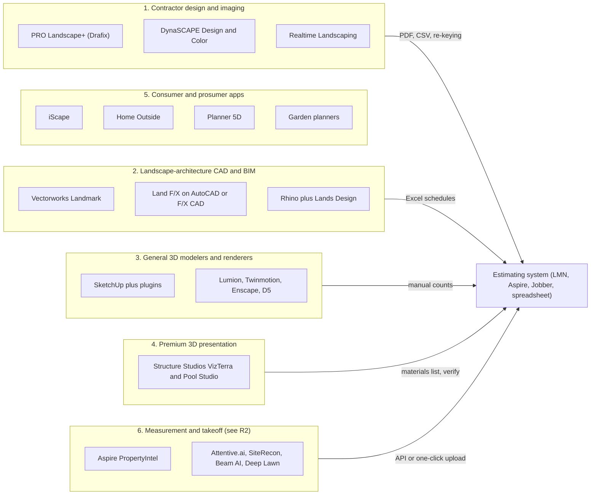
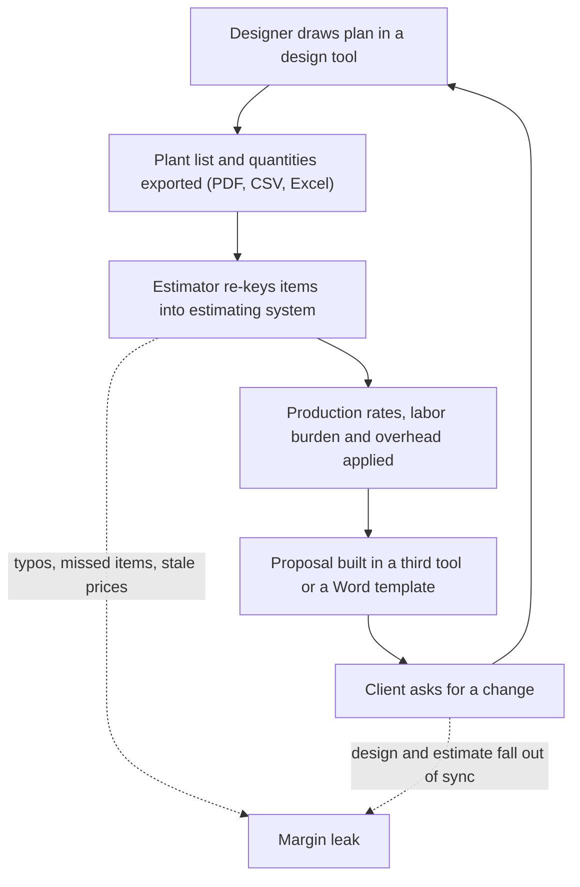
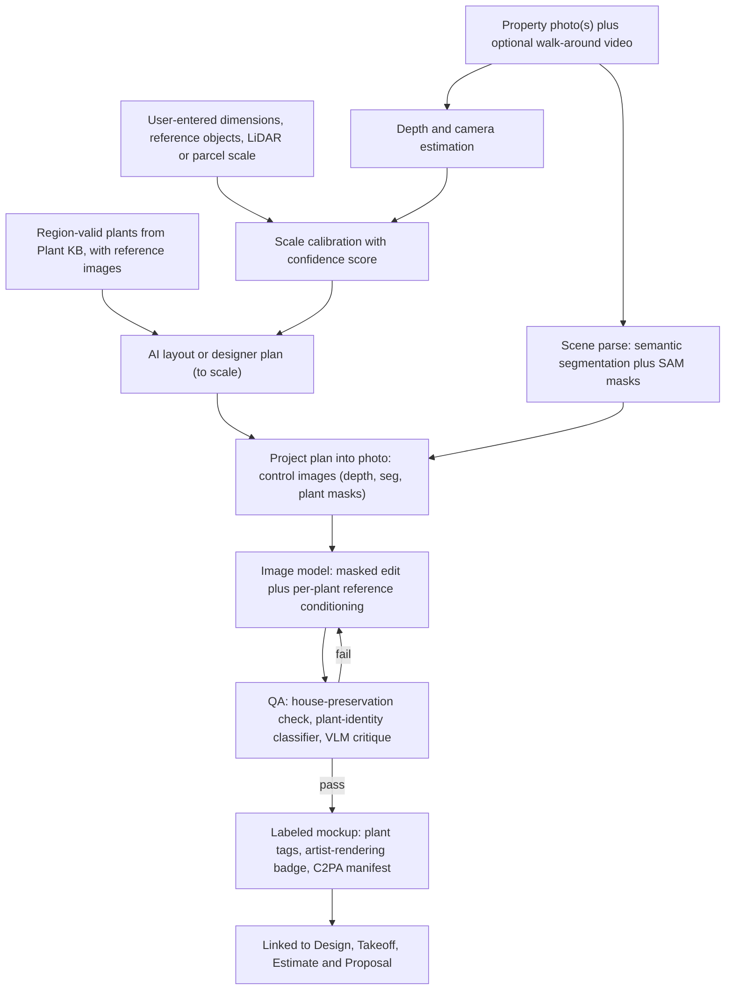

# R3 - Landscape design tools, AI mockup tech, and plant data sources

> Raw research behind three of Rootline's differentiators: the to-scale **Design Studio** ([10](../10-design-studio.md)), **AI photo mockups and dimension-aware AI layouts** ([11](../11-ai-design-mockups.md)), and the operator-curated, region-aware **Plant Knowledge Base** ([12](../12-plant-knowledge-base.md)). Part A profiles the landscape design software contractors use today (PRO Landscape+, DynaSCAPE, Vectorworks Landmark, Land F/X, SketchUp and its plugins, Realtime Landscaping, Structure Studios, iScape, Home Outside, Planner 5D, garden planners and a few adjacent tools) and asks how each connects, or fails to connect, to estimating. Part B covers consumer and pro AI yard-visualization apps and the technology underneath them: image editing and inpainting models, segmentation, monocular depth, Gaussian splatting, iPhone LiDAR capture and aerial measurement, with failure modes and costs per image. Part C profiles more than 40 plant data sources (taxonomy, distribution, climate, ecoregions, horticultural traits, water use, wildlife value, invasiveness, toxicity and nursery availability). For each it records content, coverage, API availability and, most importantly, **license terms for commercial reuse**. The report ends with consolidated lessons and a prioritized build-versus-license recommendation.

| Field | Value |
|---|---|
| Report | R3 - Landscape design tools, AI mockup tech, and plant data sources |
| Date | 2026-11-07 |
| Status | Research input, not a spec. Every material fact carries an evidence tag (section 0). |
| Primary consumers | [10 Design Studio](../10-design-studio.md), [11 AI design and mockups](../11-ai-design-mockups.md), [12 Plant Knowledge Base](../12-plant-knowledge-base.md), [13 Operations and inventory](../13-operations-inventory-equipment.md), [17 AI copilot](../17-ai-copilot-automation.md), [19 Platform admin](../19-platform-admin-portal.md), [20 Architecture](../20-architecture-security.md), [22 Pricing and GTM](../22-business-model-pricing-gtm.md), [24 Roadmap](../24-roadmap-feature-catalog.md) |
| Sibling reports | [R1 Field-service platforms](R1-field-service-platforms.md), [R2 Landscape-specific platforms](R2-landscape-specific-platforms.md), [R4 Industry, payments and accounting](R4-industry-payments-accounting.md) |

---

## 0. How to read this report: evidence levels and limitations

This report uses the same evidence tags as [R2](R2-landscape-specific-platforms.md):

| Tag | Meaning | How to use it |
|---|---|---|
| **[S]** | Sourced in this research run from a primary or credible source (vendor page, help center, trade press, paper, app-store listing, review site), linked inline. In this report almost every [S] fact was retrieved by a sibling agent in the same run and is re-cited with that agent's exact link. | Safe to quote with the link. Prices still carry "as of Nov 2026, verify". |
| **[S3P]** | Sourced in this run, but only from third-party aggregators, affiliate roundups or competitor-written pages. | Directional only. Quote ranges and say "verify". |
| **[B]** | Analyst background knowledge of public vendor materials, documentation, licenses, papers and trade press up to mid-2026, **not re-verified in this run**. | A well-founded hypothesis. Verify before using it in contracts, investor material or ingestion code (checklist in section 7). |
| **[E]** | Analyst estimate, inference or worked illustration. | Labeled as an estimate, with the reasoning shown. |

**Research limitations (read this first).**

- This report was started after the run-wide web-search budget (200 searches shared by every agent) was used up, so **every search this report attempted was refused**. Direct fetches of vendor domains (for example prolandscape.com and dynascape.com) also failed DNS resolution under the session's network allowlist. In other words, this run **could not open any new page**.
- To compensate, the report (1) re-cites the design-tool and AI-app evidence that sibling agents had already retrieved for [10](../10-design-studio.md) and [11](../11-ai-design-mockups.md) (tagged [S] or [S3P]), and (2) draws on the analyst's background knowledge for everything else (tagged [B]). Part C, the plant data sources, is almost entirely **[B]**. Its license summaries are the analyst's understanding of each provider's published terms as of mid-2026. **They are not legal advice and must be confirmed by counsel against each provider's current terms before any ingestion.** Section 4.9 explains the framework, and section 7 is a verification checklist.
- No statistic in this report is invented. Where the analyst remembers a figure but is not certain of it (record counts, list prices), the report gives a range or says "unverified" rather than a precise number. Vendor-reported numbers are labeled "vendor claim".
- The sources list at the end has two parts: links retrieved in this run (via siblings), and canonical primary references the analyst knows exist but did not open in this run. They are kept apart so nobody mistakes the second group for verified evidence.

---

## 1. Executive summary

1. **Landscape design software is a mature, fragmented, desktop-era category with no money loop.** Contractors choose among photo-imaging-plus-CAD tools aimed at design-build firms (PRO Landscape+, DynaSCAPE, Realtime Landscaping), professional landscape-architecture CAD (Vectorworks Landmark, Land F/X on AutoCAD), general 3D modelers with plugins (SketchUp, Rhino with Lands Design), premium 3D presentation tools (Structure Studios VizTerra and Pool Studio), and consumer apps (iScape, Planner 5D, garden planners) [S/B]. **None of them owns the client, the price book, the schedule or the invoice.** Takeoffs leave the design tool as a PDF, CSV or Excel schedule and are re-keyed into LMN, Aspire, Jobber or a spreadsheet [S/B]. On Capterra's landscape software pricing guide, "Landscape Design" is among the lowest-rated features in the category at 2.9 ([Capterra](https://www.capterra.com/landscape-software/pricing-guide/)) [S].
2. **The closest anyone gets to a closed loop is measurement, not design.** Aspire's PropertyIntel (built from Go iLawn and LandOne), LMN's Attentive.ai and Beam AI partnerships, Jobber's Deep Lawn integration and Arborgold's measuring tool push measured quantities into estimates ([10](../10-design-studio.md) section 2.1; [R2](R2-landscape-specific-platforms.md)) [S]. They measure what exists. None of them designs what will exist with a plant database.
3. **Plant libraries are where the design incumbents are weakest.** PRO Landscape+ reviewers ask for "more native plants suited to their climate zone" ([Capterra UK](https://www.capterra.co.uk/software/126135/pro-landscape)) [S]. Pro CAD tools ship large but generic plant databases whose regional suitability is up to the designer [B]. **No design tool we know of rates plants per region, as distinct from per hardiness zone, and validates a design against that rating in real time.**
4. **AI moved fast in 2025-2026, and the incumbents bolted it on.** PRO Landscape+ added an AI Outdoor Living Designer, AI Paver Tool, AI Eraser, AI Cutout Tool and an "Ask Wayne" assistant ([Green Industry Pros](https://www.greenindustrypros.com/business-management/software/product/22961404/pro-landscape-pro-landscape-launches-aibased-designer-suite); [Lawn and Landscape](https://www.lawnandlandscape.com/pro-landscape-plus-releases-ai-outdoor-living-designer)) [S]. Vectorworks and SketchUp shipped generative "AI visualizer" render features [B]. Dozens of consumer apps (Neighborbrite, Gendo, Rendair, Renovate AI, Visualizee, Hadaa, Yard Studio, ReimagineHome, Paintit.ai, HomeDesigns AI and others) restyle a yard photo in seconds ([Genroom roundup](https://genroom.io/blog/best-ai-landscape-design-apps-2026); [Fast.io roundup](https://www.fast.io/resources/best-ai-for-landscape-design-2026.md)) [S3P/B].
5. **Every AI yard tool shares the same three failure modes:** (a) it invents or mislabels plants, often ones that cannot survive the site's zone; (b) its output is not to scale and cannot be built or priced; (c) it is disconnected from the business that has to sell and install the work. Penn State Extension found that one leading app could not recognize most plants in its test redesign ([Penn State Extension](https://extension.psu.edu/ai-garden-design-intelligent-choices)) [S]. Roundups disclaim outputs as "conceptual only" ([Fast.io](https://www.fast.io/resources/best-ai-for-landscape-design-2026.md)) [S3P].
6. **The underlying models are now cheap, good at instruction-following edits, and interchangeable.** Gemini 2.5 Flash Image costs about $0.039 per image, Gemini 3 Pro Image about $0.134 to $0.24, and FLUX.1 Kontext [pro]/[max] about $0.04/$0.08 ([BenchLM](https://benchlm.ai/media-pricing/nano-banana); [BFL help](https://help.bfl.ai/articles/7424166364-wip-welcome-to-the-forest); as of 2026, verify) [S3P]. OpenAI's image models span roughly $0.01 to $0.17 per square image depending on quality tier [B]. Self-hosted SDXL or Qwen-Image pipelines cost fractions of a cent in GPU time [E]. **Image generation is not the moat. The moat is the constraints fed into the model:** the measured plan, the region-valid plant list, per-plant reference images and the price book.
7. **Open-weights licensing is a trap for a commercial SaaS.** FLUX.1 [dev], FLUX.1 Kontext [dev] and the FLUX.1 Tools [dev] variants ship under a non-commercial license (commercial use needs a separate BFL license). Depth Anything V2's Base, Large and Giant checkpoints are CC BY-NC 4.0. Several 2025 Chinese releases carry regional exclusions. By contrast SAM and SAM 2, IP-Adapter, ControlNet code and the Qwen-Image family are Apache 2.0, and SDXL is OpenRAIL++-M [B]. Rootline needs a model-license register reviewed by counsel, owned by `platform_engineer` ([19](../19-platform-admin-portal.md)).
8. **Capture technology is good enough for "measure once, design forever".** USGS 3DEP 1 m lidar DEMs, USDA NAIP imagery, open building footprints and parcel APIs (Regrid) give a free or cheap site model for most US properties [S/B]. Commercial aerial (Nearmap, EagleView, Vexcel) adds 5 to 10 cm imagery for a fee [B]. Phone LiDAR is accurate at short range but only about 5 m deep, and Apple's RoomPlan is built for **indoor rooms, not yards** [B]. Gaussian splatting from a 60 to 120 second phone video is the most promising path to photoreal 3D walkthroughs, but needs scale registration to be measurable [B/E].
9. **The plant data landscape splits cleanly into "open and reusable" and "excellent but locked".** Public-domain or open data covers taxonomy (WCVP/POWO, WFO), US native status and distribution (USDA PLANTS), Canadian status (VASCAN), climate (2023 USDA Plant Hardiness Zone Map, NRCan zones, NOAA normals), ecoregions (EPA and CEC), soils (SSURGO) and occurrences (GBIF, iNaturalist, filtered by record-level license) [B]. The **horticultural judgment** a landscaper actually needs (garden performance, mature size in cultivation, deer resistance, maintenance, cultivar differences, design use) lives in copyrighted references: Missouri Botanical Garden Plant Finder, NC State Extension Gardener Plant Toolbox, Lady Bird Johnson Wildflower Center, Calscape, WUCOLS, NWF, Audubon, BONAP. None of them offers a public commercial API, and all need permission or a license for systematic reuse [B].
10. **Cultivars are the biggest data gap.** Landscapers specify *Hydrangea paniculata* 'Limelight' or *Buxus* 'Green Velvet', not the species. Taxonomic backbones stop at species and infraspecific taxa. Cultivar and trademark data (for example 'Bobo', 'Little Lime', Endless Summer, Proven Winners and First Editions series) lives in grower catalogs and brand programs with their own copyrights and trademarks [B]. **Rootline's curated cultivar layer, linked to nursery availability, is the defensible asset**, and it has to be built by `platform_curator` staff with grower partnerships, not scraped.
11. **Nursery availability is still emailed spreadsheets.** Distributors such as SiteOne integrate with landscape software only through partnerships (LMN's SiteOne ordering) ([Turf Magazine](https://turfmagazine.com/lmn-integrates-siteone-landscape-supply-in-2021-software/)) [S]. Local wholesale nurseries publish weekly PDF or Excel availability lists ([13](../13-operations-inventory-equipment.md) section 2) [S/B]. A parser that maps any availability list to Plant KB records is a real moat and a network effect: every tenant upload enriches regional availability signals.
12. **Recommendation in one line:** build the Plant KB on open backbones (WCVP or WFO, USDA PLANTS, VASCAN, PHZM 2023, EPA and CEC ecoregions, SSURGO, GBIF CC0/CC BY records); **license or partner** for horticultural depth (a botanical-garden or extension partnership, WUCOLS for water use in the West, regional trial programs) and imagery; **curate in-house** what makes the product unique (cultivars, Plant Region Profiles, palettes, render-reference images, availability mapping). Never scrape the locked sources (section 6).

---

## 2. Part A: Landscape design software

### 2.1 Market map

Landscape design tools sort into six clusters by who uses them and what they output. Design-build contractors, the core Rootline buyer, mostly live in clusters 1 and 3, and sometimes 4.

The arrows tell the story. Only cluster 6 has a direct path into an estimating system, and cluster 6 does not design.

### 2.2 Product profiles

#### 2.2.1 PRO Landscape+ (Drafix Software)

- **What it is.** The long-standing design tool for design-build contractors. Its signature is **photo imaging**: drag plant and hardscape images onto a client's house photo, plus 2D CAD site plans, 3D rendering, night and holiday lighting imaging, proposals, material takeoffs, a plant library and a mobile companion app ([Capterra](https://www.capterra.com/p/126135/PRO-Landscape/); [GetApp](https://www.getapp.com/all-software/a/pro-landscape/)) [S]. A homeowner edition has existed alongside the pro product [B].
- **Price.** About $90 per month or $900 per year for PRO Landscape+ (as of Nov 2026, verify) [S]. Older versions were sold as perpetual licenses [B].
- **AI (2025).** AI Outdoor Living Designer (start from a customer photo, define the project area, generate concepts), AI Paver Tool, AI Eraser (remove existing landscaping), AI Cutout Tool and the "Ask Wayne" help assistant ([Green Industry Pros](https://www.greenindustrypros.com/business-management/software/product/22961404/pro-landscape-pro-landscape-launches-aibased-designer-suite); [Green Industry Pros, AI upgrade](https://www.greenindustrypros.com/design-installation/design/product/22945469/pro-landscape-pro-landscape-upgrades-design-software-with-ai); [Lawn and Landscape](https://www.lawnandlandscape.com/news/pro-landscape-updates-design-software-with-artificial-intelligence); [Turf Magazine](https://turfmagazine.com/ai-meets-design-prolandscape-unveils-next-gen-tools)) [S]. A 2026 roundup describes its AI stylist as applying styles to masked regions of the photo ([Fast.io](https://www.fast.io/resources/best-ai-for-landscape-design-2026.md)) [S3P].
- **Connection to estimating.** Inside the tool, objects placed in the design can generate a priced proposal from the user's own price list [B]. That proposal lives in PRO Landscape, not in the business system: client records, deposits, scheduling and invoicing are elsewhere, and quantities must be re-keyed or exported [B].
- **Complaints.** Reviewers want "more native plants suited to their climate zone" and find plant symbols hard to tell apart ([Capterra UK](https://www.capterra.co.uk/software/126135/pro-landscape); [Software Advice](https://www.softwareadvice.com/landscaping/pro-landscape-profile)). One says it is "meant for someone not a beginner at design" ([Capterra reviews](https://www.capterra.com/p/126135/PRO-Landscape/reviews/)) [S]. Ratings rest on small samples, around 3.6 to 3.7 from 8 or 9 reviews at the time of the sibling search [S].
- **Learning curve.** Moderate. Photo imaging is quick to learn; CAD and proposal setup take training [B].
- **Read for Rootline.** PRO Landscape proves contractors pay roughly $900 per year for "picture plus plan plus proposal". It is the closest incumbent to [11](../11-ai-design-mockups.md) and the clearest proof that photo imaging sells jobs. Rootline beats it on regional plants and the closed money loop, not on raw imaging features.

#### 2.2.2 DynaSCAPE (Design, Color, Sketch3D, Manage)

- **What it is.** A Canadian landscape design suite with a large following among design-build firms and horticulture colleges [B]. **DynaSCAPE Design** is a landscape-specific CAD whose output looks **hand-drawn**: textured plant symbols, organic linework and lettering that clients read as "designed", not "engineered" [B]. **DynaSCAPE Color** adds marker-style color rendering of the plan [B]. A 3D product (Sketch3D) and a cloud business tool (**DynaSCAPE Manage**, for CRM, estimating and job costing) have also been marketed. The current status and packaging of Manage could not be verified in this run [B].
- **Price.** Not verified in this run. Historically a subscription priced in the low hundreds of dollars per month or equivalent annual fees [B, unverified].
- **Connection to estimating.** Historically the strongest link of any design tool: quantities from Design could be pushed into Manage estimates [B]. For contractors running LMN, Aspire or Jobber, DynaSCAPE output is still a plant list and a PDF [B].
- **Complaints.** Windows-centric, CAD-style learning curve, and a plant library that has to be maintained per region by the user [B].
- **Read for Rootline.** The **hand-drawn aesthetic is a selling feature in its own right.** Rootline's Design Studio should offer a "presentation style" renderer (sketchy linework, watercolor fills, hand-lettered labels) as a theme, not a separate product ([10](../10-design-studio.md)).

#### 2.2.3 Vectorworks Landmark (Nemetschek Group)

- **What it is.** Full landscape-architecture CAD and BIM on Mac and Windows: site modeling (DTM, grading, cut and fill), plant objects linked to a plant database, landscape areas (mixed plantings by density), hardscape, an irrigation design toolset, existing-tree inventory, worksheets and schedules, IFC/BIM interoperability and a renderer [B]. Landmark auto-generates schedules, including plant lists, irrigation plans and existing-tree reports ([Vectorworks help](https://app-help.vectorworks.net/2015/NNA/eng/VW2015_Guide/Worksheets/Creating_Schedules_Automatically.htm)) [S]. A review describes an extensive plant database covering thousands of species ([Dyverse](https://avaria.dyverse.com/best-landscape-architecture-software-expert-reviews-comparisons-2024)) [S3P]. Vectorworks has added a cloud-based generative "AI Visualizer" for concept images [B].
- **Price.** Annual subscription in the low thousands of dollars per seat. The analyst's recollection is roughly $3,000 per year in the US list price in 2024-2025 (verify) [B].
- **Connection to estimating.** Worksheets compute quantities and can carry cost fields, but there is no link to a contractor's price book, CRM or invoicing [B]. Exports go out as CSV or Excel.
- **Learning curve.** Steep. It is a professional CAD and BIM package; most design-build contractors under 50 people do not have a trained operator [B].
- **Read for Rootline.** Landmark sets the bar for **site modeling and plant objects with data**. Rootline should match its landscape-area concept (fill a bed with a mix of species at a density) and its schedules, and interoperate through DWG/DXF and IFC export for landscape architects ([10](../10-design-studio.md)).

#### 2.2.4 Land F/X (on AutoCAD or F/X CAD)

- **What it is.** A plugin suite for AutoCAD, used mainly by US landscape architects: **Planting F/X** (plant placement, automated plant schedules sortable by botanical or common name), **Irrigation F/X** (hydraulics, schedules, including equipment not yet placed, and watering schedules), **Site/Details F/X** and lighting tools ([Land F/X planting schedules](https://www.landfx.com/docs/planting/schedules.html); [irrigation schedules](https://www.landfx.com/index.php/docs/irrigation/schedules-and-reports/196-irrigation-schedules-and-reports.html); [watering schedule](https://www.landfx.com/docs/irrigation/schedules-and-reports/1545-watering-schedule.html); [irrigation features](https://www.landfx.com/irrigationfeatures)) [S]. Land F/X also sells its own CAD platform (F/X CAD) as an alternative to AutoCAD [B]. A third-party summary says its 3D visualization trails dedicated tools ([FitGap](https://us.fitgap.com/products/land-f-x)) [S3P].
- **Price.** Per-seat subscription per module, on top of an AutoCAD subscription (AutoCAD list is roughly $2,000 per year; verify) unless the firm uses F/X CAD [B, unverified].
- **Connection to estimating.** Schedules export to Excel. Land F/X has no business pricing, CRM or job costing [B].
- **Learning curve.** Very steep for contractors: AutoCAD skills plus the plugin [B].
- **Read for Rootline.** Land F/X is the benchmark for **irrigation design rigor** and for schedule output that architects and municipal reviewers accept. Rootline's irrigation layer ([10](../10-design-studio.md)) should produce schedules a Land F/X user would recognize.

#### 2.2.5 SketchUp plus plugins (Trimble)

- **What it is.** A general-purpose 3D modeler widely used by design-build landscapers for hardscape, outdoor kitchens, pergolas and grading massing [B]. Subscription tiers (Go, Pro, Studio) run from roughly $120 to $750 per year (verify) [B]. Landscape work depends on plugins [B]:
  - **Vegetation and scattering**: Skatter (scatter plants and groundcovers), Laubwerk (parametric plants with age and season), 3D Warehouse plant models.
  - **Terrain**: the built-in Sandbox tools, Artisan and similar organic modelers; PlaceMaker for importing aerial imagery, terrain and context buildings.
  - **Quantities**: Profile Builder and Quantifier-type plugins for paver area, wall face area, linear edging and counts.
  - **Rendering**: Enscape, V-Ray, D5 Render, Lumion LiveSync and Twinmotion; Trimble also shipped **SketchUp Diffusion**, a generative AI render feature.
- **Connection to estimating.** Only through quantity plugins and manual export. No plant data beyond what the model carries [B].
- **Learning curve.** Moderate for modeling, steep for photoreal output. Results depend heavily on the operator [B].
- **Read for Rootline.** Design-build firms love SketchUp for **hardscape in 3D** (patio steps, seat walls, fire features). Rootline's Design Studio needs a credible hardscape 3D extrusion (walls, steps, raised beds, pergola primitives) and SKP/DAE/glTF export, so firms can keep SketchUp for custom structures while the plan, plants and pricing live in Rootline ([10](../10-design-studio.md)).

#### 2.2.6 Realtime Landscaping (Idea Spectrum)

- **What it is.** Windows design software with tiers named Plus, Pro, Architect and Photo, aimed at contractors and homeowners. It offers 3D walkthroughs, pools and decks, plant growth over time, night lighting, CAD-style plans in Architect, and a large plant and object library [B].
- **Price.** Historically perpetual licenses: about $100 for Plus, about $300 for Pro and about $400 for Architect (verify current prices and licensing) [B].
- **Connection to estimating.** Plant and material lists only; no business-system integration found [B].
- **Learning curve.** Low to moderate; it is popular with small contractors for exactly that reason [B].
- **Read for Rootline.** Its **growth slider** (see the design at install, year 3 and year 10) is a cheap feature with enormous sales value. Rootline should have it in both 2D plan symbols and AI mockups ([10](../10-design-studio.md), [11](../11-ai-design-mockups.md)).

#### 2.2.7 Structure Studios (VizTerra, Pool Studio)

- **What it is.** Premium 3D design and presentation software for pool builders (Pool Studio) and outdoor-living and landscape contractors (VizTerra). Known for cinematic 3D flyover videos, VR and phone presentations, and construction plan output [B]. The target is high-ticket projects ($75k and up) where the presentation closes the deal [B/E].
- **Price.** Demo-led subscription pricing, not published (as of Nov 2026, verify) [B].
- **Connection to estimating.** Materials and construction plans are produced, but no evidence was found of a native link to landscape business software [B].
- **Learning curve.** Moderate; the vendor sells training and design-service options [B].
- **Read for Rootline.** The pool-and-outdoor-living segment buys **emotion**: walkthroughs, sunsets and water features. Rootline's [V2]/[V3] 3D walkthroughs and Gaussian-splat site capture ([11](../11-ai-design-mockups.md) AIM-GEN-F) target this buyer.

#### 2.2.8 iScape

- **What it is.** A mobile AR and photo-based yard design app for homeowners and contractors. Users place plants and hardscape objects on a photo or in live AR [S].
- **Price.** Pro tier around $29.99 per month (as of 2026, verify) ([AI Tools Bakery](https://aitoolsbakery.com/blog/iscape-review/); [TapSmart](https://www.tapsmart.com/apps/iscape-review/)) [S3P].
- **Complaints.** Crashes in AR mode on complex designs and an aggressive paywall ([AI Tools Bakery](https://aitoolsbakery.com/blog/iscape-review/)) [S3P].
- **Connection to estimating.** None found beyond simple quote output [B].
- **Read for Rootline.** Phone AR is an engagement feature, not a production tool. Keep on-device AR light (plant preview at mature size) and do heavy rendering server-side ([11](../11-ai-design-mockups.md)).

#### 2.2.9 Home Outside

- **What it is.** An online landscape design service from landscape architect Julie Moir Messervy's studio, paired with an iPad drawing app (Home Outside Palette) that uses a soft, illustrated style [B]. Homeowners buy design packages; designers work remotely from photos and measurements [B].
- **Price.** Package-based; not verified in this run [B].
- **Read for Rootline.** Along with Yardzen (section 3.1), it shows **homeowners pay for remote design from photos and measurements**. Rootline's lead-magnet mockup widget and "design deposit" flow ([11](../11-ai-design-mockups.md), [16](../16-marketing-growth-communications.md)) let a local Company capture that spend instead of a national design service.

#### 2.2.10 Planner 5D and consumer home-design apps

- **What it is.** Planner 5D is a freemium, mainly interior home-design app with exterior objects, 3D views and AI features such as automatic floor-plan recognition and design generation [B]. Similar apps include Homestyler and other room planners.
- **Read for Rootline.** These apps set the **consumer UX bar** for drag-and-drop simplicity and instant 3D. They are not to-scale landscape tools and have no regional plant intelligence [B].

#### 2.2.11 Garden planner apps

- **What they are.** Vegetable and small-garden planners (GrowVeg / Growing Interactive Garden Planner, Gardena myGarden, VegPlotter and others), plant-ID and care apps (PictureThis, Garden Answers, Planta), and garden journals (Gardenize) [B]. Planners use square-foot grids and frost-date calendars. ID apps combine computer vision with care reminders, usually by subscription [B].
- **Read for Rootline.** Two ideas worth taking for the client portal ([06](../06-customer-portal.md)): **frost-date-driven reminders** (localized "cover your new plantings tonight" alerts) and **plant ID from a photo** to build an inventory of the client's existing plants during a site assessment ([03](../03-crm-sales-estimating-proposals.md)).

#### 2.2.12 Adjacent tools worth knowing

| Tool | Notes | Relevance |
|---|---|---|
| **Rhino plus Lands Design (Asuni)** | BIM-style landscape plugin for Rhino with a plant database, growth simulation, terrain and documentation [B]. Popular in Europe and with parametric designers. | Shows the "plant object carries data and grows" model. |
| **Lumion, Twinmotion, Enscape, D5 Render** | Real-time renderers with large vegetation libraries, fed from SketchUp, Revit, Rhino or Vectorworks [B]. Twinmotion licensing became free for smaller businesses (under about $1M revenue) in 2024 (verify) [B]. | Set the quality expectation for 3D stills and video. Rootline's [V2] 3D should export glTF so designers can render elsewhere. |
| **AutoCAD Civil 3D** | Grading and drainage for civil engineers [B]. | Rootline does not compete; accept DWG/DXF underlays ([10](../10-design-studio.md) DS-SITE-08). |
| **Measurement and takeoff tools** | Aspire PropertyIntel, Go iLawn, Attentive.ai, SiteRecon, Beam AI, Deep Lawn ([10](../10-design-studio.md); [R2](R2-landscape-specific-platforms.md)) [S]. | Benchmark for AI auto-trace and takeoff speed. |

### 2.3 Comparison table (as of Nov 2026, verify every price)

| Product | Platform | Primary user | 2D plan | 3D | Photo imaging | AI features | Plant database and regional depth | Price signal | Learning curve |
|---|---|---|---|---|---|---|---|---|---|
| PRO Landscape+ | Windows desktop plus mobile companion [B] | Design-build contractors | Yes [S] | Yes [S] | Yes, signature [S] | Yes, 2025 suite [S] | Large image library; regional native depth criticized [S] | About $90/mo or $900/yr [S] | Moderate [S] |
| DynaSCAPE Design and Color | Windows [B] | Design-build firms, colleges | Yes, hand-drawn style [B] | Separate product [B] | Limited [B] | Not verified | User-maintained [B] | Unverified | Moderate to steep [B] |
| Vectorworks Landmark | Mac and Windows [B] | Landscape architects, larger design-build | Yes [S] | Yes [B] | Via renders [B] | AI Visualizer [B] | Thousands of species; generic [S3P] | About $3k/seat/yr (verify) [B] | Steep [B] |
| Land F/X | AutoCAD or F/X CAD [B] | Landscape architects | Yes [S] | Limited [S3P] | No [B] | Not verified | Large database; generic [B] | Module subscriptions plus CAD [B] | Very steep [B] |
| SketchUp plus plugins | Mac, Windows, web [B] | Design-build, hardscape | Via LayOut [B] | Yes, core strength [B] | Via renderers [B] | SketchUp Diffusion [B] | Via plugins and models [B] | About $120-750/yr plus plugins [B] | Moderate, steep for photoreal [B] |
| Realtime Landscaping | Windows [B] | Small contractors, homeowners | Architect tier [B] | Yes [B] | Photo tier [B] | Not verified | Large generic library [B] | About $100-400 perpetual (verify) [B] | Low to moderate [B] |
| Structure Studios | Windows plus cloud presentation [B] | Pool and outdoor-living builders | Yes [B] | Yes, cinematic [B] | Yes [B] | Not verified | Limited [B] | Demo-led, unpublished [B] | Moderate [B] |
| iScape | iOS, Android [S] | Homeowners, small contractors | Basic [B] | AR [S] | Yes [S] | Not verified | Generic [B] | About $29.99/mo Pro [S3P] | Low [S3P] |
| Home Outside | iPad plus service [B] | Homeowners | Illustrated [B] | No [B] | No [B] | Not verified | Designer-chosen [B] | Packages [B] | Low [B] |
| Planner 5D | Web, mobile [B] | Homeowners | Yes [B] | Yes [B] | No [B] | Yes [B] | Minimal [B] | Freemium [B] | Low [B] |
| **Rootline target** | Web, iPad, phone | All tenant roles plus clients | Yes [MVP] | Yes [V1] | AI mockups [MVP] | Layout, restyle, chat [MVP]/[V1] | **Operator-curated Region profiles** [MVP] | Included in tiers ([22](../22-business-model-pricing-gtm.md)) | Two modes: estimator and designer |

### 2.4 How designs connect to estimating (and where they break)

The core finding of Part A: **every design tool produces quantities, and almost none delivers them to the system that prices, sells, schedules and bills the work.**

| Product | What leaves the design | How it reaches the estimate | Breakage |
|---|---|---|---|
| PRO Landscape+ | Plant and material lists, internal proposal [S/B] | Proposal generated inside the tool; quantities re-keyed into the business system [B] | Two price lists (design tool and business system) drift apart; the client record is duplicated |
| DynaSCAPE | Quantities [B] | Historically into DynaSCAPE Manage; otherwise CSV or PDF [B] | Works only if the firm also runs Manage |
| Vectorworks Landmark | Worksheets and schedules [S] | Excel export [B] | No production rates, labor or overhead; an estimator rebuilds the estimate |
| Land F/X | Plant, irrigation and watering schedules [S] | Excel export [B] | Same as Vectorworks; often a different company (the landscape architect) than the installer |
| SketchUp | Model geometry; plugin quantity reports [B] | Manual or CSV [B] | Counts depend on modeling discipline; plants often not modeled as data |
| Realtime | Plant and material lists [B] | Manual [B] | Same as above |
| Structure Studios | Plans, materials [B] | Manual [B] | Same as above |
| Aspire PropertyIntel | Measured takeoff [S] | One-click upload into Aspire [S] | Measures existing conditions; it is not a planting design |
| LMN with Attentive.ai or Beam AI | Measured takeoff [S] | Integration into LMN estimates [S] | Same as above |

Errors reported at this seam include mismatched paver counts, wrong wall heights and irrigation head-spacing mistakes ([JackMacBiz, 2026](https://jackmacbiz.github.io/blog/2026-06-13-why-your-current-landscape-design-app-is-wasting-8-hours-per/); single anecdotal source) [S]. Jobber's own documented fallback for measuring is tracing in Google Maps and pasting the area into a custom field ([Jobber help](https://help.getjobber.com/es/articles/how-to-measure-property-distance-and-size/)) [S], and Jobber users ask in the vendor community for separate design software and training ([Jobber community](https://community.getjobber.com/discussions/operations-forum/looking-for-landscape-design-software--training/8084)) [S].

### 2.5 Complaint themes across design tools

| Theme | Evidence | Rootline answer |
|---|---|---|
| Plant libraries ignore region | "More native plants suited to their climate zone" ([Capterra UK](https://www.capterra.co.uk/software/126135/pro-landscape)) [S] | Region-curated KB with live validation ([12](../12-plant-knowledge-base.md)) |
| Steep learning curve | "Meant for someone not a beginner" ([Capterra](https://www.capterra.com/p/126135/PRO-Landscape/reviews/)); trade press advises budgeting for onboarding ([Green Industry Pros](https://www.greenindustrypros.com/22738198)) [S] | Estimator mode (trace and price) separate from designer mode ([10](../10-design-studio.md)) |
| Tools feel dated | A gardening-forum user says design software has "taken a huge step backwards" ([garden.org](https://garden.org/thread/view/132802/software/)) [S] | Modern web canvas, multiplayer, iPad |
| Symbol and output quality | Hard-to-distinguish plant symbols ([Software Advice](https://www.softwareadvice.com/landscaping/pro-landscape-profile)) [S]; weaker 3D in pro CAD ([FitGap](https://us.fitgap.com/products/land-f-x)) [S3P] | Symbol styles generated from plant form and color; hand-drawn presentation theme |
| Double entry into business software | Re-keying errors ([JackMacBiz](https://jackmacbiz.github.io/blog/2026-06-13-why-your-current-landscape-design-app-is-wasting-8-hours-per/)) [S] | Takeoff is a live view of the plan, priced against the Price Book |
| Desktop and Windows lock-in | Most contractor tools are Windows desktop software [B] | Browser and iPad, offline-capable |
| Mobile AR instability | iScape crash complaints [S3P] | Server-side rendering; light AR only |

### 2.6 Lessons from Part A

1. **Sell the closed loop, not the canvas.** Feature parity with PRO Landscape+ or DynaSCAPE on drawing tools is necessary but not sufficient. Rootline wins when "drop 14 'Limelight' hydrangeas" updates the proposal total and the purchase order ([10](../10-design-studio.md) section 2.4).
2. **Offer two skins on one engine.** A 15-minute "trace and price" estimator mode for mulch, sod and cleanups, and a full designer mode with layers, schedules and plan sets.
3. **Ship a hand-drawn presentation style.** DynaSCAPE's aesthetic proves clients respond to warmth. It is a renderer theme, cheap to build relative to its sales value [E].
4. **Growth slider and seasons from day one** (Realtime, Laubwerk). Plants are sized to mature spread from the KB and shown at install size, year 3 and maturity.
5. **Interoperate with the professionals.** Import DWG/DXF and PDF underlays; export DWG/DXF, PDF plan sets, CSV schedules and glTF/SKP. Landscape architects stay in Vectorworks or Land F/X; the contractor runs the job in Rootline.
6. **Irrigation and lighting rigor** (Land F/X, Vectorworks) is a [V1] credibility feature for design-build firms that install systems.
7. **Premium presentation** (Structure Studios) is a later-tier upsell for high-ticket outdoor living. Do not build cinematic 3D before the plan-to-estimate loop works.

---

## 3. Part B: AI landscape and home visualization

### 3.1 Consumer and prosumer AI yard-design apps

Demand is real. In May 2026 Axios reported that a growing number of homeowners now use AI as their landscape designer, and quoted a designer saying that once people can see the redesigned yard, their attitudes change ([Axios](https://www.axios.com/local/washington-dc/2026/05/08/landscape-design-ai); [Axios, "vibe code your yard"](https://www.axios.com/local/washington-dc/2026/05/08/ai-vibecode-yard-landscape)) [S]. The supply side is a long tail of thin "upload photo, pick style" apps on top of the same few foundation models.

| App | Type | What it does | Notes and evidence |
|---|---|---|---|
| **Neighborbrite** | Consumer, web and iOS | Photo restyle by garden style, with plant suggestions; paid tier filters natives | Penn State Extension found its emphasis was on hardscape over plants and it could not recognize most plants in a vegetable-garden redesign; filtering to natives required a paid plan ([Penn State Extension](https://extension.psu.edu/ai-garden-design-intelligent-choices); [App Store](https://apps.apple.com/app/id6742585344)) [S] |
| **Gendo** | Prosumer, web | AI landscape and architecture visualization | ([Gendo](https://gendo.ai/ai-landscape-design)) [S] |
| **Rendair** | Prosumer, web | AI rendering for designers, including landscape | ([Rendair](https://rendair.ai/blog/5-ways-use-ai-landscape-designer-rendair)) [S] |
| **Renovate AI** | Consumer | Photo restyle for yards | ([Renovate AI](https://renovateai.app/ai-landscape-design)) [S] |
| **Visualizee** | Prosumer | AI renders from sketches or photos | ([Visualizee](https://visualizee.ai/blog/ai-landscape-design)) [S] |
| **Hadaa** | Consumer, Android | Garden redesign with claimed location-aware plant suggestions | ([Google Play](https://play.google.com/store/apps/details?id=app.hadaa.android)) [S] |
| **Yard Studio** | Consumer | Yard design with claimed climate awareness | ([Product Hunt](https://www.producthunt.com/p/yard-studio)) [S] |
| **ReimagineHome** | Consumer, web | Interior and exterior redesign including landscaping, virtual staging; credit or subscription pricing | [B] |
| **Paintit.ai** | Consumer, web | Interior, exterior and landscape restyle by prompt and style | [B] |
| **HomeDesigns AI** | Consumer, web | Interior, exterior and garden redesign tools; subscription | [B] |
| **Interior AI, RoomGPT and clones** | Consumer | Early ControlNet-based restyle apps; RoomGPT was open-sourced | [B] |
| **DreamzAR** | Consumer, mobile | AR plus AI garden design app (named in the brief) | App-store details not re-verified in this run [B] |
| **Yardzen** | Design service | Human designers produce remote yard designs from photos and measurements, sold as fixed-fee packages, with contractor referrals for install | AI features could not be verified in this run [B]; see [R2](R2-landscape-specific-platforms.md) |
| **Tilly, Home Outside and similar** | Design service | Remote design packages | [B] |

Common patterns across these apps [S3P/B]:

- **Input:** one photo plus a style preset ("modern", "cottage", "xeriscape", "Japanese") and sometimes a free-text prompt or a brushed mask.
- **Output:** 2 to 4 restyled images in 5 to 30 seconds, with no plan, no scale and usually no plant list. Where a plant list exists, it is generated text, not linked to the pixels.
- **Business model:** freemium credits, $10 to $30 per month subscriptions, watermarking on free tiers [B].
- **Disclaimers:** outputs are "conceptual only", not measurements or construction drawings ([Fast.io](https://www.fast.io/resources/best-ai-for-landscape-design-2026.md)) [S3P].
- **Missing:** the installer. No app hands the homeowner to a local Company with a priced, buildable proposal. That is the lead-generation gap Rootline's white-label widget fills ([11](../11-ai-design-mockups.md), [16](../16-marketing-growth-communications.md)).

### 3.2 Professional tools adding AI

| Tool | AI feature | Evidence |
|---|---|---|
| PRO Landscape+ | AI Outdoor Living Designer, AI Paver Tool, AI Eraser, AI Cutout Tool, Ask Wayne assistant | [S] (section 2.2.1) |
| Vectorworks | Cloud "AI Visualizer" for text- and image-to-image concept renders | [B] |
| SketchUp | SketchUp Diffusion (generative render of the viewport by style prompt) | [B] |
| Veras (EvolveLAB, acquired by Chaos) | AI render plugin for SketchUp, Revit, Rhino, Forma | [B] |
| D5 Render, Lumion, Enscape | AI upscaling, AI material and atmosphere tools inside real-time renderers | [B] |
| mnml.ai, LookX, PromeAI | Web AI render tools for architects, with landscape modes | [B] |
| Aerial measurement (Attentive.ai, SiteRecon, Beam AI, PropertyIntel, Deep Lawn) | Segmentation of aerial imagery into turf, beds, hardscape and features for takeoff | [S] ([R2](R2-landscape-specific-platforms.md), [10](../10-design-studio.md)) |

The pattern: pro tools add AI as **render polish** (make my 3D viewport look photoreal) or **measurement** (trace my aerial image). Nobody uses AI to **generate a to-scale planting layout from region-valid plants and then render it faithfully**. That combination is Rootline's opening ([11](../11-ai-design-mockups.md) section 2.4).

### 3.3 Underlying technology

#### 3.3.1 Image generation and editing models

What matters for landscape mockups is not text-to-image beauty. It is **editing fidelity**: keep the house, driveway, windows and camera identical, change only the masked yard, place recognizable plants, and respect a control signal (depth, edges, segmentation or a projected plan).

| Model or family | Access | Editing capabilities relevant to yards | License for commercial SaaS use | Indicative cost per image (as of 2026, verify) |
|---|---|---|---|---|
| **Gemini 2.5 Flash Image ("Nano Banana")** | Google API (AI Studio, Vertex) | Instruction-based editing, multi-image reference composition, strong identity preservation; SynthID watermark embedded [B] | API terms; outputs usable commercially per Google terms [B] | About $0.039 per image, about $0.0195 batch ([BenchLM](https://benchlm.ai/media-pricing/nano-banana); [MyArchitectAI](https://www.myarchitectai.com/blog/nano-banana-api-pricing)) [S3P] |
| **Gemini 3.1 Flash Image ("Nano Banana 2")** | Google API | Higher resolution tiers, improved editing [S3P] | API terms [B] | About $0.045 (0.5K) to $0.151 (4K) ([BenchLM](https://benchlm.ai/media-pricing/nano-banana)) [S3P] |
| **Gemini 3 Pro Image ("Nano Banana Pro")** | Google API | Highest-quality Google tier, better text and complex scenes [B] | API terms [B] | About $0.134 (1K-2K), $0.24 (4K) ([BenchLM](https://benchlm.ai/media-pricing/nano-banana)) [S3P] |
| **Imagen family** | Google Vertex | Mask-based inpainting and outpainting in Vertex editing APIs [B] | API terms [B] | Roughly $0.02 to $0.06 per image depending on tier (verify) [B] |
| **OpenAI GPT Image models (gpt-image-1, gpt-image-1-mini, later versions)** | OpenAI API | Instruction editing with optional mask, multi-image input; C2PA metadata on outputs [B] | API terms; outputs owned by the customer per OpenAI terms [B] | Token-priced; roughly $0.01 (low), $0.04 (medium), $0.17 (high) for a 1024 x 1024 image on gpt-image-1, with the mini model much cheaper (verify) [B] |
| **FLUX.1 Kontext [pro] / [max]** | BFL API and resellers | In-context instruction editing with strong character and scene consistency [B] | API terms [B] | About $0.04 / $0.08 ([BFL help](https://help.bfl.ai/articles/7424166364-wip-welcome-to-the-forest); [Puter](https://developer.puter.com/tutorials/flux-api-pricing/); [PricePerToken](https://pricepertoken.com/flux-pricing)) [S3P] |
| **FLUX.1 Fill, Depth, Canny, Redux** | [pro] via API; [dev] open weights | Inpainting and outpainting (Fill), structure conditioning (Depth, Canny), image variation (Redux) [B] | **[dev] weights: FLUX.1 non-commercial license; commercial self-hosting needs a separate BFL license** [B] | API about $0.05 per image for Fill [pro] (verify) [B] |
| **FLUX.2 family** | API tiers plus open [dev] weights | Multi-reference editing, higher resolution; priced per megapixel ([BFL help](https://help.bfl.ai/articles/7424166364-wip-welcome-to-the-forest)) [S3P] | [dev] non-commercial; a smaller permissively licensed variant was announced (verify) [B] | Per-megapixel (verify) [S3P] |
| **SDXL plus ControlNet plus IP-Adapter** | Open weights, self-host | Mature inpainting pipelines; ControlNet for depth, segmentation, canny, MLSD lines; IP-Adapter for reference-image conditioning; LoRA for plant identity [B] | SDXL: CreativeML OpenRAIL++-M (commercial use allowed with use restrictions); ControlNet and IP-Adapter code Apache 2.0; check each ControlNet checkpoint's license [B] | Self-hosted on an L4 or A10-class GPU, roughly $0.002 to $0.01 per image in GPU time [E] |
| **Stable Diffusion 3.5** | Open weights | Text-to-image and editing via community tools [B] | Stability Community License: free commercial use below about $1M annual revenue, enterprise license above (verify) [B] | Self-host [E] |
| **Qwen-Image and Qwen-Image-Edit (Alibaba)** | Open weights | Strong instruction editing, text rendering, multi-image editing in later releases [B] | **Apache 2.0** (verify per checkpoint) [B] | Self-host, roughly $0.005 to $0.02 per image on a large GPU [E] |
| **Seedream (ByteDance), HunyuanImage (Tencent), others** | API or open weights | Competitive editing quality [B] | Seedream via API terms; HunyuanImage community license with territorial exclusions (verify) [B] | Seedream roughly $0.03 per image via resellers (verify) [B] |
| **Midjourney** | Consumer subscription | Strong aesthetics [B] | No general public API; not suitable for SaaS embedding [B] | n/a |

Key technical building blocks [B unless linked]:

- **ControlNet** ([arXiv 2302.05543](https://arxiv.org/abs/2302.05543)) conditions diffusion on depth, segmentation, edges or lines. For yards it keeps the house and hardscape geometry fixed while plants change.
- **IP-Adapter** ([arXiv 2308.06721](https://arxiv.org/abs/2308.06721)) injects a reference image's look. That is how a plant's 1 to 3 curated reference photos steer the rendering of that plant.
- **LoRA and DreamBooth** ([LoRA](https://arxiv.org/abs/2106.09685); [DreamBooth](https://arxiv.org/abs/2208.12242)) fine-tune small adapters per plant or per plant group. They are useful for look-alike shrubs (boxwood vs. holly vs. inkberry) where reference conditioning alone fails ([11](../11-ai-design-mockups.md) section 4.4).
- **Instruction editors** (Gemini image, GPT Image, Kontext, Qwen-Image-Edit) replaced many hand-built inpainting pipelines in 2025 for quick restyles. Hand-built pipelines still win where **geometry must match a plan** (plan-to-photo), because control images and masks are explicit.

#### 3.3.2 Segmentation

| Model | What it does | License | Use in Rootline |
|---|---|---|---|
| **SAM** (Meta, 2023) ([arXiv 2304.02643](https://arxiv.org/abs/2304.02643)) | Promptable masks from points or boxes | Apache 2.0 [B] | Click-to-mask a bed or lawn in a photo |
| **SAM 2** (Meta, 2024) ([arXiv 2408.00714](https://arxiv.org/abs/2408.00714)) | Images and video, with memory for tracking across frames | Apache 2.0 [B] | Masks propagated through a walk-around video |
| **SAM 3** (Meta, late 2025) | "Promptable concept segmentation": text or exemplar prompts ("all shrubs", "lawn") return every instance; companion SAM 3D models reconstruct objects from a single image [B] | Released under Meta's own SAM license, not Apache (verify commercial terms) [B] | Text-prompted auto-masking: "lawn", "mulch bed", "boxwood" |
| **Grounding DINO** ([arXiv 2303.05499](https://arxiv.org/abs/2303.05499)) | Open-vocabulary detection from text, often paired with SAM | Apache 2.0 [B] | Find "downspout", "AC unit", "hose bib" for site inventory |
| **Semantic segmentation trained on ADE20K-style classes** (Mask2Former, OneFormer, SegFormer) | Classes include grass, tree, plant, flower, path, fence, wall, house [B] | Mostly MIT or Apache; check dataset terms [B] | Fast first-pass scene parse before SAM refinement |
| **Aerial segmentation** (vendor or custom on NAIP and commercial imagery) | Turf, beds, hardscape, canopy from orthoimagery [B] | Depends on model and imagery license | AI auto-trace ([10](../10-design-studio.md) DS-SITE-05) |

#### 3.3.3 Monocular depth and geometry

| Model | Output | License | Notes |
|---|---|---|---|
| **Depth Anything V2** ([arXiv 2406.09414](https://arxiv.org/abs/2406.09414)) | Relative depth, plus metric fine-tunes for indoor and outdoor | Small: Apache 2.0; Base, Large, Giant: CC BY-NC 4.0 [B] | Commercial use limited to the Small model unless licensed |
| **Depth Pro** (Apple, 2024) ([arXiv 2410.02073](https://arxiv.org/abs/2410.02073)) | Sharp **metric** depth with focal-length estimation from a single image | Apple model terms; verify commercial use [B] | Good for estimating real distances in a homeowner photo |
| **Depth Anything 3** (ByteDance, late 2025) | Depth and camera pose from one or many views [B] | Mixed licenses by checkpoint (verify) [B] | Promising for multi-photo yard capture |
| **MoGe / MoGe-2** (Microsoft) | Metric point maps from a single image [B] | Verify [B] | Alternative metric geometry |
| **VGGT** (Meta and Oxford, 2025) | Feed-forward camera poses, depth and point maps from many images [B] | Research license, with a later commercial-use variant reported (verify) [B] | Fast multi-view reconstruction without classic SfM |
| **Metric3D, UniDepth, ZoeDepth, MiDaS** | Earlier relative and metric depth models [B] | Mostly permissive (verify) | Fallbacks |

**Scale is the hard problem.** Monocular metric depth is typically off by several percent to tens of percent on unfamiliar outdoor scenes [E]. Real dimensions must come from the user or from known references: a door (about 80 in tall in the US), a garage door (7 ft or 8 ft tall), a standard brick course, a measured tape line, the parcel or footprint geometry, or a LiDAR scan. [11](../11-ai-design-mockups.md) specifies a dimension form, reference-object detection and a calibration confidence readout for exactly this reason.

#### 3.3.4 3D capture: Gaussian splatting and photogrammetry

- **3D Gaussian Splatting** (Kerbl et al., SIGGRAPH 2023; [arXiv 2308.04079](https://arxiv.org/abs/2308.04079)) reconstructs a photoreal, real-time-renderable scene from a video or photo set [S]. Open implementations (for example the Apache-licensed gsplat library) and consumer capture apps (Polycam, Scaniverse, KIRI Engine, Postshot) made it accessible in 2024-2025 [B]. Niantic's Scaniverse does on-device splat capture, and Niantic open-sourced the compact SPZ splat format [B]. Khronos has been standardizing a glTF extension for splats (status: verify) [B].
- **Strengths for yards:** photoreal existing conditions, including the house, trees, fences and neighbors' views. A client can "stand at the kitchen window" and see the proposed planting.
- **Weaknesses:** splats are not measured surfaces. Scale must be registered (known distances, LiDAR, GPS) [E]. Vegetation moves in wind and blurs. Capture takes a disciplined 60 to 120 second walk-around. Editing (removing an existing shrub) is still immature [B].
- **Photogrammetry** (Apple Object Capture, RealityCapture, COLMAP-based pipelines) gives measurable meshes but needs more photos and processing time [B].

#### 3.3.5 iPhone and iPad LiDAR (ARKit, RoomPlan)

| Capability | What it is | Fit for yards |
|---|---|---|
| **RoomPlan** (Apple, iOS 16+) | Scans **interior rooms** into a parametric model of walls, doors, windows and furniture categories [B] | **Poor.** Built for interiors; it does not model beds, lawns or grade |
| **ARKit scene reconstruction** (LiDAR devices) | Live triangle mesh with semantic classes such as floor and wall, range of roughly 5 m [B] | Good for a patio, a small bed or a front walk; weak for a whole backyard (range and drift) |
| **ARKit plane detection plus raycasting** | Tap-to-measure distances and areas | Good for quick dimension capture to calibrate a photo |
| **Third-party LiDAR apps** (Polycam, SiteScape (FARO), 3d Scanner App, Scaniverse) | Point clouds and meshes, DXF or floor-plan export, some with splats [B] | Useful for hardscape as-builts and small-area grading; accuracy on the order of 1 to 3 percent over a 10 m scan is a reasonable expectation, worse with drift [E] |
| **RTK GNSS accessories** (for example Emlid or viDoc-class rovers) | Centimeter-level positioning with a phone [B] | Survey-grade layout for premium installs [V3] |

**Read for Rootline:** use phone LiDAR for **close-range** capture (patio footprint, steps, wall heights) and as a scale reference for photos. Use aerial imagery, parcel lines and 3DEP elevation for the whole-lot site model. Do not promise survey accuracy.

#### 3.3.6 Aerial imagery, elevation and parcel providers

| Provider or dataset | Content | Coverage and resolution | Access and license | Use |
|---|---|---|---|---|
| **Mapbox or Google Maps satellite tiles** | Basemap imagery | Global; urban resolution typically sub-meter [B] | Tile terms restrict caching and derivative extraction; check before running segmentation on tiles [B] | Default basemap ([10](../10-design-studio.md)) |
| **USDA NAIP** | 4-band (RGB plus near-infrared) leaf-on orthoimagery | Conterminous US, 60 cm and in recent cycles some 30 cm, refreshed about every 2 to 3 years per state [B] | **Public domain** [B] | Free, licensable-for-anything imagery for AI auto-trace and vegetation (NDVI) analysis |
| **Nearmap** | High-resolution vertical and oblique aerials, several captures per year in covered metros, AI-derived feature layers, 3D [B] | US, Canada and Australia metros; roughly 5 to 7.5 cm GSD (verify) [B] | Commercial subscription and API [B] | Premium imagery add-on, history ("before the pool") |
| **EagleView (Pictometry)** | Oblique and ortho imagery, measurement reports [B] | US and Canada [B] | Commercial [B] | Alternative premium imagery |
| **Vexcel** | Aerial imagery and elevation data program [B] | US and other countries [B] | Commercial [B] | Alternative premium imagery |
| **Google Solar API** | Building insights, digital surface model, roof segments, annual sun flux layers [B] | US and many countries where Google has aerial coverage [B] | Per-request pricing; terms restrict use to the API's purpose (verify whether landscape shade analysis qualifies) [B] | Sun and shade analysis for plant light requirements [V2] |
| **Google Photorealistic 3D Tiles** | Textured 3D city meshes [B] | Major metros [B] | Restrictive caching and derivative terms [B] | Context visualization only; not a measurement source |
| **USGS 3DEP** | Lidar point clouds and 1 m DEMs; 1/3 arc-second (about 10 m) seamless DEM elsewhere ([USGS FAQ](https://www.usgs.gov/faqs/what-types-elevation-datasets-are-available-what-formats-do-they-come-and-where-can-i-download)) [S] | Most of the US at 1 m (verify for a given parcel) [S] | Public domain [B] | Contours, slope, drainage, canopy height ([10](../10-design-studio.md) DS-SITE-06) |
| **NRCan HRDEM (Canada)** | High-resolution DEM from lidar where flown [B] | Partial Canadian coverage [B] | Open Government Licence - Canada [B] | Canadian terrain |
| **Regrid** | Parcel boundaries and attributes; tiered self-serve and enterprise API ([Regrid plans](https://support.regrid.com/reference/plan-options); [parcel API](https://support.regrid.com/api/using-the-parcel-api)) [S] | US and partial Canada (verify) [B] | Commercial [S] | Parcel line on the site model |
| **Microsoft building footprints, Overture Maps** | Building footprint polygons [B] | US and global [B] | ODbL (Microsoft, and OSM-derived Overture buildings); some Overture themes are CDLA-Permissive [B] | Footprint seed (watch ODbL share-alike obligations for derived databases) |
| **Hover** | 3D exterior model and measurements from about 8 phone photos [B] | Anywhere [B] | Commercial API [B] | House heights, wall lengths and windows for mockup calibration [V2] |
| **Aerial takeoff vendors** (Attentive.ai, SiteRecon, Go iLawn/PropertyIntel, Deep Lawn, Beam AI) | Measured turf, beds and hardscape from aerials ([R2](R2-landscape-specific-platforms.md)) [S] | US [S] | Commercial; several are tied to competitors [S] | Benchmark; possible integration partners |

### 3.4 Reference pipeline for a trustworthy landscape mockup

[11](../11-ai-design-mockups.md) specifies this pipeline in full, including routing per task, fidelity scoring and AI-credit pricing.

### 3.5 Limitations and failure modes

| Failure mode | What happens | Evidence | Mitigation |
|---|---|---|---|
| **Hallucinated or wrong plants** | Model paints a generic shrub, a plant that does not exist, or one that cannot survive the zone (palms in Minnesota) | Penn State test [S]; guides warning AI suggests plants that will not survive the zone ([Cognitive Future](https://cognitivefuture.ai/best-ai-tools-for-landscape-design/)) [S3P]; anecdotal Reddit report of invented plants ([snapshot](https://reddit.sentinel-team.org/posts/1srelgp/snapshots/2026-04-24T23%3A03%3A08.204571Z)) [S] | Closed-world plant list from the KB; per-plant references; identity classifier; label overlay |
| **Scale inaccuracy** | A "4 ft" shrub renders 9 ft; the patio is too big for the space | Outputs disclaimed as conceptual [S3P] | Dimension form, reference objects, plan-to-photo projection, confidence readout |
| **House drift** | Windows move, siding changes color, the roofline warps | Common with whole-image regeneration [B] | Masked edits, house-preservation metric (pixel and structural similarity outside the mask) |
| **Maturity and season mismatch** | Install-day containers rendered as 10-year-old specimens; summer bloom shown on a fall proposal | Known expectation gap in design-build disputes; no published statistic found [E] | Plant-age label on every image; growth and season toggles |
| **Lighting and perspective mismatch** | Inserted plants lit from the wrong side, or floating | [B] | Depth and shadow conditioning; harmonization pass |
| **Counting errors** | "Plant 7 boxwoods" yields 5 or 9 | Diffusion models count poorly [B] | Render from an explicit plan with instance masks; verify counts with detection |
| **Text and logo artifacts** | Garbled signage, fake brand marks | [B] | Mask out text regions; prefer models with good text control |
| **Bias toward lush, high-water aesthetics** | Xeric regions get lawns and hydrangeas by default | [E] | Region-aware style presets and water-budget badges |
| **Misleading marketing** | An AI render presented as a photo of completed work | Regulatory and reputational risk [B] | "Artist rendering" badge, C2PA content credentials, and no AI images in "our work" galleries |

### 3.6 Cost per image and per-mockup economics

Per-image API costs are now small relative to the value of a design-build sale. Indicative numbers (as of 2026, verify):

| Item | Indicative cost | Source |
|---|---|---|
| Gemini 2.5 Flash Image, about 1 MP | About $0.039 ($0.0195 batch) | [BenchLM](https://benchlm.ai/media-pricing/nano-banana) [S3P] |
| Gemini 3 Pro Image, 1K-2K / 4K | About $0.134 / $0.24 | [BenchLM](https://benchlm.ai/media-pricing/nano-banana) [S3P] |
| FLUX.1 Kontext [pro] / [max] | About $0.04 / $0.08 | [BFL help](https://help.bfl.ai/articles/7424166364-wip-welcome-to-the-forest) [S3P] |
| OpenAI gpt-image-1, square, low / medium / high | Roughly $0.01 / $0.04 / $0.17 | [B] |
| Self-hosted SDXL or Qwen-Image edit on a rented GPU | Roughly $0.002 to $0.02 | [E] (GPU hour cost divided by images per hour) |
| Segmentation plus depth scene analysis | About $0.002 | [11](../11-ai-design-mockups.md) cost model [E] |
| A 4-image restyle preview set with QA | About $0.17 | [11](../11-ai-design-mockups.md) cost model [E] |
| An AI layout with 3 options (LLM planner plus solver plus validation) | About $0.20 | [11](../11-ai-design-mockups.md) cost model [E] |

**Implication [E]:** a homeowner lead who generates 12 preview images and 2 HD finals costs roughly $0.75 to $1.50 in model fees. A paid search click for "landscape design near me" commonly costs more than that, so **free AI previews funded by the Company are a cheap lead magnet**, provided usage is capped and abuse is rate-limited ([11](../11-ai-design-mockups.md), [16](../16-marketing-growth-communications.md), [22](../22-business-model-pricing-gtm.md)).

### 3.7 Provenance, disclosure and licensing

- **Content credentials.** C2PA manifests ([C2PA specifications](https://c2pa.org/specifications/)) [S] record that an image was AI-edited. OpenAI attaches C2PA metadata to generated images, and Google embeds SynthID watermarks in Gemini image outputs [B]. Rootline should attach its own C2PA manifest (tenant, design version, model route) and show a visible "artist rendering" badge.
- **Regulation.** The EU AI Act's Article 50 transparency obligations for AI-generated or manipulated images ([artificialintelligenceact.eu](https://artificialintelligenceact.eu/article/50/)) [S] apply from August 2026 [B]; they matter if Rootline ever serves EU tenants. In the US, presenting a rendering as completed work can be a deceptive advertising problem under FTC Act section 5 and state consumer-protection laws [B]. Keep AI images out of portfolio galleries unless clearly labeled.
- **Model licenses.** Keep a register of every model checkpoint with license, permitted use, attribution and territorial limits. Known traps [B]: FLUX [dev] family (non-commercial), Depth Anything V2 Base/Large/Giant (CC BY-NC), SAM 3 (custom license), HunyuanImage (territorial exclusions), ControlNet checkpoints trained on datasets with unclear terms.
- **Photo rights.** Homeowner-uploaded photos may show neighbors' houses, people and license plates. Store them with tenant-scoped access, blur faces and plates in shared galleries, and require consent before any reuse for model training ([20](../20-architecture-security.md)).

### 3.8 Lessons from Part B

1. **Treat image models as interchangeable commodities behind the AI Gateway** ([20](../20-architecture-security.md)). Route per task (fast restyle vs. plan-faithful render vs. HD final) and re-benchmark quarterly on a landscape golden set. Prices fell and quality rose several times in 2025-2026, and will again [B/E].
2. **The moat is the conditioning, not the generator.** The region-valid plant list, curated reference images per plant (and per cultivar), measured geometry and price-book linkage are what competitors lack.
3. **Make every rendered plant a data object.** Label it, link it to the KB and to a Price Book line, and let the client tap it. This alone solves "what is that plant?" and "how much is that bush?"
4. **Be honest about scale.** Show a calibration confidence, use plan-to-photo projection for anything sold, and label renders with plant age.
5. **Prefer permissive licenses for self-hosted paths** (Apache 2.0 SAM/SAM 2, IP-Adapter, Qwen-Image family; OpenRAIL++-M SDXL), and buy commercial licenses where a non-commercial model is clearly best.
6. **Capture stack:** aerial plus parcel plus 3DEP for the lot, phone photos plus dimensions for mockups, LiDAR for close-range hardscape, video splats for premium walkthroughs. Do not use RoomPlan for yards.

---
