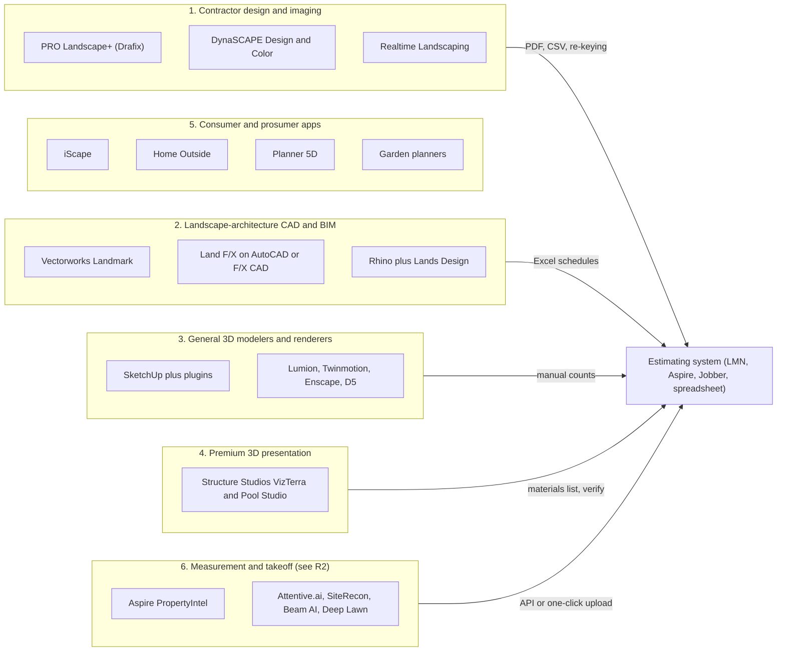
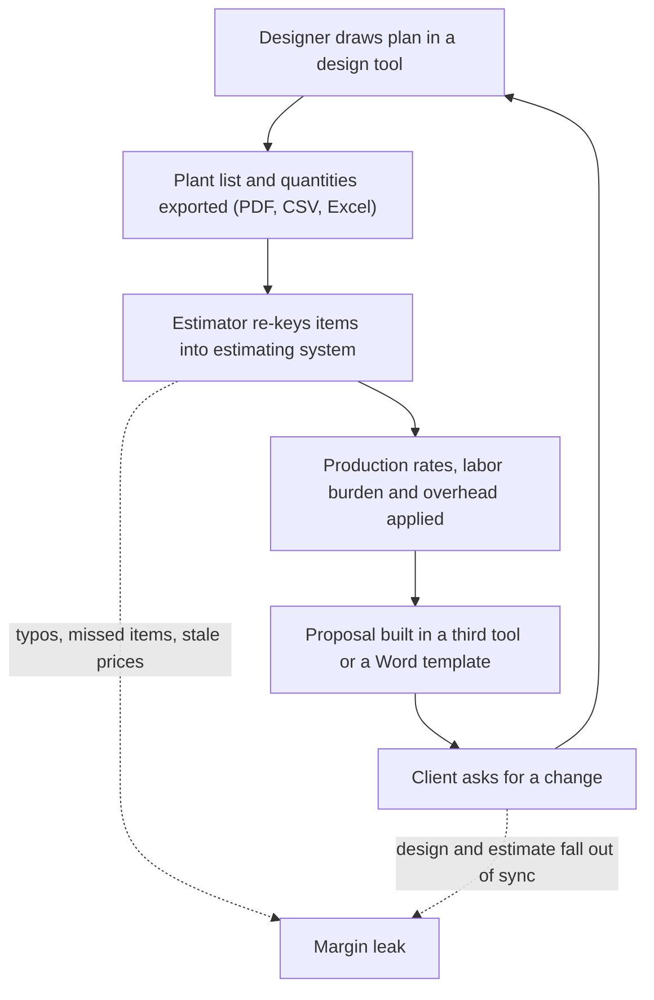
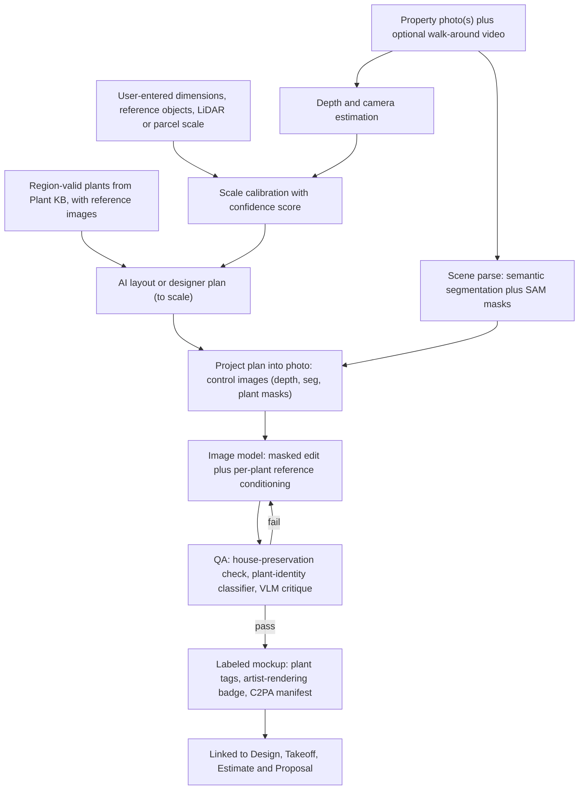
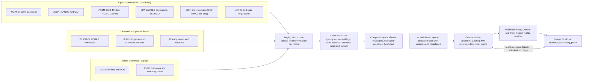
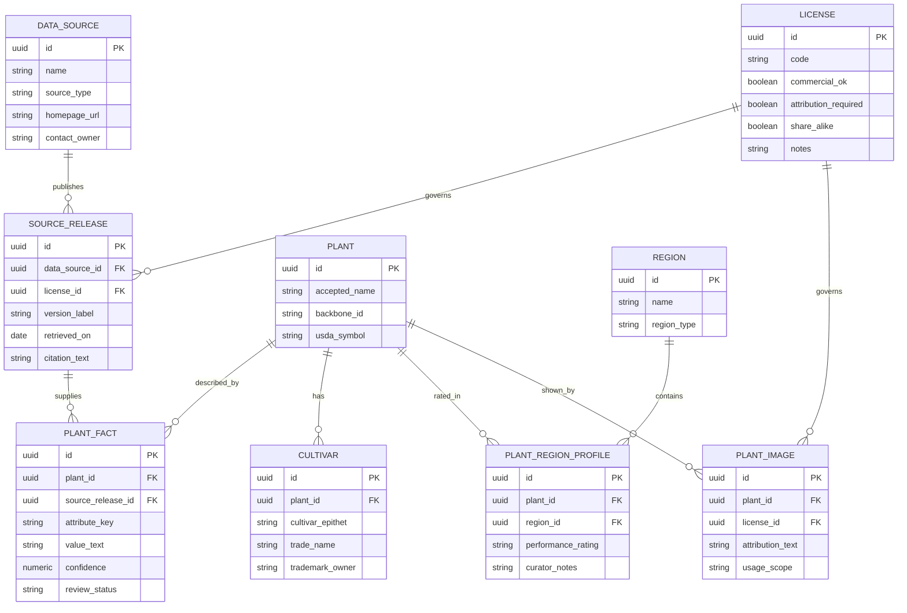
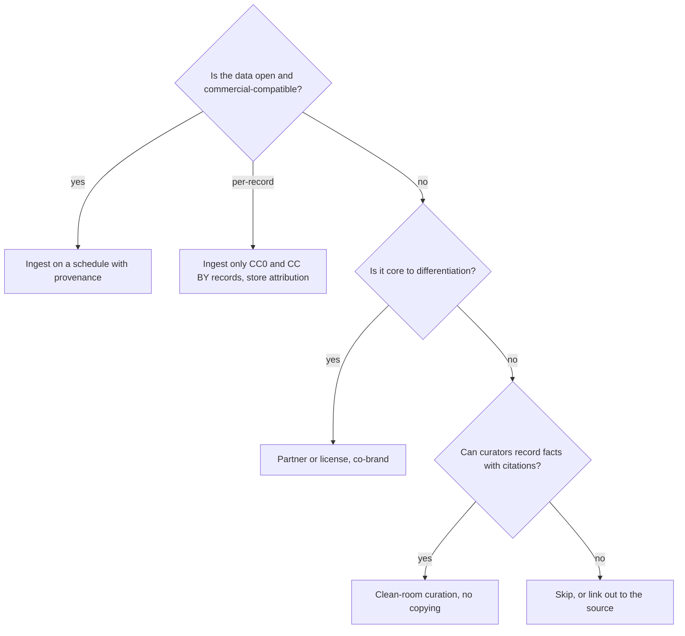

# R3 - Landscape design tools, AI mockup tech, and plant data sources

> Raw research behind three of Rootline's differentiators: the to-scale **Design Studio** ([10](../10-design-studio.md)), **AI photo mockups and dimension-aware AI layouts** ([11](../11-ai-design-mockups.md)), and the operator-curated, region-aware **Plant Knowledge Base** ([12](../12-plant-knowledge-base.md)). Part A profiles the landscape design software contractors use today (PRO Landscape+, DynaSCAPE, Vectorworks Landmark, Land F/X, SketchUp and its plugins, Realtime Landscaping, Structure Studios, iScape, Home Outside, Planner 5D, garden planners and a few adjacent tools) and asks how each connects, or fails to connect, to estimating. Part B covers consumer and pro AI yard-visualization apps and the technology underneath them: image editing and inpainting models, segmentation, monocular depth, Gaussian splatting, iPhone LiDAR capture and aerial measurement, with failure modes and costs per image. Part C profiles more than 40 plant data sources (taxonomy, distribution, climate, ecoregions, horticultural traits, water use, wildlife value, invasiveness, toxicity and nursery availability). For each it records content, coverage, API availability and, most importantly, **license terms for commercial reuse**. The report ends with consolidated lessons and a prioritized build-versus-license recommendation.

| Field | Value |
|---|---|
| Report | R3 - Landscape design tools, AI mockup tech, and plant data sources |
| Date | 2026-11-07 |
| Status | Research input, not a spec. Every material fact carries an evidence tag (section 0). |
| Primary consumers | [10 Design Studio](../10-design-studio.md), [11 AI design and mockups](../11-ai-design-mockups.md), [12 Plant Knowledge Base](../12-plant-knowledge-base.md), [13 Operations and inventory](../13-operations-inventory-equipment.md), [17 AI copilot](../17-ai-copilot-automation.md), [19 Platform admin](../19-platform-admin-portal.md), [20 Architecture](../20-architecture-security.md), [22 Pricing and GTM](../22-business-model-pricing-gtm.md), [24 Roadmap](../24-roadmap-feature-catalog.md) |
| Sibling reports | [R1 Field-service platforms](R1-field-service-platforms.md), [R2 Landscape-specific platforms](R2-landscape-specific-platforms.md), [R4 Industry, payments and accounting](R4-industry-payments-accounting.md) |

---

## 0. How to read this report: evidence levels and limitations

This report uses the same evidence tags as [R2](R2-landscape-specific-platforms.md):

| Tag | Meaning | How to use it |
|---|---|---|
| **[S]** | Sourced in this research run from a primary or credible source (vendor page, help center, trade press, paper, app-store listing, review site), linked inline. In this report almost every [S] fact was retrieved by a sibling agent in the same run and is re-cited with that agent's exact link. | Safe to quote with the link. Prices still carry "as of Nov 2026, verify". |
| **[S3P]** | Sourced in this run, but only from third-party aggregators, affiliate roundups or competitor-written pages. | Directional only. Quote ranges and say "verify". |
| **[B]** | Analyst background knowledge of public vendor materials, documentation, licenses, papers and trade press up to mid-2026, **not re-verified in this run**. | A well-founded hypothesis. Verify before using it in contracts, investor material or ingestion code (checklist in section 7). |
| **[E]** | Analyst estimate, inference or worked illustration. | Labeled as an estimate, with the reasoning shown. |

**Research limitations (read this first).**

- This report was started after the run-wide web-search budget (200 searches shared by every agent) was used up, so **every search this report attempted was refused**. Direct fetches of vendor domains (for example prolandscape.com and dynascape.com) also failed DNS resolution under the session's network allowlist. In other words, this run **could not open any new page**.
- To compensate, the report (1) re-cites the design-tool and AI-app evidence that sibling agents had already retrieved for [10](../10-design-studio.md) and [11](../11-ai-design-mockups.md) (tagged [S] or [S3P]), and (2) draws on the analyst's background knowledge for everything else (tagged [B]). Part C, the plant data sources, is almost entirely **[B]**. Its license summaries are the analyst's understanding of each provider's published terms as of mid-2026. **They are not legal advice and must be confirmed by counsel against each provider's current terms before any ingestion.** Section 4.9 explains the framework, and section 7 is a verification checklist.
- No statistic in this report is invented. Where the analyst remembers a figure but is not certain of it (record counts, list prices), the report gives a range or says "unverified" rather than a precise number. Vendor-reported numbers are labeled "vendor claim".
- The sources list at the end has two parts: links retrieved in this run (via siblings), and canonical primary references the analyst knows exist but did not open in this run. They are kept apart so nobody mistakes the second group for verified evidence.

---

## 1. Executive summary

1. **Landscape design software is a mature, fragmented, desktop-era category with no money loop.** Contractors choose among photo-imaging-plus-CAD tools aimed at design-build firms (PRO Landscape+, DynaSCAPE, Realtime Landscaping), professional landscape-architecture CAD (Vectorworks Landmark, Land F/X on AutoCAD), general 3D modelers with plugins (SketchUp, Rhino with Lands Design), premium 3D presentation tools (Structure Studios VizTerra and Pool Studio), and consumer apps (iScape, Planner 5D, garden planners) [S/B]. **None of them owns the client, the price book, the schedule or the invoice.** Takeoffs leave the design tool as a PDF, CSV or Excel schedule and are re-keyed into LMN, Aspire, Jobber or a spreadsheet [S/B]. On Capterra's landscape software pricing guide, "Landscape Design" is among the lowest-rated features in the category at 2.9 ([Capterra](https://www.capterra.com/landscape-software/pricing-guide/)) [S].
2. **The closest anyone gets to a closed loop is measurement, not design.** Aspire's PropertyIntel (built from Go iLawn and LandOne), LMN's Attentive.ai and Beam AI partnerships, Jobber's Deep Lawn integration and Arborgold's measuring tool push measured quantities into estimates ([10](../10-design-studio.md) section 2.1; [R2](R2-landscape-specific-platforms.md)) [S]. They measure what exists. None of them designs what will exist with a plant database.
3. **Plant libraries are where the design incumbents are weakest.** PRO Landscape+ reviewers ask for "more native plants suited to their climate zone" ([Capterra UK](https://www.capterra.co.uk/software/126135/pro-landscape)) [S]. Pro CAD tools ship large but generic plant databases whose regional suitability is up to the designer [B]. **No design tool we know of rates plants per region, as distinct from per hardiness zone, and validates a design against that rating in real time.**
4. **AI moved fast in 2025-2026, and the incumbents bolted it on.** PRO Landscape+ added an AI Outdoor Living Designer, AI Paver Tool, AI Eraser, AI Cutout Tool and an "Ask Wayne" assistant ([Green Industry Pros](https://www.greenindustrypros.com/business-management/software/product/22961404/pro-landscape-pro-landscape-launches-aibased-designer-suite); [Lawn and Landscape](https://www.lawnandlandscape.com/pro-landscape-plus-releases-ai-outdoor-living-designer)) [S]. Vectorworks and SketchUp shipped generative "AI visualizer" render features [B]. Dozens of consumer apps (Neighborbrite, Gendo, Rendair, Renovate AI, Visualizee, Hadaa, Yard Studio, ReimagineHome, Paintit.ai, HomeDesigns AI and others) restyle a yard photo in seconds ([Genroom roundup](https://genroom.io/blog/best-ai-landscape-design-apps-2026); [Fast.io roundup](https://www.fast.io/resources/best-ai-for-landscape-design-2026.md)) [S3P/B].
5. **Every AI yard tool shares the same three failure modes:** (a) it invents or mislabels plants, often ones that cannot survive the site's zone; (b) its output is not to scale and cannot be built or priced; (c) it is disconnected from the business that has to sell and install the work. Penn State Extension found that one leading app could not recognize most plants in its test redesign ([Penn State Extension](https://extension.psu.edu/ai-garden-design-intelligent-choices)) [S]. Roundups disclaim outputs as "conceptual only" ([Fast.io](https://www.fast.io/resources/best-ai-for-landscape-design-2026.md)) [S3P].
6. **The underlying models are now cheap, good at instruction-following edits, and interchangeable.** Gemini 2.5 Flash Image costs about $0.039 per image, Gemini 3 Pro Image about $0.134 to $0.24, and FLUX.1 Kontext [pro]/[max] about $0.04/$0.08 ([BenchLM](https://benchlm.ai/media-pricing/nano-banana); [BFL help](https://help.bfl.ai/articles/7424166364-wip-welcome-to-the-forest); as of 2026, verify) [S3P]. OpenAI's image models span roughly $0.01 to $0.17 per square image depending on quality tier [B]. Self-hosted SDXL or Qwen-Image pipelines cost fractions of a cent in GPU time [E]. **Image generation is not the moat. The moat is the constraints fed into the model:** the measured plan, the region-valid plant list, per-plant reference images and the price book.
7. **Open-weights licensing is a trap for a commercial SaaS.** FLUX.1 [dev], FLUX.1 Kontext [dev] and the FLUX.1 Tools [dev] variants ship under a non-commercial license (commercial use needs a separate BFL license). Depth Anything V2's Base, Large and Giant checkpoints are CC BY-NC 4.0. Several 2025 Chinese releases carry regional exclusions. By contrast SAM and SAM 2, IP-Adapter, ControlNet code and the Qwen-Image family are Apache 2.0, and SDXL is OpenRAIL++-M [B]. Rootline needs a model-license register reviewed by counsel, owned by `platform_engineer` ([19](../19-platform-admin-portal.md)).
8. **Capture technology is good enough for "measure once, design forever".** USGS 3DEP 1 m lidar DEMs, USDA NAIP imagery, open building footprints and parcel APIs (Regrid) give a free or cheap site model for most US properties [S/B]. Commercial aerial (Nearmap, EagleView, Vexcel) adds 5 to 10 cm imagery for a fee [B]. Phone LiDAR is accurate at short range but only about 5 m deep, and Apple's RoomPlan is built for **indoor rooms, not yards** [B]. Gaussian splatting from a 60 to 120 second phone video is the most promising path to photoreal 3D walkthroughs, but needs scale registration to be measurable [B/E].
9. **The plant data landscape splits cleanly into "open and reusable" and "excellent but locked".** Public-domain or open data covers taxonomy (WCVP/POWO, WFO), US native status and distribution (USDA PLANTS), Canadian status (VASCAN), climate (2023 USDA Plant Hardiness Zone Map, NRCan zones, NOAA normals), ecoregions (EPA and CEC), soils (SSURGO) and occurrences (GBIF, iNaturalist, filtered by record-level license) [B]. The **horticultural judgment** a landscaper actually needs (garden performance, mature size in cultivation, deer resistance, maintenance, cultivar differences, design use) lives in copyrighted references: Missouri Botanical Garden Plant Finder, NC State Extension Gardener Plant Toolbox, Lady Bird Johnson Wildflower Center, Calscape, WUCOLS, NWF, Audubon, BONAP. None of them offers a public commercial API, and all need permission or a license for systematic reuse [B].
10. **Cultivars are the biggest data gap.** Landscapers specify *Hydrangea paniculata* 'Limelight' or *Buxus* 'Green Velvet', not the species. Taxonomic backbones stop at species and infraspecific taxa. Cultivar and trademark data (for example 'Bobo', 'Little Lime', Endless Summer, Proven Winners and First Editions series) lives in grower catalogs and brand programs with their own copyrights and trademarks [B]. **Rootline's curated cultivar layer, linked to nursery availability, is the defensible asset**, and it has to be built by `platform_curator` staff with grower partnerships, not scraped.
11. **Nursery availability is still emailed spreadsheets.** Distributors such as SiteOne integrate with landscape software only through partnerships (LMN's SiteOne ordering) ([Turf Magazine](https://turfmagazine.com/lmn-integrates-siteone-landscape-supply-in-2021-software/)) [S]. Local wholesale nurseries publish weekly PDF or Excel availability lists ([13](../13-operations-inventory-equipment.md) section 2) [S/B]. A parser that maps any availability list to Plant KB records is a real moat and a network effect: every tenant upload enriches regional availability signals.
12. **Recommendation in one line:** build the Plant KB on open backbones (WCVP or WFO, USDA PLANTS, VASCAN, PHZM 2023, EPA and CEC ecoregions, SSURGO, GBIF CC0/CC BY records); **license or partner** for horticultural depth (a botanical-garden or extension partnership, WUCOLS for water use in the West, regional trial programs) and imagery; **curate in-house** what makes the product unique (cultivars, Plant Region Profiles, palettes, render-reference images, availability mapping). Never scrape the locked sources (sections 5.3 and 6).

---

## 2. Part A: Landscape design software

### 2.1 Market map

Landscape design tools sort into six clusters by who uses them and what they output. Design-build contractors, the core Rootline buyer, mostly live in clusters 1 and 3, and sometimes 4.

The arrows tell the story. Only cluster 6 has a direct path into an estimating system, and cluster 6 does not design.

### 2.2 Product profiles

#### 2.2.1 PRO Landscape+ (Drafix Software)

- **What it is.** The long-standing design tool for design-build contractors. Its signature is **photo imaging**: drag plant and hardscape images onto a client's house photo, plus 2D CAD site plans, 3D rendering, night and holiday lighting imaging, proposals, material takeoffs, a plant library and a mobile companion app ([Capterra](https://www.capterra.com/p/126135/PRO-Landscape/); [GetApp](https://www.getapp.com/all-software/a/pro-landscape/)) [S]. A homeowner edition has existed alongside the pro product [B].
- **Price.** About $90 per month or $900 per year for PRO Landscape+ (as of Nov 2026, verify) [S]. Older versions were sold as perpetual licenses [B].
- **AI (2025).** AI Outdoor Living Designer (start from a customer photo, define the project area, generate concepts), AI Paver Tool, AI Eraser (remove existing landscaping), AI Cutout Tool and the "Ask Wayne" help assistant ([Green Industry Pros](https://www.greenindustrypros.com/business-management/software/product/22961404/pro-landscape-pro-landscape-launches-aibased-designer-suite); [Green Industry Pros, AI upgrade](https://www.greenindustrypros.com/design-installation/design/product/22945469/pro-landscape-pro-landscape-upgrades-design-software-with-ai); [Lawn and Landscape](https://www.lawnandlandscape.com/news/pro-landscape-updates-design-software-with-artificial-intelligence); [Turf Magazine](https://turfmagazine.com/ai-meets-design-prolandscape-unveils-next-gen-tools)) [S]. A 2026 roundup describes its AI stylist as applying styles to masked regions of the photo ([Fast.io](https://www.fast.io/resources/best-ai-for-landscape-design-2026.md)) [S3P].
- **Connection to estimating.** Inside the tool, objects placed in the design can generate a priced proposal from the user's own price list [B]. That proposal lives in PRO Landscape, not in the business system: client records, deposits, scheduling and invoicing are elsewhere, and quantities must be re-keyed or exported [B].
- **Complaints.** Reviewers want "more native plants suited to their climate zone" and find plant symbols hard to tell apart ([Capterra UK](https://www.capterra.co.uk/software/126135/pro-landscape); [Software Advice](https://www.softwareadvice.com/landscaping/pro-landscape-profile)). One says it is "meant for someone not a beginner at design" ([Capterra reviews](https://www.capterra.com/p/126135/PRO-Landscape/reviews/)) [S]. Ratings rest on small samples, around 3.6 to 3.7 from 8 or 9 reviews at the time of the sibling search [S].
- **Learning curve.** Moderate. Photo imaging is quick to learn; CAD and proposal setup take training [B].
- **Read for Rootline.** PRO Landscape proves contractors pay roughly $900 per year for "picture plus plan plus proposal". It is the closest incumbent to [11](../11-ai-design-mockups.md) and the clearest proof that photo imaging sells jobs. Rootline beats it on regional plants and the closed money loop, not on raw imaging features.

#### 2.2.2 DynaSCAPE (Design, Color, Sketch3D, Manage)

- **What it is.** A Canadian landscape design suite with a large following among design-build firms and horticulture colleges [B]. **DynaSCAPE Design** is a landscape-specific CAD whose output looks **hand-drawn**: textured plant symbols, organic linework and lettering that clients read as "designed", not "engineered" [B]. **DynaSCAPE Color** adds marker-style color rendering of the plan [B]. A 3D product (Sketch3D) and a cloud business tool (**DynaSCAPE Manage**, for CRM, estimating and job costing) have also been marketed. The current status and packaging of Manage could not be verified in this run [B].
- **Price.** Not verified in this run. Historically a subscription priced in the low hundreds of dollars per month or equivalent annual fees [B, unverified].
- **Connection to estimating.** Historically the strongest link of any design tool: quantities from Design could be pushed into Manage estimates [B]. For contractors running LMN, Aspire or Jobber, DynaSCAPE output is still a plant list and a PDF [B].
- **Complaints.** Windows-centric, CAD-style learning curve, and a plant library that has to be maintained per region by the user [B].
- **Read for Rootline.** The **hand-drawn aesthetic is a selling feature in its own right.** Rootline's Design Studio should offer a "presentation style" renderer (sketchy linework, watercolor fills, hand-lettered labels) as a theme, not a separate product ([10](../10-design-studio.md)).

#### 2.2.3 Vectorworks Landmark (Nemetschek Group)

- **What it is.** Full landscape-architecture CAD and BIM on Mac and Windows: site modeling (DTM, grading, cut and fill), plant objects linked to a plant database, landscape areas (mixed plantings by density), hardscape, an irrigation design toolset, existing-tree inventory, worksheets and schedules, IFC/BIM interoperability and a renderer [B]. Landmark auto-generates schedules, including plant lists, irrigation plans and existing-tree reports ([Vectorworks help](https://app-help.vectorworks.net/2015/NNA/eng/VW2015_Guide/Worksheets/Creating_Schedules_Automatically.htm)) [S]. A review describes an extensive plant database covering thousands of species ([Dyverse](https://avaria.dyverse.com/best-landscape-architecture-software-expert-reviews-comparisons-2024)) [S3P]. Vectorworks has added a cloud-based generative "AI Visualizer" for concept images [B].
- **Price.** Annual subscription in the low thousands of dollars per seat. The analyst's recollection is roughly $3,000 per year in the US list price in 2024-2025 (verify) [B].
- **Connection to estimating.** Worksheets compute quantities and can carry cost fields, but there is no link to a contractor's price book, CRM or invoicing [B]. Exports go out as CSV or Excel.
- **Learning curve.** Steep. It is a professional CAD and BIM package; most design-build contractors under 50 people do not have a trained operator [B].
- **Read for Rootline.** Landmark sets the bar for **site modeling and plant objects with data**. Rootline should match its landscape-area concept (fill a bed with a mix of species at a density) and its schedules, and interoperate through DWG/DXF and IFC export for landscape architects ([10](../10-design-studio.md)).

#### 2.2.4 Land F/X (on AutoCAD or F/X CAD)

- **What it is.** A plugin suite for AutoCAD, used mainly by US landscape architects: **Planting F/X** (plant placement, automated plant schedules sortable by botanical or common name), **Irrigation F/X** (hydraulics, schedules, including equipment not yet placed, and watering schedules), **Site/Details F/X** and lighting tools ([Land F/X planting schedules](https://www.landfx.com/docs/planting/schedules.html); [irrigation schedules](https://www.landfx.com/index.php/docs/irrigation/schedules-and-reports/196-irrigation-schedules-and-reports.html); [watering schedule](https://www.landfx.com/docs/irrigation/schedules-and-reports/1545-watering-schedule.html); [irrigation features](https://www.landfx.com/irrigationfeatures)) [S]. Land F/X also sells its own CAD platform (F/X CAD) as an alternative to AutoCAD [B]. A third-party summary says its 3D visualization trails dedicated tools ([FitGap](https://us.fitgap.com/products/land-f-x)) [S3P].
- **Price.** Per-seat subscription per module, on top of an AutoCAD subscription (AutoCAD list is roughly $2,000 per year; verify) unless the firm uses F/X CAD [B, unverified].
- **Connection to estimating.** Schedules export to Excel. Land F/X has no business pricing, CRM or job costing [B].
- **Learning curve.** Very steep for contractors: AutoCAD skills plus the plugin [B].
- **Read for Rootline.** Land F/X is the benchmark for **irrigation design rigor** and for schedule output that architects and municipal reviewers accept. Rootline's irrigation layer ([10](../10-design-studio.md)) should produce schedules a Land F/X user would recognize.

#### 2.2.5 SketchUp plus plugins (Trimble)

- **What it is.** A general-purpose 3D modeler widely used by design-build landscapers for hardscape, outdoor kitchens, pergolas and grading massing [B]. Subscription tiers (Go, Pro, Studio) run from roughly $120 to $750 per year (verify) [B]. Landscape work depends on plugins [B]:
  - **Vegetation and scattering**: Skatter (scatter plants and groundcovers), Laubwerk (parametric plants with age and season), 3D Warehouse plant models.
  - **Terrain**: the built-in Sandbox tools, Artisan and similar organic modelers; PlaceMaker for importing aerial imagery, terrain and context buildings.
  - **Quantities**: Profile Builder and Quantifier-type plugins for paver area, wall face area, linear edging and counts.
  - **Rendering**: Enscape, V-Ray, D5 Render, Lumion LiveSync and Twinmotion; Trimble also shipped **SketchUp Diffusion**, a generative AI render feature.
- **Connection to estimating.** Only through quantity plugins and manual export. No plant data beyond what the model carries [B].
- **Learning curve.** Moderate for modeling, steep for photoreal output. Results depend heavily on the operator [B].
- **Read for Rootline.** Design-build firms love SketchUp for **hardscape in 3D** (patio steps, seat walls, fire features). Rootline's Design Studio needs a credible hardscape 3D extrusion (walls, steps, raised beds, pergola primitives) and SKP/DAE/glTF export, so firms can keep SketchUp for custom structures while the plan, plants and pricing live in Rootline ([10](../10-design-studio.md)).

#### 2.2.6 Realtime Landscaping (Idea Spectrum)

- **What it is.** Windows design software with tiers named Plus, Pro, Architect and Photo, aimed at contractors and homeowners. It offers 3D walkthroughs, pools and decks, plant growth over time, night lighting, CAD-style plans in Architect, and a large plant and object library [B].
- **Price.** Historically perpetual licenses: about $100 for Plus, about $300 for Pro and about $400 for Architect (verify current prices and licensing) [B].
- **Connection to estimating.** Plant and material lists only; no business-system integration found [B].
- **Learning curve.** Low to moderate; it is popular with small contractors for exactly that reason [B].
- **Read for Rootline.** Its **growth slider** (see the design at install, year 3 and year 10) is a cheap feature with enormous sales value. Rootline should have it in both 2D plan symbols and AI mockups ([10](../10-design-studio.md), [11](../11-ai-design-mockups.md)).

#### 2.2.7 Structure Studios (VizTerra, Pool Studio)

- **What it is.** Premium 3D design and presentation software for pool builders (Pool Studio) and outdoor-living and landscape contractors (VizTerra). Known for cinematic 3D flyover videos, VR and phone presentations, and construction plan output [B]. The target is high-ticket projects ($75k and up) where the presentation closes the deal [B/E].
- **Price.** Demo-led subscription pricing, not published (as of Nov 2026, verify) [B].
- **Connection to estimating.** Materials and construction plans are produced, but no evidence was found of a native link to landscape business software [B].
- **Learning curve.** Moderate; the vendor sells training and design-service options [B].
- **Read for Rootline.** The pool-and-outdoor-living segment buys **emotion**: walkthroughs, sunsets and water features. Rootline's [V2]/[V3] 3D walkthroughs and Gaussian-splat site capture ([11](../11-ai-design-mockups.md) AIM-GEN-F) target this buyer.

#### 2.2.8 iScape

- **What it is.** A mobile AR and photo-based yard design app for homeowners and contractors. Users place plants and hardscape objects on a photo or in live AR [S].
- **Price.** Pro tier around $29.99 per month (as of 2026, verify) ([AI Tools Bakery](https://aitoolsbakery.com/blog/iscape-review/); [TapSmart](https://www.tapsmart.com/apps/iscape-review/)) [S3P].
- **Complaints.** Crashes in AR mode on complex designs and an aggressive paywall ([AI Tools Bakery](https://aitoolsbakery.com/blog/iscape-review/)) [S3P].
- **Connection to estimating.** None found beyond simple quote output [B].
- **Read for Rootline.** Phone AR is an engagement feature, not a production tool. Keep on-device AR light (plant preview at mature size) and do heavy rendering server-side ([11](../11-ai-design-mockups.md)).

#### 2.2.9 Home Outside

- **What it is.** An online landscape design service from landscape architect Julie Moir Messervy's studio, paired with an iPad drawing app (Home Outside Palette) that uses a soft, illustrated style [B]. Homeowners buy design packages; designers work remotely from photos and measurements [B].
- **Price.** Package-based; not verified in this run [B].
- **Read for Rootline.** Along with Yardzen (section 3.1), it shows **homeowners pay for remote design from photos and measurements**. Rootline's lead-magnet mockup widget and "design deposit" flow ([11](../11-ai-design-mockups.md), [16](../16-marketing-growth-communications.md)) let a local Company capture that spend instead of a national design service.

#### 2.2.10 Planner 5D and consumer home-design apps

- **What it is.** Planner 5D is a freemium, mainly interior home-design app with exterior objects, 3D views and AI features such as automatic floor-plan recognition and design generation [B]. Similar apps include Homestyler and other room planners.
- **Read for Rootline.** These apps set the **consumer UX bar** for drag-and-drop simplicity and instant 3D. They are not to-scale landscape tools and have no regional plant intelligence [B].

#### 2.2.11 Garden planner apps

- **What they are.** Vegetable and small-garden planners (GrowVeg / Growing Interactive Garden Planner, Gardena myGarden, VegPlotter and others), plant-ID and care apps (PictureThis, Garden Answers, Planta), and garden journals (Gardenize) [B]. Planners use square-foot grids and frost-date calendars. ID apps combine computer vision with care reminders, usually by subscription [B].
- **Read for Rootline.** Two ideas worth taking for the client portal ([06](../06-customer-portal.md)): **frost-date-driven reminders** (localized "cover your new plantings tonight" alerts) and **plant ID from a photo** to build an inventory of the client's existing plants during a site assessment ([03](../03-crm-sales-estimating-proposals.md)).

#### 2.2.12 Adjacent tools worth knowing

| Tool | Notes | Relevance |
|---|---|---|
| **Rhino plus Lands Design (Asuni)** | BIM-style landscape plugin for Rhino with a plant database, growth simulation, terrain and documentation [B]. Popular in Europe and with parametric designers. | Shows the "plant object carries data and grows" model. |
| **Lumion, Twinmotion, Enscape, D5 Render** | Real-time renderers with large vegetation libraries, fed from SketchUp, Revit, Rhino or Vectorworks [B]. Twinmotion licensing became free for smaller businesses (under about $1M revenue) in 2024 (verify) [B]. | Set the quality expectation for 3D stills and video. Rootline's [V2] 3D should export glTF so designers can render elsewhere. |
| **AutoCAD Civil 3D** | Grading and drainage for civil engineers [B]. | Rootline does not compete; accept DWG/DXF underlays ([10](../10-design-studio.md) DS-SITE-08). |
| **Measurement and takeoff tools** | Aspire PropertyIntel, Go iLawn, Attentive.ai, SiteRecon, Beam AI, Deep Lawn ([10](../10-design-studio.md); [R2](R2-landscape-specific-platforms.md)) [S]. | Benchmark for AI auto-trace and takeoff speed. |

### 2.3 Comparison table (as of Nov 2026, verify every price)

| Product | Platform | Primary user | 2D plan | 3D | Photo imaging | AI features | Plant database and regional depth | Price signal | Learning curve |
|---|---|---|---|---|---|---|---|---|---|
| PRO Landscape+ | Windows desktop plus mobile companion [B] | Design-build contractors | Yes [S] | Yes [S] | Yes, signature [S] | Yes, 2025 suite [S] | Large image library; regional native depth criticized [S] | About $90/mo or $900/yr [S] | Moderate [S] |
| DynaSCAPE Design and Color | Windows [B] | Design-build firms, colleges | Yes, hand-drawn style [B] | Separate product [B] | Limited [B] | Not verified | User-maintained [B] | Unverified | Moderate to steep [B] |
| Vectorworks Landmark | Mac and Windows [B] | Landscape architects, larger design-build | Yes [S] | Yes [B] | Via renders [B] | AI Visualizer [B] | Thousands of species; generic [S3P] | About $3k/seat/yr (verify) [B] | Steep [B] |
| Land F/X | AutoCAD or F/X CAD [B] | Landscape architects | Yes [S] | Limited [S3P] | No [B] | Not verified | Large database; generic [B] | Module subscriptions plus CAD [B] | Very steep [B] |
| SketchUp plus plugins | Mac, Windows, web [B] | Design-build, hardscape | Via LayOut [B] | Yes, core strength [B] | Via renderers [B] | SketchUp Diffusion [B] | Via plugins and models [B] | About $120-750/yr plus plugins [B] | Moderate, steep for photoreal [B] |
| Realtime Landscaping | Windows [B] | Small contractors, homeowners | Architect tier [B] | Yes [B] | Photo tier [B] | Not verified | Large generic library [B] | About $100-400 perpetual (verify) [B] | Low to moderate [B] |
| Structure Studios | Windows plus cloud presentation [B] | Pool and outdoor-living builders | Yes [B] | Yes, cinematic [B] | Yes [B] | Not verified | Limited [B] | Demo-led, unpublished [B] | Moderate [B] |
| iScape | iOS, Android [S] | Homeowners, small contractors | Basic [B] | AR [S] | Yes [S] | Not verified | Generic [B] | About $29.99/mo Pro [S3P] | Low [S3P] |
| Home Outside | iPad plus service [B] | Homeowners | Illustrated [B] | No [B] | No [B] | Not verified | Designer-chosen [B] | Packages [B] | Low [B] |
| Planner 5D | Web, mobile [B] | Homeowners | Yes [B] | Yes [B] | No [B] | Yes [B] | Minimal [B] | Freemium [B] | Low [B] |
| **Rootline target** | Web, iPad, phone | All tenant roles plus clients | Yes [MVP] | Yes [V1] | AI mockups [MVP] | Layout, restyle, chat [MVP]/[V1] | **Operator-curated Region profiles** [MVP] | Included in tiers ([22](../22-business-model-pricing-gtm.md)) | Two modes: estimator and designer |

### 2.4 How designs connect to estimating (and where they break)

The core finding of Part A: **every design tool produces quantities, and almost none delivers them to the system that prices, sells, schedules and bills the work.**

| Product | What leaves the design | How it reaches the estimate | Breakage |
|---|---|---|---|
| PRO Landscape+ | Plant and material lists, internal proposal [S/B] | Proposal generated inside the tool; quantities re-keyed into the business system [B] | Two price lists (design tool and business system) drift apart; the client record is duplicated |
| DynaSCAPE | Quantities [B] | Historically into DynaSCAPE Manage; otherwise CSV or PDF [B] | Works only if the firm also runs Manage |
| Vectorworks Landmark | Worksheets and schedules [S] | Excel export [B] | No production rates, labor or overhead; an estimator rebuilds the estimate |
| Land F/X | Plant, irrigation and watering schedules [S] | Excel export [B] | Same as Vectorworks; often a different company (the landscape architect) than the installer |
| SketchUp | Model geometry; plugin quantity reports [B] | Manual or CSV [B] | Counts depend on modeling discipline; plants often not modeled as data |
| Realtime | Plant and material lists [B] | Manual [B] | Same as above |
| Structure Studios | Plans, materials [B] | Manual [B] | Same as above |
| Aspire PropertyIntel | Measured takeoff [S] | One-click upload into Aspire [S] | Measures existing conditions; it is not a planting design |
| LMN with Attentive.ai or Beam AI | Measured takeoff [S] | Integration into LMN estimates [S] | Same as above |

Errors reported at this seam include mismatched paver counts, wrong wall heights and irrigation head-spacing mistakes ([JackMacBiz, 2026](https://jackmacbiz.github.io/blog/2026-06-13-why-your-current-landscape-design-app-is-wasting-8-hours-per/); single anecdotal source) [S]. Jobber's own documented fallback for measuring is tracing in Google Maps and pasting the area into a custom field ([Jobber help](https://help.getjobber.com/es/articles/how-to-measure-property-distance-and-size/)) [S], and Jobber users ask in the vendor community for separate design software and training ([Jobber community](https://community.getjobber.com/discussions/operations-forum/looking-for-landscape-design-software--training/8084)) [S].

### 2.5 Complaint themes across design tools

| Theme | Evidence | Rootline answer |
|---|---|---|
| Plant libraries ignore region | "More native plants suited to their climate zone" ([Capterra UK](https://www.capterra.co.uk/software/126135/pro-landscape)) [S] | Region-curated KB with live validation ([12](../12-plant-knowledge-base.md)) |
| Steep learning curve | "Meant for someone not a beginner" ([Capterra](https://www.capterra.com/p/126135/PRO-Landscape/reviews/)); trade press advises budgeting for onboarding ([Green Industry Pros](https://www.greenindustrypros.com/22738198)) [S] | Estimator mode (trace and price) separate from designer mode ([10](../10-design-studio.md)) |
| Tools feel dated | A gardening-forum user says design software has "taken a huge step backwards" ([garden.org](https://garden.org/thread/view/132802/software/)) [S] | Modern web canvas, multiplayer, iPad |
| Symbol and output quality | Hard-to-distinguish plant symbols ([Software Advice](https://www.softwareadvice.com/landscaping/pro-landscape-profile)) [S]; weaker 3D in pro CAD ([FitGap](https://us.fitgap.com/products/land-f-x)) [S3P] | Symbol styles generated from plant form and color; hand-drawn presentation theme |
| Double entry into business software | Re-keying errors ([JackMacBiz](https://jackmacbiz.github.io/blog/2026-06-13-why-your-current-landscape-design-app-is-wasting-8-hours-per/)) [S] | Takeoff is a live view of the plan, priced against the Price Book |
| Desktop and Windows lock-in | Most contractor tools are Windows desktop software [B] | Browser and iPad, offline-capable |
| Mobile AR instability | iScape crash complaints [S3P] | Server-side rendering; light AR only |

### 2.6 Lessons from Part A

1. **Sell the closed loop, not the canvas.** Feature parity with PRO Landscape+ or DynaSCAPE on drawing tools is necessary but not sufficient. Rootline wins when "drop 14 'Limelight' hydrangeas" updates the proposal total and the purchase order ([10](../10-design-studio.md) section 2.4).
2. **Offer two skins on one engine.** A 15-minute "trace and price" estimator mode for mulch, sod and cleanups, and a full designer mode with layers, schedules and plan sets.
3. **Ship a hand-drawn presentation style.** DynaSCAPE's aesthetic proves clients respond to warmth. It is a renderer theme, cheap to build relative to its sales value [E].
4. **Growth slider and seasons from day one** (Realtime, Laubwerk). Plants are sized to mature spread from the KB and shown at install size, year 3 and maturity.
5. **Interoperate with the professionals.** Import DWG/DXF and PDF underlays; export DWG/DXF, PDF plan sets, CSV schedules and glTF/SKP. Landscape architects stay in Vectorworks or Land F/X; the contractor runs the job in Rootline.
6. **Irrigation and lighting rigor** (Land F/X, Vectorworks) is a [V1] credibility feature for design-build firms that install systems.
7. **Premium presentation** (Structure Studios) is a later-tier upsell for high-ticket outdoor living. Do not build cinematic 3D before the plan-to-estimate loop works.

> **Competitive edge: vs PRO Landscape+, DynaSCAPE and Realtime Landscaping.** These are good drawing and imaging tools that stop at the file. A contractor pays for one of them (about $900 per year for PRO Landscape+ [S]) and then re-keys the plant list into LMN, Aspire or Jobber. In Rootline the plan is the same record as the client, Price Book, proposal, purchase order and job cost, and the plant library knows the Region. The design tool's subscription goes away, and so does the re-keying error rate.

> **Competitive edge: vs Vectorworks Landmark and Land F/X.** They win on documentation depth for landscape architects, and Rootline should not try to out-CAD them. Rootline wins the 5-to-50-person design-build firm that has no trained CAD operator, needs a sellable plan in an afternoon, and wants the takeoff priced with its own production rates. For the projects where an architect is involved, Rootline imports their DWG and runs the job.

---

## 3. Part B: AI landscape and home visualization

### 3.1 Consumer and prosumer AI yard-design apps

Demand is real. In May 2026 Axios reported that a growing number of homeowners now use AI as their landscape designer, and quoted a designer saying that once people can see the redesigned yard, their attitudes change ([Axios](https://www.axios.com/local/washington-dc/2026/05/08/landscape-design-ai); [Axios, "vibe code your yard"](https://www.axios.com/local/washington-dc/2026/05/08/ai-vibecode-yard-landscape)) [S]. The supply side is a long tail of thin "upload photo, pick style" apps on top of the same few foundation models.

| App | Type | What it does | Notes and evidence |
|---|---|---|---|
| **Neighborbrite** | Consumer, web and iOS | Photo restyle by garden style, with plant suggestions; paid tier filters natives | Penn State Extension found its emphasis was on hardscape over plants and it could not recognize most plants in a vegetable-garden redesign; filtering to natives required a paid plan ([Penn State Extension](https://extension.psu.edu/ai-garden-design-intelligent-choices); [App Store](https://apps.apple.com/app/id6742585344)) [S] |
| **Gendo** | Prosumer, web | AI landscape and architecture visualization | ([Gendo](https://gendo.ai/ai-landscape-design)) [S] |
| **Rendair** | Prosumer, web | AI rendering for designers, including landscape | ([Rendair](https://rendair.ai/blog/5-ways-use-ai-landscape-designer-rendair)) [S] |
| **Renovate AI** | Consumer | Photo restyle for yards | ([Renovate AI](https://renovateai.app/ai-landscape-design)) [S] |
| **Visualizee** | Prosumer | AI renders from sketches or photos | ([Visualizee](https://visualizee.ai/blog/ai-landscape-design)) [S] |
| **Hadaa** | Consumer, Android | Garden redesign with claimed location-aware plant suggestions | ([Google Play](https://play.google.com/store/apps/details?id=app.hadaa.android)) [S] |
| **Yard Studio** | Consumer | Yard design with claimed climate awareness | ([Product Hunt](https://www.producthunt.com/p/yard-studio)) [S] |
| **ReimagineHome** | Consumer, web | Interior and exterior redesign including landscaping, virtual staging; credit or subscription pricing | [B] |
| **Paintit.ai** | Consumer, web | Interior, exterior and landscape restyle by prompt and style | [B] |
| **HomeDesigns AI** | Consumer, web | Interior, exterior and garden redesign tools; subscription | [B] |
| **Interior AI, RoomGPT and clones** | Consumer | Early ControlNet-based restyle apps; RoomGPT was open-sourced | [B] |
| **DreamzAR** | Consumer, mobile | AR plus AI garden design app (named in the brief) | App-store details not re-verified in this run [B] |
| **Yardzen** | Design service | Human designers produce remote yard designs from photos and measurements, sold as fixed-fee packages, with contractor referrals for install | AI features could not be verified in this run [B]; see [R2](R2-landscape-specific-platforms.md) |
| **Tilly, Home Outside and similar** | Design service | Remote design packages | [B] |

Common patterns across these apps [S3P/B]:

- **Input:** one photo plus a style preset ("modern", "cottage", "xeriscape", "Japanese") and sometimes a free-text prompt or a brushed mask.
- **Output:** 2 to 4 restyled images in 5 to 30 seconds, with no plan, no scale and usually no plant list. Where a plant list exists, it is generated text, not linked to the pixels.
- **Business model:** freemium credits, $10 to $30 per month subscriptions, watermarking on free tiers [B].
- **Disclaimers:** outputs are "conceptual only", not measurements or construction drawings ([Fast.io](https://www.fast.io/resources/best-ai-for-landscape-design-2026.md)) [S3P].
- **Missing:** the installer. No app hands the homeowner to a local Company with a priced, buildable proposal. That is the lead-generation gap Rootline's white-label widget fills ([11](../11-ai-design-mockups.md), [16](../16-marketing-growth-communications.md)).

### 3.2 Professional tools adding AI

| Tool | AI feature | Evidence |
|---|---|---|
| PRO Landscape+ | AI Outdoor Living Designer, AI Paver Tool, AI Eraser, AI Cutout Tool, Ask Wayne assistant | [S] (section 2.2.1) |
| Vectorworks | Cloud "AI Visualizer" for text- and image-to-image concept renders | [B] |
| SketchUp | SketchUp Diffusion (generative render of the viewport by style prompt) | [B] |
| Veras (EvolveLAB, acquired by Chaos) | AI render plugin for SketchUp, Revit, Rhino, Forma | [B] |
| D5 Render, Lumion, Enscape | AI upscaling, AI material and atmosphere tools inside real-time renderers | [B] |
| mnml.ai, LookX, PromeAI | Web AI render tools for architects, with landscape modes | [B] |
| Aerial measurement (Attentive.ai, SiteRecon, Beam AI, PropertyIntel, Deep Lawn) | Segmentation of aerial imagery into turf, beds, hardscape and features for takeoff | [S] ([R2](R2-landscape-specific-platforms.md), [10](../10-design-studio.md)) |

The pattern: pro tools add AI as **render polish** (make my 3D viewport look photoreal) or **measurement** (trace my aerial image). Nobody uses AI to **generate a to-scale planting layout from region-valid plants and then render it faithfully**. That combination is Rootline's opening ([11](../11-ai-design-mockups.md) section 2.4).

### 3.3 Underlying technology

#### 3.3.1 Image generation and editing models

What matters for landscape mockups is not text-to-image beauty. It is **editing fidelity**: keep the house, driveway, windows and camera identical, change only the masked yard, place recognizable plants, and respect a control signal (depth, edges, segmentation or a projected plan).

| Model or family | Access | Editing capabilities relevant to yards | License for commercial SaaS use | Indicative cost per image (as of 2026, verify) |
|---|---|---|---|---|
| **Gemini 2.5 Flash Image ("Nano Banana")** | Google API (AI Studio, Vertex) | Instruction-based editing, multi-image reference composition, strong identity preservation; SynthID watermark embedded [B] | API terms; outputs usable commercially per Google terms [B] | About $0.039 per image, about $0.0195 batch ([BenchLM](https://benchlm.ai/media-pricing/nano-banana); [MyArchitectAI](https://www.myarchitectai.com/blog/nano-banana-api-pricing)) [S3P] |
| **Gemini 3.1 Flash Image ("Nano Banana 2")** | Google API | Higher resolution tiers, improved editing [S3P] | API terms [B] | About $0.045 (0.5K) to $0.151 (4K) ([BenchLM](https://benchlm.ai/media-pricing/nano-banana)) [S3P] |
| **Gemini 3 Pro Image ("Nano Banana Pro")** | Google API | Highest-quality Google tier, better text and complex scenes [B] | API terms [B] | About $0.134 (1K-2K), $0.24 (4K) ([BenchLM](https://benchlm.ai/media-pricing/nano-banana)) [S3P] |
| **Imagen family** | Google Vertex | Mask-based inpainting and outpainting in Vertex editing APIs [B] | API terms [B] | Roughly $0.02 to $0.06 per image depending on tier (verify) [B] |
| **OpenAI GPT Image models (gpt-image-1, gpt-image-1-mini, later versions)** | OpenAI API | Instruction editing with optional mask, multi-image input; C2PA metadata on outputs [B] | API terms; outputs owned by the customer per OpenAI terms [B] | Token-priced; roughly $0.01 (low), $0.04 (medium), $0.17 (high) for a 1024 x 1024 image on gpt-image-1, with the mini model much cheaper (verify) [B] |
| **FLUX.1 Kontext [pro] / [max]** | BFL API and resellers | In-context instruction editing with strong character and scene consistency [B] | API terms [B] | About $0.04 / $0.08 ([BFL help](https://help.bfl.ai/articles/7424166364-wip-welcome-to-the-forest); [Puter](https://developer.puter.com/tutorials/flux-api-pricing/); [PricePerToken](https://pricepertoken.com/flux-pricing)) [S3P] |
| **FLUX.1 Fill, Depth, Canny, Redux** | [pro] via API; [dev] open weights | Inpainting and outpainting (Fill), structure conditioning (Depth, Canny), image variation (Redux) [B] | **[dev] weights: FLUX.1 non-commercial license; commercial self-hosting needs a separate BFL license** [B] | API about $0.05 per image for Fill [pro] (verify) [B] |
| **FLUX.2 family** | API tiers plus open [dev] weights | Multi-reference editing, higher resolution; priced per megapixel ([BFL help](https://help.bfl.ai/articles/7424166364-wip-welcome-to-the-forest)) [S3P] | [dev] non-commercial; a smaller permissively licensed variant was announced (verify) [B] | Per-megapixel (verify) [S3P] |
| **SDXL plus ControlNet plus IP-Adapter** | Open weights, self-host | Mature inpainting pipelines; ControlNet for depth, segmentation, canny, MLSD lines; IP-Adapter for reference-image conditioning; LoRA for plant identity [B] | SDXL: CreativeML OpenRAIL++-M (commercial use allowed with use restrictions); ControlNet and IP-Adapter code Apache 2.0; check each ControlNet checkpoint's license [B] | Self-hosted on an L4 or A10-class GPU, roughly $0.002 to $0.01 per image in GPU time [E] |
| **Stable Diffusion 3.5** | Open weights | Text-to-image and editing via community tools [B] | Stability Community License: free commercial use below about $1M annual revenue, enterprise license above (verify) [B] | Self-host [E] |
| **Qwen-Image and Qwen-Image-Edit (Alibaba)** | Open weights | Strong instruction editing, text rendering, multi-image editing in later releases [B] | **Apache 2.0** (verify per checkpoint) [B] | Self-host, roughly $0.005 to $0.02 per image on a large GPU [E] |
| **Seedream (ByteDance), HunyuanImage (Tencent), others** | API or open weights | Competitive editing quality [B] | Seedream via API terms; HunyuanImage community license with territorial exclusions (verify) [B] | Seedream roughly $0.03 per image via resellers (verify) [B] |
| **Midjourney** | Consumer subscription | Strong aesthetics [B] | No general public API; not suitable for SaaS embedding [B] | n/a |

Key technical building blocks [B unless linked]:

- **ControlNet** ([arXiv 2302.05543](https://arxiv.org/abs/2302.05543)) conditions diffusion on depth, segmentation, edges or lines. For yards it keeps the house and hardscape geometry fixed while plants change.
- **IP-Adapter** ([arXiv 2308.06721](https://arxiv.org/abs/2308.06721)) injects a reference image's look. That is how a plant's 1 to 3 curated reference photos steer the rendering of that plant.
- **LoRA and DreamBooth** ([LoRA](https://arxiv.org/abs/2106.09685); [DreamBooth](https://arxiv.org/abs/2208.12242)) fine-tune small adapters per plant or per plant group. They are useful for look-alike shrubs (boxwood vs. holly vs. inkberry) where reference conditioning alone fails ([11](../11-ai-design-mockups.md) section 4.4).
- **Instruction editors** (Gemini image, GPT Image, Kontext, Qwen-Image-Edit) replaced many hand-built inpainting pipelines in 2025 for quick restyles. Hand-built pipelines still win where **geometry must match a plan** (plan-to-photo), because control images and masks are explicit.

#### 3.3.2 Segmentation

| Model | What it does | License | Use in Rootline |
|---|---|---|---|
| **SAM** (Meta, 2023) ([arXiv 2304.02643](https://arxiv.org/abs/2304.02643)) | Promptable masks from points or boxes | Apache 2.0 [B] | Click-to-mask a bed or lawn in a photo |
| **SAM 2** (Meta, 2024) ([arXiv 2408.00714](https://arxiv.org/abs/2408.00714)) | Images and video, with memory for tracking across frames | Apache 2.0 [B] | Masks propagated through a walk-around video |
| **SAM 3** (Meta, late 2025) | "Promptable concept segmentation": text or exemplar prompts ("all shrubs", "lawn") return every instance; companion SAM 3D models reconstruct objects from a single image [B] | Released under Meta's own SAM license, not Apache (verify commercial terms) [B] | Text-prompted auto-masking: "lawn", "mulch bed", "boxwood" |
| **Grounding DINO** ([arXiv 2303.05499](https://arxiv.org/abs/2303.05499)) | Open-vocabulary detection from text, often paired with SAM | Apache 2.0 [B] | Find "downspout", "AC unit", "hose bib" for site inventory |
| **Semantic segmentation trained on ADE20K-style classes** (Mask2Former, OneFormer, SegFormer) | Classes include grass, tree, plant, flower, path, fence, wall, house [B] | Mostly MIT or Apache; check dataset terms [B] | Fast first-pass scene parse before SAM refinement |
| **Aerial segmentation** (vendor or custom on NAIP and commercial imagery) | Turf, beds, hardscape, canopy from orthoimagery [B] | Depends on model and imagery license | AI auto-trace ([10](../10-design-studio.md) DS-SITE-05) |

#### 3.3.3 Monocular depth and geometry

| Model | Output | License | Notes |
|---|---|---|---|
| **Depth Anything V2** ([arXiv 2406.09414](https://arxiv.org/abs/2406.09414)) | Relative depth, plus metric fine-tunes for indoor and outdoor | Small: Apache 2.0; Base, Large, Giant: CC BY-NC 4.0 [B] | Commercial use limited to the Small model unless licensed |
| **Depth Pro** (Apple, 2024) ([arXiv 2410.02073](https://arxiv.org/abs/2410.02073)) | Sharp **metric** depth with focal-length estimation from a single image | Apple model terms; verify commercial use [B] | Good for estimating real distances in a homeowner photo |
| **Depth Anything 3** (ByteDance, late 2025) | Depth and camera pose from one or many views [B] | Mixed licenses by checkpoint (verify) [B] | Promising for multi-photo yard capture |
| **MoGe / MoGe-2** (Microsoft) | Metric point maps from a single image [B] | Verify [B] | Alternative metric geometry |
| **VGGT** (Meta and Oxford, 2025) | Feed-forward camera poses, depth and point maps from many images [B] | Research license, with a later commercial-use variant reported (verify) [B] | Fast multi-view reconstruction without classic SfM |
| **Metric3D, UniDepth, ZoeDepth, MiDaS** | Earlier relative and metric depth models [B] | Mostly permissive (verify) | Fallbacks |

**Scale is the hard problem.** Monocular metric depth is typically off by several percent to tens of percent on unfamiliar outdoor scenes [E]. Real dimensions must come from the user or from known references: a door (about 80 in tall in the US), a garage door (7 ft or 8 ft tall), a standard brick course, a measured tape line, the parcel or footprint geometry, or a LiDAR scan. [11](../11-ai-design-mockups.md) specifies a dimension form, reference-object detection and a calibration confidence readout for exactly this reason.

#### 3.3.4 3D capture: Gaussian splatting and photogrammetry

- **3D Gaussian Splatting** (Kerbl et al., SIGGRAPH 2023; [arXiv 2308.04079](https://arxiv.org/abs/2308.04079)) reconstructs a photoreal, real-time-renderable scene from a video or photo set [S]. Open implementations (for example the Apache-licensed gsplat library) and consumer capture apps (Polycam, Scaniverse, KIRI Engine, Postshot) made it accessible in 2024-2025 [B]. Niantic's Scaniverse does on-device splat capture, and Niantic open-sourced the compact SPZ splat format [B]. Khronos has been standardizing a glTF extension for splats (status: verify) [B].
- **Strengths for yards:** photoreal existing conditions, including the house, trees, fences and neighbors' views. A client can "stand at the kitchen window" and see the proposed planting.
- **Weaknesses:** splats are not measured surfaces. Scale must be registered (known distances, LiDAR, GPS) [E]. Vegetation moves in wind and blurs. Capture takes a disciplined 60 to 120 second walk-around. Editing (removing an existing shrub) is still immature [B].
- **Photogrammetry** (Apple Object Capture, RealityCapture, COLMAP-based pipelines) gives measurable meshes but needs more photos and processing time [B].

#### 3.3.5 iPhone and iPad LiDAR (ARKit, RoomPlan)

| Capability | What it is | Fit for yards |
|---|---|---|
| **RoomPlan** (Apple, iOS 16+) | Scans **interior rooms** into a parametric model of walls, doors, windows and furniture categories [B] | **Poor.** Built for interiors; it does not model beds, lawns or grade |
| **ARKit scene reconstruction** (LiDAR devices) | Live triangle mesh with semantic classes such as floor and wall, range of roughly 5 m [B] | Good for a patio, a small bed or a front walk; weak for a whole backyard (range and drift) |
| **ARKit plane detection plus raycasting** | Tap-to-measure distances and areas | Good for quick dimension capture to calibrate a photo |
| **Third-party LiDAR apps** (Polycam, SiteScape (FARO), 3d Scanner App, Scaniverse) | Point clouds and meshes, DXF or floor-plan export, some with splats [B] | Useful for hardscape as-builts and small-area grading; accuracy on the order of 1 to 3 percent over a 10 m scan is a reasonable expectation, worse with drift [E] |
| **RTK GNSS accessories** (for example Emlid or viDoc-class rovers) | Centimeter-level positioning with a phone [B] | Survey-grade layout for premium installs [V3] |

**Read for Rootline:** use phone LiDAR for **close-range** capture (patio footprint, steps, wall heights) and as a scale reference for photos. Use aerial imagery, parcel lines and 3DEP elevation for the whole-lot site model. Do not promise survey accuracy.

#### 3.3.6 Aerial imagery, elevation and parcel providers

| Provider or dataset | Content | Coverage and resolution | Access and license | Use |
|---|---|---|---|---|
| **Mapbox or Google Maps satellite tiles** | Basemap imagery | Global; urban resolution typically sub-meter [B] | Tile terms restrict caching and derivative extraction; check before running segmentation on tiles [B] | Default basemap ([10](../10-design-studio.md)) |
| **USDA NAIP** | 4-band (RGB plus near-infrared) leaf-on orthoimagery | Conterminous US, 60 cm and in recent cycles some 30 cm, refreshed about every 2 to 3 years per state [B] | **Public domain** [B] | Free, licensable-for-anything imagery for AI auto-trace and vegetation (NDVI) analysis |
| **Nearmap** | High-resolution vertical and oblique aerials, several captures per year in covered metros, AI-derived feature layers, 3D [B] | US, Canada and Australia metros; roughly 5 to 7.5 cm GSD (verify) [B] | Commercial subscription and API [B] | Premium imagery add-on, history ("before the pool") |
| **EagleView (Pictometry)** | Oblique and ortho imagery, measurement reports [B] | US and Canada [B] | Commercial [B] | Alternative premium imagery |
| **Vexcel** | Aerial imagery and elevation data program [B] | US and other countries [B] | Commercial [B] | Alternative premium imagery |
| **Google Solar API** | Building insights, digital surface model, roof segments, annual sun flux layers [B] | US and many countries where Google has aerial coverage [B] | Per-request pricing; terms restrict use to the API's purpose (verify whether landscape shade analysis qualifies) [B] | Sun and shade analysis for plant light requirements [V2] |
| **Google Photorealistic 3D Tiles** | Textured 3D city meshes [B] | Major metros [B] | Restrictive caching and derivative terms [B] | Context visualization only; not a measurement source |
| **USGS 3DEP** | Lidar point clouds and 1 m DEMs; 1/3 arc-second (about 10 m) seamless DEM elsewhere ([USGS FAQ](https://www.usgs.gov/faqs/what-types-elevation-datasets-are-available-what-formats-do-they-come-and-where-can-i-download)) [S] | Most of the US at 1 m (verify for a given parcel) [S] | Public domain [B] | Contours, slope, drainage, canopy height ([10](../10-design-studio.md) DS-SITE-06) |
| **NRCan HRDEM (Canada)** | High-resolution DEM from lidar where flown [B] | Partial Canadian coverage [B] | Open Government Licence - Canada [B] | Canadian terrain |
| **Regrid** | Parcel boundaries and attributes; tiered self-serve and enterprise API ([Regrid plans](https://support.regrid.com/reference/plan-options); [parcel API](https://support.regrid.com/api/using-the-parcel-api)) [S] | US and partial Canada (verify) [B] | Commercial [S] | Parcel line on the site model |
| **Microsoft building footprints, Overture Maps** | Building footprint polygons [B] | US and global [B] | ODbL (Microsoft, and OSM-derived Overture buildings); some Overture themes are CDLA-Permissive [B] | Footprint seed (watch ODbL share-alike obligations for derived databases) |
| **Hover** | 3D exterior model and measurements from about 8 phone photos [B] | Anywhere [B] | Commercial API [B] | House heights, wall lengths and windows for mockup calibration [V2] |
| **Aerial takeoff vendors** (Attentive.ai, SiteRecon, Go iLawn/PropertyIntel, Deep Lawn, Beam AI) | Measured turf, beds and hardscape from aerials ([R2](R2-landscape-specific-platforms.md)) [S] | US [S] | Commercial; several are tied to competitors [S] | Benchmark; possible integration partners |

### 3.4 Reference pipeline for a trustworthy landscape mockup

[11](../11-ai-design-mockups.md) specifies this pipeline in full, including routing per task, fidelity scoring and AI-credit pricing.

### 3.5 Limitations and failure modes

| Failure mode | What happens | Evidence | Mitigation |
|---|---|---|---|
| **Hallucinated or wrong plants** | Model paints a generic shrub, a plant that does not exist, or one that cannot survive the zone (palms in Minnesota) | Penn State test [S]; guides warning AI suggests plants that will not survive the zone ([Cognitive Future](https://cognitivefuture.ai/best-ai-tools-for-landscape-design/)) [S3P]; anecdotal Reddit report of invented plants ([snapshot](https://reddit.sentinel-team.org/posts/1srelgp/snapshots/2026-04-24T23%3A03%3A08.204571Z)) [S] | Closed-world plant list from the KB; per-plant references; identity classifier; label overlay |
| **Scale inaccuracy** | A "4 ft" shrub renders 9 ft; the patio is too big for the space | Outputs disclaimed as conceptual [S3P] | Dimension form, reference objects, plan-to-photo projection, confidence readout |
| **House drift** | Windows move, siding changes color, the roofline warps | Common with whole-image regeneration [B] | Masked edits, house-preservation metric (pixel and structural similarity outside the mask) |
| **Maturity and season mismatch** | Install-day containers rendered as 10-year-old specimens; summer bloom shown on a fall proposal | Known expectation gap in design-build disputes; no published statistic found [E] | Plant-age label on every image; growth and season toggles |
| **Lighting and perspective mismatch** | Inserted plants lit from the wrong side, or floating | [B] | Depth and shadow conditioning; harmonization pass |
| **Counting errors** | "Plant 7 boxwoods" yields 5 or 9 | Diffusion models count poorly [B] | Render from an explicit plan with instance masks; verify counts with detection |
| **Text and logo artifacts** | Garbled signage, fake brand marks | [B] | Mask out text regions; prefer models with good text control |
| **Bias toward lush, high-water aesthetics** | Xeric regions get lawns and hydrangeas by default | [E] | Region-aware style presets and water-budget badges |
| **Misleading marketing** | An AI render presented as a photo of completed work | Regulatory and reputational risk [B] | "Artist rendering" badge, C2PA content credentials, and no AI images in "our work" galleries |

### 3.6 Cost per image and per-mockup economics

Per-image API costs are now small relative to the value of a design-build sale. Indicative numbers (as of 2026, verify):

| Item | Indicative cost | Source |
|---|---|---|
| Gemini 2.5 Flash Image, about 1 MP | About $0.039 ($0.0195 batch) | [BenchLM](https://benchlm.ai/media-pricing/nano-banana) [S3P] |
| Gemini 3 Pro Image, 1K-2K / 4K | About $0.134 / $0.24 | [BenchLM](https://benchlm.ai/media-pricing/nano-banana) [S3P] |
| FLUX.1 Kontext [pro] / [max] | About $0.04 / $0.08 | [BFL help](https://help.bfl.ai/articles/7424166364-wip-welcome-to-the-forest) [S3P] |
| OpenAI gpt-image-1, square, low / medium / high | Roughly $0.01 / $0.04 / $0.17 | [B] |
| Self-hosted SDXL or Qwen-Image edit on a rented GPU | Roughly $0.002 to $0.02 | [E] (GPU hour cost divided by images per hour) |
| Segmentation plus depth scene analysis | About $0.002 | [11](../11-ai-design-mockups.md) cost model [E] |
| A 4-image restyle preview set with QA | About $0.17 | [11](../11-ai-design-mockups.md) cost model [E] |
| An AI layout with 3 options (LLM planner plus solver plus validation) | About $0.20 | [11](../11-ai-design-mockups.md) cost model [E] |

**Implication [E]:** a homeowner lead who generates 12 preview images and 2 HD finals costs roughly $0.75 to $1.50 in model fees. A paid search click for "landscape design near me" commonly costs more than that, so **free AI previews funded by the Company are a cheap lead magnet**, provided usage is capped and abuse is rate-limited ([11](../11-ai-design-mockups.md), [16](../16-marketing-growth-communications.md), [22](../22-business-model-pricing-gtm.md)).

### 3.7 Provenance, disclosure and licensing

- **Content credentials.** C2PA manifests ([C2PA specifications](https://c2pa.org/specifications/)) [S] record that an image was AI-edited. OpenAI attaches C2PA metadata to generated images, and Google embeds SynthID watermarks in Gemini image outputs [B]. Rootline should attach its own C2PA manifest (tenant, design version, model route) and show a visible "artist rendering" badge.
- **Regulation.** The EU AI Act's Article 50 transparency obligations for AI-generated or manipulated images ([artificialintelligenceact.eu](https://artificialintelligenceact.eu/article/50/)) [S] were scheduled to apply from August 2026, subject to any changes from the EU's 2025-2026 simplification proposals (verify current timing) [B]. They matter only if Rootline serves EU tenants; US + Canada launch markets are not directly affected. In the US, presenting a rendering as completed work can be a deceptive advertising problem under FTC Act section 5 and state consumer-protection laws [B]. Keep AI images out of portfolio galleries unless clearly labeled.
- **Model licenses.** Keep a register of every model checkpoint with license, permitted use, attribution and territorial limits. Known traps [B]: FLUX [dev] family (non-commercial), Depth Anything V2 Base/Large/Giant (CC BY-NC), SAM 3 (custom license), HunyuanImage (territorial exclusions), ControlNet checkpoints trained on datasets with unclear terms.
- **Photo rights.** Homeowner-uploaded photos may show neighbors' houses, people and license plates. Store them with tenant-scoped access, blur faces and plates in shared galleries, and require consent before any reuse for model training ([20](../20-architecture-security.md)).

### 3.8 Lessons from Part B

1. **Treat image models as interchangeable commodities behind the AI Gateway** ([20](../20-architecture-security.md)). Route per task (fast restyle vs. plan-faithful render vs. HD final) and re-benchmark quarterly on a landscape golden set. Prices fell and quality rose several times in 2025-2026, and will again [B/E].
2. **The moat is the conditioning, not the generator.** The region-valid plant list, curated reference images per plant (and per cultivar), measured geometry and price-book linkage are what competitors lack.
3. **Make every rendered plant a data object.** Label it, link it to the KB and to a Price Book line, and let the client tap it. This alone solves "what is that plant?" and "how much is that bush?"
4. **Be honest about scale.** Show a calibration confidence, use plan-to-photo projection for anything sold, and label renders with plant age.
5. **Prefer permissive licenses for self-hosted paths** (Apache 2.0 SAM/SAM 2, IP-Adapter, Qwen-Image family; OpenRAIL++-M SDXL), and buy commercial licenses where a non-commercial model is clearly best.
6. **Capture stack:** aerial plus parcel plus 3DEP for the lot, phone photos plus dimensions for mockups, LiDAR for close-range hardscape, video splats for premium walkthroughs. Do not use RoomPlan for yards.

> **Competitive edge: vs consumer AI yard apps (Neighborbrite, ReimagineHome, Paintit.ai, HomeDesigns AI and the long tail).** They sell a picture to a homeowner and stop. Rootline renders a measured yard with plants the operator's curators rated for that Region, labels every plant, and hands the homeowner to a real local Company that can price and install the picture. The same model call that costs a consumer app a few cents becomes, in Rootline, a qualified lead worth hundreds of dollars to the tenant.

> **Competitive edge: vs PRO Landscape+ AI.** PRO Landscape's 2025 AI tools edit photos well [S], but the plants in the photo are not tied to a regional rating, a price or a purchase order. Rootline's rendered plants are data: tap one to see its name, Region rating, toxicity and price, then approve the option with a deposit.

---

## 4. Part C: Plant data sources for a region-aware Plant Knowledge Base

### 4.1 What the Plant KB needs, layer by layer

Rootline's Plant KB ([12](../12-plant-knowledge-base.md)) must answer a landscaper's real question: "Will this plant, in this size, thrive at this property, look right in this design, stay within this maintenance budget, avoid harming pets or the local ecosystem, and can I buy it this month?" No single source answers that. The KB is a stack of layers, each with different best sources and license profiles.

| Layer | Example fields | Best open sources | Best locked or commercial sources | Rootline must curate |
|---|---|---|---|---|
| 1. Identity and taxonomy | Accepted name, synonyms, family, authority, common names (EN, ES, FR) | WCVP/POWO, WFO, ITIS, USDA PLANTS symbols, Catalogue of Life | Tropicos (MBG) | Common-name localization; trade-name mapping |
| 2. Cultivars and trade names | 'Limelight', 'Bobo', trademarked series, patents | None comprehensive | Grower and brand catalogs (Proven Winners, Bailey First Editions, Monrovia, Star Roses and Plants) | **Yes, core asset** |
| 3. Native status and distribution | Native to L48, AK, HI, Canada provinces; state and county presence | USDA PLANTS, VASCAN, GBIF and iNaturalist occurrences | BONAP county maps (licensed), NatureServe | Ecoregion-level nativity rules |
| 4. Climate tolerance | Hardiness zone range, heat tolerance, chill, drought, humidity | PHZM 2023 (map), NRCan zones and species range models, NOAA normals, Daymet, PRISM | AHS heat zones (copyrighted map and ratings), Sunset climate zones (copyrighted) | Zone ranges per cultivar; heat-day thresholds |
| 5. Region performance | Thrives / good / marginal / not recommended in Region X, with notes | Regional trial reports (public but copyrighted) | Extension and botanical-garden expertise via partnership | **Yes, the Plant Region Profile** |
| 6. Horticultural traits | Mature height and spread, form, growth rate, light, soil, pH, bloom time and color, foliage, fall color, maintenance | USDA PLANTS characteristics subset, NRCS Plant Guides, FEIS | MBG Plant Finder, NC State Toolbox, Wildflower Center, Calscape | Yes, normalized to Rootline's schema |
| 7. Water use | Plant factor, WUCOLS category per climate region | Some state water-agency lists | WUCOLS IV (UC), regional water-wise lists | Mapping to Rootline's water budget model |
| 8. Ecology and wildlife | Pollinator value, Lepidoptera hosts, bird value, keystone status | Some public-agency lists | NWF Native Plant Finder, Audubon, Xerces, Pollinator Partnership | Summarized wildlife badges |
| 9. Regulatory | Federal and state noxious or invasive status, sale bans | APHIS list, state regulations (public law), USDA PLANTS noxious data | EDDMapS aggregation, UF/IFAS Assessment | **Yes, legally critical** |
| 10. Safety | Toxicity to dogs, cats, horses, children; skin irritants; thorns | Public-domain toxicology literature | ASPCA list, NC State toxicity fields, Pet Poison Helpline | Yes, double-reviewed ([19](../19-platform-admin-portal.md)) |
| 11. Site tolerances | Deer, rabbit, salt spray, road salt, black walnut (juglone), fire resistance, wind | Some extension lists | Rutgers deer ratings, regional fire-resistant plant lists | Yes, with regional nuance |
| 12. Imagery and 3D | Photos by season and age, plan symbols, 3D models, render references | Wikimedia Commons, iNaturalist open data (CC0 and CC BY), USDA images | Horticopia, grower photography, Laubwerk-type 3D libraries | Yes, license-tracked per image |
| 13. Availability and price | Who stocks it, size, quantity, price, date | None | Nursery availability lists, distributor partnerships | **Yes, network effect** ([13](../13-operations-inventory-equipment.md)) |

### 4.2 Climate, geography and site layers

#### 4.2.1 2023 USDA Plant Hardiness Zone Map (PHZM)

- **Content.** Zones defined by the 30-year average of the annual extreme minimum winter temperature, in 10°F zones (1 to 13) split into 5°F half-zones (a and b). The 2023 edition uses 1991-2020 station data and was produced by USDA ARS with Oregon State University's PRISM Climate Group [B].
- **Coverage and resolution.** Conterminous US, Alaska, Hawaii and Puerto Rico on a roughly 800 m (half-mile) grid [B]. The 2023 map drew on a much larger station network than the 2012 edition (roughly 13,000+ stations; verify) [B]. About half of the US shifted to the next warmer half-zone compared with 2012, and the rest stayed the same [B].
- **Access.** An interactive map with ZIP-code lookup, plus downloadable GIS data (GeoTIFF and shapefile grids, plus ZIP-code-to-zone tables) distributed through PRISM [B]. No real-time API is needed: ingest the grid once, then rasterize zone lookups into PostGIS ([20](../20-architecture-security.md)).
- **License.** A US government work, generally treated as public domain; PRISM asks for a citation for the GIS files (confirm the exact attribution text) [B].
- **Caveats.** Hardiness zones capture **winter cold only**: not heat, humidity, drought, soil or snow cover. Microclimates (a south wall, a frost pocket, an urban heat island) can shift a site by a half-zone or more [B]. ZIP-code lookups are coarse in mountainous areas; Rootline should look up the **property's coordinates against the grid**, not the ZIP.
- **Rootline use.** [MVP] property zone lookup at Region and Property level; zone-range validation of every plant placed in a Design ([10](../10-design-studio.md)).

#### 4.2.2 Canada: NRCan plant hardiness zones and species range models

- **Content.** Canada's plant hardiness zones (0 to 9, with a and b subzones) are computed from a model of several climate variables (including minimum winter temperature, frost-free period, summer rainfall, maximum temperatures, snow cover and wind), not from minimum temperature alone. Natural Resources Canada also publishes USDA-style extreme-minimum-temperature zones for Canada, and has run a long-term project modeling the **climatic ranges of individual plant species** (thousands of species) from contributed observations [B].
- **License.** Open Government Licence - Canada, which permits commercial reuse with attribution [B].
- **Caveat.** Canadian and USDA zone numbers are **not interchangeable**. A "zone 5" plant tag in Ontario may mean something different from USDA zone 5. Store both systems and show which one is used ([12](../12-plant-knowledge-base.md)).
- **Rootline use.** [MVP] for Canadian tenants. The species range models are a valuable, openly licensed **plant-level climate envelope** for hundreds of common landscape plants (verify coverage).

#### 4.2.3 AHS Plant Heat Zone Map

- **Content.** The American Horticultural Society's 1997 map divides the US into 12 zones by the average number of "heat days" per year above 86°F (30°C), the temperature at which many plants begin to suffer heat stress. Plant tags and AHS publications sometimes show a heat-zone range (for example "heat zones 8-1") [B].
- **Coverage.** US; based on historical data from the 1970s to 1990s and not updated since publication (verify) [B].
- **License.** Copyrighted by AHS. No API [B].
- **Rootline approach.** Do not copy the map. **Compute heat days independently** from NOAA 1991-2020 climate normals or Daymet daily data (both public domain), store "days above 86°F" per Region and Property, and record plant heat tolerance as Rootline's own curated field. Cite AHS ratings only where licensed.

#### 4.2.4 EPA ecoregions (Levels I-IV) and CEC North American ecoregions

- **Content.** The Omernik ecoregion framework groups areas with similar geology, landforms, soils, vegetation, climate and hydrology. EPA publishes Level III (about 105 regions in the conterminous US) and Level IV (about 970 regions) boundaries and descriptions; the Commission for Environmental Cooperation (CEC) publishes Levels I to III for all of North America, including Canada and Mexico [B].
- **Access.** Free shapefiles and descriptions [B].
- **License.** US government work, public domain; CEC data are distributed for free reuse with attribution (verify) [B].
- **Rootline use.** [MVP] building block for Regions ([19](../19-platform-admin-portal.md) Region editor). Ecoregions are the right unit for **native-plant suitability** and wildlife value, and are the unit several wildlife programs already use (NWF keystone plant lists by ecoregion; Pollinator Partnership guides by Bailey ecoregion province) [B].

#### 4.2.5 Climate normals, frost dates and daily weather

| Source | Content | License | Rootline use |
|---|---|---|---|
| **NOAA NCEI US Climate Normals 1991-2020** | Station normals for temperature, precipitation, degree days, freeze-date probabilities (last spring and first fall 32°F and 28°F at several probabilities) [B] | Public domain [B] | Frost dates per Region; "safe to plant" and "cover new plantings" alerts; heat days |
| **Daymet (ORNL DAAC)** | Gridded daily weather at 1 km for North America, from 1980 onward [B] | Free, citation requested [B] | Property-level climate summaries; drought and heat stats |
| **PRISM (Oregon State)** | Gridded normals and time series (800 m and 4 km) [B] | Free downloads with citation; confirm terms for commercial redistribution [B] | Precipitation and temperature layers for Region building |
| **Environment and Climate Change Canada normals** | Canadian station normals [B] | Open Government Licence - Canada [B] | Canadian equivalents |
| **Sunset climate zones** | 45 zones for the western US used on many West Coast plant tags [B] | Copyrighted (Sunset Western Garden Book) [B] | Store as an optional attribute only if licensed; otherwise ignore |

#### 4.2.6 Soils: NRCS SSURGO and Soil Data Access

- **Content.** County-level detailed soil surveys: map units with components, texture, drainage class, pH, depth to restrictive layer, available water capacity, hydrologic group and more [B]. Gridded versions (gSSURGO, gNATSGO) exist [B].
- **Access.** Web Soil Survey for humans; the **Soil Data Access** web service accepts spatial and SQL queries, which suits a property-level lookup [B].
- **License.** US government work, public domain [B].
- **Rootline use.** [V1] auto-fill the Property's soil profile (for example "Blount silt loam, somewhat poorly drained, pH 6.1-7.3", an illustrative description) to filter plants by drainage and pH, to warn about rain-garden infiltration and to recommend amendments. Canada: Soil Landscapes of Canada (Open Government Licence) at much coarser scale [B]. Always label soil data as "survey-mapped, verify with a soil test"; new subdivisions are often graded fill unrelated to the mapped soil.

### 4.3 Taxonomy, nativity and distribution backbones

#### 4.3.1 USDA PLANTS Database (NRCS)

- **Content.** Standardized names and **symbols** (for example ACRU for *Acer rubrum*), synonyms, common names, native status by jurisdiction (lower 48, Alaska, Hawaii, Puerto Rico, Virgin Islands, Canada, Greenland, Saint Pierre and Miquelon, Navassa), state and some county distribution, wetland indicator status, federal and state noxious-weed and T&E status, plus a "characteristics" dataset (growth habit, shade and drought tolerance, pH range, bloom period and similar) for a subset of species, and images [B].
- **Coverage.** Vascular plants, mosses, liverworts, hornworts and lichens of the US and its territories [B]. Covers species and infraspecific taxa, **not cultivars**.
- **API.** No documented public API. The site exposes downloadable checklists and characteristics files; the current web app uses JSON endpoints that are not documented for third parties [B]. Plan on periodic bulk downloads.
- **License.** US government work, public domain. **Images carry individual credits and may be copyrighted**; check each image [B].
- **Caveats.** Taxonomy updates are irregular and can lag current botany; some characteristics data are old [B].
- **Rootline use.** [MVP] US native-status and distribution backbone, the noxious-status cross-check, and symbols as a stable crosswalk key.

#### 4.3.2 Kew: WCVP, POWO and IPNI

- **Content.** The **World Checklist of Vascular Plants (WCVP)** is a global, expert-reviewed list of accepted vascular plant species (on the order of 350,000) with synonyms and native distribution coded to TDWG "botanical countries" (WGSRPD level 3). **Plants of the World Online (POWO)** presents WCVP with descriptions and images; **IPNI** covers nomenclature [B].
- **API.** Downloadable WCVP data files; POWO and IPNI have web endpoints (an unofficial Python client, pykew, is widely used) but no formal commercial API product [B].
- **License.** Kew has released WCVP and IPNI data under open licenses (CC BY family; verify version), with POWO website content under its own terms [B].
- **Caveats.** WGSRPD distribution is coarse (a US state is one unit) and **WCVP does not include cultivars** [B].
- **Rootline use.** [MVP] taxonomic backbone for accepted names and synonymy, especially for non-native ornamentals that USDA PLANTS covers poorly (many Asian and European garden plants are absent from PLANTS unless naturalized) [B].

#### 4.3.3 World Flora Online (WFO)

- **Content.** The successor to The Plant List: a global consensus classification of plants with the WFO Plant List as its taxonomic backbone, maintained by a consortium of botanical institutions [B].
- **API.** WFO Plant List provides a name-matching service and an API, plus versioned data releases [B].
- **License.** Open (CC0 or CC BY, depending on component; verify) [B].
- **Rootline use.** [MVP] alternative or secondary backbone; WFO's name-matching service is handy for cleaning messy nursery availability lists ([13](../13-operations-inventory-equipment.md)). Choose **one** primary backbone (WCVP or WFO) and crosswalk the other.

#### 4.3.4 ITIS and Catalogue of Life

- **ITIS** (Integrated Taxonomic Information System) is a US federal partnership with web services; its data are public domain [B]. Useful as a US-government-recognized name source.
- **Catalogue of Life** publishes a global checklist with an API; its checklist is CC BY 4.0 (verify) [B].
- Both are secondary to WCVP or WFO for plants.

#### 4.3.5 GBIF (Global Biodiversity Information Facility)

- **Content.** Billions of occurrence records across all life, aggregated from museums, herbaria, surveys and citizen science (including iNaturalist research-grade observations), plus the GBIF Backbone Taxonomy [B].
- **API.** Free REST API for search and occurrence downloads; large downloads require an account and produce a citable DOI [B].
- **License.** **Each dataset carries CC0, CC BY 4.0 or CC BY-NC 4.0**; GBIF requires users to honor the license per record and to cite the download DOI [B].
- **Caveats.** Occurrences include cultivated plants, misidentifications and spatial errors; for nativity they must be filtered (exclude cultivated, check coordinates, prefer preserved specimens and research-grade records) [B].
- **Rootline use.** [V1] compute **empirical climate envelopes** (the range of hardiness zones, heat days and precipitation where a plant actually occurs) and ecoregion presence. **Filter to CC0 and CC BY records for any commercial derived data**, and keep the download DOI for citation.

#### 4.3.6 iNaturalist

- **Content.** Citizen-science observations with photos; community identifications make "research grade" records, which flow to GBIF [B].
- **API.** Public REST API (v1) with published rate guidance (on the order of 60 requests per minute and 10,000 per day; verify) and terms that discourage bulk harvesting; the **iNaturalist Open Dataset** on AWS provides photos and metadata in bulk with license fields [B].
- **License.** Per observation and per photo, chosen by the observer; the default is **CC BY-NC**, with CC0 and CC BY also common [B]. Commercial use requires filtering to CC0 and CC BY (and attribution for CC BY).
- **Rootline use.** [V1] source of **render-reference and identification photos** (filtered to commercial-compatible licenses, with attribution stored per image); phenology signals (when a plant blooms in a Region) from observation dates. Do not use iNaturalist's computer-vision model commercially without permission [B].

#### 4.3.7 BONAP (Biota of North America Program)

- **Content.** Kartesz's North American Plant Atlas: **county-level** distribution maps for North American vascular plants, distinguishing native, introduced, rare and noxious [B].
- **API and license.** No public API; maps are copyrighted, and BONAP licenses its data for a fee [B]. Several consumer native-plant finders reportedly build on BONAP data (verify which) [B].
- **Rootline use.** [V1] **license candidate** if county-level nativity is required for "native to your county" claims. Otherwise use USDA PLANTS state data plus filtered GBIF occurrences and ecoregion rules.

#### 4.3.8 VASCAN (Canadensys) and NatureServe

- **VASCAN** (Database of Vascular Plants of Canada) gives accepted names and **native, introduced or ephemeral status per province and territory**. It is published under **CC0** (verify) [B]. [MVP] for Canadian nativity.
- **NatureServe Explorer** provides conservation status ranks (global G1-G5 and state or province S1-S5) with an API. Terms restrict some uses; verify commercial terms [B]. [V2] for flagging rare species (useful in restoration work and for avoiding the sale of protected wild-collected plants).

### 4.4 Horticultural trait and expertise sources

These sources hold the knowledge landscapers actually rely on. They are mostly **copyrighted, free to view and API-less**. Treat them as references for human curators and as partnership targets, never as scrape targets.

#### 4.4.1 NC State Extension Gardener Plant Toolbox

- **Content.** Several thousand plants (exact count unverified) with unusually rich, structured fields: dimensions, growth rate, light, soil texture, drainage, pH, landscape location (for example "rain garden", "slope or bank"), design feature, wildlife value, **resistance to challenges** (deer, drought, salt, heat, wet soil), problems, and **poison severity and symptoms** for people and pets [B].
- **Coverage.** Strongest for the Southeast and Mid-Atlantic, but includes many widely grown ornamentals [B].
- **API.** None public [B].
- **License.** Text is copyrighted by NC State; **images carry individual licenses**, many Creative Commons (some non-commercial) [B].
- **Rootline use.** Curator reference; possible **extension partnership** (data license with attribution plus funding for content) for the Southeast. Its field schema is a good model for Rootline's trait schema ([12](../12-plant-knowledge-base.md)).

#### 4.4.2 Missouri Botanical Garden Plant Finder

- **Content.** Several thousand plants (roughly 7,000 to 8,000; verify) grown at the Garden and its Kemper Center for Home Gardening, with zone, height, spread, bloom, sun, water, maintenance, "tolerate" (deer, drought, clay, black walnut, air pollution), culture, noteworthy characteristics, problems and garden uses [B]. MBG also runs **Tropicos** (nomenclature, with an API under its own terms) [B].
- **Coverage.** Strongest for the Midwest and transition zone; many cultivars included [B].
- **API.** Plant Finder has none public [B].
- **License.** Copyrighted; reuse requires permission [B].
- **Rootline use.** Curator reference; **botanical-garden partnership target** for Midwest Region profiles. MBG's cultivar coverage is unusually good for a public site.

#### 4.4.3 Calscape (California Native Plant Society)

- **Content.** California native plants with location-aware lists (enter an address to see plants native to that spot), horticultural data, photos, and a **nursery availability listing showing which native nurseries carry which plants** [B].
- **API and license.** No public API; CNPS copyright [B].
- **Rootline use.** Partnership target for California Regions, especially for native and water-wise palettes and for **nursery availability for natives** (Calscape's nursery listings are a working example of the availability layer Rootline wants) [B].

#### 4.4.4 WUCOLS IV (Water Use Classification of Landscape Species)

- **Content.** Expert evaluations of landscape water needs for several thousand taxa (on the order of 3,500; verify) across six California climate regions. Categories are Very Low (under 10% of reference ET), Low (10-30%), Moderate (40-60%) and High (70-90%) [B]. These categories feed **plant factors in California's Model Water Efficient Landscape Ordinance (MWELO)** calculations, so landscape plans submitted for permits in California often reference WUCOLS [B].
- **Access.** Searchable website and downloadable lists by region [B].
- **License.** University of California copyright; terms for commercial embedding are not stated clearly enough to rely on (verify; seek written permission) [B].
- **Rootline use.** [V1] **license priority for western tenants.** Water budgets (MAWA and ETWU calculations) in the Design Studio irrigation layer depend on plant factors ([10](../10-design-studio.md), [14](../14-service-line-modules.md)).

#### 4.4.5 Lady Bird Johnson Wildflower Center (University of Texas at Austin)

- **Content.** The Native Plant Information Network: a database of thousands of North American native plants with characteristics, growing conditions, benefits and a large image gallery, plus **"recommended species" lists by state and region** developed with partners [B].
- **API and license.** No public API; text and images copyrighted (images by individual photographers) [B].
- **Rootline use.** Curator reference for natives nationwide; partnership target for native palettes, particularly Texas and the Southwest.

#### 4.4.6 NWF Native Plant Finder and keystone plant lists

- **Content.** ZIP-code-based lists of native plants ranked by how many butterfly and moth (Lepidoptera) species use them as caterpillar hosts, based on research by Doug Tallamy and colleagues. NWF also publishes **keystone plant lists by ecoregion** [B].
- **API and license.** No public API; NWF copyright [B].
- **Rootline use.** "Wildlife value" badges and keystone flags. Seek a **"powered by NWF" partnership**: NWF's Garden for Wildlife program aligns with Rootline's homeowner portal and certified-habitat ideas ([06](../06-customer-portal.md), [16](../16-marketing-growth-communications.md)).

#### 4.4.7 Audubon Native Plants Database ("Plants for Birds")

- **Content.** ZIP-code-based native plants with the bird species and food types they support; native-range data reportedly sourced from a third party (BONAP; verify) [B].
- **API and license.** None public; copyrighted [B].
- **Rootline use.** Bird-value badges via partnership; otherwise curate independently.

#### 4.4.8 Pollinator and habitat guides

| Source | Content | License | Use |
|---|---|---|---|
| **Xerces Society** regional pollinator plant lists | Native plants for bees and butterflies by region [B] | Copyrighted PDFs [B] | Curator reference; partnership |
| **Pollinator Partnership ecoregional planting guides** | Guides organized by Bailey ecoregion province [B] | Copyrighted PDFs [B] | Curator reference |
| **Homegrown National Park** | Native planting advocacy and maps (Tallamy) [B] | Copyrighted [B] | Marketing partnership idea |

#### 4.4.9 Regional plant evaluation and selection programs

These programs are living proof that **regional curation is valuable and possible**. Each is a potential data partner and a model for Rootline's Plant Region Profile ratings [B]:

| Program | Region | What it publishes |
|---|---|---|
| Plant Select (Denver Botanic Gardens, Colorado State University and industry) | Rocky Mountains and High Plains | Branded list of plants proven for the region |
| Great Plant Picks (Elisabeth C. Miller Botanical Garden) | Pacific Northwest | Curated, reliable garden plants |
| PHS Gold Medal Plants (Pennsylvania Horticultural Society) | Mid-Atlantic | Award list of outstanding woody plants |
| Texas Superstar and Earth-Kind (Texas A&M AgriLife) | Texas | Trialed, tough plants; low-input recommendations |
| Florida-Friendly Landscaping (UF/IFAS) | Florida | Plant selection guide by Florida zone |
| Mt. Cuba Center trial garden reports | Mid-Atlantic, eastern US | Multi-year trials rating native species and cultivars (for example coneflowers, phlox, bee balm) |
| Chicago Botanic Garden plant evaluation notes | Upper Midwest | Long-term cultivar trial results |
| Missouri Botanical Garden Plants of Merit | Lower Midwest | Recommended plants |

All are copyrighted [B]. Trial results are mostly **facts** (survival, mildew rating, bloom duration) that curators can record with citation, but **wholesale copying of reports is not allowed** (section 4.9). A partnership that pays for structured access and co-brands "Recommended by ..." is the better path.

#### 4.4.10 Trees: selection and urban forestry

| Source | Content | License | Use |
|---|---|---|---|
| **SelecTree** (Cal Poly Urban Forest Ecosystems Institute) | Tree selection database for California and beyond, with attributes and photos [B] | Copyrighted [B] | Partnership for western tree palettes |
| **i-Tree Species** (USDA Forest Service) | Ranks trees by environmental function (shade, air quality, stormwater) for a location [B] | Free USDA tool; underlying data largely public (verify) [B] | Benefit badges; client-facing "this tree saves X" claims (cite) |
| **Morton Arboretum and Chicago Region Trees Initiative** | Tree selection and climate-ready species guidance [B] | Copyrighted [B] | Curator reference for climate-adapted palettes |
| **Cornell Woody Plants Database / Urban Horticulture Institute** | Street and urban tree selection [B] | Copyrighted [B] | Curator reference |
| **USDA Forest Service FEIS** | Fire Effects Information System species reviews [B] | Public domain [B] | Fire ecology and invasiveness background |
| **NRCS Plant Guides and Fact Sheets** | Species guides, often for conservation plantings [B] | Public domain [B] | Openly reusable trait text (cite) |

#### 4.4.11 Site-tolerance lists: deer, fire, salt

| Source | Content | License | Use |
|---|---|---|---|
| **Rutgers NJAES "Landscape Plants Rated by Deer Resistance"** | Ratings from A (rarely damaged) to D (frequently severely damaged) [B] | Copyrighted [B] | Curator reference; deer resistance is a "critical claim" field requiring second review ([19](../19-platform-admin-portal.md)) |
| **Regional fire-resistant plant lists** (for example Oregon State University Extension's "Fire-Resistant Plants for Home Landscapes", UC ANR fire materials) | Plants with lower flammability characteristics [B] | Copyrighted extension publications [B] | WUI Regions: "firewise" badges and defensible-space zone rules |
| **Road-salt and coastal salt-spray tolerance lists** (various extension services) | Salt tolerance ratings [B] | Copyrighted [B] | Curbside and coastal design validation |

### 4.5 Commercial and community plant APIs

| Service | What it offers | Coverage and quality | License and terms | Verdict |
|---|---|---|---|---|
| **Trefle** (trefle.io) | Open plant API aggregated from public sources [B] | Broad species list, thin horticultural data; the hosted service has been unreliable or unmaintained for years (verify) [B] | Open source; data licensing tied to its sources (verify) [B] | **Do not depend on it.** Use its source datasets directly |
| **Perenual** | Commercial plant API: species list (on the order of 10,000), care guides, hardiness, watering, pests and diseases, images [B] | Uneven quality and sourcing; consumer-care oriented [B] | Free tier limited by species range and daily requests; paid tiers; ToS restrict redistribution (verify) [B] | Not a foundation. Possibly useful for gap-filling a consumer feature |
| **Plant.id / Kindwise** | Plant identification and health assessment API [B] | Strong ID accuracy for common plants [B] | Commercial, credit-priced (verify) [B] | [V1] candidate for site-assessment plant inventory and portal "what is this plant?" |
| **Pl@ntNet API** | Plant identification from photos [B] | Strong for wild flora, weaker for cultivars [B] | Free tier with daily quota; commercial use requires a paid plan (verify) [B] | Alternative ID provider |
| **Horticopia** | Licensed plant image and data libraries for design professionals [B] | Large image sets with horticultural data [B] | Commercial license [B] | License candidate for plan-symbol imagery and reference photos |
| **Garden.org (National Gardening Association) Plants Database, Dave's Garden PlantFiles** | Crowd-sourced plant pages and photos [B] | Huge, uneven [B] | Copyrighted user contributions; no API [B] | Do not ingest |

**Observation:** no commercial plant API on the market combines accurate taxonomy, cultivar depth, region performance and licensing that allows redistribution inside a SaaS. That absence is the opportunity [E].

### 4.6 Invasive, noxious and regulatory lists

Getting this layer wrong creates legal exposure: in several states, selling or installing a listed plant is prohibited.

| Source | Content | License | Notes |
|---|---|---|---|
| **USDA APHIS Federal Noxious Weed List** | Federally regulated noxious weeds (7 CFR 360) [B] | Public law [B] | Rarely landscape ornamentals, but must be checked |
| **State noxious weed and invasive plant regulations** | Prohibited and restricted species, sale bans, phase-out dates [B] | Public law (facts free to use) [B] | Examples: Ohio's invasive plant rule phased in a sale ban on Callery pear effective January 2023; Pennsylvania listed Callery pear as a noxious weed with a sales prohibition phased in by 2024 (verify both) [B]. Several states also regulate Japanese barberry, burning bush and others with varying dates (verify per state) |
| **USDA PLANTS noxious and invasive status** | State noxious status compiled per species [B] | Public domain [B] | Convenient but may lag state rule changes |
| **EDDMapS** (University of Georgia Center for Invasive Species and Ecosystem Health) | Invasive species occurrences and state status lists [B] | Data-use terms with attribution; API or data access by arrangement (verify) [B] | Partnership candidate for status lists and "invasive near you" maps |
| **Invasive Plant Atlas of the US** | Species profiles and state lists [B] | Copyrighted [B] | Curator reference |
| **UF/IFAS Assessment of Non-native Plants in Florida's Natural Areas** | Per-species conclusions by Florida zone (north, central, south), including "invasive, not recommended" and "caution" [B] | Copyrighted but public [B] | Model for **Region-level invasiveness ratings** distinct from legal status |
| **State invasive plant councils** (for example Mid-Atlantic, Southeast EPPC chapters) | Non-regulatory invasive lists [B] | Copyrighted [B] | "Ecologically invasive" flags, distinct from "legally prohibited" |
| **Canada: CFIA, provincial acts, invasive species councils** | Federal regulated pests and weeds; provincial lists (for example Ontario's Invasive Species Act, 2015); **"Grow Me Instead"** guides from councils in Ontario and British Columbia that recommend non-invasive alternatives [B] | Public law; guides copyrighted [B] | "Grow Me Instead" is the exact substitution logic Rootline needs |

**Design rule [E]:** model three distinct statuses per Plant per jurisdiction or Region: **legally prohibited** (block in Designs and Price Book, hard stop), **legally restricted** (warn and require acknowledgment), and **ecologically invasive (non-regulatory)** (warn with alternatives). Each status carries a source citation, an effective date and a review date. When a state adds a plant with a phase-out date, Rootline notifies affected tenants before the date and suggests substitutions ([12](../12-plant-knowledge-base.md), [17](../17-ai-copilot-automation.md)).

### 4.7 Toxicity and safety

| Source | Content | License | Notes |
|---|---|---|---|
| **ASPCA Toxic and Non-Toxic Plants list** | Plants listed as toxic or non-toxic to dogs, cats and horses, with clinical signs [B] | Copyrighted; no API [B] | The de facto consumer reference; not exhaustive, and "not listed" does not mean "safe" |
| **NC State Plant Toolbox toxicity fields** | Poison severity, toxic parts and symptoms for people and pets [B] | Copyrighted [B] | Rich structured reference |
| **Public toxicology literature and poison-control guidance** | Primary facts [B] | Facts free; texts copyrighted [B] | Curators record facts with citations |
| **Pet Poison Helpline and similar services** | Consumer guidance [B] | Copyrighted [B] | Reference only |

**Rootline approach.** Toxicity is a **critical claim** requiring two-curator review ([19](../19-platform-admin-portal.md)). Store toxic parts, severity, affected species (human, dog, cat, horse, livestock) and sources. Show it in the plant picker and the client portal ("Toxic to cats: all parts"), and let a Property carry "pets: dog" or "children under 5" flags that drive warnings in the Design Studio. Never present "non-toxic" as a guarantee.

### 4.8 Nursery availability and pricing

| Channel | How data flows today | API reality | Rootline play |
|---|---|---|---|
| **National distributors** (SiteOne, Ewing, Horizon, BFG and others) | Branch counters, contractor accounts, online portals; LMN integrates SiteOne ordering ([Turf Magazine](https://turfmagazine.com/lmn-integrates-siteone-landscape-supply-in-2021-software/); [LMN blog](https://golmn.com/blog/partner-in-spotlight-siteone-landscape-supply)) [S] | Partnership-based, not open ([13](../13-operations-inventory-equipment.md)) [S] | Partnerships for price and availability lookups [V2] |
| **Local and regional wholesale nurseries** | Weekly availability lists as PDF or Excel, by email or website; phone orders [S/B] | Essentially none ([13](../13-operations-inventory-equipment.md)) [S] | **Availability parser plus free vendor portal (Nursery Connect) [V1]**: map any list to Plant KB records and size specs |
| **Brand growers and plant programs** (Proven Winners ColorChoice, Bailey Nurseries' First Editions and Endless Summer, Monrovia, Star Roses and Plants, Southern Living Plant Collection, Encore Azalea) | Rich plant pages, photography, "where to buy" locators, trademarked names [B] | Some offer data feeds to retailers (verify) [B] | **Cultivar data and imagery partnerships**: brands want their plants specified in designs |
| **Native plant nurseries** | Often listed in Calscape (California) and state native plant society directories [B] | None [B] | Partnership with native plant societies |
| **Re-wholesalers and brokers** | Consolidated availability across growers [B] | Proprietary systems [B] | Later partnerships |
| **European analog** | The Dutch floriculture sector standardizes product codes (Floricode) and trades through B2B platforms (Floriday) [B] | Industry-wide standards [B] | Shows what a standardized plant-product code enables; North America lacks an equivalent [E] |

**Standards that matter:**

- **ANSI Z60.1, American Standard for Nursery Stock** (published by AmericanHort; verify the current edition) defines how container classes, caliper, height and root-ball sizes are specified [B]. Rootline's size specs (#1, #3, #5, #7, #15 containers; 2 in caliper B&B) must follow it ([13](../13-operations-inventory-equipment.md)).
- **ICNCP cultivar naming**: cultivar epithets in single quotes ('Limelight'), trade designations and trademarks styled differently from cultivar names [B]. Rootline must store the **cultivar name, trade name and trademark separately**, because a branded name may be a trademark for a cultivar registered under a different, often unpronounceable code name [B].
- **Plant patents**: US plant patents (20-year term) restrict propagation, not sale or installation [B]. Store patent status as information only.

**Pricing data.** No public wholesale plant price index exists [E]. Price intelligence must come from (1) tenants' own purchase history (vendor bills and POs in [13](../13-operations-inventory-equipment.md)), (2) parsed availability lists that include prices, and (3) partner feeds. Aggregated, anonymized regional price benchmarks ("#3 'Little Lime' hydrangea: median $24, Columbus metro, Q2", an illustrative example) are a powerful tenant feature but need explicit data-sharing terms and minimum-cohort thresholds ([12](../12-plant-knowledge-base.md), [18](../18-reporting-analytics.md)).

### 4.9 Licensing framework for commercial reuse

This section frames the questions counsel must answer. **It is not legal advice.**

1. **Facts versus expression (US).** Under *Feist Publications v. Rural Telephone Service* (1991), facts are not copyrightable, but original selection, arrangement and expression are [B]. "*Hydrangea paniculata* is hardy to USDA zone 3" is a fact. A paragraph of descriptive text, a photo, a curated list's selection or a database as a whole can be protected.
2. **Contract terms bind independently of copyright.** Website terms of use, API terms and clickwrap licenses can prohibit scraping or commercial use even of factual data. US case law on scraping public pages (for example the *hiQ v. LinkedIn* litigation) narrowed computer-fraud claims but left contract claims alive [B]. Rootline should not scrape any source whose terms prohibit it.
3. **Creative Commons variants.**
   - **CC0** and **public domain**: reuse freely; cite as good practice.
   - **CC BY**: reuse with attribution. Rootline must store attribution per record and per image and display it where the content appears.
   - **CC BY-SA** and **ODbL**: share-alike. Derived **databases** that are publicly used may need to be released under the same license. Keep such data in separate, clearly bounded tables, or avoid it in core KB derivatives.
   - **CC BY-NC**: generally **incompatible with a paid SaaS**. Exclude it (iNaturalist default photos, some GBIF datasets, some NC State images, Depth Anything V2 Base and larger).
4. **Per-record licensing.** GBIF, iNaturalist and image collections license per record, so **license must be a column, not a footnote**. Ingestion must refuse records without a commercial-compatible license.
5. **Trademarks.** Brand series names and trade designations are trademarks. Rootline can use them descriptively (nominative fair use) to identify plants, with the correct symbols where the brand requires them, but must not imply endorsement [B].
6. **EU database right.** If Rootline expands to the EU, the sui generis database right protects substantial extractions from EU-made databases regardless of originality [B].
7. **AI enrichment.** When an LLM reads a reference to propose traits ([19](../19-platform-admin-portal.md) AI Enrichment Queue), the same rules apply. Prefer licensed and open sources for automated extraction, store citations, extract facts only (never text or images), and keep a human curator in the loop.

**Recommended "clean-room curation" policy [E]:** curators may consult any public reference, record **facts** in Rootline's own structured fields, write **original** notes, and cite their sources. No copying of descriptive text, photos or list selections; no bulk or automated extraction from sources whose terms prohibit it. Counsel signs off on the policy, and curators acknowledge it in training.

### 4.10 Master comparison of plant data sources

Verdict key: **Ingest** (open and commercial-compatible), **Ingest with conditions** (per-record filtering, attribution or share-alike boundaries), **Reference and partner** (free to view, copyrighted; human reference and partnership target), **License** (pay or partner for structured access), **Avoid** (unreliable, or terms incompatible with SaaS use).

| Source | Content | Coverage | API | License (as understood, verify) | Commercial reuse verdict | Rootline layer and phase |
|---|---|---|---|---|---|---|
| 2023 USDA PHZM | Hardiness zones | US, AK, HI, PR; ~800 m | GIS downloads | Public domain; cite PRISM [B] | Ingest | Climate [MVP] |
| NRCan hardiness zones and species ranges | Zones; species climate ranges | Canada | Downloads | OGL-Canada [B] | Ingest | Climate [MVP] |
| AHS heat zones | Heat-day zones | US | None | Copyright [B] | Avoid copying; compute heat days ourselves | Climate [V1] |
| EPA ecoregions L III/IV; CEC L I-III | Ecoregion polygons | US; North America | Downloads | Public domain; CEC attribution [B] | Ingest | Regions [MVP] |
| NOAA normals; Daymet; ECCC normals | Frost dates, heat days, precipitation | US; North America; Canada | Downloads and APIs | Public domain; OGL-Canada [B] | Ingest | Climate [MVP]/[V1] |
| PRISM | Gridded climate | US | Downloads | Free with citation; confirm commercial terms [B] | Ingest with conditions | Climate [V1] |
| NRCS SSURGO / Soil Data Access | Soil properties | US | Query service | Public domain [B] | Ingest | Property soils [V1] |
| USDA PLANTS | Names, symbols, nativity, distribution, noxious, characteristics | US and territories | Bulk downloads, no documented API | Public domain; images vary [B] | Ingest (text); filter images | Taxonomy, nativity [MVP] |
| WCVP / POWO / IPNI | Global accepted names, synonyms, native distribution | Global | Downloads; unofficial endpoints | Open (CC BY family; verify) [B] | Ingest with attribution | Taxonomy [MVP] |
| WFO Plant List | Global backbone; name matching | Global | API and releases | Open (verify) [B] | Ingest | Taxonomy [MVP] |
| ITIS; Catalogue of Life | Names | US; global | APIs | Public domain; CC BY (verify) [B] | Ingest | Crosswalk [V1] |
| GBIF | Occurrences | Global | Free API | Per dataset: CC0, CC BY, CC BY-NC [B] | Ingest with conditions (exclude NC) | Envelopes [V1] |
| iNaturalist | Observations, photos, phenology | Global | API; AWS open dataset | Per record; default CC BY-NC [B] | Ingest with conditions (CC0 and CC BY only) | Images, phenology [V1] |
| BONAP | County distribution maps | North America | None | Copyright; data licensable [B] | License if county nativity needed | Nativity [V1] |
| VASCAN | Canadian names and provincial status | Canada | API and downloads | CC0 (verify) [B] | Ingest | Nativity [MVP] |
| NatureServe Explorer | Conservation ranks | North America | API | Terms restrict some uses (verify) [B] | License or limited use | Rarity flags [V2] |
| NC State Plant Toolbox | Rich traits, toxicity | US (Southeast strongest) | None | Copyright; images vary [B] | Reference and partner | Traits [MVP curation] |
| MBG Plant Finder (and Tropicos) | Traits, cultivars | US (Midwest strongest) | None (Tropicos API under terms) | Copyright [B] | Reference and partner | Traits [MVP curation] |
| Calscape | CA natives, location lists, nursery availability | California | None | Copyright [B] | Reference and partner | CA palettes [V1] |
| WUCOLS IV | Water-use categories | California, applicable West | None (downloads) | UC copyright (verify) [B] | License | Water budgets [V1] |
| Wildflower Center NPIN | Native plants, recommended lists, images | North America | None | Copyright [B] | Reference and partner | Natives [V1] |
| NWF Native Plant Finder and keystone lists | Lepidoptera host value | US | None | Copyright [B] | Partner | Wildlife badges [V1] |
| Audubon Plants for Birds | Bird value | US | None | Copyright [B] | Partner | Wildlife badges [V2] |
| Xerces; Pollinator Partnership | Pollinator lists | US regions | None | Copyright [B] | Reference and partner | Pollinator badges [V1] |
| Regional programs (Plant Select, Great Plant Picks, PHS Gold Medal, Texas Superstar, Florida-Friendly, Mt. Cuba, CBG, MBG Plants of Merit) | Regional recommendations and trial data | Regional | None | Copyright [B] | Reference and partner | Region profiles [V1] |
| SelecTree; i-Tree Species; FEIS; NRCS Plant Guides | Tree selection; benefits; ecology | US | Limited | Copyright; USDA public [B] | Mixed: ingest USDA, partner for SelecTree | Trees [V1] |
| Rutgers deer ratings; fire and salt lists | Site tolerances | Regional | None | Copyright [B] | Reference | Tolerances [MVP curation] |
| APHIS and state regulations | Legal status | US | None | Public law [B] | Ingest (curated) | Regulatory [MVP] |
| EDDMapS; UF/IFAS Assessment; invasive councils | Invasive status and occurrence | US and regions | By arrangement | Terms vary [B] | Partner | Regulatory [V1] |
| Canadian federal and provincial lists; Grow Me Instead | Legal status; alternatives | Canada | None | Public law; copyright guides [B] | Ingest law; reference guides | Regulatory [MVP] |
| ASPCA toxic plants | Pet toxicity | Common plants | None | Copyright [B] | Reference | Safety [MVP curation] |
| Trefle | Aggregated species API | Global | API (unreliable) | Mixed [B] | Avoid | n/a |
| Perenual | Consumer plant API | ~10k species | API | Commercial ToS [B] | Avoid as foundation | n/a |
| Plant.id / Pl@ntNet | Photo ID | Global | API | Commercial plans [B] | License | Site assessment ID [V1] |
| Horticopia | Plant images and data | Landscape plants | Licensed files | Commercial [B] | License | Imagery [V1] |
| Brand growers | Cultivar data, photos | Their catalogs | Some feeds | Copyright and trademarks [B] | Partner | Cultivars, images [V1] |
| Nursery availability lists | Stock, size, price | Local | None | Tenant- and vendor-supplied | Ingest under tenant and vendor terms | Availability [V1] |

### 4.11 Recommended ingestion and curation architecture

Every fact in the KB should carry provenance. An illustrative provenance model follows (the authoritative data model is in [12](../12-plant-knowledge-base.md) and [20](../20-architecture-security.md)):

### 4.12 Curation at scale: how thousands of plants stay accurate

1. **Start narrow and deep [E].** A practical launch set is about 1,500 species and cultivars covering the large majority of what design-build firms in launch Regions actually install, then grow toward 5,000 or more in 18 to 24 months. Seed the list from tenants' imported price books and purchase history (the plants they really buy), not from a botanical checklist.
2. **Compute before curating.** Climate envelopes from filtered GBIF occurrences, zone ranges from multiple references, and ecoregion nativity rules produce **draft** Region ratings. Curators then confirm or override rather than research from scratch.
3. **AI enrichment with citations.** An LLM proposes trait values with source citations and confidence; curators accept, edit or reject in bulk ([19](../19-platform-admin-portal.md)). Critical claims (invasiveness, toxicity, deer resistance, hardiness) need two reviewers.
4. **Field truth from tenants.** Plant warranty claims, replacements and crew notes ("3 of 12 'Green Mountain' boxwoods browned after winter", an illustrative example) become anonymized performance signals per Region, with tenant opt-in ([12](../12-plant-knowledge-base.md), [13](../13-operations-inventory-equipment.md)). No public source has this data.
5. **Regional advisory panels.** Paid panels of local horticulturists, extension agents and veteran designers review Region palettes twice a year (spring and fall).
6. **Change propagation.** When a plant becomes prohibited or its rating drops, open Designs and Proposals that include it are flagged, and the Copilot suggests substitutes ranked by similarity ([17](../17-ai-copilot-automation.md)).

> **Competitive edge: vs every design tool's plant library.** Vectorworks, Land F/X, PRO Landscape and Realtime ship large generic libraries and leave suitability to the designer; consumer apps generate plant names with no curation. No competitor found in this research combines cultivar-level records, per-Region performance ratings, legal status by jurisdiction, toxicity, water use and live nursery availability, and none has a feedback loop from installed outcomes. That combination, curated by `platform_curator` staff and partners, is the asset that compounds.

---

## 5. Lessons for Rootline

### 5.1 Strategic lessons

1. **The integration is the product.** Design tools are good at drawing and bad at business; business tools are good at money and bad at design. Rootline's defensible position is the single record from measured site to region-valid plan to mockup to priced proposal to install to invoice ([10](../10-design-studio.md), [11](../11-ai-design-mockups.md), [03](../03-crm-sales-estimating-proposals.md)).
2. **Region-aware plants are the wedge competitors cannot copy quickly.** Generating images is commodity. A curated cultivar layer with Plant Region Profiles, legal status by jurisdiction, toxicity, water use and availability takes years of curation plus tenant feedback loops. Start curating before MVP.
3. **Be the honest AI.** Every competitor's AI image can mislead (wrong plants, wrong scale, ten-year-old plants on install day). Labels, plant-age badges, calibration confidence and C2PA credentials are cheap to build and become a trust brand with homeowners and HOA boards.
4. **Use open data aggressively and copyrighted data respectfully.** The open stack (WCVP or WFO, USDA PLANTS, VASCAN, PHZM 2023, NRCan, EPA and CEC ecoregions, NOAA, Daymet, SSURGO, NAIP, 3DEP, filtered GBIF and iNaturalist) covers the skeleton for free. Horticultural judgment comes from people and partners.
5. **Partnerships double as marketing.** "Region profiles reviewed with [botanical garden or extension partner]" and "Wildlife value from [NWF or Audubon]" carry authority with homeowners. Brand growers want their plants specified. Native plant societies want natives installed. Each partnership is also a distribution channel ([22](../22-business-model-pricing-gtm.md)).

### 5.2 Product lessons by module

| Module | Lesson | Priority |
|---|---|---|
| [10 Design Studio](../10-design-studio.md) | Estimator mode and designer mode on one engine; live takeoff priced against the Price Book | [MVP] |
| [10 Design Studio](../10-design-studio.md) | Hand-drawn presentation theme, growth slider, season toggle | [MVP] theme; [V1] growth and seasons |
| [10 Design Studio](../10-design-studio.md) | DWG/DXF and PDF underlays in; DWG/DXF, PDF, CSV and glTF out | [MVP] PDF; [V1] DWG/DXF |
| [10 Design Studio](../10-design-studio.md) | Irrigation schedules and water budgets using WUCOLS-style plant factors (licensed) | [V1] |
| [11 AI mockups](../11-ai-design-mockups.md) | Closed-world plant rendering from the KB, with per-plant reference images and labels | [MVP] |
| [11 AI mockups](../11-ai-design-mockups.md) | Plan-to-photo projection with depth and segmentation control | [V1] |
| [11 AI mockups](../11-ai-design-mockups.md) | Model routing behind the AI Gateway; quarterly golden-set benchmarks; license register | [MVP] |
| [11 AI mockups](../11-ai-design-mockups.md) | Gaussian-splat walkthroughs for premium outdoor-living projects | [V3] (groundwork [V2]) |
| [12 Plant KB](../12-plant-knowledge-base.md) | Layered KB with provenance and license per fact and image | [MVP] |
| [12 Plant KB](../12-plant-knowledge-base.md) | Three-status regulatory model (prohibited, restricted, ecologically invasive) with effective dates | [MVP] |
| [12 Plant KB](../12-plant-knowledge-base.md) | Computed climate envelopes from filtered occurrences to draft Region ratings | [V1] |
| [12 Plant KB](../12-plant-knowledge-base.md) | Tenant field-truth signals (warranty claims, replacements) feeding Region ratings | [V1] |
| [13 Operations](../13-operations-inventory-equipment.md) | Availability parser and Nursery Connect vendor portal mapped to KB cultivars and ANSI Z60.1 sizes | [V1] |
| [06 Portal](../06-customer-portal.md) | Tap-a-plant cards, toxicity and pet warnings, frost alerts, plant ID | [V1] |
| [16 Marketing](../16-marketing-growth-communications.md) | White-label AI yard visualizer as a lead magnet on the Company's site | [MVP] |
| [19 Platform admin](../19-platform-admin-portal.md) | Source registry, license register, AI enrichment queue, two-reviewer critical claims | [MVP] |

### 5.3 What not to do

- Do not scrape Missouri Botanical Garden, NC State, the Wildflower Center, Calscape, WUCOLS, NWF, Audubon, BONAP, ASPCA or Rutgers. Partner or license.
- Do not build on Trefle or Perenual as a foundation.
- Do not use CC BY-NC data, images or models in the paid product (FLUX [dev] family without a commercial license, Depth Anything V2 Base and larger, iNaturalist default-licensed photos, non-commercial GBIF datasets).
- Do not use RoomPlan for yards, and do not market phone measurements as survey-grade.
- Do not display AI renders as photos of completed work.
- Do not treat a USDA zone match as "suitable". Zone is necessary, not sufficient.

---

## 6. Recommendations: build, license, partner

### 6.1 Prioritized plan

| # | Recommendation | Type | Owner (role key) | Priority |
|---|---|---|---|---|
| 1 | Adopt **WCVP** (or WFO) as the primary taxonomic backbone, crosswalked to USDA PLANTS symbols, ITIS and VASCAN | Build on open data | `platform_engineer`, `platform_curator` | [MVP] |
| 2 | Ingest **PHZM 2023** and **NRCan** grids, **EPA Level III/IV** and **CEC** ecoregions, **NOAA normals** (frost dates, heat days) into PostGIS; look up by property coordinates | Build on open data | `platform_engineer` | [MVP] |
| 3 | Define the **source and license registry** and per-fact provenance before ingesting anything; refuse records with non-commercial licenses | Build | `platform_engineer`, `platform_owner` | [MVP] |
| 4 | Write and have counsel approve the **clean-room curation policy**; train curators on it | Policy | `platform_owner` | [MVP] |
| 5 | Curate a **launch set of about 1,500 species and cultivars** for launch Regions, seeded from tenant price books and purchase history, with Plant Region Profiles | Curate | `platform_curator` | [MVP] |
| 6 | Build the **regulatory layer** (federal and state or provincial prohibited, restricted and invasive status with effective dates) and the **toxicity layer**, both with two-reviewer approval | Curate | `platform_curator` | [MVP] |
| 7 | Pursue **one botanical-garden or extension partnership per launch Region** (for example a Midwest garden, a Southeast extension service and a western native plant society) for structured trait access and co-branding | Partner | `platform_owner` | [MVP] outreach; [V1] live |
| 8 | **License WUCOLS** (or negotiate permission) before launching western water budgets | License | `platform_owner` | [V1] |
| 9 | Ingest **GBIF CC0 and CC BY occurrences** to compute climate envelopes and ecoregion presence; use them to draft Region ratings for curators | Build on open data | `platform_engineer` | [V1] |
| 10 | Build the **reference-image library** from iNaturalist open data (CC0 and CC BY), Wikimedia Commons and grower partners, with attribution and usage scope per image | Build plus partner | `platform_curator` | [MVP] core; [V1] scale |
| 11 | Sign **brand-grower partnerships** for cultivar data, imagery and availability, starting with the brands most specified by launch tenants | Partner | `platform_owner` | [V1] |
| 12 | Ship the **availability parser and Nursery Connect** portal; map lists to KB cultivars and ANSI Z60.1 sizes | Build | `platform_engineer` | [V1] |
| 13 | Evaluate **BONAP** licensing if "native to your county" claims are a sales priority | License | `platform_owner` | [V1] decision |
| 14 | Integrate a **plant-ID API** (Plant.id or Pl@ntNet) for site assessments and the portal | License | `platform_engineer` | [V1] |
| 15 | Ingest **SSURGO** soils at property level; add Google Solar API or 3DEP-derived shade analysis | Build | `platform_engineer` | [V1] soils; [V2] shade |
| 16 | Stand up the **AI image route benchmark** (Gemini image, GPT Image, FLUX Kontext, Qwen-Image-Edit, SDXL pipeline) on a landscape golden set with plant-identity and house-preservation metrics | Build | `platform_engineer` | [MVP] |
| 17 | Maintain the **model license register**; buy commercial licenses where a non-commercial model is clearly best | Policy | `platform_engineer`, `platform_owner` | [MVP] |
| 18 | Prototype **Gaussian-splat capture** with scale registration for premium design-build tenants | Research | `platform_engineer` | [V2] prototype; [V3] product |
| 19 | Explore **anonymized regional plant price benchmarks** with tenant opt-in and minimum cohort sizes | Build | `platform_finance`, `platform_engineer` | [V2] |
| 20 | Convene **regional advisory panels** to review palettes each spring and fall | Curate | `platform_curator` | [V1] |

### 6.2 Build-versus-license summary

### 6.3 Beyond the brief

1. **"Grow Me Instead" substitution engine [V1].** When a client asks for a prohibited or invasive plant (burning bush, Callery pear), the Design Studio offers three regionally rated alternatives with similar form, color and size, priced from the Price Book. Canada's invasive species councils prove the concept; Rootline automates it.
2. **Plant performance network [V2].** Anonymized, opt-in install outcomes across tenants (survival at 12 months by cultivar, Region and site conditions) become the most valuable horticultural dataset in North America. Publish an annual "Rootline Plant Performance Report" per Region for PR and partner goodwill.
3. **Climate-shift alerts [V2].** When PHZM or NRCan maps are updated, or when a tenant's Region warms measurably in Daymet data, Rootline flags plants moving from "marginal" to "good" and the reverse, and suggests "climate-ready" palettes.
4. **Wildlife and water scorecards in proposals [V1].** Each design option shows a native share, Lepidoptera-host score (with partner data), estimated water use and a fire-zone check. These win HOA and municipal approvals and differentiate premium proposals.
5. **Extension partnership program [V1].** Fund extension content updates in exchange for structured data access, the way a sponsor funds a public garden; it is both data acquisition and brand.
6. **"Plant passport" QR tags [V2].** Installed plants get a weatherproof tag linking to the client portal's plant card: care calendar, warranty status and toxicity notes. Crews scan it during maintenance to log condition, feeding the performance network.
7. **Curator marketplace [V3].** Vetted regional horticulturists earn revenue share for maintaining Region palettes, as a scalable alternative to hiring curators in every metro.

---

## 7. Verification checklist and open questions

### 7.1 Facts to verify before external use

| # | Item | Why it matters | How to verify |
|---|---|---|---|
| 1 | Current prices and tiers for PRO Landscape+, DynaSCAPE, Vectorworks Landmark, Land F/X, SketchUp, Realtime Landscaping, Structure Studios, iScape | Competitive pricing claims in [01](../01-market-landscape.md) and [22](../22-business-model-pricing-gtm.md) | Vendor pricing pages and sales calls |
| 2 | DynaSCAPE Manage status and DynaSCAPE ownership | Whether a design-to-estimate competitor exists | Vendor site, trade press |
| 3 | Structure Studios and PRO Landscape estimating and integration capabilities | Section 2.4 matrix | Demos |
| 4 | Current image-model prices and licenses (Gemini image tiers, GPT Image versions, FLUX.2 tiers and [klein] license, Qwen-Image-Edit license, SAM 3 license, Depth Pro and VGGT terms) | AI COGS and license register | Provider pricing pages and model cards |
| 5 | Exact license text for WCVP/POWO, IPNI, WFO, VASCAN, Catalogue of Life, PRISM, CEC ecoregions | Ingestion compliance | Provider terms pages; counsel review |
| 6 | WUCOLS terms and contact for a commercial license | Western water budgets | UC Agriculture and Natural Resources |
| 7 | BONAP data license pricing | County nativity decision | BONAP |
| 8 | iNaturalist API terms and the open dataset license fields | Image library compliance | iNaturalist developer pages; AWS open data registry |
| 9 | State sale bans and effective dates (Callery pear, Japanese barberry, burning bush and others) in launch states and provinces | Regulatory layer accuracy | State agriculture department rules |
| 10 | NRCan species range model coverage and license | Canadian climate envelopes | NRCan site |
| 11 | Record counts claimed for NC State, MBG, WUCOLS, Wildflower Center | Investor and marketing copy | Source sites |
| 12 | Map-tile and aerial-imagery terms on running segmentation over tiles | Legal basis for AI auto-trace | Mapbox, Google, Nearmap and EagleView agreements |
| 13 | EU AI Act Article 50 timing (including any changes from EU simplification proposals in 2025-2026) | Only if EU expansion is planned | Official EU sources |

### 7.2 Open questions

1. **Primary backbone:** WCVP (Kew) or WFO? Both are open. WCVP has better native-distribution coding; WFO has a name-matching API. Decide before MVP schema freeze.
2. **County-level nativity:** is it required for launch marketing ("native to Franklin County"), or is ecoregion-level nativity enough? This drives the BONAP decision.
3. **Partner sequencing:** which botanical garden or extension partner first, and what does Rootline offer (funding, data back, co-branding, tenant referrals)?
4. **Curator staffing model:** in-house horticulturists per Region versus contract regional experts versus a [V3] curator marketplace.
5. **Image library policy:** what share of render-reference images must be partner or owned photography (versus CC BY community photos) for quality and legal comfort?
6. **Model hosting:** how much of the AI pipeline to self-host on permissively licensed models versus vendor APIs, given price declines and data-retention terms?
7. **Tenant data sharing:** what opt-in terms and minimum cohort sizes make plant performance and price benchmarks acceptable to tenants and compliant with privacy commitments ([20](../20-architecture-security.md))?

---

## Sources

### Retrieved in this research run (by sibling agents; re-cited here)

**Design tools and the design-to-estimate gap**

- PRO Landscape+: [Capterra](https://www.capterra.com/p/126135/PRO-Landscape/), [Capterra reviews](https://www.capterra.com/p/126135/PRO-Landscape/reviews/), [Capterra UK](https://www.capterra.co.uk/software/126135/pro-landscape), [Software Advice](https://www.softwareadvice.com/landscaping/pro-landscape-profile), [GetApp](https://www.getapp.com/all-software/a/pro-landscape/)
- PRO Landscape+ AI features: [Green Industry Pros, AI designer suite](https://www.greenindustrypros.com/business-management/software/product/22961404/pro-landscape-pro-landscape-launches-aibased-designer-suite), [Green Industry Pros, AI upgrade](https://www.greenindustrypros.com/design-installation/design/product/22945469/pro-landscape-pro-landscape-upgrades-design-software-with-ai), [Lawn and Landscape, AI Outdoor Living Designer](https://www.lawnandlandscape.com/pro-landscape-plus-releases-ai-outdoor-living-designer), [Lawn and Landscape, AI update](https://www.lawnandlandscape.com/news/pro-landscape-updates-design-software-with-artificial-intelligence), [Turf Magazine](https://turfmagazine.com/ai-meets-design-prolandscape-unveils-next-gen-tools)
- Land F/X: [planting schedules](https://www.landfx.com/docs/planting/schedules.html), [irrigation schedules and reports](https://www.landfx.com/index.php/docs/irrigation/schedules-and-reports/196-irrigation-schedules-and-reports.html), [watering schedule](https://www.landfx.com/docs/irrigation/schedules-and-reports/1545-watering-schedule.html), [irrigation features](https://www.landfx.com/irrigationfeatures), [FitGap summary](https://us.fitgap.com/products/land-f-x)
- Vectorworks Landmark: [Vectorworks help, automatic schedules](https://app-help.vectorworks.net/2015/NNA/eng/VW2015_Guide/Worksheets/Creating_Schedules_Automatically.htm), [Dyverse review](https://avaria.dyverse.com/best-landscape-architecture-software-expert-reviews-comparisons-2024), [G2 comparison](https://www.g2.com/compare/land-f-x-vs-vectorworks-landmark)
- iScape: [AI Tools Bakery review](https://aitoolsbakery.com/blog/iscape-review/), [TapSmart review](https://www.tapsmart.com/apps/iscape-review/)
- Category ratings and complaints: [Capterra landscape software pricing guide](https://www.capterra.com/landscape-software/pricing-guide/), [JackMacBiz blog (2026)](https://jackmacbiz.github.io/blog/2026-06-13-why-your-current-landscape-design-app-is-wasting-8-hours-per/), [garden.org forum](https://garden.org/thread/view/132802/software/), [Green Industry Pros, implementing design software](https://www.greenindustrypros.com/22738198)
- Jobber measurement and design gap: [Jobber help, measuring properties](https://help.getjobber.com/es/articles/how-to-measure-property-distance-and-size/), [Jobber community, design software](https://community.getjobber.com/discussions/operations-forum/looking-for-landscape-design-software--training/8084)
- Distributors and ordering: [Turf Magazine, LMN and SiteOne](https://turfmagazine.com/lmn-integrates-siteone-landscape-supply-in-2021-software/), [LMN blog, SiteOne partner](https://golmn.com/blog/partner-in-spotlight-siteone-landscape-supply)

**AI apps, press and model pricing**

- [Penn State Extension, AI garden design](https://extension.psu.edu/ai-garden-design-intelligent-choices)
- [Fast.io, best AI tools for landscape design 2026](https://www.fast.io/resources/best-ai-for-landscape-design-2026.md); [Cognitive Future](https://cognitivefuture.ai/best-ai-tools-for-landscape-design/); [Genroom 2026 roundup](https://genroom.io/blog/best-ai-landscape-design-apps-2026); [Genroom, AI garden design tools](https://genroom.io/blog/ai-garden-design-tools)
- Apps: [Gendo](https://gendo.ai/ai-landscape-design), [Renovate AI](https://renovateai.app/ai-landscape-design), [Visualizee](https://visualizee.ai/blog/ai-landscape-design), [Rendair](https://rendair.ai/blog/5-ways-use-ai-landscape-designer-rendair), [Hadaa (Google Play)](https://play.google.com/store/apps/details?id=app.hadaa.android), [Yard Studio (Product Hunt)](https://www.producthunt.com/p/yard-studio), [Neighborbrite (App Store)](https://apps.apple.com/app/id6742585344)
- Anecdotal user report of invented plants: [Reddit snapshot](https://reddit.sentinel-team.org/posts/1srelgp/snapshots/2026-04-24T23%3A03%3A08.204571Z)
- Press: [Axios, landscape design AI](https://www.axios.com/local/washington-dc/2026/05/08/landscape-design-ai), [Axios, vibe-code your yard](https://www.axios.com/local/washington-dc/2026/05/08/ai-vibecode-yard-landscape), [Axios DC newsletter](https://www.axios.com/newsletters/axios-dc-355cf110-4890-11f1-baa8-6fb008c498e3)
- Model pricing (as of 2026, verify): [BenchLM, Nano Banana pricing](https://benchlm.ai/media-pricing/nano-banana), [MyArchitectAI, Nano Banana API pricing](https://www.myarchitectai.com/blog/nano-banana-api-pricing), [Black Forest Labs help](https://help.bfl.ai/articles/7424166364-wip-welcome-to-the-forest), [Puter FLUX API pricing](https://developer.puter.com/tutorials/flux-api-pricing/), [PricePerToken FLUX pricing](https://pricepertoken.com/flux-pricing)

**Geospatial**

- USGS 3DEP: [USGS elevation datasets FAQ](https://www.usgs.gov/faqs/what-types-elevation-datasets-are-available-what-formats-do-they-come-and-where-can-i-download), [USGS 1 m DEM (data.gov)](https://catalog-old.data.gov/dataset/usgs-1-meter-digital-elevation-model)
- Regrid: [plan options](https://support.regrid.com/reference/plan-options), [using the parcel API](https://support.regrid.com/api/using-the-parcel-api), [Regrid API](https://regrid.com/api)

**Papers and specifications**

- SAM: [arXiv 2304.02643](https://arxiv.org/abs/2304.02643); SAM 2: [arXiv 2408.00714](https://arxiv.org/abs/2408.00714); Grounding DINO: [arXiv 2303.05499](https://arxiv.org/abs/2303.05499)
- Depth Anything V2: [arXiv 2406.09414](https://arxiv.org/abs/2406.09414); Depth Pro: [arXiv 2410.02073](https://arxiv.org/abs/2410.02073)
- ControlNet: [arXiv 2302.05543](https://arxiv.org/abs/2302.05543); IP-Adapter: [arXiv 2308.06721](https://arxiv.org/abs/2308.06721); LoRA: [arXiv 2106.09685](https://arxiv.org/abs/2106.09685); DreamBooth: [arXiv 2208.12242](https://arxiv.org/abs/2208.12242)
- 3D Gaussian Splatting: [arXiv 2308.04079](https://arxiv.org/abs/2308.04079)
- [C2PA specifications](https://c2pa.org/specifications/); [EU AI Act Article 50](https://artificialintelligenceact.eu/article/50/)

### Primary references named in this report (not opened in this run; verification targets)

These are the canonical homes of the products and datasets discussed above, listed from analyst knowledge so the verification pass in section 7 can start from the right pages. **They were not retrieved in this run** and are not cited as evidence for [S] facts.

- Design tools: PRO Landscape (prolandscape.com), DynaSCAPE (dynascape.com), Vectorworks Landmark (vectorworks.net), Land F/X (landfx.com), SketchUp (sketchup.com), Realtime Landscaping (ideaspectrum.com), Structure Studios (structurestudios.com), iScape (iscapeit.com), Home Outside (homeoutside.com), Planner 5D (planner5d.com), GrowVeg (growveg.com), Lands Design (lands-design.com), Yardzen (yardzen.com)
- AI apps and models: ReimagineHome (reimaginehome.ai), Paintit.ai (paintit.ai), HomeDesigns AI (homedesigns.ai), Google Gemini API pricing (ai.google.dev/gemini-api/docs/pricing), OpenAI image generation docs (platform.openai.com/docs/guides/image-generation), Black Forest Labs docs (docs.bfl.ai), FLUX.1 [dev] model card and license (huggingface.co/black-forest-labs/FLUX.1-dev), SDXL model card (huggingface.co/stabilityai/stable-diffusion-xl-base-1.0), Qwen-Image-Edit model card (huggingface.co/Qwen/Qwen-Image-Edit), Meta Segment Anything (ai.meta.com/sam2), Depth Anything V2 repository (github.com/DepthAnything/Depth-Anything-V2), Apple Depth Pro repository (github.com/apple/ml-depth-pro), Google SynthID (deepmind.google/technologies/synthid)
- Capture and geospatial: Apple RoomPlan (developer.apple.com/augmented-reality/roomplan), ARKit (developer.apple.com/documentation/arkit), Polycam (poly.cam), Scaniverse (scaniverse.com), Hover (hover.to), Nearmap (nearmap.com), EagleView (eagleview.com), Google Solar API (developers.google.com/maps/documentation/solar), Google Photorealistic 3D Tiles (developers.google.com/maps/documentation/tile/3d-tiles), USDA NAIP (fsa.usda.gov, NAIP imagery program), Microsoft US Building Footprints (github.com/microsoft/USBuildingFootprints), Overture Maps (overturemaps.org)
- Climate and site: USDA Plant Hardiness Zone Map (planthardiness.ars.usda.gov), PRISM PHZM GIS data (prism.oregonstate.edu/projects/plant_hardiness_zones.php), Canada's Plant Hardiness site (planthardiness.gc.ca), AHS Heat Zone Map (ahsgardening.org), EPA ecoregions (epa.gov/eco-research/ecoregions), CEC North American ecoregions (cec.org), NOAA US Climate Normals (ncei.noaa.gov/products/land-based-station/us-climate-normals), Daymet (daymet.ornl.gov), Web Soil Survey (websoilsurvey.nrcs.usda.gov), Soil Data Access (sdmdataaccess.nrcs.usda.gov)
- Taxonomy and distribution: USDA PLANTS (plants.usda.gov), Plants of the World Online (powo.science.kew.org), IPNI (ipni.org), World Flora Online Plant List (wfoplantlist.org), ITIS (itis.gov), Catalogue of Life (catalogueoflife.org), GBIF (gbif.org; API docs at techdocs.gbif.org), iNaturalist developers (inaturalist.org/pages/developers; api.inaturalist.org/v1/docs), iNaturalist open data (github.com/inaturalist/inaturalist-open-data), BONAP (bonap.org), VASCAN (data.canadensys.net/vascan), NatureServe Explorer (explorer.natureserve.org)
- Horticultural references: NC State Extension Gardener Plant Toolbox (plants.ces.ncsu.edu), Missouri Botanical Garden Plant Finder (missouribotanicalgarden.org), Tropicos (tropicos.org), Calscape (calscape.org), WUCOLS (ucanr.edu/sites/WUCOLS), Lady Bird Johnson Wildflower Center plant database (wildflower.org/plants), NWF Native Plant Finder (nativeplantfinder.nwf.org), Audubon native plants (audubon.org/native-plants), Xerces Society (xerces.org), Pollinator Partnership (pollinator.org), Plant Select (plantselect.org), Great Plant Picks (greatplantpicks.org), Mt. Cuba Center (mtcubacenter.org), SelecTree (selectree.calpoly.edu), i-Tree (itreetools.org), FEIS (fs.usda.gov/database/feis), Rutgers deer-resistance ratings (njaes.rutgers.edu/deer-resistant-plants)
- Regulatory and safety: USDA APHIS noxious weeds (aphis.usda.gov), EDDMapS (eddmaps.org), Invasive Plant Atlas (invasiveplantatlas.org), UF/IFAS Assessment of Non-native Plants (assessment.ifas.ufl.edu), Ontario Invasive Plant Council "Grow Me Instead" (ontarioinvasiveplants.ca), ASPCA toxic and non-toxic plants (aspca.org/pet-care/animal-poison-control/toxic-and-non-toxic-plants)
- Plant APIs and libraries: Trefle (trefle.io), Perenual API (perenual.com/docs/api), Plant.id by Kindwise (kindwise.com), Pl@ntNet API (my.plantnet.org), Horticopia (horticopia.com)
- Standards: ANSI Z60.1 American Standard for Nursery Stock (americanhort.org), International Code of Nomenclature for Cultivated Plants (ishs.org)
