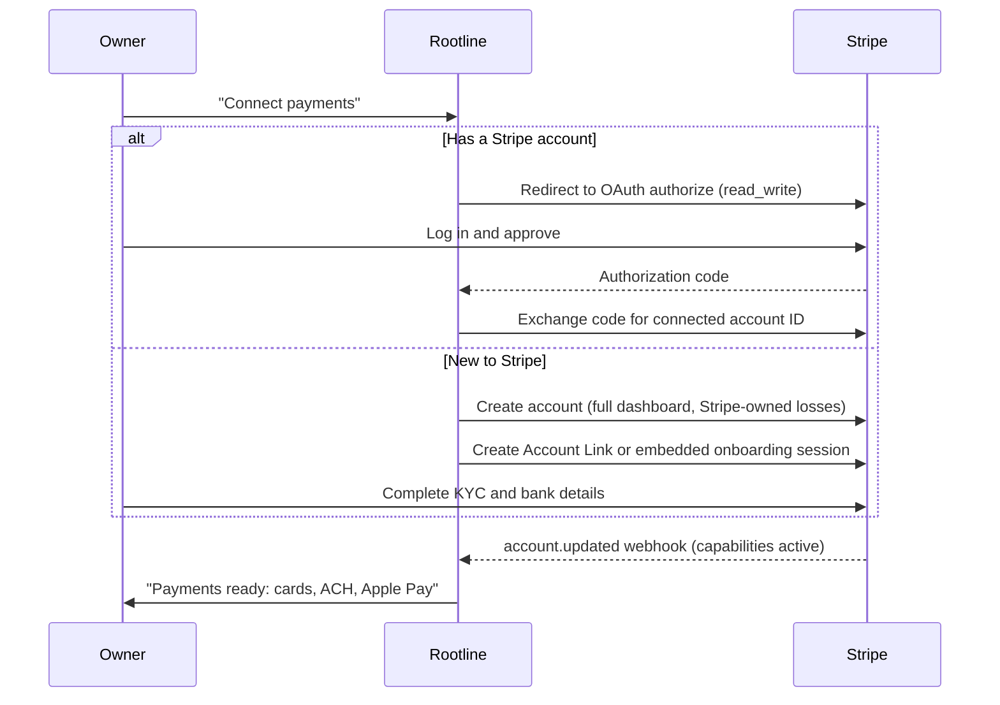
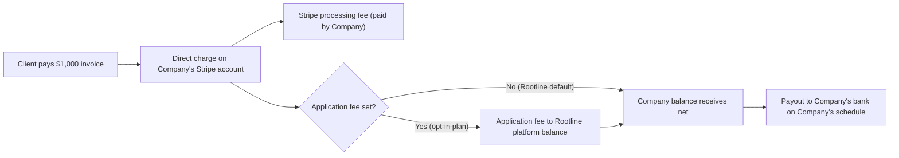
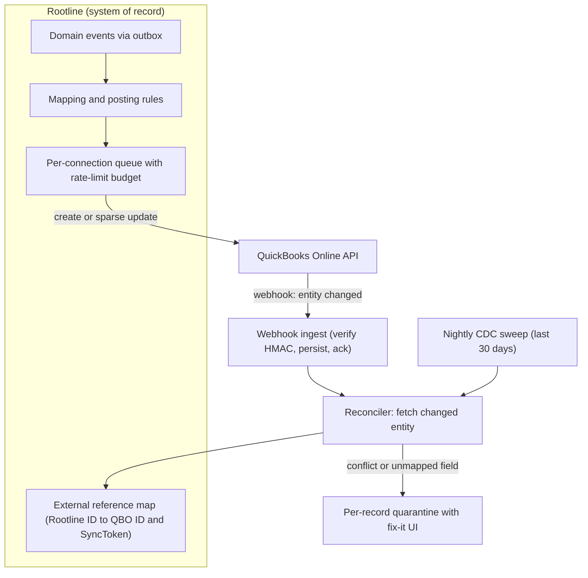
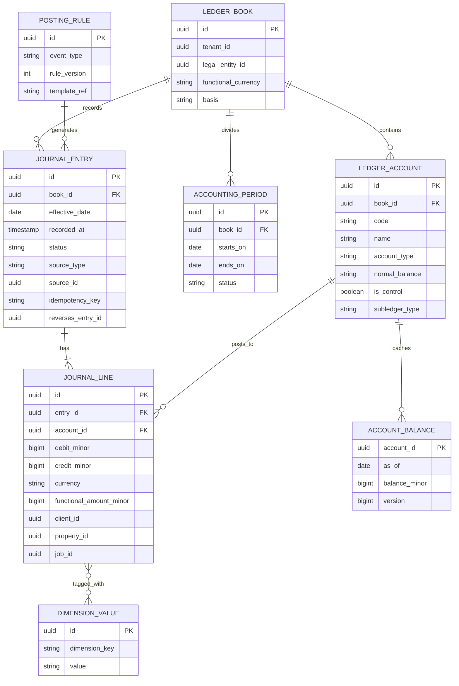
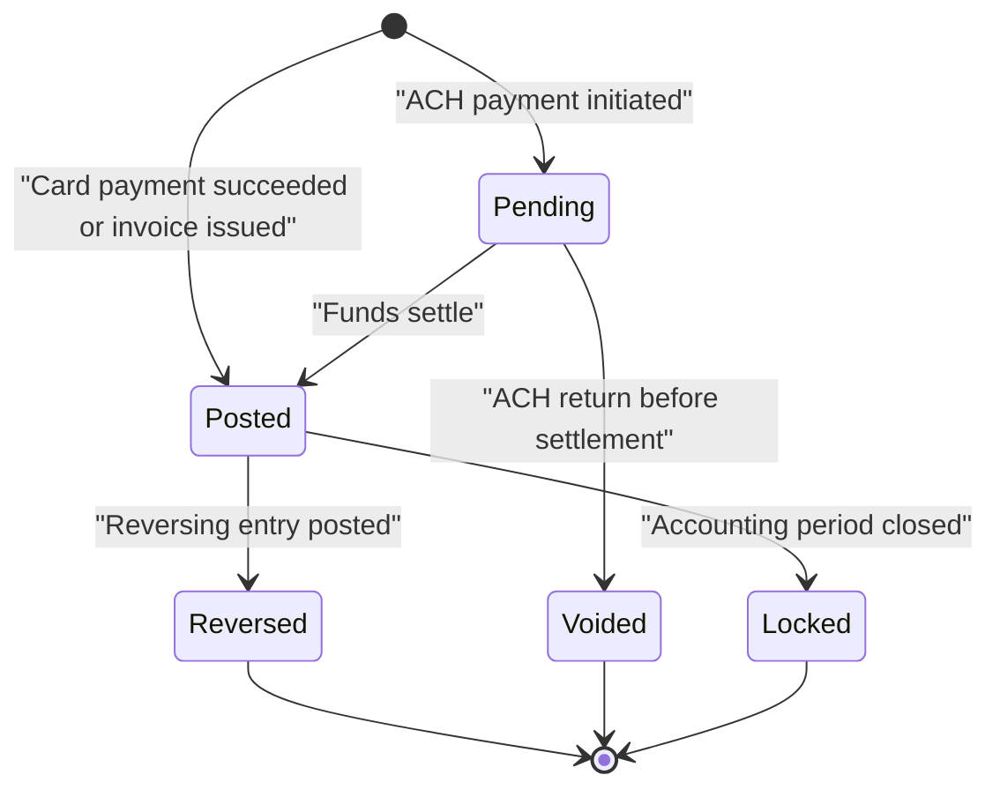

# R4 - Industry economics, payments and accounting landscape

> Raw research for Rootline's money stack and its market thesis. It covers three areas. **(A)** The economics of North American landscape companies: market size and firm counts, size distribution, revenue mix, seasonality, margins, labor and H-2B, pricing models, technology adoption, owner pain points and what residential and commercial clients now expect. **(B)** Payments: how Stripe Connect is configured today (controller properties and Accounts v2 rather than "account types"), how SaaS platforms let customers bring their own Stripe account, charge types and application fees, list pricing for cards, ACH, Terminal and Tap to Pay, ACH and Canadian PAD rules, surcharging law, consumer financing for home improvement, and how field-service vendors make money on payments. **(C)** Accounting: the QuickBooks Online, QuickBooks Desktop (Web Connector) and Xero APIs, Intuit's pricing and partner-program changes, double-entry ledger architecture patterns (immutable journals, Modern Treasury Ledgers, TigerBeetle, Formance), landscaping-specific accounting (job costing, WIP, overhead recovery, deferred revenue for prepaid seasonal contracts, sales tax) and payroll integration options (Gusto, Gusto Embedded, ADP, Check). It ends with concrete lessons for Rootline.

| Field | Value |
|---|---|
| Report | R4 - Industry economics, payments and accounting landscape |
| Date | 2026-11-07 |
| Status | Research input, not a spec. Every material fact carries an evidence tag (section 0). |
| Primary consumers | [07 Invoicing](../07-invoicing-billing-contracts.md), [08 Payments](../08-payments-stripe.md), [09 Accounting](../09-accounting-ledger-integrations.md), [15 Team and payroll](../15-team-hr-payroll.md), [18 Reporting](../18-reporting-analytics.md), [20 Architecture](../20-architecture-security.md), [22 Pricing and GTM](../22-business-model-pricing-gtm.md), [24 Roadmap](../24-roadmap-feature-catalog.md), [01 Market landscape](../01-market-landscape.md) |
| Sibling reports | [R1 Field-service platforms](R1-field-service-platforms.md), [R2 Landscape-specific platforms](R2-landscape-specific-platforms.md), [R3 Design, AI and plant data](R3-design-ai-plant-data.md) |

---

## Contents

- [0. How to read this report: evidence levels and limitations](#0-how-to-read-this-report-evidence-levels-and-limitations)
- [1. Executive summary](#1-executive-summary)
- [Part A. Landscaping industry economics](#part-a-landscaping-industry-economics)
  - [2. Market size and structure](#2-market-size-and-structure)
  - [3. Revenue mix, seasonality and cash flow](#3-revenue-mix-seasonality-and-cash-flow)
  - [4. Margins and cost structure](#4-margins-and-cost-structure)
  - [5. Labor, wages and the H-2B program](#5-labor-wages-and-the-h-2b-program)
  - [6. Pricing models in the field](#6-pricing-models-in-the-field)
  - [7. Technology adoption](#7-technology-adoption)
  - [8. Owner pain points](#8-owner-pain-points)
  - [9. What clients expect: residential and commercial](#9-what-clients-expect-residential-and-commercial)
- [Part B. Payments](#part-b-payments)
  - [10. Stripe Connect today: from account types to controller properties and Accounts v2](#10-stripe-connect-today-from-account-types-to-controller-properties-and-accounts-v2)
  - [11. Charge types and application fees](#11-charge-types-and-application-fees)
  - [12. How SaaS platforms let customers bring their own Stripe](#12-how-saas-platforms-let-customers-bring-their-own-stripe)
  - [13. Stripe pricing reference](#13-stripe-pricing-reference)
  - [14. Bank payments: ACH, Financial Connections, Nacha and Canadian PAD](#14-bank-payments-ach-financial-connections-nacha-and-canadian-pad)
  - [15. Surcharging rules](#15-surcharging-rules)
  - [16. Consumer financing for home improvement](#16-consumer-financing-for-home-improvement)
  - [17. How competitors monetize payments](#17-how-competitors-monetize-payments)
  - [18. The value of embedded payments to field-service vendors](#18-the-value-of-embedded-payments-to-field-service-vendors)
  - [19. Payments compliance notes](#19-payments-compliance-notes)
- [Part C. Accounting](#part-c-accounting)
  - [20. QuickBooks Online API](#20-quickbooks-online-api)
  - [21. QuickBooks Desktop and the Web Connector](#21-quickbooks-desktop-and-the-web-connector)
  - [22. Xero API](#22-xero-api)
  - [23. Intuit pricing changes and their effect on small businesses](#23-intuit-pricing-changes-and-their-effect-on-small-businesses)
  - [24. Unified accounting APIs and bank feeds](#24-unified-accounting-apis-and-bank-feeds)
  - [25. Double-entry ledger architecture patterns](#25-double-entry-ledger-architecture-patterns)
  - [26. Landscaping-specific accounting](#26-landscaping-specific-accounting)
  - [27. Payroll integration options](#27-payroll-integration-options)
- [28. Lessons for Rootline](#28-lessons-for-rootline)
- [29. Beyond the brief](#29-beyond-the-brief)
- [30. Open questions and verification checklist](#30-open-questions-and-verification-checklist)
- [Sources](#sources)

---

## 0. How to read this report: evidence levels and limitations

Money facts age fast. Stripe has renamed its connected-account model twice in three years, Intuit has re-priced QuickBooks every year since 2022, and state surcharging law changed in at least three states in 2025-2026. This report is therefore explicit about how well each statement is supported.

| Tag | Meaning | How to use it |
|---|---|---|
| **[S]** | Sourced in this research run from a primary or credible source (vendor docs, help centers, regulators, trade press, review sites). Linked inline. Most [S] links were gathered for the module docs and are re-cited here (see limitations). | Safe to quote with the link. Prices and rules still carry "as of Nov 2026, verify". |
| **[S3P]** | Sourced in this run, but only from third-party aggregators, affiliate pricing sites or competitor-written comparisons. | Directional only. Quote ranges and say "verify". |
| **[B]** | Analyst background knowledge of public documentation, filings, trade press and regulation up to mid-2026, **not re-verified in this run**. | A hypothesis to verify before it appears in investor material, a contract or code. Every [B] number is listed in the verification checklist (section 30). |
| **[E]** | Analyst estimate, inference or worked illustration. | Labeled as an estimate; reasoning shown. Never quote as a statistic. |

**Research limitations (read this first).**

- This report was compiled without live web access of its own: no new searches were possible and `stripe.com` / `docs.stripe.com` could not be opened directly.
- The module docs in this proposal had already gathered many relevant primary sources: Stripe Connect docs (controller properties, typeless Connect, Accounts v2, OAuth, application fees, direct-charge fee behavior, platform pricing tools), competitor payments pages (Jobber, Housecall Pro, LMN, Aspire, Service Autopilot), surcharging law trackers and network rules, Jobber's QuickBooks Online integration docs, the Wilson 360 benchmark, H-2B and wage-hour regulations, SIMA snow documentation guidance and sales-tax material. This report **consolidates that evidence** and re-cites the exact links; it did not reopen those pages, so a second pass should spot-check them.
- Everything else (QuickBooks and Xero API limits, Intuit and Xero partner-program pricing, ledger products, payroll APIs, Census and BLS counts, consumer financing terms) is tagged [B] and collected in the verification checklist. Where the analyst is unsure, the report gives a range or says "not verified" rather than a precise-looking number.
- No statistic in this report was invented. Vendor-reported numbers are labeled "vendor claim"; survey results run by vendors are labeled "vendor-run survey".

---

## 1. Executive summary

1. **The market is huge, fragmented and mostly tiny firms.** Public summaries put annual US landscaping-services revenue in roughly the $150-$200 billion range, spread across several hundred thousand businesses, most of them nonemployers [B, verify exact figures against IBISWorld and Census]. Employer firms are dominated by companies with fewer than 10 employees; the 5-49 employee band that Rootline targets ([22](../22-business-model-pricing-gtm.md) segment S2-S3) is a minority by count but carries a large share of revenue and software spend [E].
2. **Margins are thin and labor-driven.** The Wilson 360 2024 benchmark of $3M-$54M firms reported gross margin near 53% of net revenue and burdened direct labor near 43% ([Lawn & Landscape](https://www.lawnandlandscape.com/article/wilson-360-2024-landscape-industry-benchmark)) [S]. Net profit in the high single digits to low teens is the common rule of thumb [B]. A one-point improvement in labor efficiency or price realization is worth more than any software subscription; this is what Rootline must sell.
3. **Labor is the binding constraint.** Landscaping is commonly reported as the largest user of H-2B visas, whose statutory cap is 66,000 per fiscal year split across two halves ([USCIS](https://www.uscis.gov/working-in-the-united-states/temporary-workers/h-2b-non-agricultural-workers/cap-count-for-h-2b-nonimmigrants)) [S]. About 44.5% of US landscaping and groundskeeping workers were Hispanic in 2024 ([Data USA](https://datausa.io/profile/soc/landscaping-and-groundskeeping-workers)) [S]. Spanish-first crew tools and seasonal workforce features are not optional.
4. **Seasonality shapes everything, including money.** Northern firms earn most revenue April-November and fund spring payroll from winter cash, snow contracts or credit lines [B/E]. Prepaid programs, level billing and seasonal snow contracts create deferred revenue and contract assets that today's FSM tools leave for the bookkeeper to reconstruct [S via [07](../07-invoicing-billing-contracts.md), [14](../14-service-line-modules.md)].
5. **Stripe no longer thinks in "Standard/Express/Custom".** Connected accounts are configured through controller properties (fees payer, losses owner, requirement collection, dashboard type), and the newer Accounts v2 API puts `merchant`, `customer` and `recipient` configurations on a single Account object ([Stripe](https://docs.stripe.com/connect/migrate-to-controller-properties), [Stripe](https://docs.stripe.com/connect/accounts-v2)) [S]. The "bring your own Stripe" configuration Rootline wants is the Standard-equivalent: full Dashboard, Stripe-owned losses, Stripe-collected requirements, account-paid fees.
6. **Direct charges plus optional application fees are the correct charge type for BYO Stripe.** On direct charges to Standard-style accounts the connected account pays Stripe's fees and Stripe charges no Connect fees to either side ([Stripe](https://docs.stripe.com/connect/direct-charges-fee-payer-behavior)) [S]. A platform may add an `application_fee_amount` that sits on top of Stripe's fee ([Stripe](https://docs.stripe.com/connect/application-fees)) [S]. Existing accounts connect via OAuth; new accounts via Account Links or embedded onboarding ([Stripe](https://docs.stripe.com/connect/oauth)) [S].
7. **Payments are the profit center of the incumbents, and the source of their worst reviews.** Jobber Payments runs on Stripe and charges 1% for instant payouts ([Jobber](https://help.getjobber.com/en/articles/instant-payouts/)) [S]; Housecall Pro sells 1% Instapay ([Housecall Pro](https://www.housecallpro.com/features/payment-processing/)) [S]; Service Autopilot users say they "no longer have a choice of processor" after the Xplor acquisition ([GetApp](https://www.getapp.com/operations-management-software/a/service-autopilot/reviews/)) [S]; a payments consultant says LMN Pay accounts are "NOT Stripe accounts you control" ([Merchant Cost Consulting](https://merchantcostconsulting.com/lower-credit-card-processing-fees/lmn-pay-stripe-migration/)) [S, single third-party opinion]. Portability is a sales weapon.
8. **ACH is the margin lever for landscapers.** Stripe ACH Direct Debit is reported at 0.8% capped at $5 versus 2.9% + $0.30 for online cards ([Dodo Payments](https://dodopayments.com/blogs/stripe-ach-fees/), [Superdupr](https://superdupr.com/blog/stripe-fees)) [S3P]. On a $4,800 prepaid maintenance season, that is $5 instead of about $139.50. Steering autopay and large invoices to ACH (and PAD in Canada) saves a mid-size Company more than Rootline's subscription costs [E].
9. **Surcharging is legal in most places but a minefield.** Visa caps US surcharges at 3% (or the merchant's cost) ([AFS Law](https://www.afslaw.com/perspectives/alerts/visa-reduces-its-merchant-surcharge-cap-3-effective-april-15-2023-merchants)) [S]; Canada caps at 2.4% ([Visa Canada](https://www.visa.ca/content/dam/VCOM/regional/na/canada/Support/Documents/surcharging-faq-businesses-en.pdf)) [S]; debit and prepaid cards cannot be surcharged; Connecticut, Massachusetts and Maine ban surcharges, and Colorado and Oklahoma cap them ([LawPay](https://www.lawpay.com/about/blog/credit-card-surcharge-rules/), [Rundoo](https://rundoo.ai/insights/credit-card-surcharge-laws-by-state/)) [S]. Contractors ask vendor forums how to add card fees ([Jobber Community](https://community.getjobber.com/discussions/invoicing-getting-paid/advice-adding-the-credit-card-service-fee-to-invoices/1228/replies/8669)) [S] and get no compliance help.
10. **Consumer financing is table stakes for installs above about $3,000.** Housecall Pro offers Wisetack with terms extended to 84 and 120 months in February 2026, not available through HCP in Canada ([HCP](https://www.housecallpro.com/resources/february-2026-product-updates/), [HCP Help](https://help.housecallpro.com/en/articles/3836042-wisetack-consumer-financing-overview)) [S]. Rootline should integrate financing as a referral/technology provider, never as lender.
11. **Every FSM outsources the books to Intuit, and the sync is the pain.** Jobber's current QuickBooks Online sync is one-way, does not sync paid status back, posts only to parent customers, does not support Desktop, and blocks all of a client's invoices when one client record errors ([Jobber](https://help.getjobber.com/es/articles/quickbooks-integration-faqs/)) [S]. Meanwhile Intuit has raised QuickBooks Online prices repeatedly, stopped selling several Desktop editions to new US subscribers after 2024, and in 2025 introduced an App Partner Program that meters some API reads [B, verify]. A built-in ledger that a CPA trusts is both a differentiator and a hedge against Intuit platform risk.
12. **Ledger engineering is a solved pattern, not a research project.** Immutable, balanced, append-only journals with idempotent posting, reversal-only corrections, period locks and control-account subledgers are well documented (Modern Treasury Ledgers, Formance, TigerBeetle, Stripe's internal Ledger) [B]. For Rootline's volume (thousands of tenants, at most millions of entries per tenant per year), a Postgres-native ledger with those invariants is the right call; a specialized engine like TigerBeetle is overkill for a GL that needs rich dimensions and reporting [E].
13. **Landscaping accounting has five non-generic needs:** burdened labor and equipment job costing, overhead recovery tracking (MORS/FLH/SORS, popularized by LMN ([LMN help](https://intercom.help/lmn/en/articles/15939065-how-lmn-calculates-overhead-labor-burden-and-profit-in-estimates)) [S]), WIP with over/under billings for installs, deferred revenue for prepaid and level-billed seasonal programs (including snow) ([Beancount](https://beancount.io/blog/2026/06/03/snow-removal-plowing-ice-management-contractor-bookkeeping-asc-606-seasonal-deferred-revenue-per-push-trigger-section-179-plow-truck-salt-spreader-sima-asca-revenue-per-truck-hour-kpi-guide)) [S], and per-line sales tax where maintenance, capital improvements and goods are taxed differently by state ([07](../07-invoicing-billing-contracts.md)) [S/B].
14. **Payroll should be integrated first and embedded later.** Most target Companies already run Gusto, ADP, Paychex or QuickBooks Payroll [B]. Embedded payroll APIs (Gusto Embedded, Check) let a vertical platform offer payroll without becoming a payroll tax filer [B]; that is a [V2] revenue line once time capture and job costing are trusted.

---

# Part A. Landscaping industry economics

## 2. Market size and structure

### 2.1 Headline figures

| Metric | Figure | Evidence | Notes |
|---|---|---|---|
| US landscaping services industry revenue | Roughly $150-$200 billion per year in recent public summaries (2024-2025) | [B] IBISWorld public summary pages for "Landscaping Services in the US"; exact figure not verified in this run | IBISWorld counts nonemployers and includes lawn care, tree and some installation work; definitions differ from Census. Do not quote a single number until verified. |
| US businesses (all, incl. nonemployers) | Several hundred thousand | [B] IBISWorld and Census Nonemployer Statistics for NAICS 561730 | The large majority are owner-operators with no payroll (mow-and-go, part-time, seasonal). |
| US employer establishments, NAICS 561730 | On the order of 100,000-130,000 | [B] Census County Business Patterns, verify latest year | The official base for Rootline's TAM. [22](../22-business-model-pricing-gtm.md) section 7 already flags this pull as required. |
| US landscaping and groundskeeping workers (SOC 37-3011) | Roughly 0.9 million wage-and-salary jobs; median wage in the high teens of dollars per hour | [B] BLS OEWS May 2023/2024 releases | Excludes owners and many seasonal or informal workers. |
| Share of landscaping and groundskeeping workers who are Hispanic | About 44.5% (2024) | [S] [Data USA](https://datausa.io/profile/soc/landscaping-and-groundskeeping-workers) | Drives Spanish-first crew UX ([05](../05-field-crew-mobile-app.md), [21](../21-ux-design-system-sitemaps.md)). |
| Canada, NAICS 56173 Landscaping Services | Financial performance benchmarks published by ISED/Statistics Canada | [S] [ISED financial performance data](https://ised-isde.canada.ca/app/ixb/cis/performance/56173) | Business counts by employee band are available in Statistics Canada's Canadian Business Counts tables (not retrieved). Analyst expectation: tens of thousands of establishments, overwhelmingly micro firms [E]. |

> **Analyst note.** The precise top-line number matters less than the shape. Rootline's revenue model ([22](../22-business-model-pricing-gtm.md)) depends on the count of employer firms with 5-49 peak-season employees in the US and Canada, which can be pulled directly from CBP and Statistics Canada by employee band. Until that pull is done, every TAM figure in the doc set is an estimate.

### 2.2 Size distribution (shape, not verified counts)

Census CBP data for small-service NAICS codes typically show a steep pyramid. The illustrative distribution below is an **estimate of the shape** for NAICS 561730 employer establishments, to be replaced by the real CBP pull.

| Employee band (employer establishments) | Illustrative share of establishments [E] | Typical revenue band [E] | Typical software today [B] | Rootline segment ([22](../22-business-model-pricing-gtm.md)) |
|---|---|---|---|---|
| Nonemployer (owner only) | Not in CBP; the majority of all businesses | < $100k | Paper, free apps, Yardbook, QuickBooks Self-Employed or Solopreneur | Outside ICP; self-serve Starter at most |
| 1-4 | ~55-65% | $100k-$500k | Jobber Core/Connect, Yardbook, Housecall Pro Basic, spreadsheets | S1, self-serve |
| 5-9 | ~15-20% | $400k-$1M | Jobber Grow, Service Autopilot, Copilot CRM, QuickBooks Online | S2/S3 (lower end) |
| 10-19 | ~10-12% | $0.8M-$2.5M | LMN, SynkedUP, SingleOps, Jobber Grow/Plus, QBO Plus | **S2/S3 core** |
| 20-49 | ~5-8% | $2M-$6M | LMN Professional, SingleOps, Aspire (lower end), QBO Plus/Advanced or QuickBooks Desktop | **S2/S3/S4** |
| 50-99 | ~1-2% | $5M-$15M | Aspire, LMN Enterprise, Real Green (lawn), BOSS LM | S4 |
| 100+ | < 1% | $10M-$500M+ | Aspire, ServiceTitan, custom ERP, Sage Intacct | S4/S7 (enterprise) |

**Reading the shape.** The 5-49 band is perhaps a quarter to a third of employer establishments by count [E] but buys the most software per firm relative to its sophistication: it has an office manager, a bookkeeper or outside CPA, multiple crews, and enough install work to need design and estimating. Firms above 50 employees are few but carry a disproportionate share of revenue (the national players such as BrightView, which reports billions in annual revenue in its public filings [B], sit at the extreme).

### 2.3 Consolidation and private equity

Landscape maintenance has been a private-equity roll-up target for a decade: recurring commercial contracts, fragmented ownership and route density economics make it attractive [B]. Roll-ups bring standardized ERP (often Aspire), multi-entity accounting and branch-level P&L expectations [B]. Two implications for Rootline: (1) the 20-100 employee firm acquired by a platform company will be forced off whatever tool it uses, which is a churn risk for Rootline in S4; (2) multi-entity books, consolidation and branch dimensions in the ledger ([09](../09-accounting-ledger-integrations.md)) become a sales requirement at the top of the market [E].

Software vendors have consolidated in parallel: ServiceTitan bought Aspire in 2021 alongside a $200M raise at a $9.5B valuation ([TechCrunch](https://techcrunch.com/2021/06/30/servicetitan-acquires-aspire-to-move-into-landscaping-raises-200m-at-a-9-5b-valuation)) [S]; LMN and SingleOps merged under Granum in November 2024 ([R2](R2-landscape-specific-platforms.md)) [S]; Xplor owns Service Autopilot [S via reviewers]; WorkWave owns Real Green [B]. Each camp is pushing embedded payments, which is where most post-acquisition complaints come from (section 17).

---

## 3. Revenue mix, seasonality and cash flow

### 3.1 Service lines and typical mixes

No single verified survey mix was retrievable in this run. Lawn & Landscape's annual "State of the Industry" reader survey and NALP's industry overviews publish service-mix and revenue figures each year [B]; they should be pulled into [01](../01-market-landscape.md). The table below is an **analyst estimate of typical mixes by business model**, consistent with the reference Companies used across the doc set ([02](../02-personas-roles-permissions.md)).

| Business model | Maintenance (mowing, pruning, beds, cleanups) | Enhancements (mulch, seasonal color, small plantings) | Design-build / install | Lawn and plant health care (fertilizer, weed control, PHC) | Irrigation and lighting service | Snow and ice | Evidence |
|---|---|---|---|---|---|---|---|
| Residential mow-and-maintain (S1/S3) | 60-80% | 10-20% | 0-10% | 0-15% | 0-5% | 0-10% (north) | [E] |
| Residential design-build-maintain (S2, beachhead) | 25-40% | 10-15% | 40-60% | 0-10% | 5-10% | 0-10% (north) | [E] |
| Lawn treatment specialist | 0-10% | 0-5% | 0% | 75-95% | 0-10% | 0-5% | [E] |
| Commercial maintenance (S4) | 50-65% | 15-25% (enhancement sales are the profit engine) | 0-15% | 5-10% | 5-10% | 10-30% (north) | [E] |
| Snow-heavy northern commercial | 30-40% | 10-15% | 0-10% | 0-5% | 0-5% | 30-50% | [E] |

**Why the mix matters to money design.** Each line bills differently ([07](../07-invoicing-billing-contracts.md), [14](../14-service-line-modules.md)): maintenance as per-visit, monthly flat or level-billed contracts; enhancements as one-off work orders; installs as deposits plus progress or milestone invoices; lawn programs as per-application or prepaid seasons; snow as per push, per event or seasonal with caps. The ledger must recognize each correctly (section 26).

### 3.2 The seasonal curve

For a northern US company (Ohio, Ontario, Minnesota), a typical monthly revenue profile looks like the estimate below [E]. Southern companies (Texas, Florida, the Carolinas) have a flatter curve with a summer peak and no snow.

```text
Monthly revenue, northern design-build-maintain Company with snow (illustrative, % of annual)
Jan  ███ 4%        (snow, winter pruning, design work for spring)
Feb  ███ 4%        (snow, pre-sold installs signing, deposits arrive)
Mar  █████ 6%      (spring cleanups start late month, irrigation start-ups)
Apr  █████████ 10% (cleanups, first mows, mulch season, installs begin)
May  ███████████ 12%
Jun  ███████████ 11%
Jul  ██████████ 10%
Aug  ██████████ 10%
Sep  █████████ 10% (aeration/overseeding, fall installs)
Oct  ████████ 9%   (fall cleanups, irrigation winterizations, bulbs)
Nov  ██████ 7%     (leaf cleanups, holiday lighting, snow staking)
Dec  ████ 5%       (holiday lighting, snow)
```

**Cash-flow consequences [E]:**

- **The spring cash trough.** Payroll and materials ramp in March-April (rehires, H-2B arrival costs, mulch and plant purchases, equipment down payments) while receivables lag 30-45 days. Owners fund the gap with winter savings, prepay programs, snow cash or a line of credit.
- **Prepay programs are working capital.** Lawn-care firms commonly offer a discount for prepaying the season (Weed Man publicizes prepay and referral discounts ([Weed Man](https://weedman.com/blog/prepay-and-referral-discounts)) [S]). The cash arrives in February-April; the revenue is earned through November. That is deferred revenue (section 26.4).
- **Level billing smooths client payments, not revenue.** A $3,600 season of weekly mowing billed $300/month for 12 months creates a contract asset early in the season and unwinds over winter ([LawnPro level billing](https://lawnprosoftware.com/features/level-billing)) [S].
- **Snow is lumpy.** Per-push revenue arrives in storm bursts; seasonal contracts arrive evenly but carry event risk; both need subcontractor payables posted per event ([14](../14-service-line-modules.md)).

### 3.3 Implications for payments and books

| Seasonal fact | Product implication | Owner doc |
|---|---|---|
| 60-75% of annual card and ACH volume lands April-October [E] | Payments health, webhook capacity and support staffing planned for spring peak; Stripe payout reconciliation must keep up with 3-5x winter volume | [08](../08-payments-stripe.md), [20](../20-architecture-security.md) |
| Prepaid seasons collected Feb-Apr | Deferred-revenue posting and per-visit recognition must be automatic | [07](../07-invoicing-billing-contracts.md), [09](../09-accounting-ledger-integrations.md) |
| Winter headcount roughly a third to two-fifths of peak (illustrative, [02](../02-personas-roles-permissions.md)) | Payroll and seat billing that follow headcount; FUTA/SUTA wage bases front-load spring burden | [15](../15-team-hr-payroll.md), [22](../22-business-model-pricing-gtm.md) |
| Spring cash trough | Cash forecast, deposits on installs, ACH incentives for prepay, financing for large installs | [18](../18-reporting-analytics.md), [08](../08-payments-stripe.md) |

---

## 4. Margins and cost structure

### 4.1 Benchmarks that were retrievable

| Benchmark | Figure | Population | Evidence |
|---|---|---|---|
| Gross margin | About 53% of net revenue | Wilson 360 2024 benchmark, firms with $3M-$54M revenue | [S] [Lawn & Landscape](https://www.lawnandlandscape.com/article/wilson-360-2024-landscape-industry-benchmark) |
| Burdened direct labor | About 43% of net revenue | Same | [S] same |
| Labor as % of revenue (unburdened, vendor blog) | 25-30% | Not stated; definitions differ | [S] [Aspire blog](https://www.youraspire.com/blog/landscaping-labor-percentage-of-revenue) |
| Revenue per man-hour / sales per man-hour | Quoted both as billing rate and output rate; definitions inconsistent | Trade press | [S] [Lawn & Landscape](https://www.lawnandlandscape.com/article/ll0314-business-useful-benchmarks), [SynkedUP](https://synkedup.com/average-man-hour-rate-for-landscape-jobs/) |
| Overhead recovery | "If you don't recoup overhead costs, there's not even $1 of profit in a job" | Trade press | [S] [Total Landscape Care](https://www.totallandscapecare.com/business/article/15034644/how-to-properly-cost-a-job) |

The definitional mess (gross vs net revenue, burdened vs unburdened labor) is itself a finding: [18](../18-reporting-analytics.md) responds with a governed KPI Dictionary.

### 4.2 Net margin rule of thumb

Consultants and trade publications commonly describe net profit margins in the high single digits to low teens for typical firms, with top performers in the mid-to-high teens and many small firms near break-even once owner compensation is normalized [B, no single verified survey in this run]. Rootline's estimating defaults (target net profit 15% maintenance, 12% install, 18% enhancements, [03](../03-crm-sales-estimating-proposals.md)) are aspirational targets, not industry averages.

### 4.3 Illustrative P&L of a beachhead Company [E]

A $2.0M residential design-build-maintain Company in the Midwest with 22 peak employees (S2):

| Line | Amount | % of revenue | Notes |
|---|---|---|---|
| Revenue | $2,000,000 | 100% | 40% install, 35% maintenance, 12% enhancements, 8% snow, 5% irrigation/lighting service |
| Direct labor (burdened) | $760,000 | 38% | Wages plus payroll taxes, workers' comp (class code 0042 "landscape gardening" is commonly cited, verify), benefits, H-2B costs |
| Materials and plants | $380,000 | 19% | Pavers, stone, mulch by the cubic yard, nursery stock |
| Equipment and fuel (direct) | $120,000 | 6% | Internal equipment rates charged to jobs |
| Subcontractors | $90,000 | 4.5% | Concrete, electrical, snow subs |
| **Gross profit** | **$650,000** | **32.5%** | Well below the roughly 53% Wilson 360 reports for larger firms; benchmark definitions (what "net revenue" excludes, which costs sit above the gross-margin line) differ, so compare like with like ([18](../18-reporting-analytics.md) KPI Dictionary) |
| Overhead (office staff, rent, insurance, software, vehicles not on jobs, marketing) | $480,000 | 24% | Software stack today: about $1,000-$1,500/month per [R2](R2-landscape-specific-platforms.md) section 14 [E] |
| **Net operating profit** | **$170,000** | **8.5%** | Before owner add-backs and taxes |
| Memo: card and ACH processing fees (included in overhead above) | about $37,000 | 1.9% | Falls to about $23,500 with ACH steering (section 13.4) |

The point of the illustration: processing fees equal about a fifth of this Company's net profit. Payment-method design is a margin feature.

---

## 5. Labor, wages and the H-2B program

### 5.1 Facts

| Fact | Evidence |
|---|---|
| H-2B statutory cap: 66,000 visas per fiscal year, 33,000 for each half (October-March and April-September starts) | [S] [USCIS cap count](https://www.uscis.gov/working-in-the-united-states/temporary-workers/h-2b-non-agricultural-workers/cap-count-for-h-2b-nonimmigrants) (verify current fiscal year) |
| Supplemental H-2B visas have been released in recent fiscal years by joint DHS/DOL rule, in recent years up to roughly 64,700 additional visas, partly reserved for returning workers and nationals of specific countries | [B] verify for FY2026 |
| Landscaping and groundskeeping is commonly reported as the largest single H-2B occupation | [S] via [15](../15-team-hr-payroll.md); [B] for the share (on the order of a third or more of certified positions, verify against DOL OFLC disclosure data) |
| H-2B employer obligations include paying at least the prevailing wage, a three-fourths hours guarantee, corresponding employment, reimbursement of inbound travel and visa costs, and 3-year record retention | [S] [eCFR 20 CFR 655 Subpart A](https://www.ecfr.gov/current/title-20/chapter-V/part-655/subpart-A), [DOL WHD](https://www.dol.gov/agencies/whd/immigration/h2b) |
| Federal OT on the regular rate (including nondiscretionary bonuses and production pay); California daily OT and meal/rest premiums | [S] via [15](../15-team-hr-payroll.md) ([DLSE](https://www.dir.ca.gov/dlse/faq_overtime.htm)) |
| Spanish-speaking share of the workforce is high (44.5% Hispanic in 2024) | [S] [Data USA](https://datausa.io/profile/soc/landscaping-and-groundskeeping-workers) |

### 5.2 What this means financially [E]

- **Labor cost is not just wages.** H-2B adds recruiting agent fees, visa and travel reimbursement, housing and transport. The three-fourths guarantee turns rainy weeks into a cost. Rootline's burden model ([15](../15-team-hr-payroll.md)) must carry these as burden components so job costing is honest.
- **Labor scarcity raises the value of productivity software.** If a Company cannot hire a fifth crew, the only growth lever is more revenue per man-hour: tighter routes, better estimates, fewer return trips, less office re-keying.
- **Seasonal payroll creates seasonal liabilities.** Accrued wages at month-end, PTO accrual reinstatement on rehire, state unemployment experience ratings driven by winter layoffs [B]. These belong in the ledger, not a spreadsheet.

---

## 6. Pricing models in the field

| Model | Typical use | Billing pattern | Accounting treatment (summary, section 26) | Evidence |
|---|---|---|---|---|
| Per visit / per cut | Residential mowing, small commercial | Invoice per visit or batch weekly/monthly | Revenue when visit completed | [S] Jobber batch invoicing ([Jobber Help](https://help.getjobber.com/hc/en-us/articles/115009542848)) |
| Monthly flat / level billing | Residential and commercial maintenance contracts | Equal installments over 8-12 months | Contract asset or liability vs per-visit or ratable recognition | [S] [LawnPro](https://lawnprosoftware.com/features/level-billing) |
| Seasonal prepay | Lawn treatment programs, mowing seasons | Single payment early season, discount 3-10% [B] | Deferred revenue released per application/visit | [S] [Weed Man](https://weedman.com/blog/prepay-and-referral-discounts) |
| Per application (program) | 5-step fertilizer/weed control, grub control, aeration | Invoice after each application | Revenue per application | [B] Real Green-style programs ([R2](R2-landscape-specific-platforms.md)) |
| Time and materials | Enhancements, irrigation repair, cleanups | Hours x rate + materials at markup | Revenue as performed | [B] |
| Fixed-price bid (unit-priced internally) | Installs: paver patios, walls, plantings | Deposit (often 30-50%), progress or milestone invoices, final | Deposits are liabilities; revenue over time (POC) or at completion | [S] deposit flows in [08](../08-payments-stripe.md); [B] deposit norms |
| Unit pricing | Mulch per cubic yard installed, sod per square foot, edging per linear foot | Quantity x unit rate | Revenue as performed | [E] consistent with [03](../03-crm-sales-estimating-proposals.md) |
| Snow per push / per event / seasonal / per inch | Commercial lots, HOAs, residential driveways | Per storm event or fixed monthly with caps and overages | Event revenue or ratable; caps and minimums create true-ups | [S] [Jobber Academy snow bidding](https://www.getjobber.com/academy/snow-removal/how-to-bid-snow-removal/), [Beancount](https://beancount.io/blog/2026/06/03/snow-removal-plowing-ice-management-contractor-bookkeeping-asc-606-seasonal-deferred-revenue-per-push-trigger-section-179-plow-truck-salt-spreader-sima-asca-revenue-per-truck-hour-kpi-guide) |
| Design fees | Design-build firms | Flat or credited against install | Separate performance obligation or credit; liability if creditable | [B] |
| Plant warranty | Installs (often 1 year on plants, conditional on irrigation) | Included in price | Accrued warranty cost (assurance-type) | [B] |
| Escalators | Multi-year commercial contracts | CPI-linked or fixed % at renewal | Not an accounting event until the new price applies | [S] CPI logic in [03](../03-crm-sales-estimating-proposals.md) |

---

## 7. Technology adoption

| Signal | Detail | Evidence |
|---|---|---|
| Embedded payments reach | Stripe describes Jobber's payments customer base as about 200,000 home service professionals | [S] [Stripe case study](https://www.casestudies.com/company/stripe/case-study/jobber-and-stripe-help-200k-home-service-professionals-save-on-payment-fees) (vendor claim) |
| AI belief vs use among commercial landscapers | 43% believe in AI; 15% use it daily, in Aspire's 2026 survey of 1,020 commercial landscape leaders | [S] [Aspire report via Finviz](https://finviz.com/news/401821/aspire-report-finds-commercial-landscapers-prioritizing-growth-as-businesses-navigate-operational-complexity) (vendor-run survey) |
| Bolt-on economy | Aspire customers buy separate tools for site audits (SiteDNA, SiteRecon), AP automation (Vergo), benchmarking (Wilson360), telematics (Motive) | [S] [R2](R2-landscape-specific-platforms.md) section 8 |
| Accounting | Every FSM and landscape vendor syncs to QuickBooks (Online or Desktop) or another external GL; none keeps books | [S] [R1](R1-field-service-platforms.md) section 14, [R2](R2-landscape-specific-platforms.md) section 12.6 |
| Long tail on paper | Many small operators still run on spreadsheets, QuickBooks invoices and paper route sheets | [B] [R2](R2-landscape-specific-platforms.md) |
| Software spend | A 12-person company buying estimating, measurement, design, QuickBooks, reviews and a website plausibly spends $1,000-$1,500/month | [E] [R2](R2-landscape-specific-platforms.md) section 14 |

**Interpretation [E].** Adoption is bimodal: owner-operators adopt cheap horizontal FSM apps (Jobber, Housecall Pro, Yardbook) for quoting, scheduling and getting paid; firms above about $3M adopt landscape ERPs (Aspire, LMN) for estimating discipline and job costing. The middle (10-40 employees, $1-6M) is the most under-served: too complex for horizontal apps, too small for Aspire's implementation, and still running design, books and payroll in separate tools. That is Rootline's beachhead ([22](../22-business-model-pricing-gtm.md)).

---

## 8. Owner pain points

Ranked by how often they appear in this run's evidence (reviews, help-center workarounds, trade press) and by financial impact. Evidence levels per row.

| # | Pain point | Evidence | Financial impact [E] | Rootline response |
|---|---|---|---|---|
| 1 | **Finding and keeping labor**, H-2B uncertainty | [S] H-2B cap and rules; [B] trade surveys consistently rank labor first | Lost revenue from crews not fielded; overtime premiums | [15](../15-team-hr-payroll.md) H-2B workspace, Spanish-first, retention signals |
| 2 | **Pricing for profit** (unrecovered overhead, guessed production rates) | [S] Total Landscape Care; LMN's budget method exists because of this | 2-5 points of net margin on mispriced installs | Budget-based estimating with overhead recovery tracking ([03](../03-crm-sales-estimating-proposals.md), [09](../09-accounting-ledger-integrations.md)) |
| 3 | **Tool sprawl and double entry** (FSM + QuickBooks + design + payroll + reviews + website) | [S] bolt-on economy; [E] stack cost | Office hours; sync errors; software spend | All-in-one with built-in ledger |
| 4 | **Accounting sync that breaks** | [S] Jobber QBO limits; Real Green "basically unusable" accounting ([Capterra](https://www.capterra.com/p/78106/Service-Assistant/reviews/?page=5)) | Bookkeeper hours; wrong AR; bad decisions | Native ledger, or quarantine-based sync ([09](../09-accounting-ledger-integrations.md)) |
| 5 | **Forced or non-portable payment processors** and rate creep | [S] Service Autopilot reviews; LMN Pay opinion | 0.3-1.0 points of processing cost; switching pain | BYO Stripe, zero markup default ([08](../08-payments-stripe.md)) |
| 6 | **Cash-flow seasonality** and slow collections | [B] | Credit-line interest; owner stress | Deposits, prepay, autopay, ACH incentives, cash forecast |
| 7 | **Implementation fees and long onboarding** | [S3P] LMN $797-$1,497 reported, Real Green $995 reported ([R2](R2-landscape-specific-platforms.md)) | Switching cost | Free migration concierge ([22](../22-business-model-pricing-gtm.md)) |
| 8 | **Rising costs**: fuel, insurance, equipment, materials | [B] | Margin compression | Price escalators, fuel surcharge lines, price realization KPI |
| 9 | **Compliance load** (pesticide records, wage-hour, heat, snow liability) | [S] [15](../15-team-hr-payroll.md), [14](../14-service-line-modules.md) | Fines, claims (snow slip-and-fall) | Evidence-grade records |
| 10 | **Client communication** (on-my-way, proof of service, approvals) | [S] [06](../06-customer-portal.md) | Callbacks, disputes | White-label portal, photo proof |

---

## 9. What clients expect: residential and commercial

### 9.1 Residential homeowners (`client_residential`)

| Expectation | Evidence | Design consequence |
|---|---|---|
| Pay from a text or email link in seconds, with Apple Pay or Google Pay, no account creation | [S] [06](../06-customer-portal.md): Jobber users report clients forget Client Hub exists; LMN requires invite and activation | Action links with step-up auth only for sensitive changes ([06](../06-customer-portal.md)) |
| Autopay for recurring maintenance, with receipts that show what was done | [B] category norm (Jobber, HCP, Real Green all sell card-on-file autopay) | Autopay with mandates; receipts with visit photos ([08](../08-payments-stripe.md)) |
| "On my way" and arrival notices; photo proof of completion | [B] category norm; [S] proof-of-service themes in [14](../14-service-line-modules.md) | Visit timeline in portal and SMS |
| Transparent pricing and no surprise fees | [S] surcharging confusion ([Jobber Community](https://community.getjobber.com/discussions/invoicing-getting-paid/advice-adding-the-credit-card-service-fee-to-invoices/1228/replies/8669)) | Disclosed surcharge or bank-price display; ACH discount instead |
| Financing for big projects ("as low as $X/month") | [S] Wisetack in HCP with 84/120-month terms ([HCP](https://www.housecallpro.com/resources/february-2026-product-updates/)) | Financing in proposals above a threshold ([03](../03-crm-sales-estimating-proposals.md) PROP-09) |
| Visualize before buying (designs, mockups) | [B] Yardzen-style design services show willingness to pay ([R2](R2-landscape-specific-platforms.md)) | Design Studio and AI mockups in the proposal ([10](../10-design-studio.md), [11](../11-ai-design-mockups.md)) |
| Tip the crew digitally | [B] Jobber and HCP support tips | Tips to Tips Payable, allocated by hours ([08](../08-payments-stripe.md) 4.13) |

Consumer payment-method mix in the US continues to shift toward cards and digital wallets, with checks declining (Federal Reserve Diary of Consumer Payment Choice series) [B, verify latest year]. Older and rural clients still mail checks, so check capture and deposit batching remain [MVP] ([08](../08-payments-stripe.md) 4.20).

### 9.2 Commercial clients (`client_commercial`)

| Expectation | Evidence | Design consequence |
|---|---|---|
| Pay by ACH or wire from AP; card often disallowed or fee-penalized | [B] AP norm; [S] per-context method rules in [08](../08-payments-stripe.md) | ACH default for statements; virtual bank accounts for wires [V1] |
| PO numbers, consolidated statements across properties, net 30/45 terms, retainage on construction | [B] | Multi-property statements; PO fields; retainage receivable ([07](../07-invoicing-billing-contracts.md)) |
| Vendor onboarding paperwork: W-9, certificates of insurance, sometimes AP portal invoicing (Coupa, Ariba and similar) | [B] | Document vault; AP portal export [V2] |
| Proof of service for snow and maintenance: GPS, timestamps, photos, weather data | [S] SIMA in-season documentation ([SIMA](https://resources.sima.org/snow-and-ice-resource-center/effective-in-season-documentation)) | Proof-of-service packets attached to invoices ([14](../14-service-line-modules.md)) |
| Approval workflows (board votes, manager thresholds) | [S] persona research in [02](../02-personas-roles-permissions.md) | Portal approvals with roles ([06](../06-customer-portal.md)) |
| Tax-exempt status handled correctly (most HOAs are **not** exempt) | [S/B] [07](../07-invoicing-billing-contracts.md) 4.5.4 | Certificate vault; no automatic HOA exemption |

---

# Part B. Payments

## 10. Stripe Connect today: from account types to controller properties and Accounts v2

### 10.1 The model has changed

Stripe now describes connected-account behavior through **controller properties** rather than fixed account types ([Stripe: migrate to controller properties](https://docs.stripe.com/connect/migrate-to-controller-properties), [Stripe: update to typeless Connect](https://docs.stripe.com/connect/update-to-typeless-connect)) [S]. The legacy types map onto four properties:

| Legacy type | `controller.stripe_dashboard.type` | `controller.fees.payer` | `controller.losses.payments` | `controller.requirement_collection` | Who the business "belongs to" |
|---|---|---|---|---|---|
| **Standard** | `full` | `account` | `stripe` | `stripe` | The business has a direct relationship with Stripe; full Dashboard; Stripe handles KYC, disputes support and negative balances |
| **Express** | `express` | `application` | `application` | `stripe` | The platform owns pricing and losses; light Express Dashboard |
| **Custom** | `none` | `application` | `application` | `application` | The platform owns everything including KYC collection and the UI |

Source for the mapping: [S] [Stripe: update to typeless Connect](https://docs.stripe.com/connect/update-to-typeless-connect), as summarized in [08](../08-payments-stripe.md) 4.1.1.

### 10.2 Accounts v2

In the **Accounts v2** API a single Account object carries **configurations** instead of separate Account and Customer objects ([Stripe: Accounts v2](https://docs.stripe.com/connect/accounts-v2), [Accounts v2 API](https://docs.stripe.com/connect/accounts-v2/api)) [S]:

| Configuration | Purpose | Rootline use |
|---|---|---|
| `merchant` | Accept card payments and receive payouts as merchant of record on direct charges | Every landscape Company's connected account |
| `customer` | Let the same Account pay as a customer (for example for subscriptions) | Possible future: bill Rootline's own subscription against the same identity (keep separate at MVP; Rootline's SaaS billing runs on Rootline's own Stripe account) |
| `recipient` | Receive transfers in separate-charges-and-transfers flows | Not used for client payments; possible for subcontractor payouts [V2], see section 29 |

Two constraints matter ([Stripe edge docs: connected account configuration](https://edge-docs.stripe.com/connect/accounts-v2/connected-account-configuration)) [S]: an Express dashboard requires both the fees and losses collectors to be `application`, and a full dashboard requires both to be `stripe`. v1-created accounts can be managed through v2, but Stripe discourages running both API versions indefinitely ([Accounts v2 API](https://docs.stripe.com/connect/accounts-v2/api)) [S]. Rootline's connection layer should record which generation each account uses ([08](../08-payments-stripe.md) 4.1.3 already specifies this).

### 10.3 Connecting existing accounts vs creating new ones

| Path | Mechanism | Who uses it | Notes |
|---|---|---|---|
| **Existing Stripe account** | Connect **OAuth** (`read_write` scope), user authorizes in Stripe's hosted page | Companies that already take payments on Stripe (common among younger firms and those who used Stripe via a website builder) | Stripe still supports OAuth for "an extension or an application that needs access to an existing account" ([Stripe: OAuth](https://docs.stripe.com/connect/oauth)) [S]. Platform keeps only the `acct_` ID and uses its own secret key with the `Stripe-Account` header [S via [08](../08-payments-stripe.md)]. |
| **New Stripe account** | Create via API with Standard-equivalent controller properties (or v2 `merchant` + full dashboard), then **Account Links** (Stripe-hosted onboarding) or the **embedded onboarding component** | Companies new to Stripe | Stripe recommends Connect Onboarding for creating new Standard-style accounts ([Stripe: Standard accounts](https://docs.stripe.com/connect/standard-accounts)) [S] |
| **Restricted API key** ("advanced") | Company creates a restricted key in its own Dashboard and pastes it into Rootline | Security-conscious enterprises refusing OAuth | No Connect relationship, so no application fees and no Connect webhooks; Rootline must create a webhook endpoint per account ([08](../08-payments-stripe.md) 4.1.2) [E] |



### 10.4 Embedded components

Stripe's Connect embedded components (onboarding, account management, notification banner, payments, payouts, documents and others) let a platform keep users inside its own UI [B]. Component availability for full-dashboard (Standard-style) accounts has historically been narrower than for Express/Custom, and some components require the platform to own losses [B, verify per component]. Rootline should plan for the onboarding and notification-banner components at [V1] and keep a "manage in Stripe" deep link as the fallback ([08](../08-payments-stripe.md) 4.3).

---

## 11. Charge types and application fees

### 11.1 The three charge types

| Charge type | Who is merchant of record | Whose balance receives funds | Who pays Stripe fees (Standard-style) | Disputes and refunds land on | Fit for BYO Stripe |
|---|---|---|---|---|---|
| **Direct charge** (created on the connected account) | Connected account (the Company) | Connected account | Connected account, directly to Stripe | Connected account | **Yes: the primary pattern** |
| **Destination charge** (created on platform, `transfer_data.destination`) | Platform (unless `on_behalf_of` set) | Platform then transferred | Platform | Platform (debited back from connected account via reversal) | No: puts the platform in the money flow |
| **Separate charges and transfers** | Platform | Platform, then transfers to one or more accounts | Platform | Platform | No for client payments; maybe for marketplace payouts later |

Evidence: [S] [Stripe: direct charges](https://docs.stripe.com/connect/direct-charges), [Stripe: direct charges fee payer behavior](https://docs.stripe.com/connect/direct-charges-fee-payer-behavior); destination and separate-transfer semantics [B, standard Connect documentation].

On direct charges with Standard-style connected accounts, **the connected account pays Stripe's processing fees and Stripe charges no Connect fees to the account or the platform** under that fee-payer setting ([Stripe](https://docs.stripe.com/connect/direct-charges-fee-payer-behavior)) [S]. This is why BYO Stripe costs Rootline nothing in Stripe platform fees.

### 11.2 Application fees

- A platform may set `application_fee_amount` on a direct charge's PaymentIntent; the fee is collected from the connected account's charge and paid to the platform, **on top of** Stripe's processing fee ([Stripe: application fees](https://docs.stripe.com/connect/application-fees), [Stripe: collect application fees for SaaS](https://docs.stripe.com/connect/saas/tasks/app-fees)) [S].
- Application fees are visible to the Company in its own Stripe Dashboard on direct charges [S via [08](../08-payments-stripe.md)].
- On refunds, the platform can choose to refund the application fee (`refund_application_fee`) [B, standard API parameter]. [22](../22-business-model-pricing-gtm.md) commits Rootline to refunding fees on full refunds and lost disputes.
- Stripe's no-code **Platform Pricing Tool** does not apply to direct charges on Standard accounts unless the platform is on IC+ pricing, and an explicit `application_fee_amount` overrides tool-configured pricing ([Stripe edge docs: platform pricing tools](https://edge-docs.stripe.com/connect/platform-pricing-tools)) [S].



### 11.3 Connect pricing when the platform owns pricing (for contrast)

When a platform chooses "you handle pricing" (Express/Custom-style, platform pays Stripe), Stripe's Connect list pricing has been reported as about $2 per monthly active account plus 0.25% + $0.25 per payout, with the platform free to mark up processing [B, verify on [Stripe Connect pricing](https://stripe.com/connect/pricing), as of mid-2026]. Those costs and the platform's liability for negative balances are exactly what the BYO model avoids.

---

## 12. How SaaS platforms let customers bring their own Stripe

Products outside field service have offered "connect your Stripe account" for years. The pattern is consistent: Standard-style accounts via OAuth, direct charges, optional application fee. The table is [B] (public product behavior known to the analyst, not re-verified in this run).

| Product category | Example products (verify current behavior) | Model | Platform take | Lesson for Rootline |
|---|---|---|---|---|
| Publishing and newsletters | Substack, Ghost | Creator connects own Stripe; subscriptions charged on the creator's account | Substack: a percentage application fee; Ghost (Pro): 0% transaction fee positioning | A zero-fee pledge is a marketable brand position (Ghost); a percentage fee is accepted when the platform drives demand (Substack) |
| Course and membership platforms | Kajabi, Teachable, Podia, Memberful | Mix of "bring your own Stripe" and a vendor-branded payments product | Several offer both, steering users to the branded product | Even BYO platforms are tempted to add an in-house payments product later; Rootline should decide its stance publicly |
| Scheduling | Calendly, Acuity | Connect Stripe to collect payment at booking | Typically no fee | Simple OAuth connect is a solved UX |
| Website builders and e-commerce plugins | WooCommerce Stripe extension, Webflow, Squarespace | Connect existing Stripe; some add their own transaction fees by plan | Plan-dependent | Plan-dependent fees confuse users; publish them plainly |
| Field service and landscape | Jobber, Housecall Pro, LMN, Service Autopilot | **Vendor-branded** payments, account tied to the vendor | Processing spread, instant-payout fees, financing referrals | Rootline is the outlier: the only landscape platform in this research that makes the account fully the Company's ([R1](R1-field-service-platforms.md), [R2](R2-landscape-specific-platforms.md)) [S/E] |

**Why most vertical SaaS does not do BYO [E].** Embedded payments (Express/Custom-style or a payfac arrangement) give the vendor (1) pricing control, so it can earn a spread; (2) a branded, seamless onboarding; (3) control of payouts and risk; and (4) lock-in through the card vault. BYO gives the customer control and portability and gives the vendor less revenue and less lock-in. Rootline's bet ([22](../22-business-model-pricing-gtm.md) 5.1) is that portability and transparency win share in a category where processor lock-in is the top post-acquisition complaint.

---

## 13. Stripe pricing reference

### 13.1 United States (as of mid/late 2026, verify on [stripe.com/pricing](https://stripe.com/pricing))

| Item | Reported list price | Evidence |
|---|---|---|
| Domestic online cards and wallets | 2.9% + $0.30 | [S3P] [Superdupr](https://superdupr.com/blog/stripe-fees); consistent with Jobber Payments' reported online rate ([PaymentProviders.io](https://paymentproviders.io/compare/stripe-vs-jobber-payments?focus=fees)) |
| Manually keyed cards | Additional percentage on top of online rate (reported +0.5%) | [B] |
| International cards | Additional percentage (reported +1.5%); currency conversion additional (reported +1%) | [B] |
| In-person (Terminal readers) | Reported 2.7% + $0.05 | [B]; Jobber's in-person rate reported at 2.5% + $0.10 ([PaymentProviders.io](https://paymentproviders.io/compare/stripe-vs-jobber-payments?focus=fees)) [S3P], which suggests negotiated or volume pricing |
| Tap to Pay on iPhone / Android | In-person rate plus a small per-authorization fee (amount not verified) | [B] |
| ACH Direct Debit | 0.8%, capped at $5 | [S3P] [Dodo Payments](https://dodopayments.com/blogs/stripe-ach-fees/), [Superdupr ACH](https://superdupr.com/blog/ach-fees) |
| ACH failed debit and ACH dispute | Per-item fees apply (amounts not verified) | [B] |
| Card disputes | Reported $15 per dispute; Stripe also introduced a fee for countering disputes in some markets in 2025 (verify) | [B] |
| Instant Payouts | Reported 1.5% of payout (with a minimum) | [B]; compare Jobber and HCP at 1% ([Jobber](https://help.getjobber.com/en/articles/instant-payouts/), [HCP](https://www.housecallpro.com/features/payment-processing/)) [S] |
| Financial Connections | Account verification for ACH is bundled into the ACH flow; balances, ownership and transactions data are priced separately | [B] |
| Stripe Tax | Per-transaction fee on transactions where the business is registered (reported 0.5%) | [B] |
| Stripe Billing (Rootline's own SaaS subscriptions) | Percentage of billing volume (reported 0.7%) | [B] |
| Connect (Standard-style, direct charges) | No Connect fees to account or platform | [S] [Stripe](https://docs.stripe.com/connect/direct-charges-fee-payer-behavior) |

### 13.2 Canada (verify)

| Item | Reported list price | Evidence |
|---|---|---|
| Domestic online cards | 2.9% + C$0.30 | [S3P] [Superdupr](https://superdupr.com/blog/stripe-fees) via [08](../08-payments-stripe.md) |
| Pre-authorized debit (`acss_debit`) | Not verified | [B] |
| In-person cards and Interac debit | Not verified | [B] |

### 13.3 Large-volume pricing

Stripe offers custom and interchange-plus pricing to businesses above a volume threshold [B]. Because each Company owns its account, **each Company negotiates with Stripe directly**; Rootline cannot pool volume for better rates under the BYO model [E]. This is a real trade-off: a $10M commercial firm might get better rates from a processor through a broker. Rootline's answer is the provider abstraction ([08](../08-payments-stripe.md) 4.23) for [V2] alternative processors and ACH steering now.

### 13.4 Worked example: payment-method mix for a $2M Company [E]

Assumptions: $1.4M collected electronically (70% of revenue); residential maintenance payments average about $185; install deposits, progress payments and commercial statements average well above $625, so their ACH fee hits the $5 cap; list pricing from section 13.1.

| Scenario | Card volume and count | ACH volume and count | Annual fees (approx.) |
|---|---|---|---|
| Card-heavy (typical today) | $1.19M in about 6,400 payments: $1.19M x 2.9% + 6,400 x $0.30 = about $36,400 | $210k in about 150 large payments, all capped: about $750 | **About $37,200** |
| ACH-steered (ACH default for autopay; ACH first for invoices over $2,500) | $630k in about 3,400 payments: about $19,300 | 1,500 autopay payments averaging $185 ($277.5k at 0.8% = about $2,200) plus 400 large payments ($492.5k, capped = $2,000): about $4,200 | **About $23,500** |
| Savings | | | **About $13,700 per year**, more than a year of Rootline's Grow plan ([22](../22-business-model-pricing-gtm.md)) |


---

## 14. Bank payments: ACH, Financial Connections, Nacha and Canadian PAD

### 14.1 ACH in the US

| Topic | Detail | Evidence |
|---|---|---|
| Settlement timing | ACH debits take several business days to confirm (Stripe reports up to about 4 business days) | [S3P] [Superdupr](https://superdupr.com/blog/ach-fees) |
| Account verification | Instant verification through Stripe Financial Connections, with microdeposits as fallback | [S] design in [08](../08-payments-stripe.md) 4.5; [B] Stripe behavior |
| Nacha WEB debit account validation | Originators of WEB debits must use a commercially reasonable fraudulent-transaction detection system that includes account validation on first use of an account number (in force since 2022) | [B] [Nacha rules](https://www.nacha.org/rules) |
| Nacha 2026 fraud-monitoring rules | Risk-based fraud monitoring requirements for ACH participants phased in during 2026 (first phase for the largest originators and ODFIs in March 2026, second phase for others in June 2026) | [B] verify exact dates and scope |
| Returns and re-presentment | Insufficient-funds returns (R01, R09) may be re-presented at most twice (three presentments total within 180 days) | [S] design in [08](../08-payments-stripe.md) 4.15; [B] Nacha |
| Unauthorized returns window | Consumer accounts can return unauthorized debits for up to 60 days (R10 and related codes) | [B] |
| Mandates | Authorization language and evidence must be retained | [S] [06](../06-customer-portal.md) compliance table |

**Landscaping fit [E].** ACH is ideal for: monthly maintenance autopay, prepaid seasons ($1,500-$6,000), install deposits and progress payments ($5,000-$80,000), and commercial statements. The 60-day unauthorized-return window means ACH is weaker than card for one-time residential customers with no relationship; Rootline should allow "trust ACH pending" for deposits only by Company opt-in ([08](../08-payments-stripe.md) 4.11).

### 14.2 Canada: PAD and Interac

| Topic | Detail | Evidence |
|---|---|---|
| Pre-authorized debit governed by Payments Canada Rule H1 | PAD agreements (personal or business; interval, sporadic or combined schedules); pre-notification of amounts and dates, commonly 10 calendar days, which payors can agree to reduce | [B] verify Rule H1 text |
| Stripe `acss_debit` | Stripe supports Canadian PAD with mandate capture | [S] design in [08](../08-payments-stripe.md) 4.5; [B] Stripe support |
| Interac debit in person | Supported by Stripe Terminal in Canada | [B] |
| Quebec | French-language mandate and UI expectations; surcharging prohibited under provincial consumer protection law (verify) | [S/B] [08](../08-payments-stripe.md) 4.10 |
| Real-Time Rail | Payments Canada's real-time payments system has been in rollout for years; not yet a practical option for SMB collections at the time of writing (verify) | [B] |

---

## 15. Surcharging rules

Facts below are as of Nov 2026, verify; this is not legal advice. All rows were retrieved by the [08](../08-payments-stripe.md) research pass unless tagged otherwise.

| Rule | Detail | Evidence |
|---|---|---|
| Visa US cap | Lesser of merchant's cost of acceptance or 3%, effective April 15, 2023; 30 days' notice to acquirer before surcharging | [S] [AFS Law](https://www.afslaw.com/perspectives/alerts/visa-reduces-its-merchant-surcharge-cap-3-effective-april-15-2023-merchants), [Paya](https://support.paya.com/updates-to-visas-surcharge-rules-in-canada-the-us-and-us-territories) |
| Mastercard US cap | Reported at 4%; Rootline applies 3% across brands | [S] [AFS Law](https://www.afslaw.com/perspectives/alerts/visa-reduces-its-merchant-surcharge-cap-3-effective-april-15-2023-merchants) |
| Debit and prepaid | Surcharging prohibited, even when run as credit | [S] [Visa Canada FAQ](https://www.visa.ca/content/dam/VCOM/regional/na/canada/Support/Documents/surcharging-faq-businesses-en.pdf), [Mastercard Canada](https://www.mastercard.com/ca/en/business/support/merchant-surcharge-rules.html) |
| Canada cap | 2.4% (Visa and Mastercard) | [S] same |
| States that ban surcharges | Connecticut, Massachusetts, Maine | [S] [LawPay](https://www.lawpay.com/about/blog/credit-card-surcharge-rules/), [Nickel](https://www.nickel.com/surcharge-laws) |
| States with caps | Colorado (2% or cost), Oklahoma (lesser of 2% or cost after SB 677, effective Nov 1, 2025) | [S] [Rundoo](https://rundoo.ai/insights/credit-card-surcharge-laws-by-state/), [Lifted Payments](https://liftedpayments.com/credit-card-surcharge-rules-by-state) |
| Contested or changing | California (sources disagree), Louisiana (reported statutory bar from Aug 1, 2026) | [S] [Rundoo](https://rundoo.ai/insights/credit-card-surcharge-laws-by-state/), [Nickel](https://www.nickel.com/surcharge-laws) |
| New York | Total price including surcharge must be displayed; surcharge may not exceed processor cost (General Business Law section 518 as amended, reported effective Feb 2024) | [B] via [08](../08-payments-stripe.md), verify |
| Network settlement | Visa and Mastercard announced a revised US merchant settlement in November 2025 that would change surcharging and honor-all-cards flexibility if approved | [B] via [08](../08-payments-stripe.md), verify court status |

**Alternatives that are usually safer [B]:** discounts for paying by bank (cash discount programs framed as discounts rather than surcharges), autopay discounts, and building processing cost into overhead recovery. Convenience fees (flat fees for an alternative channel) have narrow network rules and are easy to misapply.

---

## 16. Consumer financing for home improvement

### 16.1 Market structure

| Provider type | Examples | How it works | Ticket size | Merchant cost | Evidence |
|---|---|---|---|---|---|
| Embedded POS lending for home services | **Wisetack** | Soft-pull prequalification by text or link; loan funded to the contractor; consumer pays lender | Small to mid installs (commonly cited $500 to about $25,000, verify) | Merchant fee varies by promotional plan (verify) | [S] HCP integration, 84/120-month terms Feb 2026, not in Canada via HCP ([HCP](https://www.housecallpro.com/resources/february-2026-product-updates/), [HCP Help](https://help.housecallpro.com/en/articles/3836042-wisetack-consumer-financing-overview)); [B] amounts |
| BNPL via the payment processor | **Affirm, Klarna, Afterpay** as Stripe Payment Element methods | Checkout-style approval; processor settles in full | Low to mid (Affirm has offered larger tickets for some merchants, verify) | Higher percentage than cards (verify) | [S] Klarna auto-enabled for new HCP Payments users from March 2026 per [Dupple](https://dupple.com/reviews/housecall-pro) (verify); [B] Stripe method support |
| Dealer-program home-improvement lenders | **GreenSky** (acquired by Goldman Sachs in 2022, later sold to an investor group led by Sixth Street, verify), **Service Finance** (Truist), **Synchrony** home programs, **Regions** (formerly EnerBank) | Contractor enrolls as dealer; promotional plans (deferred interest, reduced APR) paid for by dealer fees | Mid to large ($5,000-$100,000) | Dealer fees can be substantial on promotional plans (verify per lender) | [B] |
| Financing marketplaces for contractors | **Hearth** and similar | Multi-lender comparison for homeowners, contractor software bundle | Wide | Subscription and/or per-loan | [B] |
| Canada | **Financeit** and bank programs | POS installment loans for home improvement | Mid to large | Merchant fee | [B] verify |

### 16.2 Regulatory notes

- Advertising trigger terms such as "$129 per month" require additional Truth in Lending (Regulation Z) disclosures; Rootline should only display lender-supplied compliant copy ([03](../03-crm-sales-estimating-proposals.md) compliance table) [S].
- Rootline must remain a technology/referral provider, never the creditor or arranger of credit; referral fees from lenders raise RESPA-style and state broker-licensing questions that legal must review [B].
- Merchant fees on financed jobs should be booked as a financing expense, with the receivable from the lender cleared on funding ([03](../03-crm-sales-estimating-proposals.md) PROP-09, [09](../09-accounting-ledger-integrations.md)) [S].

### 16.3 Why it matters [E]

A $28,000 paver patio and seat wall is a different purchase at "$310/month" than at "$28,000". The analyst expectation (to be tested in customer interviews, not a finding) is that large residential tickets stall more often without a financing option. Financing also plausibly raises average ticket: when a homeowner can choose the "Better" or "Best" tier for an extra $40/month, tier mix shifts upward. This is why ServiceTitan and Housecall Pro bundle financing [B/S].

---

## 17. How competitors monetize payments

| Vendor | Payments product | Processor and account ownership | Monetization levers | Evidence |
|---|---|---|---|---|
| **Jobber** | Jobber Payments; partnership with Stripe for financing and instant payouts | Built on Stripe; vendor-branded; account tied to Jobber | Processing spread (reported 2.9% + $0.30 online, 2.5% + $0.10 in person); 1% instant payouts with eligibility at Jobber's discretion; ACH fee promotions ("ACH on us", Feb 25-May 1, 2026, up to $1,000, invitation-only) | [S] [Stripe case study](https://www.casestudies.com/company/stripe/case-study/jobber-and-stripe-help-200k-home-service-professionals-save-on-payment-fees), [Jobber Help](https://help.getjobber.com/en/articles/instant-payouts/), [Jobber](https://www.getjobber.com/ach-on-us/), [ACHR News](https://www.achrnews.com/articles/143559-jobber-partners-with-stripe-to-activate-financing-and-instant-payouts-for-home-service-businesses); [S3P] [PaymentProviders.io](https://paymentproviders.io/compare/stripe-vs-jobber-payments?focus=fees) |
| **Housecall Pro** | HCP Payments, Instapay, Wisetack, Klarna | Vendor-branded | Processing spread (rates not verified); 1% Instapay; financing referral; standard payouts typically 2 business days, first payout up to 7 | [S] [HCP](https://www.housecallpro.com/features/payment-processing/), [HCP updates](https://www.housecallpro.com/resources/february-2026-product-updates/) |
| **LMN (Granum)** | LMN Pay, relaunched March 2026 "powered by Stripe" | Built on Stripe Connect; a consultant says accounts are not Stripe accounts the contractor controls | Processing spread (not verified); payment runs | [S] [Landscape Management](https://www.landscapemanagement.net/lmn-by-granum-launches-new-financial-infrastructure-platform-in-partnership-with-stripe/), [Green Industry Pros](https://www.greenindustrypros.com/business-management/software/product/22963124/granum-granum-launches-lmn-pay-experience), [LMN Help](https://intercom.help/lmn/en/articles/15938993-payment-runs-with-stripe), [Merchant Cost Consulting](https://merchantcostconsulting.com/lower-credit-card-processing-fees/lmn-pay-stripe-migration/) |
| **Service Autopilot (Xplor)** | Xplor integrated processing | Users say they must use Xplor's processor | Processing spread; reviewers report rate increases | [S] [Capterra](https://www.capterra.com/compare/105508-122075/LawnPro-vs-Service-Autopilot), [GetApp](https://www.getapp.com/operations-management-software/a/service-autopilot/reviews/), [MowBoss](https://mowbosshq.pages.dev/guides/service-autopilot-review) |
| **Aspire (ServiceTitan)** | Historically CardConnect as preferred processor; electronic payments in Crew Control | Processor partner model | Not verified | [S] [Aspire blog (2019)](https://www.youraspire.com/blog/your-customers-can-pay-online-with-aspire-in-version-5.0-0), [Aspire blog](https://youraspire.com/blog/how-to-collect-payments-from-landscaping-customers) |
| **ServiceTitan (core)** | ServiceTitan Payments and built-in consumer financing | In-house branded | ServiceTitan reports usage-based platform revenue, largely from payments and financing, alongside subscription revenue in its public filings since its December 2024 IPO | [B] verify against filings |
| **Real Green (WorkWave)** | WorkWave payments | In-house | Not verified | [B] [R2](R2-landscape-specific-platforms.md) |

> **Competitive edge.** Every vendor in the table above whose payments product could be verified runs a vendor-branded arrangement in which the vendor, not the landscaper, controls the processor relationship: Jobber (Stripe-based, 1% instant payouts at its discretion), Housecall Pro (1% Instapay), LMN Pay (accounts reportedly not controlled by the contractor) and Service Autopilot (processor choice removed after the Xplor acquisition). Rootline is the only option in this research where the landscaper's Stripe account, card vault and dispute history leave with the landscaper, and where Stripe's own instant payouts and pricing apply without a vendor layer in between.

---

## 18. The value of embedded payments to field-service vendors

### 18.1 Why every incumbent does it [E]

1. **Revenue per customer roughly doubles or more.** A Company paying $250/month in subscription and processing $1M/year through a vendor that keeps even 0.5-0.8% of volume after processor cost generates $5,000-$8,000/year in payments revenue, versus $3,000 in subscription. [22](../22-business-model-pricing-gtm.md) 5.1 computes $5,250/year for a 0.5% spread on $1.05M.
2. **It scales with the customer's growth** without a price increase.
3. **It locks in.** Stored cards and ACH mandates for 400-600 autopay clients sit in the vendor's account; leaving means re-collecting them in spring.
4. **It funds other fintech.** Instant payouts, financing referrals and working-capital loans all sit on top of the payments rail.

### 18.2 What Rootline gives up, and how it compensates

| Given up | Size [E] | Compensation |
|---|---|---|
| Processing spread | Comparable to the subscription for mid-size Companies ([22](../22-business-model-pricing-gtm.md) 5.1) | Higher subscription value (design, ledger, portal); opt-in pay-as-you-grow application fee [V1] |
| Instant-payout fees | Small | None; Company uses Stripe's own instant payouts directly |
| Lock-in via card vault | Large retention effect | Retention via ledger (books history), designs, plant data, portal; "leave anytime" export as conversion lever ([20](../20-architecture-security.md)) |
| Financing referral revenue | Moderate | Can still be earned as a disclosed referral fee [V2] ([22](../22-business-model-pricing-gtm.md) 5.1.3) |

### 18.3 Strategic risk check [E]

The BYO stance is credible only if Rootline's non-payments value is clearly higher than the incumbents'. If Rootline later launches a branded payments product (as course platforms did, section 12), it must keep BYO as a first-class option forever or it loses the core trust message. Recommendation: publish the Zero-Markup Pledge in the terms of service, not only on the pricing page.

---

## 19. Payments compliance notes

| Area | Summary | Evidence |
|---|---|---|
| PCI DSS | Using Stripe Elements/Payment Element (iframe) and Terminal keeps Rootline in SAQ A scope for e-commerce; card data never touches Rootline servers | [B] PCI SSC SAQ A; architecture in [20](../20-architecture-security.md) |
| Money transmission | Direct charges to the Company's own account mean Rootline never holds or moves client funds, avoiding money-transmitter licensing exposure | [B]; design principle in [08](../08-payments-stripe.md) |
| Form 1099-K | For Standard-style (full dashboard) accounts Stripe treats the Company as its direct user for tax reporting (verify current year). Federal reporting thresholds were rolled back to $20,000 and 200 transactions by 2025 legislation (verify) | [B] |
| Tips | Not revenue; post to Tips Payable; card-fee deduction from tips restricted in some states | [S] design in [08](../08-payments-stripe.md) 4.13; [B] state rules |
| Data portability | A Company leaving Rootline keeps its Stripe customers and payment methods because they live in its own account | [S] via [08](../08-payments-stripe.md); [E] |

---

# Part C. Accounting

## 20. QuickBooks Online API

QuickBooks Online (QBO) is the default general ledger for small US and Canadian landscapers and their CPAs [B]. Every competitor syncs to it; the quality of that sync is a top complaint ([R1](R1-field-service-platforms.md) section 14) [S]. All API facts below are [B] (the analyst's knowledge of Intuit's developer documentation to mid-2026), not re-verified in this run.

### 20.1 Profile

| Aspect | Detail | Evidence |
|---|---|---|
| API style | REST/JSON over `https://quickbooks.api.intuit.com/v3/company/{realmId}/...`; a `minorversion` query parameter selects schema features, and Intuit has been retiring old minor versions (a 2025 change raised the minimum supported minor version, verify) | [B] |
| Auth | OAuth 2.0 authorization code flow; accounting scope `com.intuit.quickbooks.accounting`; short-lived access tokens (about 1 hour) and rotating refresh tokens. Intuit has changed refresh-token lifetime policy (verify current rules). Refresh must be serialized per connection, because a rotated refresh token invalidates the old one ([20](../20-architecture-security.md) token vault) | [B]; [S] Rootline design |
| Tenancy key | `realmId` (company ID) per connected QBO company | [B] |
| Query | SQL-like `SELECT * FROM Invoice WHERE MetaData.LastUpdatedTime > '...' STARTPOSITION 1 MAXRESULTS 1000`; maximum 1,000 rows per page | [B] |
| Concurrency control | Every entity carries a `SyncToken`; updates must send the current token (optimistic locking); sparse updates supported | [B] |
| Batch | Batch endpoint accepts up to about 30 operations per request, with its own per-minute limit (verify) | [B] |
| Change data capture | `cdc` endpoint returns entities changed since a timestamp for up to the last 30 days, with a cap per entity per response (about 1,000, verify) | [B] |
| Webhooks | Per-app endpoint receives notifications naming realm, entity, ID and operation (Create, Update, Delete, Merge, Void, Emailed); payload signed with HMAC-SHA256 using the app's verifier token in the `intuit-signature` header; notifications can be delayed and batched, so CDC is still needed as a safety net. Intuit announced a move to a CloudEvents-style webhook format (verify dates) | [B] |
| Rate limits | Commonly documented as about 500 requests per minute per realm per app and 10 concurrent requests per realm, with lower limits for batch and resource-intensive report endpoints; exceeding returns HTTP 429 | [B] verify |
| Sandbox | Free sandbox companies per developer account (US, CA and other regions) | [B] |
| Production access and listing | Production keys require completing Intuit's app assessment (security and compliance questionnaire); listing on the Intuit App Store involves additional technical and marketing review | [B] verify current process |
| Partner program and metering | Intuit's **App Partner Program** (introduced 2025) groups developers into tiers (a free entry tier and paid tiers). "Core" API calls that write data are not metered; "CorePlus" calls (largely reads and queries) count against monthly allotments by tier, with overage pricing. Exact tier names, allotments, prices and effective dates must be verified | [B] verify; flagged in [09](../09-accounting-ledger-integrations.md) and [20](../20-architecture-security.md) Q13 |

### 20.2 Entities that matter for a landscape sync

| QBO entity | Rootline object | Notes for landscaping |
|---|---|---|
| `Customer` (with `ParentRef` and `Job=true` for sub-customers) | Client; Property as sub-customer | QBO supports nested sub-customers (several levels, verify depth). Jobber posts only to parent customers ([Jobber](https://help.getjobber.com/es/articles/quickbooks-integration-faqs/)) [S]; per-Property sub-customers enable job costing by property for HOAs and property managers. |
| `Item` (Service, NonInventory, Inventory, Category, Bundle) | Price Book items | Kits/assemblies map poorly to QBO bundles (bundles cannot nest and do not carry cost roll-ups, verify); post kits as their component lines or as a single service item with memo. |
| `Invoice`, `CreditMemo`, `SalesReceipt`, `RefundReceipt` | Invoices, credit memos, on-site paid receipts, refunds | Invoice lines carry `ClassRef` (Plus/Advanced) and `ItemRef`; `DepartmentRef` (Location) at header level. |
| `Payment` (with `LinkedTxn` to invoices) | Client payments | One payment can apply to many invoices. Record **gross** payment to an undeposited-funds or Stripe clearing account, never net of fees. |
| `Deposit` | Stripe payouts | Deposit groups payments, deducts Stripe fees as a negative line to a fees expense account, and lands in the bank account; this is the "processor fees not split out" failure mode when done wrong ([R1](R1-field-service-platforms.md)) [S]. |
| `JournalEntry` | Deferred revenue releases, WIP adjustments, payroll journals, accruals | When Rootline's ledger is the system of record and QBO is a mirror, summarized daily journal entries are the lowest-friction sync. |
| `Bill`, `BillPayment`, `Vendor`, `VendorCredit`, `PurchaseOrder`, `Purchase` | AP from [13](../13-operations-inventory-equipment.md) | Bills require Essentials or higher (verify plan matrix). |
| `Class`, `Department` (Location) | Division/service line, branch | Class and Location tracking exist on Plus and Advanced only (verify) ([09](../09-accounting-ledger-integrations.md)). |
| `Account` | Chart of accounts mapping | Map Rootline accounts to QBO accounts once, with suggestions. |
| `TaxCode`, `TaxRate`, `TaxAgency` | Sales tax | US companies on QBO's automated sales tax compute tax from addresses and mark lines taxable or not; an integration that already computed tax per line (as Rootline does, [07](../07-invoicing-billing-contracts.md)) must override totals or post tax another way (verify current override behavior). Canadian companies use GST/HST/QST/PST tax codes. |
| `TimeActivity`, `Employee` | Timesheets for QuickBooks Payroll users | Push approved hours per employee per day with customer/class for payroll and job costing in QBO. |
| `Estimate`, `Attachable` | Optional | Attach invoice PDFs and proof-of-service photos via `Attachable` (verify size limits). |

### 20.3 Sync architecture lessons



1. **Pick a direction per object** (Rootline to QBO for invoices and payments; QBO to Rootline only for things the bookkeeper legitimately edits there, such as payments recorded by mail) and show it in the UI. Jobber's one-way design with no paid-status sync-back leaves AR wrong when a bookkeeper records a mailed HOA check in QBO [S].
2. **Lookup before create** (by display name, email, external ID in a custom field or private note) to avoid duplicate customers [E].
3. **Quarantine per record, never per client.** Jobber's "a sync error on a client blocks all invoices and payments for that client" behavior is the anti-pattern [S].
4. **Webhooks plus CDC.** Webhooks for latency; nightly CDC as the guarantee; both feed the same idempotent reconciler [B/E].
5. **Budget reads.** If the App Partner Program meters reads, prefer webhooks and CDC over polling queries, cache reference data (accounts, tax codes, classes), and batch writes [B/E].
6. **Post payouts as deposits with fee lines** so QBO bank reconciliation matches the bank feed to the penny [S/E].

> **Competitive edge.** Jobber's QBO integration is one-way, parent-customer-only and blocks a whole client on one error, and it does not support Desktop ([Jobber](https://help.getjobber.com/es/articles/quickbooks-integration-faqs/)). Rootline's default is no sync at all (the books are native), and for Companies that keep QuickBooks, the sync posts Properties as sub-customers, quarantines single records, reconciles via webhooks plus CDC and posts Stripe payouts as deposits with fee lines so bank reconciliation in QBO matches to the penny.

---

## 21. QuickBooks Desktop and the Web Connector

### 21.1 Why it still matters

Many established design-build and commercial firms (often $2M+) or their CPAs still run QuickBooks Desktop; Jobber does not support it, and FieldEdge built a niche on Desktop sync ([R1](R1-field-service-platforms.md) sections 3.6 and 4) [S]. Intuit stopped selling several Desktop editions (Pro Plus, Premier Plus, Mac Plus) to new US subscribers after September 30, 2024 while continuing QuickBooks Desktop Enterprise, and it retires add-on services for older Desktop versions on a rolling three-year schedule [B, verify]. The installed base is shrinking but sticky, and each forced upgrade is a migration moment toward Rootline's native ledger.

### 21.2 How the Web Connector works [B]

| Aspect | Detail |
|---|---|
| Topology | QuickBooks Web Connector (QBWC) is a Windows application installed next to QuickBooks Desktop. It **polls** a web service hosted by the integrator over HTTPS SOAP. There is no inbound connection to the PC and no push from QuickBooks. |
| Configuration | The integrator provides a `.qwc` file (app name, URL, owner and file IDs, polling interval). The user adds it to QBWC and enters a password. |
| SOAP methods | `serverVersion`, `clientVersion`, `authenticate`, `sendRequestXML`, `receiveResponseXML`, `connectionError`, `getLastError`, `closeConnection` |
| Payload | **qbXML** requests and responses (for example `CustomerAddRq`, `InvoiceAddRq`, `ReceivePaymentAddRq`, `InvoiceQueryRq` with iterators for paging) |
| Identity and concurrency | List objects have `ListID`, transactions `TxnID`; updates require the current `EditSequence` (optimistic locking) |
| Scheduling | Runs on a timer when QBWC is running (minimum interval measured in minutes) or on demand; requires QuickBooks to be able to open the company file |
| Operational pain | The PC must be on, QuickBooks installed and the company file reachable; some operations need single-user mode; Windows updates, QuickBooks version changes and multi-user locks break syncs; errors surface on the PC, not in the cloud app |
| Hosted Desktop | Hosting providers (for example Right Networks) run Desktop in the cloud; QBWC runs inside the hosted session |
| Alternatives | Third-party Desktop API services and ODBC drivers expose Desktop through REST or SQL-like interfaces, at extra cost and with the same PC dependency |

### 21.3 Lessons [E]

- Treat QBD as **one-way, Rootline to Desktop**, summarized (daily journal entries plus customer and invoice mirrors for AR aging), not a real-time two-way sync. [09](../09-accounting-ledger-integrations.md) puts Desktop at [V1].
- Build a "sync health" panel that shows last successful poll, queue depth and the PC's QuickBooks version, with copy the bookkeeper can act on.
- Offer a **migration path** from Desktop to Rootline's ledger with opening balances and history import ([09](../09-accounting-ledger-integrations.md) 4.18). Intuit's Desktop retirements are Rootline's best ledger-acquisition channel.

---

## 22. Xero API

Xero is less common than QBO among US landscapers but has a meaningful presence in Canada and with younger CPAs [B]. Facts are [B] unless noted.

| Aspect | Detail | Evidence |
|---|---|---|
| Auth | OAuth 2.0; access tokens about 30 minutes; refresh tokens rotate on use and expire if unused for about 60 days; each call carries a `xero-tenant-id` header | [B] verify |
| Rate limits | About 60 calls per minute and 5,000 calls per day per tenant per app, 5 concurrent calls per tenant, plus an app-wide per-minute limit across all tenants; response headers report remaining budget; HTTP 429 with `Retry-After` | [B] verify |
| Incremental sync | `If-Modified-Since` header on most GET endpoints; paging (100 per page by default, larger page sizes on some endpoints) | [B] |
| Webhooks | Contacts and Invoices events (and app subscription events); signed with HMAC-SHA256 in `x-xero-signature`; "intent to receive" validation; endpoint must respond quickly (about 5 seconds); payloads carry IDs only, so the integrator fetches the record | [B] |
| Key entities | `Contacts`, `Invoices` (type `ACCREC` for sales, `ACCPAY` for bills), `CreditNotes`, `Payments`, `BatchPayments`, `Overpayments`, `Prepayments`, `BankTransactions`, `BankTransfers`, `ManualJournals`, `Items`, `Accounts`, `TaxRates`, `TrackingCategories`, `Quotes`, `PurchaseOrders`, `Attachments` | [B] |
| Dimensions | Only two active tracking categories (verify), so division and branch must fit in two dimensions; property-level costing has to use contacts, projects or reference fields | [B] via [09](../09-accounting-ledger-integrations.md) |
| Projects | Xero Projects API exists for time and cost by project (plan-dependent) | [B] |
| Payroll | Region-specific payroll APIs (UK, AU, NZ); in the US, Xero partners with Gusto rather than running its own payroll (verify) | [B] |
| Developer pricing and terms | Xero moved app developers to tiered pricing based on connections and data volume, announced 2025 with changes effective in 2026, and updated developer terms to restrict using API data to train AI models (verify both) | [B] verify; flagged in [09](../09-accounting-ledger-integrations.md) |
| US strategy | Xero agreed to acquire US bill-pay company Melio in 2025 to grow in the US (verify close and terms) | [B] |

**Lessons [E].** Xero's daily per-tenant cap (about 5,000 calls) is tight for a busy maintenance Company that syncs every visit invoice individually. Rootline should sync **summarized** documents where the Company allows it (one invoice per client per billing period, one journal per day for deferred revenue), batch where the API permits, and treat webhooks as hints followed by `If-Modified-Since` fetches.

---

## 23. Intuit pricing changes and their effect on small businesses

| Change | Detail | Evidence |
|---|---|---|
| QBO list price increases | Intuit has raised QBO list prices in most years since 2022; as of mid-2025 US list prices were reported around $38 (Simple Start), $75 (Essentials), $115 (Plus) and $275 (Advanced) per month before promotions | [B] verify current list prices |
| Desktop sunset for new users | No new US subscriptions to Desktop Pro Plus, Premier Plus or Mac Plus after September 30, 2024; Enterprise continues; Desktop is subscription-only with periodic price increases | [B] verify |
| Feature gating | Class and Location tracking and Projects on Plus/Advanced; bills from Essentials up; user limits per plan | [B] verify ([09](../09-accounting-ledger-integrations.md)) |
| Payroll and Payments | QuickBooks Payroll and QuickBooks Payments re-priced over the same period | [B] verify |
| App Partner Program | Metered read APIs for third-party developers (section 20.1) | [B] verify |
| Bundling of AI and "Intuit Assist" | Intuit is bundling AI agents into QBO tiers and launched mid-market products (for example Intuit Enterprise Suite) | [B] verify |

**What owners and bookkeepers say [B].** Accounting-forum and Reddit threads (for example r/QuickBooks and r/Bookkeeping) regularly complain about annual price increases, forced moves from Desktop to Online, and features moving to higher tiers. These complaint themes were not retrieved as quotations in this run ([R2](R2-landscape-specific-platforms.md) notes Reddit was unreachable), so treat them as hypotheses for interviews.

**Why it matters to Rootline [E].**

1. **Price umbrella.** A Company paying $115-$275/month for QBO plus an FSM tool can save that line entirely if Rootline's ledger is trusted. This is the strongest stack-replacement argument in [22](../22-business-model-pricing-gtm.md).
2. **Platform risk.** API metering, minor-version retirements and partner-program changes are levers Intuit controls. An FSM whose books depend on QBO is exposed; Rootline's native ledger is a hedge.
3. **CPA gravity.** CPAs are trained on QBO and many manage dozens of clients in QuickBooks Online Accountant. Rootline must offer free accountant seats, a multi-client accountant hub, standard exports (trial balance, GL detail, 1099 vendors) and optional QBO mirroring so the CPA does not veto the switch ([09](../09-accounting-ledger-integrations.md) Accountant Hub).

---

## 24. Unified accounting APIs and bank feeds

### 24.1 Unified accounting APIs [B]

| Provider | What it offers | Fit for Rootline |
|---|---|---|
| Codat | Unified read/write accounting, banking and commerce APIs across QBO, Xero, Sage, NetSuite and others | Useful for long-tail GLs (Sage Intacct, NetSuite) at [V2]; adds per-connection cost and a dependency for core QBO/Xero |
| Merge (Accounting) | Unified accounting API with common models and webhooks | Same trade-off; strong for reads, writes vary by integration |
| Rutter | Unified commerce and accounting APIs | Commerce-first |
| Apideck | Unified accounting and other categories | Similar |

**Recommendation [E]:** build QBO, QBD and Xero connectors natively (they carry most of the volume and the semantics matter: sub-customers, deposits with fee lines, tax overrides), and consider a unified API only for the long tail of mid-market ERPs at [V2].

### 24.2 Bank feeds

| Option | Notes | Evidence |
|---|---|---|
| Plaid Transactions | Broad US/Canada coverage; per-connected-account pricing; webhooks for new transactions | [B] |
| MX, Finicity (Mastercard), Akoya | Alternatives with different bank coverage and pricing | [B] |
| Stripe Financial Connections | Primarily for ACH verification; can also provide balances, ownership and transactions with additional permissions and fees | [B] verify transactions coverage for business accounts |
| Open-banking regulation | The CFPB's personal financial data rights rule (section 1033) was finalized in late 2024 and then reopened for reconsideration in 2025; large banks have signaled they intend to charge aggregators for data access. Both could change bank-feed cost and coverage | [B] verify status |

**Lesson [E].** Abstract the bank-feed provider behind one interface (already the plan in [20](../20-architecture-security.md) Connector SDK) and keep CSV/OFX/BAI2 import as a permanent fallback so reconciliation never depends on a single aggregator.

---

## 25. Double-entry ledger architecture patterns

### 25.1 Invariants every serious ledger enforces [B]

1. **Balanced entries.** Every journal entry's debits equal its credits (per currency).
2. **Immutability.** Posted entries are never updated or deleted; corrections are reversing entries plus new entries.
3. **Idempotent posting.** Every posting request carries an idempotency key derived from the business event (for example `invoice:INV-2041:issued`), so retries cannot double-post.
4. **Effective date vs recorded time.** Entries carry an accounting (effective) date and a system timestamp; backdating into a closed period is blocked.
5. **Period locks.** Closed periods reject new entries; adjustments go into the current period or require an explicit reopen with audit.
6. **Control accounts and subledgers.** AR, AP, customer deposits and deferred revenue are control accounts whose balances must equal the sum of their subledger detail at all times.
7. **Clearing accounts that must return to zero.** For example, "Stripe clearing" receives gross client payments and is emptied by payouts plus fees; a non-zero balance older than N days is an alert. Stripe's engineering blog describes the same idea for its internal Ledger system (verify the post) [B].
8. **Balance computation with concurrency control.** Cached balances per account carry a version; posting checks expected versions (optimistic locking) or uses row locks for hot accounts.

### 25.2 Product and pattern comparison

| Option | What it is | Strengths | Weaknesses for Rootline | Evidence |
|---|---|---|---|---|
| **Postgres-native ledger** (custom tables, constraint triggers, RLS) | `journal_entry` and `journal_line` tables with deferred constraint checks for balance, append-only privileges, and balance snapshots | Same database and transactions as the business data; rich dimensions; easy reporting; RLS multi-tenancy matches [20](../20-architecture-security.md) | Must build posting engine, balance caching, close and reporting; hot-row contention on shared accounts needs care | [B]/[E] |
| **Modern Treasury Ledgers** | Hosted ledger API: ledgers, ledger accounts with normal balance, ledger transactions (pending, posted, archived), entries, account categories, balance types (pending, posted, available), balance locking with version checks, idempotency | Mature semantics; good for money-movement products | External dependency for core books; per-volume pricing; GL reporting, period close and dimensions still need building; data residency (Canada) | [B] verify |
| **Formance Ledger** | Open-source programmable ledger; Numscript DSL describes multi-posting transactions; Postgres-backed; part of a stack with payment connectors and reconciliation | Open source; expressive posting language; self-hostable | Oriented to money movement and wallets more than GAAP GL; another runtime to operate | [B] verify license and current version |
| **TigerBeetle** | Purpose-built financial transactions database: fixed-size accounts and transfers, two-phase (pending/post/void) transfers, linked (atomic) events, balance constraints such as "debits must not exceed credits", consensus replication; very high throughput claims | Extreme correctness and throughput for balance tracking | Minimal metadata (a few user-data fields), no SQL reporting, separate store for everything else; over-engineered for a per-tenant GL with thousands of entries per day | [B] verify |
| **Plain-text accounting** (Beancount, Ledger CLI) | Text journals with balance assertions | Excellent export format and audit trail; accountant-friendly | Not an online multi-tenant store | [B]; [S] Beancount article on snow bookkeeping |

**Recommendation [E].** A Postgres-native ledger module inside the modular monolith, enforcing the eight invariants with database constraints and a single posting service, is the right fit:

- **Volume is modest.** Even a 150-person commercial firm posts perhaps 50,000-300,000 journal lines per year [E]; 5,000 tenants is on the order of a billion lines over several years, well within partitioned Postgres.
- **Reporting needs dimensions** (property, job, service line, branch, crew), which a relational store handles naturally and which [18](../18-reporting-analytics.md) replicates to ClickHouse.
- **Borrow the semantics** from Modern Treasury and TigerBeetle: pending vs posted entries (for ACH in flight), version-checked balances, linked atomic postings and clearing-account assertions.
- **Export** a Beancount-style or CSV journal so accountants and auditors can verify independently.

### 25.3 Reference data model





---

## 26. Landscaping-specific accounting

### 26.1 Chart-of-accounts features a landscaper's CPA expects [E]

- Revenue by **service line** (maintenance, enhancements, installation, lawn/PHC, irrigation, lighting, snow, design fees) and optionally residential vs commercial, either as accounts or as a dimension.
- COGS split into **labor (applied), labor burden (applied), materials, plants, equipment (applied), subcontractors, disposal and dump fees**, plus **variance accounts** (actual payroll vs applied labor; actual equipment cost vs applied equipment rates).
- Liabilities: **Customer deposits, Deferred revenue - agreements, Deferred revenue - prepaid programs, Sales tax payable per agency, Tips payable, Warranty reserve, Accrued wages, Retainage payable** (to subs).
- Assets: **Stripe clearing, Undeposited funds, Retainage receivable, Unbilled receivables (contract asset), Inventory (plants, hardgoods, salt), Prepaid insurance, Equipment and vehicles** with accumulated depreciation.
- Consistent with the default accounts in [07](../07-invoicing-billing-contracts.md) section 4.11 (for example `1050/1051 Stripe clearing USD/CAD`, `1210 Unbilled receivables - agreements`, `2150 Customer deposits`, `2160 Tips payable`, `2200 Deferred revenue - service agreements`) [S].

### 26.2 Job costing

| Element | Practice | Rootline approach |
|---|---|---|
| Labor | Crew hours x **burdened** rate (wage + payroll taxes + workers' comp + benefits + PTO + H-2B costs); burden commonly 20-35% of wages depending on state and benefits [E] | Applied at punch-segment level from [15](../15-team-hr-payroll.md); variance to actual payroll monthly |
| Equipment | Internal hourly rates per equipment class (mower, skid steer, dump truck) recovering ownership + operating cost | Equipment rate card from [13](../13-operations-inventory-equipment.md); "applied equipment" clearing account |
| Materials | Actual cost from vendor bills or inventory issue; mulch by the cubic yard, stone by the ton, plants by the unit | Bills coded to jobs; inventory issue at average cost |
| Subcontractors | Actual bills; retainage payable | AP subledger |
| Overhead | Allocated via overhead recovery rate for **net profit by job** views, not in gross margin | Per [18](../18-reporting-analytics.md) KPI rules |

Evidence: LMN's documented sequence (wage, burden, overhead markup, profit) [S] ([LMN help](https://intercom.help/lmn/en/articles/15939065-how-lmn-calculates-overhead-labor-burden-and-profit-in-estimates)); Jobber's job profitability depends on crews logging time and materials and lacks loaded labor and overhead, per community and vendor commentary cited in [09](../09-accounting-ledger-integrations.md) [S].

### 26.3 Overhead recovery

LMN offers three methods, popular across the industry ([LMN help](https://intercom.help/lmn/en/articles/15939065-how-lmn-calculates-overhead-labor-burden-and-profit-in-estimates), [Lawn & Landscape on MORS](https://www.lawnandlandscape.com/article/mors-estimating-method/)) [S]:

| Method | Formula (budget) | When it fits |
|---|---|---|
| **FLH** (field labor hours) | Overhead budget / budgeted billable field labor hours = $ per man-hour | Labor-heavy maintenance |
| **SORS** (single overhead recovery) | Overhead budget / forecast direct costs = markup % on all direct costs | Simple mixed businesses; over-recovers on material-heavy jobs |
| **MORS** (multiple overhead recovery) | Separate markups for labor, materials, equipment and subs, weighted toward labor | Mixed design-build where materials vary widely |

The accounting gap: overhead recovery is a **pricing input** in every tool, but no tool tracks **actual recovery against the GL** during the season (recovered overhead = billable hours worked x FLH rate, compared to actual overhead spent year-to-date). Rootline's ledger can track that monthly ([09](../09-accounting-ledger-integrations.md) 4.9.2) [S/E].

### 26.4 Deferred revenue for prepaid and level-billed seasonal contracts

Under ASC 606 (US GAAP) and IFRS 15 (Canadian publicly accountable entities; private Canadian companies often use ASPE section 3400, which differs in detail) [B], cash collected before service is a **contract liability** (deferred revenue), and service performed before billing is a **contract asset** (unbilled receivable). Recognition follows the performance pattern: per visit or application for programs with discrete services; ratably for stand-ready obligations such as seasonal snow contracts [B]. The snow-specific treatment is discussed in a 2026 bookkeeping guide ([Beancount](https://beancount.io/blog/2026/06/03/snow-removal-plowing-ice-management-contractor-bookkeeping-asc-606-seasonal-deferred-revenue-per-push-trigger-section-179-plow-truck-salt-spreader-sima-asca-revenue-per-truck-hour-kpi-guide)) [S].

**Worked example [E]: 5-step lawn program, prepaid.** List price $90 per application x 5 = $450; prepay discount 5% = $427.50 paid February 20 by ACH. No sales tax assumed (taxability varies, [07](../07-invoicing-billing-contracts.md)).

| Date | Event | Debit | Credit |
|---|---|---|---|
| Feb 20 | Prepay invoice issued | Accounts receivable $427.50 | Deferred revenue - prepaid programs $427.50 |
| Feb 24 | ACH settles | Stripe clearing $427.50 | Accounts receivable $427.50 |
| Feb 26 | Payout (ACH fee $3.42 at 0.8%) | Operating bank $424.08; Processing fees $3.42 | Stripe clearing $427.50 |
| Apr 8 | Application 1 completed | Deferred revenue $85.50 | Lawn care revenue $85.50 |
| ... | Applications 2-5 | Deferred revenue $85.50 each | Lawn care revenue $85.50 each |
| Nov 1 | Client cancels before application 5 | Deferred revenue $85.50 | Customer credits (or refund) $85.50 |

**Level billing example [E].** Weekly mowing April-November, 32 visits at $45 = $1,440, billed $120/month for 12 months. By June 30, 13 visits ($585) performed and 6 installments ($720) billed: deferred revenue $135. By Oct 31, 30 visits ($1,350) performed and 10 installments ($1,200) billed: contract asset (unbilled receivable) $150, collected in November-December. If the client cancels in November, the true-up invoice for $150 is a collection risk that the contract terms must address ([07](../07-invoicing-billing-contracts.md) true-ups) [S].

**Seasonal snow example [E].** $9,000 seasonal contract for November-March with a 20-push cap, billed $1,800/month. Default recognition: ratably $1,800/month (stand-ready). Pushes beyond the cap billed per push and recognized per event. An alternative "expected-events" pattern recognizes more revenue in snowy months; the accounting policy should be a Company-level setting reviewed by the CPA ([14](../14-service-line-modules.md) open question 4) [S].

### 26.5 WIP and percentage of completion for installs

| Topic | Detail | Evidence |
|---|---|---|
| Revenue over time | Install projects where the client controls the asset as it is built (work on the client's land) typically qualify for over-time recognition, measured by cost-to-cost progress | [B] ASC 606 |
| Over/under billings | Billings in excess of costs and estimated earnings (liability) vs costs and estimated earnings in excess of billings (asset), from a WIP schedule | [B]; [S] persona BD6 in [02](../02-personas-roles-permissions.md) |
| Tax methods | Small contractors under the IRC section 460 gross-receipts threshold (indexed; about $31M for 2025, verify) may use completed-contract or other exempt methods for tax; cash method under section 448 uses the same indexed threshold | [B] verify |
| Practice | Many small firms simply recognize at invoice; banks and bonding companies ask for WIP schedules from firms doing larger installs | [B] |

### 26.6 Deposits, retainage and warranties

- **Deposits** on proposals are customer-deposit liabilities until applied to an invoice ([08](../08-payments-stripe.md) 4.11) [S]. Some states limit home-improvement deposits (California commonly cited at 10% or $1,000, whichever is less, for home improvement contracts; verify) [B via [07](../07-invoicing-billing-contracts.md)].
- **Retainage** of 5-10% on commercial and public installs is a separate receivable until release [B]; tax treatment of retainage varies [S design in [07](../07-invoicing-billing-contracts.md)].
- **Plant warranties** (commonly one year, conditional on proper watering) are assurance-type warranties: accrue expected replacement cost as a warranty reserve at completion, based on the Company's replacement history by plant and region [B/E]. Rootline can estimate the reserve from Plant KB region performance data ([12](../12-plant-knowledge-base.md)), which no competitor can do [E].

### 26.7 Sales tax on landscaping

Summarized from [07](../07-invoicing-billing-contracts.md) section 4.5 (illustrative, verify each state) [S/B]:

- Some states tax landscaping or lawn-care services as services (Ohio, Connecticut, Iowa, Washington and Texas are commonly cited), and broad gross-receipts taxes (Hawaii GET, New Mexico GRT, South Dakota) reach most services.
- New York taxes maintenance of real property but not documented capital improvements (Form ST-124 is the commonly cited certificate).
- Many states treat installation as construction: the contractor pays tax on materials and charges none on labor; untaxed purchases trigger **use tax accrual**.
- Goods sold without installation (bagged mulch, plants dropped off) are taxable sales.
- Canada: GST/HST by place of supply (generally the province where the real property is), QST in Quebec, PST rules in BC, Saskatchewan and Manitoba; CAD $30,000 small-supplier threshold.
- Engines: manual rates for simple cases and Canada; Stripe Tax and Avalara for US multi-jurisdiction; tax-per-line with evidence trail.

### 26.8 Equipment and fixed assets

Equipment-heavy landscapers rely on accelerated tax depreciation for mowers, trucks, plows and skid steers. 2025 federal legislation raised the Section 179 expensing limit (reported $2.5M with a higher phase-out threshold) and restored 100% bonus depreciation for qualifying property acquired after January 19, 2025 [B, verify]. Book depreciation differs from tax depreciation; the ledger needs a fixed-asset register with book and tax books, and equipment hourly rates should be derived from book cost and expected hours ([13](../13-operations-inventory-equipment.md)) [E].

### 26.9 Cash vs accrual

Many small landscapers keep cash-basis books for taxes while needing accrual information for decisions [B]. Rootline's ledger should keep accrual books as the primary basis and produce cash-basis reports by transformation (excluding AR/AP/deferral entries), rather than maintaining two ledgers [E].

---

## 27. Payroll integration options

| Provider / API | Market position | Integration surface | What Rootline sends or gets | Fit and priority | Evidence |
|---|---|---|---|---|---|
| **Gusto** | Popular with small US employers (the reference Company in [15](../15-team-hr-payroll.md) runs Gusto); list pricing has been reported around $49-$180/month base plus $6-$22 per person depending on plan (verify) | Partner API (OAuth) for time and earnings import, employees, pay schedules; CSV import fallback | Approved hours by earning type, bonuses, tips, reimbursements; payroll journal back for the ledger | [MVP] file, [V1] API | [B] verify |
| **Gusto Embedded Payroll** | White-label payroll APIs and prebuilt UI flows for software platforms; Gusto remains the payroll provider and tax filer | REST APIs plus embeddable flows; revenue share to platform (terms negotiated) | Full payroll inside Rootline | [V2] candidate | [B] verify |
| **Check** (checkhq.com) | Payroll infrastructure API built for vertical SaaS: tax calculation, filing, money movement, onboarding components | REST APIs and components; platform owns UX | Full payroll inside Rootline with Rootline-branded UX | [V2] candidate; deeper control than Gusto Embedded, more product work | [B] verify; docs host blocked in this run per [15](../15-team-hr-payroll.md) |
| **ADP** (RUN for small business, Workforce Now mid-market) | Largest payroll provider; many mid-size landscapers | ADP Marketplace partner program and APIs (partnership and certification required); file imports | Hours and earnings; worker data | [V1] file import formats, [V2] API partnership | [B] verify |
| **Paychex** (Flex) | Large SMB payroll provider | Partner APIs; file imports | Hours and earnings | [V1] file, [V2] API | [B] |
| **QuickBooks Payroll** | Bundled with QBO | QBO `TimeActivity` for hours; payroll journals appear in QBO | Hours per employee, customer and class | [V1] via QBO connector | [B] |
| **Rippling** | Growing in mid-market | App integrations | Hours and earnings | [V2] | [B] |
| **Canada**: Wagepoint, Payworks, ADP Canada, Dayforce, others | Fragmented | Mostly file imports; some APIs | Hours, earnings, vacation pay | [V1] file formats | [B] |
| **Unified HRIS/payroll APIs** (Finch, Merge) | One integration to many providers; write support (for example deductions or hours) varies by provider | Read-heavy | Employee rosters, pay statements for job costing | [V1] for reads (actual payroll cost by employee) | [B] verify write coverage |

**Patterns [E]:**

1. **MVP: provider-specific export files** (Gusto, ADP RUN, Paychex, QuickBooks Payroll formats) generated from approved timesheets with validation, so Monday payroll prep takes minutes ([15](../15-team-hr-payroll.md) complaint C3).
2. **V1: API push of hours and earnings** to the two or three most common providers among customers, plus **payroll journal import** (gross wages, employer taxes, withholdings, net pay) into the ledger to replace applied labor with actuals and post variances.
3. **V2: embedded payroll** (Gusto Embedded or Check) for Companies that want one system, with Rootline never holding wage funds (the partner moves money and files taxes), matching the "never hold client funds" principle ([15](../15-team-hr-payroll.md), [08](../08-payments-stripe.md)).
4. **Seasonality.** Bulk rehire and termination, H-2B workers, multi-state work, daily OT in California, production pay regular-rate OT and certified payroll ([15](../15-team-hr-payroll.md) regulatory map) [S] are where generic payroll breaks; the integration must carry earning codes for these.

---

## 28. Lessons for Rootline

Each lesson names the evidence, the decision it supports and the owner document. Priority tags follow the doc set's convention.

### 28.1 Market and positioning

| # | Lesson | Evidence | Decision / feature | Priority | Owner |
|---|---|---|---|---|---|
| L1 | Build the TAM from Census CBP (NAICS 561730) and Statistics Canada counts by employee band before any external deck. Public top-line figures (IBISWorld, associations) differ in definitions | Section 2 [B] | Replace estimates in [22](../22-business-model-pricing-gtm.md) section 7 with CBP/StatCan counts; size S2/S3 (5-49 employees) explicitly | [MVP] (pre-launch analysis) | [01](../01-market-landscape.md), [22](../22-business-model-pricing-gtm.md) |
| L2 | Sell margin, not software. Burdened labor near 43% of net revenue and net margins near 10% mean a point of labor efficiency or price realization is worth more than the subscription | Section 4 [S/B] | "Margin found" dashboard: ACH savings, price realization, overhead recovery, labor variance, in dollars per month | [V1] | [18](../18-reporting-analytics.md) |
| L3 | The 10-40 employee residential design-build-maintain firm is under-served: too complex for horizontal apps, too small for Aspire | Sections 2.2, 7 [E] with [R1](R1-field-service-platforms.md), [R2](R2-landscape-specific-platforms.md) | Keep S2 as beachhead | [MVP] | [22](../22-business-model-pricing-gtm.md) |
| L4 | Seasonality is the organizing principle for money: spring cash trough, prepaid programs, level billing, snow events | Section 3 [S/E] | Season cash forecast, prepay programs with deferred revenue, Winter Mode billing | [MVP] prepay/deferral, [V1] forecast | [07](../07-invoicing-billing-contracts.md), [09](../09-accounting-ledger-integrations.md), [18](../18-reporting-analytics.md) |
| L5 | Labor is the binding constraint and largely Spanish-speaking and seasonal | Section 5 [S] | Spanish-first crew app, H-2B costs as burden components, payroll export with seasonal earning codes | [MVP] | [05](../05-field-crew-mobile-app.md), [15](../15-team-hr-payroll.md) |

### 28.2 Payments

| # | Lesson | Evidence | Decision / feature | Priority | Owner |
|---|---|---|---|---|---|
| L6 | Implement BYO Stripe as controller-properties "Standard-equivalent" accounts (full dashboard, Stripe-owned losses, Stripe-collected requirements, account-paid fees), with Accounts v2 `merchant` configuration where enabled and a recorded API generation per account | Section 10 [S] | Confirms [08](../08-payments-stripe.md) 4.1 option A; track Stripe's v1/v2 coexistence guidance | [MVP] | [08](../08-payments-stripe.md) |
| L7 | Use **direct charges** only for client money; never destination charges or separate transfers for Company revenue | Section 11 [S] | Rootline is never merchant of record and never holds funds; zero Connect fees | [MVP] | [08](../08-payments-stripe.md), [20](../20-architecture-security.md) |
| L8 | Offer OAuth for existing accounts and Account Links/embedded onboarding for new ones; keep restricted-key mode as an advanced path | Section 10.3 [S] | Connection wizard with both paths | [MVP] OAuth + Account Links; [V1] restricted keys, embedded components | [08](../08-payments-stripe.md) |
| L9 | Make ACH (and PAD in Canada) the default for autopay, prepaid seasons and large invoices; show the Company its savings | Sections 13.4, 14 [S3P/E] | Per-context payment-method rules, ACH incentive, savings meter | [MVP] rules, [V1] incentives | [08](../08-payments-stripe.md), [07](../07-invoicing-billing-contracts.md) |
| L10 | Surcharging must be a rules engine (card funding type, network caps, state/province bans and caps, display rules), with effective-dated rule data maintained by `platform_finance` | Section 15 [S] | Compliance-gated surcharging with audit trail and quarterly cost-of-acceptance report | [V1] | [08](../08-payments-stripe.md), [19](../19-platform-admin-portal.md) |
| L11 | Financing belongs in proposals above a threshold; Rootline is a technology/referral provider only, displays only lender-supplied compliant copy, and books merchant fees as expense | Section 16 [S/B] | `FinancingProvider` interface; Wisetack-class partner in the US; Canadian partner selected through open question Q3 (Financeit-class candidates) | [V1] | [03](../03-crm-sales-estimating-proposals.md), [08](../08-payments-stripe.md) |
| L12 | The Zero-Markup Pledge is the sharpest message against vendor-branded payments, but only if it is contractual | Sections 12, 17, 18 [S/E] | Put the pledge in the terms of service; opt-in application fee plan is separate and clearly disclosed | [MVP] pledge, [V1] opt-in plan | [22](../22-business-model-pricing-gtm.md) |
| L13 | BYO means no pooled pricing; large Companies negotiate directly with Stripe | Section 13.3 [B/E] | Provide a "rate review" report (effective rate by method) the Company can take to Stripe; provider abstraction for future processors | [V1] report, [V2] other processors | [08](../08-payments-stripe.md) |
| L14 | Payout reconciliation is where payments meet books; post gross payments to a Stripe clearing account and payouts as gross minus fees, with a zero-balance assertion on the clearing account | Sections 20.2, 25.1 [S/B] | Automatic payout matching to bank feed lines | [MVP] | [08](../08-payments-stripe.md), [09](../09-accounting-ledger-integrations.md) |

### 28.3 Accounting and payroll

| # | Lesson | Evidence | Decision / feature | Priority | Owner |
|---|---|---|---|---|---|
| L15 | A built-in ledger is the differentiator and the hedge against Intuit price and API changes, but CPAs must be won, not bypassed | Sections 20-23 [S/B] | Free accountant seats, multi-client accountant hub, standard exports, optional QBO mirror | [MVP] ledger + exports, [V1] hub | [09](../09-accounting-ledger-integrations.md) |
| L16 | QBO sync must fix the known failure modes: per-Property sub-customers, explicit direction per object, lookup-before-create, per-record quarantine, webhooks plus CDC, deposits with fee lines, tax override strategy for automated-sales-tax companies | Section 20 [S/B] | Sync engine design in [09](../09-accounting-ledger-integrations.md) 4.17 | [MVP] QBO | [09](../09-accounting-ledger-integrations.md), [20](../20-architecture-security.md) |
| L17 | Budget API calls: design for metered reads (Intuit) and daily caps (Xero) from day one | Sections 20.1, 22 [B] | Cache reference data, summarize documents where allowed, batch writes, per-connection rate budgets | [MVP] | [20](../20-architecture-security.md) |
| L18 | Desktop is a migration channel, not a long-term integration | Section 21 [B] | One-way summarized Web Connector sync plus a Desktop-to-Rootline migration kit | [V1] | [09](../09-accounting-ledger-integrations.md) |
| L19 | Build the ledger natively in Postgres with eight invariants; borrow pending/posted semantics and version-checked balances from specialized ledgers | Section 25 [B/E] | No external ledger dependency at MVP; Beancount/CSV journal export | [MVP] | [09](../09-accounting-ledger-integrations.md), [20](../20-architecture-security.md) |
| L20 | Landscaping needs five specialized accounting capabilities: burdened job costing with variances, overhead recovery tracking, WIP with over/under billings, deferred revenue for seasonal programs, per-line sales tax | Section 26 [S/B] | Posting rules for each billing mode; WIP schedule; overhead recovery tracker; tax evidence | [MVP] deferral, job cost, tax; [V1] WIP, recovery tracker | [07](../07-invoicing-billing-contracts.md), [09](../09-accounting-ledger-integrations.md) |
| L21 | Plant warranty reserves can be estimated from Plant KB regional performance data, a capability unique to Rootline | Section 26.6 [E] | Warranty reserve suggestion at install completion | [V2] | [09](../09-accounting-ledger-integrations.md), [12](../12-plant-knowledge-base.md) |
| L22 | Payroll: export files first, APIs second, embedded payroll third; never hold wage funds | Section 27 [B] | Gusto/ADP/Paychex/QBO Payroll formats at MVP, API push and payroll-journal import at V1, Gusto Embedded or Check evaluation at V2 | [MVP]/[V1]/[V2] | [15](../15-team-hr-payroll.md) |

> **Competitive edge (summary).** Jobber, Housecall Pro, LMN and Service Autopilot all monetize payments through vendor-branded processing, and all of them outsource the books to QuickBooks. Rootline inverts both: the Company owns its Stripe account (zero markup by default) and owns real books inside the product. The research shows these are exactly the two areas where incumbents generate their most specific complaints: processor lock-in after acquisitions ([GetApp](https://www.getapp.com/operations-management-software/a/service-autopilot/reviews/)) and QuickBooks sync gaps ([Jobber](https://help.getjobber.com/es/articles/quickbooks-integration-faqs/)).

---

## 29. Beyond the brief

Ideas the research suggests that nobody asked for. Each is tagged and kept short; owners can pull them into module docs.

1. **Payments cost coach [V1].** A monthly "you paid $3,140 in processing; $1,180 of it was card fees on invoices over $2,500 that clients would likely have paid by ACH" message with one-click policy changes. Uses balance-transaction data the Company already owns. Pairs with the rate-review report (L13).
2. **Spring Ready cash plan [V1].** In January, the Copilot builds a cash forecast through June from contracted maintenance, prepaid programs collected so far, signed installs with deposit schedules, rehire dates and H-2B arrival costs, and proposes levers: prepay campaign dates and discounts, deposit percentages, a credit-line draw. Connects [18](../18-reporting-analytics.md) forecasting with [16](../16-marketing-growth-communications.md) campaigns.
3. **Prepay program designer [V1].** Simulates the cash and margin effect of a 3%, 5% or 8% prepay discount using the Company's historic cancellation rate and processing mix, then posts the program with correct deferred-revenue rules. Lawn-care firms already use prepay discounts ([Weed Man](https://weedman.com/blog/prepay-and-referral-discounts)) but price them by gut.
4. **Working-capital partner marketplace [V3].** Ledger-verified financials (actual AR aging, deferred revenue, seasonality) let lenders underwrite spring ramp loans or equipment loans quickly. Rootline earns a disclosed referral fee and never lends. Stripe also offers platform-distributed financing products (Stripe Capital) whose eligibility for full-dashboard accounts must be verified [B].
5. **Subcontractor payouts [V2].** For snow subcontractors paid per push, a Company could pay subs through its own Stripe account (separate transfers to sub recipient accounts) or through bill pay, with 1099-NEC data collected at onboarding. Needs careful liability analysis because it is the one place Rootline would orchestrate a money movement between two parties.
6. **"Books health score" for CPAs [V1].** A single page per Company: clearing accounts at zero, unreconciled bank lines, unposted payouts, deferred revenue roll-forward tie-out, sales tax liability vs filed returns. Turns the CPA into an advocate.
7. **Benchmark-backed pricing nudges [V2].** With opt-in benchmarks ([18](../18-reporting-analytics.md)), show "your mulch install price per cubic yard is at the 22nd percentile for your Region and size band" next to the price book. Ratio-only and k-anonymous per [18](../18-reporting-analytics.md) rules.
8. **Card-vault portability as a feature, not a policy [MVP].** Because the Company owns its Stripe account, publish a "switch to Rootline" kit that explains how a Company using its own Stripe today (via a website builder) can connect it in minutes and keep every saved card. For Companies leaving a vendor-branded processor, a guided re-collection campaign (autopay re-enrollment by text with ACH incentive) turns a painful migration into a cost-saving event.
9. **Tax-season packet [V1].** In January: 1099-NEC list for subcontractors, sales tax annual summaries, fixed-asset additions with Section 179 candidates flagged for the CPA ([26.8](#268-equipment-and-fixed-assets)), H-2B reimbursement summaries, and the year's processing fees by method.
10. **Seasonal credit-line tracker [V2].** Bank-feed detection of line-of-credit draws and repayments, with interest cost attributed to the months that caused the draw, so owners see the true cost of slow collections.

---

## 30. Open questions and verification checklist

### 30.1 Open questions for the founder and module owners

| # | Question | Why it matters | Owner |
|---|---|---|---|
| Q1 | Is Rootline's Stripe platform enabled for Accounts v2 with full-dashboard `merchant` configurations, and what is Stripe's timeline for retiring v1 controller-property accounts? | Determines MVP onboarding API | `platform_engineer`, Stripe partner manager |
| Q2 | Which Connect embedded components are available for full-dashboard accounts with Stripe-owned losses? | Decides how much of onboarding and payouts UI stays in Rootline | Payments team |
| Q3 | Which financing partner covers both US and Canada at Rootline's ticket sizes, and does any referral fee trigger broker licensing? | Canada is a launch market; HCP's Wisetack is not offered in Canada | Legal, `platform_finance` |
| Q4 | What are the current Intuit App Partner Program tiers, allotments and overage prices, and which of Rootline's sync calls count as metered reads? | Sync design and cost of goods sold | Money team ([20](../20-architecture-security.md) Q13) |
| Q5 | What are Xero's current developer tiers and data-egress terms, and do the AI-training restrictions affect Copilot features that read synced data? | Xero connector viability | Legal, money team |
| Q6 | Default revenue-recognition policy for seasonal snow contracts and level billing: ratable vs per event or per visit? | Ledger posting rules | CPA advisor ([14](../14-service-line-modules.md) Q4) |
| Q7 | Gusto Embedded vs Check for [V2] embedded payroll: economics, Canadian coverage (neither may cover Canada), and UX control | Payroll roadmap | [15](../15-team-hr-payroll.md) owner |
| Q8 | Should Rootline ever pool volume (for example a referral program with Stripe for IC+ pricing for qualifying Companies) without taking a spread? | Answers the "BYO means worse rates" objection | `platform_owner` |

### 30.2 Verification checklist (every [B] fact that must be confirmed before external use)

| Item | Where to verify |
|---|---|
| US landscaping revenue, business counts, employer establishments by size band (NAICS 561730) | IBISWorld summary; Census County Business Patterns and Nonemployer Statistics; Census Economic Census |
| Canadian business counts by employee band (NAICS 56173) | Statistics Canada Canadian Business Counts; ISED SME profiles |
| BLS OEWS employment and wages for SOC 37-3011 | bls.gov OEWS |
| Revenue mix by service line and net margins | Lawn & Landscape State of the Industry; NALP; Wilson 360; Landscape Management benchmarks |
| H-2B supplemental visas for FY2026 and the landscaping share of certifications | USCIS cap count; DOL OFLC performance data |
| Stripe list pricing (US, Canada): manual entry, international, Terminal, Tap to Pay, disputes and dispute-countered fee, Instant Payouts, ACH failure fees, PAD, Interac, Financial Connections, Stripe Tax, Billing, Connect | stripe.com/pricing, stripe.com/connect/pricing, stripe.com/ca/pricing |
| Embedded component availability for full-dashboard accounts | docs.stripe.com Connect embedded components |
| Nacha 2026 fraud-monitoring phases and dates; WEB debit validation | nacha.org rules |
| Payments Canada Rule H1 pre-notification requirements | payments.ca |
| New York surcharge display rule; Visa/Mastercard settlement status; Quebec surcharge ban | Counsel; network rule books |
| 1099-K thresholds and Stripe's filing responsibility for full-dashboard accounts | IRS; Stripe tax reporting docs |
| Financing partners' ticket ranges, terms, merchant fees, Canadian availability; GreenSky ownership | Partner sites; press releases |
| ServiceTitan usage revenue composition | ServiceTitan 10-K and 10-Q filings |
| QBO API: minor versions, rate limits, batch limits, CDC limits, webhook format migration, refresh-token policy, app assessment | developer.intuit.com |
| Intuit App Partner Program tiers and metering | developer.intuit.com partner program pages |
| QBO plan feature matrix and current list prices; Desktop edition availability and retirement dates | quickbooks.intuit.com |
| Xero API limits, token lifetimes, webhooks, tracking-category limit, developer pricing tiers, AI terms, Melio acquisition | developer.xero.com; Xero investor releases |
| Modern Treasury Ledgers, Formance Ledger, TigerBeetle features and licenses; Stripe Ledger blog | Vendor docs; GitHub repositories; stripe.com/blog |
| Section 179 and bonus depreciation changes from 2025 legislation; IRC 448/460 thresholds for 2025-2026 | IRS guidance; CPA advisor |
| California home-improvement deposit limit | California Business and Professions Code; counsel |
| Gusto, Gusto Embedded, Check, ADP, Paychex, Finch, Merge capabilities and pricing | Vendor developer docs |
| CFPB section 1033 rule status; bank data-access fees | consumerfinance.gov; press |

---

## Sources

**How these sources were gathered.** This report had no live web access of its own. The sources below marked "retrieved in this run" were gathered during research for the module docs and are cited in [08](../08-payments-stripe.md), [07](../07-invoicing-billing-contracts.md), [09](../09-accounting-ledger-integrations.md), [14](../14-service-line-modules.md), [15](../15-team-hr-payroll.md), [18](../18-reporting-analytics.md), [22](../22-business-model-pricing-gtm.md), [R1](R1-field-service-platforms.md) and [R2](R2-landscape-specific-platforms.md); this report re-cites them without reopening the pages. The final group lists primary references for the [B] facts; they were **not** retrieved during research.

**Stripe documentation (retrieved in this run)**

- [Stripe: Connect and Accounts v2](https://docs.stripe.com/connect/accounts-v2)
- [Stripe: Connect and the Accounts v2 API](https://docs.stripe.com/connect/accounts-v2/api)
- [Stripe edge docs: Accounts v2 connected account configuration](https://edge-docs.stripe.com/connect/accounts-v2/connected-account-configuration)
- [Stripe: Migrate your Connect integration to use controller properties](https://docs.stripe.com/connect/migrate-to-controller-properties)
- [Stripe: Update to typeless Connect](https://docs.stripe.com/connect/update-to-typeless-connect)
- [Stripe: Using Standard connected accounts (OAuth)](https://docs.stripe.com/connect/oauth)
- [Stripe: Standard accounts](https://docs.stripe.com/connect/standard-accounts)
- [Stripe: Application fees](https://docs.stripe.com/connect/application-fees)
- [Stripe: Collect application fees (SaaS)](https://docs.stripe.com/connect/saas/tasks/app-fees)
- [Stripe: Create direct charges](https://docs.stripe.com/connect/direct-charges)
- [Stripe: Direct charges fee payer behavior](https://docs.stripe.com/connect/direct-charges-fee-payer-behavior)
- [Stripe edge docs: Platform pricing tools](https://edge-docs.stripe.com/connect/platform-pricing-tools)

**Stripe pricing summaries (third-party, retrieved in this run)**

- [Superdupr: Stripe fees (2026)](https://superdupr.com/blog/stripe-fees)
- [Superdupr: ACH fees in 2026](https://superdupr.com/blog/ach-fees)
- [Dodo Payments: Stripe ACH fees](https://dodopayments.com/blogs/stripe-ach-fees/)
- [PaymentProviders.io: Stripe vs Jobber Payments fees](https://paymentproviders.io/compare/stripe-vs-jobber-payments?focus=fees)

**Competitor payments (retrieved in this run)**

- [Stripe case study: Jobber and Stripe help 200k home service professionals](https://www.casestudies.com/company/stripe/case-study/jobber-and-stripe-help-200k-home-service-professionals-save-on-payment-fees)
- [Jobber Help: Instant payouts](https://help.getjobber.com/en/articles/instant-payouts/)
- [Jobber: ACH on us promotion](https://www.getjobber.com/ach-on-us/)
- [Jobber Community: adding a credit card service fee to invoices](https://community.getjobber.com/discussions/invoicing-getting-paid/advice-adding-the-credit-card-service-fee-to-invoices/1228/replies/8669)
- [ACHR News: Jobber partners with Stripe for financing and instant payouts](https://www.achrnews.com/articles/143559-jobber-partners-with-stripe-to-activate-financing-and-instant-payouts-for-home-service-businesses)
- [Housecall Pro: Payment processing](https://www.housecallpro.com/features/payment-processing/)
- [Housecall Pro: February 2026 product updates](https://www.housecallpro.com/resources/february-2026-product-updates/)
- [Housecall Pro Help: Wisetack consumer financing overview](https://help.housecallpro.com/en/articles/3836042-wisetack-consumer-financing-overview)
- [Dupple: Housecall Pro review](https://dupple.com/reviews/housecall-pro)
- [Landscape Management: LMN by Granum launches financial infrastructure platform with Stripe](https://www.landscapemanagement.net/lmn-by-granum-launches-new-financial-infrastructure-platform-in-partnership-with-stripe/)
- [Green Industry Pros: Granum launches LMN Pay experience](https://www.greenindustrypros.com/business-management/software/product/22963124/granum-granum-launches-lmn-pay-experience)
- [LMN Help: Payment runs with Stripe](https://intercom.help/lmn/en/articles/15938993-payment-runs-with-stripe)
- [Merchant Cost Consulting: LMN Pay Stripe migration review](https://merchantcostconsulting.com/lower-credit-card-processing-fees/lmn-pay-stripe-migration/) (single third-party opinion)
- [Aspire blog: customers can pay online with Aspire 5.0 (2019)](https://www.youraspire.com/blog/your-customers-can-pay-online-with-aspire-in-version-5.0-0)
- [Aspire blog: collecting payments from landscaping customers](https://youraspire.com/blog/how-to-collect-payments-from-landscaping-customers)
- [MowBoss: Service Autopilot review 2026](https://mowbosshq.pages.dev/guides/service-autopilot-review)
- [Capterra: LawnPro vs Service Autopilot](https://www.capterra.com/compare/105508-122075/LawnPro-vs-Service-Autopilot)
- [GetApp: Service Autopilot reviews](https://www.getapp.com/operations-management-software/a/service-autopilot/reviews/)

**Surcharging and network rules (retrieved in this run)**

- [AFS Law: Visa reduces its merchant surcharge cap to 3%](https://www.afslaw.com/perspectives/alerts/visa-reduces-its-merchant-surcharge-cap-3-effective-april-15-2023-merchants)
- [Paya: Updates to Visa's surcharge rules in Canada, the US and US territories](https://support.paya.com/updates-to-visas-surcharge-rules-in-canada-the-us-and-us-territories)
- [Visa Canada: Surcharging FAQ for businesses (PDF)](https://www.visa.ca/content/dam/VCOM/regional/na/canada/Support/Documents/surcharging-faq-businesses-en.pdf)
- [Mastercard Canada: Merchant surcharge rules](https://www.mastercard.com/ca/en/business/support/merchant-surcharge-rules.html)
- [LawPay: Credit card surcharge laws by state for 2026](https://www.lawpay.com/about/blog/credit-card-surcharge-rules/)
- [Nickel: 2026 credit card surcharge laws by state](https://www.nickel.com/surcharge-laws)
- [Rundoo: Credit card surcharge laws by state (September 2026)](https://rundoo.ai/insights/credit-card-surcharge-laws-by-state/)
- [Lifted Payments: Credit card surcharge rules by state](https://liftedpayments.com/credit-card-surcharge-rules-by-state)

**Accounting and competitor sync behavior (retrieved in this run)**

- [Jobber Help: QuickBooks integration FAQs](https://help.getjobber.com/es/articles/quickbooks-integration-faqs/)
- [Jobber Help: How to connect Jobber and QuickBooks Online (new integration)](https://help.getjobber.com/es/articles/how-to-connect-jobber-and-quickbooks-online-new-quickbooks-integration/)
- [Jobber Help: Common QuickBooks sync errors](https://help.getjobber.com/hc/en-us/articles/10466688449431-Common-QuickBooks-Sync-Errors-and-How-to-Fix-Them)
- [Jobber Help: Batch invoice creation](https://help.getjobber.com/hc/en-us/articles/115009542848)
- [Capterra: Real Green (Service Assistant) reviews](https://www.capterra.com/p/78106/Service-Assistant/reviews/?page=5)
- [LMN Help: How LMN calculates overhead, labor burden and profit in estimates](https://intercom.help/lmn/en/articles/15939065-how-lmn-calculates-overhead-labor-burden-and-profit-in-estimates)
- [Lawn & Landscape: MORS estimating method](https://www.lawnandlandscape.com/article/mors-estimating-method/)
- [Total Landscape Care: How to properly cost a job](https://www.totallandscapecare.com/business/article/15034644/how-to-properly-cost-a-job)
- [LawnPro: Level billing](https://lawnprosoftware.com/features/level-billing)
- [Weed Man: Prepay and referral discounts](https://weedman.com/blog/prepay-and-referral-discounts)
- [Beancount: Snow removal contractor bookkeeping, ASC 606 seasonal deferred revenue (June 2026)](https://beancount.io/blog/2026/06/03/snow-removal-plowing-ice-management-contractor-bookkeeping-asc-606-seasonal-deferred-revenue-per-push-trigger-section-179-plow-truck-salt-spreader-sima-asca-revenue-per-truck-hour-kpi-guide)
- [Jobber Academy: How to bid snow removal](https://www.getjobber.com/academy/snow-removal/how-to-bid-snow-removal/)

**Industry economics, labor and benchmarks (retrieved in this run)**

- [Lawn & Landscape: Wilson 360 2024 landscape industry benchmark](https://www.lawnandlandscape.com/article/wilson-360-2024-landscape-industry-benchmark)
- [Aspire blog: Landscaping labor percentage of revenue](https://www.youraspire.com/blog/landscaping-labor-percentage-of-revenue)
- [Lawn & Landscape: Useful business benchmarks](https://www.lawnandlandscape.com/article/ll0314-business-useful-benchmarks)
- [SynkedUP: Average man-hour rate for landscape jobs](https://synkedup.com/average-man-hour-rate-for-landscape-jobs/)
- [ISED Canada: Financial performance data, NAICS 56173 Landscaping Services](https://ised-isde.canada.ca/app/ixb/cis/performance/56173)
- [Data USA: Landscaping and groundskeeping workers](https://datausa.io/profile/soc/landscaping-and-groundskeeping-workers)
- [USCIS: H-2B cap count](https://www.uscis.gov/working-in-the-united-states/temporary-workers/h-2b-non-agricultural-workers/cap-count-for-h-2b-nonimmigrants)
- [DOL WHD: H-2B program](https://www.dol.gov/agencies/whd/immigration/h2b)
- [eCFR: 20 CFR 655 Subpart A](https://www.ecfr.gov/current/title-20/chapter-V/part-655/subpart-A)
- [California DLSE: Overtime FAQ](https://www.dir.ca.gov/dlse/faq_overtime.htm)
- [Aspire report via Finviz: commercial landscapers prioritizing growth (2026 survey)](https://finviz.com/news/401821/aspire-report-finds-commercial-landscapers-prioritizing-growth-as-businesses-navigate-operational-complexity)
- [TechCrunch: ServiceTitan acquires Aspire (June 2021)](https://techcrunch.com/2021/06/30/servicetitan-acquires-aspire-to-move-into-landscaping-raises-200m-at-a-9-5b-valuation)
- [SIMA: Effective in-season documentation](https://resources.sima.org/snow-and-ice-resource-center/effective-in-season-documentation)

**Primary references for [B] facts (not retrieved in this run; verify before use)**

- Stripe: [pricing](https://stripe.com/pricing), [Connect pricing](https://stripe.com/connect/pricing), [Canada pricing](https://stripe.com/ca/pricing), Connect embedded components and ACH/PAD/Terminal docs on docs.stripe.com, Stripe engineering blog post on its Ledger system
- Intuit: [QuickBooks Online Accounting API docs](https://developer.intuit.com/app/developer/qbo/docs/get-started), Web Connector and qbXML SDK docs, App Partner Program pages on developer.intuit.com, [QuickBooks pricing](https://quickbooks.intuit.com/pricing/)
- Xero: [Xero developer docs](https://developer.xero.com/documentation/), rate limits, webhooks and developer pricing pages
- Ledgers: [Modern Treasury Ledgers docs](https://docs.moderntreasury.com/), [Formance docs](https://docs.formance.com/), [TigerBeetle docs](https://docs.tigerbeetle.com/)
- Payroll: [Gusto developer docs](https://docs.gusto.com/), [Check docs](https://docs.checkhq.com/), ADP Marketplace developer resources, Finch and Merge HRIS docs
- Government and regulators: [Census County Business Patterns](https://www.census.gov/programs-surveys/cbp.html), [Census Nonemployer Statistics](https://www.census.gov/programs-surveys/nonemployer-statistics.html), [BLS OEWS SOC 37-3011](https://www.bls.gov/oes/current/oes373011.htm), [Statistics Canada](https://www.statcan.gc.ca/), [DOL OFLC performance data](https://www.dol.gov/agencies/eta/foreign-labor/performance), [Nacha Operating Rules](https://www.nacha.org/rules), [Payments Canada rules](https://www.payments.ca/), [CFPB personal financial data rights](https://www.consumerfinance.gov/personal-financial-data-rights/), IRS guidance on Section 179, bonus depreciation and sections 448/460
- Industry: Lawn & Landscape State of the Industry report (annual), NALP industry resources, IBISWorld "Landscaping Services in the US" summary, BrightView investor filings, ServiceTitan SEC filings
